# Fonctionnement de TLSi, B2 et SEFi TS / TX

État documentaire : 31 octobre 2026. Socle TLSi : dossier **1.2.3v2** ; SEFi transport sanitaire : **3.50** ; SEFi Taxi : **V50**. Les versions des packages, des guides et des contrats WSDL sont des identifiants différents.

**Correction après contrôle visuel des marques de révision :** la version précédente de ce document affirmait à tort que la fiche Taxi 3.08 conservait les exclusions DAP et transfrontalier. Ces lignes sont barrées. Les lignes MSA et migrant, ainsi que la reprise FT3 en p. 3, sont elles aussi barrées. Les règles de reprise demeurent décrites dans FTE02 ; voir les sections 12 et 15.

Cette carte décompose le système en plusieurs vues pour garder les décisions et les retours lisibles. Les flèches représentent des échanges ou des dépendances fonctionnelles. Elles ne prescrivent pas une succession d'écrans. Les phases FTE01, FTE02 et FTE03 peuvent être utilisées indépendamment ; les consultations sont déclenchées selon le contexte, les conditions du guide et les paramètres applicables.

## 1. Carte d'ensemble : place exacte de TLSi

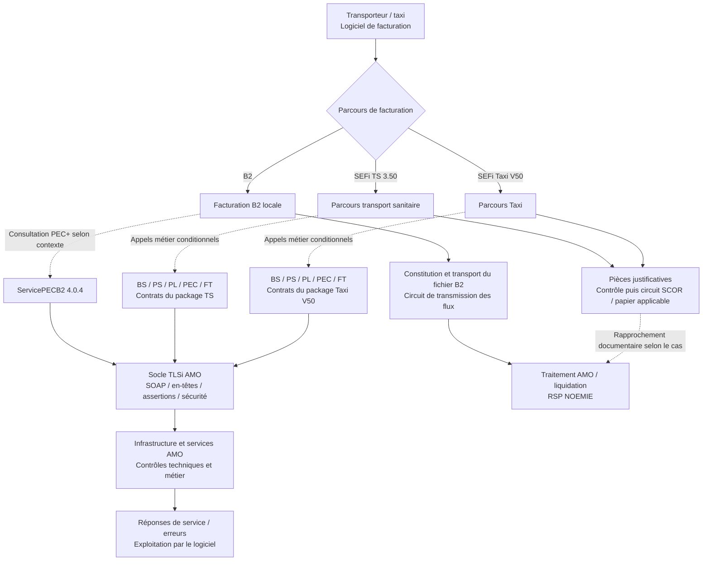

**Lecture essentielle :** TLSi porte des échanges de services AMO. La consultation PEC+ du parcours B2 et les services SEFi passent par ce socle, avec leurs contrats et profils propres. La transmission d'un fichier B2 et l'envoi de PJ SCOR ont leur circuit technique. Une réponse PEC, un accusé FEL, un retour SCOR et un RSP NOEMIE correspondent à des événements différents.

Sources : cadre TLSi p. 12, 26–28 ; présentations générales SEFi TS p. 7–20 et TX p. 7–19 ; PEC+ SFG p. 7–12 ; ETS-DT-001 p. 11–22 ; ETS-DT-003 p. 11–32. [Registre et accès aux documents](</Users/mikail/Documents/Bon de transport/REGISTRE_SOURCES_TLSI_B2_SEFI.md>).

## 2. Un appel TLSi : contexte, sécurité et réponse

```mermaid
sequenceDiagram
    actor TR as Transporteur / opérateur
    participant L as Logiciel
    participant ID as Carte / moyen d'authentification autorisé
    participant I as Infrastructure TLSi AMO
    participant S as Service métier AMO
    TR->>L: Demande une fonction métier
    L->>L: Sélectionne service, opération et contrat de la branche
    L->>L: Prépare données métier et contexte d'appel
    L->>ID: Obtient les éléments requis par le profil du service
    ID-->>L: Identité / certificat / éléments d'assertion requis
    L->>L: Construit SOAP et assertions selon le profil applicable
    Note over L,ID: Pour le profil PS direct CPx, signature de l'assertion SAML PS<br/>La signature n'est pas une signature globale systématique du corps SOAP
    L->>I: Requête sur canal TLS conforme au cadre
    I->>I: Contrôles techniques et de sécurité
    alt Requête recevable
        I->>S: Opération et données métier
        S->>S: Contrôles métier
        S-->>I: Résultat ou erreur métier
        I-->>L: Réponse du service
        L->>L: Interprète statut, données et identifiants de corrélation
        L-->>TR: Résultat exploitable / action corrective
    else Défaut technique ou de sécurité
        I-->>L: Erreur selon le protocole et le service
        L-->>TR: Diagnostic ; poursuite conforme au cas exact
    end
```

Le cadre commun décrit plusieurs moyens et architectures d'accès. Leur présence dans le cadre ne rend pas tous les moyens utilisables pour chaque service. Le guide métier fixe notamment les profils d'accès autorisés aux opérations SEFi. La carte Vitale apporte un contexte bénéficiaire lorsqu'il est requis ; le moyen d'authentification du professionnel et le canal TLS répondent à d'autres besoins.

Sources : cadre TLSi p. 42–57 et 67–68 ; SEL-INF-031 V1.43 p. 7–14 ; annexe Cipher Suite ; profils de sécurité des guides WS propres aux branches. [Documents du socle](</Users/mikail/Documents/Bon de transport/REGISTRE_SOURCES_TLSI_B2_SEFI.md>).

## 3. B2 : consultation PEC+, facture et retours

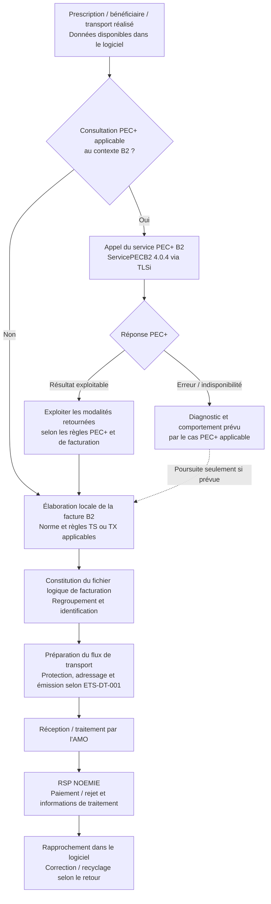

La consultation PEC+ constitue une étape d'aide à la facturation. Elle ne transmet pas la facture B2. Le contrat PEC+ B2 est distinct du contrat WS_PEC SEFi. Les conditions de poursuite en cas d'échec de consultation relèvent des règles PEC+ et de leurs scénarios, et ne se déduisent pas de la seule absence de réponse.

Pour les transporteurs et taxis, ETS-DT-003 p. 23, **RG_ML604**, ne prévoit pas de réception d'ARL B2. Il faut conserver cette particularité lorsque l'on rapproche ce circuit des retours SCOR et SEFi.

Sources : FACT-SFG-037 PEC+ 03.11 p. 7–12 ; SEL-MP-010 PEC+ 03.11 p. 24–30 ; qualification PEC+ 02.13.07 p. 8–11, 36, 52–55 ; ETS-DT-001 1.52.00 p. 11–22, 25, 35–41 et 50 ; ETS-DT-003 2.20 p. 11–32. [Documents B2 et contrats](</Users/mikail/Documents/Bon de transport/REGISTRE_SOURCES_TLSI_B2_SEFI.md>).

## 4. Services préparatoires SEFi : les appels sont conditionnels

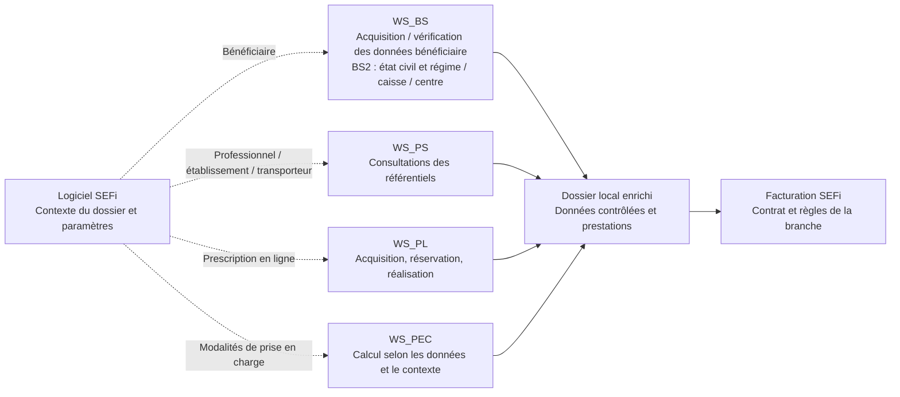

BS2 ne retourne pas les droits, ALD ou taux : les modalités de prise en charge relèvent de PEC1.

Les boîtes ne constituent pas une chaîne obligatoire BS → PS → PL → PEC. FTE04 propose aussi des consultations indépendantes. Un dossier peut provenir d'une prescription papier ; les opérations PEL ne deviennent pas obligatoires du seul fait de l'utilisation de SEFi.

Sources : FTE04 TS 03.18 p. 5–21 et TX 03.20 p. 5–19 ; WS_BS 01.15 p. 5–12 ; WS_PS TS 02.20 p. 5–13 et TX 02.21 p. 12–13 ; WS_PL 03.17 ; WS_PEC 03.40. [Guides séparés TS et TX](</Users/mikail/Documents/Bon de transport/REGISTRE_SOURCES_TLSI_B2_SEFI.md>).

## 5. SEFi TS 3.50 : préparation et réalisation des prestations

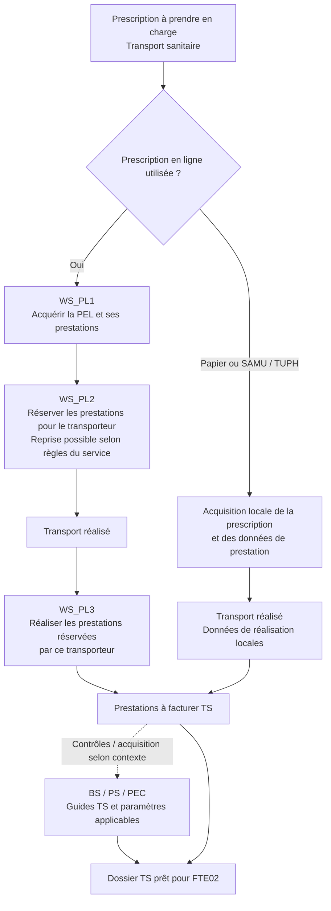

PL1, PL2 et PL3 sont les opérations du parcours PEL. PL3 porte sur les prestations réservées par le transporteur appelant. Les règles de réservation et de reprise restent celles de WS_PL. Ce parcours fonctionnel peut être réparti dans le temps et entre les fonctions du logiciel.

Sources : FTE01 TS 03.18 p. 6–12 ; WS_PL TS 03.17 p. 4–18. [Sources TS](</Users/mikail/Documents/Bon de transport/REGISTRE_SOURCES_TLSI_B2_SEFI.md>).

## 6. SEFi TS 3.50 : facturation et contrôle de la tarification

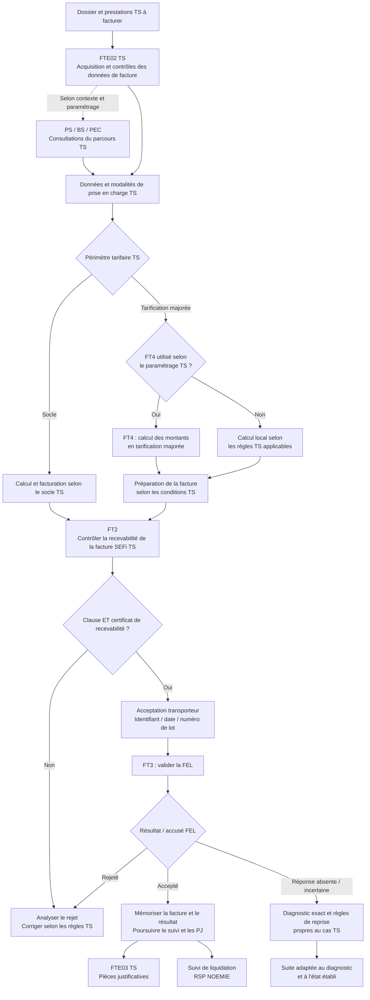

FT1 consulte une FEL déjà validée, sans restituer son certificat ni son AR (WS_FT TS p. 5). Cette consultation est indépendante de la chaîne de calcul et de transmission représentée ci-dessus.

Le contrat TS est **SEMaFELTransport 1.1.0**. Il expose FT1, FT2, FT3 et FT4 ; leur présence au contrat n'impose pas leur utilisation dans chaque facture. FT4 appartient au périmètre de tarification majorée. Le cas TS **TUPH AIG/AHG** est explicitement traité sans appel WS_PEC1 dans FTE04 TS p. 14.

Dans FTE05 TS v03.45 p. 8–13, les consultations PS1/PS3/PS4/BS1/BS2/PEC1 et FT4 peuvent être paramétrées dans le parcours de facturation. Les consultations concernées sont activées par défaut ; FT4 est désactivé dans le socle et n'est pertinent que pour le tarif majoré. Les consultations indépendantes FTE04 ne se déduisent pas de ces indicateurs de facturation.

Sources : FTE02 TS 03.60 p. 61–76 ; WS_FT TS 03.52 p. 4–11 et 25–28 ; FTE04 TS 03.18 p. 14 ; FTE05 TS 03.45 p. 8–13 ; WSDL SEMaFELTransport 1.1.0. [Sources TS et contrat](</Users/mikail/Documents/Bon de transport/REGISTRE_SOURCES_TLSI_B2_SEFI.md>).

## 7. SEFi Taxi V50 : parcours propre à la branche Taxi

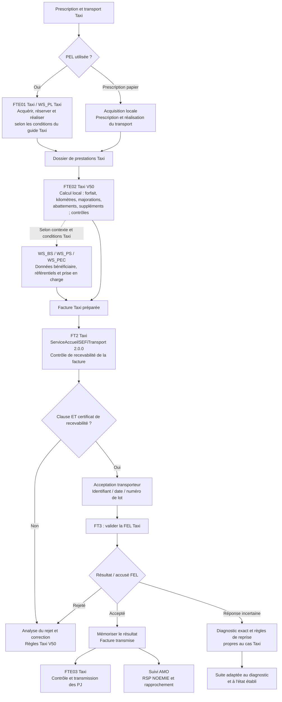

Le package Taxi V50 livre **ServiceAccueilSEFiTransport 2.0.0**, avec les opérations **FT2 et FT3**. Les opérations TS FT1 et FT4 ne sont pas attribuées au parcours Taxi dans cette carte. Les calculs, données tarifaires et contrôles Taxi doivent suivre FTE02 Taxi 03.62 et WS_FT Taxi 03.53, même lorsque les noms d'autres services ressemblent à ceux de TS.

Sources : présentation générale Taxi 05.50 p. 7–19 ; FTE01 Taxi 03.18 p. 6–10 ; FTE02 Taxi 03.62 p. 6–7, 69–97 et 109 ; WS_FT Taxi 03.53 p. 4–6 et 25–27 ; WSDL ServiceAccueilSEFiTransport 2.0.0. [Sources Taxi V50](</Users/mikail/Documents/Bon de transport/REGISTRE_SOURCES_TLSI_B2_SEFI.md>).

## 8. Pièces justificatives : FTE03 et circuit SCOR

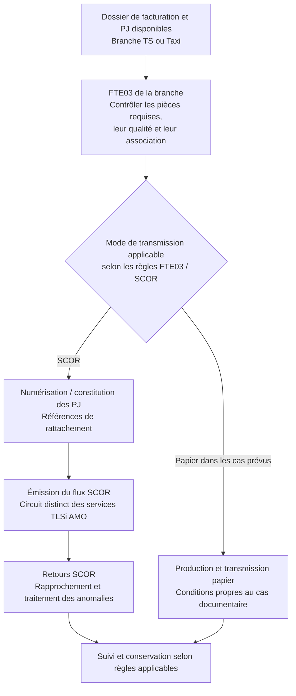

Un retour SCOR concerne les PJ. L'accusé FEL concerne la facture en ligne. FT2 contrôle la recevabilité et fournit, en cas de succès, clause et certificat. FT3 valide la FEL et retourne son AR ; il ne constitue pas une consultation générique d'accusé. Le RSP NOEMIE concerne le traitement de facturation et de liquidation. Leurs statuts doivent rester distincts dans le logiciel.

Sources : FTE03 TS 03.21 p. 7–19 et FTE03 Taxi 03.21 p. 7–19. Les spécifications SCOR extérieures à ces guides ne sont pas comprises dans cette lecture. [Documents FTE03](</Users/mikail/Documents/Bon de transport/REGISTRE_SOURCES_TLSI_B2_SEFI.md>).

## 9. Traitement des erreurs et des réponses incertaines

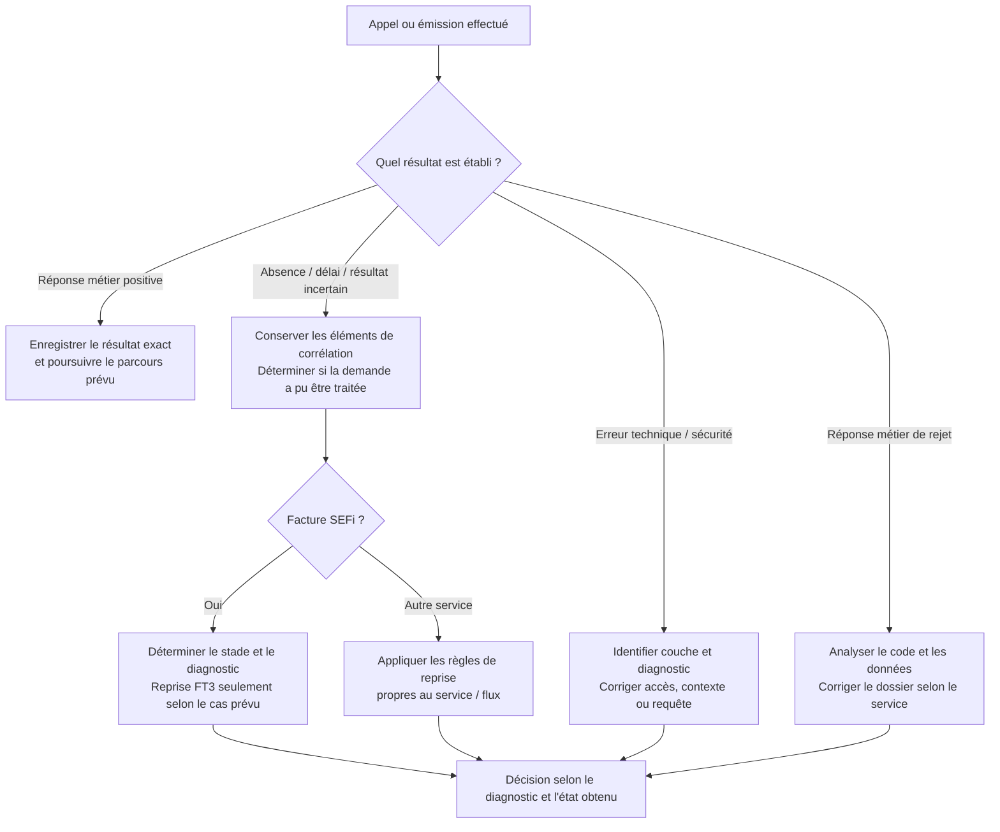

Une absence de réponse ne prouve pas l'absence de traitement. Elle ne justifie pas à elle seule un renvoi B2, une nouvelle facture ou une seconde émission identique. Les reprises sont propres au service et au code rencontré. Un AR FEL positif ne constitue pas une preuve de paiement.

Sources : FTE02 TS 03.60 p. 74–75 ; FTE02 Taxi 03.62 p. 95–96 ; règles de retours ETS-DT-003 et qualification PEC+. Dans les fiches de périmètre p. 3, le texte correspondant est barré car reporté dans les SFG et guides.

## 10. Différences à préserver dans l'implémentation

| Sujet | B2 / PEC+ | SEFi TS 3.50 | SEFi Taxi V50 |
|---|---|---|---|
| Constitution de la facture | Facture B2 locale puis fichier logique | FTE02 TS 03.60 | FTE02 Taxi 03.62 |
| Service de prise en charge | PEC+ B2, ServicePECB2 4.0.4 | WS_PEC TS 03.40 | WS_PEC Taxi 03.40 |
| Contrat de facture en ligne | La consultation PEC+ n'envoie pas le fichier B2 | SEMaFELTransport 1.1.0 | ServiceAccueilSEFiTransport 2.0.0 |
| Opérations FT exposées | Sans objet pour le flux B2 | FT1 / FT2 / FT3 / FT4, conditions TS | FT2 / FT3 |
| FT4 | Sans objet | Calcul des montants, uniquement en tarification majorée | Non porté par le contrat Taxi étudié |
| Consultation des référentiels | Règles PEC+ et contexte B2 | FTE04 TS 03.18, WS_PS 02.20 | FTE04 Taxi 03.20, WS_PS 02.21 |
| Facture acceptée / paiement | RSP et traitement B2 | AR FEL distinct du RSP | AR FEL distinct du RSP |
| ARL | Particularité TR/TX : pas de réception d'ARL B2 selon RG_ML604 | Retours FEL et retours PJ à distinguer | Retours FEL et retours PJ à distinguer |
| PJ | Règles du circuit documentaire applicable | FTE03 TS puis SCOR / papier prévu | FTE03 Taxi puis SCOR / papier prévu |

## 11. Complément de sécurité : données communes et profils de service

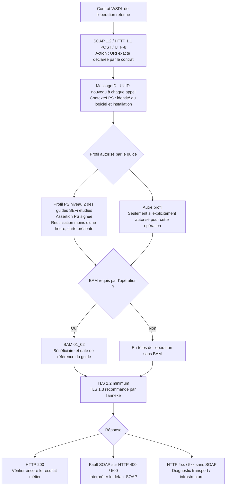

Dans les guides TS étudiés, PS1/PS3/PS4 et PL1/PL2/PL3 utilisent PS niveau 2 et ContexteLPS sans BAM ; PEC1 et FT1/FT2/FT3/FT4 requièrent BAM. BS1/BS2 requièrent également PS niveau 2, LPS et BAM dans WS_BS 01.15. Le guide TX WS_FT p. 25 exige PS niveau 2, LPS et BAM. La lecture CPx est requise dans ce profil.

Le cadre définit les assertions PS et Structure comme exclusives, et les contextes Vitale et ApCV comme exclusifs (p. 46). En profil direct CPx, le niveau 1 produit une nouvelle assertion PS pour chaque opération ; le niveau 2 permet la réutilisation moins d'une heure avec la carte présente. Une assertion Vitale non signée permet le contrôle d'opposition ; sa forme signée ajoute le contrôle d'authenticité. La réutilisation de niveau 2 de l'assertion Vitale est inférieure à vingt minutes avec carte présente. ApCV utilise un jeton de validité propre et une assertion non signée (cadre p. 39–41).

ContexteLPS utilise CTXLPS01_00. L'Instance est un UUID pérenne propre à l'installation ; l'identifiant d'autorisation CNDA de type 4 est confidentiel et non éditable. L'horloge doit être synchronisée. La sémantique XML repose sur les namespaces, indépendamment des préfixes choisis. Un élément optionnel inutilisé doit être absent (cadre p. 47–53).

Le nouveau SEL-INF-031 V1.43 précise l'utilisation de Cryptolib CPS v5 et PC/SC ; GALSS est ancien et non supporté. Il présente l'API de lecture Vitale XML pour les usages hors facturation SESAM-Vitale, notamment transporteur ; MICA intervient pour une assertion Vitale signée. La CPx reste sous contrôle exclusif de l'utilisateur, son retrait désactive les connexions ouvertes avec elle et le PIN n'est pas stocké. L'identifiant de facturation à neuf caractères est distinct de l'idNatPS ; le rang de naissance est distinct du rang bénéficiaire (p. 15–19).

L'Action doit être lue dans le WSDL. Exemple vérifié : le dossier ServicePECB2 **4.0.4** livre l'Action **urn:servicepecb2:4.0.1:calculer**. Construire l'Action à partir du numéro du dossier serait erroné. Les redirections d'import HTTP vers HTTPS décrites par PDT-INF-913 portent sur les références WSDL/XSD, sans définir le routage métier.

## 12. Cycle de la FEL Taxi V50

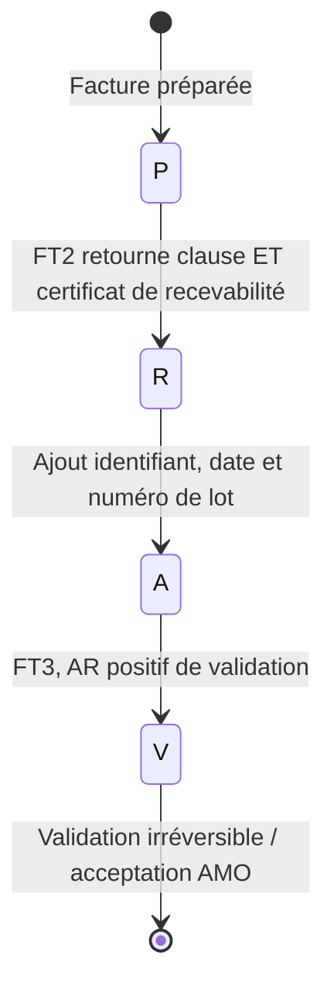

Les lettres P, R, A et V désignent le cycle documenté dans FTE02 Taxi p. 87–96. Le certificat de recevabilité doit être validé le jour même. Le cycle TS impose également clause et certificat à FT2, acceptation du transporteur puis identification et mise en lot avant FT3. Une modification de FEL ou un dépassement du délai impose un nouveau FT2 dans les cas documentés FT_051/FT_052. FT3 exige la recevabilité préalable (WS_FT TX p. 5–6). Hors périmètre ou après forçage des données AMO, le parcours prévu est B2 ; cette décision repose sur ces conditions identifiées.

Les cas de reprise suivants sont spécifiques :

| Diagnostic | Comportement documenté |
|---|---|
| FT3 : siram_40 / desir_1020 | Rappeler automatiquement avec la même facture et le même lot, selon FTE02 de la branche |
| ERR_FT_015 au deuxième appel dans ce cas | Considérer la facture validée, selon la même règle particulière dans FTE02 |
| FT3 ERR_FT_007 TS ou Taxi | Incrémenter le lot puis demander de nouveau la validation du transporteur |

Ces règles ne forment pas une politique générale de nouvelle tentative pour tous les rejets ou délais.

## 13. Détails du transport B2 et de PEC+

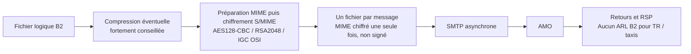

La signature logicielle facultative décrite par ETS-DT-003 p. 6 est distincte de la protection du message de transport. Les transporteurs et taxis relèvent des « Autres PS » ; la règle d'attente d'ARL des établissements ne leur est pas transposable (ETS-DT-001 p. 13 et 22 ; ETS-DT-003 p. 23).

| Code de retour du transport B2 | Traitement défini par ETS-DT-001 p. 50 |
|---|---|
| 4010 | Avertissement ; flux accepté |
| 4000 | Rejet ; réémission avec le certificat ou l'algorithme correct |
| 4020 | Réémission du flux chiffré identique |

PEC+ hors facturation affiche les données sans stocker les données retournées. En facturation, le transporteur choisit de les valider, de les modifier ou de ne pas les intégrer. La consultation tient compte de la date de prestation ; une rupture médico-administrative entraîne des factures distinctes. L'authentification Espace pro et la session décrites par PEC+ ont leurs règles propres : trente minutes maximales d'inactivité, blocage après trois erreurs (guide PEC+ p. 24–25). Les règles de tiers payant TS et TX restent distinctes ; cette carte ne fige aucun taux tarifaire historique.

## 14. Conditions de départ des PJ

Le lot SCOR de PJ est déclenché après réception des AR de **toutes les FEL du lot**, ou après constitution **et transmission** du lot B2 dans le cas correspondant. Le déclenchement est manuel, avec accord du transporteur et CPE/CDE, selon FTE03. L'alerte d'attente des PJ est configurable ; FTE05 TS p. 14 indique quarante-huit heures par défaut. La collecte papier, l'archivage et les retours gardent leurs règles propres.

## 15. Restrictions documentaires à conserver visibles

| Sujet | Constats des documents | Conséquence pour la lecture du diagramme |
|---|---|---|
| DAP, transfrontalier et bénéficiaire migrant Taxi | PDT-INF-293 TX 3.08 p. 2 barre les anciennes exclusions C1.1, C1.3 et C2.2 ; PG V50 p. 7 décrit notamment la DAP via SCOR et FTE02 p. 39 le transfrontalier RG | Ces lignes barrées ne sont pas des restrictions actives de la fiche ; les autres conditions et l'ouverture effective restent à vérifier |
| Régime Taxi | PDT-INF-293 TX 3.08 p. 2 conserve le régime général 01 sauf caisse 908 ; les mentions MSA 02 sont barrées | Ne pas déduire l'ouverture de la MSA 02 de l'ancien texte extrait |
| Disponibilité Taxi | Le tableau « Disponibilité des TLSi par régime » du 23 avril 2026 mentionne une suspension de SEFi Taxis depuis le 1er octobre 2025 ; le package V50 du 29 octobre 2026 est postérieur | Ce tableau daté ne permet pas d'affirmer la disponibilité opérationnelle au 31 octobre 2026 |

La vérification visuelle corrige la divergence annoncée dans la version précédente : elle résultait de la présence de texte barré dans l'extraction. Les lignes de reprise de la fiche p. 3 sont également barrées car reportées dans les guides : utiliser FTE02 TS p. 74–75 et TX p. 95–96 comme sources actives.

## 16. Situations particulières à ne pas fusionner

| Situation | Transport sanitaire 3.50 | Taxi V50 |
|---|---|---|
| Calcul des montants | Calcul local ; FT4 facultatif pour la tarification majorée selon paramétrage | Calcul local ; le contrat livré ne comporte pas FT4 |
| Consultation d'une FEL | FT1 consulte une FEL validée, sans restituer certificat ni AR | FT1 absent du contrat livré |
| TUPH | Le périmètre TS comprend TUPH ; pour AIG/AHG, FTE04 exclut l'appel PEC1 | Ce parcours spécifique TS ne se transpose pas au Taxi |
| Hors périmètre ou forçage des données AMO | Avant validation, orientation B2 ; en TS, tarification socle dans ce repli | Avant validation, orientation B2 selon les règles et limites Taxi |
| Société mandataire | Carte de la mandataire ; pour FT1/FT4/FT2/FT3, identité de facturation de la mandante ; pour FT2/FT3, elle correspond au PS facturant de la FEL | Carte de la mandataire ; pour FT2/FT3, identité de facturation de la mandante correspondant au PS facturant de la FEL |

Pour les deux branches, une FEL validée n'est ni modifiable ni annulable. Le refus de la clause avant validation conduit au parcours B2 prévu ; il ne faut pas représenter un repli automatique après une validation déjà obtenue. Les prescriptions papier, les consultations de référentiels et la gestion des PJ ont chacune leurs conditions propres.

Les fiches de périmètre datées listent les régimes et critères ; elles sont à confronter à l'autorisation effective et doivent être lues avec leurs marques de révision. Sources : présentations générales TS p. 8, 18–20 et TX p. 8, 17–19 ; FTE02 TS p. 68–75 et TX p. 87–97 ; FTE04 TS p. 14 ; fiches de périmètre p. 2.

## Sources et portée

Les numéros de pages sont ceux des PDF. Les documents physiques des versions retenues font autorité pour cette carte ; les anciennes transcriptions Markdown ne suffisent pas à établir l'état du nouveau socle TLSi ou de Taxi V50. Les liens détaillés et versions sont regroupés dans le [registre des sources](</Users/mikail/Documents/Bon de transport/REGISTRE_SOURCES_TLSI_B2_SEFI.md>).

Ce document décrit les mécanismes et les embranchements de fonctionnement. Les champs XML, cardinalités, codes de rejet et matrices exhaustives de cas métier restent définis par les guides, WSDL/XSD et scénarios du package applicable. Les restrictions d'accès dépendent de l'opération ; une capacité générale du cadre TLSi ne remplace pas une autorisation dans un guide SEFi.
