logo: sesam-vitale

## **FACTURATION SV**

*AVENANT*

# **Avenant 48**
Avenant au CDC SESAM-Vitale

## **EV144 - Renseignement des RPPS**
## **dans les factures**

**Addendum 8 - 2025** #CDC

Référence : PDT-CDC-112 / Version : 01.42 / Date : 18/03/2026
Diffusion : RESTREINTE
État : PROVISOIRE

**GIE SESAM-Vitale**
5, boulevard Marie et Alexandre Oyon – 72 019 LE MANS CEDEX 2
<u>www.sesam-vitale.fr</u>

*PDT-CDC-112*
*- Avenant 48 - Addendum 8 - 2025 #CDC*
*- EV144 - Renseignement des RPPS dans les factures -*
*Version : **01.42***

Ce document a été élaboré par le GIE SESAM-Vitale.

Conformément à l’article L.122-4 du Code de la Propriété Intellectuelle, toute représentation ou reproduction (intégrale ou partielle) du présent ouvrage, quel que soit le support utilisé, doit être soumise à l’accord préalable écrit de son auteur.

Il en est de même pour sa traduction, sa transformation, son adaptation ou son arrangement, quel que soit le procédé utilisé.

**Tout manquement à ces obligations constituerait un délit de contrefaçon, au sens des **articles L 335-2 et suivants du code de la propriété intellectuelle, susceptible** d’entraîner des sanctions pour l’auteur du délit.**

icon: icon

*18/03/2026*
*Ce document à diffusion restreinte ne peut être diffusé sans l'autorisation d'une personne habilitée au GIE SESAM-Vitale*
*2 / 24*

*PDT-CDC-112*
*- Avenant 48 - Addendum 8 - 2025 #CDC*
*- EV144 - Renseignement des RPPS dans les factures -*
Version : **01.42**

# SOMMAIRE

<table>
    <tr>
      <td><strong>1</strong></td>
      <td colspan="2"><strong>INTRODUCTION.........................................................................................................................................4</strong></td>
    </tr>
    <tr>
      <td>1.1</td>
      <td colspan="2">CONTEXTE..........................................................................................................................................4</td>
    </tr>
    <tr>
      <td>1.2</td>
      <td colspan="2">IDENTIFICATION DU SOCLE FONCTIONNEL DE REFERENCE CIBLE .............................................................4</td>
    </tr>
    <tr>
      <td>1.3</td>
      <td colspan="2">GUIDE DE LECTURE .............................................................................................................................5</td>
    </tr>
    <tr>
      <td><strong>2</strong></td>
      <td colspan="2"><strong>EV144 : RENSEIGNEMENT DES RPPS ...................................................................................................6</strong></td>
    </tr>
    <tr>
      <td>2.1</td>
      <td colspan="2">PRESENTATION DE LA MESURE.............................................................................................................6</td>
    </tr>
    <tr>
      <td><strong>3</strong></td>
      <td colspan="2"><strong>IMPACTS DANS LE CDC ÉDITEURS .......................................................................................................7</strong></td>
    </tr>
    <tr>
      <td>3.1</td>
      <td colspan="2">SYNTHESE DES IMPACTS .....................................................................................................................7</td>
    </tr>
    <tr>
      <td>3.2</td>
      <td colspan="2">IMPACTS DOCUMENTS DES SFG-FACTURATION....................................................................................8</td>
    </tr>
    <tr>
      <td></td>
      <td><i>3.2.1</i></td>
      <td><i>Impacts Corps ...................................................................................................................8</i></td>
    </tr>
    <tr>
      <td></td>
      <td><i>3.2.2</i></td>
      <td><i>Impacts GD .......................................................................................................................8</i></td>
    </tr>
    <tr>
      <td></td>
      <td><i>3.2.3</i></td>
      <td><i>Impacts PS ........................................................................................................................8</i></td>
    </tr>
    <tr>
      <td></td>
      <td><i>3.2.4</i></td>
      <td><i>Impacts IP .......................................................................................................................12</i></td>
    </tr>
    <tr>
      <td></td>
      <td><i>3.2.5</i></td>
      <td><i>Impacts MF......................................................................................................................18</i></td>
    </tr>
    <tr>
      <td></td>
      <td><i>3.2.6</i></td>
      <td><i>Impacts AP ......................................................................................................................18</i></td>
    </tr>
    <tr>
      <td>3.3</td>
      <td colspan="2">IMPACTS ANNEXES CDC ...................................................................................................................19</td>
    </tr>
    <tr>
      <td></td>
      <td><i>3.3.1</i></td>
      <td><i>Impacts A1-A0.................................................................................................................19</i></td>
    </tr>
</table>

<table>
    <tr>
      <td>FIGURE 1 : [SC_IP02.08] ENCHAINEMENT DE IP02.08 : " ACQUERIR ET DETERMINER LES INFORMATIONS D’EXECUTION DE LA PRESTATION " ......................................................................................................16</td>
    </tr>
</table>

icon: icon

18/03/2026
*Ce document à diffusion restreinte ne peut être diffusé sans l'autorisation d'une personne habilitée au GIE SESAM-Vitale*
*3 / 24*

* - Avenant 48 - Addendum 8 - 2025 #CDC*
*PDT-CDC-112 - EV144 - Renseignement des RPPS dans les factures - Version : **01.42***

# 1 **INTRODUCTION**

## 1.1 **Contexte**

Ce document constitue un avenant aux documents suivants :

* Cahier des charges SESAM-Vitale 1.40 ;
* Dispositif intégré.

**Évolution**
Cet avenant a pour objet de présenter les modifications du système de facturation SESAM-Vitale 1.40 pour la mise en œuvre de l’évolution :

> **EV144 - *Renseignement des RPPS dans les factures***

**PS concernés**
> **Tous**

**Analyse d’impact**
L’analyse d’impact et les modifications du système de facturation SESAM-Vitale sont présentées sous forme de delta par rapport au palier fonctionnel suivant :

> **1.40 – Addendum 8 -2025**

## 1.2 **Identification du socle fonctionnel de référence cible**

**Consigne d’implémentation**
La version du socle fonctionnel de référence n’est pas modifiée par cet avenant.

icon: logo GIE SESAM-Vitale

*18/03/2026 Ce document à diffusion restreinte ne peut être diffusé sans l'autorisation d'une personne habilitée au GIE SESAM-Vitale* *4 / 24*

*PDT-CDC-112*
*- Avenant 48 - Addendum 8 - 2025 #CDC*
*- EV144 - Renseignement des RPPS dans les factures -*
*Version : **01.42***

# **1.3 Guide de lecture**

---

**Indications dans la marge**

icon: hand pointing down-right Les éléments importants et les remarques sont indiqués par une main dans la marge.

---

**Codes couleur**

Les codes couleur suivants sont utilisés dans cet avenant et également dans les documents du cahier des charges SESAM-Vitale 1.40 ou du Dispositif intégré afin de permettre la lecture par thèmes :

<mark>Texte surligné en jaune</mark> Texte ajouté pour l’évolution du CDC SESAM Vitale ou Dispositif Intégré

<mark><u>Texte surligné en gris</u></mark> Texte ajouté par rapport à la précédente version de ce document

<mark><u>Texte surligné en jaune foncé</u></mark> Evolutions introduites par une autre évolution que l’EV en cours (avenant ou une FR publiés mais non encore intégrés au SFR de base Add8)

~~Texte barré suivant la couleur~~ Texte supprimé du CDC SESAM Vitale ou du Dispositif intégré

Le titre du paragraphe est surligné en couleur dès lors que le paragraphe est modifié.

Pour des besoins de commodités de lecture, lorsque le texte du paragraphe est entièrement nouveau, le texte n’est pas surligné en jaune, seuls les titres de paragraphes sont surlignés en jaune.

*18/03/2026*
*Ce document à diffusion restreinte ne peut être diffusé sans l'autorisation d'une personne habilitée au GIE SESAM-Vitale*

icon: GIE SESAM-Vitale logo
*5 / 24*

*PDT-CDC-112*
*- Avenant 48 - Addendum 8 - 2025 #CDC*
*- EV144 - Renseignement des RPPS dans les factures -*
*Version : **01.42***

# 2 **EV144 : RENSEIGNEMENT DES RPPS**

## 2.1 **Présentation de la mesure**

### **Contexte**

L’objectif de cette évolution est, pour l’assurance maladie, de disposer, dans les flux de facturation SESAM-Vitale, de chaque identifiant RPPS prévu (RPPS du prescripteur, de l’exécutant, du remplaçant, …).

Or, à ce jour, le renseignement des différents n° RPPS d’un flux de facturation est, pour la plupart, facultatif.

Le présent avenant fait donc évoluer les modalités de renseignement des RPPS pour les rendre obligatoires dans la facture.

icon: arrow

A noter que cet avenant est un complément à l’avenant 33 qui rendait obligatoire le renseignement des RPPS des salariés en Centres de Santé.

### **Impacts SESAM-Vitale**

Cette mesure correspond à la mise en œuvre des besoins suivants :

* B1 Identification des salariés de structures de type Centres de Santé
* B2 Identification des PS dans le cadre de la Télésanté
* B3.1 Identification du RPPS du prescripteur
* B3.2 Extension des règles de l’avenant 11 à tous les PS hors CD
* B3.3 Identification du RPPS de l’exécutant libéral
* B3.4 Identification du RPPS de l’exécutant salarié et bénévole
* B3.5 Identification du RPPS du remplaçant

*18/03/2026*
*Ce document à diffusion restreinte ne peut être diffusé sans l'autorisation d'une personne habilitée au GIE SESAM-Vitale*
*6 / 24*

icon: logo

*PDT-CDC-112 - Avenant 48 - Addendum 8 - 2025 #CDC*
*- EV144 - Renseignement des RPPS dans les factures - Version : **01.42***

# **3 IMPACTS DANS LE CDC ÉDITEURS**

## **3.1 Synthèse des impacts**

icon: icon Les tableaux de synthèse ci-après reprennent les impacts détaillés pour chaque besoin au §2 ci-avant et les présentent pour chaque document du CDC, dans l'ordre du document.

<table>
  <thead>
    <tr>
      <th><b>Documents</b> <b>SFG</b></th>
      <th><b>Partie impactée</b></th>
      <th><b><i>Nature de l’impact</i></b></th>
      <th><b>Besoin</b></th>
    </tr>
  </thead>
  <tbody>
    <tr>
      <td><strong><em>Corps</em></strong></td>
      <td>§4.1.2</td>
      <td>Etendre l’utilisation du Référentiel PS aux AM, LB et FR</td>
      <td>B3.2</td>
    </tr>
    <tr>
      <td><strong><em>GD</em></strong></td>
      <td>§4.1.2</td>
      <td>Inclure aux Corpus documentaires le Guide d’intégration et d’utilisation du Référentiel PS (document FACT-GU-001)</td>
      <td>B3.2</td>
    </tr>
    <tr>
      <td rowspan="9"><strong><em>PS</em></strong></td>
      <td>RG_PS090[CP2]</td>
      <td>Supprimer les orthophonistes et les orthoptistes (spécialités 28 et 29) de l’exception d’obligation du RPPS du PS salarié.</td>
      <td>B1</td>
    </tr>
    <tr>
      <td>RG_PS092</td>
      <td>Modification de la règle : ajout de la saisie du RPPS par le PS</td>
      <td>B3.5</td>
    </tr>
    <tr>
      <td>RG_PS092 [CE1]</td>
      <td>Nouveau cas d’erreur : « RPPS du remplaçant non renseigné »</td>
      <td>B3.5</td>
    </tr>
    <tr>
      <td>RG_PS095</td>
      <td>Nouvelle règle : Contrôler la clé du RPPS du PS remplaçant</td>
      <td>B3.5</td>
    </tr>
    <tr>
      <td>RG_PS093</td>
      <td>Ouvrir cette règle aux orthophonistes et les orthoptistes (spécialités 28 et 29).</td>
      <td>B1</td>
    </tr>
    <tr>
      <td>RG_PS094</td>
      <td>Nouvelle règle : « Acquérir le RPPS renseigné par le PS »</td>
      <td>B3.3</td>
    </tr>
    <tr>
      <td>RG_PS096</td>
      <td>Nouvelle règle : « Contrôler la clé du RPPS renseigné par le PS »</td>
      <td>B3.3</td>
    </tr>
    <tr>
      <td>EF_PS04_21</td>
      <td rowspan="2">Nouvelles données : RRPS saisi par le PS ; clé du RPPS saisi par le PS</td>
      <td rowspan="2">B3.3</td>
    </tr>
    <tr>
      <td>EF_PS04_22</td>
    </tr>
    <tr>
      <td rowspan="7"><strong><em>IP</em></strong></td>
      <td>RG_IP367[SP10]</td>
      <td>Nouveau cas spécifique en cas de facture anonymisée</td>
      <td>B3.1</td>
    </tr>
    <tr>
      <td>RG_IP367[CE1]</td>
      <td>Nouveau cas d’erreur : « RPPS du prescripteur non renseigné »</td>
      <td>B3.1</td>
    </tr>
    <tr>
      <td>RG_IP502</td>
      <td>Ouvrir la RG_IP502 à tous les PS hors CD</td>
      <td>B3.2</td>
    </tr>
    <tr>
      <td>SC_IP02.08</td>
      <td>Ajouter la RG_IP391</td>
      <td>B3.4</td>
    </tr>
    <tr>
      <td>RG_IP359</td>
      <td>Modification de la règle : préciser que toutes les informations de l’exécutant sont obligatoires hormis le n° de structure</td>
      <td>B3.4</td>
    </tr>
    <tr>
      <td>RG_IP359[CE1]</td>
      <td>Nouveau cas d’erreur : « Informations de l’exécutant salarié non complètes »</td>
      <td>B3.4</td>
    </tr>
    <tr>
      <td>RG_IP391</td>
      <td>Nouvelle règle : « Contrôler le RPPS de l’exécutant salarié »</td>
      <td>B3.4</td>
    </tr>
    <tr>
      <td><strong><em>MF</em></strong></td>
      <td>RG_MF4E064</td>
      <td>Modification de la règle : utiliser le RPPS saisi par le PS si le n° d’identification nationale est un Adeli</td>
      <td>B3.3</td>
    </tr>
    <tr>
      <td><strong><em>AP</em></strong></td>
      <td>RG_AP113</td>
      <td>Etendre cette règle à tous les PS hors CD</td>
      <td>B3.2</td>
    </tr>
  </tbody>
</table>

*18/03/2026 Ce document à diffusion restreinte ne peut être diffusé sans l'autorisation d'une personne habilitée au GIE SESAM-Vitale* *7 / 24*

icon: icon

* - Avenant 48 - Addendum 8 - 2025 #CDC*
*PDT-CDC-112 - EV144 - Renseignement des RPPS dans les factures - Version : **01.42***

<table>
  <thead>
    <tr>
      <th>Annexes CDC</th>
      <th>Partie impactée</th>
      <th><b>Nature de l’impact</b></th>
      <th><b>Besoin</b></th>
    </tr>
  </thead>
  <tbody>
    <tr>
      <td rowspan="5"><strong><i>A1-A0</i></strong></td>
      <td>1151</td>
      <td>Préciser que ce groupe de données et les données qui le constituent (RPPS du remplaçant + clé) sont obligatoires en cas de facture de remplacement</td>
      <td>B3.5</td>
    </tr>
    <tr>
      <td>1211</td>
      <td rowspan="3">Préciser que le n° RPPS est obligatoire dans ce groupe</td>
      <td>B3.1</td>
    </tr>
    <tr>
      <td>1213</td>
      <td>B3.1</td>
    </tr>
    <tr>
      <td>1214</td>
      <td>B3.1</td>
    </tr>
    <tr>
      <td>1870</td>
      <td>Préciser pour rappel que le renseignement de toutes les données de ce groupe est obligatoire à l’exception du n° de structure</td>
      <td>B3.4</td>
    </tr>
  </tbody>
</table>

## **3.2 Impacts Documents des SFG-Facturation**

### **3.2.1 Impacts Corps**

…/… B3.2

### **§4.1.2 Architecture logicielle**

…/…

* Le référentiel PS sert à l’acquisition des informations sur les PS prescripteurs. Il est <u>utilisé</u> par <mark><u>tous</u></mark> les progiciels <mark><u>hormis ceux dédiés aux Chirurgiens-dentistes</u> ~~Pharmaciens.~~</mark>
<mark>~~Ces~~ Les</mark> progiciels <mark>~~à destination des pharmaciens~~</mark> doivent utiliser un référentiel PS pour acquérir des informations sur les PS prescripteurs. Ce référentiel est mis à jour régulièrement par l’éditeur.

…/…

### **3.2.2 Impacts GD**

…/… B3.2

### **§1.9.4 Annexes technico-fonctionnelles au cahier des charges éditeurs**

…/…

<table>
        <tr>
            <td><strong>A7</strong></td>
            <td>Architecture et Sécurité</td>
            <td>PDT-CDC-001 Annexe 7</td>
        </tr>
        <tr>
            <td><strong>A8</strong></td>
            <td>Dépistage de la réthinopathie diabétique en coopération entre l’orthoptiste et l’ophtalmologiste</td>
            <td>PDT-CDC-001 Annexe 8</td>
        </tr>
        <tr>
            <td><mark><strong><b>GU001</b></strong></mark></td>
            <td><mark>Guide d’intégration et d’utilisation du Référentiel PS</mark></td>
            <td><mark>FACT-GU-001</mark></td>
        </tr>
</table>

…/…

### **3.2.3 Impacts PS**

…/… B1

### **§3.3 PS04 : Acquérir les informations nécessaires à la facturation à partir des données lues dans la carte PS**

…/…

*18/03/2026 Ce document à diffusion restreinte ne peut être diffusé sans l'autorisation d'une personne habilitée au GIE SESAM-Vitale*

icon: SESAM-Vitale logo
*8 / 24*

*PDT-CDC-112* * - Avenant 48 - Addendum 8 - 2025 #CDC* * - EV144 - Renseignement des RPPS dans les factures -* Version : **01.42**

# **[RG_PS090] Acquérir les informations nécessaires à la facturation à partir des données lues dans la CPS (EF_PS01, EF_PS02 et EF_PS03)**

<table>
    <tr>
      <td colspan="3"><b>PR</b></td>
      <td rowspan="2"><b>AM</b></td>
      <td rowspan="2"><b>LB</b></td>
      <td rowspan="2"><b>PH</b></td>
      <td rowspan="2"><b>FR</b></td>
      <td rowspan="2"><b>TR</b></td>
    </tr>
    <tr>
      <td><b>M</b></td>
      <td><b>CD</b></td>
      <td><b>SF</b></td>
    </tr>
</table>

Les données de la carte PS (EF_PS01) et les données du PS nécessaires à la facturation (EF_PS02) sont reprises à l’identique des données lues dans la CPS. Les données de la situation d’exercice et de facturation (EF_PS03) sont reprises à l’identique de la situation d’exercice et de facturation sélectionnée dans la règle RG_PS021.

<table>
  <thead>
    <tr>
      <th>Données CDC</th>
      <th>Données DI</th>
      <th colspan="3"><b>Données à acquérir</b></th>
    </tr>
  </thead>
  <tbody>
    <tr>
      <td>1-1</td>
      <td>EF_CPS91_01</td>
      <td>→</td>
      <td>EF_PS01_01</td>
      <td>Type de carte PS</td>
    </tr>
    <tr>
      <td>1-8</td>
      <td>EF_CPS91_02</td>
      <td>→</td>
      <td>EF_PS01_02</td>
      <td>Code catégorie de carte PS</td>
    </tr>
    <tr>
      <td>1-2</td>
      <td>EF_CPS92_01</td>
      <td>→</td>
      <td>EF_PS02_01</td>
      <td>Type d’identification nationale</td>
    </tr>
    <tr>
      <td>1-3</td>
      <td>EF_CPS92_02</td>
      <td>→</td>
      <td>EF_PS02_02</td>
      <td>Numéro d’identification nationale</td>
    </tr>
    <tr>
      <td>1-4</td>
      <td>EF_CPS92_03</td>
      <td>→</td>
      <td>EF_PS02_03</td>
      <td>Clé du numéro d’identification nationale</td>
    </tr>
    <tr>
      <td>1-5</td>
      <td>EF_CPS92_04</td>
      <td>→</td>
      <td>EF_PS02_04</td>
      <td>Code civilité</td>
    </tr>
    <tr>
      <td>1-6</td>
      <td>EF_CPS92_05</td>
      <td>→</td>
      <td>EF_PS02_05</td>
      <td>Nom d’exercice</td>
    </tr>
    <tr>
      <td>1-7</td>
      <td>EF_CPS92_06</td>
      <td>→</td>
      <td>EF_PS02_06</td>
      <td>Prénom</td>
    </tr>
    <tr>
      <td>2-1</td>
      <td>EF_CPS93_01</td>
      <td>→</td>
      <td>EF_PS03_01</td>
      <td>Numéro logique de situation d’exercice et de facturation</td>
    </tr>
    <tr>
      <td>2-2</td>
      <td>EF_CPS93_02</td>
      <td>→</td>
      <td>EF_PS03_02</td>
      <td>Code mode exercice</td>
    </tr>
    <tr>
      <td>2-3</td>
      <td>EF_CPS93_03</td>
      <td>→</td>
      <td>EF_PS03_03</td>
      <td>Code statut d’exercice</td>
    </tr>
    <tr>
      <td>2-4</td>
      <td>EF_CPS93_04</td>
      <td>→</td>
      <td>EF_PS03_04</td>
      <td>Code secteur d’activité</td>
    </tr>
    <tr>
      <td>2-5</td>
      <td>EF_CPS93_05</td>
      <td>→</td>
      <td>EF_PS03_05</td>
      <td>Type d’identification de la structure</td>
    </tr>
    <tr>
      <td>2-6</td>
      <td>EF_CPS93_06</td>
      <td>→</td>
      <td>EF_PS03_06</td>
      <td>Numéro d’identification de la structure dans laquelle le Professionnel de Santé exerce</td>
    </tr>
    <tr>
      <td>2-7</td>
      <td>EF_CPS93_07</td>
      <td>→</td>
      <td>EF_PS03_07</td>
      <td>Clé du numéro d’identification de la structure dans laquelle le Professionnel de Santé exerce</td>
    </tr>
    <tr>
      <td>2-8</td>
      <td>EF_CPS93_08</td>
      <td>→</td>
      <td>EF_PS03_08</td>
      <td>Raison sociale structure</td>
    </tr>
    <tr>
      <td>2-9</td>
      <td>EF_CPS93_09</td>
      <td>→</td>
      <td>EF_PS03_09</td>
      <td>Numéro d’identification de facturation</td>
    </tr>
    <tr>
      <td>2-10</td>
      <td>EF_CPS93_10</td>
      <td>→</td>
      <td>EF_PS03_10</td>
      <td>Clé du numéro d’identification de facturation</td>
    </tr>
    <tr>
      <td>2-13</td>
      <td>EF_CPS93_13</td>
      <td>→</td>
      <td>EF_PS03_13</td>
      <td>Code conventionnel</td>
    </tr>
    <tr>
      <td>2-14</td>
      <td>EF_CPS93_14</td>
      <td>→</td>
      <td>EF_PS03_14</td>
      <td>Code spécialité</td>
    </tr>
    <tr>
      <td>2-15</td>
      <td>EF_CPS93_15</td>
      <td>→</td>
      <td>EF_PS03_15</td>
      <td>Code zone tarifaire</td>
    </tr>
    <tr>
      <td>2-16</td>
      <td>EF_CPS93_16</td>
      <td>→</td>
      <td>EF_PS03_16</td>
      <td>Code zone IK</td>
    </tr>
    <tr>
      <td>2-17</td>
      <td>EF_CPS93_17</td>
      <td>→</td>
      <td>EF_PS03_17</td>
      <td>Code agrément 1</td>
    </tr>
    <tr>
      <td>2-18</td>
      <td>EF_CPS93_18</td>
      <td>→</td>
      <td>EF_PS03_18</td>
      <td>Code agrément 2</td>
    </tr>
    <tr>
      <td>2-19</td>
      <td>EF_CPS93_19</td>
      <td>→</td>
      <td>EF_PS03_19</td>
      <td>Code agrément 3</td>
    </tr>
  </tbody>
</table>

*18/03/2026* *Ce document à diffusion restreinte ne peut être diffusé sans l'autorisation d'une personne habilitée au GIE SESAM-Vitale* *9 / 24*

icon: SESAM-Vitale logo

PDT-CDC-112 *- Avenant 48 - Addendum 8 - 2025 #CDC - EV144 - Renseignement des RPPS dans les factures -* Version : **01.42**

<table>
    <tr>
      <td>2-20</td>
      <td>EF_CPS93_20</td>
      <td>→</td>
      <td>EF_PS03_20</td>
      <td>Code habilitation à signer une FSE</td>
    </tr>
    <tr>
      <td>2-21</td>
      <td>EF_CPS93_21</td>
      <td>→</td>
      <td>EF_PS03_21</td>
      <td>Code habilitation à signer un lot</td>
    </tr>
</table>

…/…

icon: icon ***Cas particuliers***

…/… B1

### **[CP2] *Centre de santé***

photo: professional categories

Pour les professionnels de santé salariés d’un centre de santé (EF_PS04_11 positionné) lors de l’élaboration d’une facture, le système de facturation doit utiliser les informations conventionnelles contenues sur le poste de travail (EF_AP36). En effet, les informations, restituées par la lecture de la carte PS ne sont pas significatives. Par exemple, au code conventionnel est attachée la valeur « 9 ».

En aucun cas, ces valeurs non significatives contenues dans la CPS centre de santé ne doivent alimenter les données constitutives de la facture.

<table>
  <thead>
    <tr>
      <th><b>Informations</b> conventionnelles contenues sur le poste de travail</th>
      <th colspan="3">Données à acquérir</th>
    </tr>
  </thead>
  <tbody>
    <tr>
      <td>EF_AP36_02</td>
      <td>→</td>
      <td>EF_PS03_13</td>
      <td>Code conventionnel</td>
    </tr>
    <tr>
      <td>Code spécialité du PS salarié exécutant ou à défaut EF_AP36_01</td>
      <td>→</td>
      <td>EF_PS03_14</td>
      <td>Code spécialité</td>
    </tr>
    <tr>
      <td>EF_AP36_03</td>
      <td>→</td>
      <td>EF_PS03_15</td>
      <td>Code zone tarifaire</td>
    </tr>
    <tr>
      <td>EF_AP36_04</td>
      <td>→</td>
      <td>EF_PS03_16</td>
      <td>Code zone IK</td>
    </tr>
  </tbody>
</table>

<table>
  <thead>
    <tr>
      <th>Renseignement</th>
      <th colspan="3">Données à acquérir</th>
    </tr>
  </thead>
  <tbody>
    <tr>
      <td>Valeur « RPPS »</td>
      <td>→</td>
      <td>EF_PS02_01</td>
      <td>Type d’identification nationale</td>
    </tr>
    <tr>
      <td>RPPS du PS salarié réalisant les soins de la facture</td>
      <td>→</td>
      <td>EF_PS02_02</td>
      <td>Numéro d’identification nationale (1)</td>
    </tr>
    <tr>
      <td>Clé du RPPS du salarié</td>
      <td>→</td>
      <td>EF_PS02_03</td>
      <td>Clé du numéro d’identification nationale (2)</td>
    </tr>
  </tbody>
</table>

(1) cette information est obligatoire <mark>hormis pour les salariés orthophonistes et orthoptistes (code spécialité = 28 ou 29).</mark>

(2) cette information est obligatoire si le champ précédent (EF_PS02_02) est renseigné.

Pour les autres données, cf. cas nominal de la règle.

…/…

icon: icon ***Situations spécifiques***

…/…

icon: icon

*18/03/2026 Ce document à diffusion restreinte ne peut être diffusé sans l'autorisation d'une personne habilitée au GIE SESAM-Vitale* *10 / 24*

PDT-CDC-112 * - Avenant 48 - Addendum 8 - 2025 #CDC*
* - EV144 - Renseignement des RPPS dans les factures - Version : **01.42***

B3.5

…/…

### **[RG_PS092] Acquérir le Numéro RPPS du remplaçant (EF_PS05_07) et sa clé (EF_PS05_08)**
photo: medical profession indicators

Si le type d’identification nationale (groupe 2 – donnée 1) est RPPS, le tableau ci-dessous indique les données à acquérir.

<table>
  <thead>
    <tr>
      <th>Données CDC</th>
      <th>Données DI</th>
      <th colspan="3"><b>Données à acquérir</b></th>
    </tr>
  </thead>
  <tbody>
    <tr>
      <td>1-3</td>
      <td>EF_CPS92_02</td>
      <td>→</td>
      <td>EF_PS05_07</td>
      <td>Numéro RPPS du remplaçant</td>
    </tr>
    <tr>
      <td>1-4</td>
      <td>EF_CPS92_03</td>
      <td>→</td>
      <td>EF_PS05_08</td>
      <td>Clé du numéro RPPS du remplaçant</td>
    </tr>
  </tbody>
</table>

<mark>Sinon, les données ne sont pas renseignées.</mark>

<mark>Dans le cas contraire, le RPPS du remplaçant (EF_PS05_07) et sa clé (EF_PS05_08) <u>doivent être renseignés par le PS.</u></mark>

***[CE1] RPPS du remplaçant non renseigné***
photo: medical profession indicators

<mark>Si cette information n’est pas renseignée, le processus de facturation ne peut se poursuivre.</mark>

### ***[RG_PS095] Contrôler la clé du RPPS du PS remplaçant***
photo: medical profession indicators

<mark>Cette règle a pour objet de vérifier la clé du numéro RPPS du remplaçant (RG_PS05_08) <u>dans le cas où ce RPPS (RG_PS05_07) n’a pas été acquis à partir de la carte PS (cf. RG_PS092).</u></mark>

<mark><u>Cette vérification est faite à partir du même algorithme de calcul que celui spécifié dans la règle RG_IP_R6.</u></mark>

…/… B1

### ***[RG_PS093] Contrôler le renseignement du RPPS du PS salarié en Centre de Santé***
photo: medical profession indicators

Dans une facture en Centre de Santé (EF_PS04_11 positionné) le numéro d’identification nationale (EF_PS02_02), correspondant au RPPS du PS salarié (cf. RG_PS090[CP2]), doit être obligatoirement renseigné, <mark>~~<u>hormis pour les salariés orthophonistes et orthoptistes (EF_PS03_14 = 28 ou 29).</u>~~</mark>

Dans le cas contraire, le LPS bloque la réalisation de la facture.

…/…

## **§3.4 ** **PS05 : Acquérir des informations nécessaires à la facturation en complément des données lues dans la carte PS**

…/…

*18/03/2026* 
 icon: GIE SESAM-Vitale logo *Ce document à diffusion restreinte ne peut être diffusé sans l'autorisation d'une personne habilitée au GIE SESAM-Vitale* *11 / 24*

*PDT-CDC-112*
*- Avenant 48 - Addendum 8 - 2025 #CDC*
*- EV144 - Renseignement des RPPS dans les factures -*
Version : **01.42**

## **§3.4.2** **PS05.02 : Acquérir des informations en complément de la situation d’exercice et de facturation sélectionnée**

…/…
B3.3

### **[RG_PS094] *Acquérir le RPPS, clé incluse, renseigné par le PS (EF_PS04_21 ; EF_PS04_22)***

icon: photograph

<mark>Le renseignement du RPPS du PS (EF_PS04_21) et de sa clé (EF_PS04_22) doit être <u>demandé au PS si l’identifiant national en carte est de type Adeli : EF_PS02_01 = 0, ou 9.</u></mark>

<mark>Ce renseignement est dans ce cas obligatoire (valeur blanc non autorisée).</mark>

### **[RG_PS096] *Contrôler la clé du RPPS, renseigné par le PS (EF_PS04_22)***

icon: icon

<mark>Cette règle a pour objet de vérifier la clé du numéro RPPS renseigné par le PS <u>(RG_PS04_21).</u></mark>

<mark><u>Cette vérification est faite à partir du même algorithme de calcul que celui spécifié dans la règle RG_IP_R6.</u></mark>

…/…

## **§4.3** **Liste des données fonctionnelles pour chaque entité**

…/…
B3.3

<table>
  <thead>
    <tr>
      <th><b>N° EF</b></th>
      <th><b>Nom EF</b></th>
      <th>N° <b>Donnée</b></th>
      <th><b>Nom SFG</b></th>
      <th>Format</th>
      <th>RG_PS</th>
    </tr>
  </thead>
  <tbody>
    <tr>
      <td>…/…</td>
      <td>…/…</td>
      <td>…/…</td>
      <td>…/…</td>
      <td>…/…</td>
      <td>…/…</td>
    </tr>
    <tr>
      <td rowspan="6">EF_PS04</td>
      <td rowspan="6">Complément d’informations à la situation d’exercice et de facturation</td>
      <td>01</td>
      <td>Date de première installation en exercice libéral</td>
      <td>D</td>
      <td>026</td>
    </tr>
    <tr>
      <td>02</td>
      <td>Date d’installation en zone sous médicalisée</td>
      <td>D</td>
      <td>027</td>
    </tr>
    <tr>
      <td>…/…</td>
      <td>…/…</td>
      <td>…/…</td>
      <td>…/…</td>
    </tr>
    <tr>
      <td>20</td>
      <td>Top activité du centre de santé</td>
      <td>B</td>
      <td>075</td>
    </tr>
    <tr>
      <td><mark>21</mark></td>
      <td><mark>RPPS saisi par le PS</mark></td>
      <td><mark>B</mark></td>
      <td><mark>094</mark></td>
    </tr>
    <tr>
      <td><mark>22</mark></td>
      <td><mark>Clé du RPPS saisi par le PS</mark></td>
      <td><mark>B</mark></td>
      <td><mark>094</mark></td>
    </tr>
  </tbody>
</table>

…/…

## **3.2.4** **Impacts IP**

…/…

## **§3.1** **IP01 : Acquérir et contrôler les informations de niveau facture**

…/…
B3.1

---
**Préambule**

…/…

*18/03/2026*
*Ce document à diffusion restreinte ne peut être diffusé sans l'autorisation d'une personne habilitée au GIE SESAM-Vitale*
*12 / 24*

icon: icon

*PDT-CDC-112* *- Avenant 48 - Addendum 8 - 2025 #CDC* *Version : **01.42***
*- EV144 - Renseignement des RPPS dans les factures -*

# ***Identification du prescripteur***

<table>
    <tr>
      <td colspan="3"><b>PR</b></td>
      <td rowspan="2"><b>AM</b></td>
      <td rowspan="2"><b>LB</b></td>
      <td rowspan="2"><b>PH</b></td>
      <td rowspan="2"><b>FR</b></td>
      <td rowspan="2"><b>TR</b></td>
    </tr>
    <tr>
      <td><b>M</b></td>
      <td><b>CD</b></td>
      <td><b>SF</b></td>
    </tr>
</table>

Lorsque les prestations facturées sont réalisées suite à une prescription, le système de facturation permet au Professionnel de Santé de saisir les informations d’identification du prescripteur à partir de la prescription à savoir :

*   le n° d’identification de facturation du prescripteur, (EF_IP03_04)
*   la clé du n° d’identification de facturation du prescripteur (EF_IP03_05)
*   le n° de RPPS du prescripteur, (EF_IP03_07)
*   la clé du n° RPPS du prescripteur (EF_IP03_08)
*   la date de la prescription, (EF_IP03_02)
*   le code spécialité du prescripteur (uniquement pour les prescripteurs salariés ou bénévoles), (EF_IP03_06)
*   l’identification de la structure dans laquelle le prescripteur exerce. (EF_IP03_09)
*   l’identification de la prescription (EF_IP03_01)
*   le code condition d’exercice du prescripteur (EF_IP03_10)

.../... B3.1

***[RG_IP307] Acquérir le Numéro de prescripteur (EF_IP03_04)***

<table>
  <thead>
    <tr>
      <th colspan="3"><b>PR</b></th>
      <th rowspan="2"><b>AM</b></th>
      <th rowspan="2"><b>LB</b></th>
      <th rowspan="2"><b>PH</b></th>
      <th rowspan="2"><b>FR</b></th>
      <th rowspan="2"><b>TR</b></th>
    </tr>
    <tr>
      <th><b>M</b></th>
      <th><b>CD</b></th>
      <th><b>SF</b></th>
    </tr>
  </thead>
</table>

Cette information est :

*   soit issue du code à barre présent sur l’ordonnance et scanné par le PS ;
*   soit inscrite sur l’ordonnance et saisie par le PS ;
*   soit déduite du référentiel PS (DF_REF_PS) si cette donnée n’est pas présente sur l’ordonnance.
    Cette déduction s’appuie sur la règle de recherche RG_IP502.
    Dans tous les cas, le LPS laisse la possibilité au PS de modifier les informations issues du référentiel PS proposées par le LPS.
    Le LPS doit laisser la possibilité au PS de renseigner manuellement les informations du prescripteur.

Pour les prescripteurs exerçant comme salariés dans les établissements de santé et centres de santé, ce numéro est le n° FINESS de l’établissement.

***[RG_IP367] Acquérir le numéro RPPS du prescripteur (EF_IP03_07)***

<table>
  <thead>
    <tr>
      <th colspan="3"><b>PR</b></th>
      <th rowspan="2"><b>AM</b></th>
      <th rowspan="2"><b>LB</b></th>
      <th rowspan="2"><b>PH</b></th>
      <th rowspan="2"><b>FR</b></th>
      <th rowspan="2"><b>TR</b></th>
    </tr>
    <tr>
      <th><b>M</b></th>
      <th><b>CD</b></th>
      <th><b>SF</b></th>
    </tr>
  </thead>
</table>

Cette information est :

*   soit issue du code à barre présent sur l’ordonnance et scanné par le PS ;
*   soit inscrite sur l’ordonnance et saisie par le PS ;

*18/03/2026* *Ce document à diffusion restreinte ne peut être diffusé sans l'autorisation d'une personne habilitée au GIE SESAM-Vitale* *13 / 24*

icon: icon

*PDT-CDC-112*
*- Avenant 48 - Addendum 8 - 2025 #CDC*
*- EV144 - Renseignement des RPPS dans les factures -*
Version : **01.42**

• soit déduite du référentiel PS (DF_REF_PS) si cette donnée n’est pas présente sur l’ordonnance.
Cette déduction s’appuie sur la règle de recherche RG_IP502.
Dans tous les cas, le LPS laisse la possibilité au PS de modifier les informations issues du référentiel PS proposées par le LPS.
Le LPS doit laisser la possibilité au PS de renseigner manuellement les informations du prescripteur.

icon: icon ***Cas particuliers***

### ***[CP1] Facturation de Télémédecine***

<table>
    <tr>
      <td colspan="3"><b>PR</b></td>
      <td rowspan="2"><b>AM</b></td>
      <td rowspan="2"><b>LB</b></td>
      <td rowspan="2"><b>PH</b></td>
      <td rowspan="2"><b>FR</b></td>
      <td rowspan="2"><b>TR</b></td>
    </tr>
    <tr>
      <td><b>M</b></td>
      <td><b>CD</b></td>
      <td><b>SF</b></td>
    </tr>
</table>

En cas de facturation de télémédecine, i.e. si la facture comporte au moins une prestation de télémédecine, (groupe fonctionnel : EF_IP05_03 = « Télémédecine »), cette information est utilisée pour identifier, à la place du PS prescripteur, le second PS en contact avec le PS facturant :

• soit le PS1 dans le cas d’une facture élaborée par le PS2 ;
• soit le PS2 dans le cas d’une facture élaborée par le PS1 ;

### <mark><u>***[SP10] Facture anonymisée***</u></mark>

<table>
    <tr>
      <td colspan="3">PR</td>
      <td rowspan="2">AM</td>
      <td rowspan="2">LB</td>
      <td rowspan="2">PH</td>
      <td rowspan="2">FR</td>
      <td rowspan="2">TR</td>
    </tr>
    <tr>
      <td>M</td>
      <td>CD</td>
      <td>SF</td>
    </tr>
</table>

<mark>Dans le cas d’une facture anonymisée (EF_IP01_10 = « oui »), le RPPS du prescripteur <u>n’est pas renseigné.</u></mark>

photo: Cas d’erreur ***Cas d’erreur***

### <mark>***[CE1] RPPS du prescripteur non renseigné***</mark>

<table>
    <tr>
      <td colspan="3"><mark><b>PR</b></mark></td>
      <td rowspan="2"><mark><b>AM</b></mark></td>
      <td rowspan="2"><mark><b>LB</b></mark></td>
      <td rowspan="2"><mark><b>PH</b></mark></td>
      <td rowspan="2"><mark><b>FR</b></mark></td>
      <td rowspan="2"><mark><b>TR</b></mark></td>
    </tr>
    <tr>
      <td><mark><b>M</b></mark></td>
      <td><mark><b>CD</b></mark></td>
      <td><mark><b>SF</b></mark></td>
    </tr>
</table>

<mark><u>Le renseignement du RPPS du prescripteur est obligatoire.</u></mark>
<mark>Si cette information n’est pas renseignée, le processus de facturation ne peut se poursuivre.</mark>

## ***[RG_IP368] Acquérir la clé du numéro RPPS du prescripteur (EF_IP03_08)***

<table>
    <tr>
      <td colspan="3"><b>PR</b></td>
      <td rowspan="2"><b>AM</b></td>
      <td rowspan="2"><b>LB</b></td>
      <td rowspan="2"><b>PH</b></td>
      <td rowspan="2"><b>FR</b></td>
      <td rowspan="2"><s><b>TR</b></s></td>
    </tr>
    <tr>
      <td><b>M</b></td>
      <td><s><b>CD</b></s></td>
      <td><b>SF</b></td>
    </tr>
</table>

icon: icon
…/…

icon: icon
…/…
B3.2

## ***[RG_IP502] Rechercher une donnée à partir du référentiel PS***

<table>
    <tr>
      <td colspan="3"><strong>PR</strong></td>
      <td rowspan="2"><strong>AM</strong></td>
      <td rowspan="2"><strong>LB</strong></td>
      <td rowspan="2"><strong>PH</strong></td>
      <td rowspan="2"><strong>FR</strong></td>
      <td rowspan="2">TR</td>
    </tr>
    <tr>
      <td><strong>M</strong></td>
      <td>CD</td>
      <td><strong>SF</strong></td>
    </tr>
</table>

Si cette donnée n’est pas présente sur l’ordonnance, le Référentiel PS (DF_REF_PS) est utilisé selon les modalités décrites dans le tableau ci-dessous :

<table>
  <thead>
    <tr>
      <th colspan="2"><b>N° présents sur</b> l’ordonnance</th>
      <th colspan="2"><b>Utilisation du Référentiel PS par le LPS</b></th>
    </tr>
    <tr>
      <th>N° <b>FINESS</b></th>
      <th>N° RPPS</th>
      <th><b>Données</b> <b>recherchées</b></th>
      <th><b>Critères de recherche</b></th>
    </tr>
  </thead>
  <tbody>
    <tr>
      <td>x</td>
      <td>x</td>
      <td>Code spécialité</td>
      <td>N° RPPS</td>
    </tr>
  </tbody>
</table>

*18/03/2026* *Ce document à diffusion restreinte ne peut être diffusé sans l'autorisation d'une personne habilitée au GIE SESAM-Vitale* *14 / 24*

icon: icon

*PDT-CDC-112*
*- Avenant 48 - Addendum 8 - 2025 #CDC*
*- EV144 - Renseignement des RPPS dans les factures -*
*Version : **01.42***

<table>
    <tr>
      <td></td>
      <td></td>
      <td></td>
      <td>La recherche est réalisée avec uniquement le n° RPPS.</td>
    </tr>
    <tr>
      <td>x</td>
      <td></td>
      <td>N° RPPS Code spécialité</td>
      <td>N° FINESS + si nécessaire, autres données présentes sur l’ordonnance et disponibles dans le référentiel PS (nom, prénom…) Si aucune donnée n’est trouvée en utilisant le N° FINESS, une autre recherche est réalisée avec uniquement les autres critères.</td>
    </tr>
    <tr>
      <td></td>
      <td>x</td>
      <td>N° FINESS Code spécialité</td>
      <td>Coordonnées de l’établissement + si nécessaire, autres données présentes sur l’ordonnance et disponibles dans le référentiel PS</td>
    </tr>
    <tr>
      <td></td>
      <td></td>
      <td>N° RPPS N° FINESS Code spécialité</td>
      <td>Données présentes sur l’ordonnance et disponibles dans le référentiel PS (coordonnées de l’établissement, nom, prénom, …)</td>
    </tr>
</table>

Si le LPS trouve dans le référentiel PS plusieurs prescripteurs répondant aux critères de recherche, le LPS demande au PS de sélectionner un prescripteur.

Cette recherche peut être utilisée pour règles suivantes :

<table>
    <tr>
      <td>[RG_IP307]</td>
      <td><strong><em>Acquérir le Numéro de prescripteur (EF_IP03_04)</em></strong></td>
    </tr>
    <tr>
      <td>[RG_IP309]</td>
      <td><strong><em>Acquérir le Code spécialité du prescripteur (EF_IP03_06)</em></strong></td>
    </tr>
    <tr>
      <td>[RG_IP367]</td>
      <td><strong><em>Acquérir le numéro RPPS du prescripteur (EF_IP03_07)</em></strong></td>
    </tr>
    <tr>
      <td>[RG_IP369]</td>
      <td><strong><em><u>Acquérir le numéro de la structure du prescripteur (EF_IP03_09)</u></em></strong></td>
    </tr>
</table>

## **§3.2.8** **IP02.08 : Acquérir et déterminer les informations d’exécution de la prestation**

…/… B3.4

*18/03/2026* *Ce document à diffusion restreinte ne peut être diffusé sans l'autorisation d'une personne habilitée au GIE SESAM-Vitale* 
 icon: icon *15 / 24*

*PDT-CDC-112*
*- Avenant 48 - Addendum 8 - 2025 #CDC*
*- EV144 - Renseignement des RPPS dans les factures -*
Version : **01.42**

```mermaid
graph TD
    Start(( )) -->|Début de IP02.08| Fork1[ ]
    
    Fork1 ---| | RG_IP338[RG_IP338 : Acquérir la date d'exécution de la prestation]
    RG_IP338 --> RG_IP348[RG_IP348 : Contrôler la date d'exécution de la prestation]
    RG_IP348 --> RG_IP366[RG_IP366 : Déterminer l'âge du bénéficiaire des soins à la date d'exécution de la prestation]
    RG_IP366 --> Join1[ ]

    Fork1 ---| | RG_IP359[RG_IP359 : Acquérir les informations du PS exécutant]
    RG_IP359 --> RG_IP391[RG_IP391 : Contrôler le RPPS du PS exécutant]
    RG_IP391 --> Join1

    Fork1 ---| | RG_IP357[RG_IP357 : Acquérir le code lieu d'exécution]
    RG_IP357 --> Join1

    Fork1 ---| | RG_IP358[RG_IP358 : Acquérir l'identifiant du lieu d'exécution]
    RG_IP358 --> Join1

    Join1 -->| | End((( )))
    End ---|Fin de IP02.08| EndLabel[ ]

    style Fork1 fill:#000,stroke:#000,stroke-width:4px
    style Join1 fill:#000,stroke:#000,stroke-width:4px
    style RG_IP391 fill:#f5f5dc,stroke:#001f3f
```

**Figure 1 : [SC_IP02.08] Enchaînement de IP02.08 : " Acquérir et déterminer les informations d’exécution de la prestation "**

…/… B3.4

<table>
  <thead>
    <tr>
      <th rowspan="2"><strong><i>[RG_IP359] Acquérir les informations du PS exécutant salarié</i></strong></th>
      <th colspan="3">PR</th>
      <th rowspan="2">AM</th>
      <th rowspan="2">LB</th>
      <th rowspan="2">PH</th>
      <th rowspan="2">FR</th>
      <th rowspan="2">TR</th>
    </tr>
    <tr>
      <th>M</th>
      <th>CD</th>
      <th>SF</th>
    </tr>
  </thead>
  <tbody>
    <tr>
      <td></td>
      <td></td>
      <td></td>
      <td></td>
      <td></td>
      <td></td>
      <td></td>
      <td></td>
      <td></td>
    </tr>
  </tbody>
</table>

La notion d’exécutant salarié concerne les salariés du professionnel de santé ou bien par extension un laboratoire sous-traitant ou les médecins directeurs de laboratoire d’analyses de biologie médicale dans le cas des laboratoires.

icon: exclamation mark

Ces informations ne sont pas renseignées dans le cas d’une facture en Centre de Santé. L’identification du PS facturant (le Centre de Santé) et du PS exécutant (le salarié) sont toutes réunies dans le domaine fonctionnel DF_PS.

Les informations suivantes doivent être renseignées :

<table>
        <tr>
            <td>• Numéro d'identification de facturation de l’exécutant salarié</td>
            <td>(EF_IP07_01)</td>
        </tr>
        <tr>
            <td>• Clé du numéro d'identification de l’exécutant salarié</td>
            <td>(EF_IP07_02)</td>
        </tr>
        <tr>
            <td>• Code spécialité de l’exécutant salarié</td>
            <td>(EF_IP07_03)</td>
        </tr>
        <tr>
            <td>• Code zone tarifaire de l’exécutant salarié</td>
            <td>(EF_IP07_04)</td>
        </tr>
        <tr>
            <td>• Code conventionnel de l’exécutant salarié</td>
            <td>(EF_IP07_06)</td>
        </tr>
        <tr>
            <td>• Code caisse de l’exécutant salarié</td>
            <td>(EF_IP07_07)</td>
        </tr>
        <tr>
            <td>• Numéro RPPS de l’exécutant salarié</td>
            <td>(EF_IP07_08)</td>
        </tr>
        <tr>
            <td>• Clé du numéro RPPS de l’exécutant salarié</td>
            <td>(EF_IP07_09)</td>
        </tr>
</table>

*18/03/2026*
*Ce document à diffusion restreinte ne peut être diffusé sans l'autorisation d'une personne habilitée au GIE SESAM-Vitale*
*16 / 24*

* - Avenant 48 - Addendum 8 - 2025 #CDC*
PDT-CDC-112 - EV144 - Renseignement des RPPS dans les factures - Version : **01.42**

*   Numéro de la structure de l’exécutant salarié (EF_IP07_10)
*   Contrat tarifaire de l’exécutant salarié (EF_IP07_11)

Ces informations sont renseignées par le PS ou lues sur la carte CPE de l’exécutant.

Lorsque le professionnel de santé qui facture est aussi celui qui a exécuté l’acte, les informations précédentes n’ont pas à être renseignées.

<u>Dans le cas contraire, le renseignement de toutes les données de l’exécutant salarié est obligatoire à l’exception du numéro de la structure (EF_IP07_10).</u>

L’information numéro de la structure de l’exécutant salarié (EF_IP07_10) inclus la clé de ce numéro de structure.

icon: arrow ***Cas particuliers***

### **[CP1] *Prestation de type complément AT***

<table>
    <tr>
      <td colspan="3">PR</td>
      <td rowspan="2"><b>AM</b></td>
      <td rowspan="2">LB</td>
      <td rowspan="2"><b>PH</b></td>
      <td rowspan="2"><b>FR</b></td>
      <td rowspan="2">TR</td>
    </tr>
    <tr>
      <td><b>M</b></td>
      <td><b>CD</b></td>
      <td>SF</td>
    </tr>
</table>

Pour une prestation de type complément AT (EF_IP05_03 = « Complément AT »), les informations du PS exécutant salarié sont identiques à celles de l’acte support auquel ce complément AT est rattaché.

### **[CP3] *Prestations de type secondaire***

<table>
    <tr>
      <td colspan="3"><strong>PR</strong></td>
      <td rowspan="2"><strong>AM</strong></td>
      <td rowspan="2"><strong>LB</strong></td>
      <td rowspan="2"><strong>PH</strong></td>
      <td rowspan="2"><strong>FR</strong></td>
      <td rowspan="2"><strong>TR</strong></td>
    </tr>
    <tr>
      <td><strong>M</strong></td>
      <td><strong>CD</strong></td>
      <td><strong>SF</strong></td>
    </tr>
</table>

Pour une prestation de type secondaire (EF_IP05_01 = « Secondaire »), les informations du PS exécutant salarié sont identiques à celles de l’acte support auquel cette prestation secondaire est rattachée.

icon: number 4 ***Situations Spécifiques***

### **[SP18] *Dépassement pour Victime d'Attentat***

<table>
  <thead>
    <tr>
      <th colspan="3">PR</th>
      <th rowspan="2">AM</th>
      <th rowspan="2">LB</th>
      <th rowspan="2">PH</th>
      <th rowspan="2">FR</th>
      <th rowspan="2">TR</th>
    </tr>
    <tr>
      <th>M</th>
      <th>CD</th>
      <th>SF</th>
    </tr>
  </thead>
  <tbody>
    <tr>
      <td colspan="8">photo: photograph</td>
    </tr>
  </tbody>
</table>

Pour une prestation de dépassement pour Victime d'Attentat (EF_IP05_03 = « Dépassement » et EF_IP05_04 = « Victime d'Attentat »), les informations du PS exécutant salarié sont identiques à celles de l’acte support auquel cette prestation de dépassement est rattachée.

icon: error case **Cas d’erreur**

### **[CE1] *Informations de l’exécutant salarié non complètes***

<table>
  <thead>
    <tr>
      <th colspan="3">PR</th>
      <th rowspan="2">AM</th>
      <th rowspan="2">LB</th>
      <th rowspan="2">PH</th>
      <th rowspan="2">FR</th>
      <th rowspan="2">TR</th>
    </tr>
    <tr>
      <th>M</th>
      <th>CD</th>
      <th>SF</th>
    </tr>
  </thead>
</table>

Si les informations de l’exécutant salarié (EF_IP07) sont renseignées, i.e. quand le PS qui <u>exécute l’acte n’est pas celui qui facture, toutes les données de cette entité, à l’exception du</u> numéro de la structure (EF_IP07_10) doivent être renseignées et notamment le numéro d'identification de facturation et le numéro RPPS de l’exécutant salarié.

<mark>**[RG_IP391] *Contrôler le RPPS du PS exécutant salarié***</mark>

<table>
  <thead>
    <tr>
      <th colspan="3"><strong>PR</strong></th>
      <th rowspan="2"><strong>AM</strong></th>
      <th rowspan="2"><strong>LB</strong></th>
      <th rowspan="2"><strong>PH</strong></th>
      <th rowspan="2"><strong>FR</strong></th>
      <th rowspan="2"><strong>TR</strong></th>
    </tr>
    <tr>
      <th><strong>M</strong></th>
      <th><strong>CD</strong></th>
      <th><strong>SF</strong></th>
    </tr>
  </thead>
</table>

*18/03/2026* *Ce document à diffusion restreinte ne peut être diffusé sans l'autorisation d'une personne habilitée au GIE SESAM-Vitale* *17 / 24*

icon: logo

*PDT-CDC-112*
*- Avenant 48 - Addendum 8 - 2025 #CDC*
*- EV144 - Renseignement des RPPS dans les factures -*
*Version : **01.42***

<mark>Si les informations de l’exécutant salarié (EF_IP07) sont renseignées, i.e. si le PS qui <u>exécute l’acte n’est pas celui qui facture, il convient de vérifier que l’identifiant RPPS du PS</u> <u>facturant (EF_PS02_02) est différent de celui de l’exécutant (EF_IP07_08).</u></mark>

.../...

## **3.2.5** **Impacts MF**

.../...

### **§6.3.2.2** **Création d’un type 4S**

### **§6.3.2.3** **Création d’un type 4S**

.../... B3.3

### ***[RG_MF4E064] Identifiant RPPS de l’exécutant***

***Données utilisées***

<table>
    <tr>
      <td>• type d’identification nationale</td>
      <td>EF_PS02_01</td>
    </tr>
    <tr>
      <td>• numéro d’identification nationale</td>
      <td>EF_PS02_02</td>
    </tr>
    <tr>
      <td>• clé du numéro d’identification nationale</td>
      <td>EF_PS02_03</td>
    </tr>
    <tr>
      <td><mark>• RPPS saisi par le PS</mark></td>
      <td><mark>EF_PS04_21</mark></td>
    </tr>
    <tr>
      <td><mark>• clé du RPPS saisi par le PS</mark></td>
      <td><mark>EF_PS04_22</mark></td>
    </tr>
    <tr>
      <td>• numéro RPPS de l'exécutant salarié</td>
      <td>EF_IP07_08</td>
    </tr>
    <tr>
      <td>• clé du numéro RPPS de l'exécutant salarié</td>
      <td>EF_IP07_09</td>
    </tr>
</table>

***Règle***

Si la facture a été réalisée par un exécutant (EF_IP07 renseignée), renseigné à partir de la concaténation du numéro RPPS de l'exécutant salarié (EF_IP07_08) et de la clé du RPPS de l'exécutant salarié (EF_IP07_09).

Dans le cas contraire :

*   si le numéro d’identification nationale du PS facturant est un numéro RPPS, i.e. si le type d’identification nationale (EF_PS02_01) est égal à « RPPS », renseigner à partir de la concaténation du numéro d’identification nationale du PS facturant (EF_PS02_02) et de la clé du numéro d’identification nationale PS facturant (EF_PS02_03)
*   <u>dans le cas contraire, renseigner à zéro à partir de la concaténation du RPPS saisi par le PS (EF_PS04_21) et de la clé du RPPS saisi par le PS (EF_PS04_22).</u>

.../...

## **3.2.6** **Impacts AP**

.../... B3.2

### **§3.12.1** **AP16.01 : Mettre à jour le référentiel PS**

<table>
    <tr>
      <td><i>Nom</i></td>
      <td><b><i>AP16.01 Mettre à jour le référentiel PS</i></b></td>
    </tr>
    <tr>
      <td><i>Description</i></td>
      <td>Cette opération a pour but de mettre à jour le référentiel PS (DF_REF_PS) sur le poste de travail du Professionnel de Santé.</td>
    </tr>
</table>

*18/03/2026* *Ce document à diffusion restreinte ne peut être diffusé sans l'autorisation d'une personne habilitée au GIE SESAM-Vitale* *18 / 24*

icon: GIE SESAM-Vitale logo

*PDT-CDC-112*
*- Avenant 48 - Addendum 8 - 2025 #CDC*
*- EV144 - Renseignement des RPPS dans les factures -*
Version : **01.42**

<table>
    <tr>
      <td><i><b>Entrées</b></i></td>
      <td>Référentiel PS</td>
      <td>DF_REF_PS</td>
    </tr>
    <tr>
      <td><i><b>Sorties</b></i></td>
      <td>Référentiel PS</td>
      <td>DF_REF_PS</td>
    </tr>
    <tr>
      <td><i><b>Situations spécifiques</b></i></td>
      <td></td>
      <td></td>
    </tr>
</table>

**Règles de gestion**

## **[RG_AP113] *Mettre à jour le référentiel PS (DF_REF_PS) sur le poste de travail du Professionnel de Santé***

photo: professional categories

Le LPS met à jour le référentiel PS (DF_REF_PS) sur le poste de travail du Professionnel de Santé à partir des informations obtenues par l’éditeur (cf. Guide d’intégration et d’utilisation du Référentiel PS : [FACT-GU-001])

🕮 CDC 1.40 4.1.2

<table>
        <tr>
            <td colspan="3">…/…</td>
        </tr>
        <tr>
            <td><strong>3.3</strong></td>
            <td colspan="2"><strong><b>Impacts Annexes CDC</b></strong></td>
        </tr>
        <tr>
            <td><b>3.3.1</b></td>
            <td colspan="2"><b>Impacts A1-A0</b></td>
        </tr>
        <tr>
            <td>…/…</td>
            <td></td>
            <td>B3.5</td>
        </tr>
</table>

### **§2.4.5** **1150-Groupe IDENTIFICATION Remplaçant**

**Groupe de données**

Ce groupe identifie le Professionnel de Santé qui exécute les prestations et signe la feuille de soins électronique dans le cas d'un remplacement.

Ce groupe est obligatoire en cas de remplacement pour toutes les familles citées.

Le champ « Indicateur de signature » doit systématiquement être renseigné lorsque la facture est réalisée par un Professionnel de Santé remplaçant ou sous sa responsabilité (cas des préparateurs en officine).

***Familles concernées***

Ce groupe concerne les familles de Professionnels de Santé ci-dessous :

<table>
        <tr>
            <td>• Prescripteurs</td>
        </tr>
        <tr>
            <td>• Pharmaciens</td>
        </tr>
        <tr>
            <td>• Auxiliaires-médicaux</td>
        </tr>
</table>

<table>
  <thead>
    <tr>
      <th>1150</th>
      <th colspan="3">Groupe <i>Identification Remplaçant</i></th>
    </tr>
  </thead>
  <tbody>
    <tr>
      <td>N° d'identification de facturation</td>
      <td>EF_PS05_02</td>
      <td>icon: star</td>
      <td>RG_PS091</td>
    </tr>
    <tr>
      <td>1. Clé</td>
      <td>EF_PS05_03</td>
      <td>icon: star</td>
      <td>RG_PS091</td>
    </tr>
  </tbody>
</table>

*18/03/2026*
*Ce document à diffusion restreinte ne peut être diffusé sans l'autorisation d'une personne habilitée au GIE SESAM-Vitale*

icon: SESAM-Vitale logo
*19 / 24*

*- Avenant 48 - Addendum 8 - 2025 #CDC*

*PDT-CDC-112* *- EV144 - Renseignement des RPPS dans les factures -* *Version :* ***01.42***

<table>
    <tr>
      <td>2. Nom</td>
      <td>EF_PS05_05</td>
      <td>icon: jecs</td>
      <td><u>RG_PS091</u></td>
    </tr>
    <tr>
      <td>3. Prénom</td>
      <td>EF_PS05_06</td>
      <td>icon: juco</td>
      <td><u>RG_PS091</u></td>
    </tr>
    <tr>
      <td>4. Indicateur de signature</td>
      <td></td>
      <td>icon: pvqg</td>
      <td><u>RG_MF2A095[SP02]</u></td>
    </tr>
</table>

## **§2.4.6** **1151-Groupe IDENTIFICATION RPPS Remplaçant**

**Groupe de données**

Ce groupe identifie le numéro RPPS du Professionnel de Santé qui exécute les prestations et signe la feuille de soins électronique dans le cas d'un remplacement.

Ce groupe est ~~facultatif~~ <u>obligatoire</u> en cas de remplacement pour toutes les familles citées.

***Familles concernées***

Ce groupe concerne les familles de Professionnels de Santé ci-dessous :

- Prescripteurs
- Pharmaciens
- Auxiliaires-médicaux

<table>
  <thead>
    <tr>
      <th><b>1151</b></th>
      <th colspan="2"><b>Groupe <i>Identification RPPS Remplaçant</i></b></th>
    </tr>
  </thead>
  <tbody>
    <tr>
      <td>N° RRPS du remplaçant</td>
      <td>EF_PS05_07</td>
      <td>icon: icon <u>RG_PS092</u> <i>Pour rappel, le renseignement du RPPS est obligatoire en cas de remplacement</i></td>
    </tr>
    <tr>
      <td>5. Clé du N° RPPS du remplaçant</td>
      <td>EF_PS05_08</td>
      <td>icon: icon <u>RG_PS092</u></td>
    </tr>
  </tbody>
</table>

…/… B3.1

## **§2.4.10.1** **1211-Groupe Prescription PS Libéral**

**Règles**

icon <u>IP01 - Préambule</u>

**Groupe de données**

***Familles concernées***

Le groupe 1211 est obligatoire pour toutes les familles suivantes :

- Auxiliaires-médicaux
- Pharmaciens
- Laboratoires d'analyse de biologie médicale
- Fournisseurs

*18/03/2026* *Ce document à diffusion restreinte ne peut être diffusé sans l'autorisation d'une personne habilitée au GIE SESAM-Vitale* *20 / 24*

*PDT-CDC-112*
*- Avenant 48 - Addendum 8 - 2025 #CDC*
*- EV144 - Renseignement des RPPS dans les factures -*
Version : **01.42**

Pour la famille suivante :
• Prescripteurs

Ce groupe est renseigné lorsque la prescription a été élaborée par un Professionnel de Santé non salarié autorisé à prescrire (cf. Corps du CdC § « Professionnel de Santé Prescripteur ».), ou dans le cas d’une facturation de télémédecine. Dans ce cas les données de ce groupe sont utilisées non pas pour identifier le PS prescripteur mais le PS 2 ou PS1 (cf. IP01/Règles : Identification de la prescription/Préambule/Télémédecine).

Ce groupe doit être renseigné par la famille des Prescripteurs lorsque le PS facturant (1120) est différent du PS prescripteur, ou en cas de facturation d’acte de Téléexpertise ou de Téléassistance.

<table>
    <thead>
        <tr>
            <th colspan="2"><b>1211</b></th>
            <th colspan="3"><b>Groupe <i>Prescription PS Libéral</i></b></th>
        </tr>
    </thead>
    <tbody>
        <tr>
            <td colspan="2">N° d'identification du PS libéral</td>
            <td>EF_IP03_04</td>
            <td>icon: psvg</td>
            <td><u>RG_IP307</u></td>
        </tr>
        <tr>
            <td>6.</td>
            <td>Clé du n° d'identification du PS libéral</td>
            <td>EF_IP03_05</td>
            <td>icon: vsim</td>
            <td><u>RG_IP308</u></td>
        </tr>
        <tr>
            <td>7.</td>
            <td>Date de prescription du PS libéral</td>
            <td>EF_IP03_02</td>
            <td>icon: zrzn</td>
            <td><u>RG_IP310</u></td>
        </tr>
        <tr>
            <td>8.</td>
            <td>Identification de la prescription du PS libéral</td>
            <td>EF_IP03_01</td>
            <td>icon: hfvx</td>
            <td><u>RG_IP317</u></td>
        </tr>
        <tr>
            <td>9.</td>
            <td>N° RPPS du PS libéral</td>
            <td>EF_IP03_07</td>
            <td>icon: lgmu</td>
            <td><u>RG_IP367</u></td>
        </tr>
        <tr>
            <td>10.</td>
            <td>Clé du n° RPPS du PS libéral</td>
            <td>EF_IP03_08</td>
            <td>icon: ckfs</td>
            <td><u>RG_IP368</u></td>
        </tr>
        <tr>
            <td>11.</td>
            <td>N° de la structure du PS libéral</td>
            <td>EF_IP03_09</td>
            <td>icon: mlen</td>
            <td><u>RG_IP369</u></td>
        </tr>
    </tbody>
</table>

icon: warning *<u>Si ce groupe est utilisé, le renseignement du RPPS (champs 1211-7 et 1211-8) est obligatoire au même titre que le n° d’identification (champs 1211-1 et 1211-2).</u>*

…/…
B3.1

## **§2.4.10.3** **1213-Groupe Prescription PS salarié**

**Groupe de données**

Le groupe 1213 doit être renseigné lorsque la prescription est élaborée par un prescripteur salarié.

***Familles concernées***

Le groupe 1213 est obligatoire pour toutes les familles suivantes :

<table>
        <tr>
            <td>● Auxiliaires-médicaux</td>
        </tr>
        <tr>
            <td>● Pharmaciens</td>
        </tr>
        <tr>
            <td>● Laboratoires d'analyse de biologie médicale</td>
        </tr>
        <tr>
            <td>● Fournisseurs</td>
        </tr>
</table>

*18/03/2026*
*Ce document à diffusion restreinte ne peut être diffusé sans l'autorisation d'une personne habilitée au GIE SESAM-Vitale*

icon: decorative
*21 / 24*

* - Avenant 48 - Addendum 8 - 2025 #CDC*
PDT-CDC-112 * - EV144 - Renseignement des RPPS dans les factures -* Version : **01.42**

**Cas Particulier**
***Télémédecine***

Le groupe 1213 peut également être renseigné par les Professionnels de Santé dans le cadre de facturation de prestation de Télémédecine afin d’identifier dans la facture les données du PS1 salarié (dans la facture du PS2) ou les données du PS2 salarié (dans la facture du PS1).

Dans le cadre de facturation d’actes de Téléexpertise ou de Téléassistance, un des groupes 1211, 1213 ou 1214 doit être renseigné.

<table>
  <thead>
    <tr>
      <th>1213</th>
      <th colspan="3">Groupe <i>Prescription PS salarié</i></th>
    </tr>
  </thead>
  <tbody>
    <tr>
      <td>N° d'identification du PS salarié</td>
      <td>EF_IP03_04</td>
      <td>icon: phlv</td>
      <td>RG_IP307</td>
    </tr>
    <tr>
      <td>12.Clé du n° d'identification du PS salarié</td>
      <td>EF_IP03_05</td>
      <td>icon: uoqf</td>
      <td>RG_IP308</td>
    </tr>
    <tr>
      <td>13.Code spécialité du PS salarié</td>
      <td>EF_IP03_06</td>
      <td>icon: shst</td>
      <td>RG_IP309</td>
    </tr>
    <tr>
      <td>14.Date de prescription du PS salarié</td>
      <td>EF_IP03_02</td>
      <td>icon: akhl</td>
      <td>RG_IP311</td>
    </tr>
    <tr>
      <td>15.Identification de la prescription du PS salarié</td>
      <td>EF_IP03_01</td>
      <td>icon: kdux</td>
      <td>RG_IP317</td>
    </tr>
    <tr>
      <td>16.N° RPPS du PS salarié</td>
      <td>EF_IP03_07</td>
      <td>icon: iicq</td>
      <td>RG_IP367</td>
    </tr>
    <tr>
      <td>17.Clé du n° RPPS du PS salarié</td>
      <td>EF_IP03_08</td>
      <td>icon: havn</td>
      <td>RG_IP368</td>
    </tr>
    <tr>
      <td>18.N° de la structure du PS salarié</td>
      <td>EF_IP03_09</td>
      <td>icon: fhhc</td>
      <td>RG_IP369</td>
    </tr>
    <tr>
      <td colspan="4">icon: dcuk <i>Si ce groupe est utilisé, le renseignement du RPPS (champs 1213-6 et 1213-7) est <u>obligatoire au même titre que le n° d’identification (champs 1213-1 et 1213-2).</u></i></td>
    </tr>
  </tbody>
</table>

## §2.4.10.4 **1214-Groupe Prescription PS bénévole**

**Groupe de données**

Le groupe 1214 doit être renseigné lorsque la prescription est élaborée par un prescripteur bénévole.

**Familles concernées**

Le groupe 1214 est facultatif pour toutes les familles suivantes :

<table>
    <tr>
      <td>• Auxiliaires-médicaux</td>
    </tr>
    <tr>
      <td>• Pharmaciens</td>
    </tr>
    <tr>
      <td>• Laboratoires d'analyse de biologie médicale</td>
    </tr>
    <tr>
      <td>• Fournisseurs</td>
    </tr>
</table>

icon: logo

*18/03/2026 Ce document à diffusion restreinte ne peut être diffusé sans l'autorisation d'une personne habilitée au GIE SESAM-Vitale* *22 / 24*

PDT-CDC-112 * - Avenant 48 - Addendum 8 - 2025 #CDC* Version : **01.42**
* - EV144 - Renseignement des RPPS dans les factures -*

***Cas Particulier***
***Télémédecine***

Le groupe **1214** peut également être renseigné par les Professionnels de Santé dans le cadre de facturation de prestation de Télémédecine afin d’identifier dans la facture les données du PS1 bénévole (dans la facture du PS2) ou les données du PS2 bénévole (dans la facture du PS1).

Dans le cadre de facturation d’actes de Téléexpertise ou de Téléassistance, un des groupes 1211, 1213 ou 1214 doit être renseigné.

<table>
  <thead>
    <tr>
      <th>1214</th>
      <th colspan="3">Groupe <i>Prescription PS bénévole</i></th>
    </tr>
  </thead>
  <tbody>
    <tr>
      <td>N° d'identification du PS bénévole</td>
      <td>EF_IP03_04</td>
      <td>icon: zrpn</td>
      <td>RG_IP307</td>
    </tr>
    <tr>
      <td>19.Clé du n° d'identification du PS bénévole</td>
      <td>EF_IP03_05</td>
      <td>icon: dotz</td>
      <td>RG_IP308</td>
    </tr>
    <tr>
      <td>20.Code spécialité du PS bénévole</td>
      <td>EF_IP03_06</td>
      <td>icon: dslf</td>
      <td>RG_IP309</td>
    </tr>
    <tr>
      <td>21.Date de prescription du PS bénévole</td>
      <td>EF_IP03_02</td>
      <td>icon: etvx</td>
      <td>RG_IP311</td>
    </tr>
    <tr>
      <td>22.Identification de la prescription du PS bénévole</td>
      <td>EF_IP03_01</td>
      <td>icon: umir</td>
      <td>RG_IP317</td>
    </tr>
    <tr>
      <td>23.N° RPPS du PS bénévole</td>
      <td>EF_IP03_07</td>
      <td>icon: dvoo</td>
      <td>RG_IP367</td>
    </tr>
    <tr>
      <td>24.Clé du n° RPPS du PS bénévole</td>
      <td>EF_IP03_08</td>
      <td>icon: kchb</td>
      <td>RG_IP368</td>
    </tr>
    <tr>
      <td>25.N° de la structure du PS bénévole</td>
      <td>EF_IP03_09</td>
      <td>icon: mvxe</td>
      <td>RG_IP369</td>
    </tr>
  </tbody>
</table>

<mark>icon: icon *<u>Si ce groupe est utilisé, le renseignement du RPPS (champs 1214-6 et 1214-7) est obligatoire au même titre que le n° d’identification (champs 1214-1 et 1214-2).</u>*
</mark>

…/… B3.4

---

## §2.4.28 **1870-Groupe COMPLEMENT de PRESTATION Exécutant**

**Groupe de données**

Ce groupe est prévu pour désigner les laboratoires sous-traitants, les salariés de Professionnel de Santé ou les médecins directeurs de laboratoire d’analyses de biologie médicale.

Concernant les laboratoires d’analyses de biologie médicale sous-traitants, le groupe *Exécutant* ne peut être utilisé qu’à titre transitoire et sous réserve de modification des dispositions réglementaires.

***Familles concernées***

Ce groupe concerne les familles de Professionnels de Santé ci-dessous :

*   Prescripteurs

18/03/2026 *Ce document à diffusion restreinte ne peut être diffusé sans l'autorisation d'une personne habilitée au GIE SESAM-Vitale* *23 / 24*

icon: icon

*PDT-CDC-112*
*- Avenant 48 - Addendum 8 - 2025 #CDC*
*- EV144 - Renseignement des RPPS dans les factures -*
Version : **01.42**

<table>
    <tr>
      <td>• Auxiliaires-médicaux</td>
    </tr>
    <tr>
      <td>• Pharmaciens</td>
    </tr>
    <tr>
      <td>• Laboratoires d'analyse de biologie médicale</td>
    </tr>
    <tr>
      <td>• Fournisseurs</td>
    </tr>
</table>

<table>
    <thead>
        <tr>
            <th><b>1870</b></th>
            <th colspan="2"><b>Groupe <i>Complément de prestation Exécutant</i></b></th>
        </tr>
    </thead>
    <tbody>
        <tr>
            <td>N° de la prestation (de rattachement)</td>
            <td></td>
            <td>Indiquer le N° de la prestation à laquelle se rattache l’identification de l’exécutant</td>
        </tr>
        <tr>
            <td>N° d'identification de l’exécutant</td>
            <td>EF_IP07_01</td>
            <td>icon: icon <u>RG_IP359</u></td>
        </tr>
        <tr>
            <td>Clé du n° d'identification de l'exécutant</td>
            <td>EF_IP07_02</td>
            <td>icon: icon <u>RG_IP359</u></td>
        </tr>
        <tr>
            <td>Code spécialité de l’exécutant</td>
            <td>EF_IP07_03</td>
            <td>icon: icon <u>RG_IP359</u></td>
        </tr>
        <tr>
            <td>Code zone tarifaire de l’exécutant</td>
            <td>EF_IP07_04</td>
            <td>icon: icon <u>RG_IP359</u></td>
        </tr>
        <tr>
            <td>Condition d'exercice de l'exécutant</td>
            <td>EF_IP07_05</td>
            <td>icon: icon <u>RG_IP352</u></td>
        </tr>
        <tr>
            <td>Code conventionnel de l'exécutant</td>
            <td>EF_IP07_06</td>
            <td>icon: icon <u>RG_IP359</u></td>
        </tr>
        <tr>
            <td>N° RPPS de l’exécutant</td>
            <td>EF_IP07_08</td>
            <td>icon: icon <u>RG_IP359</u></td>
        </tr>
        <tr>
            <td>Clé du n° RPPS de l’exécutant</td>
            <td>EF_IP07_09</td>
            <td>icon: icon <u>RG_IP359</u></td>
        </tr>
        <tr>
            <td>N° de la structure de l’exécutant</td>
            <td>EF_IP07_10</td>
            <td>icon: icon <u>RG_IP359</u></td>
        </tr>
    </tbody>
</table>

<mark>icon: icon *Pour rappel, le renseignement de toutes les données de ce groupe est obligatoire, à <u>l’exception de la dernière 1870-12 « N° de la structure de l’exécutant » (cf. RG_IP359)</u>*</mark>

…/…

*18/03/2026*
*Ce document à diffusion restreinte ne peut être diffusé sans l'autorisation d'une personne habilitée au GIE SESAM-Vitale*

icon: icon
*24 / 24*