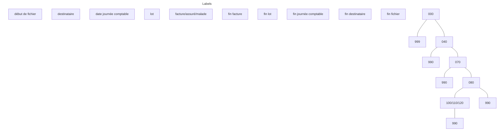
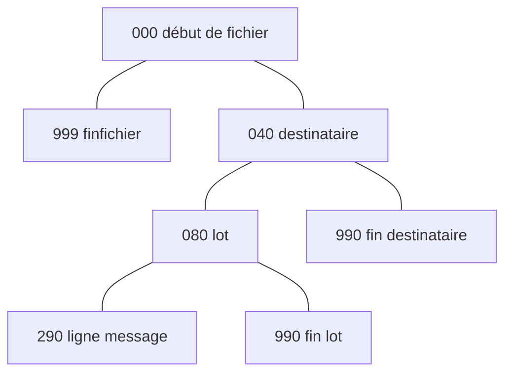

logo: MSA - santé famille retraite services logo: l'Assurance Maladie logo: RSI - Régime Social des Indépendants logo: UNRS

# **NOEMIE PS**

**N**orme **O**uverte d'**E**change entre la **M**aladie et les **I**ntervenants **E**xtérieurs

Télétransmission de retour d'informations
entre les Organismes d'Assurance Maladie
et les Professionnels de Santé

***Cahier des Charges***

JUIN 2016

***Le présent cahier des charges est la copropriété des auteurs indiqués ci-après :***

*   ***Caisse Nationale d’Assurance Maladie des Travailleurs Salariés (CNAMTS),***
*   ***Caisse Centrale de la Mutualité Sociale Agricole (CCMSA),***
*   ***Régime Social des Indépendants (RSI),***
*   ***Union Nationale des Régimes Spéciaux (UNRS).***

***Ces co-auteurs sont donc titulaires des droits d’auteur sur ledit Cahier des Charges conformément à l’article L 113.1 du code de la propriété intellectuelle.***
***La publication ci-après n’entraîne aucune cession des droits d’auteurs à quelle que personne que ce soit.***

***Toute atteinte aux droits d’auteur constitue un délit et est passible des sanctions indiquées au chapitre V du titre III du livre III du Code de la Propriété Intellectuelle.***

**N O E M I E P S** **Cahier des Charges Professionnels de Santé – juin 2016**

# **SOMMAIRE**

<table>
    <tr>
      <td><strong>1. CARACTERISTIQUES GENERALES................................................................................................................................................................................................................... 1</strong></td>
    </tr>
    <tr>
      <td>1.1 - GENERALITES................................................................................................................................................................................................................................................................. 2</td>
    </tr>
    <tr>
      <td>    <i>1.2.1 - structure générale</i> ................................................................................................................................................................................................................................................. 3</td>
    </tr>
    <tr>
      <td>    <i>1.2.2 - exemple de référence</i>............................................................................................................................................................................................................................................. 3</td>
    </tr>
    <tr>
      <td>        1.2.2.1 - Remarques sur la présentation hiérarchique................................................................................................................................................................................................................. 4</td>
    </tr>
    <tr>
      <td>        1.2.2.2 - Remarques sur le tableau de structure.......................................................................................................................................................................................................................... 6</td>
    </tr>
    <tr>
      <td>        1.2.2.3 - Exemple de vidage de fichier à la référence 573 ......................................................................................................................................................................................................... 7</td>
    </tr>
    <tr>
      <td><strong>2. PRINCIPES TECHNIQUES..................................................................................................................................................................................................................................... 8</strong></td>
    </tr>
    <tr>
      <td>2.1 - LONGUEUR DES ENTITES PHYSIQUES .............................................................................................................................................................................................................................. 9</td>
    </tr>
    <tr>
      <td>2.2 - FORMAT DES DONNEES................................................................................................................................................................................................................................................... 9</td>
    </tr>
    <tr>
      <td>    <i>2.2.1 - cadrage des zones</i> ................................................................................................................................................................................................................................................. 9</td>
    </tr>
    <tr>
      <td>    <i>2.2.2 – initialisation des zones</i> ......................................................................................................................................................................................................................................... 9</td>
    </tr>
    <tr>
      <td>    <i>2.2.3 - format des dates</i> .................................................................................................................................................................................................................................................... 9</td>
    </tr>
    <tr>
      <td>    <i>2.2.4 - format des montants</i> .............................................................................................................................................................................................................................................. 9</td>
    </tr>
    <tr>
      <td>2.3 - DELIMITEUR D’ENTITE ................................................................................................................................................................................................................................................. 10</td>
    </tr>
    <tr>
      <td><strong>3. CATALOGUE DES REFERENCES DISPONIBLES......................................................................................................................................................................................... 11</strong></td>
    </tr>
    <tr>
      <td>3.1 LES REFERENCES RETOUR DE PAIEMENT......................................................................................................................................................................................................................... 12</td>
    </tr>
    <tr>
      <td>    <i>3.1.1 – référence 531</i>...................................................................................................................................................................................................................................................... 12</td>
    </tr>
    <tr>
      <td>    <i>3.1.2 – référence 534</i>...................................................................................................................................................................................................................................................... 13</td>
    </tr>
    <tr>
      <td>    <i>3.1.3 - référence 536</i>....................................................................................................................................................................................................................................................... 14</td>
    </tr>
    <tr>
      <td>    <i>3.1.4 - référence 572</i>....................................................................................................................................................................................................................................................... 15</td>
    </tr>
    <tr>
      <td>    <i>3.1.5 - référence 573</i>....................................................................................................................................................................................................................................................... 16</td>
    </tr>
    <tr>
      <td>    <i>3.1.6 - référence 576</i>....................................................................................................................................................................................................................................................... 17</td>
    </tr>
    <tr>
      <td>    <i>3.1.7 - référence 577</i>....................................................................................................................................................................................................................................................... 18</td>
    </tr>
    <tr>
      <td>    <i>3.1.8 - référence 578</i>....................................................................................................................................................................................................................................................... 19</td>
    </tr>
    <tr>
      <td>    <i>3.1.9 - référence 580</i>....................................................................................................................................................................................................................................................... 20</td>
    </tr>
    <tr>
      <td>    <i>3.1.10 - référence 603</i>..................................................................................................................................................................................................................................................... 22</td>
    </tr>
    <tr>
      <td>    <i>3.1.11 - référence 613</i>..................................................................................................................................................................................................................................................... 23</td>
    </tr>
    <tr>
      <td>3.2 - LA REFERENCE REJET ................................................................................................................................................................................................................................................... 24</td>
    </tr>
    <tr>
      <td>    <i>3.2.1 - référence 900</i>....................................................................................................................................................................................................................................................... 24</td>
    </tr>
    <tr>
      <td>    <i>3.2.2 - référence 908</i>....................................................................................................................................................................................................................................................... 25</td>
    </tr>
    <tr>
      <td>3.3 - L’ACCUSE LOGIQUE DE RECEPTION .............................................................................................................................................................................................................................. 26</td>
    </tr>
    <tr>
      <td>    <i>3.3.1 - référence 930</i>....................................................................................................................................................................................................................................................... 26</td>
    </tr>
    <tr>
      <td><strong>4. DESCRIPTION DES ENTITES PHYSIQUES CONSTITUANT LES REFERENCES .................................................................................................................. 27</strong></td>
    </tr>
</table>

**N O E M I E P S** **Cahier des Charges Professionnels de Santé – juin 2016** **Sommaire**

<table>
    <tr>
      <td>5.</td>
      <td><strong>REFERENCE 580 - DESCRIPTION DES ENTITES PHYSIQUES ................................................................................................................................................................. 74</strong></td>
    </tr>
    <tr>
      <td>6.</td>
      <td><strong>ANNEXES .............................................................................................................................................................................................................................................................. 108</strong></td>
    </tr>
    <tr>
      <td>7.</td>
      <td><strong>EXEMPLE .............................................................................................................................................................................................................................................................. 127</strong></td>
    </tr>
</table>

**N O E M I E P S** **Cahier des Charges Professionnels de Santé – juin 2016** **Sommaire**

# **MODIFICATIONS INCLUSES DANS CETTE VERSION**

La présente mise à jour du cahier des charges, version de juin 2016, porte sur la référence 580.
La mise en œuvre de cette référence a été réalisée en février 2011 pour les pharmacies uniquement.
Dans la perspective de la généralisation du Tiers Payant, elle est étendue à l’ensemble des catégories de Partenaires de santé (sauf les établissements relevant des circuits CPU et CCDP) à compter de juillet 2016.
Aucune modification de structure de la référence 580 n’a été réalisée.

---

***PAGES 2 ET 3***
Ajout de précisions sur le mode de déclenchement de l’envoi de la norme pour les PS.

---

***PAGE 77***
Entité 000 : Modification du numéro d’émetteur : ajout du type d’émetteur TP.

---

***PAGE 85***
Entité 071 : Modification du libellé du virement - ligne 2 : ajout du N° du PS + référence du virement.

---

***PAGE 101***
Modification de l’entité 262 : libellé associé : ajout du libellé de la prestation.

---

***PAGES 111***
***Annexe B : Nature d’assurance : ajout «SG », « C6 » et « CN ».***

---

***PAGE 113***
Modification des natures d’assurance : ajout des codes et libellés pour la CNMSS et l’ENIM.

---

***PAGES 119***
Annexe I : Nature d’opposition ou de dette : ajout « PSQ ».

**N O E M I E P S** **Cahier des Charges Professionnels de Santé – juin 2016**

## ***PAGE 121***

Annexe K : Type de facture : ajour « S » facturation en ligne.

## ***PAGES 130 ET 131***

Mise à jour des exemples : ajout des libellés de prestation.

**N O E M I E P S** **Cahier des Charges Professionnels de Santé – juin 2016**

Les Caisses Nationales des Régimes obligatoires de Protection Sociale de l’Assurance Maladie - Régime Agricole, Régime Général et Régime des Travailleurs Non Salariés Non Agricoles - ont convenu d’effectuer des échanges d’informations avec les Professionnels de Santé et les organismes complémentaires au travers d’une norme d’échange validée par les trois caisses.
Cette norme dénommée :


Norme **O**uverte d’**E**change entre la **M**aladie
et les **I**ntervenants **E**xtérieurs


**N.O.E.M.I.E.**


permet un retour des informations de paiement des prestations liquidées par les organismes de base de ces Régimes, vers les :

- Partenaires de Santé : médecins, auxiliaires médicaux, cliniques, dispensaires ...
- Organismes complémentaires de Protection Sociale.

Pour ce faire, on suppose que les Intervenants Extérieurs cités disposent de moyens informatiques leur donnant la possibilité d’exploiter les informations fournies par télétransmission.

La présente documentation définit la norme d’échanges, dite « retour » allant des organismes de base vers les partenaires de santé ainsi que les conditions de sa mise en place pratique.

Elle vient compléter la norme B2, dite « aller », fixant le cadre des transmissions de facture des Professionnels de Santé vers les organismes d’assurance maladie. Plusieurs données de ce présent document renvoient aux annexes de la norme B2.

Elle s’adresse plus particulièrement aux personnels chargés de sa mise en oeuvre technique.

Ceux-ci pourraient, en cas de besoin, contacter le correspondant local de l’Organisme d’Assurance maladie avec lequel le partenaire de Santé souhaite procéder à des échanges d’informations.

**N O E M I E P S** **Cahier des Charges Professionnels de Santé – juin 2016** **Préambule**

# 1. CARACTERISTIQUES GENERALES

**N O E M I E P S** **Cahier des Charges Professionnels de Santé – juin 2016** **Page 1**

## ***1.1 - GENERALITES***

Tout échange informatique de données depuis un organisme d’assurance maladie vers un partenaire de santé s’intègre dans la norme d’échange NOEMIE.

Cette norme permet de véhiculer vers le partenaire de santé trois types d’informations :

- le retour des prestations en nature (actes professionnels, séjours, fournitures ...)
- les mouvements financiers accompagnant ces prestations (retenues)
- les rejets issus du traitement des fichiers transmis par le partenaire.

NOEMIE se présente sous la forme d’un CATALOGUE national de structure de fichier.
Chaque structure est appelée REFERENCE et identifiée par un numéro.

Chaque REFERENCE est constituée d’ENTITES PHYSIQUES, qui sont des ensembles logiques de données, séparées entre elles par un délimiteur de fin d’entité (Exemple : l’entité 210 correspond à une ligne de décompte).
Chaque entité physique est identifiée par un numéro à 3 chiffres (Exemple : l’entité début de fichier est identifiée sous le numéro 000).

Le partenaire de santé ou sa société de service informatique choisit dans le CATALOGUE, en accord avec l’organisme d’Assurance Maladie, la REFERENCE dont l’organisation hiérarchique et le contenu des données permettra un traitement aval complet chez le partenaire.

Exemple : la référence 534 ne comporte aucune information permettant d’identifier l’acte alors que la référence 531 comporte ces informations.

A partir de la référence 580 – ayant vocation à devenir la référence de retour unique, hormis pour les hôpitaux et les cliniques privées – l’envoi de cette référence sera automatique, selon un mode de déclenchement paramétrable en fonction des catégories de partenaires de santé et de l’agrément logiciel conforme à l’avenant au cahier des charges SV «Suivi des factures tiers payant» (sauf pour la norme « transport » hors du champ SESAM Vitale).

**N O E M I E P S** **Cahier des Charges Professionnels de Santé – juin 2016** **Page 2**

# **_1.2 - LA REFERENCE_**

## **<u>1.2.1 - STRUCTURE GENERALE </u>**

Une REFERENCE se présente sous la forme d’ENTITES PHYSIQUES mises bout à bout.

Ces ENTITES PHYSIQUES sont, à l’intérieur d’une référence, organisées selon une structure hiérarchique (NIVEAU). Au sein d’un même niveau hiérarchique, les ENTITES ont un ordre constant (SEQUENCE).

## **<u>1.2.2 - EXEMPLE DE REFERENCE </u>**

La référence 573 servira d’exemple.

Présentation hiérarchique :                                        Tableau de structure :

<table>
  <thead>
    <tr>
      <th colspan="3"></th>
      <th>NIVEAU</th>
      <th>SEQUENCE</th>
      <th><b>ENTITE</b></th>
    </tr>
  </thead>
  <tbody>
    <tr>
      <td>000</td>
      <td colspan="2">début de fichier</td>
      <td></td>
      <td></td>
      <td></td>
    </tr>
    <tr>
      <td></td>
      <td>040</td>
      <td>destinataire <i><b>niveau 01</b></i></td>
      <td>01</td>
      <td>01</td>
      <td>040</td>
    </tr>
    <tr>
      <td></td>
      <td>    070</td>
      <td>date journée comptable <i><b>niveau 02</b></i></td>
      <td>02</td>
      <td>01</td>
      <td>070</td>
    </tr>
    <tr>
      <td></td>
      <td>        080</td>
      <td>lot <i><b>niveau 03</b></i></td>
      <td>03</td>
      <td>01</td>
      <td>080</td>
    </tr>
    <tr>
      <td></td>
      <td>            100/110/120/150</td>
      <td>facture/assuré/malade/assurance <i><b>niveau 04</b></i></td>
      <td>04</td>
      <td>01</td>
      <td>100</td>
    </tr>
    <tr>
      <td></td>
      <td>                160</td>
      <td>critère d’archivage <i><b>niveau 99</b></i></td>
      <td>04</td>
      <td>02</td>
      <td>110</td>
    </tr>
    <tr>
      <td></td>
      <td>                212</td>
      <td>PEX (acte + exécutant) <i><b>niveau 99</b></i></td>
      <td>04</td>
      <td>03</td>
      <td>120</td>
    </tr>
    <tr>
      <td></td>
      <td>                220</td>
      <td>PHS (frais hospitaliers) <i><b>niveau 99</b></i></td>
      <td>04</td>
      <td>04</td>
      <td>150</td>
    </tr>
    <tr>
      <td></td>
      <td>                250</td>
      <td>MFI (mouvement financier) <i><b>niveau 99</b></i></td>
      <td>99</td>
      <td>00</td>
      <td>160</td>
    </tr>
    <tr>
      <td></td>
      <td>            990</td>
      <td>fin facture/assuré/mal./assurance <i><b>fin niveau 04</b></i></td>
      <td>99</td>
      <td>00</td>
      <td>212</td>
    </tr>
    <tr>
      <td></td>
      <td>        990</td>
      <td>fin lot <i><b>fin niveau 03</b></i></td>
      <td>99</td>
      <td>00</td>
      <td>220</td>
    </tr>
    <tr>
      <td></td>
      <td>    990</td>
      <td>fin journée comptable <i><b>fin niveau 02</b></i></td>
      <td>99</td>
      <td>00</td>
      <td>250</td>
    </tr>
    <tr>
      <td></td>
      <td>990</td>
      <td>fin destinataire <i><b>fin niveau 01</b></i></td>
      <td></td>
      <td></td>
      <td></td>
    </tr>
    <tr>
      <td>999</td>
      <td colspan="2">fin fichier</td>
      <td></td>
      <td></td>
      <td></td>
    </tr>
  </tbody>
</table>

**N O E M I E P S** **Cahier des Charges Professionnels de Santé – juin 2016** **Page 3**

## <u>1.2.2.1 - Remarques sur la présentation hiérarchique </u>

Une référence est un fichier borné par une entité de début de fichier (000) et de fin de fichier (999). Ces entités sont hors niveau hiérarchique.

Plusieurs fichiers peuvent être ajoutés les uns après les autres et faire partie d’un même envoi.

Chaque niveau hiérarchique comporte une ou plusieurs entités physiques. Tous les niveaux hiérarchiques définis dans une référence sont obligatoires.

Les entités sont décrites sous la forme utilisée pour le langage Cobol dans le chapitre 4.

Les 5 premiers caractères d’une entité permettent de l’identifier et de connaître son niveau hiérarchique.

*Exemple : entité 080 (lot) dans la référence 573 :*

|         0        |  8  |  0  |  0  |  3  | DONNES DE L’ENTITE LOT |     |     |              @             |
| :--------------: | :-: | :-: | :-: | :-: | :--------------------- | :-: | :-: | :------------------------: |
| Type de l’entité |     |     |     |     | Niveau                 |     |     | Délimiteur de fin d’entité |

Chaque niveau hiérarchique est clos par une entité 990 sauf le niveau hiérarchique le plus bas numéroté 99, qui est facultatif.

Chaque entité 990 contiendra des totaux correspondant au niveau hiérarchique qu’il clôt et le nombre d’entités de niveau immédiatement inférieur.

Dans l’exemple pris, l’entité 990 qui clôt le niveau hiérarchique 01 (destinataire) contiendra un cumul des montants pour le destinataire, l’entité 990 du niveau 02 contiendra un cumul pour la journée comptable pour le destinataire désigné en niveau 01.

**N O E M I E P S** **Cahier des Charges Professionnels de Santé – juin 2016** **Page 4**

L’exemple ci-après décrit, pour un fichier à la référence 573, la cinématique d’incrémentation des compteurs d’entités et des cumuls de montant des niveaux 990 :

000
|
|   040
|   |
|   |   070
|   |   |
|   |   |   080
|   |   |   |
|   |   |   |   100
|   |   |   |   110
|   |   |   |   120
|   |   |   |   150
|   |   |   |   |
|   |   |   |   |   160
|   |   |   |   |   212 Montant = a
|   |   |   |   |   212 Montant = b
|   |   |   |   |   220 Montant = c
|   |   |   |   |   990 Compteur niveau inférieur = 4 (4 x niveau 99) ; Montant = a+b+c
|   |   |   |   990 Compteur niveau inférieur = 1 (1 x niveau 04) ; Montant = a+b+c
|   |   |   |   080
|   |   |   |   |
|   |   |   |   |   100
|   |   |   |   |   110
|   |   |   |   |   120
|   |   |   |   |   150
|   |   |   |   |   |
|   |   |   |   |   |   160
|   |   |   |   |   |   212 Montant = d
|   |   |   |   |   |   220 Montant = e
|   |   |   |   |   |   990 Compteur niveau inférieur = 3 (3 x niveau 99) ; Montant = d+e
|   |   |   |   |   100
|   |   |   |   |   110
|   |   |   |   |   120
|   |   |   |   |   150
|   |   |   |   |   |
|   |   |   |   |   |   160
|   |   |   |   |   |   220 Montant = f
|   |   |   |   |   |   990 Compteur niveau inférieur = 2 (3 x niveau 99) ; Montant = f
|   |   |   |   |   990 Compteur niveau inférieur = 2 (2 x niveau 04) ; Montant = d+e+f
|   |   |   |   990 Compteur niveau inférieur = 2 (2 x niveau 03) ; Montant = a+b+c+d+e+f
|   |   |   990 Compteur niveau inférieur = 1 (1 x niveau 02) ; Montant = a+b+c+d+e+f
|   |   999 Compteur niveau inférieur = 1 (1 x niveau 01) ; Montant = a+b+c+d+e+f

**N O E M I E P S** **Cahier des Charges Professionnels de Santé – juin 2016** **Page 5**

### <u>1.2.2.2 - Remarques sur le tableau de structure </u>

Le tableau de structure de la page 3 présente en trois colonnes le niveau, la séquence, l’entité correspondant à ce niveau et cette séquence.

L’entité 040 est unique pour un destinataire.

L’entité 070 est unique pour un destinataire et une journée comptable.

L’entité 080 est unique pour un lot.

Les entités 100, 110, 120 sont uniques pour une facture et présentées séquentiellement dans cet ordre.

Le numéro de séquence affecté respectivement à ces entités est 01, 02, 03 à l’intérieur d’un même niveau, le niveau 04.

L’entité 160 bien que d’un niveau hiérarchique 99 est unique pour la facture.

L’entité 212 est répétée autant de fois que d’actes professionnels présents dans la facture.

L’entité 220 est répétée autant de fois que de prestations hospitalières présentes dans la facture.

L’entité 250 est répétée autant de fois que de mouvements financiers effectués sur la facture.

**N O E M I E P S** **Cahier des Charges Professionnels de Santé – juin 2016** **Page 6**

### <u>1.2.2.3 - Exemple de vidage de fichier à la référence 573 </u>

```text
000CP      01761000       SI00000762018463    RPDEGREM140592533   003N         128
04001000000760780510@
07002140592@
08003000000   @
10004000009018@
11004231067606700240UDURANDAL                 PLABBE              0     CHRISTIANE   @
120041806311DURANDAL          CHRISTIANE          1060@
1609992133106010030201@
212990201007137000000120392000000000012400000124007500009300PK    0010100000100012400 0000000000000000000000000000007619999450423@
220990201007137120392120392000008600000086007000006020PFSO 0010100000000006020 0100000000000000000000000000000000000@
99004000009018        0000000300000015320P@
99003000000000        0000000100000015320P@
99002140592           0000000100000015320P@
99001010000760780510  0000000100000015320P@
999CP      01761000      SI00000760780510      RPDEGREM00000128                   00100000007247P
```

Les caractères en gras marquent l’identification du type d’entité ; ceux en italique, le niveau. Le numéro de séquence n’apparaît pas, il est implicitement celui de l’ordre d’apparition.

**N O E M I E P S** **Cahier des Charges Professionnels de Santé – juin 2016** **Page 7**

# 2. PRINCIPES TECHNIQUES

**N O E M I E P S** **Cahier des Charges Professionnels de Santé – juin 2016** **Page 8**

## ***2.1 - LONGUEUR DES ENTITES PHYSIQUES***

Chaque entité a une longueur fixe, mais toutes les entités n’ont pas la même longueur.

Ainsi l’entité 080 (lot) a une longueur de 15 caractères, alors que l’entité 210 (ligne acte) a une longueur de 110 caractères.

Les entités de début (000) et de fin (999) de fichier ont une longueur de 128 caractères.

## ***2.2 - FORMAT DES DONNEES***

### **<u>2.2.1 - CADRAGE DES ZONES</u>**

Les zones numériques (picture 9) sont cadrées à droite, complétées pour la partie gauche non significative par des zéros.

Les zones alphanumériques (picture X) ou alphabétiques sont cadrées à gauche et complétées par des blancs.

### **<u>2.2.2 – INITIALISATION DES ZONES</u>**

Les zones alphanumériques ou alphabétiques sont initialisées à blanc et les zones numériques à zéro.

### **<u>2.2.3 - FORMAT DES DATES</u>**

Toutes les dates présentes dans les diverses entités de NOEMIE sont sous la forme JJMMAA. Ceci est également vrai pour les bornes de l’échange (entités 000 et 999).

### **<u>2.2.4 - FORMAT DES MONTANTS</u>**

Tous les montants sont exprimés en centimes. Ils occupent en général une longueur de 8 caractères (picture 9(6) V99), soit un maximum de 999999 Euros et 99 centimes. Les exceptions sont les cumuls pour lesquels une plus grande capacité est fournie.

**N O E M I E P S** **Cahier des Charges Professionnels de Santé – juin 2016** **Page 9**

## **_2.3 - DELIMITEUR D’ENTITE_**

Les entités physiques sont séparées entre elles par une donnée purement technique : le délimiteur d’entité.

Il constitue dans le descriptif physique de chaque entité (chapitre 4) la dernière zone nommée NOE-DLM de picture X.

Sa valeur est :
- en code ASCII : le caractère @ soit 100 en octal, ou 40 en hexadécimal.
- en code EBCDIC : le caractère @ soit 174 en octal, ou 7C en hexadécimal.

**N O E M I E P S** **Cahier des Charges Professionnels de Santé – juin 2016** **Page 10**

# 3. CATALOGUE DES REFERENCES DISPONIBLES

**N O E M I E P S** **Cahier des Charges Professionnels de Santé – juin 2016** **Page 11**

# *3.1 LES REFERENCES RETOUR DE PAIEMENT*

Suivant les entités physiques constituant les différentes références, celles-ci sont plus ou moins adaptées aux différentes familles de partenaires de santé.

Les références 572 et 573 répondent aux besoins spécifiques des cliniques et des professionnels de santé ayant une activité à la fois ambulatoire et en clinique privée.

Les références 576 et 577 sont identiques aux références 572 et 573 mais sont dotées d'une entité destinée à véhiculer les informations concernant les organismes complémentaires.

La référence 603 répond aux besoins des dispensaires et centres de santé. La référence 613 est identique à la référence 603 mais permet de véhiculer les informations concernant les organismes complémentaires.

## **<u>3.1.1 – REFERENCE 531</u>**

Cette référence est destinée, comme la référence 534, à tous les professionnels de santé qui n’ont qu’une activité ambulatoire, à l’exception des dispensaires, centres de santé et cliniques privées.

Elle véhicule actes professionnels (entité 210) et mouvements financiers (entité 250).

Présentation hiérarchique :

- 000 début de fichier
    - 040 destinataire
        - 070 date journée comptable
            - 080 lot
                - 150 nature d’assurance
                    - 100/110/120 facture/assuré/malade
                        - 160 critère d’archivage
                        - 210 PAP (acte)
                        - 250 MFI (mouvement financier)
                        - 990 fin facture
                    - 990 fin nature d’assurance
                - 990 fin lot
            - 990 fin journée comptable
        - 990 fin destinataire
- 999 fin fichier

Tableau de structure :

<table>
  <thead>
    <tr>
      <th>NIVEAU</th>
      <th>SEQUENCE</th>
      <th>ENTITE</th>
    </tr>
  </thead>
  <tbody>
    <tr>
      <td>01</td>
      <td>01</td>
      <td>040</td>
    </tr>
    <tr>
      <td>02</td>
      <td>01</td>
      <td>070</td>
    </tr>
    <tr>
      <td>03</td>
      <td>01</td>
      <td>080</td>
    </tr>
    <tr>
      <td>04</td>
      <td>01</td>
      <td>150</td>
    </tr>
    <tr>
      <td>05</td>
      <td>01</td>
      <td>100</td>
    </tr>
    <tr>
      <td>05</td>
      <td>02</td>
      <td>110</td>
    </tr>
    <tr>
      <td>05</td>
      <td>03</td>
      <td>120</td>
    </tr>
    <tr>
      <td>99</td>
      <td>00</td>
      <td>160</td>
    </tr>
    <tr>
      <td>99</td>
      <td>00</td>
      <td>210</td>
    </tr>
    <tr>
      <td>99</td>
      <td>00</td>
      <td>250</td>
    </tr>
  </tbody>
</table>

**N O E M I E P S** **Cahier des Charges Professionnels de Santé – juin 2016** **Page 12**

# <u>3.1.2 – REFERENCE 534 </u>

Cette référence ne transporte - hormis les entités destinataire (040), date journée comptable (070), et le lot (080) - que les entités facture, assuré, malade (100, 110, 120) sans détail des prestations, ni critère d’archivage.

**Présentation hiérarchique :**                                        **Tableau de structure :**



<table>
  <thead>
    <tr>
      <th>NIVEAU</th>
      <th>SEQUENCE</th>
      <th>ENTITE</th>
    </tr>
  </thead>
  <tbody>
    <tr>
      <td>01</td>
      <td>01</td>
      <td>040</td>
    </tr>
    <tr>
      <td>02</td>
      <td>01</td>
      <td>070</td>
    </tr>
    <tr>
      <td>03</td>
      <td>01</td>
      <td>080</td>
    </tr>
    <tr>
      <td>04</td>
      <td>01</td>
      <td>100</td>
    </tr>
    <tr>
      <td>04</td>
      <td>02</td>
      <td>110</td>
    </tr>
    <tr>
      <td>04</td>
      <td>03</td>
      <td>120</td>
    </tr>
  </tbody>
</table>

**N O E M I E P S** **Cahier des Charges Professionnels de Santé – juin 2016** **Page 13**

### <u>**3.1.3 - REFERENCE 536**</u>

Cette référence est identique à la référence 531 mais elle permet de transporter les informations concernant les organismes complémentaires.

Présentation hiérarchique :

- 000 début de fichier
    - 040 destinataire
        - 070 date journée comptable
            - 080 lot
                - 150 nature d'assurance
                    - 100/110/120 facture/assuré/malade
                        - 160 critère d'archivage
                        - 010 organisme complémentaire
                        - 210 PAP (acte)
                        - 250 MFI (mouvement financier)
                    - 990 fin facture/assuré/malade
                - 990 fin nature d'assurance
            - 990 fin lot
        - 990 fin journée comptable
    - 990 fin destinataire
- 999 fin fichier

Tableau de structure :

<table>
  <thead>
    <tr>
      <th><b>NIVEAU</b></th>
      <th><b>SEQUENCE</b></th>
      <th><b>ENTITE</b></th>
    </tr>
  </thead>
  <tbody>
    <tr>
      <td>01</td>
      <td>01</td>
      <td>040</td>
    </tr>
    <tr>
      <td>02</td>
      <td>01</td>
      <td>070</td>
    </tr>
    <tr>
      <td>03</td>
      <td>01</td>
      <td>080</td>
    </tr>
    <tr>
      <td>04</td>
      <td>01</td>
      <td>150</td>
    </tr>
    <tr>
      <td>05</td>
      <td>01</td>
      <td>100</td>
    </tr>
    <tr>
      <td>05</td>
      <td>02</td>
      <td>110</td>
    </tr>
    <tr>
      <td>05</td>
      <td>03</td>
      <td>120</td>
    </tr>
    <tr>
      <td>99</td>
      <td>00</td>
      <td>160</td>
    </tr>
    <tr>
      <td>99</td>
      <td>00</td>
      <td>010</td>
    </tr>
    <tr>
      <td>99</td>
      <td>00</td>
      <td>210</td>
    </tr>
    <tr>
      <td>99</td>
      <td>00</td>
      <td>250</td>
    </tr>
  </tbody>
</table>

**N O E M I E P S** **Cahier des Charges Professionnels de Santé – juin 2016** **Page 14**

# <u>3.1.4 - REFERENCE 572 </u>

Cette référence destinée aux cliniques privées puisqu’elle véhicule des prestations hospitalières (entité 220) a pour particularité d’autoriser la présence d’un mandataire de règlement (entité 020). Elle s’adresse aussi aux professionnels de santé qui combinent une activité ambulatoire à une activité en établissement auprès de malades hospitalisés.

Présentation hiérarchique :

- 000 début de fichier
    - 020 mandataire
        - 040 destinataire
            - 070 date journée comptable
                - 080 lot
                    - 100/110/120/150 facture/assuré/malade/assurance
                        - 160 critère d’archivage
                        - 212 PEX (acte + exécutant)
                        - 220 PHS (frais hospitaliers)
                        - 250 MFI (mouvement financier)
                    - 990 fin facture/assuré/malade/assurance
                - 990 fin lot
            - 990 fin journée comptable
        - 990 fin destinataire
    - 990 fin mandataire
- 999 fin fichier

Tableau de structure :

<table>
  <thead>
    <tr>
      <th>NIVEAU</th>
      <th>SEQUENCE</th>
      <th>ENTITE</th>
    </tr>
  </thead>
  <tbody>
    <tr>
      <td>01</td>
      <td>01</td>
      <td>020</td>
    </tr>
    <tr>
      <td>02</td>
      <td>01</td>
      <td>040</td>
    </tr>
    <tr>
      <td>03</td>
      <td>01</td>
      <td>070</td>
    </tr>
    <tr>
      <td>04</td>
      <td>01</td>
      <td>080</td>
    </tr>
    <tr>
      <td>05</td>
      <td>01</td>
      <td>100</td>
    </tr>
    <tr>
      <td>05</td>
      <td>02</td>
      <td>110</td>
    </tr>
    <tr>
      <td>05</td>
      <td>03</td>
      <td>120</td>
    </tr>
    <tr>
      <td>05</td>
      <td>04</td>
      <td>150</td>
    </tr>
    <tr>
      <td>99</td>
      <td>00</td>
      <td>160</td>
    </tr>
    <tr>
      <td>99</td>
      <td>00</td>
      <td>212</td>
    </tr>
    <tr>
      <td>99</td>
      <td>00</td>
      <td>220</td>
    </tr>
    <tr>
      <td>99</td>
      <td>00</td>
      <td>250</td>
    </tr>
  </tbody>
</table>

**N O E M I E P S** **Cahier des Charges Professionnels de Santé – juin 2016** **Page 15**

### <u>3.1.5 - REFERENCE 573 </u>

Cette référence est identique à la précédente à cette seule différence : le mandataire (entité 020) est absent. Tout est donc réglé directement au destinataire sans intermédiaire financier.

Présentation hiérarchique :

```text
000                            début de fichier
 |  040                        destinataire
 |   |  070                    date journée comptable
 |   |   |  080                lot
 |   |   |   |  100/110/120/150 facture/assuré/malade/assurance
 |   |   |   |   |  160         critère d’archivage
 |   |   |   |   |  212         PEX (acte + exécutant)
 |   |   |   |   |  220         PHS (frais hospitaliers)
 |   |   |   |   |  250         MFI (mouvement financier)
 |   |   |   |  990             fin  facture/assuré/malade/assurance
 |   |   |  990                 fin  lot
 |   |  990                     fin  journée comptable
 |  990                         fin  destinataire
999                            fin  fichier
```

Tableau de structure :

<table>
  <thead>
    <tr>
      <th>NIVEAU</th>
      <th>SEQUENCE</th>
      <th>ENTITE</th>
    </tr>
  </thead>
  <tbody>
    <tr>
      <td>01</td>
      <td>01</td>
      <td>040</td>
    </tr>
    <tr>
      <td>02</td>
      <td>01</td>
      <td>070</td>
    </tr>
    <tr>
      <td>03</td>
      <td>01</td>
      <td>080</td>
    </tr>
    <tr>
      <td>04</td>
      <td>01</td>
      <td>100</td>
    </tr>
    <tr>
      <td>04</td>
      <td>02</td>
      <td>110</td>
    </tr>
    <tr>
      <td>04</td>
      <td>03</td>
      <td>120</td>
    </tr>
    <tr>
      <td>04</td>
      <td>04</td>
      <td>150</td>
    </tr>
    <tr>
      <td>99</td>
      <td>00</td>
      <td>160</td>
    </tr>
    <tr>
      <td>99</td>
      <td>00</td>
      <td>212</td>
    </tr>
    <tr>
      <td>99</td>
      <td>00</td>
      <td>220</td>
    </tr>
    <tr>
      <td>99</td>
      <td>00</td>
      <td>250</td>
    </tr>
  </tbody>
</table>

**N O E M I E P S** **Cahier des Charges Professionnels de Santé – juin 2016** **Page 16**

### <u>3.1.6 - REFERENCE 576 </u>

Cette référence est identique à la référence 572 mais permet de véhiculer les informations concernant les organismes complémentaires.

Présentation hiérarchique :

```text
000 |                          début de fichier
    | 020 |                    mandataire
    |     | 040 |              destinataire
    |     |     | 070 |        date journée comptable
    |     |     |     | 080 |  lot
    |     |     |     |     | 100/110/120/150  facture/assuré/malade/assurance
    |     |     |     |     | 160              critère d'archivage
    |     |     |     |     | 010              organisme complémentaire
    |     |     |     |     | 212              PEX (acte + exécutant)
    |     |     |     |     | 220              PHS (frais hospitaliers)
    |     |     |     |     | 250              MFI (mouvement financier)
    |     |     |     |     | 990              fin facture/assuré/malade/assurance
    |     |     |     | 990                    fin lot
    |     |     | 990                            fin journée comptable
    |     | 990                                    fin destinataire
    | 990                                          fin mandataire
999                                                fin fichier
```

Tableau de structure :

<table>
  <thead>
    <tr>
      <th>NIVEAU</th>
      <th>SEQUENCE</th>
      <th>ENTITE</th>
    </tr>
  </thead>
  <tbody>
    <tr>
      <td>01</td>
      <td>01</td>
      <td>020</td>
    </tr>
    <tr>
      <td>02</td>
      <td>01</td>
      <td>040</td>
    </tr>
    <tr>
      <td>03</td>
      <td>01</td>
      <td>070</td>
    </tr>
    <tr>
      <td>04</td>
      <td>01</td>
      <td>080</td>
    </tr>
    <tr>
      <td>05</td>
      <td>01</td>
      <td>100</td>
    </tr>
    <tr>
      <td>05</td>
      <td>02</td>
      <td>110</td>
    </tr>
    <tr>
      <td>05</td>
      <td>03</td>
      <td>120</td>
    </tr>
    <tr>
      <td>05</td>
      <td>04</td>
      <td>150</td>
    </tr>
    <tr>
      <td>99</td>
      <td>00</td>
      <td>160</td>
    </tr>
    <tr>
      <td>99</td>
      <td>00</td>
      <td>010</td>
    </tr>
    <tr>
      <td>99</td>
      <td>00</td>
      <td>212</td>
    </tr>
    <tr>
      <td>99</td>
      <td>00</td>
      <td>220</td>
    </tr>
    <tr>
      <td>99</td>
      <td>00</td>
      <td>250</td>
    </tr>
  </tbody>
</table>

**N O E M I E P S** **Cahier des Charges Professionnels de Santé – juin 2016** **Page 17**

## <u>**3.1.7 - REFERENCE 577**</u>

Cette référence est identique à la référence 573 mais permet de véhiculer les informations concernant les organismes complémentaires.

**Présentation hiérarchique :**

000 | | | | | début de fichier
| 040 | | | | destinataire
| | 070 | | | date journée comptable
| | | 080 | | lot
| | | | 100/110/120/150 | facture/assuré/malade/assurance
| | | | | 160 | critère d’archivage
| | | | | 010 | organisme complémentaire
| | | | | 212 | PEX (acte + exécutant)
| | | | | 220 | PHS (frais hospitaliers)
| | | | | 250 | MFI (mouvement financier)
| | | | 990 | | fin facture/assuré/malade/assurance
| | | 990 | | | fin lot
| | 990 | | | | fin journée comptable
| 990 | | | | | fin destinataire
999 | | | | | fin fichier

**Tableau de structure :**

<table>
  <thead>
    <tr>
      <th>NIVEAU</th>
      <th>SEQUENCE</th>
      <th>ENTITE</th>
    </tr>
  </thead>
  <tbody>
    <tr>
      <td>01</td>
      <td>01</td>
      <td>040</td>
    </tr>
    <tr>
      <td>02</td>
      <td>01</td>
      <td>070</td>
    </tr>
    <tr>
      <td>03</td>
      <td>01</td>
      <td>080</td>
    </tr>
    <tr>
      <td>04</td>
      <td>01</td>
      <td>100</td>
    </tr>
    <tr>
      <td>04</td>
      <td>02</td>
      <td>110</td>
    </tr>
    <tr>
      <td>04</td>
      <td>03</td>
      <td>120</td>
    </tr>
    <tr>
      <td>04</td>
      <td>04</td>
      <td>150</td>
    </tr>
    <tr>
      <td>99</td>
      <td>00</td>
      <td>160</td>
    </tr>
    <tr>
      <td>99</td>
      <td>00</td>
      <td>010</td>
    </tr>
    <tr>
      <td>99</td>
      <td>00</td>
      <td>212</td>
    </tr>
    <tr>
      <td>99</td>
      <td>00</td>
      <td>200</td>
    </tr>
    <tr>
      <td>99</td>
      <td>00</td>
      <td>250</td>
    </tr>
  </tbody>
</table>

**N O E M I E P S** **Cahier des Charges Professionnels de Santé – juin 2016** **Page 18**

**N O E M I E P S**
**Cahier des Charges Professionnels de Santé – juin 2016**

## <u>**3.1.8 - REFERENCE 578**</u>

**Cette référence est spécifique pour la transmission vers les hôpitaux publics.**

Elle est basée sur la référence 572 à la différence suivante : tous les détails de prestations (entité 150, 160, 212, 220 et 250) sont absents. Elle permet par ailleurs de véhiculer le complément au numéro de titre de recette.

**Présentation hiérarchique :**


**NIVEAU SEQUENCE ENTITE**

000 début de fichier
|
|_ □ □ 020 mandataire
|  |
|  |_ □ □ 040 destinataire
|  |  |
|  |  |_ | 070 date journée comptable
|  |  |  |
|  |  |  |_ | 080 lot
|  |  |  |  |
|  |  |  |  |_ | 105/110/120 titre/assuré/malade
|  |  |  |  |  |
|  |  |  |  |  |_ 990 fin titre/assuré/malade
|  |  |  |  |
|  |  |  |  |_ 990 fin lot
|  |  |  |
|  |  |  |_ 990 fin journée comptable
|  |  |
|  |  |_ 990 fin destinataire
|  |
|  |_ 990 fin mandataire
|
999 fin fichier

**Tableau de structure :**

<table>
  <thead>
    <tr>
      <th>NIVEAU</th>
      <th>SEQUENCE</th>
      <th>ENTITE</th>
    </tr>
  </thead>
  <tbody>
    <tr>
      <td>01</td>
      <td>01</td>
      <td>020</td>
    </tr>
    <tr>
      <td>02</td>
      <td>01</td>
      <td>040</td>
    </tr>
    <tr>
      <td>03</td>
      <td>01</td>
      <td>070</td>
    </tr>
    <tr>
      <td>04</td>
      <td>01</td>
      <td>080</td>
    </tr>
    <tr>
      <td>05</td>
      <td>01</td>
      <td>105</td>
    </tr>
    <tr>
      <td>05</td>
      <td>02</td>
      <td>110</td>
    </tr>
    <tr>
      <td>05</td>
      <td>03</td>
      <td>120</td>
    </tr>
  </tbody>
</table>

**N O E M I E P S** **Cahier des Charges Professionnels de Santé – juin 2016** **Page 19**

# <u>**3.1.9 - REFERENCE 580**</u>

<table>
    <tr>
      <td>000</td>
      <td></td>
      <td></td>
      <td></td>
      <td></td>
      <td></td>
      <td></td>
      <td>Début de fichier : identification de l'émetteur</td>
    </tr>
    <tr>
      <td></td>
      <td>020</td>
      <td></td>
      <td></td>
      <td></td>
      <td></td>
      <td></td>
      <td>Mandataire du PS</td>
    </tr>
    <tr>
      <td></td>
      <td></td>
      <td>040</td>
      <td></td>
      <td></td>
      <td></td>
      <td></td>
      <td>Destinataire</td>
    </tr>
    <tr>
      <td></td>
      <td></td>
      <td></td>
      <td>071</td>
      <td></td>
      <td></td>
      <td></td>
      <td>Date comptable &#x26; référence virement</td>
    </tr>
    <tr>
      <td></td>
      <td></td>
      <td></td>
      <td></td>
      <td>081</td>
      <td></td>
      <td></td>
      <td>Type de retour + lieu exécution</td>
    </tr>
    <tr>
      <td></td>
      <td></td>
      <td></td>
      <td></td>
      <td></td>
      <td>102</td>
      <td></td>
      <td>Identification de la Facture</td>
    </tr>
    <tr>
      <td></td>
      <td></td>
      <td></td>
      <td></td>
      <td></td>
      <td></td>
      <td>103</td>
      <td>Assuré / Bénéficiaire</td>
    </tr>
    <tr>
      <td></td>
      <td></td>
      <td></td>
      <td></td>
      <td></td>
      <td></td>
      <td>198</td>
      <td>Part AMO</td>
    </tr>
    <tr>
      <td></td>
      <td></td>
      <td></td>
      <td></td>
      <td></td>
      <td></td>
      <td>199</td>
      <td>Part AMC</td>
    </tr>
    <tr>
      <td></td>
      <td></td>
      <td></td>
      <td></td>
      <td></td>
      <td></td>
      <td>294</td>
      <td>Ligne rejet</td>
    </tr>
    <tr>
      <td></td>
      <td></td>
      <td></td>
      <td></td>
      <td></td>
      <td></td>
      <td>295</td>
      <td>Ligne commentaire</td>
    </tr>
    <tr>
      <td></td>
      <td></td>
      <td></td>
      <td></td>
      <td></td>
      <td></td>
      <td>261</td>
      <td>Paiements ponctuel ou forfaitaire</td>
    </tr>
    <tr>
      <td></td>
      <td></td>
      <td></td>
      <td></td>
      <td></td>
      <td></td>
      <td>262</td>
      <td>Détail paiement ponctuel ou forfaitaire</td>
    </tr>
    <tr>
      <td></td>
      <td></td>
      <td></td>
      <td></td>
      <td></td>
      <td></td>
      <td>250</td>
      <td>Retenue</td>
    </tr>
    <tr>
      <td></td>
      <td></td>
      <td></td>
      <td></td>
      <td></td>
      <td>990</td>
      <td></td>
      <td>Mt de l'entité 990 de niveau 05, correspondant à l'entité 102<br />MT = Montant total payé pour la facture = somme montant payé des entités 198 et/ou 199 pour les types de retours 01ou 02 ou 04.<br />Ou Montant paiement ponctuel = somme montant des entités 261, pour les types de retours 03.<br />Ou Montant des retenues = somme montant des entités 250, pour les types de retours 05.</td>
    </tr>
    <tr>
      <td></td>
      <td></td>
      <td></td>
      <td></td>
      <td>990</td>
      <td></td>
      <td></td>
      <td>Mt de l'entité 990 de niveau 04, correspondant à l'entité 081<br />Mt = Montant pour le type de retour et le lieu d'exécution indiqués dans l'entité 081.<br />Ce cumul tient compte des signes des montants.</td>
    </tr>
    <tr>
      <td></td>
      <td></td>
      <td></td>
      <td>990</td>
      <td></td>
      <td></td>
      <td></td>
      <td>Mt de l'entité 990 de niveau 03, correspondant à l'entité 071<br />Mt = Montant du virement si paiement direct au PS pour la date comptable considérée, ou montant redevable au PS si virement à un mandataire.</td>
    </tr>
    <tr>
      <td></td>
      <td></td>
      <td>990</td>
      <td></td>
      <td></td>
      <td></td>
      <td></td>
      <td>Mt de l'entité 990 de niveau 02, correspondant à l'entité 040<br />Mt = Montant pour le destinataire final</td>
    </tr>
    <tr>
      <td></td>
      <td>990</td>
      <td></td>
      <td></td>
      <td></td>
      <td></td>
      <td></td>
      <td>Mt de l'entité 990 de niveau 01, correspondant à l'entité 020<br />Mt = Montant du virement dans le cas de paiement à un mandataire</td>
    </tr>
    <tr>
      <td>999</td>
      <td></td>
      <td></td>
      <td></td>
      <td></td>
      <td></td>
      <td></td>
      <td>Fin de fichier</td>
    </tr>
</table>

**N O E M I E P S** **Cahier des Charges Professionnels de Santé – juin 2016** **Page 20**

## **Tableau de structure :**

<table>
  <thead>
    <tr>
      <th>NIVEAU</th>
      <th>SEQUENCE</th>
      <th>ENTITE</th>
      <th>NOM DE L'ENTITE</th>
      <th>ENTITE OBLIGATOIRE ou FACULTATIVE</th>
    </tr>
  </thead>
  <tbody>
    <tr>
      <td>01</td>
      <td>01</td>
      <td>020</td>
      <td>Mandataire</td>
      <td>Obligatoire. Mais renseignement facultatif, en fonction du choix du PS</td>
    </tr>
    <tr>
      <td>02</td>
      <td>01</td>
      <td>040</td>
      <td>Destinataire</td>
      <td>Obligatoire</td>
    </tr>
    <tr>
      <td>03</td>
      <td>01</td>
      <td>071</td>
      <td>Date comptable &#x26; réf. virement</td>
      <td>Obligatoire</td>
    </tr>
    <tr>
      <td>04</td>
      <td>01</td>
      <td>081</td>
      <td>Type de retour</td>
      <td>Obligatoire</td>
    </tr>
    <tr>
      <td>05</td>
      <td>01</td>
      <td>102</td>
      <td>IDF Facture</td>
      <td>Obligatoire pour les types de retour "01", "02" et "04",<br />Obligatoire pour les types de retour "05" <u>concernant le constat d’indu</u><br />A blanc pour les types de retours "03" et "05" concernant une retenue.</td>
    </tr>
    <tr>
      <td>99</td>
      <td>00</td>
      <td>103</td>
      <td>Assuré / Bénéficiaire</td>
      <td>Obligatoire pour un type de retours 01, 02 ou 04</td>
    </tr>
    <tr>
      <td>99</td>
      <td>00</td>
      <td>198</td>
      <td>Part AMO</td>
      <td>Facultative lorsque l'AMC n'intervient qu'au titre de la part AMC.</td>
    </tr>
    <tr>
      <td>99</td>
      <td>00</td>
      <td>199</td>
      <td>Part AMC</td>
      <td>Facultative lorsque l'AMO n'intervient qu'au titre de la part AMO.</td>
    </tr>
    <tr>
      <td>99</td>
      <td>00</td>
      <td>294</td>
      <td>Ligne rejet</td>
      <td>Facultative, mais obligatoire en cas de motif "R-Rejet" dans les entités 198<br />et/ou 199.</td>
    </tr>
    <tr>
      <td>99</td>
      <td>00</td>
      <td>295</td>
      <td>Ligne commentaire</td>
      <td>Facultative</td>
    </tr>
    <tr>
      <td>99</td>
      <td>00</td>
      <td>261</td>
      <td>Paiement ponctuel</td>
      <td>Obligatoire pour un type de retour 03. Cardinalité : une entité 262 pour une<br />entité 261, les 2 entités se suivant systématiquement pour un même code<br />concerné.</td>
    </tr>
    <tr>
      <td>99</td>
      <td>00</td>
      <td>262</td>
      <td>Détail paiement ponctuel</td>
      <td>Obligatoire pour un type de retour 03</td>
    </tr>
    <tr>
      <td>99</td>
      <td>00</td>
      <td>250</td>
      <td>Retenue</td>
      <td>Obligatoire pour un type de retour 05</td>
    </tr>
  </tbody>
</table>

### **En fonction du type de retour (entité 081) :**

<table>
  <thead>
    <tr>
      <th>NIVEAU</th>
      <th>SEQUENCE</th>
      <th>ENTITE</th>
      <th>NOM DE L'ENTITE</th>
      <th>ENTITE OBLIGATOIRE ou FACULTATIVE</th>
    </tr>
  </thead>
  <tbody>
    <tr>
      <td>01</td>
      <td>01</td>
      <td>020</td>
      <td>Mandataire</td>
      <td>Obligatoire. Mais renseignement facultatif, en fonction du choix du PS</td>
    </tr>
    <tr>
      <td>02</td>
      <td>01</td>
      <td>040</td>
      <td>Destinataire</td>
      <td>Obligatoire</td>
    </tr>
    <tr>
      <td>03</td>
      <td>01</td>
      <td>071</td>
      <td>Date comptable &#x26; réf. virement</td>
      <td>Obligatoire</td>
    </tr>
    <tr>
      <td>04</td>
      <td>01</td>
      <td>081</td>
      <td>Type de retour</td>
      <td>Obligatoire</td>
    </tr>
    <tr>
      <td>05</td>
      <td>01</td>
      <td>102</td>
      <td>IDF Facture</td>
      <td>Obligatoire pour les types de retour "01", "02" et "04",<br />Obligatoire pour les types de retour "05" concernant le constat d’indu<br />A blanc pour les types de retours "03" et "05" concernant une retenue.</td>
    </tr>
    <tr>
      <td>99</td>
      <td>00</td>
      <td>103</td>
      <td>Assuré / Bénéficiaire</td>
      <td>Obligatoire pour un type de retours 01, 02 ou 04</td>
    </tr>
    <tr>
      <td>99</td>
      <td>00</td>
      <td>198</td>
      <td>Part AMO</td>
      <td>Facultative lorsque l'AMC n'intervient qu'au titre de la part AMC.</td>
    </tr>
    <tr>
      <td>99</td>
      <td>00</td>
      <td>199</td>
      <td>Part AMC</td>
      <td>Facultative lorsque l'AMO n'intervient qu'au titre de la part AMO.</td>
    </tr>
    <tr>
      <td>99</td>
      <td>00</td>
      <td>294</td>
      <td>Ligne rejet</td>
      <td>Facultative, mais obligatoire en cas de motif "R-Rejet" dans les entités 198 et/ou 199.</td>
    </tr>
    <tr>
      <td>99</td>
      <td>00</td>
      <td>295</td>
      <td>Ligne commentaire</td>
      <td>Facultative</td>
    </tr>
    <tr>
      <td>99</td>
      <td>00</td>
      <td>261</td>
      <td>Paiement ponctuel</td>
      <td>Obligatoire pour un type de retour 03. Cardinalité : une entité 262 pour une entité 261, les 2 entités se suivant systématiquement pour un même code concerné.</td>
    </tr>
    <tr>
      <td>99</td>
      <td>00</td>
      <td>262</td>
      <td>Détail paiement ponctuel</td>
      <td>Obligatoire pour un type de retour 03</td>
    </tr>
    <tr>
      <td>99</td>
      <td>00</td>
      <td>250</td>
      <td>Retenue</td>
      <td>Obligatoire pour un type de retour 05</td>
    </tr>
  </tbody>
</table>

<table>
  <caption>En fonction du type de retour (entité 081) :</caption>
    <tr>
      <td>01</td>
      <td>Retours sur prestations transmises en flux électroniques :</td>
      <td>suivent les entités 102, 103, 198, 199<br />et éventuellement une ou plusieurs entités 294 et/ou 295</td>
    </tr>
    <tr>
      <td>02</td>
      <td>Retours sur prestations en facturation papier :</td>
      <td>suivent les entités 102, 103, 198, 199<br />et éventuellement une ou plusieurs entités 294 et/ou 295</td>
    </tr>
    <tr>
      <td>03</td>
      <td>Paiements ponctuels ou forfaitaires :</td>
      <td>suivent l'entité 102 (non renseignée)et une ou plusieurs entités 261/262<br />et éventuellement une ou plusieurs entités 295</td>
    </tr>
    <tr>
      <td>04</td>
      <td>Rappel sur prestations :</td>
      <td>suivent les entités 102, 103, 198, 199<br />et éventuellement une ou plusieurs entités 295</td>
    </tr>
    <tr>
      <td>05</td>
      <td>Retenue ou reliquat :</td>
      <td>suivent l'entité 102 (non renseignée sauf dans le cas d'une annulation de DRE)<br />et une ou plusieurs entités 250<br />et éventuellement une ou plusieurs entités 295</td>
    </tr>
</table>

**N O E M I E P S** **Cahier des Charges Professionnels de Santé – juin 2016** **Page 21**

### <u>3.1.10 - REFERENCE 603 </u>

Cette référence plus spécialement destinée aux centres de santé permet à la différence de la référence 531 de connaître l’exécutant et le prescripteur d’un acte.

Présentation hiérarchique :

| 000 |     |     |     |             |                                     | début de fichier |
| --- | --- | --- | --- | ----------- | ----------------------------------- | ---------------- |
| 040 |     |     |     |             | destinataire                        |                  |
|     | 070 |     |     |             | date journée comptable              |                  |
|     |     | 080 |     |             | lot                                 |                  |
|     |     |     | 150 |             | assurance                           |                  |
|     |     |     |     | 100/110/120 | facture/assuré/malade               |                  |
|     |     |     |     |             | 160 critère d’archivage             |                  |
|     |     |     |     |             | 216 PEP (acte + presc. + exécutant) |                  |
|     |     |     |     |             | 250 MFI (mouvement financier)       |                  |
|     |     |     |     | 990         | fin facture/assuré/malade           |                  |
|     |     |     | 990 |             | fin assurance                       |                  |
|     |     | 990 |     |             | fin lot                             |                  |
|     | 990 |     |     |             | fin journée comptable               |                  |
| 990 |     |     |     |             | fin destinataire                    |                  |
| 999 |     |     |     |             |                                     | fin fichier      |

Tableau de structure :

<table>
  <thead>
    <tr>
      <th><b>NIVEAU</b></th>
      <th><b>SEQUENCE</b></th>
      <th><b>ENTITE</b></th>
    </tr>
  </thead>
  <tbody>
    <tr>
      <td>01</td>
      <td>01</td>
      <td>040</td>
    </tr>
    <tr>
      <td>02</td>
      <td>01</td>
      <td>070</td>
    </tr>
    <tr>
      <td>03</td>
      <td>01</td>
      <td>080</td>
    </tr>
    <tr>
      <td>04</td>
      <td>01</td>
      <td>150</td>
    </tr>
    <tr>
      <td>05</td>
      <td>01</td>
      <td>100</td>
    </tr>
    <tr>
      <td>05</td>
      <td>02</td>
      <td>110</td>
    </tr>
    <tr>
      <td>05</td>
      <td>03</td>
      <td>120</td>
    </tr>
    <tr>
      <td>99</td>
      <td>00</td>
      <td>160</td>
    </tr>
    <tr>
      <td>99</td>
      <td>00</td>
      <td>216</td>
    </tr>
    <tr>
      <td>99</td>
      <td>00</td>
      <td>250</td>
    </tr>
  </tbody>
</table>

**N O E M I E P S** **Cahier des Charges Professionnels de Santé – juin 2016** **Page 22**

**N O E M I E P S**
**Cahier des Charges Professionnels de Santé – juin 2016**

# <u>3.1.11 - REFERENCE 613 </u>

Cette référence est identique à la référence 603 mais permet de véhiculer les informations concernant les organismes complémentaires.

### Présentation hiérarchique :


**3.1.11 - REFERENCE 613**

**NIVEAU SEQUENCE ENTITE**

```text
000 |                          début de fichier
    | 040 |                    destinataire
    |     | 070 |              date journée comptable
    |     |     | 080 |        lot
    |     |     |     | 150 |  nature d'assurance
    |     |     |     |     | 100/110/120 facture/assuré/malade/assurance
    |     |     |     |     |     | 160   critère d’archivage
    |     |     |     |     |     | 010   organisme complémentaire
    |     |     |     |     |     | 216   PEP (acte + prescr. + exécutant)
    |     |     |     |     |     | 250   MFI (mouvement financier)
    |     |     |     |     | 990 |       fin  facture/assuré/malade
    |     |     |     | 990 |             fin  nature d'assurance
    |     |     | 990 |                   fin  lot
    |     | 990 |                         fin  journée comptable
    | 990 |                               fin  destinataire
999 |                                     fin  fichier
```


30

### Tableau de structure :

<table>
  <thead>
    <tr>
      <th>NIVEAU</th>
      <th>SEQUENCE</th>
      <th>ENTITE</th>
    </tr>
  </thead>
  <tbody>
    <tr>
      <td>01</td>
      <td>01</td>
      <td>040</td>
    </tr>
    <tr>
      <td>02</td>
      <td>01</td>
      <td>070</td>
    </tr>
    <tr>
      <td>03</td>
      <td>01</td>
      <td>080</td>
    </tr>
    <tr>
      <td>04</td>
      <td>01</td>
      <td>150</td>
    </tr>
    <tr>
      <td>05</td>
      <td>01</td>
      <td>100</td>
    </tr>
    <tr>
      <td>05</td>
      <td>02</td>
      <td>110</td>
    </tr>
    <tr>
      <td>05</td>
      <td>03</td>
      <td>120</td>
    </tr>
    <tr>
      <td>99</td>
      <td>00</td>
      <td>160</td>
    </tr>
    <tr>
      <td>99</td>
      <td>00</td>
      <td>010</td>
    </tr>
    <tr>
      <td>99</td>
      <td>00</td>
      <td>216</td>
    </tr>
    <tr>
      <td>99</td>
      <td>00</td>
      <td>250</td>
    </tr>
  </tbody>
</table>

**Page 23**
**N O E M I E P S** **Cahier des Charges Professionnels de Santé – juin 2016** **Page 23**

# *3.2 - LA REFERENCE REJET*

Il s’agit d’une référence spécifique aux rejets.

Elle est valable pour tout type de destinataire qui dans le cas des rejets se trouve coïncider avec l’émetteur du mouvement rejeté ou signalé.

Elle véhicule une entité spécifique l’entité 290 « ligne rejet signalement » et aucune identification des actes.

## <u>3.2.1 - REFERENCE 900 </u>

Les niveaux de rupture principaux sont le destinataire (entité 040), la date de journée comptable (entité 070), le lot (entité 080), la nature d’assurance (entité 150) et la facture (entité 100).

Le critère d’archivage est présent en niveau 99 avec la ligne message de rejet ou de signalement (entité 290).

Présentation hiérarchique :                                        Tableau de structure :

```text
000                            début de fichier
    040                        destinataire
        070                    date journée comptable
           080                 lot
               150             assurance
                   100/110/120 facture/assuré/malade
                   160         critère d’archivage
                   290         ligne rejet signalement
                   990         fin  facture/assuré/malade
               990             fin  assurance
           990                 fin  lot
        990                    fin  journée comptable
    990                        fin  destinataire
999                            fin  fichier
```

<table>
  <thead>
    <tr>
      <th>NIVEAU</th>
      <th>SEQUENCE</th>
      <th>ENTITE</th>
    </tr>
  </thead>
  <tbody>
    <tr>
      <td>01</td>
      <td>01</td>
      <td>040</td>
    </tr>
    <tr>
      <td>02</td>
      <td>01</td>
      <td>070</td>
    </tr>
    <tr>
      <td>03</td>
      <td>01</td>
      <td>080</td>
    </tr>
    <tr>
      <td>04</td>
      <td>01</td>
      <td>150</td>
    </tr>
    <tr>
      <td>05</td>
      <td>01</td>
      <td>100</td>
    </tr>
    <tr>
      <td>05</td>
      <td>02</td>
      <td>110</td>
    </tr>
    <tr>
      <td>05</td>
      <td>03</td>
      <td>120</td>
    </tr>
    <tr>
      <td>99</td>
      <td>00</td>
      <td>160</td>
    </tr>
    <tr>
      <td>99</td>
      <td>00</td>
      <td>290</td>
    </tr>
  </tbody>
</table>

**N O E M I E P S** **Cahier des Charges Professionnels de Santé – juin 2016** **Page 24**

## <u>**3.2.2 - REFERENCE 908**</u>

**Cette référence est spécifique pour la transmission vers les hôpitaux publics.**
Elle est basée sur la référence 900. Elle permet de plus de véhiculer le complément au numéro de titre de recette.

Présentation hiérarchique :

```mermaid
graph TD
    000[000] --- 999[999]
    040[040] --- 990_dest[990]
    070[070] --- 990_jour[990]
    080[080] --- 990_lot[990]
    150[150] --- 990_assu[990]
    105_110_120[105/110/120] --- 990_titre[990]
    
    subgraph Labels
        direction TB
        L000[début de fichier]
        L040[destinataire ==== émetteur]
        L070[date journée comptable]
        L080[lot]
        L150[assurance]
        L105[titre/assuré/malade]
        L290[ligne rejet signalement]
        L990_titre[fin titre/assuré/malade]
        L990_assu[fin assurance]
        L990_lot[fin lot]
        L990_jour[fin journée comptable]
        L990_dest[fin destinataire]
        L999[fin fichier]
    end

    %% Hierarchical nesting representation
    000 --- 040
    040 --- 070
    070 --- 080
    080 --- 150
    150 --- 105_110_120
    105_110_120 --- 290[290]

    %% Styling to hide the graph lines for a cleaner look similar to the source
    linkStyle default stroke-width:1px,stroke:#000;
```

Tableau de structure :

<table>
  <thead>
    <tr>
      <th>NIVEAU</th>
      <th>SEQUENCE</th>
      <th>ENTITE</th>
    </tr>
  </thead>
  <tbody>
    <tr>
      <td>01</td>
      <td>01</td>
      <td>040</td>
    </tr>
    <tr>
      <td>02</td>
      <td>01</td>
      <td>070</td>
    </tr>
    <tr>
      <td>03</td>
      <td>01</td>
      <td>080</td>
    </tr>
    <tr>
      <td>04</td>
      <td>01</td>
      <td>150</td>
    </tr>
    <tr>
      <td>05</td>
      <td>01</td>
      <td>105</td>
    </tr>
    <tr>
      <td>05</td>
      <td>02</td>
      <td>110</td>
    </tr>
    <tr>
      <td>05</td>
      <td>03</td>
      <td>120</td>
    </tr>
    <tr>
      <td>99</td>
      <td>00</td>
      <td>290</td>
    </tr>
  </tbody>
</table>

**N O E M I E P S** **Cahier des Charges Professionnels de Santé – juin 2016** **Page 25**

# ***3.3 - L’ACCUSE LOGIQUE DE RECEPTION***

Cette référence est destinée à véhiculer l’accusé logique de réception. Celui-ci permet au professionnel de santé d’avoir la certitude que ce flux a été correctement réceptionné par le Centre Informatique destinataire. Cet accusé réception concerne soit un fichier soit un lot.

## <u>**3.3.1 - REFERENCE 930** </u>

Présentation hiérarchique :



Tableau de structure :

<table>
  <thead>
    <tr>
      <th>NIVEAU</th>
      <th>SEQUENCE</th>
      <th>ENTITE</th>
    </tr>
  </thead>
  <tbody>
    <tr>
      <td>01</td>
      <td>01</td>
      <td>040</td>
    </tr>
    <tr>
      <td>02</td>
      <td>01</td>
      <td>080</td>
    </tr>
    <tr>
      <td>99</td>
      <td>00</td>
      <td>290</td>
    </tr>
  </tbody>
</table>

**N O E M I E P S** **Cahier des Charges Professionnels de Santé – juin 2016** **Page 26**

# 4. DESCRIPTION DES ENTITES PHYSIQUES CONSTITUANT LES REFERENCES

N O E M I E P S
Cahier des Charges Professionnels de Santé – juin 2016
Page 27

# LISTE DES ENTITES PHYSIQUES

(Classée sur le numéro croissant)

<table>
    <tr>
      <td>NOP-ENT</td>
      <td>000</td>
      <td>NOEMIE ENTETE</td>
    </tr>
    <tr>
      <td>NOP-OCO</td>
      <td>010</td>
      <td>ORGANISME COMPLEMENTAIRE</td>
    </tr>
    <tr>
      <td>NOP-MND</td>
      <td>020</td>
      <td>MANDATAIRE</td>
    </tr>
    <tr>
      <td>NOP-DRG</td>
      <td>040</td>
      <td>DESTINATAIRE DE REGLEMENT</td>
    </tr>
    <tr>
      <td>NOP-DAT</td>
      <td>070</td>
      <td>DATE COMPTABLE</td>
    </tr>
    <tr>
      <td>NOP-LOT</td>
      <td>080</td>
      <td>LOT</td>
    </tr>
    <tr>
      <td>NOP-FAC</td>
      <td>100</td>
      <td>FACTURE</td>
    </tr>
    <tr>
      <td>NOP-TIT</td>
      <td>105</td>
      <td>NUMERO DE TITRE</td>
    </tr>
    <tr>
      <td>NOP-ASS</td>
      <td>110</td>
      <td>ASSURE</td>
    </tr>
    <tr>
      <td>NOP-MAL</td>
      <td>120</td>
      <td>MALADE</td>
    </tr>
    <tr>
      <td>NOP-ASU</td>
      <td>150</td>
      <td>NATURE D’ASSURANCE</td>
    </tr>
    <tr>
      <td>NOP-ARC</td>
      <td>160</td>
      <td>CRITERE D’ARCHIVAGE</td>
    </tr>
    <tr>
      <td>NOP-PAP</td>
      <td>210</td>
      <td>ACTE PROFESSIONNEL</td>
    </tr>
    <tr>
      <td>NOP-PEX</td>
      <td>212</td>
      <td>ACTE PROFESSIONNEL AVEC EXECUTANT</td>
    </tr>
    <tr>
      <td>NOP-PEP</td>
      <td>216</td>
      <td>ACTE PROFESSIONNEL AVEC EXECUTANT ET PRESCRIPTEUR</td>
    </tr>
    <tr>
      <td>NOP-PHS</td>
      <td>220</td>
      <td>FRAIS HOSPITALIERS</td>
    </tr>
    <tr>
      <td>NOP-MFI</td>
      <td>250</td>
      <td>MOUVEMENT FINANCIER</td>
    </tr>
    <tr>
      <td>NOP-LRS</td>
      <td>290</td>
      <td>REJET OU SIGNALEMENT</td>
    </tr>
    <tr>
      <td>NOP-CTL</td>
      <td>990</td>
      <td>CONTROLE</td>
    </tr>
    <tr>
      <td>NOP-FIN</td>
      <td>999</td>
      <td>NOEMIE FIN</td>
    </tr>
</table>

N O E M I E P S Cahier des Charges Professionnels de Santé – juin 2016 Page 28

<table>
  <thead>
    <tr>
      <th>ENTITE</th>
      <th>EN TETE</th>
      <th>PRESENCE DANS LES<br />REFERENCES</th>
    </tr>
  </thead>
  <tbody>
    <tr>
      <td><strong>000</strong></td>
      <td><strong><b>NOP-ENT</b></strong></td>
      <td><strong><b>TOUTES</b></strong></td>
    </tr>
  </tbody>
</table>

Cette entité est spécifique à tout échange qui respecte un processus NOEMIE. Elle est la borne début de tout échange.

Quelques grands aspects de son utilité sont à mettre en évidence.

- Les diverses informations concernant l’émetteur : identifiant, type, programme.
- Les diverses informations concernant le destinataire : identifiant, type, programme.
- L’information relative à la monnaie utilisée pour l’échange : tous les montants et cumuls de toutes les entités, sont exprimés dans la monnaie indiquée dans la zone « UNITE MONETAIRE ». Cette zone est servie à « U » depuis le 1<sup>er</sup> octobre 2001, date d’entrée en vigueur de l’Euro.
- Les informations propres à l’échange : type d’échange ou contenu, norme ou référence, version, mode de transport.
- Des éléments techniques indispensables pour faciliter ou vérifier l’échange et assurer son intégrité : mot de passe, indication de compactage, de cryptage, message complémentaire.

**N O E M I E P S** **Cahier des Charges Professionnels de Santé – juin 2016** **Page 29**

<table>
  <thead>
    <tr>
      <th colspan="5"><b>DESSIN D’ENREGISTREMENT</b></th>
      <th colspan="2"><b>ENTITE NOP-ENT 000</b></th>
      <th rowspan="2"><b>CODIFICATIONS</b><br />OU<br /><b>OBSERVATIONS</b></th>
    </tr>
    <tr>
      <th><b>INTITULE</b><br />ZONE</th>
      <th><b>DEB</b><br /><b>POS</b></th>
      <th><b>NBR</b><br />CAR</th>
      <th>NIVEAU</th>
      <th>PICTURE</th>
      <th colspan="2"><b>LIBELLE</b></th>
    </tr>
  </thead>
  <tbody>
    <tr>
      <td>NOP-ENT</td>
      <td></td>
      <td></td>
      <td>01</td>
      <td></td>
      <td colspan="2">ENREGISTREMENT PHYSIQUE NOEMIE ENTETE</td>
      <td></td>
    </tr>
    <tr>
      <td>NOE-TYPX</td>
      <td></td>
      <td></td>
      <td>02</td>
      <td></td>
      <td colspan="2">TYPE D’ ENREGISTREMENT</td>
      <td></td>
    </tr>
    <tr>
      <td>NOE-TYP</td>
      <td>1</td>
      <td>3</td>
      <td>03</td>
      <td>9 (3)</td>
      <td colspan="2">TYPE D’ ENREGISTREMENT</td>
      <td></td>
    </tr>
    <tr>
      <td>NOE-IDE</td>
      <td></td>
      <td></td>
      <td>02</td>
      <td></td>
      <td colspan="2">IDENT.EMETTEUR ET DESTINATAIRE POUR NOEMIE</td>
      <td></td>
    </tr>
    <tr>
      <td>NOE-TYE</td>
      <td>4</td>
      <td>2</td>
      <td>03</td>
      <td>XX</td>
      <td colspan="2">TYPE D’ EMETTEUR ............................</td>
      <td><strong>Cf annexe 1 Normes B2</strong></td>
    </tr>
    <tr>
      <td>NOE-NUE</td>
      <td>6</td>
      <td>14</td>
      <td>03</td>
      <td>9(14)</td>
      <td colspan="2">NUMERO D’ EMETTEUR</td>
      <td></td>
    </tr>
    <tr>
      <td>NOE-NUER</td>
      <td></td>
      <td></td>
      <td>03</td>
      <td></td>
      <td>RED NOE-NUE</td>
      <td>AUTRE STRUCTURE DU NUMERO D’ EMETTEUR</td>
      <td></td>
    </tr>
    <tr>
      <td></td>
      <td>6</td>
      <td>6</td>
      <td>04</td>
      <td>X(6)</td>
      <td></td>
      <td></td>
      <td></td>
    </tr>
    <tr>
      <td>NOE-GAPE</td>
      <td></td>
      <td></td>
      <td>04</td>
      <td></td>
      <td colspan="2">CARACTERISTIQUES EMETTEUR</td>
      <td></td>
    </tr>
    <tr>
      <td>NOE-GRM</td>
      <td>12</td>
      <td>2</td>
      <td>05</td>
      <td>99</td>
      <td colspan="2">GRAND REGIME ............................</td>
      <td><strong><b>Cf annexe 2 Normes B2</b></strong></td>
    </tr>
    <tr>
      <td>NOE-ORG</td>
      <td>14</td>
      <td>3</td>
      <td>05</td>
      <td>9(3)</td>
      <td colspan="2">ORGANISME GESTIONNAIRE ..................</td>
      <td><strong><b>Cf annexe 3 Normes B2</b></strong></td>
    </tr>
    <tr>
      <td>NOE-CEN</td>
      <td>17</td>
      <td>3</td>
      <td>05</td>
      <td>9(3)</td>
      <td colspan="2">CENTRE GESTIONNAIRE</td>
      <td></td>
    </tr>
    <tr>
      <td>NOE-PGE</td>
      <td>20</td>
      <td>6</td>
      <td>03</td>
      <td>X(6)</td>
      <td colspan="2">PROGRAMME EMETTEUR</td>
      <td></td>
    </tr>
    <tr>
      <td>NOE-TYD</td>
      <td>26</td>
      <td>2</td>
      <td>03</td>
      <td>XX</td>
      <td colspan="2">TYPE DE DESTINATAIRE ....................</td>
      <td><strong>Cf annexe 1 Normes B2</strong></td>
    </tr>
    <tr>
      <td>NOE-NUD</td>
      <td>28</td>
      <td>14</td>
      <td>03</td>
      <td>9(14)</td>
      <td colspan="2">NUMERO DE DESTINATAIRE</td>
      <td></td>
    </tr>
    <tr>
      <td>NOE-NUDR</td>
      <td></td>
      <td></td>
      <td>03</td>
      <td></td>
      <td>RED NOE-NUD</td>
      <td>AUTRE STRUCTURE DU NUMERO DE DESTINATAIRE</td>
      <td></td>
    </tr>
    <tr>
      <td></td>
      <td>28</td>
      <td>6</td>
      <td>04</td>
      <td>X(6)</td>
      <td></td>
      <td></td>
      <td></td>
    </tr>
    <tr>
      <td>NOE-GAPD</td>
      <td></td>
      <td></td>
      <td>04</td>
      <td></td>
      <td colspan="2">CARACTERISTIQUES DESTINATAIRE</td>
      <td></td>
    </tr>
    <tr>
      <td>NOE-GRM</td>
      <td>34</td>
      <td>2</td>
      <td>05</td>
      <td>99</td>
      <td colspan="2">GRAND REGIME</td>
      <td></td>
    </tr>
    <tr>
      <td>NOE-ORG</td>
      <td>36</td>
      <td>3</td>
      <td>05</td>
      <td>9(3)</td>
      <td colspan="2">ORGANISME GESTIONNAIRE</td>
      <td></td>
    </tr>
    <tr>
      <td>NOE-CEN</td>
      <td>39</td>
      <td>3</td>
      <td>05</td>
      <td>9(3)</td>
      <td colspan="2">CENTRE GESTIONNAIRE</td>
      <td></td>
    </tr>
    <tr>
      <td>NOE-PGD</td>
      <td>42</td>
      <td>6</td>
      <td>03</td>
      <td>X(6)</td>
      <td colspan="2">PROGRAMME DESTINATAIRE</td>
      <td></td>
    </tr>
    <tr>
      <td>NOE-APP</td>
      <td>48</td>
      <td>2</td>
      <td>03</td>
      <td>XX</td>
      <td colspan="2">APPLICATION-TYPE D’ ECHANGE</td>
      <td></td>
    </tr>
    <tr>
      <td>NOE-FIC</td>
      <td>50</td>
      <td>6</td>
      <td>03</td>
      <td>X(6)</td>
      <td colspan="2">IDENTIFICATION DU FICHIER</td>
      <td></td>
    </tr>
    <tr>
      <td>NOE-DRIX</td>
      <td></td>
      <td></td>
      <td>02</td>
      <td></td>
      <td colspan="2">DATE DE CREATION DU FICHIER</td>
      <td></td>
    </tr>
    <tr>
      <td>NOE-DRI</td>
      <td>56</td>
      <td>6</td>
      <td>03</td>
      <td>9(6)</td>
      <td colspan="2">DATE DE CREATION DU FICHIER</td>
      <td></td>
    </tr>
    <tr>
      <td>NOE-NRM</td>
      <td>62</td>
      <td>4</td>
      <td>02</td>
      <td>X(4)</td>
      <td colspan="2">NORME UTILISEE-REFERENCE DE L’ ECHANGE</td>
      <td></td>
    </tr>
    <tr>
      <td>NOE-VRS</td>
      <td>66</td>
      <td>2</td>
      <td>02</td>
      <td>XX</td>
      <td colspan="2">VERSION UTILISEE</td>
      <td></td>
    </tr>
    <tr>
      <td>NOE-CPG</td>
      <td>68</td>
      <td>1</td>
      <td>02</td>
      <td>X</td>
      <td colspan="2">COMPACTAGE ..............................</td>
      <td><strong><b>Cf annexe F NOEMIE PS</b></strong></td>
    </tr>
    <tr>
      <td>NOE-CRY</td>
      <td>69</td>
      <td>1</td>
      <td>02</td>
      <td>X</td>
      <td colspan="2">CRYPTAGE</td>
      <td></td>
    </tr>
    <tr>
      <td>MON-TYP</td>
      <td></td>
      <td></td>
      <td>02</td>
      <td></td>
      <td colspan="2">UNITE MONETAIRE</td>
      <td></td>
    </tr>
    <tr>
      <td>MON-TYP</td>
      <td>70</td>
      <td>1</td>
      <td>03</td>
      <td>X</td>
      <td colspan="2">UNITE MONETAIRE .........................</td>
      <td>Valeur blanc (Franc)</td>
    </tr>
    <tr>
      <td></td>
      <td></td>
      <td></td>
      <td></td>
      <td></td>
      <td colspan="2">........................................</td>
      <td>ou « U » (Euro)</td>
    </tr>
    <tr>
      <td></td>
      <td>71</td>
      <td>12</td>
      <td>02</td>
      <td>X(12)</td>
      <td colspan="2"></td>
      <td></td>
    </tr>
    <tr>
      <td>NOE-LONX</td>
      <td></td>
      <td></td>
      <td>02</td>
      <td></td>
      <td colspan="2">LONGUEUR D’ ENREGISTREMENT</td>
      <td></td>
    </tr>
    <tr>
      <td>NOE-LON</td>
      <td>83</td>
      <td>3</td>
      <td>03</td>
      <td>9(3</td>
      <td colspan="2">LONGUEUR D’ ENREGISTREMENT</td>
      <td></td>
    </tr>
    <tr>
      <td>NOE-MDP</td>
      <td>86</td>
      <td>6</td>
      <td>02</td>
      <td>X(6)</td>
      <td colspan="2">MOT DE PASSE</td>
      <td></td>
    </tr>
    <tr>
      <td>NOE-MES</td>
      <td>92</td>
      <td>37</td>
      <td>02</td>
      <td>X(37)</td>
      <td colspan="2">ZONE MESSAGE</td>
      <td></td>
    </tr>
  </tbody>
</table>

**N O E M I E P S** **Cahier des Charges Professionnels de Santé – juin 2016** **Page 30**

<table>
  <thead>
    <tr>
      <th>ENTITE</th>
      <th>ORGANISME COMPLEMENTAIRE</th>
      <th>PRESENCE DANS LES<br />REFERENCES</th>
    </tr>
  </thead>
  <tbody>
    <tr>
      <td><strong>010</strong></td>
      <td><strong><b>NOP-OCO</b></strong></td>
      <td><strong><b>536, 576, 577, 613</b></strong></td>
    </tr>
  </tbody>
</table>

Chacun des malades, bénéficiaire de l'assurance maladie, peut souscrire un contrat avec l'Organisme Complémentaire de son choix.
Selon le type de contrat et les prestations concernés, il reçoit une indemnisation ou part complémentaire.

L'identifiant est un simple numéro d'organisme complémentaire.

**N O E M I E P S** **Cahier des Charges Professionnels de Santé – juin 2016** **Page 31**

<table>
  <thead>
    <tr>
      <th colspan="5"><b>DESSIN D’ENREGISTREMENT</b></th>
      <th><b>ENTITE NOP-OCO 010</b></th>
      <th rowspan="2"><b>CODIFICATIONS</b><br />OU<br /><b>OBSERVATIONS</b></th>
    </tr>
    <tr>
      <th><b>INTITULE</b><br />ZONE</th>
      <th><b>DEB</b><br /><b>POS</b></th>
      <th><b>NBR</b><br />CAR</th>
      <th>NIVEAU</th>
      <th>PICTURE</th>
      <th><b>LIBELLE</b></th>
    </tr>
  </thead>
  <tbody>
    <tr>
      <td>NOP-OCO</td>
      <td></td>
      <td></td>
      <td>01</td>
      <td></td>
      <td>ENTITE PHYSIQUE ORGANISME COMPLEMENTAIRE POUR NOEMIE</td>
      <td></td>
    </tr>
    <tr>
      <td>NOP-TCH</td>
      <td></td>
      <td></td>
      <td>02</td>
      <td></td>
      <td>ZONE TECHNIQUE NIVEAU NOEMIE</td>
      <td></td>
    </tr>
    <tr>
      <td>NOE-TYP</td>
      <td>1</td>
      <td>2</td>
      <td>03</td>
      <td>9(3)</td>
      <td>TYPE D'ENREGISTREMENT</td>
      <td></td>
    </tr>
    <tr>
      <td>NOE-NIV</td>
      <td>4</td>
      <td>2</td>
      <td>03</td>
      <td>99</td>
      <td>NIVEAU DE RUPTURE</td>
      <td></td>
    </tr>
    <tr>
      <td>NOE-MUTD</td>
      <td></td>
      <td></td>
      <td>02</td>
      <td></td>
      <td>DONNEES DE L'ENTITE</td>
      <td></td>
    </tr>
    <tr>
      <td>MUT-NUC</td>
      <td></td>
      <td></td>
      <td>03</td>
      <td></td>
      <td>NUMERO D'ORGANISME COMPLEMENTAIRE AVEC CLE</td>
      <td></td>
    </tr>
    <tr>
      <td>MUT-NRO</td>
      <td>6</td>
      <td>7</td>
      <td>04</td>
      <td>9(7)</td>
      <td>NUMERO D'ORGANISME COMPLEMENTAIRE NUMERIQUE</td>
      <td></td>
    </tr>
    <tr>
      <td>MUT-CLE</td>
      <td></td>
      <td></td>
      <td>04</td>
      <td></td>
      <td>CLE NUMERO D'ORGANISME COMPLEMENTAIRE</td>
      <td></td>
    </tr>
    <tr>
      <td>MUT-CL9</td>
      <td>13</td>
      <td>1</td>
      <td>05</td>
      <td>9</td>
      <td>CLE NUMERO D'ORGANISME COMPLEMENTAIRE NUMERIQUE</td>
      <td></td>
    </tr>
    <tr>
      <td>NOE-DLM</td>
      <td>14</td>
      <td>1</td>
      <td>02</td>
      <td>X</td>
      <td>DELIMITEUR FIN D'ENTITE</td>
      <td></td>
    </tr>
  </tbody>
</table>

**N O E M I E P S** **Cahier des Charges Professionnels de Santé – juin 2016** **Page 32**

<table>
  <thead>
    <tr>
      <th>ENTITE</th>
      <th>MANDATAIRE</th>
      <th>PRESENCE DANS LES<br />REFERENCES</th>
    </tr>
  </thead>
  <tbody>
    <tr>
      <td><strong>020</strong></td>
      <td><strong><b>NOP-MND</b></strong></td>
      <td><strong><b>572, 576, 578, 580</b></strong></td>
    </tr>
  </tbody>
</table>

Le mandataire désigne un intervenant extérieur dans le processus de règlement des prestations. C’est lui qui perçoit les sommes à verser aux destinataires de règlement qui lui sont rattachés et selon les cas prévus. Il se charge ensuite de redistribuer à chacun ce qui lui revient.

En cas de trop perçu, de dette potentielle, c’est au destinataire final du règlement que les retenues sont affectées.

Il n’est ainsi qu’un intermédiaire, une sorte de boîte aux lettres, entre l’organisme payeur qu’est l’organisme d’assurance maladie et les destinataires effectifs des règlements.

Son identifiant est véhiculé par l’information DRG-NUM.

**N O E M I E P S** **Cahier des Charges Professionnels de Santé – juin 2016** **Page 33**

<table>
  <thead>
    <tr>
      <th colspan="5"><b>DESSIN D’ENREGISTREMENT</b></th>
      <th colspan="1"><b>ENTITE NOP-MND 020</b></th>
      <th rowspan="2"><b>CODIFICATIONS</b><br />OU<br /><b>OBSERVATIONS</b></th>
    </tr>
    <tr>
      <th><b>INTITULE</b><br />ZONE</th>
      <th><b>DEB</b><br /><b>POS</b></th>
      <th><b>NBR</b><br />CAR</th>
      <th>NIVEAU</th>
      <th>PICTURE</th>
      <th><b>LIBELLE</b></th>
    </tr>
  </thead>
  <tbody>
    <tr>
      <td>NOP-MND</td>
      <td></td>
      <td></td>
      <td>01</td>
      <td></td>
      <td>ENTITE PHYSIQUE MANDATAIRE POUR NOEMIE</td>
      <td></td>
    </tr>
    <tr>
      <td>NOP-TCH</td>
      <td></td>
      <td></td>
      <td>02</td>
      <td></td>
      <td>ZONE TECHNIQUE NIVEAU NOEMIE</td>
      <td></td>
    </tr>
    <tr>
      <td>NOE-TYP</td>
      <td>1</td>
      <td>3</td>
      <td>03</td>
      <td>9(3)</td>
      <td>TYPE D’ ENREGISTREMENT</td>
      <td></td>
    </tr>
    <tr>
      <td>NOE-NIV</td>
      <td>4</td>
      <td>2</td>
      <td>03</td>
      <td>99</td>
      <td>NIVEAU DE RUPTURE</td>
      <td></td>
    </tr>
    <tr>
      <td>NOP-MNDD</td>
      <td></td>
      <td></td>
      <td>02</td>
      <td></td>
      <td>DONNEES DE L’ ENTITE</td>
      <td></td>
    </tr>
    <tr>
      <td>DRG-NUME</td>
      <td></td>
      <td></td>
      <td>03</td>
      <td></td>
      <td>NUMERO DE DESTINATAIRE DE REGLEMENT</td>
      <td></td>
    </tr>
    <tr>
      <td>DRG-NUM</td>
      <td>6</td>
      <td>15</td>
      <td>04</td>
      <td>9(15)</td>
      <td>NUMERO DE DESTINATAIRE DE REGLEMENT</td>
      <td></td>
    </tr>
    <tr>
      <td>NOE-DLM</td>
      <td>21</td>
      <td>1</td>
      <td>02</td>
      <td>X</td>
      <td>DELIMITEUR FIN D’ ENTITE</td>
      <td></td>
    </tr>
  </tbody>
</table>

**N O E M I E P S** **Cahier des Charges Professionnels de Santé – juin 2016** **Page 34**

<table>
  <thead>
    <tr>
      <th>ENTITE</th>
      <th>DESTINATAIRE</th>
      <th>PRESENCE DANS LES<br />REFERENCES</th>
    </tr>
  </thead>
  <tbody>
    <tr>
      <td><strong>040</strong></td>
      <td><strong><b>NOP-DRG</b></strong></td>
      <td><strong><b>TOUTES</b></strong></td>
    </tr>
  </tbody>
</table>

Le destinataire de règlement désigne l’intervenant à qui est destiné le paiement en final. Il est donc possible de retrouver :

- un praticien ou un auxiliaire (médecin, sage-femme, laboratoire, dentiste, ambulancier, pharmacien ...)
- un tiers connu au fichier des destinataires
- un établissement ou une clinique

C’est ce destinataire de règlement à qui est affectée une dette éventuelle.

Le destinataire assuré n’est jamais véhiculé par ce concept. Un intermédiaire financier ne peut jamais être considéré comme un destinataire de règlement. Il devient un mandataire (voir NOP-MND).

**N O E M I E P S** **Cahier des Charges Professionnels de Santé – juin 2016** **Page 35**

<table>
  <thead>
    <tr>
      <th colspan="5"><b>DESSIN D’ENREGISTREMENT</b></th>
      <th><b>ENTITE NOP-DRG 040</b></th>
      <th rowspan="2"><b>CODIFICATIONS</b><br />OU<br /><b>OBSERVATIONS</b></th>
    </tr>
    <tr>
      <th><b>INTITULE</b><br />ZONE</th>
      <th><b>DEB</b><br /><b>POS</b></th>
      <th><b>NBR</b><br />CAR</th>
      <th>NIVEAU</th>
      <th>PICTURE</th>
      <th><b>LIBELLE</b></th>
    </tr>
  </thead>
  <tbody>
    <tr>
      <td>NOP-DRG</td>
      <td></td>
      <td></td>
      <td>01</td>
      <td></td>
      <td>ENTITE PHYSIQUE DESTINATAIRE POUR NOEMIE</td>
      <td></td>
    </tr>
    <tr>
      <td>NOP-TCH</td>
      <td></td>
      <td></td>
      <td>02</td>
      <td></td>
      <td>ZONE TECHNIQUE NIVEAU NOEMIE</td>
      <td></td>
    </tr>
    <tr>
      <td>NOE-TYP</td>
      <td>1</td>
      <td>3</td>
      <td>03</td>
      <td>9(3)</td>
      <td>TYPE D’ ENREGISTREMENT</td>
      <td></td>
    </tr>
    <tr>
      <td>NOE-NIV</td>
      <td>4</td>
      <td>2</td>
      <td>03</td>
      <td>99</td>
      <td>NIVEAU DE RUPTURE</td>
      <td></td>
    </tr>
    <tr>
      <td>NOP-DRGD</td>
      <td></td>
      <td></td>
      <td>02</td>
      <td></td>
      <td>DONNEES DE L’ ENTITE</td>
      <td></td>
    </tr>
    <tr>
      <td>DRG-NUME</td>
      <td></td>
      <td></td>
      <td>03</td>
      <td></td>
      <td>NUMERO DE DESTINATAIRE DE REGLEMENT</td>
      <td></td>
    </tr>
    <tr>
      <td>DRG-NUM</td>
      <td>6</td>
      <td>15</td>
      <td>04</td>
      <td>9(15)</td>
      <td>NUMERO DE DESTINATAIRE DE REGLEMENT</td>
      <td></td>
    </tr>
    <tr>
      <td>NOE-DLM</td>
      <td>21</td>
      <td>1</td>
      <td>02</td>
      <td>X</td>
      <td>DELIMITEUR FIN D’ ENTITE</td>
      <td></td>
    </tr>
  </tbody>
</table>

**N O E M I E P S** **Cahier des Charges Professionnels de Santé – juin 2016** **Page 36**

<table>
  <thead>
    <tr>
      <th>ENTITE</th>
      <th>DATE DE JOURNEE COMPTABLE</th>
      <th>PRESENCE DANS LES<br />REFERENCES</th>
    </tr>
  </thead>
  <tbody>
    <tr>
      <td><strong>070</strong></td>
      <td><strong><b>NOP-DAT</b></strong></td>
      <td><strong><b>TOUTES, sauf 580</b></strong></td>
    </tr>
  </tbody>
</table>

Cette entité est réduite à l’information DATE COMPTABLE. La date indique le jour où le paiement ou virement est fait.
C’est le seul indice datant l’opération effectuée par les services comptables de l’Organisme d’Assurance Maladie d’origine.

**N O E M I E P S** **Cahier des Charges Professionnels de Santé – juin 2016** **Page 37**

<table>
  <thead>
    <tr>
      <th colspan="5"><b>DESSIN D’ENREGISTREMENT</b></th>
      <th><b>ENTITE NOP-DAT 070</b></th>
      <th rowspan="2"><b>CODIFICATIONS</b><br />OU<br /><b>OBSERVATIONS</b></th>
    </tr>
    <tr>
      <th><b>INTITULE</b><br />ZONE</th>
      <th><b>DEB</b><br /><b>POS</b></th>
      <th><b>NBR</b><br />CAR</th>
      <th>NIVEAU</th>
      <th>PICTURE</th>
      <th><b>LIBELLE</b></th>
    </tr>
  </thead>
  <tbody>
    <tr>
      <td>NOP-DAT</td>
      <td></td>
      <td></td>
      <td>01</td>
      <td></td>
      <td>ENTITE PHYSIQUE DATE COMPTABLE POUR NOEMIE</td>
      <td></td>
    </tr>
    <tr>
      <td>NOP-TCH</td>
      <td></td>
      <td></td>
      <td>02</td>
      <td></td>
      <td>ZONE TECHNIQUE NIVEAU NOEMIE</td>
      <td></td>
    </tr>
    <tr>
      <td>NOE-TYP</td>
      <td>1</td>
      <td>3</td>
      <td>03</td>
      <td>9(3)</td>
      <td>TYPE D’ ENREGISTREMENT</td>
      <td></td>
    </tr>
    <tr>
      <td>NOE-NIV</td>
      <td>4</td>
      <td>2</td>
      <td>03</td>
      <td>99</td>
      <td>NIVEAU DE RUPTURE</td>
      <td></td>
    </tr>
    <tr>
      <td>NOP-DATD</td>
      <td></td>
      <td></td>
      <td>02</td>
      <td></td>
      <td>DONNEES DE L’ ENTITE</td>
      <td></td>
    </tr>
    <tr>
      <td>JCO-DAT</td>
      <td>6</td>
      <td>6</td>
      <td>03</td>
      <td>9(6)</td>
      <td>DATE DE JOURNEE COMPTABLE (JJMMAA)</td>
      <td></td>
    </tr>
    <tr>
      <td>NOE-DLM</td>
      <td>12</td>
      <td>1</td>
      <td>02</td>
      <td>X</td>
      <td>DELIMITEUR FIN D’ ENTITE</td>
      <td></td>
    </tr>
  </tbody>
</table>

**N O E M I E P S** **Cahier des Charges Professionnels de Santé – juin 2016** **Page 38**

<table>
  <thead>
    <tr>
      <th>ENTITE</th>
      <th>LOT</th>
      <th>PRESENCE DANS LES<br />REFERENCES</th>
    </tr>
  </thead>
  <tbody>
    <tr>
      <td><strong>080</strong></td>
      <td><strong><b>NOP-LOT</b></strong></td>
      <td><strong><b>TOUTES, sauf 580</b></strong></td>
    </tr>
  </tbody>
</table>

Pour travailler plus souplement, il est indispensable de pratiquer pour un échange, par regroupement de factures.

Ce désir est satisfait en introduisant la notion de LOT. Un lot est une « enveloppe » de factures regroupées selon des critères divers et variés. Il est caractérisé par une date de constitution et un numéro quelconque à compétence des seuls émetteurs qui sont à l’origine de la création des factures.

Il n’est en fait, pas toujours dépendant de factures et peut se généraliser sans problème, à tout échange structuré. Ce concept est reçu par le système qui le restitue à l’émetteur sans l’altérer.

**N O E M I E P S** **Cahier des Charges Professionnels de Santé – juin 2016** **Page 39**

<table>
  <thead>
    <tr>
      <th colspan="5"><b>DESSIN D’ENREGISTREMENT</b></th>
      <th><b>ENTITE NOP-LOT 080</b></th>
      <th rowspan="2"><b>CODIFICATIONS</b><br />OU<br /><b>OBSERVATIONS</b></th>
    </tr>
    <tr>
      <th><b>INTITULE</b><br />ZONE</th>
      <th><b>DEB</b><br /><b>POS</b></th>
      <th><b>NBR</b><br />CAR</th>
      <th>NIVEAU</th>
      <th>PICTURE</th>
      <th><b>LIBELLE</b></th>
    </tr>
  </thead>
  <tbody>
    <tr>
      <td>NOP-LOT</td>
      <td></td>
      <td></td>
      <td>01</td>
      <td></td>
      <td>ENTITE PHYSIQUE LOT POUR NOEMIE</td>
      <td></td>
    </tr>
    <tr>
      <td>NOP-TCH</td>
      <td></td>
      <td></td>
      <td>02</td>
      <td></td>
      <td>ZONE TECHNIQUE NIVEAU NOEMIE</td>
      <td></td>
    </tr>
    <tr>
      <td>NOE-TYP</td>
      <td>1</td>
      <td>3</td>
      <td>03</td>
      <td>9(3)</td>
      <td>TYPE D’ ENREGISTREMENT</td>
      <td></td>
    </tr>
    <tr>
      <td>NOE-NIV</td>
      <td>4</td>
      <td>2</td>
      <td>03</td>
      <td>99</td>
      <td>NIVEAU DE RUPTURE</td>
      <td></td>
    </tr>
    <tr>
      <td>NOP-LOTD</td>
      <td></td>
      <td></td>
      <td>02</td>
      <td></td>
      <td>DONNEES DE L’ ENTITE</td>
      <td></td>
    </tr>
    <tr>
      <td>LOT-DRIX</td>
      <td></td>
      <td></td>
      <td>03</td>
      <td></td>
      <td>DATE DE CONSTITUTION D’ UN LOT</td>
      <td></td>
    </tr>
    <tr>
      <td>LOT-DRI</td>
      <td>6</td>
      <td>6</td>
      <td>04</td>
      <td>9(6)</td>
      <td>DATE DE CONSTITUTION D’ UN LOT</td>
      <td></td>
    </tr>
    <tr>
      <td>LOT-NUM</td>
      <td>12</td>
      <td>3</td>
      <td>03</td>
      <td>X(3)</td>
      <td>NUMERO DE LOT</td>
      <td></td>
    </tr>
    <tr>
      <td>NOE-DLM</td>
      <td>15</td>
      <td>1</td>
      <td>02</td>
      <td>X</td>
      <td>DELIMITEUR FIN D’ ENTITE</td>
      <td></td>
    </tr>
  </tbody>
</table>

**N O E M I E P S** **Cahier des Charges Professionnels de Santé – juin 2016** **Page 40**

<table>
  <thead>
    <tr>
      <th>ENTITE</th>
      <th>FACTURE</th>
      <th>PRESENCE DANS LES<br />REFERENCES</th>
    </tr>
  </thead>
  <tbody>
    <tr>
      <td><strong>100</strong></td>
      <td><strong><b>NOP-FAC</b></strong></td>
      <td><strong><b>TOUTES, sauf 580</b></strong></td>
    </tr>
  </tbody>
</table>

Cette entité est basée sur la notion classique du concept FACTURE. Il est important de la définir comme suit :

Une facture est un ensemble de prestations remboursables pour un même malade, une même nature d’assurance, une même modulation du ticket modérateur. Elle peut concerner un ou plusieurs destinataires de règlement. Son numéro est unique pour un intervenant dans un lot donné.

Le numéro qui compose la présente entité est ainsi une partie de l’identifiant du concept de facture.

**N O E M I E P S** **Cahier des Charges Professionnels de Santé – juin 2016** **Page 41**

<table>
  <thead>
    <tr>
      <th colspan="5"><b>DESSIN D’ENREGISTREMENT</b></th>
      <th><b>ENTITE NOP-FAC 100</b></th>
      <th rowspan="2"><b>CODIFICATIONS</b><br />OU<br /><b>OBSERVATIONS</b></th>
    </tr>
    <tr>
      <th><b>INTITULE</b><br />ZONE</th>
      <th><b>DEB</b><br /><b>POS</b></th>
      <th><b>NBR</b><br />CAR</th>
      <th>NIVEAU</th>
      <th>PICTURE</th>
      <th><b>LIBELLE</b></th>
    </tr>
  </thead>
  <tbody>
    <tr>
      <td>NOP-FAC</td>
      <td></td>
      <td></td>
      <td>01</td>
      <td></td>
      <td>ENTITE PHYSIQUE NUMERO FACTURE POUR NOEMIE</td>
      <td></td>
    </tr>
    <tr>
      <td>NOP-TCH</td>
      <td></td>
      <td></td>
      <td>02</td>
      <td></td>
      <td>ZONE TECHNIQUE NIVEAU NOEMIE</td>
      <td></td>
    </tr>
    <tr>
      <td>NOE-TYP</td>
      <td>1</td>
      <td>3</td>
      <td>03</td>
      <td>9(3)</td>
      <td>TYPE D’ ENREGISTREMENT</td>
      <td></td>
    </tr>
    <tr>
      <td>NOE-NIV</td>
      <td>4</td>
      <td>2</td>
      <td>03</td>
      <td>99</td>
      <td>NIVEAU DE RUPTURE</td>
      <td></td>
    </tr>
    <tr>
      <td>NOP-FACD</td>
      <td></td>
      <td></td>
      <td>02</td>
      <td></td>
      <td>DONNEES DE L’ ENTITE</td>
      <td></td>
    </tr>
    <tr>
      <td>FAC-NUM</td>
      <td>6</td>
      <td>9</td>
      <td>03</td>
      <td>X(9)</td>
      <td>NUMERO DE FACTURE</td>
      <td></td>
    </tr>
    <tr>
      <td>NOE-DLM</td>
      <td>15</td>
      <td>1</td>
      <td>02</td>
      <td>X</td>
      <td>DELIMITEUR FIN D’ ENTITE</td>
      <td></td>
    </tr>
  </tbody>
</table>

**N O E M I E P S** **Cahier des Charges Professionnels de Santé – juin 2016** **Page 42**

<table>
  <thead>
    <tr>
      <th>ENTITE</th>
      <th>TITRE H.P.</th>
      <th>PRESENCE DANS LES<br />REFERENCES</th>
    </tr>
  </thead>
  <tbody>
    <tr>
      <td>105</td>
      <td><b>NOP-TIT</b></td>
      <td>578</td>
    </tr>
  </tbody>
</table>

**Cette entité est définie uniquement dans le cadre des échanges avec les établissements publics.**

Elle véhicule l'identifiant propre à ces organismes : il s'agit d'un numéro assimilable à un numéro de facture, précédé par des informations qualifiant l'établissement

Bien que décrit en alphanumérique, le numéro de titre ne peut prendre que des valeurs numériques ou blanc.

Est également restituée, la référence sous laquelle les prestations rattachées au titre sont archivées par la CPAM.

**N O E M I E P S** **Cahier des Charges Professionnels de Santé – juin 2016** **Page 43**

<table>
  <thead>
    <tr>
      <th colspan="5"><b>DESSIN D’ENREGISTREMENT</b></th>
      <th><b>ENTITE NOP-TIT 105</b></th>
      <th rowspan="2"><b>CODIFICATIONS</b><br />OU<br /><b>OBSERVATIONS</b></th>
    </tr>
    <tr>
      <th><b>INTITULE</b><br />ZONE</th>
      <th>DEB<br /><b>POS</b></th>
      <th><b>NBR</b><br />CAR</th>
      <th>NIVEAU</th>
      <th>PICTURE</th>
      <th><b>LIBELLE</b></th>
    </tr>
  </thead>
  <tbody>
    <tr>
      <td>NOP-TIT</td>
      <td></td>
      <td></td>
      <td>01</td>
      <td></td>
      <td>ENTITE PHYSIQUE NUMERO TITRE POUR NOEMIE</td>
      <td></td>
    </tr>
    <tr>
      <td>NOP-TCH</td>
      <td></td>
      <td></td>
      <td>02</td>
      <td></td>
      <td>ZONE TECHNIQUE NIVEAU NOEMIE</td>
      <td></td>
    </tr>
    <tr>
      <td>NOE-TYP</td>
      <td>1</td>
      <td>3</td>
      <td>03</td>
      <td>9(3)</td>
      <td>TYPE D'ENREGISTREMENT</td>
      <td></td>
    </tr>
    <tr>
      <td>NOE-NIV</td>
      <td>4</td>
      <td>2</td>
      <td>03</td>
      <td>99</td>
      <td>NIVEAU DE RUPTURE</td>
      <td></td>
    </tr>
    <tr>
      <td>NOP-TITD</td>
      <td></td>
      <td></td>
      <td>02</td>
      <td></td>
      <td>DONNEES DE L'ENTITE</td>
      <td></td>
    </tr>
    <tr>
      <td>TIT-REF</td>
      <td></td>
      <td></td>
      <td>03</td>
      <td></td>
      <td>NUMERO DE TITRE</td>
      <td></td>
    </tr>
    <tr>
      <td>TIT-DEB</td>
      <td>6</td>
      <td>6</td>
      <td>04</td>
      <td>X(6)</td>
      <td>LES 6 PREMIERS CARACTERES DU TITRE</td>
      <td></td>
    </tr>
    <tr>
      <td>TIT-FAC</td>
      <td></td>
      <td></td>
      <td>04</td>
      <td></td>
      <td>LES 9 DERNIERS CARACTERES DU TITRE</td>
      <td></td>
    </tr>
    <tr>
      <td>TIT-EXC</td>
      <td>12</td>
      <td>2</td>
      <td>05</td>
      <td>XX</td>
      <td>EXERCICE D'EMISSION DU TITRE</td>
      <td></td>
    </tr>
    <tr>
      <td>TIT-NRO</td>
      <td>14</td>
      <td>7</td>
      <td>05</td>
      <td>X(7)</td>
      <td>NUMERO DU TITRE</td>
      <td></td>
    </tr>
    <tr>
      <td>ARC-DET</td>
      <td>21</td>
      <td>17</td>
      <td>03</td>
      <td>X(17)</td>
      <td>CRITERE D'ARCHIVAGE (1)</td>
      <td></td>
    </tr>
    <tr>
      <td>NOE-DLM</td>
      <td>38</td>
      <td>1</td>
      <td>02</td>
      <td>X</td>
      <td>DELIMITEUR FIN D ENTITE</td>
      <td></td>
    </tr>
  </tbody>
</table>

(1) Le lien d'archivage est pour le régime général toujours constitué de chiffres.

**N O E M I E P S** **Cahier des Charges Professionnels de Santé – juin 2016** **Page 44**

<table>
  <thead>
    <tr>
      <th>ENTITE</th>
      <th>ASSURE</th>
      <th>PRESENCE DANS LES<br />REFERENCES</th>
    </tr>
  </thead>
  <tbody>
    <tr>
      <td><strong>110</strong></td>
      <td><strong><b>NOP-ASS</b></strong></td>
      <td><strong><b>TOUTES, sauf 580</b></strong></td>
    </tr>
  </tbody>
</table>

Cette entité va traduire les informations propres à tout assuré qui est alors, strictement considéré comme ouvreur de droits.

Les données présentes sont les classiques matricule et sa clé (calculée selon le principe modulo 97).

La possibilité est offerte de délivrer deux noms. Ce sont les habituels noms patronymiques et nom marital. Cette ouverture se traduit par l’ajout de la nature du nom à chacun d’eux.

**N O E M I E P S** **Cahier des Charges Professionnels de Santé – juin 2016** **Page 45**

<table>
  <thead>
    <tr>
      <th colspan="5"><b>DESSIN D’ENREGISTREMENT</b></th>
      <th colspan="2"><b>ENTITE NOP-ASS 110</b></th>
      <th rowspan="2"><b>CODIFICATIONS</b><br />OU<br /><b>OBSERVATIONS</b></th>
    </tr>
    <tr>
      <th><b>INTITULE</b><br />ZONE</th>
      <th><b>DEB</b><br /><b>POS</b></th>
      <th><b>NBR</b><br />CAR</th>
      <th>NIVEAU</th>
      <th>PICTURE</th>
      <th colspan="2"><b>LIBELLE</b></th>
    </tr>
  </thead>
  <tbody>
    <tr>
      <td>NOP-ASS</td>
      <td></td>
      <td></td>
      <td>01</td>
      <td></td>
      <td colspan="2">ENTITE PHYSIQUE ASSURE POUR NOEMIE</td>
      <td></td>
    </tr>
    <tr>
      <td>NOP-TCH</td>
      <td></td>
      <td></td>
      <td>02</td>
      <td></td>
      <td colspan="2">ZONE TECHNIQUE NIVEAU NOEMIE</td>
      <td></td>
    </tr>
    <tr>
      <td>NOE-TYP</td>
      <td>1</td>
      <td>3</td>
      <td>03</td>
      <td>9(3)</td>
      <td colspan="2">TYPE D’ ENREGISTREMENT</td>
      <td></td>
    </tr>
    <tr>
      <td>NOE-NIV</td>
      <td>4</td>
      <td>2</td>
      <td>03</td>
      <td>99</td>
      <td colspan="2">NIVEAU DE RUPTURE</td>
      <td></td>
    </tr>
    <tr>
      <td>NOP-ASSD</td>
      <td></td>
      <td></td>
      <td>02</td>
      <td></td>
      <td colspan="2">DONNEES DE L’ ENTITE</td>
      <td></td>
    </tr>
    <tr>
      <td>ASS-MAC</td>
      <td></td>
      <td></td>
      <td>03</td>
      <td></td>
      <td colspan="2">MATRICULE DE L’ ASSURE</td>
      <td></td>
    </tr>
    <tr>
      <td>ASS-SEX</td>
      <td>6</td>
      <td>1</td>
      <td>04</td>
      <td>X</td>
      <td colspan="2">SEXE</td>
      <td></td>
    </tr>
    <tr>
      <td>ASS-ANN</td>
      <td>7</td>
      <td>2</td>
      <td>04</td>
      <td>XX</td>
      <td colspan="2">ANNEE</td>
      <td></td>
    </tr>
    <tr>
      <td>ASS-MOI</td>
      <td>9</td>
      <td>2</td>
      <td>04</td>
      <td>XX</td>
      <td colspan="2">MOIS</td>
      <td></td>
    </tr>
    <tr>
      <td>ASS-RES</td>
      <td>11</td>
      <td>8</td>
      <td>04</td>
      <td>X(8)</td>
      <td colspan="2">RESTE</td>
      <td></td>
    </tr>
    <tr>
      <td>ASS-CLEX</td>
      <td></td>
      <td></td>
      <td>03</td>
      <td></td>
      <td colspan="2">CLE DU NUMERO D’ ASSURE</td>
      <td></td>
    </tr>
    <tr>
      <td>ASS-CLE</td>
      <td>19</td>
      <td>2</td>
      <td>04</td>
      <td>99</td>
      <td colspan="2">CLE DU NUMERO D’ ASSURE</td>
      <td></td>
    </tr>
    <tr>
      <td>NOM-INF</td>
      <td></td>
      <td></td>
      <td>03</td>
      <td></td>
      <td>OCC 0002</td>
      <td>INFORMATION NOM AVEC SA NATURE</td>
      <td></td>
    </tr>
    <tr>
      <td>NOM-NAT</td>
      <td>21</td>
      <td>1</td>
      <td>04</td>
      <td>X</td>
      <td></td>
      <td>NATURE DU NOM ...........................</td>
      <td><b><b>Cf annexe G NOEMIE PS</b></b></td>
    </tr>
    <tr>
      <td>NOM-STD</td>
      <td>22</td>
      <td>25</td>
      <td>04</td>
      <td>X(25)</td>
      <td></td>
      <td>NOM DU BENEFICIAIRE</td>
      <td></td>
    </tr>
    <tr>
      <td>PRM-USG</td>
      <td>73</td>
      <td>15</td>
      <td>03</td>
      <td>X(15)</td>
      <td></td>
      <td>PRENOM D’ USAGE DU BENEFICIAIRE DE REGLEMENT</td>
      <td></td>
    </tr>
    <tr>
      <td>NOE-DLM</td>
      <td>88</td>
      <td>1</td>
      <td>02</td>
      <td>X</td>
      <td></td>
      <td>DELIMITEUR FIN D’ ENTITE</td>
      <td></td>
    </tr>
  </tbody>
</table>

**N O E M I E P S** **Cahier des Charges Professionnels de Santé – juin 2016** **Page 46**

<table>
  <thead>
    <tr>
      <th>ENTITE</th>
      <th>MALADE</th>
      <th>PRESENCE DANS LES<br />REFERENCES</th>
    </tr>
  </thead>
  <tbody>
    <tr>
      <td><strong>120</strong></td>
      <td><strong><b>NOP-MAL</b></strong></td>
      <td><strong><b>TOUTES, sauf 580</b></strong></td>
    </tr>
  </tbody>
</table>

Il s’agit de l’individu malade tel qu’il se présente chez un médecin. Cette première définition se généralise « par abus », à tout type de confrontation d’un individu avec l’assurance maladie. C’est ainsi vrai pour une personne en état de grossesse mais aussi victime d’un accident, etc...

On dit qu’il est bénéficiaire de l’assurance maladie. Ses droits sont fonction de la famille dont il fait partie, de l’assuré qui ouvre les droits de l’ensemble de la famille.

Il est alors indispensable d’indiquer l’identifiant de ce bénéficiaire : soit la date de naissance complète et un rang. Ce dernier est attribué automatiquement à la création d’un bénéficiaire au sein d’une famille selon un algorithme qui est propre au système de gestion des assurés.

Il faut ajouter le centre administratif dont dépend le malade. En effet, ce centre dans des cas limites, peut être différent de celui de l’assuré. En complément, sont indiqués les habituels nom et prénom du malade.

**N O E M I E P S** **Cahier des Charges Professionnels de Santé – juin 2016** **Page 47**

# **DESSIN D’ENREGISTREMENT**
## **ENTITE NOP-MAL 120**

<table>
  <thead>
    <tr>
      <th colspan="5">DESSIN D’ENREGISTREMENT</th>
      <th colspan="2">ENTITE NOP-MAL 120</th>
      <th rowspan="2"><b>CODIFICATIONS</b><br />OU<br /><b>OBSERVATIONS</b></th>
    </tr>
    <tr>
      <th><b>INTITULE</b><br />ZONE</th>
      <th><b>DEB</b><br /><b>POS</b></th>
      <th><b>NBR</b><br />CAR</th>
      <th>NIVEAU</th>
      <th>PICTURE</th>
      <th colspan="2"><b>LIBELLE</b></th>
    </tr>
  </thead>
  <tbody>
    <tr>
      <td>NOP-MAL</td>
      <td></td>
      <td></td>
      <td>01</td>
      <td></td>
      <td colspan="2">ENTITE PHYSIQUE MALADE POUR NOEMIE</td>
      <td></td>
    </tr>
    <tr>
      <td>NOP-TCH</td>
      <td></td>
      <td></td>
      <td>02</td>
      <td></td>
      <td colspan="2">ZONE TECHNIQUE NIVEAU NOEMIE</td>
      <td></td>
    </tr>
    <tr>
      <td>NOE-TYP</td>
      <td>1</td>
      <td>3</td>
      <td>03</td>
      <td>9(3)</td>
      <td colspan="2">TYPE D’ ENREGISTREMENT</td>
      <td></td>
    </tr>
    <tr>
      <td>NOE-NIV</td>
      <td>4</td>
      <td>2</td>
      <td>03</td>
      <td>99</td>
      <td colspan="2">NIVEAU DE RUPTURE</td>
      <td></td>
    </tr>
    <tr>
      <td>NOP-MALD</td>
      <td></td>
      <td></td>
      <td>02</td>
      <td></td>
      <td colspan="2">DONNEES DE L’ ENTITE</td>
      <td></td>
    </tr>
    <tr>
      <td>BEN-IDF</td>
      <td></td>
      <td></td>
      <td>03</td>
      <td></td>
      <td colspan="2">IDENTIFIANT DU BENEFICIAIRE</td>
      <td></td>
    </tr>
    <tr>
      <td>NAI-DRI</td>
      <td>6</td>
      <td>6</td>
      <td>04</td>
      <td>9(6)</td>
      <td colspan="2">DATE DE NAISSANCE D’ UN BENEFICIAIRE</td>
      <td></td>
    </tr>
    <tr>
      <td>BEN-RNG</td>
      <td>12</td>
      <td>1</td>
      <td>04</td>
      <td>9</td>
      <td colspan="2">RANG DU BENEFICIAIRE LASER</td>
      <td></td>
    </tr>
    <tr>
      <td>NOM-BEN</td>
      <td>13</td>
      <td>25</td>
      <td>03</td>
      <td>X(25)</td>
      <td colspan="2">NOM DU BENEFICIAIRE</td>
      <td></td>
    </tr>
    <tr>
      <td>PRM-BEN</td>
      <td>38</td>
      <td>15</td>
      <td>03</td>
      <td>X(15)</td>
      <td colspan="2">PRENOM DU BENEFICIAIRE</td>
      <td></td>
    </tr>
    <tr>
      <td>RTT-UGEX</td>
      <td></td>
      <td></td>
      <td>03</td>
      <td></td>
      <td colspan="2">UNITE DE GESTION DE RATTACHEMENT</td>
      <td></td>
    </tr>
    <tr>
      <td>RTT-UGE</td>
      <td>53</td>
      <td>4</td>
      <td>04</td>
      <td>9(4)</td>
      <td colspan="2">UNITE DE GESTION DE RATTACHEMENT</td>
      <td></td>
    </tr>
    <tr>
      <td>NOE-DLM</td>
      <td>57</td>
      <td>1</td>
      <td>02</td>
      <td>X</td>
      <td colspan="2">DELIMITEUR FIN D’ ENTITE</td>
      <td></td>
    </tr>
  </tbody>
</table>

**N O E M I E P S** **Cahier des Charges Professionnels de Santé – juin 2016** **Page 48**

<table>
  <thead>
    <tr>
      <th>ENTITE</th>
      <th>NATURE D’ASSURANCE</th>
      <th>PRESENCE DANS LES<br />REFERENCES</th>
    </tr>
  </thead>
  <tbody>
    <tr>
      <td><strong>150</strong></td>
      <td><strong><b>NOP-ASU</b></strong></td>
      <td><strong><b>531, 536, 572, 573, 576,</b><br /><b>577, 603 613 et 900</b></strong></td>
    </tr>
  </tbody>
</table>

Cette entité sert à créer dans une hiérarchie, dans une REFERENCE DE NOEMIE, un niveau de rupture entre les actes pratiqués sous une nature d’assurance AT et les autres.

**N O E M I E P S** **Cahier des Charges Professionnels de Santé – juin 2016** **Page 49**

<table>
  <thead>
    <tr>
      <th colspan="5"><b>DESSIN D’ENREGISTREMENT</b></th>
      <th><b>ENTITE NOP-ASU 150</b></th>
      <th rowspan="2"><b>CODIFICATIONS</b><br />OU<br /><b>OBSERVATIONS</b></th>
    </tr>
    <tr>
      <th><b>INTITULE</b><br />ZONE</th>
      <th><b>DEB</b><br /><b>POS</b></th>
      <th><b>NBR</b><br />CAR</th>
      <th>NIVEAU</th>
      <th>PICTURE</th>
      <th><b>LIBELLE</b></th>
    </tr>
  </thead>
  <tbody>
    <tr>
      <td>NOP-ASU</td>
      <td></td>
      <td></td>
      <td>01</td>
      <td></td>
      <td>ENTITE PHYSIQUE NATURE D’ASSURANCE POUR NOEMIE</td>
      <td></td>
    </tr>
    <tr>
      <td>NOP-TCH</td>
      <td></td>
      <td></td>
      <td>02</td>
      <td></td>
      <td>ZONE TECHNIQUE NIVEAU NOEMIE</td>
      <td></td>
    </tr>
    <tr>
      <td>NOE-TYP</td>
      <td>1</td>
      <td>3</td>
      <td>03</td>
      <td>9(3)</td>
      <td>TYPE D’ENREGISTREMENT</td>
      <td></td>
    </tr>
    <tr>
      <td>NOE-NIV</td>
      <td>4</td>
      <td>2</td>
      <td>03</td>
      <td>99</td>
      <td>NIVEAU DE RUPTURE</td>
      <td></td>
    </tr>
    <tr>
      <td>NOP-ASUD</td>
      <td></td>
      <td></td>
      <td>02</td>
      <td></td>
      <td>DONNEES DE L’ENTITE</td>
      <td></td>
    </tr>
    <tr>
      <td>ASU-NAT</td>
      <td>6</td>
      <td>2</td>
      <td>03</td>
      <td>XX</td>
      <td>NATURE D’ASSURANCE ......................</td>
      <td><b><b>Cf annexe B NOEMIE PS</b></b></td>
    </tr>
    <tr>
      <td>NOE-DLM</td>
      <td>8</td>
      <td>1</td>
      <td>02</td>
      <td>X</td>
      <td>DELIMITEUR FIN D’ENTITE</td>
      <td></td>
    </tr>
  </tbody>
</table>

**N O E M I E P S** **Cahier des Charges Professionnels de Santé – juin 2016** **Page 50**

<table>
  <thead>
    <tr>
      <th>ENTITE</th>
      <th>CRITERE D’ARCHIVAGE</th>
      <th>PRESENCE DANS LES<br />REFERENCES</th>
    </tr>
  </thead>
  <tbody>
    <tr>
      <td><strong>160</strong></td>
      <td><strong><b>NOP-ARC</b></strong></td>
      <td><strong><b>531, 536, 572, 573, 576,</b><br /><b>577, 603, 613 et 900</b></strong></td>
    </tr>
  </tbody>
</table>

Il s’agit de l’identification d’un dossier archivé par la Caisse. Grâce à ce seul moyen, on peut remonter aux pièces justificatives du dossier.

Elle est apte à recevoir toute identification d’archives avec une capacité limitée à 17 caractères.

**N O E M I E P S** **Cahier des Charges Professionnels de Santé – juin 2016** **Page 51**

<table>
  <thead>
    <tr>
      <th colspan="5"><b>DESSIN D’ENREGISTREMENT</b></th>
      <th><b>ENTITE NOP-ARC 160</b></th>
      <th rowspan="2"><b>CODIFICATIONS</b><br />OU<br /><b>OBSERVATIONS</b></th>
    </tr>
    <tr>
      <th><b>INTITULE</b><br />ZONE</th>
      <th><b>DEB</b><br /><b>POS</b></th>
      <th><b>NBR</b><br />CAR</th>
      <th>NIVEAU</th>
      <th>PICTURE</th>
      <th><b>LIBELLE</b></th>
    </tr>
  </thead>
  <tbody>
    <tr>
      <td>NOP-ARC</td>
      <td></td>
      <td></td>
      <td>01</td>
      <td></td>
      <td>ENTITE PHYSIQUE CRITERE D’ ARCHIVAGE POUR NOEMIE</td>
      <td></td>
    </tr>
    <tr>
      <td>NOP-TCH</td>
      <td></td>
      <td></td>
      <td>02</td>
      <td></td>
      <td>ZONE TECHNIQUE NIVEAU NOEMIE</td>
      <td></td>
    </tr>
    <tr>
      <td>NOE-TYP</td>
      <td>1</td>
      <td>3</td>
      <td>03</td>
      <td>9(3)</td>
      <td>TYPE D’ ENREGISTREMENT</td>
      <td></td>
    </tr>
    <tr>
      <td>NOE-NIV</td>
      <td>4</td>
      <td>2</td>
      <td>03</td>
      <td>99</td>
      <td>NIVEAU DE RUPTURE</td>
      <td></td>
    </tr>
    <tr>
      <td>NOP-ARCD</td>
      <td></td>
      <td></td>
      <td>02</td>
      <td></td>
      <td>DONNEES DE L’ ENTITE</td>
      <td></td>
    </tr>
    <tr>
      <td>ARC-DET</td>
      <td>6</td>
      <td>17</td>
      <td>03</td>
      <td>X(17)</td>
      <td>LIEN D’ ARCHIVAGE (1)</td>
      <td></td>
    </tr>
    <tr>
      <td>NOE-DLM</td>
      <td>23</td>
      <td>1</td>
      <td>02</td>
      <td>X</td>
      <td>DELIMITEUR FIN D’ ENTITE</td>
      <td></td>
    </tr>
  </tbody>
</table>

(1) Le lien d'archivage est pour le régime général toujours constitué de chiffres.

**N O E M I E P S** **Cahier des Charges Professionnels de Santé – juin 2016** **Page 52**

<table>
  <thead>
    <tr>
      <th>ENTITE</th>
      <th>ACTE PROFESSIONNEL</th>
      <th>PRESENCE DANS LES<br />REFERENCES</th>
    </tr>
  </thead>
  <tbody>
    <tr>
      <td><strong>210</strong></td>
      <td><strong><b>NOP-PAP</b></strong></td>
      <td><strong><b>531 et 536</b></strong></td>
    </tr>
  </tbody>
</table>

C’est une entité de base de transport des prestations remboursables. Toutes les prestations en nature hormis les prestations hospitalières sont véhiculées par cette entité. Il s’agit principalement :

- des actes professionnels, de leurs majorations et des frais de déplacements,
- des prestations sanitaires diverses (pharmacie, fournitures, primes diverses en maternité ...)
- de l’avance pharmaceutique.

Les données présentes s’intéressent à quelques grands axes :

- informations portant sur les DROITS - Elles sont liées à chaque acte et sont fonction de la date de soins : code gestion technique déduit du régime et justification du motif d’exonération du ticket modérateur (codes recalculés et banalisés pour des raisons de confidentialité)
- informations relatives au lieu et à la DATE - Il s’agit des dates de début et fin des soins, de la date à laquelle la prescription de l’acte a été faite. Le mode de traitement et la discipline médico tarifaire indiquent la nature et le « lieu » d’hospitalisation éventuels.
- informations relatives au REMBOURSEMENT - C’est l’ensemble des informations qui expliquent comment le montant à rembourser est calculé : prix unitaire, taux appliqué, montant calculé.
- informations relatives à l’ACTE - C’est d’abord la caractéristique de l’acte : soit la nature de la prestation (PRS-NAT) enrichie d’un coefficient. On ajoute la quantité et le dénombrement (terme statistique explicité par ailleurs). C’est ensuite le montant de la dépense et sa qualification (exemple GR = gratuit ou DP = dépassement permanent ou S = suite d’honoraires).
- informations relatives au complément Alsace-Moselle - Pour chaque acte qui donne lieu à un complément au titre du régime local, le taux complémentaire et le montant correspondant sont fournis. (Le montant de base de l’acte n’inclut pas cette somme, si le montant global est recherché, il faut systématiquement ajouter les 2 montants remboursés : part régime obligatoire et part complémentaire pour l’obtenir.

**N O E M I E P S** **Cahier des Charges Professionnels de Santé – juin 2016** **Page 53**

<table>
  <thead>
    <tr>
      <th>ENTITE</th>
      <th>ACTE PROFESSIONNEL</th>
      <th>PRESENCE DANS LES<br />REFERENCES</th>
    </tr>
  </thead>
  <tbody>
    <tr>
      <td><strong>210</strong></td>
      <td><strong><b>NOP-PAP</b></strong></td>
      <td><strong><b>531 et 536</b></strong></td>
    </tr>
  </tbody>
</table>

- informations relatives à la part complémentaire mutuelle :

C’est pour chaque acte, le taux, le montant et la base qui ont permis de tarifer et valoriser la part mutuelle si elle existe.
Ceci a été fait en fonction du contrat de l’adhérent individuel. Pour certains actes un forfait supplémentaire existe. C’est la base et le montant après cumul, qui traduisent ce remboursement au-delà de la base de responsabilité de l’organisme d’assurance maladie.

## REGLES DE GESTION

a) Honoraires groupés : chaque acte, chaque majoration, chaque déplacement, chaque prestation diverse donne naissance à une entité PAP. Si pour des besoins de regroupement de dépense deux lignes de prestations sont indissociables, sur la première est indiqué le montant global de la dépense de l’assuré et sur les autres lignes ce montant est à zéro, le qualificatif de la dépense précise alors la raison de son absence. Un exemple simple peut être cité : un acte et sa majoration sont toujours globalisés et le montant de la dépense représente le cumul de l’acte et de sa majoration. C’est cette somme que l’assuré a réglée au praticien. Sur la première ligne est indiqué ce montant, sur la ligne majoration la dépense est à zéro, et la qualification indique suite (S).

b) Part complémentaire Alsace-Moselle : sur la même ligne sont indiquées les parts régime obligatoire et régime local.

c) Part complémentaire mutuelle : sur la même ligne sont indiquées la part régime obligatoire et la part complémentaire mutuelle. Même si cette part se décompose en deux parties le regroupement est fait en une seule entité : simple cumul des remboursements.

d) Individualisation des lignes : chaque entité PAP est indépendante de celles qui l’entourent, sauf l’exception citée précédemment relative au montant de la dépense et à la globalisation d’honoraires qui en découle. Toutes les informations communes aux diverses lignes (date des soins, lieu, quantité ...) sont recopiées sur chacune d’elles. Il n’est pas strictement garanti un ordre précis entre un acte, sa majoration, ses frais de déplacement, le complément au titre des mesures SEGUIN (article 71).

**N O E M I E P S** **Cahier des Charges Professionnels de Santé – juin 2016** **Page 54**

<table>
  <thead>
    <tr>
      <th colspan="5"><b>DESSIN D’ENREGISTREMENT</b></th>
      <th><b>ENTITE NOP-PAP 210</b></th>
      <th rowspan="2"><b>CODIFICATIONS</b><br />OU<br /><b>OBSERVATIONS</b></th>
    </tr>
    <tr>
      <th><b>INTITULE</b><br />ZONE</th>
      <th><b>DEB</b><br /><b>POS</b></th>
      <th><b>NBR</b><br />CAR</th>
      <th>NIVEAU</th>
      <th>PICTURE</th>
      <th><b>LIBELLE</b></th>
    </tr>
  </thead>
  <tbody>
    <tr>
      <td>NOP-PAP</td>
      <td></td>
      <td></td>
      <td>01</td>
      <td></td>
      <td>ENTITE PHYSIQUE ACTE PROF. POUR NOEMIE</td>
      <td></td>
    </tr>
    <tr>
      <td>NOP-TCH</td>
      <td></td>
      <td></td>
      <td>02</td>
      <td></td>
      <td>ZONE TECHNIQUE NIVEAU NOEMIE</td>
      <td></td>
    </tr>
    <tr>
      <td>NOE-TYP</td>
      <td>1</td>
      <td>3</td>
      <td>03</td>
      <td>9(3)</td>
      <td>TYPE D’ ENREGISTREMENT</td>
      <td></td>
    </tr>
    <tr>
      <td>NOE-NIV</td>
      <td>4</td>
      <td>2</td>
      <td>03</td>
      <td>99</td>
      <td>NIVEAU DE RUPTURE</td>
      <td></td>
    </tr>
    <tr>
      <td>NOP-PAPD</td>
      <td></td>
      <td></td>
      <td>02</td>
      <td></td>
      <td>DONNEES DE L’ ENTITE</td>
      <td></td>
    </tr>
    <tr>
      <td>NOE-PAP</td>
      <td></td>
      <td></td>
      <td>03</td>
      <td></td>
      <td>ENTITE ACTE PROFESSIONNEL POUR NOEMIE</td>
      <td></td>
    </tr>
    <tr>
      <td>NOE-LIG</td>
      <td>6</td>
      <td>2</td>
      <td>04</td>
      <td>99</td>
      <td>NUMERO DE LIGNE POUR NOEMIE</td>
      <td></td>
    </tr>
    <tr>
      <td>GST-RGM</td>
      <td>8</td>
      <td>2</td>
      <td>04</td>
      <td>99</td>
      <td>CODE GESTION TECHNIQUE POUR REGIME</td>
      <td></td>
    </tr>
    <tr>
      <td>ETM-JST</td>
      <td>10</td>
      <td>1</td>
      <td>04</td>
      <td>X</td>
      <td>JUSTIFICATION D’ EXO. DU TICKET MODERATEUR</td>
      <td><strong><b>Cf annexe 9 Normes B2</b></strong></td>
    </tr>
    <tr>
      <td>COD-FON</td>
      <td></td>
      <td></td>
      <td>04</td>
      <td></td>
      <td>CODE FONCTION</td>
      <td></td>
    </tr>
    <tr>
      <td>PSH-MDT</td>
      <td>11</td>
      <td>2</td>
      <td>05</td>
      <td>99</td>
      <td>MODE DE TRAITEMENT</td>
      <td></td>
    </tr>
    <tr>
      <td>PSH-DMT</td>
      <td>13</td>
      <td>3</td>
      <td>05</td>
      <td>9(3)</td>
      <td>DISCIPLINE MEDICO-TARIFAIRE</td>
      <td></td>
    </tr>
    <tr>
      <td>PRN-DRI</td>
      <td>16</td>
      <td>6</td>
      <td>04</td>
      <td>9(6)</td>
      <td>DATE DE PRESCRIPTION D’ UN ACTE</td>
      <td></td>
    </tr>
    <tr>
      <td>EXN-DRD</td>
      <td>22</td>
      <td>6</td>
      <td>04</td>
      <td>9(6)</td>
      <td>DATE DES SOINS OU DATE DEBUT</td>
      <td></td>
    </tr>
    <tr>
      <td>EXN-DRF</td>
      <td>28</td>
      <td>6</td>
      <td>04</td>
      <td>9(6)</td>
      <td>DATE DE FIN DES SOINS</td>
      <td></td>
    </tr>
    <tr>
      <td>NOE-REM</td>
      <td></td>
      <td></td>
      <td>04</td>
      <td></td>
      <td>INFORMATION REMBOURSEMENT POUR NOEMIE</td>
      <td></td>
    </tr>
    <tr>
      <td>PRI-UNI</td>
      <td>34</td>
      <td>8</td>
      <td>05</td>
      <td>9(6)V99</td>
      <td>PRIX UNITAIRE D’ UN ACTE</td>
      <td></td>
    </tr>
    <tr>
      <td>REM-BAS</td>
      <td>42</td>
      <td>8</td>
      <td>05</td>
      <td>9(6)V99</td>
      <td>BASE DE REMBOURSEMENT D’ UN ACTE</td>
      <td></td>
    </tr>
    <tr>
      <td>REM-TAU</td>
      <td>50</td>
      <td>3</td>
      <td>05</td>
      <td>9(3)</td>
      <td>TAUX DE REMBOURSEMENT</td>
      <td></td>
    </tr>
    <tr>
      <td>REM-MON</td>
      <td>53</td>
      <td>8</td>
      <td>05</td>
      <td>9(6)V99</td>
      <td>MONTANT REMBOURSE</td>
      <td></td>
    </tr>
    <tr>
      <td>ACT-SGN</td>
      <td>61</td>
      <td>1</td>
      <td>05</td>
      <td>X</td>
      <td>SIGNE DE L’ ACTE .........................</td>
      <td><strong><b>Cf annexe A NOEMIE PS</b></strong></td>
    </tr>
    <tr>
      <td>NOE-AED</td>
      <td></td>
      <td></td>
      <td>04</td>
      <td></td>
      <td>INFORMATIONS ACTE ET DEPENSE</td>
      <td></td>
    </tr>
    <tr>
      <td>PRS-NAT</td>
      <td>62</td>
      <td>3</td>
      <td>05</td>
      <td>X(3)</td>
      <td>NATURE DE PRESTATION ....................</td>
      <td><strong><b>Cf annexe 10 Normes B2</b></strong></td>
    </tr>
    <tr>
      <td>CPL-COD</td>
      <td>65</td>
      <td>2</td>
      <td>05</td>
      <td>XX</td>
      <td>CODE COMPLEMENTAIRE A LA NATURE DE L’ ACTE</td>
      <td><strong><b>Cf annexe C NOEMIE PS</b></strong></td>
    </tr>
    <tr>
      <td>ACT-QTE</td>
      <td>67</td>
      <td>3</td>
      <td>05</td>
      <td>9(3)</td>
      <td>QUANTITE D’ ACTES</td>
      <td></td>
    </tr>
    <tr>
      <td>ACT-COF</td>
      <td>70</td>
      <td>5</td>
      <td>05</td>
      <td>9(3)V99</td>
      <td>COEFFICIENT DE L’ ACTE</td>
      <td></td>
    </tr>
    <tr>
      <td>ACT-DNB</td>
      <td>75</td>
      <td>3</td>
      <td>05</td>
      <td>9(3)</td>
      <td>DENOMBREMENT DES ACTES</td>
      <td></td>
    </tr>
    <tr>
      <td>PAI-MON</td>
      <td>78</td>
      <td>8</td>
      <td>05</td>
      <td>9(6)V99</td>
      <td>MONTANT DE LA DEPENSE</td>
      <td></td>
    </tr>
    <tr>
      <td>DPN-QLF</td>
      <td>86</td>
      <td>2</td>
      <td>05</td>
      <td>XX</td>
      <td>QUALIFICATIF DE LA DEPENSE ..............</td>
      <td><strong><b>Cf annexe D NOEMIE PS</b></strong></td>
    </tr>
    <tr>
      <td>NOE-ALM</td>
      <td></td>
      <td></td>
      <td>03</td>
      <td></td>
      <td>ENTITE COMPL. ALSACE-MOSELLE POUR NOEMIE</td>
      <td></td>
    </tr>
    <tr>
      <td>ALM-TAU</td>
      <td>88</td>
      <td>3</td>
      <td>04</td>
      <td>9(3)</td>
      <td>TAUX COMPLEMENTAIRE ALSACE-MOSELLE</td>
      <td></td>
    </tr>
    <tr>
      <td>ALM-MON</td>
      <td>91</td>
      <td>8</td>
      <td>04</td>
      <td>9(6)V99</td>
      <td>MONTANT COMPLEMENTAIRE ALSACE-MOSELLE</td>
      <td></td>
    </tr>
    <tr>
      <td>NOE-CMP</td>
      <td></td>
      <td></td>
      <td>03</td>
      <td></td>
      <td>ENTITE PART COMPL. MUTUELLE POUR NOEMIE</td>
      <td></td>
    </tr>
    <tr>
      <td>MUT-TAU</td>
      <td>99</td>
      <td>3</td>
      <td>04</td>
      <td>9(3)</td>
      <td>TAUX PART COMPL. MUTUELLE D’ UNE PRESTATION</td>
      <td></td>
    </tr>
  </tbody>
</table>

**N O E M I E P S** **Cahier des Charges Professionnels de Santé – juin 2016** **Page 55**

<table>
  <thead>
    <tr>
      <th colspan="5"><b>DESSIN D’ENREGISTREMENT</b></th>
      <th><b>ENTITE NOP-PAP 210</b></th>
      <th rowspan="2"><b>CODIFICATIONS</b><br />OU<br /><b>OBSERVATIONS</b></th>
    </tr>
    <tr>
      <th><b>INTITULE</b><br /><b>ZONE</b></th>
      <th><b>DEB</b><br /><b>POS</b></th>
      <th><b>NBR</b><br />CAR</th>
      <th>NIVEAU</th>
      <th>PICTURE</th>
      <th><b>LIBELLE</b></th>
    </tr>
  </thead>
  <tbody>
    <tr>
      <td>MUT-MON</td>
      <td>102</td>
      <td>8</td>
      <td>04</td>
      <td>9(6)V99</td>
      <td>MONTANT PART COMPL. MUTUELLE D’ UNE PRESTATION</td>
      <td></td>
    </tr>
    <tr>
      <td>MUT-BAS</td>
      <td>110</td>
      <td>8</td>
      <td>04</td>
      <td>9(6)V99</td>
      <td>BASE DE REMBOURSEMENT MUTUELLE</td>
      <td></td>
    </tr>
    <tr>
      <td>NOE-DLM</td>
      <td>118</td>
      <td>1</td>
      <td>02</td>
      <td>X</td>
      <td>DELIMITEUR FIN D’ ENTITE</td>
      <td></td>
    </tr>
  </tbody>
</table>

**N O E M I E P S** **Cahier des Charges Professionnels de Santé – juin 2016** **Page 56**

<table>
  <thead>
    <tr>
      <th>ENTITE</th>
      <th>ACTE PROFESSIONNEL AVEC EXECUTANT</th>
      <th>PRESENCE DANS LES<br />REFERENCES</th>
    </tr>
  </thead>
  <tbody>
    <tr>
      <td><b>212</b></td>
      <td><b><b>NOP-PEX</b></b></td>
      <td><b><b>572, 573, 576 et 577</b></b></td>
    </tr>
  </tbody>
</table>

Cette entité est basée sur NOP-PAP. Toutes les généralités de celle-ci restent identiques.

Aux informations de base, il faut ajouter celles qui se rapportent à l’exécutant de l’acte. Dans certains cas, il est indispensable de donner le numéro de l’exécutant de l’acte, sa spécialité et sa zone tarif valides à la date des soins. L’exécutant est le praticien, l’auxiliaire ou le fournisseur qui pratique l’acte, fournit la pharmacie ou autres produits.

Dans le cas d’un praticien qui exécute ses propres actes, ce sont les données relatives à ce même praticien qui enrichissent la notion d’exécutant. (Exemple : un médecin est un exécutant pour la consultation (C) qu’il donne à un malade).

**N O E M I E P S** **Cahier des Charges Professionnels de Santé – juin 2016** **Page 57**

<table>
  <thead>
    <tr>
      <th colspan="5"><b>DESSIN D’ENREGISTREMENT</b></th>
      <th><b>ENTITE NOP-PEX 212</b></th>
      <th rowspan="2"><b>CODIFICATIONS</b><br />OU<br /><b>OBSERVATIONS</b></th>
    </tr>
    <tr>
      <th><b>INTITULE</b><br />ZONE</th>
      <th><b>DEB</b><br /><b>POS</b></th>
      <th><b>NBR</b><br />CAR</th>
      <th>NIVEAU</th>
      <th>PICTURE</th>
      <th><b>LIBELLE</b></th>
    </tr>
  </thead>
  <tbody>
    <tr>
      <td>NOP-PEX</td>
      <td></td>
      <td></td>
      <td>01</td>
      <td></td>
      <td>ENTITE PHYSIQUE ACTE PROF. ET EXEC. POUR NOEMIE</td>
      <td></td>
    </tr>
    <tr>
      <td>NOP-TCH</td>
      <td></td>
      <td></td>
      <td>02</td>
      <td></td>
      <td>ZONE TECHNIQUE NIVEAU NOEMIE</td>
      <td></td>
    </tr>
    <tr>
      <td>NOE-TYP</td>
      <td>1</td>
      <td>3</td>
      <td>03</td>
      <td>9(3)</td>
      <td>TYPE D’ ENREGISTREMENT</td>
      <td></td>
    </tr>
    <tr>
      <td>NOE-NIV</td>
      <td>4</td>
      <td>2</td>
      <td>03</td>
      <td>99</td>
      <td>NIVEAU DE RUPTURE</td>
      <td></td>
    </tr>
    <tr>
      <td>NOP-PEXD</td>
      <td></td>
      <td></td>
      <td>02</td>
      <td></td>
      <td>DONNEES DE L’ ENTITE</td>
      <td></td>
    </tr>
    <tr>
      <td>NOE-PAP</td>
      <td></td>
      <td></td>
      <td>03</td>
      <td></td>
      <td>ENTITE ACTE PROFESSIONNEL POUR NOEMIE</td>
      <td></td>
    </tr>
    <tr>
      <td>NOE-LIG</td>
      <td>6</td>
      <td>2</td>
      <td>04</td>
      <td>99</td>
      <td>NUMERO DE LIGNE POUR NOEMIE</td>
      <td></td>
    </tr>
    <tr>
      <td>GST-RGM</td>
      <td>8</td>
      <td>2</td>
      <td>04</td>
      <td>99</td>
      <td>CODE GESTION TECHNIQUE POUR REGIME</td>
      <td></td>
    </tr>
    <tr>
      <td>ETM-JST</td>
      <td>10</td>
      <td>1</td>
      <td>04</td>
      <td>X</td>
      <td>JUSTIFICATION D’ EXO. DU TICKET MODERATEUR</td>
      <td><strong><b>Cf annexe 9 Normes B2</b></strong></td>
    </tr>
    <tr>
      <td>COD-FON</td>
      <td></td>
      <td></td>
      <td>04</td>
      <td></td>
      <td>CODE FONCTION</td>
      <td></td>
    </tr>
    <tr>
      <td>PSH-MDT</td>
      <td>11</td>
      <td>2</td>
      <td>05</td>
      <td>99</td>
      <td>MODE DE TRAITEMENT</td>
      <td></td>
    </tr>
    <tr>
      <td>PSH-DMT</td>
      <td>13</td>
      <td>3</td>
      <td>05</td>
      <td>9(3)</td>
      <td>DISCIPLINE MEDICO-TARIFAIRE</td>
      <td></td>
    </tr>
    <tr>
      <td>PRN-DRI</td>
      <td>16</td>
      <td>6</td>
      <td>04</td>
      <td>9(6)</td>
      <td>DATE DE PRESCRIPTION D’ UN ACTE</td>
      <td></td>
    </tr>
    <tr>
      <td>EXN-DRD</td>
      <td>22</td>
      <td>6</td>
      <td>04</td>
      <td>9(6)</td>
      <td>DATE DES SOINS OU DATE DEBUT</td>
      <td></td>
    </tr>
    <tr>
      <td>EXN-DRF</td>
      <td>28</td>
      <td>6</td>
      <td>04</td>
      <td>9(6)</td>
      <td>DATE DE FIN DES SOINS</td>
      <td></td>
    </tr>
    <tr>
      <td>NOE-REM</td>
      <td></td>
      <td></td>
      <td>04</td>
      <td></td>
      <td>INFORMATION REMBOURSEMENT POUR NOEMIE</td>
      <td></td>
    </tr>
    <tr>
      <td>PRI-UNI</td>
      <td>34</td>
      <td>8</td>
      <td>05</td>
      <td>9(6)V99</td>
      <td>PRIX UNITAIRE D’ UN ACTE</td>
      <td></td>
    </tr>
    <tr>
      <td>REM-BAS</td>
      <td>42</td>
      <td>8</td>
      <td>05</td>
      <td>9(6)V99</td>
      <td>BASE DE REMBOURSEMENT D’ UN ACTE</td>
      <td></td>
    </tr>
    <tr>
      <td>REM-TAU</td>
      <td>50</td>
      <td>3</td>
      <td>05</td>
      <td>9(3)</td>
      <td>TAUX DE REMBOURSEMENT</td>
      <td></td>
    </tr>
    <tr>
      <td>REM-MON</td>
      <td>53</td>
      <td>8</td>
      <td>05</td>
      <td>9(6)V99</td>
      <td>MONTANT REMBOURSE</td>
      <td></td>
    </tr>
    <tr>
      <td>ACT-SGN</td>
      <td>61</td>
      <td>1</td>
      <td>05</td>
      <td>X</td>
      <td>SIGNE DE L’ ACTE .........................</td>
      <td><strong><b>Cf annexe A NOEMIE PS</b></strong></td>
    </tr>
    <tr>
      <td>NOE-AED</td>
      <td></td>
      <td></td>
      <td>04</td>
      <td></td>
      <td>INFORMATIONS ACTE ET DEPENSE</td>
      <td></td>
    </tr>
    <tr>
      <td>PRS-NAT</td>
      <td>62</td>
      <td>3</td>
      <td>05</td>
      <td>X(3)</td>
      <td>NATURE DE PRESTATION ....................</td>
      <td><strong><b>Cf annexe 10 Normes B2</b></strong></td>
    </tr>
    <tr>
      <td>CPL-COD</td>
      <td>65</td>
      <td>2</td>
      <td>05</td>
      <td>XX</td>
      <td>CODE COMPLEMENTAIRE A LA NATURE DE L’ ACTE</td>
      <td><strong><b>Cf annexe C NOEMIE PS</b></strong></td>
    </tr>
    <tr>
      <td>ACT-QTE</td>
      <td>67</td>
      <td>3</td>
      <td>05</td>
      <td>9(3)</td>
      <td>QUANTITE D’ ACTES</td>
      <td></td>
    </tr>
    <tr>
      <td>ACT-COF</td>
      <td>70</td>
      <td>5</td>
      <td>05</td>
      <td>9(3)V99</td>
      <td>COEFFICIENT DE L’ ACTE</td>
      <td></td>
    </tr>
    <tr>
      <td>ACT-DNB</td>
      <td>75</td>
      <td>3</td>
      <td>05</td>
      <td>9(3)</td>
      <td>DENOMBREMENT DES ACTES</td>
      <td></td>
    </tr>
    <tr>
      <td>PAI-MON</td>
      <td>78</td>
      <td>8</td>
      <td>05</td>
      <td>9(6)V99</td>
      <td>MONTANT DE LA DEPENSE</td>
      <td></td>
    </tr>
    <tr>
      <td>DPN-QLF</td>
      <td>86</td>
      <td>2</td>
      <td>05</td>
      <td>XX</td>
      <td>QUALIFICATIF DE LA DEPENSE ..............</td>
      <td><strong><b>Cf annexe D NOEMIE PS</b></strong></td>
    </tr>
    <tr>
      <td>NOE-ALM</td>
      <td></td>
      <td></td>
      <td>03</td>
      <td></td>
      <td>ENTITE COMPL. ALSACE-MOSELLE POUR NOEMIE</td>
      <td></td>
    </tr>
    <tr>
      <td>ALM-TAU</td>
      <td>88</td>
      <td>3</td>
      <td>04</td>
      <td>9(3)</td>
      <td>TAUX COMPLEMENTAIRE ALSACE-MOSELLE</td>
      <td></td>
    </tr>
    <tr>
      <td>ALM-MON</td>
      <td>91</td>
      <td>8</td>
      <td>04</td>
      <td>9(6)V99</td>
      <td>MONTANT COMPLEMENTAIRE ALSACE-MOSELLE</td>
      <td></td>
    </tr>
    <tr>
      <td>NOE-CMP</td>
      <td></td>
      <td></td>
      <td>03</td>
      <td></td>
      <td>ENTITE PART COMPL. MUTUELLE POUR NOEMIE</td>
      <td></td>
    </tr>
    <tr>
      <td>MUT-TAU</td>
      <td>99</td>
      <td>3</td>
      <td>04</td>
      <td>9(3)</td>
      <td>TAUX PART COMPL. MUTUELLE D’ UNE PRESTATION</td>
      <td></td>
    </tr>
  </tbody>
</table>

**N O E M I E P S** **Cahier des Charges Professionnels de Santé – juin 2016** **Page 58**

<table>
  <thead>
    <tr>
      <th colspan="5"><b>DESSIN D’ENREGISTREMENT</b></th>
      <th><b>ENTITE NOP-PEX 212</b></th>
      <th rowspan="2"><b>CODIFICATIONS</b><br />OU<br /><b>OBSERVATIONS</b></th>
    </tr>
    <tr>
      <th><b>INTITULE</b><br />ZONE</th>
      <th><b>DEB</b><br /><b>POS</b></th>
      <th><b>NBR</b><br />CAR</th>
      <th>NIVEAU</th>
      <th>PICTURE</th>
      <th><b>LIBELLE</b></th>
    </tr>
  </thead>
  <tbody>
    <tr>
      <td>MUT-MON</td>
      <td>102</td>
      <td>8</td>
      <td>04</td>
      <td>9(6)V99</td>
      <td>MONTANT PART COMPL. MUTUELLE D’ UNE PRESTATION</td>
      <td></td>
    </tr>
    <tr>
      <td>MUT-BAS</td>
      <td>110</td>
      <td>8</td>
      <td>04</td>
      <td>9(6)V99</td>
      <td>BASE DE REMBOURSEMENT MUTUELLE</td>
      <td></td>
    </tr>
    <tr>
      <td>NOE-EXE</td>
      <td></td>
      <td></td>
      <td>03</td>
      <td></td>
      <td>ENTITE EXECUTANT POUR NOEMIE</td>
      <td></td>
    </tr>
    <tr>
      <td>EXE-NUM</td>
      <td>118</td>
      <td>9</td>
      <td>04</td>
      <td>9(9)</td>
      <td>NUMERO D’ EXECUTANT</td>
      <td></td>
    </tr>
    <tr>
      <td>EXE-SPE</td>
      <td>127</td>
      <td>2</td>
      <td>04</td>
      <td>99</td>
      <td>SPECIALITE DE L’ EXECUTANT</td>
      <td></td>
    </tr>
    <tr>
      <td>EXE-ZTA</td>
      <td>129</td>
      <td>2</td>
      <td>04</td>
      <td>99</td>
      <td>ZONE TARIF EXECUTANT</td>
      <td></td>
    </tr>
    <tr>
      <td>NOE-DLM</td>
      <td>131</td>
      <td>1</td>
      <td>02</td>
      <td>X</td>
      <td>DELIMITEUR FIN D’ ENTITE</td>
      <td></td>
    </tr>
  </tbody>
</table>

**N O E M I E P S** **Cahier des Charges Professionnels de Santé – juin 2016** **Page 59**

<table>
  <thead>
    <tr>
      <th>ENTITE</th>
      <th>ACTE PROFESSIONNEL AVEC EXECUTANT ET PRESCRIPTEUR</th>
      <th>PRESENCE DANS LES<br />REFERENCES</th>
    </tr>
  </thead>
  <tbody>
    <tr>
      <td><strong>216</strong></td>
      <td><strong><b>NOP-PEP</b></strong></td>
      <td><strong><b>603 et 613</b></strong></td>
    </tr>
  </tbody>
</table>

Cette entité est basée sur NOP-PAP. Toutes les généralités de celle-ci restent identiques.

S’y ajoutent toutes les spécificités relatives à un exécutant ou à un prescripteur d’un acte (voir NOP-PEX et NOP-PPR)

**N O E M I E P S** **Cahier des Charges Professionnels de Santé – juin 2016** **Page 60**

<table>
  <thead>
    <tr>
      <th colspan="5"><b>DESSIN D’ENREGISTREMENT</b></th>
      <th colspan="2"><b>ENTITE NOP-PEP 216</b></th>
      <th rowspan="2"><b>CODIFICATIONS</b><br />OU<br /><b>OBSERVATIONS</b></th>
    </tr>
    <tr>
      <th><b>INTITULE</b><br />ZONE</th>
      <th><b>DEB</b><br /><b>POS</b></th>
      <th><b>NBR</b><br />CAR</th>
      <th>NIVEAU</th>
      <th>PICTURE</th>
      <th colspan="2"><b>LIBELLE</b></th>
    </tr>
  </thead>
  <tbody>
    <tr>
      <td>NOP-PEP</td>
      <td></td>
      <td></td>
      <td>01</td>
      <td></td>
      <td colspan="2">ENTITE PHYSIQUE ACTE PROF.ET EXE+PRSC POUR NOEMIE</td>
      <td></td>
    </tr>
    <tr>
      <td>NOP-TCH</td>
      <td></td>
      <td></td>
      <td>02</td>
      <td></td>
      <td colspan="2">ZONE TECHNIQUE NIVEAU NOEMIE</td>
      <td></td>
    </tr>
    <tr>
      <td>NOE-TYP</td>
      <td>1</td>
      <td>3</td>
      <td>03</td>
      <td>9(3)</td>
      <td colspan="2">TYPE D’ ENREGISTREMENT</td>
      <td></td>
    </tr>
    <tr>
      <td>NOE-NIV</td>
      <td>4</td>
      <td>2</td>
      <td>03</td>
      <td>99</td>
      <td colspan="2">NIVEAU DE RUPTURE</td>
      <td></td>
    </tr>
    <tr>
      <td>NOP-PEPD</td>
      <td></td>
      <td></td>
      <td>02</td>
      <td></td>
      <td colspan="2">DONNEES DE L’ ENTITE</td>
      <td></td>
    </tr>
    <tr>
      <td>NOE-PAP</td>
      <td></td>
      <td></td>
      <td>03</td>
      <td></td>
      <td colspan="2">ENTITE ACTE PROFESSIONNEL POUR NOEMIE</td>
      <td></td>
    </tr>
    <tr>
      <td>NOE-LIG</td>
      <td>6</td>
      <td>2</td>
      <td>04</td>
      <td>99</td>
      <td colspan="2">NUMERO DE LIGNE POUR NOEMIE</td>
      <td></td>
    </tr>
    <tr>
      <td>GST-RGM</td>
      <td>8</td>
      <td>2</td>
      <td>04</td>
      <td>99</td>
      <td colspan="2">CODE GESTION TECHNIQUE POUR REGIME</td>
      <td></td>
    </tr>
    <tr>
      <td>ETM-JST</td>
      <td>10</td>
      <td>1</td>
      <td>04</td>
      <td>X</td>
      <td colspan="2">JUSTIFICATION D’ EXO. DU TICKET MODERATEUR</td>
      <td><strong><b>Cf annexe 9 Normes B2</b></strong></td>
    </tr>
    <tr>
      <td>COD-FON</td>
      <td></td>
      <td></td>
      <td>04</td>
      <td></td>
      <td colspan="2">CODE FONCTION</td>
      <td></td>
    </tr>
    <tr>
      <td>PSH-MDT</td>
      <td>11</td>
      <td>2</td>
      <td>05</td>
      <td>99</td>
      <td colspan="2">MODE DE TRAITEMENT</td>
      <td></td>
    </tr>
    <tr>
      <td>PSH-DMT</td>
      <td>13</td>
      <td>3</td>
      <td>05</td>
      <td>9(3)</td>
      <td colspan="2">DISCIPLINE MEDICO-TARIFAIRE</td>
      <td></td>
    </tr>
    <tr>
      <td>PRN-DRI</td>
      <td>16</td>
      <td>6</td>
      <td>04</td>
      <td>9(6)</td>
      <td colspan="2">DATE DE PRESCRIPTION D’ UN ACTE</td>
      <td></td>
    </tr>
    <tr>
      <td>EXN-DRD</td>
      <td>22</td>
      <td>6</td>
      <td>04</td>
      <td>9(6)</td>
      <td colspan="2">DATE DES SOINS OU DATE DEBUT</td>
      <td></td>
    </tr>
    <tr>
      <td>EXN-DRF</td>
      <td>28</td>
      <td>6</td>
      <td>04</td>
      <td>9(6)</td>
      <td colspan="2">DATE DE FIN DES SOINS</td>
      <td></td>
    </tr>
    <tr>
      <td>NOE-REM</td>
      <td></td>
      <td></td>
      <td>04</td>
      <td></td>
      <td colspan="2">INFORMATION REMBOURSEMENT POUR NOEMIE</td>
      <td></td>
    </tr>
    <tr>
      <td>PRI-UNI</td>
      <td>34</td>
      <td>8</td>
      <td>05</td>
      <td>9(6)V99</td>
      <td colspan="2">PRIX UNITAIRE D’ UN ACTE</td>
      <td></td>
    </tr>
    <tr>
      <td>REM-BAS</td>
      <td>42</td>
      <td>8</td>
      <td>05</td>
      <td>9(6)V99</td>
      <td colspan="2">BASE DE REMBOURSEMENT D’ UN ACTE</td>
      <td></td>
    </tr>
    <tr>
      <td>REM-TAU</td>
      <td>50</td>
      <td>3</td>
      <td>05</td>
      <td>9(3)</td>
      <td colspan="2">TAUX DE REMBOURSEMENT</td>
      <td></td>
    </tr>
    <tr>
      <td>REM-MON</td>
      <td>53</td>
      <td>8</td>
      <td>05</td>
      <td>9(6)V99</td>
      <td colspan="2">MONTANT REMBOURSE</td>
      <td></td>
    </tr>
    <tr>
      <td>ACT-SGN</td>
      <td>61</td>
      <td>1</td>
      <td>05</td>
      <td>X</td>
      <td colspan="2">SIGNE DE L’ ACTE .........................</td>
      <td><strong><b>Cf annexe A NOEMIE PS</b></strong></td>
    </tr>
    <tr>
      <td>NOE-AED</td>
      <td></td>
      <td></td>
      <td>04</td>
      <td></td>
      <td colspan="2">INFORMATIONS ACTE ET DEPENSE</td>
      <td></td>
    </tr>
    <tr>
      <td>PRS-NAT</td>
      <td>62</td>
      <td>3</td>
      <td>05</td>
      <td>X(3)</td>
      <td colspan="2">NATURE DE PRESTATION ....................</td>
      <td><strong><b>Cf annexe 10 Norme B2</b></strong></td>
    </tr>
    <tr>
      <td>CPL-COD</td>
      <td>65</td>
      <td>2</td>
      <td>05</td>
      <td>XX</td>
      <td colspan="2">CODE COMPLEMENTAIRE A LA NATURE DE L’ ACTE</td>
      <td><strong><b>Cf annexe C NOEMIE PS</b></strong></td>
    </tr>
    <tr>
      <td>ACT-QTE</td>
      <td>67</td>
      <td>3</td>
      <td>05</td>
      <td>9(3)</td>
      <td colspan="2">QUANTITE D’ ACTES</td>
      <td></td>
    </tr>
    <tr>
      <td>ACT-COF</td>
      <td>70</td>
      <td>5</td>
      <td>05</td>
      <td>9(3)V99</td>
      <td colspan="2">COEFFICIENT DE L’ ACTE</td>
      <td></td>
    </tr>
    <tr>
      <td>ACT-DNB</td>
      <td>75</td>
      <td>3</td>
      <td>05</td>
      <td>9(3)</td>
      <td colspan="2">DENOMBREMENT DES ACTES</td>
      <td></td>
    </tr>
    <tr>
      <td>PAI-MON</td>
      <td>78</td>
      <td>8</td>
      <td>05</td>
      <td>9(6)V99</td>
      <td colspan="2">MONTANT DE LA DEPENSE</td>
      <td></td>
    </tr>
    <tr>
      <td>DPN-QLF</td>
      <td>86</td>
      <td>2</td>
      <td>05</td>
      <td>XX</td>
      <td colspan="2">QUALIFICATIF DE LA DEPENSE ..............</td>
      <td><strong><b>Cf annexe D NOEMIE PS</b></strong></td>
    </tr>
    <tr>
      <td>NOE-ALM</td>
      <td></td>
      <td></td>
      <td>03</td>
      <td></td>
      <td colspan="2">ENTITE COMPL. ALSACE-MOSELLE POUR NOEMIE</td>
      <td></td>
    </tr>
    <tr>
      <td>ALM-TAU</td>
      <td>88</td>
      <td>3</td>
      <td>04</td>
      <td>9(3)</td>
      <td colspan="2">TAUX COMPLEMENTAIRE ALSACE-MOSELLE</td>
      <td></td>
    </tr>
    <tr>
      <td>ALM-MON</td>
      <td>91</td>
      <td>8</td>
      <td>04</td>
      <td>9(6)V99</td>
      <td colspan="2">MONTANT COMPLEMENTAIRE ALSACE-MOSELLE</td>
      <td></td>
    </tr>
    <tr>
      <td>NOE-CMP</td>
      <td></td>
      <td></td>
      <td>03</td>
      <td></td>
      <td colspan="2">ENTITE PART COMPL. MUTUELLE POUR NOEMIE</td>
      <td></td>
    </tr>
    <tr>
      <td>MUT-TAU</td>
      <td>99</td>
      <td>3</td>
      <td>04</td>
      <td>9(3)</td>
      <td colspan="2">TAUX PART COMPL. MUTUELLE D’ UNE PRESTATION</td>
      <td></td>
    </tr>
  </tbody>
</table>

**N O E M I E P S** **Cahier des Charges Professionnels de Santé – juin 2016** **Page 61**

<table>
  <thead>
    <tr>
      <th colspan="5"><b>DESSIN D’ENREGISTREMENT</b></th>
      <th><b>ENTITE NOP-PEP 216</b></th>
      <th rowspan="2"><b>CODIFICATIONS</b><br />OU<br /><b>OBSERVATIONS</b></th>
    </tr>
    <tr>
      <th><b>INTITULE</b><br />ZONE</th>
      <th><b>DEB</b><br /><b>POS</b></th>
      <th><b>NBR</b><br />CAR</th>
      <th>NIVEAU</th>
      <th>PICTURE</th>
      <th><b>LIBELLE</b></th>
    </tr>
  </thead>
  <tbody>
    <tr>
      <td>MUT-MON</td>
      <td>102</td>
      <td>8</td>
      <td>04</td>
      <td>9(6)V99</td>
      <td>MONTANT PART COMPL. MUTUELLE D’ UNE PRESTATION</td>
      <td></td>
    </tr>
    <tr>
      <td>MUT-BAS</td>
      <td>110</td>
      <td>8</td>
      <td>04</td>
      <td>9(6)V99</td>
      <td>BASE DE REMBOURSEMENT MUTUELLE</td>
      <td></td>
    </tr>
    <tr>
      <td>NOE-EXE</td>
      <td></td>
      <td></td>
      <td>03</td>
      <td></td>
      <td>ENTITE EXECUTANT POUR NOEMIE</td>
      <td></td>
    </tr>
    <tr>
      <td>EXE-NUM</td>
      <td>118</td>
      <td>9</td>
      <td>04</td>
      <td>9(9)</td>
      <td>NUMERO D’ EXECUTANT</td>
      <td></td>
    </tr>
    <tr>
      <td>EXE-SPE</td>
      <td>127</td>
      <td>2</td>
      <td>04</td>
      <td>99</td>
      <td>SPECIALITE DE L’ EXECUTANT</td>
      <td></td>
    </tr>
    <tr>
      <td>EXE-ZTA</td>
      <td>129</td>
      <td>2</td>
      <td>04</td>
      <td>99</td>
      <td>ZONE TARIF EXECUTANT</td>
      <td></td>
    </tr>
    <tr>
      <td>NOE-PRE</td>
      <td></td>
      <td></td>
      <td>03</td>
      <td></td>
      <td>ENTITE PRESCRIPTEUR POUR NOEMIE</td>
      <td></td>
    </tr>
    <tr>
      <td>PRE-NUM</td>
      <td>131</td>
      <td>9</td>
      <td>04</td>
      <td>9(9)</td>
      <td>NUMERO DE PRESCRIPTEUR</td>
      <td></td>
    </tr>
    <tr>
      <td>PRE-SPE</td>
      <td>140</td>
      <td>2</td>
      <td>04</td>
      <td>99</td>
      <td>SPECIALITE DU PRESCRIPTEUR</td>
      <td></td>
    </tr>
    <tr>
      <td>PRE-ZTA</td>
      <td>142</td>
      <td>2</td>
      <td>04</td>
      <td>99</td>
      <td>ZONE TARIF DU PRESCRIPTEUR</td>
      <td></td>
    </tr>
    <tr>
      <td>NOE-DLM</td>
      <td>144</td>
      <td>1</td>
      <td>02</td>
      <td>X</td>
      <td>DELIMITEUR FIN D’ ENTITE</td>
      <td></td>
    </tr>
  </tbody>
</table>

**N O E M I E P S** **Cahier des Charges Professionnels de Santé – juin 2016** **Page 62**

<table>
  <thead>
    <tr>
      <th>ENTITE</th>
      <th>FRAIS HOSPITALIERS</th>
      <th>PRESENCE DANS LES<br />REFERENCES</th>
    </tr>
  </thead>
  <tbody>
    <tr>
      <td><strong>220</strong></td>
      <td><strong><b>NOP-PHS</b></strong></td>
      <td><strong><b>572, 573, 576 et 577</b></strong></td>
    </tr>
  </tbody>
</table>

Cette entité est proche de NOP-PAP. Toutes les généralités de celle-ci restent identiques. Les commentaires spécifiques vont être envisagés par différence entre les frais hospitaliers et le reste.

Sont principalement transmis par ce biais :

- tous les séjours,
- les frais de salle d’opération, frais de salle de travail,
- les majorations éventuelles sur frais hospitaliers,
- le forfait hospitalier.

La notion de date de prescription n’a pour ces prestations plus lieu d’être. Ont été ajoutés :

- le coefficient global -
C’est le coefficient global qui permet de tarifer quelques prestations hospitalières indexées sur les coefficients des interventions pratiquées. Il est indispensable pour rendre compte du détail des calculs du remboursement.
Cette zone est redéfinie avec la tarification à l’activité, et supporte maintenant une autre lecture pour rendre le coefficient MCO de l’établissement. Lorsque la nature de prestation est renseignée avec GHS, EXH ou une prestation de supplément journalier au GHS, la zone se lit comme coefficient MCO de l’établissement.

- l’indicateur du forfait -
Dans tous les cas où un forfait hospitalier a pour conséquence un paiement ou une retenue au destinataire, une ligne PHS spécifique au forfait est transmise. Elle a le mode de construction habituel.

**N O E M I E P S** **Cahier des Charges Professionnels de Santé – juin 2016** **Page 63**

<table>
  <thead>
    <tr>
      <th colspan="5"><b>DESSIN D’ENREGISTREMENT</b></th>
      <th colspan="2"><b>ENTITE NOP-PHS 220</b></th>
      <th rowspan="2"><b>CODIFICATIONS</b><br />OU<br /><b>OBSERVATIONS</b></th>
    </tr>
    <tr>
      <th><b>INTITULE</b><br />ZONE</th>
      <th><b>DEB</b><br /><b>POS</b></th>
      <th><b>NBR</b><br />CAR</th>
      <th>NIVEAU</th>
      <th>PICTURE</th>
      <th colspan="2"><b>LIBELLE</b></th>
    </tr>
  </thead>
  <tbody>
    <tr>
      <td>NOP-PHS</td>
      <td></td>
      <td>01</td>
      <td></td>
      <td></td>
      <td colspan="2">ENTITE PHYSIQUE FRAIS HOSPITALIERS POUR NOEMIE</td>
      <td></td>
    </tr>
    <tr>
      <td>NOP-TCH</td>
      <td></td>
      <td></td>
      <td>02</td>
      <td></td>
      <td colspan="2">ZONE TECHNIQUE NIVEAU NOEMIE</td>
      <td></td>
    </tr>
    <tr>
      <td>NOE-TYP</td>
      <td>1</td>
      <td>3</td>
      <td>03</td>
      <td>9(3)</td>
      <td colspan="2">TYPE D’ ENREGISTREMENT</td>
      <td></td>
    </tr>
    <tr>
      <td>NOE-NIV</td>
      <td>4</td>
      <td>2</td>
      <td>03</td>
      <td>99</td>
      <td colspan="2">NIVEAU DE RUPTURE</td>
      <td></td>
    </tr>
    <tr>
      <td>NOP-PHSD</td>
      <td></td>
      <td></td>
      <td>02</td>
      <td></td>
      <td colspan="2">DONNEES DE L’ ENTITE</td>
      <td></td>
    </tr>
    <tr>
      <td>NOE-PHS</td>
      <td></td>
      <td></td>
      <td>03</td>
      <td></td>
      <td colspan="2">ENTITE ACTE PROFESSIONNEL POUR NOEMIE</td>
      <td></td>
    </tr>
    <tr>
      <td>NOE-LIG</td>
      <td>6</td>
      <td>2</td>
      <td>04</td>
      <td>99</td>
      <td colspan="2">NUMERO DE LIGNE POUR NOEMIE</td>
      <td></td>
    </tr>
    <tr>
      <td>GST-RGM</td>
      <td>8</td>
      <td>2</td>
      <td>04</td>
      <td>99</td>
      <td colspan="2">CODE GESTION TECHNIQUE POUR REGIME</td>
      <td></td>
    </tr>
    <tr>
      <td>ETM-JST</td>
      <td>10</td>
      <td>1</td>
      <td>04</td>
      <td>X</td>
      <td colspan="2">JUSTIFICATION D’ EXO. DU TICKET MODERATEUR</td>
      <td><strong><b>Cf annexe 9 Normes B2</b></strong></td>
    </tr>
    <tr>
      <td>COD-FON</td>
      <td></td>
      <td></td>
      <td>04</td>
      <td></td>
      <td colspan="2">CODE FONCTION</td>
      <td></td>
    </tr>
    <tr>
      <td>PSH-MDT</td>
      <td>11</td>
      <td>2</td>
      <td>05</td>
      <td>99</td>
      <td colspan="2">MODE DE TRAITEMENT</td>
      <td></td>
    </tr>
    <tr>
      <td>PSH-DMT</td>
      <td>13</td>
      <td>3</td>
      <td>05</td>
      <td>9(3)</td>
      <td colspan="2">DISCIPLINE MEDICO-TARIFAIRE</td>
      <td></td>
    </tr>
    <tr>
      <td>EXN-DRD</td>
      <td>16</td>
      <td>6</td>
      <td>04</td>
      <td>9(6)</td>
      <td colspan="2">DATE DES SOINS OU DATE DEBUT</td>
      <td></td>
    </tr>
    <tr>
      <td>EXN-DRF</td>
      <td>22</td>
      <td>6</td>
      <td>04</td>
      <td>9(6)</td>
      <td colspan="2">DATE DE FIN DES SOINS</td>
      <td></td>
    </tr>
    <tr>
      <td>NOE-REM</td>
      <td></td>
      <td></td>
      <td>04</td>
      <td></td>
      <td colspan="2">INFORMATION REMBOURSEMENT POUR NOEMIE</td>
      <td></td>
    </tr>
    <tr>
      <td>PRI-UNI</td>
      <td>28</td>
      <td>8</td>
      <td>05</td>
      <td>9(6)V99</td>
      <td colspan="2">PRIX UNITAIRE D’ UN ACTE</td>
      <td></td>
    </tr>
    <tr>
      <td>REM-BAS</td>
      <td>36</td>
      <td>8</td>
      <td>05</td>
      <td>9(6)V99</td>
      <td colspan="2">BASE DE REMBOURSEMENT D’ UN ACTE</td>
      <td></td>
    </tr>
    <tr>
      <td>REM-TAU</td>
      <td>44</td>
      <td>3</td>
      <td>05</td>
      <td>9(3)</td>
      <td colspan="2">TAUX DE REMBOURSEMENT</td>
      <td></td>
    </tr>
    <tr>
      <td>REM-MON</td>
      <td>47</td>
      <td>8</td>
      <td>05</td>
      <td>9(6)V99</td>
      <td colspan="2">MONTANT REMBOURSE</td>
      <td></td>
    </tr>
    <tr>
      <td>ACT-SGN</td>
      <td>55</td>
      <td>1</td>
      <td>05</td>
      <td>X</td>
      <td colspan="2">SIGNE DE L’ ACTE .........................</td>
      <td><strong><b>Cf annexe A NOEMIE PS</b></strong></td>
    </tr>
    <tr>
      <td>NOE-AED</td>
      <td></td>
      <td></td>
      <td>04</td>
      <td></td>
      <td colspan="2">INFORMATIONS ACTE ET DEPENSE</td>
      <td></td>
    </tr>
    <tr>
      <td>PRS-NAT</td>
      <td>56</td>
      <td>3</td>
      <td>05</td>
      <td>X(3)</td>
      <td colspan="2">NATURE DE PRESTATION ....................</td>
      <td><strong><b>Cf annexe 10 Normes B2</b></strong></td>
    </tr>
    <tr>
      <td>CPL-COD</td>
      <td>59</td>
      <td>2</td>
      <td>05</td>
      <td>XX</td>
      <td colspan="2">CODE COMPLEMENTAIRE A LA NATURE DE L’ ACTE</td>
      <td><strong><b>Cf annexe C NOEMIE PS</b></strong></td>
    </tr>
    <tr>
      <td>ACT-QTE</td>
      <td>61</td>
      <td>3</td>
      <td>05</td>
      <td>9(3)</td>
      <td colspan="2">QUANTITE D’ ACTES</td>
      <td></td>
    </tr>
    <tr>
      <td>ACT-COF</td>
      <td>64</td>
      <td>5</td>
      <td>05</td>
      <td>9(3)V99</td>
      <td colspan="2">COEFFICIENT DE L’ ACTE</td>
      <td></td>
    </tr>
    <tr>
      <td>ACT-DNB</td>
      <td>69</td>
      <td>3</td>
      <td>05</td>
      <td>9(3)</td>
      <td colspan="2">DENOMBREMENT DES ACTES</td>
      <td></td>
    </tr>
    <tr>
      <td>PAI-MON</td>
      <td>72</td>
      <td>8</td>
      <td>05</td>
      <td>9(6)V99</td>
      <td colspan="2">MONTANT DE LA DEPENSE</td>
      <td></td>
    </tr>
    <tr>
      <td>DPN-QLF</td>
      <td>80</td>
      <td>2</td>
      <td>05</td>
      <td>XX</td>
      <td colspan="2">QUALIFICATIF DE LA DEPENSE ..............</td>
      <td><strong><b>Cf annexe D NOEMIE PS</b></strong></td>
    </tr>
    <tr>
      <td>GLO-COF</td>
      <td>82</td>
      <td>5</td>
      <td>04</td>
      <td>9(3)V99</td>
      <td colspan="2">COEFFICIENT GLOBAL POUR HOSPITALISATION</td>
      <td></td>
    </tr>
    <tr>
      <td>ETA-MCO</td>
      <td></td>
      <td></td>
      <td>04</td>
      <td></td>
      <td>RED GLO-COF</td>
      <td>COEFFICIENT MCO ETABLISSEMENT</td>
      <td></td>
    </tr>
    <tr>
      <td></td>
      <td>82</td>
      <td>5</td>
      <td></td>
      <td>9V9(4)</td>
      <td colspan="2">COEFFICIENT MCO ETABLISSEMENT</td>
      <td></td>
    </tr>
    <tr>
      <td>FJH-EXI</td>
      <td>87</td>
      <td>1</td>
      <td>04</td>
      <td>9</td>
      <td colspan="2">CODE FORFAIT A GENERER (1 = OUI, O = NON)</td>
      <td></td>
    </tr>
    <tr>
      <td>NOE-ALM</td>
      <td></td>
      <td></td>
      <td>03</td>
      <td></td>
      <td colspan="2">ENTITE COMPL. ALSACE-MOSELLE POUR NOEMIE</td>
      <td></td>
    </tr>
    <tr>
      <td>ALM-TAU</td>
      <td>88</td>
      <td>3</td>
      <td>04</td>
      <td>9(3)</td>
      <td colspan="2">TAUX COMPLEMENTAIRE ALSACE-MOSELLE</td>
      <td></td>
    </tr>
    <tr>
      <td>ALM-MON</td>
      <td>91</td>
      <td>8</td>
      <td>04</td>
      <td>9(6)V99</td>
      <td colspan="2">MONTANT COMPLEMENTAIRE ALSACE-MOSELLE</td>
      <td></td>
    </tr>
    <tr>
      <td>NOE-CMP</td>
      <td></td>
      <td></td>
      <td>03</td>
      <td></td>
      <td colspan="2">ENTITE PART COMPL. MUTUELLE POUR NOEMIE</td>
      <td></td>
    </tr>
    <tr>
      <td>MUT-TAU</td>
      <td>99</td>
      <td>3</td>
      <td>04</td>
      <td>9(3)</td>
      <td colspan="2">TAUX PART COMPL. MUTUELLE D’ UNE PRESTATION</td>
      <td></td>
    </tr>
  </tbody>
</table>

**N O E M I E P S** **Cahier des Charges Professionnels de Santé – juin 2016** **Page 64**

<table>
  <thead>
    <tr>
      <th colspan="5"><b>DESSIN D’ENREGISTREMENT</b></th>
      <th><b>ENTITE NOP-PHS 220</b></th>
      <th rowspan="2"><b>CODIFICATIONS</b><br />OU<br /><b>OBSERVATIONS</b></th>
    </tr>
    <tr>
      <th><b>INTITULE</b><br /><b>ZONE</b></th>
      <th><b>DEB</b><br /><b>POS</b></th>
      <th><b>NBR</b><br />CAR</th>
      <th>NIVEAU</th>
      <th>PICTURE</th>
      <th><b>LIBELLE</b></th>
    </tr>
  </thead>
  <tbody>
    <tr>
      <td>MUT-MON</td>
      <td>102</td>
      <td>8</td>
      <td>04</td>
      <td>9(6)V99</td>
      <td>MONTANT PART COMPL. MUTUELLE D’ UNE PRESTATION</td>
      <td></td>
    </tr>
    <tr>
      <td>MUT-BAS</td>
      <td>110</td>
      <td>8</td>
      <td>04</td>
      <td>9(6)V99</td>
      <td>BASE DE REMBOURSEMENT MUTUELLE</td>
      <td></td>
    </tr>
    <tr>
      <td>NOE-DLM</td>
      <td>118</td>
      <td>1</td>
      <td>02</td>
      <td>X</td>
      <td>DELIMITEUR FIN D’ ENTITE</td>
      <td></td>
    </tr>
  </tbody>
</table>

***

**N O E M I E P S** **Cahier des Charges Professionnels de Santé – juin 2016** **Page 65**

<table>
  <thead>
    <tr>
      <th>ENTITE</th>
      <th>MOUVEMENT FINANCIER</th>
      <th>PRESENCE DANS LES<br />REFERENCES</th>
    </tr>
  </thead>
  <tbody>
    <tr>
      <td><strong>250</strong></td>
      <td><strong><b>NOP-MFI</b></strong></td>
      <td><strong><b>531, 536, 572, 573, 576,</b><br /><b>577, 580, 603 et 613</b></strong></td>
    </tr>
  </tbody>
</table>

Suite à des erreurs de saisies, à des dysfonctionnements (prix unitaires faux, mauvaise connaissance des exonérations ou connaissance avec du retard, etc.), il est indispensable de procéder à des redressements. Ceux-ci conduisent à deux états : un résultat positif qui entraîne un paiement complémentaire ou bien un résultat négatif qui entraîne une retenue.

Il est possible, pour satisfaire les besoins d’organismes extérieurs à l’organisme d’assurance maladie, de procéder à d’autres récupérations. Ceci se pratique suite à des demandes des services des impôts, des caisses d’allocations familiales, etc.

Chacun de ces mouvements de dettes et le détail des opérations de récupération transitent par cette entité.

Un deuxième type de mouvement est susceptible de suivre le même mécanisme. Il s’agit de la gestion des reliquats. Un reliquat est une mise en attente d’une somme suffisamment faible pour qu’il ne soit pas gênant de ne pas la régler. Le déblocage est fait à l’occasion du premier règlement suivant et qui permet de dépasser le seuil de mise en reliquat.

**N O E M I E P S** **Cahier des Charges Professionnels de Santé – juin 2016** **Page 66**

<table>
  <thead>
    <tr>
      <th colspan="5"><b>DESSIN D’ENREGISTREMENT</b></th>
      <th colspan="2"><b>ENTITE NOP-MFI 250</b></th>
      <th rowspan="2"><b>CODIFICATIONS</b><br />OU<br /><b>OBSERVATIONS</b></th>
    </tr>
    <tr>
      <th><b>INTITULE</b><br />ZONE</th>
      <th><b>DEB</b><br /><b>POS</b></th>
      <th><b>NBR</b><br />CAR</th>
      <th>NIVEAU</th>
      <th>PICTURE</th>
      <th colspan="2"><b>LIBELLE</b></th>
    </tr>
  </thead>
  <tbody>
    <tr>
      <td>NOP-MFI</td>
      <td></td>
      <td></td>
      <td>01</td>
      <td></td>
      <td colspan="2">ENTITE PHYSIQUE MOUVEMENT FINANCIER POUR NOEMIE</td>
      <td></td>
    </tr>
    <tr>
      <td>NOP-TCH</td>
      <td></td>
      <td></td>
      <td>02</td>
      <td></td>
      <td colspan="2">ZONE TECHNIQUE NIVEAU NOEMIE</td>
      <td></td>
    </tr>
    <tr>
      <td>NOE-TYP</td>
      <td>1</td>
      <td>3</td>
      <td>03</td>
      <td>9(3)</td>
      <td colspan="2">TYPE D’ ENREGISTREMENT</td>
      <td></td>
    </tr>
    <tr>
      <td>NOE-NIV</td>
      <td>4</td>
      <td>2</td>
      <td>03</td>
      <td>99</td>
      <td colspan="2">NIVEAU DE RUPTURE</td>
      <td></td>
    </tr>
    <tr>
      <td>NOP-MFID</td>
      <td></td>
      <td></td>
      <td>02</td>
      <td></td>
      <td colspan="2">DONNEES DE L’ ENTITE</td>
      <td></td>
    </tr>
    <tr>
      <td>NOE-MFI</td>
      <td></td>
      <td></td>
      <td>03</td>
      <td></td>
      <td colspan="2">ENTITE ACTE PROFESSIONNEL POUR NOEMIE</td>
      <td></td>
    </tr>
    <tr>
      <td>NOE-LIG</td>
      <td>6</td>
      <td>2</td>
      <td>04</td>
      <td>99</td>
      <td colspan="2">NUMERO DE LIGNE POUR NOEMIE</td>
      <td></td>
    </tr>
    <tr>
      <td>CPT-REF</td>
      <td>8</td>
      <td>10</td>
      <td>04</td>
      <td>X(10)</td>
      <td colspan="2">REFERENCE DE LA DETTE</td>
      <td></td>
    </tr>
    <tr>
      <td>CPT-DRI</td>
      <td>18</td>
      <td>6</td>
      <td>04</td>
      <td>9(6)</td>
      <td colspan="2">DATE D’ ENREGISTREMENT D’ UNE DETTE</td>
      <td></td>
    </tr>
    <tr>
      <td>CPT-NAT</td>
      <td>24</td>
      <td>3</td>
      <td>04</td>
      <td>X(3)</td>
      <td>NATURE DE LA DETTE ......................</td>
      <td></td>
      <td><b><b>Cf annexe I NOEMIE PS</b></b></td>
    </tr>
    <tr>
      <td>REC-NAT</td>
      <td>27</td>
      <td>3</td>
      <td>04</td>
      <td>X (3)</td>
      <td>NATURE DES OPERATIONS DE RECUPERATION ...</td>
      <td></td>
      <td><b><b>Cf annexe H NOEMIE PS</b></b></td>
    </tr>
    <tr>
      <td>MVT-MON</td>
      <td>30</td>
      <td>8</td>
      <td>04</td>
      <td>9(6)V99</td>
      <td colspan="2">MONTANT DU MOUVEMENT FINANCIER</td>
      <td></td>
    </tr>
    <tr>
      <td>ACT-SGN</td>
      <td>38</td>
      <td>1</td>
      <td>04</td>
      <td>X</td>
      <td>SIGNE DE L’ ACTE .........................</td>
      <td></td>
      <td><b><b>Cf annexe A NOEMIE PS</b></b></td>
    </tr>
    <tr>
      <td>CPT-SOL</td>
      <td>39</td>
      <td>8</td>
      <td>04</td>
      <td>9(6)V99</td>
      <td colspan="2">MONTANT DU SOLDE D’ UNE DETTE</td>
      <td></td>
    </tr>
    <tr>
      <td>NOE-DLM</td>
      <td>47</td>
      <td>1</td>
      <td>02</td>
      <td>X</td>
      <td colspan="2">DELIMITEUR FIN D’ ENTITE</td>
      <td></td>
    </tr>
  </tbody>
</table>

**N O E M I E P S** **Cahier des Charges Professionnels de Santé – juin 2016** **Page 67**

<table>
  <thead>
    <tr>
      <th>ENTITE</th>
      <th>REJET OU SIGNALEMENT</th>
      <th>PRESENCE DANS LES<br />REFERENCES</th>
    </tr>
  </thead>
  <tbody>
    <tr>
      <td><strong>290</strong></td>
      <td><strong><b>NOP-LRS</b></strong></td>
      <td><strong><b>900 et 930</b></strong></td>
    </tr>
  </tbody>
</table>

Cette entité est prévue pour supporter le compte-rendu de tout type de contrôle : rejet, signalement, bon fonctionnement.

**N O E M I E P S** **Cahier des Charges Professionnels de Santé – juin 2016** **Page 68**

<table>
  <thead>
    <tr>
      <th colspan="5"><b>DESSIN D’ENREGISTREMENT</b></th>
      <th colspan="2"><b>ENTITE NOP-LRS 290</b></th>
      <th rowspan="2"><b>CODIFICATIONS</b><br />OU<br /><b>OBSERVATIONS</b></th>
    </tr>
    <tr>
      <th><b>INTITULE</b><br />ZONE</th>
      <th><b>DEB</b><br /><b>POS</b></th>
      <th><b>NBR</b><br />CAR</th>
      <th>NIVEAU</th>
      <th>PICTURE</th>
      <th colspan="2">LIBELLE</th>
    </tr>
  </thead>
  <tbody>
    <tr>
      <td>NOP-LRS</td>
      <td></td>
      <td></td>
      <td>01</td>
      <td></td>
      <td colspan="2">ENTITE PHYSIQUE REJET OU SIGNALEMENT POUR NOEMIE</td>
      <td></td>
    </tr>
    <tr>
      <td>NOP-TCH</td>
      <td></td>
      <td></td>
      <td>02</td>
      <td></td>
      <td colspan="2">ZONE TECHNIQUE NIVEAU NOEMIE</td>
      <td></td>
    </tr>
    <tr>
      <td>NOE-TYP</td>
      <td>1</td>
      <td>3</td>
      <td>03</td>
      <td>9(3)</td>
      <td colspan="2">TYPE D’ ENREGISTREMENT</td>
      <td></td>
    </tr>
    <tr>
      <td>NOE-NIV</td>
      <td>4</td>
      <td>2</td>
      <td>03</td>
      <td>99</td>
      <td colspan="2">NIVEAU DE RUPTURE</td>
      <td></td>
    </tr>
    <tr>
      <td>NOP-LRSD</td>
      <td></td>
      <td></td>
      <td>02</td>
      <td></td>
      <td colspan="2">DONNEES DE L’ ENTITE</td>
      <td></td>
    </tr>
    <tr>
      <td>NOE-LRS</td>
      <td></td>
      <td></td>
      <td>03</td>
      <td></td>
      <td colspan="2">ENTITE LIGNE REJET OU SIGNALEMENT POUR NOEMIE</td>
      <td></td>
    </tr>
    <tr>
      <td>NOE-LIG</td>
      <td>6</td>
      <td>2</td>
      <td>04</td>
      <td>99</td>
      <td colspan="2">NUMERO DE LIGNE POUR NOEMIE</td>
      <td></td>
    </tr>
    <tr>
      <td>LRS-COD</td>
      <td>8</td>
      <td>10</td>
      <td>04</td>
      <td>X(10)</td>
      <td colspan="2">CODIFICATION</td>
      <td></td>
    </tr>
    <tr>
      <td>LRS-LIB</td>
      <td>18</td>
      <td>80</td>
      <td>04</td>
      <td>X(80)</td>
      <td colspan="2">LIBELLE</td>
      <td></td>
    </tr>
    <tr>
      <td>NOE-DLM</td>
      <td>98</td>
      <td>1</td>
      <td>02</td>
      <td>X</td>
      <td colspan="2">DELIMITEUR FIN D’ ENTITE</td>
      <td></td>
    </tr>
  </tbody>
</table>

**N O E M I E P S** **Cahier des Charges Professionnels de Santé – juin 2016** **Page 69**

<table>
  <thead>
    <tr>
      <th>ENTITE</th>
      <th>CONTROLE</th>
      <th>PRESENCE DANS LES<br />REFERENCES</th>
    </tr>
  </thead>
  <tbody>
    <tr>
      <td><strong>990</strong></td>
      <td><strong><b>NOP-CTL</b></strong></td>
      <td><strong><b>TOUTES</b></strong></td>
    </tr>
  </tbody>
</table>

Il s’agit d’une entité purement technique. C’est elle qui va marquer les « fin-niveau » d’une REFERENCE. Elle comporte les trois aspects suivants :

- comptage - Le nombre affecté est le nombre de niveaux inférieurs dans la hiérarchie. Si on se situe à la fin d’un niveau 3 d’une référence, ce compteur indique le nombre de niveaux 4 qui existent. On peut concrétiser ceci avec une référence qui cherche à respecter scrupuleusement la structure externe : un lot L1 est composé de X factures.

Le niveau 3 est alors assimilé au concept de lot L1. La fin du niveau 3 va indiquer le nombre de factures, soit X. La facture est assimilée au niveau 4.

- montant - Dans les références où ce concept a un sens, c’est à dire pour des échanges véhiculant des prestations réglées ou à régler, on indique le montant des niveaux inférieurs. C’est une information complémentaire au comptage précédent et qui suit une logique tout à fait similaire. Ce montant est accompagné du signe indiquant le bilan du point de vue paiement ou retenue.

- identification - La structuration en divers niveaux implique que pour chacun des lots, un identifiant soit retenu. Cet identifiant, par sécurité est transféré dans la marque de fin-niveau. Dans l’exemple envisagé précédemment, il s’agit du numéro de lot L1.

L’ensemble de ces 3 aspects est un garant d’intégrité des informations transmises. Il est le moyen de valider tout échange d’un point de vue structure et respect de la règle prévue.

**N O E M I E P S** **Cahier des Charges Professionnels de Santé – juin 2016** **Page 70**

<table>
  <thead>
    <tr>
      <th colspan="5"><b><b>DESSIN D’ENREGISTREMENT</b></b></th>
      <th><b><b>ENTITE NOP-CTL 990</b></b></th>
      <th rowspan="2"><b><b>CODIFICATIONS</b><br />OU<br /><b>OBSERVATIONS</b></b></th>
    </tr>
    <tr>
      <th><b><b>INTITULE</b><br />ZONE</b></th>
      <th><b><b>DEB</b><br /><b>POS</b></b></th>
      <th><b><b>NBR</b><br />CAR</b></th>
      <th><b>NIVEAU</b></th>
      <th><b>PICTURE</b></th>
      <th><b><b>LIBELLE</b></b></th>
    </tr>
  </thead>
  <tbody>
    <tr>
      <td>NOP-CTL</td>
      <td></td>
      <td></td>
      <td>01</td>
      <td></td>
      <td>ENTITE PHYSIQUE CONTROLE POUR NOEMIE</td>
      <td></td>
    </tr>
    <tr>
      <td>NOP-TCH</td>
      <td></td>
      <td></td>
      <td>02</td>
      <td></td>
      <td>ZONE TECHNIQUE NIVEAU NOEMIE</td>
      <td></td>
    </tr>
    <tr>
      <td>NOE-TYP</td>
      <td>1</td>
      <td>3</td>
      <td>03</td>
      <td>9(3)</td>
      <td>TYPE D’ ENREGISTREMENT</td>
      <td></td>
    </tr>
    <tr>
      <td>NOE-NIV</td>
      <td>4</td>
      <td>2</td>
      <td>03</td>
      <td>99</td>
      <td>NIVEAU DE RUPTURE</td>
      <td></td>
    </tr>
    <tr>
      <td>NOP-CTLD</td>
      <td></td>
      <td></td>
      <td>02</td>
      <td></td>
      <td>DONNEES DE L’ ENTITE</td>
      <td></td>
    </tr>
    <tr>
      <td>NOE-REF</td>
      <td>6</td>
      <td>17</td>
      <td>03</td>
      <td>X(17)</td>
      <td>IDENTIFICATION DU NIVEAU DE RUPTURE</td>
      <td></td>
    </tr>
    <tr>
      <td>NOE-CPTX</td>
      <td></td>
      <td></td>
      <td>03</td>
      <td></td>
      <td>COMPTEUR DU NIVEAU INFERIEUR DANS LA HIERARCHIE</td>
      <td></td>
    </tr>
    <tr>
      <td>NOE-CPT</td>
      <td>23</td>
      <td>8</td>
      <td>04</td>
      <td>9(8)</td>
      <td>COMPTEUR DU NIVEAU INFERIEUR DANS LA HIERARCHIE</td>
      <td></td>
    </tr>
    <tr>
      <td>NOE-CUMX</td>
      <td></td>
      <td></td>
      <td>03</td>
      <td></td>
      <td>CUMUL DES MONTANTS DU NIVEAU INFERIEUR</td>
      <td></td>
    </tr>
    <tr>
      <td>NOE-CUM</td>
      <td>31</td>
      <td>11</td>
      <td>04</td>
      <td>9(9)V99</td>
      <td>CUMUL DES MONTANTS DE NIVEAU INFERIEUR</td>
      <td></td>
    </tr>
    <tr>
      <td>NOE-SIC</td>
      <td></td>
      <td></td>
      <td>03</td>
      <td></td>
      <td>SIGNE DU CUMUL</td>
      <td></td>
    </tr>
    <tr>
      <td>ACT-SGN</td>
      <td>42</td>
      <td>1</td>
      <td>04</td>
      <td>X</td>
      <td>SIGNE DE L’ ACTE ........................</td>
      <td><b><b>Cf annexe A NOEMIE PS</b></b></td>
    </tr>
    <tr>
      <td>NOE-DLM</td>
      <td>43</td>
      <td>1</td>
      <td>02</td>
      <td>X</td>
      <td>DELIMITEUR FIN D’ ENTITE</td>
      <td></td>
    </tr>
  </tbody>
</table>

**N O E M I E P S** **Cahier des Charges Professionnels de Santé – juin 2016** **Page 71**

<table>
  <thead>
    <tr>
      <th>ENTITE</th>
      <th>FIN</th>
      <th>PRESENCE DANS LES<br />REFERENCES</th>
    </tr>
  </thead>
  <tbody>
    <tr>
      <td><strong>999</strong></td>
      <td><strong><b>NOP-FIN</b></strong></td>
      <td><strong><b>TOUTES</b></strong></td>
    </tr>
  </tbody>
</table>

Cette entité mérite des commentaires semblables à ceux pour la borne début. Elle joue en effet, un rôle tout à fait symétrique.

L’identifiant de l’émetteur et du destinataire sont présents. Deux informations relatives au comptage s’y ajoutent. Il s’agit du nombre d’enregistrements échangés physiquement et du nombre de réalisations du niveau immédiatement inférieur dans la hiérarchie de la référence NOEMIE. Ce peut être le nombre de lots mais aussi selon la référence, le nombre de destinataires, de mandataires, etc...

Le cumul des montants du fichier (NOE-CMF) est exprimé dans la même monnaie que celle de l’entité 000.
Le cumul converti des montants du fichier (NOE-CUM) correspond à la conversion du cumul des montants du fichier (NOE-CMF) dans l’autre monnaie, et garantit ainsi le « double affichage » Franc et Euro.
Jusqu’au 30/09/2001 : le cumul des montants du fichier était exprimé en Franc et le cumul converti des montants du fichier en Euro.
Depuis le 01/10/2001 : le cumul des montants du fichier est exprimé en Euro et le cumul converti des montants du fichier en Franc.

**N O E M I E P S** **Cahier des Charges Professionnels de Santé – juin 2016** **Page 72**

<table>
  <thead>
    <tr>
      <th colspan="5"><b>DESSIN D’ENREGISTREMENT</b></th>
      <th colspan="2"><b>ENTITE NOP-FIN 999</b></th>
      <th rowspan="2"><b>CODIFICATIONS</b><br />OU<br /><b>OBSERVATIONS</b></th>
    </tr>
    <tr>
      <th><b>INTITULE</b><br /><b>ZONE</b></th>
      <th><b>DEB</b><br /><b>POS</b></th>
      <th><b>NBR</b><br />CAR</th>
      <th>NIVEAU</th>
      <th>PICTURE</th>
      <th colspan="2"><b>LIBELLE</b></th>
    </tr>
  </thead>
  <tbody>
    <tr>
      <td>NOP-FIN</td>
      <td></td>
      <td></td>
      <td>01</td>
      <td></td>
      <td colspan="2">ENREGISTREMENT PHYSIQUE NOEMIE FIN</td>
      <td></td>
    </tr>
    <tr>
      <td>NOE-TYPX</td>
      <td></td>
      <td></td>
      <td>02</td>
      <td></td>
      <td colspan="2">TYPE D’ ENREGISTREMENT</td>
      <td></td>
    </tr>
    <tr>
      <td>NOE-TYP</td>
      <td>1</td>
      <td>3</td>
      <td>03</td>
      <td>9(3)</td>
      <td colspan="2">TYPE D’ ENREGISTREMENT</td>
      <td></td>
    </tr>
    <tr>
      <td>NOE-IDE</td>
      <td></td>
      <td></td>
      <td>02</td>
      <td></td>
      <td colspan="2">IDENT. EMETTEUR ET DESTINATAIRE POUR NOEMIE</td>
      <td></td>
    </tr>
    <tr>
      <td>NOE-TYE</td>
      <td>4</td>
      <td>2</td>
      <td>03</td>
      <td>XX</td>
      <td colspan="2">TYPE D’ EMETTEUR ............................</td>
      <td><b>Cf annexe 1 Normes B2</b></td>
    </tr>
    <tr>
      <td>NOE-NUE</td>
      <td>6</td>
      <td>14</td>
      <td>03</td>
      <td>9(14)</td>
      <td colspan="2">NUMERO D’ EMETTEUR</td>
      <td></td>
    </tr>
    <tr>
      <td>NOE-NUER</td>
      <td></td>
      <td></td>
      <td>03</td>
      <td></td>
      <td>RED NOE-NUE</td>
      <td>AUTRE STRUCTURE DU NUMERO D’ EMETTEUR</td>
      <td></td>
    </tr>
    <tr>
      <td></td>
      <td>6</td>
      <td>6</td>
      <td>04</td>
      <td>X(6)</td>
      <td></td>
      <td></td>
      <td></td>
    </tr>
    <tr>
      <td>NOE-GAPE</td>
      <td></td>
      <td></td>
      <td>04</td>
      <td></td>
      <td colspan="2">CARACTERISTIQUES EMETTEUR</td>
      <td></td>
    </tr>
    <tr>
      <td>NOE-GRM</td>
      <td>12</td>
      <td>2</td>
      <td>05</td>
      <td>99</td>
      <td colspan="2">GRAND REGIME ............................</td>
      <td><b>Cf annexe 2 Normes B2</b></td>
    </tr>
    <tr>
      <td>NOE-ORG</td>
      <td>14</td>
      <td>3</td>
      <td>05</td>
      <td>9(3)</td>
      <td colspan="2">ORGANISME GESTIONNAIRE ..................</td>
      <td><b>Cf annexe 3 Normes B2</b></td>
    </tr>
    <tr>
      <td>NOE-CEN</td>
      <td>17</td>
      <td>3</td>
      <td>05</td>
      <td>9(3)</td>
      <td colspan="2">CENTRE GESTIONNAIRE</td>
      <td></td>
    </tr>
    <tr>
      <td>NOE-PGE</td>
      <td>20</td>
      <td>6</td>
      <td>03</td>
      <td>X(6)</td>
      <td colspan="2">PROGRAMME EMETTEUR</td>
      <td></td>
    </tr>
    <tr>
      <td>NOE-TYD</td>
      <td>26</td>
      <td>2</td>
      <td>03</td>
      <td>XX</td>
      <td colspan="2">TYPE DE DESTINATAIRE ....................</td>
      <td><b>Cf annexe 1 Normes B2</b></td>
    </tr>
    <tr>
      <td>NOE-NUD</td>
      <td>28</td>
      <td>14</td>
      <td>03</td>
      <td>9(14)</td>
      <td colspan="2">NUMERO DE DESTINATAIRE</td>
      <td></td>
    </tr>
    <tr>
      <td>NOE-NUDR</td>
      <td></td>
      <td></td>
      <td>03</td>
      <td></td>
      <td>RED NOE-NUD</td>
      <td>AUTRE STRUCTURE DU NUMERO DE DESTINATAIRE</td>
      <td></td>
    </tr>
    <tr>
      <td></td>
      <td>28</td>
      <td>6</td>
      <td>04</td>
      <td>X(6)</td>
      <td></td>
      <td></td>
      <td></td>
    </tr>
    <tr>
      <td>NOE-GAPD</td>
      <td></td>
      <td></td>
      <td>04</td>
      <td></td>
      <td colspan="2">CARACTERISTIQUES DESTINATAIRE</td>
      <td></td>
    </tr>
    <tr>
      <td>NOE-GRM</td>
      <td>34</td>
      <td>2</td>
      <td>05</td>
      <td>99</td>
      <td colspan="2">GRAND REGIME ............................</td>
      <td><b>Cf annexe 2 Normes B2</b></td>
    </tr>
    <tr>
      <td>NOE-ORG</td>
      <td>36</td>
      <td>3</td>
      <td>05</td>
      <td>9(3)</td>
      <td colspan="2">ORGANISME GESTIONNAIRE ..................</td>
      <td><b>Cf annexe 3 Normes B2</b></td>
    </tr>
    <tr>
      <td>NOE-CEN</td>
      <td>39</td>
      <td>3</td>
      <td>05</td>
      <td>9(3)</td>
      <td colspan="2">CENTRE GESTIONNAIRE</td>
      <td></td>
    </tr>
    <tr>
      <td>NOE-PGD</td>
      <td>42</td>
      <td>6</td>
      <td>03</td>
      <td>X(6)</td>
      <td colspan="2">PROGRAMME DESTINATAIRE</td>
      <td></td>
    </tr>
    <tr>
      <td>NOE-APP</td>
      <td>48</td>
      <td>2</td>
      <td>03</td>
      <td>XX</td>
      <td colspan="2">APPLICATION TYPE D’ ECHANGE</td>
      <td></td>
    </tr>
    <tr>
      <td>NOE-FIC</td>
      <td>50</td>
      <td>6</td>
      <td>03</td>
      <td>X(6)</td>
      <td colspan="2">IDENTIFICATION DU FICHIER</td>
      <td></td>
    </tr>
    <tr>
      <td>NOE-NBEX</td>
      <td></td>
      <td></td>
      <td>02</td>
      <td></td>
      <td colspan="2">NOMBRE D’ ENREGISTREMENTS</td>
      <td></td>
    </tr>
    <tr>
      <td>NOE-NBE</td>
      <td>56</td>
      <td>8</td>
      <td>03</td>
      <td>9(8)</td>
      <td colspan="2">NOMBRE D’ ENREGISTREMENTS (BORNES COMPRISES)</td>
      <td></td>
    </tr>
    <tr>
      <td></td>
      <td>64</td>
      <td>19</td>
      <td>02</td>
      <td>X(19)</td>
      <td colspan="2"></td>
      <td></td>
    </tr>
    <tr>
      <td>NOE-NBLX</td>
      <td></td>
      <td></td>
      <td>02</td>
      <td></td>
      <td colspan="2">NOMBRE DE LOTS</td>
      <td></td>
    </tr>
    <tr>
      <td>NOE-NBL</td>
      <td>83</td>
      <td>3</td>
      <td>03</td>
      <td>9(3)</td>
      <td colspan="2">NOMBRE DE LOTS</td>
      <td></td>
    </tr>
    <tr>
      <td>NOE-CMFX</td>
      <td></td>
      <td></td>
      <td>02</td>
      <td></td>
      <td colspan="2">CUMUL DES MONTANTS DU FICHIER (1)</td>
      <td></td>
    </tr>
    <tr>
      <td>NOE-CMF</td>
      <td>86</td>
      <td>11</td>
      <td>03</td>
      <td>9(9)V99</td>
      <td colspan="2">CUMUL DES MONTANTS DU FICHIER (1)</td>
      <td></td>
    </tr>
    <tr>
      <td>NOE-SMF</td>
      <td></td>
      <td></td>
      <td>02</td>
      <td></td>
      <td colspan="2">SIGNE DU MONTANT DU FICHIER .............</td>
      <td><b>Cf annexe A NOEMIE PS</b></td>
    </tr>
    <tr>
      <td>ACT-SGN</td>
      <td>97</td>
      <td>1</td>
      <td>03</td>
      <td>X</td>
      <td colspan="2">SIGNE DE L’ ACTE .........................</td>
      <td><b>Cf annexe A NOEMIE PS</b></td>
    </tr>
    <tr>
      <td>NOE-CUMX</td>
      <td></td>
      <td></td>
      <td>02</td>
      <td></td>
      <td colspan="2">CUMUL CONVERTI DES MONTANTS DU FICHIER (2)</td>
      <td></td>
    </tr>
    <tr>
      <td>NOE-CUM</td>
      <td>98</td>
      <td>11</td>
      <td>03</td>
      <td>9(9)V99</td>
      <td colspan="2">CUMUL CONVERTI DES MONTANTS DU FICHIER (2)</td>
      <td></td>
    </tr>
    <tr>
      <td></td>
      <td>109</td>
      <td>20</td>
      <td>02</td>
      <td>X(20)</td>
      <td colspan="2"></td>
      <td></td>
    </tr>
  </tbody>
</table>
(1) Le cumul des montants du fichier est dans la même monnaie que celle indiquée dans l’ entité 000.
(2) Ce cumul correspond à la conversion du cumul des montants du fichier (1) dans l’ autre monnaie.

**N O E M I E P S** **Cahier des Charges Professionnels de Santé – juin 2016** **Page 73**

# 5. REFERENCE 580 - DESCRIPTION DES ENTITES PHYSIQUES

N O E M I E P S                            Cahier des Charges Professionnels de Santé – juin 2016                                     Page 74

<table>
  <thead>
    <tr>
      <th>ENTITE</th>
      <th>EN TETE</th>
      <th>PRESENCE DANS LES<br />REFERENCES</th>
    </tr>
  </thead>
  <tbody>
    <tr>
      <td><strong>000</strong></td>
      <td></td>
      <td>580</td>
    </tr>
  </tbody>
</table>

Cette entité est spécifique à tout échange qui respecte un processus NOEMIE. Elle est la borne début de tout échange.

Quelques grands aspects de son utilité sont à mettre en évidence.

- Les diverses informations concernant l’émetteur : identifiant, type.
- Les diverses informations concernant le destinataire : identifiant, type.
- Les informations propres à l’échange : type d’échange ou contenu, norme ou référence, version, mode de transport.
- Des éléments techniques pour assurer l'intégrité de l'échange : mot de passe, indication de compactage, de cryptage, message complémentaire.

**N O E M I E P S** **Cahier des Charges Professionnels de Santé – juin 2016** **Page 75**

# **ENTITE 000 - EN-TETE**

<table>
  <thead>
    <tr>
      <th>Libellé</th>
      <th>Déb. Pos.</th>
      <th>Alpha</th>
      <th>Num</th>
      <th>Présence</th>
      <th>Consignes et Remarques</th>
    </tr>
  </thead>
  <tbody>
    <tr>
      <td>TYPE D’ENREGISTREMENT</td>
      <td>1</td>
      <td></td>
      <td>3</td>
      <td>O</td>
      <td>Valeur "000"</td>
    </tr>
    <tr>
      <td>TYPE D’EMETTEUR</td>
      <td>4</td>
      <td>2</td>
      <td></td>
      <td>O</td>
      <td>Cf. annexe 1</td>
    </tr>
    <tr>
      <td><strong>NUMERO D’EMETTEUR</strong></td>
      <td></td>
      <td></td>
      <td></td>
      <td>O</td>
      <td>Tout type d’émetteur</td>
    </tr>
    <tr>
      <td>NUMERO D’EMETTEUR</td>
      <td>6</td>
      <td></td>
      <td>14</td>
      <td></td>
      <td>Type d’émetteur OT : N° SIRET de l’organisme concentrateur technique<br />TP si transmission par partenaire de santé autre qu’établissement.</td>
    </tr>
    <tr>
      <td><strong><b>OU EMETTEUR REGIME OBLIGATOIRE OU SLM</b></strong></td>
      <td></td>
      <td></td>
      <td></td>
      <td></td>
      <td>Type d’émetteur des régimes obligatoires</td>
    </tr>
    <tr>
      <td>FILLER</td>
      <td>6</td>
      <td>6</td>
      <td></td>
      <td></td>
      <td></td>
    </tr>
    <tr>
      <td>GRAND REGIME</td>
      <td>12</td>
      <td></td>
      <td>2</td>
      <td></td>
      <td>Cf. annexe 2 Normes B2</td>
    </tr>
    <tr>
      <td>ORGANISME GESTIONNAIRE</td>
      <td>14</td>
      <td></td>
      <td>3</td>
      <td></td>
      <td>Cf. annexe 3 Normes B2 - Sur www.sesam-vitale.fr</td>
    </tr>
    <tr>
      <td>CENTRE GESTIONNAIRE</td>
      <td>17</td>
      <td></td>
      <td>3</td>
      <td></td>
      <td></td>
    </tr>
    <tr>
      <td><strong><b>OU EMETTEUR CENTRE DE SERVICE AMC</b></strong></td>
      <td></td>
      <td></td>
      <td></td>
      <td></td>
      <td>Type d’émetteur CS</td>
    </tr>
    <tr>
      <td>code routage</td>
      <td>6</td>
      <td>2</td>
      <td></td>
      <td></td>
      <td></td>
    </tr>
    <tr>
      <td>identifiant de l’hôte</td>
      <td>8</td>
      <td>3</td>
      <td></td>
      <td></td>
      <td></td>
    </tr>
    <tr>
      <td>Valeur fixe "000000000"</td>
      <td>11</td>
      <td></td>
      <td>9</td>
      <td></td>
      <td></td>
    </tr>
    <tr>
      <td><strong><b>OU EMETTEUR ORGANISME COMPLEMENTAIRE</b></strong></td>
      <td></td>
      <td></td>
      <td></td>
      <td></td>
      <td>Type d’émetteur OC</td>
    </tr>
    <tr>
      <td>N°AMC ou Opérateur de règlement</td>
      <td>6</td>
      <td>10</td>
      <td></td>
      <td></td>
      <td></td>
    </tr>
    <tr>
      <td>identifiant de l’hôte</td>
      <td>16</td>
      <td>3</td>
      <td></td>
      <td></td>
      <td></td>
    </tr>
    <tr>
      <td>Valeur fixe "0"</td>
      <td>19</td>
      <td></td>
      <td>1</td>
      <td></td>
      <td></td>
    </tr>
    <tr>
      <td></td>
      <td></td>
      <td></td>
      <td></td>
      <td></td>
      <td></td>
    </tr>
    <tr>
      <td>PROGRAMME EMETTEUR</td>
      <td>20</td>
      <td>6</td>
      <td></td>
      <td>F</td>
      <td>A blanc en référence 580</td>
    </tr>
    <tr>
      <td></td>
      <td></td>
      <td></td>
      <td></td>
      <td></td>
      <td></td>
    </tr>
    <tr>
      <td>TYPE DE DESTINATAIRE</td>
      <td>26</td>
      <td>2</td>
      <td></td>
      <td>O</td>
      <td>Cf. annexe 1</td>
    </tr>
    <tr>
      <td><strong>NUMERO DE DESTINATAIRE</strong></td>
      <td></td>
      <td></td>
      <td></td>
      <td>O</td>
      <td>Tout type de destinataire</td>
    </tr>
    <tr>
      <td>NUMERO DE DESTINATAIRE</td>
      <td>28</td>
      <td></td>
      <td>14</td>
      <td></td>
      <td>Type de destinataire SI ou OT : N° SIRET</td>
    </tr>
    <tr>
      <td><strong><b>OU DESTINATAIRE REGIME OBLIGATOIRE OU SLM</b></strong></td>
      <td></td>
      <td></td>
      <td></td>
      <td></td>
      <td></td>
    </tr>
    <tr>
      <td>FILLER</td>
      <td>28</td>
      <td>6</td>
      <td></td>
      <td></td>
      <td></td>
    </tr>
    <tr>
      <td>GRAND REGIME</td>
      <td>34</td>
      <td></td>
      <td>2</td>
      <td></td>
      <td>Cf. annexe 2 Normes B2</td>
    </tr>
    <tr>
      <td>ORGANISME GESTIONNAIRE</td>
      <td>36</td>
      <td></td>
      <td>3</td>
      <td></td>
      <td>Cf. annexe 3 Normes B2 - Sur www.sesam-vitale.fr</td>
    </tr>
    <tr>
      <td>CENTRE GESTIONNAIRE</td>
      <td>39</td>
      <td></td>
      <td>3</td>
      <td></td>
      <td></td>
    </tr>
  </tbody>
</table>

**N O E M I E P S** **Cahier des Charges Professionnels de Santé – juin 2016** **Page 76**

<table>
  <thead>
    <tr>
      <th>Libellé</th>
      <th>Déb. Pos.</th>
      <th>Alpha</th>
      <th>Num</th>
      <th>Présence</th>
      <th>Consignes et Remarques</th>
    </tr>
  </thead>
  <tbody>
    <tr>
      <td></td>
      <td></td>
      <td></td>
      <td></td>
      <td></td>
      <td></td>
    </tr>
    <tr>
      <td><strong><b>OU DESTINATAIRE PROFESSIONNEL DE SANTE</b></strong></td>
      <td></td>
      <td></td>
      <td></td>
      <td></td>
      <td>Type de destinataire TP ou TE</td>
    </tr>
    <tr>
      <td>VALEUR FIXE "00000"</td>
      <td>28</td>
      <td></td>
      <td>5</td>
      <td></td>
      <td></td>
    </tr>
    <tr>
      <td>N° D'IDENTIFICATION DU PS OU N° FINESS</td>
      <td>33</td>
      <td></td>
      <td>9</td>
      <td></td>
      <td></td>
    </tr>
    <tr>
      <td></td>
      <td></td>
      <td></td>
      <td></td>
      <td></td>
      <td></td>
    </tr>
    <tr>
      <td>PROGRAMME DESTINATAIRE</td>
      <td>42</td>
      <td>6</td>
      <td></td>
      <td>F</td>
      <td>A blanc en référence 580</td>
    </tr>
    <tr>
      <td></td>
      <td></td>
      <td></td>
      <td></td>
      <td></td>
      <td></td>
    </tr>
    <tr>
      <td>APPLICATION-TYPE D’ECHANGE</td>
      <td>48</td>
      <td>2</td>
      <td></td>
      <td>F</td>
      <td>RP : Retours Prestations</td>
    </tr>
    <tr>
      <td></td>
      <td></td>
      <td></td>
      <td></td>
      <td></td>
      <td>RJ : Retours Rejet - impossible en référence 580</td>
    </tr>
    <tr>
      <td>IDENTIFICATION DU FICHIER</td>
      <td>50</td>
      <td>6</td>
      <td></td>
      <td>O</td>
      <td></td>
    </tr>
    <tr>
      <td>DATE DE CREATION DU FICHIER</td>
      <td>56</td>
      <td></td>
      <td>6</td>
      <td>O</td>
      <td></td>
    </tr>
    <tr>
      <td>NORME UTILISEE-REFERENCE DE L’ECHANGE</td>
      <td>62</td>
      <td>4</td>
      <td></td>
      <td>O</td>
      <td>Valeur "580 " cadrée à gauche</td>
    </tr>
    <tr>
      <td>VERSION UTILISEE</td>
      <td>66</td>
      <td>2</td>
      <td></td>
      <td>F</td>
      <td>Valeur "00" en référence 580</td>
    </tr>
    <tr>
      <td>COMPACTAGE</td>
      <td>68</td>
      <td>1</td>
      <td></td>
      <td>F</td>
      <td>Cf. annexe F NOEMIE PS</td>
    </tr>
    <tr>
      <td>CRYPTAGE</td>
      <td>69</td>
      <td>1</td>
      <td></td>
      <td>F</td>
      <td>Valeur : O ou N</td>
    </tr>
    <tr>
      <td>UNITE MONETAIRE</td>
      <td>70</td>
      <td>1</td>
      <td></td>
      <td>O</td>
      <td>Valeur «U» (Euro)</td>
    </tr>
    <tr>
      <td>TYPE DE FLUX</td>
      <td>71</td>
      <td>1</td>
      <td></td>
      <td>F</td>
      <td>R ou blanc : REEL, T: TEST, D: DEMO (*)</td>
    </tr>
    <tr>
      <td><strong><b>FILLER</b></strong></td>
      <td>72</td>
      <td>11</td>
      <td></td>
      <td>F</td>
      <td></td>
    </tr>
    <tr>
      <td>LONGUEUR D’ENREGISTREMENT</td>
      <td>83</td>
      <td></td>
      <td>3</td>
      <td>O</td>
      <td></td>
    </tr>
    <tr>
      <td>MOT DE PASSE</td>
      <td>86</td>
      <td>6</td>
      <td></td>
      <td>F</td>
      <td></td>
    </tr>
    <tr>
      <td>ZONE MESSAGE</td>
      <td>92</td>
      <td>37</td>
      <td></td>
      <td>F</td>
      <td></td>
    </tr>
  </tbody>
</table>

(*) Pour des flux SESAM, les valeurs R:REEL, T:TEST et D:DEMO en retours correspondent à des flux entrés avec ces valeurs.
    Pour des flux non SESAM, la valeur T:TEST correspond à un retour sur des flux transmis dans un environnement spécifique de test.
    Un fichier physique ne contient que des fichiers logiques ayant un type de flux (R, T ou D) identique.

**N O E M I E P S** **Cahier des Charges Professionnels de Santé – juin 2016** **Page 77**

<table>
  <thead>
    <tr>
      <th>ENTITE</th>
      <th>MANDATAIRE</th>
      <th>PRESENCE DANS LES<br />REFERENCES</th>
    </tr>
  </thead>
  <tbody>
    <tr>
      <td><strong>020</strong></td>
      <td></td>
      <td>580</td>
    </tr>
  </tbody>
</table>

Le mandataire désigne un intervenant extérieur dans le processus de règlement des prestations. C’est lui qui perçoit les sommes à verser aux destinataires de règlement qui lui sont rattachés et selon les cas prévus. Il se charge ensuite de redistribuer à chacun ce qui lui revient.

En cas de trop perçu, de dette potentielle, c’est au destinataire final du règlement que les retenues sont affectées.

Il n’est ainsi qu’un intermédiaire, une sorte de boîte aux lettres, entre l’organisme payeur qu’est l’organisme d’assurance maladie et les destinataires effectifs des règlements.

**N O E M I E P S** **Cahier des Charges Professionnels de Santé – juin 2016** **Page 78**

# **<u>ENTITE 020 - MANDATAIRE</u>**

<table>
  <thead>
    <tr>
      <th>Libellé</th>
      <th>Déb. Pos.</th>
      <th>Alpha</th>
      <th>Num</th>
      <th>Présence</th>
      <th>Remarque</th>
    </tr>
  </thead>
  <tbody>
    <tr>
      <td>TYPE D’ENREGISTREMENT</td>
      <td>1</td>
      <td></td>
      <td>3</td>
      <td>O</td>
      <td>Valeur "020"</td>
    </tr>
    <tr>
      <td>NIVEAU DE RUPTURE</td>
      <td>4</td>
      <td></td>
      <td>2</td>
      <td>O</td>
      <td>Valeur "01"</td>
    </tr>
    <tr>
      <td>NUMERO DE DESTINATAIRE DE REGLEMENT</td>
      <td>6</td>
      <td></td>
      <td>15</td>
      <td>O</td>
      <td>Identification du mandataire</td>
    </tr>
    <tr>
      <td>DELIMITEUR FIN D’ENTITE</td>
      <td>21</td>
      <td>1</td>
      <td></td>
      <td>O</td>
      <td>Valeur "@"</td>
    </tr>
  </tbody>
</table>

**N O E M I E P S** **Cahier des Charges Professionnels de Santé – juin 2016** **Page 79**

<table>
  <thead>
    <tr>
      <th>ENTITE</th>
      <th>DESTINATAIRE DE REGLEMENT FINAL</th>
      <th>PRESENCE DANS LES<br />REFERENCES</th>
    </tr>
  </thead>
  <tbody>
    <tr>
      <td>040</td>
      <td></td>
      <td>580</td>
    </tr>
  </tbody>
</table>

Le destinataire de règlement désigne l’intervenant à qui est destiné le paiement en final. Il est donc possible de retrouver :

- un praticien ou un auxiliaire (médecin, sage-femme, laboratoire, dentiste, ambulancier, pharmacien ...)
- un tiers connu au fichier des destinataires
- un établissement ou une clinique

C’est ce destinataire de règlement à qui est affectée une dette éventuelle.

Le destinataire assuré n’est jamais véhiculé par ce concept. Un intermédiaire financier ne peut jamais être considéré comme un destinataire de règlement. Il devient un mandataire.

**N O E M I E P S** **Cahier des Charges Professionnels de Santé – juin 2016** **Page 80**

# **ENTITE 040 - DESTINATAIRE DE REGLEMENT FINAL**

<table>
  <thead>
    <tr>
      <th>Libellé</th>
      <th>Déb. Pos.</th>
      <th>Alpha</th>
      <th>Num</th>
      <th>Présence</th>
      <th>Remarque</th>
    </tr>
  </thead>
  <tbody>
    <tr>
      <td>TYPE D’ENREGISTREMENT</td>
      <td>1</td>
      <td></td>
      <td>3</td>
      <td>O</td>
      <td>Valeur "040"</td>
    </tr>
    <tr>
      <td>NIVEAU DE RUPTURE</td>
      <td>4</td>
      <td></td>
      <td>2</td>
      <td>O</td>
      <td>Valeur "02"</td>
    </tr>
    <tr>
      <td>NUMERO DE DESTINATAIRE DE REGLEMENT FINAL</td>
      <td>6</td>
      <td></td>
      <td>15</td>
      <td>O</td>
      <td>Partenaire de santé destinataire du<br />règlement</td>
    </tr>
    <tr>
      <td>DELIMITEUR FIN D’ENTITE</td>
      <td>21</td>
      <td>1</td>
      <td></td>
      <td>O</td>
      <td>Valeur "@"</td>
    </tr>
  </tbody>
</table>

**N O E M I E P S** **Cahier des Charges Professionnels de Santé – juin 2016** **Page 81**

<table>
  <thead>
    <tr>
      <th>ENTITE</th>
      <th>DATE COMPTABLE ET REFERENCE DU VIREMENT</th>
      <th>PRESENCE DANS LES REFERENCES</th>
    </tr>
  </thead>
  <tbody>
    <tr>
      <td><strong>071</strong></td>
      <td></td>
      <td>580</td>
    </tr>
  </tbody>
</table>

Cette entité permet d'identifier, de façon unique, un virement opéré par un organisme d'assurance maladie obligatoire ou complémentaire.

Elle porte la date comptable, c'est le jour où l'ordre de paiement est envoyé par l'organisme d'assurance maladie.

Elle comporte également le libellé du virement qui doit se retrouver sur le décompte bancaire du destinataire de règlement.

**N O E M I E P S** **Cahier des Charges Professionnels de Santé – juin 2016** **Page 82**

# **<u>ENTITE 071 - DATE COMPTABLE ET REFERENCE DU VIREMENT</u>**

<table>
  <thead>
    <tr>
      <th>Libellé</th>
      <th>Déb. Pos.</th>
      <th>Alpha</th>
      <th>Num</th>
      <th>Présence</th>
      <th>Remarque</th>
    </tr>
  </thead>
  <tbody>
    <tr>
      <td>TYPE D’ENREGISTREMENT</td>
      <td>1</td>
      <td></td>
      <td>3</td>
      <td>O</td>
      <td>Valeur "071"</td>
    </tr>
    <tr>
      <td>NIVEAU DE RUPTURE</td>
      <td>4</td>
      <td></td>
      <td>2</td>
      <td>O</td>
      <td>Valeur "03"</td>
    </tr>
    <tr>
      <td>DATE DE LA JOURNEE COMPTABLE OU DATE<br />D'EMISSION DU VIREMENT</td>
      <td>6</td>
      <td></td>
      <td>6</td>
      <td>O</td>
      <td>Date de la journée comptable du payeur<br />ou Date d’émission du virement</td>
    </tr>
    <tr>
      <td>LIBELLE DU VIREMENT - ligne 1</td>
      <td>12</td>
      <td>32</td>
      <td></td>
      <td>O</td>
      <td rowspan="2">Référence virement - Format BDF ou<br />Normes CFONB 320</td>
    </tr>
    <tr>
      <td>LIBELLE DU VIREMENT - ligne 2</td>
      <td>44</td>
      <td>32</td>
      <td></td>
      <td>F</td>
    </tr>
    <tr>
      <td>ORGANISME PAYEUR</td>
      <td>76</td>
      <td>10</td>
      <td></td>
      <td>F</td>
      <td>Renseigné avec le n° d'identification de<br />l'opérateur de règlement AMC.</td>
    </tr>
    <tr>
      <td>DELIMITEUR FIN D’ENTITE</td>
      <td>86</td>
      <td>1</td>
      <td></td>
      <td>O</td>
      <td>Valeur "@"</td>
    </tr>
  </tbody>
</table>

**N O E M I E P S** **Cahier des Charges Professionnels de Santé – juin 2016** **Page 83**

<table>
  <thead>
    <tr>
      <th>ENTITE</th>
      <th>TYPE DE RETOUR</th>
      <th>PRESENCE DANS LES<br />REFERENCES</th>
    </tr>
  </thead>
  <tbody>
    <tr>
      <td><strong>081</strong></td>
      <td></td>
      <td>580</td>
    </tr>
  </tbody>
</table>

Cette entité indique le type de retour NOEMIE.

Elle précise de façon non ambiguë, si le flux concerne des retours sur prestations ou rappels, des retours suite à paiement ponctuel ou forfaitaire, ou des retenues.

**N O E M I E P S** **Cahier des Charges Professionnels de Santé – juin 2016** **Page 84**

# **<u>ENTITE 081 - TYPE DE RETOUR</u>**

<table>
  <thead>
    <tr>
      <th>Libellé</th>
      <th>Déb. Pos.</th>
      <th>Alpha</th>
      <th>Num</th>
      <th>Présence</th>
      <th>Remarque</th>
    </tr>
  </thead>
  <tbody>
    <tr>
      <td>TYPE D'ENREGISTREMENT</td>
      <td>1</td>
      <td></td>
      <td>3</td>
      <td>O</td>
      <td>Valeur "081"</td>
    </tr>
    <tr>
      <td>NIVEAU DE RUPTURE</td>
      <td>4</td>
      <td></td>
      <td>2</td>
      <td>O</td>
      <td>Valeur "04"</td>
    </tr>
    <tr>
      <td>CODE DU TYPE DE RETOUR</td>
      <td>6</td>
      <td></td>
      <td>2</td>
      <td>O</td>
      <td>Cf. ANNEXE J</td>
    </tr>
    <tr>
      <td>NUMERO DU LIEU D'EXECUTION DE L'ACTE</td>
      <td>8</td>
      <td>14</td>
      <td></td>
      <td>F</td>
      <td>Ne peut concerner que les cas 01, 02 et<br />04 : renseigné si la facturation des actes a<br />été faite à partir d'un lieu d'exécution<br />différent du cabinet ou du lieu<br />d'implantation du PS.<br />9 caractères si N° FINESS.</td>
    </tr>
    <tr>
      <td>DELIMITEUR FIN D’ENTITE</td>
      <td>22</td>
      <td>1</td>
      <td></td>
      <td>O</td>
      <td>Valeur "@"</td>
    </tr>
  </tbody>
</table>

**N O E M I E P S** **Cahier des Charges Professionnels de Santé – juin 2016** **Page 85**
85

<table>
  <thead>
    <tr>
      <th>ENTITE</th>
      <th>FACTURE</th>
      <th>PRESENCE DANS LES<br />REFERENCES</th>
    </tr>
  </thead>
  <tbody>
    <tr>
      <td><strong>102</strong></td>
      <td></td>
      <td>580</td>
    </tr>
  </tbody>
</table>

L'entité **102** est l'entité phare de la référence 580.

Elle permet d'identifier, de façon unique, une facture émise par le professionnel de santé.

**N O E M I E P S** **Cahier des Charges Professionnels de Santé – juin 2016** **Page 86**

# **<u>ENTITE 102 - FACTURE</u>**

<table>
  <thead>
    <tr>
      <th>Libellé</th>
      <th>Déb. Pos.</th>
      <th>Alpha</th>
      <th>Num</th>
      <th>Présence</th>
      <th>Remarque</th>
    </tr>
  </thead>
  <tbody>
    <tr>
      <td>TYPE D'ENREGISTREMENT</td>
      <td>1</td>
      <td></td>
      <td>3</td>
      <td>O</td>
      <td>Valeur "102"</td>
    </tr>
    <tr>
      <td>NIVEAU DE RUPTURE</td>
      <td>4</td>
      <td></td>
      <td>2</td>
      <td>O</td>
      <td>Valeur "05"</td>
    </tr>
    <tr>
      <td><strong><b>IDENTIFIANT FACTURE</b></strong></td>
      <td></td>
      <td></td>
      <td></td>
      <td></td>
      <td></td>
    </tr>
    <tr>
      <td>N° DE FACTURE</td>
      <td>6</td>
      <td>9</td>
      <td></td>
      <td>F</td>
      <td>Obligatoire pour les types de retour "01""02","04".<br />Obligatoire pour les types de retour "05" concernant le constat d’indu (nature d’opération CIN)<br />A blanc pour les types de retours "03" et "05" concernant une retenue (nature d’opération RPR)</td>
    </tr>
    <tr>
      <td>COMPLEMENT AU N° DE FACTURE</td>
      <td>15</td>
      <td>6</td>
      <td></td>
      <td>F</td>
      <td>Pour les N° de titre des hôpitaux</td>
    </tr>
    <tr>
      <td>N° DE LOT</td>
      <td>21</td>
      <td>3</td>
      <td></td>
      <td>F</td>
      <td>Obligatoire pour les types de retour "01", y compris en cas de retraitement du flux.<br />Il s'agit du n° de lot reçu par l'assurance maladie.</td>
    </tr>
    <tr>
      <td>DATE DE CREATION DU LOT</td>
      <td>24</td>
      <td></td>
      <td>6</td>
      <td>F</td>
      <td>Obligatoire pour les types de retour "01",<br />sinon à zéro.</td>
    </tr>
    <tr>
      <td>TYPE DE FACTURE</td>
      <td>30</td>
      <td>1</td>
      <td></td>
      <td>O</td>
      <td>Indique la nature précise du flux aller.<br />Cf. ANNEXE K.</td>
    </tr>
    <tr>
      <td>DATE DE FACTURATION</td>
      <td>31</td>
      <td></td>
      <td>6</td>
      <td>F</td>
      <td>Obligatoire pour les types de retour "01",<br />Obligatoire pour les types de retour "02" : valorisée de la date d’exécution des soins la plus récente.</td>
    </tr>
    <tr>
      <td>TRAITEMENT EFFECTUE SUR LA PART AMC</td>
      <td>37</td>
      <td>1</td>
      <td></td>
      <td>F</td>
      <td>Pour les AMO, Indication sur le traitement éventuel opéré sur la part AMC, en dehors des paiements et des rejets.<br />Cf. ANNEXE N.</td>
    </tr>
    <tr>
      <td>NATURE D'ASSURANCE</td>
      <td>38</td>
      <td>2</td>
      <td></td>
      <td>F</td>
      <td>Obligatoire pour les AMO</td>
    </tr>
    <tr>
      <td>DELIMITEUR FIN D’ENTITE</td>
      <td>40</td>
      <td>1</td>
      <td></td>
      <td>O</td>
      <td>Valeur "@"</td>
    </tr>
  </tbody>
</table>

**Cette entité n'est pas valorisée pour les types de retours (en entité 081) suivants :**
                      Paiements ponctuels ou forfaitaires 03
                                                        Retenues 05 sauf dans le cas de DRE d'annulation :
                                                                              > l'identifiant de la DRE annulée est alors indiqué dans cette entité.

**N O E M I E P S** **Cahier des Charges Professionnels de Santé – juin 2016** **Page 87**

<table>
  <thead>
    <tr>
      <th>ENTITE</th>
      <th>ASSURE et BENEFICIAIRE</th>
      <th>PRESENCE DANS LES<br />REFERENCES</th>
    </tr>
  </thead>
  <tbody>
    <tr>
      <td><strong>103</strong></td>
      <td></td>
      <td>580</td>
    </tr>
  </tbody>
</table>

Cette entité regroupe les informations concernant l'assuré et le bénéficiaire de soins.

**N O E M I E P S** **Cahier des Charges Professionnels de Santé – juin 2016** **Page 88**

# <u>**ENTITE 103 - ASSURE et BENEFICIAIRE**</u>

<table>
  <thead>
    <tr>
      <th>Libellé</th>
      <th>Déb. Pos.</th>
      <th>Alpha</th>
      <th>Num.</th>
      <th>Présence</th>
      <th>Remarque</th>
    </tr>
  </thead>
  <tbody>
    <tr>
      <td>TYPE D'ENREGISTREMENT</td>
      <td>1</td>
      <td></td>
      <td>3</td>
      <td>O</td>
      <td>Valeur "103"</td>
    </tr>
    <tr>
      <td>NIVEAU DE RUPTURE</td>
      <td>4</td>
      <td></td>
      <td>2</td>
      <td>O</td>
      <td>Valeur "99"</td>
    </tr>
    <tr>
      <td colspan="6"><strong>N° D'IMMATRICULATION DE L’ASSURE</strong></td>
    </tr>
    <tr>
      <td>N° D'IMMATRICULATION</td>
      <td>6</td>
      <td>13</td>
      <td></td>
      <td>O</td>
      <td></td>
    </tr>
    <tr>
      <td>CLE DU N° D'IMMATRICULATION</td>
      <td>19</td>
      <td></td>
      <td>2</td>
      <td>O</td>
      <td></td>
    </tr>
    <tr>
      <td colspan="6"><strong>INFORMATIONS SUR L'ASSURE (OU LE BENEFICIAIRE DE REGLEMENT)</strong></td>
    </tr>
    <tr>
      <td>NOM PATRONYMIQUE</td>
      <td>21</td>
      <td>25</td>
      <td></td>
      <td>F</td>
      <td></td>
    </tr>
    <tr>
      <td>NOM D'USAGE</td>
      <td>46</td>
      <td>25</td>
      <td></td>
      <td>F</td>
      <td></td>
    </tr>
    <tr>
      <td>PRENOM</td>
      <td>71</td>
      <td>15</td>
      <td></td>
      <td>F</td>
      <td></td>
    </tr>
    <tr>
      <td colspan="6"><strong>N° D'IMMATRICULATION DU BENEFICIAIRE DES SOINS ( INDIVIDU )</strong></td>
    </tr>
    <tr>
      <td>N° D'IMMATRICULATION INDIVIDUEL</td>
      <td>86</td>
      <td>13</td>
      <td></td>
      <td>F</td>
      <td></td>
    </tr>
    <tr>
      <td>CLE DU N° D'IMMATRICULATION INDIVIDUEL</td>
      <td>99</td>
      <td></td>
      <td>2</td>
      <td>F</td>
      <td></td>
    </tr>
    <tr>
      <td colspan="6"><strong>INFORMATIONS SUR LE BENEFICIAIRE DES SOINS</strong></td>
    </tr>
    <tr>
      <td>DATE DE NAISSANCE</td>
      <td>101</td>
      <td></td>
      <td>6</td>
      <td>O</td>
      <td></td>
    </tr>
    <tr>
      <td>RANG DE NAISSANCE</td>
      <td>107</td>
      <td></td>
      <td>1</td>
      <td>O</td>
      <td></td>
    </tr>
    <tr>
      <td>NOM</td>
      <td>108</td>
      <td>25</td>
      <td></td>
      <td>F</td>
      <td></td>
    </tr>
    <tr>
      <td>PRENOM</td>
      <td>133</td>
      <td>15</td>
      <td></td>
      <td>F</td>
      <td></td>
    </tr>
    <tr>
      <td>UNITE DE GESTION DE RATTACHEMENT</td>
      <td>148</td>
      <td></td>
      <td>4</td>
      <td>F</td>
      <td></td>
    </tr>
    <tr>
      <td>DELIMITEUR FIN D’ENTITE</td>
      <td>152</td>
      <td>1</td>
      <td></td>
      <td>O</td>
      <td>Valeur "@"</td>
    </tr>
  </tbody>
</table>

**N O E M I E P S** **Cahier des Charges Professionnels de Santé – juin 2016** Page 89

<table>
  <thead>
    <tr>
      <th>ENTITE</th>
      <th>PART AMO</th>
      <th>PRESENCE DANS LES<br />REFERENCES</th>
    </tr>
  </thead>
  <tbody>
    <tr>
      <td><strong>198</strong></td>
      <td></td>
      <td>580</td>
    </tr>
  </tbody>
</table>

Cette entité indique le résultat du traitement d’une facture par l'organisme d'assurance maladie obligatoire.

Elle précise si la part obligatoire est payée, rejetée ou différée. Dans ce dernier cas, le professionnel de santé recevra un nouveau message NOEMIE concernant le traitement final cette facture.

**N O E M I E P S** **Cahier des Charges Professionnels de Santé – juin 2016** **Page 90**

# **ENTITE 198 - PART AMO**

<table>
  <thead>
    <tr>
      <th>Libellé</th>
      <th>Déb. Pos.</th>
      <th>Alpha</th>
      <th>Num</th>
      <th>Présence</th>
      <th>Remarque</th>
    </tr>
  </thead>
  <tbody>
    <tr>
      <td>TYPE D'ENREGISTREMENT</td>
      <td>1</td>
      <td></td>
      <td>3</td>
      <td>O</td>
      <td>Valeur "198"</td>
    </tr>
    <tr>
      <td>NIVEAU DE RUPTURE</td>
      <td>4</td>
      <td></td>
      <td>2</td>
      <td>O</td>
      <td>Valeur "99"</td>
    </tr>
    <tr>
      <td>MONTANT AMO DEMANDE</td>
      <td>6</td>
      <td></td>
      <td>6+2</td>
      <td>O</td>
      <td>C'est le montant demandé par le PS au titre de l'AMO.<br />En cas de facture papier, ce montant est renseigné par l'AMO avec le montant calculé.</td>
    </tr>
    <tr>
      <td>ETAT PAIEMENT PART AMO</td>
      <td>14</td>
      <td>1</td>
      <td></td>
      <td>O</td>
      <td>Paiement du montant demandé ou rejet.<br />Cf. ANNEXE M.</td>
    </tr>
    <tr>
      <td>MONTANT AMO PAYE</td>
      <td>15</td>
      <td></td>
      <td>6+2</td>
      <td>F</td>
      <td>Alimenté par le montant AMO demandé si l'état de paiement = Payé, à zéro sinon.<br />Sert au calcul du "montant facture" de l'entité 990.</td>
    </tr>
    <tr>
      <td>SIGNE DU MONTANT AMO PAYE</td>
      <td>23</td>
      <td>1</td>
      <td></td>
      <td>O</td>
      <td>Cf. annexe A NOEMIE PS</td>
    </tr>
    <tr>
      <td>DELIMITEUR FIN D’ENTITE</td>
      <td>24</td>
      <td>1</td>
      <td></td>
      <td>O</td>
      <td>Valeur "@"</td>
    </tr>
  </tbody>
</table>

**N O E M I E P S** **Cahier des Charges Professionnels de Santé – juin 2016** **Page 91**

<table>
  <thead>
    <tr>
      <th>ENTITE</th>
      <th>PART AMC</th>
      <th>PRESENCE DANS LES<br />REFERENCES</th>
    </tr>
  </thead>
  <tbody>
    <tr>
      <td><strong>199</strong></td>
      <td></td>
      <td>580</td>
    </tr>
  </tbody>
</table>

Cette entité indique le résultat du traitement d’une facture par l'organisme d'assurance maladie complémentaire.

Elle précise si la part complémentaire concernant la facture est payée, rejetée ou différée. Dans ce dernier cas, le professionnel de santé recevra un nouveau message NOEMIE concernant le traitement final cette facture.

**N O E M I E P S** **Cahier des Charges Professionnels de Santé – juin 2016** **Page 92**

# <u>**ENTITE 199 - PART AMC**</u>

<table>
  <thead>
    <tr>
      <th>Libellé</th>
      <th>Déb. Pos.</th>
      <th>Alpha</th>
      <th>Num</th>
      <th>Présence</th>
      <th>Remarque</th>
    </tr>
  </thead>
  <tbody>
    <tr>
      <td>TYPE D'ENREGISTREMENT</td>
      <td>1</td>
      <td></td>
      <td>3</td>
      <td>O</td>
      <td>Valeur "199"</td>
    </tr>
    <tr>
      <td>NIVEAU DE RUPTURE</td>
      <td>4</td>
      <td></td>
      <td>2</td>
      <td>O</td>
      <td>Valeur "99"</td>
    </tr>
    <tr>
      <td>MONTANT AMC DEMANDE</td>
      <td>6</td>
      <td></td>
      <td>6+2</td>
      <td>O</td>
      <td>C'est le montant demandé par le PS au<br />titre de l'AMC.<br />En cas de facture papier, ce montant est<br />renseigné par l'AMC avec le montant<br />calculé.</td>
    </tr>
    <tr>
      <td>ETAT PAIEMENT PART AMC</td>
      <td>14</td>
      <td>1</td>
      <td></td>
      <td>O</td>
      <td>Cf. ANNEXE M.</td>
    </tr>
    <tr>
      <td>MONTANT AMC PAYE</td>
      <td>15</td>
      <td></td>
      <td>6+2</td>
      <td>F</td>
      <td>Alimenté si l'état de paiement = P-payé.<br />Sert au calcul du montant facture de<br />l'entité 990.</td>
    </tr>
    <tr>
      <td>SIGNE DU MONTANT AMC PAYE</td>
      <td>23</td>
      <td>1</td>
      <td></td>
      <td>O</td>
      <td>Cf. annexe A NOEMIE PS</td>
    </tr>
    <tr>
      <td>N° AMC DESTINATAIRE</td>
      <td>24</td>
      <td></td>
      <td>10</td>
      <td>O</td>
      <td></td>
    </tr>
    <tr>
      <td>N° IDENTIFICATION AMC DE L'ADHERENT</td>
      <td>34</td>
      <td>15</td>
      <td></td>
      <td>F</td>
      <td></td>
    </tr>
    <tr>
      <td>DELIMITEUR FIN D’ENTITE</td>
      <td>49</td>
      <td>1</td>
      <td></td>
      <td>O</td>
      <td>Valeur "@"</td>
    </tr>
  </tbody>
</table>

**N O E M I E P S** **Cahier des Charges Professionnels de Santé – juin 2016** **Page 93**

<table>
  <thead>
    <tr>
      <th>ENTITE</th>
      <th>MOUVEMENT FINANCIER - RETENUE</th>
      <th>PRESENCE DANS LES<br />REFERENCES</th>
    </tr>
  </thead>
  <tbody>
    <tr>
      <td><strong>250</strong></td>
      <td></td>
      <td>580</td>
    </tr>
  </tbody>
</table>

Suite à des erreurs de saisies, à des dysfonctionnements (prix unitaires faux, mauvaise connaissance des exonérations ou connaissance avec du retard, etc.), il est indispensable de procéder à des redressements. Ceux-ci conduisent à deux états : un résultat positif qui entraîne un paiement complémentaire ou bien un résultat négatif qui entraîne une retenue.

Il est possible, pour satisfaire les besoins d’organismes extérieurs à l’organisme d’assurance maladie, de procéder à d’autres récupérations. Ceci se pratique suite à des demandes des services des impôts, des caisses d’allocations familiales etc.

Chacun de ces mouvements de dettes et le détail des opérations de récupération transitent par cette entité.

Un deuxième type de mouvement est susceptible de suivre le même mécanisme. Il s’agit de la gestion des reliquats. Un reliquat est une mise en attente d’une somme suffisamment faible pour qu’il ne soit pas gênant de ne pas la régler. Le déblocage est fait à l’occasion du premier règlement suivant et qui permet de dépasser le seuil de mise en reliquat.

**N O E M I E P S** **Cahier des Charges Professionnels de Santé – juin 2016** **Page 94**

## **<u>ENTITE 250 - MOUVEMENT FINANCIER - RETENUE</u>**

<table>
  <thead>
    <tr>
      <th>Libellé</th>
      <th>Déb. Pos.</th>
      <th>Alpha</th>
      <th>Num</th>
      <th>Présence</th>
      <th>Remarque</th>
    </tr>
  </thead>
  <tbody>
    <tr>
      <td>TYPE D’ENREGISTREMENT</td>
      <td>1</td>
      <td></td>
      <td>3</td>
      <td>O</td>
      <td>Valeur "250"</td>
    </tr>
    <tr>
      <td>NIVEAU DE RUPTURE</td>
      <td>4</td>
      <td></td>
      <td>2</td>
      <td>O</td>
      <td>Valeur "99"</td>
    </tr>
    <tr>
      <td>NUMERO DE LIGNE POUR NOEMIE</td>
      <td>6</td>
      <td></td>
      <td>2</td>
      <td>O</td>
      <td></td>
    </tr>
    <tr>
      <td>REFERENCE DE LA DETTE</td>
      <td>8</td>
      <td>10</td>
      <td></td>
      <td>O</td>
      <td></td>
    </tr>
    <tr>
      <td>DATE D’ENREGISTREMENT DE LA DETTE</td>
      <td>18</td>
      <td></td>
      <td>6</td>
      <td>O</td>
      <td></td>
    </tr>
    <tr>
      <td>NATURE DE LA DETTE</td>
      <td>24</td>
      <td>3</td>
      <td></td>
      <td>O</td>
      <td>Cf. annexe I</td>
    </tr>
    <tr>
      <td>NATURE DES OPERATIONS DE RECUPERATION</td>
      <td>27</td>
      <td>3</td>
      <td></td>
      <td>O</td>
      <td>Cf. annexe H</td>
    </tr>
    <tr>
      <td>MONTANT DU MOUVEMENT FINANCIER</td>
      <td>30</td>
      <td></td>
      <td>6+2</td>
      <td>O</td>
      <td></td>
    </tr>
    <tr>
      <td>SIGNE DE L’ACTE</td>
      <td>38</td>
      <td>1</td>
      <td></td>
      <td>O</td>
      <td>Cf. annexe A</td>
    </tr>
    <tr>
      <td>MONTANT DU SOLDE D’UNE DETTE</td>
      <td>39</td>
      <td></td>
      <td>6+2</td>
      <td>F</td>
      <td></td>
    </tr>
    <tr>
      <td>DELIMITEUR FIN D’ENTITE</td>
      <td>47</td>
      <td>1</td>
      <td></td>
      <td>O</td>
      <td>Valeur "@"</td>
    </tr>
  </tbody>
</table>

**N O E M I E P S** **Cahier des Charges Professionnels de Santé – juin 2016** **Page 95**

<table>
  <thead>
    <tr>
      <th>ENTITE</th>
      <th>PAIEMENTS PONCTUELS OU FORFAITAIRES</th>
      <th>PRESENCE DANS LES<br />REFERENCES</th>
    </tr>
  </thead>
  <tbody>
    <tr>
      <td><strong>261</strong></td>
      <td></td>
      <td>580</td>
    </tr>
  </tbody>
</table>

Cette entité permet de retourner au PS des informations de paiement, pour des sommes qui lui sont versées sans qu’il n’ait transmis de facture. Il n’y a dans ce cas pas d’identifiant de facture associé à cette entité.

**N O E M I E P S** **Cahier des Charges Professionnels de Santé – juin 2016** **Page 96**

# **ENTITE 261 - PAIEMENTS PONCTUELS OU FORFAITAIRES**

<table>
  <thead>
    <tr>
      <th>Libellé</th>
      <th>Déb. Pos.</th>
      <th>Alpha</th>
      <th>Num</th>
      <th>Présence</th>
      <th>Remarque</th>
    </tr>
  </thead>
  <tbody>
    <tr>
      <td>TYPE D'ENREGISTREMENT</td>
      <td>1</td>
      <td></td>
      <td>3</td>
      <td>O</td>
      <td>Valeur "261"</td>
    </tr>
    <tr>
      <td>NIVEAU DE RUPTURE</td>
      <td>4</td>
      <td></td>
      <td>2</td>
      <td>O</td>
      <td>Valeur "99"</td>
    </tr>
    <tr>
      <td>CODE PAIEMENT PONCTUEL OU FORFAITAIRE</td>
      <td>6</td>
      <td>5</td>
      <td></td>
      <td>O</td>
      <td>Cf. annexe 10 Normes B2 sur<br />www.ameli.fr.</td>
    </tr>
    <tr>
      <td>MONTANT PAIEMENT PONCTUEL OU FORFAITAIRE</td>
      <td>11</td>
      <td></td>
      <td>6+2</td>
      <td>O</td>
      <td></td>
    </tr>
    <tr>
      <td>DELIMITEUR FIN D’ENTITE</td>
      <td>19</td>
      <td>1</td>
      <td></td>
      <td>O</td>
      <td>Valeur "@"</td>
    </tr>
  </tbody>
</table>

**N O E M I E P S** **Cahier des Charges Professionnels de Santé – juin 2016** **Page 97**

<table>
  <thead>
    <tr>
      <th>ENTITE</th>
      <th>DETAIL PAIEMENT PONCTUEL OU FORFAITAIRE</th>
      <th>PRESENCE DANS LES<br />REFERENCES</th>
    </tr>
  </thead>
  <tbody>
    <tr>
      <td><strong>262</strong></td>
      <td></td>
      <td>580</td>
    </tr>
  </tbody>
</table>

Cette entité vient en complément de l’entité 261. Elle détaille la nature et le montant des prestations versées. Une entité détail est générée pour chaque entité 261, les 2 entités se suivant systématiquement pour un même code concerné)

**N O E M I E P S** **Cahier des Charges Professionnels de Santé – juin 2016** **Page 98**

# **ENTITE 262 - DETAIL PAIEMENT PONCTUEL OU FORFAITAIRE**

<table>
  <thead>
    <tr>
      <th>Libellé</th>
      <th>Déb. Pos.</th>
      <th>Alpha</th>
      <th>Num</th>
      <th>Présence</th>
      <th>Remarque</th>
    </tr>
  </thead>
  <tbody>
    <tr>
      <td>TYPE D'ENREGISTREMENT</td>
      <td>1</td>
      <td></td>
      <td>3</td>
      <td>O</td>
      <td>Valeur "262"</td>
    </tr>
    <tr>
      <td>NIVEAU DE RUPTURE</td>
      <td>4</td>
      <td></td>
      <td>2</td>
      <td>O</td>
      <td>Valeur "99"</td>
    </tr>
    <tr>
      <td colspan="6"><strong>NATURE DU PAIEMENT PONCTUEL OU FORFAITAIRE</strong></td>
    </tr>
    <tr>
      <td>CODIFICATION</td>
      <td>6</td>
      <td>5</td>
      <td></td>
      <td>F</td>
      <td>le remplissage de la zone dépend du code de l'entité 261 qui précède : Cf. annexe U</td>
    </tr>
    <tr>
      <td>LIBELLE ASSOCIE</td>
      <td>11</td>
      <td>80</td>
      <td></td>
      <td>F</td>
      <td>Libellé de la prestation<br /><i>(libellés de l’annexe 10 de la norme B2)</i></td>
    </tr>
    <tr>
      <td colspan="6"><strong>IDENTIFICATION DE LA PERSONNE OUVRANT DROIT AU PAIEMENT</strong></td>
    </tr>
    <tr>
      <td>N° D'IMMATRICULATION</td>
      <td>91</td>
      <td>13</td>
      <td></td>
      <td>F</td>
      <td>valorisés à partir du flux reçu<br />(pour le régime général, seulement si le NIR différent de 9999999999 ou si ne commence pas par 155555 ou 255555 (n° anonymes))</td>
    </tr>
    <tr>
      <td>CLE DU N° D'IMMATRICULATION</td>
      <td>104</td>
      <td></td>
      <td>2</td>
      <td>F</td>
      <td></td>
    </tr>
    <tr>
      <td>DATE DE NAISSANCE</td>
      <td>106</td>
      <td></td>
      <td>6</td>
      <td>F</td>
      <td></td>
    </tr>
    <tr>
      <td>RANG DE NAISSANCE</td>
      <td>112</td>
      <td></td>
      <td>1</td>
      <td>F</td>
      <td></td>
    </tr>
    <tr>
      <td colspan="6"><strong>PERIODE CONCERNEE</strong></td>
    </tr>
    <tr>
      <td>PERIODE *</td>
      <td>113</td>
      <td>1</td>
      <td></td>
      <td>O</td>
      <td>Cf. Annexe Q *</td>
    </tr>
    <tr>
      <td>DATE DEBUT PERIODE</td>
      <td>114</td>
      <td></td>
      <td>6</td>
      <td>F</td>
      <td>au format JJMMAA : valorisé à partir de la date de début de la prestation traitée</td>
    </tr>
    <tr>
      <td>DATE FIN PERIODE</td>
      <td>120</td>
      <td></td>
      <td>6</td>
      <td>F</td>
      <td>au format JJMMAA : valorisé à partir de la date de fin de la prestation traitée</td>
    </tr>
    <tr>
      <td>MONTANT FACTURE</td>
      <td>126</td>
      <td></td>
      <td>6+2</td>
      <td>O</td>
      <td>Montant</td>
    </tr>
    <tr>
      <td>DELIMITEUR FIN D’ENTITE</td>
      <td>134</td>
      <td>1</td>
      <td></td>
      <td>O</td>
      <td>Valeur "@"</td>
    </tr>
  </tbody>
</table>

* Dans un premier temps, la période est valorisée à :
« P » pour toutes les prestations périodiques
« A » pour les paiements annuels (exemple, ceux issus du balayage CENTI)
Cf. EXEMPLE au chapitre 7

**N O E M I E P S** **Cahier des Charges Professionnels de Santé – juin 2016** **Page 99**

<table>
  <thead>
    <tr>
      <th>ENTITE</th>
      <th>LIGNE REJET</th>
      <th>PRESENCE DANS LES<br />REFERENCES</th>
    </tr>
  </thead>
  <tbody>
    <tr>
      <td><strong>294</strong></td>
      <td></td>
      <td>580</td>
    </tr>
  </tbody>
</table>

Cette entité permet de retourner au PS, dans une même référence, les informations relatives aux factures rejetées.

**N O E M I E P S** **Cahier des Charges Professionnels de Santé – juin 2016** **Page 100**

# **ENTITE 294 - LIGNE REJET**

<table>
  <thead>
    <tr>
      <th>Libellé</th>
      <th>Déb. Pos.</th>
      <th>Alpha</th>
      <th>Num</th>
      <th>Présence</th>
      <th>Remarque</th>
    </tr>
  </thead>
  <tbody>
    <tr>
      <td>TYPE D’ENREGISTREMENT</td>
      <td>1</td>
      <td></td>
      <td>3</td>
      <td>O</td>
      <td>Valeur "294"</td>
    </tr>
    <tr>
      <td>NIVEAU DE RUPTURE</td>
      <td>4</td>
      <td></td>
      <td>2</td>
      <td>O</td>
      <td>Valeur "99"</td>
    </tr>
    <tr>
      <td>CODIFICATION DU REJET</td>
      <td>6</td>
      <td>10</td>
      <td></td>
      <td>O</td>
      <td></td>
    </tr>
    <tr>
      <td>LIBELLE DU REJET</td>
      <td>16</td>
      <td>80</td>
      <td></td>
      <td>O</td>
      <td></td>
    </tr>
    <tr>
      <td>NIVEAU DE REJET</td>
      <td>96</td>
      <td>1</td>
      <td></td>
      <td>O</td>
      <td>Cf. ANNEXE R</td>
    </tr>
    <tr>
      <td>PART CONCERNE</td>
      <td>97</td>
      <td>1</td>
      <td></td>
      <td>O</td>
      <td>Cf. ANNEXE S</td>
    </tr>
    <tr>
      <td>NATURE DE PRESTATION CONCERNEE</td>
      <td>98</td>
      <td>5</td>
      <td></td>
      <td>F</td>
      <td>Obligatoire si le rejet est de niveau prestation.<br />Cf. annexe 10 Normes B2 sur <u>www.ameli</u>.fr.</td>
    </tr>
    <tr>
      <td>DATE DES SOINS</td>
      <td>103</td>
      <td>6</td>
      <td></td>
      <td>F</td>
      <td>Obligatoire si le rejet est de niveau prestation</td>
    </tr>
    <tr>
      <td>N° EXECUTANT</td>
      <td>109</td>
      <td></td>
      <td>9</td>
      <td>F</td>
      <td>Obligatoire si le rejet est de niveau prestation</td>
    </tr>
    <tr>
      <td>N° DE LIGNE</td>
      <td>118</td>
      <td></td>
      <td>3</td>
      <td>F</td>
      <td>Indique le n° de la ligne facturée sur le flux B2 d'origine.</td>
    </tr>
    <tr>
      <td>RANG DU REJET</td>
      <td>121</td>
      <td></td>
      <td>2</td>
      <td>F</td>
      <td>rang du code détail concerné dans la facture pour la nature de prestation concernée.</td>
    </tr>
    <tr>
      <td>INFORMATION COMPLEMENTAIRE SUR LE REJET</td>
      <td>123</td>
      <td>30</td>
      <td></td>
      <td>F</td>
      <td>Information saisie par le technicien sur demande du système de liquidation. Zone volontairement réduite pour ne véhiculer que des informations concises (date de naissance ou matricule…) pour retraitement par le PS.</td>
    </tr>
    <tr>
      <td>DELIMITEUR FIN D’ENTITE</td>
      <td>153</td>
      <td>1</td>
      <td></td>
      <td>O</td>
      <td>Valeur "@"</td>
    </tr>
  </tbody>
</table>

Nous pouvons trouver plusieurs entités 294 à la suite, si la facture comporte plusieurs rejets.

**N O E M I E P S** **Cahier des Charges Professionnels de Santé – juin 2016** **Page 101**

<table>
  <thead>
    <tr>
      <th>ENTITE</th>
      <th>LIGNE COMMENTAIRE</th>
      <th>PRESENCE DANS LES<br />REFERENCES</th>
    </tr>
  </thead>
  <tbody>
    <tr>
      <td><strong>295</strong></td>
      <td></td>
      <td>580</td>
    </tr>
  </tbody>
</table>

Cette entité permet de transmettre des informations libres.

**N O E M I E P S** **Cahier des Charges Professionnels de Santé – juin 2016** **Page 102**

# **ENTITE 295 - LIGNE COMMENTAIRE**

<table>
  <thead>
    <tr>
      <th>Libellé</th>
      <th>Déb. Pos.</th>
      <th>Alpha</th>
      <th>Num</th>
      <th>Présence</th>
      <th>Remarque</th>
    </tr>
  </thead>
  <tbody>
    <tr>
      <td>TYPE D’ENREGISTREMENT</td>
      <td>1</td>
      <td></td>
      <td>3</td>
      <td>O</td>
      <td>Valeur "295"</td>
    </tr>
    <tr>
      <td>NIVEAU DE RUPTURE</td>
      <td>4</td>
      <td></td>
      <td>2</td>
      <td>O</td>
      <td>Valeur "99"</td>
    </tr>
    <tr>
      <td>CODE COMMENTAIRE</td>
      <td>6</td>
      <td>1</td>
      <td></td>
      <td>F</td>
      <td>A blanc : à destination du PS.<br />Autres valeurs : codifications réservés<br />pour les échanges inter-organismes.</td>
    </tr>
    <tr>
      <td>COMMENTAIRE</td>
      <td>7</td>
      <td>128</td>
      <td></td>
      <td>O</td>
      <td></td>
    </tr>
    <tr>
      <td>DELIMITEUR FIN D’ENTITE</td>
      <td>135</td>
      <td>1</td>
      <td></td>
      <td>O</td>
      <td>Valeur "@"</td>
    </tr>
  </tbody>
</table>

Plusieurs entités 295 peuvent se suivre, si le commentaire comporte plus de 128 caractères.

**N O E M I E P S** **Cahier des Charges Professionnels de Santé – juin 2016** **Page 103**

<table>
  <thead>
    <tr>
      <th>ENTITE</th>
      <th>CONTROLE</th>
      <th>PRESENCE DANS LES<br />REFERENCES</th>
    </tr>
  </thead>
  <tbody>
    <tr>
      <td><strong>990</strong></td>
      <td></td>
      <td>580</td>
    </tr>
  </tbody>
</table>

Il s’agit d’une entité purement technique. C’est elle qui va marquer les « fin-niveau » d’une REFERENCE. Elle comporte les trois aspects suivants :

- comptage - Le nombre affecté est le nombre de niveaux inférieurs dans la hiérarchie. Si on se situe à la fin d’un niveau 3 d’une référence, ce compteur indique le nombre de niveaux 4 qui existent. On peut concrétiser ceci avec une référence qui cherche à respecter scrupuleusement la structure externe.

- montant - Dans les références où ce concept a un sens, c’est à dire pour des échanges véhiculant des prestations réglées ou à régler, on indique le montant des niveaux inférieurs. C’est une information complémentaire au comptage précédent et qui suit une logique tout à fait similaire. Ce montant est accompagné du signe indiquant le bilan du point de vue paiement ou retenue.

L’ensemble de ces 2 aspects est un garant d’intégrité des informations transmises. Il est le moyen de valider tout échange d’un point de vue structure et respect de la règle prévue.

Mt de l'entité **990** de niveau 01, correspondant à l'entité 020 = Montant du virement dans le cas de paiement à un mandataire
Mt de l'entité **990** de niveau 02, correspondant à l'entité 040 = Montant pour le destinataire final
Mt de l'entité **990** de niveau 03, correspondant à l'entité 071 = Montant du virement si paiement direct au PS pour la date comptable considérée, ou montant redevable au PS si virement à un mandataire.
Mt de l'entité **990** de niveau 04, correspondant à l'entité 081 = Montant pour le type de retour et le lieu d'exécution indiqués dans l'entité 081.
Ce cumul tient compte des signes des montants.
Mt de l'entité **990** de niveau 05, correspondant à l'entité 102 = Montant total payé pour la facture = somme montant payé des entités 198 et/ou 199 pour les types de retours 01 ou 02 ou 04.
OU montant paiement ponctuel = somme montant des entités 261, pour les types de retours 03.
OU montant des retenues = somme montant des entités 250 pour les types de retours 05.

**N O E M I E P S** **Cahier des Charges Professionnels de Santé – juin 2016** **Page 104**

# **ENTITE DE CONTROLE 990**

<table>
  <thead>
    <tr>
      <th>Libellé</th>
      <th>Déb. Pos.</th>
      <th>Alpha</th>
      <th>Num</th>
      <th>Présence</th>
      <th>Remarque</th>
    </tr>
  </thead>
  <tbody>
    <tr>
      <td>TYPE D’ENREGISTREMENT</td>
      <td>1</td>
      <td></td>
      <td>3</td>
      <td>O</td>
      <td>Valeur "990"</td>
    </tr>
    <tr>
      <td>NIVEAU DE RUPTURE</td>
      <td>4</td>
      <td></td>
      <td>2</td>
      <td>O</td>
      <td>Valeur "01" à "05"</td>
    </tr>
    <tr>
      <td>IDENTIFICATION DU NIVEAU DE RUPTURE</td>
      <td>6</td>
      <td>17</td>
      <td></td>
      <td>F</td>
      <td></td>
    </tr>
    <tr>
      <td>COMPTEUR DU NIVEAU INFERIEUR DANS LA HIERARCHIE</td>
      <td>23</td>
      <td></td>
      <td>8</td>
      <td>O</td>
      <td></td>
    </tr>
    <tr>
      <td>CUMUL DES MONTANTS DE NIVEAU INFERIEUR</td>
      <td>31</td>
      <td></td>
      <td>9+2</td>
      <td>O</td>
      <td></td>
    </tr>
    <tr>
      <td>SIGNE DE L’ACTE</td>
      <td>42</td>
      <td>1</td>
      <td></td>
      <td>O</td>
      <td>Cf. annexe A NOEMIE PS</td>
    </tr>
    <tr>
      <td>DELIMITEUR FIN D’ENTITE</td>
      <td>43</td>
      <td>1</td>
      <td></td>
      <td>O</td>
      <td>Valeur "@"</td>
    </tr>
  </tbody>
</table>

**N O E M I E P S** **Cahier des Charges Professionnels de Santé – juin 2016** **Page 105**

<table>
  <thead>
    <tr>
      <th>ENTITE</th>
      <th>FIN DE FICHIER</th>
      <th>PRESENCE DANS LES<br />REFERENCES</th>
    </tr>
  </thead>
  <tbody>
    <tr>
      <td><strong>999</strong></td>
      <td></td>
      <td>580</td>
    </tr>
  </tbody>
</table>

Cette entité mérite des commentaires semblables à ceux pour la borne début. Elle joue en effet, un rôle tout à fait symétrique.

L’identifiant de l’émetteur et du destinataire sont présents. Deux informations relatives au comptage s’y ajoutent. Il s’agit du nombre d’enregistrements échangés physiquement et du nombre de réalisations du niveau immédiatement inférieur dans la hiérarchie de la référence NOEMIE. Ce peut être le nombre de lots mais aussi selon la référence, le nombre de destinataires, de mandataires, etc.

**N O E M I E P S** **Cahier des Charges Professionnels de Santé – juin 2016** **Page 106**

# **ENTITE 999 - FIN DE FICHIER**

<table>
  <thead>
    <tr>
      <th>Libellé</th>
      <th>Déb. Pos.</th>
      <th>Alpha</th>
      <th>Num</th>
      <th>Présence</th>
      <th>Consignes et Remarques</th>
    </tr>
  </thead>
  <tbody>
    <tr>
      <td>TYPE D’ENREGISTREMENT</td>
      <td>1</td>
      <td></td>
      <td>3</td>
      <td>O</td>
      <td></td>
    </tr>
    <tr>
      <td>TYPE D’EMETTEUR</td>
      <td>4</td>
      <td>2</td>
      <td></td>
      <td>O</td>
      <td>Cf. annexe 1</td>
    </tr>
    <tr>
      <td>NUMERO D’EMETTEUR</td>
      <td>6</td>
      <td></td>
      <td>14</td>
      <td>O</td>
      <td>Remplissage identique à l'entité 000</td>
    </tr>
    <tr>
      <td>PROGRAMME EMETTEUR</td>
      <td>20</td>
      <td>6</td>
      <td></td>
      <td>O</td>
      <td></td>
    </tr>
    <tr>
      <td>TYPE DE DESTINATAIRE</td>
      <td>26</td>
      <td>2</td>
      <td></td>
      <td>O</td>
      <td>Cf. annexe 1</td>
    </tr>
    <tr>
      <td>NUMERO DE DESTINATAIRE</td>
      <td>28</td>
      <td></td>
      <td>14</td>
      <td>O</td>
      <td>Remplissage identique à l'entité 000</td>
    </tr>
    <tr>
      <td>PROGRAMME DESTINATAIRE</td>
      <td>42</td>
      <td>6</td>
      <td></td>
      <td>O</td>
      <td></td>
    </tr>
    <tr>
      <td>APPLICATION TYPE D’ECHANGE</td>
      <td>48</td>
      <td>2</td>
      <td></td>
      <td>O</td>
      <td></td>
    </tr>
    <tr>
      <td>IDENTIFICATION DU FICHIER</td>
      <td>50</td>
      <td>6</td>
      <td></td>
      <td>O</td>
      <td></td>
    </tr>
    <tr>
      <td>NOMBRE D’ENREGISTREMENTS (BORNES COMPRISES)</td>
      <td>56</td>
      <td></td>
      <td>8</td>
      <td>O</td>
      <td></td>
    </tr>
    <tr>
      <td>TYPE DE FLUX</td>
      <td>64</td>
      <td>1</td>
      <td></td>
      <td>F</td>
      <td>R ou blanc : REEL, T: TEST, D: DEMO (*)</td>
    </tr>
    <tr>
      <td><strong>FILLER</strong></td>
      <td>65</td>
      <td>18</td>
      <td></td>
      <td>F</td>
      <td></td>
    </tr>
    <tr>
      <td>NOMBRE DE LOTS</td>
      <td>83</td>
      <td></td>
      <td>3</td>
      <td>F</td>
      <td>NON renseigné en référence 580</td>
    </tr>
    <tr>
      <td>CUMUL DES MONTANTS DU FICHIER DANS LA MONNAIE<br />DU TYPE 000</td>
      <td>86</td>
      <td></td>
      <td>9+2</td>
      <td>O</td>
      <td>Cumul des entités 990 de niveau 01</td>
    </tr>
    <tr>
      <td>SIGNE DU MONTANT DU FICHIER</td>
      <td>97</td>
      <td>1</td>
      <td></td>
      <td>O</td>
      <td>Cf. annexe A NOEMIE PS</td>
    </tr>
    <tr>
      <td>CUMUL DES MONTANTS DU FICHIER DANS L'AUTRE<br />MONNAIE</td>
      <td>98</td>
      <td></td>
      <td>9+2</td>
      <td>F</td>
      <td>NON renseigné en référence 580</td>
    </tr>
    <tr>
      <td><strong>FILLER</strong></td>
      <td>109</td>
      <td>20</td>
      <td></td>
      <td>F</td>
      <td></td>
    </tr>
  </tbody>
</table>

(*) Pour des flux SESAM, les valeurs R:REEL, T:TEST et D:DEMO en retours correspondent à des flux entrés avec ces valeurs.
Pour des flux B2 non SESAM, seule la valeur T:TEST est utilisée, elle correspond à un retour sur des flux transmis dans un environnement spécifique de test.

Un fichier physique ne contient que des fichiers logiques ayant un type de flux (R, T ou D) identique.

**N O E M I E P S** **Cahier des Charges Professionnels de Santé – juin 2016** **Page 107**

# 6. ANNEXES

N O E M I E P S **Cahier des Charges Professionnels de Santé – juin 2016** Page 108

# **TYPES DE DESTINATAIRES OU D'EMETTEURS** **ANNEXE 1**

Présence dans les Entités : 000

<table>
    <tr>
      <td>ASSEMBLEE NATIONALE</td>
      <td>AN</td>
    </tr>
    <tr>
      <td>CAISSE DES CULTES</td>
      <td>CC</td>
    </tr>
    <tr>
      <td>CAISSE DE RETRAITE ET DE PREVOYANCE DES CLERCS ET EMPLOYES DE NOTAIRES (CRPCEN)</td>
      <td>CE</td>
    </tr>
    <tr>
      <td>SNCF</td>
      <td>CF</td>
    </tr>
    <tr>
      <td>CHAMBRE DE COMMERCE ET D’INDUSTRIE DE PARIS</td>
      <td>CI</td>
    </tr>
    <tr>
      <td>CAISSE NATIONALE MILITAIRE DE SECURITE SOCIALE (CNMSS)</td>
      <td>CM</td>
    </tr>
    <tr>
      <td>C.P.A.M.</td>
      <td>CP</td>
    </tr>
    <tr>
      <td>C.R.A.M.</td>
      <td>CR</td>
    </tr>
    <tr>
      <td>Centre de Service Complémentaire (AMC)</td>
      <td>CS</td>
    </tr>
    <tr>
      <td>CENTRE DE TRAITEMENT INFORMATIQUE (Régime Général)</td>
      <td>CT</td>
    </tr>
    <tr>
      <td>ETABLISSEMENT NATIONAL DES INVALIDES DE LA MARINE (ENIM)</td>
      <td>EN</td>
    </tr>
    <tr>
      <td>MSA</td>
      <td>MA</td>
    </tr>
    <tr>
      <td>Organisme Complémentaire (AMC)</td>
      <td>OC</td>
    </tr>
    <tr>
      <td>ORGANISME CONCENTRATEUR TECHNIQUE (OCT)</td>
      <td>OT</td>
    </tr>
    <tr>
      <td>PORT AUTONOME DE BORDEAUX</td>
      <td>PB</td>
    </tr>
    <tr>
      <td>SECURITE SOCIALE MINIERE</td>
      <td>RM</td>
    </tr>
    <tr>
      <td>R.A.T.P.</td>
      <td>RP</td>
    </tr>
    <tr>
      <td>CAISSES AUTONOMES DE SECURITE SOCIALE DU SENAT</td>
      <td>SE</td>
    </tr>
    <tr>
      <td>AUTRES EMETTEURS (Sociétés civiles professionnelles...)</td>
      <td>SI</td>
    </tr>
    <tr>
      <td>SECTION DES MUTUELLES NATIONALES</td>
      <td>SM</td>
    </tr>
    <tr>
      <td>CENTRE INFORMATIQUE REGIONAL (RSI)</td>
      <td>SR</td>
    </tr>
    <tr>
      <td>ETABLISSEMENTS</td>
      <td>TE</td>
    </tr>
    <tr>
      <td>AUTRES PARTENAIRES DE SANTE</td>
      <td>TP</td>
    </tr>
</table>

**N O E M I E P S** **Cahier des Charges Professionnels de Santé – juin 2016** **Page 109**

ACT-SIGN **SIGNE DE L’ACTE** ANNEXE A

Présence dans les Entités : 210, 212, 216, 220, 250

<table>
  <thead>
    <tr>
      <th>CODE</th>
      <th>LIBELLE</th>
    </tr>
  </thead>
  <tbody>
    <tr>
      <td>N</td>
      <td>NEGATIF</td>
    </tr>
    <tr>
      <td>P</td>
      <td>POSITIF</td>
    </tr>
  </tbody>
</table>

**N O E M I E P S** **Cahier des Charges Professionnels de Santé – juin 2016** **Page 110**

ASU-NAT **NATURE D’ASSURANCE** ANNEXE B

Présence dans les Entités : 150

<table>
  <thead>
    <tr>
      <th>CODE</th>
      <th>LIBELLE</th>
    </tr>
  </thead>
  <tbody>
    <tr>
      <td>AS</td>
      <td>MALADIE</td>
    </tr>
    <tr>
      <td>AT</td>
      <td>A.T.</td>
    </tr>
    <tr>
      <td>MA</td>
      <td>MATERNITE</td>
    </tr>
    <tr>
      <td>SG</td>
      <td>CNMS : Soins médicaux gratuits</td>
    </tr>
    <tr>
      <td>C6</td>
      <td>ENIM</td>
    </tr>
    <tr>
      <td>CN</td>
      <td>ENIM</td>
    </tr>
  </tbody>
</table>

N O E M I E P S Cahier des Charges Professionnels de Santé – juin 2016 Page 111

CPL-COD **CODE COMPLEMENTAIRE A L’ACTE** ANNEXE C

Présence dans les Entités : 210, 212, 216, 220

<table>
  <thead>
    <tr>
      <th>CODE</th>
      <th>LIBELLE</th>
    </tr>
  </thead>
  <tbody>
    <tr>
      <td>E</td>
      <td>EXAMEN CONJOINT, EXPERTISE</td>
    </tr>
    <tr>
      <td>F</td>
      <td>MAJORATION DE JOUR FERIE</td>
    </tr>
    <tr>
      <td>N</td>
      <td>MAJORATION DE NUIT</td>
    </tr>
    <tr>
      <td>P</td>
      <td>PRESENT</td>
    </tr>
    <tr>
      <td>S</td>
      <td>SORTIE</td>
    </tr>
    <tr>
      <td>T</td>
      <td>TRANSFERT</td>
    </tr>
  </tbody>
</table>

N O E M I E P S Cahier des Charges Professionnels de Santé – juin 2016 Page 112

**DPN-QLF** **CODE QUALIFICATIF DE LA DEPENSE** **ANNEXE D**

Présence dans les Entités : 210, 212, 216, 220

<table>
  <thead>
    <tr>
      <th>CODE</th>
      <th><b>LIBELLE</b></th>
    </tr>
  </thead>
  <tbody>
    <tr>
      <td>AT</td>
      <td>TIERS PAYANT AT</td>
    </tr>
    <tr>
      <td>DD</td>
      <td>DEPLACEMENT NON PRESCRIT</td>
    </tr>
    <tr>
      <td>DE</td>
      <td>DEPASSEMENT EXIGENCE</td>
    </tr>
    <tr>
      <td>DF</td>
      <td>DEPASSEMENT FORTUNE</td>
    </tr>
    <tr>
      <td>DP</td>
      <td>DEPASSEMENT PERMANENT</td>
    </tr>
    <tr>
      <td>ED</td>
      <td>ENTENTE DIRECTE</td>
    </tr>
    <tr>
      <td>GR</td>
      <td>GRATUIT</td>
    </tr>
    <tr>
      <td>NR</td>
      <td>NON REMBOURSABLE</td>
    </tr>
    <tr>
      <td>S</td>
      <td>HONORAIRES GLOBALISES, SUITE</td>
    </tr>
    <tr>
      <td>TM</td>
      <td>TICKET MODERATEUR SEUL</td>
    </tr>
  </tbody>
</table>

**N O E M I E P S** **Cahier des Charges Professionnels de Santé – juin 2016** **Page 113**

**ETM-JST**  **JUSTIFICATIF D’EXONERATION**  **ANNEXE E**

Présence dans les Entités : 210, 212, 216, 220

<table>
  <thead>
    <tr>
      <th><b>CODE</b></th>
      <th><b>LIBELLE</b></th>
    </tr>
  </thead>
  <tbody>
    <tr>
      <td>0</td>
      <td>PAS D’EXONERATION</td>
    </tr>
    <tr>
      <td>1</td>
      <td>SOINS EN RAPPORT AVEC UN K > 50</td>
    </tr>
    <tr>
      <td>2</td>
      <td>SOINS RELATIFS A UN SEJOUR > 30 JOURS</td>
    </tr>
    <tr>
      <td>3</td>
      <td>SOINS PARTICULIERS EXONERES</td>
    </tr>
    <tr>
      <td>4</td>
      <td>SOINS EN RAPPORT AVEC UNE DES 30 ou 31ème MALADIE</td>
    </tr>
    <tr>
      <td>5</td>
      <td>ASSURE EXONERE (CAS)</td>
    </tr>
    <tr>
      <td>6</td>
      <td>NATURE D’ASSURANCE</td>
    </tr>
    <tr>
      <td>9</td>
      <td>F.N.S.</td>
    </tr>
  </tbody>
</table>

**N O E M I E P S** **Cahier des Charges Professionnels de Santé – juin 2016** **Page 114**

**NOE-CPG** **CODE COMPACTAGE POUR NOEMIE** **ANNEXE F**

Présence dans les Entités : 000

## **CODE COMPACTAGE POUR NOEMIE**

<table>
  <thead>
    <tr>
      <th>CODE</th>
      <th><b>LIBELLE</b></th>
    </tr>
  </thead>
  <tbody>
    <tr>
      <td>0</td>
      <td>DONNEES NON COMPACTEES</td>
    </tr>
    <tr>
      <td>1</td>
      <td>DONNEES COMPACTEES TYPE 1 OU 2</td>
    </tr>
    <tr>
      <td>2</td>
      <td>DONNEES CODEES EN BINAIRE</td>
    </tr>
    <tr>
      <td>3</td>
      <td>DONNEES COMPACTEES TYPE 3</td>
    </tr>
  </tbody>
</table>

**N O E M I E P S** **Cahier des Charges Professionnels de Santé – juin 2016** **Page 115**
115

**NOM-NAT** **NATURE DU NOM** **ANNEXE G**

Présence dans les Entités : 110

<table>
  <thead>
    <tr>
      <th>CODE</th>
      <th>LIBELLE</th>
    </tr>
  </thead>
  <tbody>
    <tr>
      <td>M</td>
      <td>MARITAL</td>
    </tr>
    <tr>
      <td>P</td>
      <td>PATRONYMIQUE</td>
    </tr>
    <tr>
      <td>U</td>
      <td>USAGE</td>
    </tr>
    <tr>
      <td>X</td>
      <td>EX .....</td>
    </tr>
  </tbody>
</table>

**N O E M I E P S** **Cahier des Charges Professionnels de Santé – juin 2016** **Page 116**

**REC-NAT** **NATURE DES OPERATIONS DE RECUPERATIONS** **ANNEXE H**

---

Présence dans les Entités : 250

<table>
  <thead>
    <tr>
      <th><b>CODE</b></th>
      <th><b>LIBELLE</b></th>
    </tr>
  </thead>
  <tbody>
    <tr>
      <td>ANT</td>
      <td>ANNULATION TOTALE</td>
    </tr>
    <tr>
      <td>CIN</td>
      <td>CONSTAT INITIAL</td>
    </tr>
    <tr>
      <td>LOP</td>
      <td>MAIN LEVEE D’OPPOSITION PARTIELLE</td>
    </tr>
    <tr>
      <td>LOT</td>
      <td>MAIN LEVEE D’OPPOSITION TOTALE</td>
    </tr>
    <tr>
      <td>NVP</td>
      <td>ADMISSION EN NON VALEUR PARTIELLE</td>
    </tr>
    <tr>
      <td>NVT</td>
      <td>ADMISSION EN NON VALEUR TOTALE</td>
    </tr>
    <tr>
      <td>PAI</td>
      <td>PAIEMENT</td>
    </tr>
    <tr>
      <td>PPR</td>
      <td>PASSAGE EN PROFIT</td>
    </tr>
    <tr>
      <td>RAS</td>
      <td>REMBOURSEMENT A L’ASSURE</td>
    </tr>
    <tr>
      <td>RDP</td>
      <td>REMISE DE DETTE PARTIELLE</td>
    </tr>
    <tr>
      <td>RDS</td>
      <td>REMISE DE DETTE &#x3C; SEUIL</td>
    </tr>
    <tr>
      <td>RDT</td>
      <td>REMISE DE DETTE TOTALE</td>
    </tr>
    <tr>
      <td>REL</td>
      <td>RECTIF. D’UN ELEMENT SIGNALETIQUE</td>
    </tr>
    <tr>
      <td>RMO</td>
      <td>RECTIFICATION D’UN MONTANT</td>
    </tr>
    <tr>
      <td>RPR</td>
      <td>RETENUE SUR PRESTATION</td>
    </tr>
  </tbody>
</table>

**N O E M I E P S** **Cahier des Charges Professionnels de Santé – juin 2016** **Page 117**

**CPT-NAT** **NATURE D’OPPOSITIONS OU DE DETTES** **ANNEXE I**

Présence dans les Entités : 250

<table>
  <thead>
    <tr>
      <th><b>CODE</b></th>
      <th><b>LIBELLE</b></th>
    </tr>
  </thead>
  <tbody>
    <tr>
      <td>ACC</td>
      <td>ACOMPTE SUR PRESTATIONS</td>
    </tr>
    <tr>
      <td>AFF</td>
      <td>AFFRANCHISSEMENT</td>
    </tr>
    <tr>
      <td>API</td>
      <td>ACOMPTE CAISSE CENTRALISATRICE DES PAIEMENTS</td>
    </tr>
    <tr>
      <td>APR</td>
      <td>AVANCE SUR PRESTATIONS</td>
    </tr>
    <tr>
      <td>IEC</td>
      <td>INDU SUITE A ERREUR COMPTABLE</td>
    </tr>
    <tr>
      <td>IND</td>
      <td>INDU SUR PRESTATIONS (ERREUR TECH. DE DEST)</td>
    </tr>
    <tr>
      <td>IPH</td>
      <td>INDU SUR AVANCE PHARMACIE</td>
    </tr>
    <tr>
      <td>IPI</td>
      <td>CREANCE NON GEREE PAR CAISSE GESTIONNAIRE (EN<br />DISPOSITIF CAISSE CENTRALISATRICE DES PAIEMENTS)</td>
    </tr>
    <tr>
      <td>ISP</td>
      <td>IMPAYE MANDAT OU VIREMENT SOLDE</td>
    </tr>
    <tr>
      <td>ODL</td>
      <td>OPPOSITION INTERNE PAIEMENT EN DOUBLE</td>
    </tr>
    <tr>
      <td>OID</td>
      <td>OPPOSITION INTERNE DIVERSE</td>
    </tr>
    <tr>
      <td>REL</td>
      <td>RELIQUAT</td>
    </tr>
    <tr>
      <td>VMI</td>
      <td>VIREMENT OU MANDAT IMPAYE</td>
    </tr>
    <tr>
      <td>PSQ</td>
      <td>INDU ARTICLE L133.4 (Indus explicites concernant les actions en<br />recouvrement effectuées au titre de l’article L 133.4 à l’encontre des<br />praticiens non respectueux de la nomenclature générale des actes<br />professionnels)</td>
    </tr>
  </tbody>
</table>

**N O E M I E P S** **Cahier des Charges Professionnels de Santé – juin 2016** **Page 118**

# **TYPE DE RETOUR** <span style="float:right">**ANNEXE J**</span>

Présence dans les Entités : 081

<table>
  <thead>
    <tr>
      <th><b>CODE</b></th>
      <th><b>LIBELLE</b></th>
    </tr>
  </thead>
  <tbody>
    <tr>
      <td>01</td>
      <td>RETOURS SUR PRESTATIONS TRANSMISES EN FLUX ELECTRONIQUES</td>
    </tr>
    <tr>
      <td>02</td>
      <td>RETOURS SUR PRESTATIONS EN FACTURATION PAPIER</td>
    </tr>
    <tr>
      <td>03</td>
      <td>PAIEMENTS PONCTUELS OU FORFAITAIRES</td>
    </tr>
    <tr>
      <td>04</td>
      <td>RAPPELS SUR PRESTATIONS</td>
    </tr>
    <tr>
      <td>05</td>
      <td>RETENUES</td>
    </tr>
  </tbody>
</table>

**N O E M I E P S** **Cahier des Charges Professionnels de Santé – juin 2016** **Page 119**

**ANNEXE K**

# **TYPE DE FACTURE**

Présence dans les Entités : 102

<table>
  <thead>
    <tr>
      <th><b>CODE</b></th>
      <th><b>LIBELLE</b></th>
    </tr>
  </thead>
  <tbody>
    <tr>
      <td>A</td>
      <td>FLUX AMC</td>
    </tr>
    <tr>
      <td>B</td>
      <td>FLUX B2 ou SESAM DEGRADE</td>
    </tr>
    <tr>
      <td>D</td>
      <td>DRE</td>
    </tr>
    <tr>
      <td>F</td>
      <td>FSE</td>
    </tr>
    <tr>
      <td>P</td>
      <td>FACTURE PAPIER AMO ou AMO+AMC</td>
    </tr>
    <tr>
      <td>S</td>
      <td>FACTURATION EN LIGNE (SEFi)</td>
    </tr>
    <tr>
      <td>C</td>
      <td>FACTURE PAPIER AMC</td>
    </tr>
    <tr>
      <td>E</td>
      <td>RAPPEL SUR PRESTATIONS</td>
    </tr>
    <tr>
      <td>R</td>
      <td>RESERVE POUR LES ECHANGES INTER-CENTRES DE TRAITEMENT - REJETE</td>
    </tr>
    <tr>
      <td>L</td>
      <td>RESERVE POUR LES ECHANGES INTER-CENTRES DE TRAITEMENT - LIQUIDE</td>
    </tr>
  </tbody>
</table>

**N O E M I E P S** **Cahier des Charges Professionnels de Santé – juin 2016** **Page 120**

# **PART AMO**
**ANNEXE M**

Présence dans les Entités : 198

<table>
  <thead>
    <tr>
      <th>CODE</th>
      <th>LIBELLE</th>
    </tr>
  </thead>
  <tbody>
    <tr>
      <td>P</td>
      <td>PAYE</td>
    </tr>
    <tr>
      <td>R</td>
      <td>REJETE</td>
    </tr>
    <tr>
      <td>D</td>
      <td>DIFFERE</td>
    </tr>
    <tr>
      <td>A BLANC</td>
      <td>PAS DE TRAITEMENT DE CETTE PART</td>
    </tr>
  </tbody>
</table>

**N O E M I E P S** **Cahier des Charges Professionnels de Santé – juin 2016** **Page 121**

# **TRAITEMENT EFFECTUE SUR LA PART AMC** **ANNEXE N**

Présence dans les Entités : 102

<table>
  <thead>
    <tr>
      <th><b>CODE</b></th>
      <th><b>LIBELLE</b></th>
    </tr>
  </thead>
  <tbody>
    <tr>
      <td>N</td>
      <td>ENVOI DE L'IMAGE DECOMPTE EN NOEMIE 1 SUITE A TP SUR LA PART AMC</td>
    </tr>
    <tr>
      <td>V</td>
      <td>ORDRE DE VIREMENT DISTINCT POUR LA PART AMO ET LA PART AMC</td>
    </tr>
    <tr>
      <td>C</td>
      <td>PAIEMENT COORDONNE (CMU, REFERENT, NOEMIE 3 …)</td>
    </tr>
    <tr>
      <td>E</td>
      <td>ECLATEMENT SUR LE POSTE</td>
    </tr>
    <tr>
      <td>A ou F</td>
      <td>ECLATEMENT PAR UN OCT</td>
    </tr>
    <tr>
      <td>A blanc</td>
      <td>PAS DE TRAITEMENT DE LA PART AMC</td>
    </tr>
  </tbody>
</table>

**N O E M I E P S** **Cahier des Charges Professionnels de Santé – juin 2016** **Page 122**
122

# **PERIODICITE** **ANNEXE Q**

Présence dans les Entités : 262

<table>
  <thead>
    <tr>
      <th>CODE</th>
      <th>LIBELLE</th>
    </tr>
  </thead>
  <tbody>
    <tr>
      <td>H</td>
      <td>HEBDO</td>
    </tr>
    <tr>
      <td>M</td>
      <td>MENSUEL</td>
    </tr>
    <tr>
      <td>T</td>
      <td>TRIMESTRIEL</td>
    </tr>
    <tr>
      <td>S</td>
      <td>SEMESTRIEL</td>
    </tr>
    <tr>
      <td>A</td>
      <td>ANNUEL</td>
    </tr>
    <tr>
      <td>P</td>
      <td>PONCTUEL</td>
    </tr>
  </tbody>
</table>

**N O E M I E P S** **Cahier des Charges Professionnels de Santé – juin 2016** **Page 123**

**ACT-SIGN** **NIVEAU DE REJET** **ANNEXE R**


Présence dans les Entités : 294

<table>
  <thead>
    <tr>
      <th>CODE</th>
      <th>LIBELLE</th>
    </tr>
  </thead>
  <tbody>
    <tr>
      <td>F</td>
      <td>FACTURE</td>
    </tr>
    <tr>
      <td>L</td>
      <td>LIGNE DE PRESTATION</td>
    </tr>
    <tr>
      <td>A</td>
      <td>CODE AFFINE</td>
    </tr>
  </tbody>
</table>

**N O E M I E P S** **Cahier des Charges Professionnels de Santé – juin 2016** **Page 124**

# **PART CONCERNE PAR LE REJET** <span style="float: right;">**ANNEXE S**</span>

Présence dans les Entités : 294

<table>
  <thead>
    <tr>
      <th><b>CODE</b></th>
      <th><b>LIBELLE</b></th>
    </tr>
  </thead>
  <tbody>
    <tr>
      <td>O</td>
      <td>PART OBLIGATOIRE OU PART OBLIGATOIRE + COMPLEMENTAIRE</td>
    </tr>
    <tr>
      <td>C</td>
      <td>PART COMPLEMENTAIRE</td>
    </tr>
  </tbody>
</table>

**N O E M I E P S** **Cahier des Charges Professionnels de Santé – juin 2016** **Page 125**

# CONTENU DES ZONES "CODIFICATION" & "LIBELLE" EN FONCTION DU CODE PAIEMENT PONCTUEL OU FORFAITAIRE ANNEXE U

cf. ANNEXE 10 Normes B2 sur www.ameli.fr

**N O E M I E P S** **Cahier des Charges Professionnels de Santé – juin 2016** **Page 126**

# 7. EXEMPLE

N O E M I E P S
Cahier des Charges Professionnels de Santé – juin 2016
Page 127
127

# **EXEMPLE DE PAIEMENTS PONCTUELS OU FORFAITAIRES - PHARMACIE**

<table>
  <thead>
    <tr>
      <th colspan="4">Entités</th>
      <th colspan="6"></th>
    </tr>
  </thead>
  <tbody>
    <tr>
      <td>81</td>
      <td></td>
      <td></td>
      <td></td>
      <td colspan="2"><b>Code du type de retour</b></td>
      <td colspan="3"><b>Numéro du lieu d’exécution de l’acte</b></td>
      <td></td>
    </tr>
    <tr>
      <td></td>
      <td></td>
      <td></td>
      <td></td>
      <td colspan="2">03</td>
      <td colspan="3">XX 2 XXXXX X</td>
      <td></td>
    </tr>
    <tr>
      <td></td>
      <td>102</td>
      <td></td>
      <td></td>
      <td><b>N° Facture</b></td>
      <td><b>N° Lot origine</b></td>
      <td><b>Type facture</b></td>
      <td><b>Date Fact.</b></td>
      <td><b>Nature Assurance</b></td>
      <td></td>
    </tr>
    <tr>
      <td></td>
      <td></td>
      <td></td>
      <td></td>
      <td>« à blanc »</td>
      <td>« à blanc »</td>
      <td>0</td>
      <td>000000</td>
      <td>« à blanc »</td>
      <td></td>
    </tr>
    <tr>
      <td></td>
      <td></td>
      <td>261</td>
      <td></td>
      <td colspan="3"><b>Code paiement ponctuel ou forfaitaire</b></td>
      <td colspan="3"><b>Montant</b></td>
    </tr>
    <tr>
      <td></td>
      <td></td>
      <td></td>
      <td></td>
      <td colspan="3">FFS</td>
      <td colspan="3">50,00</td>
    </tr>
    <tr>
      <td></td>
      <td></td>
      <td></td>
      <td>262</td>
      <td><b>Codification</b></td>
      <td><b>Libellé</b></td>
      <td><b>immatriculation +<br />date naissance</b></td>
      <td><b>Périodicité</b></td>
      <td><b>Période</b></td>
      <td><b>Montant</b></td>
    </tr>
    <tr>
      <td></td>
      <td></td>
      <td></td>
      <td></td>
      <td>FFS</td>
      <td>AIDE PERENNE (FACTURATION<br />FEUILLES DE SOINS)</td>
      <td>« à blanc »</td>
      <td>A</td>
      <td>Du 01/01/2015 Au 31/032015</td>
      <td>50,00</td>
    </tr>
    <tr>
      <td></td>
      <td></td>
      <td>261</td>
      <td></td>
      <td colspan="3"><b>Code paiement ponctuel ou forfaitaire</b></td>
      <td colspan="3"><b>Montant</b></td>
    </tr>
    <tr>
      <td></td>
      <td></td>
      <td></td>
      <td></td>
      <td colspan="3">LTD</td>
      <td colspan="3">111,24</td>
    </tr>
    <tr>
      <td></td>
      <td></td>
      <td></td>
      <td>262</td>
      <td><b>Code</b></td>
      <td><b>Libellé</b></td>
      <td><b>immatriculation +<br />date naissance</b></td>
      <td><b>Périodicité</b></td>
      <td><b>Période</b></td>
      <td><b>Montant</b></td>
    </tr>
    <tr>
      <td></td>
      <td></td>
      <td></td>
      <td></td>
      <td>LTD</td>
      <td>LOCATION LIGNE<br />TELEPHONIQUE DEDIEE</td>
      <td>« à blanc »</td>
      <td>P</td>
      <td>Du 01/01/2015</td>
      <td>111,24</td>
    </tr>
  </tbody>
</table>

**N O E M I E P S** **Cahier des Charges Professionnels de Santé – juin 2016** Page 128

# EXEMPLE DE PAIEMENTS PONCTUELS OU FORFAITAIRES - PHARMACIE

<table>
  <thead>
    <tr>
      <th colspan="2">Entités</th>
      <th colspan="8"></th>
    </tr>
  </thead>
  <tbody>
    <tr>
      <td><b>81</b></td>
      <td></td>
      <td></td>
      <td></td>
      <td colspan="2"><b>Code du type de retour</b></td>
      <td colspan="3"><b>Numéro du lieu d’exécution de l’acte</b></td>
      <td></td>
    </tr>
    <tr>
      <td></td>
      <td></td>
      <td></td>
      <td></td>
      <td colspan="2">03</td>
      <td colspan="3">XX 2 XXXXX X</td>
      <td></td>
    </tr>
    <tr>
      <td></td>
      <td><b>102</b></td>
      <td></td>
      <td></td>
      <td><b>N° Facture</b></td>
      <td><b>N° Lot origine</b></td>
      <td><b>Type facture</b></td>
      <td><b>Date Fact.</b></td>
      <td><b>Nature Assurance</b></td>
      <td></td>
    </tr>
    <tr>
      <td></td>
      <td></td>
      <td></td>
      <td></td>
      <td>« à blanc »</td>
      <td>« à blanc »</td>
      <td>0</td>
      <td>000000</td>
      <td>« AS»</td>
      <td></td>
    </tr>
    <tr>
      <td></td>
      <td></td>
      <td><b>261</b></td>
      <td></td>
      <td colspan="3"><b>Code paiement ponctuel ou forfaitaire</b></td>
      <td colspan="3"><b>Montant</b></td>
    </tr>
    <tr>
      <td></td>
      <td></td>
      <td></td>
      <td></td>
      <td colspan="3">GPD</td>
      <td colspan="3">75,00</td>
    </tr>
    <tr>
      <td></td>
      <td></td>
      <td></td>
      <td><b>262</b></td>
      <td><b>Codification</b></td>
      <td><b>Libellé</b></td>
      <td><b>immatriculation +<br />date naissance</b></td>
      <td><b>Périodicité</b></td>
      <td><b>Période</b></td>
      <td><b>Montant</b></td>
    </tr>
    <tr>
      <td></td>
      <td></td>
      <td></td>
      <td></td>
      <td>GPD</td>
      <td>GARDE PHARMACIE DE<br />DIMANCHE</td>
      <td>« à blanc »</td>
      <td>P</td>
      <td>Du 04/01/2015</td>
      <td>75,00</td>
    </tr>
    <tr>
      <td></td>
      <td></td>
      <td><b>261</b></td>
      <td></td>
      <td colspan="3"><b>Code paiement ponctuel ou forfaitaire</b></td>
      <td colspan="3"><b>Montant</b></td>
    </tr>
    <tr>
      <td></td>
      <td></td>
      <td></td>
      <td></td>
      <td colspan="3">GPN</td>
      <td colspan="3">75,00</td>
    </tr>
    <tr>
      <td></td>
      <td></td>
      <td></td>
      <td><b>262</b></td>
      <td><b>Code</b></td>
      <td><b>Libellé</b></td>
      <td><b>immatriculation +<br />date naissance</b></td>
      <td><b>Périodicité</b></td>
      <td><b>Période</b></td>
      <td><b>Montant</b></td>
    </tr>
    <tr>
      <td></td>
      <td></td>
      <td></td>
      <td></td>
      <td>GPN</td>
      <td>GARDE PHARMACIE DE NUIT</td>
      <td>« à blanc »</td>
      <td>P</td>
      <td>Du 14/01/2015</td>
      <td>75,00</td>
    </tr>
    <tr>
      <td></td>
      <td></td>
      <td><b>261</b></td>
      <td></td>
      <td colspan="3"><b>Code paiement ponctuel ou forfaitaire</b></td>
      <td colspan="3"><b>Montant</b></td>
    </tr>
    <tr>
      <td></td>
      <td></td>
      <td></td>
      <td></td>
      <td colspan="3">GPN</td>
      <td colspan="3">75,00</td>
    </tr>
    <tr>
      <td></td>
      <td></td>
      <td></td>
      <td><b>262</b></td>
      <td><b>Code</b></td>
      <td><b>Libellé</b></td>
      <td><b>immatriculation +<br />date naissance</b></td>
      <td><b>Périodicité</b></td>
      <td><b>Période</b></td>
      <td><b>Montant</b></td>
    </tr>
    <tr>
      <td></td>
      <td></td>
      <td></td>
      <td></td>
      <td>GPN</td>
      <td>GARDE PHARMACIE DE NUIT</td>
      <td>« à blanc »</td>
      <td>P</td>
      <td>Du 26/02/2015</td>
      <td>75,00</td>
    </tr>
  </tbody>
</table>

**N O E M I E P S** **Cahier des Charges Professionnels de Santé – juin 2016** Page 129

# EXEMPLE DE PAIEMENTS PONCTUELS OU FORFAITAIRES - MEDECIN

<table>
  <thead>
    <tr>
      <th colspan="10">Entités</th>
    </tr>
  </thead>
  <tbody>
    <tr>
      <td>81</td>
      <td></td>
      <td></td>
      <td></td>
      <td colspan="2">Code du type de retour</td>
      <td colspan="3">Numéro du lieu d’exécution de l’acte</td>
      <td></td>
    </tr>
    <tr>
      <td></td>
      <td></td>
      <td></td>
      <td></td>
      <td colspan="2">03</td>
      <td colspan="3">XX 1 XXXXX X</td>
      <td></td>
    </tr>
    <tr>
      <td></td>
      <td>102</td>
      <td></td>
      <td></td>
      <td>N° Facture</td>
      <td>N° Lot origine</td>
      <td>Type facture</td>
      <td>Date Fact.</td>
      <td>Nature Assurance</td>
      <td></td>
    </tr>
    <tr>
      <td></td>
      <td></td>
      <td></td>
      <td></td>
      <td>« à blanc »</td>
      <td>« à blanc »</td>
      <td>0</td>
      <td>000000</td>
      <td>« AS »</td>
      <td></td>
    </tr>
    <tr>
      <td></td>
      <td></td>
      <td>261</td>
      <td></td>
      <td colspan="4">Code paiement ponctuel ou forfaitaire</td>
      <td colspan="2">Montant</td>
    </tr>
    <tr>
      <td></td>
      <td></td>
      <td></td>
      <td></td>
      <td colspan="4">PRT</td>
      <td colspan="2">50,00</td>
    </tr>
    <tr>
      <td></td>
      <td></td>
      <td></td>
      <td>262</td>
      <td>Codification</td>
      <td>Libellé</td>
      <td>immatriculation +<br />date naissance</td>
      <td>Périodicité</td>
      <td>Période</td>
      <td>Montant</td>
    </tr>
    <tr>
      <td></td>
      <td></td>
      <td></td>
      <td></td>
      <td>PRT</td>
      <td>PERMANENCE<br />REMUNERATION TOTALE</td>
      <td>« à blanc »</td>
      <td>P</td>
      <td>Du 06/03/2015</td>
      <td>50,00</td>
    </tr>
    <tr>
      <td></td>
      <td></td>
      <td>261</td>
      <td></td>
      <td colspan="4">Code paiement ponctuel ou forfaitaire</td>
      <td colspan="2">Montant</td>
    </tr>
    <tr>
      <td></td>
      <td></td>
      <td></td>
      <td></td>
      <td colspan="4">REG</td>
      <td colspan="2">69,00</td>
    </tr>
    <tr>
      <td></td>
      <td></td>
      <td></td>
      <td>262</td>
      <td>Code</td>
      <td>Libellé</td>
      <td>immatriculation +<br />date naissance</td>
      <td>Périodicité</td>
      <td>Période</td>
      <td>Montant</td>
    </tr>
    <tr>
      <td></td>
      <td></td>
      <td></td>
      <td></td>
      <td>REG</td>
      <td>FORFAIT REGULATION</td>
      <td>« à blanc »</td>
      <td>P</td>
      <td>Du 20/03/2015</td>
      <td>69,00</td>
    </tr>
    <tr>
      <td></td>
      <td></td>
      <td>261</td>
      <td></td>
      <td colspan="4">Code paiement ponctuel ou forfaitaire</td>
      <td colspan="2">Montant</td>
    </tr>
    <tr>
      <td></td>
      <td></td>
      <td></td>
      <td></td>
      <td colspan="4">REG</td>
      <td colspan="2">69,00</td>
    </tr>
    <tr>
      <td></td>
      <td></td>
      <td></td>
      <td>262</td>
      <td>Code</td>
      <td>Libellé</td>
      <td>immatriculation +<br />date naissance</td>
      <td>Périodicité</td>
      <td>Période</td>
      <td>Montant</td>
    </tr>
    <tr>
      <td></td>
      <td></td>
      <td></td>
      <td></td>
      <td>REG</td>
      <td>FORFAIT REGULATION</td>
      <td>« à blanc »</td>
      <td>P</td>
      <td>Du 27/03/2015</td>
      <td>69,00</td>
    </tr>
  </tbody>
</table>

**N O E M I E P S** **Cahier des Charges Professionnels de Santé – juin 2016** **Page 130**