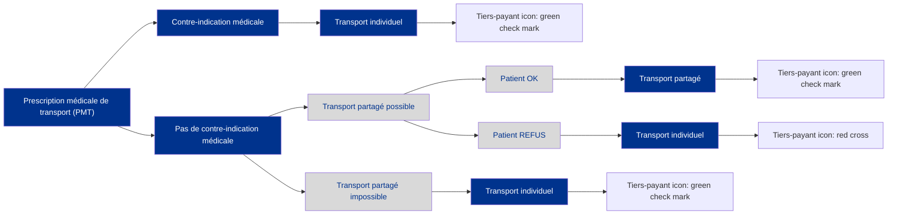

logo: l'Assurance Maladie

# **CIRCULAIRE**
# **CIR-5/2025**

---

**Date :**
18/04/2025

**Domaine(s) :**
Gestion du dossier client
professionnels de sante

- Nouveau [checked]
- Modificatif [unchecked]
- Complémentaire [unchecked]
- Suivi [unchecked]
- Provisoire [unchecked]

**Objet :**
Présentation des modalités d'application du Décret en Conseil d'Etat portant sur le transport partagé art. 69 LFSS 2024 "tiers payant contre transport partagé"

**Liens:**

**Liens externes :**

**Plan de classement :**
P04 GESTION DU DOSSIER CLIENT
PROFESSIONNELS DE SANTE

**Emetteur(s) :**
DDAFF / DDGOS / DDO

**Pièces jointes :** 4

**à Mesdames et Messieurs les :**

**Directeurs** [x] | CPAM [x] CGSS [x] CSS Mayotte [x]

**Directeur Comptable et Financier** [x] | CPAM [x] CGSS [x] CSS Mayotte [x]

---

**Pour mise en œuvre immédiate**

**Résumé :**
Mise à jour le 23 avril 2025.
Application du Décret en Conseil d'Etat (DCE) d'application de l'article 69 de la LFSS 2024 sur la mesure "tiers payant contre transport partagé" (TP/TP)

Présentation des modalités d'application du DCE portant sur le transport partagé (article 69 LFSS 2024 "tiers payant contre transport partagé"). Le DCE et l'arrêté associé sur le périmètre des transports concernés par la mesure TP/TP y sont décrits et expliqués pour les entreprises de transport sanitaire et de taxis conventionnés.

**Mots clés :**
transporteurs sanitaires ; taxis conventionnés ; article 69 LFSS 2024 ; transport partagé ; (17148) ; tiers payant contre transport partagé

**La Directrice Déléguée à**
**la Gestion et à**
**l'Organisation des Soins**
signature: Marguerite CAZENEUVE
**Marguerite CAZENEUVE**

**La Directrice Déléguée**
**aux Opérations**
signature: Aurélie COMBAS-RICHARD
**Aurélie COMBAS-RICHARD**

**Le Directeur Comptable et**
**Financier**
signature: Marc SCHOLLER
**Marc SCHOLLER**

logo: logo

**Objet :** Présentation des modalités d’application du Décret en Conseil d’Etat portant sur le transport partagé art. 69 LFSS 2024 « tiers payant contre transport partagé »

**Affaire suivie par :** Département des Professions de santé (DDGOS/DOS/DPROF)

<table>
  <caption><b>Sommaire</b></caption>
    <tr>
      <td>1</td>
      <td>Préambule..........................................................................................................</td>
      <td>2</td>
    </tr>
    <tr>
      <td>2</td>
      <td>Rappel : l’article 69 de la LFSS pour 2024 .........................................................</td>
      <td>2</td>
    </tr>
    <tr>
      <td>3</td>
      <td>Présentation du décret d’application et de l’arrêté .............................................</td>
      <td>3</td>
    </tr>
    <tr>
      <td>4</td>
      <td>Schéma de mise en œuvre de la mesure ..........................................................</td>
      <td>5</td>
    </tr>
    <tr>
      <td>5</td>
      <td>Règles de facturation en cas de refus d’un transport partagé par le patient ......</td>
      <td>6</td>
    </tr>
    <tr>
      <td>6</td>
      <td>Suivi du dispositif et de sa montée en charge ....................................................</td>
      <td>6</td>
    </tr>
</table>

L'Assurance Maladie
Agir ensemble, protéger chacun
1/6

# 1 <u>Préambule</u>

Les dépenses de transport enregistrent de fortes hausses depuis plusieurs années (+9% par rapport à 2022), pour atteindre 6,3 milliards d’euros en 2023, dont 60% relève du transport assis professionnalisé (TAP).

Le transport partagé ne représente qu’une faible part des trajets réalisés. Or, il permet d’améliorer la réponse aux besoins de transport, de maîtriser les dépenses de l’Assurance maladie, tout en réduisant l’empreinte écologique de ce secteur d’activité. Le transport partagé doit donc devenir la pratique de référence en matière de TAP.

Afin de déployer davantage ce type de prise en charge, la LFSS pour 2024 (article 69) prévoit une mesure pour inciter les assurés. La mise en œuvre est maintenant possible depuis la parution du Décret en Conseil d’Etat et de l’arrêté du ministère de la santé.

## 2 <u>Rappel : l’article 69 de la LFSS pour 2024</u>

La LFSS 2024 a instauré dans son article 691 une mesure portant sur le transport partagé.

Cette mesure concerne l’ensemble du transport assis professionnalisé (TAP), à savoir les véhicules sanitaires légers (VSL) <u>et</u> les taxis conventionnés, **<u>exclusivement pour les transports liés à des soins itératifs, dont la liste est précisée par l’arrêté du 28 février 2025</u>** (détaillé dans la suite du document).

La mesure issue de la LFSS pour 2024 est construite en deux temps en créant une incitation pour les patients à adhérer aux transports partagés via deux leviers :

### i. Le bénéfice du tiers-payant

*   Cette mesure conditionne le bénéfice du tiers payant (dispense d’avance de frais) à l’acceptation par les patients d’un transport partagé lorsque celui-ci peut leur être proposé et est compatible avec leur état de santé d’après la prescription médicale de transport.
*   Les patients qui refuseraient un transport partagé (relevant du seul périmètre de l’arrêté) devront procéder à l’avance des frais auprès des entreprises de transport assis professionnalisés et bénéficieront *a posteriori* du remboursement de leur trajet.
*   Ce premier temps de la mesure « transport partagé contre tiers payant » ne concerne pas les <u>patients bénéficiaires de l’aide médicale d’état (AME) ou de la Complémentaire santé solidaire.</u>
*   Un Décret en Conseil d’Etat et un arrêté ont été publiés au Journal Officiel et précisent la mise en œuvre de cette mesure.

_________________________________
1 <u>https://www.legifrance.gouv.fr/jorf/article_jo/JORFARTI000048668766</u>

**L'Assurance Maladie**
Agir ensemble, protéger chacun
2/6

**ii. Le niveau du remboursement par l’Assurance maladie, via un coefficient de minoration dont les modalités d’application restent à être fixées**

*   Cette mesure **<u>ne s’applique pas à ce stade</u>** et nécessitera des textes d’application.
*   Elle prévoit un remboursement minoré pour les patients qui refuseront un transport partagé alors que leur état de santé est compatible d’après la prescription médicale de transport.
*   La loi (art. 69 LFSS 2024) précise que les organismes complémentaires ne pourront pas prévoir la prise en charge de la minoration dans leurs contrats responsables.
*   Toujours selon la loi, ce second temps de la mesure concernera tous les patients, sans exception.

## 3 <u>Présentation du décret d’application et de l’arrêté</u>

### i. Le décret d’application²

Le décret est décrit dans les termes en noir ci-dessous, avec des précisions en vert n’apparaissant pas dans le texte du décret mais venant l’expliciter quand de besoin.

**DEFINITION D’UN TRANSPORT PARTAGE**

*   « *Art. R. 322-11-1. – Constitue un transport partagé, pour l’application des articles L. 322-5 et L. 322-5-1, le transport simultané d’au moins deux patients dans un véhicule relevant du 2° de l’article R. 322-10-1, sur tout ou partie du trajet.*

Transports visés : transport assis professionnalisé (TAP) réalisé soit en véhicule sanitaire léger (VSL), soit en taxi conventionné.

*   « *Art. R. 322-11-2. – Le patient se voit proposer un transport partagé dans les conditions prévues par la présente sous-section, soit vers le lieu de soins, soit depuis le lieu de soins, soit pour ces deux trajets, dès lors que la prescription médicale de transport spécifie que son état de santé n’est pas incompatible avec un transport partagé.*

Art. R. 322-11-3. – Le patient est informé par le prescripteur que son état de santé n’est pas incompatible avec un transport partagé.

Dans les faits, lors de la prescription médicale de transport (PMT) ou demande d’accord préalable (DAP), le prescripteur devra s’interroger sur la compatibilité ou non du transport partagé avec l’état de santé du patient et, le cas échéant, cocher la case correspondante sur la PMT/DAP (cf. exemple capture d’écran ci-dessous pour la PMT).

② **Quel mode de transport prescrivez-vous au regard de l'état de santé et d'autonomie de votre patient ?**

- transport en ambulance justifié si (cochez la(les) case(s) correspondante(s))
    - position allongée ou demi-assise [unchecked]
    - surveillance par une personne qualifiée [unchecked]
    - d'administration d'oxygène [unchecked]
    - brancardage ou d'un portage [unchecked]
    - aseptie rigoureuse [unchecked]
- transport assis professionnalisé (VSL, taxi conventionné) [unchecked]
    - l'état de santé du patient n'est pas compatible avec un transport partagé, cochez la case [unchecked]
    - un transport pour patient à mobilité réduite dans son fauteuil roulant est adapté, cochez la case [unchecked]
- moyen de transport individuel [unchecked]
- transport en commun terrestre [unchecked]
    } dans ce cas, si l'état du patient nécessite une personne accompagnante, cochez la case [unchecked]

***

2 <u>https://www.legifrance.gouv.fr/jorf/id/JORFTEXT000051270817</u>

3/6

**L'Assurance Maladie**
Agir ensemble, protéger chacun

*   *« Art. R. 322-11-4. – Le patient est informé par l'organisateur du transport des modalités d’un transport partagé et des implications de son refus éventuel en termes de prise en charge par l’assurance maladie, s’agissant du coefficient de minoration qui sera appliqué au tarif de remboursement et de l’impossibilité de bénéficier de la dispense d’avance des frais.*

Dès lors que la PMT ne prévoit pas d’incompatibilité médicale, le transporteur doit expliquer et indiquer au patient les modalités de réalisation du transport partagé et **les conséquences d’un refus** à savoir la nécessité pour le patient d’avancer les frais et de se faire rembourser *a posteriori*. Même si la minoration est citée dans le texte du décret ci-dessus, elle n’est pas encore applicable, car elle doit faire l’objet d’un autre décret non encore paru.

Cas particulier de la personne accompagnante : certains patients demandent ou doivent être accompagnés. Cette hypothèse n’exclut pas par principe le transport partagé (il peut y avoir plus de 2 personnes dans le véhicule), mais elle devra être signalée au transporteur afin qu’il puisse valider ou non la présence d’une personne accompagnante en fonction du nombre de places disponibles dans le véhicule.

## LE REFUS D’UN TRANSPORT PARTAGE

*   *« En cas de refus opposé par le patient à la proposition d’un transport partagé, l’entreprise de transports sanitaires ou l’entreprise de taxis conventionnée mentionne ce refus sur la facture ou sur le justificatif prévu au premier alinéa de l’article R. 322 10 2.*

Dès lors que le patient refuserait ce transport, le transporteur doit tracer explicitement ce refus. Pour ce faire, la facture et l’annexe associée des transporteurs sanitaires et taxis conventionnés ont été modifiées en ajoutant la phrase suivante, à cocher par le transporteur si le patient refuse le transport partagé que l’entreprise de transport lui propose :
*« L'assuré(e) refuse le transport partagé et paie directement le transporteur sans dispense d'avance de frais ».*

## LES DETOURS ET DELAIS D’ATTENTE AUTORISES

*   *« Art. R. 322-11-5. – Un transport partagé ne peut être proposé au patient que si le détour qu’il occasionne, pour celui-ci, ne dépasse pas dix kilomètres par patient transporté à partir du deuxième, dans la limite de trente kilomètres.*

Autrement dit :
- La prise en charge d’un second patient dans le véhicule ne doit pas engendrer un détour de plus de 10 km.
- La prise en charge d’un troisième patient dans le véhicule ne doit pas engendrer un détour total de plus de 20 km.
- La prise en charge de quatre patients ou plus ne doit jamais engendrer un détour de plus de 30 km.

*   *« Art. R. 322-11-6. – Le transport partagé est organisé dans des conditions garantissant à chaque patient que l’attente sur le lieu de soins, avant l’horaire programmé de sa prise en charge et à l’issue de celle-ci, ne dépasse pas quarante-cinq minutes au total.*

*   *« Art. R. 322-11-7. – Le transporteur informe de l’organisation d’un transport partagé l’accueil du lieu de soin.*

**L'Assurance Maladie**
Agir ensemble, protéger chacun
4/6

## LE PERIMETRE DES TRANSPORTS CONCERNES

*   « *Art. R. 322-11-8. – Un arrêté des ministres en charge de la santé et de la sécurité sociale fixe la nature des soins pour lesquels un transport partagé doit être proposé au patient. Les transports sanitaires effectués au titre de l’aide médicale urgente, prévue à l’article L. 6311-1 du code de la santé publique, ne peuvent pas faire l’objet d’une proposition de transport partagé* ».
*   Cf. point ii

### ii. L’arrêté précisant le périmètre d’application du décret3

L’article « Art. R. 322-11-8 » fait référence à l’arrêté qui précise le périmètre d’application du décret. Ce périmètre concerne les transports effectués en vue de recevoir ou bénéficier :

*   De traitements médicamenteux systémiques du cancer ;
*   De séances de radiothérapie ;
*   De séances de traitement de l'insuffisance rénale chronique par la pratique de l'épuration extrarénale ;
*   De soins médicaux de réadaptation ;
*   Ou de toutes séances, traitement ou soins dans le cadre d’une hospitalisation de jour.

<mark>Important : autrement dit, en pratique, le périmètre des transports concernés par la mesure « tiers payant contre transport partagé » est celui des seuls transports liés à des soins itératifs, c’est-à-dire réguliers et programmés.</mark>

## 4 <u>Schéma de mise en œuvre de la mesure</u>

Ce schéma résume les étapes de la mesure depuis la PMT jusqu’au fait de réaliser un transport partagé ou non.

La notion de possibilité (ou d’impossibilité) de réaliser un transport partagé est mesurée :

*   avec les éléments du décret (détour et temps d’attente) ;
*   avec des circonstances exceptionnelles (absence non prévue d’un patient au dernier moment).

Il est conseillé que le transporteur puisse conserver des justificatifs permettant de prouver les cas d’impossibilité.

***

3 <u>https://www.legifrance.gouv.fr/jorf/id/JORFTEXT000051270868</u>

**L'Assurance Maladie**
Agir ensemble, protéger chacun
5/6

# 5 <u>Règles de facturation en cas de refus d’un transport partagé par le patient</u>

Lors d’un refus, la facturation d’un transport assis professionnalisé (TAP), qui sera alors réalisée de façon individuelle, s’apparente à ce qui existe actuellement « en cas de paiement direct par l’assuré », dont les règles sont rappelées ci-dessous :
*   pour un transporteur sanitaire : <u>https://www.ameli.fr/transporteur-sanitaire/exercice-professionnel/facturation/modalites-facturation</u>
*   pour un taxi conventionné : <u>https://www.ameli.fr/taxi-conventionne/exercice-professionnel/facturation/modalites-facturation</u>

# 6 <u>Suivi du dispositif et de sa montée en charge</u>

Le dispositif sera **suivi via l’évolution et le niveau atteint du taux de transport partagé** en VSL et en taxi.

Les **refus** par les patients seront également suivis au niveau national, ainsi que les prescriptions médicales mentionnant une incompatibilité de l’état de santé avec un transport partagé.

*Pour toutes problématiques ou questions terrain vous semblant pertinentes d’être remontées auprès de l’Assurance maladie, vous pouvez solliciter votre caisse de rattachement qui fera le relai.*

**Annexes :**

*   Annexe 1 : facture modifiée pour les transporteurs sanitaires
*   Annexe 2 : annexe à la facture modifiée pour les transporteurs sanitaires
*   Annexe 3 : facture modifiée pour les taxis conventionnés
*   Annexe 4 : annexe 4 à la facture modifiée pour les taxis conventionnés

[Powered by TCPDF (www.tcpdf.org)](http://www.tcpdf.org)

**L'Assurance Maladie**
Agir ensemble, protéger chacun
6/6