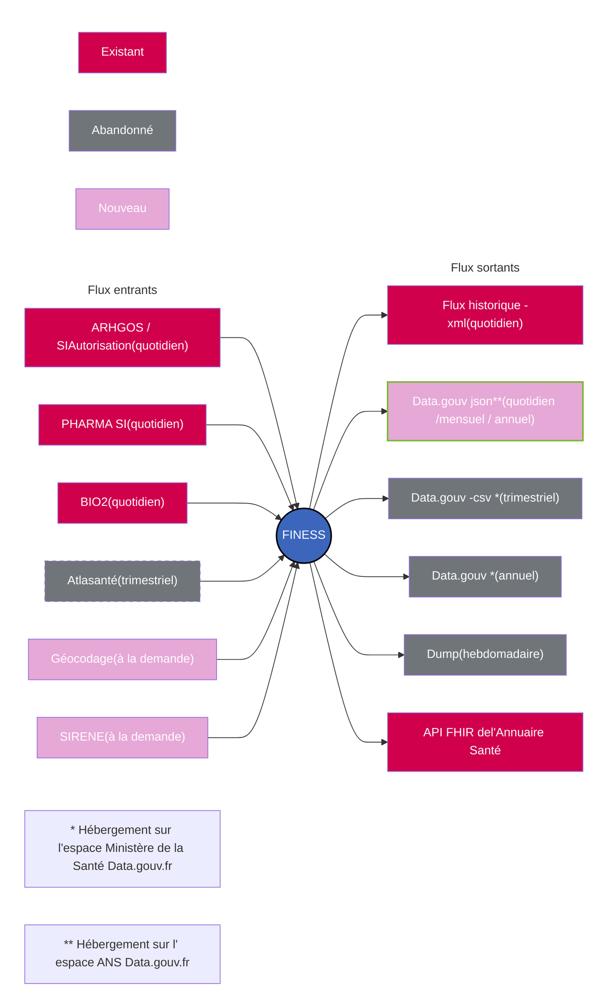
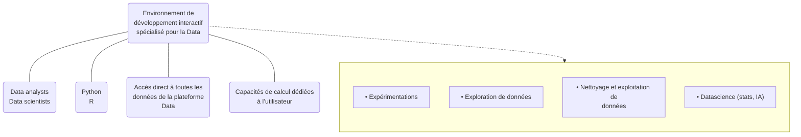
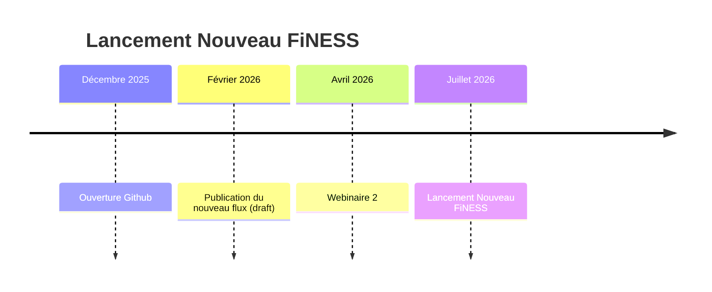

logo: Agence du Numérique en Santé
AGENCE DU NUMÉRIQUE EN SANTÉ
La transformation commence ici

photo: people working with digital overlays

# **Webinaire FINESS+**

**15 avril 2026 – n°2**

Agence du Numérique en Santé

logo: ANS

● Règles d’introduction

# Quelques règles pendant ce webinaire

icon: microphone
**Merci de bien vouloir couper vos micros et caméras lorsque vous ne prenez pas la parole.**
icon: camera and microphone UI controls

icon: speech bubble
**Merci de bien vouloir poser vos questions lors de la séance via le chat et en fin de session lors de la séquence Questions / Réponses en levant la main.**
icon: conversation and raise hand UI controls

icon: video play button
**Ce webinaire est enregistré. Le replay ainsi que le support présenté seront mis à disposition sur le portail de l’ANS.**

logo: ANS

# Les intervenants

photo: Laurent DUMONTIER

**Laurent DUMONTIER**
Directeur de programme
Agence du Numérique en Santé (ANS)

photo: Marc DEVOS

**Marc DEVOS**
Responsable d'offre de services
Agence du Numérique en Santé (ANS)

photo: Rémi LEVASSEUR

**Rémi LEVASSEUR**
Responsable Data
Agence du Numérique en Santé (ANS)

photo: Mohammed CHAABAOUI

**Mohammed CHAABAOUI**
Responsable de projets
Agence du Numérique en Santé (ANS)

logo: Agence du Numérique en Santé

## **Sommaire**

### **1. Déploiement de FINESS+ : partage les avancées et des prochaines étapes**
* Point d’avancement
* Focus sur le chantier formation
* Perspectives et étapes à venir

### **2. Focus sur les données dans FINESS+ : mieux comprendre les évolutions**
* Avancées métier : focus sur les adresses complémentaires
* Présentation des nouveautés liées aux données dans FINESS+
* Usage des données : découverte du nouveau flux et de l’espace GitHub

### **3. FINESS DATA : point de situation**
* Avancement et fonctionnalités

### **4. Échanges et questions**

logo: Agence du Numérique en Santé

logo: 15 min timer

# **Déploiement de FINESS+ :** partage des avancées et des prochaines étapes

logo: ANS

# Point d’avancement et perspectives

| | **Réalisations SI** | **Formation et accompagnement** | **Communication et mobilisation** | **Bascule** | **FINESS DATA** |
| --- | --- | --- | --- | --- | --- |
| ### **Avancements** icon: puzzle piece | 🗸 Développement de 95% des fonctionnalités🗸 Lancement de la phase de recette (3 vagues / 9 sessions / 21 volontaires) | 🗸 Lancement de la période d’auto-formation (réunion de lancement organisée le 27 mars, plus de 150 participants)🗸 Mise en ligne des trois parcours de formations (Coordinateur – Gestionnaire – Consommateur) | 🗸 Mise en place de comités de suivi et de pilotage spécifiques au déploiement | 🗸 Finalisation des scénarios de bascule | 🗸 Livraison des dernières mises à jour et des nouvelles nomenclatures🗸 Recette en cours |
|### **Perspectives** icon: bar chart | ❑ Finalisation des sprints❑ Lancement de la deuxième vague de recette | ❑ Auto-formation des utilisateurs sur la plateforme ANS-Formation | ❑ Partage de communications sur différents canaux (LinkedIn, Teams etc.) | ❑ Validation de la date de bascule en comité GO / NO GO❑ Suivez les actualités du projet jusqu’à la bascule sur le site esante.gouv | ❑ Réalisation des rapports FINESS+ et FINESS Historique❑ Ajout des filtrages de sécurité |
|### **Etapes à venir** logo: calendar | ▷ **22 mai** : fin de la recette – capitalisation▷ **Mi-juin** : fin des développements | ▷ Période d’auto-formation▷ **16 avril au 18 juin** : Organisation de 4 Ask Us Anything dédiés à la formation | ▷ **16 et 25 avril** : COMOP D-3 et COMOP D-4▷ **07 mai et 18 juin** : COPIL D-1 et COPIL D-2 | ▷ **Mai – juin** : Bascules à blanc▷ **07 mai et 18 juin** : COPIL D-1 et COPIL D-2 | ▷ **Début à fin juin** : démarrage GTT Rapports▷ **Début juin à mi-juillet** : formations |

logo: ANS
Présentation des trois parcours de formation FINESS+

### **Trois parcours de formation pour se former au nouvel outil FINESS:**

*   ➢ Tutoriels vidéo de formation publiés sur le [site de l’ANS-Formation](https://ans-formation.coorpacademy.com/certifications), en libre accès
*   ➢ Nouveauté : les visiteurs et autres consultants de données peuvent se former via le parcours Consommateur

***

icon: user with gear
# **COORDINATEUR**

**Profil Coordinateur**

*   **Possède toutes les fonctionnalités du Profil utilisateur Gestionnaire**
*   **Gère les utilisateurs de son périmètre**
*   **Ferme et rouvre les PM-EJ et EGE**

***

icon: group of users
# **GESTIONNAIRES**

**Profil Gestionnaire**

*   **Consulte la donnée**
*   **Gère les établissements PM-EJ et EGE de son périmètre**
*   **Saisit les autorisations**
*   **Gères les GCO et GCC**
*   **Publie la donnée**

***

icon: plug
# **CONSOMMATEURS**

**Profil Consommateur**

*   **Ils ne saisissent pas directement dans FINESS mais ont besoin de consulter régulièrement la donnée.**

logo: ANS

Se former à FINESS+

---

icon: graduation cap on laptop

# **SE FORMER**
### ***en autonomie, à son rythme***

image: ANS-Formation logo with surrounding icons

**Plateforme de formation unique**
ANS – Formation

---

# **Parcours de formation distincts**
## 3
Référent – Gestionnaire -
Consommateur

---

# **Tutoriels vidéo**
## 21 **à** 26
classés par objectifs pédagogiques

---

# **Tutoriels vidéo courts**
## 3
d’une durée de 3**min** en moyenne

logo: ANS Présentation de la **Plateforme ANS-Formation**

### <u>Dans la section « Parcours », je sélectionne mon parcours pour accéder aux tutoriels vidéo :</u>

logo: ANS AGENCE DU NUMÉRIQUE EN SANTÉ [Ma Page] [🔍 Recherchez un ...] Explorer Battles **Parcours** Mon apprentissage Raccourci ⌵ | ⭐ 25 | 📊 11ème | 🏆 Badges | 📑 Ma liste | 🔔² 👤

[🏠 Retour Ma Page]

> 🏆 **Parcours**
> Validez vos parcours

### 16 Parcours
Montrer les complétés 🔵

---

|                                          |                                              |                                              |
| :--------------------------------------- | :------------------------------------------- | :------------------------------------------- |
| 🕒 En cours                              | 🕒 En cours                                  | 🕒 En cours                                  |
| logo: REFERENT FINESS           | logo: GESTIONNAIRE FINESS           | logo: CONSOMMATEUR FINESS           |
| ⚙️ Parcours                              | ⚙️ Parcours                                  | ⚙️ Parcours                                  |
| **REFERENT : les nouveautés de FINESS+** | **GESTIONNAIRE : les nouveautés de FINESS+** | **CONSOMMATEUR : les nouveautés de FINESS+** |
| 21 modules à compléter                   | 16 modules à compléter                       | 5 modules à compléter                        |
| 🟩──────────                             | 🟩──────────                                 | 🟩──────────                                 |
| 🖱️                                      | 🖱️                                          |                                              |

*Planning en date du 13/04/2026*
Environnement de production
Environnement partenaire

signature: ANS

# Feuille de route prévisionnelle du déploiement FINESS+

<table>
  <thead>
    <tr>
      <th colspan="13">2026</th>
    </tr>
    <tr>
      <th></th>
      <th><b>Jan</b></th>
      <th><b>Fév</b></th>
      <th><b>Mars</b></th>
      <th><b>Avril</b></th>
      <th><b>Mai</b></th>
      <th><b>Juin</b></th>
      <th><b>Juil</b></th>
      <th>Aout</th>
      <th><b>Sept</b></th>
      <th><b>Oct</b></th>
      <th><b>Nov</b></th>
      <th><b>Déc</b></th>
    </tr>
  </thead>
  <tbody>
    <tr>
      <td rowspan="3"><strong><em>Pilotage &#x26; évaluation</em></strong></td>
      <td></td>
      <td></td>
      <td></td>
      <td></td>
      <td colspan="2"><em>GO / NO GO 18/06</em></td>
      <td colspan="6"><strong><em>BIG-BANG</em></strong></td>
    </tr>
    <tr>
      <td colspan="6">Comité de déploiement mensuel</td>
      <td></td>
      <td></td>
      <td></td>
      <td></td>
      <td></td>
      <td></td>
    </tr>
    <tr>
      <td></td>
      <td></td>
      <td></td>
      <td></td>
      <td></td>
      <td></td>
      <td></td>
      <td></td>
      <td colspan="4"><strong><em>Bilan du déploiement</em></strong></td>
    </tr>
    <tr>
      <td rowspan="3"><strong><em>Réalisations SI</em></strong></td>
      <td colspan="6">Développement de l’outil FINESS+</td>
      <td></td>
      <td></td>
      <td></td>
      <td></td>
      <td></td>
      <td></td>
    </tr>
    <tr>
      <td></td>
      <td></td>
      <td colspan="2"><em>Version bêta</em></td>
      <td colspan="2"><em>Version finale</em></td>
      <td></td>
      <td></td>
      <td></td>
      <td></td>
      <td></td>
      <td></td>
    </tr>
    <tr>
      <td></td>
      <td></td>
      <td></td>
      <td colspan="2">Phase de recette</td>
      <td></td>
      <td></td>
      <td></td>
      <td></td>
      <td></td>
      <td></td>
      <td></td>
    </tr>
    <tr>
      <td rowspan="3"><strong><em>Formation &#x26; accompagnement</em></strong></td>
      <td></td>
      <td colspan="2">Réal. des supports</td>
      <td colspan="3">Période d’auto-formation et « Bac-à-sable » pour s’entrainer</td>
      <td colspan="6">Support et accompagnement via la BaL métier et le support SI-RC</td>
    </tr>
    <tr>
      <td></td>
      <td></td>
      <td><em>Lancement Formation FINESS+<br />27 mars 2026</em></td>
      <td></td>
      <td></td>
      <td></td>
      <td colspan="6">Formation continue</td>
    </tr>
    <tr>
      <td></td>
      <td></td>
      <td></td>
      <td colspan="9">Mise à jour FAQ</td>
    </tr>
    <tr>
      <td rowspan="2"><strong><em>Communication &#x26; mobilisation</em></strong></td>
      <td colspan="3">Réal. des supports</td>
      <td colspan="3">Communication nationale et locale</td>
      <td></td>
      <td></td>
      <td></td>
      <td></td>
      <td></td>
      <td></td>
    </tr>
    <tr>
      <td></td>
      <td></td>
      <td></td>
      <td colspan="3"><strong><em>Webinaire d’information #2<br />15/04</em></strong></td>
      <td></td>
      <td></td>
      <td colspan="4"><strong><em>Journée des référents<br />#3</em></strong></td>
    </tr>
    <tr>
      <td><strong><em>Bascule</em></strong></td>
      <td></td>
      <td></td>
      <td></td>
      <td colspan="3">Bascules à blanc</td>
      <td><em>Indispo -nibilité de l’application</em></td>
      <td colspan="5">Phase de stabilisation</td>
    </tr>
    <tr>
      <td rowspan="4"><strong><em>Réalisations SI FINESS DATA et GTT Rapports</em></strong></td>
      <td colspan="3">Développements MAJ MPD / TRE / ASS</td>
      <td>Recette</td>
      <td colspan="2"><em>Raccordement SI/BI pré-production</em><br />Tests croisés/Atos</td>
      <td rowspan="4"><strong><b><i>Go Live</i></b> OK</strong></td>
      <td></td>
      <td colspan="4">GTT rapports V2</td>
    </tr>
    <tr>
      <td></td>
      <td></td>
      <td></td>
      <td></td>
      <td colspan="2">GTT rapports V1</td>
      <td></td>
      <td></td>
      <td></td>
      <td></td>
      <td></td>
    </tr>
    <tr>
      <td></td>
      <td></td>
      <td><em>Extractons FINESS livrées</em></td>
      <td></td>
      <td></td>
      <td></td>
      <td></td>
      <td></td>
      <td></td>
      <td></td>
      <td></td>
    </tr>
    <tr>
      <td></td>
      <td></td>
      <td></td>
      <td></td>
      <td></td>
      <td></td>
      <td></td>
      <td></td>
      <td></td>
      <td></td>
      <td></td>
    </tr>
    <tr>
      <td rowspan="2"><strong><em>Formation &#x26; accompagnement Data</em></strong></td>
      <td colspan="2">Création des comptes et des cartes</td>
      <td colspan="2">Commande CPA</td>
      <td></td>
      <td>Auto-formation</td>
      <td colspan="6">Support et accompagnement via la BaL métier et le support SI-RC</td>
    </tr>
    <tr>
      <td></td>
      <td></td>
      <td></td>
      <td></td>
      <td></td>
      <td></td>
      <td></td>
      <td colspan="5">Webinaires thématiques sur le requêtage avancé (1 / mois)</td>
    </tr>
  </tbody>
</table>

logo: Agence du Numérique en Santé

logo: 25 min

# **Focus sur les données dans**
# **FINESS+ :**
# mieux comprendre les évolutions

logo: Agence du Numérique en Santé
AGENCE DU NUMÉRIQUE EN SANTÉ
La transformation commence ici

# Gestion des adresses complémentaires des EGE

logo: ANS decorative element

logo: ANS **Gestion des adresses complémentaires**

# Adresses de l'EGE

<table>
  <caption>
    <strong>Adresses de l'EGE</strong>
    <span style="float: right;">1 - 5 sur 5 éléments icon: settings icon: filter</span>
  </caption>
  <thead>
    <tr>
      <th>Type d'adresse ⇅ ⧵</th>
      <th>Adresse ⇅ ⧵</th>
      <th>Action</th>
    </tr>
  </thead>
  <tbody>
    <tr>
      <td>Annexe</td>
      <td>22 RUE JOLIOT CURIE 01200<br />VALSERHONE</td>
      <td></td>
    </tr>
    <tr>
      <td>Annexe</td>
      <td>01000 BOURG EN BRESSE</td>
      <td></td>
    </tr>
    <tr>
      <td>Annexe</td>
      <td>846 GRANDE RUE 01700 MIRIBEL</td>
      <td></td>
    </tr>
    <tr>
      <td>Annexe</td>
      <td>112 ALLEE DES HORTENSIAS 01120<br />MONTLUEL</td>
      <td></td>
    </tr>
    <tr>
      <td>Annexe</td>
      <td>2 RUE CHARLES BLETEL 01100<br />OYONNAX</td>
      <td></td>
    </tr>
  </tbody>
</table>

logo: AGENCE DU NUMÉRIQUE EN SANTÉ - La transformation commence ici

# Usage des données : découverte du nouveau flux et de l’espace GitHub

logo: ANS

# Flux FINESS



\* Hébergement sur l'espace Ministère de la Santé Data.gouv.fr
\** Hébergement sur l' espace ANS Data.gouv.fr

\* Hébergement sur l'espace Ministère de la Santé Data.gouv.fr
\*\* Hébergement sur l' espace ANS Data.gouv.fr

logo: ANS

Cap sur le flux DataGouv

# « DataGouv FiNESS+ : explorer, comprendre, exploiter »

*   Le **nouveau flux DataGouv** rassemble toutes les informations FINESS, en **JSON librement accessible**
*   Il inclut les **groupes GCO/GCC** et des données enrichies sur les PM-EJ et les EGE
*   **Deux fichiers complémentaires** :
    *   **Structures** → les entités et leurs sites
    *   **Activité** → toutes les activités liées aux structures
*   L’ancien flux XML reste disponible temporairement, le temps que tout le monde bascule.

## ***Curieux ?***

*Découvrez le détail des flux, leur périmètre et les différences sur GitHub → [GitHub Flux DataGouv](https://github.com/ansforge/finess/blob/main/docs/flux/README.md)*

logo: JSON Open Data

### 💡 *Le mot du jour*


***JSON** : Format de données structuré, lisible par les systèmes*
***XML** : Format structuré ancien, plus verbeux, en recul*

logo: ANS

Le portail data.gouv.fr : accès au flux DataGouv

# « Où explorer le flux DataGouv FINESS+ ? »

*   **Deux datasets principaux publiés sur le portail [data.gouv.fr](https://www.data.gouv.fr/) :**
    *   **Structures** → toutes les structures FINESS
    *   **Activité** → toutes les activités rattachées aux structures

*   **Mises à jour régulières :** quotidiennement pour les fichiers principaux

*   **Snapshots historiques :** mensuel (1er du mois) et annuel (début d’année)

*   **Format :** JSON compressé (ZIP) pour faciliter la consultation et le téléchargement

*   **Environnement démo disponible :** permet d’explorer les datasets sans impacter la production

<aside>

## icon: lightbulb *Le mot du jour*

*   ***Dataset (data.gouv.fr) :** jeu de données complet publié sur le portail*
*   ***Ressource (data.gouv.fr) :** fichier individuel composant un dataset (ex. JSON Structures)*
*   ***Snapshot (data.gouv.fr) :** copie des données à un instant donné pour historique ou audit*

</aside>

logo: République Française

**data.gouv.fr**

logo: ANS

GitHub : schémas & documentation

# « Explorer les schémas JSON et la doc »

*   **Schémas JSON** : structures standardisées pour toutes les entités FINESS
*   **Exemples de fichiers de données** : pour tester et comprendre les flux avant intégration
*   **Dictionnaire de données** : décrit les objets et relations du flux
*   **DDL** (modèle de base de données)

> ### 💡 *Le mot du jour*
>
> *   ***Schéma JSON :** Description de la structure d’un fichier JSON (champs, types, règles)*
> *   ***Dictionnaire de données :** Document qui décrit chaque champ : nom, type, sens et contraintes.*
> *   ***DLL (Data Definition Language) :** Script SQL qui sert à créer la structure d’une base de données.*

logo: GitHub
logo: GitHub

logo: ANS

## Schéma JSON FINESS : Structures

# « Comprendre la logique du flux “Structures” »

*   **Objectif** : montrer la structure générale sans plonger dans le JSON complet

*   **Blocs principaux** :

**PMEJ**
├─ Identité
├─ Adresse / Contact
├─ Engagements / Evénements
└─ EGE (sites)

GCO
├─ PM porteuse
├─ PM membres
└─ EGE membres

GCC
├─ Identité
├─ Engagements / Événements
├─ PM membres
└─ EGE membres

### 💡 *Règles clés*

*   ***PMEJ :***
    *   *Bloc central : toutes les autres entités se réfèrent à ce bloc*
    *   *Contient : infos administratives, adresse/contact, engagements, événements, EGE (sites)*

*   ***GCO :***
    *   *Référence la PM porteuse, les PM membres et EGE membres*
    *   *Ne contient pas les détails complets : ces informations sont dans PMEJ*

*   ***GCC :***
    *   *Même logique que GCO*
    *   *Référence l’identité, engagements, événements, PM et EGE membres*
    *   *Les PM et EGE référencées sont déjà présentes dans PMEJ*

logo: ANS

## Schéma JSON FINESS : Activités

# « Comprendre la logique du flux “Activités” »

*  **Objectif** : montrer la structure générale sans plonger dans le JSON complet

* **Blocs principaux** :

PMEJ
├── Activités autorisées
│   ├── Nature
│   ├── Evénements
│   ├── Engagements
│   ├── Capacités
│   └── Zones
│   └── *Référence de la PMEJ exploitante*
└── EGE
    └── Activités exercées
        ├── Nature
        ├── Événements
        ├── Engagements
        ├── Capacités
        └── Zones
        └── *Référence de l'EGE exploitante (Exploitation)*
        └── *EGE facturante (O / N) (Facturation)*

### 💡 *Règles clés*

***PMEJ :***
*   *Porte les autorisations d’activités.*

**Activité autorisée :**
*   *Rattachée à une PMEJ.*
*   *Encadrée par événements, engagements, capacités et zone d’intervention.*
*   *Peut référencer une PMEJ exploitante.*

***EGE :***
*   *Site géographique rattaché à une PMEJ.*

**Activité exercée :**
*   *Mise en œuvre concrète d’une activité autorisée.*
*   *Localisée sur un EGE.*
*   *Peut référencer une EGE exploitante*
*   *Distingue EGE exploitante et EGE facturante (Oui / Non).*

Coding : standardiser les données
### 💡 Le mot du jour
*   **Interopérabilité :** *Capacité à partager des données de manière homogène*
*   **Coding :** *Codes standardisés pour garantir une interprétation commune des données*
*   **API (Application Programming Interface) :** *Moyen pour deux systèmes de communiquer automatiquement*

logo: ANS


## « Comprendre les objets codés »


*   **Objectif** : illustrer comment le coding est intégré dans le flux

```json
"statutJuridique": {
  "type": "string",
  "coding": {
    "system": "<u>https://mos.esante.gouv.fr/[NOS](https://mos.esante.gouv.fr/NOS/)/[TRE_](https://mos.esante.gouv.fr/NOS/tre_r400-finess-statut-juridique/FHIR/tre-r400-finess-statut-juridique)r400-finess-[statut-juridique/FHIR/TRE-r400-finess-statut-juridique](https://mos.esante.gouv.fr/NOS/tre_r400-finess-statut-juridique/FHIR/tre-r400-finess-statut-juridique)</u>"
  }
},
```

*   Le JSON contient uniquement le code
*   Le libellé est récupéré via l’URL du référentiel

### *Logique et usage métier :*

#### Principe
*   Un champ peut être associé à un coding
*   *Le JSON publie le code standardisé uniquement*

#### Référentiel externe
*   *L’URL (system) permet d’accéder au libellé et à la description*
*   Les référentiels sont disponibles :
    *   sous forme de fichiers (<u>NOS</u>)
    *   ou via API pour une intégration dynamique ([SMT](https://smt.esante.gouv.fr/))

#### Pourquoi c’est important ?
*   *Interopérabilité : même code = même signification partout*
*   *Cohérence : pas de divergence de libellés entre systèmes*
*   *Evolutivité : mise à jour des libellés sans modifier les fichiers JSON*

logo: ANS

Démo rapide

# « Explorer le flux DataGouv en action »

*   **Objectif** : montrer où trouver et comment exploiter les ressources

logo: data.gouv.fr

Flux DataGouv
├─ **data.gouv.fr**
│  ├─ Dataset Structures
│  └─ Dataset Activité
│
└─ **GitHub**
   ├─ Schémas JSON
   ├─ Exemples de fichiers JSON
   ├─ Dictionnaire de données
   └─ DDL (modèle de base de données)

logo: GitHub
icon: GitHub

*   Navigation sur **data.gouv.fr** → accès aux datasets
*   Accès à **GitHub** → documentation technique et ressources

logo: ANS

Conclusion & ressources

# « Clés à retenir & où explorer »

## **Objectif : synthétiser**

*   **Flux DataGouv FINESS** : nouvelle génération JSON, librement accessible
*   **Structures** : PMEJ, GCO, GCC → entités principales et groupements
*   **Activité** : Activités autorisées et exercées → cadre réglementaire et opérationnel
*   **Interopérabilité** : codings standardisés pour échanges fiables
*   **Snapshots** : quotidien, mensuel et annuel pour suivi historique

## *Ressources & exploration :*

***Portail DataGouv** : accéder aux datasets et fichiers JSON*

***GitHub** :*
*   *Schémas JSON*
*   *Dictionnaire de données (DDL)*
*   *Fichier YAML pour le dataset Activité*
*   *Exemples de fichiers pour tests et intégration*

logo: Agence du Numérique en Santé

logo: 30 min stopwatch

# **FINESS DATA :**
# point de situation

logo: Agence du Numérique en Santé

# Doctrines et outils

logo: ANS decorative graphic

# **Doctrine** de réponse aux besoins d’analyse et de reporting des données FINESS

signature: ANS

## Utilisateurs éligibles

### Voici les structures autorisées à utiliser FINESS Data :

logo: Direction Générale de l'Offre de Soins - Ministère des Affaires Sociales et de la Santé

logo: CNSA - Caisse nationale de solidarité pour l'autonomie

logo: Drihl - Direction régionale et interdépartementale de l'Hébergement et du Logement

logo: ARS - Agence Régionale de Santé

logo: Préfet de la Région Ile-de-France

Direction régionale interdépartementale de l'économie, de l'emploi, du travail et des solidarités (DRIEETS)

logo: L'Assurance Maladie - Caisse Nationale

logo: Les DREETS - Protéger Accompagner Développer

logo: Insee - Mesurer pour comprendre

logo: Ministère des Solidarités et de la Santé
Direction générale de la cohésion sociale

logo: HAS - Haute Autorité de Santé

logo: Drees - Statistique publique de la santé et des solidarités

logo: Santé publique France

logo: ATIH - Nos données au service de la Santé

Consommateurs actuels – Acteurs institutionnels

logo: ANS

# **Doctrine de réponse aux besoins d’analyse et de reporting des données FINESS**

## Accessibilité à la donnée

L’intégralité des informations FINESS+ seront stockées et historisées dans la base de données décisionnelle couvrant ainsi l’ensemble du périmètre de l’application. La brique décisionnelle permettra :

*   ➢ Le requêtage du référentiel selon la dernière image disponible (arrêté de la veille)
*   ➢ Le requêtage du référentiel à une date passée *
*   ➢ Le suivi daté des événements FINESS+ *

La doctrine de conception du système proposée par l’ANS vise, à des fins d’efficience, à un maximum d’indépendance des utilisateurs tout en répondant de manière adaptée à chaque besoin.

* à partir de la date de mise en service de FINESS+

### Périmètre assuré dans le cadre du BI FINESS+ V1

| Décideurs et parties prenantes de l’écosystème                                                                                | Utilisateurs métiers (DREETS/ARS/DRIHL) manipulant des données au quotidien                                                                                        | Analystes de données de premier ordre                                                                          | Analystes de données avancés                                                                                                                                          |
| :---------------------------------------------------------------------------------------------------------------------------- | :----------------------------------------------------------------------------------------------------------------------------------------------------------------- | :------------------------------------------------------------------------------------------------------------- | :-------------------------------------------------------------------------------------------------------------------------------------------------------------------- |
| Mise à disposition de tableaux de bord synthétiques permettant de rendre compte du peuplement et de l’activité du référentiel | Mise à disposition de rapports standards mais au périmètre personnalisable pour répondre aux questions du quotidien. Abonnements pour envoi automatiques par mail. | Mise à disposition d’univers de requêtage vous permettant de créer et gérer vous-même vos requêtes et rapports | Mise à disposition d’un accès direct aux bases de données (datalab) pour permettre la mise en œuvre de traitements complexes et de croisements spécifiques de données |

logo: AGENCE DU NUMÉRIQUE EN SANTÉ

# **Reportings Business Objects**

## Qu’est-ce que c’est ?

**C’est la fonctionnalité « legacy » des applications décisionnelles. Ce reporting adresse en particulier le requêtage opérationnel et de listing pour des populations métiers.**

## Comment cela fonctionne ?


- Basée sur la notion d’ « univers », c-à-d un **catalogue** rangé **de données** à disposition en base (couche sémantique).
- Permet une consultation de rapports prédéfinis, exportés en Excel ou PDF.
- **Un principe d’abonnement** à des rapports réguliers, **envois par mail** ou SFTP.
- **Création et exécution de requêtes**, enregistrées dans des rapports.
- Adapté à la production de **listings Excel denses**, avec une granularité variable (global ou détail).


Editeur des requêtes

| Ajouter une requête | icon: panel icon: filter icon: grid icon: users | icon: link icon: settings icon: document |
| :--- | :--- | :--- |

**Requête 1** $\vee$

---

### BI_FINESS+
*Saisissez ici pour filtrer l'arborescence* icon: search icon: add icon: folder

$\vee$ icon: universe BI_FINESS+ [unx]
* $>$ icon: folder Personne morale (PM)
* $>$ icon: folder Etablissement Géographique d'Exercice (EGE)
* $\vee$ icon: folder Activité d'exercice (AE)
    * icon: dimension Numéro autorisation ARGHOS (AE)
    * icon: dimension Date de début de la période autorisée (AE)
    * icon: dimension Date de fin de la période autorisée (AE)
    * icon: dimension Durée de l'autorisation en années (AE)
    * icon: dimension Actif (AE)
    * $\vee$ icon: dimension Nature de l'activité (AE)
        * icon: attribute **Code (Nature activité AE)**
    * icon: dimension Zone d'intervention autorisée (AE)
    * icon: dimension Libellé de la zone d'intervention autorisée (AE)
    * icon: dimension Cog commune de la zone d'intervention autorisée
    * icon: dimension Identifiant technique (AE)
    * icon: dimension PK historique (AE)
    * icon: measure Nombre d'activités (AE)
    * icon: filter Activité autorisée (AE)

---

### Objets du résultat
icon: filter_plus icon: close icon: delete | icon: arrow_left icon: arrow_right

| icon: arrow_right | icon: dimension Numéro FINESS (PM) | icon: dimension Dénomination (PM) | icon: dimension Numéro FINESS (EGE) |
| :--- | :--- | :--- | :--- |
| icon: arrow_left | icon: dimension Libellé court (EGE) | icon: measure Nombre d'activités (AE) $\otimes$ | |

---

### Filtres de la requête
icon: calendar icon: trophy icon: close icon: delete | icon: arrow_up icon: arrow_down icon: add_filter

| icon: arrow_right | icon: attribute Code (Nature activité AE) | **Dans liste** $\vee$ | AMM | icon: menu $\otimes$ |
| :--- | :--- | :--- | :--- | :--- |
| icon: arrow_left | | | | |

---

### Aperçu des données
icon: refresh Actualiser

*Entrez un texte pour filtrer les valeurs* icon: search

| Numéro FINESS (P... | Dénomination (PM) | Numéro FINESS (E... | Libellé court (EGE)    | Nombre d'activi... |
| :------------------ | :---------------- | :------------------ | :--------------------- | :----------------- |
| 010001995           | E.Hospit          | 010001995           | CHU Lapeyronie         | 1                  |
| 010001996           | E.Hospit          | 010001996           | Clinique du Parc       | 1                  |
| 010001997           | E.Hospit          | 010001997           | Fac Méd Montpellier    | 1                  |
| 010001998           | E.Hospit          | 010001998           | Centre Hospitalier ... | 1                  |
| 010001999           | E.Hospit          | 010001999           | Clinique du Millénaire | 1                  |
| 010002000           | E.Hospit          | 010002000           | Poly St Roch           | 1                  |


28

logo: ANS

# **Doctrine de réponse aux besoins d’analyse et de reporting des données FINESS**

## Reportings Business Objects *Exemples de rapports simples basés sur les données FINESS actuelles*

<table>
  <thead>
    <tr>
      <th>Numéro Finess</th>
      <th>Numéro Finess Etablisseme</th>
      <th>Raison sociale (Structure)</th>
      <th>Activité (Activité de soins AMM)</th>
      <th>Modalité (Activité de soins AMM)</th>
      <th>Mention (Activité de soins AMM)</th>
    </tr>
  </thead>
  <tbody>
    <tr>
      <td>140000167</td>
      <td>140000381</td>
      <td>HOPITAL LOCAL - ORBEC</td>
      <td></td>
      <td></td>
      <td></td>
    </tr>
    <tr>
      <td>270000136</td>
      <td>270000474</td>
      <td>CENTRE HOSPITALIER SAINT JACQUES</td>
      <td>Soins médicaux et de réadaptation</td>
      <td>Pas de modalité</td>
      <td>Polyvalent</td>
    </tr>
    <tr>
      <td>270000144</td>
      <td>270000482</td>
      <td>CH BOURG ACHARD</td>
      <td>Soins médicaux et de réadaptation</td>
      <td>Pas de modalité</td>
      <td>Polyvalent</td>
    </tr>
    <tr>
      <td>270000151</td>
      <td>270000490</td>
      <td>CH BRETEUIL-SUR-ITON</td>
      <td></td>
      <td></td>
      <td></td>
    </tr>
    <tr>
      <td>270000169</td>
      <td>270000508</td>
      <td>HL CONCHES-EN-OUCHE</td>
      <td></td>
      <td></td>
      <td></td>
    </tr>
    <tr>
      <td>270000177</td>
      <td>270000516</td>
      <td>HL LE NEUBOURG</td>
      <td>Soins médicaux et de réadaptation</td>
      <td>Pas de modalité</td>
      <td>Polyvalent</td>
    </tr>
    <tr>
      <td>270000177</td>
      <td>270015126</td>
      <td>SSID HL LE NEUBOURG</td>
      <td></td>
      <td></td>
      <td></td>
    </tr>
    <tr>
      <td>270000185</td>
      <td>270000532</td>
      <td>CH PACY-SUR-EURE</td>
      <td></td>
      <td></td>
      <td></td>
    </tr>
    <tr>
      <td>270000193</td>
      <td>270000557</td>
      <td>HL DE PONT DE L'ARCHE</td>
      <td></td>
      <td></td>
      <td></td>
    </tr>
    <tr>
      <td>270000201</td>
      <td>270000565</td>
      <td>HL RUGLES</td>
      <td></td>
      <td></td>
      <td></td>
    </tr>
    <tr>
      <td>500000039</td>
      <td>500000195</td>
      <td>CH CARENTAN</td>
      <td>Médecine</td>
      <td>Pas de modalité</td>
      <td>Pas de mention</td>
    </tr>
    <tr>
      <td>500000039</td>
      <td>500000195</td>
      <td>CH CARENTAN</td>
      <td>Soins médicaux et de réadaptation</td>
      <td>Pas de modalité</td>
      <td>Gériatrie</td>
    </tr>
    <tr>
      <td>500000039</td>
      <td>500000195</td>
      <td>CH CARENTAN</td>
      <td>Soins médicaux et de réadaptation</td>
      <td>Pas de modalité</td>
      <td>Polyvalent</td>
    </tr>
    <tr>
      <td>500000054</td>
      <td>500000476</td>
      <td>HOPITAUX DU SUD MANCHE SITE VILLEDIEU</td>
      <td>Soins médicaux et de réadaptation</td>
      <td>Pas de modalité</td>
      <td>Polyvalent</td>
    </tr>
    <tr>
      <td>500000062</td>
      <td>500000302</td>
      <td>CH MORTAIN</td>
      <td>Soins médicaux et de réadaptation</td>
      <td>Pas de modalité</td>
      <td>Polyvalent</td>
    </tr>
  </tbody>
</table>

<table>
    <caption>84 structures FINESS avec une date avant le 1er janvier 1901</caption>
    <thead>
        <tr>
            <th>Date autorisation</th>
            <th>Date fermeture</th>
            <th>Date de création de la structure</th>
            <th>Année de création</th>
            <th>FINESS</th>
            <th>Raison sociale (Structure)</th>
        </tr>
    </thead>
    <tbody>
        <tr>
            <td>23/10/0151</td>
            <td></td>
            <td>01/02/2020</td>
            <td>2020</td>
            <td>620008490</td>
            <td>PHARMACIE ANATOLE FRANCE</td>
        </tr>
        <tr>
            <td>30/11/0167</td>
            <td></td>
            <td>01/04/2023</td>
            <td>2023</td>
            <td>630003655</td>
            <td>NATURAPHARM</td>
        </tr>
        <tr>
            <td>01/08/0192</td>
            <td></td>
            <td>01/04/2010</td>
            <td>2010</td>
            <td>390004091</td>
            <td>PHARMACIE DE L'EPICEA</td>
        </tr>
        <tr>
            <td>13/01/0201</td>
            <td>20/08/2018</td>
            <td>13/10/2017</td>
            <td>2017</td>
            <td>610008260</td>
            <td>RHVS PRAHDA SAEM ADOMA CERISE</td>
        </tr>
        <tr>
            <td>01/10/0202</td>
            <td></td>
            <td>01/10/2022</td>
            <td>2022</td>
            <td>440059657</td>
            <td>LBM SUD LOIRE BIOLOGIE</td>
        </tr>
        <tr>
            <td>23/02/0298</td>
            <td>31/12/2009</td>
            <td>27/04/1998</td>
            <td>1998</td>
            <td>780023382</td>
            <td>PHARMACIE MUTUALISTE</td>
        </tr>
        <tr>
            <td>14/01/0459</td>
            <td></td>
            <td>01/10/2011</td>
            <td>2011</td>
            <td>640007043</td>
            <td>SARL PHARMACIE DE MONTBRUN</td>
        </tr>
        <tr>
            <td>10/04/0742</td>
            <td></td>
            <td>28/02/2000</td>
            <td>2000</td>
            <td>510021413</td>
            <td>PHARMACIE LACOUME</td>
        </tr>
        <tr>
            <td>22/12/0787</td>
            <td></td>
            <td>01/06/2025</td>
            <td>2025</td>
            <td>330051715</td>
            <td>PHARMACIE DE SAINT MORILLON</td>
        </tr>
        <tr>
            <td>21/01/0964</td>
            <td></td>
            <td>01/02/2005</td>
            <td>2005</td>
            <td>930007356</td>
            <td>PHARMACIE ETOTH</td>
        </tr>
    </tbody>
</table>

| logo: SAP | Planifier ⌵ | 🔍 |
| :--- | :--- | :--- |

# Planifier

| Général ⌵ | Fonct... |
| :-------- | :------- |
| :--- | :--- |

### Titre de l'instance
Titre *
`20260127 - Requête F`

### Destinations
Destinations de livraison
[ Ajouter ]

Destinations de livraison
Emplacement par défaut...
E-mail

### Périodicité
Rapport d'exécution:
`Périodique`
Répéter:
`Tous les jours`

---

| Destinations |
| :--- |
| Sélectionner une destination: [ Emplacement par défaut d'Enterprise ✕ ] [ E-mail ✕ ] [ ⌵ ] |
| **Emplacement par défa...**<br>**E-mail** | **E-mail** |
| | De :<br>`rapports@bi.esante.gouv.fr` [ Ajouter un espa... ⌵ ] |
| | À :<br>`remi.levasseur@esante.gouv.fr` [ Adresse électro... ⌵ ] |
| | Cc :<br>` ` [ Ajouter un espa... ⌵ ] |
| | Cci :<br>` ` [ Ajouter un espa... ⌵ ] |
| | Répondre à<br>` ` [ Ajouter un espa... ⌵ ] |
| | Objet :<br>`%SI_NAME% - %SI_DATE%` [ Ajouter un espa... ⌵ ] |
| | Message :<br>icon: formatting toolbar [ Ajouter un espa... ⌵ ]<br>icon: editing toolbar<br>Bonjour,<br><br>Vous trouverez ci-joint le rapport... |
| | [ Confirmer ] [ Annuler ] |

Historique ∨
logo: SAP

Titre de l'instance: Etablissements FINESS pour Santé Publique France

| ☐  | Titre                                               | Type | Statut     | Heure de l'instance | Paramètres |
| :- | :-------------------------------------------------- | :--- | :--------- | :------------------ | :--------- |
| ☐  | icon: text document Etablissements_FINESS | Txt  | ✓ Réussite | 26 janv. 2026 08:33 | FINESS;    |
| ☐  | icon: text document Etablissements_FINESS | Txt  | ✓ Réussite | 19 janv. 2026 08:34 | FINESS;    |
| ☐  | icon: text document Etablissements_FINESS | Txt  | ✓ Réussite | 12 janv. 2026 10:04 | FINESS;    |
| ☐  | icon: text document Etablissements_FINESS | Txt  | ✓ Réussite | 5 janv. 2026 08:39  | FINESS;    |
| ☐  | icon: text document Etablissements_FINESS | Txt  | ✓ Réussite | 29 déc. 2025 08:33  | FINESS;    |

*Planification d’un envoi automatique par mail et historique d’exécution*

logo: ANS

# **Doctrine** de réponse aux besoins d’analyse et de reporting des données FINESS

Accessibilité à la donnée

L’**ensemble des informations** disponibles dans FINESS+ BI sera consultable dans l’**univers BO** mis à disposition.

Des **rapports préconstruits** concernant les éléments fondamentaux sont proposés (ateliers métier d’octobre 2022 à janvier 2023) :

<table>
    <tr>
      <td>Une liste<br />des EJ</td>
      <td>Une liste<br />des EGE</td>
      <td>Une liste des EJ<br />et EGE combinés</td>
      <td>drawing: engineering drawing</td>
    </tr>
    <tr>
      <td>Vous permettra<br />de consulter les<br />entités juridiques</td>
      <td>Vous permettra<br />de consulter les<br />établissements</td>
      <td>Vous permettra de consulter<br />les entités juridiques et les<br />établissements associés</td>
      <td>Vous permettront de consulter les entités juridiques, les établissements<br />ainsi que les autorisations associées. Vous disposerez d'une liste par<br />domaine et une liste regroupant l'ensemble des domaines</td>
    </tr>
</table>

## **Objectifs sous-jacents** :
- Permettre une **reprise complète des besoins de reporting** actuellement assurés par les rapports **EDONISS**
- Vous donner une base de rapports que vous pouvez dupliquer et spécialiser en fonction de vos besoins

Les **évènements**, quant à eux, sont proposés dans un **univers dédié** mais non inclus dans un rapport préconstruit, le périmètre étant trop vaste : un rapport reprenant l’ensemble des événements sans être enrichi de son contexte n’aurait pas de sens.

logo: ANS

# **Doctrine** de réponse aux besoins d’analyse et de reporting des données FINESS

### Principes de l’univers FINESS+

Structuration des notions clés de FINESS autour de classes. Chaque classe contient des propriétés et des sous-classes.

```mermaid
graph LR
    subgraph PM [Personne morale (PM)]
        direction LR
        PM_Root[Personne morale (PM)] --- PM_H1[Hiérarchie statut juridique]
        PM_Root --- PM_H2[Entreprise INSEE]
        PM_H2 --- PM_H2_1[Etablissement siège]
        PM_H2_1 --- PM_H2_1_1[Adresse]
        PM_Root --- PM_H3[Adresse]
        PM_Root --- PM_H4[Contact]
        PM_H4 --- PM_H4_1[Telecom]
        PM_H4 --- PM_H4_2[Adresse]
        PM_Root --- PM_H5[Engagement]
        PM_Root --- PM_H6[Groupe de coopération organique (GCC)]
        PM_H6 --- PM_H6_1[Engagement GCC]
        PM_Root --- PM_H7[Groupe de coopération conventionnel (GCC)]
    end

    subgraph EGE [Etablissement géographique d'exercice (EGE)]
        direction LR
        EGE_Root[Etablissement géographique d'exercice (EGE)] --- EGE_H1[Hiérarchie catégorie d'établissement]
        EGE_Root --- EGE_H2[Etablissement INSEE]
        EGE_H2 --- EGE_H2_1[Entreprise]
        EGE_H2 --- EGE_H2_2[Adresse]
        EGE_Root --- EGE_H3[Adresse]
        EGE_Root --- EGE_H4[Contact]
        EGE_H4 --- EGE_H4_1[Telecom]
        EGE_H4 --- EGE_H4_2[Adresse]
        EGE_Root --- EGE_H5[Rôle EGE]
        EGE_Root --- EGE_H6[Engagement]
        EGE_Root --- EGE_H7[Groupe de coopération conventionnel (GCC)]
        EGE_H7 --- EGE_H7_1[Engagement GCC]
    end

    subgraph AE [Activité d'exercice (AE)]
        direction LR
        AE_Root[Activité d'exercice (AE)] --- AE_H1[Type d'activité]
        AE_H1 --- AE_H1_1[Activité de soin]
        AE_H1 --- AE_H1_2[ASMR]
        AE_H1 --- AE_H1_3[Activité de soin AMM]
        AE_H1_3 --- AE_H1_3_1[Appareil AMM]
        AE_H1 --- AE_H1_4[EML]
        AE_H1 --- AE_H1_5[ASDR]
        AE_H1 --- AE_H1_6[Activité sociale régulée]
        AE_H1 --- AE_H1_7[Activité d'enseignement régulée]
        AE_H1 --- AE_H1_8[Activité médicosociale régulée]
        AE_Root --- AE_H2[Capacité]
        AE_Root --- AE_H3[Engagement]
    end
```

- L’utilisateur pioche dans l’univers les champs de données nécessaires à sa requête (données à afficher, filtres)
- L’univers demande à l’utilisateur la date d’observation des données. Il renverra à l’utilisateur la version de chaque donnée à la date sélectionnée.
- L’univers demande à l’utilisateur les relations entre notions à utiliser :
    - Activités autorisées d’une PM
    - Activités exercées d’une EGE

logo: AGENCE DU NUMÉRIQUE EN SANTÉ

# **Notebooks JupyterLab**

## Qu’est-ce que c’est ?

**Il s’agit de la mise à disposition d’un environnement de travail à l’état de l’art pour les data analysts et data scientists, avec un accès facilité aux données**

## Comment cela fonctionne ?

*   Mise à disposition d’un notebook permettant à l’analyste de compiler efficacement requêtes, analyses, observations et conclusions pour un partage ou une publication simple
*   Prise en charge des langages Python et R, facilitation du requêtage SQL
*   Requêtage direct de l’ensemble des données de la Plateforme Data et croisement avec des sources externes (données métier, Open Data, ressources Web, …)

screenshot: JupyterLab interface showing code and a map

---

**Qualité données OTN.ipynb** $\times$ $+$

$\square$ $+$ $\text{\texttimes}$ $\square$ $\square$ $\blacktriangleright$ $\square$ $\text{C}$ $\text{H}$ $\text{Code}$ $\vee$ $\text{目}$

$[30]:$ `# Appliquer la fonction methode_ARIMA pour tous les départements`
`for departement in departements_uniques:`
    `methode_modProba(departement)`

`res_modProba = pd.concat(all_departments_data4)`
`res_modProba.sort_values('DT_Date', inplace=True)`

`# Réinitialiser l'index pour s'assurer qu'il est unique`
`res_modProba.reset_index(drop=True, inplace=True)`
`res_modProba`

$[30]:$
|           | DT_Date   | Departement | NB_Appels | year | month | day | dayOfTheYear | dayOfTheWeek | CalendarWeek | outlier_distribution |
| :-------- | :--------- | :---------- | :--------- | :--- | :---- | :-- | :----------- | :----------- | :----------- | :-------------------- |
| **0**     | 2018-02-05 | 64          | 4          | 2018 | 2     | 5   | 36           | Monday       | 6            | True                  |
| **1**     | 2018-02-06 | 64          | 2          | 2018 | 2     | 6   | 37           | Tuesday      | 6            | True                  |
| **2**     | 2018-03-29 | 64          | 2          | 2018 | 3     | 29  | 88           | Thursday     | 13           | True                  |
| **3**     | 2018-05-30 | 44          | 486        | 2018 | 5     | 30  | 150          | Wednesday    | 22           | True                  |
| **4**     | 2018-05-30 | 85          | 194        | 2018 | 5     | 30  | 150          | Wednesday    | 22           | True                  |
| ...       | ...        | ...         | ...        | ...  | ...   | ... | ...          | ...          | ...          | ...                   |
| **44493** | 2024-03-11 | 44          | 1707       | 2024 | 3     | 11  | 71           | Monday       | 11           | False                 |
| **44494** | 2024-03-11 | 49          | 677        | 2024 | 3     | 11  | 71           | Monday       | 11           | False                 |
| **44495** | 2024-03-11 | 29          | 1413       | 2024 | 3     | 11  | 71           | Monday       | 11           | False                 |
| **44496** | 2024-03-11 | 56          | 867        | 2024 | 3     | 11  | 71           | Monday       | 11           | False                 |
| **44497** | 2024-03-11 | 07          | 468        | 2024 | 3     | 11  | 71           | Monday       | 11           | False                 |

44498 rows × 10 columns

### Calcul du z-score

Evalue à quel point un point de données d'un échantillon est éloigné de la moyenne de cet échantillon en termes d'écart-type: $z = x - \mu / \sigma$

32

32

logo: Agence du Numérique en Santé

# **Notebooks**

logo: jupyterlab TNG

---



**Bénéfices d’usage :**

*   Code, Résultats et Documentation au même endroit pour une compréhension optimale et un

screenshot: JupyterLab interface showing a notebook named example.ipynb

| [orange icon] | example.ipynb | ●  | +  |
| :------------- | :------------ | :- | :- |
| :--- | :--- | :--- | :--- |

| 💾 | +  | ✂  | 📋 | 📋 | ▶  | ◼  | ↻  | ⏩  | Code | ⌵  | 🐞 | ... |
| :- | :- | :- | :- | :- | :- | :- | :- | :- | :--- | :- | :- | :-- |
| :--- | :--- | :--- | :--- | :--- | :--- | :--- | :--- | :--- | :--- | :--- | :--- | :--- |

```python
[1]: # Import stuff.
     from matplotlib import pyplot
```

```python
[2]: # Make up some data.
     x = [1, 2, 3, 4, 5]
     y = [1, 4, 9, 16, 25]
```

```python
[3]: # Plot the data.
     pyplot.plot(x, y)
     pyplot.xlabel("Cups of Coffee")
     pyplot.ylabel("Productivity")
```

[3]: Text(0, 0.5, 'Productivity')

<table>
  <caption>Productivity vs. Cups of Coffee</caption>
  <thead>
    <tr>
      <th>Cups of Coffee</th>
      <th>Productivity</th>
    </tr>
  </thead>
  <tbody>
    <tr>
      <th>1.0</th>
      <td>1</td>
    </tr>
    <tr>
      <th>1.5</th>
      <td>2.5</td>
    </tr>
    <tr>
      <th>2.0</th>
      <td>4</td>
    </tr>
    <tr>
      <th>2.5</th>
      <td>6.5</td>
    </tr>
    <tr>
      <th>3.0</th>
      <td>9</td>
    </tr>
    <tr>
      <th>3.5</th>
      <td>12.5</td>
    </tr>
    <tr>
      <th>4.0</th>
      <td>16</td>
    </tr>
    <tr>
      <th>4.5</th>
      <td>20.5</td>
    </tr>
    <tr>
      <th>5.0</th>
      <td>25</td>
    </tr>
  </tbody>
</table>


### Bénéfices d’usage :

*   **Code, Résultats et Documentation au même endroit** pour une compréhension optimale et un partage de la démarche
*   Puissance de l'écosystème **Python** : **immense catalogue de librairies** pour la manipulation et la visualisation de données
*   **Connectivité totale** avec d'autres services (open data, géocodage, Sharepoint, ...) via des **API**

pykernel) | Idle          Mode: Command    [check icon]    Ln 1, Col 1    example.ipynb
33

logo: ANS

# **Doctrine de réponse aux besoins d’analyse et de reporting des données FINESS**

Autres outils de la plateforme Data de l’ANS

Ces outils sont mis à disposition en standard par la plateforme Data de l’ANS mais ne font pas l’objet d’usages par le programme FINESS dans le cadre de la première version de la refonte (FINESS+ V1).

<table>
  <thead>
    <tr>
      <th>Flux</th>
      <th>Prés. > 10s.</th>
      <th>Perdus > 10s.</th>
      <th>Att. &#x3C;15s.</th>
      <th>15s.≤ Att. &#x3C;30s.</th>
      <th>Att. ≥30s.</th>
    </tr>
  </thead>
  <tbody>
    <tr>
      <td>Public</td>
      <td>6 841</td>
      <td>319</td>
      <td>5 338</td>
      <td>616</td>
      <td>610</td>
    </tr>
    <tr>
      <td>    112</td>
      <td>907</td>
      <td>124</td>
      <td>696</td>
      <td>61</td>
      <td>48</td>
    </tr>
    <tr>
      <td>    116 117</td>
      <td>107</td>
      <td>47</td>
      <td>0</td>
      <td>41</td>
      <td>19</td>
    </tr>
    <tr>
      <td>    15</td>
      <td>5 827</td>
      <td>148</td>
      <td>4 642</td>
      <td>514</td>
      <td>543</td>
    </tr>
    <tr>
      <td>Professionnel</td>
      <td>772</td>
      <td>3</td>
      <td>676</td>
      <td>50</td>
      <td>44</td>
    </tr>
    <tr>
      <td>    Articulation</td>
      <td>47</td>
      <td>0</td>
      <td>42</td>
      <td>2</td>
      <td>3</td>
    </tr>
    <tr>
      <td>    CNR 114</td>
      <td>4</td>
      <td>0</td>
      <td>4</td>
      <td>0</td>
      <td>0</td>
    </tr>
    <tr>
      <td>    CTA</td>
      <td>679</td>
      <td>0</td>
      <td>610</td>
      <td>38</td>
      <td>31</td>
    </tr>
    <tr>
      <td>    eCall</td>
      <td>4</td>
      <td>0</td>
      <td>4</td>
      <td>0</td>
      <td>0</td>
    </tr>
    <tr>
      <td>    Ligne ES</td>
      <td>63</td>
      <td>1</td>
      <td>53</td>
      <td>4</td>
      <td>6</td>
    </tr>
    <tr>
      <td>    Pro</td>
      <td>32</td>
      <td>1</td>
      <td>27</td>
      <td>2</td>
      <td>2</td>
    </tr>
    <tr>
      <td>    SOS Med</td>
      <td>40</td>
      <td>1</td>
      <td>33</td>
      <td>4</td>
      <td>2</td>
    </tr>
    <tr>
      <td>    VIP</td>
      <td>3</td>
      <td>0</td>
      <td>3</td>
      <td>0</td>
      <td>0</td>
    </tr>
    <tr>
      <td>Suivi opérationnel</td>
      <td>2 254</td>
      <td>32</td>
      <td>1 887</td>
      <td>158</td>
      <td>183</td>
    </tr>
    <tr>
      <td>    ARM Suivi Opérationnel</td>
      <td>80</td>
      <td>0</td>
      <td>71</td>
      <td>3</td>
      <td>6</td>
    </tr>
    <tr>
      <td>    Bilan Amb</td>
      <td>1 002</td>
      <td>11</td>
      <td>849</td>
      <td>77</td>
      <td>68</td>
    </tr>
    <tr>
      <td>Total</td>
      <td>9 867</td>
      <td>354</td>
      <td>7 901</td>
      <td>824</td>
      <td>837</td>
    </tr>
  </tbody>
</table>

<table>
  <thead>
    <tr>
      <th rowspan="2">Date</th>
      <th>04/01/2026</th>
      <th>05/01/2026</th>
      <th>06/01/2026</th>
      <th>07/01/2026</th>
      <th>08/01/2026</th>
      <th>09/01/2026</th>
      <th>10/01/2026</th>
    </tr>
    <tr>
      <th>Dimanche</th>
      <th>Lundi</th>
      <th>Mardi</th>
      <th>Mercredi</th>
      <th>Jeudi</th>
      <th>Vendredi</th>
      <th>Samedi</th>
    </tr>
  </thead>
  <tbody>
    <tr>
      <td>Appels présentés >10s.</td>
      <td>1 452</td>
      <td>1 479</td>
      <td>1 398</td>
      <td>1 341</td>
      <td>1 355</td>
      <td>1 469</td>
      <td>1 373</td>
    </tr>
    <tr>
      <td>Appels perdus >10s.</td>
      <td>46</td>
      <td>61</td>
      <td>55</td>
      <td>37</td>
      <td>52</td>
      <td>50</td>
      <td>53</td>
    </tr>
    <tr>
      <td>Appels décrochés attente &#x3C;15s.</td>
      <td>1 143</td>
      <td>1 196</td>
      <td>1 129</td>
      <td>1 106</td>
      <td>1 107</td>
      <td>1 195</td>
      <td>1 025</td>
    </tr>
    <tr>
      <td>15s.≤ Appels décrochés attente &#x3C;30s.</td>
      <td>131</td>
      <td>116</td>
      <td>94</td>
      <td>124</td>
      <td>81</td>
      <td>145</td>
      <td>133</td>
    </tr>
    <tr>
      <td>Appels décrochés attente ≥30s.</td>
      <td>135</td>
      <td>117</td>
      <td>129</td>
      <td>81</td>
      <td>122</td>
      <td>86</td>
      <td>167</td>
    </tr>
    <tr>
      <td>Taux d'Accueil 10s.</td>
      <td>96,8 %</td>
      <td>95,9 %</td>
      <td>96,1 %</td>
      <td>97,3 %</td>
      <td>96,2 %</td>
      <td>96,6 %</td>
      <td>96,2 %</td>
    </tr>
    <tr>
      <td>→ Nb. de créneaux (1h) dans la cible</td>
      <td>9</td>
      <td>7</td>
      <td>5</td>
      <td>10</td>
      <td>8</td>
      <td>8</td>
      <td>7</td>
    </tr>
    <tr>
      <td>Qualité de Service 15s.</td>
      <td>81,1 %</td>
      <td>83,7 %</td>
      <td>83,5 %</td>
      <td>84,4 %</td>
      <td>84,5 %</td>
      <td>83,8 %</td>
      <td>77,4 %</td>
    </tr>
    <tr>
      <td>→ Nb. de créneaux (1h) dans la cible</td>
      <td>12</td>
      <td>11</td>
      <td>13</td>
      <td>11</td>
      <td>9</td>
      <td>13</td>
      <td>11</td>
    </tr>
    <tr>
      <td>Qualité de Service 30s.</td>
      <td>90,4 %</td>
      <td>91,8 %</td>
      <td>90,5 %</td>
      <td>93,8 %</td>
      <td>90,7 %</td>
      <td>94,0 %</td>
      <td>87,4 %</td>
    </tr>
    <tr>
      <td>→ Nb. de créneaux (1h) dans la cible</td>
      <td>9</td>
      <td>8</td>
      <td>7</td>
      <td>6</td>
      <td>5</td>
      <td>9</td>
      <td>5</td>
    </tr>
  </tbody>
</table>

Tableaux de bord / KPI et exploratoires pour le pilotage et la valorisation des données

*Ex. d’usage futur : Tableau de bord de supervision de la qualité des données*

GET `https://apibi.gateway.api.esante.gouv.fr/DMP_ConsultationStructure/V001.00?indicateurs=NombreDeDoc`

**Params**
Query Params
| Key         | Value                                                          |
| :---------- | :------------------------------------------------------------- |
| indicateurs | NombreDeDocumentsConsultes,NombreDeVisualisations              |
| dimensions  | IdentifiantNationalStructure,RaisonSociale,PeriodeConsultation |
| filtres     | {"CodeDepartementStructure":"94","CodeCategorie":"500"}        |

**Body**
200 OK · 13.96 s · 13.29
JSON
```json
{
  "data": [
    {
      "RaisonSociale": "EHPAD LA MAISON DU JARDIN DES ROSES",
      "PeriodeConsultation": "012025",
      "NombreDeVisualisations": 15,
      "NombreDeDocumentsConsultes": 1,
      "IdentifiantNationalStructure": "1940007719"
    },
```

APIs de requêtage de l’entrepôt de données

*Ex. d’usage futur : Partage automatisé de métriques de référence avec la DREES*

logo: ANS

# Historique des données

- L’**historique** des **données FINESS+** et des **événements** est disponible pour requêtage dans les univers à partir de la **date de bascule**.

- L’**historique annuel FINESS** est chargé en base de données mais n’est pas accessible via les univers FINESS+. Il est valorisable par :
    - La mise à disposition de **rapports** reproduisant les besoins EDONISS les plus courants.
    - **Requêtage direct** en SQL (nécessitant des compétences techniques).

logo: database icon
**Base de données FINESS+ :**
- Données courantes et historiques
- Evénements datés

logo: database icon
**Base de données FINESS Historique :**
- Schémas et tables de tous les **arrêtés** FINESS au 1ᵉʳ janvier de **2000** à **2026**
- Arrêté à la bascule de juillet 2026

- ⌵ icon: universe BI_FINESS+ [unx]
    - \> 📁 Personne morale (PM)
    - \> 📁 Etablissement Géographique d'Exercice (EGE)
    - ⌵ 📁 Activité d'exercice (AE)

# Univers de requêtage FINESS+

icon: report icon
**Rapports généraux préconstruits :**
- FINESS+ : sur la base de l’univers FINESS+
- FINESS Historique : sur la base de requêtes SQL

logo: Agence du Numérique en Santé

logo: 20 min

# Échanges et questions

logo: ANS
## La parole aux participants

icon: two overlapping speech bubbles, one magenta and one blue, each with three white dots

**Remarques ? Questions ?**

logo: ANS

---

## Enregistrement du webinaire

icon: lightbulb with gear

**Ce webinaire a été enregistré et le replay sera mis à disposition sur le [portail](https://industriels.esante.gouv.fr/webinaires/finess-presentation-programme-refonte) de l’ANS**

# **Merci d’avoir suivi cette session !**

**Nous vous invitons à répondre au rapide sondage disponible dans le fil de discussion Teams**

icon: bar chart icon

**Webinaire FINESS+ - 15 avril 2026**

photo: portrait of a man

logo: Agence du Numérique en Santé

# Annexes

S

logo: ANS Présentation générale du répertoire FINESS

logo: FINESS Fichier National des Établissements Sanitaires et Sociaux

## DÉFINITION DU RÉPERTOIRE FINESS

icon: book FINESS est le répertoire à portée nationale des structures des **domaines sanitaire, médico-social, social et de la formation aux professions sanitaires et sociales,** à activités réglementées. Sont enregistrées dans FINESS les personnes morales tenues d’obtenir une autorisation préalable, un agrément ou une procédure de validation leur permettant d’exercer leur activité.

## FINALITÉS DU RÉPERTOIRE

icon: target
*   **Régulation :** il constitue une base de données fiable et actualisée des établissements et services des secteurs sanitaire, médico-social et social et ceux de formation aux professions de ces secteurs, soumis à autorisation préalable.
*   **Statistique :** il sert également à réaliser des statistiques pour objectiver les manques en matière d'offre de soin au niveau du territoire.
*   **Interopérabilité :** le numéro FINESS est un identifiant partagé par l’ensemble des systèmes d’information.
*   **Information :** pour des annuaires à destination des professionnels et du grand public (portail personnes âgées, ROR, santé.fr…).
*   **Identité numérique :** attribuer aux établissements une identité numérique afin qu'ils puissent utiliser les services numériques en santé.
*   **Financement (par dotation ou à l’acte) :** les établissements ne peuvent pas être financés sans avoir été préalablement enregistrés dans le répertoire.

logo: ANS

# Les trois répertoires nationaux

## ***Des finalités différentes :***

### ***FINESS :***

Description des **personnes morales** des domaines sanitaire, médico-social, social et de la formation aux professions sanitaires et sociales.

### ***RPPS :***

Description des **personnes physiques** intervenant dans le système de santé

### ***ROR :***

Description de **l’offre opérationnelle** des structures sur les champs sanitaire (y compris ville) et médico-social

| FINESS | **Fichier national des établissements sanitaires et sociaux** |
| :--- | :--- |
| icon: arrow | Description des structures et des activités réglementées : sont enregistrées dans FINESS les personnes morales tenues d’obtenir une autorisation préalable, un agrément ou de répondre à une procédure de validation leur permettant d’exercer leur activité |

| RPPS | **Répertoire partagé des professionnels intervenant dans le système de santé** |
| :--- | :--- |
| icon: arrow | Description des professionnels intervenant dans le système de santé : identité professionnelle, profession, spécialité, lieux d'exercice |
| icon: arrow | Sont enregistrés les professionnels :<br>- soumis à des procédures conditionnant l'exercice d'une profession<br>- ou enregistrés car légitimes à accéder à des services numériques |

| ROR | **Répertoire de l'offre et des ressources en santé et accompagnement médico-social** |
| :--- | :--- |
| icon: arrow | Description des activités opérationnelles de prise en charge des usagers et des ressources (profession, équipements et lits) qui permettent de réaliser ces activités |
| icon: arrow | Disponibilités en lits et places |

logo: ANS

# Prochaines étapes



Les objets métiers FINESS

signature: ANS


### **TROIS NOTIONS/CONCEPTS MÉTIERS SONT ENREGISTRÉS DANS FINESS :**

*   **Personne morale**
    *   Définition INSEE : En droit français, une personne morale (PM) est un groupement doté de la personnalité juridique. Généralement une personne morale se compose d'un groupe de personnes physiques réunies pour accomplir quelque chose en commun. Ce groupe peut aussi réunir des personnes physiques et des personnes morales
    *   Les PM sont enregistrées à l’INSEE avec un SIREN ;
    *   Les PM sont enregistrées dans FINESS dès lors que leurs activités relèvent du champs sanitaire, MS ou social. Elles sont à ce titre identifiées par un numéro FINESS juridique et catégorisées par un statut juridique.

*   **Entité géographique d’exercice**
    *   Une entité géographique qui exerce une famille d'activités sanitaire, MS ou social (ou catégorie d'activités) sur un lieu donné ;
    *   Ces entités géographiques d’exercice sont identifiées dans FINESS par un numéro FINESS géographique.
    *   Elles sont également appelées « établissements » bien que le parallèle ne puisse pas être fait avec la notion INSEE.

*   **Activité autorisée / exercée**
    *   Les activités autorisées de chaque PM avec les capacités autorisées ;
    *   Les activités exercées par chaque entité géographique avec les capacités exercées ;
    *   Les activités sociales sont décrites par une discipline, une modalité ou mode de fonctionnement, et la clientèle à qui elles s’adressent.

```mermaid
graph LR
    A["**AUTORISATION****DONNÉE À**"] -- " " --> B
    subgraph B [" "]
        direction TB
        B1["• **Qui**"]
        B2["• **Quoi**"]
        B3["• **Où ça**"]
        B4["• **Pour Qui**"]
        B5["• **Comment**"]
        B6["• **Combien de places**"]
        B7["• **De quand à quand**"]
    end
    B -- " " --> C
    subgraph C [" "]
        direction TB
        C1["• Personne morale"]
        C2["• Discipline"]
        C3["• Etablissement"]
        C4["• Clientèle"]
        C5["• Mode de fonctionnement"]
        C6["• Capacité"]
        C7["• Dates du …. au ….."]
    end

    style A fill:#E1EEF9,stroke:none
    style B fill:#E1EEF9,stroke:none
    style C fill:#E1EEF9,stroke:none
```



logo: ANS

# Le périmètre du répertoire FINESS

<table>
  <thead>
    <tr>
      <th><b>DOMAINE</b></th>
      <th><b>DESCRIPTION</b></th>
      <th><b>EXEMPLES D’ÉTABLISSEMENTS</b></th>
    </tr>
  </thead>
  <tbody>
    <tr>
      <td><strong><b>SANITAIRE</b><br /><b>49 000 entités</b></strong></td>
      <td>Les établissements sanitaires exercent des activités (activités de soins, de pharmacie, de laboratoire, de dispensaire…) et mettent en œuvre des équipements matériels lourds.</td>
      <td>• Centres Hospitaliers<br />• Établissements de soins de courte et de longue durée</td>
    </tr>
    <tr>
      <td><strong><b>MÉDICO-SOCIAL</b><br /><b>39 000 entités</b></strong></td>
      <td>Les établissements dits "médico-sociaux" exercent des activités sociales de prise en charge de populations atteintes de déficiences ou d'incapacités (liées à l'âge, au handicap, à la maladie longue ou chronique, ou à la dépendance) pouvant nécessiter des soins médicalisés.</td>
      <td>• Établissements et services pour l’enfance et la jeunesse handicapée<br />• Établissements et services pour adultes Handicapés</td>
    </tr>
    <tr>
      <td><strong>SOCIAL<br /><b>13 000 entités</b></strong></td>
      <td>Les établissements sociaux exercent uniquement des activités à caractère social s’adressant principalement à des personnes en difficulté sociale.</td>
      <td>• Établissements et services sociaux concourant à la protection de l’enfance</td>
    </tr>
    <tr>
      <td><strong><b>ENSEIGNEMENT</b><br /><b>1 400 entités</b></strong></td>
      <td>Les établissements de formation préparant aux diplômes délivrés par l’administration sanitaire et sociale sont suivis dans FINESS.</td>
      <td>• Établissements de Formation des Personnels Sanitaires et Sociaux</td>
    </tr>
  </tbody>
</table>

logo: ARS

# Autorités de régulation et autorités d’enregistrement

L’enregistrement des structures dans FINESS repose sur l’application de procédures auxquelles sont soumises toutes les régions et dont l’objectif est d’homogénéiser la qualité des données.

***

icon: document stamp

## **Autorités de régulation**

L’autorité de régulation est l’entité qui autorise un type de structure à déployer ses activités.
*(Ordres, ARS, CD, préfets, ECPI, régions)*

***

logo: ARS logo: DREETS **DRIHL**
Direction régionale et interdépartementale de l'hébergement et du logement

## **Autorités d’enregistrement**

Les autorités d'enregistrement (ARS, DREETS et DHRIL) étudient les documents administratifs, les structures et contrôle les données avant de procéder à l'enregistrement.

***

icon: gavel and books
Pour être enregistrée dans FINESS, une structure doit répondre au minimum d’exigences : avoir un cadre réglementaire clair et précis et présenter des pièces justificatives qui permettent son enregistrement dans FINESS.
Ces exigences garantissent la qualité des données du répertoire.

logo: ANS

# Rappels historiques

| 2021 | 2022 | 2023 | 2024 – Aujourd’hui |
| :---: | :---: | :---: | :---: |
| logo: ANS Agence du Numérique en Santé | logo: FINESS Fichier National des Établissements Sanitaires et Sociaux | illustration: personne travaillant sur un ordinateur | icon: document et tampon |
| **Reprise du FINESS par l’ANS** | **Lancement des travaux de refonte FINESS+** | **Sécurisation de l’environnement FINESS historique** | **Préparation du déploiement de FINESS+** |
| ┸ | ┸ | ┸ | ┸ |
| **2021** | **2022** | **2023** | **2024 – Aujourd’hui** |

logo: ANS

# Les objets métiers FINESS – Exemple du domaine sanitaire

| **OBJETS METIERS** | **DONNEES FINESS** |
| :--- | :--- |
| **GCC**<br>--<br>Type GCC | GHT Bresse Haut-Bugey<br>--<br>GHT |
| **Personne morale (PM-EJ)**<br>**N° FINESS juridique**<br>Statut juridique | **CH PUBLIC HAUTEVILLE**<br>**010007987**<br>Etablissement Public Départemental d'Hospitalisation |
| | Implante ses activités autorisées dans des établissements<br>⤹ ⤸ |
| **Entité géographique d'exercice (EGE)**<br>N° FINESS géographique<br>Catégorie | **CH PUBLIC HAUTEVILLE - UNITE ESPERANCE**<br>**010000180**<br>[355] Centre Hospitalier (C.H.)**EHPAD L'OREE DES SAPINS (CHPH)**<br>**010008571**<br>[500] Etablissement d'hébergement pour personnes âgées dépendantes |
| | Exerce tout ou partie des activités autorisées au niveau de la PM<br>↓ ↓ |
| **Activités**<br>(Triplets ou quintuplets)<br><br>Discipline<br>mode de fonctionnement<br>clientèle | [01] Médecine -<br>[00] Pas de modalité -<br>[01] Hospitalisation complète (24 heures consécutives ou plus)[924] Accueil pour Personnes Âgées<br>[11] Hébergement Complet Internat<br>[711] Personnes Agées dépendantes |
| **Engagement**<br><br>Type | **Arrêté N° DOS 2023/2355 portant approbation de la convention constitutive du GHT**<br><br>Arrêté |

*Note : Des flèches bleues relient les différents niveaux de données FINESS, indiquant la hiérarchie depuis le GHT jusqu'aux activités et à l'engagement.*

*Le CH Public Hauteville détient d’autres EGE non représentées sur ce schéma.

logo: ANS

Le projet de refonte du répertoire FINESS – Les apports de FINESS+

---

icon: target

## **Quelles sont les nouveautés**

*   Décrire des structures sous forme de **groupe**
*   Retracer la **vie des structures**
*   Intégrer une gestion d’**historisation**
*   **Guidage** des utilisateurs pour les fonctions clefs
*   **Aide et sécurisation** de la saisie des données
*   Consultation de l'écosystème sous forme d'**organigramme**
*   Séparation de l'immatriculation des structures et de la **publication** des données
*   Gestion de **plusieurs adresses** pour les EGE
*   Possibilité d'associer les **documents** aux autorisations saisies
*   **Délégation** de la création des comptes utilisateurs
*   Intégration de **nouvelles données**