logo: sesam-vitale

**SCOR**
**SPECIFICATIONS FONCTIONNELLES GENERALES**

# <mark><u>SCOR - Télétransmission des pièces</u> <u>justificatives</u></mark>
# <mark><u>Version 2.12.01</u></mark>

## *PG* - Présentation Générale

Référence : SCOR-SFG-002 / Version : 1.24 / Date : 23/11/2018
Sécurité : LIBRE / Etat : PROVISOIRE

**GIE SESAM-Vitale**
5, boulevard Marie et Alexandre Oyon – 72 019 LE MANS Cedex 2
<u>www.sesam-vitale.fr</u>

Ce document a été élaboré par le GIE SESAM-Vitale.

Conformément à l’article L.122-4 du Code de la Propriété Intellectuelle, toute représentation ou reproduction (intégrale ou partielle) du présent ouvrage, quel que soit le support utilisé, doit être soumise à l’accord préalable écrit de son auteur.

Il en est de même pour sa traduction, sa transformation, son adaptation ou son arrangement, quel que soit le procédé utilisé.

**Tout manquement à ces obligations constituerait un délit de contrefaçon, au sens **des articles L 335-2 et suivants du code de la propriété intellectuelle, susceptible** d’entraîner des sanctions pour l’auteur du délit.**

*23/11/2018* *GIE SESAM-Vitale* icon: icon *2 / 52*

*Ce document à diffusion restreinte ne peut être diffusé sans l'autorisation d'une personne habilitée au GIE SESAM-Vitale*

*SFG - SCOR - Télétransmission des pièces justificatives - Version 2.12.01*
SCOR-SFG-002 *PG - Présentation Générale* Version : 1.24

23/11/2018 GIE SESAM-Vitale 
icon: icon 3 / 52
*Ce document à diffusion restreinte ne peut être diffusé sans l'autorisation d'une personne habilitée au GIE SESAM-Vitale*

*SFG - SCOR - Télétransmission des pièces justificatives - Version 2.12.01*
*SCOR-SFG-002* *PG - Présentation Générale* *Version : 1.24*

# **SOMMAIRE**

**(Une table des matières est disponible page 25.)**

<table>
    <tr>
      <td><strong>1</strong></td>
      <td><strong>INTRODUCTION DOCUMENTAIRE ..........................................................................................................6</strong></td>
    </tr>
    <tr>
      <td>1.1</td>
      <td>OBJECTIF DU DOCUMENT .....................................................................................................................6</td>
    </tr>
    <tr>
      <td>1.2</td>
      <td>POSITIONNEMENT DU DOCUMENT DANS LE DOSSIER DE SFG ................................................................6</td>
    </tr>
    <tr>
      <td>1.3</td>
      <td>CONTENU DU DOCUMENT.....................................................................................................................7</td>
    </tr>
    <tr>
      <td>1.4</td>
      <td>DOCUMENTS DE REFERENCE ...............................................................................................................7</td>
    </tr>
    <tr>
      <td>1.5</td>
      <td>ABREVIATIONS ....................................................................................................................................7</td>
    </tr>
    <tr>
      <td>1.6</td>
      <td>DEFINITIONS .......................................................................................................................................8</td>
    </tr>
    <tr>
      <td>1.7</td>
      <td>GUIDE DE LECTURE .............................................................................................................................9</td>
    </tr>
    <tr>
      <td><strong>2</strong></td>
      <td><strong>PERIMETRE SFG.....................................................................................................................................10</strong></td>
    </tr>
    <tr>
      <td>2.1</td>
      <td>CONTEXTE ET PERIMETRE DU SYSTEME DECRIT DANS LA SFG.............................................................10</td>
    </tr>
    <tr>
      <td>2.2</td>
      <td>ACTEURS ET OBJECTIFS METIER.........................................................................................................10</td>
    </tr>
    <tr>
      <td>2.3</td>
      <td>DESCRIPTION GENERALE DU PROCESSUS « TRAITER LES FLUX DE PJ » ...............................................11</td>
    </tr>
    <tr>
      <td>2.4</td>
      <td>VUE SYNTHETIQUE D’ARCHITECTURE SYSTEME ...................................................................................13</td>
    </tr>
    <tr>
      <td>2.5</td>
      <td>DESCRIPTION DES SITUATIONS PARTICULIERES...................................................................................14</td>
    </tr>
    <tr>
      <td>2.6</td>
      <td>DESCRIPTION DES FLUX.....................................................................................................................20</td>
    </tr>
</table>

## **TABLE DES ILLUSTRATIONS**

<table>
    <tr>
      <td>FIGURE 1 : CORPUS DOCUMENTAIRE SCOR...........................................................................................................6</td>
    </tr>
    <tr>
      <td>FIGURE 2 : DIAGRAMME DE "TRAITER LES FLUX DE PIECES JUSTIFICATIVES» ..........................................................10</td>
    </tr>
    <tr>
      <td>FIGURE 3 : EXEMPLE DE PROCESSUS D'UTILISATION DU SYSTEME ..........................................................................12</td>
    </tr>
    <tr>
      <td>FIGURE 4 : DIAGRAMME DE CONTEXTE STATIQUE...................................................................................................14</td>
    </tr>
    <tr>
      <td>FIGURE 5 : ECHANGES ENTRE LE PS ET LES SOUS-SYSTEMES PDT ET PAIR ..........................................................14</td>
    </tr>
    <tr>
      <td>FIGURE 6 : DIAGRAMME DE CONTEXTE DYNAMIQUE................................................................................................14</td>
    </tr>
    <tr>
      <td>FIGURE 7 : DIAGRAMME DE CONTEXTE STATIQUE...................................................................................................15</td>
    </tr>
    <tr>
      <td>FIGURE 8 : ECHANGES ENTRE LE PS ET LES SOUS-SYSTEMES PDT, OCT ET PAIR.................................................15</td>
    </tr>
    <tr>
      <td>FIGURE 9 : SCHEMA DE CONTEXTE DYNAMIQUE – OCT ROUTEUR .........................................................................17</td>
    </tr>
    <tr>
      <td>FIGURE 10 : SCHEMA DE CONTEXTE DYNAMIQUE – OCT DEPOSITAIRE D’ARL .......................................................18</td>
    </tr>
    <tr>
      <td>FIGURE 11 : EXEMPLE DE PROCESSUS D’UTILISATION DU SYSTEME AVEC LES OCT ................................................18</td>
    </tr>
    <tr>
      <td>FIGURE 12 : REPRESENTATION DU MESSAGE........................................................................................................20</td>
    </tr>
    <tr>
      <td>FIGURE 13 : REPRESENTATION DU LOT DE PJ.......................................................................................................20</td>
    </tr>
    <tr>
      <td>FIGURE 14 : CORRESPONDANCE ENTRE LE LOT DE FE ET LES LOTS DE PJ..............................................................20</td>
    </tr>
    <tr>
      <td>FIGURE 15 : REPRESENTATION DU DOSSIER DE PJ................................................................................................21</td>
    </tr>
    <tr>
      <td>FIGURE 16 : CORRESPONDANCE ENTRE LA FE ET LE DOSSIER DE PJ .....................................................................21</td>
    </tr>
    <tr>
      <td>FIGURE 17 : REPRESENTATION DU MESSAGER RETOUR PR ARL............................................................................21</td>
    </tr>
</table>

*23/11/2018* *GIE SESAM-Vitale* 
 icon: GIE SESAM-Vitale logo 4 / 52
*Ce document à diffusion restreinte ne peut être diffusé sans l'autorisation d'une personne habilitée au GIE SESAM-Vitale*

*SFG - SCOR - Télétransmission des pièces justificatives - Version 2.12.01*
*SCOR-SFG-002* *PG - Présentation Générale* *Version : 1.24*

# **TABLE DES ANNEXES**

<table>
    <tr>
      <td><b>ANNEXE 1</b></td>
      <td>GUIDE DE LECTURE .....................................................................................................</td>
      <td>23</td>
    </tr>
    <tr>
      <td><b>ANNEXE 2</b></td>
      <td>TABLES DES MATIERES ..............................................................................................</td>
      <td>25</td>
    </tr>
    <tr>
      <td><b>ANNEXE 3</b></td>
      <td>CHIFFREMENT DES DOCUMENTS..............................................................................</td>
      <td>26</td>
    </tr>
    <tr>
      <td><b>ANNEXE 4</b></td>
      <td>FLUX DU PR VERS LE PAIR.........................................................................................</td>
      <td>28</td>
    </tr>
    <tr>
      <td><b>ANNEXE 5</b></td>
      <td>FLUX DU PAIR VERS LE PR.........................................................................................</td>
      <td>31</td>
    </tr>
    <tr>
      <td>    A5-1</td>
      <td>LES MESSAGES DE SERVICE DE CHIFFREMENT ....................................................................................</td>
      <td>31</td>
    </tr>
    <tr>
      <td>    A5-2</td>
      <td>LES MESSAGES DE SERVICE INDIQUANT UNE ANOMALIE DE STRUCTURE SMTP.....................................</td>
      <td>34</td>
    </tr>
    <tr>
      <td>    A5-3</td>
      <td>LES MESSAGES DE SERVICE INDIQUANT UN ENTETE ENTSCANORDO REJETE....................................</td>
      <td>37</td>
    </tr>
    <tr>
      <td>    A5-4</td>
      <td>LES MESSAGES ARL .........................................................................................................................</td>
      <td>40</td>
    </tr>
    <tr>
      <td><b>ANNEXE 6</b></td>
      <td>EXIGENCES SECURITAIRES .......................................................................................</td>
      <td>43</td>
    </tr>
    <tr>
      <td>    A6-1</td>
      <td>INTRODUCTION..................................................................................................................................</td>
      <td>43</td>
    </tr>
    <tr>
      <td>    A6-2</td>
      <td>EXIGENCES SECURITAIRES ................................................................................................................</td>
      <td>43</td>
    </tr>
    <tr>
      <td><b>ANNEXE 7</b>     <b>FLUX.</b></td>
      <td><b>CONSTITUTION DE L’ADRESSE ELECTRONIQUE DU PAIR DESTINATAIRE DES</b> 51</td>
      <td></td>
    </tr>
    <tr>
      <td><b>ANNEXE 8</b></td>
      <td>VERSIONS DE NORME SEH.........................................................................................</td>
      <td>52</td>
    </tr>
</table>

*23/11/2018* *GIE SESAM-Vitale* 
 icon: icon *5 / 52*
*Ce document à diffusion restreinte ne peut être diffusé sans l'autorisation d'une personne habilitée au GIE SESAM-Vitale*

*SFG - SCOR - Télétransmission des pièces justificatives - Version 2.12.01*
*SCOR-SFG-002* *PG - Présentation Générale* *Version : 1.24*

# 1 **INTRODUCTION DOCUMENTAIRE**

## 1.1 **Objectif du document**

Dans le cadre de l’amélioration de la gestion du risque, de l’offre de nouveaux services aux tiers, ainsi que de l’amélioration des réseaux tant administratifs que médicaux, l’assurance maladie obligatoire a décidé de mettre en place une solution de télétransmission et de récupération de flux de pièces justificatives (PJ) émises par les professionnels de santé exécutant.

Ce document a pour but de spécifier le fonctionnement général du système **« **SCOR –** Numérisation des ordonnances** ». Le document présente le système de numérisation des PJ dans le cadre de la télétransmission de ces flux électroniques vers l’assurance maladie obligatoire.

## 1.2 **Positionnement du document dans le Dossier de SFG**

Ce document se positionne comme suit dans l’architecture documentaire de ces Spécifications Fonctionnelles Générales (SFG) :

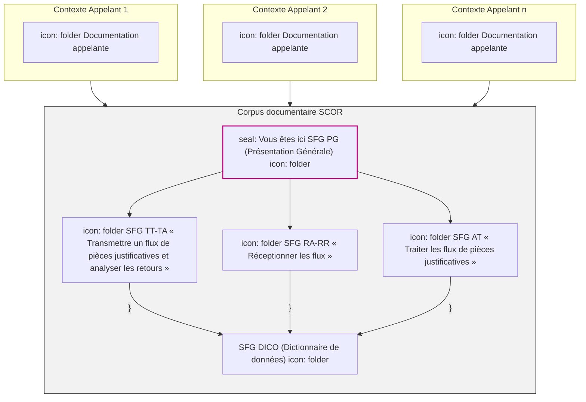

**Figure 1 : Corpus documentaire SCOR**

Le corpus documentaire SCOR comprend :

- Le présent document de Présentation Générale **[PG]** dont l’objectif est de décrire le système SCOR indépendamment de son usage.
- Le dictionnaire de données **[DICO]** dont l’objectif est de centraliser l’ensemble des informations concernant le modèle de données, les données et entités fonctionnelles, les cycles de vie ainsi que les listes de valeurs.
- La spécification fonctionnelle générale des fonctionnalités TT et TA **[TT-TA]** dont l’objectif est de décrire en détail les fonctionnalités du Poste de Travail.
- La spécification fonctionnelle générale des fonctionnalités RA et RR **[RA-RR]** dont l’objectif est de décrire en détail les fonctionnalités de l’Organisme Concentrateur Technique.
- La spécification fonctionnelle générale des fonctionnalités AT **[AT]** dont l’objectif est de décrire en détail les fonctionnalités du Point d’Accueil Inter-Régimes.

*23/11/2018* *GIE SESAM-Vitale* 
 icon: SESAM-Vitale logo 6 / 52
*Ce document à diffusion restreinte ne peut être diffusé sans l'autorisation d'une personne habilitée au GIE SESAM-Vitale*

*SFG - SCOR - Télétransmission des pièces justificatives - Version 2.12.01*
*SCOR-SFG-002 PG - Présentation Générale Version : 1.24*

## **1.3** **Contenu du document**

Ce document contient la description générale du système ainsi que la description générale du processus global « Traiter les flux de PJ ». Ce document précise également la situation spécifique du recours à un OCT (situation référencée SP12 dans la suite du document).

Il présente, d’une part le système de numérisation et de télétransmission des PJ par les professionnels de santé, et d’autre part le système de réception, de contrôle et de mise à disposition de l’assurance maladie obligatoire de ces flux par le Point d’Accueil Inter-Régimes (PAIR).

## **1.4** **Documents de référence**

<table>
  <thead>
    <tr>
      <th><b>Document</b></th>
      <th><b>Type et titre</b></th>
      <th><b>Référence</b></th>
    </tr>
  </thead>
  <tbody>
    <tr>
      <td>DICO</td>
      <td>SCOR - DICO (Dictionnaire de données)</td>
      <td>SCOR-SFG-006</td>
    </tr>
    <tr>
      <td>TT-TA</td>
      <td>SCOR - TT-TA « Transmettre un flux de PJ et analyser les retours »</td>
      <td>SCOR-SFG-003</td>
    </tr>
    <tr>
      <td>RA-RR</td>
      <td>SCOR - RA-RR « Réceptionner les flux »</td>
      <td>SCOR-SFG-005</td>
    </tr>
    <tr>
      <td>AT</td>
      <td>SCOR - AT« Traiter les flux de PJ »</td>
      <td>SCOR-SFG-004</td>
    </tr>
    <tr>
      <td>CDC SCANORDO</td>
      <td>Cahier des Charges du projet &#x3C; SCannérisation des ORdonnances chez les Pharmaciens ></td>
      <td>A06C -2010B611</td>
    </tr>
    <tr>
      <td>Protocole d’échange SEH SCOR</td>
      <td>PROJET SCOR – Contrat d’échange SEH Dernière version disponible à l’adresse suivante : [http://www.ameli.fr/l-assurance-maladie/documentation-technique/transport-des-flux/numerisation-des-ordonnances.php](http://www.ameli.fr/l-assurance-maladie/documentation-technique/transport-des-flux/numerisation-des-ordonnances.php)</td>
      <td>Au 13 janvier 2016 : Version 4.00</td>
    </tr>
    <tr>
      <td>CDC B2</td>
      <td>NORMES B2 INTER-REGIMES Télétransmission de factures entre Professionnels de santé et Organismes d’Assurance Maladie</td>
      <td><i>Juin 2007 avec errata</i></td>
    </tr>
  </tbody>
</table>

## **1.5** **Abréviations**

<table>
  <thead>
    <tr>
      <th><b>Terme</b></th>
      <th><b>Définition</b></th>
    </tr>
  </thead>
  <tbody>
    <tr>
      <td>AMO</td>
      <td>Assurance Maladie Obligatoire</td>
    </tr>
    <tr>
      <td>ARL</td>
      <td>Accusé de Réception Logique</td>
    </tr>
    <tr>
      <td>CRL FE</td>
      <td>Critères de Regroupement en Lot de FE</td>
    </tr>
    <tr>
      <td>DSN</td>
      <td>(Anglais) Delivery Status Notification. Extension de SMTP permettant de savoir si un message a bien été distribué ou non (et dans ce cas, il indique précisément la nature de l'erreur).</td>
    </tr>
    <tr>
      <td>FE</td>
      <td>Facture Électronique</td>
    </tr>
    <tr>
      <td><u>LPS</u></td>
      <td><u>Logiciel du PS</u></td>
    </tr>
    <tr>
      <td>MOA</td>
      <td>Maîtrise d’OuvrAge</td>
    </tr>
    <tr>
      <td>OCT</td>
      <td>Organisme Concentrateur Technique</td>
    </tr>
    <tr>
      <td>PAIR</td>
      <td>Point d’Accueil Inter-Régimes</td>
    </tr>
    <tr>
      <td>PdT</td>
      <td>Poste de Travail du PS</td>
    </tr>
  </tbody>
</table>

*23/11/2018* *GIE SESAM-Vitale* 
 icon: icon *7 / 52*
*Ce document à diffusion restreinte ne peut être diffusé sans l'autorisation d'une personne habilitée au GIE SESAM-Vitale*

*SFG - SCOR - Télétransmission des pièces justificatives - Version 2.12.01*
*SCOR-SFG-002 PG - Présentation Générale Version : 1.24*

PJ Pièces Justificatives
PR Partenaire Réseau
PS Professionnel de Santé
SEH Système d’Échanges Harmonisés de l’Assurances maladies
SFD Spécifications Fonctionnelles Détaillées
SFG Spécifications Fonctionnelles Générales
SMTP (Anglais) Simple Mail Transfer Protocol (Protocole simple de transfert de courrier),
S/MIME (Anglais) Secured/Multipurpose Internet Mail Extensions
SV Système SESAM-Vitale

## **1.6** **Définitions**

<table>
  <thead>
    <tr>
      <th colspan="2">Définitions</th>
    </tr>
  </thead>
  <tbody>
    <tr>
      <td>Cas d’erreur</td>
      <td>Arrêt du fonctionnement du système.</td>
    </tr>
    <tr>
      <td>Documentation appelante</td>
      <td>Documentation qui « appelle » le processus SCOR et qui initialise les données nécessaires à SCOR en fonction de son contexte d’exécution (SESAM-Vitale, Transporteur, etc.)</td>
    </tr>
    <tr>
      <td>Facture électronique</td>
      <td>Facture réalisée soit 
        • dans le système SESAM Vitale (FSE) 
        • dans le système de facturation en ligne (FEL) 
        • dans le système IRIS/B2 (Facture non sécurisée)</td>
    </tr>
    <tr>
      <td>Dossier de PJ</td>
      <td>Dossier constitué des Pièces Justificatives et du fichier d’index SCANORDO. Cette notion de « dossier » est purement fonctionnelle et ne se traduit pas par l’existence dans la pièce jointe au mail transmis à l’AMO d’un dossier « physique » (répertoire ou autre).</td>
    </tr>
    <tr>
      <td>Message</td>
      <td>Message SMTP émis par le PR et qui ne comporte qu’une seule et unique pièce jointe (fichier physique).</td>
    </tr>
    <tr>
      <td>OCT Dépositaire d’ARL</td>
      <td>Organisme concentrateur Technique autorisé par le PS à recevoir les accusés réceptions logiques émis par le PAIR.</td>
    </tr>
    <tr>
      <td>OCT Routeur</td>
      <td>Organisme concentrateur Technique mandaté par le PS pour la transmission et la réception des flux SCOR avec le PAIR.</td>
    </tr>
    <tr>
      <td>Partenaire Réseau</td>
      <td>Identifiant du partenaire qui a émis le fichier de données (pour cette SFG, le <mark><u>PS PdT</u></mark> ou un organisme concentrateur technique).</td>
    </tr>
    <tr>
      <td>Pièces justificatives</td>
      <td>L’ensemble des documents justifiant auprès des AMO le remboursement des prestations délivrées par le PS (ordonnances, feuilles de soins papier CERFA, etc.).</td>
    </tr>
    <tr>
      <td><mark>PS</mark></td>
      <td><mark>Professionnel de Santé réalisant des feuilles de soins. Un PS peut être un PS libéral ou une structure de soins (ex : Officine, établissement public de santé, clinique privée….)</mark></td>
    </tr>
  </tbody>
</table>

*23/11/2018 GIE SESAM-Vitale* 
 icon: logo *8 / 52*
*Ce document à diffusion restreinte ne peut être diffusé sans l'autorisation d'une personne habilitée au GIE SESAM-Vitale*

*SFG - SCOR - Télétransmission des pièces justificatives - Version 2.12.01*
SCOR-SFG-002 *PG - Présentation Générale Version : 1.24*

<table>
  <thead>
    <tr>
      <th colspan="2"><b>Définitions</b></th>
    </tr>
  </thead>
  <tbody>
    <tr>
      <td rowspan="3">PAIR</td>
      <td>Point d’Accueil Inter-Régime SCOR</td>
    </tr>
    <tr>
      <td>Système développé et maintenu par le GIE SESAM VITALE qui permet, d’accueillir les PJ <mark>numériques <s>numérisées</s></mark> des PS, et de les restituer aux Assurances Maladies Obligatoires (AMO). Il effectue la transmission aux PR des ARL et des messages de service.</td>
    </tr>
    <tr>
      <td>Synonyme : Système d’accueil des flux</td>
    </tr>
  </tbody>
</table>

## **1.7** **Guide de lecture**

Cf. Annexe 1.

---
**Précision de**
**lecture**

Les fonctionnalités correspondantes seront identifiées par deux lettres :

*   La première lettre correspond à une des deux étapes citées ci-dessus,
*   la seconde lettre correspond au traitement effectué par le sous-système.

*Exemple pour le PAIR <u>le traitement « Traiter</u> les flux de PJ », inclus dans l’étape « Accueillir les flux de PJ ~~numériques~~<u>numérisées</u>», sera préfixé « AT ».*

Le corpus documentaire propose des tableaux explicitant la manière dont les entités fonctionnelles sont alimentées dans le processus SCOR. Ces tableaux se présentent sous la forme suivante :

<table>
  <thead>
    <tr>
      <th colspan="2"><b>Données renseignées</b></th>
      <th>←</th>
      <th><b>Avec</b></th>
    </tr>
  </thead>
  <tbody>
    <tr>
      <td>Date de naissance bénéficiaire</td>
      <td>EF_MA_017 _03</td>
      <td>←</td>
      <td><strong><em>EF_PA_001_12</em></strong></td>
    </tr>
  </tbody>
</table>

Dans cet exemple, la date de naissance du bénéficiaire (données d’entrées SCOR stockées dans l’entité fonctionnelle EF_PA_001) vient alimenter l’attribut « 03 » de l’entité fonctionnelle Bénéficiaire facture (EF_MA_017)

*23/11/2018* *GIE SESAM-Vitale* 
 icon: icon 9 / 52
*Ce document à diffusion restreinte ne peut être diffusé sans l'autorisation d'une personne habilitée au GIE SESAM-Vitale*

*SCOR-SFG-002*
*SFG - SCOR - Télétransmission des pièces justificatives - Version 2.12.01*
*PG - Présentation Générale*
*Version : 1.24*

# 2 **PERIMETRE SFG**

## 2.1 **Contexte et périmètre du système décrit dans la SFG**

Le système SCOR s’adresse aux PS qui transmettent des FE à l’AMO. Le système leur permet de transmettre des PJ liées à ces FE.

## 2.2 **Acteurs et objectifs métier**

Ce paragraphe décrit :
* les acteurs interagissant avec le système décrit dans cette SFG,
* les objectifs métiers qui justifient l’utilisation du système,
* et le croisement entre les acteurs et les objectifs métiers.

**Acteurs externes**

<table>
  <thead>
    <tr>
      <th>Nom</th>
      <th>Définition du rôle</th>
    </tr>
  </thead>
  <tbody>
    <tr>
      <td><strong><b>Professionnel</b> <b>de santé ou PS</b></strong></td>
      <td>Le PS réalise la numérisation des PJ et les transmet aux organismes d’AMO.</td>
    </tr>
    <tr>
      <td><strong><b>Organisme</b> assurance maladie <b>obligatoire ou</b> AMO</strong></td>
      <td>Cet acteur regroupe l’ensemble des organismes d’AMO accueillant des factures électroniques. Il reçoit, contrôle, traite et assure l’archivage des PJ <mark><s>numériques numérisées.</s></mark></td>
    </tr>
  </tbody>
</table>

<u>Note</u> : il s’agit des PS « exécutants » uniquement et ayant la faculté technique de numériser les PJ.

<u>Note</u> : les organismes d’assurance maladie gérant uniquement la part complémentaire sont hors périmètre de ces SFG.

**Sous-systèmes**

<table>
  <thead>
    <tr>
      <th>Nom</th>
      <th>Définition du rôle</th>
    </tr>
  </thead>
  <tbody>
    <tr>
      <td><strong><b>Poste de travail</b> <b>ou PdT</b></strong></td>
      <td>Sous-système en charge de la numérisation des PJ et de leur télétransmission vers les AMO.</td>
    </tr>
    <tr>
      <td><strong><b>PAIR</b></strong></td>
      <td>Sous-système en charge d’accueillir les PJ <mark>numériques</mark> <mark><s>numérisées</s></mark> en provenance des PS. Sous-système en lien direct avec les PdT des PS et l’AMO.</td>
    </tr>
  </tbody>
</table>

**Objectifs **d’utilisation du** système**

Dans le cadre de cette <u>SFG, l’objectif métier</u> justifiant l’utilisation du système est le traitement des flux de PJ <mark><u>numériques numérisées.</u></mark>

**Croisement objectifs / acteurs**

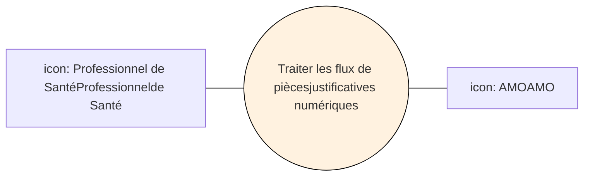

**Figure 2 : Diagramme de "**Traiter les flux de pièces** justificatives»**

*23/11/2018*
*GIE SESAM-Vitale* 
 icon: SESAM-Vitale logo 10 / 52
*Ce document à diffusion restreinte ne peut être diffusé sans l'autorisation d'une personne habilitée au GIE SESAM-Vitale*

*SFG - SCOR - Télétransmission des pièces justificatives - Version 2.12.01*
*SCOR-SFG-002 PG - Présentation Générale Version : 1.24*

# **2.3** **Description générale du processus « Traiter les flux de PJ »**

## **2.3.1** **Cadrage fonctionnel**

**Préconditions**
L’ensemble des acteurs, qui ont un lien direct avec le PAIR (le PdT et les AMO), doit être identifié par ce dernier et reconnu comme des acteurs du système.

**Événement déclencheur**
Le PS <mark>a numérisé</mark> ~~numérise~~ les PJ suite à la délivrance de prestations pour un bénéficiaire de soins donné.

**Description**
Le processus doit être en mesure :
* Pour les flux de PJ du PS, de :
    * *<mark>Traiter les PJ numériques</mark> ~~papier~~* pour transmission au PAIR. Cette fonctionnalité inclut ~~le contrôle, la création,~~ la mise en Lot, le stockage, la transmission des PJ <mark>numériques numérisées</mark> et le contrôle de la bonne réception du flux par l’AMO.
* Pour les flux de PJ <mark>numérisées</mark> reçus par le PAIR, de :
    * *<mark>Accueillir les flux de PJ numériques</mark> ~~numérisées~~*. Cette fonctionnalité inclut la réception, le contrôle et la mise à disposition aux AMO du Lot de PJ <mark>numérisées</mark>.

**Contraintes**
Le processus de transmission des PJ dans le cadre de SCOR ne doit pas altérer ou modifier le processus d’émission des FE.

**Données en entrée**
Les données d’entrées du système sont les PJ <mark>numériques</mark> en possession du PS.
<mark><u>Les PJ numériques peuvent être obtenues soit par numérisation d’une PJ papier, soit par</u> <u>création via le LPS.</u></mark>

**Résultat**
Le résultat est le traitement <mark><u>des flux</u></mark> de PJ par le PAIR et le traitement d’un message de service ou d’un ARL par le <mark>LPS PdT</mark>.

**Post-conditions**
Toutes les PJ <mark>numériques numérisées</mark> créées par le <mark>LPS PdT</mark> sont prises en compte par le PAIR.

*23/11/2018 GIE SESAM-Vitale* 
icon: GIE SESAM-Vitale logo *11 / 52*
*Ce document à diffusion restreinte ne peut être diffusé sans l'autorisation d'une personne habilitée au GIE SESAM-Vitale*

*SFG - SCOR - Télétransmission des pièces justificatives - Version 2.12.01*
*SCOR-SFG-002* *PG - Présentation Générale* *Version : 1.24*

## **2.3.2** **Description du processus d’utilisation du système**

```mermaid
graph TD
    subgraph ":PdT"
        Start(( )) -->|Début| TT["TT : Transmettre un flux de pièces justificatives"]
        PJ[Pièces justificatives numériques] --> TT
        TA["TA : Analyser les retours"] --> End(( ))
        End ---|Fin| EndLabel[ ]
    end

    subgraph ":Système d'accueil des flux (PAIR)"
        TT --> AT["AT : Traiter les flux de pièces justificatives"]
        AT --> TA
    end

    subgraph ":AMO"
        LJ[Lots de justificatifs] --> AT
    end

    style Start fill:#000,stroke:#000
    style End fill:#000,stroke:#000,stroke-width:4px
    style PJ fill:#E67E22,stroke:#000
    style LJ fill:#E67E22,stroke:#000
    style TT fill:#C0CA33,stroke:#000
    style AT fill:#C0CA33,stroke:#000
    style TA fill:#C0CA33,stroke:#000
```

**Figure 3 : Exemple de processus d'utilisation du système**

---
### **Scénarios**

#### ***Présentation***

Les scénarios de déroulement possible du processus sont les suivants :

<table>
  <thead>
    <tr>
      <th></th>
      <th><b>Nom</b></th>
      <th>Description</th>
    </tr>
  </thead>
  <tbody>
    <tr>
      <td>1</td>
      <td>Contrôle positif du PAIR sur les documents constituant le Lot de PJ <b><b>(Nominal)</b></b></td>
      <td>Le PAIR émet un ARL SCOR positif informant le PS que son Lot de PJ a bien été reçu par l’AMO.</td>
    </tr>
    <tr>
      <td>2</td>
      <td>Contrôle négatif du PAIR sur le Lot de PJ.</td>
      <td>A la réception du message contenant le Lot de PJ numérisés, le PAIR effectue une série de contrôles techniques. Si l’un des contrôles est négatif, le PAIR émet un retour qui peut être : • Soit un message de service s’il y a une erreur au niveau :     • du chiffrement,     • de la décompression,     • des entêtes SMTP et de leurs contenus. • Soit un ARL négatif, s’il y a une erreur au niveau d’un des documents constituant le Lot de PJ numérisés. Si le PAIR émet un message de service, le processus est arrêté pour l’ensemble du message reçu et le PAIR passe au message suivant.</td>
    </tr>
  </tbody>
</table>

*23/11/2018* *GIE SESAM-Vitale* 
 icon: icon 12 / 52
*Ce document à diffusion restreinte ne peut être diffusé sans l'autorisation d'une personne habilitée au GIE SESAM-Vitale*

*SFG - SCOR - Télétransmission des pièces justificatives - Version 2.12.01*
*SCOR-SFG-002* *PG - Présentation Générale* *Version : 1.24*

<table>
    <tr>
      <td></td>
      <td></td>
      <td>Si le PAIR émet un ARL négatif de niveau entête ENTSCANORDO, le processus n’effectue pas les contrôles sur les autres documents du message (index et PJ <mark>numériques numérisées</mark>).</td>
    </tr>
    <tr>
      <td><i><b>3</b></i></td>
      <td>Le PS opte pour la gravure sur CDROM à la place de la télétransmission</td>
      <td>Le PS a configuré son <mark>LPS PdT</mark> pour permettre la gravure des Lots de PJ à la place de la télétransmission.</td>
    </tr>
    <tr>
      <td><i><b>4</b></i></td>
      <td>Contrôle négatif sur le Lot de FE associé au Lot de PJ</td>
      <td>Le PS a transmis son Lot de FE et son Lot de PJ, si le PS reçoit de la part du frontal un ARL négatif pour le Lot de FE, le PS doit recréer un nouveau Lot de PJ avec la présence des PJ dans le nouveau Lot créé (pas de transmission d’identifiant).</td>
    </tr>
</table>

**Impact processus**

<table>
  <thead>
    <tr>
      <th rowspan="1"><b>Scénarios</b>    <b>Fonctionnalités</b></th>
      <th>1</th>
      <th>2</th>
      <th>3</th>
      <th>4</th>
    </tr>
  </thead>
  <tbody>
    <tr>
      <td><strong><b>TT :</b></strong> Transmettre les PJ</td>
      <td>X</td>
      <td>X</td>
      <td>X (TT05)</td>
      <td>X</td>
    </tr>
    <tr>
      <td><strong>AT :</strong> Traiter les flux de PJ <mark>numériques</mark> <mark><s>numérisées</s></mark></td>
      <td>X</td>
      <td>S</td>
      <td></td>
      <td>X</td>
    </tr>
    <tr>
      <td><strong>TA :</strong> Analyser les retours</td>
      <td>X</td>
      <td>X</td>
      <td></td>
      <td>X</td>
    </tr>
  </tbody>
</table>

X ➔ Fonctionnalité utilisé normalement (scénario nominal)
S ➔ Arrêt du processus

<u>Note</u> : Le processus est arrêté dès lors qu’un des contrôles du PAIR est négatif et engendre <u>un message </u> de service ou un ARL négatif pour l’entête ENTSCANORDO du Lot de PJ <mark><u>numérisées.</u></mark>

## **2.4** **Vue synthétique d’architecture système**

**Définition du système**

Le système a pour rôle :

*   de <mark>créer contrôler</mark> les PJ <mark>numériques numérisées via le PS</mark>,
*   de transmettre vers les AMO les PJ <mark>numériques numérisées</mark> s du PS ou l’identifiant d’une PJ déjà transmise par le PS est qui a fait l’objet d’un ARL positif,
*   d’accueillir les flux de PJ <mark><u>numériques numérisées</u></mark> en provenance du PS,
*   d’informer le PS de la qualité « technique » de son flux (ARL ou message de service) à sa réception par le PAIR,
*   de traiter le retour « technique » de l’AMO par le PS (traitement des ARL ou message de service).

*23/11/2018* *GIE SESAM-Vitale* 
 icon: SESAM-Vitale logo 13 / 52
*Ce document à diffusion restreinte ne peut être diffusé sans l'autorisation d'une personne habilitée au GIE SESAM-Vitale*

*SCOR-SFG-002* *SFG - SCOR - Télétransmission des pièces justificatives - Version 2.12.01*
*PG - Présentation Générale* *Version : 1.24*

## **Contexte statique**

Ce paragraphe présente le système spécifié dans le cadre des SFG et ses liens avec les utilisateurs et les systèmes externes.

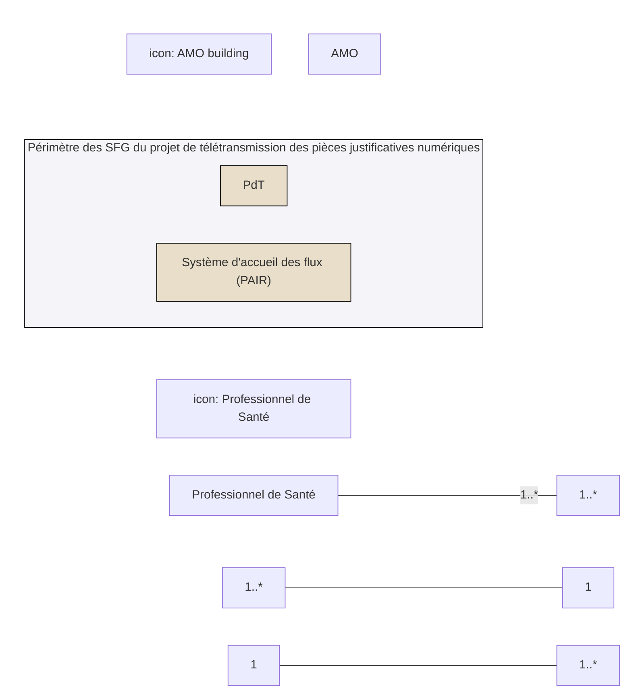

**Figure 4 : diagramme de contexte statique**

## **Description des échanges**

Ce paragraphe présente les échanges avec le PS et les deux sous-systèmes PdT et PAIR dans le cadre du processus « Traiter les flux de PJ ».

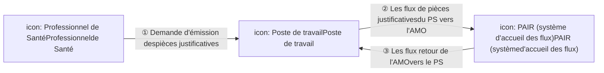

**Figure 5 : échanges entre le PS et les sous-systèmes PdT et PAIR**

## **Contexte dynamique**

Ce paragraphe présente les échanges dans le cadre du processus « Traiter les flux de PJ ».

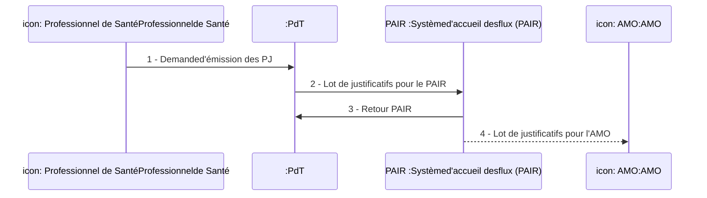

**Figure 6 : diagramme de contexte dynamique**

## **2.5 Description des situations particulières**

La description complète des impacts de la situation particulière SP12 est décrite dans [TT TA] (au titre de l’impact que SP12 induit sur les fonctionnalités du <u>LPS PdT</u>) et dans [RA RR] (au titre de l’impact que SP12 induit sur le processus général).

*23/11/2018* *GIE SESAM-Vitale* 
 icon: GIE SESAM-Vitale logo *14 / 52*
*Ce document à diffusion restreinte ne peut être diffusé sans l'autorisation d'une personne habilitée au GIE SESAM-Vitale*

*SFG - SCOR - Télétransmission des pièces justificatives - Version 2.12.01*
*SCOR-SFG-002* *PG - Présentation Générale* *Version : 1.24*

## **2.5.1** **SP12 : Description générale du système dans le cas du recours à un OCT**

### **2.5.1.1** **Définition du système et de son contexte statique**

**Définition du système**

Dans le cas du recours à un OCT, tout ou partie des échanges entre le PdT et le PAIR passe par l’OCT.

*Description des sous-systèmes intervenant dans la SP12*

<table>
  <thead>
    <tr>
      <th><b>Nom</b></th>
      <th><b>Définition du rôle</b></th>
    </tr>
  </thead>
  <tbody>
    <tr>
      <td><strong>OCT</strong></td>
      <td>Sous système, sous la responsabilité des PS, assurant les fonctions intermédiaires : 
        ● soit d’acheminement des flux entre les PS et le PAIR (OCT Routeur), 
        ● soit uniquement la réception des accusés réception Technique à destination des PS (OCT dépositaire d’ARL). 
         
        Ce sous système est optionnel et son utilisation relève d’un choix du PS.</td>
    </tr>
  </tbody>
</table>

**Contexte statique**

Ce paragraphe présente le système spécifié dans le cadre des SFG et ses liens avec les utilisateurs et les systèmes externes.

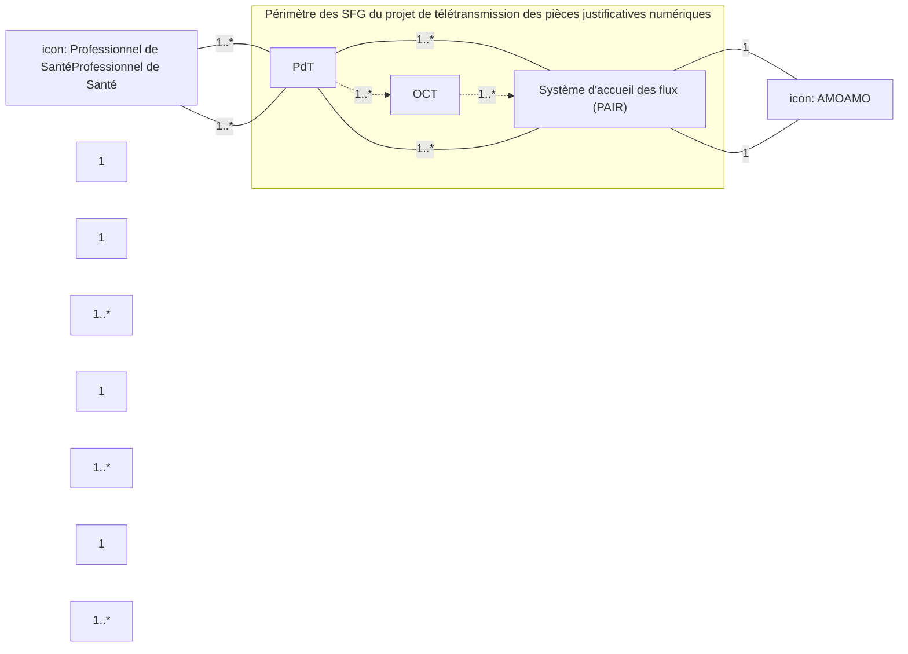

**Figure 7 : diagramme de contexte statique**

### **2.5.1.2** **Définition du système et de son contexte dynamique**

Ce paragraphe présente les impacts sur le système spécifié dans ces SFG et les échanges avec les acteurs externes (humains ou systèmes) dans le cas où le PS opte pour l’utilisation des services d’un OCT.

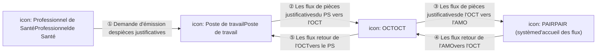

Figure 8 : échanges entre le PS et les sous-systèmes PdT, OCT et PAIR

**Figure 8 : échanges entre le PS et les sous-systèmes PdT, OCT et PAIR**

*23/11/2018* *GIE SESAM-Vitale* 
 icon: GIE SESAM-Vitale logo 15 / 52
*Ce document à diffusion restreinte ne peut être diffusé sans l'autorisation d'une personne habilitée au GIE SESAM-Vitale*

*SFG - SCOR - Télétransmission des pièces justificatives - Version 2.12.01*
SCOR-SFG-002 *PG - Présentation Générale Version : 1.24*

# **Scénarios d’échange**

Deux scénarios d’échange sont possibles pour la transmission d’un flux Aller et la réception du flux Retour correspondant :

<table>
  <thead>
    <tr>
      <th>Scénario</th>
      <th><b>Description</b></th>
    </tr>
  </thead>
  <tbody>
    <tr>
      <td><strong><b>Scénario 1</b></strong> <strong><b>« OCT routeur »</b></strong></td>
      <td>Le PS transmet ses lots de PJ vers le PAIR via l’OCT.  Le PAIR envoie les éventuels messages de rejet a l’OCT qui les retransmet au PS.  Concernant les ARL, 3 cas de figure : 1. Le PAIR envoie les ARL au PS. 2. Le PAIR envoie les ARL à l’OCT qui les retransmet au PS. 3. Le PAIR envoie les ARL au PS et à l’OCT qui ne les retransmet pas au PS.</td>
    </tr>
    <tr>
      <td><strong><b>Scénario 2</b></strong> <strong>« OCT <b>dépositaire d’ARL»</b></strong></td>
      <td>Le PS transmet ses lots de PJ directement vers le PAIR.  Le PAIR envoie les éventuels messages de rejet directement au PS.  Concernant les ARL, 3 cas de figure : 1. Le PAIR envoie les ARL au PS. 2. Le PAIR envoie les ARL à l’OCT qui les retransmet au PS. 3. Le PAIR envoie les ARL au PS et à l’OCT qui ne les retransmet pas au PS.</td>
    </tr>
  </tbody>
</table>

# **Choix du scénario d’échange**

## ***Principes***

Le choix de l’utilisation d’un OCT appartient au PS, dans le respect des principes suivants :

*   Exigence 1 : Acceptation des flux qu’à partir du CDC SCOR Editeurs V2
*   Exigence 2 : Réversibilité entre le mode d’échange direct *(sans OCT)* et le mode via OCT *(*Routeur ou Dépositaire d’ARL*)*
*   Exigence 3 : Minimisation des impacts vers les éditeurs
*   Exigence 4 : Délai de retransmission par l’OCT réduit au jour de réception
*   Exigence 5 : Liberté du choix de son OCT pour le Professionnel de Santé
*   Exigence 6 : Identifiant de l'OCT identique à celui utilisé pour SESAM Vitale
*   Exigence 7 : Messagerie électronique SMTP
*   Exigence 8 : Retransmission du Lot de PJ et des ARL sans intervention de l’OCT
*   Exigence 9 : Retransmission de l’ARL SCOR selon le choix du PS
*   Exigence 10 : Retransmission des messages de service rejet ou chiffrement au PS
*   Exigence 11 : Compression des Flux

La description de ces principes et leurs éléments de mise en œuvre sont décrits dans le document [RA-RR].

*23/11/2018 GIE SESAM-Vitale* 
 icon: logo 16 / 52
*Ce document à diffusion restreinte ne peut être diffusé sans l'autorisation d'une personne habilitée au GIE SESAM-Vitale*

*SFG - SCOR - Télétransmission des <u>pièces justificatives</u> - Version 2.12.01*
*SCOR-SFG-002* *PG - Présentation Générale* *Version : 1.24*

## ***Flux transmis***

L’OCT n’a pas la possibilité de modifier, de concaténer ou d’éclater un Lot de PJ reçus d’un PS, ni un retour émis par le PAIR.

---

## **Contexte contractuel**

Le PS, disposant d’un <u>logiciel progiciel</u> agréé SESAM-Vitale, a la possibilité d’opter pour une télétransmission via un OCT ou d’opter pour que l’OCT reçoive les accusés réceptions liés aux flux SCOR.

Le **Professionnel** **de Santé** est lié contractuellement à cet OCT.

Les règles régissant les OCT et décrites dans le corpus documentaire SCOR ne sont pas opposables.

---

## **Contexte dynamique OCT**

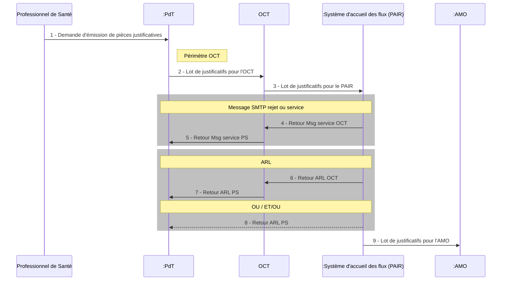

Figure 9 : Schéma de Contexte dynamique – OCT Routeur

**Figure 9 : Schéma de Contexte dynamique – OCT Routeur**

*23/11/2018* *GIE SESAM-Vitale* 
 icon: GIE SESAM-Vitale logo 17 / 52
*Ce document à diffusion restreinte ne peut être diffusé sans l'autorisation d'une personne habilitée au GIE SESAM-Vitale*

*SFG - SCOR - Télétransmission des pièces justificatives - Version 2.12.01*
*SCOR-SFG-002 PG - Présentation Générale Version : 1.24*

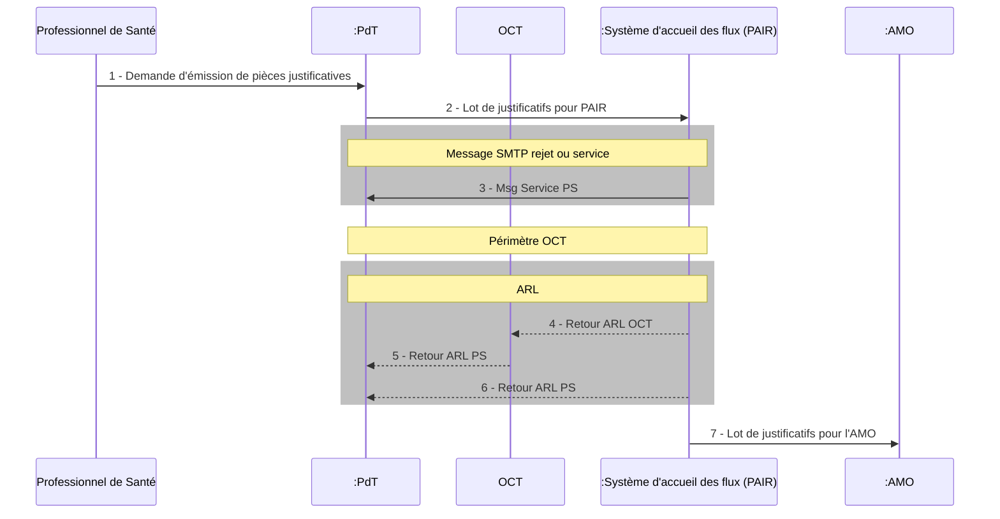

**Figure 10 : Schéma de Contexte dynamique – OCT Dépositaire d’ARL**

## 2.5.2 **Description générale du processus « Traiter les flux de PJ » dans le cas du recours à un OCT**

### 2.5.2.1 **Impact du sous-système OCT sur le descriptif du processus**

Ce paragraphe présente les impacts sur le système spécifié dans ses SFG et les échanges avec les acteurs externes (humains ou systèmes) dans le cas où le PS opte pour utilisation les services des OCT (routeur ou dépositaire d’ARL).

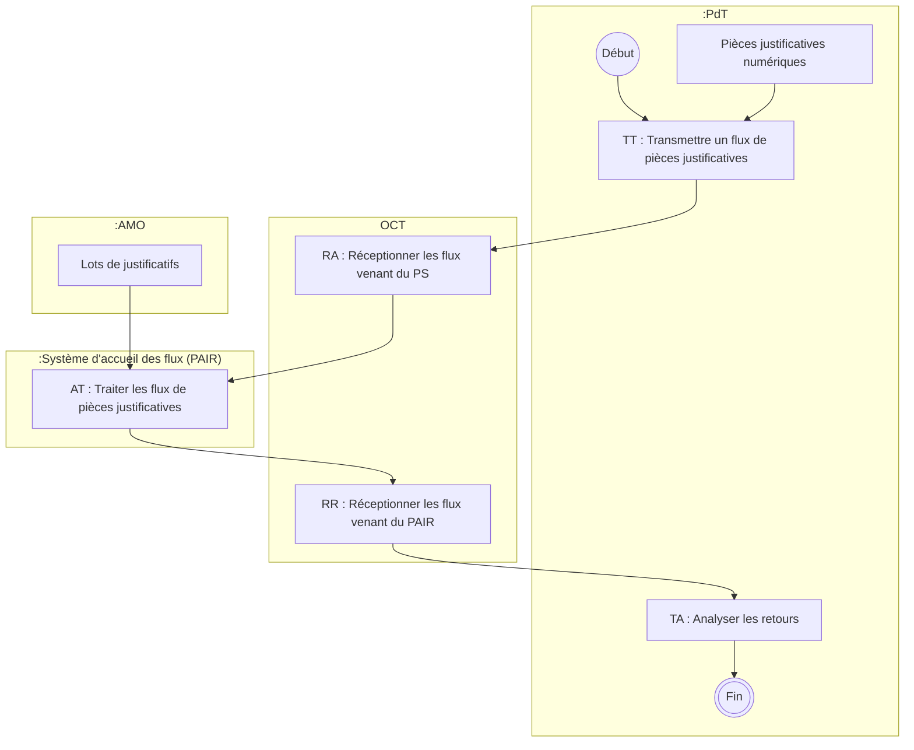

**Figure 11 : Exemple de processus d’utilisation du système avec les OCT**

**Scénarios**

En fonction du choix du PS d’opter pour l’une des options de télétransmission via un OCT (Routeur ou dépositaire d’ARL), l’OCT doit mettre en place les fonctionnalités suivantes :

*23/11/2018 GIE SESAM-Vitale* 
 icon: icon 18 / 52
*Ce document à diffusion restreinte ne peut être diffusé sans l'autorisation d'une personne habilitée au GIE SESAM-Vitale*

SFG - SCOR - Télétransmission des pièces justificatives - Version 2.12.01
SCOR-SFG-002 PG - Présentation Générale Version : 1.24

<table>
  <thead>
    <tr>
      <th rowspan="2"><i>Option OCT</i></th>
      <th colspan="2"><b><b>Fonctionnalité à mettre en place par l’OCT</b></b></th>
    </tr>
    <tr>
      <th><b>RA : Réceptionner les flux PS</b></th>
      <th><b>RR : Réceptionner les flux PAIR</b></th>
    </tr>
  </thead>
  <tbody>
    <tr>
      <td><i>OCT Routeur</i></td>
      <td>Oui</td>
      <td>Oui</td>
    </tr>
    <tr>
      <td><i>OCT Dépositaire d’ARL</i></td>
      <td>Non</td>
      <td>Oui</td>
    </tr>
  </tbody>
</table>

23/11/2018 GIE SESAM-Vitale 
 icon: icon 19 / 52
Ce document à diffusion restreinte ne peut être diffusé sans l'autorisation d'une personne habilitée au GIE SESAM-Vitale

*SFG - SCOR - Télétransmission des pièces justificatives - Version 2.12.01*
*SCOR-SFG-002* *PG - Présentation Générale* *Version : 1.24*

# **2.6** **Description des flux**

La description des flux, du modèle de données, des entités fonctionnelles et des cycles de vie sont explicités dans le document [DICO].

## **2.6.1** **Les flux de PJ du PS vers l’AMO**

### **2.6.1.1** **Message (EF_MA_001)**

**À un message correspond un seul Lot de PJ.**

| icon: envelope | Message |
| :--- | :--- |
| icon: red toolbox with wrench | 1 Lot de PJ |

**Figure 12 : représentation du Message**

**Un message est constitué d’une pièce jointe compressée contenant le Lot de PJ (EF_MA_003)**

---

### **2.6.1.2** **Lot (EF_MA_003)**

**Un Lot de PJ est constitué de :**

*   **Un entête ENTSCANORDO non chiffré (EF_MA_004)**
*   **Des Dossiers de PJ (EF_MA_014)**

| Lot de PJ                                   |
| :------------------------------------------ |
| icon: toolbox 1 entête ENTSCANORDO |
| icon: folders 0 à n Dossier de PJ  |

**Figure 13 : représentation du Lot de PJ**

**À un Lot de FE correspond un à plusieurs Dossiers de PJ.** Le <mark><u>logiciel</u></mark> PdT du PS <u>**(LPS)**</u> réalise la mise en Lot des Dossiers de PJ (liés à un Lot de FE) pour envoi au PAIR.

icon: documents stack { icon: red toolboxes stack

1 Lot de FE                 1 à n Lot(s) de PJ

**Figure 14 : correspondance entre le lot de FE et les lots de PJ**

---

### **2.6.1.3** **Dossier (EF_MA_014)**

**Un Dossier de PJ est constitué de :**

*   **Un index SCANORDO chiffré (EF_MA_015)**
*   **Des PJ <mark><u>numériques numérisées</u></mark> et chiffrées (EF_MA_019)**

*23/11/2018* *GIE SESAM-Vitale* 
 icon: GIE SESAM-Vitale logo *20 / 52*
*Ce document à diffusion restreinte ne peut être diffusé sans l'autorisation d'une personne habilitée au GIE SESAM-Vitale*

*SFG - SCOR - Télétransmission des pièces justificatives - Version 2.12.01*
*SCOR-SFG-002* *PG - Présentation Générale* *Version : 1.24*

| Dossier de PJ |
| :--- |
| illustration: dossier **Dossier de PJ** |
| illustration: document **1 index SCANORDO** |
| illustration: fichiers PDF <u>**0 à n</u> PJ numériques** |

**Figure 15 : représentation du dossier de PJ**

Le PS exécutant doit numériser les PJ papier, pour établir une PJ <mark><u>numérisée ou demander</u> à <u>son</u> <u>LPS</u> la <u>création</u> <u>de la PJ</u> numérique</mark> (EF_MA_019). Une PJ <mark><u>numérique numérisée</u></mark> ne concerne qu’un seul type de nature de PJ. Le PS peut transmettre ces PJ ou bien l’identifiant d’une ou plusieurs PJ qui ont fait précédemment l’objet d’un acquittement positif de la part de l’AMO. A <mark><u>cette</u></mark> ou ces PJ <mark><u>numériques numérisées</u></mark> et/ou le ou les identifiants de PJ est associé un index SCANORDO formant ainsi un Dossier de PJ pour une FE.

**À une FE correspond un seul Dossier de PJ.**

1 FE icon: stack of papers $\left. \vphantom{\text{1 Dossier de PJ}} \right\}$ icon: yellow folder 1 Dossier de PJ

**Figure 16 : correspondance entre la FE et le dossier de PJ**

<u>Note</u> : un Dossier de PJ peut donner lieu à l’envoi de plusieurs Lots de PJ.

## 2.6.2 Les flux retours de l’AMO vers le PS

### **2.6.2.1** **Message retour PR (EF_MR_001)**

Après transmission des messages contenant les Lots de PJ, le PS reçoit dans sa boîte aux lettres des messages SMTP émis par le PAIR. Ces messages SMTP peuvent être soit des messages de service (« rejet » ou « chiffrement »), soit des messages d’ARL.

**À un message retour PR correspond un seul message aller et ne concerne donc qu’un seul Lot de PJ.**

**Un message retour PR ARL est constitué d’une pièce jointe constitué de :**

*   **Un fichier d’entête ARL (EF_MR_007)**
*   **Un fichier de diagnostic ARL (EF_MR_014) portant sur**
    *   **l’entête ENTARLSCANORDO du Lot et**
    *   **chaque Dossier de PJ**

illustration: envelope Message retour PR ARL

*   illustration: document 1 entête ENTARLSCANORDO
*   illustration: document with gear 1 diagnostic ARLSCANORDO

**Figure 17 : représentation du messager retour PR ARL**

*23/11/2018* *GIE SESAM-Vitale* 
 icon: GIE SESAM-Vitale logo 21 / 52
*Ce document à diffusion restreinte ne peut être diffusé sans l'autorisation d'une personne habilitée au GIE SESAM-Vitale*

*SFG - SCOR - Télétransmission des pièces justificatives - Version 2.12.01*
SCOR-SFG-002 *PG - Présentation Générale* Version : 1.24

# **ANNEXES**

23/11/2018 GIE SESAM-Vitale 
icon: GIE SESAM-Vitale logo 22 / 52
*Ce document à diffusion restreinte ne peut être diffusé sans l'autorisation d'une personne habilitée au GIE SESAM-Vitale*

*SFG - SCOR - Télétransmission des pièces justificatives - Version 2.12.01*
*SCOR-SFG-002 PG - Présentation Générale Version : 1.24*

# ANNEXE 1 GUIDE DE LECTURE

## **Indications dans la marge**

icon: hand pointing Les éléments importants et les remarques sont indiqués par une main dans la marge.

icon: question mark Les questions importantes sont indiquées par un point d’interrogation dans la marge.

icon: exclamation mark Les alertes importantes sont indiquées par ce pictogramme dans la marge.

icon: document reference Les références documentaires sont indiquées par ce pictogramme dans la marge.

## **Codes couleur**

Les codes couleur suivants sont utilisés dans ce document :

*   <mark><u>Texte surligné jaune</u></mark> = texte ajouté par rapport à la version précédente
*   ~~x~~ Texte barré = texte supprimé
*   <mark><u>Texte surligné vert</u></mark> = texte à revoir
*   Texte de couleur bleu <mark><u>ou surligné en bleu</u></mark> = texte à revoir avec les membres

Pour les diagrammes les codes couleur sont les suivants :

Ces 3 styles sont distinguables par leur fond :

|                     gris clair                     |            gris foncé            |              blanc             |
| :------------------------------------------------: | :------------------------------: | :----------------------------: |
| icon: Elément normal (couleur par défaut) | icon: Elément important | icon: Elément externe |
|       **Elément normal (couleur par défaut)**      |       **Elément important**      |       **Elément externe**      |

Ces 3 styles sont distinguables par leur contour :

|        noir épaisseur 2        |             (aucun)             |             blanc épaisseur 2            |
| :----------------------------: | :-----------------------------: | :--------------------------------------: |
| icon: Elément modifié | icon: Elément à revoir | icon: Elément à revoir avec MOA |
|       **Elément modifié**      |       **Elément à revoir**      |       **Elément à revoir avec MOA**      |

Ces éléments sont temporaires. Ils n'apparaissent pas dans les versions finalisées.

## **Exigences fonctionnelles**

Par défaut, la totalité de ce document est constituée d’exigences fonctionnelles.

Cinq exceptions sont à noter :

*   Dans les processus, il est possible de citer des étapes sans utilisation du système (fonctionnalités typées « métier »),
*   Les règles de gestion de type « métier », « consigne utilisateur » ou « convention » ne font pas partie des exigences fonctionnelles (elles ne sont pas prises en charge par le système),
*   Les illustrations et les exemples ne font également pas partie des exigences fonctionnelles. Ils sont précédés par la mention « Illustration » en marge. Il est également possible d’utiliser une étiquette « Préambule ».
*   Les recommandations pour les développeurs et les éditeurs,

*23/11/2018* 
 icon: logo *GIE SESAM-Vitale* 23 / 52
*Ce document à diffusion restreinte ne peut être diffusé sans l'autorisation d'une personne habilitée au GIE SESAM-Vitale*

*SFG - SCOR - Télétransmission des pièces justificatives - Version 2.12.01*
*SCOR-SFG-002 PG - Présentation Générale Version : 1.24*

# **Références**

Certains éléments dans ce document sont référencés à l’aide d’un identifiant unique au sein de ce document. Les références suivantes sont utilisées :

* RG_... pour les règles de gestion,
* EF_... pour les entités fonctionnelles,
* CE_... pour les cas d’erreur (arrêt du fonctionnement du système),
* CP_… pour les cas particuliers (pas d’arrêt du fonctionnement du système),
* …

Ces références sont utilisées pour faire des renvois explicites vers les éléments concernés.

NB : pour une donnée unitaire, on ajoute l’indice de cette donnée à la référence de l’entité fonctionnelle. Par exemple : EF_01_1 est un renvoi vers la première donnée unitaire de l’entité EF_01.

*23/11/2018 GIE SESAM-Vitale* 
icon: icon *24 / 52*
*Ce document à diffusion restreinte ne peut être diffusé sans l'autorisation d'une personne habilitée au GIE SESAM-Vitale*

*SFG - SCOR - Télétransmission des pièces justificatives - Version 2.12.01*
SCOR-SFG-002 *PG - Présentation Générale Version : 1.24*

# **ANNEXE 2 TABLES DES MATIERES**

<table>
    <tr>
      <td><strong>1</strong></td>
      <td colspan="2"><strong>INTRODUCTION DOCUMENTAIRE</strong></td>
      <td><strong>6</strong></td>
    </tr>
    <tr>
      <td>1.1</td>
      <td colspan="2">OBJECTIF DU DOCUMENT</td>
      <td>6</td>
    </tr>
    <tr>
      <td>1.2</td>
      <td colspan="2">POSITIONNEMENT DU DOCUMENT DANS LE DOSSIER DE SFG</td>
      <td>6</td>
    </tr>
    <tr>
      <td>1.3</td>
      <td colspan="2">CONTENU DU DOCUMENT</td>
      <td>7</td>
    </tr>
    <tr>
      <td>1.4</td>
      <td colspan="2">DOCUMENTS DE REFERENCE</td>
      <td>7</td>
    </tr>
    <tr>
      <td>1.5</td>
      <td colspan="2">ABREVIATIONS</td>
      <td>7</td>
    </tr>
    <tr>
      <td>1.6</td>
      <td colspan="2">DEFINITIONS</td>
      <td>8</td>
    </tr>
    <tr>
      <td>1.7</td>
      <td colspan="2">GUIDE DE LECTURE</td>
      <td>9</td>
    </tr>
    <tr>
      <td><strong>2</strong></td>
      <td colspan="2"><strong>PERIMETRE SFG</strong></td>
      <td><strong>10</strong></td>
    </tr>
    <tr>
      <td>2.1</td>
      <td colspan="2">CONTEXTE ET PERIMETRE DU SYSTEME DECRIT DANS LA SFG</td>
      <td>10</td>
    </tr>
    <tr>
      <td>2.2</td>
      <td colspan="2">ACTEURS ET OBJECTIFS METIER</td>
      <td>10</td>
    </tr>
    <tr>
      <td>2.3</td>
      <td colspan="2">DESCRIPTION GENERALE DU PROCESSUS « TRAITER LES FLUX DE PJ »</td>
      <td>11</td>
    </tr>
    <tr>
      <td></td>
      <td><i>2.3.1</i></td>
      <td><i>Cadrage fonctionnel</i></td>
      <td><i>11</i></td>
    </tr>
    <tr>
      <td></td>
      <td><i>2.3.2</i></td>
      <td><i>Description du processus d’utilisation du système</i></td>
      <td><i>12</i></td>
    </tr>
    <tr>
      <td>2.4</td>
      <td colspan="2">VUE SYNTHETIQUE D’ARCHITECTURE SYSTEME</td>
      <td>13</td>
    </tr>
    <tr>
      <td>2.5</td>
      <td colspan="2">DESCRIPTION DES SITUATIONS PARTICULIERES</td>
      <td>14</td>
    </tr>
    <tr>
      <td></td>
      <td><i>2.5.1</i></td>
      <td><i>SP12 : Description générale du système dans le cas du recours à un OCT</i></td>
      <td><i>15</i></td>
    </tr>
    <tr>
      <td></td>
      <td>2.5.1.1</td>
      <td>Définition du système et de son contexte statique</td>
      <td>15</td>
    </tr>
    <tr>
      <td></td>
      <td>2.5.1.2</td>
      <td>Définition du système et de son contexte dynamique</td>
      <td>15</td>
    </tr>
    <tr>
      <td></td>
      <td><i>2.5.2</i></td>
      <td><i>Description générale du processus « Traiter les flux de PJ » dans le cas du recours à un OCT</i></td>
      <td><i>18</i></td>
    </tr>
    <tr>
      <td></td>
      <td>2.5.2.1</td>
      <td>Impact du sous-système OCT sur le descriptif du processus</td>
      <td>18</td>
    </tr>
    <tr>
      <td>2.6</td>
      <td colspan="2">DESCRIPTION DES FLUX</td>
      <td>20</td>
    </tr>
    <tr>
      <td></td>
      <td><i>2.6.1</i></td>
      <td><i>Les flux de PJ du PS vers l’AMO</i></td>
      <td><i>20</i></td>
    </tr>
    <tr>
      <td></td>
      <td>2.6.1.1</td>
      <td>Message (EF_MA_001)</td>
      <td>20</td>
    </tr>
    <tr>
      <td></td>
      <td>2.6.1.2</td>
      <td>Lot (EF_MA_003)</td>
      <td>20</td>
    </tr>
    <tr>
      <td></td>
      <td>2.6.1.3</td>
      <td>Dossier (EF_MA_014)</td>
      <td>20</td>
    </tr>
    <tr>
      <td></td>
      <td><i>2.6.2</i></td>
      <td><i>Les flux retours de l’AMO vers le PS</i></td>
      <td><i>21</i></td>
    </tr>
    <tr>
      <td></td>
      <td>2.6.2.1</td>
      <td>Message retour PR (EF_MR_001)</td>
      <td>21</td>
    </tr>
</table>

*23/11/2018* *GIE SESAM-Vitale* 
 icon: icon *25 / 52*
*Ce document à diffusion restreinte ne peut être diffusé sans l'autorisation d'une personne habilitée au GIE SESAM-Vitale*

*SFG - SCOR - Télétransmission des pièces justificatives - Version 2.12.01*
SCOR-SFG-002 *PG - Présentation Générale Version : 1.24*

# **ANNEXE 3 CHIFFREMENT DES DOCUMENTS**

## **Préambule**

Pour la mise en applications des éléments ci-dessous, l’éditeur doit consulter le calendrier de mise en application de la migration des certificats classe 6 à l’adresse suivante :

[http://www.sesam-vitale.fr/offre/industriel/sesam-vitale/scor_decouvrir_offre.asp](http://www.sesam-vitale.fr/offre/industriel/sesam-vitale/scor_decouvrir_offre.asp)

## **Description**

Le chiffrement de données de chaque document devant être utilisé, possède les caractéristiques suivantes (basées sur la RFC 3852) :

*   le chiffrement des messages s’effectue en utilisant l’algorithme AES 128 bits en mode CBC (clé de session de 128 bits) ;
*   la clé de session est chiffrée avec la clé publique RSA du destinataire du message (clé publique de 1024 bits pouvant évoluer vers 2048) ;
*   les clés publiques sont certifiées, les certificats sont au format X509 V3.

Chaque document est chiffré à l’aide d’une clé de session qui elle-même est chiffrée à l’aide de la clé publique de l’AMO. Cette clé publique est certifiée par l’autorité de certification ASIP Santé.

A une clé publique est donc associé un certificat, qui atteste que la clé publique est bien liée à un organisme AMO. En effet, il permet la vérification de la propriété d’une clé publique pour prévenir la contrefaçon des clés.

Les certificats des AMO sont disponibles dans l’annuaire LDAP à l’adresse :

*   ldap://annuaire.sesam-vitale.fr/cn=xxx@yyy.zzz,ou=AC-FACTURATION,ou=AC SESAM-VITALE-2034,o=sesam-vitale,c=fr?userCertificate;binary

    où xxx@yyy.zzz est la boîte mail utilisée pour l’envoi des PJ chiffrées

Une connexion à l’annuaire est nécessaire pour récupérer un nouveau certificat et l’intégrer dans l’annuaire local sur l’équipement informatique du partenaire réseau1. La récupération d’un certificat est nécessaire dans les cas suivants :

*   initialement lorsque le partenaire réseau met en place la solution de chiffrement des flux de PJ,
*   par la suite, lorsque le certificat est périmé : le partenaire réseau récupère le nouveau certificat environ 15 jours avant la date de fin de validité,
*   par la suite, lorsque le certificat est révoqué (en cas de clé privée dévoilée).

**La liste de révocation des certificats est disponible à l’adresse :**

*   **ldap://annuaire.sesam-vitale.fr/cn=AC-FACTURATION,ou=AC FACTURATION,ou=AC-SESAM-VITALE-2034,o=sesam vitale,c=fr/certificateRevocationList**

**NOTA : Pour son utilisation, l’extension du nom du fichier du certificat doit être modifiée de « CER » à « PEM ».**

***

1 Plusieurs certificats **valides** peuvent être disponibles dans l’annuaire pour une même BAL. Dans ce cas, l’équipement informatique doit être capable de récupérer le plus récent.

*23/11/2018* *GIE SESAM-Vitale* 
 icon: GIE SESAM-Vitale logo *26 / 52*
*Ce document à diffusion restreinte ne peut être diffusé sans l'autorisation d'une personne habilitée au GIE SESAM-Vitale*

*SFG - SCOR - Télétransmission des pièces justificatives - Version 2.12.01*
*SCOR-SFG-002* *PG - Présentation Générale* *Version : 1.24*

Le logiciel <mark><u>du PS de facturation</u></mark> vérifie que le certificat n’est pas dans la liste de révocation avant de chiffrer les flux. En cas de liste de révocation non présente ou obsolète sur le poste PS, la vérification du certificat peut être omise.

Par la suite, en cas de réception d’un message de service « 4010 (clé périmée) » le certificat peut être directement récupéré du message de service reçu.

Pour trouver un certificat d’une AMO dans l’annuaire LDAP X500, il suffit d’indiquer l’adresse e-mail de l’AMO.

Les vérifications à effectuer par l’équipement informatique du partenaire de réseau sur un certificat sont les suivantes :
* contrôle de parenté (chaine de confiance) du certificat2
* date de début et de fin de validité du certificat correcte (incluant la date du jour) ;
* certificat non révoqué (certificat non présent dans la liste de révocation des certificats) ;
* contrôle du nom du propriétaire du certificat.
* L’extension « SubjectAltName» contient l’adresse e-mail de l’AMO destinataire des flux. La constitution de cette adresse est donnée en Annexe 7.
* Vérification du Key Usage (extension critique). Le Key Usage doit contenir
    – Digital Signature
    – KeyEncipherment
    – NonRepudiation

Chaque résultat du chiffrement constitue le document sous forme « binaire » (pas d’encodage base 64 bits).

2 Le certificat est signé par un certificat « intermédiaire » lui-même signé par un certificat « ROOT ».

*23/11/2018* *GIE SESAM-Vitale* 
icon: icon *27 / 52*
*Ce document à diffusion restreinte ne peut être diffusé sans l'autorisation d'une personne habilitée au GIE SESAM-Vitale*

*SFG - SCOR - Télétransmission des pièces justificatives - Version 2.12.01*
*SCOR-SFG-002 PG - Présentation Générale Version : 1.24*

# **ANNEXE 4 FLUX DU PR VERS LE PAIR**

**Profil du**
**message SMTP**

Les PS doivent respecter les formats et les règles suivantes :

*   Chaque fichier physique est encapsulé dans une entité MIME ; L’entité MIME ne contient qu’un seul fichier physique. L’entité MIME est constituée notamment des champs suivants :
    *   « Content-Tranfer-Encoding » : la valeur de ce champ est " BASE64 " ;
    *   « Content-Description » : la valeur de ce champ est « ORDO/SEH » ou « ORDOTEST/SEH ».

Les règles suivantes s'appliquent aux messages SMTP :

*   le champ "From" contient l'adresse du PR émetteur du message SMTP ;
*   le champ "To" contient l'adresse de l’AMO destinataire du message SMTP. La constitution de cette adresse est donnée en Annexe 7.
*   le champ « Subject" contient la référence "SOvvvvvv/exercice/compostage" où :
    *   SO signifie que le message contient un flux de PJ envoyé par un PR ;
    *   vvvvvv contient le numéro de version du cahier des charges éditeurs, à savoir : « 21<mark>12</mark>000 »
    *   « exercice » contient le numéro émetteur du PR ;
    *   « compostage »3 est un champ obligatoire qui permet d’identifier de manière unique chaque message SMTP pour un émetteur donné (format fixe “AAAAMMJJHHMMSSmmmmm” constitué des données année(4), mois(2), jour(2), heure(2), minute(2), seconde(2), compteur (5)). Ce champ doit être constitué à partir du champ compostage du nom physique de la pièce jointe. Ce champ est renseigné avec le « Nom du lot » (« EF_MA_004_03 »)
    *   le délimiteur entre chaque champ est le caractère “/”.
*   Le champ « Content-Type » contient le type et le sous-type de l'objet transporté ; la valeur de ce champ est " Application/EDI-consent " ;

**Structures du**
**message SMTP**

La structure du message SMTP doit être conforme aux formats SMTP et MIME.

Deux types de structure peuvent être utilisés : la structure « multipart » et la structure « single part ».

Légende : O --> Le champ est obligatoire ; F --> Le champ est facultatif

3 En cas de retransmission du même fichier de dossiers d’ordonnances chiffrées et compressées, le champ compostage est différent du message SMTP précédent.

*23/11/2018 GIE SESAM-Vitale* 
 icon: SESAM-Vitale logo *28 / 52*
28
*Ce document à diffusion restreinte ne peut être diffusé sans l'autorisation d'une personne habilitée au GIE SESAM-Vitale*

# **Message SMTP multipart**

<table>
    <tr>
      <td rowspan="7">EN-TETES</td>
      <td>Dates</td>
      <td>Date</td>
      <td>O</td>
      <td><b><b>Date :</b></b></td>
      <td></td>
    </tr>
    <tr>
      <td>Champs expéditeur</td>
      <td>Adresse de l’expéditeur du message</td>
      <td>O</td>
      <td><b><b>From :</b></b> <i>adresse émetteur PR</i></td>
      <td></td>
    </tr>
    <tr>
      <td>Champs destinataire(s)</td>
      <td>Adresse du destinataire du message</td>
      <td>O</td>
      <td><b><b>To :</b></b> <i>adresse destinataire AMO</i></td>
      <td></td>
    </tr>
    <tr>
      <td rowspan="2">Autres champs</td>
      <td>Identifiant du message</td>
      <td>O</td>
      <td><b><b>Message ID</b></b></td>
      <td></td>
    </tr>
    <tr>
      <td>Objet du message</td>
      <td>O</td>
      <td><b><b>Subject :</b> <b>SOvvvvvv/exercice/compostage</b></b></td>
      <td></td>
    </tr>
    <tr>
      <td rowspan="2">Champs de contenu</td>
      <td>Version de MIME utilisée</td>
      <td>O</td>
      <td><b><b>Mime-Version :</b> <i>Version</i></b></td>
      <td><i>version = 1.0</i></td>
    </tr>
    <tr>
      <td>Type du contenu</td>
      <td>O</td>
      <td><b>Content-Type : <b>multipart/mixed ;boundary=</b></b>délimiteur</td>
      <td></td>
    </tr>
    <tr>
      <td>LIGNE VIDE</td>
      <td></td>
      <td></td>
      <td>O</td>
      <td></td>
      <td></td>
    </tr>
</table>

<table>
    <tr>
      <td rowspan="10">BODY PART</td>
      <td>Préambule</td>
      <td>Préambule</td>
      <td>F</td>
      <td>TEXTE QUELCONQUE</td>
      <td></td>
    </tr>
    <tr>
      <td>Délimiteur</td>
      <td>Délimiteur</td>
      <td>O</td>
      <td>--DELIMITEUR</td>
      <td></td>
    </tr>
    <tr>
      <td rowspan="4">[En-têtes]</td>
      <td>Type de contenu</td>
      <td>O</td>
      <td><b>Content-Type :</b></td>
      <td><i>Type =</i> <b><b>Application</b></b> <i>Sous-type =</i> <b><b>EDI-consent</b></b></td>
    </tr>
    <tr>
      <td>Encodage du contenu</td>
      <td>O</td>
      <td><b>Content-Transfer-<b>Encoding :</b></b> <i>Encodage</i></td>
      <td><i>Encodage =</i> <b><b>BASE64</b></b></td>
    </tr>
    <tr>
      <td>Description du contenu</td>
      <td>O</td>
      <td><b><b>Content-Description :</b></b></td>
      <td><i>nature =</i> <b><b>ORDO ou ORDOTEST</b></b> <i>norme =</i> <b><b>SEH</b></b></td>
    </tr>
    <tr>
      <td></td>
      <td>O</td>
      <td></td>
      <td></td>
    </tr>
    <tr>
      <td>Ligne vide</td>
      <td></td>
      <td>O</td>
      <td></td>
      <td></td>
    </tr>
    <tr>
      <td>Body part</td>
      <td>Contenu du message</td>
      <td>O</td>
      <td>OBJET CHIFFRE (Objet chiffré)</td>
      <td></td>
    </tr>
    <tr>
      <td>Délimiteur final</td>
      <td>Délimiteur final</td>
      <td>O</td>
      <td>--DELIMITEUR--</td>
      <td></td>
    </tr>
    <tr>
      <td>Epilogue</td>
      <td>Epilogue</td>
      <td>F</td>
      <td>TEXTE QUELCONQUE</td>
      <td></td>
    </tr>
</table>

*23/11/2018* *GIE SESAM-Vitale* 
 icon: GIE SESAM-Vitale logo 29 / 52
*Ce document à diffusion restreinte ne peut être diffusé sans l'autorisation d'une personne habilitée au GIE SESAM-Vitale*

*SFG - SCOR - Télétransmission des pièces justificatives - Version 2.12.01*
*SCOR-SFG-002* **PG - Présentation Générale** *Version : 1.24*

## **Message SMTP single part**

<table>
    <tr>
      <td rowspan="10">EN-TETES</td>
      <td>Dates</td>
      <td>Date</td>
      <td>O</td>
      <td><strong><b>Date :</b></strong></td>
      <td></td>
    </tr>
    <tr>
      <td>Champs expéditeur</td>
      <td>Adresse de l’expéditeur du message</td>
      <td>O</td>
      <td><strong><b>From :</b></strong> <em>adresse émetteur PR</em></td>
      <td></td>
    </tr>
    <tr>
      <td>Champs destinataire(s)</td>
      <td>Adresse du destinataire du message</td>
      <td>O</td>
      <td><strong><b>To :</b></strong> <em>adresse destinataire AMO</em></td>
      <td></td>
    </tr>
    <tr>
      <td rowspan="2">Autres champs</td>
      <td>Identifiant du message</td>
      <td>O</td>
      <td><strong><b>Message ID</b></strong></td>
      <td></td>
    </tr>
    <tr>
      <td>Objet du message</td>
      <td>O</td>
      <td><strong><b>Subject :</b> <b>SOvvvvvv/exercice/compostage</b></strong></td>
      <td></td>
    </tr>
    <tr>
      <td rowspan="5">Champs de contenu</td>
      <td>Version de MIME utilisée</td>
      <td>O</td>
      <td><strong><b>Mime-Version :</b> <em>version</em></strong></td>
      <td>version = 1.0</td>
    </tr>
    <tr>
      <td>Type du contenu</td>
      <td>O</td>
      <td><strong><b>Content-Type :</b></strong></td>
      <td><i>Type =</i> <strong><b>Application</b></strong> <i>Sous-type =</i> <strong><b>EDI-consent</b></strong></td>
    </tr>
    <tr>
      <td>Encodage du contenu</td>
      <td>O</td>
      <td><strong>Content-Transfer-<b>Encoding :</b></strong> <em>Encodage</em></td>
      <td>Encodage = <strong><b>BASE64</b></strong></td>
    </tr>
    <tr>
      <td>Description du contenu</td>
      <td>O</td>
      <td><strong><b>Content-Description</b></strong></td>
      <td><i>nature</i> = <strong>ORDO</strong> ou <strong>ORDOTEST</strong> <i>norme</i> = <strong><b>SEH</b></strong></td>
    </tr>
    <tr>
      <td></td>
      <td>O</td>
      <td></td>
      <td></td>
    </tr>
    <tr>
      <td>LIGNE VIDE</td>
      <td></td>
      <td></td>
      <td>O</td>
      <td></td>
      <td></td>
    </tr>
    <tr>
      <td>BODY PART</td>
      <td>Body part</td>
      <td>Contenu du message</td>
      <td>O</td>
      <td>OBJET CHIFFRE (Objet chiffré )</td>
      <td></td>
    </tr>
</table>

*23/11/2018* *GIE SESAM-Vitale* 
 icon: icon *30 / 52*
30
*Ce document à diffusion restreinte ne peut être diffusé sans l'autorisation d'une personne habilitée au GIE SESAM-Vitale*

# **ANNEXE 5  FLUX DU PAIR VERS LE PR**

---

**A5-1**  **Les messages de service de chiffrement**

---

**Constitution du**
**message SMTP**
**au format S/MIME**

L’entité MIME est constituée notamment des champs suivants :

*   « Content-Type » : la valeur de ce champ est « Application/EDI-consent » ;
*   « Content-Tranfer-Encoding » : la valeur de ce champ est « BASE64 » ;
*   « Content-Description » : la valeur de ce champ est :
    *   « SERVICE/CHIFFREMENT » ;

*   L’entité MIME est signée conformément à la RFC 2633 ; L’entité MIME signée ainsi que le certificat de signature X509 sont regroupés dans un objet CMS.
*   L’objet CMS est encapsulé dans une entité S/MIME ; cette entité S/MIME peut avoir une structure « multipart » ou « single part ».
*   L’entité S/MIME est attachée à un message SMTP. Le message SMTP ne doit contenir qu’une et une seule entité S/MIME.
*   Ce message contient un texte incitant le professionnel de santé à mettre à jour le certificat de chiffrement de l’AMO mis à disposition dans ce message SMTP.

---

**Profil des**
**messages SMTP**

Les règles suivantes s’appliquent à ces messages SMTP :

*   le champ expéditeur (« From ») contient l’adresse de L’AMO émettrice du message SMTP;
*   le champ destinataire (« To ») contient l’adresse du partenaire réseau destinataire du message SMTP ; l’adresse du partenaire réseau destinataire d’un message signalant une erreur de chiffrement est identique à l’adresse contenue dans le champ expéditeur du message initialement transmis par ce partenaire réseau;
*   le champ relatif au sujet du message (« Subject ») contient la référence « SO/exercice4/compostage/ CHIFFREMENT» ;
*   le champ relatif à l’identifiant original (« In-Reply-To ») n’est non renseigné;
*   le champ relatif au type du contenu (« Content-Type ») contient le type et le sous-type de l’objet transporté ; la valeur de ce champ est « Application/EDI-consent ».

---

**Structures des**
**messages SMTP**

Les messages SMTP transmis à l’établissement de santé respectent les formats SMTP et MIME.

Deux types de structure peuvent être utilisés : la structure « multipart » et la structure « single part ».

Légende : O --> Le champ est obligatoire ; F --> Le champ est facultatif

---

4 Si ce champ est renseigné dans le message aller correspondant.

*23/11/2018* *GIE SESAM-Vitale* 
 icon: GIE SESAM-Vitale logo *31 / 52*
*Ce document à diffusion restreinte ne peut être diffusé sans l'autorisation d'une personne habilitée au GIE SESAM-Vitale*

# **Entité MIME contenant le fichier rejet**

<table>
    <tr>
      <td>Type de contenu</td>
      <td>O</td>
      <td>Content-Type : <i>Type/Sous-type ;paramètre</i></td>
      <td>Type = <b><b>Application</b></b> <i>Sous-type =</i> <b><b>EDI-consent</b></b></td>
    </tr>
    <tr>
      <td>Encodage du contenu</td>
      <td>O</td>
      <td>Content-Transfer- Encoding : <i>Encodage</i></td>
      <td>Encodage = <b>BASE64</b></td>
    </tr>
    <tr>
      <td>Description du contenu</td>
      <td>O</td>
      <td>Content-Description : <i>nature/norme</i></td>
      <td>nature = <b><b>SERVICE</b></b> norme = <b><b>CHIFFREMENT</b></b></td>
    </tr>
    <tr>
      <td></td>
      <td>O</td>
      <td></td>
      <td></td>
    </tr>
    <tr>
      <td>Contenu du message</td>
      <td>O</td>
      <td>FICHIER REJET</td>
      <td></td>
    </tr>
</table>

## **Message SMTP multipart**

<table>
    <tr>
      <td rowspan="8">EN-TETES</td>
      <td>Dates</td>
      <td>Date</td>
      <td>O</td>
      <td><b><b>Date :</b></b></td>
      <td></td>
    </tr>
    <tr>
      <td>Champs expéditeur</td>
      <td>Adresse de l’expéditeur du message</td>
      <td>O</td>
      <td><b><b>From :</b></b> <i>adresse émetteur de l’AMO</i></td>
      <td></td>
    </tr>
    <tr>
      <td>Champs destinataire(s)</td>
      <td>Adresse du destinataire du message</td>
      <td>O</td>
      <td><b><b>To :</b></b> <i>adresse destinataire du partenaire réseau</i></td>
      <td></td>
    </tr>
    <tr>
      <td>Champ référence</td>
      <td>Identifiant du message initial</td>
      <td>O</td>
      <td><b><b>In-Reply-To</b></b></td>
      <td></td>
    </tr>
    <tr>
      <td rowspan="2">Autres champs</td>
      <td>Identifiant du message</td>
      <td>O</td>
      <td><b><b>Message ID</b></b></td>
      <td></td>
    </tr>
    <tr>
      <td>Objet du message</td>
      <td>O</td>
      <td><b><b>Subject :</b> <b>SO/exercice/compostage/chiffrement</b></b></td>
      <td></td>
    </tr>
    <tr>
      <td rowspan="2">Champs de contenu</td>
      <td>Version de MIME utilisée</td>
      <td>O</td>
      <td><b><b>Mime-Version :</b> <i>version</i></b></td>
      <td>version = 1.0</td>
    </tr>
    <tr>
      <td>Type du contenu</td>
      <td>O</td>
      <td><b>Content-Type : multipart/mixed ;boundary=délimiteur</b></td>
      <td></td>
    </tr>
    <tr>
      <td>LIGNE VIDE</td>
      <td></td>
      <td></td>
      <td>O</td>
      <td></td>
      <td></td>
    </tr>
</table>

<table>
    <tr>
      <td rowspan="9">BODY PART</td>
      <td>Préambule</td>
      <td>Préambule</td>
      <td>F</td>
      <td>TEXTE QUELCONQUE</td>
      <td></td>
    </tr>
    <tr>
      <td rowspan="6">Délimiteur [En-têtes]    Ligne vide Body part</td>
      <td>Délimiteur</td>
      <td>O</td>
      <td>--DELIMITEUR</td>
      <td></td>
    </tr>
    <tr>
      <td>Type de contenu</td>
      <td>O</td>
      <td><strong>Content-Type :</strong> <em>Type/ Sous-type ; paramètre</em></td>
      <td><em>Content-Type</em> = <strong><b>application</b><i>/x-</i><b>pkcs7-mime</b></strong> <em>smime-type</em> = <strong><b>signed-data</b></strong> <em>name</em> = <strong>smime.p7m</strong></td>
    </tr>
    <tr>
      <td>Encodage du contenu</td>
      <td>O</td>
      <td><strong>Content-Transfer- Encoding :</strong> <em>Encodage</em></td>
      <td><em>Encodage</em> = <strong>BASE64</strong></td>
    </tr>
    <tr>
      <td>Description du contenu</td>
      <td>O</td>
      <td><strong>Content-Description :</strong> <em>nature/norme</em></td>
      <td><em>Content-Description</em> = <strong><b>attachment</b></strong> <em>Filename</em> = <strong>smime.p7m</strong></td>
    </tr>
    <tr>
      <td></td>
      <td>O</td>
      <td></td>
      <td></td>
    </tr>
    <tr>
      <td>Contenu du message</td>
      <td>O</td>
      <td>OBJET CHIFFRE (Objet chiffré)</td>
      <td></td>
    </tr>
    <tr>
      <td>Délimiteur final</td>
      <td>Délimiteur final</td>
      <td>O</td>
      <td>--DELIMITEUR--</td>
      <td></td>
    </tr>
    <tr>
      <td>Epilogue</td>
      <td>Epilogue</td>
      <td>F</td>
      <td>TEXTE QUELCONQUE</td>
      <td></td>
    </tr>
</table>

*23/11/2018* _________________________________________________ *GIE SESAM-Vitale* 
 icon: icon *32 / 52*
*Ce document à diffusion restreinte ne peut être diffusé sans l'autorisation d'une personne habilitée au GIE SESAM-Vitale*

*SFG - SCOR - Télétransmission des pièces justificatives - Version 2.12.01*
*SCOR-SFG-002 PG - Présentation Générale Version : 1.24*

## **Message SMTP single part**

<table>
    <tr>
      <td rowspan="10">EN-TETES</td>
      <td>Dates</td>
      <td>Date</td>
      <td>O</td>
      <td><strong><b>Date :</b></strong></td>
      <td></td>
      <td></td>
    </tr>
    <tr>
      <td>Champs expéditeur</td>
      <td>Adresse de l’expéditeur du message</td>
      <td>O</td>
      <td><strong><b>From :</b></strong></td>
      <td><i>adresse émetteur de l’AMO</i></td>
      <td></td>
    </tr>
    <tr>
      <td>Champs destinataire(s)</td>
      <td>Adresse du destinataire du message</td>
      <td>O</td>
      <td><strong><b>To :</b></strong></td>
      <td><i>adresse destinataire du partenaire réseau</i></td>
      <td></td>
    </tr>
    <tr>
      <td>Champ référence</td>
      <td>Identifiant du message initial</td>
      <td>O</td>
      <td><strong><b>In-Reply-To</b></strong></td>
      <td></td>
      <td></td>
    </tr>
    <tr>
      <td rowspan="2">Autres champs</td>
      <td>Identifiant du message</td>
      <td>O</td>
      <td><strong><b>Message ID</b></strong></td>
      <td></td>
      <td></td>
    </tr>
    <tr>
      <td>Objet du message</td>
      <td>O</td>
      <td><strong><b>Subject :</b></strong></td>
      <td><strong><b>SO/exercice/compostage/chiffrement</b></strong></td>
      <td></td>
    </tr>
    <tr>
      <td rowspan="4">Champs de contenu</td>
      <td>Version de MIME utilisée</td>
      <td>O</td>
      <td><strong><b>Mime-Version :</b></strong></td>
      <td><strong><i>Version</i></strong></td>
      <td>version = 1.0</td>
    </tr>
    <tr>
      <td>Type du contenu</td>
      <td>O</td>
      <td><strong><b>Content-Type :</b></strong></td>
      <td><i>Type/ Sous-type ; paramètre</i></td>
      <td>Content-Type = <strong><b>application</b><i>/x-</i><b>pkcs7-mime</b></strong> <i>smime-type</i> = <strong><b>signed-data</b></strong> <i>name</i> = <strong>smime.p7m</strong></td>
    </tr>
    <tr>
      <td>Encodage du contenu</td>
      <td>O</td>
      <td><strong>Content-Transfer-<b>Encoding :</b></strong></td>
      <td><i>Encodage</i></td>
      <td>Encodage = <strong><b>BASE64</b></strong></td>
    </tr>
    <tr>
      <td>Description du contenu</td>
      <td>O</td>
      <td><strong><b>Content-Description :</b></strong></td>
      <td><i>nature/norme</i></td>
      <td>Content-Description = <strong><b>attachment</b></strong> <i>Filename =</i> <strong>smime.p7m</strong></td>
    </tr>
    <tr>
      <td>LIGNE VIDE</td>
      <td></td>
      <td></td>
      <td>O</td>
      <td></td>
      <td></td>
      <td></td>
    </tr>
    <tr>
      <td>BODY PART</td>
      <td>Body part</td>
      <td>Contenu du message</td>
      <td>O</td>
      <td>OBJET CHIFFRE (Objet chiffré)</td>
      <td></td>
      <td></td>
    </tr>
</table>

*23/11/2018* GIE SESAM-Vitale 
 icon: icon 33 / 52
*Ce document à diffusion restreinte ne peut être diffusé sans l'autorisation d'une personne habilitée au GIE SESAM-Vitale*

**A5-2**

# **Les messages de service indiquant une anomalie de structure SMTP**

**Liste des codes**
**rejets générés**
**par les**
**organismes**
**d’AMO**

Les codes rejets sont spécifiés dans le <u>paragraphe 5 de [DICO].</u>

**Profil des**
**messages SMTP**

Les règles suivantes s’appliquent à ces messages SMTP :

* le champ expéditeur (« From ») contient l’adresse de l’AMO émettrice du message SMTP ;
* le champ destinataire (« To ») contient l’adresse du partenaire réseau destinataire du message SMTP ; l’adresse du partenaire réseau destinataire d’un message signalant une erreur de chiffrement est identique à l’adresse contenue dans le champ expéditeur du message initialement transmis par ce partenaire réseau;
* le champ relatif au sujet du message (« Subject ») contient la référence « SO/ exercice5//compostage/code rejet » ;
* le champ relatif à l’identifiant original (« In-Reply-To ») contient le champ sujet du message initialement transmis par le partenaire réseau ;
* le champ relatif au type du contenu (« Content-Type ») contient le type et le sous-type de l’objet transporté ; la valeur de ce champ est « Application/EDI-consent » ;
* le champ relatif à la description du contenu (« Content-Description ») contient la nature et la norme de l’objet transporté ; la valeur de ce champ est « SERVICE/REJET_SMTP ».
* le champ « Contenu du message » contient deux lignes indiquant la raison des rejets tel que précisé ci-dessous :
    – la 1ère ligne contenant le mot-clé « LIBELLE= » suivi du libellé tel que défini dans le tableau ci-dessus,
    – la 2ème ligne contenant le mot-clé « MESSAGE= » suivi d’un libellé complémentaire indiquant, par exemple : la valeur d’une donnée reçue erronée, le message de rejet du Parser XML, etc.

**Structures des**
**messages SMTP**

Les messages SMTP transmis à l’établissement de santé respectent les formats SMTP et MIME.

Deux types de structure peuvent être utilisés : la structure « multipart » et la structure « single part ».

Légende : O --> Le champ est obligatoire ; F --> Le champ est facultatif

5 Si ce champ est renseigné dans le message aller correspondant.

*23/11/2018* *GIE SESAM-Vitale* 
 icon: icon *34 / 52*
*Ce document à diffusion restreinte ne peut être diffusé sans l'autorisation d'une personne habilitée au GIE SESAM-Vitale*

# **Message SMTP multipart**

<table>
    <tr>
      <td rowspan="8">EN-TETES</td>
      <td>Dates</td>
      <td>Date</td>
      <td>O</td>
      <td><b><b>Date :</b></b></td>
      <td></td>
    </tr>
    <tr>
      <td>Champs expéditeur</td>
      <td>Adresse de l’expéditeur du message</td>
      <td>O</td>
      <td><b><b>From :</b></b> <i>adresse émetteur de l’AMO</i></td>
      <td></td>
    </tr>
    <tr>
      <td>Champs destinataire(s)</td>
      <td>Adresse du destinataire du message</td>
      <td>O</td>
      <td><b><b>To :</b></b> <i>adresse destinataire du partenaire réseau</i></td>
      <td></td>
    </tr>
    <tr>
      <td>Champ référence</td>
      <td>Identifiant du message initial</td>
      <td>O</td>
      <td><b><b>In-Reply-To</b></b> <i>Champ subject initial</i></td>
      <td></td>
    </tr>
    <tr>
      <td rowspan="2">Autres champs</td>
      <td>Identifiant du message</td>
      <td>O</td>
      <td><b><b>Message ID</b></b></td>
      <td></td>
    </tr>
    <tr>
      <td>Objet du message</td>
      <td>O</td>
      <td><b><b>Subject :</b> <b>SO/exercice/compostage/code rejet</b></b></td>
      <td></td>
    </tr>
    <tr>
      <td rowspan="2">Champs de contenu</td>
      <td>Version de MIME utilisée</td>
      <td>O</td>
      <td><b><b>Mime-Version :</b> <i>version</i></b></td>
      <td><i>version</i> = 1.0</td>
    </tr>
    <tr>
      <td>Type du contenu</td>
      <td>O</td>
      <td><b>Content-Type : <b>multipart/mixed ;boundary=</b></b>délimiteur</td>
      <td></td>
    </tr>
    <tr>
      <td>LIGNE VIDE</td>
      <td></td>
      <td></td>
      <td>O</td>
      <td></td>
      <td></td>
    </tr>
</table>

<table>
    <tr>
      <td rowspan="9">BODY PART</td>
      <td>Préambule</td>
      <td>Préambule</td>
      <td>F</td>
      <td>TEXTE QUELCONQUE</td>
      <td></td>
    </tr>
    <tr>
      <td>Délimiteur</td>
      <td>Délimiteur</td>
      <td>O</td>
      <td>--DELIMITEUR</td>
      <td></td>
    </tr>
    <tr>
      <td rowspan="4">[En-têtes]</td>
      <td>Type de contenu</td>
      <td>O</td>
      <td><b>Content-Type :</b> <i>Type/ Sous-type ; paramètre</i></td>
      <td><i>Type</i> = <b><b>Application</b></b> <i>Sous-type</i> = <b><b>EDI-consent</b></b></td>
    </tr>
    <tr>
      <td>Encodage du contenu</td>
      <td>O</td>
      <td><b>Content-Transfer-<b>Encoding :</b></b> <i>Encodage</i></td>
      <td><i>Encodage</i> = <b><b>BASE64</b></b></td>
    </tr>
    <tr>
      <td>Description du contenu</td>
      <td>O</td>
      <td><b><b>Content-Description :</b></b> <i>nature/norme</i></td>
      <td><i>nature</i> = <b><b>SERVICE</b></b> <i>norme</i> = <b>REJET_SMTP</b></td>
    </tr>
    <tr>
      <td>Ligne vide</td>
      <td>O</td>
      <td></td>
      <td></td>
    </tr>
    <tr>
      <td>Body part</td>
      <td>Contenu du message</td>
      <td>O</td>
      <td></td>
      <td></td>
    </tr>
    <tr>
      <td>Délimiteur final</td>
      <td>Délimiteur final</td>
      <td>O</td>
      <td>--DELIMITEUR--</td>
      <td></td>
    </tr>
    <tr>
      <td>Epilogue7</td>
      <td>Epilogue</td>
      <td>F</td>
      <td>TEXTE QUELCONQUE</td>
      <td></td>
    </tr>
</table>

*23/11/2018* ————————————————————————————— *GIE SESAM-Vitale* icon: icon *35 / 52*

*Ce document à diffusion restreinte ne peut être diffusé sans l'autorisation d'une personne habilitée au GIE SESAM-Vitale*

*SFG - SCOR - Télétransmission des pièces justificatives - Version 2.12.01*
*SCOR-SFG-002 *PG - Présentation Générale* Version : 1.24*

## **Message SMTP single part**

<table>
    <tr>
      <td rowspan="10">EN-TETES</td>
      <td>Dates</td>
      <td>Date</td>
      <td>O</td>
      <td><b><b>Date :</b></b></td>
      <td></td>
      <td></td>
    </tr>
    <tr>
      <td>Champs expéditeur</td>
      <td>Adresse de l’expéditeur du message</td>
      <td>O</td>
      <td><b><b>From :</b></b></td>
      <td><i>adresse émetteur de l’AMO</i></td>
      <td></td>
    </tr>
    <tr>
      <td>Champs destinataire(s)</td>
      <td>Adresse du destinataire du message</td>
      <td>O</td>
      <td><b><b>To :</b></b></td>
      <td><i>adresse destinataire du partenaire réseau</i></td>
      <td></td>
    </tr>
    <tr>
      <td>Champ référence</td>
      <td>Identifiant du message initial</td>
      <td>O</td>
      <td><b><b>In-Reply-To</b></b></td>
      <td>Champ <i>subject initial</i></td>
      <td></td>
    </tr>
    <tr>
      <td rowspan="2">Autres champs</td>
      <td>Identifiant du message</td>
      <td>O</td>
      <td><b><b>Message ID</b></b></td>
      <td></td>
      <td></td>
    </tr>
    <tr>
      <td>Objet du message</td>
      <td>O</td>
      <td><b><b>Subject :</b></b></td>
      <td><b><b>SO/exercice/compostage/code rejet</b></b></td>
      <td></td>
    </tr>
    <tr>
      <td rowspan="4">Champs de contenu</td>
      <td>Version de MIME utilisée</td>
      <td>O</td>
      <td><b><b>Mime-Version :</b></b></td>
      <td><b><i>version</i></b></td>
      <td>version = 1.0</td>
    </tr>
    <tr>
      <td>Type du contenu</td>
      <td>O</td>
      <td><b><b>Content-Type :</b></b></td>
      <td><b><i>Type/Sous-type ;paramètre</i></b></td>
      <td>Type = <b><b>Application</b></b> <i>Sous-type =</i> <b><b>EDI-consent</b></b></td>
    </tr>
    <tr>
      <td>Encodage du contenu</td>
      <td>O</td>
      <td><b>Content-Transfer-<b>Encoding :</b></b></td>
      <td><i>Encodage</i></td>
      <td>Encodage = <b><b>BASE64</b></b></td>
    </tr>
    <tr>
      <td>Description du contenu</td>
      <td>O</td>
      <td><b><b>Content-Description :</b></b></td>
      <td><i>nature/norme</i></td>
      <td>nature = <b><b>SERVICE</b></b> norme = <b>REJET_SMTP</b></td>
    </tr>
    <tr>
      <td>LIGNE VIDE</td>
      <td></td>
      <td></td>
      <td>O</td>
      <td></td>
      <td></td>
      <td></td>
    </tr>
    <tr>
      <td>BODY PART</td>
      <td>Body part</td>
      <td>Contenu du message</td>
      <td>O</td>
      <td></td>
      <td></td>
      <td></td>
    </tr>
</table>

23/11/2018 GIE SESAM-Vitale 
 icon: logo 36 / 52
*Ce document à diffusion restreinte ne peut être diffusé sans l'autorisation d'une personne habilitée au GIE SESAM-Vitale*

**A5-3**

# **Les messages de service indiquant un entête ENTSCANORDO rejeté**

### **Liste des codes rejets générés par les organismes d’AMO**

Les codes rejets sont spécifiés dans [DICO].

### **Profil des messages SMTP**

Les règles suivantes s’appliquent à ces messages SMTP :

*   le champ expéditeur (« From ») contient l’adresse de l’AMO émettrice du message SMTP;
*   le champ destinataire (« To ») contient l’adresse du partenaire réseau destinataire du message SMTP ; l’adresse du partenaire réseau destinataire d’un message signalant un entête ENTSCANORDO rejeté est identique à l’adresse contenue dans le champ expéditeur du message initialement transmis par ce partenaire réseau;
*   le champ relatif au sujet du message (« Subject ») contient la référence « SO/exercice/compostage/code rejet » ;
*   le champ relatif au type du contenu (« Content-Type ») contient le type et le sous-type de l’objet transporté ; la valeur de ce champ est « Application/EDI-consent » ;
*   le champ relatif à l’identifiant original (« In-Reply-To ») contient le champ sujet du message initialement transmis par le partenaire réseau ;
*   le champ relatif à la description du contenu (« Content-Description ») contient la nature et la norme de l’objet transporté ; la valeur de ce champ est « SERVICE/REJET_FICHIER ».
*   le champ « Contenu du message » contient deux lignes indiquant la raison des rejets tel que précisé ci-dessous :
    *   la 1ère ligne contenant le mot-clé « LIBELLE= » suivi du libellé tel que défini dans le tableau ci-dessus,
    *   la 2ème ligne contenant le mot-clé « MESSAGE= » suivi d’un libellé complémentaire indiquant, par exemple : la valeur d’une donnée reçue erronée, le message de rejet du Parser XML, etc.

### **Structures des messages SMTP**

Les messages SMTP transmis à l’établissement de santé respectent les formats SMTP et MIME.

Deux types de structure peuvent être utilisés : la structure « multipart » et la structure « single part ».

Légende : O --> Le champ est obligatoire ; F --> Le champ est facultatif

*23/11/2018* *GIE SESAM-Vitale* 
 icon: SESAM-Vitale logo *37 / 52*
*Ce document à diffusion restreinte ne peut être diffusé sans l'autorisation d'une personne habilitée au GIE SESAM-Vitale*

# **Message SMTP multipart**

<table>
    <tr>
      <td rowspan="8">EN-TETES</td>
      <td>Dates</td>
      <td>Date</td>
      <td>O</td>
      <td><strong><b>Date :</b></strong></td>
      <td></td>
    </tr>
    <tr>
      <td>Champs expéditeur</td>
      <td>Adresse de l’expéditeur du message</td>
      <td>O</td>
      <td><strong><b>From :</b></strong> <em>adresse émetteur caisse de l’AMO</em></td>
      <td></td>
    </tr>
    <tr>
      <td>Champs destinataire(s)</td>
      <td>Adresse du destinataire du message</td>
      <td>O</td>
      <td><strong><b>To :</b></strong> <em>adresse destinataire du partenaire réseau</em></td>
      <td></td>
    </tr>
    <tr>
      <td>Champ référence</td>
      <td>Identifiant du message initial</td>
      <td>O</td>
      <td><strong><b>In-Reply-To</b></strong> Champ <em>subject initial</em></td>
      <td></td>
    </tr>
    <tr>
      <td rowspan="2">Autres champs</td>
      <td>Identifiant du message</td>
      <td>O</td>
      <td><strong><b>Message ID</b></strong></td>
      <td></td>
    </tr>
    <tr>
      <td>Objet du message</td>
      <td>O</td>
      <td><strong><b>Subject :</b> <b>SO/exercice/compostage/code rejet</b></strong></td>
      <td></td>
    </tr>
    <tr>
      <td rowspan="2">Champs de contenu</td>
      <td>Version de MIME utilisée</td>
      <td>O</td>
      <td><strong><b>Mime-Version :</b> <em>version</em></strong></td>
      <td><em>version</em> = 1.0</td>
    </tr>
    <tr>
      <td>Type du contenu</td>
      <td>O</td>
      <td><strong>Content-Type : <b>multipart/mixed ;boundary=</b></strong>délimiteur</td>
      <td></td>
    </tr>
    <tr>
      <td>LIGNE VIDE</td>
      <td></td>
      <td></td>
      <td>O</td>
      <td></td>
      <td></td>
    </tr>
</table>

<table>
    <tr>
      <td rowspan="9">BODY PART</td>
      <td>Préambule</td>
      <td>Préambule</td>
      <td>F</td>
      <td>TEXTE QUELCONQUE</td>
      <td></td>
    </tr>
    <tr>
      <td>Délimiteur</td>
      <td>Délimiteur</td>
      <td>O</td>
      <td>--DELIMITEUR</td>
      <td></td>
    </tr>
    <tr>
      <td rowspan="3">[En-têtes]</td>
      <td>Type de contenu</td>
      <td>O</td>
      <td><strong>Content-Type :</strong> <em>Type/ Sous-type ; paramètre</em></td>
      <td><em>Type</em> = <strong><b>Application</b></strong> <em>Sous-type</em> = <strong><b>EDI-consent</b></strong></td>
    </tr>
    <tr>
      <td>Encodage du contenu</td>
      <td>O</td>
      <td><strong>Content-Transfer-<b>Encoding :</b></strong> <em>Encodage</em></td>
      <td><em>Encodage</em> = <strong><b>BASE64</b></strong></td>
    </tr>
    <tr>
      <td>Description du contenu</td>
      <td>O</td>
      <td><strong><b>Content-Description :</b></strong> <em>nature/norme</em></td>
      <td><em>nature</em> = <strong><b>SERVICE</b></strong> <em>norme</em> = <strong>REJET_FICHIER</strong></td>
    </tr>
    <tr>
      <td>Ligne vide</td>
      <td></td>
      <td>O</td>
      <td></td>
      <td></td>
    </tr>
    <tr>
      <td>Body part</td>
      <td>Contenu du message</td>
      <td>O</td>
      <td></td>
      <td></td>
    </tr>
    <tr>
      <td>Délimiteur final</td>
      <td>Délimiteur final</td>
      <td>O</td>
      <td>--DELIMITEUR--</td>
      <td></td>
    </tr>
    <tr>
      <td>Epilogue</td>
      <td>Epilogue</td>
      <td>F</td>
      <td>TEXTE QUELCONQUE</td>
      <td></td>
    </tr>
</table>

*23/11/2018* ———————————————————— *GIE SESAM-Vitale* 
 icon: icon *38 / 52*
*Ce document à diffusion restreinte ne peut être diffusé sans l'autorisation d'une personne habilitée au GIE SESAM-Vitale*

*SFG - SCOR - Télétransmission des pièces justificatives - Version 2.12.01*
*SCOR-SFG-002 PG - Présentation Générale Version : 1.24*

# **Message SMTP single part**

<table>
    <tr>
      <td rowspan="6">EN-TETES</td>
      <td>Dates</td>
      <td>Date</td>
      <td>O</td>
      <td colspan="2"><b><b>Date :</b></b></td>
    </tr>
    <tr>
      <td>Champs expéditeur</td>
      <td>Adresse de l’expéditeur du message</td>
      <td>O</td>
      <td><b><b>From :</b></b></td>
      <td><i>adresse émetteur caisse de l’AMO</i></td>
    </tr>
    <tr>
      <td>Champs destinataire(s)</td>
      <td>Adresse du destinataire du message</td>
      <td>O</td>
      <td><b><b>To :</b></b></td>
      <td><i>adresse destinataire du partenaire réseau</i></td>
    </tr>
    <tr>
      <td>Champ référence</td>
      <td>Identifiant du message initial</td>
      <td>O</td>
      <td><b><b>In-Reply-To</b></b></td>
      <td><kbd>Champ <i>subject initial</i></kbd></td>
    </tr>
    <tr>
      <td rowspan="2">Autres champs</td>
      <td>Identifiant du message</td>
      <td>O</td>
      <td colspan="2"><b><b>Message ID</b></b></td>
    </tr>
    <tr>
      <td>Objet du message</td>
      <td>O</td>
      <td><b><b>Subject :</b></b></td>
      <td><b><b>SO/exercice/compostage/code rejet</b></b></td>
    </tr>
    <tr>
      <td rowspan="4">Champs de contenu</td>
      <td>Version de MIME utilisée</td>
      <td>O</td>
      <td><b><b>Mime-Version :</b></b></td>
      <td><b><i>version</i></b></td>
      <td>version = 1.0</td>
    </tr>
    <tr>
      <td>Type du contenu</td>
      <td>O</td>
      <td><b><b>Content-Type :</b></b></td>
      <td><b><i>Type/Sous-type ;paramètre</i></b></td>
      <td>Type = <b><b>Application</b></b> <i>Sous-type =</i> <b><b>EDI-consent</b></b></td>
    </tr>
    <tr>
      <td>Encodage du contenu</td>
      <td>O</td>
      <td><b>Content-Transfer-<b>Encoding :</b></b></td>
      <td><i>Encodage</i></td>
      <td>Encodage = <b><b>BASE64</b></b></td>
    </tr>
    <tr>
      <td>Description du contenu</td>
      <td>O</td>
      <td><b><b>Content-Description :</b></b></td>
      <td><i>nature/norme</i></td>
      <td>nature = <b><b>SERVICE</b></b> norme = <b>REJET_FICHIER</b></td>
    </tr>
    <tr>
      <td>LIGNE VIDE</td>
      <td></td>
      <td></td>
      <td>O</td>
      <td colspan="2"></td>
    </tr>
    <tr>
      <td>BODY PART</td>
      <td>Body part</td>
      <td>Contenu du message</td>
      <td>O</td>
      <td colspan="2"></td>
    </tr>
</table>

*23/11/2018* *GIE SESAM-Vitale* 
 icon: icon *39 / 52*
*Ce document à diffusion restreinte ne peut être diffusé sans l'autorisation d'une personne habilitée au GIE SESAM-Vitale*

**A5-4** **Les messages ARL**

## **Liste des codes ARL générés par les organismes d’AMO**

Les codes rejets sont spécifiés dans [DICO].

## **Profil des messages SMTP**

Les règles suivantes s’appliquent à ces messages SMTP :

*   un message contient un seul fichier comprenant un ARL qui lui-même peut contenir plusieurs ARL de niveau document ;
*   le champ expéditeur (« From ») contient l’adresse de l’AMO émettrice du message SMTP;
*   le champ destinataire (« To ») contient l’adresse du partenaire réseau destinataire du message SMTP ; l’adresse du partenaire réseau destinataire d’un message est identique à l’adresse contenue dans le champ expéditeur du message initialement transmis par ce partenaire réseau;
*   le champ relatif à l’identifiant original (« in-reply-to »), s’il est renseigné, contient la valeur du champ sujet (« subject ») du message SMTP initialement émis par partenaire réseau. (un message SMTP contenant des ARL ne se rapporte qu’à un seul message SMTP contenant un lot de PJ) ;
*   le champ relatif au sujet du message SMTP (« Subject ») contient la référence « SO/exercice/compostage » où le champ exercice est identique à celui contenu dans le message correspondant, initialement transmis par l’établissement de santé ;
*   le champ relatif au type du contenu (« Content-Type ») contient le type et le sous-type de l’objet transporté ; la valeur de ce champ est « Application/EDI-consent » ;
*   le champ relatif à la description du contenu (« Content-Description ») contient la nature et la norme de l’objet transporté ; la valeur de ce champ est « ARL/ SEH » ou « ARLTEST/ SEH »;

## **Structures des messages SMTP**

Les messages SMTP transmis à l’établissement de santé respectent les formats SMTP et MIME.

Deux types de structure peuvent être utilisés : la structure « multipart » et la structure « single part ».

Légende : O --> Le champ est obligatoire ; F --> Le champ est facultatif

*23/11/2018* *GIE SESAM-Vitale* 
 icon: GIE SESAM-Vitale logo *40 / 52*
*Ce document à diffusion restreinte ne peut être diffusé sans l'autorisation d'une personne habilitée au GIE SESAM-Vitale*

# **Message SMTP multipart**

<table>
    <tr>
      <td rowspan="6">EN-TETES</td>
      <td>Dates</td>
      <td>Date</td>
      <td>O</td>
      <td><strong><b>Date :</b></strong></td>
      <td></td>
    </tr>
    <tr>
      <td>Champs expéditeur</td>
      <td>Adresse de l’expéditeur du message</td>
      <td>O</td>
      <td><strong><b>From :</b></strong></td>
      <td><i>adresse émetteur de l’AMO</i></td>
    </tr>
    <tr>
      <td>Champs destinataire(s)</td>
      <td>Adresse du destinataire du message</td>
      <td>O</td>
      <td><strong><b>To :</b></strong></td>
      <td><i>adresse destinataire du partenaire réseau</i></td>
    </tr>
    <tr>
      <td>Champ référence</td>
      <td>Identifiant du message initial</td>
      <td>O</td>
      <td><strong><b>In-reply-to</b></strong></td>
      <td><strong><b>Champ subject initial</b></strong></td>
    </tr>
    <tr>
      <td rowspan="2">Autres champs</td>
      <td>Identifiant du message</td>
      <td>O</td>
      <td colspan="2"><strong><b>Message ID</b></strong></td>
    </tr>
    <tr>
      <td>Objet du message</td>
      <td>O</td>
      <td><strong><b>Subject :</b></strong></td>
      <td><strong><b>SO/exercice/compostage</b></strong></td>
    </tr>
    <tr>
      <td rowspan="2">Champs de contenu</td>
      <td>Version de MIME utilisée</td>
      <td>O</td>
      <td><strong><b>Mime-Version :</b></strong></td>
      <td><strong><i>version</i></strong></td>
      <td><i>version = 1.0</i></td>
    </tr>
    <tr>
      <td>Type du contenu</td>
      <td>O</td>
      <td><strong>Content-Type :</strong></td>
      <td><strong><b>multipart/mixed ;boundary=</b></strong>délimiteur</td>
      <td></td>
    </tr>
    <tr>
      <td>LIGNE VIDE</td>
      <td></td>
      <td></td>
      <td>O</td>
      <td></td>
      <td></td>
    </tr>
</table>

<table>
    <tr>
      <td rowspan="9">BODY PART</td>
      <td>Préambule</td>
      <td>Préambule</td>
      <td>F</td>
      <td colspan="2">TEXTE QUELCONQUE</td>
    </tr>
    <tr>
      <td>Délimiteur</td>
      <td>Délimiteur</td>
      <td>O</td>
      <td colspan="2">--DELIMITEUR</td>
    </tr>
    <tr>
      <td rowspan="4">[En-têtes]</td>
      <td>Type de contenu</td>
      <td>O</td>
      <td><strong>Content-Type :</strong></td>
      <td><i>Type/ Sous-type ; paramètre</i></td>
      <td><i>Type =</i> <strong><b>Application</b></strong> <i>Sous-type =</i> <strong><b>zip-compressed</b></strong></td>
    </tr>
    <tr>
      <td>Encodage du contenu</td>
      <td>O</td>
      <td><strong>Content-Transfer-<b>Encoding :</b></strong></td>
      <td><i>Encodage</i></td>
      <td><i>Encodage =</i> <strong><b>BASE64</b></strong></td>
    </tr>
    <tr>
      <td rowspan="2">Description du contenu</td>
      <td rowspan="2">O</td>
      <td rowspan="2"><strong><b>Content-Description :</b></strong></td>
      <td rowspan="2"><i>nature/norme</i></td>
      <td><i>nature =</i> <strong><b>ARL</b></strong></td>
    </tr>
    <tr>
      <td><i>norme =</i> <strong><b>SEH</b></strong></td>
    </tr>
    <tr>
      <td>Ligne vide</td>
      <td></td>
      <td>O</td>
      <td colspan="2"></td>
      <td></td>
    </tr>
    <tr>
      <td>Body part</td>
      <td>Contenu du message</td>
      <td>O</td>
      <td colspan="2">FICHIER</td>
    </tr>
    <tr>
      <td>Délimiteur final</td>
      <td>Délimiteur final</td>
      <td>O</td>
      <td colspan="2">--DELIMITEUR--</td>
    </tr>
    <tr>
      <td></td>
      <td>Epilogue</td>
      <td>Epilogue</td>
      <td>F</td>
      <td colspan="2">TEXTE QUELCONQUE</td>
    </tr>
</table>

*23/11/2018* *GIE SESAM-Vitale* icon: GIE SESAM-Vitale logo *41 / 52*

*Ce document à diffusion restreinte ne peut être diffusé sans l'autorisation d'une personne habilitée au GIE SESAM-Vitale*

*SFG - SCOR - Télétransmission des pièces justificatives - Version 2.12.01*
*SCOR-SFG-002 *PG - Présentation Générale* Version : 1.24*

# **Message SMTP single part**

<table>
    <tr>
      <td rowspan="6">EN-TETES</td>
      <td>Dates</td>
      <td>Date</td>
      <td>O</td>
      <td colspan="2"><b><b>Date :</b></b></td>
    </tr>
    <tr>
      <td>Champs expéditeur</td>
      <td>Adresse de l’expéditeur du message</td>
      <td>O</td>
      <td><b><b>From :</b></b></td>
      <td><i>adresse émetteur de l’AMO</i></td>
    </tr>
    <tr>
      <td>Champs destinataire(s)</td>
      <td>Adresse du destinataire du message</td>
      <td>O</td>
      <td><b><b>To :</b></b></td>
      <td><i>adresse destinataire du partenaire réseau</i></td>
    </tr>
    <tr>
      <td>Champ référence</td>
      <td>Identifiant du message initial</td>
      <td>O</td>
      <td><b><b>In-reply-to</b></b></td>
      <td><b><b>Champ subject initial</b></b></td>
    </tr>
    <tr>
      <td rowspan="2">Autres champs</td>
      <td>Identifiant du message</td>
      <td>O</td>
      <td colspan="2"><b><b>Message ID</b></b></td>
    </tr>
    <tr>
      <td>Objet du message</td>
      <td>O</td>
      <td><b><b>Subject :</b></b></td>
      <td><b><b>SO/exercice/compostage</b></b></td>
    </tr>
    <tr>
      <td rowspan="4">Champs de contenu</td>
      <td>Version de MIME utilisée</td>
      <td>O</td>
      <td><b><b>Mime-Version :</b></b></td>
      <td><b><i>version</i></b></td>
      <td><i>version</i> = 1.0</td>
    </tr>
    <tr>
      <td>Type du contenu</td>
      <td>O</td>
      <td><b><b>Content-Type :</b></b></td>
      <td><i>Type/ Sous-type ; paramètre</i></td>
      <td><i>Type</i> = <b><b>Application</b></b> <i>Sous-type</i> = <b><b>zip-compressed</b></b></td>
    </tr>
    <tr>
      <td>Encodage du contenu</td>
      <td>O</td>
      <td><b>Content-Transfer-<b>Encoding :</b></b></td>
      <td><i>Encodage</i></td>
      <td><i>Encodage</i> = <b><b>BASE64</b></b></td>
    </tr>
    <tr>
      <td>Description du contenu</td>
      <td>O</td>
      <td><b><b>Content-Description :</b></b></td>
      <td><i>nature/norme</i></td>
      <td><i>nature</i> = <b><b>ARL</b></b> <i>norme</i> = <b><b>SEH</b></b></td>
    </tr>
    <tr>
      <td>LIGNE VIDE</td>
      <td></td>
      <td></td>
      <td>O</td>
      <td colspan="2"></td>
    </tr>
    <tr>
      <td>BODY PART</td>
      <td>Body part</td>
      <td>Contenu du message</td>
      <td>O</td>
      <td colspan="2">FICHIER</td>
    </tr>
</table>

*23/11/2018* *GIE SESAM-Vitale* 
 icon: icon *42 / 52*
*Ce document à diffusion restreinte ne peut être diffusé sans l'autorisation d'une personne habilitée au GIE SESAM-Vitale*

# **ANNEXE 6  EXIGENCES SECURITAIRES**

## **A6-1**         **Introduction**

La présente annexe a pour but de présenter les exigences sécuritaires du poste de travail du professionnel de santé dans le cadre de la certification du système en ligne des transporteurs.

Pour les éditeurs agréés SESAM-VITALE les exigences sécuritaires de l’annexe 7 du cahier des charges de la facturation SESAM Vitale s’applique.

## **A6-2**         **Exigences sécuritaires**

On entend par « exigences sécuritaires » l’ensemble des exigences du GIE SESAM-VITALE en matière de sécurisation des données sensibles et des systèmes traitant ces données.

Ces exigences de sécurité sont de quatre types :

*   des exigences générales relatives au respect de la législation française et internationale en vigueur,
*   des exigences liées au transport des données sensibles dans le cadre d’un réseau distant,
*   des exigences relatives à la sécurité des postes de travail et des équipements des professionnels de santé,
*   des exigences relatives à la protection des équipements distants.

En fonction de la configuration, tout ou partie des exigences de sécurité sont applicables.

On distingue parmi ces exigences de sécurité (liste non exhaustive) celles :

*   de chiffrement des données : afin de protéger les données sensibles par un mécanisme empêchant qu’un tiers non autorisé y ait accès,
*   d’authentification des divers éléments de l’architecture : pour vérifier que tout ou partie des éléments de l’architecture ne soit remplacé par un logiciel malveillant,
*   d’intégrité des données et des éléments de l’architecture : pour vérifier que les données et/ou les éléments logiciels de la solution n’ont pas été corrompus,
*   ...

Le détail de chacune de ces exigences est fourni dans le présent document.

### **A6-2.1**          **Les exigences sécuritaires**

#### **Avant-propos**

Ce chapitre a pour objectif de fournir chacune des exigences de sécurité applicables aux solutions présentées dans le cadre de l’agrément sur un réseau distant. Lors de l’élaboration par un tiers d’une solution répondant aux exigences décrites ci-dessous, le GIE SESAM-VITALE s’assurera de la validité des fonctions de sécurité proposées par ce tiers. Le dossier doit impérativement répondre à chacune de ces exigences.

On notera que les exigences de sécurité ne se substituent en aucun cas aux exigences d’autres référentiels tels que, par exemple :

1. Décret N°2007-960 du 15 mai 2007 relatif à la confidentialité des informations médicales conservées sur support informatique ou transmises par voie électronique,
2. décret n°2006-6 du 4 janvier 2006 pour l’agrément des hébergeurs de données de santé à caractère personnel

On notera également que dans le cas où pour quelque raison que ce soit, un éditeur est amené pour sa solution à faire intervenir une société tierce (hébergement d’un serveur…), il reste responsable du respect des exigences de sécurité fournies ici.

*23/11/2018* *GIE SESAM-Vitale* 
 icon: icon *43 / 52*
*Ce document à diffusion restreinte ne peut être diffusé sans l'autorisation d'une personne habilitée au GIE SESAM-Vitale*

*SFG - SCOR - Télétransmission des pièces justificatives - Version 2.12.01*
*SCOR-SFG-002* *PG - Présentation Générale* *Version : 1.24*

# **Définitions**

<table>
  <thead>
    <tr>
      <th>Termes</th>
      <th>Définition</th>
    </tr>
  </thead>
  <tbody>
    <tr>
      <td>Configuration</td>
      <td>La configuration désigne le système informatique global du professionnel de santé</td>
    </tr>
    <tr>
      <td>Environnement distant</td>
      <td>L’environnement distant désigne un système informatique offrant un service au travers d’une connexion réseau distante.</td>
    </tr>
    <tr>
      <td>Réseau</td>
      <td>Le réseau désigne l’infrastructure de communication entre un serveur distant et un poste client ou un serveur comportant des nœuds d’interconnexion (PAN, LAN, WAN)</td>
    </tr>
    <tr>
      <td>Environnement local</td>
      <td>L’environnement local désigne le système informatique situé physiquement dans le local du professionnel de santé.</td>
    </tr>
  </tbody>
</table>

# **Références externes**

Les principaux éléments de la législation française et internationale auxquels le présent chapitre fait référence sont :

3. Agence Nationale de la Sécurité des Systèmes d'Information (ANSSI) : <u>http://www.ssi.gouv.fr</u>
    o **Recommandation n° 901/DISSI/SCSSI** du 2 mars 1994
      Recommandations pour la protection des systèmes d'information traitant des informations sensibles non classifiées de défense.
    o **Recommandation n° 600/DISSI/SCSSI** de mars 1993
      Protection des informations sensibles ne relevant pas du secret de défense
      Recommandations pour les postes de travail informatiques
    o Référentiel Général de Sécurité (RGS

4. Commission Informatique et Liberté : <u>http://www.cnil.fr/</u>
5. The Transport Layer Security (TLS) Protocol Version 1.1: http://tools.ietf.org/html/rfc4346
6. Ministère de la santé et de la solidarité : Décret n°2007-960 du 15 mai 2007 relatif à la confidentialité des informations médicales conservées sur support informatique ou transmises par voie électronique

# **Architecture des solutions**

La solution proposée peut comporter plusieurs sous-systèmes à savoir :

7. Un serveur distant (serveur de gestion des équipements, concentrateur de flux, serveur d’application, etc. …),
8. Un poste de travail,
9. Un réseau permettant la communication entre les différentes composantes.

D’une manière générale, elle se modélise de la façon suivante :

*23/11/2018* *GIE SESAM-Vitale* 
 icon: icon 44 / 52
*Ce document à diffusion restreinte ne peut être diffusé sans l'autorisation d'une personne habilitée au GIE SESAM-Vitale*

*SFG - SCOR - Télétransmission des pièces justificatives - Version 2.12.01*
*SCOR-SFG-002 PG - Présentation Générale Version : 1.24*

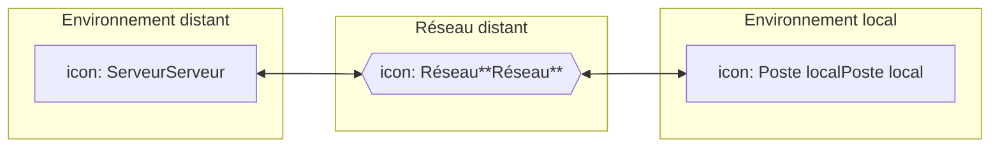

Les exigences de sécurité sont découpées selon quatre catégories distinctes en fonction de l’élément de l’architecture auxquelles elles s’appliquent. Ces catégories sont les suivantes :

10. Exigences générales,
11. Exigences liées à l’environnement local,
12. Exigences liées à l’échange d’informations via un réseau distant,
13. Exigences liées à l’environnement distant.

Dans le cas d’une architecture de type « poste isolé ou réseau local », les 2 premières exigences doivent être respectées (exigences générales et exigences environnement local).

Dans le cas d’une architecture de type « réseau distant », les 4 exigences doivent être respectées.

# **Les exigences de sécurité**

## **Exigences générales**

<table>
  <thead>
    <tr>
      <th>Informations</th>
      <th>Libellé</th>
    </tr>
  </thead>
  <tbody>
    <tr>
      <td>Confidentialité</td>
      <td>La confidentialité, en 2013, doit être assurée par l’utilisation d’un mécanisme de chiffrement avec un algorithme AES – 128 bits ou supérieur. L’algorithme 3DES 112 bits est encore admissible. Le choix de l’algorithme et de la longueur de la clé est susceptible d’évoluer en fonction de l’état de l’art (cf. directives de l’ANSSI entre autres).</td>
    </tr>
    <tr>
      <td>Intégrité</td>
      <td>L’intégrité, en 2013, doit être assurée par l’utilisation de l’algorithme SHA-256 ou supérieur. L’algorithme SHA-1 est encore recevable pour les composants ne supportant pas encore le SHA-256. Le choix de l’algorithme est susceptible d’évoluer en fonction de l’état de l’art (cf. directives de l’ANSSI entre autres).</td>
    </tr>
    <tr>
      <td>Authenticité</td>
      <td>L’authenticité, en 2009, doit être assurée par l’utilisation de l’algorithme RSA <b>2048</b> bits ou supérieur. L’algorithme RSA 1024 bits est encore admissible. Le choix de l’algorithme est susceptible d’évoluer en fonction de l’état de l’art (cf. directives de l’ANSSI entre autres).</td>
    </tr>
  </tbody>
</table>

*23/11/2018 GIE SESAM-Vitale* 
 icon: SESAM-Vitale logo 45 / 52
*Ce document à diffusion restreinte ne peut être diffusé sans l'autorisation d'une personne habilitée au GIE SESAM-Vitale*

*SFG - SCOR - Télétransmission des pièces justificatives - Version 2.12.01*
*SCOR-SFG-002* *PG - Présentation Générale* *Version : 1.24*

<table>
    <tr>
      <td>Suite de chiffrement</td>
      <td>Dans le cadre du protocole TLS, le GIE SESAM-VITALE recommande l’usage des suites de chiffrement suivantes :  TLS_RSA_WITH_AES_128_CBC_SHA  TLS_RSA_WITH_AES_256_CBC_SHA       1) Correspondant à l’usage des algorithmes suivants :  Echanges de clés : RSA  Authentification : RSA  Chiffrement : AES (128 bits), AES (256 bits)  Intégrité : SHA-1 / SHA-256   Note : En vertu de l’article 30-I de la loi 2004-575 du 21 juin 2004, l’utilisation des moyens de cryptologie est libre.  En revanche, la fourniture, l’importation et l’exportation de ces moyens sont réglementées en France. Ces opérations sont soumises soit au régime de la déclaration, soit au régime de l’autorisation. La ANSSI est chargée d’instruire les demandes d’autorisation des moyens et prestations de cryptologie conformément à la législation.</td>
    </tr>
</table>

## **Exigences pour l’environnement local**

<table>
  <thead>
    <tr>
      <th>Recommandations</th>
      <th>Libellé</th>
    </tr>
  </thead>
  <tbody>
    <tr>
      <td>Réglementation</td>
      <td>L’éditeur s’engage à être conforme à la législation française en vigueur (cryptographie, loi informatique et liberté, etc.).</td>
    </tr>
    <tr>
      <td>Sensibilisation</td>
      <td>Il est recommandé de sensibiliser les utilisateurs à la sécurité du système d’information (par exemple : recommandations dans le manuel utilisateur).</td>
    </tr>
    <tr>
      <td>Politique des mots de passe</td>
      <td>Les accès aux systèmes d’information doivent être protégés de façon individuelle. Dans le cas d’un usage d’un mot de passe celui-ci doit comporter au moins huit caractères alphanumériques avec des caractères spéciaux. Le mot de passe ne doit pas être un mot du dictionnaire. Il doit être changé de façon régulière, a minima une fois par trimestre et doit être conservé de façon confidentielle.</td>
    </tr>
    <tr>
      <td>Correctifs de sécurité</td>
      <td>Des mesures doivent inciter l’utilisateur à procéder de façon régulière (hebdomadaire) à la mise à jour de son poste de travail, en particulier pour les mises à jour de sécurités et de l’anti-virus.</td>
    </tr>
    <tr>
      <td>Inactivité du système</td>
      <td>La session d’un utilisateur ne doit pas être maintenue ouverte au-delà de 60 minutes d’inactivité. Le système doit verrouiller la session automatiquement.  La saisie du login/mot de passe est obligatoire pour se reconnecter au système d’information.</td>
    </tr>
  </tbody>
</table>

*23/11/2018* *GIE SESAM-Vitale* 
 icon: GIE SESAM-Vitale logo *46 / 52*
*Ce document à diffusion restreinte ne peut être diffusé sans l'autorisation d'une personne habilitée au GIE SESAM-Vitale*

*SFG - SCOR - Télétransmission des pièces justificatives - Version 2.12.01*
*SCOR-SFG-002 PG - Présentation Générale Version : 1.24*

<table>
    <tr>
      <td>Protection virale</td>
      <td>Le système d’information doit comporter un système de protection virale pour chaque composant afin de lutter contre l’infection de son propre système et toute propagation sur des systèmes tiers.</td>
    </tr>
    <tr>
      <td>Pare-feu</td>
      <td>Pour pallier à l’intrusion dans le système d’information via les connexions réseaux, le système doit filtrer les ports et les flux autorisés.</td>
    </tr>
    <tr>
      <td>Connexion distante</td>
      <td>Toute connexion distante sur le poste local doit être à l’initiative du professionnel de santé. Aucun service distant ne peut accéder au poste local sans l’autorisation du professionnel de santé.</td>
    </tr>
    <tr>
      <td>Confidentialité des données</td>
      <td>La confidentialité des données stockées dans les bases du progiciel doit être assurée via un chiffrement a minima avec un algorithme AES – 128 bits.</td>
    </tr>
    <tr>
      <td>Sauvegarde des données</td>
      <td>Des mesures doivent inciter l’utilisateur à procéder de façon régulière à la sauvegarde de ses données et à conserver celles-ci de façon sécurisée dans un autre lieu. La sauvegarde doit être réalisée de façon à garantir l’intégrité et confidentialité des données.</td>
    </tr>
    <tr>
      <td>Authentification mutuelle</td>
      <td>Les postes clients se connectant à un service distant, doivent authentifier le service auquel ils se connectent.  L’utilisation a minima du TLS v1.0 ou TLS v1.1 avec une authentification mutuelle est demandée.</td>
    </tr>
    <tr>
      <td>Certificat</td>
      <td>L’authentification du poste client est effectuée à partir du certificat de la carte CPS du professionnel de santé.  En cas d’atteinte à la confidentialité de la clé (perte ou vol), celle-ci doit faire l’objet d’une demande de révocation auprès de l’autorité émettrice (GIP-CPS).</td>
    </tr>
    <tr>
      <td>Vérification d’un certificat</td>
      <td>Le certificat présenté par le serveur au poste client doit être valide notamment concernant sa parenté (autorité de confiance), sa validité (date début et de fin) et son usage (authentification serveur).</td>
    </tr>
    <tr>
      <td>Liste de révocation</td>
      <td>Dans le cadre de l’usage de certificat de confiance, le poste client doit vérifier que le certificat serveur n’est pas révoqué en vérifiant la liste de révocation ou en effectuant une requête OCSP.</td>
    </tr>
    <tr>
      <td>Autorité de confiance</td>
      <td>L’enregistrement d’une nouvelle autorité de confiance sur le poste client doit faire l’objet d’un consentement du professionnel de santé.</td>
    </tr>
    <tr>
      <td>Intégrité des composants</td>
      <td>L’intégrité de l’ensemble des composants et des bases de données d’une solution doit être garantie et contrôlée, a minima avec un algorithme SHA-256 ; l’usage du SHA-1 est encore admissible. La corruption de l’un de ces composants doit rendre la solution inutilisable.</td>
    </tr>
    <tr>
      <td>Approbation de l’utilisateur</td>
      <td>L’utilisateur de la solution doit autoriser explicitement les opérations modifiant le contenu de son progiciel et les tables associées.</td>
    </tr>
</table>

**Exigences sur les échanges via un réseau distant**

<table>
  <thead>
    <tr>
      <th>Recommandations</th>
      <th>Libellé</th>
    </tr>
  </thead>
</table>

*23/11/2018 GIE SESAM-Vitale* 
 icon: icon 47 / 52
*Ce document à diffusion restreinte ne peut être diffusé sans l'autorisation d'une personne habilitée au GIE SESAM-Vitale*

*SFG - SCOR - Télétransmission des pièces justificatives - Version 2.12.01*
*SCOR-SFG-002* *PG - Présentation Générale* *Version : 1.24*

<table>
    <tr>
      <td>Réglementation</td>
      <td>L’éditeur s’engage à être conforme à la législation française en vigueur (cryptographie, loi informatique et liberté, etc.).</td>
    </tr>
    <tr>
      <td>Connexion</td>
      <td>L’établissement d’une connexion doit toujours être à l’initiative de l’utilisateur du poste client.</td>
    </tr>
    <tr>
      <td>Négociation des paramètres SSL / TLS</td>
      <td>Les paramètres d’une session d’échange SSL / TLS doivent être renégociés toutes les 18 heures.</td>
    </tr>
    <tr>
      <td>Chiffrement des données</td>
      <td>La confidentialité des données administratives et médicaux- administratives transitant sur tout réseau doit être garantie pendant leur transmission via un chiffrement a minima avec un algorithme AES – 128 bits.</td>
    </tr>
    <tr>
      <td>Intégrité des données</td>
      <td>L’intégrité des données administratives et médicaux- administratives transitant sur tout réseau doit être garantie pendant leur transmission via l’utilisation à minima de l’algorithme SHA-256 ; l’usage de SHA-1 est encore admissible.</td>
    </tr>
</table>

## **Exigences pour l’environnement distant**

<table>
  <thead>
    <tr>
      <th>Recommandations</th>
      <th>Libellé</th>
    </tr>
  </thead>
  <tbody>
    <tr>
      <td>Réglementation</td>
      <td>L’éditeur s’engage à être conforme à la législation française en vigueur (cryptographie, loi informatique et liberté, etc.).</td>
    </tr>
    <tr>
      <td>Infrastructure</td>
      <td>Les infrastructures associées au service doivent être dédiées.</td>
    </tr>
    <tr>
      <td>Accès au Système</td>
      <td>Les accès aux systèmes d’information doivent être protégés de façon individuelle</td>
    </tr>
    <tr>
      <td>Politique des mots de passe</td>
      <td>Dans le cas d’un usage d’un mot de passe, celui-ci doit comporter au moins huit caractères alphanumériques avec des caractères spéciaux. Le mot de passe ne doit pas être un mot du dictionnaire. Le mot de passe doit être changé de façon régulière, a minima une fois par trimestre et doit être transmis et conservé de façon confidentielle.</td>
    </tr>
    <tr>
      <td>Historisation des mots de passe</td>
      <td>Dans le cas d’un usage d’un mot de passe, le système distant doit veiller à interdire l’utilisation a minima des trois derniers mots de passe.</td>
    </tr>
    <tr>
      <td>Blocage du compte</td>
      <td>Le système distant doit mettre en œuvre une mesure afin de se prémunir des tentatives d’accès frauduleux. Il convient de limiter le nombre d’essai à trois dans une même session et de bloquer le compte au bout de dix tentatives infructueuses.</td>
    </tr>
    <tr>
      <td>Inactivité d’une session</td>
      <td>En cas d’inactivité sur le système d’information, la session d’un utilisateur ne doit pas être maintenue au-delà de 60 minutes en distant. Le système doit soit couper, soit verrouiller la session.  Dans le cas d’utilisation d’un login/mot de passe, la saisie de ces derniers est obligatoire pour se reconnecter au système d’information.</td>
    </tr>
    <tr>
      <td>Protection virale</td>
      <td>Le système d’information doit comporter un système de protection virale sur chaque composant pour lutter contre l’infection de son propre système et la propagation sur les systèmes tiers.</td>
    </tr>
  </tbody>
</table>

*23/11/2018* *GIE SESAM-Vitale* 
 icon: icon 48 / 52
*Ce document à diffusion restreinte ne peut être diffusé sans l'autorisation d'une personne habilitée au GIE SESAM-Vitale*

*SFG - SCOR - Télétransmission des pièces justificatives - Version 2.12.01*
*SCOR-SFG-002* *PG - Présentation Générale* *Version : 1.24*

<table>
    <tr>
      <td>Pare feu</td>
      <td>Pour pallier à l’intrusion dans le système d’information via les connexions réseaux, le système doit filtrer les ports et les flux autorisés.</td>
    </tr>
    <tr>
      <td>Authentification mutuelle</td>
      <td>Lorsque des données sont stockées sur un serveur distant, le service doit identifier et authentifier les équipements ou les utilisateurs qui s’y connectent.  L’utilisation a minima du TLS v1.0 ou TLS v1.1 avec une authentification mutuelle est demandée.</td>
    </tr>
    <tr>
      <td>Certificat</td>
      <td>L’authentification d’un poste client est effectuée à partir d’un certificat émanant de l’autorité du GIP-CPS.</td>
    </tr>
    <tr>
      <td>Clé du certificat</td>
      <td>La clé du certificat serveur doit être protégée contre les tentatives de lecture illicite. La clé doit être stockée de façon chiffrée.  En cas d’atteinte à la confidentialité de la clé (perte ou vol), celle-ci doit faire l’objet d’une demande de révocation auprès de l’autorité émettrice (GIP-CPS).</td>
    </tr>
    <tr>
      <td>Liste de révocation</td>
      <td>Dans le cadre de l’usage de certificat de confiance, le serveur doit vérifier que le certificat client n’est pas révoqué en vérifiant la liste de révocation ou en effectuant une requête OCSP.</td>
    </tr>
    <tr>
      <td>Autorité de confiance</td>
      <td>L’enregistrement d’une nouvelle autorité de confiance sur le serveur doit faire l’objet d’une autorisation de l’administrateur.</td>
    </tr>
    <tr>
      <td>Chiffrement des données</td>
      <td>Les données administratives et médico-administratives archivées sur le serveur doivent être protégées avec un chiffrement a minima AES – 128 bits.</td>
    </tr>
    <tr>
      <td>Intégrité des données</td>
      <td>Les données administratives et médico-administratives doivent être stockées sur le serveur de façon intègre.</td>
    </tr>
    <tr>
      <td>Intégrité des composants</td>
      <td>L’intégrité de l’ensemble des composants logiciels d’une solution doit être garantie et contrôlée. La corruption de l’un de ces composants doit rendre la solution inutilisable.</td>
    </tr>
    <tr>
      <td>Etanchéité</td>
      <td>Lorsque des données sont stockées sur un serveur distant, celui-ci doit être confiné dans une DMZ dédiée.</td>
    </tr>
    <tr>
      <td>Mise à jour de sécurité</td>
      <td>Lorsque des données sont stockées sur un serveur distant, ce serveur doit être mis à jour régulièrement pour pallier aux failles de sécurité du système et des applications.</td>
    </tr>
    <tr>
      <td>Gestion des habilitations</td>
      <td>L’accès au service doit être administré par un système de gestion des habilitations (séparation des rôles). Les rôles de chaque intervenant doivent être clairement identifiés.</td>
    </tr>
    <tr>
      <td>Restriction d’accès</td>
      <td>Le système distant doit être en mesure suivant l’habilitation de l’utilisateur de restreindre l’accès aux données.</td>
    </tr>
    <tr>
      <td>Sauvegarde</td>
      <td>Le système distant doit être en mesure d’effectuer une sauvegarde journalière des données. La sauvegarde doit être réalisée de façon à garantir l’intégrité et la confidentialité des données.</td>
    </tr>
</table>

*23/11/2018* *GIE SESAM-Vitale* 
icon: SESAM-Vitale logo *49 / 52*
*Ce document à diffusion restreinte ne peut être diffusé sans l'autorisation d'une personne habilitée au GIE SESAM-Vitale*

*SFG - SCOR - Télétransmission des pièces justificatives - Version 2.12.01*
*SCOR-SFG-002* *PG - Présentation Générale* *Version : 1.24*

<table>
<tr>
<td>Traçabilité</td>
<td>Le système distant doit être en mesure d’historiser les accès à son système d’information et conserver les <u>historiques pendant une période minimale de six mois</u></td>
</tr>
<tr>
<td>Intrusion</td>
<td>Le système distant doit être en mesure d’informer les administrateurs du système en cas de tentative d’intrusion.</td>
</tr>
</table>

---

**Note**

Pour garantir le niveau global de sécurité du système SESAM-Vitale, lors de l’examen de la solution proposée, le GIE SESAM-VITALE peut être amené à compléter ces exigences par des fonctions de sécurité spécifiques adaptées à la solution proposée.

*23/11/2018* *GIE SESAM-Vitale* 
 icon: icon 50 / 52
*Ce document à diffusion restreinte ne peut être diffusé sans l'autorisation d'une personne habilitée au GIE SESAM-Vitale*

*SFG - SCOR - Télétransmission des pièces justificatives - Version 2.12.01*
*SCOR-SFG-002* *PG - Présentation Générale* *Version : 1.24*

# **ANNEXE 7** **CONSTITUTION DE L’ADRESSE ELECTRONIQUE DU PAIR DESTINATAIRE DES FLUX.**

Pour l’adressage des flux de PJ, la constitution de l’adresse électronique (EF_MA_002_05) est la suivante :

*   <u>Pour le régime général</u> (code grand régime, 2 premiers caractères de EF_MA_008_01 = 01) :
    *   <u>01.YY@01.scor.rss.fr</u>
    *   <u>YY étant le code région de la caisse du lieu d’implantation du PS (EF_MA_005_05).</u>

    *   [01.ZZZ@01.scor.rss.fr](mailto:01.ooo@01.scor.rss.fr)
    *   <u>ZZZ étant le code organisme destinataire (EF_PA_001_17)</u>

*   <u>Pour les autres régimes :</u>
    *   <u>XX@XX.scor.rss.fr</u>
    *   <u>XX étant le code grand régime (2 premiers caractères de EF_MA_008_01).</u>

    *   [XX.YY@XX.scor.rss.fr](mailto:XX.YY@XX.scor.rss.fr)
    *   <u>XX étant le code grand régime (2 premiers caractères de EF_MA_008_01).</u>
    *   <u>YY étant le code région de la caisse du lieu d’implantation du PS (EF_MA_005_05).</u>

**NB** : rss.fr est une donnée à inscrire en paramètre.

*23/11/2018* *GIE SESAM-Vitale* 
 icon: GIE SESAM-Vitale logo 51 / 52
*Ce document à diffusion restreinte ne peut être diffusé sans l'autorisation d'une personne habilitée au GIE SESAM-Vitale*

*SFG - SCOR - Télétransmission des pièces justificatives - Version 2.12.01*
*SCOR-SFG-002* *PG - Présentation Générale* *Version : 1.24*

# **ANNEXE 8  VERSIONS DE NORME SEH**

Le tableau ci-dessous donne les versions des profils en fonction de la version du contrat d’échange SEH.

<table>
  <thead>
    <tr>
      <th>Version contrat d’échange SEH</th>
      <th>Version <b>ENTSCANORDO</b></th>
      <th>Version <b>SCANORDO</b></th>
      <th>Version <b>ENTARLSCANORDO</b></th>
      <th>Version <b>ARLSCANORDO</b></th>
    </tr>
  </thead>
  <tbody>
    <tr>
      <td>01.04</td>
      <td>01.05</td>
      <td>01.02</td>
      <td>01.03</td>
      <td>01.03</td>
    </tr>
    <tr>
      <td>02.06</td>
      <td>02.06</td>
      <td>02.02</td>
      <td>02.00</td>
      <td>02.00</td>
    </tr>
    <tr>
      <td>03.01</td>
      <td>02.08</td>
      <td>02.03</td>
      <td>02.00</td>
      <td>02.02</td>
    </tr>
    <tr>
      <td>04.00</td>
      <td>04.00</td>
      <td>02.03</td>
      <td>02.00</td>
      <td>02.02</td>
    </tr>
  </tbody>
</table>

*23/11/2018* *GIE SESAM-Vitale* 
 icon: icon 52 / 52
*Ce document à diffusion restreinte ne peut être diffusé sans l'autorisation d'une personne habilitée au GIE SESAM-Vitale*