logo: sesam-vitale

**SCOR**
**SPECIFICATIONS FONCTIONNELLES GENERALES**

# <mark><u>SCOR - Télétransmission des pièces</u> <u>justificatives</u></mark>
# <mark><u>Version 2.12.01</u></mark>

## *DICO* - Dictionnaire de données

Référence : SCOR-SFG-006 / Version : 1.23 / Date : 23/10/2018
Sécurité : LIBRE / Etat : PROVISOIRE

**GIE SESAM-Vitale**
5, boulevard Marie et Alexandre Oyon – 72 019 LE MANS Cedex 2
<u>www.sesam-vitale.fr</u>

*SFG - SCOR - Télétransmission des pièces justificatives - Version 2.12.01*
*SCOR-SFG-006 *Dictionnaire de données SCOR* Version : 1.23*

Ce document a été élaboré par le GIE SESAM-Vitale.

Conformément à l’article L.122-4 du Code de la Propriété Intellectuelle, toute représentation ou reproduction (intégrale ou partielle) du présent ouvrage, quel que soit le support utilisé, doit être soumise à l’accord préalable écrit de son auteur.

Il en est de même pour sa traduction, sa transformation, son adaptation ou son arrangement, quel que soit le procédé utilisé.

**Tout manquement à ces obligations constituerait un délit de contrefaçon, au sens **des articles L 335-2 et suivants du code de la propriété intellectuelle, susceptible** d’entraîner des sanctions pour l’auteur du délit.**

*23/10/2018 GIE SESAM-Vitale* 2 / 34
*Ce document à diffusion restreinte ne peut être diffusé sans l'autorisation d'une personne habilitée au GIE SESAM-Vitale*

SFG - SCOR - Télétransmission des pièces justificatives - Version 2.12.01
SCOR-SFG-006 Dictionnaire de données SCOR Version : 1.23

23/10/2018 GIE SESAM-Vitale 3 / 34
Ce document à diffusion restreinte ne peut être diffusé sans l'autorisation d'une personne habilitée au GIE SESAM-Vitale

*SFG - SCOR - Télétransmission des pièces justificatives - Version 2.12.01*
*SCOR-SFG-006* *Dictionnaire de données SCOR* *Version : 1.23*

# **SOMMAIRE**

**(Une table des matières est disponible page 29.)**

<table>
    <tr>
      <td><b>1</b></td>
      <td><b>INTRODUCTION DOCUMENTAIRE ..........................................................................................................6</b></td>
    </tr>
    <tr>
      <td>1.1</td>
      <td>OBJECTIF DU DOCUMENT .....................................................................................................................6</td>
    </tr>
    <tr>
      <td>1.2</td>
      <td>POSITIONNEMENT DU DOCUMENT DANS LE DOSSIER DE SFG .................................................................6</td>
    </tr>
    <tr>
      <td>1.3</td>
      <td>DOCUMENTS DE REFERENCE, ABREVIATIONS, DEFINITIONS ....................................................................6</td>
    </tr>
    <tr>
      <td>1.4</td>
      <td>GUIDE DE LECTURE .............................................................................................................................6</td>
    </tr>
    <tr>
      <td><b>2</b></td>
      <td><b>RELATION ENTRE LES FONCTIONNALITES ET LES ENTITES FONCTIONNELLES EN SORTIE ....7</b></td>
    </tr>
    <tr>
      <td>2.1</td>
      <td>PRESENTATION DU SYSTEME SCOR ....................................................................................................7</td>
    </tr>
    <tr>
      <td>2.2</td>
      <td>PRESENTATION DE LA FONCTIONNALITE « TT : TRANSMETTRE UN FLUX DE PJ <mark>NUMERIQUES</mark><br /><mark>~~NUMERISEES~~</mark> » ....................................................................................................................................8</td>
    </tr>
    <tr>
      <td>2.3</td>
      <td>REPRESENTATION DE LA FONCTIONNALITE « AT : TRAITER LES FLUX DE PJ » ........................................9</td>
    </tr>
    <tr>
      <td>2.4</td>
      <td>REPRESENTATION DE LA FONCTIONNALITE « TA : ANALYSER LES RETOURS » ......................................10</td>
    </tr>
    <tr>
      <td><b>3</b></td>
      <td><b>SYNTHESE DES ENTITES FONCTIONNELLES ....................................................................................11</b></td>
    </tr>
    <tr>
      <td>3.1</td>
      <td>REPRESENTATION DES DONNEES ............................................................................................11</td>
    </tr>
    <tr>
      <td>3.2</td>
      <td>LISTE DES ENTITES FONCTIONNELLES ....................................................................................14</td>
    </tr>
    <tr>
      <td><b>4</b></td>
      <td><b>CYCLES DE VIE .......................................................................................................................................19</b></td>
    </tr>
    <tr>
      <td>4.1</td>
      <td>LE CYCLE DE VIE DU STATUT DE TRANSMISSION D’UNE PJ <mark>NUMERIQUE ~~NUMERISEE~~</mark> ...............................19</td>
    </tr>
    <tr>
      <td>4.2</td>
      <td>LE CYCLE DE VIE DES STATUTS DE TRANSMISSION DOSSIER DE PJ ET LOT DE PJ ..................................20</td>
    </tr>
    <tr>
      <td><b>5</b></td>
      <td><b>LISTES DE VALEURS .............................................................................................................................21</b></td>
    </tr>
    <tr>
      <td>5.1</td>
      <td>CODE REGION (EF_MA_005_05) .....................................................................................................21</td>
    </tr>
    <tr>
      <td>5.2</td>
      <td>CODE SPECIALITES ACCEPTES PAR LE SYSTEME SCOR (EF_MA_005_06) ........................................23</td>
    </tr>
    <tr>
      <td>5.3</td>
      <td>NATURE DE PIECES PJ (EF_MA_019_03) .........................................................................................23</td>
    </tr>
    <tr>
      <td>5.4</td>
      <td>STATUTS DE TRANSMISSION ...............................................................................................................23</td>
    </tr>
    <tr>
      <td>5.5</td>
      <td>INFORMATION MODE D’ENVOI DU LOT DE PJ (EF_MA_004_09) OU DE LA PJ <mark>NUMERIQUE ~~NUMERISEE~~</mark><br />(EF_MA_019_05) ...........................................................................................................................23</td>
    </tr>
    <tr>
      <td>5.6</td>
      <td>TYPE DE CONTENU DU MESSAGE RETOUR A TRAITER (EF_MR_003_03 OU EF_MR_005_03) .............23</td>
    </tr>
    <tr>
      <td>5.7</td>
      <td>CODE D’ETAT D’ACCEPTATION DE L’ENTETE SEH (EF_MR_018_02) ..................................................23</td>
    </tr>
    <tr>
      <td>5.8</td>
      <td>CODE MESSAGE DE SERVICE REJET ....................................................................................................24</td>
    </tr>
    <tr>
      <td><mark>5.9</mark></td>
      <td><mark>CODE ARL</mark> .......................................................................................................................................25</td>
    </tr>
    <tr>
      <td>5.10</td>
      <td>CONTROLES ET CODES REJET ARL ....................................................................................................25</td>
    </tr>
</table>

*23/10/2018* *GIE SESAM-Vitale* 4 / 34
*Ce document à diffusion restreinte ne peut être diffusé sans l'autorisation d'une personne habilitée au GIE SESAM-Vitale*

*SFG - SCOR - Télétransmission des pièces justificatives - Version 2.12.01*
*SCOR-SFG-006 Dictionnaire de données SCOR Version : 1.23*

## **TABLE DES ILLUSTRATIONS**

<table>
    <tr>
      <td>FIGURE 1 : CORPUS DOCUMENTAIRE SCOR...........................................................................................................</td>
      <td>6</td>
    </tr>
    <tr>
      <td>FIGURE 2 : REPRESENTATION DES OBJETS EN SORTIE DES FONCTIONNALITES DE SCOR..........................................</td>
      <td>7</td>
    </tr>
    <tr>
      <td>FIGURE 3 : REPRESENTATION DES OBJETS EN SORTIE DES FONCTIONS DE TT ..........................................................</td>
      <td>8</td>
    </tr>
    <tr>
      <td>FIGURE 4 : REPRESENTATION DES OBJETS EN SORTIE DES FONCTIONS DE AT ..........................................................</td>
      <td>9</td>
    </tr>
    <tr>
      <td>FIGURE 5 : REPRESENTATION DES OBJETS EN SORTIE DES FONCTIONS DE TA01 ....................................................</td>
      <td>10</td>
    </tr>
    <tr>
      <td>FIGURE 6 : MODELE DE DONNEES DU MESSAGE ALLER ..........................................................................................</td>
      <td>11</td>
    </tr>
    <tr>
      <td>FIGURE 7 : MODELE DE DONNEES DU FICHIER INDEX SCANORDO .......................................................................</td>
      <td>12</td>
    </tr>
    <tr>
      <td>FIGURE 8 : MODELE DE DONNEES DU FICHIER ENTETE ENTSCANORDO..............................................................</td>
      <td>12</td>
    </tr>
    <tr>
      <td>FIGURE 9 : MODELE DE DONNEES DU MESSAGE RETOUR .......................................................................................</td>
      <td>13</td>
    </tr>
    <tr>
      <td>FIGURE 10 : MODELE DE DONNEES DU FICHIER DIAGNOSTIC ARLSCANORDO ....................................................</td>
      <td>14</td>
    </tr>
    <tr>
      <td>FIGURE 11 : MODELE DE DONNEE DU FICHIER ENTETE ENTARLSCANORDO .....................................................</td>
      <td>14</td>
    </tr>
    <tr>
      <td>FIGURE 12 : CYCLE DE VIE DU STATUT DE TRANSMISSION D'UNE PJ <mark><s>NUMERIQUE NUMERISEE</s></mark>...................................</td>
      <td>19</td>
    </tr>
    <tr>
      <td>FIGURE 13: CYCLE DE VIE DU STATUT DE TRANSMISSION D'UN DOSSIER OU D’UN LOT DE PJ....................................</td>
      <td>20</td>
    </tr>
</table>

## **TABLE DES ANNEXES**

<table>
  <thead>
    <tr>
      <th colspan="3"><b>TABLE DES ANNEXES</b></th>
    </tr>
  </thead>
  <tbody>
    <tr>
      <td><b><b>ANNEXE 1</b></b></td>
      <td><b>TABLES DES MATIERES ..............................................................................................</b></td>
      <td><b>29</b></td>
    </tr>
    <tr>
      <td><b><b>ANNEXE 2</b></b></td>
      <td><b>VALEURS PAR DEFAUT DES PARAMETRES SCOR.................................................</b></td>
      <td><b>31</b></td>
    </tr>
    <tr>
      <td rowspan="2"><b><b>ANNEXE 3</b></b></td>
      <td><b><b>CORRESPONDANCE ENTRE LA NORME SEH ET LES ENTITES</b></b></td>
      <td></td>
    </tr>
    <tr>
      <td><b>FONCTIONNELLES .................................................................................................................................</b></td>
      <td><b>32</b></td>
    </tr>
  </tbody>
</table>

*23/10/2018 GIE SESAM-Vitale* 5 / 34
*Ce document à diffusion restreinte ne peut être diffusé sans l'autorisation d'une personne habilitée au GIE SESAM-Vitale*

# **1         INTRODUCTION DOCUMENTAIRE**

## **1.1      Objectif du document**

Ce dictionnaire de données [DICO] a pour objectif de centraliser l’ensemble des informations concernant le modèle de données, les données et entités fonctionnelles, les cycles de vie des différents statuts ainsi que les listes de valeurs utilisés par le système **« SCOR – Numérisation des ordonnances »**.

## **1.2      Positionnement du document dans le dossier de SFG**

Ce document se positionne comme suit dans l’architecture documentaire de ces Spécifications Fonctionnelles Générales (SFG) :

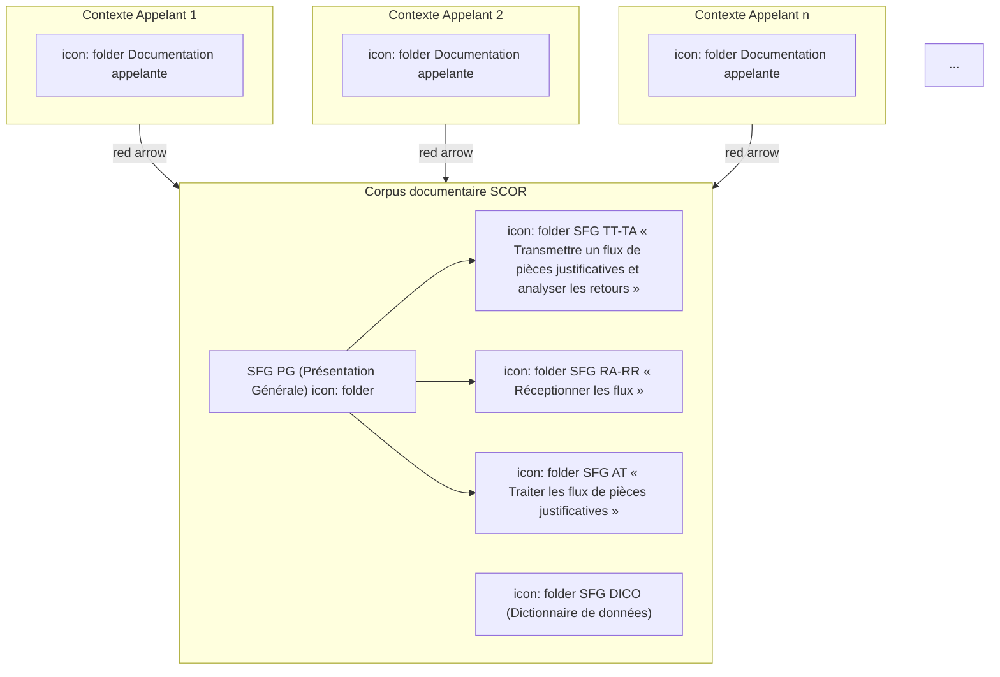

icon: folder **SFG DICO **(Dictionnaire** de données)**
**Vous êtes ici**

**Figure 1 : Corpus documentaire SCOR**

## **1.3            Documents de référence, abréviations, définitions**

<table>
  <thead>
    <tr>
      <th><b>Document</b></th>
      <th><b>Type et titre</b></th>
      <th><b>Référence</b></th>
    </tr>
  </thead>
  <tbody>
    <tr>
      <td>PG</td>
      <td>SCOR - PG (Présentation Générale)</td>
      <td>SCOR-SFG-<br />002</td>
    </tr>
  </tbody>
</table>

**Se reporter à [PG].**

## **1.4            Guide de lecture**

**Se reporter à [PG].**

*23/10/2018* *GIE SESAM-Vitale* 
icon: icon 6 / 34
*Ce document à diffusion restreinte ne peut être diffusé sans l'autorisation d'une personne habilitée au GIE SESAM-Vitale*

*SCOR-SFG-006* *DICO - Dictionnaire de données* *Version : 1.23*

# **2 RELATION ENTRE LES FONCTIONNALITES ET LES ENTITES FONCTIONNELLES EN SORTIE**

## **2.1 Présentation du système SCOR**

Le schéma ci-dessous présente les sorties principales des fonctionnalités de SCOR. Ces sorties sont représentées dans un cadre bleu.

```mermaid
graph TD
    subgraph PdT [":PdT"]
        Start(( )) -->|Début| TT["**TT : Transmettre un flux de PJ**"]
        TA["**TA : Analyser les retours**"] --> End((( )))
        End ---|Fin| EndLabel[ ]
        style EndLabel fill:none,stroke:none
    end

    subgraph PAIR [":Système d'accueil des flux (PAIR)"]
        AT["**AT : Traiter les flux de PJ**"]
    end

    TT --> Message[[Message]]
    Message --> AT
    AT --> FAM[[Fichier Assurance Maladie]]
    FAM --> MRP[[Message retour PR]]
    MRP --> TA

    %% Styling
    style TT fill:#e1e100,stroke:#000,color:#000
    style AT fill:#e1e100,stroke:#000,color:#000
    style TA fill:#e1e100,stroke:#000,color:#000
    style Message fill:#0000ff,stroke:#000,color:#fff
    style FAM fill:#0000ff,stroke:#000,color:#fff
    style MRP fill:#0000ff,stroke:#000,color:#fff
    style Start fill:#000,stroke:#000
    style End fill:#fff,stroke:#000
```

**Figure 2 : Représentation des objets en sortie des fonctionnalités de SCOR.**

*23/10/2018* *GIE SESAM-Vitale* 
 icon: GIE SESAM-Vitale logo *7 / 34*
*Ce document à diffusion restreinte ne peut être diffusé sans l'autorisation d'une personne habilitée au GIE SESAM-Vitale*

*SCOR-SFG-006* *DICO - Dictionnaire de données* *Version : 1.23*

## 2.2 Présentation de la fonctionnalité « TT : Transmettre un flux de PJ <mark><u>numériques numérisées</u></mark> »

~~Ce diagramme est barré d'une ligne diagonale.~~

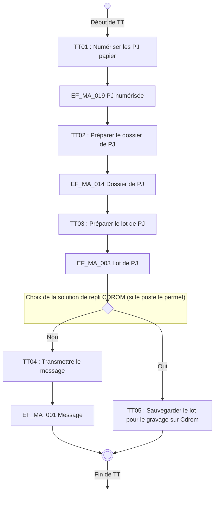

```mermaid
graph TD
    Start(( )) -->|Début de TT| TT01
    TT01[TT01 : Contrôler les PJ numériques] --> EF_MA_019
    EF_MA_019[EF_MA_019 PJ numériques] --> TT02
    TT02[TT02 : Préparer le dossier de PJ] --> EF_MA_014
    EF_MA_014[EF_MA_014 Dossier de PJ] --> TT03
    TT03[TT03 : Préparer le lot de PJ] --> EF_MA_003
    EF_MA_003[EF_MA_003 Lot de PJ] --> Decision{ }
    
    subgraph Choice [Choix de la solution de repli CDROM si le poste le permet]
    Decision
    end

    Decision -->|Non| TT04[TT04 : Transmettre le message]
    Decision -->|Oui| TT05[TT05 : Sauvegarder le lot pour le gravage sur Cdrom]
    
    TT04 --> EF_MA_001[EF_MA_001 Message]
    EF_MA_001 --> End(( ))
    TT05 --> End
    
    End -->|Fin de TT| Final(( ))
    
    style Start fill:#000
    style Final fill:#000,stroke:#000,stroke-width:4px
    style TT01 fill:#EBDCCB,stroke:#000
    style TT02 fill:#EBDCCB,stroke:#000
    style TT03 fill:#EBDCCB,stroke:#000
    style TT04 fill:#EBDCCB,stroke:#000
    style TT05 fill:#EBDCCB,stroke:#000
    style EF_MA_019 fill:#89B4E9,stroke:#000
    style EF_MA_014 fill:#89B4E9,stroke:#000
    style EF_MA_003 fill:#89B4E9,stroke:#000
    style EF_MA_001 fill:#1A237E,color:#FFF,stroke:#000
    style Choice fill:none,stroke:none
```

**Figure 3 : Représentation des objets en sortie des fonctions de TT**

*23/10/2018* *GIE SESAM-Vitale* 
 icon: icon 8 / 34
*Ce document à diffusion restreinte ne peut être diffusé sans l'autorisation d'une personne habilitée au GIE SESAM-Vitale*

*SCOR-SFG-006* *DICO - Dictionnaire de données* *Version : 1.23*

## **2.3 Représentation de la fonctionnalité « AT : Traiter les flux de PJ »**

```mermaid
graph TD
    Start(( )) -->|Début de AT| AT01[AT01 : Accueillir le message SMTP]
    AT01 --> Decision1{ }
    Decision1 -->|Oui| AT03
    Decision1 -->|Non| AT02[AT02 : Analyser l'unité d'envoi SEH  (Pièce jointe)]
    
    subgraph Data1 [ ]
        direction TB
        EF_MR_014[EF_MR_014 Diagnostic  ARLSCANORDO]
    end
    
    AT02 --> EF_MR_014
    EF_MR_014 --> AT03[AT03 : Transmettre la réponse au PR]
    
    subgraph Data2 [ ]
        direction TB
        EF_MR_001[EF_MR_001 Message Retour PR]
    end
    
    AT03 --> EF_MR_001
    EF_MR_001 --> Decision2{ }
    
    Decision2 -->|Oui| End
    Decision2 -->|Non| AT04[AT04 : Mettre à disposition le fichier AMO]
    
    subgraph Data3 [ ]
        direction TB
        EF_TM_003[EF_TM_003 Fichier Assurance  Maladie]
    end
    
    AT04 --> EF_TM_003
    EF_TM_003 --> End((( )))
    
    Decision1 -.->|Présence diagnostic  erreur message| Decision1
    Decision2 -.->|Présence diagnostic  erreur message| Decision2
    
    End -->|Fin de AT| Final(( ))

    style Start fill:#000,stroke:#000
    style Final fill:none,stroke:none
    style End fill:#000,stroke:#000
    style AT01 fill:#f5e6d3,stroke:#000,stroke-width:1px
    style AT02 fill:#f5e6d3,stroke:#000,stroke-width:1px
    style AT03 fill:#f5e6d3,stroke:#000,stroke-width:1px
    style AT04 fill:#f5e6d3,stroke:#000,stroke-width:1px
    style Decision1 fill:#fff5e6,stroke:#000,stroke-width:1px
    style Decision2 fill:#fff5e6,stroke:#000,stroke-width:1px
    style EF_MR_014 fill:#99ccff,stroke:#99ccff
    style EF_MR_001 fill:#0033cc,stroke:#0033cc,color:#fff
    style EF_TM_003 fill:#1a1aff,stroke:#1a1aff,color:#fff
    style Data1 fill:none,stroke:none
    style Data2 fill:none,stroke:none
    style Data3 fill:none,stroke:none
```

**Figure 4 : Représentation des objets en sortie des fonctions de AT**

*23/10/2018* *GIE SESAM-Vitale* 
 icon: GIE SESAM-Vitale logo *9 / 34*
*Ce document à diffusion restreinte ne peut être diffusé sans l'autorisation d'une personne habilitée au GIE SESAM-Vitale*

*SCOR-SFG-006* *DICO - Dictionnaire de données* *Version : 1.23*

## **2.4** **Représentation de la fonctionnalité « TA : Analyser les retours »**

### **2.4.1** **Représentation de la fonction « TA01 : Analyser le message reçu »**

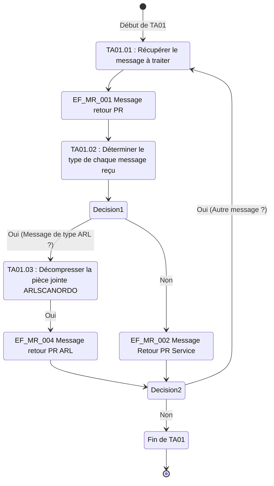

**Figure 5 : Représentation des objets en sortie des fonctions de TA01**

*23/10/2018* *GIE SESAM-Vitale* 
 icon: icon *10 / 34*
*Ce document à diffusion restreinte ne peut être diffusé sans l'autorisation d'une personne habilitée au GIE SESAM-Vitale*

*SCOR-SFG-006* *DICO - Dictionnaire de données* *Version : 1.23*

# **3 SYNTHESE DES ENTITES FONCTIONNELLES**

## **3.1 REPRESENTATION DES DONNEES**

### **3.1.1 Le message aller**

Ce message est le résultat du passage dans la fonctionnalité TT.

Sa construction s’appuie notamment sur la norme d’échange SEH.

#### **3.1.1.1 Message (EF_MA_001)**

```mermaid
erDiagram
    EF_MA_001_Message ||--|| EF_MA_002_Entete_du_message : "1 - 1"
    EF_MA_001_Message ||--|| EF_MA_003_Lot : "1 - 1"
    EF_MA_003_Lot ||--|| EF_MA_004_Entete_ENTSCANORDO : "1 - 1"
    EF_MA_003_Lot ||--o{ EF_MA_014_Dossier : "1 - 0..*"
    EF_MA_014_Dossier ||--|| EF_MA_015_Index_SCANORDO : "1 - 1"
    EF_MA_014_Dossier ||--o{ EF_MA_019_PJ_numerisee : "1 - 0..*"
    EF_MA_020_Identifiant_PJ_numerisee ..> EF_MA_019_PJ_numerisee : "1"

    EF_MA_001_Message [
        EF_MA_001 Message
    ]
    EF_MA_002_Entete_du_message [
        EF_MA_002 Entête du message
    ]
    EF_MA_003_Lot [
        EF_MA_003 Lot
    ]
    EF_MA_004_Entete_ENTSCANORDO [
        EF_MA_004 Entête ENTSCANORDO
    ]
    EF_MA_014_Dossier [
        EF_MA_014 Dossier
    ]
    EF_MA_015_Index_SCANORDO [
        EF_MA_015 Index SCANORDO
    ]
    EF_MA_019_PJ_numerisee [
        EF_MA_019 PJ numérisée
    ]
    EF_MA_020_Identifiant_PJ_numerisee [
        EF_MA_020 Identifiant PJ numérisée
    ]
```

SEH / ENSCANORDO

SEH / **SCANORDO**

**Figure 6 : Modèle de données du message aller**

*23/10/2018* *GIE SESAM-Vitale* 
 icon: GIE SESAM-Vitale logo 11 / 34
*Ce document à diffusion restreinte ne peut être diffusé sans l'autorisation d'une personne habilitée au GIE SESAM-Vitale*

*SCOR-SFG-006* *DICO - Dictionnaire de données* *Version : 1.23*

### 3.1.1.2 Index SCANORDO (EF_MA_015)

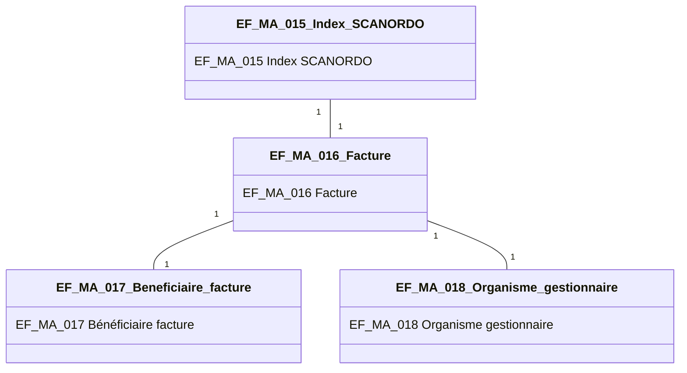

**Figure 7 : Modèle de données du Fichier Index SCANORDO**

### 3.1.1.3 Entête ENTSCANORDO (EF_MA_004)

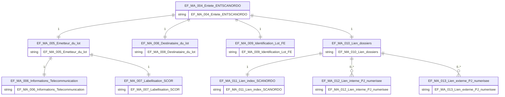

**Figure 8 : Modèle de données du fichier entête ENTSCANORDO**

## 3.1.2 Le message retour PR

Ce message est le résultat du passage dans la fonctionnalité TA.

*23/10/2018* *GIE SESAM-Vitale* 
icon: icon *12 / 34*
*Ce document à diffusion restreinte ne peut être diffusé sans l'autorisation d'une personne habilitée au GIE SESAM-Vitale*

*SCOR-SFG-006* *DICO - Dictionnaire de données* *Version : 1.23*

Sa construction s’appuie notamment sur la norme d’échange SEH.

### **3.1.2.1** **Message retour PR (EF_MR_001)**

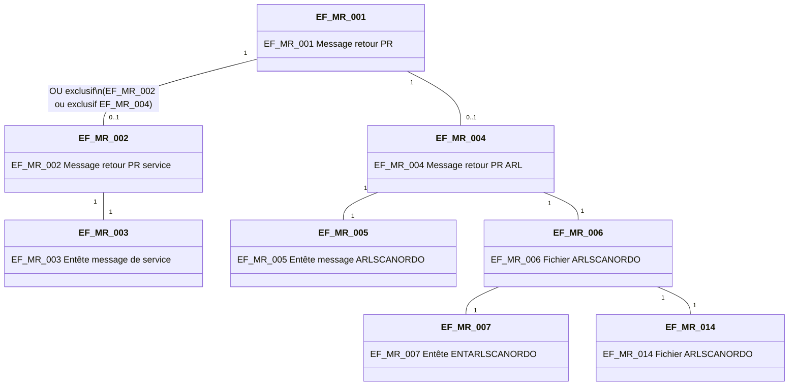

SEH / **ENTARLSCANORDO**

SEH / **ARLSCANORDO**

**Figure 9 : Modèle de données du message retour**

*23/10/2018* *GIE SESAM-Vitale* 
icon: icon *13 / 34*
*Ce document à diffusion restreinte ne peut être diffusé sans l'autorisation d'une personne habilitée au GIE SESAM-Vitale*

*SCOR-SFG-006 DICO - Dictionnaire de données Version : 1.23*

### 3.1.2.2 Diagnostic ARLSCANORDO (EF_MR_014)

```mermaid
erDiagram
    EF_MR_014_Diagnostic_ARLSCANORDO ||--|| EF_MR_015_Unite_denvoi : "1"
    EF_MR_015_Unite_denvoi ||--|| EF_MR_016_Trace_lot_FE : "1"
    EF_MR_015_Unite_denvoi ||--o{ EF_MR_017_Diagnostic_dossier : "1"
    EF_MR_015_Unite_denvoi ||--|| EF_MR_018_Diagnostic : "1"
    EF_MR_017_Diagnostic_dossier ||--|| EF_MR_018_Diagnostic : "1"
    EF_MR_017_Diagnostic_dossier ||--|| EF_MR_019_Index_Dossier : "1"

    EF_MR_014_Diagnostic_ARLSCANORDO [
        EF_MR_014 Diagnostic
        ARLSCANORDO
    ]
    EF_MR_015_Unite_denvoi [
        EF_MR_015 Unité d'envoi
    ]
    EF_MR_016_Trace_lot_FE [
        EF_MR_016 Trace lot FE
    ]
    EF_MR_017_Diagnostic_dossier [
        EF_MR_017 Diagnostic dossier
    ]
    EF_MR_018_Diagnostic [
        EF_MR_018 Diagnostic
    ]
    EF_MR_019_Index_Dossier [
        EF_MR_019 Index Dossier
    ]
```

Figure 10 : Modèle de données du Fichier Diagnostic ARLSCANORDO

### 3.1.2.3 Entête ENTARLSCANORDO (EF_MR_007)

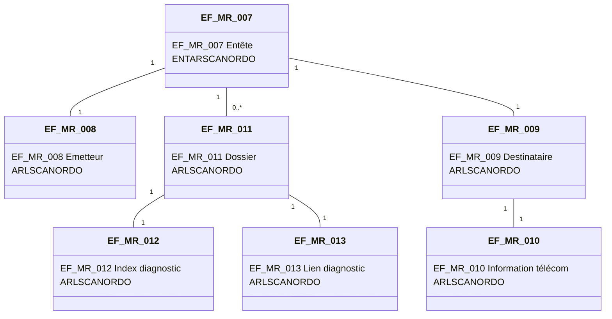

Figure 11 : Modèle de donnée du Fichier Entête ENTARLSCANORDO

## 3.2 LISTE DES ENTITES FONCTIONNELLES

Le modèle de données est représenté ci-après :

*23/10/2018 GIE SESAM-Vitale* 
 icon: icon 14 / 34
*Ce document à diffusion restreinte ne peut être diffusé sans l'autorisation d'une personne habilitée au GIE SESAM-Vitale*

SCOR-SFG-006
DICO - Dictionnaire de données
Version : 1.23

<table>
  <thead>
    <tr>
      <th>N° EF</th>
      <th>Nom EF</th>
      <th>Numéro Donnée</th>
      <th>Nom SFG</th>
    </tr>
  </thead>
  <tbody>
    <tr>
      <td>EF_MA_001</td>
      <td>Message</td>
      <td></td>
      <td></td>
    </tr>
    <tr>
      <td rowspan="5">EF_MA_002</td>
      <td rowspan="5">Entête du message</td>
      <td>1</td>
      <td>Adresse de l’expéditeur</td>
    </tr>
    <tr>
      <td>2</td>
      <td>Sujet du mail</td>
    </tr>
    <tr>
      <td>3</td>
      <td>Content-description</td>
    </tr>
    <tr>
      <td>4</td>
      <td>Content-type</td>
    </tr>
    <tr>
      <td>5</td>
      <td>Adresse du destinataire</td>
    </tr>
    <tr>
      <td rowspan="2">EF_MA_003</td>
      <td rowspan="2">Lot</td>
      <td>1</td>
      <td>Statut du lot</td>
    </tr>
    <tr>
      <td>2</td>
      <td>Nombre de fichiers du lot</td>
    </tr>
    <tr>
      <td rowspan="9">EF_MA_004</td>
      <td rowspan="9">Entête ENTSCANORDO</td>
      <td>1</td>
      <td>PGMD_Profil du lot</td>
    </tr>
    <tr>
      <td>2</td>
      <td>Version norme SEH</td>
    </tr>
    <tr>
      <td>3</td>
      <td>Nom du lot</td>
    </tr>
    <tr>
      <td>4</td>
      <td>Horodatage du lot</td>
    </tr>
    <tr>
      <td>5</td>
      <td>Fonction du lot</td>
    </tr>
    <tr>
      <td>6</td>
      <td>Nombre de fichiers du lot</td>
    </tr>
    <tr>
      <td>7</td>
      <td>Indice du lot pour un lot de FE</td>
    </tr>
    <tr>
      <td>8</td>
      <td>Nombre de lots pour un lot de FE</td>
    </tr>
    <tr>
      <td>9</td>
      <td>Mode d’envoi du lot</td>
    </tr>
    <tr>
      <td rowspan="6">EF_MA_005</td>
      <td rowspan="6">Emetteur du lot</td>
      <td>1</td>
      <td>Identité émetteur lot de PJ</td>
    </tr>
    <tr>
      <td>2</td>
      <td>Qualité émetteur lot de PJ</td>
    </tr>
    <tr>
      <td>3</td>
      <td>Nom commercial de l’émetteur lot de PJ</td>
    </tr>
    <tr>
      <td>4</td>
      <td>Numéro RPPS</td>
    </tr>
    <tr>
      <td>5</td>
      <td>Code région</td>
    </tr>
    <tr>
      <td>6</td>
      <td>Code spécialité du PS</td>
    </tr>
    <tr>
      <td rowspan="2">EF_MA_006</td>
      <td rowspan="2">Informations Télécommunication</td>
      <td>1</td>
      <td>Type Télécom</td>
    </tr>
    <tr>
      <td>2</td>
      <td>Adresse PR</td>
    </tr>
    <tr>
      <td rowspan="2">EF_MA_007</td>
      <td rowspan="2">Labellisation SCOR</td>
      <td>1</td>
      <td>Identifiant du logiciel SCOR</td>
    </tr>
    <tr>
      <td>2</td>
      <td>Version du logiciel SCOR</td>
    </tr>
    <tr>
      <td rowspan="2">EF_MA_008</td>
      <td rowspan="2">Destinataire du lot</td>
      <td>1</td>
      <td>Identité destinataire lot de PJ</td>
    </tr>
    <tr>
      <td>2</td>
      <td>Qualité destinataire lot de PJ</td>
    </tr>
    <tr>
      <td rowspan="5">EF_MA_009</td>
      <td rowspan="5">Identification lot FE</td>
      <td>1</td>
      <td>Activité lot FE</td>
    </tr>
    <tr>
      <td>2</td>
      <td>Horodatage lot FE</td>
    </tr>
    <tr>
      <td>3</td>
      <td>Numéro lot FE</td>
    </tr>
    <tr>
      <td>4</td>
      <td>Type de lot de FE</td>
    </tr>
    <tr>
      <td>5</td>
      <td>Nombre de FE dans le lot de FE</td>
    </tr>
    <tr>
      <td>EF_MA_010</td>
      <td>Lien dossiers</td>
      <td></td>
      <td></td>
    </tr>
    <tr>
      <td rowspan="5">EF_MA_011</td>
      <td rowspan="5">Lien index SCANORDO</td>
      <td>1</td>
      <td>Profil</td>
    </tr>
    <tr>
      <td>2</td>
      <td>Identification</td>
    </tr>
    <tr>
      <td>3</td>
      <td>Horodatage</td>
    </tr>
    <tr>
      <td>4</td>
      <td>Descriptif d’envoi</td>
    </tr>
    <tr>
      <td>5</td>
      <td>Archive FE</td>
    </tr>
    <tr>
      <td rowspan="5">EF_MA_012</td>
      <td rowspan="5">Lien interne PJ <mark>numérique<br />numérisée</mark></td>
      <td>1</td>
      <td>Adresse document de la PJ présente</td>
    </tr>
    <tr>
      <td>2</td>
      <td>Type document de la PJ présente</td>
    </tr>
    <tr>
      <td>3</td>
      <td>Version de la PJ présente</td>
    </tr>
    <tr>
      <td>4</td>
      <td>Nature de la PJ présente</td>
    </tr>
    <tr>
      <td>5</td>
      <td>Identifiant unique de la PJ présente</td>
    </tr>
    <tr>
      <td rowspan="4">EF_MA_013</td>
      <td rowspan="4">Lien externe PJ <mark>numérique<br />numérisée</mark></td>
      <td>1</td>
      <td>Type document PJ externe</td>
    </tr>
    <tr>
      <td>2</td>
      <td>Nature du document externe</td>
    </tr>
    <tr>
      <td>3</td>
      <td>Identifiant unique du document externe</td>
    </tr>
    <tr>
      <td>4</td>
      <td>Information mode d’envoi</td>
    </tr>
    <tr>
      <td>EF_MA_014</td>
      <td>Dossier</td>
      <td>1</td>
      <td>Profil dossier de PJ</td>
    </tr>
  </tbody>
</table>

23/10/2018
GIE SESAM-Vitale 
 icon: icon 15 / 34
Ce document à diffusion restreinte ne peut être diffusé sans l'autorisation d'une personne habilitée au GIE SESAM-Vitale

*SCOR-SFG-006* *DICO - Dictionnaire de données* *Version : 1.23*

<table>
    <tr>
      <td rowspan="8"></td>
      <td rowspan="8"></td>
      <td>2</td>
      <td>Identification dossier du lot</td>
    </tr>
    <tr>
      <td>3</td>
      <td>Horodatage dossier du lot</td>
    </tr>
    <tr>
      <td>4</td>
      <td>Archive FE</td>
    </tr>
    <tr>
      <td>5</td>
      <td>Critère de regroupement</td>
    </tr>
    <tr>
      <td>6</td>
      <td>Numéro de la FE associée</td>
    </tr>
    <tr>
      <td>7</td>
      <td>Mode de sécurisation de la FE</td>
    </tr>
    <tr>
      <td>8</td>
      <td>Nombre de PJ <mark>numériques numérisées</mark> et d'index</td>
    </tr>
    <tr>
      <td>9</td>
      <td>Statut du dossier de PJ</td>
    </tr>
    <tr>
      <td rowspan="4">EF_MA_015</td>
      <td rowspan="4">Index SCANORDO</td>
      <td>1</td>
      <td>Identifiant du dossier</td>
    </tr>
    <tr>
      <td>2</td>
      <td>Horodatage du dossier</td>
    </tr>
    <tr>
      <td>3</td>
      <td>Nature</td>
    </tr>
    <tr>
      <td>4</td>
      <td>Version</td>
    </tr>
    <tr>
      <td rowspan="5">EF_MA_016</td>
      <td rowspan="5">Facture</td>
      <td>1</td>
      <td>Identifiant facture</td>
    </tr>
    <tr>
      <td>2</td>
      <td>Renouvellement facture</td>
    </tr>
    <tr>
      <td>3</td>
      <td>Montant total facture</td>
    </tr>
    <tr>
      <td>4</td>
      <td>Montant remboursable AMO</td>
    </tr>
    <tr>
      <td>5</td>
      <td>Montant remboursable AMC</td>
    </tr>
    <tr>
      <td rowspan="4">EF_MA_017</td>
      <td rowspan="4">Bénéficiaire facture</td>
      <td>1</td>
      <td>NIR Bénéficiaire</td>
    </tr>
    <tr>
      <td>2</td>
      <td>NIR Assuré</td>
    </tr>
    <tr>
      <td>3</td>
      <td>Date de naissance bénéficiaire</td>
    </tr>
    <tr>
      <td>4</td>
      <td>Rang de naissance bénéficiaire</td>
    </tr>
    <tr>
      <td>EF_MA_018</td>
      <td>Organisme gestionnaire</td>
      <td>1</td>
      <td>Identité</td>
    </tr>
    <tr>
      <td rowspan="5">EF_MA_019</td>
      <td rowspan="5">PJ <mark>numérique numérisée</mark></td>
      <td>1</td>
      <td>Statut de la PJ</td>
    </tr>
    <tr>
      <td>2</td>
      <td>Date de constitution de la PJ <mark>numérique numérisée</mark></td>
    </tr>
    <tr>
      <td>3</td>
      <td>Nature de la PJ</td>
    </tr>
    <tr>
      <td>4</td>
      <td>Indice de la PJ <mark>numérique numérisée</mark> dans le dossier de PJ</td>
    </tr>
    <tr>
      <td>5</td>
      <td>Information mode d’envoi du document externe</td>
    </tr>
    <tr>
      <td>EF_MA_020</td>
      <td>Identifiant PJ <mark>numérique numérisée</mark></td>
      <td>1</td>
      <td>Identifiant</td>
    </tr>
</table>

<table>
  <thead>
    <tr>
      <th>N° EF</th>
      <th>Nom EF</th>
      <th>Numéro Donnée</th>
      <th>Nom SFG</th>
    </tr>
  </thead>
  <tbody>
    <tr>
      <td>EF_MR_001</td>
      <td>Message retour PR</td>
      <td></td>
      <td></td>
    </tr>
    <tr>
      <td>EF_MR_002</td>
      <td>Message retour PR service</td>
      <td></td>
      <td></td>
    </tr>
    <tr>
      <td rowspan="6">EF_MR_003</td>
      <td rowspan="6">Entête message de service</td>
      <td>1</td>
      <td>Adresse de l’expéditeur</td>
    </tr>
    <tr>
      <td>2</td>
      <td>Sujet</td>
    </tr>
    <tr>
      <td>3</td>
      <td>Content-description</td>
    </tr>
    <tr>
      <td>4</td>
      <td>Content-type</td>
    </tr>
    <tr>
      <td>5</td>
      <td>Adresse du destinataire</td>
    </tr>
    <tr>
      <td>6</td>
      <td>Identifiant du message initial</td>
    </tr>
    <tr>
      <td>EF_MR_004</td>
      <td>Message retour PR ARLSCANORDO</td>
      <td></td>
      <td></td>
    </tr>
    <tr>
      <td rowspan="5">EF_MR_005</td>
      <td rowspan="5">Entête message ARLSCANORDO</td>
      <td>1</td>
      <td>Adresse de l’expéditeur</td>
    </tr>
    <tr>
      <td>2</td>
      <td>Sujet</td>
    </tr>
    <tr>
      <td>3</td>
      <td>Content-description</td>
    </tr>
    <tr>
      <td>4</td>
      <td>Content-type</td>
    </tr>
    <tr>
      <td>5</td>
      <td>Adresse du destinataire</td>
    </tr>
    <tr>
      <td>EF_MR_006</td>
      <td>Fichier ARLSCANORDO</td>
      <td>1</td>
      <td>Statut</td>
    </tr>
    <tr>
      <td rowspan="6">EF_MR_007</td>
      <td rowspan="6">Entête ARLSCANORDO</td>
      <td>1</td>
      <td>PGMD_Profil ARLSCANORDO</td>
    </tr>
    <tr>
      <td>2</td>
      <td>Profil version des échanges<br />ARLSCANORDO</td>
    </tr>
    <tr>
      <td>3</td>
      <td>Identification ARLSCANORDO</td>
    </tr>
    <tr>
      <td>4</td>
      <td>Horodatage ARLSCANORDO</td>
    </tr>
    <tr>
      <td>5</td>
      <td>Fonction de l’ARLSCANORDO</td>
    </tr>
    <tr>
      <td>6</td>
      <td>Information ARLSCANORDO</td>
    </tr>
    <tr>
      <td rowspan="2">EF_MR_008</td>
      <td rowspan="2">Emetteur ARLSCANORDO</td>
      <td>1</td>
      <td>Identité de l’émetteur ARLSCANORDO</td>
    </tr>
    <tr>
      <td>2</td>
      <td>Qualité de l’émetteur ARLSCANORDO</td>
    </tr>
    <tr>
      <td>EF_MR_009</td>
      <td>Destinataire ARLSCANORDO</td>
      <td>1</td>
      <td>Identité du destinataire ARLSCANORDO</td>
    </tr>
  </tbody>
</table>

*23/10/2018* *GIE SESAM-Vitale* 
 icon: GIE SESAM-Vitale logo *16 / 34*
*Ce document à diffusion restreinte ne peut être diffusé sans l'autorisation d'une personne habilitée au GIE SESAM-Vitale*

*SCOR-SFG-006* *DICO - Dictionnaire de données* *Version : 1.23*

<table>
    <tr>
      <td rowspan="2"></td>
      <td rowspan="2"></td>
      <td>2</td>
      <td>Nom du destinataire ARLSCANORDO</td>
    </tr>
    <tr>
      <td>3</td>
      <td>Qualité du destinataire ARLSCANORDO</td>
    </tr>
    <tr>
      <td rowspan="2">EF_MR_010</td>
      <td rowspan="2">Information télécom ARLSCANORDO</td>
      <td>1</td>
      <td>Type de télécom de l’émetteur<br />ARLSCANORDO</td>
    </tr>
    <tr>
      <td>2</td>
      <td>Numéro de télécom de l’émetteur<br />ARLSCANORDO</td>
    </tr>
    <tr>
      <td>EF_MR_011</td>
      <td>Dossier ARLSCANORDO</td>
      <td></td>
      <td></td>
    </tr>
    <tr>
      <td rowspan="3">EF_MR_012</td>
      <td rowspan="3">Index diagnostic ARLSCANORDO</td>
      <td>1</td>
      <td>Profil du fichier diagnostic<br />ARLSCANORDO</td>
    </tr>
    <tr>
      <td>2</td>
      <td>Identification du fichier diagnostic<br />ARLSCANORDO</td>
    </tr>
    <tr>
      <td>3</td>
      <td>Horodatage du fichier diagnostic<br />ARLSCANORDO</td>
    </tr>
    <tr>
      <td rowspan="2">EF_MR_013</td>
      <td rowspan="2">Lien diagnostic ARLSCANORDO</td>
      <td>1</td>
      <td>Numéro d’ordre du fichier diagnostic<br />ARLSCANORDO</td>
    </tr>
    <tr>
      <td>2</td>
      <td>Type du fichier diagnostic<br />ARLSCANORDO</td>
    </tr>
    <tr>
      <td rowspan="5">EF_MR_014</td>
      <td rowspan="5">Diagnostic ARLSCANORDO</td>
      <td>1</td>
      <td>PGMD_Profil fichier diagnostic</td>
    </tr>
    <tr>
      <td>2</td>
      <td>Profil version des échanges<br />ARLSCANORDO</td>
    </tr>
    <tr>
      <td>3</td>
      <td>Identification fichier diagnostic</td>
    </tr>
    <tr>
      <td>4</td>
      <td>Horodatage fichier diagnostic</td>
    </tr>
    <tr>
      <td>5</td>
      <td>Fonction fichier diagnostic</td>
    </tr>
    <tr>
      <td rowspan="4">EF_MR_015</td>
      <td rowspan="4">Diagnostic entête ENTSCANORDO</td>
      <td>1</td>
      <td>Identification lot de PJ</td>
    </tr>
    <tr>
      <td>2</td>
      <td>Horodatage lot de PJ</td>
    </tr>
    <tr>
      <td>3</td>
      <td>Fonction du lot de PJ</td>
    </tr>
    <tr>
      <td>4</td>
      <td>Profil entête lot de PJ</td>
    </tr>
    <tr>
      <td rowspan="5">EF_MR_016</td>
      <td rowspan="5">Trace lot FE</td>
      <td>1</td>
      <td>Activité LOT FSE</td>
    </tr>
    <tr>
      <td>2</td>
      <td>Horodatage lot FE</td>
    </tr>
    <tr>
      <td>3</td>
      <td>Numéro du lot de FE</td>
    </tr>
    <tr>
      <td>4</td>
      <td>Type de lot de FE (sécurisé ou dégradé)</td>
    </tr>
    <tr>
      <td>5</td>
      <td>Nombre de FE dans le lot de FE</td>
    </tr>
    <tr>
      <td>EF_MR_017</td>
      <td>Diagnostic dossier</td>
      <td></td>
      <td></td>
    </tr>
    <tr>
      <td rowspan="4">EF_MR_018</td>
      <td rowspan="4">Diagnostic</td>
      <td>1</td>
      <td>Niveau du diagnostic</td>
    </tr>
    <tr>
      <td>2</td>
      <td>Etat acceptation du document</td>
    </tr>
    <tr>
      <td>3</td>
      <td>Code diagnostic</td>
    </tr>
    <tr>
      <td>4</td>
      <td>Libelle du code diagnostic</td>
    </tr>
    <tr>
      <td rowspan="4">EF_MR_019</td>
      <td rowspan="4">Index dossier</td>
      <td>1</td>
      <td>Profil dossier de PJ</td>
    </tr>
    <tr>
      <td>2</td>
      <td>Identification dossier du lot</td>
    </tr>
    <tr>
      <td>3</td>
      <td>Horodatage dossier du lot</td>
    </tr>
    <tr>
      <td>4</td>
      <td>Archive FE</td>
    </tr>
</table>

<table>
  <thead>
    <tr>
      <th>N° EF</th>
      <th>Nom EF</th>
      <th>Numéro Donnée</th>
      <th>Nom SFG</th>
    </tr>
  </thead>
  <tbody>
    <tr>
      <td>EF_TM_001</td>
      <td>Journal de suivi des messages reçus</td>
      <td></td>
      <td></td>
    </tr>
    <tr>
      <td rowspan="4">EF_TM_002</td>
      <td rowspan="4">Diagnostic erreur message</td>
      <td>1</td>
      <td>Niveau du diagnostic</td>
    </tr>
    <tr>
      <td>2</td>
      <td>Etat acceptation du document</td>
    </tr>
    <tr>
      <td>3</td>
      <td>Etat acceptation du lot</td>
    </tr>
    <tr>
      <td>4</td>
      <td>Cause</td>
    </tr>
    <tr>
      <td>EF_TM_003</td>
      <td>Fichier Assurance Maladie</td>
      <td></td>
      <td></td>
    </tr>
    <tr>
      <td>EF_TM_004</td>
      <td>Journal des traitements des messages SMTP</td>
      <td></td>
      <td></td>
    </tr>
    <tr>
      <td>EF_TM_005</td>
      <td>Journal d'activité du PAIR</td>
      <td></td>
      <td></td>
    </tr>
  </tbody>
</table>

<table>
  <thead>
    <tr>
      <th>N° EF</th>
      <th>Nom EF</th>
      <th>Numéro Donnée</th>
      <th>Nom SFG</th>
    </tr>
  </thead>
  <tbody>
    <tr>
      <td rowspan="3">EF_PA_001</td>
      <td rowspan="3">Données entrées SCOR</td>
      <td>1</td>
      <td>N° Facture</td>
    </tr>
    <tr>
      <td>2</td>
      <td>CRL FE</td>
    </tr>
    <tr>
      <td>3</td>
      <td>N° Partenaire de Santé + Clé</td>
    </tr>
  </tbody>
</table>

*23/10/2018* *GIE SESAM-Vitale* icon: GIE SESAM-Vitale logo *17 / 34*

*Ce document à diffusion restreinte ne peut être diffusé sans l'autorisation d'une personne habilitée au GIE SESAM-Vitale*

*SCOR-SFG-006* *DICO - Dictionnaire de données* *Version : 1.23*

<table>
    <tr>
      <td></td>
      <td></td>
      <td>4</td>
      <td>Code Grand Régime</td>
    </tr>
    <tr>
      <td></td>
      <td></td>
      <td>5</td>
      <td>Code caisse gestionnaire</td>
    </tr>
    <tr>
      <td></td>
      <td></td>
      <td>6</td>
      <td>Code centre gestionnaire</td>
    </tr>
    <tr>
      <td></td>
      <td></td>
      <td>7</td>
      <td>Mode de sécurisation</td>
    </tr>
    <tr>
      <td></td>
      <td></td>
      <td>8</td>
      <td>Code renouvellement</td>
    </tr>
    <tr>
      <td></td>
      <td></td>
      <td>9</td>
      <td>Total des Montants Facturés</td>
    </tr>
    <tr>
      <td></td>
      <td></td>
      <td>10</td>
      <td>Total remboursable par la caisse</td>
    </tr>
    <tr>
      <td></td>
      <td></td>
      <td>11</td>
      <td>N° Immatriculation Assuré + Clé</td>
    </tr>
    <tr>
      <td></td>
      <td></td>
      <td>12</td>
      <td>Date de Naissance du Bénéficiaire</td>
    </tr>
    <tr>
      <td></td>
      <td></td>
      <td>13</td>
      <td>Rang de Naissance</td>
    </tr>
    <tr>
      <td></td>
      <td></td>
      <td>14</td>
      <td>NIR Bénéficiaire + Clé</td>
    </tr>
    <tr>
      <td></td>
      <td></td>
      <td>16</td>
      <td>N° de lot de FE</td>
    </tr>
    <tr>
      <td></td>
      <td></td>
      <td>17</td>
      <td>Code organisme destinataire</td>
    </tr>
    <tr>
      <td></td>
      <td></td>
      <td>18</td>
      <td>Date de création du lot de FE</td>
    </tr>
    <tr>
      <td></td>
      <td></td>
      <td>19</td>
      <td>Nombre de facture dans le lot</td>
    </tr>
    <tr>
      <td></td>
      <td></td>
      <td>20</td>
      <td>Nom commercial de l’émetteur lot FE</td>
    </tr>
    <tr>
      <td></td>
      <td></td>
      <td>21</td>
      <td>Numéro RPPS</td>
    </tr>
    <tr>
      <td></td>
      <td></td>
      <td>22</td>
      <td>Code spécialité du PS</td>
    </tr>
    <tr>
      <td rowspan="10">EF_PA_002</td>
      <td rowspan="10">Paramètres SCOR</td>
      <td>1</td>
      <td>Taille maximale du fichier <mark>numérique <s>numérisée</s></mark></td>
    </tr>
    <tr>
      <td>2</td>
      <td>Taille maximale du lot</td>
    </tr>
    <tr>
      <td>3</td>
      <td>Adresse de réception des ARL</td>
    </tr>
    <tr>
      <td>4</td>
      <td>Numéro de labellisation</td>
    </tr>
    <tr>
      <td>5</td>
      <td>Adresse électronique du PS</td>
    </tr>
    <tr>
      <td>6</td>
      <td>Code région du PS</td>
    </tr>
    <tr>
      <td>7</td>
      <td>Version de la norme SEH/SCANORDO</td>
    </tr>
    <tr>
      <td>8</td>
      <td>Version de la norme SEH/ENTSCANORDO</td>
    </tr>
    <tr>
      <td>9</td>
      <td>Fréquence de transmission des CDROM</td>
    </tr>
    <tr>
      <td>10</td>
      <td>Caisse de rattachement du PS</td>
    </tr>
    <tr>
      <td rowspan="15">EF_PA_003</td>
      <td rowspan="15">Paramètres PAIR</td>
      <td>1</td>
      <td>Fréquence de scrutation des boîtes aux lettres</td>
    </tr>
    <tr>
      <td>2</td>
      <td>Version socle de référence</td>
    </tr>
    <tr>
      <td>3</td>
      <td>Liste blanche des PRS</td>
    </tr>
    <tr>
      <td>4</td>
      <td>indicateur de rejet (labellisation SCOR)</td>
    </tr>
    <tr>
      <td>5</td>
      <td>Identifiant logiciel (labellisation SCOR)</td>
    </tr>
    <tr>
      <td>6</td>
      <td>Version logiciel (labellisation SCOR)</td>
    </tr>
    <tr>
      <td>7</td>
      <td>Date de début de validité labellisation (labellisation SCOR)</td>
    </tr>
    <tr>
      <td>8</td>
      <td>Date de fin de validité labellisation (labellisation SCOR)</td>
    </tr>
    <tr>
      <td>9</td>
      <td>Taille maximale de la PJ <mark>numérique <s>numérisée</s></mark></td>
    </tr>
    <tr>
      <td>10</td>
      <td>fréquence de mise à disposition du fichier AMO</td>
    </tr>
    <tr>
      <td>11</td>
      <td>Top avis de remise et de non remise</td>
    </tr>
    <tr>
      <td>12</td>
      <td>Nombre maximum de réémission du message</td>
    </tr>
    <tr>
      <td>13</td>
      <td>Fréquence de scrutation des répertoires d'émission</td>
    </tr>
    <tr>
      <td>14</td>
      <td>Liste blanche des spécialités</td>
    </tr>
    <tr>
      <td>15</td>
      <td>Liste blanche des numéros de labellisation</td>
    </tr>
</table>

*23/10/2018* *GIE SESAM-Vitale* 
 icon: icon *18 / 34*
*Ce document à diffusion restreinte ne peut être diffusé sans l'autorisation d'une personne habilitée au GIE SESAM-Vitale*

*SCOR-SFG-006 DICO - Dictionnaire de données Version : 1.23*

# 4 **CYCLES DE VIE**

## 4.1 **Le cycle de vie du statut de transmission d’une PJ <mark>numérique numérisée</mark>**

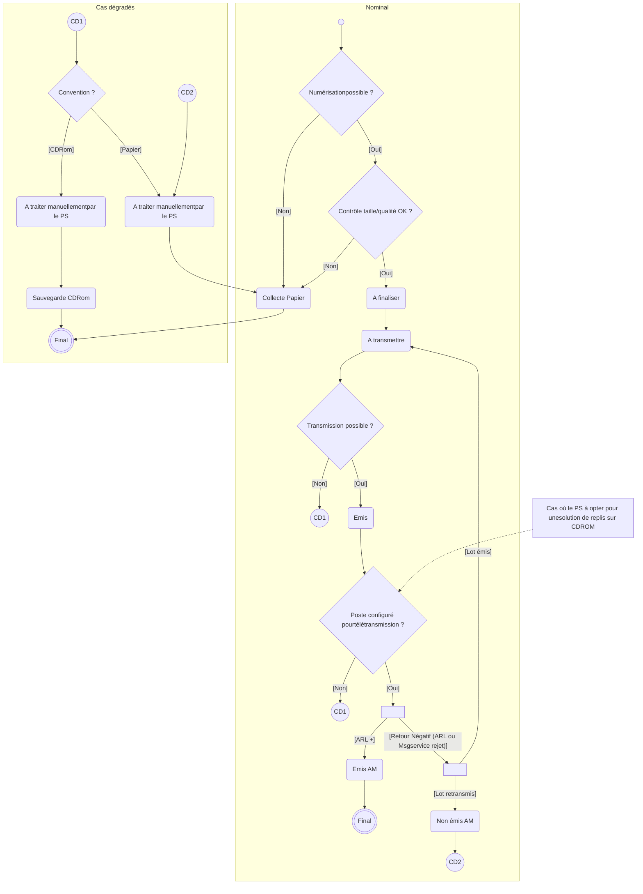

**Figure 12 : Cycle de vie du statut de transmission d'une PJ <mark>numérique numérisée</mark>**

*23/10/2018 GIE SESAM-Vitale* 
 icon: GIE SESAM-Vitale logo 19 / 34
*Ce document à diffusion restreinte ne peut être diffusé sans l'autorisation d'une personne habilitée au GIE SESAM-Vitale*

*SCOR-SFG-006 DICO - Dictionnaire de données Version : 1.23*

## **4.2 Le cycle de vie des statuts de transmission dossier de PJ et lot de PJ**

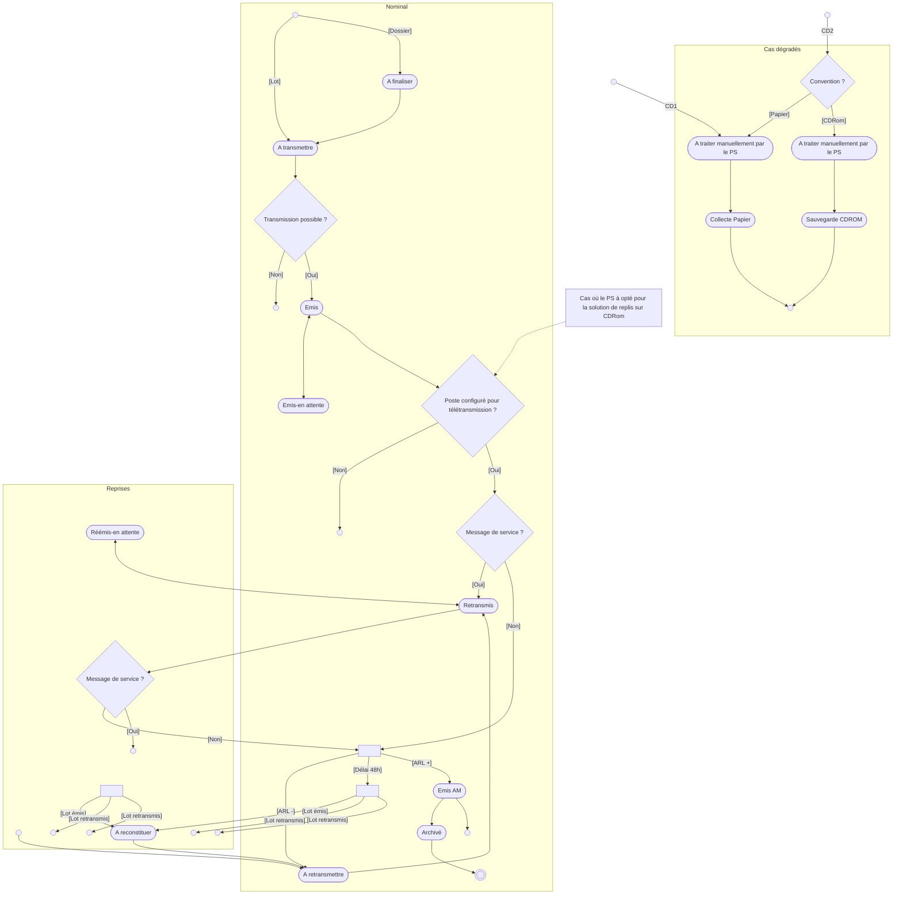

**Figure 13: Cycle de vie du statut de transmission d'un dossier ou d’un lot de PJ**

*23/10/2018 GIE SESAM-Vitale* 
 icon: icon *20 / 34*
*Ce document à diffusion restreinte ne peut être diffusé sans l'autorisation d'une personne habilitée au GIE SESAM-Vitale*

*SCOR-SFG-006 DICO - Dictionnaire de données Version : 1.23*

# 5 **LISTES DE VALEURS**

## 5.1 **Code Région (EF_MA_005_05)**

Table fournie à titre indicatif.

Le code de la région administrative du PS est disponible sur le site de l’INSEE à l’adresse suivante : www.insee.fr

Nouvelles régions (depuis le 1ᵉʳ janvier 2016) :

<table>
  <thead>
    <tr>
      <th>Région</th>
      <th>Code</th>
    </tr>
  </thead>
  <tbody>
    <tr>
      <td><strong><b>[Alsace](http://www.insee.fr/fr/methodes/nomenclatures/cog/depreg.asp?codereg=42)-Champagne-Ardenne-Lorraine</b></strong></td>
      <td>44</td>
    </tr>
    <tr>
      <td><strong><b>[Aquitaine](http://www.insee.fr/fr/methodes/nomenclatures/cog/depreg.asp?codereg=72)-Limousin-Poitou-Charentes</b></strong></td>
      <td>75</td>
    </tr>
    <tr>
      <td><strong><b>[Auvergne](http://www.insee.fr/fr/methodes/nomenclatures/cog/depreg.asp?codereg=83)-Rhône-Alpes</b></strong></td>
      <td>84</td>
    </tr>
    <tr>
      <td><strong><b>[Bourgogne](http://www.insee.fr/fr/methodes/nomenclatures/cog/depreg.asp?codereg=26)-Franche-Comté</b></strong></td>
      <td>27</td>
    </tr>
    <tr>
      <td><strong>[Bretagne](http://www.insee.fr/fr/methodes/nomenclatures/cog/depreg.asp?codereg=53)</strong></td>
      <td>53</td>
    </tr>
    <tr>
      <td><strong><b>[Centre](http://www.insee.fr/fr/methodes/nomenclatures/cog/depreg.asp?codereg=24)-Val de Loire</b></strong></td>
      <td>24</td>
    </tr>
    <tr>
      <td><strong><b>Corse</b></strong></td>
      <td>94</td>
    </tr>
    <tr>
      <td><strong><b>Guadeloupe</b></strong></td>
      <td>01</td>
    </tr>
    <tr>
      <td><strong><b>Guyane</b></strong></td>
      <td>03</td>
    </tr>
    <tr>
      <td><strong><b>Île-de-France</b></strong></td>
      <td>11</td>
    </tr>
    <tr>
      <td><strong><b>La Réunion</b></strong></td>
      <td>04</td>
    </tr>
    <tr>
      <td><strong><b>Languedoc-Roussillon-Midi-Pyrénées</b></strong></td>
      <td>76</td>
    </tr>
    <tr>
      <td><strong><b>Martinique</b></strong></td>
      <td>02</td>
    </tr>
    <tr>
      <td><strong><b>Mayotte</b></strong></td>
      <td>06</td>
    </tr>
    <tr>
      <td><strong><b>Nord-Pas-de-Calais-Picardie</b></strong></td>
      <td>32</td>
    </tr>
    <tr>
      <td><strong>Normandie</strong></td>
      <td>28</td>
    </tr>
    <tr>
      <td><strong><b>Pays de la Loire</b></strong></td>
      <td>52</td>
    </tr>
    <tr>
      <td><strong><b>Provence-Alpes-Côte d'Azur</b></strong></td>
      <td>93</td>
    </tr>
  </tbody>
</table>

Anciennes régions (avant le 1ᵉʳ janvier 2016)

<table>
  <thead>
    <tr>
      <th>Région</th>
      <th>Code</th>
    </tr>
  </thead>
  <tbody>
    <tr>
      <td><strong>[Alsace](http://www.insee.fr/fr/methodes/nomenclatures/cog/depreg.asp?codereg=42)</strong></td>
      <td>42</td>
    </tr>
    <tr>
      <td><strong>[Aquitaine](http://www.insee.fr/fr/methodes/nomenclatures/cog/depreg.asp?codereg=72)</strong></td>
      <td>72</td>
    </tr>
    <tr>
      <td><strong>[Auvergne](http://www.insee.fr/fr/methodes/nomenclatures/cog/depreg.asp?codereg=83)</strong></td>
      <td>83</td>
    </tr>
    <tr>
      <td><strong><b>[Basse-Normandie](http://www.insee.fr/fr/methodes/nomenclatures/cog/depreg.asp?codereg=25)</b></strong></td>
      <td>25</td>
    </tr>
    <tr>
      <td><strong>[Bourgogne](http://www.insee.fr/fr/methodes/nomenclatures/cog/depreg.asp?codereg=26)</strong></td>
      <td>26</td>
    </tr>
    <tr>
      <td><strong>[Bretagne](http://www.insee.fr/fr/methodes/nomenclatures/cog/depreg.asp?codereg=53)</strong></td>
      <td>53</td>
    </tr>
    <tr>
      <td><strong>[Centre](http://www.insee.fr/fr/methodes/nomenclatures/cog/depreg.asp?codereg=24)</strong></td>
      <td>24</td>
    </tr>
  </tbody>
</table>

*23/10/2018 GIE SESAM-Vitale* 
icon: GIE SESAM-Vitale logo *21 / 34*
*Ce document à diffusion restreinte ne peut être diffusé sans l'autorisation d'une personne habilitée au GIE SESAM-Vitale*

*SCOR-SFG-006 DICO - Dictionnaire de données Version : 1.23*

<table>
    <tr>
      <td><b><b>[Champagne-Ardenne](http://www.insee.fr/fr/methodes/nomenclatures/cog/depreg.asp?codereg=21)</b></b></td>
      <td>21</td>
    </tr>
    <tr>
      <td><b><b>[Corse](http://www.insee.fr/fr/methodes/nomenclatures/cog/depreg.asp?codereg=94)</b></b></td>
      <td>94</td>
    </tr>
    <tr>
      <td><b><b>[Franche-Comté](http://www.insee.fr/fr/methodes/nomenclatures/cog/depreg.asp?codereg=43)</b></b></td>
      <td>43</td>
    </tr>
    <tr>
      <td><b><b>[Guadeloupe](http://www.insee.fr/fr/methodes/nomenclatures/cog/depreg.asp?codereg=01)</b></b></td>
      <td>01</td>
    </tr>
    <tr>
      <td><b><b>[Guyane](http://www.insee.fr/fr/methodes/nomenclatures/cog/depreg.asp?codereg=03)</b></b></td>
      <td>03</td>
    </tr>
    <tr>
      <td><b><b>[Haute-Normandie](http://www.insee.fr/fr/methodes/nomenclatures/cog/depreg.asp?codereg=23)</b></b></td>
      <td>23</td>
    </tr>
    <tr>
      <td><b><b>[Île-de-France](http://www.insee.fr/fr/methodes/nomenclatures/cog/depreg.asp?codereg=11)</b></b></td>
      <td>11</td>
    </tr>
    <tr>
      <td><b><b>La Réunion</b></b></td>
      <td>04</td>
    </tr>
    <tr>
      <td><b><b>[Languedoc-Roussillon](http://www.insee.fr/fr/methodes/nomenclatures/cog/depreg.asp?codereg=91)</b></b></td>
      <td>91</td>
    </tr>
    <tr>
      <td><b><b>[Limousin](http://www.insee.fr/fr/methodes/nomenclatures/cog/depreg.asp?codereg=74)</b></b></td>
      <td>74</td>
    </tr>
    <tr>
      <td><b><b>[Lorraine](http://www.insee.fr/fr/methodes/nomenclatures/cog/depreg.asp?codereg=41)</b></b></td>
      <td>41</td>
    </tr>
    <tr>
      <td><b><b>[Martinique](http://www.insee.fr/fr/methodes/nomenclatures/cog/depreg.asp?codereg=02)</b></b></td>
      <td>02</td>
    </tr>
    <tr>
      <td><b><b>Mayotte</b></b></td>
      <td>06</td>
    </tr>
    <tr>
      <td><b><b>[Midi-Pyrénées](http://www.insee.fr/fr/methodes/nomenclatures/cog/depreg.asp?codereg=73)</b></b></td>
      <td>73</td>
    </tr>
    <tr>
      <td><b><b>[Nord-Pas-de-Calais](http://www.insee.fr/fr/methodes/nomenclatures/cog/depreg.asp?codereg=31)</b></b></td>
      <td>31</td>
    </tr>
    <tr>
      <td><b><b>[Pays de la Loire](http://www.insee.fr/fr/methodes/nomenclatures/cog/depreg.asp?codereg=52)</b></b></td>
      <td>52</td>
    </tr>
    <tr>
      <td><b><b>[Picardie](http://www.insee.fr/fr/methodes/nomenclatures/cog/depreg.asp?codereg=22)</b></b></td>
      <td>22</td>
    </tr>
    <tr>
      <td><b><b>[Poitou-Charentes](http://www.insee.fr/fr/methodes/nomenclatures/cog/depreg.asp?codereg=54)</b></b></td>
      <td>54</td>
    </tr>
    <tr>
      <td><b><b>[Provence-Alpes-Côte d'Azur](http://www.insee.fr/fr/methodes/nomenclatures/cog/depreg.asp?codereg=93)</b></b></td>
      <td>93</td>
    </tr>
    <tr>
      <td><b><b>[Rhône-Alpes](http://www.insee.fr/fr/methodes/nomenclatures/cog/depreg.asp?codereg=82)</b></b></td>
      <td>82</td>
    </tr>
</table>

*23/10/2018 GIE SESAM-Vitale* 
 icon: icon *22 / 34*
*Ce document à diffusion restreinte ne peut être diffusé sans l'autorisation d'une personne habilitée au GIE SESAM-Vitale*

*SCOR-SFG-006 DICO - Dictionnaire de données Version : 1.23*

## **5.2 Code Spécialités acceptés par le système SCOR (EF_MA_005_06)**

La spécialité dans le cadre du système SCOR est un terme "générique" correspondant à une spécialité d'un PS ou à une catégorie d'établissement.

Les valeurs des codes sont données dans les documents d’appel.

## **5.3 Nature de pièces PJ (EF_MA_019_03)**

Pour connaitre les valeurs des différents codes nature, se reporter aux documents d’appel (cf. [SFG PG]).

## **5.4 Statuts de transmission**

### **5.4.1 Statut de la PJ (EF_MA_019_01)**

Les statuts sont ceux décrits dans le cycle de vie des PJ : A finaliser, A transmettre, Emis, Emis AM, Non émis AM, Collecte Papier, Sauvegarde CDROM, A traiter manuellement par le PS.

### **5.4.2 Statut du Dossier (EF_MA_014_09) ou Lot de PJ (EF_MA_003_01)**

Les statuts sont ceux décrits dans le cycle de vie des Lots ou Dossiers de PJ:

A finaliser, A transmettre, Emis, Emis-en attente, Emis AM, Archivé, Collecte Papier, Sauvegarde CDROM, A traiter manuellement par le PS, Réémis-en attente, A retransmettre, A reconstituer, Reconstitué.

## **5.5 Information mode d’envoi du lot de PJ (EF_MA_004_09) ou de la PJ <u>numérique numérisée</u> (EF_MA_019_05)**

L’information mode d’envoi du lot de PJ ou de la PJ <u>numérique numérisée</u> peut prendre les valeurs suivantes : PAPIER, TELETRANS, CDROM.

## **5.6 Type de contenu du message retour à traiter (EF_MR_003_03 ou EF_MR_005_03)**

Le type de contenu peut être :

* (EF_MR_003_03) SERVICE/REJET_SMTP, SERVICE/REJET_FICHIER, SERVICE/CHIFFREMENT, SERVICE/AR_PROVISOIRE

Ou

* (EF_MR_005_03) ARL/SEH ou ARLTEST/ SEH.

## **5.7 Code d’état d’acceptation de l’entête SEH (EF_MR_018_02)**

Le code peut prendre les valeurs : « A » (pour acceptation) ou « R » (pour rejet)

*23/10/2018 GIE SESAM-Vitale* 
icon: GIE SESAM-Vitale logo 23 / 34
*Ce document à diffusion restreinte ne peut être diffusé sans l'autorisation d'une personne habilitée au GIE SESAM-Vitale*

*SCOR-SFG-006 DICO - Dictionnaire de données Version : 1.23*

# **5.8 Code message de service rejet**

Code message de service rejet chiffrement

## **5.8.1 Codes rejet indiquant une anomalie de chiffrement**

<table>
  <thead>
    <tr>
      <th><mark><b>Code Rejet</b></mark></th>
      <th><mark>Libellés</mark></th>
      <th></th>
    </tr>
  </thead>
  <tbody>
    <tr>
      <td><mark>4000</mark></td>
      <td><mark>Flux chiffré en erreur</mark></td>
      <td><mark>Le certificat est indisponible, révoqué ou la date de validité du certificat est dépassée.</mark></td>
    </tr>
    <tr>
      <td><mark>4010</mark></td>
      <td><mark>Flux chiffré warning</mark></td>
      <td><mark>Un nouveau certificat existe pour la clé publique de l’ES.</mark></td>
    </tr>
  </tbody>
</table>

## **5.8.2 Codes rejet indiquant une anomalie de structure SMTP**

<table>
  <thead>
    <tr>
      <th><strong><mark>Code Rejet</mark></strong></th>
      <th><strong><mark>Libellés</mark></strong></th>
    </tr>
  </thead>
  <tbody>
    <tr>
      <td><strong><mark>1010</mark></strong></td>
      <td><em><mark>La pièce jointe déclarée n’existe pas</mark></em></td>
    </tr>
    <tr>
      <td><strong><mark>1020</mark></strong></td>
      <td><em><mark>Pas de pièce jointe</mark></em></td>
    </tr>
    <tr>
      <td><strong><mark>1030</mark></strong></td>
      <td><em><mark>Plus d’une pièce jointe</mark></em></td>
    </tr>
    <tr>
      <td><strong><mark>1031</mark></strong></td>
      <td><em><mark>Mauvais format de compression de la pièce jointe</mark></em></td>
    </tr>
    <tr>
      <td><strong><mark>1040</mark></strong></td>
      <td><em><mark>Content- Type différent de « APPLICATION/EDI-consent »</mark></em></td>
    </tr>
    <tr>
      <td><strong><mark>1050</mark></strong></td>
      <td><em><mark>Content- Description inconnu ou non autorisé</mark></em></td>
    </tr>
    <tr>
      <td><strong><mark>1060</mark></strong></td>
      <td><em><mark>Sujet non-conforme</mark></em></td>
    </tr>
    <tr>
      <td><strong><mark>1061</mark></strong></td>
      <td><em><mark>1<sup>er</sup> sous-champ du sujet inconnu ou non autorisé</mark></em></td>
    </tr>
    <tr>
      <td><strong><mark>1062</mark></strong></td>
      <td><em><mark>2 ième sous-champ du sujet absent ou de longueur différente de 9 caractères</mark></em></td>
    </tr>
    <tr>
      <td><strong><mark>1063</mark></strong></td>
      <td><em><mark>3 ème sous-champ du sujet absent ou de longueur différente de 19 caractères</mark></em></td>
    </tr>
    <tr>
      <td><strong><mark>1064</mark></strong></td>
      <td><em><mark>Date et heure compostage non valides</mark></em></td>
    </tr>
    <tr>
      <td><strong><mark>1070</mark></strong></td>
      <td><em><mark>Sujet identique (message déjà transmis)</mark></em></td>
    </tr>
    <tr>
      <td><strong><mark>1080</mark></strong></td>
      <td><em><mark>Champ From vide ou avec une syntaxe incorrecte (code erreur non transmis au PR)</mark></em></td>
    </tr>
    <tr>
      <td><strong><mark>1082</mark></strong></td>
      <td><em><mark>Emetteur non référencé dans le système d’accueil</mark></em></td>
    </tr>
    <tr>
      <td><strong><mark>9999</mark></strong></td>
      <td><em><mark>autre erreur</mark></em></td>
    </tr>
  </tbody>
</table>

## **5.8.3 Codes rejet indiquant un entête SEH rejeté**

<table>
  <thead>
    <tr>
      <th><mark><b>Code Rejet</b></mark></th>
      <th><mark>Libellés</mark></th>
    </tr>
  </thead>
  <tbody>
    <tr>
      <td><mark><b>5020</b></mark></td>
      <td><mark>Entête de message SEH absent</mark></td>
    </tr>
    <tr>
      <td><mark><b>5030</b></mark></td>
      <td><mark>Plusieurs entêtes SEH présents</mark></td>
    </tr>
    <tr>
      <td><mark><b>5050</b></mark></td>
      <td><mark>Structure de données de l’entête SEH inexploitable</mark></td>
    </tr>
    <tr>
      <td><mark><b>5060</b></mark></td>
      <td><mark>Structure de l’adresse télécommunication incorrecte</mark></td>
    </tr>
  </tbody>
</table>

*23/10/2018 GIE SESAM-Vitale* 
icon: icon *24 / 34*
*Ce document à diffusion restreinte ne peut être diffusé sans l'autorisation d'une personne habilitée au GIE SESAM-Vitale*

*SCOR-SFG-006* *DICO - Dictionnaire de données* *Version : 1.23*

## **5.9 Code ARL**

### **5.9.1 Codes rejet indiquant une anomalie de structure SMTP**

<table>
  <thead>
    <tr>
      <th><s><strong>Code Rejet</strong></s></th>
      <th><s><strong>Libellés</strong></s></th>
    </tr>
  </thead>
  <tbody>
    <tr>
      <td><s><strong>1010</strong></s></td>
      <td><s><i>La pièce jointe déclarée n’existe pas</i></s></td>
    </tr>
    <tr>
      <td><s><strong>1020</strong></s></td>
      <td><s><i>Pas de pièce jointe</i></s></td>
    </tr>
    <tr>
      <td><s><strong>1030</strong></s></td>
      <td><s><i>Plus d’une pièce jointe</i></s></td>
    </tr>
    <tr>
      <td><s><strong>1031</strong></s></td>
      <td><s><i>Mauvais format de compression de la pièce jointe</i></s></td>
    </tr>
    <tr>
      <td><s><strong>1040</strong></s></td>
      <td><s><i>Content- Type différent de « APPLICATION/EDI-consent »</i></s></td>
    </tr>
    <tr>
      <td><s><strong>1050</strong></s></td>
      <td><s><i>Content- Description inconnu ou non autorisé</i></s></td>
    </tr>
    <tr>
      <td><s><strong>1060</strong></s></td>
      <td><s><i>Sujet non-conforme</i></s></td>
    </tr>
    <tr>
      <td><s><strong>1061</strong></s></td>
      <td><s><i>1<sup>er</sup> sous-champ du sujet inconnu ou non autorisé</i></s></td>
    </tr>
    <tr>
      <td><s><strong>1062</strong></s></td>
      <td><s><i>2 ième sous-champ du sujet absent ou de longueur différente de 9 caractères</i></s></td>
    </tr>
    <tr>
      <td><s><strong>1063</strong></s></td>
      <td><s><i>3 ème sous-champ du sujet absent ou de longueur différente de 19 caractères</i></s></td>
    </tr>
    <tr>
      <td><s><strong>1064</strong></s></td>
      <td><s><i>Date et heure compostage non valides</i></s></td>
    </tr>
    <tr>
      <td><s><strong>1070</strong></s></td>
      <td><s><i>Sujet identique (message déjà transmis)</i></s></td>
    </tr>
    <tr>
      <td><s><strong>1080</strong></s></td>
      <td><s><i>Champ From vide ou avec une syntaxe incorrecte (code erreur non transmis au PR)</i></s></td>
    </tr>
    <tr>
      <td><s><strong>1082</strong></s></td>
      <td><s><i>Emetteur non référencé dans le système d’accueil</i></s></td>
    </tr>
    <tr>
      <td><s><strong>9999</strong></s></td>
      <td><s><i>autre erreur</i></s></td>
    </tr>
  </tbody>
</table>

### **5.9.2 Codes rejet indiquant un entête SEH rejeté**

<table>
  <thead>
    <tr>
      <th><strong>Code Rejet</strong></th>
      <th><strong>Libellés</strong></th>
    </tr>
  </thead>
  <tbody>
    <tr>
      <td><strong>5020</strong></td>
      <td>Entête de message SEH absent</td>
    </tr>
    <tr>
      <td><strong>5030</strong></td>
      <td>Plusieurs entêtes SEH présents</td>
    </tr>
    <tr>
      <td><strong>5050</strong></td>
      <td>Structure de données de l’entête SEH inexploitable</td>
    </tr>
    <tr>
      <td><strong>5060</strong></td>
      <td>Structure de l’adresse télécommunication incorrecte</td>
    </tr>
  </tbody>
</table>

## **5.10 Contrôles et codes rejet ARL**

<table>
  <thead>
    <tr>
      <th>Niveau de <b>l’ARL</b></th>
      <th>Niveau de contrôle</th>
      <th>Code ARL</th>
      <th><b>Description de l’erreur</b></th>
    </tr>
  </thead>
  <tbody>
    <tr>
      <td rowspan="7"><strong>Entête SEH</strong></td>
      <td rowspan="4"><strong>Nom du fichier entête</strong></td>
      <td>5130</td>
      <td>Structure du nom physique de l’entête SEH non conforme</td>
    </tr>
    <tr>
      <td>5131</td>
      <td>2<sup>ème</sup> sous-champ du nom physique de l’entête SEH incorrect</td>
    </tr>
    <tr>
      <td>5132</td>
      <td>3<sup>ème</sup> <i>sous-champ du</i> nom physique de l’entête SEH <i>incorrect</i></td>
    </tr>
    <tr>
      <td>5133</td>
      <td>4<sup>ème</sup> <i>sous-champ du</i> nom physique de l’entête SEH <i>incorrect</i></td>
    </tr>
    <tr>
      <td><strong><b>Entité « Entête »</b></strong></td>
      <td>5140</td>
      <td>Incohérence de l’index du lot SCANORDO</td>
    </tr>
    <tr>
      <td rowspan="2"><strong><b>Structure des données</b></strong></td>
      <td>5100</td>
      <td>Structure de données de l’entête SEH incorrecte</td>
    </tr>
    <tr>
      <td>5110</td>
      <td>Incohérence du numéro d’émetteur</td>
    </tr>
  </tbody>
</table>

*23/10/2018* *GIE SESAM-Vitale* 
 icon: SESAM-Vitale logo *25 / 34*
*Ce document à diffusion restreinte ne peut être diffusé sans l'autorisation d'une personne habilitée au GIE SESAM-Vitale*

*SCOR-SFG-006 DICO - Dictionnaire de données Version : 1.23*

<table>
    <tr>
      <td rowspan="17"></td>
      <td><strong><b>Entité « Emetteur de</b> <b>justificatifs»</b></strong></td>
      <td>5111</td>
      <td>Message SMTP réel avec un lot SCANORDO de test</td>
    </tr>
    <tr>
      <td></td>
      <td>5112</td>
      <td>Incohérence du code régime</td>
    </tr>
    <tr>
      <td></td>
      <td>5113</td>
      <td>Code spécialité PS non connu ou non autorisé du système</td>
    </tr>
    <tr>
      <td><strong><b>Entité « Récepteur</b> <b>PJ »</b></strong></td>
      <td>5115</td>
      <td>Couple code régime-organisme destinataire inconnu ou non autorisé du système</td>
    </tr>
    <tr>
      <td rowspan="5"><strong><b>Cohérence fichier</b> <b>entête, index, fichier</b> <b>PDF de justificatifs</b></strong></td>
      <td>5120</td>
      <td>La somme des liens de document indiqués dans l’entête est erronée</td>
    </tr>
    <tr>
      <td>5121</td>
      <td>Document référencé dans l’entête non présent dans le lot SCANORDO</td>
    </tr>
    <tr>
      <td>5123</td>
      <td>Incohérence du champ identification lot SCANORDO</td>
    </tr>
    <tr>
      <td>5124</td>
      <td>Document présent dans le lot SCANORDO mais non référencé dans l’entête SEH.</td>
    </tr>
    <tr>
      <td>5125</td>
      <td>Doublon dans l’identifiant des documents de l’entête SEH</td>
    </tr>
    <tr>
      <td rowspan="6"><strong><b>Entité « Lien Interne »</b> <b>ou « Lien Externe »</b></strong></td>
      <td>5122</td>
      <td>Fichier index ou fichier PJ de type PDF manquant</td>
    </tr>
    <tr>
      <td>5126</td>
      <td>Lien interne ou lien externe absent</td>
    </tr>
    <tr>
      <td>5170</td>
      <td>Structure de l’identifiant du lien interne ou externe non-conforme</td>
    </tr>
    <tr>
      <td>5171</td>
      <td>2<sup>ème</sup> sous-champ du nom physique de l’identifiant du lien interne ou externe incorrect</td>
    </tr>
    <tr>
      <td>5172</td>
      <td>Nature du lien absente</td>
    </tr>
    <tr>
      <td>5173</td>
      <td>Identifiant d’un lien manquant</td>
    </tr>
    <tr>
      <td><strong><b>Entité « Agrément du</b> <b>logiciel SCOR »</b></strong></td>
      <td>5150</td>
      <td>Logiciel SCOR non valide</td>
    </tr>
    <tr>
      <td><strong>Dossier rejeté</strong></td>
      <td>5999</td>
      <td>Dossier rejeté</td>
    </tr>
    <tr>
      <td rowspan="9"><strong><b>Index de</b> justificatifs</strong></td>
      <td rowspan="4"><strong><b>Nom du fichier</b> physique</strong></td>
      <td>5240</td>
      <td>Syntaxe du nom physique de l’index de justificatifs est incorrecte</td>
    </tr>
    <tr>
      <td>5241</td>
      <td>1<sup>er</sup> sous-champ nom physique de l’index incorrect</td>
    </tr>
    <tr>
      <td>5242</td>
      <td>2<sup>ième</sup> sous-champ nom physique de l’index non conforme</td>
    </tr>
    <tr>
      <td>5252</td>
      <td>2<sup>ième</sup> sous-champ nom physique de l’index incohérent</td>
    </tr>
    <tr>
      <td><strong><b>Référencement dans</b> l’entête SEH</strong></td>
      <td>5253</td>
      <td>Incohérence de identifiant de dossier</td>
    </tr>
    <tr>
      <td rowspan="4"><strong><b>Chiffre ment</b></strong></td>
      <td>5230</td>
      <td>Certificat révoqué</td>
    </tr>
    <tr>
      <td>5231</td>
      <td>Fichier non chiffré</td>
    </tr>
    <tr>
      <td>5232</td>
      <td>Certificat inapproprié</td>
    </tr>
    <tr>
      <td>5233</td>
      <td>Certificat inconnu</td>
    </tr>
</table>

*23/10/2018 GIE SESAM-Vitale* 
 icon: icon *26 / 34*
*Ce document à diffusion restreinte ne peut être diffusé sans l'autorisation d'une personne habilitée au GIE SESAM-Vitale*

*SCOR-SFG-006 DICO - Dictionnaire de données Version : 1.23*

<table>
    <tr>
      <td rowspan="13"></td>
      <td></td>
      <td>5234</td>
      <td>Certificat périmé</td>
    </tr>
    <tr>
      <td><strong><b>Structure des données</b></strong></td>
      <td>5270</td>
      <td>Structure de données de l’index incorrecte</td>
    </tr>
    <tr>
      <td><strong><b>Entité « Organisme</b> <b>destinataire »</b></strong></td>
      <td>5260</td>
      <td>Incohérence du code régime</td>
    </tr>
    <tr>
      <td rowspan="10"><strong><b>Fichier PDF de</b> ~~justificatif~~</strong></td>
      <td rowspan="4"><strong><b>Nom du fichier</b> physique</strong></td>
      <td>5340</td>
      <td>Syntaxe du nom physique d’une pièce justificative est incorrecte</td>
    </tr>
    <tr>
      <td>5341</td>
      <td>1<sup>er</sup> sous-champ du nom physique d’une pièce justificative est incorrect</td>
    </tr>
    <tr>
      <td>5342</td>
      <td>2<sup>ième</sup> sous-champ du nom physique d’une pièce justificative incorrect</td>
    </tr>
    <tr>
      <td>5352</td>
      <td>Incohérence du 2<sup>ième</sup> sous-champ du nom physique d’une pièce justificative avec le numéro d’ordre du dossier</td>
    </tr>
    <tr>
      <td rowspan="5"><strong><b>Chiffrement</b></strong></td>
      <td>5330</td>
      <td>Certificat révoqué</td>
    </tr>
    <tr>
      <td>5331</td>
      <td>Fichier non chiffré</td>
    </tr>
    <tr>
      <td>5332</td>
      <td>Certificat inapproprié</td>
    </tr>
    <tr>
      <td>5333</td>
      <td>Certificat inconnu</td>
    </tr>
    <tr>
      <td>5334</td>
      <td>Certificat périmé</td>
    </tr>
    <tr>
      <td><strong><b>Taille physique</b></strong></td>
      <td>5370</td>
      <td>Taille du fichier physique d’une pièce justificative incorrecte</td>
    </tr>
    <tr>
      <td></td>
      <td><strong>Option de numérisation</strong></td>
      <td>5380</td>
      <td>Option de numérisation non conforme</td>
    </tr>
</table>

*23/10/2018 GIE SESAM-Vitale* 
 icon: icon *27 / 34*
*Ce document à diffusion restreinte ne peut être diffusé sans l'autorisation d'une personne habilitée au GIE SESAM-Vitale*

SCOR-SFG-006 *DICO - Dictionnaire de données* Version : 1.23

# ANNEXES

23/10/2018 GIE SESAM-Vitale 
icon: icon 28 / 34
Ce document à diffusion restreinte ne peut être diffusé sans l'autorisation d'une personne habilitée au GIE SESAM-Vitale

*SCOR-SFG-006 DICO - Dictionnaire de données Version : 1.23*

<table>
  <caption>**ANNEXE 1 TABLES DES MATIERES**</caption>
    <tr>
      <td><strong>1</strong></td>
      <td><strong>INTRODUCTION DOCUMENTAIRE ..........................................................................................................6</strong></td>
      <td><strong>6</strong></td>
    </tr>
    <tr>
      <td>1.1</td>
      <td>OBJECTIF DU DOCUMENT .....................................................................................................................6</td>
      <td>6</td>
    </tr>
    <tr>
      <td>1.2</td>
      <td>POSITIONNEMENT DU DOCUMENT DANS LE DOSSIER DE SFG .................................................................6</td>
      <td>6</td>
    </tr>
    <tr>
      <td>1.3</td>
      <td>DOCUMENTS DE REFERENCE, ABREVIATIONS, DEFINITIONS ....................................................................6</td>
      <td>6</td>
    </tr>
    <tr>
      <td>1.4</td>
      <td>GUIDE DE LECTURE .............................................................................................................................6</td>
      <td>6</td>
    </tr>
    <tr>
      <td><strong>2</strong></td>
      <td><strong>RELATION ENTRE LES FONCTIONNALITES ET LES ENTITES FONCTIONNELLES EN SORTIE ....7</strong></td>
      <td><strong>7</strong></td>
    </tr>
    <tr>
      <td>2.1</td>
      <td>PRESENTATION DU SYSTEME SCOR ....................................................................................................7</td>
      <td>7</td>
    </tr>
    <tr>
      <td>2.2</td>
      <td>PRESENTATION DE LA FONCTIONNALITE « TT : TRANSMETTRE UN FLUX DE PJ <mark>NUMERIQUES</mark><br /><mark><s>NUMERISEES</s></mark> » ....................................................................................................................................8</td>
      <td>8</td>
    </tr>
    <tr>
      <td>2.3</td>
      <td>REPRESENTATION DE LA FONCTIONNALITE « AT : TRAITER LES FLUX DE PJ » ........................................9</td>
      <td>9</td>
    </tr>
    <tr>
      <td>2.4</td>
      <td>REPRESENTATION DE LA FONCTIONNALITE « TA : ANALYSER LES RETOURS » ......................................10</td>
      <td>10</td>
    </tr>
    <tr>
      <td></td>
      <td>2.4.1 <i>Représentation de la fonction « TA01 : Analyser le message reçu » .............................10</i></td>
      <td>10</td>
    </tr>
    <tr>
      <td><strong>3</strong></td>
      <td><strong>SYNTHESE DES ENTITES FONCTIONNELLES....................................................................................11</strong></td>
      <td><strong>11</strong></td>
    </tr>
    <tr>
      <td>3.1</td>
      <td>REPRESENTATION DES DONNEES ............................................................................................11</td>
      <td>11</td>
    </tr>
    <tr>
      <td></td>
      <td>3.1.1 <i>Le message aller .............................................................................................................11</i></td>
      <td>11</td>
    </tr>
    <tr>
      <td></td>
      <td>3.1.1.1 Message (EF_MA_001)................................................................................................................ 11</td>
      <td>11</td>
    </tr>
    <tr>
      <td></td>
      <td>3.1.1.2 Index SCANORDO (EF_MA_015) ................................................................................................ 12</td>
      <td>12</td>
    </tr>
    <tr>
      <td></td>
      <td>3.1.1.3 Entête ENTSCANORDO (EF_MA_004) ...................................................................................... 12</td>
      <td>12</td>
    </tr>
    <tr>
      <td></td>
      <td>3.1.2 <i>Le message retour PR ....................................................................................................12</i></td>
      <td>12</td>
    </tr>
    <tr>
      <td></td>
      <td>3.1.2.1 Message retour PR (EF_MR_001) ............................................................................................... 13</td>
      <td>13</td>
    </tr>
    <tr>
      <td></td>
      <td>3.1.2.2 Diagnostic ARLSCANORDO (EF_MR_014) ................................................................................. 14</td>
      <td>14</td>
    </tr>
    <tr>
      <td></td>
      <td>3.1.2.3 Entête ENTARLSCANORDO (EF_MR_007) ................................................................................ 14</td>
      <td>14</td>
    </tr>
    <tr>
      <td>3.2</td>
      <td>LISTE DES ENTITES FONCTIONNELLES ....................................................................................14</td>
      <td>14</td>
    </tr>
    <tr>
      <td><strong>4</strong></td>
      <td><strong>CYCLES DE VIE.......................................................................................................................................19</strong></td>
      <td><strong>19</strong></td>
    </tr>
    <tr>
      <td>4.1</td>
      <td>LE CYCLE DE VIE DU STATUT DE TRANSMISSION D’UNE PJ <mark>NUMERIQUE <s>NUMERISEE</s></mark> ...............................19</td>
      <td>19</td>
    </tr>
    <tr>
      <td>4.2</td>
      <td>LE CYCLE DE VIE DES STATUTS DE TRANSMISSION DOSSIER DE PJ ET LOT DE PJ ..................................20</td>
      <td>20</td>
    </tr>
    <tr>
      <td><strong>5</strong></td>
      <td><strong>LISTES DE VALEURS .............................................................................................................................21</strong></td>
      <td><strong>21</strong></td>
    </tr>
    <tr>
      <td>5.1</td>
      <td>CODE REGION (EF_MA_005_05) .....................................................................................................21</td>
      <td>21</td>
    </tr>
    <tr>
      <td>5.2</td>
      <td>CODE SPECIALITES ACCEPTES PAR LE SYSTEME SCOR (EF_MA_005_06) ........................................23</td>
      <td>23</td>
    </tr>
    <tr>
      <td>5.3</td>
      <td>NATURE DE PIECES PJ (EF_MA_019_03) .........................................................................................23</td>
      <td>23</td>
    </tr>
    <tr>
      <td>5.4</td>
      <td>STATUTS DE TRANSMISSION...............................................................................................................23</td>
      <td>23</td>
    </tr>
    <tr>
      <td></td>
      <td>5.4.1 <i>Statut de la PJ (EF_MA_019_01) ..................................................................................23</i></td>
      <td>23</td>
    </tr>
    <tr>
      <td></td>
      <td>5.4.2 <i>Statut du Dossier (EF_MA_014_09) ou Lot de PJ (EF_MA_003_01) ............................23</i></td>
      <td>23</td>
    </tr>
    <tr>
      <td>5.5</td>
      <td>INFORMATION MODE D’ENVOI DU LOT DE PJ (EF_MA_004_09) OU DE LA PJ <mark>NUMERIQUE <s>NUMERISEE</s></mark><br />(EF_MA_019_05) ...........................................................................................................................23</td>
      <td>23</td>
    </tr>
    <tr>
      <td>5.6</td>
      <td>TYPE DE CONTENU DU MESSAGE RETOUR A TRAITER (EF_MR_003_03 OU EF_MR_005_03) .............23</td>
      <td>23</td>
    </tr>
    <tr>
      <td>5.7</td>
      <td>CODE D’ETAT D’ACCEPTATION DE L’ENTETE SEH (EF_MR_018_02) ..................................................23</td>
      <td>23</td>
    </tr>
    <tr>
      <td>5.8</td>
      <td>CODE ARL .......................................................................................................................................24</td>
      <td>24</td>
    </tr>
    <tr>
      <td></td>
      <td>5.8.1 <i>Codes rejet indiquant une anomalie de structure SMTP ................................................25</i></td>
      <td>25</td>
    </tr>
    <tr>
      <td></td>
      <td>5.8.2 <i>Codes rejet indiquant un entête SEH rejeté ....................................................................25</i></td>
      <td>25</td>
    </tr>
</table>

*23/10/2018 GIE SESAM-Vitale* 
 icon: icon *29 / 34*
*Ce document à diffusion restreinte ne peut être diffusé sans l'autorisation d'une personne habilitée au GIE SESAM-Vitale*

SCOR-SFG-006 DICO - Dictionnaire de données Version : 1.23

## 5.8.3 Contrôles et codes rejet ARL ..........................................................................................25

23/10/2018 GIE SESAM-Vitale 
icon: icon 30 / 34
Ce document à diffusion restreinte ne peut être diffusé sans l'autorisation d'une personne habilitée au GIE SESAM-Vitale

*SCOR-SFG-006 DICO - Dictionnaire de données Version : 1.23*

# **ANNEXE 2 VALEURS PAR DEFAUT DES PARAMETRES SCOR**

Cette annexe donne les valeurs figées utiles au processus SCOR.

<table>
  <thead>
    <tr>
      <th><strong><b>Nom</b></strong></th>
      <th><strong><b>Valeur</b></strong></th>
      <th><strong>EF</strong></th>
    </tr>
  </thead>
  <tbody>
    <tr>
      <td>Version de SEH/SCANORDO.</td>
      <td>Se reporter à la norme SEH en vigueur (cf. [Protocole d’échange SEH SCOR].</td>
      <td>EF_PA_002_0<mark>87</mark></td>
    </tr>
    <tr>
      <td>Version de SEH/ENTSCANORDO</td>
      <td>Se reporter à la norme SEH en vigueur (cf. [Protocole d’échange SEH SCOR].</td>
      <td>EF_PA_002_0<mark>98</mark></td>
    </tr>
    <tr>
      <td>Taille maximale du lot de PJ</td>
      <td>4 Mo</td>
      <td>EF_PA_002_02</td>
    </tr>
    <tr>
      <td rowspan="2">Taille maximale de la PJ <mark>numérique</mark><br /><mark>numérisée</mark></td>
      <td rowspan="2">250 ko</td>
      <td>EF_PA_003_09</td>
    </tr>
    <tr>
      <td><mark>EF_PA_002_01</mark></td>
    </tr>
    <tr>
      <td>Fréquence de transmission CDROM</td>
      <td>15 jours</td>
      <td>EF_PA_002_09</td>
    </tr>
  </tbody>
</table>

*23/10/2018 GIE SESAM-Vitale* 
 icon: icon *31 / 34*
31
*Ce document à diffusion restreinte ne peut être diffusé sans l'autorisation d'une personne habilitée au GIE SESAM-Vitale*

*SCOR-SFG-006 DICO - Dictionnaire de données Version : 1.23*

# **ANNEXE 3 CORRESPONDANCE ENTRE LA NORME SEH ET LES ENTITES FONCTIONNELLES**

Les tableaux ci-dessous donnent la correspondance entre la norme SEH SCOR ([Protocole d’échange SEH SCOR]) et les données des entités fonctionnelles

**Entête**
**SCANORDO**

<table>
  <thead>
    <tr>
      <th colspan="3">Structure en lecture</th>
      <th>Alimentation données</th>
    </tr>
    <tr>
      <th>Balises XML</th>
      <th>Occurrence</th>
      <th>Format</th>
      <th>Valeurs</th>
    </tr>
  </thead>
  <tbody>
    <tr>
      <td><strong>Entete</strong></td>
      <td>1</td>
      <td></td>
      <td>Namespace : http://www.interregime.fr/ENTSCANORDO</td>
    </tr>
    <tr>
      <td>    PGMD_Profil</td>
      <td>1</td>
      <td>AN</td>
      <td>EF_MA_004_01</td>
    </tr>
    <tr>
      <td>    Profil_Version</td>
      <td>1</td>
      <td>AN</td>
      <td>EF_MA_004_02</td>
    </tr>
    <tr>
      <td>    <i>Identification</i></td>
      <td>1</td>
      <td>AN</td>
      <td>EF_MA_004_03</td>
    </tr>
    <tr>
      <td>    <i>Temps</i></td>
      <td>1</td>
      <td>DT</td>
      <td>EF_MA_004_04</td>
    </tr>
    <tr>
      <td>    <i>Fonction</i></td>
      <td>0..1</td>
      <td>AN</td>
      <td>EF_MA_004_05</td>
    </tr>
    <tr>
      <td>    <i>NbrDoc</i></td>
      <td>1</td>
      <td>N</td>
      <td>EF_MA_004_06</td>
    </tr>
    <tr>
      <td>    <i>InfoIDXLOT</i></td>
      <td>1</td>
      <td>AN</td>
      <td>EF_MA_004_07</td>
    </tr>
    <tr>
      <td>    <i>InfoNBLOT</i></td>
      <td>1</td>
      <td>AN</td>
      <td>EF_MA_004_08</td>
    </tr>
    <tr>
      <td>    <i>InfoModeEnvoi</i></td>
      <td>1</td>
      <td>AN</td>
      <td>EF_MA_004_09</td>
    </tr>
    <tr>
      <td>    <strong>Emetteur</strong></td>
      <td>1</td>
      <td></td>
      <td></td>
    </tr>
    <tr>
      <td>        <i>Identite</i></td>
      <td>1</td>
      <td>AN</td>
      <td>EF_MA_005_01</td>
    </tr>
    <tr>
      <td>        <i>Nom</i></td>
      <td>1</td>
      <td>AN</td>
      <td>EF_MA_005_03</td>
    </tr>
    <tr>
      <td>        <i>RPPS</i></td>
      <td>0..1</td>
      <td>AN</td>
      <td>EF_MA_005_04</td>
    </tr>
    <tr>
      <td>        <strong>Telecom</strong></td>
      <td>1</td>
      <td></td>
      <td></td>
    </tr>
    <tr>
      <td>            <i>Type</i></td>
      <td>1</td>
      <td>AN</td>
      <td>EF_MA_006_01</td>
    </tr>
    <tr>
      <td>            <i>Numero</i></td>
      <td>1</td>
      <td>AN</td>
      <td>EF_MA_006_02</td>
    </tr>
    <tr>
      <td>        <i>Qualite</i></td>
      <td>1</td>
      <td>AN</td>
      <td>EF_MA_005_02</td>
    </tr>
    <tr>
      <td>        <i>Region</i></td>
      <td>0..1</td>
      <td>AN</td>
      <td>EF_MA_005_05</td>
    </tr>
    <tr>
      <td>        <i>SpecialitePS</i></td>
      <td>1</td>
      <td>AN</td>
      <td>EF_MA_005_06</td>
    </tr>
    <tr>
      <td>        <strong>Agrement</strong></td>
      <td>1</td>
      <td></td>
      <td></td>
    </tr>
    <tr>
      <td>            <i>Id</i></td>
      <td>1</td>
      <td>AN</td>
      <td>EF_MA_007_01</td>
    </tr>
    <tr>
      <td>            <i>Version</i></td>
      <td>1</td>
      <td>AN</td>
      <td>EF_MA_007_02</td>
    </tr>
    <tr>
      <td>    <strong>Recepteur</strong></td>
      <td>1</td>
      <td></td>
      <td></td>
    </tr>
    <tr>
      <td>        <i>Identite</i></td>
      <td>1</td>
      <td>AN</td>
      <td>EF_MA_008_01</td>
    </tr>
    <tr>
      <td>        <i>Qualite</i></td>
      <td>1</td>
      <td>AN</td>
      <td>EF_MA_008_02</td>
    </tr>
    <tr>
      <td>    <strong>Trace</strong></td>
      <td>1</td>
      <td></td>
      <td></td>
    </tr>
    <tr>
      <td>        <i>Activite</i></td>
      <td>1</td>
      <td>AN</td>
      <td>EF_MA_009_01</td>
    </tr>
    <tr>
      <td>        <i>Temps</i></td>
      <td>1</td>
      <td>DT</td>
      <td>EF_MA_009_02</td>
    </tr>
    <tr>
      <td>        <i>Archive</i></td>
      <td>1</td>
      <td>AN</td>
      <td>EF_MA_009_03</td>
    </tr>
    <tr>
      <td>        <i>InfoType</i></td>
      <td>1</td>
      <td>AN</td>
      <td>EF_MA_009_04</td>
    </tr>
    <tr>
      <td>        <i>InfoNBFACT</i></td>
      <td>1</td>
      <td>AN</td>
      <td>EF_MA_009_05</td>
    </tr>
    <tr>
      <td>    <strong>Document</strong></td>
      <td>0..n</td>
      <td></td>
      <td></td>
    </tr>
    <tr>
      <td>        <strong>Mindex</strong></td>
      <td>1</td>
      <td></td>
      <td></td>
    </tr>
    <tr>
      <td>            <i>Profil</i></td>
      <td>1</td>
      <td>AN</td>
      <td>EF_MA_011_01</td>
    </tr>
    <tr>
      <td>            <i>Identification</i></td>
      <td>1</td>
      <td>AN</td>
      <td>EF_MA_011_02</td>
    </tr>
    <tr>
      <td>            <i>Temps</i></td>
      <td>1</td>
      <td>DT</td>
      <td>EF_MA_011_03</td>
    </tr>
    <tr>
      <td>            <i>Descriptif</i></td>
      <td>0..1</td>
      <td>AN</td>
      <td>EF_MA_011_04</td>
    </tr>
    <tr>
      <td>            <i>Archive</i></td>
      <td>1</td>
      <td>AN</td>
      <td>EF_MA_011_05</td>
    </tr>
    <tr>
      <td>        <strong>Lien</strong></td>
      <td>0..n</td>
      <td></td>
      <td></td>
    </tr>
    <tr>
      <td>            <i>Adresse</i></td>
      <td>1</td>
      <td>AN</td>
      <td>EF_MA_012_01</td>
    </tr>
    <tr>
      <td>            <strong>Type</strong></td>
      <td>1</td>
      <td></td>
      <td>EF_MA_012_02</td>
    </tr>
    <tr>
      <td>            <i>Version</i></td>
      <td>0..1</td>
      <td>AN</td>
      <td>EF_MA_012_03</td>
    </tr>
    <tr>
      <td>            <i>Nature</i></td>
      <td>0..1</td>
      <td>AN</td>
      <td>EF_MA_012_04</td>
    </tr>
  </tbody>
</table>

*23/10/2018 GIE SESAM-Vitale* 
 icon: SESAM-Vitale logo 32 / 34
*Ce document à diffusion restreinte ne peut être diffusé sans l'autorisation d'une personne habilitée au GIE SESAM-Vitale*

*SCOR-SFG-006* *DICO - Dictionnaire de données* *Version : 1.23*

<table>
    <tr>
      <td></td>
      <td></td>
      <td></td>
      <td><i>Identification</i></td>
      <td>0..1</td>
      <td>AN</td>
      <td>EF_MA_012_05</td>
    </tr>
    <tr>
      <td></td>
      <td></td>
      <td colspan="2"><strong><b>LienExterne</b></strong></td>
      <td>0..n</td>
      <td></td>
      <td></td>
    </tr>
    <tr>
      <td></td>
      <td></td>
      <td></td>
      <td><i>Type</i></td>
      <td>1</td>
      <td>AN</td>
      <td>EF_MA_013_01</td>
    </tr>
    <tr>
      <td></td>
      <td></td>
      <td></td>
      <td><i>Nature</i></td>
      <td>1</td>
      <td>AN</td>
      <td>EF_MA_013_02</td>
    </tr>
    <tr>
      <td></td>
      <td></td>
      <td></td>
      <td><i>Identification</i></td>
      <td>0..1</td>
      <td>AN</td>
      <td>EF_MA_013_03</td>
    </tr>
    <tr>
      <td></td>
      <td></td>
      <td></td>
      <td><i>InfoModeEnvoi</i></td>
      <td>1</td>
      <td>AN</td>
      <td>EF_MA_013_04</td>
    </tr>
</table>

## **SCANORDO**

<table>
  <thead>
    <tr>
      <th colspan="3">Structure en lecture</th>
      <th>Alimentation données</th>
    </tr>
    <tr>
      <th>Balises XML</th>
      <th>Occ.</th>
      <th>Format</th>
      <th>Valeurs</th>
    </tr>
  </thead>
  <tbody>
    <tr>
      <td><strong>SCANORDO</strong></td>
      <td>1</td>
      <td></td>
      <td>Namespace : http://www.interregime.fr/SCANORDO</td>
    </tr>
    <tr>
      <td>    Nature</td>
      <td>1</td>
      <td>AN</td>
      <td>EF_MA_015_03</td>
    </tr>
    <tr>
      <td>    Version</td>
      <td>1</td>
      <td>AN</td>
      <td>EF_MA_015_04</td>
    </tr>
    <tr>
      <td>    <i>Identifiant</i></td>
      <td>1</td>
      <td>AN</td>
      <td>EF_MA_015_01</td>
    </tr>
    <tr>
      <td>    <i>Temps</i></td>
      <td>1</td>
      <td>DT</td>
      <td>EF_MA_015_02</td>
    </tr>
    <tr>
      <td><strong><b>Facture</b></strong></td>
      <td>1</td>
      <td></td>
      <td></td>
    </tr>
    <tr>
      <td>        <i>Identifiant</i></td>
      <td>1</td>
      <td>AN</td>
      <td>EF_MA_016_01</td>
    </tr>
    <tr>
      <td>        <i>Renouvellement</i></td>
      <td>1</td>
      <td>B</td>
      <td>EF_MA_016_02</td>
    </tr>
    <tr>
      <td>        <i>MtTotal</i></td>
      <td>1</td>
      <td>ND</td>
      <td>EF_MA_016_03</td>
    </tr>
    <tr>
      <td>        <i>MtCaisse</i></td>
      <td>1</td>
      <td>ND</td>
      <td>EF_MA_016_04</td>
    </tr>
    <tr>
      <td>        <i>MtComplementaire</i></td>
      <td>1</td>
      <td>ND</td>
      <td>EF_MA_016_05</td>
    </tr>
    <tr>
      <td>    <strong><b>Beneficiaire</b></strong></td>
      <td>1</td>
      <td></td>
      <td></td>
    </tr>
    <tr>
      <td>            <i>NIR</i></td>
      <td>0..1</td>
      <td>AN</td>
      <td>EF_MA_017_01</td>
    </tr>
    <tr>
      <td>            <i>NIRAssure</i></td>
      <td>1</td>
      <td>AN</td>
      <td>EF_MA_017_02</td>
    </tr>
    <tr>
      <td>            <i>DateNai</i></td>
      <td>1</td>
      <td>DL</td>
      <td>EF_MA_017_03</td>
    </tr>
    <tr>
      <td>            <i>RangNai</i></td>
      <td>1</td>
      <td>N</td>
      <td>EF_MA_017_04</td>
    </tr>
    <tr>
      <td>    <strong><b>Organisme</b></strong></td>
      <td>1</td>
      <td></td>
      <td></td>
    </tr>
    <tr>
      <td>            <i>Identite</i></td>
      <td>1</td>
      <td>AN</td>
      <td>EF_MA_018_01</td>
    </tr>
  </tbody>
</table>

## **Entête ARL**
### **SCANORDO**

<table>
  <thead>
    <tr>
      <th colspan="3">Structure en lecture</th>
      <th>Alimentation données</th>
    </tr>
    <tr>
      <th>Balises XML</th>
      <th>Occ.</th>
      <th>Format</th>
      <th>Valeurs</th>
    </tr>
  </thead>
  <tbody>
    <tr>
      <td><strong><b>Entete</b></strong></td>
      <td>1</td>
      <td></td>
      <td>Namespace : http://www.interregime.fr/ENTARLSCANORDO</td>
    </tr>
    <tr>
      <td>    PGMD_Profil</td>
      <td>1</td>
      <td>AN</td>
      <td>EF_MR_007_01</td>
    </tr>
    <tr>
      <td>    Profil_Version</td>
      <td>1</td>
      <td>AN</td>
      <td>EF_MR_007_02</td>
    </tr>
    <tr>
      <td>    <em>Identification</em></td>
      <td>1</td>
      <td>AN</td>
      <td>EF_MR_007_03</td>
    </tr>
    <tr>
      <td>    <em>Temps</em></td>
      <td>1</td>
      <td>DT</td>
      <td>EF_MR_007_04</td>
    </tr>
    <tr>
      <td>    <em>Fonction</em></td>
      <td>0..1</td>
      <td>AN</td>
      <td>EF_MR_007_05</td>
    </tr>
    <tr>
      <td>    <em>Info</em></td>
      <td>0..1</td>
      <td>AN</td>
      <td>EF_MR_007_06</td>
    </tr>
    <tr>
      <td>    <strong><b>Emetteur</b></strong></td>
      <td>1</td>
      <td></td>
      <td></td>
    </tr>
    <tr>
      <td>        <em>Identite</em></td>
      <td>1</td>
      <td>AN</td>
      <td>EF_MR_008_01</td>
    </tr>
    <tr>
      <td>        <em>Qualite</em></td>
      <td>1</td>
      <td>AN</td>
      <td>EF_MR_008_02</td>
    </tr>
    <tr>
      <td>    <strong><b>Recepteur</b></strong></td>
      <td>1</td>
      <td></td>
      <td></td>
    </tr>
    <tr>
      <td>        <em>Identite</em></td>
      <td>1</td>
      <td>AN</td>
      <td>EF_MR_009_01</td>
    </tr>
    <tr>
      <td>        <em>Nom</em></td>
      <td>1</td>
      <td>AN</td>
      <td>EF_MR_009_02</td>
    </tr>
    <tr>
      <td>        <strong><b>Telecom</b></strong></td>
      <td>1</td>
      <td></td>
      <td></td>
    </tr>
    <tr>
      <td>            <em>Type</em></td>
      <td>1</td>
      <td>AN</td>
      <td>EF_MR_010_01</td>
    </tr>
    <tr>
      <td>            <em>Numero</em></td>
      <td>1</td>
      <td>AN</td>
      <td>EF_MR_010_02</td>
    </tr>
    <tr>
      <td>        <em>Qualite</em></td>
      <td>1</td>
      <td>AN</td>
      <td>EF_MR_009_03</td>
    </tr>
  </tbody>
</table>

*23/10/2018* *GIE SESAM-Vitale* 
 icon: icon 33 / 34
*Ce document à diffusion restreinte ne peut être diffusé sans l'autorisation d'une personne habilitée au GIE SESAM-Vitale*

SCOR-SFG-006
DICO - Dictionnaire de données
Version : 1.23

<table>
    <tr>
      <td colspan="3"><strong>Document</strong></td>
      <td>1</td>
      <td></td>
      <td></td>
    </tr>
    <tr>
      <td></td>
      <td colspan="2"><strong>Mindex</strong></td>
      <td>1</td>
      <td></td>
      <td></td>
    </tr>
    <tr>
      <td></td>
      <td></td>
      <td><em>Profil</em></td>
      <td>1</td>
      <td>AN</td>
      <td>EF_MR_012_01</td>
    </tr>
    <tr>
      <td></td>
      <td></td>
      <td><em>Identification</em></td>
      <td>1</td>
      <td>AN</td>
      <td>EF_MR_012_02</td>
    </tr>
    <tr>
      <td></td>
      <td></td>
      <td><em>Temps</em></td>
      <td>1</td>
      <td>DT</td>
      <td>EF_MR_012_03</td>
    </tr>
    <tr>
      <td></td>
      <td colspan="2"><strong>Lien</strong></td>
      <td>1</td>
      <td></td>
      <td></td>
    </tr>
    <tr>
      <td></td>
      <td></td>
      <td><em>Adresse</em></td>
      <td>1</td>
      <td>AN</td>
      <td>EF_MR_013_01</td>
    </tr>
    <tr>
      <td></td>
      <td></td>
      <td><em>Type</em></td>
      <td>1</td>
      <td>AN</td>
      <td>EF_MR_013_02</td>
    </tr>
    <tr>
      <td></td>
      <td></td>
      <td><em>Version</em></td>
      <td>0..1</td>
      <td>AN</td>
      <td></td>
    </tr>
</table>

## ARL SCANORDO

<table>
  <thead>
    <tr>
      <th colspan="3">Structure en lecture</th>
      <th>Alimentation données</th>
    </tr>
    <tr>
      <th>Balises XML</th>
      <th>Occ.</th>
      <th>Format</th>
      <th>Valeurs</th>
    </tr>
  </thead>
  <tbody>
    <tr>
      <td><strong>ARL</strong></td>
      <td>1</td>
      <td></td>
      <td>Namespace : http://www.interregime.fr/ARLSCANORDO</td>
    </tr>
    <tr>
      <td>    PGMD_Profil</td>
      <td>1</td>
      <td>AN</td>
      <td>EF_MR_014_01</td>
    </tr>
    <tr>
      <td>    Profil_Version</td>
      <td>1</td>
      <td>AN</td>
      <td>EF_MR_014_02</td>
    </tr>
    <tr>
      <td>    <i>Identification</i></td>
      <td>1</td>
      <td>AN</td>
      <td>EF_MR_014_03</td>
    </tr>
    <tr>
      <td>    <i>Temps</i></td>
      <td>1</td>
      <td>DT</td>
      <td>EF_MR_014_04</td>
    </tr>
    <tr>
      <td>    <i>Fonction</i></td>
      <td>0..1</td>
      <td>AN</td>
      <td>EF_MR_014_05</td>
    </tr>
    <tr>
      <td><strong>DiagEntete</strong></td>
      <td>1</td>
      <td></td>
      <td></td>
    </tr>
    <tr>
      <td>    <i>Identification</i></td>
      <td>1</td>
      <td>AN</td>
      <td>EF_MR_015_01</td>
    </tr>
    <tr>
      <td>    <i>Temps</i></td>
      <td>1</td>
      <td>DT</td>
      <td>EF_MR_015_02</td>
    </tr>
    <tr>
      <td>    <i>Fonction</i></td>
      <td>0..1</td>
      <td>AN</td>
      <td>EF_MR_015_03</td>
    </tr>
    <tr>
      <td>    <i>Profil</i></td>
      <td>1</td>
      <td>AN</td>
      <td>EF_MR_015_04</td>
    </tr>
    <tr>
      <td>    <strong>Trace</strong></td>
      <td>1</td>
      <td></td>
      <td></td>
    </tr>
    <tr>
      <td>        <i>Activite</i></td>
      <td>1</td>
      <td>AN</td>
      <td>EF_MR_016_01</td>
    </tr>
    <tr>
      <td>        <i>Temps</i></td>
      <td>1</td>
      <td>DT</td>
      <td>EF_MR_016_02</td>
    </tr>
    <tr>
      <td>        <i>Archive</i></td>
      <td>1</td>
      <td>AN</td>
      <td>EF_MR_016_03</td>
    </tr>
    <tr>
      <td>        <i>InfoType</i></td>
      <td>1</td>
      <td>AN</td>
      <td>EF_MR_016_04</td>
    </tr>
    <tr>
      <td>        <i>InfoNBFACT</i></td>
      <td>1</td>
      <td>AN</td>
      <td>EF_MR_016_05</td>
    </tr>
    <tr>
      <td>    <strong>Diagnostic</strong></td>
      <td>1</td>
      <td></td>
      <td></td>
    </tr>
    <tr>
      <td>        <i>Activite</i></td>
      <td>1</td>
      <td>AN</td>
      <td>EF_MR_018_01</td>
    </tr>
    <tr>
      <td>        <i>Etat</i></td>
      <td>1</td>
      <td>AN</td>
      <td>EF_MR_018_02</td>
    </tr>
    <tr>
      <td>        <i>Cause</i></td>
      <td>0..1</td>
      <td>AN</td>
      <td>EF_MR_018_03</td>
    </tr>
    <tr>
      <td>        <i>Libelle</i></td>
      <td>0..1</td>
      <td>AN</td>
      <td>EF_MR_018_04</td>
    </tr>
    <tr>
      <td><strong>DiagDocument</strong></td>
      <td>0..n</td>
      <td></td>
      <td></td>
    </tr>
    <tr>
      <td>    <strong>Mindex</strong></td>
      <td>1</td>
      <td></td>
      <td></td>
    </tr>
    <tr>
      <td>        <i>Profil</i></td>
      <td>1</td>
      <td>AN</td>
      <td>EF_MR_019_01</td>
    </tr>
    <tr>
      <td>        <i>Identification</i></td>
      <td>1</td>
      <td>AN</td>
      <td>EF_MR_019_02</td>
    </tr>
    <tr>
      <td>        <i>Temps</i></td>
      <td>1</td>
      <td>DT</td>
      <td>EF_MR_019_03</td>
    </tr>
    <tr>
      <td>        <i>Archive</i></td>
      <td>1</td>
      <td>AN</td>
      <td>EF_MR_019_04</td>
    </tr>
    <tr>
      <td>    <strong>Diagnostic</strong></td>
      <td>1</td>
      <td></td>
      <td></td>
    </tr>
    <tr>
      <td>        <i>Activite</i></td>
      <td>1</td>
      <td>AN</td>
      <td>EF_MR_018_01</td>
    </tr>
    <tr>
      <td>        <i>Etat</i></td>
      <td>1</td>
      <td>AN</td>
      <td>EF_MR_018_02</td>
    </tr>
    <tr>
      <td>        <i>Cause</i></td>
      <td>0..1</td>
      <td>AN</td>
      <td>EF_MR_018_03</td>
    </tr>
    <tr>
      <td>        <i>Libelle</i></td>
      <td>0..1</td>
      <td>AN</td>
      <td>EF_MR_018_04</td>
    </tr>
  </tbody>
</table>

23/10/2018
GIE SESAM-Vitale 
icon: icon 34 / 34
*Ce document à diffusion restreinte ne peut être diffusé sans l'autorisation d'une personne habilitée au GIE SESAM-Vitale*