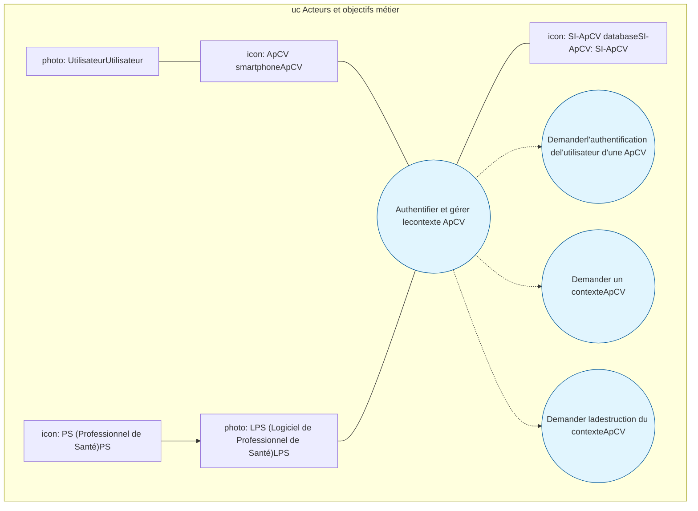
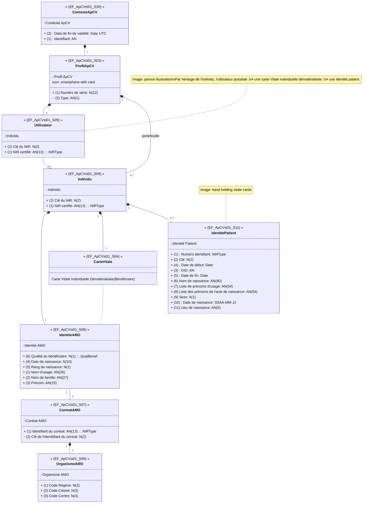
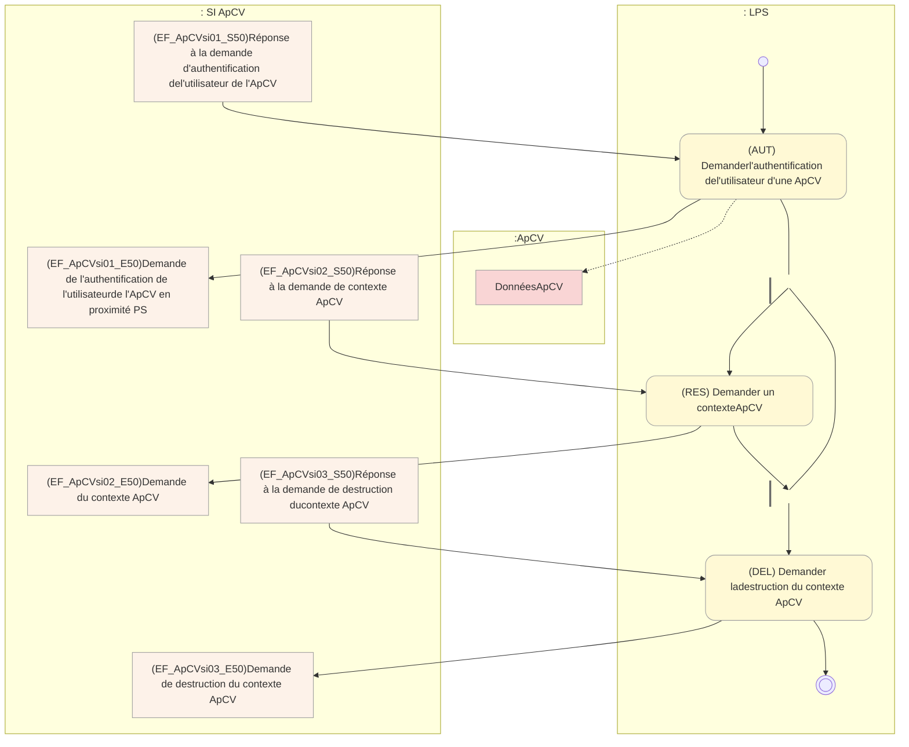
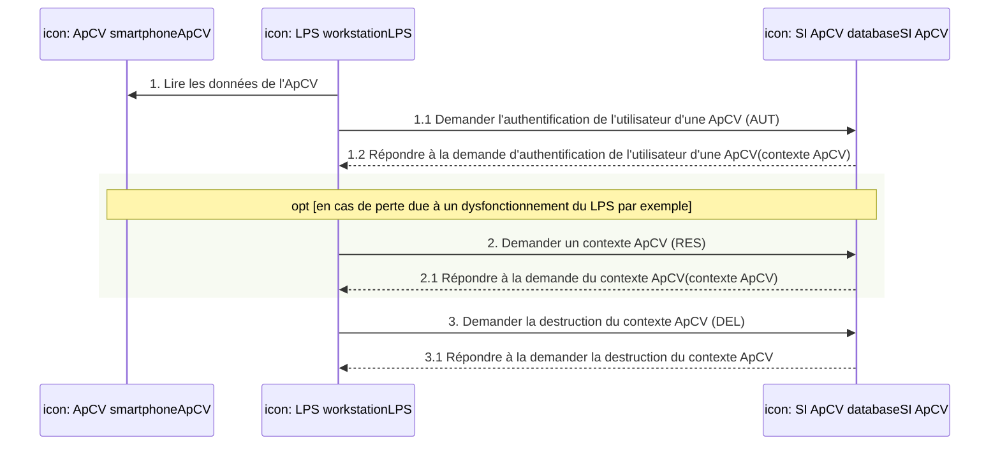
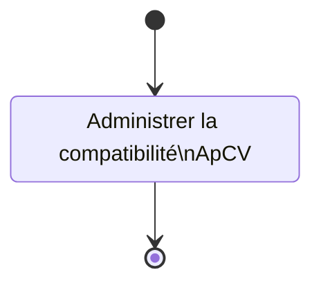
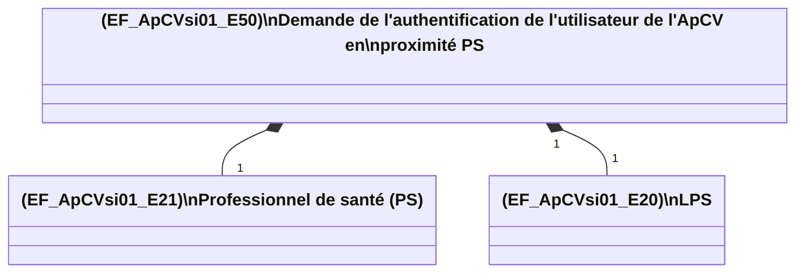
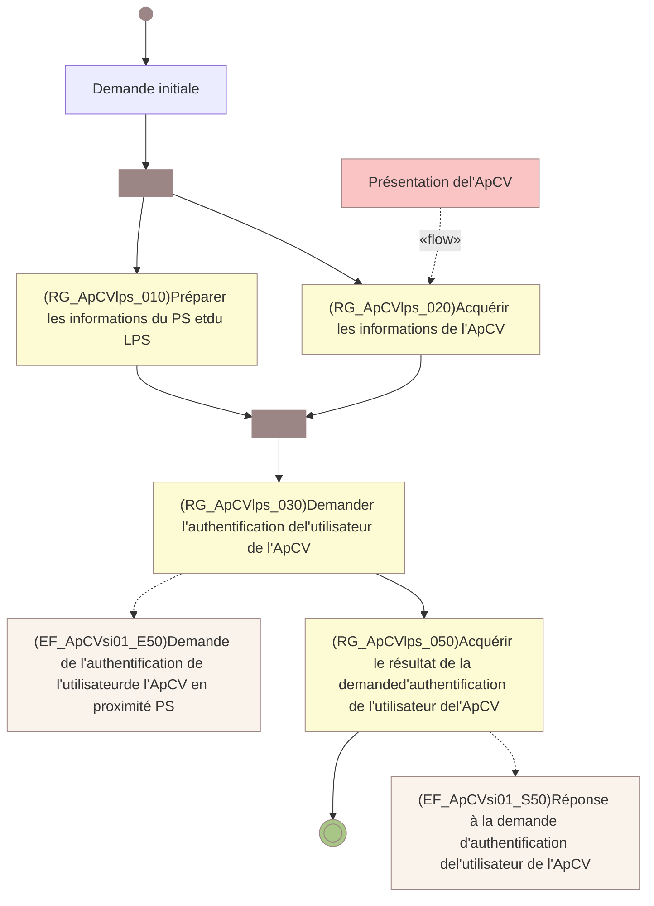
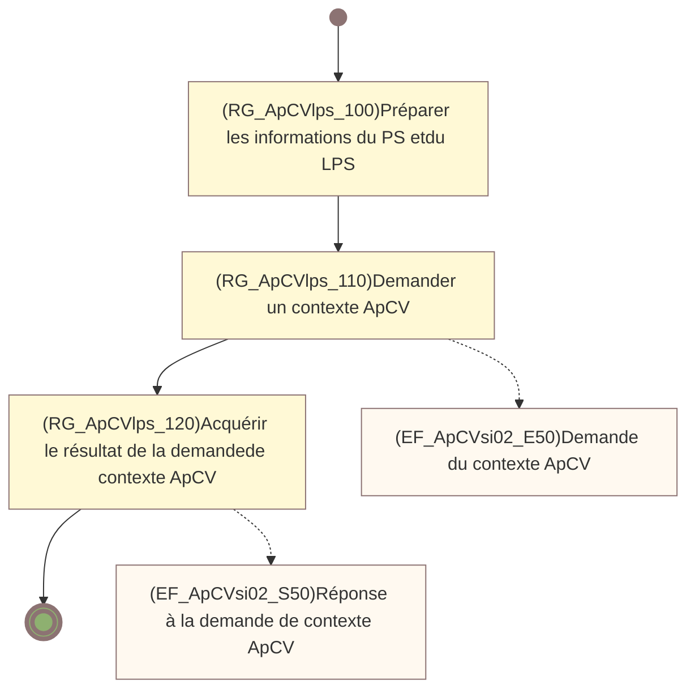
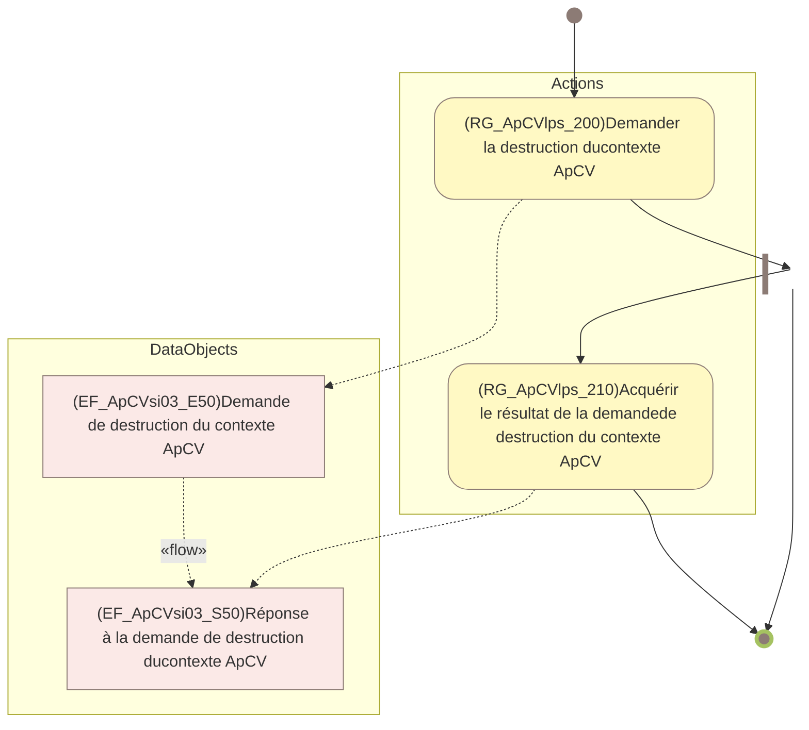
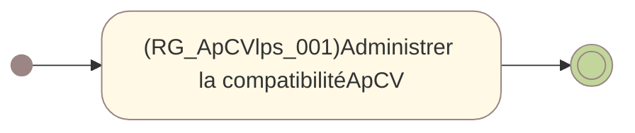

**Appli carte Vitale**

SPECIFICATION FONCTIONELLE GENERALE

logo: sesam-vitale

# SFG - Appli carte Vitale -

## Demander l'authentification et gérer le contexte ApCV - Editeurs

**Référence :** ApCV-SFG-004 / **Version :** 1.5 / **Date :** 15/10/2025
**Sécurité :** RESTREINTE / **Etat :** REFERENCE

**GIE SESAM-Vitale**
5, boulevard Marie et Alexandre Oyon – 72 019 LE MANS Cedex 2
<u>www.sesam-vitale.fr</u>

Ce document a été élaboré par le GIE SESAM-Vitale.

Conformément à l’article L.122-4 du Code de la Propriété Intellectuelle, toute représentation ou reproduction (intégrale ou partielle) du présent ouvrage, quel que soit le support utilisé, doit être soumise à l’accord préalable écrit de son auteur.

Il en est de même pour sa traduction, sa transformation, son adaptation ou son arrangement quel que soit le procédé utilisé.

Tout manquement à ces obligations constituerait un délit de contrefaçon, au sens des articles L 335-2 et suivants du code de la propriété intellectuelle, susceptible d’entraîner des sanctions pour l’auteur du délit.

## **CONTACTS**

logo: sesam-vitale

Pour toute demande d'évolution, comme pour toute question technique ou fonctionnelle, contactez le Centre de services°:
*   e-mail°: <u>**centre-de-service@sesam-vitale.fr**</u>
*   téléphone°: **02 43 57 42 88**

15/10/2025 GIE SESAM-Vitale 
 icon: sesam-vitale 2 / 31
Ce document à diffusion restreinte ne peut être diffusé sans l'autorisation d'une personne habilitée au GIE SESAM-Vitale

SFG - Appli carte Vitale -
ApCV-SFG-004 Demander l'authentification et gérer le contexte ApCV - Editeurs Version : 1.5

# SOMMAIRE

(Une table des matières est disponible page 30.)

<table>
    <tr>
      <td><strong>1</strong></td>
      <td><strong>INTRODUCTION DOCUMENTAIRE ..........................................................................................................5</strong></td>
    </tr>
    <tr>
      <td>1.1</td>
      <td>DOCUMENTS DE REFERENCE ...............................................................................................................5</td>
    </tr>
    <tr>
      <td>1.2</td>
      <td>ABREVIATIONS ....................................................................................................................................5</td>
    </tr>
    <tr>
      <td>1.3</td>
      <td>DEFINITIONS .......................................................................................................................................6</td>
    </tr>
    <tr>
      <td>1.4</td>
      <td>POSITIONNEMENT DU DOCUMENT .........................................................................................................8</td>
    </tr>
    <tr>
      <td><strong>2</strong></td>
      <td><strong>PERIMETRE SFG.......................................................................................................................................9</strong></td>
    </tr>
    <tr>
      <td>2.1</td>
      <td>CONTEXTE ET PERIMETRE DU SYSTEME DECRIT DANS LA SFG ................................................................9</td>
    </tr>
    <tr>
      <td>2.2</td>
      <td>ACTEURS ET OBJECTIFS METIERS .......................................................................................................11</td>
    </tr>
    <tr>
      <td>2.3</td>
      <td>DESCRIPTION GENERALE DU PROCESSUS « AUTHENTIFIER ET GERER UN CONTEXTE APCV » .............13</td>
    </tr>
    <tr>
      <td><mark>2.4</mark></td>
      <td><mark><s>DESCRIPTION GENERALE DU PROCESSUS « ADMINISTRER LE LPS »</s></mark> ....................................................17</td>
    </tr>
    <tr>
      <td><strong>3</strong></td>
      <td><strong>DESCRIPTION DETAILLEE DU PROCESSUS « AUTHENTIFIER ET GERER LE CONTEXTE APCV »</strong><br /><strong>..................................................................................................................................................................18</strong></td>
    </tr>
    <tr>
      <td>3.1</td>
      <td>(AUT) DEMANDER L'AUTHENTIFICATION DE L'UTILISATEUR D'UNE APCV ...............................................18</td>
    </tr>
    <tr>
      <td>3.2</td>
      <td>(RES) DEMANDER UN CONTEXTE APCV ............................................................................................22</td>
    </tr>
    <tr>
      <td>3.3</td>
      <td>(DEL) DEMANDER LA DESTRUCTION DU CONTEXTE APCV ...................................................................25</td>
    </tr>
    <tr>
      <td><mark><strong>4</strong></mark></td>
      <td><mark><strong><s>DESCRIPTION DETAILLEE DU PROCESSUS « ADMINISTRER LE LPS »</s></strong></mark> <strong>........................................27</strong></td>
    </tr>
    <tr>
      <td><mark>4.1</mark></td>
      <td><mark><s>ADMINISTRER LA COMPTABILITE APCV</s></mark> ...............................................................................................27</td>
    </tr>
</table>

## TABLE DES ILLUSTRATIONS

<table>
    <tr>
      <td>FIGURE 1°: ARCHITECTURE DOCUMENTAIRE DU SYSTEME APCV (EDITEURS)</td>
      <td>........................................................................................................8</td>
    </tr>
    <tr>
      <td>FIGURE 2°: CONTEXTE APCV (VUE GLOBALE)</td>
      <td>........................................................................................................................9</td>
    </tr>
    <tr>
      <td><mark><u>FIGURE 3°: ACTEURS</u> <u>ET OBJECTIFS METIER</u></mark></td>
      <td>..........................................................................................................12</td>
    </tr>
    <tr>
      <td>FIGURE 4°: CONTEXTE APCV (VUE DETAILLEE)</td>
      <td>....................................................................................................14</td>
    </tr>
    <tr>
      <td>FIGURE 5°: DESCRIPTION DU PROCESSUS "AUTHENTIFIER ET GERER LE CONTEXTE APCV"</td>
      <td>....................................15</td>
    </tr>
    <tr>
      <td>FIGURE 6°: LES ECHANGES DU SYSTEME AVEC LES ACTEURS</td>
      <td>................................................................................16</td>
    </tr>
    <tr>
      <td><mark><s>FIGURE 7°: DESCRIPTION DU PROCESSUS "ADMINISTRER LE LPS"</s></mark></td>
      <td>........................................................................17</td>
    </tr>
    <tr>
      <td>FIGURE 8°: ENTREES / SORTIES DE LA FONCTIONNALITE "DEMANDER L'AUTHENTIFICATION DE L'UTILISATEUR D'UNE APCV"</td>
      <td>..............................................................................................................................................19</td>
    </tr>
    <tr>
      <td>FIGURE 9°: DESCRIPTION DE LA FONCTIONNALITE "DEMANDER L'AUTHENTIFICATION DE L'UTILISATEUR D'UNE APCV"</td>
      <td>20</td>
    </tr>
    <tr>
      <td>FIGURE 10°: ENTREES / SORTIES DE LA FONCTIONNALITE "DEMANDER UN CONTEXTE APCV"</td>
      <td>..................................22</td>
    </tr>
    <tr>
      <td>FIGURE 11°: DESCRIPTION DE LA FONCTIONNALITE "DEMANDER UN CONTEXTE APCV"</td>
      <td>...........................................23</td>
    </tr>
    <tr>
      <td>FIGURE 12°: ENTREES / SORTIES DE LA FONCTIONNALITE "DEMANDER LA DESTRUCTION DU CONTEXTE APCV"</td>
      <td>........25</td>
    </tr>
    <tr>
      <td>FIGURE 13°: DESCRIPTION DE LA FONCTIONNALITE "DEMANDER LA DESTRUCTION DU CONTEXTE APCV"</td>
      <td>.................26</td>
    </tr>
    <tr>
      <td><mark><s>FIGURE 14°: ADMINISTRER LA COMPATIBILITE APCV</s></mark></td>
      <td>.............................................................................................27</td>
    </tr>
</table>

## TABLE DES ANNEXES

<table>
    <tr>
      <td>ANNEXE 1</td>
      <td>GUIDE DE LECTURE .....................................................................................................</td>
      <td>28</td>
    </tr>
</table>

15/10/2025 
 icon: GIE SESAM-Vitale logo GIE SESAM-Vitale 3 / 31
Ce document à diffusion restreinte ne peut être diffusé sans l'autorisation d'une personne habilitée au GIE SESAM-Vitale

ApCV-SFG-004
*SFG - Appli carte Vitale -*
*Demander l'authentification et gérer le contexte ApCV*
*- Editeurs*
Version : 1.5

**ANNEXE 2 TABLES DES MATIERES ..............................................................................................30**

**ANNEXE 3 TABLE DES REGLES DE GESTION .............................................................................31**

15/10/2025
GIE SESAM-Vitale icon: GIE SESAM-Vitale logo 4 / 31

*Ce document à diffusion restreinte ne peut être diffusé sans l'autorisation d'une personne habilitée au GIE SESAM-Vitale*

ApCV-SFG-004
SFG - Appli carte Vitale -
Demander l'authentification et gérer le contexte ApCV
- Editeurs
Version : 1.5

# 1 INTRODUCTION DOCUMENTAIRE

## 1.1 Documents de référence

<table>
  <thead>
    <tr>
      <th>Type et titre</th>
      <th>Référence</th>
    </tr>
  </thead>
  <tbody>
    <tr>
      <td>GI – Demander l’authentification et gérer le contexte ApCV</td>
      <td>ApCV-MP-001</td>
    </tr>
    <tr>
      <td>Spécifications des échanges de proximité</td>
      <td>ApCV-NT-001</td>
    </tr>
  </tbody>
</table>

## 1.2 Abréviations

<table>
  <thead>
    <tr>
      <th colspan="2">Abréviations</th>
    </tr>
  </thead>
  <tbody>
    <tr>
      <td>AD</td>
      <td><b>A</b>yant <b>D</b>roit</td>
    </tr>
    <tr>
      <td>AM</td>
      <td><b>A</b>ssurance <b>M</b>aladie, sans distinction AMO ou AMC</td>
    </tr>
    <tr>
      <td>AMO</td>
      <td><b>A</b>ssurance <b>M</b>aladie <b>O</b>bligatoire</td>
    </tr>
    <tr>
      <td>ApCV</td>
      <td><b>A</b>pplication <b>C</b>arte <b>V</b>itale</td>
    </tr>
    <tr>
      <td>BAM</td>
      <td><b>B</b>énéficiaire de l’<b>A</b>ssurance <b>M</b>aladie</td>
    </tr>
    <tr>
      <td>BLE</td>
      <td><b>B</b>luetooth <b>L</b>ow <b>E</b>nergy</td>
    </tr>
    <tr>
      <td>CPx</td>
      <td><b>C</b>arte <b>P</b>rofessionnel de <b>S</b>anté (terme générique désignant une carte sans distinction de son type CPS, CPE, CPF)</td>
    </tr>
    <tr>
      <td>CV</td>
      <td><b>C</b>arte <b>V</b>itale</td>
    </tr>
    <tr>
      <td>CVid</td>
      <td><b>C</b>arte <b>V</b>itale individuelle <b>d</b>ématérialisée</td>
    </tr>
    <tr>
      <td>DP</td>
      <td><b>D</b>ossier <b>P</b>harmaceutique</td>
    </tr>
    <tr>
      <td>IAS</td>
      <td><b>I</b>dentification, <b>A</b>uthentification de proximité et <b>S</b>ignature.</td>
    </tr>
    <tr>
      <td>INS</td>
      <td><b>I</b>dentifiant <b>N</b>ational de <b>S</b>anté</td>
    </tr>
    <tr>
      <td>LPS</td>
      <td><b>L</b>ogiciel du <b>P</b>rofessionnel de <b>S</b>anté</td>
    </tr>
    <tr>
      <td>NFC</td>
      <td><b>N</b>ear <b>F</b>ield <b>C</b>ommunication</td>
    </tr>
    <tr>
      <td>OD</td>
      <td><b>O</b>uvrant <b>D</b>roit</td>
    </tr>
    <tr>
      <td>PS</td>
      <td><b>P</b>artenaire de <b>S</b>anté ou <b>P</b>rofessionnel de <b>S</b>anté</td>
    </tr>
    <tr>
      <td>QR code</td>
      <td><b>Q</b>uick <b>R</b>esponse <b>C</b>ode</td>
    </tr>
    <tr>
      <td>SFG</td>
      <td><b>S</b>pécification <b>F</b>onctionnelle <b>G</b>énérale</td>
    </tr>
    <tr>
      <td>SI-ApCV</td>
      <td><b>S</b>ystème d’<b>I</b>nformation <b>A</b>pCV</td>
    </tr>
    <tr>
      <td>SSV</td>
      <td><b>S</b>ervices <b>S</b>ESAM-<b>V</b>itale</td>
    </tr>
    <tr>
      <td>SV</td>
      <td><b>S</b>ESAM-<b>V</b>itale</td>
    </tr>
    <tr>
      <td>TLSi</td>
      <td><b>T</b>élé <b>S</b>ervice intégré</td>
    </tr>
    <tr>
      <td>WS</td>
      <td><i><b>W</b>eb <b>S</b>ervice</i></td>
    </tr>
  </tbody>
</table>

15/10/2025
GIE SESAM-Vitale 
 icon: GIE SESAM-Vitale logo 5 / 31
Ce document à diffusion restreinte ne peut être diffusé sans l'autorisation d'une personne habilitée au GIE SESAM-Vitale

SFG - Appli carte Vitale -
ApCV-SFG-004 Demander l'authentification et gérer le contexte ApCV - Editeurs Version : 1.5

# 1.3 Définitions

## Premières définitions

<table>
  <thead>
    <tr>
      <th colspan="2"><b>Définitions</b></th>
    </tr>
  </thead>
  <tbody>
    <tr>
      <td>ApCV</td>
      <td>Désigne l’application disponible au niveau des différents stores d’applications et à télécharger pour pouvoir s’enrôler.</td>
    </tr>
    <tr>
      <td>Carte Vitale <i>individuelle</i> dématérialisée</td>
      <td>Désigne la carte Vitale <i>individuelle</i> dématérialisée et individuelle associée à une personne (OD, AD, bénéficiaire prêté, etc.) et faisant partie d’un portefeuille de cartes Vitale dématérialisées d’un utilisateur.<br /><br /><i>Elle porte les données d’identification d’un seul bénéficiaire (identité AMO) et de son organisme gestionnaire (contrat AMO), elle ne contient pas de données de droits.</i></td>
    </tr>
    <tr>
      <td>Carte Vitale physique</td>
      <td>Désigne la carte Vitale physique (non dématérialisée).</td>
    </tr>
    <tr>
      <td>Demandeur</td>
      <td>Désigne cet individu s’il a entamé un processus de délivrance / enrôlement, tant que ce processus n’est pas finalisé.</td>
    </tr>
    <tr>
      <td>Enrôlement / Délivrance</td>
      <td>Processus via lequel un individu passe différents contrôles (identité, éligibilité, etc.) afin de lui faire délivrer son portefeuille de cartes Vitale, en établissant un lien avec son support mobile.</td>
    </tr>
    <tr>
      <td>Identité Patient</td>
      <td>Elle représente l’INS et les traits d’identité de référence d’un patient pour répondre aux finalités prévues par les textes encadrant l’usage de l’INS.</td>
    </tr>
    <tr>
      <td>Portefeuille de cartes Vitale individuelles dématérialisées</td>
      <td>Désigne un ensemble de carte(s) Vitale individuelle(s) dématérialisée(s) utilisable(s) dont celles de l’<i>utilisateur</i> et <i>éventuellement de</i> ses AD, mis à disposition d’un utilisateur qui s’est enrôlé.</td>
    </tr>
    <tr>
      <td>Profil</td>
      <td>Un utilisateur lié à un support (enrôlé) et ayant son portefeuille de cartes Vitale dématérialisées. Un support peut contenir ainsi plusieurs profils d’utilisateurs (exemple : famille utilisant un seul smartphone).</td>
    </tr>
    <tr>
      <td>Système ApCV</td>
      <td>Désigne le système IR en interaction avec l’ApCV, qui est composé à la fois du SI ApCV ainsi que du SI de la solution industrielle retenue.</td>
    </tr>
    <tr>
      <td>Utilisateur</td>
      <td>Désigne cet individu suite à la finalisation du processus de délivrance avec succès.</td>
    </tr>
  </tbody>
</table>

## Définitions générales

<table>
  <thead>
    <tr>
      <th colspan="2">Définitions</th>
    </tr>
  </thead>
  <tbody>
    <tr>
      <td>Contexte ApCV</td>
      <td>
        Un contexte ApCV est un groupe de données contenant :
        <ul>
          <li>les données d’identification de l’utilisateur de l’ApCV sa carte Vitale individuelle dématérialisée et son identité patient (INS);</li>
          <li>éventuellement les données d’identification d’autres individus, avec pour chacun sa carte Vitale individuelle dématérialisée et son identité patient (INS) ;</li>
          <li>les informations relatives à l’ApCV.</li>
        </ul>
      </td>
    </tr>
  </tbody>
</table>

15/10/2025 GIE SESAM-Vitale 
 icon: SESAM-Vitale logo 6 / 31
Ce document à diffusion restreinte ne peut être diffusé sans l'autorisation d'une personne habilitée au GIE SESAM-Vitale

ApCV-SFG-004
SFG - Appli carte Vitale -
Demander l'authentification et gérer le contexte ApCV - Editeurs
Version : 1.5

## Autres Définitions

<table>
  <thead>
    <tr>
      <th colspan="2"><b>Définitions</b></th>
    </tr>
  </thead>
  <tbody>
    <tr>
      <td>Ameli Pro</td>
      <td>Portail en ligne destiné aux professionnels de santé permettant de réaliser un certain nombre de prestations en ligne.</td>
    </tr>
    <tr>
      <td>Carte du professionnel de santé</td>
      <td>Carte à puce permettant d’identifier le PS utilisant les téléservices.</td>
    </tr>
    <tr>
      <td>Code personnel</td>
      <td>Code secret permettant à un utilisateur de sécuriser son profil sur l’ApCV. Ce code doit ainsi être saisi afin de déverrouiller le profil ApCV.</td>
    </tr>
    <tr>
      <td>Logiciel du Professionnel de Santé</td>
      <td>Solution Logicielle utilisée par le PS pour accéder aux services de l’AM</td>
    </tr>
    <tr>
      <td>QR code</td>
      <td>C’est un type de code-barres en deux dimensions (ou code matriciel) constitué de modules noirs disposés dans un carré à fond blanc. L'agencement de ces points définit l'information que contient le code.</td>
    </tr>
    <tr>
      <td>Système d’Information ApCV</td>
      <td>SI développé par le GIE-SV et permettant de gérer les fonctionnalités de l’ApCV.</td>
    </tr>
    <tr>
      <td>Télé Service intégré</td>
      <td>Terme regroupant l'ensemble des téléservices de l'Assurance Maladie destinés à être intégrés directement dans un progiciel de santé.</td>
    </tr>
  </tbody>
</table>

## Définitions relatives aux SFG

<table>
  <thead>
    <tr>
      <th colspan="2"><b>Définitions</b></th>
    </tr>
  </thead>
  <tbody>
    <tr>
      <td>Situation spécifique</td>
      <td>Contexte métier impactant tout ou partie d’un processus<br />(exemple : CMU).</td>
    </tr>
    <tr>
      <td>Cas particulier / CP</td>
      <td>Déroulement ponctuel hors cas nominal.</td>
    </tr>
    <tr>
      <td>Cas d’erreur / CE</td>
      <td>Arrêt du fonctionnement du système.</td>
    </tr>
  </tbody>
</table>

15/10/2025
GIE SESAM-Vitale 
 icon: icon
7 / 31
Ce document à diffusion restreinte ne peut être diffusé sans l'autorisation d'une personne habilitée au GIE SESAM-Vitale

ApCV-SFG-004 SFG - Appli carte Vitale - Version : 1.5
Demander l'authentification et gérer le contexte ApCV
- Editeurs

## 1.4 **Positionnement du document**

| **(ApCV-SFG-004)**<br>**Editeurs - Demander l'authentification et gérer le contexte ApCV** | icon: Vous êtes ici | **(ApCV-MP-001)**<br>**GI - Demander l'authentification et gérer le contexte ApCV** icon: document |
| :--- | :---: | :--- |
| *Spécifications Fonctionnelles Générales du LPS de demande de l'authentification de l'utilisateur d'une ApCV et de la gestion du contexte ApCV.* A | | *Guide d'intégration de demande de l'authentification de l'utilisateur d'une ApCV et de la gestion du contexte ApCV par le LPS.* A |


| | | **(ApCV-MP-002)**<br>**GI - Demander la signature Vitale de la facture ApCV** icon: document |
| :--- | :---: | :--- |
| | | *Guide d'Intégration de gestion de la signature Vitale en présence d'une ApCV par le LPS* A |

**Figure 1°: Architecture documentaire du système ApCV (Editeurs)**

15/10/2025 GIE SESAM-Vitale 
 icon: icon 8 / 31
Ce document à diffusion restreinte ne peut être diffusé sans l'autorisation d'une personne habilitée au GIE SESAM-Vitale

SFG - Appli carte Vitale -
ApCV-SFG-004 Demander l'authentification et gérer le contexte ApCV - Editeurs Version : 1.5

# 2 PERIMETRE SFG

Ce dossier décrit l’authentification de l’utilisateur de l’ApCV et la gestion du cycle de vie du contexte ApCV sur le LPS. Il s’intègre dans le domaine fonctionnel de l’ApCV.

## 2.1 Contexte et périmètre du système décrit dans la SFG

### Présentation

Un contexte ApCV est un groupe de données contenant :
* les données d’identification de l’utilisateur de l’ApCV : sa carte Vitale individuelle dématérialisée (pouvant contenir son identité AMC) et son identité patient ;
* éventuellement les données d’identification d’autres individus, avec pour chacun : sa carte Vitale individuelle dématérialisée (avec éventuellement son identité AMC) et son identité patient ;
* les informations relatives à l’ApCV.

```mermaid
classDiagram
    class Contexte_ApCV {
        ::Contexte ApCV
        + Date de fin de validité: Date UTC
        + Identifiant: AN
    }

    subgraph Donnees_Niveau_ApCV ["Données de niveau \"ApCV et son utilisateur\""]
        Profil_ApCV [Profil ApCV]
        Utilisateur [Utilisateur]
        Note1 [Par héritage de l'individu,l'utilisateur possède :• une carte Vitaleindividuelledématérialisée ;• une identité patient.]
        
        %% Images inside the subgraph
        icon: smartphone with card
        image: person illustration
    end

    subgraph Donnees_Niveau_Individu ["Données de niveau \"Individu du portefeuille du profil ApCV\""]
        Individu [Individu]
        Identite_Patient [Identité Patient]
        Carte_Vitale [Carte Vitale IndividuelleDématérialisée (Bénéficiaire)]
        Identite_AMO [Identité AMO]
        Contrat_AMO [Contrat AMO]
        Organisme_AMO [Organisme AMO]
        
        %% Images inside the subgraph
        image: hand holding Vitale cards
        icon: patient identity symbols
    end

    Contexte_ApCV *-- "1" Profil_ApCV
    Profil_ApCV "1" -- "1" Utilisateur
    Utilisateur -- Note1 : (dashed)
    
    Profil_ApCV *-- "0..*" Individu : portefeuille
    Utilisateur --|> Individu
    
    Individu *-- "0..1" Identite_Patient : 1
    Individu *-- "1" Carte_Vitale : 1
    
    Carte_Vitale -- Identite_AMO : (dashed)
    Identite_AMO "1" -- "1" Contrat_AMO
    Contrat_AMO *-- "1" Organisme_AMO : 1
```

**Figure 2°: Contexte ApCV (Vue globale)**

Il est créé sur le SI-ApCV suite à une demande d’authentification de l’utilisateur d’une ApCV pour un Professionnel de Santé.

Le contexte ApCV a une durée de validité, durant laquelle l’accès aux services qui nécessitent la présence de l’utilisateur (signature Vitale notamment) est autorisé. Il reste accessible sur le SI-ApCV tant que sa durée de validité n’est pas dépassée.

15/10/2025 GIE SESAM-Vitale 
icon: SESAM-Vitale logo 9 / 31
Ce document à diffusion restreinte ne peut être diffusé sans l'autorisation d'une personne habilitée au GIE SESAM-Vitale

ApCV-SFG-004
SFG - Appli carte Vitale -
Demander l'authentification et gérer le contexte ApCV - Editeurs
Version : 1.5

Sur présentation d’une ApCV par son utilisateur, le PS acquiert un contexte ApCV lui permettant d’identifier l’utilisateur de l’ApCV, le bénéficiaire de soins et d’accéder aux services.

Si le contexte ApCV expire, une nouvelle authentification de l’utilisateur de l’ApCV est nécessaire pour accéder aux services de l’assurance maladie.

A la fin du processus de facturation mais aussi après <mark><u>avoir utilisé les autres</u></mark> services de l’assurance maladie par le PS, une demande de destruction du contexte ApCV est réalisée.

<mark><u>Plus précisément, un contexte appli carte Vitale valide permet au PS de faire</u> <u>éventuellement plusieurs opérations au cours de la session avec l’utilisateur :</u></mark>
* <mark><u>• Signer la/les FSE SESAM-Vitale</u></mark>
* <mark><u>• Et/Ou Accès TLSi AMO (AATi…)</u></mark>
* • Et/Ou Accès DMPi
* <mark><u>• Et/ou Accès ameliPro PS</u></mark>
* <mark><u>• Et/ou Accès WebDMP PS.</u></mark>

Dit autrement, le logiciel ne doit pas détruire le contexte appli carte Vitale tant qu’il est valide car il peut permettre au PS d’effectuer une autre opération par la suite sans avoir à demander à l’utilisateur de représenter son appli carte Vitale : comme par ex pour accéder à ameliPro PS après avoir signé la FSE.

=> Il est donc conseillé de détruire un contexte appli carte Vitale valide uniquement au départ de l’utilisateur de l’appli carte Vitale (par ex : fin de consultation), pas avant sauf lorsqu’une carte Vitale/appli carte Vitale est lue ou à la fermeture du logiciel.

## Principes

Pour un utilisateur d’ApCV, il ne peut y avoir qu’un seul contexte ApCV actif sur le SI-ApCV à un instant donné :
* Une demande de création de contexte ApCV pour une ApCV détruit automatiquement tout précédent contexte ApCV valide pour cette ApCV ;
* Permet de lutter contre la fraude.

Pour un PS, il ne peut y avoir qu’un seul contexte ApCV actif sur le SI-ApCV à un instant donné :
* Une demande de création de contexte ApCV pour ce PS détruit automatiquement tout précédent contexte ApCV valide pour ce PS ;

La validité d’un contexte ApCV vaut pour contrôle d’opposition de l’ApCV liée à ce contexte ApCV.

Le contexte ApCV ne comporte pas de données de droits des bénéficiaires.

Un contexte ApCV peut être créé même si l’ApCV n’est pas connectée à internet.

## Périmètre

Le contexte ApCV permet l’accès aux services de l’assurance maladie <mark>obligatoire</mark> suivants :
* Facturation SESAM-Vitale (Addendum 8) ;
* Téléservices intégrés au logiciel PS (TLSi) ;
* DMPi PS.

Le contexte ApCV peut également être acquis pour consultation, indépendamment de l’accès aux services de l’Assurance Maladie <mark>obligatoire</mark>.

## <mark><u>Points en</u> <u>suspens</u></mark>

<mark><u>L’utilisation des données d’identité patient doit être confirmée par la réglementation.</u></mark>

15/10/2025
GIE SESAM-Vitale 
icon: GIE SESAM-Vitale logo 10 / 31
Ce document à diffusion restreinte ne peut être diffusé sans l'autorisation d'une personne habilitée au GIE SESAM-Vitale

ApCV-SFG-004
SFG - Appli carte Vitale -
Demander l'authentification et gérer le contexte ApCV - Editeurs
Version : 1.5

# 2.2 Acteurs et objectifs métiers

Ce paragraphe décrit :
* les acteurs (humains et systèmes) interagissant avec le système décrit dans cette SFG ;
* les objectifs métiers qui justifient l’utilisation du système.

## Acteurs

<table>
  <thead>
    <tr>
      <th>Nom</th>
      <th>Définition du rôle</th>
      <th>Personne, entité ou système effectuant ce rôle</th>
    </tr>
  </thead>
  <tbody>
    <tr>
      <td>PS</td>
      <td>Il accède aux services de l’assurance maladie pour un bénéficiaire de soins.</td>
      <td>Personne physique : tout médecin généraliste ou spécialiste, auxiliaire médical, personnel de centres de santé, pharmacien, opticien…</td>
    </tr>
    <tr>
      <td>LPS</td>
      <td>Il permet au PS d’accéder aux services de l’assurance maladie avec une ApCV via l’acquisition d’un contexte ApCV.</td>
      <td>Système interne</td>
    </tr>
    <tr>
      <td>SI-ApCV</td>
      <td>Il authentifie l’utilisateur d’une ApCV et gère le cycle de vie d’un contexte ApCV (création, mise à disposition, destruction)</td>
      <td>Système externe</td>
    </tr>
    <tr>
      <td>ApCV</td>
      <td>Application carte Vitale permettant à son utilisateur de s’authentifier auprès du Professionnel de Santé.<br /><br />L’utilisateur est un bénéficiaire ou un assuré de l’assurance maladie <mark>obligatoire</mark>.</td>
      <td>Application sur système mobile</td>
    </tr>
    <tr>
      <td>Utilisateur</td>
      <td>Il saisit son code secret pour prouver son authenticité.</td>
      <td>Personne physique</td>
    </tr>
  </tbody>
</table>

## Objectifs métiers

Dans le cadre de cette SFG, les objectifs métiers justifiant l’utilisation du système sont les suivants :
* Authentifier l’utilisateur d’une ApCV ;
* Gérer le contexte ApCV ;
* ~~<mark>Administrer le LPS.</mark>~~

15/10/2025
GIE SESAM-Vitale 
 icon: SESAM-Vitale logo 11 / 31
Ce document à diffusion restreinte ne peut être diffusé sans l'autorisation d'une personne habilitée au GIE SESAM-Vitale

ApCV-SFG-004 SFG - Appli carte Vitale - Version : 1.5
Demander l'authentification et gérer le contexte ApCV
- Editeurs

## **Croisement objectifs / acteurs**



<mark><u>**Figure 3°: Acteurs et objectifs métier**</u></mark>

15/10/2025 GIE SESAM-Vitale 
icon: icon 12 / 31
Ce document à diffusion restreinte ne peut être diffusé sans l'autorisation d'une personne habilitée au GIE SESAM-Vitale

ApCV-SFG-004
SFG - Appli carte Vitale -
Demander l'authentification et gérer le contexte ApCV - Editeurs
Version : 1.5

# 2.3 Description générale du processus « Authentifier et gérer un contexte ApCV »

## 2.3.1 Cadrage fonctionnel

**Pré-requis**
Le PS est équipé d’un dispositif de lecture d’une ApCV, ce dernier est configuré et opérationnel. Le système mobile de l’utilisateur permet les échanges avec les dispositifs de lecture d’une ApCV détenus par le PS. Le LPS est connecté à internet et peut interagir avec le SI-ApCV.

icon: exclamation mark La compatibilité ApCV est activée.

icon: arrow pointing down-right Il est demandé aux éditeurs de développer les fonctions de lecture d’une ApCV avec l’ensemble des technologies décrites dans le document technique ci-dessous.

icon: document Voir le document technique [Spécifications des échanges de proximité]

**Événement déclencheur**
Le PS souhaite acquérir des données d’identification de l’utilisateur d’une ApCV et de ses bénéficiaires pour accéder aux services des assurances maladies <mark><u>obligatoire.</u></mark>

**Description**
L’authentification de l’utilisateur de l’ApCV permet d’obtenir un contexte ApCV. Le service permet à un LPS de demander un contexte ApCV et de demander sa destruction.

**Données de sorties**
Le contexte ApCV est obtenu :

15/10/2025
GIE SESAM-Vitale 
icon: logo 13 / 31
Ce document à diffusion restreinte ne peut être diffusé sans l'autorisation d'une personne habilitée au GIE SESAM-Vitale

ApCV-SFG-004 SFG - Appli carte Vitale - Version : 1.5
Demander l'authentification et gérer le contexte ApCV
- Editeurs



**Données de niveau "ApCV et son utilisateur"**
(Regroupe Profil ApCV et Utilisateur)

**Données de niveau "bénéficiaires de l'assurance maladie"**
(Regroupe Individu, Identité AMO, Carte Vitale Individuelle Dématérialisée (Bénéficiaire), Identité Patient, Contrat AMO et Organisme AMO)

**Figure 4°: Contexte ApCV (vue détaillée)**

15/10/2025 GIE SESAM-Vitale 
 icon: icon 14 / 31
Ce document à diffusion restreinte ne peut être diffusé sans l'autorisation d'une personne habilitée au GIE SESAM-Vitale

SFG - Appli carte Vitale -
ApCV-SFG-004 Demander l'authentification et gérer le contexte ApCV - Editeurs Version : 1.5

## 2.3.2 Description du processus

Le LPS lit les informations de l’ApCV et demande l’authentification de l’utilisateur de l’ApCV auprès du SI-ApCV. Le LPS réceptionne le contexte ApCV ainsi créé.

Pendant la durée de validité du contexte ApCV, le LPS peut effectuer une demande de contexte ApCV (en cas de perte due à un dysfonctionnement du LPS par exemple). Le SI-ApCV authentifie le PS et le LPS et restitue le contexte ApCV associé à ce PS.

Dès lors que le PS a terminé son processus de facturation mais aussi l’accès aux autres services de l’assurance maladie <u><mark>obligatoire</mark></u> (déclaration MT, avis arrêt de travail …), une demande de destruction du contexte ApCV doit être envoyée par le LPS au SI-ApCV.



Figure 5°: Description du processus "Authentifier et gérer le contexte ApCV"

15/10/2025 GIE SESAM-Vitale 
 icon: icon 15 / 31
Ce document à diffusion restreinte ne peut être diffusé sans l'autorisation d'une personne habilitée au GIE SESAM-Vitale

ApCV-SFG-004
SFG - Appli carte Vitale -
Demander l'authentification et gérer le contexte ApCV - Editeurs
Version : 1.5

### 2.3.3 Les échanges du système avec les acteurs

Ce paragraphe présente le système spécifié dans le cadre des SFG et les échanges avec les acteurs (humains ou systèmes) dans le cadre du processus « Authentifier et gérer un contexte ApCV ».



**Figure 6°: Les échanges du système avec les acteurs**

**Description des échanges**

Le PS est équipé d’un dispositif de lecture d’une ApCV, il lit les données de l’ApCV (1) et demande via son LPS une authentification de l’utilisateur de l’ApCV (1.1) auprès du SI-ApCV. Le contexte ApCV est retourné au LPS par le SI-ApCV (1.2) (AUT).

Pendant la durée de validité du contexte ApCV, le LPS peut demander le contexte ApCV (2) qui reste accessible sur le SI-ApCV. Le contexte ApCV est restitué au LPS par le SI-ApCV (2.1) (RES).

Au départ de l’utilisateur (fin du processus de facturation mais aussi l’accès aux autres services de l’assurance maladie), une demande de destruction du contexte ApCV doit être faite au SI-ApCV (3) (DEL).

15/10/2025
GIE SESAM-Vitale 
 icon: SESAM-Vitale logo 16 / 31
Ce document à diffusion restreinte ne peut être diffusé sans l'autorisation d'une personne habilitée au GIE SESAM-Vitale

SFG - Appli carte Vitale -
ApCV-SFG-004 Demander l'authentification et gérer le contexte ApCV - Editeurs Version : 1.5

## **2.4 Description générale du processus « Administrer le LPS »**

### **2.4.1 Cadrage fonctionnel**

**<u>Description</u>**

<u>**Le LPS permet, par paramétrage, d’activer la compatibilité ApCV.**</u>

### **2.4.2 Description du processus**



**<u>Figure 7°: Description du processus "Administrer le LPS"</u>**

15/10/2025 GIE SESAM-Vitale 
 icon: icon 17 / 31
Ce document à diffusion restreinte ne peut être diffusé sans l'autorisation d'une personne habilitée au GIE SESAM-Vitale

ApCV-SFG-004
SFG - Appli carte Vitale -
Demander l'authentification et gérer le contexte ApCV - Editeurs
Version : 1.5

# 3 DESCRIPTION DETAILLEE DU PROCESSUS « AUTHENTIFIER ET GERER LE CONTEXTE APCV »

## 3.1 (AUT) Demander l'authentification de l'utilisateur d'une ApCV

### Vue générale

**_Pré-requis_** La compatibilité ApCV est activée.

**_Description_** Le processus débute par une préparation des informations d’identification du PS et du LPS. Ensuite, le PS lit les informations de l’ApCV. Il demande alors, via son LPS, une authentification de l’utilisateur de l’ApCV.

En réponse à la demande, le SI-ApCV retourne au LPS les données du contexte ApCV.

**_Entrées_** EF_ApCVsi01_E50 ......... Demande de l’authentification de l’utilisateur de l’ApCV en proximité PS

**_Sorties_** EF_ApCVsi01_S50 ......... Réponse à la demande d’authentification de l’utilisateur de l’ApCV

EF_ApCVsi01_S30 ......... Contexte ApCV

**_Situations spécifiques_** Aucune

15/10/2025
GIE SESAM-Vitale 
icon: icon 18 / 31
Ce document à diffusion restreinte ne peut être diffusé sans l'autorisation d'une personne habilitée au GIE SESAM-Vitale

ApCV-SFG-004 SFG - Appli carte Vitale - Version : 1.5
Demander l'authentification et gérer le contexte ApCV
- Editeurs

## Entrées / Sorties

Entrées



### Sorties

```mermaid
classDiagram
    class EF_ApCVsi01_S50 {
        (EF_ApCVsi01_S50)
        Réponse à la demande d'authentification de l'utilisateur de l'ApCV
    }

    class Réponses_fonctionnelles {
        <<enumeration>>
        (code, libellé)
        Réponses fonctionnelles à la demande d'authentification de l'utilisateur de l'ApCV
        --
        (0) OK
    }

    class EF_ApCVsi01_S30 {
        (EF_ApCVsi01_S30)
        Contexte ApCV
    }

    EF_ApCVsi01_S50 -- Réponses_fonctionnelles
    EF_ApCVsi01_S50 "1" *-- "0..1" EF_ApCVsi01_S30
    EF_ApCVsi01_S30 "1" -- "1" Illustration

    class Illustration {
        image: smartphone and Vitale cards
    }
```

**Figure 8°: Entrées / Sorties de la fonctionnalité "Demander l'authentification de l'utilisateur d'une ApCV"**

15/10/2025 GIE SESAM-Vitale 
 icon: icon 19 / 31
Ce document à diffusion restreinte ne peut être diffusé sans l'autorisation d'une personne habilitée au GIE SESAM-Vitale

ApCV-SFG-004
SFG - Appli carte Vitale -
Version : 1.5

# Demander l'authentification et gérer le contexte ApCV - Editeurs

## Illustration



**Figure 9°: Description de la fonctionnalité "Demander l'authentification de l'utilisateur d'une ApCV"**

## Règles de gestion

**[RG_ApCVlps_010] Préparer les informations du PS et du LPS**

Le LPS prépare les informations d'identification :

*   du Professionnel de santé {EF_ApCVsi01_E21} :
    Spécialité PS : il s'agit du code spécialité AMO du PS {EF_ApCVsi01_E21.02} (voir ApCV-MP-001) ;
    ID-NAT PS {EF_ApCVsi01_E21.01} et les autres données de l'assertion (voir ApCV-MP-001) ;
*   et de son LPS {EF_ApCVsi01_E20} via le contexte LPS (voir ApCV-MP-001).

15/10/2025
GIE SESAM-Vitale 
icon: icon 20 / 31
Ce document à diffusion restreinte ne peut être diffusé sans l'autorisation d'une personne habilitée au GIE SESAM-Vitale

ApCV-SFG-004
SFG - Appli carte Vitale -
Demander l'authentification et gérer le contexte ApCV - Editeurs
Version : 1.5

## [RG_ApCVlps_020] Acquérir les informations de l'ApCV

Le LPS lit le contenu de l'ApCV (voir ApCV-NT-001). Les données fournies sont chiffrées {EF_ApCVsi01_E50.1}.

## <u>RG_ApCVlps_060 Contrôler le QR Code</u>

<u>Le LPS vérifie le format du QR code, à savoir la chaine de caractères lue doit commencer par « PB83N8 » (ce qui correspond à « APCV » en base45).</u>

### icon: blue arrow <u>Cas d'erreur</u>

<u>CE_RGApCVlps100_01 : QR Code erroné</u>

<u>Description : Le QR code lu ne correspond pas à celui d’une ApCV</u>

<u>Terminaison : Le logiciel du PS affiche à l’utilisateur le message d’alerte suivant et arrête le processus de demande d’authentification de l’utilisateur :</u>

<u>*« Le QR Code lu ne correspond pas à celui d’une application carte Vitale ou son dispositif de lecture est mal paramétré ».*</u>

## [RG_ApCVlps_030] Demander l'authentification de l'utilisateur de l'ApCV

Le LPS envoie au SI-ApCV la demande d'authentification de l'utilisateur ApCV en proximité PS {EF_ApCVsi01_E50} (voir ApCV-MP-001).

## [RG_ApCVlps_050] Acquérir le résultat de la demande d'authentification de l'utilisateur de l'ApCV

Le LPS réceptionne la réponse à sa demande {EF_ApCVsi01_S50} et si la réponse fonctionnelle est OK (0), il acquiert les données de contexte ApCV fournies {EF_ApCVsi01_S30} et les enregistre dans son système (voir ApCV-MP-001).

Les données sont fournies en clair.

### Cas d'erreur

CE_RGApCVlps050_01 : WS en erreur

Description : Une erreur a été retournée par le service.

Terminaison : Le LPS affiche le message d'erreur correspondant (voir ApCV-MP-001).

15/10/2025
GIE SESAM-Vitale 
icon: GIE SESAM-Vitale logo 21 / 31
Ce document à diffusion restreinte ne peut être diffusé sans l'autorisation d'une personne habilitée au GIE SESAM-Vitale

SFG - Appli carte Vitale -
ApCV-SFG-004 Demander l'authentification et gérer le contexte ApCV - Editeurs Version : 1.5

# 3.2 (RES) Demander un contexte ApCV

## Vue générale

**Description** <u>Pendant la durée de validité du </u> contexte ApCV <mark><u>(demande d’authentification de </u></mark>
<mark><u>l’utilisateur réalisée en amont), </u></mark> ce dernier reste accessible sur le SI-ApCV. Le PS peut
l’acquérir depuis le même LPS qui a permis l’authentification de l’utilisateur de l’ApCV
(en cas de perte due à un dysfonctionnement du LPS par exemple), ou depuis un autre
LPS.

**Entrées** EF_ApCVsi02_E50 ......... Demande de contexte ApCV

**Sorties** EF_ApCVsi02_S50 ......... Réponse à la demande de contexte ApCV
EF_ApCVsi02_S30 ......... Contexte ApCV

**Situations spécifiques** Aucune

## Entrées / Sorties

### Entrées

```mermaid
classDiagram
    class Demande_du_contexte_ApCV {
        (EF_ApCVsi02_E50)
        Demande du contexte ApCV
    }
    class Professionnel_de_sante {
        (EF_ApCVsi02_E21)
        Professionnel de santé (PS)
    }
    class LPS {
        (EF_ApCVsi02_E20)
        LPS
    }

    Demande_du_contexte_ApCV "1" *-- "1" Professionnel_de_sante
    Demande_du_contexte_ApCV "1" *-- "1" LPS
```

### Sorties

```mermaid
classDiagram
    class Reponse_a_la_demande {
        (EF_ApCVsi02_S50)
        Réponse à la demande de contexte ApCV
    }
    class Contexte_ApCV {
        (EF_ApCVsi02_S30)
        Contexte ApCV
    }
    class Réponses_fonctionnelles {
        <<enumeration>>
        (code, libellé)
        Réponses fonctionnelles à la demande de contexte ApCV
        --
        (0) OK
        (1) Contexte non valide
    }

    Reponse_a_la_demande "1" *-- "0..1" Contexte_ApCV
    Reponse_a_la_demande -- Réponses_fonctionnelles
    Contexte_ApCV "1" -- "1" Identite_Nationale_de_Sante

    class Identite_Nationale_de_Sante {
        image: Identité Nationale de Santé, carte Vitale et smartphone
    }
```

**Figure 10°: Entrées / Sorties de la fonctionnalité "Demander un contexte ApCV"**

15/10/2025 GIE SESAM-Vitale 
 icon: SESAM-Vitale logo 22 / 31
Ce document à diffusion restreinte ne peut être diffusé sans l'autorisation d'une personne habilitée au GIE SESAM-Vitale

ApCV-SFG-004
SFG - Appli carte Vitale -
Demander l'authentification et gérer le contexte ApCV - Editeurs
Version : 1.5

## Illustration



**Figure 11°: Description de la fonctionnalité "Demander un contexte ApCV"**

## Règles de gestion

### **[RG_ApCVlps_100]** *Préparer les informations du PS et du LPS*

Le LPS prépare les informations d'identification :

*   du Professionnel de santé {EF_ApCVsi02_E21} :
    ID-NAT PS {EF_ApCVsi02_E21.01} et les autres données de l'assertion (voir ApCV-MP-001) ;
*   et de son LPS {EF_ApCVsi02_E20} via le contexte LPS (voir ApCV-MP-001).

### **[RG_ApCVlps_110]** *Demander un contexte ApCV*

Le LPS envoie au SI-ApCV la demande de contexte ApCV {EF_ApCVsi02_E50} (voir ApCV-MP-001).

### **[RG_ApCVlps_120]** *Acquérir le résultat de la demande de contexte ApCV*

Le LPS réceptionne la réponse à sa demande {EF_ApCVsi02_S50} et si la réponse fonctionnelle est OK (0), il acquiert les données de contexte ApCV fournies {EF_ApCVsi02_S30} et les enregistre dans son système (voir ApCV-MP-001).

15/10/2025
GIE SESAM-Vitale 
 icon: SESAM-Vitale logo 23 / 31
Ce document à diffusion restreinte ne peut être diffusé sans l'autorisation d'une personne habilitée au GIE SESAM-Vitale

ApCV-SFG-004
SFG - Appli carte Vitale -
Demander l'authentification et gérer le contexte ApCV - Editeurs
Version : 1.5

Les données sont fournies en clair.

## Cas d'erreur

**CE_RGApCVlps120_01 : contexte ApCV non valide**

Description : La réponse à la demande de contexte ApCV {EF_ApCVsi02_S50} reçue par le LPS indique que le contexte ApCV; indiqué dans la demande (identifiant) est non valide.

Terminaison : Le LPS affiche un message d'erreur (voir ApCV-MP-001) indiquant que le contexte ApCV n'a pas été retourné. Une nouvelle demande de contexte ApCV doit être effectuée.

**CE_RGApCVlps120_02 : WS en erreur**

Description : Une erreur a été retournée par le service.

Terminaison : Le LPS affiche le message d'erreur correspondant (voir ApCV-MP-001).

15/10/2025
GIE SESAM-Vitale 
icon: GIE SESAM-Vitale logo 24 / 31
Ce document à diffusion restreinte ne peut être diffusé sans l'autorisation d'une personne habilitée au GIE SESAM-Vitale

ApCV-SFG-004
SFG - Appli carte Vitale -
Demander l'authentification et gérer le contexte ApCV - Editeurs
Version : 1.5

# 3.3 (DEL) Demander la destruction du contexte ApCV

## Vue générale

**Description** Dès lors que le PS aura terminé son processus de facturation mais aussi l’accès aux autres services de l’assurance maladie <mark><u>obligatoire</u></mark> (déclaration MT, avis arrêt de travail …), une demande de destruction du contexte ApCV doit être envoyée.

**Entrées** EF_ApCVsi03_E50 ......... Demande de destruction du contexte ApCV

**Sorties** EF_ApCVsi03_S50 ......... Réponse à la demande de destruction du contexte ApCV

**Situations spécifiques** Aucune

## Entrées / Sorties

```mermaid
classDiagram
    class Entrées {
        <<boundary>>
    }
    class Sorties {
        <<boundary>>
    }

    class EF_ApCVsi03_E50 {
        (EF_ApCVsi03_E50)
        Demande de destruction du contexte ApCV
    }

    class EF_ApCVsi03_E21 {
        (EF_ApCVsi03_E21)
        Professionnel de santé (PS)
    }

    class EF_ApCVsi03_E20 {
        (EF_ApCVsi03_E20)
        LPS
    }

    class EF_ApCVsi03_E30 {
        (EF_ApCVsi03_E30)
        Contexte ApCV
    }

    class EF_ApCVsi03_S50 {
        (EF_ApCVsi03_S50)
        Réponse à la demande de destruction du contexte ApCV
    }

    class enumeration_Reponse {
        <<enumeration>>
        (code, libellé)
        Réponse fonctionelle à la demande de destruction du
        contexte ApCV
        --
        (0) OK
        (1) Contexte non valide
    }

    EF_ApCVsi03_E50 "1" *-- "1" EF_ApCVsi03_E21
    EF_ApCVsi03_E50 "1" *-- "1" EF_ApCVsi03_E20
    EF_ApCVsi03_E50 "1" *-- "1" EF_ApCVsi03_E30
    
    EF_ApCVsi03_E50 ..> EF_ApCVsi03_S50 : «flow»
    EF_ApCVsi03_S50 -- enumeration_Reponse
```

**Figure 12°: Entrées / Sorties de la fonctionnalité "Demander la destruction du contexte ApCV"**

15/10/2025
GIE SESAM-Vitale 
 logo: icon 25 / 31
Ce document à diffusion restreinte ne peut être diffusé sans l'autorisation d'une personne habilitée au GIE SESAM-Vitale

SFG - Appli carte Vitale -
ApCV-SFG-004 Demander l'authentification et gérer le contexte ApCV - Editeurs Version : 1.5

### Illustration



**Figure 13°: Description de la fonctionnalité "Demander la destruction du contexte ApCV"**

### Règles de gestion

#### [RG_ApCVlps_200] Demander la destruction du contexte ApCV

Une demande de destruction du contexte ApCV doit être envoyée dans l'une des situations suivantes : au départ de l’utilisateur ou lorsqu’une carte Vitale est introduite dans le lecteur de carte ou à la fermeture du LPS.

Le LPS envoie au SI-ApCV la demande de destruction du contexte ApCV {EF_ApCVsi03_E50}, contenant :

*   l'identifiant du contexte ApCV {EF_ApCVsi03_E30.1} ;
*   l'identification du professionnel de santé, identifié par son ID-NAT PS {EF_ApCVsi03_E21.1} ainsi que les autres données de l'assertion PS (voir ApCV-MP-001).

#### [RG_ApCVlps_210] Acquérir le résultat de la demande de destruction du contexte ApCV

Le LPS réceptionne la réponse à sa demande {EF_ApCVsi03_S50} (voir ApCV-MP-001).

<Alerte> Il n'est pas nécessaire d'attendre la réponse à la demande de destruction du contexte ApCV pour poursuivre le processus appelant.</Alerte>

**Cas particulier**

**CE_RGApCVlps210_01 : contexte ApCV non valide**

**Description :** La réponse à la demande de destruction du contexte ApCV {EF_ApCVsi03_S50} reçue par le LPS indique que le contexte ApCV indiqué dans la demande (identifiant) est non valide.

**Terminaison :** Le LPS affiche un message d'erreur (voir ApCV-MP-001) indiquant que le contexte ApCV n'a pas été retourné. L'identifiant du contexte est erroné ou le contexte a déjà été détruit.

**CE_RGApCVlps210_02 : WS en erreur**

**Description :** Une erreur a été retournée par le service.

**Terminaison :** Le LPS affiche le message d'erreur correspondant (voir ApCV-MP-001).

15/10/2025 GIE SESAM-Vitale 
icon: icon 26 / 31
Ce document à diffusion restreinte ne peut être diffusé sans l'autorisation d'une personne habilitée au GIE SESAM-Vitale

ApCV-SFG-004
SFG - Appli carte Vitale -
Demander l'authentification et gérer le contexte ApCV
- Editeurs
Version : 1.5

# 4 DESCRIPTION DETAILLEE DU PROCESSUS <u>« ADMINISTRER LE LPS »</u>

## 4.1 Administrer la comptabilité ApCV

<u>**Vue générale**</u>

**<u>Description</u>** <u>Le LPS permet, par paramétrage, d’activer la compatibilité ApCV.</u>

<u>**Illustration**</u>



Figure 14°: Administrer la compatibilité ApCV

<u>**Règles de gestion**</u>

<u>**[RG_ApCVlps_001]**</u> <u>**Administrer la compatibilité ApCV**</u>

<u>Le LPS permet, par paramétrage, d’activer la compatibilité ApCV.</u>

<u>La modification du paramétrage est effectuée par l’éditeur à partir des consignes / fiches d’information de l’assurance maladie, sans redéploiement. Le Professionnel de Santé n’a pas la possibilité de le modifier.</u>

<u>Dès son activation, le LPS alerte le Professionnel de Santé.</u>

<u>A partir de la date de généralisation (paramètre configurable dont la valeur est définie dans les consignes de l’assurance maladie), la compatibilité ApCV est nécessairement activée.</u>

15/10/2025
GIE SESAM-Vitale 
 icon: SESAM-Vitale logo 27 / 31
Ce document à diffusion restreinte ne peut être diffusé sans l'autorisation d'une personne habilitée au GIE SESAM-Vitale

ApCV-SFG-004
SFG - Appli carte Vitale -
Demander l'authentification et gérer le contexte ApCV - Editeurs
Version : 1.5

# ANNEXE 1 GUIDE DE LECTURE

## Indications dans la marge

icon: icon Les éléments importants et les remarques sont indiqués par une main dans la marge.

icon: icon Les questions importantes sont indiquées par un point d’interrogation dans la marge.

icon: icon Les alertes importantes sont indiquées par ce pictogramme dans la marge.

icon: icon Les références documentaires sont indiquées par ce pictogramme dans la marge.

## Codes couleur

Les codes couleur suivants sont utilisés dans ce document :

*   <mark><u>Texte surligné jaune</u></mark> = texte ajouté par rapport à la version &lt;indiquer la version d’origine&gt;
*   ~~Texte barré~~ ou ~~<mark><u>barré surligné jaune</u></mark>~~ = texte supprimé
*   <mark><u>Texte surligné vert</u></mark> = texte à revoir
*   Texte de couleur bleu <mark><u>ou surligné en bleu</u></mark> = texte à revoir avec les membres

Pour les diagrammes les codes couleur sont les suivants°:

Ces 3 styles sont distinguables par leur fond :

|                gris clair               |       gris foncé      |        blanc        |
| :-------------------------------------: | :-------------------: | :-----------------: |
|                    ┆                    |           ┆           |          ┆          |
| **Elément normal (couleur par défaut)** | **Elément important** | **Elément externe** |

Ces 3 styles sont distinguables par leur contour :

|   noir épaisseur 2  |        (aucun)       |       blanc épaisseur 2       |
| :-----------------: | :------------------: | :---------------------------: |
|          ┆          |           ┆          |               ┆               |
| **Elément modifié** | **Elément à revoir** | **Elément à revoir avec MOA** |
|                     |           ┆          |               ┆               |

Ces éléments sont temporaires. Ils n'apparaissent pas dans les versions finalisées.

## Exigences fonctionnelles

Par défaut, la totalité de ce document est constituée d’exigences fonctionnelles.

Cinq exceptions sont à noter :

*   Dans les processus, il est possible de citer des étapes sans utilisation du système (fonctionnalités typées « métier »),
*   Les règles de gestion de type « métier », « consigne utilisateur » ou « convention » ne font pas partie des exigences fonctionnelles (elles ne sont pas prises en charge par le système),
*   Les illustrations et les exemples ne font également pas partie des exigences fonctionnelles. Ils sont précédés par la mention « Illustration » en marge. Il est également possible d’utiliser une étiquette « Préambule ».
*   Les recommandations pour les développeurs et les éditeurs,

15/10/2025
GIE SESAM-Vitale 
icon: icon
28 / 31
Ce document à diffusion restreinte ne peut être diffusé sans l'autorisation d'une personne habilitée au GIE SESAM-Vitale

ApCV-SFG-004
SFG - Appli carte Vitale -
Version : 1.5

# Demander l'authentification et gérer le contexte ApCV - Editeurs

## Références

Certains éléments dans ce document sont référencés à l’aide d’un identifiant unique au sein de ce document. Les références suivantes sont utilisées :

*   **RG_...** pour les règles de gestion,
*   **EF_...** pour les entités fonctionnelles,
*   **CE_...** pour les cas d’erreurs (arrêt du fonctionnement du système),
icon: arrow ***CP_... pour les cas particuliers (pas d’arrêt du fonctionnement du système),***
*   ...

Ces références sont utilisées pour faire des renvois explicites vers les éléments concernés.

NB : pour une donnée unitaire, on ajoute l’indice de cette donnée à la référence de l’entité fonctionnelle. Par exemple : EF_01_1 est un renvoi vers la première donnée unitaire de l’entité EF_01.

15/10/2025
GIE SESAM-Vitale 
 icon: logo 29 / 31
Ce document à diffusion restreinte ne peut être diffusé sans l'autorisation d'une personne habilitée au GIE SESAM-Vitale

ApCV-SFG-004
SFG - Appli carte Vitale -
Demander l'authentification et gérer le contexte ApCV - Editeurs
Version : 1.5

## ANNEXE 2 TABLES DES MATIERES

<table>
    <tr>
      <td><b>1</b></td>
      <td><b>INTRODUCTION DOCUMENTAIRE ..........................................................................................................</b></td>
      <td><b>5</b></td>
    </tr>
    <tr>
      <td>1.1</td>
      <td>DOCUMENTS DE REFERENCE ...............................................................................................................</td>
      <td>5</td>
    </tr>
    <tr>
      <td>1.2</td>
      <td>ABREVIATIONS ....................................................................................................................................</td>
      <td>5</td>
    </tr>
    <tr>
      <td>1.3</td>
      <td>DEFINITIONS .......................................................................................................................................</td>
      <td>6</td>
    </tr>
    <tr>
      <td>1.4</td>
      <td>POSITIONNEMENT DU DOCUMENT .........................................................................................................</td>
      <td>8</td>
    </tr>
    <tr>
      <td><b>2</b></td>
      <td><b>PERIMETRE SFG .......................................................................................................................................</b></td>
      <td><b>9</b></td>
    </tr>
    <tr>
      <td>2.1</td>
      <td>CONTEXTE ET PERIMETRE DU SYSTEME DECRIT DANS LA SFG ...............................................................</td>
      <td>9</td>
    </tr>
    <tr>
      <td>2.2</td>
      <td>ACTEURS ET OBJECTIFS METIERS .......................................................................................................</td>
      <td>11</td>
    </tr>
    <tr>
      <td>2.3</td>
      <td>DESCRIPTION GENERALE DU PROCESSUS « AUTHENTIFIER ET GERER UN CONTEXTE APCV » ...............</td>
      <td>13</td>
    </tr>
    <tr>
      <td></td>
      <td>2.3.1 <i>Cadrage fonctionnel ........................................................................................................</i></td>
      <td><i>13</i></td>
    </tr>
    <tr>
      <td></td>
      <td>2.3.2 <i>Description du processus ................................................................................................</i></td>
      <td><i>15</i></td>
    </tr>
    <tr>
      <td></td>
      <td>2.3.3 <i>Les échanges du système avec les acteurs ...................................................................</i></td>
      <td><i>16</i></td>
    </tr>
    <tr>
      <td><mark><u>2.4</u></mark></td>
      <td><mark><s><u>DESCRIPTION GENERALE DU PROCESSUS « ADMINISTRER LE LPS »</u></s></mark> ....................................................</td>
      <td>17</td>
    </tr>
    <tr>
      <td></td>
      <td><mark><u>2.4.1</u></mark> <mark><s><i><u>Cadrage fonctionnel</u></i></s></mark> ........................................................................................................</td>
      <td>17</td>
    </tr>
    <tr>
      <td></td>
      <td><mark><u>2.4.2</u></mark> <mark><s><i><u>Description du processus</u></i></s></mark> ................................................................................................</td>
      <td>17</td>
    </tr>
    <tr>
      <td><b>3</b></td>
      <td><b>DESCRIPTION DETAILLEE DU PROCESSUS « AUTHENTIFIER ET GERER LE CONTEXTE APCV »</b><br /><b>..................................................................................................................................................................</b></td>
      <td><b>18</b></td>
    </tr>
    <tr>
      <td>3.1</td>
      <td>(AUT) DEMANDER L'AUTHENTIFICATION DE L'UTILISATEUR D'UNE APCV ...............................................</td>
      <td>18</td>
    </tr>
    <tr>
      <td>3.2</td>
      <td>(RES) DEMANDER UN CONTEXTE APCV ............................................................................................</td>
      <td>22</td>
    </tr>
    <tr>
      <td>3.3</td>
      <td>(DEL) DEMANDER LA DESTRUCTION DU CONTEXTE APCV ...................................................................</td>
      <td>25</td>
    </tr>
    <tr>
      <td><mark><b><u>4</u></b></mark></td>
      <td><mark><b><s><u>DESCRIPTION DETAILLEE DU PROCESSUS « ADMINISTRER LE LPS »</u></s></b></mark> <b>........................................</b></td>
      <td><b>27</b></td>
    </tr>
    <tr>
      <td><mark><u>4.1</u></mark></td>
      <td><mark><s><u>ADMINISTRER LA COMPTABILITE APCV</u></s></mark> ...............................................................................................</td>
      <td>27</td>
    </tr>
</table>

15/10/2025
GIE SESAM-Vitale 
 icon: SESAM-Vitale logo 30 / 31
Ce document à diffusion restreinte ne peut être diffusé sans l'autorisation d'une personne habilitée au GIE SESAM-Vitale

SFG - Appli carte Vitale -
ApCV-SFG-004
Demander l'authentification et gérer le contexte ApCV
- Editeurs
Version : 1.5

# ANNEXE 3 TABLE DES REGLES DE GESTION

<table>
    <tr>
      <td>[RG_ApCVlps_010]</td>
      <td>Préparer les informations du PS et du LPS ....................................................................</td>
      <td>20</td>
    </tr>
    <tr>
      <td>[RG_ApCVlps_020]</td>
      <td>Acquérir les informations de l'ApCV ...............................................................................</td>
      <td>21</td>
    </tr>
    <tr>
      <td colspan="2"><mark><u>RG_ApCVlps_060 Contrôler le QR Code</u></mark> .........................................................................................</td>
      <td>21</td>
    </tr>
    <tr>
      <td>[RG_ApCVlps_030]</td>
      <td>Demander l'authentification de l'utilisateur de l'ApCV .....................................................</td>
      <td>21</td>
    </tr>
    <tr>
      <td>[RG_ApCVlps_050]</td>
      <td>Acquérir le résultat de la demande d'authentification de l'utilisateur de l'ApCV ..............</td>
      <td>21</td>
    </tr>
    <tr>
      <td>[RG_ApCVlps_100]</td>
      <td>Préparer les informations du PS et du LPS ....................................................................</td>
      <td>23</td>
    </tr>
    <tr>
      <td>[RG_ApCVlps_110]</td>
      <td>Demander un contexte ApCV .........................................................................................</td>
      <td>23</td>
    </tr>
    <tr>
      <td>[RG_ApCVlps_120]</td>
      <td>Acquérir le résultat de la demande de contexte ApCV ...................................................</td>
      <td>23</td>
    </tr>
    <tr>
      <td>[RG_ApCVlps_200]</td>
      <td>Demander la destruction du contexte ApCV ...................................................................</td>
      <td>26</td>
    </tr>
    <tr>
      <td>[RG_ApCVlps_210]</td>
      <td>Acquérir le résultat de la demande de destruction du contexte ApCV ............................</td>
      <td>26</td>
    </tr>
    <tr>
      <td><mark><s>[RG_ApCVlps_001]</s></mark></td>
      <td><mark><s>Administrer la compatibilité ApCV</s></mark> ..................................................................................</td>
      <td>27</td>
    </tr>
</table>

15/10/2025
GIE SESAM-Vitale 
 icon: SESAM-Vitale logo 31 / 31
Ce document à diffusion restreinte ne peut être diffusé sans l'autorisation d'une personne habilitée au GIE SESAM-Vitale