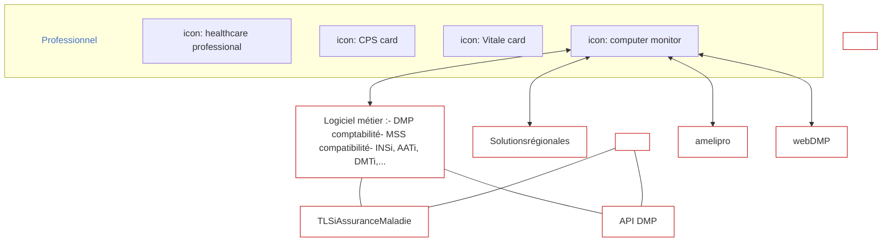
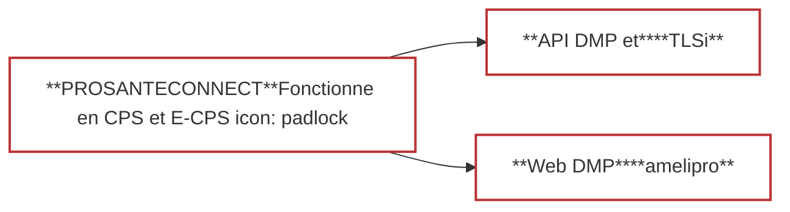
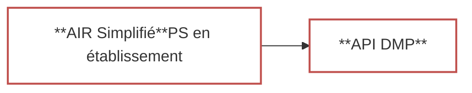

# LES SERVICES AUX PROFESSIONNELS DE SANTÉ : LE BSP

1


logo: l'Assurance Maladie

# **LA GALAXIE DES SERVICES AUX PS**

**TLS AM**

*   **amelipro**
    *   21 téléprocédures AM proposées via le portail
    *   466 000 PS en 2021

**Offre intégrée éditeurs logiciels métier PS/ES**
*   logo: l'Assurance Maladie TLSi
*   Dont 6 sont aussi proposés via les logiciels
*   6 uniquement via les logiciels
*   logo: L'ORDONNANCE NUMÉRIQUE

**Services numérique en santé**
*   Web logo: msSanté
*   Web logo: DMP
*   • 1 598 accès en octobre 2022
*   • 5 160 sur les 6 derniers mois
*   logo: ins Bien identifié-e, bien soigné-e.
*   logo: DMP
*   logo: msSanté
*   Outils Programme E-parcours
*   Outils PS hors logiciels métier (TLC, Télésurveillance ...)
*   Offre des établissements publics

2

logo: l'Assurance Maladie

# **LE CONSTAT AUJOURD’HUI**



## Vue du professionnel de santé :

⇒ Des services « silotés », voire en doublon

⇒ Aucune cohérence métier entre ces services

⇒ Des modalités d’accès hétérogènes

**Résultat : un parcours utilisateur éprouvant et inefficace**

**Opportunité : l’arrivée de Mon espace santé**

⇒ Nous oblige à avoir, pour un service donné, une approche fonctionnelle cohérente entre l’usage PS et l’usage patient avec MES

⇒ Rationnaliser les modalités d’accès PS avec son logiciel métier

**<u>Mon espace santé</u> :**
- ~~<u>*Documents*</u>~~
- *Profil médical*
- *Mesures*
- ...

*Usager*

**Accès Store**

logo: l'Assurance Maladie

# **L’ENJEU DU BSP : FACILITER LES ÉCHANGES USAGER/PS**

```mermaid
graph LR
    subgraph Professionnel_Section [ ]
        direction TB
        P_Icon["icon: Professionnel"]
        P_Text["*Professionnel*"]
        P_Icon --- P_Text
    end

    subgraph Logiciel_Metier ["**Logiciel métier**"]
        LM_SAM["**Services Assurance Maladie**- INSi, AATi, DMTi,..."]
        LM_SES["**Services en santé**- DMP compatibilité- MSS compatibilité"]
    end

    subgraph Accès_Intégré ["**Accès intégré logiciel BSP**"]
        API_DMP["API DMP"]
        API_MES["API MES"]
        TLSi_AM["TLSi AM"]
    end

    subgraph Portail_webBSP ["**Portail webBSP**"]
        P_SAM["**Services Assurance Maladie***- AAT, ALD, DAP, patientele,...*"]
        P_SES["**Service en santé** (miroir MES)*- Documents, Profil médical- Carnet de santé, mesures,....*"]
        P_SR["Solutions référencées"]
    end

    subgraph Mon_espace_sante ["**Mon espace santé :**"]
        MES_List["*- Documents- Profil médical- Mesures- ...*"]
        Accès_Store["**Accès Store**"]
    end

    subgraph Usager_Section [ ]
        direction TB
        U_Icon["icon: Usager"]
        U_Text["*Usager*"]
        U_Icon --- U_Text
    end

    Professionnel_Section --- Logiciel_Metier
    Logiciel_Metier -- "*Intégré logiciel* icon: lock" --- Accès_Intégré
    Logiciel_Metier -- "*Appel contextuel* icon: lock" --- Portail_webBSP
    
    Accès_Intégré --- Mon_espace_sante
    Portail_webBSP --- Mon_espace_sante
    Mon_espace_sante --- Usager_Section
```



logo: PRO SANTE CONNECT

logo: l'Assurance Maladie

# **LA PRIORITÉ MAJEURE : L’AUTHENTIFICATION DES PS /ES** icon: 8

---

# Une authentification directe alignée sur la Doctrine



Généralisation de ProSantéConnect avec les vagues Ségur nécessite :

⮚ une adaptation de nos portails web PS (DMP et amelipro)
⮚ une adaptation de l’offre intégrée logiciel (**API DMP et TLSi** dont Ordonnance numérique et INS) :
- avec la définition d’une interface commune d’utilisation de ProSantéConnect
- d’une inscription de cette interface commune au Cadre d’Interopérabilité (CI-SIS)

---

# Une authentification indirecte



Pour les PS en établissement, une authentification indirecte renforcée :

⮚ par une authentification primaire forte (au sein de l’étab.)
⮚ par une traçabilité de la personne physique accédant au téléservice
⮚ par l’engagement de l’établissement à sa conformité au référentiel DMP

---

# Permettre la fluidité <u>du parcours PS</u>

```mermaid
graph LR
    A["**Appel contextuel**PS et usager"] --> B["**Identité PSC**RPPS"]
    A --> C["**Identité INS**Matricule INS"]

    style A fill:#fff,stroke:#c00,stroke-width:2px,shape:polygon,points:[0,0, 10,0, 12,5, 10,10, 0,10]
    style B fill:#fff,stroke:#c00,stroke-width:2px
    style C fill:#fff,stroke:#c00,stroke-width:2px
```

La standardisation de l’appel contextuel permettra un parcours facilité entre les logiciels métiers vers le webBSP et du webBSP vers les autres offres sans réauthentification vue du PS :

⮚ une sécurisation des échanges en utilisant l’authentification/identification partagée ProSantéConnect
⮚ une identification patient basée sur l’INS (matricule)

logo: l'Assurance Maladie

# **LA CONSTRUCTION DES SERVICES BSP**

icon: doctor and computer

## <u>**Services en santé (miroir MES)**</u>

- Concevoir des services PS en miroir d’un parcours usager : carnet de santé, …

Construire une offre de services en santé accessible en intégré logiciel en opportunité :
Concevoir pour le PS des services en regard des services usager portés dans MES :
- Carnet de santé, prévention, ….

## **Solutions référencées**

- Référencement d’offres de services externes (publics ou privés) pour les PS
- Personnalisation de mes services préférés

Des services externes référencés (publics ou privés) selon des critères en cohérence avec le cadre d’interopérabilité (fonctionnel, sécurité, appel contextuel, …)

Le PS pourra personnaliser au sein de son outil de travail (web BSP ou logiciel métier), l’offre adaptée à ses usages en choisissant ses services externes préférés

logo: l'Assurance Maladie