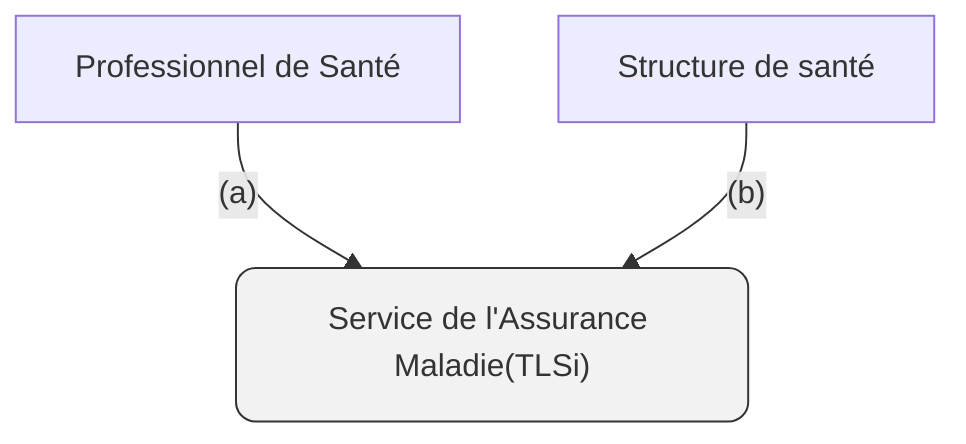
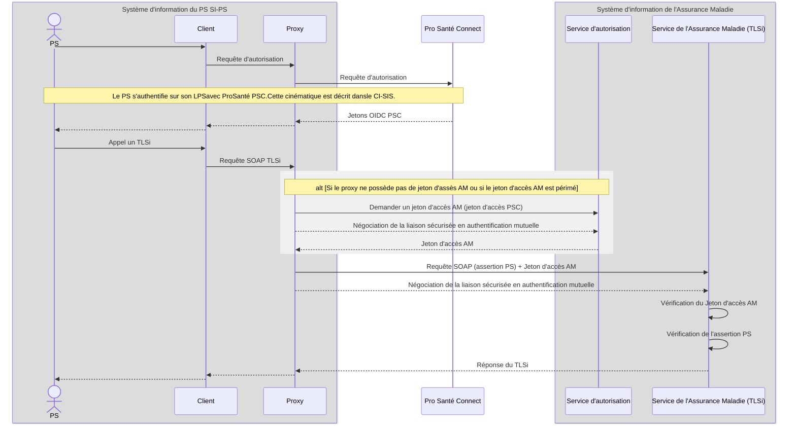
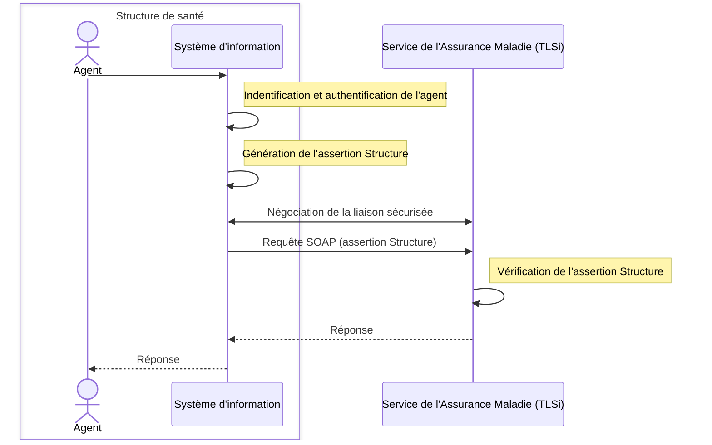
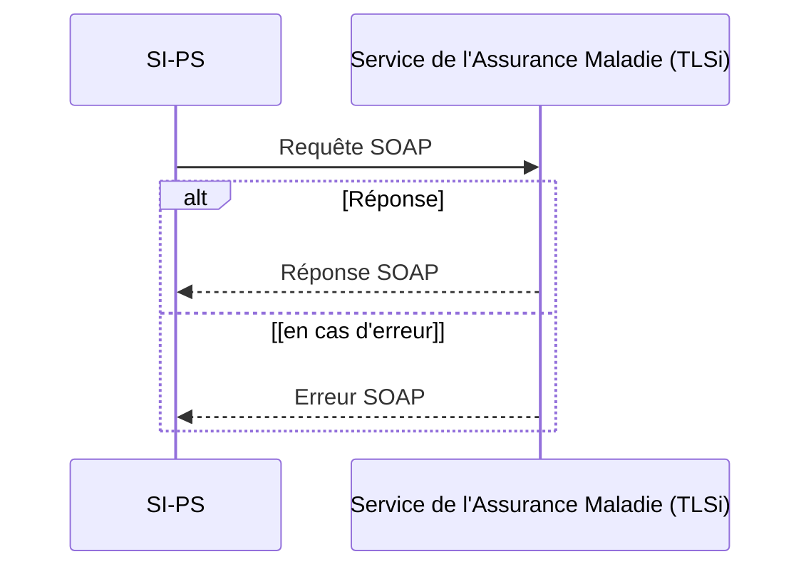
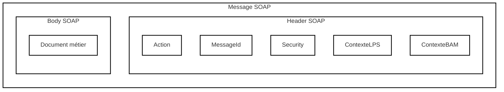

<!-- Conversion intégrale : LlamaParse Agentic Plus, avec pages transcrites ou corrigées visuellement par Codex ; détail dans _suivi/session-2026-10-04-17.json. -->


<!-- Pages source 1-51 -->

logo: sesam-vitale

# Volet transport synchrone pour les téléservices de l'Assurance Maladie Obligatoire

## Cadre d’interopérabilité des TLSi AMO

Version du document 01.02.03
Date du document 23/04/2026
Référence CI_TLSI_AMO

**GIE SESAM-VITALE, maître d’œuvre et expert technique du système**
**5, boulevard Alexandre Oyon – 72 019 LE MANS Cedex 2**
**www.sesam-vitale.fr**

Cadre d’interopérabilité des TLSi

Ce document a été élaboré par le GIE SESAM-Vitale. Conformément à l’article L.122-4 du Code de la Propriété Intellectuelle, toute représentation ou reproduction (intégrale ou partielle) du présent ouvrage, quel que soit le support utilisé, doit être soumise à l’accord préalable écrit de son auteur.

Il en est de même pour sa traduction, sa transformation, son adaptation ou son arrangement quel que soit le procédé utilisé.

Tout manquement à ces obligations constituerait un délit de contrefaçon, au sens des articles L 335-2 et suivants du code de la propriété intellectuelle, susceptible d’entraîner des sanctions pour l’auteur du délit.

### *Contacts*

logo: sesam-vitale

Pour toute question technique ou fonctionnelle durant vos développements, contactez l’assistance technique du GIE SESAM-Vitale :

- par courriel : centre-de-service@sesam-vitale.fr
- par téléphone : 02 43 57 42 88

23/04/2026 2 / 102

Ce document à diffusion restreinte ne peut être diffusé sans l'autorisation d'une personne habilitée au GIE SESAM-Vitale

Cadre d’interopérabilité des TLSi

# Historique des versions

<table>
  <thead>
    <tr>
      <th><b>Date</b></th>
      <th>Version</th>
      <th>Évolution majeure du document</th>
    </tr>
  </thead>
  <tbody>
    <tr>
      <td>Mars 2013</td>
      <td>1.0.2</td>
      <td>Diffusion du cadre d’interopérabilité 1.0.2</td>
    </tr>
    <tr>
      <td>Janvier 2018</td>
      <td>01.01.01</td>
      <td>Diffusion du cadre d’interopérabilité 01.01.01<br /><br />Réécriture du CI :<br /><br />- Ajout de l’authentification indirecte ;<br /><br />- Ajout de l’assertion Structure.<br /><br />- Passage de « recommandation » à « exigence » la nécessité de supporter deux chaînes d’autorité de confiance pour vérifier le certificat du SIR.<br /><br />- Ajout d’exigences sur le numéro d’autorisation, le nom et la version du SI-PS.</td>
    </tr>
    <tr>
      <td>Janvier 2019</td>
      <td>01.01.02</td>
      <td>Ajout de l’attribut « secteurActivite » dans l’assertion PS (chap. 5.1).<br /><br />Reformulation de la description de l’attribut « version » du contexte LPS.<br /><br />Suppression de l’ambiguïté entre la spécification des chaînes de caractères XML et de chaînes de caractères historiques (abréviation AN).<br /><br />Restriction des caractères utilisables dans l’élément XML &#x3C;ContexteLPS>&#x3C;Nom>.</td>
    </tr>
  </tbody>
</table>

23/04/2026

icon: SESAM-Vitale logo 3 / 102
Ce document à diffusion restreinte ne peut être diffusé sans l'autorisation d'une personne habilitée au GIE SESAM-Vitale

Cadre d’interopérabilité des TLSi

<table>
    <tr>
      <td>Mars 2020</td>
      <td>01.01.03</td>
      <td>Intégration du cadre d'interopérabilité dans le corpus documentaire de l'ANS.<br /><br />- Modification du titre<br /><br />Quelques corrections de forme.</td>
    </tr>
    <tr>
      <td>Juin 2020</td>
      <td>01.01.04</td>
      <td>L'ASIP Santé devient l'ANS<br /><br />Ajout de l'assertion ApCV<br /><br />Quelques évolutions</td>
    </tr>
    <tr>
      <td>Juin 2021</td>
      <td>01.01.05</td>
      <td>Modification de la longueur de la signature des cartes Vitale conservée dans l'assertion Vitale. Cette modification correspond à l'évolution de l'algorithme de signature des cartes Vitale.<br /><br />Ajout de l'attribut &#x3C;Subject>&#x3C;NameID@SPNameQualifier> dans l'assertion Vitale pour la distinguer formellement de l'assertion ApCV. Cet attribut est optionnel.</td>
    </tr>
    <tr>
      <td>Juin 2023</td>
      <td>01.02.00</td>
      <td>Ajout de l’authentification directe du PS via ProSantéConnect.</td>
    </tr>
    <tr>
      <td>Août 2023</td>
      <td>01.02.01</td>
      <td>Ajout d’une précision au chapitre 3.2.3 sur le <code>subject_token_type</code> de la demande de jeton d’accès AM.<br /><br />Suppression de l’algorithme SHA1. L’algorithme <code>RSAwithSHA1</code> et <code>SHA1</code> ne sont plus supportés (chapitre 5.1.2 Assertion PS).<br /><br />Modification de la valorisation de l’élément XML <code>&#x3C;issuer></code> de l’assertion PS.<br /><br />Reformulation de la description du champ <code>&#x3C;instance></code> du <code>contexteLPS</code> car ce dernier doit correspondre au LPS_ID du CI-SIS.</td>
    </tr>
    <tr>
      <td>Janvier 2024</td>
      <td>01.02.02</td>
      <td>Ajout de trois nouveaux attributs optionnels dans l’assertion PS : <code>codeRole</code>, <code>codeGenreActivite</code>, <code>CodeModeExercice</code></td>
    </tr>
    <tr>
      <td>Avril 2025</td>
      <td>01.02.03</td>
      <td>Ajout d’une option d’authentification mutuelle TLS au chapitre 3.3 (mode « authentification indirecte »).</td>
    </tr>
</table>

23/04/2026 
icon: SESAM-Vitale logo 4 / 102

Ce document à diffusion restreinte ne peut être diffusé sans l'autorisation d'une personne habilitée au GIE SESAM-Vitale

Cadre d’interopérabilité des TLSi

icon: horizontal bar

<table>
    <tr>
      <td></td>
      <td></td>
      <td>Création du chapitre 3.4 « Authentification directe d’une structure » comprenant deux possibilités :<br /><br />- utilisation d’une assertion Structure ;<br /><br />- authentification mutuelle sans assertion Structure (sans assertion).</td>
    </tr>
</table>

23/04/2026 icon: blue circles 5 / 102

Ce document à diffusion restreinte ne peut être diffusé sans l'autorisation d'une personne habilitée au GIE SESAM-Vitale

Cadre d’interopérabilité des TLSi

# Tables des matières

<table>
    <tr>
      <td colspan="2">Historique des versions ....................................................................................................</td>
      <td>3</td>
    </tr>
    <tr>
      <td colspan="2">Tables des matières ..........................................................................................................</td>
      <td>6</td>
    </tr>
    <tr>
      <td colspan="2">Glossaire ...........................................................................................................................</td>
      <td>8</td>
    </tr>
    <tr>
      <td>Chapitre 1</td>
      <td>Introduction ................................................................................................</td>
      <td>9</td>
    </tr>
    <tr>
      <td>1.1</td>
      <td>Objet du document .............................................................................................</td>
      <td>9</td>
    </tr>
    <tr>
      <td>1.2</td>
      <td>Contenu du document ........................................................................................</td>
      <td>9</td>
    </tr>
    <tr>
      <td>1.3</td>
      <td>Périmètre du cadre d’interopérabilité ................................................................</td>
      <td>9</td>
    </tr>
    <tr>
      <td>Chapitre 2</td>
      <td>Normes et standards ................................................................................</td>
      <td>11</td>
    </tr>
    <tr>
      <td>2.1</td>
      <td>Normes ..............................................................................................................</td>
      <td>11</td>
    </tr>
    <tr>
      <td>2.2</td>
      <td>Espace de noms .................................................................................................</td>
      <td>14</td>
    </tr>
    <tr>
      <td>2.3</td>
      <td>Types de données communs.............................................................................</td>
      <td>15</td>
    </tr>
    <tr>
      <td>Chapitre 3</td>
      <td>Dispositifs de sécurité...............................................................................</td>
      <td>19</td>
    </tr>
    <tr>
      <td>3.1</td>
      <td>Principe général.................................................................................................</td>
      <td>19</td>
    </tr>
    <tr>
      <td>3.1.1</td>
      <td>Authentification du PS et de la structure de santé ......................................</td>
      <td>19</td>
    </tr>
    <tr>
      <td>3.1.2</td>
      <td>Authentification du support du bénéficiaire ................................................</td>
      <td>22</td>
    </tr>
    <tr>
      <td>3.2</td>
      <td>Authentification directe d’une personne physique ..........................................</td>
      <td>24</td>
    </tr>
    <tr>
      <td>3.2.1</td>
      <td>Identifiant et mot de passe ..........................................................................</td>
      <td>24</td>
    </tr>
    <tr>
      <td>3.2.2</td>
      <td>Accès direct avec une CPx ............................................................................</td>
      <td>26</td>
    </tr>
    <tr>
      <td>3.2.3</td>
      <td>Accès direct avec Pro Santé Connect ...........................................................</td>
      <td>29</td>
    </tr>
    <tr>
      <td>3.3</td>
      <td>Authentification indirecte d’une personne physique .......................................</td>
      <td>33</td>
    </tr>
    <tr>
      <td>3.4</td>
      <td>Authentification directe d’une structure ..........................................................</td>
      <td>36</td>
    </tr>
    <tr>
      <td>3.4.1</td>
      <td>Authentification mutuelle avec une assertion Structure .............................</td>
      <td>36</td>
    </tr>
    <tr>
      <td>3.4.2</td>
      <td>Authentification mutuelle sans assertion Structure ....................................</td>
      <td>37</td>
    </tr>
    <tr>
      <td>3.5</td>
      <td>Authentification de la carte Vitale ....................................................................</td>
      <td>38</td>
    </tr>
    <tr>
      <td>3.6</td>
      <td>Authentification d'une application Carte Vitale................................................</td>
      <td>40</td>
    </tr>
    <tr>
      <td>Chapitre 4</td>
      <td>Échanges SOAP .........................................................................................</td>
      <td>42</td>
    </tr>
    <tr>
      <td>4.1</td>
      <td>Principe général.................................................................................................</td>
      <td>42</td>
    </tr>
    <tr>
      <td>4.2</td>
      <td>Requêtes SOAP..................................................................................................</td>
      <td>44</td>
    </tr>
    <tr>
      <td>4.2.1</td>
      <td>Header SOAP.................................................................................................</td>
      <td>45</td>
    </tr>
    <tr>
      <td>4.2.2</td>
      <td>Body SOAP ....................................................................................................</td>
      <td>53</td>
    </tr>
</table>

23/04/2026 icon: SESAM-Vitale logo 6 / 102

Ce document à diffusion restreinte ne peut être diffusé sans l'autorisation d'une personne habilitée au GIE SESAM-Vitale

Cadre d’interopérabilité des TLSi

4.3 Réponses SOAP..................................................................................................53
4.4 Erreurs SOAP .....................................................................................................54
# Chapitre 5 Spécification des assertions ..................................................................... 58
## 5.1 Assertion PS.......................................................................................................58
### 5.1.1 Attributs de l’assertion .................................................................................59
### 5.1.2 Attributs de la signature ...............................................................................67
## 5.2 Assertion Structure...........................................................................................69
### 5.2.1 Attributs de l’assertion .................................................................................70
### 5.2.2 Attributs de la signature ...............................................................................76
## 5.3 Assertion Vitale ................................................................................................77
### 5.3.1 Attributs de l’assertion .................................................................................78
### 5.3.2 Attributs de la signature ...............................................................................81
## 5.4 Assertion ApCV ................................................................................................87
### 5.4.1 Attributs de l’assertion .................................................................................87
## 5.5 Synthèse des identifiants dans les assertions ...................................................91
# Chapitre 6 Annexes ................................................................................................. 92
## 6.1 Schéma de l’élément XML &lt;Erreur&gt;..................................................................92
## 6.2 Schéma de l’élément XML &lt;KeyInfo&gt;................................................................92
## 6.3 Assertion PS signée...........................................................................................93
## 6.4 Assertion Structure...........................................................................................94
## 6.5 Assertion Vitale non signée..............................................................................96
## 6.6 Assertion Vitale signée SCOT.............................................................................97
## 6.7 Assertion Vitale IGEA.........................................................................................98
## 6.8 Assertion Vitale V2 ............................................................................................99
## 6.9 Assertion ApCV ................................................................................................100
## 6.10 Contexte BAM .................................................................................................101
## 6.11 Contexte LPS....................................................................................................102

23/04/2026

icon: SESAM-Vitale logo 7 / 102

Ce document à diffusion restreinte ne peut être diffusé sans l'autorisation d'une personne habilitée au GIE SESAM-Vitale

Cadre d’interopérabilité des TLSi

# Glossaire

**AMO** Assurance Maladie Obligatoire
**AN** Alphanumérique correspond au format xs:String
**ANS** Agence du Numérique en Santé
**ApCV** Application Carte Vitale
**CI** Cadre d’Interopérabilité
**CN** Common Name
**CNDA** Centre National de Dépôt et d’Agrément
**CPx** Carte du Professionnel de Santé de l'ANS
**CRL** Certificate Revocation List
**DESIR** Dispositif d'Exposition du Système Inter-régime
**DL** "Date lunaire"
**DN** Distinguished Name
**DT** "Date Time" correspond au format xs:DateTime
**LPS** Progiciel du Prestataire de Soins
**N** "Numérique" correspond au format xs:Integer
**PS** Professionnel de Santé
**PSC** ProSanté Connect
**RGI** Référentiel Général d’Interopérabilité
**RGS** Référentiel Général de Sécurité
**SAML** Security Assertion Markup Language
**SIH** Système d’Information Hospitalier
**SI-PS** Système d’Information du Professionnel de Santé. Dans ce document, le terme SI-PS englobe le terme SIH.
**SIR** Système Inter-régime
**SOAP** Simple Object Access Protocol
**TLS** Transport Layer Security
**TLSi** Téléservice Intégré
**URN** Uniform Resource Name
**UTC** Universal Time Coordinated
**UUID** Universally Unique IDentifier
**WSDL** Web Services Description Language
**XML** Extensible Markup Language

23/04/2026

icon: SESAM-Vitale logo 8 / 102
Ce document à diffusion restreinte ne peut être diffusé sans l'autorisation d'une personne habilitée au GIE SESAM-Vitale

Cadre d’interopérabilité des TLSi

# Chapitre 1

# Introduction

### 1.1 Objet du document

Ce document décrit le cadre d’interopérabilité (CI) mis en œuvre par le système d’information du professionnel de santé (SI-PS), dans un contexte individuel ou collectif, pour accéder aux services de l’Assurance Maladie obligatoire (par exemple les TLSi).

### 1.2 Contenu du document

Le cadre d’interopérabilité technique fixe les questions relatives aux protocoles d’échanges de données et à la sécurité des appels. Outre cette introduction, le document comporte les chapitres suivants :

− Le chapitre 2 présente les normes utilisées.
− Le chapitre 3 décrit les dispositifs de sécurité.
− Le chapitre 4 spécifie les échanges SOAP.
− Le chapitre 5 spécifie les assertions SAML.

### 1.3 Périmètre du cadre d’interopérabilité

23/04/2026 
icon: SESAM-Vitale logo 9 / 102
Ce document à diffusion restreinte ne peut être diffusé sans l'autorisation d'une personne habilitée au GIE SESAM-Vitale

Cadre d’interopérabilité des TLSi

# Cadre d’interopérabilité des TLSi



Figure 1 – Cas d’usage

Deux grands cas d’usage du CI :

− a) Le cadre d’interopérabilité technique couvre les échanges entre un professionnel de santé (PS) et les services de l’Assurance Maladie obligatoire.

− b) Le cadre d’interopérabilité technique couvre également les échanges entre une structure de santé (établissement hospitalier, structure de soins, etc.) et les services de l’Assurance Maladie obligatoire, sous réserve de la signature d’une convention entre la structure et l’Assurance Maladie.

23/04/2026
icon: page number decoration
10 / 102

Ce document à diffusion restreinte ne peut être diffusé sans l'autorisation d'une personne habilitée au GIE SESAM-Vitale

Cadre d’interopérabilité des TLSi

# Chapitre 2

## Normes et standards

### 2.1 Normes

Le choix des normes techniques utilisées dans le CI est basé sur les spécifications du Basic Profile Version 2.0<sup>1</sup>.

**HTTP 1.1** est un protocole de communication client-serveur développé pour le web. La version 1.1 actualisée en 2014 est recommandée.

[https://fr.wikipedia.org/wiki/Hypertext_Transfer_Protocol](https://fr.wikipedia.org/wiki/Hypertext_Transfer_Protocol)

**SAML 2.0** est un protocole pour échanger des informations d’authentification et d’autorisation entre des parties, en particulier entre un fournisseur d’identité et un fournisseur de service. Basé sur le langage XML, SAML propose l’authentification unique (en anglais single sign-on) sur le web. De cette manière, un utilisateur peut naviguer sur plusieurs sites différents en ne s’authentifiant qu’une seule fois.

[https://fr.wikipedia.org/wiki/Security_assertion_markup_language](https://fr.wikipedia.org/wiki/Security_assertion_markup_language)

**SOAP 1.2** Simple Object Access Protocol (SOAP) spécifie le format des messages ainsi que les informations sur le message lui-même permettant son acheminement et son traitement.

[http://www.w3.org/standards/techs/soap](http://www.w3.org/standards/techs/soap)

**TLS 1.x** est un protocole de sécurisation des échanges sur Internet. Le protocole Transport Layer Security (TLS) permet de satisfaire aux objectifs de sécurité suivants :

– l’authentification du serveur ;

<sup>1</sup> <u>http://ws-i.org/profiles/BasicProfile-2.0-2010-11-09.html</u>
23/04/2026 
icon: SESAM-Vitale logo 11 / 102
Ce document à diffusion restreinte ne peut être diffusé sans l'autorisation d'une personne habilitée au GIE SESAM-Vitale

Cadre d’interopérabilité des TLSi

– la confidentialité des données échangées (ou session chiffrée) ;
– l’intégrité des données échangées ;
– de manière optionnelle, l’authentification du client.

La version 1.2 ou supérieure doit être retenue pour ce standard (conforme au Référentiel Général de Sécurité (RGS)).

[https://fr.wikipedia.org/wiki/Transport_Layer_Security](https://fr.wikipedia.org/wiki/Transport_Layer_Security)

**XML** ou « langage de balisage extensible » est un langage informatique de balisage générique. Cette syntaxe est dite « extensible », car elle permet de définir différents espaces de noms, c’est-à-dire des langages avec chacun leur vocabulaire et leur grammaire, comme XHTML, XSLT, RSS, SVG... Elle est reconnaissable par son usage des chevrons (< >) encadrant les balises XML. L’objectif initial est de faciliter l’échange automatisé de contenus complexes (arbres, texte riche...) entre systèmes informatiques hétérogènes (interopérabilité).

[http://www.w3.org/TR/REC-xml](http://www.w3.org/TR/REC-xml)

## *Information sur les éléments XML optionnels*

La description des structures XML peut faire apparaître des éléments optionnels. Si la valeur d’un élément optionnel n’est pas connue ou n’est pas utile dans un contexte particulier, il ne doit pas apparaître dans le flux XML.

Un élément optionnel non utilisé <u>ne peut pas</u> s’écrire :

`<elem></elem>` ni `<elem/>`

En effet, la valeur « vide » sera contrôlée comme une valeur « classique » et peut enfreindre les contraintes de l’élément (nombre de caractères, format, plage de date...).

*D’autre part, dans le cas où un élément XML facultatif n’est pas utilisé au démarrage d’un TLSi, le SI-PS ne doit pas être impacté le jour où ce champ est renseigné.*

23/04/2026 
icon: icon 12 / 102
Ce document à diffusion restreinte ne peut être diffusé sans l'autorisation d'une personne habilitée au GIE SESAM-Vitale

Cadre d’interopérabilité des TLSi

## **XML Signature**

**XML Signature** (aussi nommé XMLDsig, XML-DSig, XML-Sig) est une recommandation du W3C destinée à permettre l’utilisation de signatures numériques dans les documents XML. Tout comme les techniques générales de cryptographie à clef publique qu’elle met en œuvre, elle permet d’assurer l’authentification, l’intégrité et par voie de conséquence la non-répudiation des données signées, mais en tirant profit de la souplesse offerte par le langage XML.

[http://www.w3.org/TR/2008/REC-xmldsig-core-20080610](http://www.w3.org/TR/2008/REC-xmldsig-core-20080610)

## **XSD**

**XSD** ou XML Schema est un langage de description de format de document XML permettant de définir la structure et le type de contenu d’un document XML. Cette définition permet notamment de vérifier la validité de ce document.

[http://www.w3.org/XML/Schema](http://www.w3.org/XML/Schema)

## **WSDL**

**WSDL** est une grammaire XML permettant une interface d’accès à un web-service. Cette description est fondée sur le XML qui indique « comment communiquer pour utiliser le service ».

[http://www.w3.org/TR/wsdl20/](http://www.w3.org/TR/wsdl20/)

[http://schemas.xmlsoap.org/wsdl/soap12/WSDL11SOAP12.pdf](http://schemas.xmlsoap.org/wsdl/soap12/WSDL11SOAP12.pdf)

## **WS-Addressing**

**WS-Addressing** (Web Services Addressing) est une spécification de mécanismes de transport neutre qui permet à des services Web de communiquer des informations d'adressage. Deux parties le composent essentiellement : une structure pour communiquer une référence à un service Web final, et un ensemble de propriétés d'adressage de messages qui associent des informations d'adressage à un message particulier.

[http://www.w3.org/Submission/ws-addressing/](http://www.w3.org/Submission/ws-addressing/)

## **WS-Security**

**WS-Security** (Web Services Security) est un protocole XML de communications qui permet d’appliquer de la sécurité aux services web. Le protocole WSS inclut des détails sur l’utilisation et le transport des assertions SAML et de la transmission des identifiants/mots de passe.

[https://www.oasis-open.org/committees/tc_home.php?wg_abbrev=wss](https://www.oasis-open.org/committees/tc_home.php?wg_abbrev=wss)

23/04/2026 
icon: SESAM-Vitale logo 13 / 102
Ce document à diffusion restreinte ne peut être diffusé sans l'autorisation d'une personne habilitée au GIE SESAM-Vitale

Cadre d’interopérabilité des TLSi

## 2.2    Espace de noms

Les éléments XML sont définis dans des espaces de nommage.

Un espace de nommage regroupe la définition d’éléments et de ce fait réduit le risque de conflit de déclaration. Il offre une méthode pour qualifier les noms des éléments XML (et des attributs) utilisés dans des messages XML.

Les espaces de nommage sont définis dans les fichiers XSD et déclarés dans les messages XML de la manière suivante :

```text
xmlns:prefixe="URI"
```

**_L’URI_** désigne de manière unique l’espace de nommage.

**Le *préfixe*** est une facilité pour associer un élément et un espace de nommage dans le message XML. Il peut prendre n’importe quelle valeur. *En conséquence, un progiciel doit donc pouvoir interpréter et exploiter les messages XML sans présupposer la valeur du préfixe.* Le choix de ces préfixes est arbitraire et n’est pas signifiant.

Ce document utilise de nombreux préfixes d’espace de nom listés ci-dessous.

<table>
  <thead>
    <tr>
      <th><b>Préfixe</b></th>
      <th><b>Espace de nom XML</b></th>
    </tr>
  </thead>
  <tbody>
    <tr>
      <td>ctxbam</td>
      <td>urn:siram:bam:ctxbam</td>
    </tr>
    <tr>
      <td>ctxlps</td>
      <td>urn:siram:lps:ctxlps</td>
    </tr>
    <tr>
      <td>ds</td>
      <td>http://www.w3.org/2000/09/xmldsig#</td>
    </tr>
    <tr>
      <td>saml</td>
      <td>urn:oasis:names:tc:SAML:2.0:assertion</td>
    </tr>
    <tr>
      <td>siram</td>
      <td>urn:siram</td>
    </tr>
    <tr>
      <td>vitale</td>
      <td>http://www.sesam-vitale.fr/xmldsig/2011/12/vitale</td>
    </tr>
    <tr>
      <td>wsa</td>
      <td>http://www.w3.org/2005/08/addressing</td>
    </tr>
    <tr>
      <td>wsse</td>
      <td>http://docs.oasis-open.org/wss/2004/01/oasis-200401-wss-wssecurity-secext-1.0.xsd</td>
    </tr>
  </tbody>
</table>

Attention, dans les flux de production les préfixes peuvent varier suivant les environnements.

23/04/2026

icon: SESAM-Vitale logo 14 / 102
Ce document à diffusion restreinte ne peut être diffusé sans l'autorisation d'une personne habilitée au GIE SESAM-Vitale

Cadre d’interopérabilité des TLSi

## 2.3 Types de données communs

**Alphanumérique** (abréviation "<sup>AN</sup>") Le format de chaîne choisi est celui défini par XML (`xs:string`). Si le format peut être préfixé par un nombre. Dans ce cas, la longueur de la chaîne ne peut pas dépasser ce nombre. Si aucune longueur n’est précisée, la longueur de la chaîne est de 1 caractère minimum, sans maximum.

Par exemple : 30AN représente une chaîne alphanumérique de 1 caractère au minimum et de 30 caractères au maximum.

**Date** (abréviation "<sup>D</sup>") Le format de date choisi est celui défini par XML (`xs:date`) sans décalage horaire par rapport à l’heure locale. Le format est YYYY-MM-DD.

Par exemple : "2016-06-22"

[http://www.w3.org/TR/xmlschema-2/#date](http://www.w3.org/TR/xmlschema-2/#date)

Cas particulier de la **date lunaire** (abréviation "<sup>DL</sup>")

Une date lunaire est également du type YYYY-MM-DD ; c’est un format spécifique autorisant des valeurs de MM > 12 et des valeurs de DD > 31.

**Date et heure** (abréviation "<sup>DT</sup>") Le format date et heure choisi est celui défini par XML (`xs:dateTime`).

En l’absence de consigne spécifique, l’heure est exprimée en heure locale avec décalage horaire UTC. Elle est de type YYYY-MM-DDThh:mm:ss+/-hh:mm avec +/-hh:mm est le décalage par rapport à l’heure UTC.

Par exemple : "2016-06-12T10:15:30+04:00"

Dans certains cas, l’heure peut être demandée en UTC. Son format est du type YYYY-MM-DDThh:mm:ssZ. On inscrit littéralement un Z final lorsqu’il s’agit de l’heure UTC.

Par exemple : "2016-06-22T06:00:00Z"

En l’absence de consigne spécifique, la précision des heures locales ou UTC est la seconde. Une précision en fraction de seconde (dixième de seconde, milliseconde, microseconde…) n’est pas demandée, mais elle est tolérée et est compatible avec le type `xs:dateTime` utilisé.

23/04/2026 
icon: SESAM-Vitale logo 15 / 102
Ce document à diffusion restreinte ne peut être diffusé sans l'autorisation d'une personne habilitée au GIE SESAM-Vitale

Cadre d’interopérabilité des TLSi

[http://www.w3.org/TR/xmlschema-2/#dateTime](http://www.w3.org/TR/xmlschema-2/#dateTime)

Quel que soit le cas, le SI-PS doit synchroniser son heure avec un serveur de temps pour des problématiques d’horodatage des données, de traçabilité et de sécurité (horodatage des assertions SAML). Le SI-PS peut, par exemple, utiliser le pool de serveurs de temps français fr.pool.ntp.org.

**ID** Dans le langage XML, les identifiants ID (unique identifiers) sont des `xs:NCName` ayant pour contrainte d’être uniques dans le document XML. La valeur doit se composer exclusivement de lettres, de chiffres, de traits d’union et de points. Les chiffres, le trait d’union et le point ne peuvent pas être utilisés en premier.

**Time** (abréviation "T") Le format heure choisi est celui défini par XML (`xs:Time`). Elle est de type hh:mm:ss+/-hh:mm avec +/-hh:mm est le décalage par rapport à l’heure UTC.

Par exemple : "10:15:30+04:00"

En l’absence de consigne spécifique, la précision des heures locales ou UTC est la seconde. Une précision en fraction de seconde (dixième de seconde, milliseconde, microseconde) n’est pas demandée, mais elle est tolérée et est compatible avec le type `xs:Time` utilisé (format hh:mm:ss[.s+]).

[http://www.w3.org/TR/xmlschema-2/#Time](http://www.w3.org/TR/xmlschema-2/#Time)

**URN** Le terme Uniform Resource Name (URN) traduit littéralement de l’anglais par « nom uniforme de ressource » permet de désigner une ressource de manière unique. Les URN ont la syntaxe suivante : urn:NID:NSS

- urn est la méthode d’URI des URN.
- NID (Namespace Identifier) est un identificateur d’espace de noms.
- NSS (Namespace specific String) est la partie spécifique à l’espace de noms identifié par le NID. L’interprétation syntaxique de cette partie dépend de l’espace de noms.

Par exemple : "urn:isbn:0451450523"

[https://en.wikipedia.org/wiki/Uniform_Resource_Name](https://en.wikipedia.org/wiki/Uniform_Resource_Name)

[http://www.yoyodesign.org/doc/w3c/uri-clarification/](http://www.yoyodesign.org/doc/w3c/uri-clarification/)

[https://tools.ietf.org/html/rfc2141](https://tools.ietf.org/html/rfc2141)

23/04/2026 icon: icon 16 / 102

Ce document à diffusion restreinte ne peut être diffusé sans l'autorisation d'une personne habilitée au GIE SESAM-Vitale

Cadre d’interopérabilité des TLSi

**UUID** L’algorithme Universally Unique IDentifier (UUID) permet à des systèmes distribués d’attribuer de façon unique un identifiant à des informations sans coordination centrale. On parle d’identifiants « différents avec une haute probabilité ».

Dans le contexte de ce document, un UUID doit respecter la spécification RFC 4122 (toutes les versions sont autorisées).

Un UUID doit se présenter sous sa forme canonique, c’est-à-dire composée de groupes de caractères hexadécimaux en minuscules séparés par des tirets.

Par exemple : "110e8400-e29b-11d4-a716-446655440000"

C’est-à-dire 8-4-4-4-12 pour un total de 36 caractères (32 alpha numériques caractères et 4 « - »).

[https://en.wikipedia.org/wiki/Universally_unique_identifier](https://en.wikipedia.org/wiki/Universally_unique_identifier)

[https://tools.ietf.org/html/rfc4122](https://tools.ietf.org/html/rfc4122)

23/04/2026 icon: icon 17 / 102

Ce document à diffusion restreinte ne peut être diffusé sans l'autorisation d'une personne habilitée au GIE SESAM-Vitale

Cadre d’interopérabilité des TLSi

## **Autres types de données et abréviations utilisées :**

<table>
  <thead>
    <tr>
      <th><u>Format</u></th>
      <th>Description</th>
    </tr>
  </thead>
  <tbody>
    <tr>
      <td>B</td>
      <td>Booléen : champ alphanumérique sur 1 caractère.<br /><br />La valorisation et l’interprétation de ce champ sont indiquées dans les guides des TLSi.<br /><br />Par exemple : « 0 » pour faux et « 1 » pour vrai.</td>
    </tr>
    <tr>
      <td>H</td>
      <td>Chaîne de caractères hexadécimaux.<br /><br />16 symboles sont utilisés, les chiffres de 1 à 10 et les lettres A à F.</td>
    </tr>
    <tr>
      <td>N</td>
      <td>Numérique : tous les chiffres de 0 à 9.<br /><br />Le format XN.YN permet de définir un numérique réel avec X chiffres avant le point décimal et Y chiffres après.</td>
    </tr>
    <tr>
      <td>ND</td>
      <td>Nombre décimal. Ce format est conforme à la définition de la norme XML schémas xsd:decimal avec utilisation du point comme séparateur.<br /><br />Par exemple : "14", "999.50", "+999.5450", "-999.52"</td>
    </tr>
  </tbody>
</table>

Si le format est préfixé d’un nombre, la longueur de la chaîne ne peut pas dépasser ce nombre. Si aucune longueur n’est précisée, la longueur de la chaîne est de 1 caractère minimum, sans maximum.

23/04/2026 icon: SESAM-Vitale logo 18 / 102

Ce document à diffusion restreinte ne peut être diffusé sans l'autorisation d'une personne habilitée au GIE SESAM-Vitale

Cadre d’interopérabilité des TLSi

# Chapitre 3

## Dispositifs de sécurité

### 3.1 Principe général

#### 3.1.1 Authentification du PS et de la structure de santé

```mermaid
graph TD
    subgraph Structure_de_sante ["Structure de santé"]
        Agent((Agent)) --- SI[Système d'information]
    end

    PS((PS)) --- LPS[LPS]
    
    LPS -- "(a)" --> TLSi[Service de l'Assurance Maladie(TLSi)]
    SI -- "(b)" --> TLSi
    SS_Box[Structure de santé] -- "(c)" --> TLSi

    style Structure_de_sante fill:none,stroke:#000,stroke-width:1px
    style SI fill:#f2f2f2,stroke:#000,stroke-width:1px
    style LPS fill:#f2f2f2,stroke:#000,stroke-width:1px
    style TLSi fill:#f2f2f2,stroke:#000,stroke-width:1px
    style SS_Box fill:#f2f2f2,stroke:#000,stroke-width:1px
```

Figure 2 – Principe général

23/04/2026
icon: SESAM-Vitale logo 19 / 102

Ce document à diffusion restreinte ne peut être diffusé sans l'autorisation d'une personne habilitée au GIE SESAM-Vitale

Cadre d’interopérabilité des TLSi

**a)** Dans ce cas d’échange entre SI-PS et les services de l'Assurance Maladie obligatoire, **l’authentification du PS est *directe*** comme celle définie dans la Politique Générale de Sécurité des Systèmes d’Information de Santé. Le SI-PS accède sans intermédiaire au service. Il met en œuvre les mécanismes de sécurité nécessaires à l’accès. C’est-à-dire qu’il établit la liaison sécurisée, authentifie le service puis le sollicite avec les éléments permettant d’authentifier le PS. En fonction des exigences de sécurité du TLSi, deux moyens d’authentification du PS peuvent être employés :

– *Utilisation d’un identifiant et d’un mot de passe.* L’utilisateur est authentifié par le service grâce à un identifiant et un mot de passe transmis dans chaque requête vers le service.

– *Utilisation d’une CPx.* Le SI-PS génère un jeton d’authentification SAML signé avec la CPx. Ce jeton est une structure XML SAML 2.0 appelée *assertion PS* décrite au chapitre 5.1. L’assertion PS contient des informations sur le PS. Elle est signée par la CPx et possède une durée de vie limitée. L’assertion SAML est transmise dans chaque requête vers le service qui peut la conserver comme preuve d’accès. Grâce à la signature, le service authentifie le PS et s’assure de l’intégrité de l’assertion PS. L’assertion PS validée, le service l’utilise ensuite pour effectuer les contrôles d’accès.

– *Utilisation d’un jeton d’accès Pro Santé Connect (PSC).* PSC est un fédérateur d’identités qui permet aux professionnels des secteurs sanitaire, médico-social et social de se connecter de manière sécurisée à des services numériques de santé avec leur eCPS ou leur CPS. Le processus d’authentification se déroule en trois étapes : (1) l’utilisateur s’authentifie sur son SI-PS via Pro Santé Connect et acquiert un jeton d’accès, puis (2) il s’authentifie sur les services de l’Assurance Maladie avec ce jeton d’accès depuis son SI-PS et récupère un jeton d’accès AM. Les modalités d’authentification sont décrites dans le volet transport du CI-SIS pour les API Pro Santé Connect, au paragraphe 5.3.3.1. (3) Enfin, le SI-PS sollicite le service en fournissant le jeton d’accès AM ainsi qu’une assertion PS non signée.

23/04/2026 20 / 102
Ce document à diffusion restreinte ne peut être diffusé sans l'autorisation d'une personne habilitée au GIE SESAM-Vitale

Cadre d’interopérabilité des TLSi

**b)** Dans le cas d’échange entre <u>un PS d’une</u> structure de santé et le SIR, **l’authentification du PS est *indirecte*** comme celle définie dans la Politique Générale de Sécurité des Systèmes d’Information de Santé. L’Assurance Maladie n’authentifie pas directement la personne physique utilisatrice du SIR, mais confie cette responsabilité à une structure de santé (par exemple un établissement de santé). La structure de santé dispose d’outils prenant en charge l’identification et l’authentification des agents. Ces derniers peuvent donc effectuer leurs activités sans l’usage systématique de leur carte CPS.

Lorsque l’authentification de l’agent est réalisée, la structure de santé génère une assertion Structure décrite au chapitre 5.2. Celle-ci contient l’identité de l’agent. Elle est signée par un certificat X.509 logiciel de signature (de type "ORG_SIGN") pour personne morale. La structure de santé la transmet dans chaque requête vers le SIR.

La mise en place d’un accès en mode d’authentification indirecte fait l’objet d’un accord entre la structure de santé et l’Assurance Maladie.

Cet accord est matérialisé par la signature d’une convention composée de différents documents, dont une convention technique XML. Ce document XML contient les informations techniques nécessaires à la mise en place de la sécurité.

Ce principe de fonctionnement est une déclinaison du standard INTEROPS<sup>2</sup> en mode « Application à Application » ou Interops-A. Ce standard « *a pour objectif de spécifier les modalités d’interopérabilité des identités et des habilitations entre les systèmes d’information des OPS [Organismes de Protection Sociale], dans une perspective de sécurisation des échanges* »<sup>3</sup>.

**c)** Dans le cas d’un échange « sans PS » entre une structure de santé et le SIR, l’authentification est dite directe (authentification de la structure). La structure s’identifie et s’authentifie en son nom propre auprès des services de l’Assurance Maladie. Deux modalités sont possibles :

− (1) Authentification mutuelle TLS avec transmission d’une assertion Structure signée (cf. chapitre 3.4.1).
− (2) Authentification mutuelle TLS sans transmission d’assertion Structure (cf. chapitre 3.4.2).

***

<sup>2</sup> http://www.interops.fr
<sup>3</sup> page 3 de la présentation générale du standard INTEROPS
23/04/2026

icon: SESAM-Vitale logo 21 / 102

Ce document à diffusion restreinte ne peut être diffusé sans l'autorisation d'une personne habilitée au GIE SESAM-Vitale

Cadre d’interopérabilité des TLSi

La structure de santé génère une assertion Structure décrite au chapitre 5.2. Elle est signée par un certificat X.509 logiciel de signature (de type "**ORG_SIGN**") pour personne morale. La structure de santé la transmet dans chaque requête vers le SIR.

La mise en place d’un accès en mode « authentification de structure » avec une authentification mutuelle TLS avec assertion Structure signée fait l’objet d’un accord entre la structure de santé et l’Assurance Maladie.

Cet accord est matérialisé par la signature d’une convention composée de différents documents, dont une convention technique XML. Ce document XML contient les informations techniques nécessaires à la mise en place de la sécurité.

Ce principe de fonctionnement est une déclinaison du standard INTEROPS⁴ en mode « Application à Application » ou Interops-A. Ce standard « *a pour objectif de spécifier les modalités d’interopérabilité des identités et des habilitations entre les systèmes d’information des OPS [Organismes de Protection Sociale], dans une perspective de sécurisation des échanges* »⁵.

### 3.1.2  Authentification du support du bénéficiaire

Un bénéficiaire de l’Assurance Maladie peut utiliser l’un des deux supports : la carte Vitale ou l’application Carte Vitale appelée ApCV.

Le guide d’intégration du service mentionnera quels sont les supports autorisés.

#### **Authentification de la carte Vitale**

Lorsque le service exige l’authentification ou l’identification d’une carte Vitale, le SI-PS doit générer une assertion SAML appelée assertion Vitale décrite au chapitre 5.3. Le SI-PS doit l’ajouter aux requêtes vers le SIR. L’assertion Vitale contient des informations de la carte Vitale. Elle peut être signée ou non par la carte Vitale en fonction des exigences de sécurité du service appelé. Le guide d’intégration du service mentionnera si l'assertion Vitale doit être signée ou non.

−   Lorsque l’assertion Vitale n’est pas signée, le service s’assure que la carte Vitale identifiée n’est pas en opposition.

***

<sup>4</sup> http://www.interops.fr

<sup>5</sup> page 3 de la présentation générale du standard INTEROPS
23/04/2026

icon: page number graphic 22 / 102

Ce document à diffusion restreinte ne peut être diffusé sans l'autorisation d'une personne habilitée au GIE SESAM-Vitale

Cadre d’interopérabilité des TLSi

icon: decorative line

− Lorsque l’assertion Vitale est signée, le service complète le contrôle d’opposition par une vérification de signature. Il s’assure ainsi de la présence d’une carte Vitale non opposée et authentique.

## **Authentification de l'application Carte Vitale**

Lorsque le service autorise l’utilisation d’une ApCV en remplacement d’une carte Vitale, le SI-PS doit au préalable récupérer un *contexte ApCV* issu d’une ApCV.

La récupération du contexte ApCV est décrite dans un guide d’intégration diffusé par le GIE SESAM-Vitale.

À partir des éléments contenus dans le contexte ApCV, le SI-PS génère une assertion SAML appelée assertion ApCV. Celle-ci est décrite au chapitre 5.4.

*L'assertion ApCV remplace l'assertion Vitale. Ces deux assertions sont exclusives l'une de l'autre, elles ne sont jamais présentées en même temps.*

Comme avec les assertions Vitale, le SI-PS ajoute cette assertion ApCV aux requêtes vers le SIR.

23/04/2026 23 / 102
Ce document à diffusion restreinte ne peut être diffusé sans l'autorisation d'une personne habilitée au GIE SESAM-Vitale

Cadre d’interopérabilité des TLSi

## 3.2 Authentification directe d’une personne physique

### 3.2.1 Identifiant et mot de passe

```mermaid
sequenceDiagram
    actor PS
    participant SI-PS
    participant TLSi as Service de l'Assurance Maladie (TLSi)

    PS->>SI-PS: Saisie de l'identifiant et du mot de passe
    PS->>SI-PS: Interogation
    SI-PS<->>TLSi: Négociation de la liaison sécurisée
    SI-PS->>TLSi: Requête SOAP (identifiant et mot de passe)
    Note right of TLSi: Vérification de l'identifiant et du mot de passe
    TLSi-->>SI-PS: Rèponse SOAP
    SI-PS-->>PS: Réponse
```

Figure 2 – identifiant et mot de passe

Figure 2 – identifiant et mot de passe

23/04/2026
24 / 102
Ce document à diffusion restreinte ne peut être diffusé sans l'autorisation d'une personne habilitée au GIE SESAM-Vitale

Cadre d’interopérabilité des TLSi

Le PS saisit son identifiant et son mot de passe sur le SI-PS.

Avant d’envoyer une requête, si cela n’a pas déjà été réalisé, le SI-PS négocie une liaison sécurisée TLS 1.2 avec authentification du SIR. Lors de cette négociation, le service transmet un certificat X.509 serveur issu d’une autorité de certification de l'ANS. Le SI-PS valide le certificat X.509 serveur présenté pour s’assurer de communiquer avec le SIR.

- Le SI-PS doit vérifier la signature du certificat X.509 du SIR, sa parenté (l’autorité) et les dates de début et de fin de validité.
- Il est recommandé que le SI-PS effectue un contrôle de révocation du certificat X.509 du SIR.

Le certificat X.509 du SIR et la chaîne de certificats X.509 de l’autorité de certification ont une durée de vie limitée. Il faut donc prévoir leurs renouvellements. Pour faciliter cette opération, la structure de santé doit savoir gérer au moins deux chaînes de certificats d’autorités du certificat X.509 serveur du SIR : une chaîne de certificats d’autorités en fin de vie et la nouvelle.

Lorsque la liaison sécurisée est établie, le SI-PS transmet la requête au service accompagnée de l’identifiant et du mot de passe.

Lorsque le mot de passe est validé, le service poursuit ses traitements.

23/04/2026 photo: SESAM-Vitale logo 25 / 102

Ce document à diffusion restreinte ne peut être diffusé sans l'autorisation d'une personne habilitée au GIE SESAM-Vitale

Cadre d’interopérabilité des TLSi

## 3.2.2 Accès direct avec une CPx

```mermaid
sequenceDiagram
    actor PS
    participant SI-PS
    participant TLSi as Service de l'Assurance Maladie (TLSi)

    PS->>SI-PS: Saisie du code porteur de la CPx
    Note right of SI-PS: Génération de l'assertion PS
    SI-PS->>SI-PS: 

    rect rgb(255, 255, 255)
        Note over SI-PS: Choix
        alt Niveau 1 ou si l'assertion est obsolète
            Note right of SI-PS: Génération d'une nouvelleassertion PS
            SI-PS->>SI-PS: 
        else Niveau 2 et si l'assertion n'est pas obsolète
            Note right of SI-PS: Vérification de la présencede la CPx dans le lecteur
            SI-PS->>SI-PS: 
        end
    end

    SI-PS<->>TLSi: Négociation de la liaison sécurisée
    SI-PS->>TLSi: Requête SOAP (assertion PS)
    Note right of TLSi: Vérification de l'assertion PS
    TLSi->>TLSi: 
    TLSi-->>SI-PS: Réponse SOAP
    SI-PS-->>PS: Réponse
```

Figure 3 – Assertion PS

23/04/2026 
icon: SESAM-Vitale logo 26 / 102
Ce document à diffusion restreinte ne peut être diffusé sans l'autorisation d'une personne habilitée au GIE SESAM-Vitale

Cadre d’interopérabilité des TLSi

Si la CPx vient d’être insérée dans le lecteur, le PS doit saisir le code porteur de sa CPx avant toute signature d’assertions PS. En aucun cas, le code porteur ne doit être mémorisé par le SI-PS.

Le SI-PS génère une assertion PS puis la signe avec la carte CPx. L’assertion PS est construite à partir des informations du certificat X.509, des données de la carte CPx et éventuellement du SI-PS.

Deux niveaux de sécurité :

**Niveau 1 :** Au moment de solliciter une opération d’un TLSi, le SI-PS doit générer une nouvelle assertion PS.

**Niveau 2 :** Au moment de solliciter une opération d’un TLSi, si la carte liée à l’assertion PS est toujours présente dans le lecteur, le SI-PS peut réutiliser une assertion PS qui date de moins d’une (1) heure. Mais, si la durée de vie de l’assertion PS est dépassée, le SI-PS doit en générer une nouvelle. Ce délai de réutilisation permet d’anticiper la génération d’une assertion PS (génération en temps masqué) et permet également de réutiliser une même assertion dans plusieurs échanges.

Le SI-PS peut détruire l’assertion PS lorsque la carte CPx est retirée du lecteur.

Chaque guide d’intégration mentionne le niveau de sécurité minimal qui est exigé pour le TLSi désigné. Il est possible d’appliquer le niveau 1 pour un TLSi qui demande le niveau 2.

Avant d’envoyer une requête, si cela n’a pas déjà été réalisé, le SI-PS négocie une liaison sécurisée TLS 1.2 avec authentification du SIR. Lors de cette négociation, le service transmet un certificat X.509 serveur issu d’une autorité de certification de l'ANS. Le SI-PS valide le certificat X.509 serveur présenté pour s’assurer de communiquer avec le SIR.

− Le SI-PS doit vérifier la signature du certificat X.509 du SIR, sa parenté (l’autorité) et les dates de début et de fin de validité.
− Il est recommandé que le SI-PS effectue un contrôle de révocation du certificat X.509 du SIR.

Le certificat X.509 du SIR et la chaîne de certificats X.509 de l’autorité de certification ont une durée de vie limitée. Il faut donc prévoir leurs renouvellements. Pour faciliter cette opération, le SI-PS doit savoir gérer au moins deux chaînes de certificats d’autorités du certificat X.509 du serveur du SIR : une chaîne de certificats d’autorités en fin de vie et la nouvelle.

23/04/2026 
 photo: SESAM-Vitale progress indicator 27 / 102
Ce document à diffusion restreinte ne peut être diffusé sans l'autorisation d'une personne habilitée au GIE SESAM-Vitale

Cadre d’interopérabilité des TLSi

Lorsque la liaison sécurisée est établie, le SI-PS transmet la requête au service accompagné de l’assertion PS.

Lorsque l’assertion PS est validée, le service poursuit ses traitements. L’assertion PS est exploitée pour autoriser l’exécution du TLSi demandé et peut être conservée comme preuve d’accès.

23/04/2026 
photo: SESAM-Vitale logo graphic 28 / 102
Ce document à diffusion restreinte ne peut être diffusé sans l'autorisation d'une personne habilitée au GIE SESAM-Vitale

Cadre d’interopérabilité des TLSi

## 3.2.3 Accès direct avec Pro Santé Connect



Figure 4 – Pro Santé Connect

23/04/2026 icon: SESAM-Vitale logo 29 / 102

Ce document à diffusion restreinte ne peut être diffusé sans l'autorisation d'une personne habilitée au GIE
SESAM-Vitale

Cadre d’interopérabilité des TLSi

L’authentification sur Pro Santé Connect et l’accès aux services de l’Assurance Maladie imposent la mise en place d’un composant appelé ici « Proxy ». Ce composant unique pour un éditeur (ou un groupement d’éditeurs) prend en charge les étapes d’authentification du PS sur Pro Santé Connect et l’accès aux services de l’Assurance Maladie.

Première étape décrite dans le CI-SIS :

− L’utilisateur (PS, agents, etc.) s’authentifie sur son SI-PS avec PSC.
− Le SI-PS demande l'authentification du PS à PSC.
− PSC demande à l'utilisateur de s'authentifier.
− Une fois que l’utilisateur est authentifié, PSC retourne un code d'autorisation au SI-PS.
− Le Proxy du SI-PS utilise le code d'autorisation pour demander le jeton d’accès PSC auprès de PSC.

Seconde étape d’accès aux TLSi :

− L’utilisateur souhaite accéder à un TLSi de l’assurance maladie.
− Le SI-PS (Proxy ou Client) génère une requête SOAP conforme au CI-AMO. Cette requête contient une assertion PS non signée, un contexte LPS et un contexte BAM. Cette requête peut être complétée d’une assertion Vitale ou ApCV en fonction des exigences du service. L’assertion PS est valable 1 heure, mais il est recommandé d’en générer une nouvelle à chaque sollicitation du TLSi afin de réduire le risque de désynchronisation entre la durée de vie de l’assertion et celle du jeton d’accès AM.
− Le proxy du SI-PS utilise le jeton d'accès PSC pour demander l'accès au TLSi auprès du service d’autorisation de l’Assurance Maladie.
− Le service d’autorisation valide le jeton d'accès PSC auprès de PSC.
− Le service d’autorisation génère et retourne au SI-PS un jeton d'accès AM. La durée de vie du jeton d’accès AM est de 1 heure.

Troisième étape d’accès aux TLS

− Enfin, le proxy du SI-PS intègre le jeton d'accès AM dans l’en-tête de la requête SOAP générée par le SI-PS et sollicite le TLSi.

Note : dans le cas d’un service SAS, le client et le proxy peuvent ne faire qu’un seul composant du SI-PS.

23/04/2026 30 / 102
Ce document à diffusion restreinte ne peut être diffusé sans l'autorisation d'une personne habilitée au GIE SESAM-Vitale

Cadre d’interopérabilité des TLSi

## **Demander un jeton d’accès AM**

Cette requête est conforme au CI-SIS. Elle est envoyée par le proxy du SI-PS au service d’autorisation de l’Assurance Maladie pour obtenir un jeton d’accès AM.

Cette requête donne lieu à une authentification mutuelle TLS entre le proxy et le service d’autorisation de l’Assurance Maladie.

```text
POST /[URL] HTTP/1.1
Host: [HOST]
Content-Type: application/x-www-form-urlencoded
grant_type=urn:ietf:params:oauth:grant-type:token-exchange
&subject_token=[jeton d’accès PSC]
&subject_token_type=urn:ietf:params:oauth:token-type:access_token
&scope=all
&client_id=[client id]
```

Le HOST et l’URL sont définis dans les guides d’intégration des TLSi.

Les paramètres de la requête sont les suivants :

− Le subject_token contient le jeton d’accès PSC.
− Le subject_token_type contient la valeur `urn:ietf:params:oauth:token-type:access_token` (ou `urn:ietf:params:oauth:token-type:jwt` selon le guide d’intégration).
− Le scope contient la valeur `all`. Il n’y a pas de distinction entre TLSi
− Le client_id contient la valeur du client_id du proxy du SI-PS attribué par PSC.

### **Réponse en succès**

```text
HTTP/1.1 200 OK
   Content-Type: application/json;charset=UTF-8
   Cache-Control: no-store
   Pragma: no-cache
   {
     "access_token":  "[jeton d’accès AM]",
     "issued_token_type": "urn:ietf:params:oauth:token-type:access_token",
     "token_type":  "Bearer",
     "expires_in":  3600,
     "scope": "all"
   }
```

La réponse du service d’autorisation contient le nouveau jeton d’accès AM, ainsi que d'autres informations utiles telles que le type de jeton d’accès, la durée de validité du jeton d’accès, le scope accordé pour le nouveau jeton d’accès AM.

23/04/2026 31 / 102
Ce document à diffusion restreinte ne peut être diffusé sans l'autorisation d'une personne habilitée au GIE SESAM-Vitale

Cadre d’interopérabilité des TLSi


    Le contenu de la réponse :

     −    le access_token contient le nouveau jeton d’accès AM encodé en base64.
     −    le issued_token_type contient le type du jeton d’accès AM.
     −    le token_type contient la méthode pour utiliser le jeton d’accès AM.
     −    le expires_in contient la durée d’expiration du jeton d’accès AM (c’est-à-dire 1
          heure).
     −    le scope contient le scope demandé, "all" pour tous les TLSi.

    Réponse en échec

    Exemple :

    HTTP/1.1 400     Bad Request
    Content-Type: application/json;charset=UTF-8
    Cache-Control: no-store
    Pragma: no-cache

    {
    "error": "invalid_request",
    "error_description": "The   request is missing    a required       parameter."
    }

    La liste des erreurs est spécifiée dans le CI-SIS.

    Requête vers les TLSi

    Cette requête donne lieu à une authentification mutuelle TLS entre le proxy du SI-PS et
    le service de l’Assurance Maladie.

    POST [URL] HTTP/1.1
    Host: [host]
    Content-Type: text/xml;charset=UTF-8
    Content-Length: [length]
    Authorization: Bearer     <access_token_tlsi>

    <?xml version="1.0"  encoding="UTF-8"?>
    <soap:Envelope
    …
    </soap:Envelope>
    Avec : access_token_tlsi : Le jeton d’accès AM.

    L’URL et le HOST dépendent du TLSi et sont spécifiés dans le guide d’intégration.


    23/04/2026    32 / 102
Ce document à diffusion restreinte ne peut être diffusé sans l'autorisation d'une personne habilitée au GIE
                                                SESAM-Vitale

Cadre d’interopérabilité des TLSi

## 3.3 Authentification indirecte d’une personne physique

Ce mode d’authentification correspond aux usages des TLSi par un agent (administratifs, PS…) dans une structure de santé.

Ce mode est possible lorsque la structure de santé a signé une convention avec l’Assurance Maladie.



Figure 5 – Authentification indirecte

23/04/2026
icon: SESAM-Vitale logo 33 / 102

Ce document à diffusion restreinte ne peut être diffusé sans l'autorisation d'une personne habilitée au GIE SESAM-Vitale

Cadre d’interopérabilité des TLSi

La structure de santé doit disposer d’outils prenant en charge l’identification et l’authentification des agents. Ces derniers peuvent donc effectuer leurs activités sans l’usage systématique de leur carte CPS, et éventuellement, sans l’usage de la carte Vitale ou de l’ApCV du patient.

Lorsque l’authentification de l’agent est réalisée, la structure de santé génère une assertion Structure contenant l’identité de l’agent.

L’assertion Structure est signée par un certificat logiciel de signature de la structure de santé.

L’assertion Structure possède une durée de validité portée par les éléments NotOnOrAfter. Elle doit être régénérée à chaque requête.

Avant d’envoyer une requête, si cela n’a pas déjà été réalisé, la structure de santé négocie une liaison sécurisée TLS 1.2 avec authentification du SIR. Lors de cette négociation, le service transmet un certificat X.509 serveur issu d’une autorité de certification de l'ANS. La structure de santé doit valider le certificat X.509 serveur présenté pour s’assurer de communiquer avec le SIR.

- La structure de santé doit vérifier la signature du certificat X.509 du SIR, sa parenté (l’autorité) et les dates de début et de fin de validité.
- Il est recommandé que la structure de santé effectue un contrôle de révocation du certificat X.509 du SIR.

Le certificat X.509 du SIR et la chaîne de certificats X.509 de l’autorité de certification ont une durée de vie limitée. Il faut donc prévoir leurs renouvellements. Pour faciliter cette opération, la structure de santé doit savoir gérer au moins deux chaînes de certificats d’autorités du certificat X.509 serveur du SIR : une chaîne de certificats d’autorités en fin de vie et la nouvelle.

Lorsque la liaison sécurisée est établie, la structure de santé transmet la requête au TLSi accompagnée de l’assertion Structure.

Lorsque l’assertion Structure est validée, le service poursuit ses traitements. L’assertion Structure est exploitée pour autoriser l’exécution du TLSi demandé et peut être conservée comme preuve d’accès.

23/04/2026 34 / 102

Ce document à diffusion restreinte ne peut être diffusé sans l'autorisation d'une personne habilitée au GIE SESAM-Vitale

Cadre d’interopérabilité des TLSi

icon: icon

## **Authentification mutuelle TLS (option)**

En complément des mécanismes décrits ci‑dessus, le cadre d’appel d’un service peut prévoir une authentification mutuelle TLS entre la structure de santé et le service.

L’assertion Structure continue d’être régénérée à chaque requête et transmise au service.

23/04/2026 icon: icon 35 / 102

Ce document à diffusion restreinte ne peut être diffusé sans l'autorisation d'une personne habilitée au GIE SESAM-Vitale

Cadre d’interopérabilité des TLSi

## 3.4 Authentification directe d’une structure

Ce mode d’authentification correspond aux usages des TLSi par une structure de santé (établissement hospitalier, structure de soins…) sans authentification d’une personne physique par l’Assurance Maladie. La structure, en tant que personne morale, porte la responsabilité de la sollicitation du service.

Deux possibilités sont offertes :

− Authentification mutuelle avec assertion Structure ;
− Authentification mutuelle sans assertion Structure.

### 3.4.1 Authentification mutuelle avec une assertion Structure

Ce mode est possible lorsque la structure de santé a signé une convention avec l’Assurance Maladie. Cette convention décrit les modalités techniques nécessaires à la mise en place de la sécurité.

Dans ce cas, la structure de santé génère, *à chaque requête*, une assertion Structure conforme au chapitre 5.2. Cette assertion contient l’identité de la structure et est signée par un certificat logiciel de signature de la structure de santé.

Avant d’envoyer une requête, si cela n’a pas déjà été réalisé, la structure de santé négocie une liaison sécurisée TLS 1.2 avec authentification mutuelle avec le service.

Lors de cette négociation, le service utilise un certificat X.509 serveur issu d’une autorité de certification de l’ANS.

La structure de santé doit vérifier la signature du certificat X.509 du SIR, sa chaîne de certification ainsi que ses dates de début et de fin de validité. Il est recommandé qu’elle effectue également un contrôle de révocation du certificat X.509 du SIR.

Le certificat X.509 du SIR et la chaîne de certificats d’autorité ont une durée de vie limitée. Il convient donc d’anticiper leur renouvellement. Pour faciliter cette opération, la structure de santé doit savoir gérer au moins deux chaînes de certificats d’autorité du certificat X.509 serveur du SIR : une chaîne en fin de vie et la nouvelle.

Lorsque la liaison sécurisée est établie, la structure de santé transmet la requête au TLSi accompagnée de l’assertion Structure et des contextes LPS/BAM demandés. Lorsque l’assertion Structure est validée, le service poursuit ses traitements. L’assertion Structure est exploitée pour autoriser l’exécution du service demandé et peut être conservée comme preuve d’accès.

23/04/2026 
 icon: SESAM-Vitale logo 36 / 102
Ce document à diffusion restreinte ne peut être diffusé sans l'autorisation d'une personne habilitée au GIE SESAM-Vitale

Cadre d’interopérabilité des TLSi

### 3.4.2 Authentification mutuelle sans assertion Structure

Dans ce cas, aucune assertion Structure n’est transmise dans la requête SOAP. L’authentification de la structure est réalisée pendant la négociation TLS 1.2 par authentification mutuelle entre la structure de santé et le service.

Lors de la négociation TLS 1.2, le service transmet un certificat X.509 serveur et la structure présente un certificat X.509 client. Chaque partie valide le certificat de l’autre (vérification de la signature, parenté (chaîne), validité, révocation recommandée). La gestion des renouvellements des certificats et des chaînes d’autorités doit permettre au moins deux chaînes (une en fin de vie et la nouvelle).

Les contrôles d’accès sont effectués éventuellement à partir des contextes LPS/BAM et des informations d’identité portées par le certificat client selon les règles décrites dans la convention technique XML (par exemple, la correspondance FINESS et certificat client).

23/04/2026 37 / 102
Ce document à diffusion restreinte ne peut être diffusé sans l'autorisation d'une personne habilitée au GIE SESAM-Vitale

Cadre d’interopérabilité des TLSi

## 3.5 Authentification de la carte Vitale

```mermaid
sequenceDiagram
    actor PS
    participant SI-PS
    participant Service de l'Assurance Maladie (TLSi)

    PS->>SI-PS: Insertion de la carte Vitale
    SI-PS->>SI-PS: Génération de l'assertion Vitale
    
    PS->>SI-PS: 

    rect rgb(240, 240, 240)
        Note over SI-PS: Choix
        alt Niveau 1 ou si l'assertion est obsolète
            SI-PS->>SI-PS: Génération d'une nouvelleassertion Vitale
        else Niveau 2 et si l'assertion n'est pas obsolète
            SI-PS->>SI-PS: Vérification de la présencede la carte Vitale dans le lecteur
        end
    end

    SI-PS<->>Service de l'Assurance Maladie (TLSi): Négociation de la liaison sécurisée
    SI-PS->>Service de l'Assurance Maladie (TLSi): Requête SOAP (assertion PS, ssertion Vitale)
    Service de l'Assurance Maladie (TLSi)->>Service de l'Assurance Maladie (TLSi): Vérification de l'assertion PS etde l'assertion Vitale
    Service de l'Assurance Maladie (TLSi)-->>SI-PS: Réponse SOAP
    SI-PS-->>PS: Réponse
```

Figure 6 – Assertion Vitale

23/04/2026 38 / 102
Ce document à diffusion restreinte ne peut être diffusé sans l'autorisation d'une personne habilitée au GIE SESAM-Vitale

Cadre d’interopérabilité des TLSi

Une assertion Vitale est mise en œuvre pour établir un contexte de sécurité « carte Vitale ».

Lorsqu’un TLSi l’exige, le SI-PS doit générer une assertion SAML qui contient des informations de la carte Vitale. En fonction du TLSi, cette assertion Vitale peut être signée par la carte Vitale pour que le service puisse s’assurer de la présence d’une véritable carte Vitale.

Que l’assertion soit signée ou non, le service vérifiera toujours que la carte Vitale n’est pas en opposition.

Il n’y a pas obligatoirement de lien entre l’assertion PS/Structure et l’assertion Vitale.

− L’assertion PS/Structure peut être utilisée sans carte Vitale.
− Plusieurs assertions Vitale peuvent être utilisées avec une seule assertion PS/Structure.

Avant toutes sollicitations d’un TLSi, le SI-PS vérifie que l’assertion Vitale n’est pas obsolète. Si la durée de vie de l’assertion Vitale est dépassée, le SI-PS doit en générer une nouvelle.

Deux niveaux de sécurité :

**Niveau 1 :** Au moment de solliciter une opération d’un TLSi, le SI-PS doit générer une nouvelle assertion même si la précédente assertion est toujours valide.

**Niveau 2 :** Au moment de solliciter une opération d’un TLSi, le SI-PS doit s’assurer que la durée de vie de l’assertion n’est pas dépassée (soit 20 minutes) et que la carte liée à l’assertion Vitale est toujours présente dans le lecteur.

Chaque guide d’intégration mentionne si l’assertion Vitale doit être présente. Dans le cas où l’assertion Vitale est utilisée, le guide d’intégration mentionne également le niveau de sécurité minimal qui est exigé. Il est possible d’appliquer le niveau 1 pour un TLSi qui demande le niveau 2.

En complément, le SI-PS peut détruire l’assertion Vitale lorsque la carte Vitale est retirée du lecteur.

23/04/2026 
 icon: SESAM-Vitale logo 39 / 102
Ce document à diffusion restreinte ne peut être diffusé sans l'autorisation d'une personne habilitée au GIE SESAM-Vitale

Cadre d’interopérabilité des TLSi

## 3.6 Authentification d'une application Carte Vitale

```mermaid
sequenceDiagram
    actor PS
    participant SI-PS
    participant TLSi as Service de l'Assurance Maladie (TLSi)
    participant ApCV as Application Carte Vitale
    participant SI_ApCV as Système d'information de l'ApCV

    PS-->>SI-PS: Demande de lecture d'une ApCV
    SI-PS->>ApCV: Lecture des données du bénéficiaire
    SI-PS<->>SI_ApCV: Négociation de la liaison sécurisée
    SI-PS->>SI_ApCV: Demande de contexte de proximité
    SI_ApCV-->>SI-PS: Contexte de proximité
    SI-PS->>SI-PS: Génération d'une nouvelle assertion ApCV
    PS-->>SI-PS: Accès à un TLSi
    SI-PS<->>TLSi: Négociation de la liaison sécurisée
    SI-PS->>TLSi: Requête SOAP (assertion PS, assertion ApCV)
    TLSi->>TLSi: Vérification de l'assertion PS et de l'assertion ApCV
    TLSi-->>SI-PS: Réponse SOAP
    SI-PS-->>PS: Réponse
```

Figure 7 – Assertion ApCV

23/04/2026
40 / 102
Ce document à diffusion restreinte ne peut être diffusé sans l'autorisation d'une personne habilitée au GIE SESAM-Vitale

Cadre d’interopérabilité des TLSi

icon: icon

Une assertion ApCV permet d’établir un contexte de sécurité « application Carte Vitale ». Chaque guide d’intégration TLSi mentionnera si dans son domaine d'application, l’assertion ApCV peut être utilisée ou non.

En premier lieu, le SI-PS doit acquérir les données d’une <u>ApCV et doit</u> interroger le système d’information des ApCV afin de récupérer un *contexte ApCV*. Ce dernier contient, en complément des informations sur le bénéficiaire, un numéro de série ApCV, un jeton d’autorisation ApCV ainsi qu’une durée de validité du contexte.

Pour acquérir un contexte ApCV, il est nécessaire d’utiliser une assertion PS ou une assertion Structure.

Le SI-PS reçoit le contexte ApCV uniquement si l’ApCV est authentique et n’est pas mise en opposition.

Il convient de vérifier que la date de fin de validité du contexte ApCV n'est pas dépassée avant de créer ou d'utiliser une assertion ApCV.

Ces opérations de récupération du contexte ApCV sont décrites dans le guide d’intégration « *Authentifier et gérer le contexte ApCV PS* » (ApCV-MP-001) fourni par le GIE SESAM-Vitale.

Ensuite, le SI-PS génère une assertion ApCV en y incluant le numéro de série de l’ApCV et le jeton d’autorisation ApCV. L’assertion ApCV n’est pas signée.

Au moment de solliciter une opération d’un TLSi, le SI-PS doit s’assurer que la durée de vie de l’assertion (l'objet XML SAML) n’est pas dépassée (soit 20 minutes).

Enfin, le SI-PS insère l'assertion ApCV dans l'en-tête des requêtes SOAP vers le SIR.

Lorsque le service reçoit une assertion ApCV, il vérifie que le jeton d’autorisation ApCV est toujours valide.

Le jeton d’autorisation ApCV est invalide dans les cas suivants :

− à la demande d’un SI-PS lors du départ du patient,
− lors de la lecture d’une nouvelle ApCV par le PS,
− lors de l’utilisation de l’ApCV chez un autre PS,
− ou après le dépassement de la durée de validité du contexte ApCV.

23/04/2026

icon: icon 41 / 102
Ce document à diffusion restreinte ne peut être diffusé sans l'autorisation d'une personne habilitée au GIE SESAM-Vitale

Cadre d’interopérabilité des TLSi

# Chapitre 4

# Échanges SOAP

## 4.1 Principe général



Figure 8 – Échange SOAP en mode synchrone

Ces échanges respectent les principes décrits dans le document SOAP HTTP Binding 1. Les requêtes et les réponses sont des messages SOAP 1.2 transmis sur le protocole **HTTP 1.1**.

Les requêtes **HTTP** sont de type **POST** et doivent être encodées en **UTF-8**.

L’en-tête HTTP Content-Type doit être positionné à :

Content-Type=application/soap+xml;charset=utf-8

Dans le cas de l’utilisation de Pro Santé Connect, l’en-tête **Authorization: Bearer** contient le jeton d’accès AM retourné par le service d’autorisation de l’Assurance Maladie.

Le corps de la requête HTTP contient la requête SOAP.

23/04/2026 
 icon: SESAM-Vitale logo 42 / 102
Ce document à diffusion restreinte ne peut être diffusé sans l'autorisation d'une personne habilitée au GIE SESAM-Vitale

Cadre d’interopérabilité des TLSi

Le codage littéral doit être utilisé ; l’élément `encodingStyle` n’est pas présent dans la requête SOAP<sup>6</sup>.

```text
POST/nomService HTTP/1.1
Host:server.example.fr
Content-Type:application/soap+xml;charset=utf-8
Content-Length:nnnn
```

Les réponses peuvent prendre l’une des formes suivantes : erreur HTTP, réponses SOAP positives ou erreur SOAP.

```text
HTTP/1.1 200 OK
Content-Type:application/soap+xml;charset=utf-8
Content-Length:nnnn
```

Une réponse SOAP positive possède un code de statut HTTP égal à 200 et contient toujours un message SOAP.

Si une erreur se produit, plusieurs cas sont à envisager :

− Si une erreur HTTP intervient au niveau du protocole HTTP, les codes de statut HTTP sont utilisés. Cette réponse ne contient pas de message SOAP.

− Si le corps du message contient une erreur SOAP, le code de statut HTTP est soit 400 pour une erreur imputée au client soit 500 pour une erreur imputable au serveur.

<table>
  <thead>
    <tr>
      <th><strong>Type de réponse</strong></th>
      <th><strong>Code HTTP</strong></th>
      <th><strong><b>Description</b></strong></th>
    </tr>
  </thead>
  <tbody>
    <tr>
      <td>Erreur HTTP</td>
      <td>4xx, 5xx</td>
      <td>Tous types d’erreurs HTTP.<br />La réponse ne contient pas de message ni d’erreur SOAP.</td>
    </tr>
    <tr>
      <td>Erreur SOAP</td>
      <td>400, 500</td>
      <td>Tous types d’erreurs SOAP.<br />La réponse contient une erreur SOAP.</td>
    </tr>
    <tr>
      <td>Aucune erreur</td>
      <td>200</td>
      <td>La réponse contient un message SOAP.</td>
    </tr>
  </tbody>
</table>


icon: SESAM-Vitale logo 43 / 102

<sup>6</sup> http://www.w3.org/TR/2003/REC-soap12-part2-20030624
23/04/2026
Ce document à diffusion restreinte ne peut être diffusé sans l'autorisation d'une personne habilitée au GIE SESAM-Vitale

Cadre d’interopérabilité des TLSi

## 4.2 Requêtes SOAP

Une requête SOAP est composée d’un en-tête `<Header>` et d’un corps de message `<Body>`.

```xml
<soap:Envelope>
  <soap:Header> ... </soap:Header> [1]
  <soap:Body> ... </soap:Body> [1]
</soap:Envelope>
```

L’élément XML `<soap:header>` contient des informations techniques destinées à être traitées par le SIR. Ces informations permettent, par exemple, le contrôle d’accès, la traçabilité des échanges, l’adressage du TLSi au sein du SIR, le maintien d’un dialogue avec celui-ci ou la gestion de la sécurité.

L’élément XML `<soap:Body>` contient le corps du message, c’est-à-dire le document métier propre au TLSi.



Figure 9 – Requête SOAP

23/04/2026
44 / 102
Ce document à diffusion restreinte ne peut être diffusé sans l'autorisation d'une personne habilitée au GIE SESAM-Vitale

Cadre d’interopérabilité des TLSi

### 4.2.1 Header SOAP

```text
<soap:Envelope>
  <soap:Header>
    <wsa:Action> ... </wsa:Action> [1]
    <wsa:MessageId> ... </wsa:MessageId> [1]
    <wsse:Security> ... </wsse:Security> [0..1]
    <ContexteLPS> ... </ContexteLPS > [1]
    <ContexteBAM> ... </ContexteBAM > [0..1]
  </soap:Header>
  <soap:Body> ... </soap:Body> [1]
</soap:Envelope>
```

#### **En-tête <Action>**

L’élément XML `<Action>` de la norme WS-Addressing indique l’action à réaliser au sein du SIR. C’est une URN qui doit respecter le format suivant :

```text
"urn:"<TLSi>":"<version>":"<operation>
```

La version est composée du triplet :

```text
<version de référence>"."<version majeure>"."<version mineure>
```

La valeur de l’élément XML `<Action>` est définie dans le contrat WSDL du TLSi.

Par exemple : "urn:hr:1.0.12:GetHistorique"

#### **En-tête <MessageID>**

L’élément XML `<MessageID>` de la norme WS-Addressing transporte l’identifiant de la requête. Un nouvel identifiant est généré à chaque appel. Il permet de suivre le cheminement du message dans les différentes couches d’infrastructure. Cet identifiant est du type URI et est composé d’un UUID. Le format de cet élément est "uuid:"<UUID>.

Par exemple : "uuid:550e8400-e29b-41d4-a716-446655440000"

23/04/2026 
 icon: 45 / 102 45 / 102
Ce document à diffusion restreinte ne peut être diffusé sans l'autorisation d'une personne habilitée au GIE SESAM-Vitale

Cadre d’interopérabilité des TLSi

## **En-tête <Security>**

Selon les spécifications d’OASIS Web Services Security (WSS) TC, l’en-tête `<wsse:Security>` fournit un mécanisme pour attacher des assertions SAML (le profil WS-Security Basic Profile) ou un identifiant et un mot de passe.

L’insertion des assertions SAML dans la requête SOAP doit être conforme au SAML Binding.

Par exemple : cas de transmission d’une assertion SAML (PS ou Structure) :

```xml
<wsse:Security xmlns:wsse="...">
  <saml:Assertion xmlns:saml="...">
  ...
  </saml:Assertion>
</wsse:Security>
```

L’assertion PS et l’assertion Structure ne sont pas utilisées en même temps.

L’assertion Vitale ou l’assertion ApCV n’est pas systématiquement présente, cela dépend du TLSi appelé. L’assertion ApCV et l’assertion Vitale ne sont jamais présentes en même temps.

Par exemple : cas de transmission d’une assertion PS avec une assertion Vitale ou une assertion ApCV :

```xml
<wsse:Security xmlns:wsse="...">
  <!-- Assertion PS -->
  <saml:Assertion xmlns:saml="...">
  ...
  </saml:Assertion>
  <!--Assertion Vitale ou Assertion ApCV-->
  <saml:Assertion xmlns:saml="...">
  ...
  </saml:Assertion>
</wsse:Security>
```

L’en-tête WS-Security permet également de transmettre un identifiant et un mot de passe. Pour les TLSi, le mot de passe est transmis en clair. Seuls les éléments XML `<wsse:Username>` et `<wsse:Password>` sont utilisés.

Cas de transmission d’un mot de passe :

```xml
<wsse:Security xmlns:wsse="...">
  <wsse:Username> ... </wsse:Username>
  <wsse:Password> ... </wsse:Password>
</wsse:Security>
```

23/04/2026 46 / 102
Ce document à diffusion restreinte ne peut être diffusé sans l'autorisation d'une personne habilitée au GIE SESAM-Vitale

Cadre d’interopérabilité des TLSi

**Cas sans assertion PS ou assertion Structure** : Dans le cas d’une authentification mutuelle sans assertion, l’en-tête `<wsse:Security>` n’est pas présent. Les contrôles d’accès sont effectués à partir des contextes LPS/BAM et des informations d’identité issues du certificat de la structure.

## En-tête <ContexteLPS>

Les requêtes SOAP sont accompagnées d’informations techniques caractérisant le SI-PS. Ces informations permettant d’effectuer des contrôles d’accès vis-à-vis du numéro d’autorisation du SI-PS `<IDAM>`. En ce qui concerne la description XSD de ce contexte, il faut se référer à la dernière version du document ROOT_ctxlps_CTXLPS_Vxx_xx.xsd.

Son espace de nommage est urn:siram:lps:ctxlps.

```xml
<ContexteLPS xmlns:ctxlps="…" Nature="CTXLPS" Version="…">
  <Id> ... </Id> [1]
  <Temps> ... </Temps> [1]
  <Emetteur> ... </Emetteur> [1]
  <LPS>
    <IDAM R=" ... "> ... </IDAM> [1]
    <Version> ... </Version> [1]
    <Instance> ... </Instance> [1]
    <Nom> ... </Nom> [1]
  </LPS>
</ContexteLPS>
```

### avec :

Nature **[optionnel] [AN]**

> Cet attribut XML contient la nature fonctionnelle du contenu du contexte LPS. La valeur est fixée à "CTXLPS".

Version **[obligatoire] [AN]**

> Cet attribut XML contient la version du contexte précisée dans le fichier XSD associé. La valeur actuelle est fixée à "01_00".

`<Id>` **[obligatoire] [36AN]**

> Cet élément XML contient l’identifiant unique du contexte. Ce numéro prend la forme d’un UUID sous sa forme canonique (36 caractères) et doit être régénéré à chaque nouveau contexte.
>
> Par exemple : "06c6bece-28d6-11e6-86d7-e6618c2586e4"

23/04/2026 47 / 102
Ce document à diffusion restreinte ne peut être diffusé sans l'autorisation d'une personne habilitée au GIE SESAM-Vitale

Cadre d’interopérabilité des TLSi

### &lt;Temps&gt; **[obligatoire] [DT]**

Cet élément XML contient la date et l’heure UTC de création du contexte LPS.

Par exemple : "2011-10-17T12:59:49Z"

### &lt;Emetteur&gt; **[obligatoire] [AN]**

Cet élément XML contient l’identifiant de l’émetteur à l’origine du contexte.
C’est-à-dire :

– Soit le `<Subject><NameID>` de l’assertion PS ou de l’assertion Structure ;
– Soit l’identifiant `<username>` utilisé lors d’un accès par identifiant et mot de passe.

Dans le cas où le contexte LPS est émis sans assertion PS ou Structure, cet élément XML reprend la valeur de l’identifiant de la structure de santé (idNatStruct<sub>[5]</sub>).

### &lt;IDAM&gt; **[obligatoire] [AN]**

Cet élément XML contient le numéro d’autorisation attribué par l’Assurance Maladie et obtenu lors de la vérification de la conformité du SI-PS.

Ce numéro joue le rôle d’identifiant du logiciel. Il est utilisé pour contrôler l’accès du TLSi par le SI-PS.

Le numéro d’autorisation est confidentiel. Il ne doit pas être accessible ou paramétrable par le PS ou par la structure de santé.

### IDAM@R **[obligatoire] [2N]**

Cet attribut XML contient le type de vérification de conformité :

– "1" pour un numéro d’agrément ;
– "2" pour un NCC ;
– "3" pour un certificat de conformité ;
– "4" pour un numéro d’autorisation.

Dans le cas des TLSi, R="4" pour des numéros d’autorisation délivrés par le CNDA.

23/04/2026
icon: SESAM-Vitale logo 48 / 102

Ce document à diffusion restreinte ne peut être diffusé sans l'autorisation d'une personne habilitée au GIE SESAM-Vitale

Cadre d’interopérabilité des TLSi

&lt;Version&gt; **[obligatoire] [AN]**
       Cet élément XML contient le numéro de version du logiciel autorisé pour le TLSi
       appelé.

       La version du SI-PS est celle déclarée au CNDA lors du processus de vérification
       de conformité du TLSi considéré.

       La valeur de cette version reste identique tant qu’il n’y a pas eu de nouvelle
       autorisation du SI-PS sur le TLSi considéré.

       Cette information ne doit pas être modifiable par le PS ou par la structure de
       santé.

       La version est utilisée pour contrôler l’accès au TLSi par le SI-PS.

&lt;Instance&gt; **[obligatoire] [36AN]**
       Cet élément XML contient le numéro de série ou identifiant de l’installation du
       logiciel.

       Cet élément XML correspond dans sa définition au champ « LPS_ID » du jeton
       VIHF<sup>7</sup> du CI-SIS. Si le SI-PS implémente un des volets transport du CI-SIS, la valeur
       de cet élément XML doit être identique à la valeur du champ LPS_ID de jeton
       VIHF.

       Cet identifiant est généré lors de l’installation du SI-PS. Cet identifiant prend la
       forme d’un UUID sous sa forme canonique. Il doit être pérenne pour une
       installation d’un logiciel. Ce numéro est une aide au support, car il permet de
       regrouper les requêtes d’un même logiciel. Il permet également de compter le
       nombre de logiciels distincts accédant au TLSi.

       Par exemple : "9f822c04-cb46-49c1-9a7b-da18b97f6f65"

&lt;Nom&gt; **[obligatoire] [AN]**
       Cet élément XML contient le nom et la version commerciale du SI-PS.

       Format de cette donnée est une URN : urn:lps:[nom du LPS]:[version commerciale
       du SI-PS]

***

<sup>7</sup> CI-SIS_TRANSPORT_VOLET-SYNCHRONE_V3.0 au chapitre 4.3.1.10.1.1.

23/04/2026 icon: SESAM-Vitale logo 49 / 102

Ce document à diffusion restreinte ne peut être diffusé sans l'autorisation d'une personne habilitée au GIE
SESAM-Vitale

Cadre d’interopérabilité des TLSi

Par exemple : `<ci:nom>urn:lps:MYPRODUIT:13B.RC8<ci:nom>`

Le nom et la version commerciale ne doivent pas contenir de caractère «:».

Le nom du SI-PS est celui déclaré au CNDA lors du processus de vérification de conformité. Cette information ne doit pas être modifiable par le PS ou par la structure de santé.

La version commerciale du SI-PS est la version connue et vue par le PS. Cette information ne doit pas être modifiable par le PS ou par la structure de santé.

## **En-tête <ContexteBAM>**

Ces informations concernent les données de l’assuré et du bénéficiaire objet de la requête. Ce contexte est construit à partir des informations issues de la carte Vitale, de l'ApCV ou du SI-PS. En ce qui concerne la description XSD de ce contexte, il faut se référer à la dernière version du document ROOT_ctxbam_CTXBAM_Vxx_xx.xsd.

```xml
<ContexteBAM Nature="CTXBAM" Version="..." xmlns="...">
  <Id> ... </Id> [1]
  <Temps> ... </Temps> [1]
  <Emetteur> ... </Emetteur> [1]
  <DateRef> ... </DateRef> [0..1]
  <COUVERTURE> [0..1]
    <GrandRegime> ... </GrandRegime> [0..1]
    <Organisme> ... </Organisme> [0..1]
    <CodeCentre> ... </CodeCentre> [0..1]
    <ASSURE> [0..1]
      <Id>
        <Num> ... </Num> [0..1]
        <Cle> ... </Cle> [0..1]
      </Id>
    </ASSURE>
    <BENEFICIAIRE> [0..1]
      <Nir>
        <Num> ... </Num> [0..1]
        <Cle> ... </Cle> [0..1]
        <DateCertification> ... </DateCertification> [0..1]
      </Nir>
      <DateNai> ... </DateNai> [0..1]
      <Rang> ... </Rang> [0..1]
    </BENEFICIAIRE>
  </COUVERTURE>
</ContexteBAM>
```

23/04/2026
photo: progress indicator 50 / 102

Ce document à diffusion restreinte ne peut être diffusé sans l'autorisation d'une personne habilitée au GIE SESAM-Vitale

Cadre d’interopérabilité des TLSi

avec :

## Nature **[optionnel] [AN]**

Cet attribut XML contient la nature fonctionnelle du contenu du contexte. La valeur est fixée à "CTXBAM".

## Version **[obligatoire] [AN]**

Cet attribut XML contient la version du contexte précisée dans le fichier XSD associé. La valeur actuelle est fixée à "01_02".

## \<Id> **[obligatoire] [36AN]**

Cet élément XML contient l’identifiant unique du contexte. Ce numéro prend la forme d’un UUID sous sa forme canonique et doit être régénéré à chaque nouveau contexte.

Par exemple : "06c6bece-28d6-11e6-86d7-e6618c2586e4"

## \<Temps> **[obligatoire] [DT]**

Cet élément XML contient la date et l’heure UTC de création du contexte.

Par exemple : "2011-10-17T12:59:49Z"

## \<Emetteur> **[obligatoire] [AN]**

Cet élément XML contient l’identifiant de l’utilisateur à l’origine du contexte. C’est-à-dire :

–   Soit le \<Subject>\<NameID> de l’assertion PS ou de l’assertion Structure ;
–   Soit l’identifiant \<username> utilisé lors d’un accès par identifiant et mot de passe.

Dans le cas où le contexte BAM est émis sans assertion PS ou Structure, cet élément XML reprend la valeur de l’identifiant de la structure de santé (idNatStruct <u><sup>[7]</sup></u> ).

23/04/2026 
 icon: SESAM-Vitale logo 51 / 102
Ce document à diffusion restreinte ne peut être diffusé sans l'autorisation d'une personne habilitée au GIE SESAM-Vitale

<!-- Pages source 52-61 -->

Cadre d’interopérabilité des TLSi

`<DateRef>` **[optionnel] [DT]**

Cet élément XML contient la date et l’heure d’application du contexte BAM. Cet élément est exprimé en heure local.

Par exemple : "2011-10-17T12:59:49+02:00"

La valorisation de cette date est précisée dans chaque guide d’intégration du TLSi. Cette date correspond le plus souvent à la date/heure d’appel du TLSi.

`<GrandRegime>` **[optionnel] [2N]**

Cet élément XML contient le code du régime AMO d’affiliation de l’assuré.

Par exemple : "01" = Régime général, "02" = MSA, "10" = CRPCEN, "91" = MGEN, "99" = Section Locale Mutualiste, etc.

`<Organisme>` **[optionnel] [3N]**

Cet élément XML contient le numéro de l’organisme gestionnaire ou de la caisse d’appartenance de l’assuré.

`<CodeCentre>` **[optionnel] [4N]**

Cet élément XML contient le numéro de l’entité dans l’organisme chargé de la gestion de la couverture dans l’organisme gestionnaire.

## **Élément `<ASSURE>`**

`<ASSURE><Id><Num>` **[optionnel] [13AN]**

Cet élément XML contient le NIR de l’assuré.

`<ASSURE><Id><Cle>` **[optionnel] [2N]**

Cet élément XML contient la clef de contrôle du NIR de l’assuré.

## **Élément `<BENEFICIAIRE>`**

`<BENEFICIAIRE><Nir><Num>` **[optionnel] [13AN]**

Cet élément XML contient le NIR certifié du bénéficiaire.

`<BENEFICIAIRE><Nir><Cle>` **[optionnel] [2N]**

Cet élément XML contient la clef de contrôle du NIR certifié du bénéficiaire.

23/04/2026 photo: graphic 52 / 102

Ce document à diffusion restreinte ne peut être diffusé sans l'autorisation d'une personne habilitée au GIE SESAM-Vitale

Cadre d’interopérabilité des TLSi

`<BENEFICIAIRE><Nir><DateCertification>` **[optionnel] [DT]**

Cet élément XML contient la date de certification du NIR certifié du bénéficiaire.

`<BENEFICIAIRE><DateNai>` **[optionnel] [DL]**

Cet élément XML contient la date de naissance du bénéficiaire au format AAAA-MM-JJ. Les dates au format lunaire sont acceptées.

*Le PS doit pouvoir saisir le siècle de naissance lorsque ce dernier n’est pas retourné par la lecture de la carte Vitale.*

`<BENEFICIAIRE><Rang>` **[optionnel] [2N]**

Cet élément XML contient le rang du bénéficiaire.

## 4.2.2 Body SOAP

L’élément XML `<Body>` de la requête SOAP contient le message métier. Chaque TLSi en précisera le contenu fonctionnel.

```xml
<soap:Body> [1]
  ... Document métier...
</soap:Body>
```

## 4.3 Réponses SOAP

La réponse SOAP possède la même structure SOAP qu’une requête.

```xml
<soap:Envelope>
  <soap:Body> [1]
    ... Document métier...
  </soap:Body>
</soap:Envelope>
```

Il est composé d’une enveloppe `<Envelope>`. Mais contrairement aux requêtes, l’en-tête `<Header>` est vide ou absent. Quant au corps `<Body>`, il contient les réponses fonctionnelles propres à chaque TLSi.

En l’absence de consigne particulière d’un TLSi, si des en-têtes sont présents (raisons techniques, évolution du protocole), le SI-PS doit les ignorer sans générer d’erreur.

23/04/2026 
 icon: page number indicator 53 / 102
Ce document à diffusion restreinte ne peut être diffusé sans l'autorisation d'une personne habilitée au GIE SESAM-Vitale

Cadre d’interopérabilité des TLSi

## 4.4 Erreurs SOAP

Après la réussite d’un accès au niveau de la couche du protocole HTTP, la requête SOAP est traitée par le SIR. Si le service génère une erreur SOAP, elle possède un code de statut HTTP 400 ou 500.

Sans consigne particulière décrite dans les spécifications du TLSi, le SI-PS doit respecter les consignes suivantes :

− Le libellé de l’erreur (élément XML `<soap:Reason><soap:Text>`) doit être affiché.
− Le code d’erreur (élément XML `<soap:Subcode><soap:Value>`) doit être affiché entre parenthèses pour faciliter les échanges de PS avec son support éditeur.
− Le détail de l’erreur (élément XML `<Detail>`) doit être accessible pour obtenir un complément d’information.
− La totalité de l’erreur SOAP doit être conservée pour faciliter le diagnostic de l’erreur.

Les erreurs SOAP sont structurées sous forme standard de FAULT SOAP⁸.

```xml
<soap:Fault>
  <soap:Code> [1]
    <soap:Value> ... </soap:Value> [1]
    <soap:Subcode>
      <soap:Value> ... </soap:Value> [1]
    </soap:Subcode>
  </soap:Code>
  <soap:Reason> [1]
    <soap:Text> ... </soap:Text> [1]
  </soap:Reason>
  <soap:Detail>
    <siram:Erreur code=" ... " [1]
                  severite=" ... " [1]
                  messageID=" ... " [0..1]
                  xmlns:siram="urn:siram"> [0..1]
      ...
    </siram:Erreur>
  </soap:Detail> [1]
</soap:Fault>
```

8 <u>https://www.w3.org/TR/soap12-part1/#soapfault</u>
23/04/2026
54 / 102
Ce document à diffusion restreinte ne peut être diffusé sans l'autorisation d'une personne habilitée au GIE SESAM-Vitale

Cadre d’interopérabilité des TLSi

Avec :

`<Code><Value>` **[obligatoire]**

Cet élément XML contient la classe de l’erreur `xs:QName`. Les codes d’erreurs SOAP utilisent le préfixe de l’espace de nommage [http://www.w3.org/2003/05/soap-envelope](http://www.w3.org/2003/05/soap-envelope) . Le préfixe lui-même peut varier selon les environnements d’exécution. Celui-ci peut prendre les valeurs suivantes :

- soap:Sender pour les erreurs imputables au client. Cela indique une erreur liée à l’émetteur du flux (erreur imputable au contenu de la requête) et correspond souvent aux erreurs applicatives, protocolaires ou liées à la sécurité (exemple : l’utilisateur n’a pas les droits d’accès) ou erreurs techniques du client (exemple : le message est mal formaté).
- soap:Receiver pour les erreurs imputables au TLSi. Cela indique une erreur liée au récepteur du flux et correspond aux erreurs techniques (ex SGBD inaccessible, indisponibilité, problème du parseur XML...).
- D’autres classes d’erreur existent telles que soap:VersionMismatch, soap:MustUnderstand, soap:DataEncodingUnknown.
- Chaque code est associé à un code de statut HTTP⁹.

| Classe d’erreur | Code HTTP |
| --- | --- |
| soap:VersionMismatch | 500 |
| soap:MustUnderstand | 500 |
| soap:Sender | 400 |
| soap:Receiver | 500 |
| soap:VersionMismatch | 500 |

`<Subcode><Value>` **[obligatoire]**

C’est le code d’erreur du SIR. Chaque code d’erreur est associé à un message dans l’élément XML `<Reason>` et optionnellement à une description dans l’élément XML `<Detail>`.

Les codes d’erreur font partie de l’espace de nommage de l’enveloppe SOAP. Ce préfixe peut varier selon les environnements d’exécution.

⁹ <u>http://www.w3.org/TR/2003/REC-soap12-part2-20030624</u>
23/04/2026 55 / 102
Ce document à diffusion restreinte ne peut être diffusé sans l'autorisation d'une personne habilitée au GIE SESAM-Vitale

Cadre d’interopérabilité des TLSi

Les codes d’erreur communs à l’ensemble du SIR commencent par "siram_".

Par exemple :

```xml
<soap:Subcode>
      <soap:Value>soap:siram_10</soap:Value>
</soap:Subcode>
```

### `<Reason><Text>` **[obligatoire]**

Cet élément XML porte la description textuelle de l’erreur qui est exploitée par le SI-PS comme message d’erreur pour le PS.

### `<Detail>` **[optionnel]**

Cet élément XML peut contenir un sous-élément XML `<Erreur>` normalisé permettant de véhiculer des informations complémentaires telles qu’un code erreur technique, une sévérité et le descriptif de l’erreur (cf. paragraphes suivants).

### `<Erreur>` **[optionnel]**

Cet élément XML contient un descriptif technique complémentaire de l’erreur (cf. chapitre 6.1 ci-dessous).

### Erreur@code **[obligatoire]**

Cet attribut XML porte le code d’erreur détaillé. Il exploite des préfixes de nommage :

– un préfixe "desir_" pour les erreurs d’infrastructure SIR (communication, technique, indisponibilité, sécurité),

– un préfixe "smir_" pour les erreurs fonctionnelles communes aux TLSi. Une déclaration commune des erreurs permettrait de s’assurer de la cohérence de la codification des erreurs entre les TLSi. Par exemple, une erreur du type « Le PS n’a pas le droit d’accéder… » a la même codification dans l’ensemble des TLSi,

– enfin, un préfixe peut être défini au niveau de chaque TLSi pour leurs propres erreurs non partagées. Par exemple "hr_", "aat_", "dmt_"…

23/04/2026 
 icon: SESAM-Vitale logo 56 / 102
Ce document à diffusion restreinte ne peut être diffusé sans l'autorisation d'une personne habilitée au GIE SESAM-Vitale

Cadre d’interopérabilité des TLSi

icon: icon

Erreur@severite **[obligatoire]**

Cet attribut XML contient le niveau de sévérité de l’erreur. Cet attribut prend une des valeurs suivantes :

- "information" ;
- "avertissement" ;
- "erreur" ;
- "fatale".

Erreur@messageID **[optionnel]**

Cet attribut XML contient le `<messageID>` de la requête à l’origine de l’erreur.

23/04/2026

photo: 57 / 102
57 / 102
Ce document à diffusion restreinte ne peut être diffusé sans l'autorisation d'une personne habilitée au GIE SESAM-Vitale

Cadre d’interopérabilité des TLSi

# Chapitre 5

## Spécification des assertions

### 5.1 Assertion PS

Une assertion PS (jeton SAML 2.0) est jointe aux requêtes SOAP adressées aux services de l’Assurance Maladie afin de porter les informations nécessaires à l’authentification du professionnel de santé (PS) et à la détermination de ses droits d’accès. Son contenu dépend :

− (1) du mode d’accès (authentification directe ou indirecte),
− (2) du dispositif d’authentification utilisé (CPx ou Pro Santé Connect), et
− (3) des exigences de sécurité du TLSi cible. Selon ces exigences, l’assertion PS est signée (cas CPx) ou non signée (cas Pro Santé Connect).

23/04/2026 
 icon: icon 58 / 102
Ce document à diffusion restreinte ne peut être diffusé sans l'autorisation d'une personne habilitée au GIE SESAM-Vitale

Cadre d’interopérabilité des TLSi

```xml
<saml:Assertion xmlns:saml="..."
version="2.0" [1]
ID="..." [1]
IssueInstant="..." [1]>
  <saml:Issuer Format="..." [1]> ... </saml:Issuer> [1]
  <ds:Signature xmlns:ds="...">
  ...
  </ds:Signature> [1]
  <saml:Subject>
    <saml:NameID NameQualifier="..." [1]> ... </saml:NameID> [1]
  </saml:Subject> [1]
  <saml:AttributeStatement> [0..1]
    <saml:Attribute Name="gipFutureProfessionCode"> [0..1]
      <saml:AttributeValue> ... </saml:AttributeValue> [1]
    </saml:Attribute>
    <saml:Attribute Name="gipProfessionCode"> [0..1]
      <saml:AttributeValue> ... </saml:AttributeValue> [1]
    </saml:Attribute>
    <saml:Attribute Name="codeSpecialite"> [0..1]
      <saml:AttributeValue> ... </saml:AttributeValue> [1]
    </saml:Attribute>
    <saml:Attribute Name="identifiantFacturation"> [0..1]
      <saml:AttributeValue> ... </saml:AttributeValue> [1]
    </saml:Attribute>
    <saml:Attribute Name="codeSpecialiteAMO"> [0..1]
      <saml:AttributeValue> ... </saml:AttributeValue> [1]
    </saml:Attribute>
    <saml:Attribute Name="secteurActivite"> [0..1]
      <saml:AttributeValue> ... </saml:AttributeValue> [1]
    </saml:Attribute>
    <saml:Attribute Name="identifiantStructure"> [0..1]
      <saml:AttributeValue> ... </saml:AttributeValue> [1]
    </saml:Attribute>
    <saml:Attribute Name="codeRole"> [0..1]
      <saml:AttributeValue> ... </saml:AttributeValue> [1]
    </saml:Attribute>
    <saml:Attribute Name="codeGenreActivite"> [0..1]
      <saml:AttributeValue> ... </saml:AttributeValue> [1]
    </saml:Attribute>
    <saml:Attribute Name="codeModeExercice"> [0..1]
      <saml:AttributeValue> ... </saml:AttributeValue> [1]
    </saml:Attribute>
    <saml:Attribute Name=" ... "> [0..N]
      <saml:AttributeValue> ... </saml:AttributeValue> [1]
    </saml:Attribute>
  </saml:AttributeStatement>
</saml:Assertion>
```

### 5.1.1 Attributs de l’assertion

Les éléments suivants de l’assertion SAML doivent être renseignés :

**Assertion@Version (obligatoire)**

Cet attribut XML contient la version du standard SAML. Il prend la valeur "2.0".

23/04/2026 icon: icon 59 / 102

Ce document à diffusion restreinte ne peut être diffusé sans l'autorisation d'une personne habilitée au GIE SESAM-Vitale

Cadre d’interopérabilité des TLSi

## Assertion@ID **(obligatoire)**

Cet attribut XML (`xs:NCNAME`) est l’identifiant de l’assertion. Il est composé du caractère "_" suivi d’un UUID.

C’est-à-dire : `"_"`<UUID>

Par exemple : `"_f81d4fae-7dec-11d0-a765-00a0c91e6bf6"`

## Assertion@IssueInstant **(obligatoire)**

Cet attribut XML (`xs:dateTime`) contient l’horodatage de l’assertion au format UTC.

Par exemple : `"2016-06-02T15:38:58Z"`

## `<Issuer>` **(obligatoire)**

Cet élément XML contient l’identité de l’émetteur de l’assertion.

Dans le cas d’une assertion signée, c’est le DN présent dans le certificat X.509 qui signe l’assertion. La représentation textuelle du DN doit être conforme à la RFC 2253<sup>10</sup>.

Par exemple : `"cn=810000123456+sn=DUPONT+gn=JEAN,title=Médecin,c=FR"`

Dans le cas de l’utilisation de Pro Santé Connect, l’assertion n’est pas signée. L’élément `<Issuer>` doit alors être identique à la valeur de `<LPS>/<Instance>` du contexte LPS (cf. chapitre 4.2.1).

## Issuer@Format

Dans le cas d’une assertion signée, cet attribut XML est obligatoire, il contient le format du DN de certificat. La valeur est fixée à : `Format="urn:oasis:names:tc:SAML:1.1:nameid-format:X509SubjectName"`.

Dans le cas de l’utilisation de Pro Santé Connect, cet attribut XML est absent.

10 <u>https://www.ietf.org/rfc/rfc2253.txt</u>
23/04/2026
60 / 102
Ce document à diffusion restreinte ne peut être diffusé sans l'autorisation d'une personne habilitée au GIE SESAM-Vitale

Cadre d’interopérabilité des TLSi

# `<Signature>` **(conditionnel)**

Cet élément XML contient la signature XMLDsig. Il est présent et obligatoire uniquement lorsque l’assertion PS est signée (cas CPx ou certificat logiciel). Dans le cas Pro Santé Connect, l’assertion n’étant pas signée, l’élément `<Signature>` est absent.

# `<Subject><NameID@NameQualifier>` **(obligatoire)**

Cet attribut XML porte l’autorité d’affectation de l’identifiant de la personne physique (PS).

Dans le cas de l’utilisation d’une carte CPx, cet attribut XML est valorisé en fonction du contenu du champ `productType` des certificats X.509 de l’IGC Santé (anciennement nommé `gipCardType` pour les certificats X.509 de l’IGC 2ter) :

| gipCardType ou productType | <NameID@NameQualifier> |
| --- | --- |
| "00" | "CPS" |
| "01" | "CPF" |
| "02" | "CDE-CPE" |
| "03" | "CPA" |

Par exemple : `<saml:NameID NameQualifier="CDE-CPE">`

Dans le cas de l’utilisation d’un certificat logiciel de l'ANS, cet attribut XML est égal à "Cert-Logiciel-ASIP".

Par exemple : `<saml:NameID NameQualifier="Cert-Logiciel-ASIP">`

Dans le cas de l’utilisation de Pro Santé Connect, cet attribut XML est égal à "PSC".

Par exemple : `<saml:NameID NameQualifier="PSC">`

# `<Subject><NameID>` **(obligatoire)**

Cet élément XML contient l’identifiant national du PS (idNatPS) tel que défini par l’ANS. <u>[11]</u>

Dans le cas de l’utilisation d’une carte CPx ou d’un certificat logiciel de l’ANS, cet élément XML contient la valeur du champ CN du DN du certificat X.509 de l'ANS.

23/04/2026 
 icon: icon 61 / 102
Ce document à diffusion restreinte ne peut être diffusé sans l'autorisation d'une personne habilitée au GIE SESAM-Vitale

<!-- Pages source 62-71 -->

Cadre d’interopérabilité des TLSi

Voici un exemple, d’un CN issu d’une CPS correspondant à un numéro RPPS préfixé par 8 :

`<saml:NameID NameQualifier="CPS">810001960002</saml:NameID>`

Dans le cas de l’utilisation de Pro Santé Connect, cet élément XML doit être l’idNatPS de l’ANS. Il doit être construit selon les règles formelles décrites dans le MOS (https://mos.esante.gouv.fr/modelindex.html).

Par exemple pour un numéro RPPS :

`<saml:NameID NameQualifier="PSC">810005678901</saml:NameID>`

`<Attribute Name="gipFutureProfessionCode"><AttributeValue>` **(optionnel)**

Cet élément XML contient la valeur de l’extension X.509 `gipFutureProfessionCode` concernant uniquement des certificats liés aux cartes de type CPF.

Elle contient le code de profession du Professionnel de Santé en formation.

L’utilisation (ou non) de cet élément XML sera précisée pour chaque TLSi.

`<Attribute Name="gipProfessionCode"><AttributeValue>` **(optionnel)**

Cet élément XML contient la valeur de l’extension X.509 `gipProfessionCode` concernant uniquement des certificats X.509 liés aux cartes de type CPS.

Elle contient le code de profession du Professionnel de Santé.

L’utilisation (ou non) de cet élément XML sera précisée pour chaque TLSi.

`<Attribute Name="codeSpecialite"><AttributeValue>` **(optionnel)**

Cet élément XML contient la valeur du code spécialité ordinale RPPS (volet IAS ECC) (ne concerne que les médecins et les chirurgiens-dentistes).

L’utilisation (ou non) de cet élément XML sera précisée pour chaque TLSi.

23/04/2026 
 icon: icon 62 / 102
Ce document à diffusion restreinte ne peut être diffusé sans l'autorisation d'une personne habilitée au GIE SESAM-Vitale

Cadre d’interopérabilité des TLSi

### `<Attribute Name="identifiantFacturation"><AttributeValue>` **(optionnel)**

Cet élément XML contient le numéro de facturation positionné par le SI-PS en fonction de la situation d’exercice.

Par exemple :

```text
<saml:AttributeValue>123456789</saml:AttributeValue>
```

L’utilisation (ou non) de cet élément XML sera précisée pour chaque TLSi.

### `<Attribute Name="codeSpecialiteAMO"><AttributeValue>` **(optionnel)**

Cet élément XML contient le Code de spécialité AMO positionné par le SI-PS.

L’utilisation (ou non) de cet élément XML sera précisée pour chaque TLSi.

### `<Attribute Name="secteurActivite"><AttributeValue>` **(optionnel)**

Cet élément XML contient le code du secteur d’activité RPPS positionné par le SI-PS à partir des données liées à la situation d’exercice du porteur d’une CPS (volet IAS ECC).

- Si l’utilisateur a une seule situation d’exercice dans sa CPx, prendre le code du secteur d’activité de cette situation ;
- Si l’utilisateur a plusieurs situations d’exercice dans sa CPx, prendre le code du secteur d’activité de la situation d’exercice sélectionnée par l’utilisateur¹¹.
- Si la CPx ne contient pas de secteur d’activité (cas des modes d’exercice égal à 04 « situation de remplacement »), les informations de la structure sont absentes ou non significatives¹², prendre alors le code du secteur d’activité paramétré dans le SI-PS.

***

¹¹ Le SI-PS doit permettre aux utilisateurs qui possèdent plusieurs situations d’exercice dans leur CPx de choisir, à la première lecture de la CPx ou à la sollicitation du TLSi, la situation d’exercice qu’il souhaite utiliser (même si en pratique un SI-PS sera quasi systématiquement associé à une seule situation d’exercice).

¹² Exception : les pharmaciens étudiants ont un mode d’exercice de remplaçant, mais sont rattachés à une structure nationale.

23/04/2026 icon: SESAM-Vitale logo 63 / 102

Ce document à diffusion restreinte ne peut être diffusé sans l'autorisation d'une personne habilitée au GIE SESAM-Vitale

Cadre d’interopérabilité des TLSi

Si le code du secteur d’activité est un code de la nomenclature ADELI, il est nécessaire de réaliser un transcodage vers un code de la nomenclature RPPS.

L’accès au secteur d’activité est décrit dans les documents de l'ANS : [https://integrateurs-cps.asipsante.fr/](https://integrateurs-cps.asipsante.fr/)

La liste des codes de secteurs d’activité (TRE_R02-SecteurActivite.tabs) est disponible sur le site de l'ANS :

[https://esante.gouv.fr/services/referentiels/mos/nomenclatures-des-objets-de-sante-nos](https://esante.gouv.fr/services/referentiels/mos/nomenclatures-des-objets-de-sante-nos)

L’utilisation (ou non) de cet élément XML sera précisée pour chaque TLSi.

`<Attribute Name="identifiantStructure"><AttributeValue>` **(optionnel)**

Cet élément XML contient le FINESS Juridique et le FINESS géographique de la structure de santé à l'origine de l'assertion. Cette valeur est positionnée par le SI-PS.

L’identifiant de structure est une URN de la forme suivante : `urn:finess:FINESS_JURIDIQUE:FINESS_GEOGRAPHIQUE`.

Un des deux FINESS peut être vide, mais la structure de l'URN doit être respectée.

Par exemple :

```xml
<saml:Attribute Name="identifiantStructure">
<saml:AttributeValue>urn:finess:720000595:720000199</saml:AttributeValue>
</saml:Attribute>
```

L’utilisation (ou non) de cet élément XML sera précisée pour chaque TLSi.

23/04/2026 64 / 102
Ce document à diffusion restreinte ne peut être diffusé sans l'autorisation d'une personne habilitée au GIE SESAM-Vitale

Cadre d’interopérabilité des TLSi

`<Attribute Name="codeRole"><AttributeValue>` **(optionnel)**

Dans le cadre d’une authentification du PS par ProSanté Connect, cet élément XML est obligatoire si le code profession (codeProfession) de l’utilisateur est égal à « 99 » et si l’utilisateur possède plusieurs activités (activities) identifiées dans le jeton UserInfo Pro Santé Connect.

Cet élément XML doit contenir une copie du *code du rôle (*codeRole) du jeton UserInfo de l’activité exercée par l’utilisateur lors de l’appel du service.

Si ce code est vide, cet élément XML n’est pas ajouté à l’assertion PS.

Ce code fait partie de la table de référence 1.2.250.1.213.1.6.1.200 (JDV_J121-RolePriseCharge-ENREG).

Par exemple :

```xml
<saml:Attribute Name="codeRole">
    <saml:AttributeValue>313</saml:AttributeValue>
</saml:Attribute>
```

`<Attribute Name="codeGenreActivite"><AttributeValue>` **(optionnel)**

Dans le cadre d’une authentification du PS par ProSanté Connect, cet élément XML est obligatoire si le code profession (codeProfession) de l’utilisateur est égal à « 99 » et si l’utilisateur possède plusieurs activités (activities) identifiées dans le jeton UserInfo Pro Santé Connect.

Cet élément XML doit contenir une copie du *code du genre d’activité* (codeGenreActivite) du jeton UserInfo de l’activité exercée par l’utilisateur lors de l’appel du service.

Si ce code est vide, cet élément XML n’est pas ajouté à l’assertion PS.

Ce code fait partie la table de référence 1.2.250.1.213.1.6.1.19 (TRE_R22-GenreActivite)

23/04/2026 
 icon: page indicator 65 / 102
Ce document à diffusion restreinte ne peut être diffusé sans l'autorisation d'une personne habilitée au GIE SESAM-Vitale

Cadre d’interopérabilité des TLSi

Par exemple :

```xml
<saml:Attribute Name="codeGenreActivite">
    <saml:AttributeValue>GENR01</saml:AttributeValue>
</saml:Attribute>
```

`<Attribute Name="codeModeExercice"><AttributeValue>` **(optionnel)**

Dans le cadre d’une authentification du PS par ProSanté Connect, cet élément XML est obligatoire si l’utilisateur possède plusieurs activités (*activities*) identifiées dans le jeton UserInfo Pro Santé Connect.

Cet élément XML doit contenir une copie du *code du mode d’exercice* (`codeModeExercice`) du jeton UserInfo de l’activité exercée par l’utilisateur lors de l’appel du service.

Si ce code est vide, cet élément XML n’est pas ajouté à l’assertion PS.

Ce code fait partie la table de référence 1.2.250.1.213.1.6.1.18 (TRE_R23-ModeExercice)

Par exemple :

```xml
<saml:Attribute Name="codeModeExercice">
    <saml:AttributeValue>L</saml:AttributeValue>
</saml:Attribute>
```

`<Attribute>` **(optionnel)**

Le guide d’intégration de chaque TLSi peut exiger des attributs `<Attribute>` autres que ceux définis ci-dessus, le SI-PS devra les accepter.

23/04/2026 
 icon: icon 66 / 102
66 / 102
Ce document à diffusion restreinte ne peut être diffusé sans l'autorisation d'une personne habilitée au GIE SESAM-Vitale

Cadre d’interopérabilité des TLSi

## 5.1.2 Attributs de la signature

La signature XMLDsig est composée comme suit :

```xml
<ds:Signature xmlns:ds="...">
  <ds:SignedInfo>
    <ds:CanonicalizationMethod Algorithm="..."/> [1]
    <ds:SignatureMethod Algorithm="..."/> [1]
    <ds:Reference URI="..."> [1]
      <ds:Transforms> [1]
        <ds:Transform Algorithm="..."/> [1]
        <ds:Transform Algorithm="..."/> [1]
      </ds:Transforms>
      <ds:DigestMethod Algorithm="..."/> [1]
      <ds:DigestValue> ... </ds:DigestValue> [1]
    </ds:Reference>
  </ds:SignedInfo>
  <ds:SignatureValue> ... </ds:SignatureValue> [1]
  <ds:KeyInfo> [1]
    <ds:X509Data> [1]
      <ds:X509Certificate> ... </ds:X509Certificate> [1]
    </ds:X509Data>
  </ds:KeyInfo>
</ds:Signature>
```

Les éléments suivants de la signature doivent être renseignés :

**CanonicalizationMethod@Algorithm (obligatoire)**

Cet attribut XML définit l’algorithme de canonisation de l’élément XML `<SignedInfo>`. L’algorithme utilisé est :

`Algorithm="http://www.w3.org/2001/10/xml-exc-c14n#"`

**SignatureMethod@Algorithm (obligatoire)**

Cet attribut XML définit l’algorithme de signature de l’élément XML `<SignedInfo>`, c’est-à-dire :

`Algorithm="http://www.w3.org/2001/04/xmldsig-more#rsa-sha256"`

L’algorithme RSAwithSHA1 n’est plus supporté.

*La méthode de prétraitement <DigestMethod@Algorithm> de l’élément <Référence> doit être la même que la méthode (sha256) de prétraitement utilisée pour la signature.*

23/04/2026 photo: SESAM-Vitale logo and page number 67 / 102

Ce document à diffusion restreinte ne peut être diffusé sans l'autorisation d'une personne habilitée au GIE SESAM-Vitale

Cadre d’interopérabilité des TLSi

**Reference@URI (obligatoire)**

> Cet attribut XML porte URI (au format "#"+ID) de l’identifiant de l’assertion SAML (c'est-à-dire : `<Assertion ID="...">`).

**Transform@Algorithm (obligatoire)**

> On utilise ici une signature enveloppée. C’est-à-dire que l’élément XML `<signature>` est inclus dans l’assertion SAML. Cet attribut XML est donc valorisé à :
>
> `Algorithm="http://www.w3.org/2000/09/xmldsig#enveloped-signature"`

**Transform@Algorithm (obligatoire)**

> On décrit l’algorithme de canonisation C14N utilisé sur l’élément XML de l’assertion SAML. Cet attribut XML est donc valorisé à :
>
> `Algorithm="http://www.w3.org/2001/10/xml-exc-c14n#"`

**DigestMethod@Algorithm (obligatoire)**

> On utilise une méthode de prétraitement SHA-256 pour calculer le digest de l’assertion SAML. Cet attribut XML est donc valorisé à :
>
> `Algorithm="http://www.w3.org/2001/04/xmlenc#sha256"`
>
> Algorithme SHA1 n’est plus supporté.

**`<DigestValue>` (obligatoire)**

> Cet élément XML contient le résultat du digest de l’assertion SAML encodé en base 64 référencée par l’attribut XML Reference@URI.

**`<SignatureValue>` (obligatoire)**

> Cet élément XML contient le résultat de la signature encodé en base 64<sup>13</sup>.

**`<X509Certificate>` (obligatoire)**

> Cet élément XML contient le certificat X.509 de signature encodé en base 64.

***

<sup>13</sup> [http://www.w3.org/TR/xmldsig-core/#sec-SignatureValue](http://www.w3.org/TR/xmldsig-core/#sec-SignatureValue)
23/04/2026

68 / 102
Ce document à diffusion restreinte ne peut être diffusé sans l'autorisation d'une personne habilitée au GIE SESAM-Vitale

Cadre d’interopérabilité des TLSi

# 5.2 Assertion Structure

L’assertion Structure (jeton SAML 2.0) est émise par une structure de santé pour porter des informations nécessaires à l’authentification d’un agent (authentification indirecte) ou, le cas échéant, à l’identification d’un compte technique (authentification directe) agissant au nom de la personne morale. Elle est signée à l’aide d’un certificat logiciel de signature délivré à la structure et sa durée de validité est encadrée par les attributs de temporalité (NotBefore/NotOnOrAfter).

```xml
<saml:Assertion xmlns:saml="..."
Version="2.0" [1]
ID="..." [1]
IssueInstant=" ... " [1]>
   <saml:Issuer> ... </saml:Issuer> [1]
   <ds:Signature xmlns:ds="...">
      ...
   </ds:Signature>
   <saml:Subject>
      <saml:NameID Format=" ... "[1]> ... </saml:NameID> [1]
      <saml:SubjectConfirmation Method=" ... ">
         <saml:SubjectConfirmationData NotOnOrAfter=" ... " [1]
                                       Recipient=" ... " [1]/>
      </saml:SubjectConfirmation>
   </saml:Subject>
   <saml:Conditions NotBefore=" ... " [1]
                    NotOnOrAfter=" ... " [1]>
      <saml:AudienceRestriction>
         <saml:Audience> ... </saml:Audience> [1]
      </saml:AudienceRestriction>
   </saml:Conditions>
   <saml:AuthnStatement AuthnInstant=" ... " [1]
                        SessionIndex=" ... " [1]>
      <saml:AuthnContext>
         <saml:AuthnContextClassRef>...</saml:AuthnContextClassRef> [1]
      </saml:AuthnContext>
   </saml:AuthnStatement>
   <saml:AttributeStatement>
      <saml:Attribute Name="PAGM">
         <saml:AttributeValue> ... </saml:AttributeValue> [1]
      </saml:Attribute>
      <saml:Attribute Name="identifiantFacturation">
         <saml:AttributeValue> ... </saml:AttributeValue> [0..1]
      </saml:Attribute>
      <saml:Attribute Name="identifiantDeleguant">
         <saml:AttributeValue> ... </saml:AttributeValue> [0..1]
      </saml:Attribute>
      <saml:Attribute Name="identifiantStructure"> [0..1]
         <saml:AttributeValue> ... </saml:AttributeValue> [1]
      </saml:Attribute>
   </saml:AttributeStatement>
</saml:Assertion>
```

23/04/2026 icon: page number 69 / 102

Ce document à diffusion restreinte ne peut être diffusé sans l'autorisation d'une personne habilitée au GIE SESAM-Vitale

Cadre d’interopérabilité des TLSi

## 5.2.1 Attributs de l’assertion

[https://www.interops.fr/Public/DocumentationDeReference/DocumentationNormativ](https://www.interops.fr/Public/DocumentationDeReference/DocumentationNormative/Standard_Interops2.0_SpecificationsVI.pdf)[e/Standard_Interops2.0_SpecificationsVI.pdf](https://www.interops.fr/Public/DocumentationDeReference/DocumentationNormative/Standard_Interops2.0_SpecificationsVI.pdf)</u>

Les éléments suivants de l’assertion SAML doivent être renseignés :

### Assertion@Version **(obligatoire)**

Cet attribut XML contient la version du standard SAML. Il prend la valeur "2.0".

### Assertion@ID **(obligatoire)**

Cet attribut XML (`xs:NCNAME`) est l’identifiant de l’assertion. Il est composé du caractère "_" suivi d’un UUID.

C’est-à-dire : `"_"`<UUID>
Par exemple : `"_f81d4fae-7dec-11d0-a765-00a0c91e6bf6"`

### Assertion@IssueInstant **(obligatoire)**

Cet attribut XML (`xs:dateTime`) contient l’horodatage de création de l’assertion au format UTC.

Par exemple : `"2016-06-02T15:38:58Z"`

### `<Issuer>` **(obligatoire)**

Cet élément XML est une URI qui identifie la structure de santé émettrice, ainsi que la version de la convention technique XML.

#### Format attendu :

`<IDPSSODescriptor@entityID>`:`<Convention@version>`

Où :

− `<IDPSSODescriptor@entityID>` est la valeur de l’attribut `entityID` de l’élément `<IDPSSODescriptor>` de la convention technique XML.
− `<Convention@version>` est la valeur de l’attribut `version` de l’élément `<Convention>` de la convention technique XML.

Par exemple : `"urn:interops:cosi:cdri:990792693:idp:1.0"`

23/04/2026 70 / 102
Ce document à diffusion restreinte ne peut être diffusé sans l'autorisation d'une personne habilitée au GIE SESAM-Vitale

Cadre d’interopérabilité des TLSi

`<Signature>` **(obligatoire)**

Cet élément XML contient la signature XMLDsig (voir ci-dessous).

`<Subject><NameID@Format>` **(obligatoire)**

Cet attribut XML précise le format de l’identifiant de l’agent. Cette information est décrite par la convention technique XML dans l’élément XML `<NameIDFormat>`.

Par exemple :

`"urn:oasis:names:tc:SAML:2.0:nameid-format:persistent"`

`<Subject><NameID>` **(obligatoire)**

Cet élément XML contient l’identifiant de l’agent (personne physique) ou, le cas échéant, d’un compte technique ayant initié l’accès.

Pour une personne physique (agent), l’identifiant est construit selon les principes décrits dans l’annexe « Source des données métier pour les professionnels et les structures » du cadre d’interopérabilité (PSIdNat).

Il peut notamment prendre la forme

`3 + FINESS/identifiant interne`

où l’identifiant interne est défini par la structure.

Par exemple :

`<Subject><NameID @Format="...">3750100125/1453</NameID></>`

Pour un compte technique, l’assertion Structure peut être émise au nom de la structure sans qu’une personne physique soit authentifiée par l’Assurance Maladie. Dans ce cas, cet élément XML reprend la valeur de l’identifiant national de la structure (idNatStruct <u>[17]</u> ).

`<SubjectConfirmation@Method>` **(obligatoire)**

Cet attribut XML prend la valeur suivante :

`"urn:oasis:names:tc:SAML:2.0:cm:sender-vouches".`

23/04/2026 icon: SESAM-Vitale logo 71 / 102

Ce document à diffusion restreinte ne peut être diffusé sans l'autorisation d'une personne habilitée au GIE SESAM-Vitale

<!-- Pages source 72-81 -->

Cadre d’interopérabilité des TLSi

`<SubjectConfirmationData@NotOnOrAfter>` **(obligatoire)**

Cet attribut XML contient la date d’expiration associée à l’authentification de l’agent sur le SI de la structure. Il est de type `xs:dateTime` (UTC). La valeur est fixée par la structure et doit prendre en compte la dérive d’horloge prévue par la convention technique XML (paramètre `<ValidityLength>`).

En pratique, la date d’expiration est déterminée en ajoutant la durée de validité (et la marge de dérive) à l’instant de référence de l’authentification. À défaut de consigne spécifique, la durée d’expiration de l’authentification est de 7 jours.

Par Exemple : "2016-06-02T15:38:58Z"

`<SubjectConfirmationData@Recipient>` **(obligatoire)**

Cet élément XML contient l’identifiant URN du TLSi recevant l’assertion SAML. Cette information est décrite dans la convention technique XML via l’attribut `entityID` de l’élément `<SPSSODescriptor>`.

`<Conditions@NotBefore>` **(obligatoire)**

Cet élément XML contient la date de début de validité de l’assertion. Elle est généralement proche de la date de création de l’assertion, et doit tenir compte de la dérive d’horloge prévue par la convention technique XML (paramètre `<ValidityLength>`).

En pratique, la date de début est positionnée en retranchant une marge de dérive à l’instant de création, de façon à tolérer un léger décalage d’horloge entre émetteur et service récepteur.

Cet élément XML est de type `xs:dateTime` en UTC sans fuseau horaire.

`<Conditions@NotOnOrAfter>` **(obligatoire)**

Cet élément XML contient la date de fin de validité de l’assertion. Elle est fixée par la structure, ne doit pas dépasser la durée maximale autorisée par le SIR et doit être égale à la valeur de `<SubjectConfirmationData@NotOnOrAfter>`.

Cet attribut XML est de type `xs:dateTime` en UTC sans fuseau horaire.

23/04/2026 
 72 / 102
Ce document à diffusion restreinte ne peut être diffusé sans l'autorisation d'une personne habilitée au GIE SESAM-Vitale

Cadre d’interopérabilité des TLSi

## `<Audience>` **(obligatoire)**

Cet élément XML contient l’identifiant (URI) du TLSi visé. Cette information est décrite par la convention technique XML dans l’attribut XML `serviceURI` de l’élément XML `<ServiceBinding>`.

Par exemple : `"urn:interops:ameli:service:cdri:qualif:990792693"`

## `<AuthnStatement@AuthnInstant>` **(obligatoire)**

Cet élément XML contient l’horodatage de l’authentification de l’agent sur le SI de la structure de santé. A moins de disposer de cette information, l’instant d’authentification peut être égal à l’instant de création de l’assertion.

Cet élément XML est de type `xs:dateTime` en UTC sans fuseau horaire.

## `<AuthnStatement@SessionIndex>` **(obligatoire)**

Cet élément XML contient l’identifiant de l’assertion SAML. Il est donc identique à l’attribut `Assertion@ID`.

Par exemple : `"_06c6bece-28d6-11e6-86d7-e6618c2586e4"`

## `<AuthnContextClassRef>` **(obligatoire)**

Cet élément XML contient la méthode d’authentification de l’agent sur le SI de la structure de santé.

La méthode d’authentification est une URN. Pour l’ensemble des valeurs normalisées, se reporter à la norme SAML.

Les valeurs possibles sont décrites dans la convention technique XML dans une liste d’éléments XML `<AccessAuthentication>`.

Par exemple :

```text
"urn:oasis:names:tc:SAML:2.0:ac:classes:Password"
"urn:oasis:names:tc:SAML:2.0:ac:classes:SmartcardPKI"
"urn:oasis:names:tc:SAML:2.0:ac:classes:unspecified"
"urn:oasis:names:tc:SAML:2.0:ac:classes:TLSClient"
```

23/04/2026 photo: SESAM-Vitale logo 73 / 102

Ce document à diffusion restreinte ne peut être diffusé sans l'autorisation d'une personne habilitée au GIE SESAM-Vitale

Cadre d’interopérabilité des TLSi

Dans le cas d’une connexion sans agent (connexion directe de structure), la valeur de cet élément XML est :
`"urn:oasis:names:tc:SAML:2.0:ac:classes:TLSClient"`

`<Attribute Name="PAGM"><AttributeValue>` **(obligatoire)**

Une structure de santé habilite un agent à une ou plusieurs opérations d’un TLSi en lui autorisant un PAGM (Profil Applicatif Générique Métier).

Les règles d’attribution d’un PAGM sont définies dans la convention.

La liste des profils (PAGM) est définie par l’Assurance Maladie pour chaque TLSi.

L’appel d’une opération d’un TLSi n’est autorisé que si l’assertion SAML contient un PAGM valide pour cette opération. Cet élément XML contient donc la liste des PAGM attribués à l’agent. Une liste de PAGM peut être donnée en multipliant les éléments XML `<AttributeValue>` dans l’élément XML `<Attribute>`.

Cette information est décrite par la convention technique XML dans l’élément XML `<RequestedAttribute>`.

### Par exemple :

```xml
<conv:RequestedAttribute
  friendlyName="Profils generiques"
  isRequired="true" name="PAGM"
  nameFormat="urn:interops:1.0:attrname-format"
  policy="urn:interops:1.0:attr-policy:matchAny">
  <conv:AttributeValue description="PAGM_PS">PAGM_PS</conv:AttributeValue>
</conv:RequestedAttribute>
```

### Dans l’assertion Structure :

```xml
<saml:Attribute Name="PAGM">
  <saml:AttributeValue>PAGM_PS</saml:AttributeValue>
</saml:Attribute>
```

`<Attribute Name="identifiantFacturation"><AttributeValue>` **(optionnel)**

Cet élément XML contient l’identifiant le numéro de facturation.

L’identifiant de facturation est facultatif.

23/04/2026 74 / 102
Ce document à diffusion restreinte ne peut être diffusé sans l'autorisation d'une personne habilitée au GIE SESAM-Vitale

Cadre d’interopérabilité des TLSi

## `<Attribute Name="identifiantDeleguant"><AttributeValue>` **(optionnel)**

Cet élément XML facultatif contient l’identifiant du PS délégant.

L’identification du PS délégant est renseignée lorsque l’accès aux TLSi est effectué par un utilisateur au nom et pour le compte d’un autre PS (le délégant).

Ce champ contient l’identification nationale du PS sous la forme `<type><identifiant>`.

Par exemple :

```text
" 0 " + N° ADELI
" 8 " + N° RPPS
```

Par exemple : "810001960002"

L’identifiant du délégant est facultatif.

## `<Attribute Name="identifiantStructure"><AttributeValue>` **(optionnel)**

Cet élément XML contient le FINESS Juridique et le FINESS géographique de la structure de santé à l'origine de l'assertion. Cette valeur est positionnée par le SI-PS.

L’identifiant de structure est une URN de la forme suivante : `urn:finess:FINESS_JURIDIQUE:FINESS_GEOGRAPHIQUE`.

Un des deux FINESS peut être vide, mais la structure de l'URN doit être respectée.

Par exemple :

```xml
<saml:Attribute Name="identifiantStructure">
<saml:AttributeValue>urn:finess:720000595:720000199</saml:AttributeValue>
</saml:Attribute>
```

L’utilisation (ou non) de cet élément XML sera précisée pour chaque TLSi.

23/04/2026
75 / 102
Ce document à diffusion restreinte ne peut être diffusé sans l'autorisation d'une personne habilitée au GIE SESAM-Vitale

Cadre d’interopérabilité des TLSi

## 5.2.2 Attributs de la signature

La signature XMLDsig est composée comme suit :

```xml
<ds:Signature xmlns:ds="...">
  <ds:SignedInfo>
    <ds:CanonicalizationMethod Algorithm="..."/> [1]
    <ds:SignatureMethod Algorithm="..."/> [1]
    <ds:Reference URI="..."> [1]
      <ds:Transforms> [1]
        <ds:Transform Algorithm="..."/> [1]
        <ds:Transform Algorithm="..."/> [1]
      </ds:Transforms>
      <ds:DigestMethod Algorithm="..."/> [1]
      <ds:DigestValue> ... </ds:DigestValue> [1]
    </ds:Reference>
  </ds:SignedInfo>
  <ds:SignatureValue> ... </ds:SignatureValue> [1]
  <ds:KeyInfo> [1]
    <ds:X509Data> [1]
      <ds:X509Certificate> ... </ds:X509Certificate> [1]
    </ds:X509Data>
  </ds:KeyInfo>
</ds:Signature>
```

Les éléments suivants de la signature doivent être renseignés :

CanonicalizationMethod@Algorithm **(obligatoire)**

> Cet attribut XML définit l’algorithme de canonisation de l’élément XML `<SignedInfo>`. L’algorithme utilisé est :
>
> `Algorithm="http://www.w3.org/2001/10/xml-exc-c14n#"`

SignatureMethod@Algorithm **(obligatoire)**

> Cet attribut définit l’algorithme de signature de l’élément XML `<SignedInfo>`, c’est-à-dire :
>
> `Algorithm="http://www.w3.org/2001/04/xmldsig-more#rsa-sha256"`

Reference@URI **(obligatoire)**

> Cet attribut XML porte URI (au format "#"+ID) de l’identifiant de l’assertion SAML (`<Assertion ID="...">`).

23/04/2026 photo: SESAM-Vitale logo and page progress 76 / 102

Ce document à diffusion restreinte ne peut être diffusé sans l'autorisation d'une personne habilitée au GIE SESAM-Vitale

Cadre d’interopérabilité des TLSi

**Transform@Algorithm (obligatoire)**

On utilise ici une signature enveloppée. C’est-à-dire que l’élément XML `<signature>` est inclus dans l’assertion SAML. Cet attribut XML est donc valorisé à :

`Algorithm="http://www.w3.org/2000/09/xmldsig#enveloped-signature"`

**Transform@Algorithm (obligatoire)**

On décrit l’algorithme de canonisation C14N utilisé sur l’élément XML de l’assertion SAML. Cet attribut XML est donc valorisé à :

`Algorithm="http://www.w3.org/2001/10/xml-exc-c14n#"`

**DigestMethod@Algorithm (obligatoire)**

On utilise une méthode de prétraitement SHA-256 pour calculer le digest de l’assertion SAML. Cet attribut XML est donc valorisé à :

`Algorithm="http://www.w3.org/2001/04/xmlenc#sha256"`

**`<DigestValue>` (obligatoire)**

Cet élément XML contient le résultat du digest de l’assertion SAML encodé en base 64 référencée par l’attribut XML `Reference@URI`.

**`<SignatureValue>` (obligatoire)**

Cet élément XML contient le résultat de la signature encodé en base 64<sup>14</sup>.

**`<X509Certificate>` (obligatoire)**

Cet élément XML contient le certificat X.509 de signature encodé en base 64.

## 5.3 Assertion Vitale

L’assertion Vitale (jeton SAML 2.0) est utilisée pour porter les informations issues de la carte Vitale nécessaires à l’identification (et, le cas échéant, à l’authentification) de la carte Vitale lors de l’appel d’un TLSi. Sa présence dans la requête SOAP dépend des exigences du TLSi. Selon ces exigences, l’assertion Vitale peut être non signée (contrôle

---

<sup>14</sup> [http://www.w3.org/TR/xmldsig-core/#sec-SignatureValue](http://www.w3.org/TR/xmldsig-core/#sec-SignatureValue)
23/04/2026

photo: SESAM-Vitale progress indicator
77 / 102

Ce document à diffusion restreinte ne peut être diffusé sans l'autorisation d'une personne habilitée au GIE SESAM-Vitale

Cadre d’interopérabilité des TLSi

d’opposition uniquement) ou signée (contrôle d’opposition + vérification cryptographique de l’authenticité de la carte).

```xml
<saml:Assertion xmlns:saml="..."
version="2.0" [1]
ID="..." [1]
IssueInstant="..." [1]>
  <saml:Issuer Format="..." [0..1]> ... </saml:Issuer> [1]
  <ds:Signature xmlns:ds="...">
    ...
  </ds:Signature> [0..1]
  <saml:Subject>
    <saml:NameID NameQualifier="VITALE" [1]
                 SPNameQualifier="CV" [0..1]> ... </saml:NameID> [1]
  </saml:Subject> [1]
  <saml:AttributeStatement> [1]
    <saml:Attribute Name="NIR"> [0..1]
      <saml:AttributeValue> ... </saml:AttributeValue> [1]
    </saml:Attribute>
    <saml:Attribute Name="DateNai"> [0..1]
      <saml:AttributeValue> ... </saml:AttributeValue> [1]
    </saml:Attribute>
    <saml:Attribute Name="Rang"> [0..1]
      <saml:AttributeValue> ... </saml:AttributeValue> [1]
    </saml:Attribute>
    <saml:Attribute Name="..." > [0..N]
      <saml:AttributeValue> ... </saml:AttributeValue> [1]
    </saml:Attribute>
  </saml:AttributeStatement>
</saml:Assertion>
```

## 5.3.1 Attributs de l’assertion

Les éléments suivants de l’assertion Vitale doivent être renseignés (sauf mention contraire). Les règles spécifiques liées à la signature (assertion signée ou non signée) sont précisées dans les attributs concernés.

Les éléments suivants de l’assertion Vitale doivent être renseignés :

**Assertion@Version (obligatoire)**

> Cet attribut XML contient la version du standard SAML. Il prend la valeur "2.0".

**Assertion@ID (obligatoire)**

> Cet attribut XML (`xs:NCNAME`) est l’identifiant de l’assertion. Il est composé du caractère "_" suivi d’un UUID.
>
> C’est-à-dire : "_"\<UUID>
>
> Par exemple : "_f81d4fae-7dec-11d0-a765-00a0c91e6bf6"

23/04/2026 
 photo: SESAM-Vitale logo 78 / 102
Ce document à diffusion restreinte ne peut être diffusé sans l'autorisation d'une personne habilitée au GIE SESAM-Vitale

Cadre d’interopérabilité des TLSi

## Assertion@IssueInstant **(obligatoire)**

Cet attribut XML (xs:dateTime) contient l’horodatage de l’assertion au format UTC.

Par exemple : "2016-06-02T15:38:58Z"

## &lt;Issuer&gt; **(obligatoire)**

Cet élément XML contient l’identité de l’émetteur de l’assertion Vitale.

– Soit le `<Subject><NameID>` de l’assertion PS ou de l’assertion Structure ;
– Soit l’identifiant (`<username>`) utilisé lors d’un accès par identifiant et mot de passe.

## Issuer@Format **(optionnel)**

Cet attribut XML contient le format de l’Issuer. Par exemple :

– La valeur issue d’une assertion PS est fixée à : `Format="urn:oasis:names:tc:SAML:1.1:nameid-format:X509SubjectName"`.
– La valeur issue d’une assertion Structure est fixée à : `Format="urn:oasis:names:tc:SAML:2.0:nameid-format:persistent"`.
– La valeur issue d’un identifiant (`<username>`) est fixée à : `Format="urn:oasis:names:tc:SAML:2.0:nameid-format:persistent"`.

## &lt;Signature&gt; **(optionnel)**

Cet élément XML contient la signature de l’assertion (voir ci-dessous).

### &lt;Subject&gt;&lt;NameID@NameQualifier&gt; **(obligatoire)**

Cet attribut XML porte l’autorité d’affectation du numéro de série de la carte Vitale. Il prend la valeur "VITALE".

Par exemple : `<saml:NameID NameQualifier="VITALE">`

### &lt;Subject&gt;&lt;NameID@SPNameQualifier&gt; **(optionnel)**

Cet attribut XML porte le service de délivrance du numéro de série de l'ApCV. Il prend la valeur "CV".

Par exemple : `SPNameQualifier="CV"`

23/04/2026 
 photo: 79 / 102
Ce document à diffusion restreinte ne peut être diffusé sans l'autorisation d'une personne habilitée au GIE SESAM-Vitale

Cadre d’interopérabilité des TLSi

`<Subject><NameID>` **(obligatoire)**

Cet élément XML contient le numéro de série logique de la carte Vitale.

L’API SSV (Document API SSV) restitue le groupe de données 101, champ 2 qui contient le numéro de série logique.

L’API de Lecture (Document API Lecture) restitue les données en carte Vitale au format XML. L’élément `<t_AsnDonneesVitale><teck><numSerie>` contient le numéro de série logique.

Le numéro de série logique a une longueur fixe de 12 caractères. Si nécessaire, ce numéro est complété avec des « 0 » à gauche.

```xml
<saml:NameID NameQualifier="VITALE">000466904593</saml:NameID>
```

`<Attribute Name="NIR"><AttributeValue>` **(optionnel)**

Cet élément XML contient le NIR (13N) du porteur de la carte. C’est le NIR de la première zone bénéficiaire trouvée (sans la clef) ou si ce champ n’est pas renseigné, NIR de la zone assurée.

L’utilisation (ou non) de cet élément XML sera précisée pour chaque TLSi.

`<Attribute Name="DateNai"><AttributeValue>` **(optionnel)**

Cet élément XML contient la date de naissance du bénéficiaire au format AAAA-MM-JJ (accepte le format date lunaire).

Ce champ est à renseigner uniquement si le champ NIR de la première zone bénéficiaire ne l’est pas.

L’utilisation (ou non) de cet élément XML sera précisée pour chaque TLSi.

`<Attribute Name="Rang"><AttributeValue>` **(optionnel)**

Cet élément XML contient le rang (2N) contenu dans la carte Vitale.

Ce champ est à renseigner uniquement si le champ NIR de la première zone bénéficiaire ne l’est pas.

L’utilisation (ou non) de cet élément XML sera précisée pour chaque TLSi.

23/04/2026 80 / 102

Ce document à diffusion restreinte ne peut être diffusé sans l'autorisation d'une personne habilitée au GIE SESAM-Vitale

Cadre d’interopérabilité des TLSi

## 5.3.2  Attributs de la signature

La signature Vitale est composée comme suit :

```xml
<ds:Signature xmlns:ds="...">
  <ds:SignedInfo>
    <ds:CanonicalizationMethod Algorithm="..."/> [1]
    <ds:SignatureMethod Algorithm="..."/> [1]
    <ds:Reference URI="..."> [1]
      <ds:Transforms> [1]
        <ds:Transform Algorithm="..."/> [1]
        <ds:Transform Algorithm="..."/> [1]
      </ds:Transforms>
      <ds:DigestMethod Algorithm="..."/> [1]
      <ds:DigestValue> ... </ds:DigestValue> [1]
    </ds:Reference>
  </ds:SignedInfo>
  <ds:SignatureValue> ... </ds:SignatureValue> [1]
  <ds:KeyInfo> [1]
    <!-- -->
    <v:KeyInfo xmlns:vitale="...">
      ...
    </v:KeyInfo> [1]
  </ds:KeyInfo>
</ds:Signature>
```

Les éléments suivants de la signature doivent être renseignés :

**CanonicalizationMethod@Algorithm (obligatoire)**

> Cet attribut XML définit l’algorithme de canonisation de l’élément XML `<SignedInfo>`. L’algorithme utilisé est :
>
> `Algorithm="http://www.w3.org/2001/10/xml-exc-c14n#"`

**SignatureMethod@Algorithm (obligatoire)**

> Cet attribut définit l’algorithme de signature de l’élément XML `<SignedInfo>`. Trois méthodes de signature Vitale sont actuellement utilisées.
>
> Pour les cartes Vitale V1 SCOT :
>
> `Algorithm="http://www.sesam-vitale.fr/xmldsig/2011/06/V1SCOT-SHA256/6"`

23/04/2026 icon: SESAM-Vitale logo 81 / 102

Ce document à diffusion restreinte ne peut être diffusé sans l'autorisation d'une personne habilitée au GIE SESAM-Vitale

<!-- Pages source 82-91 -->

Cadre d’interopérabilité des TLSi

Dans ce cas, la carte Vitale signe les 6 octets de poids faible de l’empreinte SHA-256 de la référence.

Pour les cartes Vitale V1 IGEA :

Algorithm="http://www.sesam-vitale.fr/xmldsig/2011/06/V1IGEA-SHA256/20"

Dans ce cas, la carte Vitale signe les 20 octets de poids faible de l’empreinte SHA-256 de la référence.

Pour les cartes Vitale V2 :

Algorithm="http://www.sesam-vitale.fr/xmldsig/2011/06/V2-SHA256"

Dans ce cas, la carte Vitale signe 32 octets, c’est-à-dire de l’empreinte SHA-256 complète de la référence.

Pour une carte Vitale 2 : utilisation de la clef de scellement SIG-AMO.

Reference@URI **(obligatoire)**

Cet attribut XML porte URI (au format "#"+ID) de l’identifiant de l’assertion SAML (`<Assertion ID="...">`).

Transform@Algorithm **(obligatoire)**

On utilise ici une signature enveloppée. C’est-à-dire que l’élément XML `<signature>` est inclus dans l’assertion SAML. Cet attribut XML est donc valorisé à :

Algorithm="http://www.w3.org/2000/09/xmldsig#enveloped-signature"

Transform@Algorithm **(obligatoire)**

On décrit l’algorithme de canonisation C14N utilisé sur l’élément XML de l’assertion SAML. Cet attribut XML est donc valorisé à :

Algorithm="http://www.w3.org/2001/10/xml-exc-c14n#"

23/04/2026 icon: SESAM-Vitale logo 82 / 102

Ce document à diffusion restreinte ne peut être diffusé sans l'autorisation d'une personne habilitée au GIE SESAM-Vitale

Cadre d’interopérabilité des TLSi

## DigestMethod@Algorithm **(obligatoire)**

On utilise une méthode de prétraitement SHA-256 pour calculer le digest de l’assertion SAML. Cet attribut XML est donc valorisé à :

`Algorithm="http://www.w3.org/2001/04/xmlenc#sha256"`

## `<DigestValue>` **(obligatoire)**

Cet élément XML contient le résultat du digest de l’assertion SAML encodé en base 64 référencée par l’attribut XML `Reference@URI`.

## `<SignatureValue>` **(obligatoire)**

Cet élément XML contient le résultat de la signature VITALE encodé en base 64<sup>15</sup>.

Longueur des signatures VITALE en fonction du type de carte :

– pour une carte Vitale 1 SCOT : 8 octets ;
– pour une carte Vitale 1 IGEA : 8 octets ;
– pour une carte Vitale 2 : 8 ou 16 octets.

## `<KeyInfo>` **(obligatoire)**

Cet élément XML contient les éléments nécessaires pour vérifier la signature Vitale (cf. chapitre 6.2 ci-dessous).

```xml
<v:KeyInfo xmlns:vitale="...">
  <v:Type> ... </v:Type> [1]
  <v:Nature> ... </v:Nature> [1]
  <v:NumSerieLogique> ... </v:NumSerieLogique> [0..1]
  <v:NumFabricant> ... </v:NumFabricant> [0..1]
  <v:CleMere> ... </v:CleMere> [0..1]
</v:KeyInfo>
```

---
<sup>15</sup> <u>http://www.w3.org/TR/xmldsig-core/#sec-SignatureValue</u>

23/04/2026 icon: SESAM-Vitale logo 83 / 102

Ce document à diffusion restreinte ne peut être diffusé sans l'autorisation d'une personne habilitée au GIE SESAM-Vitale

Cadre d’interopérabilité des TLSi

Les champs suivant sont nécessaires une **carte V1 SCOT :**

| Balises XML | Description |
| --- | --- |
| Type | [obligatoire] (AN) Type de la carte Vitale = « V1SCOT » |
| Nature | [obligatoire] (1A) Nature de la carte Vitale. « T » pour désigner une carte Vitale de test. « R » pour désigner une carte Vitale réelle. « D » pour désigner une carte Vitale de démo. |
| NumSerieLogique | [obligatoire] (12N) Numéro de série logique de la carte Vitale. |
| NumFabricant | [obligatoire] (4AN) Numéro d’encarteur de la carte Vitale. |

Par exemple :

```xml
<vitale:KeyInfo xmlns:vitale="...">
  <vitale:Type>V1SCOT</vitale:Type>
  <vitale:Nature>R</vitale:Nature>
  <vitale:NumSerieLogique>000466904593</vitale:NumSerieLogique>
  <vitale:NumFabricant>0006</vitale:NumFabricant>
</vitale:KeyInfo>
```

23/04/2026 84 / 102
Ce document à diffusion restreinte ne peut être diffusé sans l'autorisation d'une personne habilitée au GIE SESAM-Vitale

Cadre d’interopérabilité des TLSi

Les champs suivant sont nécessaires **une carte Vitale V1IGEA** :

| Balises XML | Description |
| --- | --- |
| Type | obligatoire Type de la carte Vitale = « V1IGEA » |
| Nature | obligatoire Nature de la carte Vitale. « T » pour désigner une carte Vitale de test. « R » pour désigner une carte Vitale réelle. « D » pour désigner une carte Vitale de démo. |
| NumSerieLogique | [obligatoire] (12N) Numéro de série logique de la carte Vitale. |

## Par exemple :

```xml
<vitale:KeyInfo xmlns:vitale="...">
  <vitale:Type>V1IGEA</vitale:Type>
  <vitale:Nature>R</vitale:Nature>
  <vitale:NumSerieLogique>000466904593</vitale:NumSerieLogique>
</vitale:KeyInfo>
```

23/04/2026 icon: SESAM-Vitale logo 85 / 102

Ce document à diffusion restreinte ne peut être diffusé sans l'autorisation d'une personne habilitée au GIE SESAM-Vitale

Cadre d’interopérabilité des TLSi

Les champs suivants sont nécessaires pour **une carte Vitale 2** :

| Balises XML | Description |
| --- | --- |
| Type | [obligatoire] (AN) Type de la carte Vitale = « V2 » |
| Nature | obligatoire Nature de la carte Vitale. « T » pour désigner une carte Vitale de test. « R » pour désigner une carte Vitale réelle. « D » pour désigner une carte Vitale de démo. |
| NumSerieLogique | [obligatoire] (12N) Numéro de série logique de la carte Vitale. |
| CleMere | [obligatoire] (64AN) Nom de la clef mère de scellement AMO SIG-AMO utilisée. |

Par exemple :

```xml
<vitale:KeyInfo xmlns:vitale="…">
  <vitale:Type>V2</vitale:Type>
  <vitale:Nature>R</vitale:Nature>
  <vitale:NumSerieLogique>000466904593
  </vitale:NumSerieLogique>
  <vitale:CleMere>T2.M.SK.VI.AMO.SG.466</vitale:CleMere>
</vitale:KeyInfo>
```

23/04/2026
86 / 102
Ce document à diffusion restreinte ne peut être diffusé sans l'autorisation d'une personne habilitée au GIE SESAM-Vitale

Cadre d’interopérabilité des TLSi

# 5.4 Assertion ApCV

```xml
<saml:Assertion xmlns:saml="..."
version="2.0" [1]
ID="..." [1]
IssueInstant="..." [1]>
  <saml:Issuer Format="..." [0..1]> ... </saml:Issuer> [1]
  <saml:Subject>
    <saml:NameID NameQualifier="VITALE" [1]
                 SPNameQualifier="ApCV" [1]> ... </saml:NameID> [1]
  </saml:Subject> [1]
  <saml:AttributeStatement> [1]
    <saml:Attribute Name="ApCVToken"> [0..1]
      <saml:AttributeValue> ... </saml:AttributeValue> [1]
    </saml:Attribute>
    <saml:Attribute Name=" ... "> [0..N]
      <saml:AttributeValue> ... </saml:AttributeValue> [1]
    </saml:Attribute>
  </saml:AttributeStatement>
</saml:Assertion>
```

## 5.4.1 Attributs de l’assertion

Les éléments suivants de l’assertion doivent être renseignés :

**Assertion@Version (obligatoire)**

        Cet attribut XML contient la version du standard SAML. Il prend la valeur "2.0".

**Assertion@ID (obligatoire)**

        Cet attribut XML (xs:NCNAME) est l’identifiant de l’assertion. Il est composé du caractère "_" suivi d’un UUID.

        C’est-à-dire : `"_"`<UUID>

        Par exemple : `"_f81d4fae-7dec-11d0-a765-00a0c91e6bf6"`

**Assertion@IssueInstant (obligatoire)**

        Cet attribut XML (xs:dateTime) contient l’horodatage de l’assertion au format UTC.

        Par exemple : `"2016-06-02T15:38:58Z"`

**`<Issuer>` (obligatoire)**

        Cet élément XML contient l’identité de l’émetteur de l’assertion ApCV.

23/04/2026 photo: SESAM-Vitale logo 87 / 102

Ce document à diffusion restreinte ne peut être diffusé sans l'autorisation d'une personne habilitée au GIE SESAM-Vitale

Cadre d’interopérabilité des TLSi

– Soit le `<Subject><NameID>` de l’assertion PS ou de l’assertion Structure ;
– Soit l’identifiant (`<username>`) utilisé lors d’un accès par identifiant et mot de passe.

Issuer@Format **(optionnel)**

Cet attribut XML contient le format de l’Issuer. Par exemple :

– La valeur issue d’une assertion PS est fixée à :
  `Format="urn:oasis:names:tc:SAML:1.1:nameid-format:X509SubjectName"`.
– La valeur issue d’une assertion Structure est fixée à :
  `Format="urn:oasis:names:tc:SAML:2.0:nameid-format:persistent"`.
– La valeur issue d’un identifiant (`<username>`) est fixée à :
  `Format="urn:oasis:names:tc:SAML:2.0:nameid-format:persistent"`.

`<Subject><NameID@NameQualifier>` **(obligatoire)**

Cet attribut XML porte l’autorité d’affectation du numéro de série. Il prend la valeur "VITALE".

Par exemple : `NameQualifier="VITALE"`

`<Subject><NameID@SPNameQualifier>` **(obligatoire)**

Cet attribut XML porte le service de délivrance du numéro de série de l'ApCV. Il prend la valeur "ApCV".

Par exemple : `SPNameQualifier="ApCV"`

23/04/2026 88 / 102
Ce document à diffusion restreinte ne peut être diffusé sans l'autorisation d'une personne habilitée au GIE SESAM-Vitale

Cadre d’interopérabilité des TLSi

<Subject><NameID> **(obligatoire)**

Cet élément XML contient le numéro de série de l'ApCV. Ce numéro est fourni dans le contexte ApCV et est recopié sans modification dans l'assertion ApCV.

Ce numéro de série ApCV a une longueur fixe de 12 caractères. Si nécessaire, ce numéro est complété avec des « 0 » à gauche.

<Attribute Name="ApCVToken"><AttributeValue> **(obligatoire)**

Cet élément XML obligatoire contient le jeton d’autorisation ApCV.

Ce jeton est fourni par le système d’information Appli Carte Vitale lors de la récupération du contexte ApCV et est recopié sans aucune modification dans l’assertion ApCV.

Le jeton d’autorisation ApCV est retourné dans les réponses des services<sup>16</sup> suivants :

*   WS_ApCV01 – authentifierUtilisateurProximite,
    dans la réponse AuthentifierUtilisateurProximiteRep, au sein de l’élément `<ContexteApCV><TokenApCV>`

*   WS_ApCV02 – restituerContexteApCV,
    dans la réponse RestituerContexteApCVRep, au sein de l’élément `<ContexteApCV><TokenApCV>`.

Dans les deux cas, le SI-PS doit extraire la valeur du TokenApCV depuis le contexte ApCV retourné par le service et l’insérer telle quelle dans l’élément `<AttributeValue>` de l’assertion ApCV.

Le jeton d’autorisation ApCV permet au service destinataire de vérifier que l’ApCV a été préalablement authentifiée et que le contexte ApCV associé est toujours valide. Toute modification du jeton entraîne l’invalidation de l’assertion ApCV.

<sup>16</sup> Guide d’intégration Appli Carte Vitale IAS ApCV-MP-001 - GI Demander l'authentification et gérer le contexte ApCV.v1.3.pdf (et version supérieur)
23/04/2026 
icon: SESAM-Vitale logo 89 / 102
Ce document à diffusion restreinte ne peut être diffusé sans l'autorisation d'une personne habilitée au GIE SESAM-Vitale

Cadre d’interopérabilité des TLSi

---

`<Attribute Name="...">`<AttributeValue> **(optionnel)**

L'assertion ApCV peut contenir les mêmes `<attribute>` que l'assertion Vitale (chap 5.3.1). L'utilisation de ces attributs complémentaires sera précisée dans les guides d'intégration des TLSi.

23/04/2026 90 / 102

Ce document à diffusion restreinte ne peut être diffusé sans l'autorisation d'une personne habilitée au GIE SESAM-Vitale

Cadre d’interopérabilité des TLSi

## 5.5    Synthèse des identifiants dans les assertions

| Balise XML de l’assertion SAML | <Issuer> | <Subject> <NameID> | <identifiantFacturation> | <identifiantDeleguant> | < identifiantStructure > |  |
| --- | --- | --- | --- | --- | --- | --- |
|  | Identifiant du signataire de l’assertion | Identifiant du PS ou de la structure | Identifiant de facturation du PS ou de la structure * Optionnel * | Identifiant du délégant * Optionnel * | Identifiant de la structure *optionnel* | Sécurité |
| Assertion PS (CPS, CPF) en Ville | DN du certificat de signature de la CPS/CPF | CN du certificat de signature de la CPS/CPF (RPPS…) | Identifiant de facturation du PS | * non présent * | * non présent * | L’assertion SAML est signée par la CPS/CPF. |
| Assertion PS (CPS, CPF) en structure de santé | DN du certificat de signature de la CPS/CPF | CN du certificat de signature de la CPS/CPF (RPPS…) | FINESS juridique ou géographique | * non présent * | FINESS juridique et FINESS géographique | L’assertion SAML est signée par la CPS/CPF. |
| Assertion PS (CDE, CPE) en Ville | DN du certificat de signature de la CPE/CDE | CN du certificat de signature de la CPE/CDE. (FINESS/Reg) | Identifiant de facturation du PS | * non présent * | * non présent * | L’assertion SAML est signée par la CPE/CDE. |
| Assertion PS (CDE, CPE) en structure de santé | DN du certificat de signature de la CPE/CDE | CN du certificat de signature de la CPE/CDE. (FINESS/Reg) | FINESS juridique ou géographique | * non présent * | FINESS juridique et FINESS géographique | L’assertion SAML est signée par la CPE/CDE. |
| Assertion PS (PSC) en Ville | <ContexteLPS><LPS><instance> | idnat_PS | Identifiant de facturation du PS | * non présent * | * non présent * | Assertion SAML non signé + jeton d’accès AM |
| Assertion PS (PSC) en structure de santé | <ContexteLPS><LPS><instance> | idnat_PS | FINESS juridique ou géographique | * non présent * | FINESS juridique et FINESS géographique | Assertion SAML non signé + jeton d’accès AM |
| Assertion Structure (auth indirect PS) | Identité INTEROPS de la structure | Identifiant unique de l’agent dans le référentiel de la structure (FINESS/Reg) | FINESS juridique ou géographique | Identifiant national du PS délégant | FINESS juridique et FINESS géographique | L’assertion SAML est signée par le certificat de signature de la structure |
| Assertion Structure (auth. direct de structure ) | Identité INTEROPS de la structure | Idnat_struct | * non présent * | * non présent * | FINESS géographique et FINESS juridique (pour certains services, seul le FINESS géographique est demandé) | L’assertion SAML est signée par le certificat de signature de la structure |
| Assertion Vitale | <Subject> <NameID> de l’assertion PS ou de l’assertion Structure qui accompagne l’assertion Vitale | Numéro de série logique de la carte Vitale | * non présent * | * non présent * | * non présent * | L’assertion SAML peut être signée par la carte Vitale |
| Assertion ApCV | <Subject> <NameID> de l’assertion PS ou de l’assertion Structure qui accompagne l’assertion ApCV | Numéro de série de l'ApCV | * non présent * | * non présent * | * non présent * | L'assertion SAML contient un jeton ApCVToken. |

23/04/2026

icon: 91 / 102
Ce document à diffusion restreinte ne peut être diffusé sans l'autorisation d'une personne habilitée au GIE SESAM-Vitale

<!-- Pages source 92-92 -->

Cadre d’interopérabilité des TLSi

# Chapitre 6 Annexes

## 6.1 Schéma de l’élément XML &lt;Erreur&gt;

```xml
<xs:schema xmlns:xs="http://www.w3.org/2001/XMLSchema" xmlns:siram="urn:siram"
targetNamespace="urn:siram" elementFormDefault="qualified"
attributeFormDefault="unqualified">
  <xs:complexType name="type_erreur">
    <xs:simpleContent>
      <xs:extension base="xs:string">
        <xs:attribute name="severite"
          type="siram:severiteeEnum" use="required"/>
        <xs:attribute name="code" type="xs:string" use="required"/>
        <xs:attribute name="messageID" type="xs:string" use="optional"/>
      </xs:extension>
    </xs:simpleContent>
  </xs:complexType>
  <xs:element name="Erreur" type="siram:type_erreur"/>
  <xs:simpleType name="severiteeEnum">
    <xs:restriction base="xs:QName">
      <xs:enumeration value="information"/>
      <xs:enumeration value="avertissement"/>
      <xs:enumeration value="erreur"/>
      <xs:enumeration value="fatale"/>
    </xs:restriction>
  </xs:simpleType>
</xs:schema>
```

## 6.2 Schéma de l’élément XML &lt;KeyInfo&gt;

Définition du &lt;KeyInfo&gt; propre aux cartes Vitale :

```xml
<complexType name="type_keyInfo">
  <sequence>
    <element name="Type" type="string" minOccurs="0"/>
    <element name="Nature" type="string" minOccurs="0"/>
    <element name="NumSerieLogique" type="string"/>
    <element name="NumFabricant" type="string" minOccurs="0"/>
    <element name="CleMere" type="string" minOccurs="0"/>
  </sequence>
</complexType>
```

23/04/2026 icon: SESAM-Vitale logo 92 / 102

Ce document à diffusion restreinte ne peut être diffusé sans l'autorisation d'une personne habilitée au GIE SESAM-Vitale

<!-- Pages source 93-93 -->

Cadre d’interopérabilité des TLSi

## 6.3 Assertion PS signée

```xml
<?xml version="1.0"?>
<saml:Assertion xmlns:saml="urn:oasis:names:tc:SAML:2.0:assertion"
xmlns:xsi="http://www.w3.org/2001/XMLSchema-instance"
ID="_431f08db-5e4c-49ef-95c6-909131aab423"
IssueInstant="2012-04-23T12:29:44.440Z"
Version="2.0">
  <saml:Issuer Format="urn:oasis:names:tc:SAML:1.1:nameid-format:X509SubjectName">
  CN=0991092560,OID.2.5.4.4=BIDE,OID.2.5.4.42=Jean,OU=Medecin,O=GIP-CPS-TEST,C=FR</saml:Issuer>
  <Signature xmlns="http://www.w3.org/2000/09/xmldsig#">
    <SignedInfo>
      <CanonicalizationMethod Algorithm="http://www.w3.org/2001/10/xml-exc-c14n#"/>
      <SignatureMethod Algorithm="http://www.w3.org/2001/04/xmldsig-more#rsa-sha256"/>
      <Reference URI="#_431f08db-5e4c-49ef-95c6-909131aab423">
        <Transforms>
          <Transform Algorithm="http://www.w3.org/2000/09/xmldsig#enveloped-signature"/>
          <Transform Algorithm="http://www.w3.org/2001/10/xml-exc-c14n#"/>
        </Transforms>
        <DigestMethod Algorithm="http://www.w3.org/2001/04/xmlenc#sha256"/>
        <DigestValue>imHS1md8AeIcdr9RY2clqvUzp0Y=</DigestValue>
      </Reference>
    </SignedInfo>
    <SignatureValue>
NnXRPjZBjeqBIgRf7wDPfLYQgTAlcN/q6XaXi6gQv+aWvf4pSqIcIMQHj7frifj5
…
BBxnuFdTUyigapJPzUTKEGXR0KkzavUOX0iSI5SsQOM=
    </SignatureValue>
    <KeyInfo>
      <X509Data>
        <X509Certificate>
MIID3jCCAsagAwIBAgIGAJAAAmghMA0GCSqGSIb3DQEBBQUAMFgxCzAJBgNVBAYT
…
MtVEVTVDEQMA4GA1UECxQHTelkZWNpbjBNMAsGA1UEKhME2TxhgoGoQ==
                </X509Certificate>
      </X509Data>
    </KeyInfo>
  </Signature>
  <saml:Subject>
    <saml:NameID NameQualifier="CPS">0991092560</saml:NameID>
  </saml:Subject>
</saml:Assertion>
```

23/04/2026 — 93 / 102

Ce document à diffusion restreinte ne peut être diffusé sans l'autorisation d'une personne habilitée au GIE SESAM-Vitale


<!-- Pages source 94-94 -->

Cadre d’interopérabilité des TLSi

## 6.4 Assertion Structure

```xml
<?xml version="1.0"?>
<saml:Assertion xmlns:xsi="http://www.w3.org/2001/XMLSchema-instance"
xmlns:saml="urn:oasis:names:tc:SAML:2.0:assertion"
xmlns:samlp="urn:oasis:names:tc:SAML:2.0:protocol"
 ID="_06c6bece-28d6-11e6-86d7-e6618c2586e4"
 Version="2.0"
 IssueInstant="2016-06-02T15:23:58Z">
  <saml:Issuer>urn:interops:180035024:idp:1.0</saml:Issuer>
  <Signature xmlns="http://www.w3.org/2000/09/xmldsig#">
    <SignedInfo>
      <CanonicalizationMethod Algorithm="http://www.w3.org/2001/10/xml-exc-c14n#"/>
      <SignatureMethod Algorithm="http://www.w3.org/2000/09/xmldsig#rsa-sha256"/>
      <Reference URI="#_06c6bece-28d6-11e6-86d7-e6618c2586e4">
        <Transforms>
          <Transform Algorithm="http://www.w3.org/2000/09/xmldsig#enveloped-signature"/>
          <Transform Algorithm="http://www.w3.org/2001/10/xml-exc-c14n#"/>
        </Transforms>
        <DigestMethod Algorithm="http://www.w3.org/2000/09/xmldsig#sha256"/>
        <DigestValue>dYqpIjE2s1/p5+XInz5aBPz6aSI=</DigestValue>
      </Reference>
    </SignedInfo>
    <SignatureValue>
KLm+k9q13/PWKfKCkiXaSgYRv0wrhBlkJWb4Qh5r0OzCxjS+N7NsDkit/AmvHIItRi7
…
jcUzGa1K2tnU2wDBPbsLx7wjiJcrlWTqpDa88=
    </SignatureValue>
    <KeyInfo>
      <X509Data>
        <X509Certificate>
MIID6DCCAtCgAwIBAgIDAYmjMA0GCSqGSIb3DQEBBQUAME8xGzAZBgNVBAMTEkFDIEN
…
656ml2MpMAmEnHvlPSek/4RRIn3V+QSG5uxlBqH9OxgOmokgwQ/9xJjxE+VALLLK4E=
        </X509Certificate>
      </X509Data>
    </KeyInfo>
  </Signature>
  <saml:Subject>
    <saml:NameID Format="urn:oasis:names:tc:SAML:2.0:nameid-format:persistent">3750100125/1453</saml:NameID>
    <saml:SubjectConfirmation Method="urn:oasis:names:tc:SAML:2.0:cm:sender-vouches">
      <saml:SubjectConfirmationData NotOnOrAfter="2016-06-02T15:38:58Z"
Recipient="urn:interops:180035024:idp:1.0"/>
    </saml:SubjectConfirmation>
  </saml:Subject>
  <saml:Conditions NotBefore="2016-06-02T15:18:58Z" NotOnOrAfter="2016-06-02T15:38:58Z">
    <saml:AudienceRestriction>
      <saml:Audience>urn:interops:service:xxx:xxxxx</saml:Audience>
    </saml:AudienceRestriction>
  </saml:Conditions>
  <saml:AuthnStatement AuthnInstant="2016-06-02T17:23:57Z" SessionIndex="_06c6bece-28d6-11e6-86d7-e6618c2586e4">
    <saml:AuthnContext>
```

23/04/2026 — 94 / 102

Ce document à diffusion restreinte ne peut être diffusé sans l'autorisation d'une personne habilitée au GIE SESAM-Vitale


<!-- Pages source 95-95 -->

Cadre d’interopérabilité des TLSi

```xml
<saml:AuthnContextClassRef>urn:oasis:names:tc:SAML:2.0:ac:classes:Password
            </saml:AuthnContextClassRef>
    </saml:AuthnContext>
  </saml:AuthnStatement>
  <saml:AttributeStatement>
    <saml:Attribute Name="PAGM">
      <saml:AttributeValue>PAGM_PS</saml:AttributeValue>
    </saml:Attribute>
    <saml:Attribute Name="identifiantDeleguant">
      <saml:AttributeValue>10003457801</saml:AttributeValue>
    </saml:Attribute>
    <saml:Attribute Name="identifiantFacturation">
      <saml:AttributeValue>991048000</saml:AttributeValue>
    </saml:Attribute>
    <saml:Attribute Name="identifiantStructure">
      <saml:AttributeValue>urn:finess:720000595:720000199</saml:AttributeValue>
    </saml:Attribute>
  </saml:AttributeStatement>
</saml:Assertion>
```

23/04/2026 — 95 / 102

Ce document à diffusion restreinte ne peut être diffusé sans l'autorisation d'une personne habilitée au GIE SESAM-Vitale


<!-- Pages source 96-96 -->

Cadre d’interopérabilité des TLSi

## 6.5 Assertion Vitale non signée

```xml
<?xml version="1.0"?>
<saml:Assertion xmlns:saml="urn:oasis:names:tc:SAML:2.0:assertion"
 ID="_790a4fc3-5639-4473-90e6-78be4de398e1"
 IssueInstant="2011-05-31T16:36:53Z"
 Version="2.0">
  <saml:Issuer>0381044676</saml:Issuer>
  <saml:Subject>
    <saml:NameID NameQualifier="VITALE"
SPNameQualifier="CV">000123456789</saml:NameID>
  </saml:Subject>
  <saml:AttributeStatement>
    <saml:Attribute Name="NIR">
      <saml:AttributeValue>1234567890123</saml:AttributeValue>
    </saml:Attribute>
  </saml:AttributeStatement>
</saml:Assertion>
```

23/04/2026 — 96 / 102

Ce document à diffusion restreinte ne peut être diffusé sans l'autorisation d'une personne habilitée au GIE SESAM-Vitale


<!-- Pages source 97-97 -->

Cadre d’interopérabilité des TLSi

## 6.6 Assertion Vitale signée SCOT

```xml
<?xml version="1.0"?>
<saml:Assertion xmlns:saml="urn:oasis:names:tc:SAML:2.0:assertion"
xmlns:xsi="http://www.w3.org/2001/XMLSchema-instance"
ID="_790a4fc3-5639-4473-90e6-78be4de398e1"
IssueInstant="2011-06-28T17:06:26Z"
Version="2.0">
  <saml:Issuer>00B1023668</saml:Issuer>
  <ds:Signature xmlns:ds="http://www.w3.org/2000/09/xmldsig#">
    <ds:SignedInfo>
      <ds:CanonicalizationMethod Algorithm="http://www.w3.org/2001/10/xml-exc-c14n#"/>
      <ds:SignatureMethod Algorithm="http://www.sesam-vitale.fr/xmldsig/2011/06/V1SCOT-SHA256/6"/>
      <ds:Reference URI="#_790a4fc3-5639-4473-90e6-78be4de398e1">
        <ds:Transforms>
          <ds:Transform Algorithm="http://www.w3.org/2000/09/xmldsig#enveloped-signature"/>
          <ds:Transform Algorithm="http://www.w3.org/2001/10/xml-exc-c14n#"/>
        </ds:Transforms>
        <ds:DigestMethod Algorithm="http://www.w3.org/2001/04/xmlenc#sha256"/>
        <ds:DigestValue>AO/hZF5UtgN05b980RasZUk/W+BclB1Js3ow0JGcWPI=</ds:DigestValue>
      </ds:Reference>
    </ds:SignedInfo>
    <ds:SignatureValue>rQCfvSlUsUk=</ds:SignatureValue>
    <ds:KeyInfo>
      <v:KeyInfo xmlns:v="http://www.sesam-vitale.fr/xmldsig/2011/12/vitale">
        <v:Type>V1SCOT</v:Type>
        <v:Nature>R</v:Nature>
        <v:NumSerieLogique>000467107356</v:NumSerieLogique>
        <v:NumFabricant>0006</v:NumFabricant>
      </v:KeyInfo>
    </ds:KeyInfo>
  </ds:Signature>
  <saml:Subject>
    <saml:NameID NameQualifier="VITALE"
SPNameQualifier="CV">000467107356</saml:NameID>
  </saml:Subject>
  <saml:AttributeStatement>
    <saml:Attribute Name="NIR">
      <saml:AttributeValue>1500815051040</saml:AttributeValue>
    </saml:Attribute>
  </saml:AttributeStatement>
</saml:Assertion>
```

23/04/2026 — 97 / 102

Ce document à diffusion restreinte ne peut être diffusé sans l'autorisation d'une personne habilitée au GIE SESAM-Vitale


<!-- Pages source 98-98 -->

Cadre d’interopérabilité des TLSi

## 6.7 Assertion Vitale IGEA

```xml
<?xml version="1.0"?>
<saml:Assertion xmlns:saml="urn:oasis:names:tc:SAML:2.0:assertion"
 xmlns:xsi="http://www.w3.org/2001/XMLSchema-instance"
 ID="_790a4fc3-5639-4473-90e6-78be4de398e1"
 IssueInstant="2011-06-29T10:40:19Z"
 Version="2.0"
 xsi:schemaLocation="urn:oasis:names:tc:SAML:2.0:assertion http://docs.oasis-open.org/security/saml/v2.0/saml-schema-assertion-2.0.xsd">
  <saml:Issuer>00B1023668</saml:Issuer>
  <ds:Signature xmlns:ds="http://www.w3.org/2000/09/xmldsig#">
    <ds:SignedInfo>
      <ds:CanonicalizationMethod Algorithm="http://www.w3.org/2001/10/xml-exc-c14n#"/>
      <ds:SignatureMethod Algorithm="http://www.sesam-vitale.fr/xmldsig/2011/06/V1IGEA-SHA256/20"/>
      <ds:Reference URI="#_790a4fc3-5639-4473-90e6-78be4de398e1">
        <ds:Transforms>
          <ds:Transform Algorithm="http://www.w3.org/2000/09/xmldsig#enveloped-signature"/>
          <ds:Transform Algorithm="http://www.w3.org/2001/10/xml-exc-c14n#"/>
        </ds:Transforms>
        <ds:DigestMethod Algorithm="http://www.w3.org/2001/04/xmlenc#sha256"/>
        <ds:DigestValue>FmybAUWG02pm+gbqzUO7VJvtCjcHk6cP8tOfBo08fxo=</ds:DigestValue>
      </ds:Reference>
    </ds:SignedInfo>
    <ds:SignatureValue>cbkZj4OdaWs=</ds:SignatureValue>
    <ds:KeyInfo>
      <v:KeyInfo xmlns:v="http://www.sesam-vitale.fr/xmldsig/2011/12/vitale">
        <v:Type>V1IGEA</v:Type>
        <v:Nature>R</v:Nature>
        <v:NumSerieLogique>000467107356</v:NumSerieLogique>
      </v:KeyInfo>
    </ds:KeyInfo>
  </ds:Signature>
  <saml:Subject>
    <saml:NameID NameQualifier="VITALE"
SPNameQualifier="CV">000467107356</saml:NameID>
  </saml:Subject>
  <saml:AttributeStatement>
    <saml:Attribute Name="NIR">
      <saml:AttributeValue>2501962643002</saml:AttributeValue>
    </saml:Attribute>
  </saml:AttributeStatement>
</saml:Assertion>

```

Figure 10 – Exemple d’assertion Vitale IGEA

23/04/2026 — 98 / 102

Ce document à diffusion restreinte ne peut être diffusé sans l'autorisation d'une personne habilitée au GIE SESAM-Vitale


<!-- Pages source 99-99 -->

Cadre d’interopérabilité des TLSi

## 6.8 Assertion Vitale V2

```xml
<?xml version="1.0"?>
<saml:Assertion xmlns:saml="urn:oasis:names:tc:SAML:2.0:assertion"
 xmlns:xsi="http://www.w3.org/2001/XMLSchema-instance"
 ID="_790a4fc3-5639-4473-90e6-78be4de398e1"
 IssueInstant="2011-06-29T10:34:03Z"
 Version="2.0">
  <saml:Issuer>00B1023668</saml:Issuer>
  <ds:Signature xmlns:ds="http://www.w3.org/2000/09/xmldsig#">
    <ds:SignedInfo>
      <ds:CanonicalizationMethod Algorithm="http://www.w3.org/2001/10/xml-exc-c14n#"/>
      <ds:SignatureMethod Algorithm="http://www.sesam-vitale.fr/xmldsig/2011/06/V2-SHA256"/>
      <ds:Reference URI="#_790a4fc3-5639-4473-90e6-78be4de398e1">
        <ds:Transforms>
          <ds:Transform Algorithm="http://www.w3.org/2000/09/xmldsig#enveloped-signature"/>
          <ds:Transform Algorithm="http://www.w3.org/2001/10/xml-exc-c14n#"/>
        </ds:Transforms>
        <ds:DigestMethod Algorithm="http://www.w3.org/2001/04/xmlenc#sha256"/>
        <ds:DigestValue>/IIvcn1QXN4eYUgh3O3ze6Q6VQ/6pmrBse+5IQFG2FA=</ds:DigestValue>
      </ds:Reference>
    </ds:SignedInfo>
    <ds:SignatureValue>1HXqB7om6fw=</ds:SignatureValue>
    <ds:KeyInfo>
      <v:KeyInfo xmlns:v="http://www.sesam-vitale.fr/xmldsig/2011/12/vitale">
        <v:Type>V2</v:Type>
        <v:Nature>R</v:Nature>
        <v:NumSerieLogique>000467107356</v:NumSerieLogique>
        <v:CleMere>T2.M.SK.VI.AMO.SG.466</v:CleMere>
      </v:KeyInfo>
    </ds:KeyInfo>
  </ds:Signature>
  <saml:Subject>
    <saml:NameID NameQualifier="VITALE"
SPNameQualifier="CV">000467107356</saml:NameID>
  </saml:Subject>
  <saml:AttributeStatement>
    <saml:Attribute Name="NIR">
      <saml:AttributeValue>1550672000106</saml:AttributeValue>
    </saml:Attribute>
  </saml:AttributeStatement>
</saml:Assertion>

```

Figure 11 – Exemple d’assertion Vitale V2

23/04/2026 — 99 / 102

Ce document à diffusion restreinte ne peut être diffusé sans l'autorisation d'une personne habilitée au GIE SESAM-Vitale


<!-- Pages source 100-100 -->

Cadre d’interopérabilité des TLSi

## 6.9 Assertion ApCV

```xml
<?xml version="1.0"?>
<saml:Assertion xmlns:saml="urn:oasis:names:tc:SAML:2.0:assertion" ID="_790a4fc3-5639-4473-90e6-78be4de398e1"
IssueInstant="2020-03-03T10:36:53Z" Version="2.0">
  <saml:Issuer>0381044676</saml:Issuer>
  <saml:Subject>
    <saml:NameID NameQualifier="VITALE"
SPNameQualifier="ApCV">000123456789</saml:NameID>
  </saml:Subject>
  <saml:AttributeStatement>
    <saml:Attribute Name="ApCVToken">
      <saml:AttributeValue>APCV_TOKEN</saml:AttributeValue>
    </saml:Attribute>
  </saml:AttributeStatement>
</saml:Assertion>

```

Figure 12 – Exemple d'Assertion ApCV

23/04/2026 — 100 / 102

Ce document à diffusion restreinte ne peut être diffusé sans l'autorisation d'une personne habilitée au GIE SESAM-Vitale


<!-- Pages source 101-101 -->

Cadre d’interopérabilité des TLSi

## 6.10 Contexte BAM

```xml
<?xml version="1.0"?>
<ctxbam:ContexteBAM xmlns:xsi="http://www.w3.org/2001/XMLSchema-instance"
 xmlns:ctxbam="urn:siram:bam:ctxbam"
 Nature="CTXBAM"
 Version="01_00">
  <ctxbam:Id>550e8400-e29b-41d4-a716-446655440000</ctxbam:Id>
  <ctxbam:Temps>2001-12-17T09:30:47Z</ctxbam:Temps>
  <ctxbam:Emetteur>0381044676</ctxbam:Emetteur>
  <ctxbam:DateRef>2011-10-17T12:59:49+02:00</ctxbam:DateRef>
  <ctxbam:COUVERTURE>
    <ctxbam:GrandRegime>00</ctxbam:GrandRegime>
    <ctxbam:Organisme>000</ctxbam:Organisme>
    <ctxbam:CodeCentre>0000</ctxbam:CodeCentre>
    <ctxbam:ASSURE>
      <ctxbam:Id>
        <ctxbam:Num>0000000000000</ctxbam:Num>
        <ctxbam:Cle>00</ctxbam:Cle>
      </ctxbam:Id>
    </ctxbam:ASSURE>
    <ctxbam:BENEFICIAIRE>
      <ctxbam:Nir>
        <ctxbam:Num>0000000000000</ctxbam:Num>
        <ctxbam:Cle>00</ctxbam:Cle>
        <ctxbam:DateCertification>1967-08-13</ctxbam:DateCertification>
      </ctxbam:Nir>
      <ctxbam:DateNai>0000-00-00</ctxbam:DateNai>
      <ctxbam:Rang>0</ctxbam:Rang>
    </ctxbam:BENEFICIAIRE>
  </ctxbam:COUVERTURE>
</ctxbam:ContexteBAM>

```

Figure 13 – Exemple de contexte BAM

23/04/2026 — 101 / 102

Ce document à diffusion restreinte ne peut être diffusé sans l'autorisation d'une personne habilitée au GIE SESAM-Vitale


<!-- Pages source 102-102 -->

Cadre d’interopérabilité des TLSi

## 6.11 Contexte LPS

```xml
<?xml version="1.0"?>
<ctxlps:ContexteLPS xmlns:xsi="http://www.w3.org/2001/XMLSchema-instance"
 xmlns:ctxlps="urn:siram:lps:ctxlps"
 Nature="CTXLPS"
 Version="01_00">
  <ctxlps:Id>550e8400-e29b-41d4-a716-446655440000</ctxlps:Id>
  <ctxlps:Temps>2001-12-17T09:30:47Z</ctxlps:Temps>
  <ctxlps:Emetteur>0381044676</ctxlps:Emetteur>
  <ctxlps:LPS>
    <ctxlps:IDAM R="4">9999</ctxlps:IDAM>
    <ctxlps:Version>02.12</ctxlps:Version>
    <ctxlps:Instance>2504a420-e22b-4ad4-a710-44662a440220</ctxlps:Instance>
    <ctxlps:Nom>urn:lps:MonProgiciel:v2</ctxlps:Nom>
  </ctxlps:LPS>
</ctxlps:ContexteLPS>

```

Figure 14 – Exemple de contexte LPS

23/04/2026 — 102 / 102

Ce document à diffusion restreinte ne peut être diffusé sans l'autorisation d'une personne habilitée au GIE SESAM-Vitale
