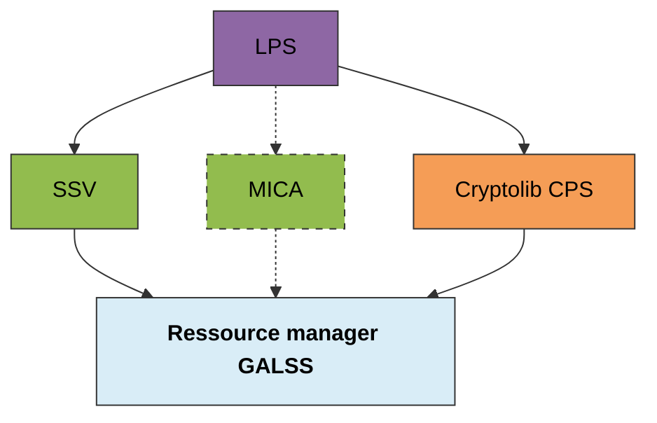
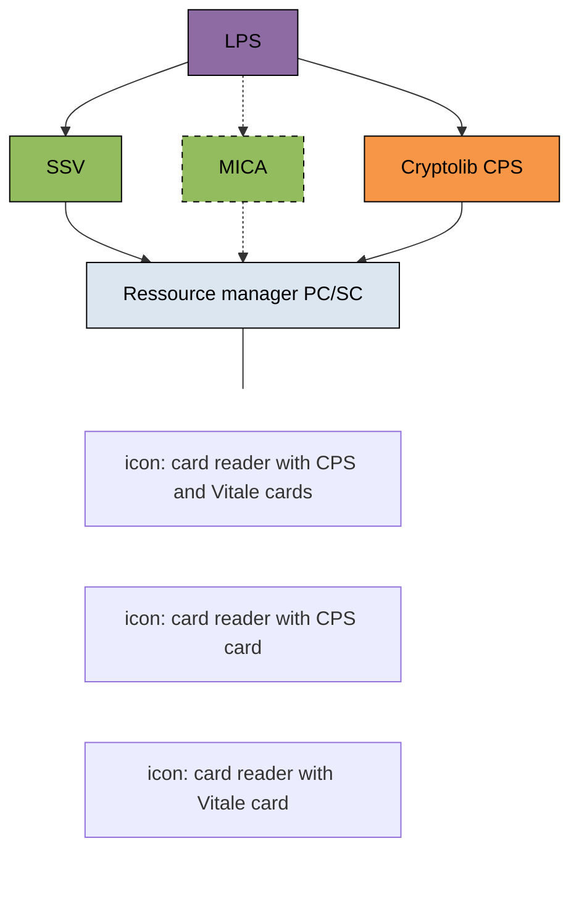
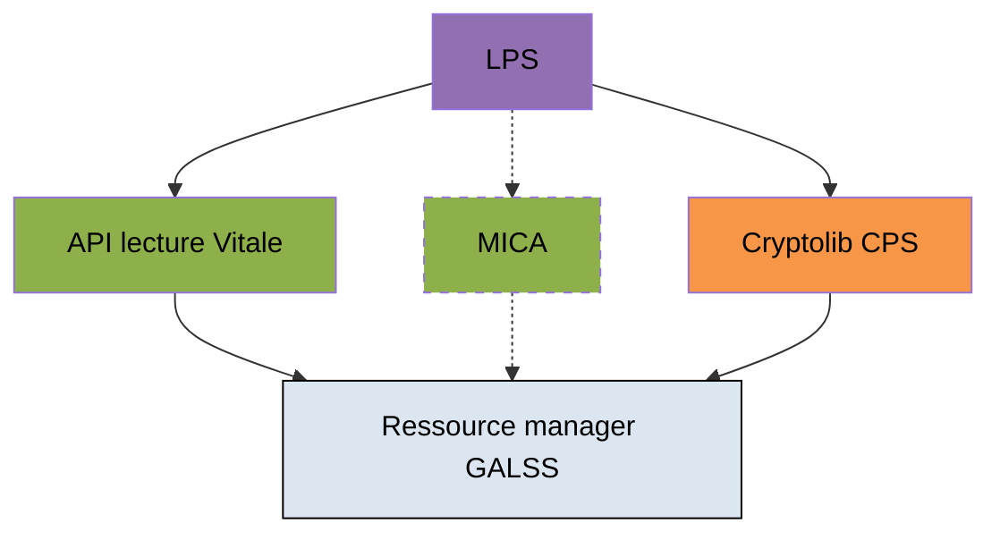
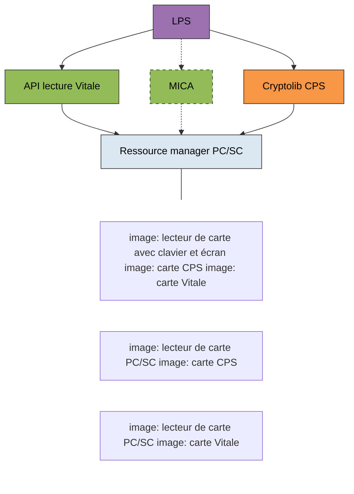
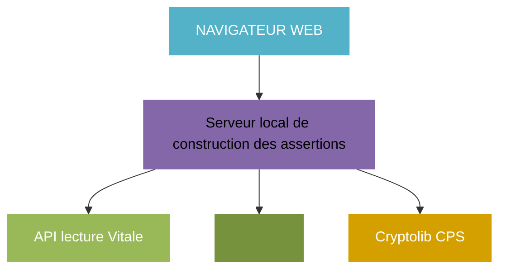
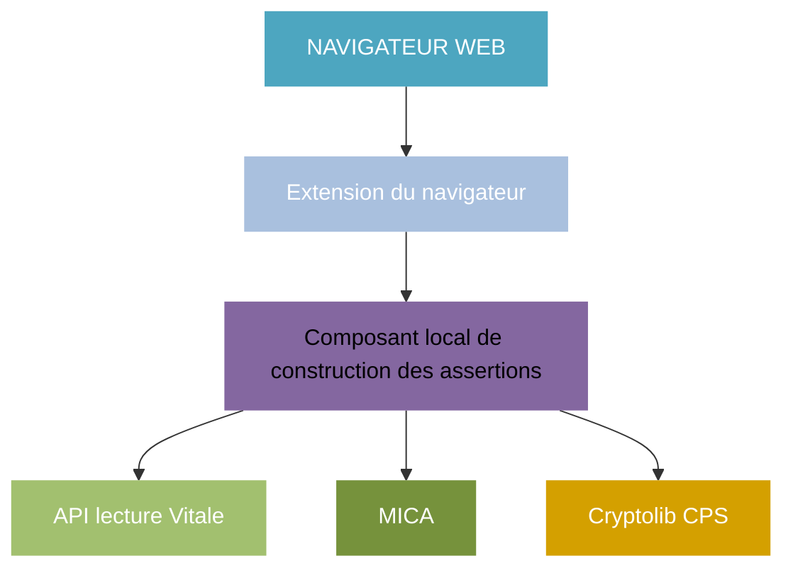
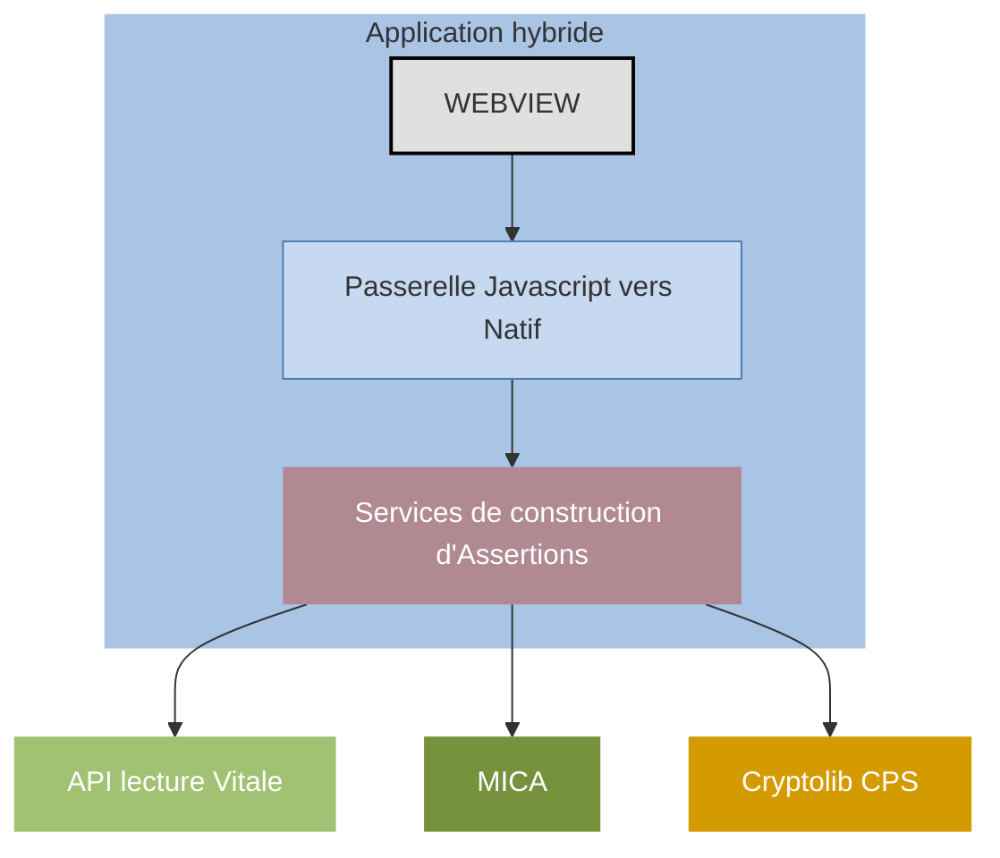

logo: sesam-vitale

## Téléservices intégrés

*Note d'information*

# **Modalité d'accès aux données présentes dans les cartes Vitale, ApCV, CPS, dans ProSanté Connect et dans les certificats**

Référence : SEL-INF-031 / Version : 1.40 / Date : 24/04/2023
Sécurité : DIFFUSION RESTREINTE

**GIE SESAM-Vitale**
5, boulevard Marie et Alexandre Oyon – 72019 LE MANS Cedex 2
<u>www.sesam-vitale.fr</u>

Ce document a été élaboré par le **GIE SESAM-Vitale**.

Conformément à l’article L.122-4 du Code de la Propriété Intellectuelle, toute représentation ou reproduction (intégrale ou partielle) du présent ouvrage, quel que soit le support utilisé, doit être soumise à l’accord préalable écrit de son auteur.

Il en est de même pour sa traduction, sa transformation, son adaptation ou son arrangement, quel que soit le procédé utilisé.

**Tout manquement à ces obligations constituerait un délit de contrefaçon, au sens des articles L **335-2 et suivants du code de la propriété intellectuelle, susceptible d’entraîner des sanctions pour** l’auteur du délit.**

**GIE SESAM-Vitale**
5, boulevard Marie et Alexandre Oyon – 72019 LE MANS Cedex 2
<u>www.sesam-vitale.fr</u>

*SEL-INF-031*
*Modalité d'accès aux données présentes dans les cartes Vitale, ApCV, CPS, dans ProSanté Connect et dans les certificats*
*Version : 1.40*

<table>
  <caption>**Table des matières**</caption>
    <tr>
      <td><strong>1</strong></td>
      <td><strong>INTRODUCTION.........................................................................................................................................4</strong></td>
    </tr>
    <tr>
      <td>1.1</td>
      <td>Objet du document ..............................................................................................................................4</td>
    </tr>
    <tr>
      <td>1.2</td>
      <td>Documents de référence .....................................................................................................................4</td>
    </tr>
    <tr>
      <td>1.3</td>
      <td>Abréviations.........................................................................................................................................5</td>
    </tr>
    <tr>
      <td>1.4</td>
      <td>Guide de lecture ..................................................................................................................................6</td>
    </tr>
    <tr>
      <td><strong>2</strong></td>
      <td><strong>ARCHITECTURE DU SI-PS .......................................................................................................................7</strong></td>
    </tr>
    <tr>
      <td>2.1</td>
      <td>Composants matériels.........................................................................................................................7</td>
    </tr>
    <tr>
      <td>2.2</td>
      <td>Composants logiciels ..........................................................................................................................7</td>
    </tr>
    <tr>
      <td></td>
      <td>    2.2.1 Composants CPx....................................................................................................................7</td>
    </tr>
    <tr>
      <td></td>
      <td>    2.2.2 Composants Vitale .................................................................................................................7</td>
    </tr>
    <tr>
      <td></td>
      <td>    2.2.3 Composants certificats logiciels .............................................................................................8</td>
    </tr>
    <tr>
      <td>2.3</td>
      <td>Exemples d’architecture ....................................................................................................................10</td>
    </tr>
    <tr>
      <td></td>
      <td>    2.3.1 Architectures type « Client lourd » .......................................................................................10</td>
    </tr>
    <tr>
      <td></td>
      <td>    2.3.2 Architectures type « Client léger » .......................................................................................12</td>
    </tr>
    <tr>
      <td></td>
      <td>    2.3.3 Architectures type « Client hybride »....................................................................................13</td>
    </tr>
    <tr>
      <td>2.4</td>
      <td>Bonnes pratiques d’usage des cartes Vitale et CPS ........................................................................14</td>
    </tr>
    <tr>
      <td></td>
      <td>    2.4.1 Contrôle exclusif de la carte CPx par l’utilisateur .................................................................14</td>
    </tr>
    <tr>
      <td></td>
      <td>    2.4.2 Optimisation du temps de réponse pour l’utilisateur avec le temps masqué .......................14</td>
    </tr>
    <tr>
      <td></td>
      <td>    2.4.3 Gestion de la concurrence d’accès aux cartes ....................................................................14</td>
    </tr>
    <tr>
      <td><strong>3</strong></td>
      <td><strong>ACQUISITION DES DONNEES ...............................................................................................................16</strong></td>
    </tr>
</table>

<table>
  <caption>**Table des illustrations**</caption>
    <tr>
      <td>FIGURE 1 : POSTE EN FACTURATION SESAM-VITALE EQUIPE D’UN LECTEUR SESAM-VITALE.................................</td>
      <td>10</td>
    </tr>
    <tr>
      <td>FIGURE 2 : POSTE EN FACTURATION SESAM-VITALE EQUIPE DE LECTEURS PC/SC...............................................</td>
      <td>10</td>
    </tr>
    <tr>
      <td>FIGURE 3 : POSTE HORS FACTURATION SESAM-VITALE EQUIPE D’UN LECTEUR SESAM-VITALE ............................</td>
      <td>11</td>
    </tr>
    <tr>
      <td>FIGURE 4 : POSTE HORS FACTURATION SESAM-VITALE EQUIPE DE LECTEURS PC/SC ..........................................</td>
      <td>11</td>
    </tr>
    <tr>
      <td>FIGURE 5 : POSTE CLIENT LEGER HORS FACTURATION SESAM-VITALE AVEC SERVEUR LOCAL ...............................</td>
      <td>12</td>
    </tr>
    <tr>
      <td>FIGURE 6 : POSTE CLIENT LEGER HORS FACTURATION SESAM-VITALE AVEC EXTENSION .......................................</td>
      <td>12</td>
    </tr>
    <tr>
      <td>FIGURE 7 : POSTE CLIENT HYBRIDE HORS FACTURATION SESAM-VITALE ..............................................................</td>
      <td>13</td>
    </tr>
</table>

*24/04/2023*
*GIE SESAM-Vitale* 
 icon: GIE SESAM-Vitale logo *3 / 20*
*Ce document à diffusion restreinte ne peut être diffusé sans l'autorisation d'une personne habilitée au GIE SESAM-Vitale*

*SEL-INF-031* *Modalité d'accès aux données présentes dans les cartes Vitale, ApCV, CPS, dans ProSanté Connect et dans les certificats* *Version : 1.40*

# **1 INTRODUCTION**

## **1.1 Objet du document**

Ce document décrit succinctement les architectures d’accès aux cartes Vitale et CPS, ainsi qu’aux certificats logiciels (certificats de personne morale par exemple) et guide le lecteur dans l’acquisition des données nécessaires à l’implémentation des cadres d’interopérabilité AMO, AMC et SIS (DMP) depuis les cartes Vitale et CPS, l’ApCV, ProSanté Connect et les certificats logiciels.

*Ce document n’est pas un manuel de programmation. Il identifie uniquement les composants utiles pour obtenir telle ou telle donnée, ou pour solliciter telle ou telle fonction.*

## **1.2 Documents de référence**

Les versions des documents suivants sont données à titre indicatif à la date de publication de ce document. Il est recommandé de se référer aux dernières versions publiées de ces documents sur les sites éditeurs de l’ANS ou du GIE SESAM-Vitale.

<table>
  <thead>
    <tr>
      <th><b>Appellation</b></th>
      <th><b>Type et titre</b></th>
      <th><b>Référence</b></th>
    </tr>
  </thead>
  <tbody>
    <tr>
      <td>[SIS01]</td>
      <td>Cadre d’Interopérabilité SIS - Données métier de la CPS - Sources des données métier pour les personnes et les structures</td>
      <td>v1.5 du 11/2020</td>
    </tr>
    <tr>
      <td>[SIS02]</td>
      <td>Cadre d’Interopérabilité SIS – Volet transport synchrone client lourd pour les services de santé</td>
      <td>V3.0 du 03/2023</td>
    </tr>
    <tr>
      <td>[SIS03]</td>
      <td>Cadre d’Interopérabilité SIS – Volet transport synchrone (API Pro Santé connectées)</td>
      <td>V1.0 du 03/2023</td>
    </tr>
    <tr>
      <td>[TLSI01]</td>
      <td>Cadre d’Interopérabilité SIS – Volet transport synchrone pour les téléservices de l’assurance maladie obligatoire</td>
      <td>v1.1.5 du 20/04/2023</td>
    </tr>
    <tr>
      <td>[TLSI02]</td>
      <td>Cadre d’interopérabilité techniques des services AMC</td>
      <td>v1.6.4 du 13/12/2022</td>
    </tr>
    <tr>
      <td>[CPS01]</td>
      <td>Cryptolib CPS3 - Spécifications externes du module CPS PKCS#11</td>
      <td>v1.0.1 du 10/10/2012</td>
    </tr>
    <tr>
      <td>[CPS02]</td>
      <td>Cryptolib CPS3 - Manuel de programmation</td>
      <td>v1.5.0 du 16/10/2013</td>
    </tr>
    <tr>
      <td>[CPS03]</td>
      <td>Les données des cartes CPS2bis et CPS2ter - Allocation des Tags</td>
      <td>v1.2 du 17/06/2010</td>
    </tr>
    <tr>
      <td>[CPS04]</td>
      <td>Les données métier de la CPS3 – Volets CPS2ter et IAS</td>
      <td>v1.0.1 du 10/10/2012</td>
    </tr>
    <tr>
      <td>[CPS05]</td>
      <td>Guide d’implémentation – Détection de l’arrachage de la carte CPS</td>
      <td>v1.0.3 du 17/10/2013</td>
    </tr>
    <tr>
      <td>[CPS06]</td>
      <td>IGC Santé – Gabarit des certificats X509 (certificats logiciels et certificats embarqués dans les cartes CPx)</td>
      <td>v1.0.0 du 21/10/2016</td>
    </tr>
    <tr>
      <td>[FSV01]</td>
      <td>Dictionnaire - Données du Poste de Travail</td>
      <td>PDT-MR-003 v2.5 – janvier 2022</td>
    </tr>
    <tr>
      <td>[FSV02]</td>
      <td>Manuel de programmation des API SSV</td>
      <td>SSV-MP-010 v2.4 – août 2022</td>
    </tr>
    <tr>
      <td>[VIT01]</td>
      <td>Manuel de programmation des API Lecture Vitale</td>
      <td>APILEC-MP-001 v2.5 – février 2022</td>
    </tr>
  </tbody>
</table>

*24/04/2023* *GIE SESAM-Vitale* 
 icon: icon *4 / 20*
*Ce document à diffusion restreinte ne peut être diffusé sans l'autorisation d'une personne habilitée au GIE SESAM-Vitale*

*SEL-INF-031*
*Modalité d'accès aux données présentes dans les cartes Vitale, ApCV, CPS, dans ProSanté Connect et dans les certificats*
*Version : 1.40*

<table>
  <thead>
    <tr>
      <th><b>Appellation</b></th>
      <th><b>Type et titre</b></th>
      <th><b>Référence</b></th>
    </tr>
  </thead>
  <tbody>
    <tr>
      <td>[VIT02]</td>
      <td>Manuel de programmation des API MICA</td>
      <td>MICA-MP-001 v3.5 – mars 2022</td>
    </tr>
    <tr>
      <td>[APCV01]</td>
      <td>Demander l’authentification et gérer le contexte ApCV</td>
      <td>APCV-MP-001 v1.6 du 21/10/2022</td>
    </tr>
  </tbody>
</table>
**Tableau 1 – Documents de références.**

Site publication documentation cadre d’interopérabilité SIS :
*   [https://esante.gouv.fr/services/referentiels/referentiels-d-interoperabilite/cadre-d-interoperabilite-des-systemes-d](https://esante.gouv.fr/services/referentiels/referentiels-d-interoperabilite/cadre-d-interoperabilite-des-systemes-d)

Site publication documentation carte CPS et certificats IGC Santé :
*   [https://industriels.esante.gouv.fr/](https://industriels.esante.gouv.fr/)

Site publication documentation du GIE SESAM-Vitale pour les industriels :
*   [https://industriels.sesam-vitale.fr/](https://industriels.sesam-vitale.fr/)

Documentation [technique](https://industriels.esante.gouv.fr/produits-et-services/pro-sante-connect/documentation-technique) Pro Santé Connect :
*   [https://industriels.esante.gouv.fr/produits-et-services/pro-sante-connect/documentation-technique](https://industriels.esante.gouv.fr/produits-et-services/pro-sante-connect/documentation-technique)

## **1.3 Abréviations**

<table>
  <thead>
    <tr>
      <th colspan="2"><b>Abréviations</b></th>
    </tr>
  </thead>
  <tbody>
    <tr>
      <td><b><b>AMC</b></b></td>
      <td>Assurance Maladie Complémentaire</td>
    </tr>
    <tr>
      <td><b><b>AMO</b></b></td>
      <td>Assurance Maladie Obligatoire</td>
    </tr>
    <tr>
      <td><b>ApCV</b></td>
      <td>Application Carte Vitale</td>
    </tr>
    <tr>
      <td><b>API</b></td>
      <td>Application Programming Interface</td>
    </tr>
    <tr>
      <td><b><b>CDSA</b></b></td>
      <td>Common Data Sécurity Architecture Apple MacOS</td>
    </tr>
    <tr>
      <td><b><b>CPE</b></b></td>
      <td>Carte Personnel d’Etablissement</td>
    </tr>
    <tr>
      <td><b><b>CPF</b></b></td>
      <td>Carte Professionnel de santé en Formation</td>
    </tr>
    <tr>
      <td><b>CPS</b></td>
      <td>Carte Professionnel de Santé</td>
    </tr>
    <tr>
      <td><b><b>CPx</b></b></td>
      <td>Terme générique regroupant tous les types de cartes des professionnels de santé</td>
    </tr>
    <tr>
      <td><b><b>CSP</b></b></td>
      <td>Cryptographic Service Provider Microsoft</td>
    </tr>
    <tr>
      <td><b>DI</b></td>
      <td>Dispositif Intégré homologué pour la facturation SESAM-Vitale</td>
    </tr>
    <tr>
      <td><b><b>DMP</b></b></td>
      <td>Dossier Médical Partagé</td>
    </tr>
    <tr>
      <td><b><b>DRE</b></b></td>
      <td>Demande de Remboursement Electronique</td>
    </tr>
    <tr>
      <td><b><b>FSE</b></b></td>
      <td>Feuille de soins électronique</td>
    </tr>
    <tr>
      <td><b><b>FSV</b></b></td>
      <td>Fournitures SESAM-Vitale</td>
    </tr>
    <tr>
      <td><b><b>GALSS</b></b></td>
      <td>Gestionnaite d’Acces au Lecteur Santé Social</td>
    </tr>
    <tr>
      <td><b>IGC</b></td>
      <td>Infrastructure de Gestion de Clés publiques (ou PKI en anglais)</td>
    </tr>
    <tr>
      <td><b><b>LPS</b></b></td>
      <td>Logiciel de gestion de cabinet du Professionnel de Santé</td>
    </tr>
    <tr>
      <td><b>MICA</b></td>
      <td>Module d’Interface Carte Vitale</td>
    </tr>
    <tr>
      <td><b>OS</b></td>
      <td>Operating Systeme (Système d’exploitation)</td>
    </tr>
    <tr>
      <td><b><b>PC/SC</b></b></td>
      <td>Standard d’accès aux cartes à puce</td>
    </tr>
    <tr>
      <td><b>PS</b></td>
      <td>Professionnel de Santé</td>
    </tr>
    <tr>
      <td><b><b>RAC</b></b></td>
      <td>Référentiel d’Accès aux Cartes</td>
    </tr>
  </tbody>
</table>

*24/04/2023*
*GIE SESAM-Vitale* 
 icon: SESAM-Vitale logo 5 / 20
*Ce document à diffusion restreinte ne peut être diffusé sans l'autorisation d'une personne habilitée au GIE SESAM-Vitale*

*SEL-INF-031* *Modalité d'accès aux données présentes dans les cartes Vitale, ApCV, CPS, dans ProSanté Connect et dans les certificats* *Version : 1.40*

<table>
  <thead>
    <tr>
      <th colspan="2"><b>Abréviations</b></th>
    </tr>
  </thead>
  <tbody>
    <tr>
      <td><b><b>SI-PS</b></b></td>
      <td>Système d’Information du Professionnel de Santé</td>
    </tr>
    <tr>
      <td><b><b>SIS</b></b></td>
      <td>Système d’Information de Santé</td>
    </tr>
    <tr>
      <td><b><b>SSV</b></b></td>
      <td>API Service SESAM-Vitale</td>
    </tr>
    <tr>
      <td><b>SV</b></td>
      <td>SESAM-Vitale</td>
    </tr>
    <tr>
      <td><b>TL</b></td>
      <td>Terminal Lecteur SESAM-Vitale</td>
    </tr>
    <tr>
      <td><b><b>TLA</b></b></td>
      <td>Terminal Lecteur Application (TL déporté)</td>
    </tr>
    <tr>
      <td><b><b>USB</b></b></td>
      <td>Universal Sérial Bus</td>
    </tr>
  </tbody>
</table>

## **1.4 Guide de lecture**

Ce document s’adresse aux éditeurs qui souhaitent mettre en œuvre ou maintenir les interfaces de leur LPS avec les téléservices AMO, AMC et DMP.

Outre la présente introduction, le document comporte les chapitres suivants :

* Le chapitre 2 décrit des exemples d’architectures possibles du système d’information du PS.
* Le chapitre 3 décrit les méthodes d’acquisition des données.

*24/04/2023* *GIE SESAM-Vitale* 
 icon: GIE SESAM-Vitale logo *6 / 20*
*Ce document à diffusion restreinte ne peut être diffusé sans l'autorisation d'une personne habilitée au GIE SESAM-Vitale*

*SEL-INF-031*
*Modalité d'accès aux données présentes dans les cartes Vitale, ApCV, CPS, dans ProSanté Connect et dans les certificats*
*Version : 1.40*

# **2 ARCHITECTURE DU SI-PS**

## **2.1 Composants matériels**

### **Lecteurs de cartes à puce**

Pour accéder aux cartes à puce (Vitale ou CPS), le poste de travail doit être équipé d’au moins un des éléments suivants :

*   Lecteur homologué SESAM-Vitale (ou toute autres solution homologuée : dispositif intégré, TLA, RAC, Equipement de lecture Vitale) ;
*   Lecteur PC/SC.

Les lecteurs homologués SESAM-Vitale sont des lecteurs bi- ou tri-fentes principalement connecté au SI-PS via une interface USB (des solutions sans fil peuvent exister au travers du référentiel RAC) et peuvent gérer simultanément la carte Vitale et la carte CPx. Ces lecteurs sont généralement utilisés pour réaliser des FSE et DRE, ou accéder aux différents services des organisations d’assurance maladie obligatoire ou complémentaire nécessitant un accès aux cartes CPS et/ou Vitale. Ils nécessitent un gestionnaire d’accès adéquat (ressource manager) nommé GALSS. Les dernières générations de lecteurs homologués SESAM-Vitale sont également compatibles PC/SC et peuvent donc être adressées via le gestionnaire de ressource standard PC/SC présent sur les systèmes d’exploitation Windows, Mac et Linux¹.

Les lecteurs PC/SC sont des lecteurs nécessitant un gestionnaire d’accès PC/SC intégré dans la plupart des OS (installé de base sous Windows, Mac-OS et certaines distributions Linux, sinon package spécifique à installer en plus sous Linux).

## **2.2 Composants logiciels**

### **2.2.1 Composants CPx**

La CPx est utilisée pour générer les assertions² dans le cas des cadres d’interopérabilité AMO, AMC et SIS (DMP).

L’accès aux données et aux fonctions de la carte CPx s’effectue au travers d’un middleware appelé « cryptolib CPS » fourni par l’ANS. La version V5 de la cryptolib comprend notamment les modules suivants utilisables par un LPS :

*   Le composant PKCS#11 CPS3 (tout OS) avec une interface standard PKCS#11 ;
*   Le composant CSP (uniquement sous Windows) avec l’interface standard CSP de Windows ;
*   Le composant CDSA (uniquement sous MacOS) avec l’interface standard CDSA de MacOS.

Pour des informations détaillées, se référer aux documents [CPS01] et [CPS02].

### **2.2.2 Composants Vitale**

Les composants du GIE SESAM-Vitale suivants permettent l’accès à la carte Vitale.

***

¹ La bascule d’un mode « GALSS » vers un mode « PC/SC » et inversement des lecteurs homologués SESAM-Vitale n’est pas automatique et nécessite une action de reconfiguration manuelle sur le lecteur.

² Les assertions signées par la CPS sont spécifiques à chacun des cadres d’interopérabilités et ne sont pas interchangeables : une assertion générée pour un cadre d’interopérabilité ne peut pas être utilisée pour un autre cadre.

*24/04/2023*
*GIE SESAM-Vitale* 
 icon: icon *7 / 20*
*Ce document à diffusion restreinte ne peut être diffusé sans l'autorisation d'une personne habilitée au GIE SESAM-Vitale*

*SEL-INF-031*
*Modalité d'accès aux données présentes dans les cartes Vitale, ApCV, CPS, dans ProSanté Connect et dans les certificats*
*Version : 1.40*

*   *Les FSV (Fournitures SESAM-Vitale),* pour accéder aux cartes Vitale et CPS dans un contexte facturation SESAM-Vitale
*   *l’API de lecture Vitale, pour accéder à la carte Vitale dans un contexte hors facturation SESAM-Vitale*
*   *l’API MICA, seul composant offrant* des fonctions techniques de signature par la carte Vitale

Pour des informations complètes concernant ces composants, voir les manuels afférents ([FSV01], [FSV02], [VIT01] et [VIT02]).

Le LPS peut également s’appuyer sur des offres industrielles homologuées (DI, TLA, Equipement de lecture Vitale…) en alternative des API lecture Vitale ou des SSV ou bien si ces dernières ne sont pas disponibles sur l’environnement d’exécution du LPS.

### **FSV**

Ces fournitures SESAM-Vitale offrent des services métiers liés à la facturation SESAM-Vitale. Elles comprennent notamment l’API SSV.

L’API SSV a pour rôle de :

*   Lire les cartes CPS et Vitale,
*   Formater et sécuriser les FSE et DRE,
*   Permettre les échanges avec l’application embarquée TLA.

L’API SSV permet la lecture des cartes Vitale et CPS et la sécurisation des factures avec un lecteur homologué SESAM-Vitale ou avec des lecteurs PC/SC.

Les modalités d’accès et de récupération des données sont décrites dans le manuel de programmation des API SSV (cf. document [FSV02]).

Le Dictionnaire des Données du Poste de Travail présente toutes les valeurs possibles des données remontées (cf. document [FSV01]).

### **API de lecture Vitale**

L’API de Lecture Vitale fournit des fonctions permettant de lire les informations relatives aux assurés sociaux contenus dans la carte Vitale.

Elle fonctionne avec les lecteurs PC/SC et les lecteurs homologués SESAM-Vitale.

L’API de Lecture Vitale restitue les données au format XML.

### **API MICA**

L’API MICA fournit aux éditeurs de LPS des fonctions techniques liées à la signature de la carte Vitale :

*   Contrôle de la présence de la carte Vitale dans le lecteur et de l’arrachage de la carte par comparaison du numéro de série,
*   Signature d’un buffer de données par la carte Vitale (afin de signer l’assertion Vitale réalisée par le progiciel).

## **2.2.3   Composants certificats logiciels**

Certains téléservices peuvent autoriser l’utilisation de certificats logiciels en alternative à la carte CPx. Dans tous les cas, il est nécessaire de se référer aux guides d’intégration des téléservices pour savoir si ces certificats sont autorisés ou non et dans quelles conditions.

Un exemple de certificats « logiciels » pouvant être utilisés, notamment en établissement, sont les certificats de personne morale de l’IGC Santé, pour des services acceptant une authentification indirecte ou déléguée des utilisateurs.

*24/04/2023*
*GIE SESAM-Vitale* 
icon: icon *8 / 20*
*Ce document à diffusion restreinte ne peut être diffusé sans l'autorisation d'une personne habilitée au GIE SESAM-Vitale*

*SEL-INF-031*
*Modalité d'accès aux données présentes dans les cartes Vitale, ApCV, CPS, dans ProSanté Connect et dans les certificats*
*Version : 1.40*

La description des différents certificats logiciels disponibles sur l’IGC Santé est décrite en détail dans le document [CPS06].

Les certificats logiciels (exemples des certificats de personnes morales de l’IGC Santé édités par l’ANS) ne sont pas attachés à un dispositif matériel, qui n’est pas nécessaire dans ce cas : il est de la responsabilité du gestionnaire du SI de s’assurer du confinement de chaque certificat (clef privée) sur un seul système actif à un instant donné. Dans ce cas, la protection des clés privées associées se présente de manière générale sous la forme d’un « keystore » protégé par mot de passe.3

Il est ainsi strictement interdit de distribuer la même clef privée sur une flotte de PC destinée à l’ensemble des utilisateurs.

L’accès à ces certificats logiciels et keystore peut se faire au travers de librairies standards du marché. Des exemples de librairies strandards OpenSource sont donnés ci-après à titre illustratif :

*   OpenSSL (librairie en langage C) : [https://www.openssl.org/](https://www.openssl.org/)
*   BouncyCastle (librairie en langage Java) : [https://www.bouncycastle.org/fr/](https://www.bouncycastle.org/fr/)

_______________________________
3 Pour rappel, dans le cas des certificats embarqués dans les cartes CPx, les clés privées sont stokées et protégées par la carte à puce et sont accessibles en présentant le code pin à la carte.

*24/04/2023* *GIE SESAM-Vitale* 
icon: icon *9 / 20*
*Ce document à diffusion restreinte ne peut être diffusé sans l'autorisation d'une personne habilitée au GIE SESAM-Vitale*

*SEL-INF-031* *Modalité d'accès aux données présentes dans les cartes Vitale, ApCV, CPS, dans ProSanté Connect et dans les certificats* *Version : 1.40*

## **2.3     Exemples d’architecture**

### **2.3.1   Architectures type « Client lourd »**

Différents exemples d’architecture d’un poste devant réaliser un accès aux cartes Vitales et CPS sont illustrés au travers des schémas suivants :

image: CPS card, card reader, and Vitale card

**Figure 1 : Poste en facturation SESAM-Vitale équipé d’un lecteur SESAM-vitale.**

Cette configuration illustre l’accès aux cartes Vitale et CPS dans un contexte de facturation SESAM-Vitale avec utilisation d’un lecteur homologué SESAM-Vitale nécessitant le **Ressource manager GALSS**.

Le composant MICA n’est nécessaire que s’il y a besoin de réaliser une assertion Vitale signée par la carte Vitale.

**Figure 2 : Poste en facturation SESAM-Vitale équipé de lecteurs PC/SC**

Cette configuration illustre l’accès aux cartes Vitale et CPS dans un contexte de facturation SESAM-Vitale avec utilisation d’un lecteur homologué SESAM-Vitale compatible avec le **Ressource manager PC/SC** ou de lecteurs PC/SC.

Le composant MICA n’est nécessaire que s’il y a besoin de réaliser une assertion Vitale signée par la carte Vitale.

*24/04/2023* *GIE SESAM-Vitale* 
 icon: icon 10 / 20
*Ce document à diffusion restreinte ne peut être diffusé sans l'autorisation d'une personne habilitée au GIE SESAM-Vitale*

*SEL-INF-031*
*Modalité d'accès aux données présentes dans les cartes Vitale, ApCV, CPS, dans ProSanté Connect et dans les certificats*
*Version : 1.40*

photo: carte CPS, lecteur de carte et carte Vitale

**Figure 3 : Poste hors facturation SESAM-Vitale équipé d’un lecteur SESAM-Vitale**

Cette configuration illustre l’accès aux cartes Vitale et CPS dans un contexte hors facturation SESAM-Vitale (accueil établissement, transporteur…) avec utilisation d’un lecteur homologué SESAM-Vitale nécessitant le ressource manager GALSS.

Le composant MICA n’est nécessaire que s’il y a besoin de réaliser une assertion Vitale signée par la carte Vitale.

**Figure 4 : Poste hors facturation SESAM-Vitale équipé de lecteurs PC/SC**

Cette configuration illustre l’accès aux cartes Vitale et CPS dans un contexte hors facturation SESAM-Vitale (accueil établissement, transporteur…) avec utilisation d’un lecteur homologué SESAM-Vitale compatible avec le ressource manager PC/SC ou de lecteurs PC/SC.

Le composant MICA n’est nécessaire que s’il y a besoin de réaliser une assertion Vitale signée par la carte Vitale.

*24/04/2023*
*GIE SESAM-Vitale* 
icon: icon 11 / 20
*Ce document à diffusion restreinte ne peut être diffusé sans l'autorisation d'une personne habilitée au GIE SESAM-Vitale*

*SEL-INF-031*
*Modalité d'accès aux données présentes dans les cartes Vitale, ApCV, CPS, dans ProSanté Connect et dans les certificats*
*Version : 1.40*

### **2.3.2 Architectures type « Client léger »**

Dans ces architectures le LPS s’exécute sur un serveur distant et interagit avec le Professionnel de santé via un navigateur Web. L’accès aux cartes via le GALSS ou PC/SC est identique aux architectures Client lourd. Seules les configurations hors facturation sont illustrées ci-après, les configurations en facturation SESAM-Vitale sont similaires en remplaçant le composant API Lecture Vitale par le composant SSV.

**Figure 5 : Poste client léger hors facturation SESAM-Vitale avec serveur local**

Cette configuration illustre l’accès aux cartes Vitale et CPS dans un contexte de client léger hors facturation (accueil établissement, transporteur…). Le Serveur local en charge de la construction des assertions est accessible en localhost par redirection HTTPS ou par requête Ajax depuis du JavaScript.

Cette solution fonctionne avec tous les navigateurs mais présente des contraintes pour la sécurisation du lien HTTPS entre le navigateur et le serveur local.

**Figure 6 : Poste client léger hors facturation SESAM-Vitale avec extension**

Cette configuration illustre l’accès aux cartes Vitale et CPS dans un contexte de client léger hors facturation (accueil établissement, transporteur…). Le composant local en charge de la construction des assertions est accessible via une extension du navigateur qui le démarre et communique avec lui en mode « Native Messaging ».

La solution « Web Extension » peut présenter des spécificités selon les navigateurs.

*24/04/2023*
*GIE SESAM-Vitale* 
 icon: icon 12 / 20
*Ce document à diffusion restreinte ne peut être diffusé sans l'autorisation d'une personne habilitée au GIE SESAM-Vitale*

*SEL-INF-031* *Modalité d'accès aux données présentes dans les cartes Vitale, ApCV, CPS, dans ProSanté Connect et dans les certificats* *Version : 1.40*

## **2.3.3   Architectures type « Client hybride »**

Seules les configurations hors facturation sont illustrées ci-après, les configurations en facturation SESAM-Vitale sont similaires en remplaçant le composant API Lecture Vitale par le composant SSV.

### Application hybride

**Figure 7 : Poste client hybride hors facturation SESAM-Vitale**

Cette configuration illustre l’accès aux cartes Vitale et CPS dans un contexte de client hybride hors facturation (accueil établissement, transporteur…).

Le client est une application native embarquant un moteur de rendu pour la navigation Web. Des passerelles (Hook) permettent de faire le lien entre les appels JavaScript d’une page et les services natifs de construction d’assertions de l’application.

Les mécanismes de passerelles sont spécifiques au moteur de rendu ainsi qu’au framework de développement choisi.

*24/04/2023* *GIE SESAM-Vitale* 
 icon: SESAM-Vitale logo *13 / 20*
*Ce document à diffusion restreinte ne peut être diffusé sans l'autorisation d'une personne habilitée au GIE SESAM-Vitale*

*SEL-INF-031*
*Modalité d'accès aux données présentes dans les cartes Vitale, ApCV, CPS, dans ProSanté Connect et dans les certificats*
*Version : 1.40*

## **2.4 Bonnes pratiques d’usage des cartes Vitale et CPS**

### **2.4.1 Contrôle exclusif de la carte CPx par l’utilisateur**

Afin d’assurer une authentification satisfaisante de l’utilisateur final, la carte et le lecteur doivent être sous le contrôle exclusif de l’utilisateur, ce qui implique certaines contraintes sur les systèmes accédant aux téléservices :

*   Les cartes ne sont pas confiées à un tiers, ni confinées dans une « salle serveur » qui n’est pas accessible directement par l’utilisateur.
*   Une fois la carte « ouverte » avec le code PIN par une application, l’accès aux certificats de la carte par cette même application peut ne pas redemander systématiquement ce code PIN. Il faut impérativement pouvoir verrouiller l’accès au LPS en cas d’absence de l’utilisateur4 de son poste afin d’éviter un usage de la carte à l’insu du professionnel de santé.
*   Si la carte est retirée du lecteur, il faut prendre en compte au plus tôt le retrait de la carte. Le logiciel l’utilisant doit désactiver les accès et connexions vers des services externes ou internes au poste ouverts avec la carte. Pour détecter le retrait de la carte, se référer au document [CPS05].

### **2.4.2 Optimisation du temps de réponse pour l’utilisateur avec le temps masqué**

L’accès aux fonctions cryptographiques des cartes CPx prend plusieurs secondes, variable en fonction du type de lecteur et de la famille de cartes (CPS2ter ou CPS3), ce qui peut être pénalisant pour l’utilisateur.

Il existe des stratégies d’implémentations qui permettent de réduire le temps de réponse perçu par l’utilisateur, en faisant certaines opérations en tâche de fond sans que celui-ci ne les déclenche explicitement, ou sans que celui-ci n’ait besoin d’attendre la fin de l’opération.

Ce temps n’est pas forcément entièrement masqué car il dépend de l’implémentation par le LPS et de l’enchaînement des actions de l’utilisateur.

Les opérations en temps masqué peuvent se faire par exemple sur :

*   L’ouverture de connexion TLS vers un téléservice : à l’ouverture du LPS, à la sélection du téléservice par l’utilisateur, à l’insertion de la carte Vitale, à la sélection du patient dans le LPS par le PS…
*   La publication de documents dans le DMP, qui impose la signature du lot : l’utilisateur n’a pas forcément besoin d’attendre la fin de l’opération pour passer à une autre action. Il doit être toutefois notifié de la réussite ou de l’échec de la publication.
*   Le test de la présence de la carte CPS : ce test peut être fait en tâche de fond en faisant un polling régulier sur la présence de la carte (cf. document [CPS05]).

Au sein des LPS, l’implémentation du temps masqué peut passer par l’utilisation de threads (parallélisation de tâches au sein d’un programme).

### **2.4.3 Gestion de la concurrence d’accès aux cartes**

L’accès aux fonctions des cartes est caractérisé par un temps de réponse non négligeable, de plusieurs secondes, et variable selon la fonction utilisée, la famille de cartes, et le lecteur de cartes utilisé. Les ressources carte CPx et Vitale ne peuvent traiter qu’un ordre à la fois. On peut donc arriver à un conflit d’accès pour les cartes, entre fonctions (accès DMP, FSE…) ou logiciels différents (LPS, navigateur…).

La probabilité augmente avec l’implémentation du temps masqué au sein des LPS, car l’utilisateur peut enchainer les actions pendant que des accès cartes sont en cours.

***

4 Le verrouillage de l’accès au LPS peut se faire soit suite à une détection d’inactivité sur le poste, soit en offrant une fonction spécifique de verrouillage activable par l’utilisateur. Ce verrouillage peut également se faire en s’appuyant sur les fonctions de verrouillage du poste offertes par l’OS.

*24/04/2023*
*GIE SESAM-Vitale* 
 icon: GIE SESAM-Vitale logo *14 / 20*
*Ce document à diffusion restreinte ne peut être diffusé sans l'autorisation d'une personne habilitée au GIE SESAM-Vitale*

*SEL-INF-031*
*Modalité d'accès aux données présentes dans les cartes Vitale, ApCV, CPS, dans ProSanté Connect et dans les certificats*
*Version : 1.40*

Un premier niveau de gestion de la concurrence d’accès est géré au niveau du ressource manager (GALSS ou PC/SC). Celui-ci garantit qu’une application ayant obtenu l’accès à une ressource carte ne sera pas perturbée par une autre application souhaitant également accéder à la carte. Cette dernière recevra alors une erreur du type « ressource occupée ».

Les cryptolibs CPS et les API SESAM-Vitale ne gèrent pas de file d’attente sur l’accès aux cartes CPx et Vitale. Les LPS doivent donc gérer la problématique de la concurrence d’accès vis-à-vis des erreurs du type « ressource occupée ».

### ***Pour gérer la concurrence d’accès au sein d’un LPS :***

La façon la plus simple est d’implémenter la notion de sémaphore au sein d’un LPS. Cela correspond à un gestionnaire de ressource qui prend en charge l’accès unique à celle-ci, et à une file d’attente des différents threads sur celle-ci.

Ce mécanisme est implémenté nativement dans certains langages (synchronized en Java, lock en C#…), ou via des librairies spécifiques.

### ***Pour gérer la concurrence d’accès entre logiciels :***

Plusieurs logiciels sur un système peuvent accéder en même temps aux fonctions des cartes CPS et Vitale : LPS, navigateur…

Les librairies CPS et SESAM-Vitale ne gérant pas de files d’attente sur les ressources, si l’accès à la carte est réalisé par deux logiciels simultanément, celui qui n’aura pas reçu le contrôle recevra un code d’erreur de type ‘ressource en cours d’utilisation’. Pour gérer ce cas de figure, la seule façon de faire pour le logiciel est d’attendre quelques dixièmes de secondes et de retenter à plusieurs reprises l’accès à la carte, jusqu’à en recevoir le contrôle.

### ***Eviter l’accaparement des ressources***

A moins d’être sur un équipement complètement maitrisé par un éditeur/intégrateur, il est fortement déconseillé au LPS d’utiliser de façon continue la totalité des ressources lecteurs ou cartes, afin de permettre à d’autres processus d’y accéder.

Par exemple, il ne faut pas faire un polling trop rapide sur la carte, afin de laisser à d’autres processus la possibilité d’y accéder.

Pour gérer la présence des cartes, il est possible de faire un test systématique la présence carte ou du polling (non continu), mais chacune des solutions possède des inconvénients : soit un petit temps de latence potentiellement gênant, soit une occupation régulière des ressources qui peut être potentiellement préjudiciable aux autres applications du poste.

Il faut également limiter les accès cartes qui ne sont pas commandés directement par des actions de l’utilisateur (actions en tâche de fond).

*24/04/2023*
*GIE SESAM-Vitale* 
 icon: icon *15 / 20*
*Ce document à diffusion restreinte ne peut être diffusé sans l'autorisation d'une personne habilitée au GIE SESAM-Vitale*

*SEL-INF-031*
*Modalité d'accès aux données présentes dans les cartes Vitale, ApCV, CPS, dans ProSanté Connect et dans les certificats*
*Version : 1.40*

# 3 **ACQUISITION DES DONNEES**

Les tableaux qui suivent référencent toutes les données utilisées dans les cadres d’interopérabilité AMO, AMC et SIS (DMP) et leur modalité d’accès via la cryptolib CPS, ProSanté Connect, les API SSV, l’API de lecture Vitale ou depuis le contexte ApCV. L’API MICA ne servant qu’à réaliser une signature par carte Vitale et ne permettant pas l’accès aux données de la carte Vitale, elle ne figure pas dans les tableaux suivants.

## **Données liées aux PS**

Une partie des données métiers de la CPx est accessible via des objets PKCS lus au travers de l’interface PKCS#11 de la Cryptolib CPS. Les composants CSP (Windows) et CDSA (MacOS) ne permettent pas l’accès aux données de la carte CPx.

Une autre partie de ces données est accessible via l’API SSV.

Enfin, une autre partie des données est accessible via le jeton UserInfo de ProSanté Connect.

En ce qui concerne la Cryptolib V5, les noms d’objets préfixés « CPS_ » sont à utiliser pour adresser une carte de type CPS3 et ceux préfixés « CPS2TER_ » sont à utiliser pour adresser une carte de type CPS2ter.

La différenciation du type de carte est explicitée dans le document [CPS02]. Cependant, les cartes CPS2ter n’étant plus diffusées depuis 2011, il n’existe plus de carte de ce type à ce jour. Seuls les objets des cartes CPS3 sont décrits ci-après.

<table>
  <thead>
    <tr>
      <th>DONNEES</th>
      <th><b>CRYPTOLIB V5</b> <b>CARTE CPS3</b></th>
      <th>API SSV</th>
      <th><b>PROSANTE CONNECT</b> <b>(JETON USERINFO)</b></th>
    </tr>
  </thead>
  <tbody>
    <tr>
      <td>Certificat X.509 (DN du certificat X.509)</td>
      <td>– Fonction PKCS#11</td>
      <td></td>
      <td></td>
    </tr>
    <tr>
      <td>codeSpecialite</td>
      <td>– lecture de l’objet CPS_INFO_PS (Spec_Ord_RPPS) – Lecture de l’extension privée du certificat (uniquement IGC Santé) specialiteRPPS (IGC Santé)</td>
      <td></td>
      <td>- codeSavoirFaire [https://mos.esante.gouv.fr/NO](https://mos.esante.gouv.fr/NOS/TRE_R01-EnsembleSavoirFaire-CISIS/TRE_R01-EnsembleSavoirFaire-CISIS.pdf)S/TRE_R01-EnsembleSavoirFaire-CISIS/TRE_R01-EnsembleSavoirFaire-[CISIS.pdf](https://mos.esante.gouv.fr/NOS/TRE_R01-EnsembleSavoirFaire-CISIS/TRE_R01-EnsembleSavoirFaire-CISIS.pdf)</u></td>
    </tr>
    <tr>
      <td>codeSpecialiteAMO (appelé aussi CodeSpeAMO)</td>
      <td></td>
      <td>– Fonction SSV_LireCartePS Groupe 2, champ 14</td>
      <td></td>
    </tr>
    <tr>
      <td>secteurActivite</td>
      <td>– lecture de l’objet CPS_ACTIVITY_XY_PS (Struct_Sect_Act_RPPS) XY variant de 01 à 16</td>
      <td>– Fonction SSV_LireCartePS Groupe 2, champ 4</td>
      <td>- codeSecteurDactivite [https://mos.esante.gouv.fr/NO](https://mos.esante.gouv.fr/NOS/TRE_R02-SecteurActivite/TRE_R02-SecteurActivite.pdf)S/TRE_R02-SecteurActivite/TRE_R02-[SecteurActivite.pdf](https://mos.esante.gouv.fr/NOS/TRE_R02-SecteurActivite/TRE_R02-SecteurActivite.pdf)</u></td>
    </tr>
    <tr>
      <td>gipCardType</td>
      <td>– Lecture de l’extension privée du certificat gipCardType (IGC CPS2ter) productType (IGC Santé)  – lecture de l’objet CPS_INFO_PS (Type_Carte_PS)</td>
      <td>- Fonction SSV_LireCartePS Groupe 1, champ 1</td>
      <td></td>
    </tr>
  </tbody>
</table>

*24/04/2023*
*GIE SESAM-Vitale* 
 icon: SESAM-Vitale logo 16 / 20
*Ce document à diffusion restreinte ne peut être diffusé sans l'autorisation d'une personne habilitée au GIE SESAM-Vitale*

*SEL-INF-031* *Modalité d'accès aux données présentes dans les cartes Vitale, ApCV, CPS, dans ProSanté Connect et dans les certificats* *Version : 1.40*

<table>
  <thead>
    <tr>
      <th><b>DONNEES</b></th>
      <th><b>CRYPTOLIB V5</b> <b>CARTE CPS3</b></th>
      <th><b>API SSV</b></th>
      <th><b>PROSANTE CONNECT</b> <b>(JETON USERINFO)</b></th>
    </tr>
  </thead>
  <tbody>
    <tr>
      <td>gipFutureProfessionCode pour les CPF uniquement</td>
      <td>- Lecture de l’extension privée du certificat gipFutureProfessionCode (IGC CPS2ter) FutureProfessionCode (IGC Santé) – Lecture de l’objet CPS_INFO_PS (Code_Profession_PF)</td>
      <td>✕</td>
      <td>✕</td>
    </tr>
    <tr>
      <td>gipProfessionCode pour les CPS ou CPE uniquement</td>
      <td>- Lecture de l’extension privée du certificat gipProfessionCode (IGC CPS2ter) ProfessionCode (IGC Santé) – Lecture de de l’objet CPS_INFO_PS (Code_Profession_PS)</td>
      <td>✕</td>
      <td>- codeProfession [https://mos.esante.gouv.fr/NO](https://mos.esante.gouv.fr/NOS/JDV_J106-EnsembleProfession-RASS/JDV_J106-EnsembleProfession-RASS.pdf)S/JDV_J106-EnsembleProfession-RASS/JDV_J106-EnsembleProfession-[RASS.pdf](https://mos.esante.gouv.fr/NOS/JDV_J106-EnsembleProfession-RASS/JDV_J106-EnsembleProfession-RASS.pdf)</u></td>
    </tr>
    <tr>
      <td>identifiant de Facturation5 (Identifiant + clé) (appelé aussi PSAM, IdFacturation) 9 caractères</td>
      <td>✕</td>
      <td>– Fonction SSV_LireCartePS Concaténation des champs 9 et 10 du groupe 2</td>
      <td>✕</td>
    </tr>
    <tr>
      <td>Identifiant national du PS et type d’identifiant (Type d’identifiant + Identifiant + clé) Type d’identifiant : cf Tb G08. (appelé aussi IdNational)</td>
      <td>– Lecture du champ CN du DN du certificat X.509 – lecture de l’objet CPS_INFO_PS (Id_Nat_PS)</td>
      <td>– Fonction SSV_LireCartePS Concaténation des champs 2, 3 et 4 du groupe 1 Le champ 4 peut être vide.</td>
      <td>- SubjectNameID</td>
    </tr>
    <tr>
      <td>nom d’exercice du porteur (nom inscrit sur le visuel de la carte)</td>
      <td>– Lecture du champ SN du DN du certificat X.509 <b>– Lecture de l’objet CPS_INFO_PS (NomExerc)</b></td>
      <td>– Fonction SSV_LireCartePS Groupe 1, champ 6</td>
      <td>- family_name</td>
    </tr>
    <tr>
      <td>prenomUsuel</td>
      <td>– Lecture du champ GN du DN du certificat X.509 <b>– Lecture de l’objet <b>CPS_NAME_PS</b> (Prenom_Usuel)</b></td>
      <td>– Fonction SSV_LireCartePS Groupe 1, champ 7</td>
      <td>- given_name</td>
    </tr>
  </tbody>
</table>

⁵ Les situations de facturation d’un PS sont liées aux situations d’exercice. Le LPS doit permettre aux PS qui possèdent plusieurs situations d’exercice d’en sélectionner une, puis de lire sa situation de facturation.

*24/04/2023* *GIE SESAM-Vitale* icon: GIE SESAM-Vitale logo *17 / 20*

*Ce document à diffusion restreinte ne peut être diffusé sans l'autorisation d'une personne habilitée au GIE SESAM-Vitale*

*SEL-INF-031* *Modalité d'accès aux données présentes dans les cartes Vitale, ApCV, CPS, dans ProSanté Connect et dans les certificats* *Version : 1.40*

<table>
  <caption><b>**Tableau 2 – Acquisition des données de la carte CPx.**</b></caption>
  <thead>
    <tr>
      <th><b><b>DONNEES</b></b></th>
      <th><b><b>CRYPTOLIB V5</b>  <b>CARTE CPS3</b></b></th>
      <th><b>API SSV</b></th>
      <th><b><b>PROSANTE CONNECT</b> <b>(JETON USERINFO)</b></b></th>
    </tr>
  </thead>
  <tbody>
    <tr>
      <td>Type de carte (CPS2 ou CPS3)</td>
      <td><b>-fonction C_GetTokenInfo  <b>structure</b> <b>CK_TOKEN_INFO</b>  <b>Le type de carte est</b> <b>renseigné dans le champ</b> <b>"label"’.</b></b></td>
      <td>✕</td>
      <td>✕</td>
    </tr>
  </tbody>
</table>

Dans le cas où un certificat logiciel est autorisé en alternative à une carte CPx, seules les données présentes dans le certificat sont accessibles (cf. document [CPS06]).

**Données liées à la**
**carte Vitale / ApCV**

<table>
  <thead>
    <tr>
      <th>DONNÉES</th>
      <th>DESCRIPTIONS</th>
      <th>API SSV</th>
      <th>API DE LECTURE VITALE</th>
      <th>APCV</th>
    </tr>
    <tr>
      <th></th>
      <th></th>
      <th>IDENTIFIANT DU BLOC-NUMERO DU CHAMP  (GROUPE-CHAMP)</th>
      <th>FORMAT XML</th>
      <th>RÉFÉRENCE ENTITÉ FONCTIONELLE</th>
    </tr>
  </thead>
  <tbody>
    <tr>
      <td colspan="4"><i><b>Données concernant la carte Vitale</b></i></td>
      <td></td>
    </tr>
    <tr>
      <td>Numéro de série</td>
      <td></td>
      <td>101-2</td>
      <td>&#x3C;tech>  &#x3C;numSerie></td>
      <td>EF_ApCVsi01_S03.01</td>
    </tr>
    <tr>
      <td>Date de fin de validité</td>
      <td></td>
      <td>101-3</td>
      <td>&#x3C;tech>  &#x3C;finValidite></td>
      <td>N/A</td>
    </tr>
    <tr>
      <td colspan="4"><i><b>Données concernant la couverture</b></i></td>
      <td></td>
    </tr>
    <tr>
      <td>Régime</td>
      <td>Code qui précise le grand régime auquel appartient l’intervenant gestionnaire</td>
      <td>101-10</td>
      <td>&#x3C;amo>  &#x3C;codeRegime></td>
      <td>EF_ApCVsi01_S09.01</td>
    </tr>
    <tr>
      <td>Caisse</td>
      <td>Code qui identifie l’organisme auquel appartient l’intervenant gestionnaire (Caisse de rattachement) Appelé également « Organisme »</td>
      <td>101-11</td>
      <td>&#x3C;amo>  &#x3C;caisse></td>
      <td>EF_ApCVsi01_S09.02</td>
    </tr>
  </tbody>
</table>

*24/04/2023* *GIE SESAM-Vitale* 
 icon: icon *18 / 20*
*Ce document à diffusion restreinte ne peut être diffusé sans l'autorisation d'une personne habilitée au GIE SESAM-Vitale*

*SEL-INF-031*
*Modalité d'accès aux données présentes dans les cartes Vitale, ApCV, CPS, dans ProSanté Connect et dans les certificats*
*Version : 1.40*

<table>
  <thead>
    <tr>
      <th>DONNÉES</th>
      <th>DESCRIPTIONS</th>
      <th>API SSV</th>
      <th>API DE LECTURE VITALE</th>
      <th>APCV</th>
    </tr>
    <tr>
      <th></th>
      <th></th>
      <th>IDENTIFIANT DU BLOC-NUMERO DU CHAMP  (GROUPE-CHAMP)</th>
      <th>FORMAT XML</th>
      <th>RÉFÉRENCE ENTITÉ FONCTIONELLE</th>
    </tr>
  </thead>
  <tbody>
    <tr>
      <td>Centre</td>
      <td>Code qui identifie l’entité dans l’organisme, chargé de la gestion de la couverture (Centre de prestation)</td>
      <td>101-12</td>
      <td>&#x3C;amo>   &#x3C;centreCarte> Ou &#x3C;amo>   &#x3C;codeCentre></td>
      <td>EF_ApCVsi01_S09.03</td>
    </tr>
    <tr>
      <td colspan="4"><strong><em>Données de l’assuré concerné par la couverture</em></strong></td>
      <td></td>
    </tr>
    <tr>
      <td>NIR</td>
      <td>NIR de l’assuré</td>
      <td>101-8</td>
      <td>&#x3C;ident>   &#x3C;nir>  Contient NIR + un espace + clé du NIR</td>
      <td>EF_ApCVsi01_S07.02</td>
    </tr>
    <tr>
      <td>Clé</td>
      <td>Clé du NIR</td>
      <td>101-9</td>
      <td>Voir au-dessus</td>
      <td>EF_ApCVsi01_S07.03</td>
    </tr>
    <tr>
      <td colspan="4"><strong><em>Données du bénéficiaire Les API retournent une liste de bénéficiaires. Il convient de sélectionner celui qui est concerné par le service. Le porteur de la carte Vitale est le bénéficiaire de la première zone bénéficiaire trouvée.</em></strong></td>
      <td></td>
    </tr>
    <tr>
      <td>Nom Usuel (ou Nom d’usage)</td>
      <td>Nom usuel du bénéficiaire</td>
      <td>104-1</td>
      <td>&#x3C;ident>   &#x3C;nomUsuel></td>
      <td>EF_ApCVsi01_S06.01</td>
    </tr>
    <tr>
      <td>Nom Famille6 (ou Nom de naissance)</td>
      <td>Nom de famille du bénéficiaire</td>
      <td>104-2</td>
      <td>&#x3C;ident>   &#x3C;nomPatronymique></td>
      <td>EF_ApCVsi01_S06.02</td>
    </tr>
    <tr>
      <td>Prénom</td>
      <td>Prénom du bénéficiaire</td>
      <td>104-3</td>
      <td>&#x3C;ident>   &#x3C;prenomUsuel></td>
      <td>EF_ApCVsi01_S06.03</td>
    </tr>
    <tr>
      <td>NIR certifié6</td>
      <td>NIR du bénéficiaire</td>
      <td>104-9</td>
      <td rowspan="2">&#x3C;ident>   &#x3C;nirCertifie>  Contient NIR + un espace + clé du NIR</td>
      <td>Si le bénéficiaire est l’utilisateur de l’ApCV : EF_ApCVsi01_S05.01 Sinon : EF_ApCVsi01_S08.01</td>
    </tr>
    <tr>
      <td>Clé6</td>
      <td>Clé du NIR certifié</td>
      <td>104-10</td>
      <td>Si le bénéficiaire est l’utilisateur de l’ApCV : EF_ApCVsi01_S05.02</td>
    </tr>
  </tbody>
</table>

6 Présence en carte facultative.

*24/04/2023*
*GIE SESAM-Vitale* 
 icon: GIE SESAM-Vitale logo *19 / 20*
*Ce document à diffusion restreinte ne peut être diffusé sans l'autorisation d'une personne habilitée au GIE SESAM-Vitale*

*SEL-INF-031*
*Modalité d'accès aux données présentes dans les cartes Vitale, ApCV, CPS, dans ProSanté Connect et dans les certificats*
*Version : 1.40*

<table>
  <thead>
    <tr>
      <th>DONNÉES</th>
      <th>DESCRIPTIONS</th>
      <th>API SSV</th>
      <th>API DE LECTURE VITALE</th>
      <th>APCV</th>
    </tr>
    <tr>
      <th></th>
      <th></th>
      <th>IDENTIFIANT DU BLOC-NUMERO DU CHAMP  (GROUPE-CHAMP)</th>
      <th>FORMAT XML</th>
      <th>RÉFÉRENCE ENTITÉ FONCTIONELLE</th>
    </tr>
  </thead>
  <tbody>
    <tr>
      <td></td>
      <td></td>
      <td></td>
      <td></td>
      <td>Sinon : EF_ApCVsi01_S08.02</td>
    </tr>
    <tr>
      <td>Date de certification⁶</td>
      <td>Date d’attribution du NIR du bénéficiaire</td>
      <td>104-11</td>
      <td>&#x3C;ident>  &#x3C;dateCertification></td>
      <td>N/A</td>
    </tr>
    <tr>
      <td>Date de naissance</td>
      <td>Date Naissance du bénéficiaire AAAA-MM-JJ (Accepte le format date lunaire)</td>
      <td>104-12  Format AAAAMMJJHHMN pour SSV et SSAAMMJJ pour DI</td>
      <td>&#x3C;ident>  &#x3C;naissance></td>
      <td>EF_ApCVsi01_S06.04</td>
    </tr>
    <tr>
      <td>Rang</td>
      <td>Rang de naissance⁷ ou rang bénéficiaire⁸</td>
      <td>104-13</td>
      <td>&#x3C;ident>  &#x3C;rangDeNaissance></td>
      <td>EF_ApCVsi01_S06.05</td>
    </tr>
  </tbody>
</table>

**Tableau 3 – Acquisition des données de la carte Vitale / ApCV**

---

7 Rang de naissance : Numéro d’ordre permettant de discriminer deux bénéficiaires portant la même date de naissance.

8 Rang bénéficiaire : Numéro d’ordre permettant de discriminer les bénéficiaires appartenant à la même famille, sans avoir recours à la date de naissance et au rang de naissance.

*24/04/2023*
*GIE SESAM-Vitale* 
 icon: icon *20 / 20*
*Ce document à diffusion restreinte ne peut être diffusé sans l'autorisation d'une personne habilitée au GIE SESAM-Vitale*