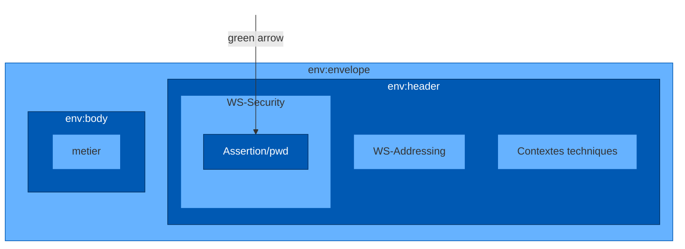
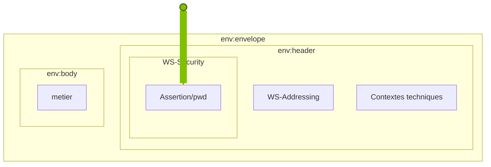
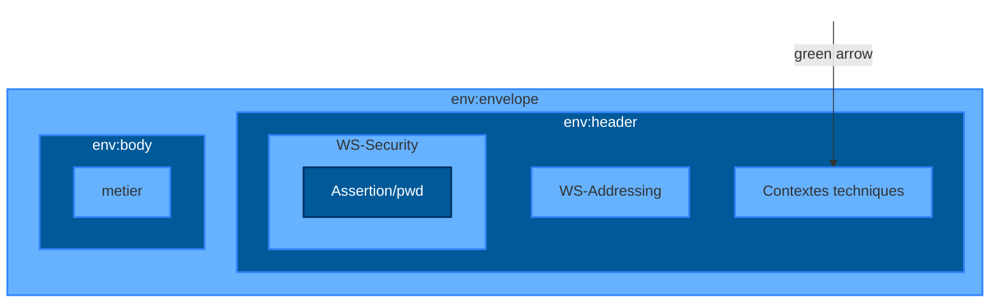
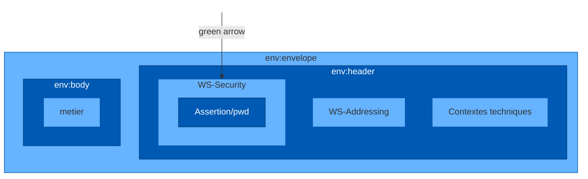
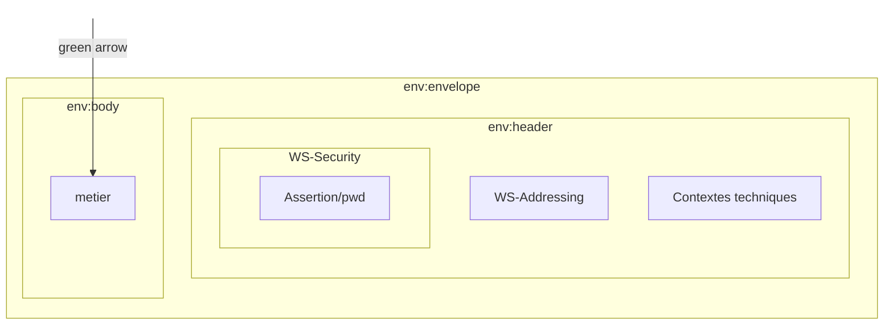
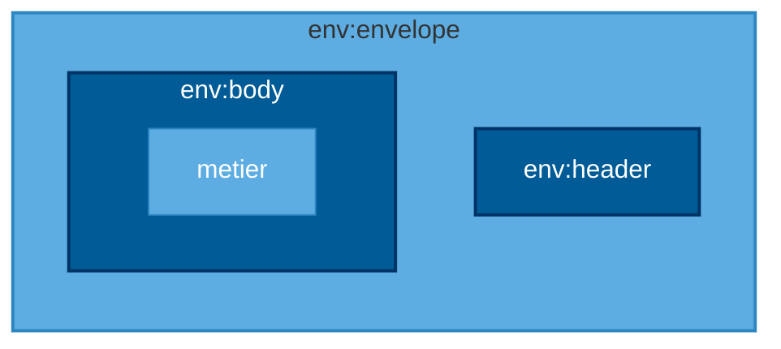

<!-- Conversion mixte : LlamaParse Agentic Plus ; pages 11, 12, 13, 22 et 27 transcrites visuellement par Codex. -->


<!-- Pages source 1-5 -->

# Présentation du cadre d'interopérabilité

icon: illustration de personnages stylisés sur un socle, l'un aidant un autre à monter

# **Enjeu**

logo: l'Assurance Maladie TLSi

**Réduire le délai et le coût**
**de mise en œuvre d'un**
**TLSi**

Présentation de cadre d'interopérabilité
2 15/01/2016

photo: target painted on a tree trunk

# **Objectif**

## **Décrire les éléments communs aux TLSi**

3
Présentation de cadre d'interopérabilité
15/01/2016

logo: sesam-vitale

# Communs à tous les télé-services

* Convention d’autorisation
* Conditions générales

* Cadre d’interopérabilité des TLSi
icon: loupe

# **Spécifiques à chaque télé-service**

* Convention d’autorisation
* Conditions particulières

* Documentation de mise en œuvre du service
* Spécifications fonctionnelles
* Guides d’intégration
* WSDL

* Guide de tests de conformité

4 Présentation de cadre d'interopérabilité
15/01/2016

logo: sesam-vitale

# <u>Les documents</u>

## Document Chapeau

## Documents techniques
*   **• Volet « Web-service »**
*   **• Volet « Page de service »**
*   **• Volet « Assertions et contextes »**
*   **• 2 Annexes**

## Démarche et Procédures

## Recommandations de Sécurité

Présentation de cadre d'interopérabilité
5
15/01/2016

logo: sesam-vitale

<!-- Pages source 6-10 -->

photo: laptop, tablet, and smartphone

# **Poste de travail**

6 Présentation de cadre d'interopérabilité
15/01/2016


logo: sesam-vitale

# Synchroniser les horloges

# Protéger le poste de travail

# Protéger la carte CPx

photo: person working at a computer

Présentation de cadre d'interopérabilité
15/01/2016

7


logo: sesam-vitale

photo: technician with laptop in a server room

# **Web-service**

8
Présentation de cadre d'interopérabilité
15/01/2016

logo: sesam-vitale

```mermaid
graph LR
    subgraph Header [" "]
        direction TB
        [web-service](http://intranet/asp/__applications/album_photos/img/shutterstock_107523950_connexion_gris.jpg)["#web-service"]
        style web-service fill:none,stroke:none,font-size:60px,font-weight:bold
    end

    LPS((LPS)) -- "icon: XML document" --> TLSi((TLSi))
    TLSi -- "icon: XML document" --> LPS

    style LPS fill:#0066cc,stroke:#004c99,color:white,font-weight:bold,font-size:24px
    style TLSi fill:#0066cc,stroke:#004c99,color:white,font-weight:bold,font-size:24px
    style Header fill:none,stroke:none
```

Présentation de cadre d'interopérabilité
15/01/2016
9

logo: sesam-vitale

**HTTP 1.1** **XML et XSD** **SOAP et WSDL** **WS-Addressing** **WS-Security** **SAML et XML Signature**

Présentation de cadre d'interopérabilité
**10** 15/01/2016

logo: sesam-vitale

<!-- Pages source 11-11 -->

# SOAP 1.2

```text
env:envelope
├── env:header
│   ├── WS-Addressing
│   ├── WS-Security
│   │   └── Assertion/pwd
│   └── Contextes techniques
└── env:body
    └── metier
```

```xml
<?xml version="1.0" encoding="UTF-8"?>
<env:Envelope xmlns:env="http://www.w3.org/2003/05/soap-envelope">
  <env:Header>
    <m:reservation xmlns:m="http://travelcompany.example.org/reservation"
      env:role="http://www.w3.org/2003/05/soap-envelope/role/next"
      env:mustUnderstand="true">
      <m:reference>uuid:093a2da1-q345-739r-ba5d-pqff98fe8j7d</m:reference>
      <m:dateAndTime>2001-11-29T13:20:00.000-05:00</m:dateAndTime>
    </m:reservation>
    <n:passenger xmlns:n="http://mycompany.example.com/employees"
      env:role="http://www.w3.org/2003/05/soap-envelope/role/next"
      env:mustUnderstand="true">
      <n:name>Åke Jógvan Øyvind</n:name>
    </n:passenger>
  </env:Header>
  <env:Body>
    <p:itinerary xmlns:p="http://travelcompany.example.org/reservation/travel">
      <p:departure>
        <p:departing>New York</p:departing>
        <p:arriving>Los Angeles</p:arriving>
        <p:departureDate>2001-12-14</p:departureDate>
        <p:departureTime>late afternoon</p:departureTime>
        <p:seatPreference>aisle</p:seatPreference>
      </p:departure>
      <p:return>
        <p:departing>Los Angeles</p:departing>
        <p:arriving>New York</p:arriving>
        <p:departureDate>2001-12-20</p:departureDate>
        <p:departureTime>mid-morning</p:departureTime>
        <p:seatPreference/>
      </p:return>
    </p:itinerary>
  </env:Body>
</env:Envelope>
```

Présentation de cadre d'interopérabilité — 15/01/2016 — 11
SESAM-Vitale


<!-- Pages source 12-12 -->

# WS-Addressing

**préciser l’opération**

et

**identifier la requête**

```text
env:envelope
├── env:header
│   ├── WS-Addressing
│   ├── WS-Security
│   │   └── Assertion/pwd
│   └── Contextes techniques
└── env:body
    └── metier
```

Flèche du schéma vers WS-Addressing.

```xml
<?xml version="1.0" encoding="UTF-8"?>
<env:Envelope xmlns:env="http://www.w3.org/2003/05/soap-envelope"
xmlns:wsa="http://www.w3.org/2005/08/addressing">
  <env:Header>
    <wsa:Action>urn:ServicePriseenChargeB2_SI:4.0.0:Calculer</wsa:Action>
    <wsa:MessageID>uuid:f02701b1-0f18-4502-a4bb-b1c5516c0a54</wsa:MessageID>
  </env:Header>
  <env:Body>
  </env:Body>
</env:Envelope>
```

Les valeurs Action et MessageID sont surlignées en jaune.

Présentation de cadre d'interopérabilité — 15/01/2016 — 12
SESAM-Vitale


<!-- Pages source 13-13 -->

# WS-Security

**Assertion SAML**

**Identifiants login/mot de passe**

```text
env:envelope
├── env:header
│   ├── WS-Addressing
│   ├── WS-Security
│   │   └── Assertion/pwd
│   └── Contextes techniques
└── env:body
    └── metier
```

Flèche du schéma vers WS-Security.

```xml
<?xml version="1.0" encoding="UTF-8"?>
<env:Envelope xmlns:env="http://www.w3.org/2003/05/soap-envelope"
xmlns:wsa="http://www.w3.org/2005/08/addressing" xmlns:wss="
http://docs.oasis-open.org/wss/2004/01/oasis-200401-wss-wssecurity-secext-1.0.xsd">
  <env:Header>
    <wsa:Action>urn:aat:4.1.0:GetVersionsReferentiel</wsa:Action>
    <wsa:MessageID>uuid:f02701b1-0f18-4502-a4bb-b1c5516c0a54</wsa:MessageID>
    <wss:Security>
      <saml:Assertion xmlns:saml="..."
      <!-- etc.-->
      </saml:Assertion>
      <!-- Ou.-->
      <wsse:UsernameToken>
        <wsse:Username>Dupont</wsse:Username>
        <wsse:Password>motdepasse</wsse:Password>
      </wsse:UsernameToken>
    </wss:Security>
  </env:Header>
  <env:Body>
  </env:Body>
</env:Envelope>
```

Les balises saml:Assertion et wsse:UsernameToken sont surlignées en jaune.

Présentation de cadre d'interopérabilité — 15/01/2016 — 13
SESAM-Vitale


<!-- Pages source 14-14 -->

# **Login/mot de passe**

```xml
<env:Envelope xmlns:env="http://www.w3.org/2003/05/soap-envelope" xmlns:wsa="http://www.w3.org/2005/08/addressing" xmlns:wss="http://docs.oasis-open.org/wss/2004/01/oasis-200401-wss-wssecurity-secext-1.0.xsd">
  <env:Header>
    <wsa:Action>urn:smprescriptiont:1.0.0:creerNumeroPrescription</wsa:Action>
    <wsa:MessageID>uuid:f02701b1-0f18-4502-a4bb-b1c5516c0a54</wsa:MessageID>
    <wss:Security>
      <wsse:UsernameToken>
        <wsse:Username>Dupont</wsse:Username>
        <wsse:Password>motdepasse</wsse:Password>
      </wsse:UsernameToken>
    </wss:Security>
  </env:Header>
  <env:Body>
  </env:Body>
</env:Envelope>
```



Présentation de cadre d'interopérabilité
15/01/2016
**14**

logo: sesam-vitale

<!-- Pages source 15-15 -->

# **2 assertions** logo: SAML v2.0 Security Assertion Markup Language

## **Assertion Vitale**
## **Assertion PS**




logo: sesam-vitale

**15** Présentation de cadre d'interopérabilité
15/01/2016

<!-- Pages source 16-20 -->

# Assertion Vitale non-signée

```xml
<saml:Assertion ID="_790a4fc3-5639-4473-90e6-78be4de398e1"
  IssueInstant="2011-06-29T10:34:03Z" Version="2.0">
  <saml:Issuer>00B1023668</saml:Issuer>
  <saml:Subject>
    <saml:NameID NameQualifier="VITALE">000467107356</saml:NameID>
  </saml:Subject>
</saml:Assertion>
```

16 Présentation de cadre d'interopérabilité
15/01/2016

logo: sesam-vitale

# **Assertion Vitale**

## **Signée**

```xml
<saml:Assertion ID="_790a4fc3-5639-4473-90e6-78be4de398e1" IssueInstant="2011-06-29T10:34:03Z" Version="2.0">
    <saml:Issuer>00B1023668</saml:Issuer>
    <ds:Signature>
        <ds:SignedInfo>
            <ds:CanonicalizationMethod Algorithm="http://www.w3.org/2001/10/xml-exc-c14n#"/>
            <ds:SignatureMethod Algorithm="http://www.sesam-vitale.fr/xmldsig/2011/06/V2-sha256/"/>
            <ds:Reference URI="#_790a4fc3-5639-4473-90e6-78be4de398e1">
                <ds:Transforms>
                    <ds:Transform Algorithm="http://www.w3.org/2000/09/xmldsig#enveloped-signature/"/>
                    <ds:Transform Algorithm="http://www.w3.org/2001/10/xml-exc-c14n#"/>
                </ds:Transforms>
                <ds:DigestMethod Algorithm="http://www.w3.org/2001/04/xmlenc#sha256/"/>
                <ds:DigestValue>/llvcn1QXN4eYUgh3O3ze6Q6VQ/6pmrBse+5IQFG2FA=</ds:DigestValue>
            </ds:Reference>
        </ds:SignedInfo>
        <ds:SignatureValue>1HXqB7om6fw=</ds:SignatureValue>
        <ds:KeyInfo>
            <v:KeyInfo xmlns:v="http://www.sesam-vitale.fr/xmldsig/2011/12/vitale">
                <v:NumSerieLogique>000467107356</v:NumSerieLogique>
                <v:CleMere>T2.M.SK.VI.AMO.SG.466</v:CleMere>
            </v:KeyInfo>
        </ds:KeyInfo>
    </ds:Signature>
    <saml:Subject>
        <saml:NameID NameQualifier="VITALE">000467107356</saml:NameID>
    </saml:Subject>
    <saml:AttributeStatement>
        <saml:Attribute Name="NIR">
            <saml:AttributeValue>1550672000106</saml:AttributeValue>
        </saml:Attribute>
    </saml:AttributeStatement>
</saml:Assertion>
```

Présentation de cadre d'interopérabilité
**17** 15/01/2016

logo: sesam-vitale

# **Assertion PS**

```xml
<Assertion ID="_c3976012-ea2c-4f7d-8fcb-068b6cd1dc0c" IssueInstant="2014-03-24T15:43:40.740Z" Version="2.0"
 xmlns="urn:oasis:names:tc:SAML:2.0:assertion" >
    <Issuer Format="urn:oasis:names:tc:SAML:1.1:nameid-format:X509SubjectName" >
GN=PATRICK+SN=SIRENE0000016260001+CN=500000000016261/CDET0001,OU=300000000016261,L=Paris
(75),O=TEST,C=FR</Issuer>
    <Signature xmlns="http://www.w3.org/2000/09/xmldsig#" >
        <SignedInfo >
            <CanonicalizationMethod Algorithm="http://www.w3.org/2001/10/xml-exc-c14n#" />
            <SignatureMethod Algorithm="http://www.w3.org/2001/04/xmldsig-more#rsa-sha256" />
            <Reference URI="#_c3976012-ea2c-4f7d-8fcb-068b6cd1dc0c" >
                <Transforms >
                    <Transform Algorithm="http://www.w3.org/2000/09/xmldsig#enveloped-signature" />
                    <Transform Algorithm="http://www.w3.org/2001/10/xml-exc-c14n#" />
                </Transforms >
                <DigestMethod Algorithm="http://www.w3.org/2001/04/xmlenc#sha256" />
                <DigestValue >vAvIAhwlnK5btJLhglblyWEDYnVE1XOfGimjVD143CU=</DigestValue>
            </Reference >
        </SignedInfo >
        <SignatureValue >rqR2v5Ehp6...hyxUGUPsWacg==</SignatureValue >
        <KeyInfo >
            <X509Data >
                <X509Certificate >MIIFsTCCBJmgA...vUaBVLJRrxkHfX</X509Certificate >
            </X509Data >
        </KeyInfo >
    </Signature >
    <Subject >
        <NameID NameQualifier="CDE-CPE" >500000000016261/CDET0001</NameID >
    </Subject >
    <AttributeStatement >
        <Attribute Name="AssertionFactory" >
            <AttributeValue >MICA_2.13.03</AttributeValue >
        </Attribute >
        <Attribute Name="identifiantFacturation" >
            <AttributeValue >992500538</AttributeValue >
        </Attribute >
    </AttributeStatement >
</Assertion >
```

Présentation de cadre d'interopérabilité
**18** 15/01/2016

logo: sesam-vitale

# **2 niveaux de sécurité**

**Au moment**
**de solliciter**
**une opération**
**d’un TLS…**

(Niveau 1 ) …le SI-PS doit générer une nouvelle assertion même si la précédente est toujours valide

(Niveau 2) …le SI-PS doit s’assurer que la durée de vie de l’assertion n’est pas dépassée (soit 1 h/20min) et que la carte liée à l’assertion est toujours présente dans le lecteur

**19**

logo: sesam-vitale

# **2 contextes XML**

## **Contexte LPS**

## **Contexte BAM**



Présentation de cadre d'interopérabilité
**20** 15/01/2016


logo: sesam-vitale

<!-- Pages source 21-21 -->

# **Contexte LPS**

## IDAM
* IDentifiant d’Assurance Maladie obtenu lors de la vérification de la conformité effectuée par le CNDA

## Version
* Le numéro de version du logiciel

## Nom
* Nom usuel du progiciel

## Instance
* Identifiant unique du logiciel généré à l’installation

**21**

logo: sesam-vitale

<!-- Pages source 22-22 -->

# Exemple de contexte LPS

```xml
<?xml version="1.0" encoding="UTF-8"?>
<ctxlps:ContexteLPS xmlns:ctxlps="urn:siram:lps:ctxlps" Nature="CTXLPS" Version="1.0">
  <ctxlps:Id>_83d0b61c-a34b-42bc-8669-c6879fff6ba6</ctxlps:Id>
  <ctxlps:Temps>2012-01-27T14:35:47Z</ctxlps:Temps>
  <ctxlps:Emetteur>899900003163</ctxlps:Emetteur>
  <ctxlps:LPS>
    <ctxlps:IDAM R="4">NUMAUTHINDUS</ctxlps:IDAM>
    <ctxlps:Version>01.00</ctxlps:Version>
    <ctxlps:Instance>abcd1234-a001-b001-c001-111111111111</ctxlps:Instance>
    <ctxlps:Nom>JMeter</ctxlps:Nom>
  </ctxlps:LPS>
</ctxlps:ContexteLPS>
```

**La version du LPS doit être renseignée pour chaque requête**

Présentation de cadre d'interopérabilité — 15/01/2016 — 22
SESAM-Vitale


<!-- Pages source 23-23 -->

# **Contexte BAM**

Les données du porteur et du bénéficiaire

Le NIR du bénéficiaire et rang de naissance

Les données du contrat AMO (ex. organisme AMO : régime, code caisse, centre...)

**23** Présentation de cadre d'interopérabilité
15/01/2016


logo: sesam-vitale

<!-- Pages source 24-24 -->

# **Exemple de contexte BAM**

```xml
<urn:ContexteBAM Version="01_02">
  <urn:Id>_24f12ad0-b6af-4cc9-a948-3d1b3ca5efaa</urn:Id>
  <urn:Temps>2014-03-18T12:00:00.00Z</urn:Temps>
  <urn:Emetteur>500000000016261/CDET0001</urn:Emetteur>
  <urn:COUVERTURE>
    <urn:GrandRegime>01</urn:GrandRegime>
    <urn:Organisme>261</urn:Organisme>
    <urn:CodeCentre>9880</urn:CodeCentre>
    <urn:ASSURE>
      <urn:Id>
        <urn:Num>1650163220102</urn:Num>
        <urn:Cle>18</urn:Cle>
      </urn:Id>
    </urn:ASSURE>
    <urn:BENEFICIAIRE>
      <urn:DateNai>1961-01-01</urn:DateNai>
      <urn:Rang>1</urn:Rang>
    </urn:BENEFICIAIRE>
  </urn:COUVERTURE>
</urn:ContexteBAM>
```




24

Présentation de cadre d'interopérabilité
15/01/2016
logo: sesam-vitale

<!-- Pages source 25-25 -->

# **« body métier»**



Présentation de cadre d'interopérabilité
**25** 15/01/2016

logo: sesam-vitale

<!-- Pages source 26-26 -->

# **Message réponse**



Présentation de cadre d'interopérabilité
**26** 15/01/2016

logo: sesam-vitale

<!-- Pages source 27-27 -->

# Erreur SOAP

```xml
<?xml version="1.0" encoding="UTF-8"?>
<soap:Envelope xmlns:soap="http://www.w3.org/2003/05/soap-envelope">
  <soap:Body>
    <soap:Fault>
      <soap:Code>
        <soap:Value>soap:Sender</soap:Value>
        <soap:Subcode>
          <soap:Value>soap:soap:siram_100</soap:Value>
        </soap:Subcode>
      </soap:Code>
      <soap:Reason>
        <soap:Text xml:lang="fr">L’accès par ce progiciel au service n’est pas autorisé. Contactez l’éditeur du progiciel ou votre responsable informatique.</soap:Text>
      </soap:Reason>
      <soap:Detail>
        <siram:Erreur code="desir_550" severite="erreur" messageID="_fe3b9237-2ef7-4e9e-b2b5-5d17033970fe" xmlns:siram="urn:siram">Numéro d’autorisation du logiciel inconnu</siram:Erreur>
      </soap:Detail>
    </soap:Fault>
  </soap:Body>
</soap:Envelope>
```

Présentation de cadre d'interopérabilité — 15/01/2016 — 27
SESAM-Vitale


<!-- Pages source 28-28 -->

# **Fichier WSDL**

## **description des web-services**

photo: a man in a suit drawing a red path through a white maze on a glass pane

**28** Présentation de cadre d'interopérabilité
15/01/2016
logo: sesam-vitale

<!-- Pages source 29-29 -->

**29**

**_29_** Présentation de cadre d'interopérabilité
15/01/2016


logo: sesam-vitale

<!-- Pages source 30-30 -->

# Mentions légales

**Ce document a été élaboré par le GIE SESAM-Vitale.**

**Conformément à l’article L.122-4 du Code de la Propriété Intellectuelle, toute représentation ou reproduction (intégrale ou partielle) du présent ouvrage, quel que soit le support utilisé, doit être soumise à l’accord préalable écrit de son auteur.**

**Il en est de même pour sa traduction, sa transformation, son adaptation ou son arrangement quel que soit le procédé utilisé.**

**Tout manquement à ces obligations constituerait un délit de contrefaçon, au sens des articles L 335-2 et suivants du code de la propriété intellectuelle, susceptible d’entraîner des sanctions pour l’auteur du délit**

30
Présentation de cadre d'interopérabilité
15/01/2016

logo: sesam-vitale