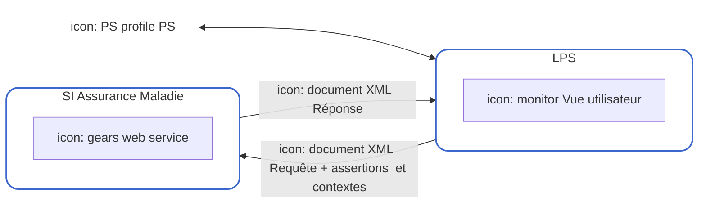
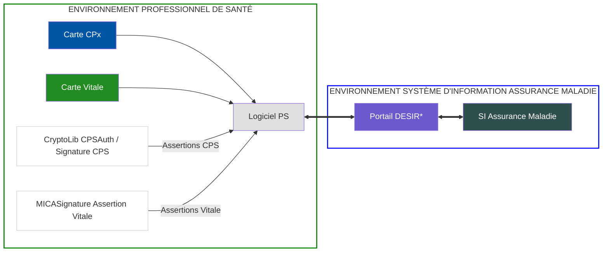

Les téléservices intégrés (TLSi)
de l’Assurance Maladie
# **GUIDE**
des livrables TLSi

icon: sesam-vitale

logo: l'Assurance Maladie

icon: folders and digital icons

## **Vous souhaitez intégrer un téléservice de l’Assurance Maladie dans votre logiciel ?**

Ce guide vous présente : Les différents livrables mis à votre disposition et les modalités pour les télécharger sur [l’espace privé Industriels.](https://industriels.sesam-vitale.fr/)

Vous n’avez pas de compte ? Nous vous invitons à remplir [le formulaire](https://industriels.sesam-vitale.fr/demandes?ajouterDemande=ContratAcces) de demande d’accès.

icon: power button

### **1. PRINCIPES DE BASE DES TÉLÉSERVICES INTÉGRÉS**

Les téléservices intégrés ont pour vocation de fournir aux Professionnels et Établissements de Santé des informations provenant de l’Assurance Maladie directement dans leur logiciel (**LPS**).

Le logiciel fait appel aux services disponibles via une requête SOAP (format <u>XML</u>).
En retour, les informations, délivrées au format <u>XML</u>, sont exploitées par le logiciel qui les présente au Professionnel de Santé (PS).

**L’accès aux Téléservices s’effectue :**

* par authentification du PS (par carte de la famille CPS ou par un identifiant sécurisé ou par un certificat serveur ou par Pro Santé Connect;
* et, pour certains services, par le support Vitale (carte Vitale ou application carte Vitale).

icon: refresh

## **2. LE CADRE D’INTEROPÉRABILITÉ DES TLSi AMO : DOCUMENT DE RÉFÉRENCE**

Basé sur des normes et des standards, le **Cadre d’Interopérabilité (CI)** des TLSi AMO constitue le référentiel **technique et sémantique** décrivant les **modalités d’intégration** des téléservices dans les logiciels des professionnels de santé.

Ce document fait référence pour la mise en œuvre et la conformité des téléservices. Il permet notamment de comprendre la cinématique des échanges ainsi que les mécanismes techniques nécessaires à leur intégration.

Le CI s’applique à l’ensemble des téléservices intégrés. Sa prise en compte est indispensable pour tout développement ou évolution d’un logiciel intégrant des TLSi.
Le corpus documentaire du CI est disponible en téléchargement sur [l’Espace Industriels](https://industriels.sesam-vitale.fr/group/integrer-tlsi/accueil?p_p_id=pexplorateurdocument_WAR_explorateurdocumentportlet&p_p_lifecycle=0&p_p_state=normal&p_p_mode=view&p_p_col_id=column-1&p_p_col_pos=2&p_p_col_count=6&_pexplorateurdocument_WAR_explorateurdocumentportlet_pageToDisplay=TreeFolder&_pexplorateurdocument_WAR_explorateurdocumentportlet_folderId=23056#23056) du GIE SESAM-Vitale.

icon: download

## **3. LA DOCUMENTATION TECHNIQUE ET FONCTIONNELLE PROPRE À CHAQUE TÉLÉSERVICE**

Sur l’Espace Industriels, dans la rubrique dédiée à chaque téléservice, est mis à disposition un corpus documentaire comprenant généralement :

*   **Les Spécifications Fonctionnelles Générales (SFG)** : elles décrivent l’utilisation du service d’un point de vue fonctionnel.
    *(Pour certains téléservices AMO, les informations fonctionnelles peuvent être intégrées directement dans le Guide d’Intégration).*
*   **Un ou plusieurs Guides d’intégration (ou MP – Manuel de Programmation)** : ils présentent les éléments fonctionnels et techniques nécessaires au développement de l’appel au service. Ils s’appuient sur le Cadre d’Interopérabilité.
*   **Un ou plusieurs WSDL** : ces documents XML décrivent :
    - la nature et le format des messages échangés entre le poste de travail du professionnel de santé et le système d’information de l’Assurance Maladie ;
    - la méthode de communication ;
    - la localisation du téléservice.
*   **Les Fiches d’Information** : elles apportent des compléments au corpus documentaire.
*   **Des Exemples de Requêtes** au format XML.

icon: home

## **4. L’AIDE AU DÉVELOPPEMENT DES ASSERTIONS**

**Qu’est-ce qu’une assertion ?**
L’accès aux TLSi nécessite l’utilisation des cartes CPx ou certificat serveur ou PSC et, dans certains cas, de la carte Vitale ou de l’appli carte Vitale. Ces accès sont soumis à des mécanismes de sécurisation.

Ces éléments de sécurisation sont transmis, du poste de travail vers le système d’information de l’Assurance Maladie, sous forme d’objets appelés « assertions ».

Selon le téléservice, la requête d’appel est accompagnée : d’une assertion CPS (ou assertion structure), et d’une assertion Vitale (ou appli carte Vitale), comme décrit dans le Cadre d’Interopérabilité (volet « Assertions et Contextes »).

### [Exemples](https://industriels.sesam-vitale.fr/group/integrer-tlsi) de code pour les assertions

Pour faciliter le développement, des <u>exemples</u> de programmation sont disponibles pour les assertions Vitale, appli carte Vitale, CPx et structure, en langages Java et C#.

### Acquisition des données contenues dans les cartes CPx et Vitale

Le document « Accès Cartes », présent dans le répertoire du [Cadre d’Interopérabilité,](https://industriels.sesam-vitale.fr/group/integrer-tlsi/accueil?p_p_id=pexplorateurdocument_WAR_explorateurdocumentportlet&p_p_lifecycle=0&p_p_state=normal&p_p_mode=view&p_p_col_id=column-1&p_p_col_pos=2&p_p_col_count=6&_pexplorateurdocument_WAR_explorateurdocumentportlet_pageToDisplay=TreeFolder&_pexplorateurdocument_WAR_explorateurdocumentportlet_folderId=2073724#2073724) permet :
* de décrire les architectures d’accès aux cartes Vitale et CPx,
* de guider l’acquisition des données nécessaires à la constitution des assertions.

#### Exemple de flux avec une assertion CPS

\*Dispositif d'Exposition des Services Inter Régime.

icon: icon

## **5. LES COMPOSANTS D’ACCÈS AUX TÉLÉSERVICES DE L’ASSURANCE MALADIE**

Deux composants sont nécessaires aux éditeurs pour intégrer, dans leurs logiciels, l’accès aux téléservices de l’Assurance Maladie :

* [**CryptoLib CPS**](https://industriels.sesam-vitale.fr/group/cryptolib-cps)
  Composant développé par l’ANS, qui en est propriétaire. Il permet de mettre en œuvre les fonctions d’authentification et/ou de signature à l’aide de la carte CPx.
* <u>**[Module d’Interface Cartes (MICA*)](https://industriels.sesam-vitale.fr/group/mica)**</u>
  Module développé par le GIE SESAM-Vitale, qui en est propriétaire. Il permet de signer les assertions Vitale, de lire le numéro de série de la carte Vitale et de tester la présence de cette dernière.

Pour accéder à ces composants, la signature préalable de la licence d’exploitation des composants d’accès aux téléservices de l’Assurance Maladie est requise.

1. Téléchargez la [licence d’exploitation des composants d’accès aux téléservices de l’assurance maladie](https://www.sesam-vitale.fr/documents/d/sesam-vitale/licence-d-exploitation-des-composants-d-acces-aux-teleservices-de-l-assurance-maladie).</u>
2. Signez la licence et renvoyez-la au GIE SESAM-Vitale par mail à l’adresse suivante : [relations-industriels@sesam-vitale.fr](mailto:relations-industriels%40sesam-vitale.fr?subject=).</u>
3. À réception de la licence dûment signée, nous vous ouvrirons l’accès aux composants souhaités.

icon: icon

### **Pour vous accompagner dans vos développements**

**GIE SESAM-Vitale - Accompagnement des éditeurs**

Pour toute question relative à vos démarches, contactez le service Relations avec les Industriels : [relations-industriels@sesam-vitale.fr.](mailto:relations-industriels%40sesam-vitale.fr?subject=)

# **5. LES COMPOSANTS D’ACCÈS AUX TÉLÉSERVICES DE L’ASSURANCE MALADIE**

icon: icon

**Pour vous accompagner dans vos développements**

icon: icon

**Service Support**

3

logo: GIE SESAM-Vitale

Pour toutes questions techniques ou fonctionnelles lors de vos développements, contactez le **Service Support** du GIE SESAM-Vitale en vous connectant au [portail IRIS.](https://portail-support.sesam-vitale.fr/)

Réalisation : GIE SESAM-Vitale - mai 2026 - Non contractuel

* La signature des assertions Vitale est obligatoire dans le cadre de l’accès au téléservice ADRi (TLSi) pour les logiciels destinés aux pharmaciens.
L’utilisation du composant MICA reste facultative pour les éditeurs SESAM-Vitale.