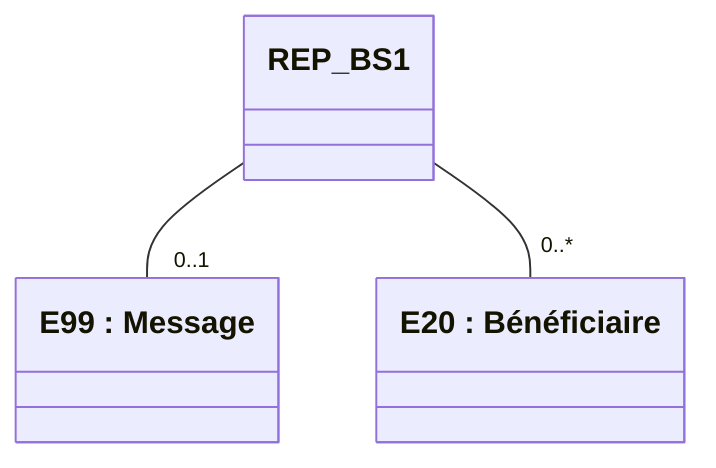
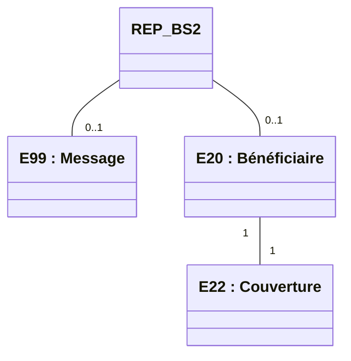

logo: sesam-vitale

**Téléservice intégré**
GUIDE D'INTÉGRATION

# WS_BS Services en Ligne "Bénéficiaire"

Référence : SEL-MP-013 / Version : 01.15 / Date : 10/11/2023
Sécurité : RESTREINTE / État : REFERENCE

**GIE SESAM-Vitale**
5, boulevard Marie et Alexandre Oyon – 72 019 LE MANS Cedex 2
<u>www.sesam-vitale.fr</u>

***SEL-MP-013*** ***GUIDE D'INTÉGRATION - WS_BS Services en Ligne*** ***Version : 01.15***
***"Bénéficiaire"***

Ce document a été élaboré par le GIE SESAM-Vitale.

Conformément à l’article L.122-4 du Code de la Propriété Intellectuelle, toute représentation ou reproduction (intégrale ou partielle) du présent ouvrage, quel que soit le support utilisé, doit être soumise à l’accord préalable écrit de son auteur.

Il en est de même pour sa traduction, sa transformation, son adaptation ou son arrangement, quel que soit le procédé utilisé.

**Tout manquement à ces obligations constituerait un délit de contrefaçon, au **sens des articles L 335-2 et suivants du code de la propriété intellectuelle,** susceptible d’entraîner des sanctions pour l’auteur du délit.**

## **CONTACTS**

logo: sesam-vitale

Pour toute demande d'évolution, comme pour toute question technique ou fonctionnelle, contactez le Centre de services :
*   e-mail : **centre-de-service@sesam-vitale.fr**
*   téléphone : **02 43 57 42 88**

***10/11/2023*** ***GIE SESAM-Vitale*** ***2 / 16***
***Ce document ne peut être diffusé sans l'autorisation d'une personne habilitée au GIE SESAM-Vitale***

**SEL-MP-013** **GUIDE D'INTÉGRATION - WS_BS Services en Ligne** **Version : 01.15**
**"Bénéficiaire"**

# **TABLES DES MATIERES**

<table>
    <tr>
      <td><b>1</b></td>
      <td><b>INTRODUCTION.........................................................................................................................................4</b></td>
      <td><b>4</b></td>
    </tr>
    <tr>
      <td>1.1</td>
      <td>LE SERVICE WS_BS : BENEFICIAIRE ......................................................................................................4</td>
      <td>4</td>
    </tr>
    <tr>
      <td></td>
      <td><i>1.1.1 Contexte .................................................................................................................................4</i></td>
      <td><i>4</i></td>
    </tr>
    <tr>
      <td></td>
      <td><i>1.1.2 Pré-requis ...............................................................................................................................4</i></td>
      <td><i>4</i></td>
    </tr>
    <tr>
      <td>1.2</td>
      <td>DOCUMENT DE REFERENCE ....................................................................................................................4</td>
      <td>4</td>
    </tr>
    <tr>
      <td>1.3</td>
      <td>ABREVIATIONS.......................................................................................................................................4</td>
      <td>4</td>
    </tr>
    <tr>
      <td><mark>1.4</mark></td>
      <td><mark>DEFINITIONS</mark>..........................................................................................................................................5</td>
      <td>5</td>
    </tr>
    <tr>
      <td><b>2</b></td>
      <td><b>CINEMATIQUE ET ASPECTS FONCTIONNELS......................................................................................5</b></td>
      <td><b>5</b></td>
    </tr>
    <tr>
      <td>2.1</td>
      <td>WS_BS1 : IDENTIFIER UN BENEFICIAIRE.................................................................................................5</td>
      <td>5</td>
    </tr>
    <tr>
      <td></td>
      <td><i>2.1.1 Présentation fonctionnelle du service.....................................................................................5</i></td>
      <td><i>5</i></td>
    </tr>
    <tr>
      <td></td>
      <td><i>2.1.2 Données en entrée du service ...............................................................................................6</i></td>
      <td><i>6</i></td>
    </tr>
    <tr>
      <td></td>
      <td><i>2.1.3 Données en sortie du service .................................................................................................6</i></td>
      <td><i>6</i></td>
    </tr>
    <tr>
      <td>2.2</td>
      <td>WS_BS2 : ACQUERIR LES DONNEES D’UN BENEFICIAIRE .........................................................................7</td>
      <td>7</td>
    </tr>
    <tr>
      <td></td>
      <td><i>2.2.1 Présentation fonctionnelle du service.....................................................................................7</i></td>
      <td><i>7</i></td>
    </tr>
    <tr>
      <td></td>
      <td><i>2.2.2 Données en entrée du service ...............................................................................................7</i></td>
      <td><i>7</i></td>
    </tr>
    <tr>
      <td></td>
      <td><i>2.2.3 Données en sortie du service .................................................................................................8</i></td>
      <td><i>8</i></td>
    </tr>
    <tr>
      <td><b>3</b></td>
      <td><b>ÉLEMENTS TECHNIQUES SPECIFIQUES AU SERVICE .......................................................................9</b></td>
      <td><b>9</b></td>
    </tr>
    <tr>
      <td>3.1</td>
      <td>LES COMPOSANTS DU POSTE DE TRAVAIL / SI PS ....................................................................................9</td>
      <td>9</td>
    </tr>
    <tr>
      <td>3.2</td>
      <td>MISE EN ŒUVRE ..................................................................................................................................10</td>
      <td>10</td>
    </tr>
    <tr>
      <td>3.3</td>
      <td>ENVIRONNEMENTS DE TRAVAIL .............................................................................................................13</td>
      <td>13</td>
    </tr>
    <tr>
      <td></td>
      <td><i>3.3.1 Environnement de test .........................................................................................................13</i></td>
      <td><i>13</i></td>
    </tr>
    <tr>
      <td></td>
      <td><i>3.3.2 Environnement de production ..............................................................................................13</i></td>
      <td><i>13</i></td>
    </tr>
    <tr>
      <td>3.4</td>
      <td>OPERATION WS_BS1 « LISTERBENEFICIAIRES » ..................................................................................14</td>
      <td>14</td>
    </tr>
    <tr>
      <td></td>
      <td><i>3.4.1 REQ_BS1 « REQINFOBENEFNIROD » ..............................................................................14</i></td>
      <td><i>14</i></td>
    </tr>
    <tr>
      <td></td>
      <td><i>3.4.2 REP_BS1 « EXPOLPSTRANSP_LISTEINFOBENEF » ......................................................14</i></td>
      <td><i>14</i></td>
    </tr>
    <tr>
      <td>3.5</td>
      <td>OPERATION WS_BS2 «RECHERCHERETATCIVILBENEF» ......................................................................15</td>
      <td>15</td>
    </tr>
    <tr>
      <td></td>
      <td><i>3.5.1 REQ_BS2 « EXPOLPSTRANSP_REQINFOBENEF » ........................................................15</i></td>
      <td><i>15</i></td>
    </tr>
    <tr>
      <td></td>
      <td><i>3.5.2 REP_BS2 « EXPOLPSTRANSP_INFOBENEF » ................................................................15</i></td>
      <td><i>15</i></td>
    </tr>
</table>

<table>
  <caption>**TABLE DES ILLUSTRATIONS**</caption>
    <tr>
      <td>FIGURE 1 : RELATIONS ENTRE LES ENTITES FONCTIONNELLES DU MESSAGE REP_BS1 ............................................6</td>
      <td>6</td>
    </tr>
    <tr>
      <td>FIGURE 2 : RELATIONS ENTRE LES ENTITES FONCTIONNELLES DU MESSAGE REP_BS2 ............................................8</td>
      <td>8</td>
    </tr>
</table>

<table>
  <caption>**TABLE DES ANNEXES**</caption>
    <tr>
      <td><b>ANNEXE 1</b></td>
      <td><b>MESSAGES D’ERREUR .....................................................................................................16</b></td>
      <td><b>16</b></td>
    </tr>
</table>

**10/11/2023** **GIE SESAM-Vitale** **3 / 16**
**Ce document ne peut être diffusé sans l'autorisation d'une personne habilitée au GIE SESAM-Vitale**

*SEL-MP-013* **GUIDE D'INTÉGRATION - WS_BS Services en Ligne** *Version : 01.15*
**"Bénéficiaire"**

# **1 Introduction**

## **1.1 Le service WS_BS : Bénéficiaire**

### **1.1.1 Contexte**

Le service Bénéficiaire, dénommé également WS_BS, permet à un LPS d’obtenir des informations d’un bénéficiaire de soins issues des référentiels de l’AMO.

Ce service propose 2 opérations :
* WS_BS1 : Identifier un bénéficiaire
* WS_BS2 : Acquérir les informations du bénéficiaire

icon: arrow
Les noms de message et d’opération présentés au chapitre 2 (partie fonctionnelle) sont utilisés comme identifiant dans les messages au chapitre 3 (partie technique).

### **1.1.2 Pré-requis**

Le LPS doit disposer de données d’identification du bénéficiaire pour solliciter les opérations du service WS_BS.

## **1.2 Document de référence**

<table>
  <thead>
    <tr>
      <th><b>Appellation</b></th>
      <th><b>Type et titre</b></th>
      <th><b>Référence</b></th>
    </tr>
  </thead>
  <tbody>
    <tr>
      <td>CI</td>
      <td>Cadre d’interopérabilité des TLSi AMO</td>
      <td>CI_TLSI_AMO</td>
    </tr>
    <tr>
      <td>Accès cartes</td>
      <td>Description des modalités d’accès aux cartes CPS et Vitale</td>
      <td>SEL-INF-031</td>
    </tr>
    <tr>
      <td>Erreurs SIR</td>
      <td>Table des erreurs du SIR</td>
      <td>SEL-INF-032</td>
    </tr>
  </tbody>
</table>

## **1.3 Abréviations**

<u>Contexte d’usage FTE/SEFi : cf. Document FACT-SFG-029 : Dictionnaire.</u>

<u>Contexte d’usage SPEi transport : cf. Document SEL-SFG-020.</u>

<u>Autres contextes d’usage : cf. le document SFG correspondant.</u>

<table>
  <thead>
    <tr>
      <th colspan="2"><b>Abréviations</b></th>
    </tr>
  </thead>
  <tbody>
    <tr>
      <td>AMO</td>
      <td>Assurance Maladie Obligatoire</td>
    </tr>
    <tr>
      <td>ANS</td>
      <td>Agence du Numérique en Santé</td>
    </tr>
    <tr>
      <td>CPS / CPx</td>
      <td>Carte de Professionnel de Santé</td>
    </tr>
    <tr>
      <td>FINESS</td>
      <td>FIchier National des Établissements Sanitaires et Sociaux</td>
    </tr>
    <tr>
      <td>LPS</td>
      <td>Logiciel de Professionnel de Santé</td>
    </tr>
    <tr>
      <td>NIR</td>
      <td>Numéro d'Inscription au Répertoire national d'identification des personnes physiques</td>
    </tr>
    <tr>
      <td>OD</td>
      <td>Ouvrant-Droit</td>
    </tr>
  </tbody>
</table>

*10/11/2023* **GIE SESAM-Vitale** **4 / 16**
*Ce document ne peut être diffusé sans l'autorisation d'une personne habilitée au GIE SESAM-Vitale*

*SEL-MP-013* **GUIDE D'INTÉGRATION - WS_BS Services en Ligne** **Version : 01.15**
**"Bénéficiaire"**

<table>
    <tr>
      <td>PS</td>
      <td>Professionnel de Santé</td>
    </tr>
    <tr>
      <td>SIR</td>
      <td>Système Inter-régime</td>
    </tr>
    <tr>
      <td>WS</td>
      <td>Web service</td>
    </tr>
</table>

# **1.4** <u>**Définitions**</u>

<table>
  <thead>
    <tr>
      <th colspan="2">Définitions</th>
    </tr>
  </thead>
  <tbody>
    <tr>
      <td>Assuré (social) ou Ouvrant Droit</td>
      <td>Personne titulaire d’un droit au regard de la protection sociale</td>
    </tr>
    <tr>
      <td>Ayant droit</td>
      <td>Personne rattachée à un assuré bénéficiant des droits aux prestations de l’Assurance Maladie</td>
    </tr>
    <tr>
      <td>Bénéficiaire</td>
      <td>Personne bénéficiant d’une protection sociale (assuré social ou ayant droit)</td>
    </tr>
  </tbody>
</table>

# **2** **Cinématique et aspects fonctionnels**

## **2.1** **WS_BS1 : Identifier un bénéficiaire**

### **2.1.1** **Présentation fonctionnelle du service**

**Description**

Ce service permet de récupérer la liste des bénéficiaires rattachés à un NIR (NIR Ouvrant-droits).

L’interrogation du service se fait implicitement à la date du jour.

**Références**
**techniques**

**WSDL**
<table>
    <tr>
      <td>WS_BS</td>
      <td>InfoBenef_EXP_1.0.x</td>
    </tr>
</table>

**Opération**
<table>
    <tr>
      <td>WS_BS1</td>
      <td>listerBeneficiaires version 1.0.0</td>
    </tr>
</table>

**Messages**
<table>
    <tr>
      <td>REQ_BS1</td>
      <td>EXPOLPSTRANSP_REQINFOBENEFNIROD version 00.03 du 04/05/2012</td>
    </tr>
    <tr>
      <td>REP_BS1</td>
      <td>EXPOLPSTRANSP_LISTEINFOBENEF version 00.02 du 04/05/2012</td>
    </tr>
</table>

**10/11/2023** **GIE SESAM-Vitale** **5 / 16**
*Ce document ne peut être diffusé sans l'autorisation d'une personne habilitée au GIE SESAM-Vitale*

*SEL-MP-013* *GUIDE D'INTÉGRATION - WS_BS Services en Ligne* *Version : 01.15*
*"Bénéficiaire"*

## 2.1.2 **Données en entrée du service**

<table>
  <thead>
    <tr>
      <th>Référence</th>
      <th>Libellé</th>
      <th>Description</th>
      <th>O pour Obligatoire, F pour Facultatif</th>
    </tr>
  </thead>
  <tbody>
    <tr>
      <td><strong>DE_BS1_01</strong></td>
      <td>NIR Ouvrant-Droit</td>
      <td></td>
      <td>O</td>
    </tr>
    <tr>
      <td><strong>DE_BS1_02</strong></td>
      <td>Clé du NIR OD</td>
      <td>La clé doit être compatible avec le NIR</td>
      <td>O</td>
    </tr>
  </tbody>
</table>

## 2.1.3 **Données en sortie du service**

### **Schéma**

**Figure 1 : relations entre les entités fonctionnelles du message REP_BS1**

### **Données**

<table>
  <thead>
    <tr>
      <th>Référence</th>
      <th>Libellé</th>
      <th>Description</th>
      <th>O pour Obligatoire, F pour Facultatif</th>
    </tr>
  </thead>
  <tbody>
    <tr>
      <td><strong>DS_BS1_E20</strong></td>
      <td>Bénéficiaire</td>
      <td></td>
      <td>F</td>
    </tr>
    <tr>
      <td><strong>DS_BS1_E20.03</strong></td>
      <td>Prénom</td>
      <td>Prénom du bénéficiaire</td>
      <td>O</td>
    </tr>
    <tr>
      <td><strong>DS_BS1_E20.04</strong></td>
      <td>Date de naissance</td>
      <td>Date de naissance du bénéficiaire</td>
      <td>O</td>
    </tr>
    <tr>
      <td><strong>DS_BS1_E20.05</strong></td>
      <td>Rang du bénéficiaire</td>
      <td>Rang du bénéficiaire</td>
      <td>O</td>
    </tr>
    <tr>
      <td><strong>DS_BS1_E99</strong></td>
      <td>Message</td>
      <td>Message d’information. Cf. Annexe 1.</td>
      <td>F</td>
    </tr>
    <tr>
      <td><strong>DS_BS1_E99.01</strong></td>
      <td>Code Message</td>
      <td>Code du Message d’information</td>
      <td>O</td>
    </tr>
    <tr>
      <td><strong>DS_BS1_E99.02</strong></td>
      <td>Libellé Message</td>
      <td>Libellé du Message d’information</td>
      <td>O</td>
    </tr>
  </tbody>
</table>

*10/11/2023* *GIE SESAM-Vitale* 6 / 16
*Ce document ne peut être diffusé sans l'autorisation d'une personne habilitée au GIE SESAM-Vitale*

*SEL-MP-013* **GUIDE D'INTÉGRATION - WS_BS Services en Ligne** *Version : 01.15*
**"Bénéficiaire"**

# 2.2 **WS_BS2 : Acquérir les données d’un bénéficiaire**

## 2.2.1 **Présentation fonctionnelle du service**

### **Description**

L’objet de ce service est de fournir à l’appelant des informations connues des référentiels l’AMO sur un bénéficiaire identifié par son NIR, sa date de naissance et son rang.

### **Références techniques**

<table>
    <tr>
      <th colspan="2"><i><b>WSDL</b></i></th>
    </tr>
    <tr>
      <td>WS_BS</td>
      <td>InfoBenef_EXP_1.0.x</td>
    </tr>
    <tr>
      <th colspan="2"><i><b>Opération</b></i></th>
    </tr>
    <tr>
      <td>WS_BS2</td>
      <td>rechercherEtatCivilBenef version 1.0.0</td>
    </tr>
    <tr>
      <th colspan="2"><i><b>Messages</b></i></th>
    </tr>
    <tr>
      <td rowspan="2">REQ_BS2</td>
      <td>EXPOLPSTRANSP_REQINFOBENEF version 00.02 du</td>
    </tr>
    <tr>
      <td>04/05/2012</td>
    </tr>
    <tr>
      <td>REP_BS2</td>
      <td>EXPOLPSTRANSP_INFOBENEF version 00.02 du 04/05/2012</td>
    </tr>
</table>

## 2.2.2 **Données en entrée du service**

<table>
  <thead>
    <tr>
      <th>Référence</th>
      <th>Libellé</th>
      <th>Description</th>
      <th><b>O pour Obligatoire,</b> <b>F pour Facultatif</b></th>
    </tr>
  </thead>
  <tbody>
    <tr>
      <td><strong><b>DE_BS2_01</b></strong></td>
      <td>NIR Ouvrant-Droit</td>
      <td></td>
      <td>O</td>
    </tr>
    <tr>
      <td><strong>DE_BS2_02</strong></td>
      <td>Clé du NIR OD</td>
      <td>La clé doit être compatible avec le NIR</td>
      <td>O</td>
    </tr>
    <tr>
      <td><strong>DE_BS2_03</strong></td>
      <td>Date de naissance du bénéficiaire</td>
      <td>Date de naissance du bénéficiaire</td>
      <td>O</td>
    </tr>
    <tr>
      <td><strong>DE_BS2_04</strong></td>
      <td>Rang du bénéficiaire</td>
      <td>Rang du bénéficiaire</td>
      <td>O</td>
    </tr>
    <tr>
      <td><strong>DE_BS2_05</strong></td>
      <td>Date d’évaluation</td>
      <td>Date de validité des informations recherchées</td>
      <td>O</td>
    </tr>
  </tbody>
</table>

**10/11/2023** **GIE SESAM-Vitale** **7 / 16**
*Ce document ne peut être diffusé sans l'autorisation d'une personne habilitée au GIE SESAM-Vitale*

*SEL-MP-013* *GUIDE D'INTÉGRATION - WS_BS Services en Ligne* *Version : 01.15*
*"Bénéficiaire"*

## **2.2.3** **Données en sortie du service**

### **Schéma**

### Schéma

**Figure 2 : relations entre les entités fonctionnelles du message REP_BS2**

### **Données**

<table>
  <thead>
    <tr>
      <th>Référence</th>
      <th>Libellé</th>
      <th><b>Description</b></th>
      <th><b>O pour Obligatoire,</b> <b>F pour Facultatif</b></th>
    </tr>
  </thead>
  <tbody>
    <tr>
      <td><strong>DS_BS2_E20</strong></td>
      <td>Bénéficiaire</td>
      <td></td>
      <td>F</td>
    </tr>
    <tr>
      <td><strong><b>DS_BS2_E20.01</b></strong></td>
      <td>Nom</td>
      <td>Nom de famille du bénéficiaire</td>
      <td>O</td>
    </tr>
    <tr>
      <td><strong><b>DS_BS2_E20.02</b></strong></td>
      <td>Nom d’usage</td>
      <td>Nom d’usage du bénéficiaire</td>
      <td>F</td>
    </tr>
    <tr>
      <td><strong><b>DS_BS2_E20.03</b></strong></td>
      <td>Prénom</td>
      <td>Prénom du bénéficiaire</td>
      <td>O</td>
    </tr>
    <tr>
      <td><strong>DS_BS2_E22</strong></td>
      <td>Couverture</td>
      <td></td>
      <td>F</td>
    </tr>
    <tr>
      <td><strong><b>DS_BS2_E22.01</b></strong></td>
      <td>Code grand régime</td>
      <td>Code régime d’affiliation maladie du bénéficiaire</td>
      <td>O</td>
    </tr>
    <tr>
      <td><strong><b>DS_BS2_E22.02</b></strong></td>
      <td>Code caisse gestionnaire</td>
      <td>Code caisse d’affiliation maladie du bénéficiaire</td>
      <td>O</td>
    </tr>
    <tr>
      <td><strong><b>DS_BS2_E22.03</b></strong></td>
      <td>Code centre gestionnaire</td>
      <td>Code centre d’affiliation maladie du bénéficiaire</td>
      <td>O</td>
    </tr>
    <tr>
      <td><strong>DS_BS2_E99</strong></td>
      <td>Message</td>
      <td>Message d’information. Cf. Annexe 1.</td>
      <td>F</td>
    </tr>
    <tr>
      <td><strong><b>DS_BS2_E99.01</b></strong></td>
      <td>Code Message</td>
      <td>Code du Message d’information</td>
      <td>O</td>
    </tr>
    <tr>
      <td><strong><b>DS_BS2_E99.02</b></strong></td>
      <td>Libellé Message</td>
      <td>Libellé du Message d’information</td>
      <td>O</td>
    </tr>
  </tbody>
</table>

*10/11/2023* *GIE SESAM-Vitale* **8 / 16**
*Ce document ne peut être diffusé sans l'autorisation d'une personne habilitée au GIE SESAM-Vitale*

**SEL-MP-013** **GUIDE D'INTÉGRATION - WS_BS Services en Ligne** **Version : 01.15**
**"Bénéficiaire"**

# 3 **Éléments techniques spécifiques au service**

Les mécanismes techniques mis en œuvre sont décrits dans le cadre d'interopérabilité [CI]. Ce chapitre traite uniquement des spécificités de ce téléservice.

! Le cadre d’interopérabilité contient toutes les informations techniques qu’il est nécessaire de prendre en compte pour l’intégration d’un téléservice à un progiciel de santé.
La section présente décrit quant à elle tous les éléments **spécifiques au service**, et rien que ces éléments.
Vous devez donc vous appuyer sur les deux documents pour avoir la totalité des informations nécessaires.

! Les formats, plages de valeurs et types des données spécifiés dans le présent document sont présentés à titre indicatif. Ils peuvent être amenés à évoluer. Seuls les schémas XSD constituent la référence des échanges.

🕮 Les formats des données sont décrits dans le cadre d’interopérabilité.
~~<u>Deux formats supplémentaires sont susceptibles d’être utilisés dans le service :</u>~~

<table>
<thead>
<tr>
<th><b><u>Code</u></b></th>
<th><b><u>Signification</u></b></th>
</tr>
</thead>
<tbody>
<tr>
<td><u><s>ND</s></u></td>
<td><u><s>Nombre Décimal.</s></u> 
<u><s>Le format ND est conforme à la définition de la norme XML schémas xsd:decimal (avec utilisation du point comme séparateur).</s></u> 
<u><s>Exemple : «999.50», «+999.5450», «-999.5230», «14», etc.</s></u></td>
</tr>
<tr>
<td><u><s>T</s></u></td>
<td><u><s>Le format T est de type hh:mm:ss±hh:mm. (ISO 8601, Local time, Extended format).</s></u> 
<u><s>+hh:mm/-hh:mm : Décalage par rapport à l'heure UTC.</s></u> 
<u><s>Exemple : «15:27:46+01:00».</s></u> 
<u><s>En absence de consigne spécifique, l’heure est exprimée en heure locale avec décalage horaire UTC.</s></u></td>
</tr>
</tbody>
</table>

## 3.1 **Les composants du poste de travail / SI PS**

**Accès par carte**
**CPS**

Le poste de travail doit disposer de composants permettant au progiciel d'accéder aux cartes à puces.

Les composants d'accès liés à la carte CPx sont les librairies cryptographiques (CryptoLib) de ~~<u>l'ASIP-Santé l’ANS.</u>~~

Toutes les documentations des produits cités ci-dessus sont disponibles sur l’Espace Industriels du GIE SESAM-Vitale ou le site de ~~<u>l’</u>~~ ~~<u>ASIP-Santé l’ANS.</u>~~

**10/11/2023** **GIE SESAM-Vitale** **9 / 16**
*Ce document ne peut être diffusé sans l'autorisation d'une personne habilitée au GIE SESAM-Vitale*

**SEL-MP-013** **GUIDE D'INTÉGRATION - WS_BS Services en Ligne** **Version : 01.15**
**"Bénéficiaire"**

**Accès par**
**<u>identifiant / mot</u>**
**<u>de passe</u>**

<u>Le Partenaire de Santé doit disposer d’un identifiant/mot de passe de connexion</u>
<u>valides.</u>

**Accès par**
**authentification**
**indirecte**

Le Partenaire de Santé doit disposer d’un certificat de signature pour personne
morale de la structure commandé auprès <u>l’</u> <u>ASIP-Santé de l’ANS.</u>

<u>Ce mode d’accès est limité au contexte SPEi Transport.</u>

## **3.2** **Mise en œuvre**

🕮 Voir cadre d’interopérabilité – volet «Web-service», chapitre «Liaison
sécurisée avec authentification du téléservice».

🕮 Voir cadre d’interopérabilité – Document « Assertions et contexte ».

icon: icon

Le document « Assertions et contexte » du cadre d’interopérabilité fixe les champs
des assertions et des contextes à renseigner obligatoirement.

Le progiciel formate ses requêtes et les envoie sur une liaison sécurisée
préalablement établie.

**Accès au**
**service**

L’accès au service pour un utilisateur est réalisé soit via :

* une carte CPS : dans ce cas, le LPS doit obtenir les données CPx par lecture
  de la carte.

  icon: icon
  Attention, plusieurs saisies erronées consécutives du code porteur
  bloquent l’accès au service (actuellement, 3 saisies).

* une authentification indirecte

* ~~<u>x</u>~~ <u>une authentification par identifiant et mot de passe. L’utilisateur saisit son</u>
  <u>identifiant et son mot de passe au démarrage de sa session dans le LPS, qui</u>
  <u>autorise alors (ou non) l’appel au service selon son profil.</u>

  icon: icon
  Attention, plusieurs saisies erronées consécutives du mot de passe
  <u>bloquent l’accès au service (actuellement, 3 saisies).</u>

<u>Chaque requête au service est accompagnée de l'identifiant et du mot de passe</u>
<u>saisis, qui sont vérifiées avant l'exécution du service.</u>

<u>Le couple identifiant / mot de passe peut être conservé et réutilisé au long de la</u>
<u>session d’un même utilisateur et sont perdus lors de la fermeture de la session de</u>
<u>l’utilisateur (déconnexion automatique après 30 mn maximum d’inactivité du LPS</u> ;
<u>la durée de déconnexion automatique peut être paramétrable sur le poste dans la</u>
<u>limite des 30 mn).</u>

**10/11/2023** **GIE SESAM-Vitale** **10 / 16**
*Ce document ne peut être diffusé sans l'autorisation d'une personne habilitée au GIE SESAM-Vitale*

**SEL-MP-013** **GUIDE D'INTÉGRATION - WS_BS Services en Ligne** **Version : 01.15**
**"Bénéficiaire"**

<u>Par contre, ce couple identifiant / mot de passe ne doit être stocké en session</u>
<u>mémoire au niveau du LPS que lors de la réponse positive à la première requête</u>
<u>vers le service.</u>

<u>Le couple identifiant / mot de passe ne doit pas être conservé sans protection sur</u>
<u>le disque dur de l’utilisateur, ni sur tout autre système de stockage non volatile.</u>

<u>🕮</u> <u>Voir la SFG du contexte d’usage concerné pour connaître les modes d’accès</u>
      <u>autorisés.</u>

<u>🕮</u> <u>Voir cadre d’interopérabilité – volet «Web-service», chapitre «Transmission</u>
      <u>de l’identifiant et du mot de passe».</u>

## **Occurrences** **des en-têtes et** **requêtes**

<table>
  <thead>
    <tr>
      <th colspan="2">Opération</th>
      <th colspan="4"><b>Assertion / contexte</b></th>
    </tr>
    <tr>
      <th></th>
      <th></th>
      <th>PS</th>
      <th>Structure</th>
      <th>LPS</th>
      <th>BAM</th>
    </tr>
  </thead>
  <tbody>
    <tr>
      <td>WS_BS1</td>
      <td>listerBeneficiaires</td>
      <td>X (*)</td>
      <td>X (**)</td>
      <td>X</td>
      <td>X</td>
    </tr>
    <tr>
      <td>WS_BS2</td>
      <td>rechercherEtatCivilBenef</td>
      <td>X (*)</td>
      <td>X (**)</td>
      <td>X</td>
      <td>X</td>
    </tr>
  </tbody>
</table>
<u>Légende</u> : X = obligatoire
L’assertion utilisée (PS ou structure) dépend du mode d’accès.
(*) Une assertion PS est utilisée en cas d’accès par carte CPS.
(**) <u>Une assertion structure est utilisée en cas d’accès par</u> authentification indirecte.
<mark><u>Ce mode d’accès est limité au contexte SPEi Transport.</u></mark>

## **Niveaux de** **sécurité des** **assertions**

En cas d’accès par carte CPS, un contrôle est effectué sur les niveaux de sécurité des assertions, en référence au cadre d’interopérabilité (à partir de la version 1.0.2), volet «Web-service», chapitre «Niveau de contrôle des assertions».

<table>
  <thead>
    <tr>
      <th colspan="2">Opération</th>
      <th>Assertion</th>
    </tr>
  </thead>
  <tbody>
    <tr>
      <td colspan="2"></td>
      <td><strong>PS</strong></td>
    </tr>
    <tr>
      <td>WS_BS1</td>
      <td>listerBeneficiaires</td>
      <td rowspan="2">Niveau 2</td>
    </tr>
    <tr>
      <td>WS_BS2</td>
      <td>rechercherEtatCivilBenef</td>
    </tr>
  </tbody>
</table>

**10/11/2023** **GIE SESAM-Vitale** **11 / 16**
*Ce document ne peut être diffusé sans l'autorisation d'une personne habilitée au GIE SESAM-Vitale*

**SEL-MP-013** **GUIDE D'INTÉGRATION - WS_BS Services en Ligne** **Version : 01.15**
**"Bénéficiaire"**

## **Renseignement**
## **des Assertions**
## **et Contextes**

Le tableau ci-dessous présente pour chaque opération, les champs à renseigner dans les en-têtes **en plus** des champs obligatoires décrits dans le cadre d’interopérabilité :

<table>
  <thead>
    <tr>
      <th></th>
      <th></th>
      <th></th>
      <th>listerBeneficiaires</th>
      <th>rechercherEtatCivilBenef</th>
    </tr>
    <tr>
      <th>Assertion / Contexte</th>
      <th><b>Champs</b></th>
      <th>Renseignement</th>
      <th>WS_BS1</th>
      <th>WS_BS2</th>
    </tr>
  </thead>
  <tbody>
    <tr>
      <th rowspan="2"><b>Assertion PS</b></th>
      <td>AttributeStatement</td>
      <td></td>
      <td>X</td>
      <td>X</td>
    </tr>
    <tr>
      <td>    identifiantFacturation</td>
      <td>Pour un PS hors établissement : numéro de facturation + clé renseignés si disponibles Pour un PS en établissement : numéro FINESS géographique de l’établissement. <u>ATTENTION</u> : l’assertion PS s’applique uniquement à un accès au service par carte CPx.</td>
      <td>X</td>
      <td>X</td>
    </tr>
    <tr>
      <th rowspan="2">Assertion Structure</th>
      <td>AttributeStatement</td>
      <td></td>
      <td>X</td>
      <td>X</td>
    </tr>
    <tr>
      <td>    identifiantFacturation</td>
      <td>Pour un PS en établissement : numéro FINESS géographique de l’établissement. <u>ATTENTION</u> : l’assertion Structure s’applique uniquement à un accès en authentification indirecte.</td>
      <td>X</td>
      <td>X</td>
    </tr>
    <tr>
      <th rowspan="8"><b>Contexte BAM</b></th>
      <td>COUVERTURE</td>
      <td></td>
      <td>X</td>
      <td>X</td>
    </tr>
    <tr>
      <td>    ASSURE</td>
      <td></td>
      <td>X</td>
      <td>X</td>
    </tr>
    <tr>
      <td>        Id</td>
      <td></td>
      <td>X</td>
      <td>X</td>
    </tr>
    <tr>
      <td>            Num</td>
      <td>NIR de l’ouvrant droit <u>ATTENTION</u> : cet élément doit être identique à DE_BS1_01 ou DE_BS2_01.</td>
      <td>X</td>
      <td>X</td>
    </tr>
    <tr>
      <td>            Cle</td>
      <td>Clé du NIR de l’ouvrant droit <u>ATTENTION</u> : cet élément doit être identique à DE_BS1_02 ou DE_BS2_02.</td>
      <td>X</td>
      <td>X</td>
    </tr>
    <tr>
      <td>    BENEFICIAIRE</td>
      <td></td>
      <td></td>
      <td>X</td>
    </tr>
    <tr>
      <td>        DateNai</td>
      <td>Date de naissance du bénéficiaire <u>ATTENTION</u> : cet élément doit être identique à DE_BS2_03.</td>
      <td></td>
      <td>X</td>
    </tr>
    <tr>
      <td>        RangNai</td>
      <td>Rang du bénéficiaire <u>ATTENTION</u> : cet élément doit être identique à DE_BS2_04.</td>
      <td></td>
      <td>X</td>
    </tr>
  </tbody>
</table>

### *Cas particulier Utilisation en multi-sociétés*

<u>Dans le cas d’une utilisation en multi-sociétés, l’identifiant de facturation de l’assertion PS doit correspondre au n° de facturation du PS facturant (**société fille**) ou du PS émetteur (**société mère**) selon les organisations en place.</u>

**10/11/2023** **GIE SESAM-Vitale** **12 / 16**
*Ce document ne peut être diffusé sans l'autorisation d'une personne habilitée au GIE SESAM-Vitale*

***SEL-MP-013*** ***GUIDE D'INTÉGRATION - WS_BS Services en Ligne "Bénéficiaire"*** ***Version : 01.15***

# **3.3** **Environnements de travail**

Deux environnements sont disponibles : un environnement de test et un environnement de production. Le passage de l’un à l’autre implique des changements de configuration qui ont un impact sur les flux XML échangés au sein de l’infrastructure.

## **3.3.1** **Environnement de test**

**URL d’appel**

L’URL d’appel est : [https://qualiflps.services-ps.ameli.fr/lps](https://qualiflps.services-ps.ameli.fr/lps)

**Numéro d’autorisation**

Vous devez utiliser le numéro d’autorisation de test fourni par le CNDA lors de la signature des conditions particulières de la convention.

Le type du numéro d’autorisation à utiliser dans le flux XML est «4» (voir chapitre 3.1 du volet «Assertions et contextes» du cadre d’interopérabilité).

Pour plus d'informations, voir le guide de tests de conformité du CNDA, chapitre «Pré-requis».

## **3.3.2** **Environnement de production**

**URL d’appel**

L’URL d’appel est : [https://services-ps.ameli.fr/lps](https://services-ps.ameli.fr/lps)

**Numéro d’autorisation**

Vous devez utiliser le numéro d’autorisation définitif obtenu auprès du CNDA à l’issue de la procédure d’autorisation.

Le type du numéro d’autorisation à utiliser dans le flux XML est «4» (voir chapitre 3.1 du volet «Assertions et contextes» du cadre d’interopérabilité).

***10/11/2023*** ***GIE SESAM-Vitale*** **13 / 16**
***Ce document ne peut être diffusé sans l'autorisation d'une personne habilitée au GIE SESAM-Vitale***

**SEL-MP-013** **GUIDE D'INTÉGRATION - WS_BS Services en Ligne** **Version : 01.15**
**"Bénéficiaire"**

# **3.4** **Opération WS_BS1 « listerBeneficiaires »**

## **3.4.1** **REQ_BS1 « REQINFOBENEFNIROD »**

<table>
  <thead>
    <tr>
      <th><b>Balises XML</b>  <b>Gras : élément vide</b> <i>Italique : élément avec contenu</i> Rouge : attribut</th>
      <th>Occ</th>
      <th>Format</th>
      <th>Donnée fonctionnelle</th>
    </tr>
  </thead>
  <tbody>
    <tr>
      <td><b>BENEFICIAIRE</b></td>
      <td>1</td>
      <td></td>
      <td></td>
    </tr>
    <tr>
      <td>    <i>NirOD</i></td>
      <td>1</td>
      <td></td>
      <td></td>
    </tr>
    <tr>
      <td>        <i>Num</i></td>
      <td>1</td>
      <td>AN</td>
      <td>DE_BS1_01</td>
    </tr>
    <tr>
      <td>        <i>Cle</i></td>
      <td>1</td>
      <td>AN</td>
      <td>DE_BS1_02</td>
    </tr>
  </tbody>
</table>

## **3.4.2** **REP_BS1 « EXPOLPSTRANSP_LISTEINFOBENEF »**

NB : certaines données facultatives dans le XSD (cf. colonne Occ = 0..1 ou 0..n) sont obligatoirement alimentées. Se référer au chapitre 2.1.3 (colonne « O pour Obligatoire, F pour Facultatif »). Par exemple, les données Prenom, DateNai et RangNai (dans BENEFICIAIRE) sont indiquées facultatives dans le tableau ci-dessous ; cependant elles sont obligatoirement alimentées pour chaque bénéficiaire retourné par le service.

<table>
  <thead>
    <tr>
      <th><b>Balises XML</b> <b>Gras : élément vide</b> <i>Italique : élément avec contenu</i> Rouge : attribut</th>
      <th>Occ</th>
      <th>Format</th>
      <th>Donnée fonctionnelle</th>
    </tr>
  </thead>
  <tbody>
    <tr>
      <td><b>BENEFICIAIRE</b></td>
      <td>0..n</td>
      <td></td>
      <td>DS_BS1_E20</td>
    </tr>
    <tr>
      <td>    <i>Prenom</i></td>
      <td>0..1</td>
      <td>AN</td>
      <td>DS_BS1_E20.03</td>
    </tr>
    <tr>
      <td>    <i>DateNai</i></td>
      <td>0..1</td>
      <td>DL</td>
      <td>DS_BS1_E20.04</td>
    </tr>
    <tr>
      <td>    <i>RangNai</i></td>
      <td>0..1</td>
      <td>N</td>
      <td>DS_BS1_E20.05</td>
    </tr>
    <tr>
      <td><b><b>MESSAGE</b></b></td>
      <td>0..1</td>
      <td></td>
      <td>DS_BS1_E99</td>
    </tr>
    <tr>
      <td>    <i>Code</i></td>
      <td>1</td>
      <td>AN</td>
      <td>DS_BS1_E99.01</td>
    </tr>
    <tr>
      <td>    <i>Libelle</i></td>
      <td>1</td>
      <td>AN</td>
      <td>DS_BS1_E99.02</td>
    </tr>
  </tbody>
</table>

**10/11/2023** **GIE SESAM-Vitale** **14 / 16**
*Ce document ne peut être diffusé sans l'autorisation d'une personne habilitée au GIE SESAM-Vitale*

**SEL-MP-013** **GUIDE D'INTÉGRATION - WS_BS Services en Ligne** **Version : 01.15**
**"Bénéficiaire"**

# **3.5 Opération WS_BS2 «rechercherEtatCivilBenef»**

## **3.5.1 REQ_BS2 « EXPOLPSTRANSP_REQINFOBENEF »**

<table>
  <thead>
    <tr>
      <th colspan="3">
        <b>Balises XML</b> 
        <b>Gras : élément vide</b> 
        <i>Italique : élément avec contenu</i> 
        Rouge : attribut
      </th>
      <th>Occ</th>
      <th>Format</th>
      <th>Donnée fonctionnelle</th>
    </tr>
  </thead>
  <tbody>
    <tr>
      <td colspan="3"><b><b>DateEval</b></b></td>
      <td>1</td>
      <td>D</td>
      <td>DE_BS2_05</td>
    </tr>
    <tr>
      <td colspan="3"><b>BENEFICIAIRE</b></td>
      <td>1</td>
      <td></td>
      <td></td>
    </tr>
    <tr>
      <td></td>
      <td colspan="2"><i>NirOD</i></td>
      <td>1</td>
      <td></td>
      <td></td>
    </tr>
    <tr>
      <td></td>
      <td></td>
      <td><i>Num</i></td>
      <td>1</td>
      <td>AN</td>
      <td>DE_BS2_01</td>
    </tr>
    <tr>
      <td></td>
      <td></td>
      <td><i>Cle</i></td>
      <td>1</td>
      <td>AN</td>
      <td>DE_BS2_02</td>
    </tr>
    <tr>
      <td></td>
      <td colspan="2"><i>DateNai</i></td>
      <td>1</td>
      <td>DL</td>
      <td>DE_BS2_03</td>
    </tr>
    <tr>
      <td></td>
      <td colspan="2"><i>RangNai</i></td>
      <td>1</td>
      <td>N</td>
      <td>DE_BS2_04</td>
    </tr>
  </tbody>
</table>

## **3.5.2 REP_BS2 « EXPOLPSTRANSP_INFOBENEF »**

<table>
  <thead>
    <tr>
      <th><b>Balises XML</b> <b>Gras : élément vide</b> <i>Italique : élément avec contenu</i> Rouge : attribut</th>
      <th>Occ</th>
      <th>Format</th>
      <th>Donnée fonctionnelle</th>
    </tr>
  </thead>
  <tbody>
    <tr>
      <td><b><b>COUVERTURE</b></b></td>
      <td>0..1</td>
      <td></td>
      <td>DS_BS2_E22</td>
    </tr>
    <tr>
      <td>    <i>GrandRegime</i></td>
      <td>1</td>
      <td>AN</td>
      <td>DS_BS2_E22.01</td>
    </tr>
    <tr>
      <td>    <i>Organisme</i></td>
      <td>1</td>
      <td>AN</td>
      <td>DS_BS2_E22.02</td>
    </tr>
    <tr>
      <td>    <i>EntiteGestion</i></td>
      <td>1</td>
      <td>AN</td>
      <td>DS_BS2_E22.03</td>
    </tr>
    <tr>
      <td><b>BENEFICIAIRE</b></td>
      <td>0..1</td>
      <td></td>
      <td>DS_BS2_E20</td>
    </tr>
    <tr>
      <td>    <i>NomFamille</i></td>
      <td>1</td>
      <td>AN</td>
      <td>DS_BS2_E20.01</td>
    </tr>
    <tr>
      <td>    <i>NomUsage</i></td>
      <td>0..1</td>
      <td>AN</td>
      <td>DS_BS2_E20.02</td>
    </tr>
    <tr>
      <td>    <i>Prenom</i></td>
      <td>1</td>
      <td>AN</td>
      <td>DS_BS2_E20.03</td>
    </tr>
    <tr>
      <td><b><b>MESSAGE</b></b></td>
      <td>0..1</td>
      <td></td>
      <td>DS_BS2_E99</td>
    </tr>
    <tr>
      <td>    <i>Code</i></td>
      <td>1</td>
      <td>AN</td>
      <td>DS_BS2_E99.01</td>
    </tr>
    <tr>
      <td>    <i>Libelle</i></td>
      <td>1</td>
      <td>AN</td>
      <td>DS_BS2_E99.02</td>
    </tr>
  </tbody>
</table>

**10/11/2023** **GIE SESAM-Vitale** **15 / 16**
**Ce document ne peut être diffusé sans l'autorisation d'une personne habilitée au GIE SESAM-Vitale**

*SEL-MP-013* **GUIDE D'INTÉGRATION - WS_BS Services en Ligne "Bénéficiaire"** **Version : 01.15**

# **Annexe 1 Messages d’erreur**

## **Erreurs techniques**

Le tableau suivant complète la liste des erreurs du SIR [SEL-INF-032].

Ces erreurs sont propres au service WS_BS et la liste des messages d’erreur décrits ci-dessous est évolutive.

En cas d’erreur remontée par le service, le progiciel affiche, sans traitement, le libellé de l’erreur (colonne fault SOAP/Reason), suivi du code entre parenthèses (colonne fault SOAP/SubCode).

Le progiciel doit donner accès au détail de l’erreur (colonne Detail) au PS qui souhaite obtenir un complément d’information.

<table>
  <thead>
    <tr>
      <th colspan="3"><b>Faute SOAP</b></th>
      <th colspan="3"><b>Détail</b></th>
    </tr>
    <tr>
      <th>Code</th>
      <th>Subcode</th>
      <th>Reason</th>
      <th>Code</th>
      <th>Severite</th>
      <th>Descriptif</th>
    </tr>
  </thead>
  <tbody>
    <tr>
      <td rowspan="8">Sender</td>
      <td><mark>ibs_bs_001</mark></td>
      <td><mark><s>Prestation postérieure à la date de décès du bénéficiaire</s></mark></td>
      <td rowspan="8">-</td>
      <td rowspan="8">-</td>
      <td rowspan="8">-</td>
    </tr>
    <tr>
      <td>ibs_bs_002</td>
      <td>Assuré inconnu</td>
    </tr>
    <tr>
      <td><mark>ibs_bs_003</mark></td>
      <td><mark><s>Le service n'est pas ouvert pour les assurés du régime: {0}</s></mark></td>
    </tr>
    <tr>
      <td><mark>ibs_bs_005</mark></td>
      <td><mark><s>Bénéficiaire inconnu</s></mark></td>
    </tr>
    <tr>
      <td><mark>ibs_bs_006</mark></td>
      <td><mark>Date d’évaluation postérieure à la date du jour</mark></td>
    </tr>
    <tr>
      <td>ibs_bs_011</td>
      <td>Donnée {0} : format incorrect</td>
    </tr>
    <tr>
      <td>ibs_bs_047</td>
      <td>Les données {0} sont obligatoires</td>
    </tr>
    <tr>
      <td>ibs_pt_039</td>
      <td>La donnée Clé du NIR est incorrecte</td>
    </tr>
    <tr>
      <td>Receiver</td>
      <td>siram_40</td>
      <td>Le service est temporairement inaccessible. Veuillez renouveler votre demande ultérieurement. Si le problème persiste, contactez l’éditeur du progiciel.</td>
      <td>ibs_err_technique</td>
      <td>Fatale</td>
      <td>Le service est temporairement inaccessible. Veuillez renouveler votre demande ultérieurement.</td>
    </tr>
  </tbody>
</table>

## **Erreurs fonctionnelles**

Les erreurs de type fonctionnel propres au service WS_BS sont présentes dans les éléments de type « Message ».

*10/11/2023* *GIE SESAM-Vitale* **16 / 16**
*Ce document ne peut être diffusé sans l'autorisation d'une personne habilitée au GIE SESAM-Vitale*