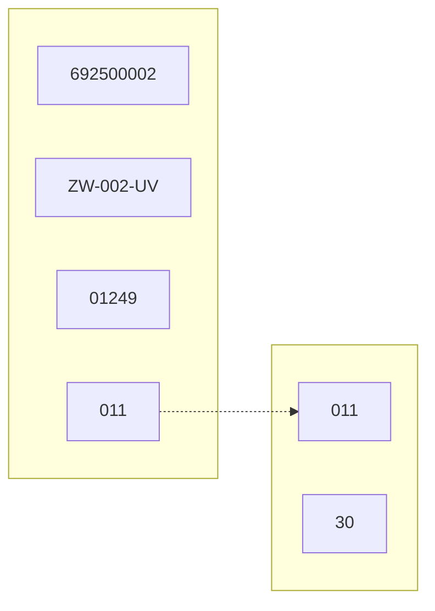
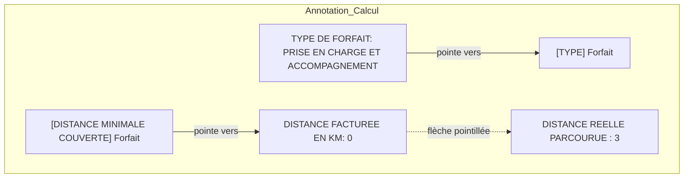
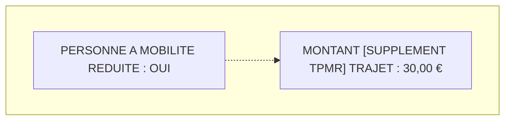
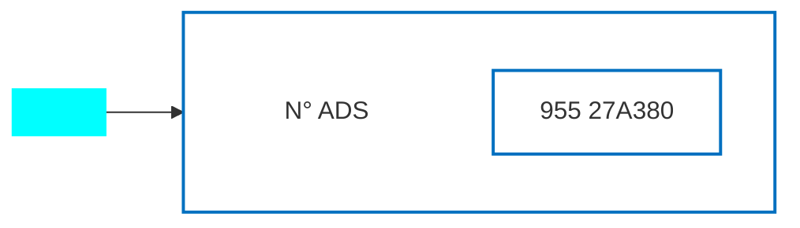
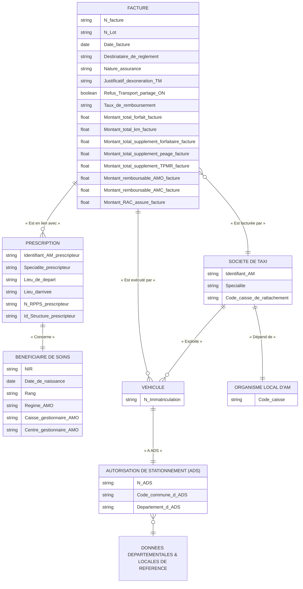

logo: l'Assurance Maladie

DDGOS / DSMOI / DERTM

# NOUVELLE CONVENTION TAXIS 2025-2029
# & TIERS PAYANT CONTRE TRANSPORT PARTAGE

## **<u>CAHIER DES CHARGES A L’ATTENTION DES EDITEURS DE</u>**
## **LOGICIELS DE FACTURATION B2 TAXIS**

**VERSION V3.0 DU 05/02/2026**

Page 1 sur 100

logo: l'Assurance Maladie

**DDGOS / DSMOI / DERTM**

---

### **<u>REDACTEURS :</u>**

### **ENTITE**

CNAM / DDGOS / DSMOI / DERTM

### **HISTORIQUE DES VERSIONS :**

<table>
  <thead>
    <tr>
      <th><b>VERSION</b></th>
      <th><b>DATE</b></th>
      <th><b>OBSERVATIONS</b></th>
    </tr>
  </thead>
  <tbody>
    <tr>
      <td>V1.0</td>
      <td>10/07/2025</td>
      <td>Version initiale</td>
    </tr>
    <tr>
      <td>V1.1</td>
      <td>30/07/2025</td>
      <td>
        ● Précisions sur les règles de détermination des suppléments forfaitaires et de la valeur de seuil kilométrique de trajet seul lors de la facturation d’un trajet : ils dépendent de la convention établie entre la [Société de taxi] et l’[Organisme local d’AM] dont dépend l’[Autorisation De Stationnement (ADS)] du [Véhicule] qui réalise le trajet (et non pas la caisse de rattachement de la [Société de taxi]). Mise à jour du modèle de données en annexe et d’illustrations correspondant.<br />
        ● Précisions en § 2.5.2 sur les montants de part complémentaire et les montants de RAC assuré avant et après éventuel tiers payant sur la part complémentaire.<br />
        ● Correction coquille en § 3.3.5 sur la valeur du champ destinataire de règlement à renseigner en type 2A dans le cas d’une facture B2 en tiers payant intégral coordonné sur la part obligatoire et sur la part complémentaire (valeur 15 au lieu de 25).<br />
        ● Précisions en § 2.4.3sur la période à retenir nuit ou dimanche jour férié pour des trajets le samedi après 20h ou le dimanche avant 8h.<br />
        ● Précision en § 2.2.2 sur les notions d’aller ou de retour à vide.
      </td>
    </tr>
    <tr>
      <td>V1.2</td>
      <td>26/08/2025</td>
      <td>
        ● Correction coquille sur > ou ≥ seuil de trajet seul aux pages 10, 11, 29 et 30.<br />
        ● Ajout d’une précision à la règle % MAJORATION NU OU DI/JF – 003 en page 25.
      </td>
    </tr>
    <tr>
      <td>V2.1</td>
      <td>23/09/2025</td>
      <td>
        ● Correction en §3.3.1 de la position du n°AM prescripteur et de la date de prescription en type 2A.<br />
        ● Précision en §2.2.2 sur la définition d’aller et retour à vide en lien avec une hospitalisation.<br />
        ● Ajout d’une nouvelle partie précisant les modalités de valorisation des données du nouveau formulaire de facturation papier référence Cnam 606b-09/2025 et de la nouvelle annexe, par un logiciel de facturation.
      </td>
    </tr>
    <tr>
      <td><mark>V3.0</mark></td>
      <td><mark>05/02/2026</mark></td>
      <td>
        <mark>● Correction de coquille sur positions B2 en §5.1.4 et 5.1.5</mark><br />
        <mark>● Suite à questions éditeurs,</mark><br />
            <mark>● Précision sur l’application des règles pour les factures des assurés de à <u>l’ensemble des caisses d’AMO (partie 1).</u></mark><br />
            <mark>● Correction des coquilles de positions B2</mark><br />
                <mark>● Sur montant remboursable part complémentaire 122 – 128 en type 4 pour les actes tarifants et traceurs.</mark><br />
                <mark>● Sur taux de remboursement et type des actes traceurs 103-105.</mark><br />
                <mark>● Sur montant des honoraires ou de la dépense 113 - 1195</mark><br />
        <mark>● Ajout des consignes de valorisation du type 2A en norme B2 pour les <u>bénéficiaires de la C2S et de l’AME en § 3.3.1.</u></mark><br />
        <mark>● Précision sur la valorisation du prescripteur en type 2A en cas de PS salarié.</mark><br />
        <mark>● Précision sur les modalités de valorisation du formulaire papier pour les <u>bénéficiaires de l’AME en § 5.1.5.</u></mark><br />
        <mark>● Correction de la règle de valorisation de la base de remboursement des actes traceurs pour les bénéficiaires de l’AME.</mark>
      </td>
    </tr>
  </tbody>
</table>

Page **2** sur **100**

logo: l'Assurance Maladie

**DDGOS / DSMOI / DERTM**

---

* Précision de la règle de valorisation du Prix Unitaire des actes tarifants pour les bénéficiaires de l’AME.
* <u>Précisions sur la production des volets de la facture en § 5.1.1 et des annexes en § 5.2.</u>
* <u>Précisions sur le remplissage des supports papier en fonction du nombre de trajets en § 5.1.4.</u>
* <u>Précision en § 3.5 sur le type et la position à renseigner pour véhiculer le n° de certificat délivré par le CNDA à l’issue de la certification.</u>
* <u>Complément règle FACTURE PAPIER –</u> <u>017 quand ADS délivrée par un aéroport.</u>
* Précision règle FACTURE PAPIER-038.

Page 3 sur **100**

logo: l'Assurance Maladie
**DDGOS / DSMOI / DERTM**

<table>
  <caption>**SOMMAIRE**</caption>
    <tr>
      <td><b>1</b></td>
      <td><b>OBJET ................................................................................................................................................................................ 6</b></td>
    </tr>
    <tr>
      <td><b>2</b></td>
      <td><b>LES PRINCIPAUX CONCEPTS INTRODUITS PAR LA CONVENTION QUI IMPACTENT LA <b>FACTURATION VERS L’ASSURANCE MALADIE ............................................................................................................. 8</b></b></td>
    </tr>
    <tr>
      <td><b>2.1</b></td>
      <td><b>Préambule .................................................................................................................................................................... 8</b></td>
    </tr>
    <tr>
      <td><b>2.2</b></td>
      <td><b>Les principaux concepts de prise en charge par l’assurance maladie d’un trajet en taxi ............................................... 8</b></td>
    </tr>
    <tr>
      <td>2.2.1</td>
      <td>[Forfait] <sub>trajet de base</sub> ........................................................................................................................................................ 8</td>
    </tr>
    <tr>
      <td>2.2.2</td>
      <td>[Montant KM] <sub>trajet de base</sub> .............................................................................................................................................. 9</td>
    </tr>
    <tr>
      <td>2.2.3</td>
      <td>Application d’un [Coefficient de majoration] <sub>trajet NU ou DI/JF</sub> ....................................................................................... 10</td>
    </tr>
    <tr>
      <td>2.2.4</td>
      <td>[Supplément forfaitaire] <sub>trajet de base</sub> ............................................................................................................................ 10</td>
    </tr>
    <tr>
      <td>2.2.5</td>
      <td>Application d’un [Coefficient d’abattement] <sub>trajet transport partagé</sub> en cas de transport partagé au cours du trajet ....... 11</td>
    </tr>
    <tr>
      <td>2.2.6</td>
      <td>[Supplément Péage] <sub>trajet</sub> ........................................................................................................................................... 12</td>
    </tr>
    <tr>
      <td>2.2.7</td>
      <td>[Supplément TPMR] <sub>trajet</sub> ............................................................................................................................................ 12</td>
    </tr>
    <tr>
      <td><b>2.3</b></td>
      <td><b>Synthèse ..................................................................................................................................................................... 13</b></td>
    </tr>
    <tr>
      <td><b>2.4</b></td>
      <td><b>Règles de gestion au niveau trajet .............................................................................................................................. 16</b></td>
    </tr>
    <tr>
      <td>2.4.1</td>
      <td>[Forfait] <sub>trajet de base</sub> ...................................................................................................................................................... 16</td>
    </tr>
    <tr>
      <td>2.4.2</td>
      <td>[Montant KM] <sub>trajet de base</sub> ............................................................................................................................................ 19</td>
    </tr>
    <tr>
      <td>2.4.3</td>
      <td>[Période de réalisation] <sub>trajet</sub> du trajet et modalités d’application du [Coefficient de majoration] <sub>trajet NU ou DI/JF</sub> ....... 26</td>
    </tr>
    <tr>
      <td>2.4.4</td>
      <td>[Supplément forfaitaire] <sub>trajet de base</sub> ............................................................................................................................ 29</td>
    </tr>
    <tr>
      <td>2.4.5</td>
      <td>Modalités d’application du [Coefficient d’abattement] <sub>trajet transport partagé</sub> .................................................... 30</td>
    </tr>
    <tr>
      <td>2.4.6</td>
      <td>[Supplément Péages] <sub>trajet</sub> .......................................................................................................................................... 34</td>
    </tr>
    <tr>
      <td>2.4.7</td>
      <td>[Supplément TPMR] <sub>trajet</sub> ............................................................................................................................................ 35</td>
    </tr>
    <tr>
      <td><b>2.5</b></td>
      <td><b>Règles de gestion au niveau facture ........................................................................................................................... 36</b></td>
    </tr>
    <tr>
      <td>2.5.1</td>
      <td>Détermination des montants totaux au niveau facture ............................................................................................ 36</td>
    </tr>
    <tr>
      <td>2.5.2</td>
      <td>Détermination des montant remboursables AMO, AMC et RAC assuré .................................................................. 38</td>
    </tr>
    <tr>
      <td><b>2.6</b></td>
      <td><b>Date de bascule dans la nouvelle convention ............................................................................................................. 46</b></td>
    </tr>
    <tr>
      <td><b>2.7</b></td>
      <td><b>La sécurisation des données de facturation ................................................................................................................ 47</b></td>
    </tr>
    <tr>
      <td><b>3</b></td>
      <td><b>MODALITES DE FACTURATION EN NORME B2 ................................................................................................. 49</b></td>
    </tr>
    <tr>
      <td><b>3.1</b></td>
      <td><b>Six codes actes « <i>tarifants</i> » ....................................................................................................................................... 49</b></td>
    </tr>
    <tr>
      <td><b>3.2</b></td>
      <td><b>Sept codes actes « <i>traceurs</i> » ..................................................................................................................................... 49</b></td>
    </tr>
    <tr>
      <td><b>3.3</b></td>
      <td><b>Règle de facturation des actes tarifants et traceurs en norme B2 ............................................................................... 50</b></td>
    </tr>
    <tr>
      <td>3.3.1</td>
      <td>Valorisation des types 2A et 2E ................................................................................................................................. 50</td>
    </tr>
    <tr>
      <td>3.3.2</td>
      <td>Ordre des prestations dans la facture ....................................................................................................................... 51</td>
    </tr>
</table>

Page **4** sur **100**

logo: l'Assurance Maladie

**DDGOS / DSMOI / DERTM**

<table>
    <tr>
      <td>3.3.3</td>
      <td>Valorisation du type 4T .............................................................................................................................................</td>
      <td>51</td>
    </tr>
    <tr>
      <td>3.3.4</td>
      <td>Valorisation des types 4U..........................................................................................................................................</td>
      <td>51</td>
    </tr>
    <tr>
      <td>3.3.5</td>
      <td>Valorisation des types 4A ou 4 des actes tarifants ...................................................................................................</td>
      <td>52</td>
    </tr>
    <tr>
      <td>3.3.6</td>
      <td>Valorisation des types 4 des actes traceurs ..............................................................................................................</td>
      <td>60</td>
    </tr>
    <tr>
      <td><strong>3.4</strong></td>
      <td><strong>Modalités de bascule et de rupture de facture ...........................................................................................................</strong></td>
      <td><strong>66</strong></td>
    </tr>
    <tr>
      <td><strong>3.5</strong></td>
      <td><strong>Modalités valorisation du type 6 de la norme B2 avec un logiciel certifie par le CNDA ...............................................</strong></td>
      <td><strong>66</strong></td>
    </tr>
    <tr>
      <td><strong>4</strong></td>
      <td><strong>LA MESURE TIERS PAYANT CONTRE TRANSPORT PARTAGE .....................................................................</strong></td>
      <td><strong>67</strong></td>
    </tr>
    <tr>
      <td><strong>4.1</strong></td>
      <td><strong>Préambule ..................................................................................................................................................................</strong></td>
      <td><strong>67</strong></td>
    </tr>
    <tr>
      <td><strong>4.2</strong></td>
      <td><strong>Valorisation du type 4 de l’acte traceur TPR ...............................................................................................................</strong></td>
      <td><strong>68</strong></td>
    </tr>
    <tr>
      <td>4.2.1</td>
      <td>Ordre de facturation des actes dans la facture B2....................................................................................................</td>
      <td>68</td>
    </tr>
    <tr>
      <td>4.2.2</td>
      <td>Valorisation des principaux champs de niveau acte type 4 de la norme B2 .............................................................</td>
      <td>68</td>
    </tr>
    <tr>
      <td><strong>4.3</strong></td>
      <td><strong>Date d’application de la mesure et rupture de facture ...............................................................................................</strong></td>
      <td><strong>73</strong></td>
    </tr>
    <tr>
      <td><strong>5</strong></td>
      <td><strong>MODALITES DE REMPLISSAGE DU NOUVEAU FORMULAIRE PAPIER ET DE SON ANNEXE PAR UN LOGICIEL DE FACTURATION.............................................................................................................................................</strong></td>
      <td><strong>74</strong></td>
    </tr>
    <tr>
      <td><strong>5.1</strong></td>
      <td><strong>Les règles de valorisation de la « <i>Facture de transport en taxi conventionné</i> » « <i>Cnam 606B-09/2025</i> » par un logiciel de facturation ......................................................................................................................................................................</strong></td>
      <td><strong>76</strong></td>
    </tr>
    <tr>
      <td>5.1.1</td>
      <td>L’en-tête ....................................................................................................................................................................</td>
      <td>76</td>
    </tr>
    <tr>
      <td>5.1.2</td>
      <td>La zone « Personne transportée et assuré(e) » ........................................................................................................</td>
      <td>78</td>
    </tr>
    <tr>
      <td>5.1.3</td>
      <td>La zone « Identification du prescripteur et de la structure dans laquelle il exerce » ...............................................</td>
      <td>79</td>
    </tr>
    <tr>
      <td>5.1.4</td>
      <td>La zone « Transport effectué » .................................................................................................................................</td>
      <td>79</td>
    </tr>
    <tr>
      <td>5.1.5</td>
      <td>La zone « Tarification » .............................................................................................................................................</td>
      <td>85</td>
    </tr>
    <tr>
      <td>5.1.6</td>
      <td>La zone « Entreprise de taxi » ...................................................................................................................................</td>
      <td>93</td>
    </tr>
    <tr>
      <td>5.1.7</td>
      <td>La zone « Attestation de l'assuré(e) » .......................................................................................................................</td>
      <td>94</td>
    </tr>
    <tr>
      <td><strong>5.2</strong></td>
      <td><strong>Les règles de valorisation de « <i>l’annexe à la facture transport(s) par taxi conventionné</i> » par un logiciel de facturation</strong></td>
      <td><strong>96</strong></td>
    </tr>
    <tr>
      <td>5.2.1</td>
      <td>L’en-tête ....................................................................................................................................................................</td>
      <td>96</td>
    </tr>
    <tr>
      <td>5.2.2</td>
      <td>La zone « RENSEIGNEMENTS CONCERNANT LA PERSONNE TRANSPORTEE ET L’ASSURE(E) : »...............................</td>
      <td>96</td>
    </tr>
    <tr>
      <td>5.2.3</td>
      <td>La zone « IDENTIFICATION DE L’ENTREPRISE » .........................................................................................................</td>
      <td>97</td>
    </tr>
    <tr>
      <td>5.2.4</td>
      <td>La zone « RENSEIGNEMENTS CONCERNANT LES TRAJETS FACTURES »....................................................................</td>
      <td>97</td>
    </tr>
    <tr>
      <td>5.2.5</td>
      <td>La zone « ATTESTATION DE L’ASSURE(E) » ...............................................................................................................</td>
      <td>98</td>
    </tr>
    <tr>
      <td><strong>6</strong></td>
      <td><strong>ANNEXE - SYNTHESE MACRO MODELE FONCTIONNEL DE DONNEES....................................................</strong></td>
      <td><strong>100</strong></td>
    </tr>
</table>

Page **5** sur **100**

logo: l'Assurance Maladie
**DDGOS / DSMOI / DERTM**

# 1 OBJET

La nouvelle convention taxi 2025 – 2029 modifie les modalités de prise en charge par l’assurance maladie des transports réalisés par les sociétés de taxis.

**Le présent document constitue le cahier des charges à l’attention des éditeurs de logiciels de facturation **B2 « Taxi » et constitue la référence documentaire applicable pour la certification de ces derniers** auprès du [Centre National de Dépôt et d’Agrément de l’assurance maladie](https://cnda.ameli.fr/).**

<mark><u>Les règles décrites dans le présent cahier des charges s’appliquent aux factures de l’ensemble des assurés sociaux quel que soit leur organisme d’assurance maladie obligatoire d’affiliation (régime général, MSA, régimes spéciaux etc.), ainsi que les bénéficiaires de l’Aide Médicale d’Etat (AME).</u></mark>

Il expose dans une première partie les **principaux concepts de la nouvelle convention** qui ont un impact sur les modalités de facturation.

Dans une deuxième partie, il présente **les règles de gestion fonctionnelles que les logiciels de facturation sont amenés à implémenter** pour procéder aux calculs des différents montants à facturer à l’assurance maladie.

**<u>Point d’attention</u> :**

*   Les règles et concepts sont décrits dans le présent cahier des charges d’un point de vue fonctionnel et ne présument, en aucun cas, des choix d’implémentation applicatifs et techniques qui relèvent du périmètre de responsabilité de l’éditeur.
*   Un « macro » modèle fonctionnel de données des concepts décrits figure en <u>annexe</u>. Il n’a qu’une vocation illustrative de synthèse pour le présent document, sans exigence aucune d’implémentation dans les logiciels des éditeurs.
*   En terme de syntaxe, dans le présent document, les informations portées sous la forme suivante [Donnée] ou [Donnée] xxx font référence à des concepts fonctionnels ou à des données de référence de ce modèle.

Dans une troisième partie, ce document précise **les modalités de mise en forme des données au format de facturation B2** (référence juin 2007 publiée sous : [https://www.ameli.fr/content/cahier-des-charges-avec-errata-norme-b2-version-juin-2007](https://www.ameli.fr/content/cahier-des-charges-avec-errata-norme-b2-version-juin-2007)) pour envoi aux caisses d’assurance maladie obligatoire.

Dans une quatrième partie, il aborde la mesure réglementaire conditionnant **le bénéfice du tiers payant à l’acceptation d’un transport partagé** lorsque les conditions d’éligibilité sont remplies et sa **déclinaison en terme de facturation B2 vers l’assurance maladie**.

Dans une cinquième partie, il précise les **modalités de valorisation des champs du nouveau formulaire de facturation papier Cnam 606b-09/2025 et de la nouvelle annexe**.

**<u>Points d’attention</u> :**

*   Les valeurs de tarif en euros, de coefficient en pourcentage etc. sont données dans ce document à titre illustratif. Il convient de se référer à la convention cadre nationale pour disposer des données réellement appliquées.
*   Ces éléments doivent être facilement paramétrables dans les logiciels en cas d’évolution tarifaire ou des conditions de prise en charge dans le respect des <u>règles édictées en partie 2.7 du présent document.</u>
*   Les factures B2 de transports en taxis élaborées selon les règles de la nouvelle convention devront impérativement comporter les données suivantes de niveau trajets <u>(en type 4U)</u> :
    *   Date et heure de départ et d’arrivée.
    *   Lieux de départ et d’arrivée.
    *   Distance réelle parcourue.

Page 6 sur **100**

logo: l'Assurance Maladie

**DDGOS / DSMOI / DERTM**

**L’absence de ces données conduira au rejet systématique des factures B2 par les organismes d’assurance maladie obligatoire.**

*   Le présent document ne concerne que la facturation en norme B2. Les évolutions concernant le dispositif SEFi feront l’objet d’une publication ad hoc des Spécifications Fonctionnelles Générales (SFG) de facturation par le GIE SESAM-Vitale.
*   En terme de modélisation des concepts et d’application des règles de calcul, le présent document est établi en cohérence avec la démarche de conception de SEFi.
*   Les exemples sont réalisés à partir d’un fichier Excel dont l’objectif est d’illustrer fonctionnellement les données à gérer pour établir une facture B2 conforme aux principes de la nouvelle convention taxi.
*   Le présent cahier des charges est publié sous :
    *   [https://www.ameli.fr/taxi-conventionne/documentation-technique/norme-b2](https://www.ameli.fr/taxi-conventionne/documentation-technique/norme-b2)

# Cahier des charges de facturation B2 des taxis selon la nouvelle convention

L’Assurance Maladie publie le cahier des charges de facturation B2 à l’attention des éditeurs de logiciel de facturation des taxis dans le cadre de la nouvelle convention cadre 2025 – 2029 ainsi qu’une annexe descriptive de cas d’usage.

> ### Documents à télécharger
>
> *   Cahier des charges à l'attention des éditeurs de logiciels de facturation B2 Taxis
> *   Annexe 30 - Facturation B2 nouvelle convention et TP TP Taxis 29/08/2025 (PDF)
> *   Annexe 30 - Facturation B2 nouvelle convention et TP TP Taxis 29/08/2025 (XLS)

*   Il est enrichi d’une annexe 30 à la norme B2, publiée via ce même lien ad hoc et qui présente le remplissage attendu de la norme B2 pour différentes situations « *métiers* » de facturation de trajets en taxis.

Page 7 sur **100**

logo: l'Assurance Maladie

**DDGOS / DSMOI / DERTM**

# 2 LES PRINCIPAUX CONCEPTS INTRODUITS PAR LA CONVENTION QUI IMPACTENT LA FACTURATION VERS L’ASSURANCE MALADIE

## 2.1 PREAMBULE

La nouvelle convention taxi 2025 – 2029 établit un seul modèle de prise en charge des transports en taxis, en lieu et place des modèles « *locaux* » existant. Au niveau des systèmes d’information, d’un point de vue fonctionnel, elle conduit à la mise en œuvre d’un « seul moteur » de calcul et de facturation vers l’assurance maladie obligatoire.

## 2.2 LES PRINCIPAUX CONCEPTS DE PRISE EN CHARGE PAR L’ASSURANCE MALADIE D’UN TRAJET EN TAXI

Dans la nouvelle convention, le modèle de financement des transports en taxis se rapproche de celui des transports sanitaires en VSL.

Les frais de transport sont facturés sur la base de la distance séparant le point de prise en charge du patient de la structure de soins portée dans la prescription ou dans la demande d’accord préalable.

La prise en charge par l’assurance maladie obligatoire d’un trajet en mode de transport « taxi » <sup>1</sup> va ainsi reposer sur les composantes « *tarifantes* » suivantes :

### 2.2.1 **[Forfait] trajet de base**

*   **Composante n°1** : un [Forfait] <sub>trajet de base</sub> <sup>2</sup> avec deux [Type] <sub>forfait</sub> de forfait possibles, définis au niveau national, en fonction du lieu de départ (prise en charge du patient) et/ou d’arrivée du taxi (dépose du patient) au cours du trajet :

    *   Un type « *Prise en charge et accompagnement* ».
    *   Ou un type « *Prise en charge et accompagnement et grande ville* » si le trajet a pour lieu de départ et/ou d’arrivée une commune faisant partie :
        *   De l’une des 12 « *grandes villes* » établies dans la convention cadre (Communes de Bordeaux, Grenoble, Lille, Lyon, Marseille, Montpellier, Nantes, Nice, Paris, Rennes, Strasbourg, Toulouse). Le forfait « *grandes villes* » peut exceptionnellement intégrer la situation d’établissements situés à la périphérie des communes précitées, en concertation avec les représentants de taxis et préalablement validé par la Cnam. Une liste de ces établissements est mise en ligne par la Cnam sur Ameli.fr.
        *   Ou d’une commune des départements 92, 93 et 94.
    *   Le [Tarif] <sub>forfait</sub> du forfait dépend de son [Type] <sub>forfait</sub> (13€ ou 28€).

    <u>ILLUSTRATION :</u>

<table>
  <thead>
    <tr>
      <th rowspan="2"></th>
      <th colspan="2">[TYPE] Forfait</th>
    </tr>
    <tr>
      <th>"PRISE EN CHARGE ET<br />ACCOMPAGNEMENT"</th>
      <th>"PRISE EN CHARGE ET<br />ACCOMPAGNEMENT ET GRANDE VILLE"</th>
    </tr>
  </thead>
  <tbody>
    <tr>
      <td>[TARIF] Forfait</td>
      <td>13,00 €</td>
      <td>28,00 €</td>
    </tr>
  </tbody>
</table>

*   Le forfait couvre une valeur minimale de distance parcourue, dite [Distance minimale couverte] <sub>forfait</sub>, dont la valeur dépend du [Type] <sub>forfait</sub> (4 km pour les 2).

<sup>1</sup> Dans le présent document, le terme trajet désigne « le transport individuel entre un lieu de départ (prise en charge du patient) et un lieu d’arrivée (dépose du patient) d’un bénéficiaire de soins ».

<sup>2</sup> Base : c’est-à-dire hors trajet de nuit ou dimanche / jour férié et sans prise en compte d’un contexte de transport partagé.

Page 8 sur **100**

logo: l'Assurance Maladie
**DDGOS / DSMOI / DERTM**

<u>ILLUSTRATION :</u>

<table>
  <thead>
    <tr>
      <th></th>
      <th colspan="2"><b>[TYPE]</b> Forfait</th>
    </tr>
    <tr>
      <th></th>
      <th>"PRISE EN CHARGE ET<br />ACCOMPAGNEMENT"</th>
      <th>"PRISE EN CHARGE ET<br />ACCOMPAGNEMENT ET GRANDE VILLE"</th>
    </tr>
  </thead>
  <tbody>
    <tr>
      <th><b>[DISTANCE MINIMALE COUVERTE]</b> Forfait</th>
      <td>4</td>
      <td>4</td>
    </tr>
  </tbody>
</table>

## 2.2.2 [Montant KM] trajet de base

*   **Composante n°2** : Un [Montant kilométrique] <sub>trajet de base</sub> <sup>2</sup> en fonction :

    *   De la [Distance réellement parcourue] <sub>trajet</sub> au cours du trajet (nombre de kilomètres réellement parcourus entre le lieu de départ (prise en charge du patient) et le lieu d’arrivée (dépose du patient) portés dans la facture) qui pourrait être déterminée, à l’avenir, automatiquement par un dispositif de type « *géolocalisation* ».

    *   D’un [Tarif km] <sub>de base</sub> du km qui dépend du [Département] <sub>d’Autorisation De Stationnement (ADS)</sub> du [Véhicule] qui réalise le trajet et qui est définie dans la convention-cadre nationale.

<u>ILLUSTRATION N°1 POUR LA FACTURATION PAR LA SOCIETE DE TAXIS DE N° AM **692500002** D’UN TRAJET REALISE ENTRE LYON ET BRON AVEC LE VEHICULE **AD-001-EF** DONT LE DEPARTEMENT D’ADS EST DANS LE **RHONE (069)**, LE [Tarif km] <sub>de base</sub> est de **1.07€** :</u>

<table>
  <thead>
    <tr>
      <th colspan="3">[SOCIETE DE TAXIS]</th>
      <th>[VEHICULE]</th>
      <th colspan="3">[AUTORISATION DE STATIONNEMENT (ADS)]</th>
    </tr>
    <tr>
      <th>[N°AM]</th>
      <th>[SPECIALITE]</th>
      <th>[CAISSE DE RATTACHEMENT]</th>
      <th>[NUMERO D'IMMATRICULATION]</th>
      <th>[NUMERO D'ADS]</th>
      <th>[CODE COMMUNE D'ADS]</th>
      <th>[DEPARTEMENT D'ADS]</th>
    </tr>
  </thead>
  <tbody>
    <tr>
      <td>692500002</td>
      <td>56</td>
      <td>691</td>
      <td>AD-001-EF</td>
      <td>001</td>
      <td>69123</td>
      <td>069</td>
    </tr>
    <tr>
      <td>692500002</td>
      <td>56</td>
      <td>691</td>
      <td>ZW-002-UV</td>
      <td>002</td>
      <td>01249</td>
      <td>001</td>
    </tr>
  </tbody>
</table>

<table>
  <thead>
    <tr>
      <th>[CODE DEPARTEMENT] de l'Autorisation De Stationnement (ADS)</th>
      <th>LIBELLE DEPARTEMENTS</th>
      <th>TARIF KM DE BASE (HORS ALLER OU RETOUR A VIDE)</th>
    </tr>
  </thead>
  <tbody>
    <tr>
      <td>068</td>
      <td>Haut-Rhin</td>
      <td>1,07 €</td>
    </tr>
    <tr>
      <td>069</td>
      <td>Rhone</td>
      <td>1,07 €</td>
    </tr>
    <tr>
      <td>070</td>
      <td>Haute-Saône</td>
      <td>1,08 €</td>
    </tr>
    <tr>
      <td>071</td>
      <td>Saône-et-Loire</td>
      <td>1,10 €</td>
    </tr>
    <tr>
      <td>072</td>
      <td>Sarthe</td>
      <td>1,07 €</td>
    </tr>
  </tbody>
</table>

<u>ILLUSTRATION N°2 POUR LA FACTURATION PAR LA SOCIETE DE TAXIS DE N° AM **692500002** D’UN TRAJET REALISE ENTRE MIRIBEL ET MEXIMIEUX AVEC LE VEHICULE **ZW-002-UV** DONT LE DEPARTEMENT D’ADS EST DANS L’**AIN (001)**, LE [Tarif km] <sub>de base</sub> est de **1.13€** :</u>

<table>
  <thead>
    <tr>
      <th colspan="3">[SOCIETE DE TAXIS]</th>
      <th>[VEHICULE]</th>
      <th colspan="3">[AUTORISATION DE STATIONNEMENT (ADS)]</th>
    </tr>
    <tr>
      <th>[N°AM]</th>
      <th>[SPECIALITE]</th>
      <th>[CAISSE DE<br />RATTACHEMENT]</th>
      <th>[NUMERO<br />D'IMMATRICULATION]</th>
      <th>[NUMERO D'ADS]</th>
      <th>[CODE COMMUNE<br />D'ADS]</th>
      <th>[DEPARTEMENT<br />D'ADS]</th>
    </tr>
  </thead>
  <tbody>
    <tr>
      <td>692500002</td>
      <td>56</td>
      <td>691</td>
      <td>AD-001-EF</td>
      <td>001</td>
      <td>69123</td>
      <td>069</td>
    </tr>
    <tr>
      <td>692500002</td>
      <td>56</td>
      <td>691</td>
      <td>ZW-002-UV</td>
      <td>002</td>
      <td>01249</td>
      <td>001</td>
    </tr>
  </tbody>
</table>

<table>
  <thead>
    <tr>
      <th>[CODE DEPARTEMENT] de<br />l'Autorisation De Stationnement (ADS)</th>
      <th>LIBELLE DEPARTEMENTS</th>
      <th>TARIF KM DE BASE<br />(HORS ALLER OU RETOUR A VIDE)</th>
    </tr>
  </thead>
  <tbody>
    <tr>
      <td>001</td>
      <td>Ain</td>
      <td>1,13 €</td>
    </tr>
    <tr>
      <td>002</td>
      <td>Aisne</td>
      <td>1,23 €</td>
    </tr>
    <tr>
      <td>003</td>
      <td>Allier</td>
      <td>1,19 €</td>
    </tr>
    <tr>
      <td>004</td>
      <td>Alpes-de-Haute-Provence</td>
      <td>1,14 €</td>
    </tr>
    <tr>
      <td>005</td>
      <td>Hautes-Alpes</td>
      <td>1,18 €</td>
    </tr>
  </tbody>
</table>

*   Des conditions particulières de réalisation du transport :

    *   Dans le cas d’un trajet en lien avec une « *hospitalisation du bénéficiaire de soins et avec un aller ou un retour à vide <sup>3</sup>* », seul le trajet en charge donne lieu à facturation et le tarif du km de ce trajet est pondéré par un [Coefficient aller ou retour à vide] dont la valeur varie en fonction de la [Distance réellement parcourue] <sub>trajet</sub> au cours du trajet en charge.

    *   Les valeurs du [Coefficient aller ou retour à vide] sont établies au niveau national. Dans le cadre de la convention 2025-2029, deux valeurs du [Coefficient aller ou retour à vide] sont

***

<sup>3</sup> *« Aller à vide » : Pour réaliser le trajet « en charge », le véhicule est venu à vide depuis sa station jusqu’à l’établissement de santé.*

*« Retour à vide » : A l’issue du trajet « en charge », le véhicule retourne à vide depuis le lieu de dépose du patient (un établissement de santé), jusqu’à sa station.*

Page **9** sur **100**

logo: l'Assurance Maladie
**DDGOS / DSMOI / DERTM**

définies en fonction d’une valeur de [Seuil n°1 km aller ou retour à vide] fixée au niveau national (à 50 km).

*   <u>ILLUSTRATION</u> :

<table>
  <thead>
    <tr>
      <th rowspan="2"></th>
      <th colspan="2">[Distance réelle parcourue]</th>
    </tr>
    <tr>
      <th>Entre [Distance minimale couverte par le forfait] et strictement inférieur à [Seuil n°1 km aller ou retour à vide]</th>
      <th>"Supérieure ou égale à [Seuil n°1 km aller ou retour à vide] "</th>
    </tr>
  </thead>
  <tbody>
    <tr>
      <th>[Coefficient aller ou retour à vide]</th>
      <td>25%</td>
      <td>50%</td>
    </tr>
  </tbody>
</table>

avec

<table>
    <tr>
      <th>[Seuil n°1 km aller ou retour à vide] en km</th>
      <td>50</td>
    </tr>
</table>

### **2.2.3 Application d’un [Coefficient de majoration] trajet NU ou DI/JF**

Les deux premières composantes [Forfait] trajet de base, [Montant km] trajet de base, peuvent faire l’objet d’une « *majoration en fonction de la période de réalisation du trajet* », elle-même déterminée à partir des dates / heures de départ et d’arrivée.

La majoration se traduit dans le calcul des montants par l’application d’un [Coefficient de majoration] NU ou DI/JF dont la valeur dépend de la [Période de réalisation] trajet du trajet, appliqué lors des calculs de montants :

<u>ILLUSTRATION</u> :

<table>
  <thead>
    <tr>
      <th rowspan="2"></th>
      <th colspan="2">[PERIODE DE REALISATION] <sub>TRAJET</sub></th>
    </tr>
    <tr>
      <th>"<i>NUIT</i>"</th>
      <th>"<i>DIMANCHE / JOUR FERIE</i> "</th>
    </tr>
  </thead>
  <tbody>
    <tr>
      <th>[COEFFICIENT DE MAJORATION] <sub>NU ou DI/JF</sub></th>
      <td>50,00%</td>
      <td>50,00%</td>
    </tr>
  </tbody>
</table>

Les règles de détermination de la [Période de réalisation] trajet d’un trajet et d’application du [Coefficient de majoration] NU ou DI/JF dans les calculs de montants, sont exprimées <u>en partie 2.4.3.</u>

### **2.2.4 [Supplément forfaitaire] trajet de base**

*   **Composante n°3** : Des « *suppléments forfaitaires* » tarifaires peuvent être appliqués au niveau « *local* » :

    *   La définition et les valeurs de ces suppléments sont validées par la Cnam au niveau national.
    *   Lorsque le [Département] d'Autorisation De Stationnement (ADS) du [Véhicule] qui réalise le trajet est un département d'outre-mer (Martinique, Guyane, Mayotte, Guadeloupe et Réunion), un supplément forfaitaire de 3€ est facturable par trajet.
    *   Les suppléments éventuellement facturables pour le trajet considéré, répondent à des modalités établies au niveau local entre la [Société de taxis] et l’[Organisme local d’AM] dont dépend l’[Autorisation De Stationnement (ADS)] du [Véhicule] qui réalise le trajet, après validation de la Cnam.

Pour la facturation vers l’assurance maladie, on ne retient dans une 1<sup>ère</sup> étape **qu’un montant « *global* »** de [Supplément forfaitaire] trajet de base, somme des différents suppléments retenus sans précision du ou des types de suppléments appliqués. (Dans le futur, les factures vers l’assurance maladie pourront évoluer pour porter le détail de ces éléments ; un nouveau cahier des charges sera alors communiqué aux éditeurs).

<u>ILLUSTRATION N°1 POUR LA FACTURATION PAR LA SOCIETE DE TAXIS DE N° AM **692500002** D’UN TRAJET REALISE ENTRE LYON ET BRON AVEC LE VEHICULE **AD-001-EF UN TYPE DE SUPPLEMENT FORFAITAIRE** A ETE DEFINI LOCALEMENT ENTRE LA SOCIETE DE TAXIS ET L’ORGANISME LOCAL D’AM DONT DEPEND L’ADS DU VEHICULE (**LA CPAM DU RHONE (691)**)</u>

<table>
  <thead>
    <tr>
      <th colspan="3">[SOCIETE DE TAXIS]</th>
      <th>[VEHICULE]</th>
      <th colspan="3">[AUTORISATION DE STATIONNEMENT (ADS)]</th>
      <th>[ORGANISME LOCAL D'AM] DE L'ADS</th>
      <th>[CODE CAISSE] ORGANISME LOCAL D'AM DE L'ADS</th>
      <th>TYPE 1 - SUPPLEMENT FORFAITAIRE TAXI</th>
      <th>TYPE 2 - SUPPLEMENT FORFAITAIRE TAXI</th>
      <th>TYPE 3 - SUPPLEMENT FORFAITAIRE TAXI</th>
    </tr>
    <tr>
      <th>[N°AM]</th>
      <th>[SPECIALITE]</th>
      <th>[CAISSE DE RATTACHEMENT]</th>
      <th>[NUMERO D'IMMATRICULATION]</th>
      <th>[NUMERO D'ADS]</th>
      <th>[CODE COMMUNE D'ADS]</th>
      <th>[DEPARTEMENT D'ADS]</th>
      <th>[CODE CAISSE]</th>
      <td></td>
      <td></td>
      <td></td>
      <td></td>
    </tr>
  </thead>
  <tbody>
    <tr>
      <td rowspan="2">692500002</td>
      <td rowspan="2">56</td>
      <td rowspan="2">691</td>
      <td rowspan="2">AD-001-EF</td>
      <td rowspan="2">001</td>
      <td rowspan="2">69123</td>
      <td rowspan="2">069</td>
      <td rowspan="2">691</td>
      <td>682</td>
      <td>11,01 €</td>
      <td>13,01 €</td>
      <td>15,01 €</td>
    </tr>
    <tr>
      <td>691</td>
      <td>12,01 €</td>
      <td></td>
      <td></td>
    </tr>
    <tr>
      <td rowspan="3">692500002</td>
      <td rowspan="3">56</td>
      <td rowspan="3">691</td>
      <td rowspan="3">ZW-002-UV</td>
      <td rowspan="3">002</td>
      <td rowspan="3">01249</td>
      <td rowspan="3">001</td>
      <td rowspan="3">011</td>
      <td>701</td>
      <td>12,11 €</td>
      <td>14,11 €</td>
      <td>16,11 €</td>
    </tr>
    <tr>
      <td>711</td>
      <td>12,21 €</td>
      <td>14,21 €</td>
      <td>16,21 €</td>
    </tr>
    <tr>
      <td>721</td>
      <td>12,31 €</td>
      <td>14,31 €</td>
      <td>16,31 €</td>
    </tr>
  </tbody>
</table>

La facturation du supplément pour le trajet considéré est régie par les conditions d’applications définies dans la convention locale avec la CPAM du Rhône.

Page **10** sur **100**

logo: l'Assurance Maladie


## **DDGOS / DSMOI / DERTM**

ILLUSTRATION N°2 POUR LA FACTURATION PAR LA SOCIETE DE TAXIS DE N° AM **692500002** D’UN TRAJET REALISE ENTRE MIRIBEL ET MEXIMIEUX AVEC LE VEHICULE **ZW-002-UV** AVEC **TROIS TYPES DE SUPPLEMENT FORFAITAIRE** ONT ETE DEFINIS LOCALEMENT ENTRE LA SOCIETE DE TAXIS L’ORGANISME LOCAL D’AM DONT DEPEND L’ADS DU VEHICULE (**LA CPAM DE L’AIN (011)):**

<table>
  <thead>
    <tr>
      <th colspan="3">[SOCIETE DE TAXIS]</th>
      <th>[VEHICULE]</th>
      <th colspan="3">[AUTORISATION DE STATIONNEMENT (ADS)]</th>
      <th>[ORGANISME LOCAL D'AM] DE L'ADS</th>
    </tr>
    <tr>
      <th>[N°AM]</th>
      <th>[SPECIALITE]</th>
      <th>[CAISSE DE RATTACHEMENT]</th>
      <th>[NUMERO D'IMMATRICULATION]</th>
      <th>[NUMERO D'ADS]</th>
      <th>[CODE COMMUNE D'ADS]</th>
      <th>[DEPARTEMENT D'ADS]</th>
      <th>[CODE CAISSE]</th>
    </tr>
  </thead>
  <tbody>
    <tr>
      <td>692500002</td>
      <td>56</td>
      <td>691</td>
      <td>AD-001-EF</td>
      <td>001</td>
      <td>69123</td>
      <td>069</td>
      <td>691</td>
    </tr>
    <tr>
      <td>692500002</td>
      <td>56</td>
      <td>691</td>
      <td>ZW-002-UV</td>
      <td>002</td>
      <td>01249</td>
      <td>001</td>
      <td>011</td>
    </tr>
  </tbody>
</table>

<table>
  <thead>
    <tr>
      <th>[CODE CAISSE] ORGANISME LOCAL D'AM DE L'ADS</th>
      <th>TYPE 1 - SUPPLEMENT FORFAITAIRE TAXI</th>
      <th>TYPE 2 - SUPPLEMENT FORFAITAIRE TAXI</th>
      <th>TYPE 3 - SUPPLEMENT FORFAITAIRE TAXI</th>
    </tr>
  </thead>
  <tbody>
    <tr>
      <td>011</td>
      <td>3,01 €</td>
      <td>5,01 €</td>
      <td>7,01 €</td>
    </tr>
    <tr>
      <td>021</td>
      <td>3,11 €</td>
      <td></td>
      <td>7,11 €</td>
    </tr>
    <tr>
      <td>022</td>
      <td>3,21 €</td>
      <td></td>
      <td></td>
    </tr>
    <tr>
      <td>031</td>
      <td>3,31 €</td>
      <td></td>
      <td></td>
    </tr>
    <tr>
      <td>041</td>
      <td>3,41 €</td>
      <td></td>
      <td>7,41 €</td>
    </tr>
  </tbody>
</table>

La facturation d’un ou plusieurs suppléments pour le trajet considéré est régie par les conditions d’applications définies dans la convention locale avec la CPAM de l’Ain.

## **2.2.5 Application d’un [Coefficient d’abattement] trajet transport partagé en cas de transport partagé au cours du trajet**

Les 3 composantes [Forfait] trajet de base, [Montant km] trajet de base, [Supplément forfaitaire] trajet de base, le cas échéant majorées par l’application d’un [Coefficient de majoration] <sub>NU ou DI/JF</sub> (pour les deux premières composantes) peuvent faire l’objet d’un *« *abattement pour transport partagé* ».*

L’abattement se traduit dans le calcul des montants par l’application d’un [Coefficient d’abattement] <sub>trajet transport partagé</sub> dont la valeur dépend :

*   D’une part, du nombre total de bénéficiaires de soins dans le véhicule :*   o « **2** » bénéficiaires de soins,*   o « **3** » bénéficiaires de soins,*   o « **4** » bénéficiaires de soins ou plus (dans la limite de 8).

*   Et d’autre part, de la [Distance réellement parcourue] <sub>trajet</sub> « *seul* » au cours du trajet pour le bénéficiaire de soins considéré. Cette distance doit être strictement supérieure ou égale à une valeur de [Seuil kilométrique de trajet seul] fixée localement entre la [Société de taxis] et l’[Organisme local d’AM] dont dépend l’[Autorisation De Stationnement (ADS)] du [Véhicule] qui réalise le trajet. Ce seuil ne peut pas être inférieur à une valeur nationale fixée à 30 km.

### <u>ILLUSTRATION :</u>

<table>
  <thead>
    <tr>
      <th></th>
      <th colspan="2">[COEFFICIENT D'ABATTEMENT]</th>
    </tr>
    <tr>
      <th>[NOMBRE DE<br />MALADES]<br />TRANSPORTES</th>
      <th><u>Hors cas</u> de trajet seul ≥ [SEUIL KILOMETRIQUE DE<br />TRAJET SEUL]</th>
      <th><u>En cas</u> de trajet seul ≥ [SEUIL KILOMETRIQUE<br />DE TRAJET SEUL]</th>
    </tr>
  </thead>
  <tbody>
    <tr>
      <td>2</td>
      <td>23,00%</td>
      <td>5,00%</td>
    </tr>
    <tr>
      <td>3</td>
      <td>35,00%</td>
      <td>5,00%</td>
    </tr>
    <tr>
      <td>4</td>
      <td>37,00%</td>
      <td>5,00%</td>
    </tr>
    <tr>
      <td>5</td>
      <td>37,00%</td>
      <td>5,00%</td>
    </tr>
    <tr>
      <td>6</td>
      <td>37,00%</td>
      <td>5,00%</td>
    </tr>
    <tr>
      <td>7</td>
      <td>37,00%</td>
      <td>5,00%</td>
    </tr>
    <tr>
      <td>8</td>
      <td>37,00%</td>
      <td>5,00%</td>
    </tr>
  </tbody>
</table>

<table>
  <thead>
    <tr>
      <th>[CODE CAISSE]<br /><br />ORGANISME LOCAL D'AM<br /><br />DE L'ADS</th>
      <th>SEUIL<br />KILOMETRIQUE DE<br />TRAJET SEUL</th>
    </tr>
  </thead>
  <tbody>
    <tr>
      <td>011</td>
      <td>30</td>
    </tr>
    <tr>
      <td>021</td>
      <td>30</td>
    </tr>
    <tr>
      <td>022</td>
      <td>45</td>
    </tr>
    <tr>
      <td>031</td>
      <td>30</td>
    </tr>
    <tr>
      <td>041</td>
      <td>32</td>
    </tr>
    <tr>
      <td>051</td>
      <td>31</td>
    </tr>
  </tbody>
</table>

ILLUSTRATION N°1 POUR LA FACTURATION PAR LA SOCIETE DE TAXIS DE N° AM **692500002** D’UN TRAJET REALISE ENTRE LYON ET BRON AVEC LE VEHICULE **AD-001-EF** AVEC UN [SEUIL KILOMETRIQUE DE TRAJET SEUL] DE **35 KM**, DEFINI LOCALEMENT ENTRE LA SOCIETE DE TAXIS ET L’ORGANISME LOCAL D’AM DONT DEPEND L’ADS DU VEHICULE (**LA CPAM DU RHONE (691)**) :

<table>
  <thead>
    <tr>
      <th colspan="3">[SOCIETE DE TAXIS]</th>
      <th>[VEHICULE]</th>
      <th colspan="3">[AUTORISATION DE STATIONNEMENT (ADS)]</th>
      <th>[ORGANISME LOCAL D'AM] DE L'ADS</th>
    </tr>
    <tr>
      <th>[N°AM]</th>
      <th>[SPECIALITE]</th>
      <th>[CAISSE DE RATTACHEMENT]</th>
      <th>[NUMERO D'IMMATRICULATION]</th>
      <th>[NUMERO D'ADS]</th>
      <th>[CODE COMMUNE D'ADS]</th>
      <th>[DEPARTEMENT D'ADS]</th>
      <th>[CODE CAISSE]</th>
    </tr>
  </thead>
  <tbody>
    <tr>
      <td>692500002</td>
      <td></td>
      <td></td>
      <td>AD-001-EF</td>
      <td></td>
      <td>69123</td>
      <td>069</td>
      <td>691</td>
    </tr>
    <tr>
      <td>692500002</td>
      <td>56</td>
      <td>691</td>
      <td>ZW-002-UV</td>
      <td>002</td>
      <td>01249</td>
      <td>001</td>
      <td>011</td>
    </tr>
  </tbody>
</table>

<table>
  <thead>
    <tr>
      <th>[CODE CAISSE]<br />ORGANISME LOCAL D'AM DE L'ADS</th>
      <th>SEUIL KILOMETRIQUE DE TRAJET SEUL</th>
    </tr>
  </thead>
  <tbody>
    <tr>
      <td>691</td>
      <td>35</td>
    </tr>
    <tr>
      <td>701</td>
      <td>30</td>
    </tr>
    <tr>
      <td>711</td>
      <td>30</td>
    </tr>
    <tr>
      <td>721</td>
      <td>30</td>
    </tr>
  </tbody>
</table>

Page **11** sur **100**

logo: l'Assurance Maladie
**DDGOS / DSMOI / DERTM**

Dans cette illustration, si le bénéficiaire de soins a été seul **35 km** ou plus, le coefficient d’abattement qui s’applique dans la facture de son trajet est de 5% (sans présumer des taux d’abattement appliqués dans les factures du ou des autres malades transportés avec lui) dans le cas contraire ce taux est déterminé en fonction du nombre de malades transportés avec lui (23% si 2 malades, 35% si 3 malades, 37% si 4 malades ou plus).

ILLUSTRATION N°2 POUR LA FACTURATION PAR LA SOCIETE DE TAXIS DE N° AM **692500002** D’UN TRAJET REALISE ENTRE MIRIBEL ET MEXIMIEUX AVEC LE VEHICULE **ZW-002-UV** AVEC UN [SEUIL KILOMETRIQUE DE TRAJET SEUL] DE **30 KM**, DEFINI LOCALEMENT ENTRE LA SOCIETE DE TAXIS ET L’ORGANISME LOCAL D’AM DONT DEPEND L’ADS DU VEHICULE (**LA CPAM DE L’AIN (011)**) :

| [SOCIETE DE TAXIS] | | [VEHICULE] | [AUTORISATION DE STATIONNEMENT (ADS)] | | | [ORGANISME LOCAL D'AM] DE L'ADS |
| :--- | :--- | :--- | :--- | :--- | :--- | :--- |
| [N°AM] | [SPECIALITE] | [CAISSE DE RATTACHEMENT] | [NUMERO D'IMMATRICULATION] | [NUMERO D'ADS] | [CODE COMMUNE D'ADS] | [DEPARTEMENT D'ADS] | [CODE CAISSE] |
| 692500002 | 56 | 691 | AD-001-EF | 001 | 69123 | 069 | 691 |
| **692500002** | 56 | 691 | **ZW-002-UV** | 002 | **01249** | 001 | **011** |





| [CODE CAISSE]<br>ORGANISME LOCAL D'AM DE L'ADS | SEUIL KILOMETRIQUE DE TRAJET SEUL |
| :--- | :--- |
| **011** | **30** |
| 021 | 30 |
| 022 | 45 |
| 031 | 30 |
| 041 | 32 |
| 051 | 31 |

Dans cette illustration, si le bénéficiaire de soins a été seul **30 km** ou plus, le coefficient d’abattement qui s’applique dans la facture de son trajet est de 5% (sans présumer des taux d’abattement appliqués dans les factures du ou des autres malades transportés avec lui) dans le cas contraire ce taux est déterminé en fonction du nombre de malades transportés avec lui (23% si 2 malades, 35% si 3 malades, 37% si 4 malades ou plus).

Les règles d’application du [Coefficient d’abattement] trajet transport partagé dans les calculs de montants sont exprimées <u>en partie 2.4.5.</u>

## **2.2.6 [Supplément Péage] trajet**

*   **Peut s’ajouter par trajet :**
    *   Un supplément frais réel de type « *Péage* » (prise en charge par l’assurance maladie sur présentation du justificatif).

<u>ILLUSTRATION</u> :

| PEAGE POUR LE TRAJET |        |
| :------------------- | :----- |
| MONTANT              | 9,00 € |

## **2.2.7 [Supplément TPMR] trajet**

*   **Peut s’ajouter par trajet :**
    *   Un supplément pour « *transport adapté à une personne à mobilité réduite* » (TPMR) (valeur nationale) dont le tarif est une valeur forfaitaire nationale lorsque le véhicule qui transporte la personne à mobilité réduite a été spécialement équipé, conformément à la réglementation en vigueur et respectant le cahier des charges défini en annexe 3 de la convention-cadre.

<u>ILLUSTRATION</u> :

**[TARIF SUPPLEMENT TPMR]** 30 €

Page **12** sur **100**

logo: l'Assurance Maladie


**DDGOS / DSMOI / DERTM**

# **2.3 SYNTHESE**

**<u>PRISE EN CHARGE AM D’UN TRAJET (en charge)</u> :**
*   **Lieu Départ, Date Heure Départ,**
*   **Lieu Arrivée, Date Heure Arrivée,**
*   **Distance réelle parcourue.**

---

*   **<u>FORFAIT</u><sub>trajet de base</sub> dont la valeur est fonction :**
    *   **Lieu départ et /ou d’arrivée du patient** (Communes de Bordeaux, Grenoble, Lille, Lyon, Marseille, Montpellier, Nantes, Nice, Paris, Rennes, Strasbourg, Toulouse, des départements, 92, 93 ou 94 ou non).

*   **<u>MONTANT KM</u><sub>trajet de base</sub> dont la valeur est fonction :**
    *   Distance réelle parcourue.
    *   Du forfait (Distance minimale km couverte par le FORFAIT).
    *   D’un tarif départemental fonction du département d’autorisation de stationnement (ADS) du véhicule qui réalise le trajet.
    *   Trajet de plus ou moins x km en lien ou non avec une hospitalisation et avec ou non un aller ou un retour à vide < ou ≥ 50 km.

*   **<u>% NUIT OU DIMANCHE JOUR FERIE</u> dont la valeur est fonction :**
    *   Des dates et heures de départ et d’arrivées (Nuit ou Dimanche / Jour Férié- samedi à compter de 12h)

*   **<u>SUPPLEMENT FORFAITAIRE</u><sub>trajet de base</sub> dont la valeur « globale » est fonction :**
    *   Du ou des types de suppléments applicables au regard de négociation départementale entre la société de taxi et l’organisme local d’AM ³ de l’ADS du véhicule qui réalise le trajet.

*   **<u>% ABATTEMENT TRANSPORT PARTAGE</u> dont la valeur est fonction :**
    *   Du nombre de malades transportés au cours du trajet.
    *   De la distance au cours de laquelle le malade est seul (seuil de x km définit entre la société de taxi et l’organisme local d’AM ³ de l’ADS du véhicule qui réalise le trajet (≥ 30 km minima)).

*   **<u>SUPPLEMENT PEAGE</u><sub>trajet</sub> fonction :**
    *   Du chemin réalisé empruntant ou non un péage.

*   **<u>SUPPLEMENT TPMR</u><sub>trajet</sub> fonction :**
    *   Si trajet réalisé dans un cadre de transport adapté à une personne à mobilité réduite.

Page **13** sur **100**

logo: l'Assurance Maladie

**DDGOS / DSMOI / DERTM**

<u>ILLUSTRATION DES « INFORMATION METIERS » NECESSAIRE POUR DETERMINER LA PRISE EN CHARGE PAR L’ASSURANCE MALADIE DE</u>
<u>TRAJETS EN TAXI SELON LA NOUVELLE CONVENTION 2025 – 2029 ET PROCEDER A LA FACTURATION VERS CETTE DERNIERE</u> :

<table>
  <thead>
    <tr>
      <th colspan="14">ENTETE FACTURE</th>
    </tr>
  </thead>
  <tbody>
    <tr>
      <td>N'AM TAXITEUR :</td>
      <td>012500005</td>
      <td>FACTURE N° :</td>
      <td>250000001</td>
      <td>LOT N° :</td>
      <td>123</td>
      <td>DATE DE FACTURATION (AAMMJJ) :</td>
      <td>251231</td>
      <td>DESTINATAIRE REGLEMENT</td>
      <td>2 - TP AMO &#x26; TP AMC</td>
      <td>NATURE D'ASSURANCE</td>
      <td>1 - MALADIE</td>
      <td>REFUS TRANSPORT PARTAGE ?</td>
      <td>NON</td>
    </tr>
  </tbody>
</table>

<table>
  <thead>
    <tr>
      <th colspan="10">PRESCRIPTION</th>
    </tr>
  </thead>
  <tbody>
    <tr>
      <td>N'AM PRESCRIPTEUR :</td>
      <td>011000007</td>
      <td>SPE PRESCRIPTEUR (SI SALARIE) :</td>
      <td>00</td>
      <td>DATE DE PRESCRIPTION (AAMMJJ) :</td>
      <td>250701</td>
      <td>N'RPPS prescripteur</td>
      <td>1111110118</td>
      <td>N'STRUCTURE DU PS PRESCRIPTEUR</td>
      <td></td>
    </tr>
  </tbody>
</table>

<table>
  <thead>
    <tr>
      <th colspan="12">BENEFICIAIRE DE SOIN</th>
    </tr>
  </thead>
  <tbody>
    <tr>
      <td>NIR :</td>
      <td>1500101001001</td>
      <td>CLEF DU NIR :</td>
      <td>77</td>
      <td>DATE DE NAISSANCE (AAMMJJ) :</td>
      <td>500101</td>
      <td>RANG :</td>
      <td>1</td>
      <td>DATE MATERNITE (AAMMJJ SI NAT ASS = MATERNITE) :</td>
      <td>000000</td>
      <td>NUMERO AT/MP (SI NAT ASS = ATMP) :</td>
      <td>000000000</td>
    </tr>
    <tr>
      <td>CODE REGIME :</td>
      <td>01</td>
      <td>CODE CAISSE :</td>
      <td>011</td>
      <td>CODE CENTRE GESTIONNAIRE :</td>
      <td>0000</td>
      <td>TAUX DE REMBOURSEMENT :</td>
      <td>55%</td>
      <td>BENEFICIAIRE DE LA C2S ?</td>
      <td>OUI</td>
      <td>MOTIF D'EXONERATION TM</td>
      <td>0</td>
    </tr>
  </tbody>
</table>

<table>
  <thead>
    <tr>
      <th colspan="14">TRAJET 1</th>
    </tr>
  </thead>
  <tbody>
    <tr>
      <td colspan="14"><u>DESCRIPTION TRAJET</u></td>
    </tr>
    <tr>
      <td>LIEU DE DEPART :</td>
      <td>01-Ambérieu-en-Bugey</td>
      <td>DATE DE DEPART (AAMMJJ):</td>
      <td>251101</td>
      <td>HEURE DE DEPART (HHMM):</td>
      <td>1000</td>
      <td>LIEU D'ARRIVEE :</td>
      <td>01-Bourg-en-Bresse</td>
      <td>DATE D'ARRIVEE (AAMMJJ):</td>
      <td>251101</td>
      <td>HEURE D'ARRIVEE (HHMM):</td>
      <td>1045</td>
      <td>INDICATEUR PERIODE DE REALISATION DU TRAJET</td>
      <td>1 - JOUR</td>
    </tr>
    <tr>
      <td>N'VEHICULE :</td>
      <td>AB-001-CD</td>
      <td>NOM CONDUCTEUR :</td>
      <td>NCONDUCA</td>
      <td>PRENOM CONDUCTEUR :</td>
      <td>PRA</td>
      <td>NOMBRE TOTAL DE MALADES SUR LE TRAJET :</td>
      <td>3</td>
      <td>TRAJET SEUL SUR UNE DISTANCE MINIMALE DE 30 KM ?</td>
      <td>NON</td>
      <td>TRAJET EN LIEN AVEC HOSPIT ET ALLER OU RETOUR A VIDE ?</td>
      <td>NON</td>
      <td>DISTANCE REELLE PARCOURUE :</td>
      <td>45</td>
    </tr>
    <tr>
      <td colspan="6"><u>TYPES DE SUPPLEMENTS FORFAITAIRES TAXI POSSIBLES POUR LE TRAJET:</u></td>
      <td colspan="4"><u>PEAGE POUR LE TRAJET</u></td>
      <td colspan="4"><u>PERSONNE A MOBBILITE REDUITE</u></td>
    </tr>
    <tr>
      <td>TYPE 1</td>
      <td>OUI</td>
      <td>TYPE 2</td>
      <td>NON</td>
      <td>TYPE 3</td>
      <td>OUI</td>
      <td colspan="2">MONTANT</td>
      <td colspan="2">3,00 €</td>
      <td colspan="2">TPMR ?</td>
      <td colspan="2">OUI</td>
    </tr>
    <tr>
      <th colspan="4"><u>ELEMENTS TARIFAIRES</u></th>
      <td colspan="10"></td>
    </tr>
    <tr>
      <td>% MAJORATION NU OU DI/JF :</td>
      <td>0,00%</td>
      <td>% ABATTEMENT TRAJET PARTAGE :</td>
      <td>35,00%</td>
      <td colspan="10"></td>
    </tr>
    <tr>
      <td colspan="14"><u>MONTANTS TRAJET</u></td>
    </tr>
    <tr>
      <td rowspan="2">[FORFAIT] <sub>trajet</sub></td>
      <td rowspan="2">TYPE DE FORFAIT :</td>
      <td rowspan="2">PRISE EN CHARGE ET ACCOMPAGNEMENT</td>
      <td>MONTANT [FORFAIT] TRAJET DE BASE :</td>
      <td>13,00 €</td>
      <td>MONTANT [FORFAIT] TRAJET MAJORE NU OU DI/JF :</td>
      <td>0,00 €</td>
      <td>MONTANT DE L'ABATTEMENT [FORFAIT] TRAJET</td>
      <td>4,55 €</td>
      <td>MONTANT [FORFAIT] TRAJET APRES ABATTEMENT</td>
      <td>8,45 €</td>
      <td colspan="3"></td>
    </tr>
    <tr>
      <td colspan="11"></td>
    </tr>
    <tr>
      <td>[MONTANTS KM] <sub>trajet</sub></td>
      <td>% MAJORATION ALLER OU RETOUR A VIDE :</td>
      <td>0,00%</td>
      <td>TARIF DU KM :</td>
      <td>1,13 €</td>
      <td>DISTANCE FACTUREE EN KM:</td>
      <td>41</td>
      <td>[MONTANT KM] TRAJET DE BASE</td>
      <td>46,33 €</td>
      <td>[MONTANT KM] TRAJET MAJORE NU OU DI/JF</td>
      <td>0,00 €</td>
      <td>MONTANT DE L'ABATTEMENT SUR [MONTANT KM] TRAJET</td>
      <td>16,22 €</td>
      <td>MONTANT [MONTANT KM] TRAJET APRES</td>
      <td>30,11 €</td>
    </tr>
    <tr>
      <td>[SUPPLEMENT FORFAITAIRE] <sub>trajet</sub></td>
      <td>MONTANT BASE SUPP FORFAITAIRE</td>
      <td>10,02 €</td>
      <td colspan="2"></td>
      <td>MONTANT DE L'ABATTEMENT SUR LA COMPOSANTE SUPP FORFAIT</td>
      <td>3,51 €</td>
      <td>MONTANT [SUPPLEMENT FORFAITAIRE] TRAJET APRES ABATTEMENT</td>
      <td>6,51 €</td>
      <td colspan="5"></td>
    </tr>
    <tr>
      <td>[SUPPLEMENT PEAGE] <sub>trajet</sub></td>
      <td>MONTANT [SUPPLEMENT PEAGE] TRAJET</td>
      <td>3,00 €</td>
      <td colspan="11"></td>
    </tr>
    <tr>
      <td>[SUPPLEMENT TPMR] <sub>trajet</sub></td>
      <td>MONTANT [SUPPLEMENT TPMR] TRAJET</td>
      <td>30,00 €</td>
      <td colspan="11"></td>
    </tr>
  </tbody>
</table>

<table>
  <thead>
    <tr>
      <th colspan="14">TRAJET 2</th>
    </tr>
  </thead>
  <tbody>
    <tr>
      <td colspan="14"><u>DESCRIPTION TRAJET</u></td>
    </tr>
    <tr>
      <td>LIEU DE DEPART :</td>
      <td>01-Bourg-en-Bresse</td>
      <td>DATE DE DEPART (AAMMJJ):</td>
      <td>251101</td>
      <td>HEURE DE DEPART (HHMM):</td>
      <td>2000</td>
      <td>LIEU D'ARRIVEE :</td>
      <td>01-Ambérieu-en-Bugey</td>
      <td>DATE D'ARRIVEE (AAMMJJ):</td>
      <td>251101</td>
      <td>HEURE D'ARRIVEE (HHMM):</td>
      <td>2045</td>
      <td>INDICATEUR PERIODE DE REALISATION DU TRAJET</td>
      <td>2 - NUIT</td>
    </tr>
    <tr>
      <td>N'VEHICULE :</td>
      <td>AB-002-CD</td>
      <td>NOM CONDUCTEUR :</td>
      <td>NCONDUCB</td>
      <td>PRENOM CONDUCTEUR :</td>
      <td>PRB</td>
      <td>NOMBRE TOTAL DE MALADES SUR LE TRAJET :</td>
      <td>2</td>
      <td>TRAJET SEUL SUR UNE DISTANCE MINIMALE DE 30 KM ?</td>
      <td>NON</td>
      <td>TRAJET EN LIEN AVEC HOSPIT ET ALLER OU RETOUR A VIDE ?</td>
      <td>OUI</td>
      <td>DISTANCE REELLE PARCOURUE :</td>
      <td>45</td>
    </tr>
    <tr>
      <td colspan="6"><u>TYPES DE SUPPLEMENTS FORFAITAIRES TAXI POSSIBLES POUR LE TRAJET:</u></td>
      <td colspan="4"><u>PEAGE POUR LE TRAJET</u></td>
      <td colspan="4"><u>PERSONNE A MOBBILITE REDUITE</u></td>
    </tr>
    <tr>
      <td>TYPE 1</td>
      <td>NON</td>
      <td>TYPE 2</td>
      <td>OUI</td>
      <td>TYPE 3</td>
      <td>NON</td>
      <td colspan="2">MONTANT</td>
      <td colspan="2">4,50 €</td>
      <td colspan="2">TPMR ?</td>
      <td colspan="2">OUI</td>
    </tr>
    <tr>
      <th colspan="4"><u>ELEMENTS TARIFAIRES</u></th>
      <td colspan="10"></td>
    </tr>
    <tr>
      <td>% MAJORATION NU OU DI/JF :</td>
      <td>50,00%</td>
      <td>% ABATTEMENT TRAJET PARTAGE :</td>
      <td>23,00%</td>
      <td colspan="10"></td>
    </tr>
    <tr>
      <td colspan="14"><u>MONTANTS TRAJET</u></td>
    </tr>
    <tr>
      <td rowspan="2">[FORFAIT] <sub>trajet</sub></td>
      <td rowspan="2">TYPE DE FORFAIT :</td>
      <td rowspan="2">PRISE EN CHARGE ET ACCOMPAGNEMENT</td>
      <td>MONTANT [FORFAIT] TRAJET DE BASE :</td>
      <td>13,00 €</td>
      <td>MONTANT [FORFAIT] TRAJET MAJORE NU OU DI/JF :</td>
      <td>6,50 €</td>
      <td>MONTANT DE L'ABATTEMENT [FORFAIT] TRAJET</td>
      <td>4,49 €</td>
      <td>MONTANT [FORFAIT] TRAJET APRES ABATTEMENT</td>
      <td>15,02 €</td>
      <td colspan="3"></td>
    </tr>
    <tr>
      <td colspan="11"></td>
    </tr>
    <tr>
      <td>[MONTANTS KM] <sub>trajet</sub></td>
      <td>% MAJORATION ALLER OU RETOUR A VIDE :</td>
      <td>25,00%</td>
      <td>TARIF DU KM :</td>
      <td>1,41 €</td>
      <td>DISTANCE FACTUREE EN KM:</td>
      <td>41</td>
      <td>[MONTANT KM] TRAJET DE BASE</td>
      <td>57,81 €</td>
      <td>[MONTANT KM] TRAJET MAJORE NU OU DI/JF</td>
      <td>29,11 €</td>
      <td>MONTANT DE L'ABATTEMENT SUR [MONTANT KM] TRAJET</td>
      <td>19,99 €</td>
      <td>MONTANT [MONTANT KM] TRAJET APRES</td>
      <td>66,93 €</td>
    </tr>
    <tr>
      <td>[SUPPLEMENT FORFAITAIRE] <sub>trajet</sub></td>
      <td>MONTANT BASE SUPP FORFAITAIRE</td>
      <td>5,01 €</td>
      <td colspan="2"></td>
      <td>MONTANT DE L'ABATTEMENT SUR LA COMPOSANTE SUPP FORFAIT</td>
      <td>1,15 €</td>
      <td>MONTANT [SUPPLEMENT FORFAITAIRE] TRAJET APRES ABATTEMENT</td>
      <td>3,86 €</td>
      <td colspan="5"></td>
    </tr>
    <tr>
      <td>[SUPPLEMENT PEAGE] <sub>trajet</sub></td>
      <td>MONTANT [SUPPLEMENT PEAGE] TRAJET</td>
      <td>4,50 €</td>
      <td colspan="11"></td>
    </tr>
    <tr>
      <td>[SUPPLEMENT TPMR] <sub>trajet</sub></td>
      <td>MONTANT [SUPPLEMENT TPMR] TRAJET</td>
      <td>30,00 €</td>
      <td colspan="11"></td>
    </tr>
  </tbody>
</table>

Page **14** sur **100**

logo: l'Assurance Maladie

## **DDGOS / DSMOI / DERTM**

### **<u>MONTANTS TOTAUX FACTURES</u>**

<table>
  <caption><u>Σ MONTANTS TRAJETS :</u></caption>
    <tr>
      <td>Σ [FORFAIT] <sub>trajet après abattement</sub></td>
      <td>23,47 €</td>
    </tr>
    <tr>
      <td>Σ [MONTANTS KM] <sub>trajet après abattement</sub></td>
      <td>97,04 €</td>
    </tr>
    <tr>
      <td>Σ [SUPPLEMENT FORFAITAIRE] <sub>trajet après abattement</sub></td>
      <td>10,37 €</td>
    </tr>
    <tr>
      <td>Σ [SUPPLEMENTS PEAGES] <sub>trajet</sub></td>
      <td>7,50 €</td>
    </tr>
    <tr>
      <td>Σ [SUPPLEMENTS TPMR] <sub>trajet</sub></td>
      <td>60,00 €</td>
    </tr>
</table>

<table>
  <caption><u>Σ MONTANTS AMO &#x26; RESTES A CHARGE :</u></caption>
    <tr>
      <td>MONTANT DEPENSE</td>
      <td>198,38 €</td>
    </tr>
    <tr>
      <td>TAUX DE REMBOURSEMENT<br />AMO</td>
      <td>55%</td>
    </tr>
    <tr>
      <td>MONTANT REMBOURSABLE<br />AMO</td>
      <td>109,11 €</td>
    </tr>
    <tr>
      <td>MONTANT REMBOURSABLE EN<br />TP COORDONNE AMC</td>
      <td>89,27 €</td>
    </tr>
    <tr>
      <td>MONTANT RAC ASSURE APRES<br />TP AMC</td>
      <td>0,00 €</td>
    </tr>
</table>

### **<u>QUELQUES DONNEES DE SYNTHESE FACTURE</u>**

<table>
    <tr>
      <td>NOMBRE TOTAL DE TRAJETS DE NUITS</td>
      <td>1</td>
      <td rowspan="4">NOMBRE TOTAL DE TRAJETS PARTAGES AVEC :</td>
      <td>NOMBRE DE TRAJETS SEULS SUR UNE DISTANCE MINIMALE DE 30 KM</td>
      <td>0</td>
    </tr>
    <tr>
      <td>NOMBRE TOTAL DE TRAJETS DE DIMANCHE ET JOUR FERIE</td>
      <td>0</td>
      <td>NOMBRE DE TRAJETS AVEC 2 MALADES</td>
      <td>1</td>
    </tr>
    <tr>
      <td rowspan="2">NOMBRE TOTAL DE TRAJETS HOSPITALISATION AVEC RETOUR A VIDE</td>
      <td rowspan="2">1</td>
      <td>NOMBRE DE TRAJETS AVEC 3 MALADES</td>
      <td>1</td>
    </tr>
    <tr>
      <td>NOMBRE DE TRAJETS AVEC 4 MALADES OU PLUS</td>
      <td>0</td>
    </tr>
</table>

Page **15** sur **100**

logo: l'Assurance Maladie

**DDGOS / DSMOI / DERTM**

## **2.4 REGLES DE GESTION AU NIVEAU TRAJET**

### **2.4.1 [Forfait] trajet de base**

*   Les éléments caractéristiques d’un [Forfait] trajet de base ([Type] forfait : « *Prise en charge et accompagnement* » ou « *Prise en charge et accompagnement et grande ville* », [Tarif] forfait de base en fonction du type et [Distance minimale couverte] forfait en fonction du type, dépendent des communes de départ et d’arrivée et de l’appartenance ou non de l’une ou l’autre d’entre elles :
    *   De l’une des 12 « *grandes villes* » établies dans la convention cadre (Communes de Bordeaux, Grenoble, Lille, Lyon, Marseille, Montpellier, Nantes, Nice, Paris, Rennes, Strasbourg, Toulouse). Le forfait « *grandes villes* » peut exceptionnellement intégrer la situation d’établissements situés à la périphérie des communes précitées, en concertation avec les représentants de taxis et préalablement validé par la Cnam. Une liste de ces établissements est mise en ligne par la Cnam sur Ameli.fr.
    *   A l’une des communes des départements 92, 93 ou 94.

*   Dans le futur, les lieux de départ et d’arrivée portés dans les factures pourront être directement issus d’un dispositif de type « *géolocalisation* ».

<u>EXEMPLE N°1</u> <u>-</u> <u>LIEU DEPART ET LIEU D’ARRIVEE DANS UNE COMMUNE N’APPARTENANT PAS A UNE « *GRANDE VILLE* » DE LA CONVENTION</u> :

### TRAJET 1

**DESCRIPTION TRAJET**

| LIEU DE DEPART : | 01-Ambérieu-en-Bugey | DATE DE DEPART (AAMMJJ): | 251101 | HEURE DE DEPART (HHMM): | 1000 | LIEU D'ARRIVEE : | 01-Bourg-en-Bresse | DATE D'ARRIVEE (AAMMJJ): | 251101 | HEURE D'ARRIVEE (HHMM): | 1045 | INDICATEUR PERIODE DE REALISATION DU TRAJET | 1 - JOUR |
| :--------------- | :------------------- | :----------------------- | :----- | :---------------------- | :--- | :--------------- | :----------------- | :----------------------- | :----- | :---------------------- | :--- | :------------------------------------------ | :------- |
| :--- | :--- | :--- | :--- | :--- | :--- | :--- | :--- | :--- | :--- | :--- | :--- | :--- | :--- |

| N°VEHICULE : | AB-01-CD | NOM CONDUCTEUR : | NCONDUCA | PRENOM CONDUCTEUR : | PRA | NOMBRE TOTAL DE MALADES SUR LE TRAJET : | 1  | TRAJET SEUL SUR UNE DISTANCE MINIMALE DE 30 KM ? | NON | TRAJET EN LIEN AVEC HOSPIT ET ALLER OU RETOUR A VIDE ? | NON | DISTANCE REELLE PARCOURUE : | 45 |
| :----------- | :------- | :--------------- | :------- | :------------------ | :-- | :-------------------------------------- | :- | :----------------------------------------------- | :-- | :----------------------------------------------------- | :-- | :-------------------------- | :- |
| :--- | :--- | :--- | :--- | :--- | :--- | :--- | :--- | :--- | :--- | :--- | :--- | :--- | :--- |

**TYPES DE SUPPLEMENTS FORFAITAIRES TAXI POSSIBLES POUR LE TRAJET:**
| TYPE 1 | NON | TYPE 2 | NON | TYPE 3 | NON |
| :----- | :-- | :----- | :-- | :----- | :-- |
| :--- | :--- | :--- | :--- | :--- | :--- |

**PEAGE POUR LE TRAJET**
| MONTANT | - € |
| :------ | :-- |
| :--- | :--- |

**PERSONNE A MOBILITE REDUITE**
| TPMR ? | NON |
| :----- | :-- |
| :--- | :--- |

**ELEMENTS TARIFAIRES**
| % MAJORATION NU OU DI/JF : | 0,00% | % ABATTEMENT TRAJET PARTAGE : | 0,00% |
| :------------------------- | :---- | :---------------------------- | :---- |
| :--- | :--- | :--- | :--- |

**MONTANTS TRAJET**
| [FORFAIT] trajet | TYPE DE FORFAIT : | PRISE EN CHARGE ET ACCOMPAGNEMENT | MONTANT [FORFAIT] TRAJET DE BASE : | 13,00 € | MONTANT [FORFAIT] TRAJET MAJORE NU OU DI/JF : | 0,00 € | MONTANT DE L'ABATTEMENT [FORFAIT] TRAJET | 0,00 € | MONTANT [FORFAIT] TRAJET APRES ABATTEMENT | 13,00 € |
| :--- | :--- | :--- | :--- | :--- | :--- | :--- | :--- | :--- | :--- |


<table border="1" style="border-collapse: collapse; width: 100%; font-family: sans-serif; font-size: 12px; background-color: #001f5f; color: white;">
  <thead>
    <tr>
      <th style="padding: 5px;">LISTE</th>
      <th style="padding: 5px;">Code INSEE COMMUNE</th>
      <th style="padding: 5px;">Libellé INSEE COMMUNE</th>
      <th style="padding: 5px;">Département</th>
      <th style="padding: 5px;">Région</th>
      <th style="padding: 5px;">COMMUNE DE DEPART OU D'ARRIVEE :<br />- "ELIGIBLE FORFAIT GRANDE VILLE"<br />- "NON ELIGIBLE FORFAIT GRANDE VILLE"</th>
    </tr>
  </thead>
  <tbody style="background-color: #ffff00; color: black; text-align: left;">
    <tr>
      <td style="padding: 5px; border: 1px solid white;">01-Ambérieu-en-Bugey</td>
      <td style="padding: 5px; border: 1px solid white;">01004</td>
      <td style="padding: 5px; border: 1px solid white;">Ambérieu-en-Bugey</td>
      <td style="padding: 5px; border: 1px solid white;">01</td>
      <td style="padding: 5px; border: 1px solid white;">84</td>
      <td style="padding: 5px; border: 1px solid white;">NON ELIGIBLE FORFAIT GRANDE VILLE</td>
    </tr>
    <tr>
      <td style="padding: 5px; border: 1px solid white;">01-Bourg-en-Bresse</td>
      <td style="padding: 5px; border: 1px solid white;">01053</td>
      <td style="padding: 5px; border: 1px solid white;">Bourg-en-Bresse</td>
      <td style="padding: 5px; border: 1px solid white;">01</td>
      <td style="padding: 5px; border: 1px solid white;">84</td>
      <td style="padding: 5px; border: 1px solid white;">NON ELIGIBLE FORFAIT GRANDE VILLE</td>
    </tr>
  </tbody>
</table>

*Note: Orange boxes and arrows indicate data mapping between the "TRAJET 1" fields (LIEU DE DEPART, LIEU D'ARRIVEE, TYPE DE FORFAIT) and the lookup table values.*

Page **16** sur **100**

logo: l'Assurance Maladie

## **DDGOS / DSMOI / DERTM**

---

### <u>EXEMPLE N°2 - LIEU DEPART OU LIEU D’ARRIVEE DANS UNE COMMUNE APPARTENANT A UNE « *GRANDE VILLE* » DE LA CONVENTION</u> :

<table>
  <caption>TRAJET 1</caption>
  <thead>
    <tr>
      <th colspan="14">DESCRIPTION TRAJET</th>
    </tr>
  </thead>
  <tbody>
    <tr>
      <td>LIEU DE DEPART :</td>
      <td>01-Ambérieu-en-Bugey</td>
      <td>DATE DE DEPART (AAMMJJ):</td>
      <td>251101</td>
      <td>HEURE DE DEPART (HHMM):</td>
      <td>1000</td>
      <td>LIEU D'ARRIVEE :</td>
      <td>69-Lyon</td>
      <td>DATE D'ARRIVEE (AAMMJJ):</td>
      <td>251101</td>
      <td>HEURE D'ARRIVEE (HHMM):</td>
      <td>1045</td>
      <td>INDICATEUR PERIODE DE REALISATION DU TRAJET</td>
      <td>1 - JOUR</td>
    </tr>
    <tr>
      <td>N°VEHICULE :</td>
      <td>AB-001-01</td>
      <td>NOM CONDUCTEUR :</td>
      <td>MCONDUCA</td>
      <td>PRENOM CONDUCTEUR :</td>
      <td>PR</td>
      <td>NOMBRE TOTAL DE MALADES SUR LE TRAJET :</td>
      <td>1</td>
      <td>TRAJET SEUL SUR UNE DISTANCE MINIMALE DE 30 KM ?</td>
      <td>NON</td>
      <td>TRAJET EN LIEN AVEC HOSPIT ET ALLER OU RETOUR A VIDE ?</td>
      <td>NON</td>
      <td>DISTANCE REELLE PARCOURUE :</td>
      <td>45</td>
    </tr>
    <tr>
      <th colspan="8">TYPES DE SUPPLEMENTS<br />FORFAITAIRES TAXI POSSIBLES POUR LE TRAJET:</th>
      <th colspan="4">PEAGE POUR LE TRAJET</th>
      <th colspan="2">PERSONNE A MOBILITE REDUITE</th>
    </tr>
    <tr>
      <td>TYPE 1</td>
      <td>NON</td>
      <td>TYPE 2</td>
      <td>NON</td>
      <td>TYPE 3</td>
      <td>NON</td>
      <td colspan="2"></td>
      <td>MONTANT</td>
      <td>- €</td>
      <td colspan="2"></td>
      <td>TPMR ?</td>
      <td>NON</td>
    </tr>
    <tr>
      <th colspan="14">ELEMENTS TARIFAIRES</th>
    </tr>
    <tr>
      <td>% MAJORATION NU OU DI/JF :</td>
      <td>0,00%</td>
      <td>% ABATTEMENT TRAJET PARTAGE :</td>
      <td>0,00%</td>
      <td colspan="10"></td>
    </tr>
    <tr>
      <th colspan="14">MONTANTS TRAJET</th>
    </tr>
    <tr>
      <td>[FORFAIT] trajet</td>
      <td></td>
      <td>TYPE DE FORFAIT :</td>
      <td>PRISE EN CHARGE ET ACCOMPAGNEMENT ET GRANDE VILLE</td>
      <td></td>
      <td>MONTANT [FORFAIT] TRAJET DE BASE :</td>
      <td>28,00 €</td>
      <td>MONTANT [FORFAIT] TRAJET MAJORE NU OU DI/JF :</td>
      <td>0,00 €</td>
      <td>MONTANT DE L'ABATTEMENT [FORFAIT] TRAJET</td>
      <td>0,00 €</td>
      <td>MONTANT [FORFAIT] TRAJET APRES ABATTEMENT</td>
      <td>28,00 €</td>
      <td></td>
    </tr>
  </tbody>
</table>

<table>
  <thead>
    <tr>
      <th>LISTE</th>
      <th>Code INSEE COMMUNE</th>
      <th>Libellé INSEE COMMUNE</th>
      <th>Département</th>
      <th>Région</th>
      <th>COMMUNE DE DEPART OU D'ARRIVEE :<br />- "ELIGIBLE FORFAIT GRANDE VILLE"<br />- "NON ELIGIBLE FORFAIT GRANDE VILLE"</th>
    </tr>
  </thead>
  <tbody>
    <tr>
      <td>01-Ambérieu-en-Bugey</td>
      <td>01004</td>
      <td>Ambérieu-en-Bugey</td>
      <td>01</td>
      <td>84</td>
      <td>NON ELIGIBLE FORFAIT GRANDE VILLE</td>
    </tr>
    <tr>
      <td>69-Lyon</td>
      <td>69123</td>
      <td>Lyon</td>
      <td>69</td>
      <td>84</td>
      <td>ELIGIBLE FORFAIT GRANDE VILLE</td>
    </tr>
  </tbody>
</table>

<table>
  <caption>TRAJET 1</caption>
  <thead>
    <tr>
      <th colspan="14">DESCRIPTION TRAJET</th>
    </tr>
  </thead>
  <tbody>
    <tr>
      <td>LIEU DE DEPART :</td>
      <td>69-Lyon</td>
      <td>DATE DE DEPART (AAMMJJ):</td>
      <td>251101</td>
      <td>HEURE DE DEPART (HHMM):</td>
      <td>1000</td>
      <td>LIEU D'ARRIVEE :</td>
      <td>01-Ambérieu-en-Bugey</td>
      <td>DATE D'ARRIVEE (AAMMJJ):</td>
      <td>251101</td>
      <td>HEURE D'ARRIVEE (HHMM):</td>
      <td>1045</td>
      <td>INDICATEUR PERIODE DE REALISATION DU TRAJET</td>
      <td>1 - JOUR</td>
    </tr>
    <tr>
      <td>N°VEHICULE :</td>
      <td>ZZ-010</td>
      <td>NOM CONDUCTEUR :</td>
      <td>MCONDUCA</td>
      <td>PRENOM CONDUCTEUR :</td>
      <td>PRA</td>
      <td>NOMBRE TOTAL DE MALADES SUR LE TRAJET :</td>
      <td>1</td>
      <td>TRAJET SEUL SUR UNE DISTANCE MINIMALE DE 35 KM ?</td>
      <td>NON</td>
      <td>TRAJET EN LIEN AVEC HOSPIT ET ALLER OU RETOUR A VIDE ?</td>
      <td>NON</td>
      <td>DISTANCE REELLE PARCOURUE :</td>
      <td>45</td>
    </tr>
    <tr>
      <td colspan="6">TYPES DE SUPPLEMENTS FORFAITAIRES TAXI POSSIBLES POUR LE TRAJET:</td>
      <td colspan="4">PEAGE POUR LE TRAJET</td>
      <td colspan="4">PERSONNE A MOBILITE REDUITE</td>
    </tr>
    <tr>
      <td>TYPE 1</td>
      <td>NON</td>
      <td>TYPE 2</td>
      <td>NON</td>
      <td>TYPE 3</td>
      <td>NON</td>
      <td>MONTANT</td>
      <td colspan="3">- €</td>
      <td>TPMR ?</td>
      <td colspan="3">NON</td>
    </tr>
    <tr>
      <th colspan="14">ELEMENTS TARIFAIRES</th>
    </tr>
    <tr>
      <td>% MAJORATION NU OU DI/JF :</td>
      <td>0,00%</td>
      <td>% ABATTEMENT TRAJET PARTAGE :</td>
      <td colspan="11">0,00%</td>
    </tr>
    <tr>
      <th colspan="14">MONTANTS TRAJET</th>
    </tr>
    <tr>
      <td>[FORFAIT] trajet</td>
      <td>TYPE DE FORFAIT :</td>
      <td>PRISE EN CHARGE ET ACCOMPAGNEMENT ET GRANDE VILLE</td>
      <td>MONTANT [FORFAIT] TRAJET DE BASE :</td>
      <td>28,00 €</td>
      <td>MONTANT [FORFAIT] TRAJET MAJORE NU OU DI/JF :</td>
      <td>0,00 €</td>
      <td>MONTANT DE L'ABATTEMENT [FORFAIT] TRAJET</td>
      <td>0,00 €</td>
      <td>MONTANT [FORFAIT] TRAJET APRES ABATTEMENT</td>
      <td colspan="4">28,00 €</td>
    </tr>
  </tbody>
</table>

<table>
  <thead>
    <tr>
      <th>LISTE</th>
      <th>Code INSEE COMMUNE</th>
      <th>Libellé INSEE COMMUNE</th>
      <th>Département</th>
      <th>Région</th>
      <th>COMMUNE DE DEPART OU D'ARRIVEE :<br />- "ELIGIBLE FORFAIT GRANDE VILLE"<br />- "NON ELIGIBLE FORFAIT GRANDE VILLE"</th>
    </tr>
  </thead>
  <tbody>
    <tr>
      <td>01-Ambérieu-en-Bugey</td>
      <td>01004</td>
      <td>Ambérieu-en-Bugey</td>
      <td>01</td>
      <td>84</td>
      <td>NON ELIGIBLE FORFAIT GRANDE VILLE</td>
    </tr>
    <tr>
      <td>69-Lyon</td>
      <td>69123</td>
      <td>Lyon</td>
      <td>69</td>
      <td>84</td>
      <td>ELIGIBLE FORFAIT GRANDE VILLE</td>
    </tr>
  </tbody>
</table>

### <u>EXEMPLE N°3 - LIEU DEPART ET LIEU D’ARRIVEE DANS UNE COMMUNE APPARTENANT A UNE « *GRANDE VILLE* » DE LA CONVENTION</u> :

<table>
  <caption>TRAJET 1</caption>
    <tr>
      <td>LIEU DE DEPART :</td>
      <td>69-Lyon</td>
      <td>DATE DE DEPART (AAMMJJ):</td>
      <td>251101</td>
      <td>HEURE DE DEPART (HHMM):</td>
      <td>1000</td>
      <td>LIEU D'ARRIVEE :</td>
      <td>38-Grenoble</td>
      <td>DATE D'ARRIVEE (AAMMJJ):</td>
      <td>251101</td>
      <td>HEURE D'ARRIVEE (HHMM):</td>
      <td>1130</td>
      <td>INDICATEUR PERIODE DE REALISATION DU TRAJET</td>
      <td>1 - JOUR</td>
    </tr>
    <tr>
      <td>N°VEHICULE :</td>
      <td>ZZ-01-AA</td>
      <td>NOM CONDUCTEUR :</td>
      <td>MCONDUCT</td>
      <td>PRENOM CONDUCTEUR :</td>
      <td>PR</td>
      <td>NOMBRE TOTAL DE MALADES SUR LE TRAJET :</td>
      <td>1</td>
      <td>TRAJET SEUL SUR UNE DISTANCE MINIMALE DE 35 KM ?</td>
      <td>NON</td>
      <td>TRAJET EN LIEN AVEC HOSPIT ET ALLER OU RETOUR A VIDE ?</td>
      <td>NON</td>
      <td>DISTANCE REELLE PARCOURUE :</td>
      <td>120</td>
    </tr>
</table>

<table>
  <thead>
    <tr>
      <th colspan="6">TYPES DE SUPPLEMENTS FORFAITAIRES TAXI POSSIBLES POUR LE TRAJET:</th>
      <th colspan="2">PEAGE POUR LE TRAJET</th>
      <th colspan="2">PERSONNE A MOBBILITE REDUITE</th>
    </tr>
  </thead>
  <tbody>
    <tr>
      <td>TYPE 1</td>
      <td>NON</td>
      <td>TYPE 2</td>
      <td>NON</td>
      <td>TYPE 3</td>
      <td>NON</td>
      <td>MONTANT</td>
      <td>- €</td>
      <td>TPMR ?</td>
      <td>NON</td>
    </tr>
  </tbody>
</table>

<table>
  <thead>
    <tr>
      <th colspan="4">ELEMENTS TARIFAIRES</th>
    </tr>
  </thead>
  <tbody>
    <tr>
      <td>% MAJORATION NU OU DI/JF :</td>
      <td>0,00%</td>
      <td>% ABATTEMENT TRAJET PARTAGE :</td>
      <td>0,00%</td>
    </tr>
  </tbody>
</table>

<table>
  <thead>
    <tr>
      <th></th><th colspan="10">MONTANTS TRAJET</th>
    </tr>
  </thead>
  <tbody>
    <tr>
      <td>[FORFAIT] trajet</td>
      <td>TYPE DE FORFAIT :</td>
      <td>PRISE EN CHARGE ET ACCOMPAGNEMENT ET GRANDE VILLE</td>
      <td>MONTANT [FORFAIT] TRAJET DE BASE :</td>
      <td>28,00 €</td>
      <td>MONTANT [FORFAIT] TRAJET MAJORE NU OU DI/JF :</td>
      <td>0,00 €</td>
      <td>MONTANT DE L'ABATTEMENT [FORFAIT] TRAJET</td>
      <td>0,00 €</td>
      <td>MONTANT [FORFAIT] TRAJET APRES ABATTEMENT</td>
      <td>28,00 €</td>
    </tr>
  </tbody>
</table>

<table>
  <thead>
    <tr>
      <th>LISTE</th>
      <th>Code INSEE COMMUNE</th>
      <th>Libellé INSEE COMMUNE</th>
      <th>Départen.</th>
      <th>Région</th>
      <th>COMMUNE DE DEPART OU D'ARRIVEE :<br />- "ELIGIBLE FORFAIT GRANDE VILLE"<br />- "NON ELIGIBLE FORFAIT GRANDE VILLE"</th>
    </tr>
  </thead>
  <tbody>
    <tr>
      <td>38-Grenoble</td>
      <td>38185</td>
      <td>Grenoble</td>
      <td>38</td>
      <td>84</td>
      <td>ELIGIBLE FORFAIT GRANDE VILLE</td>
    </tr>
    <tr>
      <td>69-Lyon</td>
      <td>69123</td>
      <td>Lyon</td>
      <td>69</td>
      <td>84</td>
      <td>ELIGIBLE FORFAIT GRANDE VILLE</td>
    </tr>
  </tbody>
</table>

Page **17** sur **100**

logo: l'Assurance Maladie

**DDGOS / DSMOI / DERTM**

L’assurance maladie prend en charge les transports sur la base d’une prescription médicale. Cette dernière porte nécessairement les indications de « *Lieu de Départ* » et de « *Lieu d’Arrivée* » :

### <u>EXTRAIT PRESCRIPTION MEDICALE DE TRANSPORT Cerfa n° 11574*06</u> :

• **Quel trajet doit effectuer le patient ?** Préciser le nom et l'adresse du lieu de départ et d'arrivée si hors domicile. (Indiquer le nom et l'adresse de la structure de soins ou de l'hébergement temporaire non médicalisé pour l'Engagement maternité)

|                                      |                                      |
| :----------------------------------- | :----------------------------------- |
| **départ - domicile** [unchecked]   | **arrivée - domicile** [unchecked]  |
| - **autre lieu :** [___]         | - **autre lieu :** [___]         |
| - **structure de soins :** [___] | - **structure de soins :** [___] |

**transport aller-retour** [unchecked] **3 nombre de transports itératifs** [___]

## **<u>Règles de gestion</u> :**

Une facture vers un organisme d’assurance maladie de plusieurs trajets ne peut comporter qu’un seul [Type] forfait :

**FORFAIT - 001**
*   « *Prise en charge et accompagnement* »,
*   « *Prise en charge et accompagnement et grande ville* ».

La facture comporte autant de forfaits que de trajets facturés.

Par trajet, on définit une valeur de base (c’est-à-dire hors contexte de majoration nuit ou dimanche / jour férié et hors abattement transport partagé) du [Montant Forfait] trajet de base à partir de valeurs de [Tarif] forfait établies au niveau national, en fonction du [Type] forfait :

**FORFAIT – 002**
*   « *Prise en charge et accompagnement* »,
*   « *Prise en charge et accompagnement et grande ville* ».

<u>ILLUSTRATION</u> :

<table>
  <thead>
    <tr>
      <th rowspan="2"></th>
      <th colspan="2"><b>[TYPE]</b> Forfait</th>
    </tr>
    <tr>
      <th>"PRISE EN CHARGE ET<br />ACCOMPAGNEMENT"</th>
      <th>"PRISE EN CHARGE ET<br />ACCOMPAGNEMENT ET GRANDE VILLE"</th>
    </tr>
  </thead>
  <tbody>
    <tr>
      <th><b>[TARIF]</b> Forfait</th>
      <td><b>13,00 €</b></td>
      <td><b>28,00 €</b></td>
    </tr>
  </tbody>
</table>

Le [Tarif Forfait] trajet de base couvre une [Distance minimale couverte] forfait en fonction du [Type] forfait :

**FORFAIT – 003**
<u>ILLUSTRATION</u> :

<table>
  <thead>
    <tr>
      <th rowspan="2"></th>
      <th colspan="2">[TYPE] Forfait</th>
    </tr>
    <tr>
      <th>"PRISE EN CHARGE ET<br />ACCOMPAGNEMENT"</th>
      <th>"PRISE EN CHARGE ET<br />ACCOMPAGNEMENT ET GRANDE VILLE"</th>
    </tr>
  </thead>
  <tbody>
    <tr>
      <th>[DISTANCE MINIMALE COUVERTE] Forfait</th>
      <td>4</td>
      <td>4</td>
    </tr>
  </tbody>
</table>

Page **18** sur **100**

logo: l'Assurance Maladie

## **DDGOS / DSMOI / DERTM**

### <u>ILLUSTRATION N°1 TRAJET DONNANT LIEU AU FORFAIT DE TYPE « *PRISE EN CHARGE ET ACCOMPAGNEMENT* »</u> :

### TRAJET 1

**DESCRIPTION TRAJET**

| LIEU DE DEPART : | 01-Ambérieu-en-Bugey | DATE DE DEPART (AAMMJJ): | 251101 | HEURE DE DEPART (HHMM): | 1000 | LIEU D'ARRIVEE : | 01-Bourg-en-Bresse | DATE D'ARRIVEE (AAMMJJ): | 251101 | HEURE D'ARRIVEE (HHMM): | 1045 | INDICATEUR PERIODE DE REALISATION DU TRAJET | 1 - JOUR |
| :--------------- | :------------------- | :----------------------- | :----- | :---------------------- | :--- | :--------------- | :----------------- | :----------------------- | :----- | :---------------------- | :--- | :------------------------------------------ | :------- |
| :--- | :--- | :--- | :--- | :--- | :--- | :--- | :--- | :--- | :--- | :--- | :--- | :--- | :--- |

| N°VEHICULE : | AB-001-CD | NOM CONDUCTEUR : | MCONDUCT | PRENOM CONDUCTEUR : | PRA | NOMBRE TOTAL DE MALADES SUR LE TRAJET : | 1  | TRAJET SEUL SUR UNE DISTANCE MINIMALE DE 30 KM ? | NON | TRAJET EN LIEN AVEC HOSPIT ET ALLER OU RETOUR A VIDE ? | NON | DISTANCE REELLE PARCOURUE : | 45 |
| :----------- | :-------- | :--------------- | :------- | :------------------ | :-- | :-------------------------------------- | :- | :----------------------------------------------- | :-- | :----------------------------------------------------- | :-- | :-------------------------- | :- |
| :--- | :--- | :--- | :--- | :--- | :--- | :--- | :--- | :--- | :--- | :--- | :--- | :--- | :--- |

| TYPES DE SUPPLEMENTS FORFAITAIRES TAXI POSSIBLES POUR LE TRAJET: | PEAGE POUR LE TRAJET | PERSONNE A MOBILITE REDUITE |
| :--------------------------------------------------------------- | :------------------- | :-------------------------- |
| **TYPE 1** [ NON ] **TYPE 2** [ NON ] **TYPE 3** [ NON ]      | **MONTANT** [ - € ] | **TPMR ?** [ NON ]         |

| ELEMENTS TARIFAIRES                                                          |
| :--------------------------------------------------------------------------- |
| **% MAJORATION NU OU DI/JF :** 0,00% **% ABATTEMENT TRAJET PARTAGE :** 0,00% |

**MONTANTS TRAJET**

| [FORFAIT] trajet | TYPE DE FORFAIT : | PRISE EN CHARGE ET ACCOMPAGNEMENT | MONTANT [FORFAIT] TRAJET DE BASE : | 13,00 € | [FORFAIT] TRAJET MAJORE NU OU DI/JF : | 0,00 € | L'ABATTEMENT [FORFAIT] TRAJET | 0,00 € | MONTANT [FORFAIT] TRAJET APRES ABATTEMENT | 13,00 € |
| :---------------- | :---------------- | :-------------------------------- | :---------------------------------- | :------ | :------------------------------------- | :----- | :----------------------------- | :----- | :----------------------------------------- | :------ |
| :--- | :--- | :--- | :--- | :--- | :--- | :--- | :--- | :--- | :--- | :--- |

```
[Montant forfait] trajet de base
= 13 €
```
*(Note : Une flèche pointe de ce bloc vers la valeur "13,00 €" du champ "MONTANT [FORFAIT] TRAJET DE BASE")*

---

| [TYPE] Forfait      | "PRISE EN CHARGE ET ACCOMPAGNEMENT" | "PRISE EN CHARGE ET ACCOMPAGNEMENT ET GRANDE VILLE" |
| :------------------- | :---------------------------------- | :-------------------------------------------------- |
| **[TARIF] Forfait** | **13,00 €**                         | **28,00 €**                                         |

*(Note : Des flèches orange relient les cellules "PRISE EN CHARGE ET ACCOMPAGNEMENT" et "13,00 €" du tableau récapitulatif aux champs correspondants dans la section MONTANTS TRAJET ci-dessus)*

### <u>ILLUSTRATION N°2 TRAJET DONNANT LIEU AU FORFAIT DE TYPE « *PRISE EN CHARGE ET ACCOMPAGNEMENT ET GRANDE VILLE* »</u> :

### TRAJET 1

**DESCRIPTION TRAJET**

| LIEU DE DEPART : | 01-Ambérieu-en-Bugey | DATE DE DEPART (AAMMJJ): | 251101 | HEURE DE DEPART (HHMM): | 1000 | LIEU D'ARRIVEE : | 69-Lyon | DATE D'ARRIVEE (AAMMJJ): | 251101 | HEURE D'ARRIVEE (HHMM): | 1045 | INDICATEUR PERIODE DE REALISATION DU TRAJET | 1 - JOUR |
| :--------------- | :------------------- | :----------------------- | :----- | :---------------------- | :--- | :--------------- | :------ | :----------------------- | :----- | :---------------------- | :--- | :------------------------------------------ | :------- |
| :--- | :--- | :--- | :--- | :--- | :--- | :--- | :--- | :--- | :--- | :--- | :--- | :--- | :--- |

| N°VEHICULE : | AB-001-CD | NOM CONDUCTEUR : | MCONDUCA | PRENOM CONDUCTEUR : | PRA | NOMBRE TOTAL DE MALADES SUR LE TRAJET : | 1  | TRAJET SEUL SUR UNE DISTANCE MINIMALE DE 30 KM ? | NON | TRAJET EN LIEN AVEC HOSPIT ET ALLER OU RETOUR A VIDE ? | NON | DISTANCE REELLE PARCOURUE : | 45 |
| :----------- | :-------- | :--------------- | :------- | :------------------ | :-- | :-------------------------------------- | :- | :----------------------------------------------- | :-- | :----------------------------------------------------- | :-- | :-------------------------- | :- |
| :--- | :--- | :--- | :--- | :--- | :--- | :--- | :--- | :--- | :--- | :--- | :--- | :--- | :--- |

**TYPES DE SUPPLEMENTS FORFAITAIRES TAXI POSSIBLES POUR LE TRAJET:**
| TYPE 1 | NON | TYPE 2 | NON | TYPE 3 | NON |
| :----- | :-- | :----- | :-- | :----- | :-- |
| :--- | :--- | :--- | :--- | :--- | :--- |

**PEAGE POUR LE TRAJET**
| MONTANT | - € |
| :------ | :-- |
| :--- | :--- |

**PERSONNE A MOBBILITE REDUITE**
| TPMR ? | NON |
| :----- | :-- |
| :--- | :--- |

**ELEMENTS TARIFAIRES**
| % MAJORATION NU OU DI/JF : | 0,00% | % ABATTEMENT TRAJET PARTAGE : | 0,00% |
| :------------------------- | :---- | :---------------------------- | :---- |
| :--- | :--- | :--- | :--- |

**MONTANTS TRAJET**
| [FORFAIT] trajet | TYPE DE FORFAIT : | PRISE EN CHARGE ET ACCOMPAGNEMENT ET GRANDE VILLE | MONTANT [FORFAIT] TRAJET DE BASE : | 28,00 € | MONTANT [FORFAIT] MAJORATION NU OU DI/JF : | 0,00 € | MONTANT ABATTEMENT [FORFAIT] TRAJET PARTAGE : | 0,00 € | TRAJET APRES ABATTEMENT | 28,00 € |
| :--- | :--- | :--- | :--- | :--- | :--- | :--- | :--- | :--- | :--- |

```text
       /--------------------------------------\
      /      [Montant forfait] trajet de base  \
     |                                          |
      \                = 28€                   /
       \------------------  ------------------/
                          \ /
                           V
                        [28,00 €]
```

| [TYPE] Forfait      | "PRISE EN CHARGE ET ACCOMPAGNEMENT" | "PRISE EN CHARGE ET ACCOMPAGNEMENT ET GRANDE VILLE" |
| :------------------- | :---------------------------------: | :-------------------------------------------------: |
| **[TARIF] Forfait** |               13,00 €               |                       28,00 €                       |

### **2.4.2  [Montant KM] trajet de base**

#### <u>**Règle de gestion**</u> :

**MONTANT KM - 001** L’assurance maladie prend en charge un trajet sur la base d’une composante kilométrique lorsque la [Distance réellement parcourue] trajet (nombre de kilomètres réellement parcourus entre le lieu de départ et le lieu d’arrivée portés dans la facture) est **strictement supérieure** à la [Distance minimale couverte] forfait par le forfait « *Prise en charge et accompagnement* » ou « *Prise en charge et accompagnement et grande ville* ».

Dans le futur, la [Distance réellement parcourue] trajet portée dans les factures pourra être automatiquement issue d’un dispositif de type « *géolocalisation* ».

Page **19** sur **100**

logo: l'Assurance Maladie

**DDGOS / DSMOI / DERTM**

<u>ILLUSTRATION TRAJET AVEC [DISTANCE REELLEMENT PARCOURUE]<sub>TRAJET</sub> ≤ [DISTANCE MINIMALE COUVERTE]<sub>FORFAIT</sub> PAR LE FORFAIT :</u>

### TRAJET 1

#### DESCRIPTION TRAJET

| LIEU DE DEPART : | 01-Péronnas | DATE DE DEPART (AAMMJJ): | 251101   | HEURE DE DEPART (HHMM): | 1000 | LIEU D'ARRIVEE :                            | 01-Bourg-en-Bresse | DATE D'ARRIVEE (AAMMJJ):                             | 251101 | HEURE D'ARRIVEE (HHMM):                                    | 1010 | INDICATEUR PERIODE DE REALISATION DU TRAJET | 1 - JOUR |
| :--------------- | :---------- | :----------------------- | :------- | :---------------------- | :--- | :------------------------------------------ | :----------------- | :--------------------------------------------------- | :----- | :--------------------------------------------------------- | :--- | :------------------------------------------ | :------- |
| **N°VEHICULE :** | AB-001-CD   | **NOM CONDUCTEUR :**     | MCONDUCA | **PRENOM CONDUCTEUR :** | PRA  | **NOMBRE TOTAL DE MALADES SUR LE TRAJET :** | 1                  | **TRAJET SEUL SUR UNE DISTANCE MINIMALE DE 30 KM ?** | NON    | **TRAJET EN LIEN AVEC HOSPIT ET ALLER OU RETOUR A VIDE ?** | NON  | **DISTANCE REELLE PARCOURUE :**             | **3**    |

| TYPES DE SUPPLEMENTS FORFAITAIRES TAXI POSSIBLES POUR LE TRAJET: | PEAGE POUR LE TRAJET | PERSONNE A MOBBILITE REDUITE |
| :--------------------------------------------------------------- | :------------------- | :--------------------------- |
| TYPE 1: **NON** TYPE 2: **NON** TYPE 3: **NON**                  | MONTANT: **- €**     | TPMR ? **NON**               |

| ELEMENTS TARIFAIRES | |
| :--- | :--- |
| **% MAJORATION NU OU DI/JF :** | 0,00% | **% ABATTEMENT TRAJET PARTAGE :** | 0,00% |

#### MONTANTS TRAJET

| [FORFAIT] trajet | TYPE DE FORFAIT : | **PRISE EN CHARGE ET ACCOMPAGNEMENT** | MONTANT [FORFAIT] TRAJET DE BASE : | 13,00 € | MONTANT [FORFAIT] TRAJET MAJORE NU OU DI/JF : | 0,00 € | MONTANT DE L'ABATTEMENT [FORFAIT] TRAJET | 0,00 € | MONTANT [FORFAIT] TRAJET APRES ABATTEMENT | 13,00 € |
| :--- | :--- | :--- | :--- | :--- | :--- | :--- | :--- | :--- | :--- | :--- |
| **[MONTANTS KM] trajet** | **% MAJORATION ALLER OU RETOUR A VIDE :** | **0,00%** | **TARIF DU KM :** | 1,13 € | **DISTANCE FACTUREE EN KM :** | **0** | **[MONTANT KM] TRAJET DE BASE** | 0,00 € | **[MONTANT KM] TRAJET MAJORE NU OU DI/JF** | 0,00 € | **MONTANT DE L'ABATTEMENT SUR [MONTANT KM] TRAJET** | 0,00 € | **MONTANT [MONTANT KM] TRAJET APRES** | 0,00 € |

---



| [TYPE] Forfait                           |                                     |                                                     |
| :---------------------------------------- | :---------------------------------- | :-------------------------------------------------- |
|                                           | "PRISE EN CHARGE ET ACCOMPAGNEMENT" | "PRISE EN CHARGE ET ACCOMPAGNEMENT ET GRANDE VILLE" |
| **[DISTANCE MINIMALE COUVERTE] Forfait** | **4**                               | 4                                                   |

**<u>Règle de gestion</u> :**

| | |
|---|---|
| **MONTANT**<br>**KM - 002** | Lorsque la [Distance réellement parcourue]<sub>trajet</sub> est **strictement supérieure** à la [Distance minimale couverte]<sub>forfait</sub> par le forfait, l’assurance maladie prend en charge un [Montant KM]<sub>trajet de base</sub> fonction de la [Distance facturée]<sub>trajet</sub> avec :<br><ul><li>[Distance facturée]<sub>trajet</sub> égale à [Distance réellement parcourue]<sub>trajet</sub> – [Distance minimale couverte]<sub>forfait</sub>.</li></ul>Avec [Distance minimale couverte]<sub>forfait</sub> par le forfait établie en <u>§ 2.4.1 RG FORFAIT – 003</u>. |

<u>ILLUSTRATION TRAJET AVEC [DISTANCE REELLEMENT PARCOURUE]<sub>TRAJET</sub> > [DISTANCE MINIMALE COUVERTE]<sub>FORFAIT</sub> COUVERTE PAR LE FORFAIT :</u>

### TRAJET 1

**DESCRIPTION TRAJET**

| LIEU DE DEPART : | 01-Ambérieu-en-Bugey | DATE DE DEPART (AAMMJJ): | 251101 | HEURE DE DEPART (HHMM): | 1000 | LIEU D'ARRIVEE : | 01-Bourg-en-Bresse | DATE D'ARRIVEE (AAMMJJ): | 251101 | HEURE D'ARRIVEE (HHMM): | 1045 | INDICATEUR PERIODE DE REALISATION DU TRAJET | 1 - JOUR |
| :--------------- | :------------------- | :----------------------- | :----- | :---------------------- | :--- | :--------------- | :----------------- | :----------------------- | :----- | :---------------------- | :--- | :------------------------------------------ | :------- |
| :--- | :--- | :--- | :--- | :--- | :--- | :--- | :--- | :--- | :--- | :--- | :--- | :--- | :--- |

| N°VEHICULE : | AB-001-CD | NOM CONDUCTEUR : | MCONDUCA | PRENOM CONDUCTEUR : | PRA | NOMBRE TOTAL DE MALADES SUR LE TRAJET : | 1 | TRAJET SEUL SUR UNE DISTANCE MINIMALE DE 30 KM ? | NON | TRAJET EN LIEN AVEC HOSPIT ET ALLER OU RETOUR A VIDE ? | NON | DISTANCE REELLE PARCOURUE : | **45** |
| :--- | :--- | :--- | :--- | :--- | :--- | :--- | :--- | :--- | :--- | :--- | :--- | :--- | :--- |

**TYPES DE SUPPLEMENTS FORFAITAIRES TAXI POSSIBLES POUR LE TRAJET :**
*   **TYPE 1 :** NON
*   **TYPE 2 :** NON
*   **TYPE 3 :** NON

**PEAGE POUR LE TRAJET**
*   **MONTANT :** - €

**PERSONNE A MOBILITE REDUITE**
*   **TPMR ?** NON

**ELEMENTS TARIFAIRES**
*   **% MAJORATION NU OU DI/JF :** 0,00%
*   **% ABATTEMENT TRAJET PARTAGE :** 0,00%

**MONTANTS TRAJET**

| [FORFAIT] trajet | TYPE DE FORFAIT : | **PRISE EN CHARGE ET ACCOMPAGNEMENT** | MONTANT [FORFAIT] TRAJET DE BASE : | 13,00 € | MONTANT [FORFAIT] TRAJET MAJORE NU OU DI/JF : | 0,00 € |
| :--- | :--- | :--- | :--- | :--- | :--- | :--- |

| [MONTANTS KM] trajet | % MAJORATION ALLER OU RETOUR A VIDE : | 0,00% | TARIF DU KM : | 1,13 € | DISTANCE FACTUREE EN KM: | **41** | ... | MONTANT [MONTANT KM] TRAJET APRES | 46,33 € |
| :--- | :--- | :--- | :--- | :--- | :--- | :--- | :--- | :--- | :--- |

---

**Annotations et calculs :**

*   Une flèche en pointillés relie la **DISTANCE REELLE PARCOURUE : 45** à la **DISTANCE FACTUREE EN KM: 41**.
*   Une bulle d'annotation indique : 
    [Distance facturée] trajet = 45 km – 4 km
    **= 41 km**
*   Une flèche en pointillés relie le **TYPE DE FORFAIT : PRISE EN CHARGE ET ACCOMPAGNEMENT** au tableau ci-dessous.

---

| [TYPE] Forfait                           | "PRISE EN CHARGE ET ACCOMPAGNEMENT" | "PRISE EN CHARGE ET ACCOMPAGNEMENT ET GRANDE VILLE" |
| :---------------------------------------- | :---------------------------------: | :-------------------------------------------------: |
| **[DISTANCE MINIMALE COUVERTE] Forfait** |                **4**                |                          4                          |

*   Une flèche en pointillés relie la valeur **4** du tableau à la bulle de calcul.

Page **20** sur **100**

logo: l'Assurance Maladie

**DDGOS / DSMOI / DERTM**

<u>**Règle de gestion**</u> **:**

| | |
| --- | --- |
| **MONTANT**<br>**KM - 003** | Le tarif kilométrique [Tarif km] <sub>trajet de base</sub> dépend du [Département] <sub>d’Autorisation De Stationnement (ADS)</sub> du [Véhicule] qui réalise le trajet. |

ILLUSTRATION POUR LA FACTURATION PAR LA SOCIETE DE TAXIS DE N° AM **012500005** D’UN TRAJET REALISE ENTRE AMBERIEU EN BUGEY ET BOURG EN BRESSE AVEC LE VEHICULE **AB-001-CD** DONT **LE DEPARTEMENT D’ADS** EST L ’**AIN (001)** LE [Tarif km] <sub>de base</sub> est de **1.13€ :**

<table>
  <thead>
    <tr>
      <th colspan="3">[SOCIETE DE TAXIS]</th>
      <th></th>
      <th>[VEHICULE]</th>
      <th></th>
      <th colspan="3">[AUTORISATION DE STATIONNEMENT (ADS)]</th>
    </tr>
    <tr>
      <th>[N°AM]</th>
      <th>[SPECIALITE]</th>
      <th>[CAISSE DE RATTACHEMENT]</th>
      <th></th>
      <th>[NUMERO D'IMMATRICULATION]</th>
      <th></th>
      <th>[NUMERO D'ADS]</th>
      <th>[CODE COMMUNE D'ADS]</th>
      <th>[DEPARTEMENT D'ADS]</th>
    </tr>
  </thead>
  <tbody>
    <tr>
      <td>012500005</td>
      <td>56</td>
      <td>011</td>
      <td></td>
      <td>AB-001-CD</td>
      <td></td>
      <td>0001</td>
      <td>01053</td>
      <td>001</td>
    </tr>
  </tbody>
</table>

<table>
  <thead>
    <tr>
      <th>[CODE DEPARTEMENT] de<br />l'Autorisation De Stationnement (ADS)</th>
      <th>LIBELLE DEPARTEMENTS</th>
      <th>TARIF KM DE BASE<br />(HORS ALLER OU RETOUR A VIDE)</th>
    </tr>
  </thead>
  <tbody>
    <tr>
      <td>001</td>
      <td>Ain</td>
      <td>1,13 €</td>
    </tr>
    <tr>
      <td>002</td>
      <td>Aisne</td>
      <td>1,20 €</td>
    </tr>
    <tr>
      <td>003</td>
      <td>Allier</td>
      <td>1,19 €</td>
    </tr>
    <tr>
      <td>004</td>
      <td>Alpes-de-Haute-Provence</td>
      <td>1,14 €</td>
    </tr>
    <tr>
      <td>005</td>
      <td>Hautes-Alpes</td>
      <td>1,18 €</td>
    </tr>
  </tbody>
</table>

<u>**Règles de gestion**</u> **:**

| | |
| --- | --- |
| | Lorsque le trajet en charge est en lien avec une hospitalisation et que l’aller ou le retour est effectué à vide <sup>3</sup>, seul le trajet en charge donne lieu à facturation et le [Tarif km] <sub>trajet de base</sub> de ce trajet est pondéré par un coefficient qui est fonction de la [Distance réellement parcourue] <sub>trajet</sub> au cours du trajet en charge.<br><br>Lorsque la [Distance réellement parcourue] <sub>trajet</sub> au cours du trajet en charge est :<br><br>• Strictement supérieure à la [Distance minimale couverte] <sub>forfait</sub> par le forfait **<u>ET</u>** strictement inférieure à la valeur du [Seuil n°1 km aller ou retour à vide] (exemple 50 km), le tarif km est pondéré d’une valeur 1 du [Coefficient aller ou retour à vide] <sub>trajet</sub> (exemple + 25%). |
| **MONTANT**<br>**KM - 004** | • Supérieure ou égale au [Seuil n°1 km aller ou retour à vide] (exemple 50 km), le tarif km est pondéré d’une valeur 2 du [Coefficient aller ou retour à vide] <sub>trajet</sub> (exemple + 50%). |

<u>ILLUSTRATION</u> :

<table>
    <tr>
      <td>[Seuil n°1 km aller ou retour à vide] en km</td>
      <td>50</td>
    </tr>
</table>

<table>
  <thead>
    <tr>
      <th rowspan="2"></th>
      <th colspan="2">[Distance réelle parcourue]</th>
    </tr>
    <tr>
      <th>Entre [Distance minimale couverte par le forfait] et strictement inférieur à [Seuil n°1 km aller ou retour à vide]</th>
      <th>"Supérieure ou égale à [Seuil n°1 km ou retour à vide] "</th>
    </tr>
  </thead>
  <tbody>
    <tr>
      <td>[Coefficient aller ou retour à vide]</td>
      <td>25%</td>
      <td>50%</td>
    </tr>
  </tbody>
</table>

Avec [Distance minimale couverte] <sub>forfait</sub> couverte par le forfait établie en <u>§ 2.4.1 RG FORFAIT – 003.</u>

| | |
| --- | --- |
| **MONTANT**<br>**KM - 005** | Lorsque la [Distance réellement parcourue] <sub>trajet</sub> est inférieure ou égale à la [Distance minimale couverte] <sub>forfait</sub> par le forfait, la [Distance facturée] <sub>trajet</sub> est nulle, **pas d’application d’un** [Coefficient aller ou retour à vide] <sub>trajet</sub>. |

Avec [Distance minimale couverte] <sub>forfait</sub> couverte par le forfait établie en <u>§ 2.4.1 RG FORFAIT – 003.</u>

Lorsqu’un [Coefficient aller ou retour à vide] <sub>trajet</sub> s’applique :

| | |
| --- | --- |
| **MONTANT**<br>**KM - 006** | • [Tarif Km] <sub>trajet appliqué en facturation</sub> = **ARRONDI (**[Tarif km] <sub>trajet de base</sub> x (100% + [Coefficient aller ou retour à vide] <sub>trajet</sub> ) / 100% ; **2)** <sup>4</sup> |

<sup>4</sup> Expression de la fonction EXCEL de calcul d’arrondi. Dans le présent document :

Page **21** sur **100**

logo: l'Assurance Maladie

## **DDGOS / DSMOI / DERTM**

<table>
    <tr>
      <td></td>
      <td>Avec :<br />
        <ul>
          <li>[Tarif km] <sub>trajet de base</sub> établi en <u>§ 2.4.2 RG MONTANT KM – 003</u>.</li>
          <li>[Coefficient aller ou retour à vide] <sub>trajet</sub> établi en <u>§ 2.4.2 RG MONTANT KM – 004</u>.</li>
        </ul>
      </td>
    </tr>
    <tr>
      <td><strong>MONTANT<br /><b>KM - 007</b></strong></td>
      <td>Lorsqu’aucun [Coefficient aller ou retour à vide] <sub>trajet</sub> ne s’applique :<br />
        <ul>
          <li>[Tarif Km] <sub>trajet appliqué en facturation</sub> = [Tarif km] <sub>trajet de base</sub></li>
        </ul>
        Avec [Tarif km] <sub>trajet de base</sub> établi en <u>§ 2.4.2 RG MONTANT KM – 003</u>.
      </td>
    </tr>
</table>

<u>ILLUSTRATION N°1 FACTURATION PAR LA SOCIETE N° AM **012500005** D’UN TRAJET **NON EN LIEN AVEC** « *UNE HOSPITALISATION ET UN ALLER OU UN RETOUR A VIDE* » , REALISE AVEC LE VEHICULE **AB-001-CD** DONT LE **DEPARTEMENT D’ADS EST L’AIN (01)** (TARIF KM DE BASE = **1,13€**) :</u>

| [SOCIETE DE TAXIS] | | [VEHICULE] | [AUTORISATION DE STATIONNEMENT (ADS)] |
| :--- | :--- | :--- | :--- |
| [N°AM] | [SPECIALITE] | [CAISSE DE RATTACHEMENT] | [NUMERO D'IMMATRICULATION] | [NUMERO D'ADS] | [CODE COMMUNE D'ADS] | [DEPARTEMENT D'ADS] |
| 012500005 | 56 | 011 | AB-001-CD | 0001 | 01053 | 001 |

| [CODE DEPARTEMENT] de l'Autorisation De Stationnement (ADS) | LIBELLE DEPARTEMENTS    | TARIF KM DE BASE (HORS ALLER OU RETOUR A VIDE) |
| :----------------------------------------------------------- | :---------------------- | :--------------------------------------------- |
| 001                                                          | Ain                     | 1,13 €                                         |
| 002                                                          | Aisne                   | 1,20 €                                         |
| 003                                                          | Allier                  | 1,19 €                                         |
| 004                                                          | Alpes-de-Haute-Provence | 1,14 €                                         |
| 005                                                          | Hautes-Alpes            | 1,18 €                                         |

---

### TRAJET 1

**DESCRIPTION TRAJET**
| LIEU DE DEPART : | 01-Ambérieu-en-Bugey | DATE DE DEPART (AAMMJJ): | 251101 | HEURE DE DEPART (HHMM): | 1000 | LIEU D'ARRIVEE : | 01-Bourg-en-Bresse | DATE D'ARRIVEE (AAMMJJ): | 251101 | HEURE D'ARRIVEE (HHMM): | 1045 | INDICATEUR PERIODE DE REALISATION DU TRAJET | 1 - JOUR |
| :--------------- | :------------------- | :----------------------- | :----- | :---------------------- | :--- | :--------------- | :----------------- | :----------------------- | :----- | :---------------------- | :--- | :------------------------------------------ | :------- |
| :--- | :--- | :--- | :--- | :--- | :--- | :--- | :--- | :--- | :--- | :--- | :--- | :--- | :--- |

| N°VEHICULE : | AB-001-CD | NOM CONDUCTEUR : | MCONDUCA | PRENOM CONDUCTEUR : | PRA | NOMBRE TOTAL DE MALADES SUR LE TRAJET : | 1  | TRAJET SEUL SUR UNE DISTANCE MINIMALE DE 30 KM ? | NON | TRAJET EN LIEN AVEC HOSPIT ET ALLER OU RETOUR A VIDE ? | NON | DISTANCE REELLE PARCOURUE : | 45 |
| :----------- | :-------- | :--------------- | :------- | :------------------ | :-- | :-------------------------------------- | :- | :----------------------------------------------- | :-- | :----------------------------------------------------- | :-- | :-------------------------- | :- |
| :--- | :--- | :--- | :--- | :--- | :--- | :--- | :--- | :--- | :--- | :--- | :--- | :--- | :--- |

**TYPES DE SUPPLEMENTS FORFAITAIRES TAXI POSSIBLES POUR LE TRAJET :**
| TYPE 1 | NON | TYPE 2 | NON | TYPE 3 | NON |
| :----- | :-- | :----- | :-- | :----- | :-- |
| :--- | :--- | :--- | :--- | :--- | :--- |

**PEAGE POUR LE TRAJET**
| MONTANT | - € |
| :------ | :-- |
| :--- | :--- |

**PERSONNE A MOBILITE REDUITE**
| TPMR ? | NON |
| :----- | :-- |
| :--- | :--- |

**ELEMENTS TARIFAIRES**
| % MAJORATION NU OU DI/JF : | 0,00% | % ABATTEMENT TRAJET PARTAGE : | 0,00% |
| :------------------------- | :---- | :---------------------------- | :---- |
| :--- | :--- | :--- | :--- |

**MONTANTS TRAJET**
| [FORFAIT] trajet | TYPE DE FORFAIT : | PRISE EN CHARGE + ACCOMPAGNEMENT | MONTANT [FORFAIT] TRAJET DE BASE : | 13,00 € | MONTANT [FORFAIT] MAJORÉ / RÉDUIT : | 0,00 € | L'ABATTEMENT [FORFAIT] TRAJET | 0,00 € | MONTANT [FORFAIT] TRAJET APRES ABATTEMENT | 13,00 € |
| :--- | :--- | :--- | :--- | :--- | :--- | :--- | :--- | :--- | :--- |

| [MONTANTS KM] trajet | % MAJORATION ALLER OU RETOUR A VIDE : | 0,00% | TARIF DU KM : | 1,13 € | DISTANCE FACTUREE EN KM: | 41 | [MONTANT KM] TRAJET DE BASE | 46,33 € | [MONTANT KM] TRAJET MAJORE NU OU DI/JF | 0,00 € | MONTANT DE L'ABATTEMENT SUR [MONTANT KM] TRAJET | 0,00 € | MONTANT [MONTANT KM] TRAJET APRES | 46,33 € |
| :--- | :--- | :--- | :--- | :--- | :--- | :--- | :--- | :--- | :--- | :--- | :--- | :--- | :--- |

---

**Callouts and relationships:**
*   The value **AB-001-CD** from the [VEHICULE] table is linked to the **N°VEHICULE** field in the TRAJET 1 section.
*   The value **1,13 €** from the [TARIF KM DE BASE] table for department **001 (Ain)** is linked to the **TARIF DU KM** field in the [MONTANTS KM] section.
*   The **TRAJET EN LIEN AVEC HOSPIT ET ALLER OU RETOUR A VIDE ?** field (value **NON**) is linked to the **% MAJORATION ALLER OU RETOUR A VIDE** field (value **0,00%**).
*   Callout text: **[Tarif km] trajet appliqué en facturation = [Tarif km] trajet de base = 1,13€**

***

*   **ARRONDI (A** x B **; 2)** signifie que le résultat final du calcul est le produit de A par B arrondi à 2 chiffres après la virgule (est arrondi par excès (centime supérieur) dès lors que la troisième décimale est supérieure ou égale à 5 et est arrondi par défaut (centime inférieur) dès lors que la troisième décimale est inférieure ou égale à 4)
*   **ARRONDI (**ARRONDI (A x B ; **2)** x C ; **2)** signifie que le résultat final du calcul est l’arrondi à 2 chiffres après la virgule du produit de C par l’arrondi du produit de A par B arrondi à 2 chiffres après la virgule. Etc.

Page **22** sur **100**

logo: l'Assurance Maladie

# **DDGOS / DSMOI / DERTM**

---

<u>ILLUSTRATION N°2 FACTURATION PAR LA SOCIETE N° AM **012500005** D’UN TRAJET **EN LIEN AVEC** « *UNE HOSPITALISATION ET UN ALLER OU UN RETOUR A VIDE* », REALISE AVEC LE VEHICULE **AB-001-CD** DONT LE **DEPARTEMENT D’ADS EST L’AIN (01)** (TARIF KM DE BASE = 1.13€) AVEC UNE TRAJET ALLER EN CHARGE < [SEUIL N°1 KM RETOUR A VIDE] (EXEMPLE 50 KM) :</u>

| [SOCIETE DE TAXIS] | | [VEHICULE] | [AUTORISATION DE STATIONNEMENT (ADS)] |
| :--- | :--- | :--- | :--- |
| [N°AM] | [SPECIALITE] | [CAISSE DE RATTACHEMENT] | [NUMERO D'IMMATRICULATION] | [NUMERO D'ADS] | [CODE COMMUNE D'ADS] | [DEPARTEMENT D'ADS] |
| **012500005** | 56 | 011 | **AB-001-CD** | 0001 | 01053 | **001** |

| [CODE DEPARTEMENT] de l'Autorisation De Stationnement (ADS) | LIBELLE DEPARTEMENTS    | TARIF KM DE BASE (HORS ALLER OU RETOUR A VIDE) |
| :----------------------------------------------------------- | :---------------------- | :--------------------------------------------- |
| **001**                                                      | **Ain**                 | **1,13 €**                                     |
| 002                                                          | Aisne                   | 1,20 €                                         |
| 003                                                          | Allier                  | 1,19 €                                         |
| 004                                                          | Alpes-de-Haute-Provence | 1,14 €                                         |
| 005                                                          | Hautes-Alpes            | 1,18 €                                         |

---

### TRAJET 1

**DESCRIPTION TRAJET**
*   **LIEU DE DEPART :** 01-Ambérieu-en-Bugey
*   **DATE DE DEPART (AAMMJJ) :** 251101
*   **HEURE DE DEPART (HHMM) :** 1000
*   **LIEU D'ARRIVEE :** 01-Bourg-en-Bresse
*   **DATE D'ARRIVEE (AAMMJJ) :** 251101
*   **HEURE D'ARRIVEE (HHMM) :** 1045
*   **INDICATEUR PERIODE DE REALISATION DU TRAJET :** 1 - JOUR
*   **N°VEHICULE :** **AB-001-CD**
*   **NOM CONDUCTEUR :** MCONDUCA
*   **PRENOM CONDUCTEUR :** PRA
*   **NOMBRE TOTAL DE MALADES SUR LE TRAJET :** 1
*   **TRAJET SEUL SUR UNE DISTANCE MINIMALE DE 30 KM ?** NON
*   **TRAJET EN LIEN AVEC HOSPIT ET ALLER OU RETOUR A VIDE ?** **OUI**
*   **DISTANCE REELLE PARCOURUE :** **45**

**TYPES DE SUPPLEMENTS FORFAITAIRES TAXI POSSIBLES POUR LE TRAJET :**
*   TYPE 1 : NON
*   TYPE 2 : NON
*   TYPE 3 : NON

**PEAGE POUR LE TRAJET**
*   MONTANT : - €

**PERSONNE A MOBILITE REDUITE**
*   TPMR ? NON

**ELEMENTS TARIFAIRES**
*   % MAJORATION NU OU DI/JF : 0,00%
*   % ABATTEMENT TRAJET PARTAGE : 0,00%

> [Tarif km] trajet appliqué en facturation
> **= ARRONDI (1,13€ x 1,25; 2) = 1.41€**

**MONTANTS TRAJET**
*   **[FORFAIT] trajet**
    *   TYPE DE FORFAIT : PRISE EN CHARGE ET ACCOMPAGNEMENT
    *   MONTANT [FORFAIT] TRAJET DE BASE : 13,00 €
    *   MONTANT [FORFAIT] TRAJET MAJORE ... : 0,00 €
    *   MONTANT DE L'ABATTEMENT [FORFAIT] TRAJET : 0,00 €
    *   MONTANT [FORFAIT] TRAJET APRES ABATTEMENT : 13,00 €
*   **[MONTANTS KM] trajet**
    *   % MAJORATION ALLER OU RETOUR A VIDE : **25,00%**
    *   TARIF DU KM : **1,41 €**
    *   DISTANCE FACTUREE EN KM : 41
    *   [MONTANT KM] TRAJET DE BASE : 57,81 €
    *   [MONTANT KM] TRAJET MAJORE ... : 0,00 €
    *   MONTANT DE L'ABATTEMENT SUR [MONTANT KM] TRAJET : 0,00 €
    *   MONTANT [MONTANT KM] TRAJET APRES ... : 57,81 €

---

| [Distance réelle parcourue]              | Entre [Distance minimale couverte par le forfait] et strictement inférieur à [Seuil n°1 km aller ou retour à vide] | "Supérieure ou égale à [Seuil n°1 km aller ou retour à vide] " |
| :---------------------------------------- | :------------------------------------------------------------------------------------------------------------------: | :-------------------------------------------------------------: |
| **[Coefficient aller ou retour à vide]** |                                                        **25%**                                                       |                               50%                               |

<u>ILLUSTRATION N°3 FACTURATION PAR LA SOCIETE N° AM **012500005** D’UN TRAJET **EN LIEN AVEC** « *UNE HOSPITALISATION ET UN ALLER OU UN RETOUR A VIDE* », REALISE AVEC LE VEHICULE **AB-001-CD** DONT LE **DEPARTEMENT D’ADS EST L’AIN (01)** (TARIF KM DE BASE = 1.13€) AVEC UNE TRAJET ALLER EN CHARGE ≥ [SEUIL N°1 KM RETOUR A VIDE] (EXEMPLE 50 KM) :</u>

| [SOCIETE DE TAXIS] | | [VEHICULE] | | [AUTORISATION DE STATIONNEMENT (ADS)] |
| :--- | :--- | :--- | :--- | :--- |
| [N°AM] | [SPECIALITE] | [CAISSE DE RATTACHEMENT] | [NUMERO D'IMMATRICULATION] | [NUMERO D'ADS] | [CODE COMMUNE D'ADS] | [DEPARTEMENT D'ADS] |
| 012500005 | 56 | 011 | AB-001-CD | 0001 | 01053 | 001 |

| [CODE DEPARTEMENT] de l'Autorisation De Stationnement (ADS) | LIBELLE DEPARTEMENTS    | TARIF KM DE BASE (HORS ALLER OU RETOUR A VIDE) |
| :----------------------------------------------------------- | :---------------------- | :--------------------------------------------- |
| 001                                                          | Ain                     | 1,13 €                                         |
| 002                                                          | Aisne                   | 1,20 €                                         |
| 003                                                          | Allier                  | 1,19 €                                         |
| 004                                                          | Alpes-de-Haute-Provence | 1,14 €                                         |
| 005                                                          | Hautes-Alpes            | 1,18 €                                         |

---

### TRAJET 1

**DESCRIPTION TRAJET**
*   **LIEU DE DEPART :** 01-Bourg-en-Bresse
*   **DATE DE DEPART (AAMMJJ) :** 251101
*   **HEURE DE DEPART (HHMM) :** 1000
*   **LIEU D'ARRIVEE :** 42-Saint-Étienne
*   **DATE D'ARRIVEE (AAMMJJ) :** 251101
*   **HEURE D'ARRIVEE (HHMM) :** 1130
*   **INDICATEUR PERIODE DE REALISATION DU TRAJET :** 1 - JOUR

*   **N°VEHICULE :** AB-001-CD
*   **NOM CONDUCTEUR :** MCONDUCA
*   **PRENOM CONDUCTEUR :** PRA
*   **NOMBRE TOTAL DE MALADES SUR LE TRAJET :** 1
*   **TRAJET SEUL SUR UNE DISTANCE MINIMALE DE 30 KM ?** NON
*   **TRAJET EN LIEN AVEC HOSPIT ET ALLER OU RETOUR A VIDE ?** OUI
*   **DISTANCE REELLE PARCOURUE :** 120

**TYPES DE SUPPLEMENTS FORFAITAIRES TAXI POSSIBLES POUR LE TRAJET :**
*   **TYPE 1 :** NON
*   **TYPE 2 :** NON
*   **TYPE 3 :** NON

**PEAGE POUR LE TRAJET**
*   **MONTANT :** - €

**PERSONNE A MOBILITE REDUITE**
*   **TPMR ?** NON

**ELEMENTS TARIFAIRES**
*   **% MAJORATION NU OU DI/JF :** 0,00%
*   **% ABATTEMENT TRAJET PARTAGE :** 0,00%

**MONTANTS TRAJET**
*   **[FORFAIT] trajet :**
    *   **TYPE DE FORFAIT :** PRISE EN CHARGE ET ACCOMPAGNEMENT
    *   **MONTANT [FORFAIT] TRAJET DE BASE :** 1,52 €
    *   **MONTANT [FORFAIT] TRAJET MAJORE NU OU DI/JF :** 0,00 €
    *   **MONTANT DE L'ABATTEMENT SUR [FORFAIT] TRAJET :** 0,00 €
    *   **MONTANT [FORFAIT] TRAJET APRES ABATTEMENT :** 1,52 €
*   **[MONTANTS KM] trajet :**
    *   **% MAJORATION ALLER OU RETOUR A VIDE :** 50,00%
    *   **TARIF DU KM :** 1,70 €
    *   **DISTANCE FACTUREE EN KM :** 116
    *   **[MONTANT KM] TRAJET DE BASE :** 197,20 €
    *   **[MONTANT KM] TRAJET MAJORE NU OU DI/JF :** 0,00 €
    *   **MONTANT DE L'ABATTEMENT SUR [MONTANT KM] TRAJET :** 0,00 €
    *   **MONTANT [MONTANT KM] TRAJET APRES ABATTEMENT :** 197,20 €

> [Tarif km] trajet appliqué en facturation
> = **ARRONDI** (1,13€ x 1,50; **2**) = **1.70€**

---

| [Distance réelle parcourue] |
| :--- |
| Entre [Distance minimale couverte par le forfait] et strictement inférieur à [Seuil n°1 km aller ou retour à vide] | "Supérieure ou égale à [Seuil n°1 km aller ou retour à vide]" |
| **[Coefficient aller ou retour à vide]** | 25% | 50% |

Page **23** sur **100**

logo: l'Assurance Maladie

**DDGOS / DSMOI / DERTM**

### <u>Règle de gestion</u> :

| **MONTANT**<br>**KM - 008** | Par trajet, on définit ainsi un [Montant km] trajet de base (c’est-à-dire hors contexte de « *majoration nuit ou dimanche / jour férié* » et hors « *abattement transport partagé* ») égal à :<br><br>● **ARRONDI (**[Tarif Km] trajet appliqué en facturation x [Distance facturée] trajet; **2)**<br><br>Avec :<br>● [Tarif Km] trajet appliqué en facturation établi en <u>§ 2.4.2 RG MONTANT KM – 006</u> et <u>MONTANT KM – 007.</u><br>● [Distance facturée] trajet établie en <u>§ 2.4.2 RG MONTANT KM – 002.</u> |
| :--- | :--- |

**ILLUSTRATION N°1 FACTURATION PAR LA SOCIETE N° AM 012500005 D’UN TRAJET *NON EN LIEN AVEC « UNE HOSPITALISATION ET UN ALLER OU UN RETOUR A VIDE »*, REALISE AVEC LE VEHICULE AB-001-CD DONT LE **DEPARTEMENT D’ADS EST L’AIN (01)** (TARIF KM DE BASE = 1.13€) :**

<table>
  <thead>
    <tr>
      <th colspan="3">[SOCIETE DE TAXIS]</th>
      <th>[VEHICULE]</th>
      <th colspan="3">[AUTORISATION DE STATIONNEMENT (ADS)]</th>
    </tr>
    <tr>
      <th>[N°AM]</th>
      <th>[SPECIALITE]</th>
      <th>[CAISSE DE RATTACHEMENT]</th>
      <th>[NUMERO D'IMMATRICULATION]</th>
      <th>[NUMERO D'ADS]</th>
      <th>[CODE COMMUNE D'ADS]</th>
      <th>[DEPARTEMENT D'ADS]</th>
    </tr>
  </thead>
  <tbody>
    <tr>
      <td>012500005</td>
      <td>56</td>
      <td>011</td>
      <td>AB-001-CD</td>
      <td>0001</td>
      <td>01053</td>
      <td>001</td>
    </tr>
  </tbody>
</table>

<table>
  <thead>
    <tr>
      <th>[CODE DEPARTEMENT] de<br />l'Autorisation De Stationnement (ADS)</th>
      <th>LIBELLE DEPARTEMENTS</th>
      <th>TARIF KM DE BASE<br />(HORS ALLER OU RETOUR A VIDE)</th>
    </tr>
  </thead>
  <tbody>
    <tr>
      <td>001</td>
      <td>Ain</td>
      <td>1,13 €</td>
    </tr>
    <tr>
      <td>002</td>
      <td>Aisne</td>
      <td>1,20 €</td>
    </tr>
    <tr>
      <td>003</td>
      <td>Allier</td>
      <td>1,19 €</td>
    </tr>
    <tr>
      <td>004</td>
      <td>Alpes-de-Haute-Provence</td>
      <td>1,14 €</td>
    </tr>
    <tr>
      <td>005</td>
      <td>Hautes-Alpes</td>
      <td>1,18 €</td>
    </tr>
  </tbody>
</table>

### TRAJET 1

**DESCRIPTION TRAJET**

| LIEU DE DEPART : | 01-Ambérieu-en-Bugey | DATE DE DEPART (AAMMJJ): | 251101 | HEURE DE DEPART (HHMM): | 1000 | LIEU D'ARRIVEE : | 01-Bourg-en-Bresse | DATE D'ARRIVEE (AAMMJJ): | 251101 | HEURE D'ARRIVEE (HHMM): | 1045 | INDICATEUR PERIODE DE REALISATION DU TRAJET | 1 - JOUR |
| :--------------- | :------------------- | :----------------------- | :----- | :---------------------- | :--- | :--------------- | :----------------- | :----------------------- | :----- | :---------------------- | :--- | :------------------------------------------ | :------- |
| :--- | :--- | :--- | :--- | :--- | :--- | :--- | :--- | :--- | :--- | :--- | :--- | :--- | :--- |

| N° VEHICULE : | AB-001-CD | NOM CONDUCTEUR : | MCONDUCA | PRENOM CONDUCTEUR : | PRA | NOMBRE TOTAL DE MALADES SUR LE TRAJET : | 1  | TRAJET SEUL SUR UNE DISTANCE MINIMALE DE 30 KM ? | NON | TRAJET EN LIEN AVEC HOSPIT ET ALLER OU RETOUR A VIDE ? | NON | DISTANCE REELLE PARCOURUE : | 45 |
| :------------ | :-------- | :--------------- | :------- | :------------------ | :-- | :-------------------------------------- | :- | :----------------------------------------------- | :-- | :----------------------------------------------------- | :-- | :-------------------------- | :- |
| :--- | :--- | :--- | :--- | :--- | :--- | :--- | :--- | :--- | :--- | :--- | :--- | :--- | :--- |

**TYPES DE SUPPLEMENTS FORFAITAIRES TAXI POSSIBLES POUR LE TRAJET :**

| TYPE 1 | NON | TYPE 2 | NON | TYPE 3 | NON |
| :----- | :-- | :----- | :-- | :----- | :-- |
| :--- | :--- | :--- | :--- | :--- | :--- |

**PEAGE POUR LE TRAJET**

| MONTANT | - € |
| :------ | :-- |
| :--- | :--- |

**PERSONNE A MOBILITE REDUITE**

| TPMR ? | NON |
| :----- | :-- |
| :--- | :--- |

**ELEMENTS TARIFAIRES**

| % MAJORATION NU OU DI/JF : | 0,00% | % ABATTEMENT TRAJET PARTAGE : | 0,00% |
| :------------------------- | :---- | :---------------------------- | :---- |
| :--- | :--- | :--- | :--- |

**MONTANTS TRAJET**

| [FORFAIT] trajet | TYPE DE FORFAIT : | PRISE EN CHARGE ET ACCOMPAGNEMENT | MONTANT [FORFAIT] TRAJET DE BASE : | 13,00 € | MONTANT [FORFAIT] TRAJET MAJORE NU OU DI/JF : | 0,00 € | MONTANT DE L'ABATTEMENT [FORFAIT] TRAJET | 0,00 € | MONTANT [FORFAIT] TRAJET APRES ABATTEMENT | 13,00 € | | |
| :--- | :--- | :--- | :--- | :--- | :--- | :--- | :--- | :--- | :--- | :--- | :--- |
| [MONTANTS KM] trajet | % MAJORATION ALLER OU RETOUR A VIDE : | 0,00% | TARIF DU KM : | 1,13 € | DISTANCE FACTUREE EN KM: | 41 | [MONTANT KM] TRAJET DE BASE | 46,33 € | [MONTANT KM] TRAJET MAJORE NU OU DI/JF | 0,00 € | MONTANT DE L'ABATTEMENT SUR [MONTANT KM] TRAJET | 0,00 € | MONTANT [MONTANT KM] TRAJET APRES | 46,33 € |

---

**Bulle de calcul :**
[Montant km] trajet de base
= **ARRONDI** (1,13€ x 41 km; **2**) = **46.33€**

*Liaisons par flèches :*
- La bulle de calcul pointe vers la cellule **[MONTANT KM] TRAJET DE BASE : 46,33 €**.
- Les valeurs **1,13 €** (TARIF DU KM) et **41** (DISTANCE FACTUREE EN KM) sont encadrées et liées au calcul de la bulle.

Page **24** sur **100**

logo: l'Assurance Maladie

**DDGOS / DSMOI / DERTM**

---

### ILLUSTRATION N°2 FACTURATION PAR LA SOCIETE N° AM **012500005** D’UN TRAJET **EN LIEN AVEC** « *UNE HOSPITALISATION ET UN ALLER OU UN RETOUR A VIDE* », REALISE AVEC LE VEHICULE **AB-001-CD** DONT LE **DEPARTEMENT D’ADS EST L’AIN (01)** (TARIF KM DE BASE = 1.13€) AVEC UNE TRAJET ALLER EN CHARGE < [SEUIL N°1 KM RETOUR A VIDE] (EXEMPLE 50 KM) :

<table>
  <thead>
    <tr>
      <th colspan="3">[SOCIETE DE TAXIS]</th>
      <th>[VEHICULE]</th>
      <th colspan="3">[AUTORISATION DE STATIONNEMENT (ADS)]</th>
    </tr>
    <tr>
      <th>[N°AM]</th>
      <th>[SPECIALITE]</th>
      <th>[CAISSE DE RATTACHEMENT]</th>
      <th>[NUMERO D'IMMATRICULATION]</th>
      <th>[NUMERO D'ADS]</th>
      <th>[CODE COMMUNE D'ADS]</th>
      <th>[DEPARTEMENT D'ADS]</th>
    </tr>
  </thead>
  <tbody>
    <tr>
      <td>012500005</td>
      <td>56</td>
      <td>011</td>
      <td>AB-001-CD</td>
      <td>0001</td>
      <td>01053</td>
      <td>001</td>
    </tr>
  </tbody>
</table>

<table>
  <thead>
    <tr>
      <th>[CODE DEPARTEMENT] de<br />l'Autorisation De Stationnement (ADS)</th>
      <th>LIBELLE DEPARTEMENTS</th>
      <th>TARIF KM DE BASE<br />(HORS ALLER OU RETOUR A VIDE)</th>
    </tr>
  </thead>
  <tbody>
    <tr>
      <td>001</td>
      <td>Ain</td>
      <td>1,13 €</td>
    </tr>
    <tr>
      <td>002</td>
      <td>Aisne</td>
      <td>1,20 €</td>
    </tr>
    <tr>
      <td>003</td>
      <td>Allier</td>
      <td>1,19 €</td>
    </tr>
    <tr>
      <td>004</td>
      <td>Alpes-de-Haute-Provence</td>
      <td>1,14 €</td>
    </tr>
    <tr>
      <td>005</td>
      <td>Hautes-Alpes</td>
      <td>1,18 €</td>
    </tr>
  </tbody>
</table>

### TRAJET 1

**DESCRIPTION TRAJET**

| LIEU DE DEPART : | 01-Ambérieu-en-Bugey | DATE DE DEPART (AAMMJJ): | 251101 | HEURE DE DEPART (HHMM): | 1000 | LIEU D'ARRIVEE : | 01-Bourg-en-Bresse | DATE D'ARRIVEE (AAMMJJ): | 251101 | HEURE D'ARRIVEE (HHMM): | 1045 | INDICATEUR PERIODE DE REALISATION DU TRAJET | 1 - JOUR |
| :--------------- | :------------------- | :----------------------- | :----- | :---------------------- | :--- | :--------------- | :----------------- | :----------------------- | :----- | :---------------------- | :--- | :------------------------------------------ | :------- |
| :--- | :--- | :--- | :--- | :--- | :--- | :--- | :--- | :--- | :--- | :--- | :--- | :--- | :--- |

| N°VEHICULE : | AB-001-CD | NOM CONDUCTEUR : | MCONDUCA | PRENOM CONDUCTEUR : | PRA | NOMBRE TOTAL DE MALADES SUR LE TRAJET : | 1  | TRAJET SEUL SUR UNE DISTANCE MINIMALE DE 30 KM ? | NON | TRAJET EN LIEN AVEC HOSPITALISATION ALLER OU RETOUR A VIDE ? | OUI | DISTANCE REELLE PARCOURUE : | 45 |
| :----------- | :-------- | :--------------- | :------- | :------------------ | :-- | :-------------------------------------- | :- | :----------------------------------------------- | :-- | :----------------------------------------------------------- | :-- | :-------------------------- | :- |
| :--- | :--- | :--- | :--- | :--- | :--- | :--- | :--- | :--- | :--- | :--- | :--- | :--- | :--- |

**TYPES DE SUPPLEMENTS FORFAITAIRES TAXI POSSIBLES POUR LE TRAJET :**
| TYPE 1 | NON | TYPE 2 | NON | TYPE 3 | NON |
| :----- | :-- | :----- | :-- | :----- | :-- |
| :--- | :--- | :--- | :--- | :--- | :--- |

**PEAGE POUR LE TRAJET**
| MONTANT | - € |
| :------ | :-- |
| :--- | :--- |

**PERSONNE A MOBILITE REDUITE**
| TPMR ? | NON |
| :----- | :-- |
| :--- | :--- |

**ELEMENTS TARIFAIRES**
| % MAJORATION NU OU DI/JF : | 0,00% | % ABATTEMENT TRAJET PARTAGE : | 0,00% |
| :------------------------- | :---- | :---------------------------- | :---- |
| :--- | :--- | :--- | :--- |

**MONTANTS TRAJET**

| [FORFAIT] trajet | TYPE DE FORFAIT : | PRISE EN CHARGE ET ACCOMPAGNEMENT | MONTANT [FORFAIT] TRAJET DE BASE : | 13,00 € | MONTANT [FORFAIT] TRAJET MAJORE NU OU DI/JF : | 0,00 € | MONTANT DE L'ABATTEMENT [FORFAIT] TRAJET | 0,00 € | MONTANT [FORFAIT] TRAJET APRES ABATTEMENT | 13,00 € | | |
| :--- | :--- | :--- | :--- | :--- | :--- | :--- | :--- | :--- | :--- | :--- | :--- | :--- |
| [MONTANTS KM] trajet | % MAJORATION ALLER OU RETOUR A VIDE : | 25,00% | TARIF DU KM : | 1,41 € | DISTANCE FACTUREE EN KM: | 41 | [MONTANT KM] TRAJET DE BASE | 57,81 € | [MONTANT KM] TRAJET MAJORE NU OU DI/JF | 0,00 € | MONTANT DE L'ABATTEMENT SUR [MONTANT KM] TRAJET | 0,00 € | MONTANT [MONTANT KM] TRAJET APRES | 57,81 € |

> [Montant km] trajet de base
> = **ARRONDI** (1,41€ x 41 km; **2**) = **57.81€**

---

### ILLUSTRATION N°3 FACTURATION PAR LA SOCIETE N° AM **012500005** D’UN TRAJET **EN LIEN AVEC** « *UNE HOSPITALISATION ET UN ALLER OU UN RETOUR A VIDE* », REALISE AVEC LE VEHICULE **AB-001-CD** DONT LE **DEPARTEMENT D’ADS EST L’AIN (01)** (TARIF KM DE BASE = 1.13€) AVEC UNE TRAJET ALLER EN CHARGE ≥ [SEUIL N°1 KM RETOUR A VIDE] (EXEMPLE 50 KM) :

<table>
  <thead>
    <tr>
      <th colspan="3">[SOCIETE DE TAXIS]</th>
      <th>[VEHICULE]</th>
      <th colspan="3">[AUTORISATION DE STATIONNEMENT (ADS)]</th>
    </tr>
    <tr>
      <th>[N°AM]</th>
      <th>[SPECIALITE]</th>
      <th>[CAISSE DE RATTACHEMENT]</th>
      <th>[NUMERO D'IMMATRICULATION]</th>
      <th>[NUMERO D'ADS]</th>
      <th>[CODE COMMUNE D'ADS]</th>
      <th>[DEPARTEMENT D'ADS]</th>
    </tr>
  </thead>
  <tbody>
    <tr>
      <td>012500005</td>
      <td>56</td>
      <td>011</td>
      <td>AB-001-CD</td>
      <td>0001</td>
      <td>01053</td>
      <td>001</td>
    </tr>
  </tbody>
</table>

<table>
  <thead>
    <tr>
      <th>[CODE DEPARTEMENT] de<br />l'Autorisation De Stationnement (ADS)</th>
      <th>LIBELLE DEPARTEMENTS</th>
      <th>TARIF KM DE BASE<br />(HORS ALLER OU RETOUR A VIDE)</th>
    </tr>
  </thead>
  <tbody>
    <tr>
      <td>001</td>
      <td>Ain</td>
      <td>1,13 €</td>
    </tr>
    <tr>
      <td>002</td>
      <td>Aisne</td>
      <td>1,20 €</td>
    </tr>
    <tr>
      <td>003</td>
      <td>Allier</td>
      <td>1,19 €</td>
    </tr>
    <tr>
      <td>004</td>
      <td>Alpes-de-Haute-Provence</td>
      <td>1,14 €</td>
    </tr>
    <tr>
      <td>005</td>
      <td>Hautes-Alpes</td>
      <td>1,18 €</td>
    </tr>
  </tbody>
</table>

### TRAJET 1

**DESCRIPTION TRAJET**

| LIEU DE DEPART : | 01-Bourg-en-Bresse | DATE DE DEPART (AAMMJJ): | 251101 | HEURE DE DEPART (HHMM): | 1000 | LIEU D'ARRIVEE : | 42-Saint-Étienne | DATE D'ARRIVEE (AAMMJJ): | 251101 | HEURE D'ARRIVEE (HHMM): | 1130 | INDICATEUR PERIODE DE REALISATION DU TRAJET | 1 - JOUR |
| :--------------- | :----------------- | :----------------------- | :----- | :---------------------- | :--- | :--------------- | :--------------- | :----------------------- | :----- | :---------------------- | :--- | :------------------------------------------ | :------- |
| :--- | :--- | :--- | :--- | :--- | :--- | :--- | :--- | :--- | :--- | :--- | :--- | :--- | :--- |

| N°VEHICULE : | AB-001-CD | NOM CONDUCTEUR : | MCONDUCA | PRENOM CONDUCTEUR : | PRA | NOMBRE TOTAL DE MALADES SUR LE TRAJET : | 1  | TRAJET SEUL SUR UNE DISTANCE MINIMALE DE 30 KM ? | NON | TRAJET EN LIEN AVEC HOSPIT ET ALLER OU RETOUR A VIDE ? | OUI | DISTANCE REELLE PARCOURUE : | 120 |
| :----------- | :-------- | :--------------- | :------- | :------------------ | :-- | :-------------------------------------- | :- | :----------------------------------------------- | :-- | :----------------------------------------------------- | :-- | :-------------------------- | :-- |
| :--- | :--- | :--- | :--- | :--- | :--- | :--- | :--- | :--- | :--- | :--- | :--- | :--- | :--- |

**TYPES DE SUPPLEMENTS FORFAITAIRES TAXI POSSIBLES POUR LE TRAJET :**

| TYPE 1 | NON | TYPE 2 | NON | TYPE 3 | NON |
| :----- | :-- | :----- | :-- | :----- | :-- |
| :--- | :--- | :--- | :--- | :--- | :--- |

**PEAGE POUR LE TRAJET**
| MONTANT | - € |
| :------ | :-- |
| :--- | :--- |

**PERSONNE A MOBBILITE REDUITE**
|    |    |
| :- | :- |
| :--- | :--- |

**ELEMENTS TARIFAIRES**

| % MAJORATION NU OU DI/JF : | 0,00% | % ABATTEMENT TRAJET PARTAGE : | 0,00% |
| :------------------------- | :---- | :---------------------------- | :---- |
| :--- | :--- | :--- | :--- |

**MONTANTS TRAJET**

| [FORFAIT] trajet | TYPE DE FORFAIT : | PRISE EN CHARGE ET ACCOMPAGNEMENT | MONTANT [FORFAIT] TRAJET DE BASE : | 13,00 € | MONTANT [FORFAIT] TRAJET MAJORE NU OU DI/JF | 0,00 € | MONTANT DE L'ABATTEMENT [FORFAIT] TRAJET | 0,00 € | MONTANT [FORFAIT] TRAJET APRES ABATTEMENT | 13,00 € |
| :---------------- | :---------------- | :-------------------------------- | :---------------------------------- | :------ | :------------------------------------------- | :----- | :---------------------------------------- | :----- | :----------------------------------------- | :------ |
| :--- | :--- | :--- | :--- | :--- | :--- | :--- | :--- | :--- | :--- | :--- |

| [MONTANTS KM] trajet | % MAJORATION ALLER OU RETOUR A VIDE : | 50,00% | TARIF DU KM : | 1,70 € | DISTANCE FACTUREE EN KM: | 116 | [MONTANT KM] TRAJET DE BASE | 197,20 € | [MONTANT KM] TRAJET MAJORE NU OU DI/JF | 0,00 € | MONTANT DE L'ABATTEMENT SUR [MONTANT KM] TRAJET | 0,00 € | MONTANT [MONTANT KM] TRAJET APRES ABATTEMENT | 197,20 € |
| :-------------------- | :------------------------------------ | :----- | :------------ | :----- | :----------------------- | :-- | :--------------------------- | :------- | :-------------------------------------- | :----- | :----------------------------------------------- | :----- | :-------------------------------------------- | :------- |
| :--- | :--- | :--- | :--- | :--- | :--- | :--- | :--- | :--- | :--- | :--- | :--- | :--- | :--- | :--- |

> [Montant km] trajet de base
> = **ARRONDI** (1,70€ x 120 km; **2**) = **197.20€**

Page **25** sur **100**

logo: l'Assurance Maladie

**DDGOS / DSMOI / DERTM**

# 2.4.3 **[Période de réalisation] trajet du trajet et modalités d’application du [Coefficient de majoration]**
**trajet NU ou DI/JF**

## **<u>Règles de gestion</u> :**

| | |
|---|---|
| **PERIODE DE**<br>**REALISATION**<br>**TRAJET – 001** | Lorsque plus de la moitié du temps de trajet du bénéficiaire de soins est effectué entre **20h00** inclus et **8h00** exclus, la [Période de réalisation] trajet du trajet est égale à « *Nuit* ». <br><br> Dans le futur, les dates et heures de départ et d’arrivée portées dans les factures pourront être directement issues d’un dispositif de type « *géolocalisation* ». <br><br> <u>ILLUSTRATION</u> : <br> photo: illustration of departure and arrival data fields |
| **PERIODE DE**<br>**REALISATION**<br>**TRAJET – 002** | Lorsque le trajet est réalisé de jour, avec une prise en charge (⬄ date / heure de départ) un samedi à compter de **12h00** inclus ou un dimanche ou un jour férié, la [Période de réalisation] trajet du trajet est égale à « *Dimanche ou Jour férié* ». <br><br> <u>ILLUSTRATION</u> : <br>photo: illustration of departure and arrival data fields for Sunday |
| **PERIODE DE**<br>**REALISATION**<br>**TRAJET – 003** | Les jours fériés sont déterminés au regard du [Département] d’Autorisation De Stationnement (ADS) du [Véhicule] qui réalise le trajet. |

La valeur du [Coefficient de majoration] NU ou DI/JF dépend de la [Période de réalisation] trajet du trajet.

<u>ILLUSTRATION</u> :

| | |
|---|---|
| **%**<br>**MAJORATION**<br>**NU OU DI/JF**<br>**– 001** | ```llamaparse parse(mode="table", box_2d=[535, 165, 615, 960], prompt="Table showing majoration coefficients for Nuit and Dimanche / Jour Férié.") ``` |
| **%**<br>**MAJORATION**<br>**NU OU DI/JF**<br>**– 002** | La majoration de « *Nuit* » n’est pas cumulable avec la majoration de « *Dimanche ou Jour férié* ». |
| **%**<br>**MAJORATION**<br>**NU OU DI/JF**<br>**– 003** | Quand un trajet est réalisé un samedi ou un dimanche et lorsque plus de la moitié du temps de trajet du bénéficiaire de soins est effectué entre le samedi **20h00** inclus et le dimanche **8h00** exclus, la [Période de réalisation] trajet du trajet est égale à « *Nuit* » et non pas à « *Dimanche ou Jour férié* ». <br><br> Ainsi : <ul><li>Pour un trajet réalisé un samedi, un dimanche ou un jour férié commencé avant 20h et dont plus de la moitié du temps a été réalisé après 20h, la [Période de réalisation] trajet du trajet est égale à « *Nuit* » et non pas à « *Dimanche ou Jour férié* ».</li><li>Pour un trajet réalisé un dimanche ou un jour férié commencé avant 8h et terminé après et dont plus de la moitié du temps a été réalisé avant 8h la [Période de réalisation] trajet du trajet est égale à « *Nuit* » et non pas à « *Dimanche ou Jour férié* ».</li></ul> |

Page **26** sur **100**

logo: l'Assurance Maladie

## **DDGOS / DSMOI / DERTM**

### <u>ILLUSTRATION N°1 TRAJET DONNANT LIEU A L’APPLICATION D’UNE MAJORATION EN PERIODE DE « *NUIT* »</u> :

### TRAJET 1

**DESCRIPTION TRAJET**

| LIEU DE DEPART : | 01-Ambérieu-en-Bugey | DATE DE DEPART (AAMMJJ): | 251101 | HEURE DE DEPART (HHMM): | 2000 | LIEU D'ARRIVEE : | 01-Bourg-en-Bresse | DATE D'ARRIVEE (AAMMJJ): | 251101 | HEURE D'ARRIVEE (HHMM): | 2045 | INDICATEUR PERIODE DE REALISATION DU TRAJET | 2 - NUIT |
| :--------------- | :------------------- | :----------------------- | :----- | :---------------------- | :--- | :--------------- | :----------------- | :----------------------- | :----- | :---------------------- | :--- | :------------------------------------------ | :------- |
| :--- | :--- | :--- | :--- | :--- | :--- | :--- | :--- | :--- | :--- | :--- | :--- | :--- | :--- |

| N°VEHICULE : | AB-001-CD | NOM CONDUCTEUR : | MCONDUCA | PRENOM CONDUCTEUR : | PRA | NOMBRE TOTAL DE MALADES SUR LE TRAJET : | 1  | TRAJET SEUL SUR UNE DISTANCE MINIMALE DE 30 KM ? | NON | TRAJET EN LIEN AVEC HOSPIT ET RETOUR A VIDE ? | NON | DISTANCE REELLE PARCOURUE : | 45 |
| :----------- | :-------- | :--------------- | :------- | :------------------ | :-- | :-------------------------------------- | :- | :----------------------------------------------- | :-- | :-------------------------------------------- | :-- | :-------------------------- | :- |
| :--- | :--- | :--- | :--- | :--- | :--- | :--- | :--- | :--- | :--- | :--- | :--- | :--- | :--- |

**TYPES DE SUPPLEMENTS FORFAITAIRES TAXI POSSIBLES POUR LE TRAJET:**
| TYPE 1 | NON | TYPE 2 | NON | TYPE 3 | NON |
| :----- | :-- | :----- | :-- | :----- | :-- |
| :--- | :--- | :--- | :--- | :--- | :--- |

**PEAGE POUR LE TRAJET**
| MONTANT | - € |
| :------ | :-- |
| :--- | :--- |

**PERSONNE A MOBILITE REDUITE**
| TPMR ? | NON |
| :----- | :-- |
| :--- | :--- |

**ELEMENTS TARIFAIRES**
| % MAJORATION NU OU DI/JF : | 50,00% | ABATTEMENT TRAJET PARTAGE : | 0,00% |
| :------------------------- | :----- | :-------------------------- | :---- |
| :--- | :--- | :--- | :--- |

***

| [PERIODE DE REALISATION] TRAJET             | "NUIT" | "DIMANCHE / JOUR FERIE" |
| :------------------------------------------- | :----- | :---------------------- |
| **[COEFFICIENT DE MAJORATION] NU ou DI/JF** | 50,00% | 50,00%                  |

*(Note: Des flèches de liaison indiquent la correspondance entre les champs "HEURE DE DEPART", "HEURE D'ARRIVEE", "INDICATEUR PERIODE DE REALISATION DU TRAJET" et "% MAJORATION NU OU DI/JF" du formulaire avec les valeurs correspondantes dans le tableau récapitulatif du bas.)*

### <u>ILLUSTRATION N°2 TRAJET DONNANT LIEU A L’APPLICATION D’UNE MAJORATION EN PERIODE « *DIMANCHE OU JOUR FERIE* »</u> :

### TRAJET 1

**DESCRIPTION TRAJET**

| LIEU DE DEPART : | 01-Ambérieu-en-Bugey | DATE DE DEPART (AAMMJJ): | **251111** | HEURE DE DEPART (HHMM): | 1000 | LIEU D'ARRIVEE : | 01-Bourg-en-Bresse | DATE D'ARRIVEE (AAMMJJ): | **251111** | HEURE D'ARRIVEE (HHMM): | 1045 | INDICATEUR PERIODE DE REALISATION DU TRAJET | **3 - DIMANCHE OU JOUR FERIE** |
| :--- | :--- | :--- | :--- | :--- | :--- | :--- | :--- | :--- | :--- | :--- | :--- | :--- | :--- |

| N°VEHICULE : | AB-001-CD | NOM CONDUCTEUR : | MCOMDUCA | PRENOM CONDUCTEUR : | PRA | NOMBRE TOTAL DE MALADES SUR LE TRAJET : | 1  | TRAJET SEUL SUR UNE DISTANCE MINIMALE DE 30 KM ? | NON | TRAJET EN LIEN AVEC HOSPIT ET ALLER OU RETOUR A VIDE ? | NON | DISTANCE REELLE PARCOURUE : | 45 |
| :----------- | :-------- | :--------------- | :------- | :------------------ | :-- | :-------------------------------------- | :- | :----------------------------------------------- | :-- | :----------------------------------------------------- | :-- | :-------------------------- | :- |
| :--- | :--- | :--- | :--- | :--- | :--- | :--- | :--- | :--- | :--- | :--- | :--- | :--- | :--- |

**TYPES DE SUPPLEMENTS FORFAITAIRES TAXI POSSIBLES POUR LE TRAJET :**
| TYPE 1 | NON | TYPE 2 | NON | TYPE 3 | NON |
| :----- | :-- | :----- | :-- | :----- | :-- |
| :--- | :--- | :--- | :--- | :--- | :--- |

**PEAGE POUR LE TRAJET**
| MONTANT | - € |
| :------ | :-- |
| :--- | :--- |

**PERSONNE A MOBILITE REDUITE**
| TPMR ? | NON |
| :----- | :-- |
| :--- | :--- |

**ELEMENTS TARIFAIRES**
| % MAJORATION NU OU DI/JF : | **50,00%** | % ABATTEMENT TRAJET PARTAGE : | 0,00% |
| :--- | :--- | :--- | :--- |

***

|                                              | [PERIODE DE REALISATION] TRAJET |                         |
| :------------------------------------------- | :------------------------------- | :---------------------- |
|                                              | "NUIT"                           | "DIMANCHE / JOUR FERIE" |
| **[COEFFICIENT DE MAJORATION] NU ou DI/JF** | 50,00%                           | **50,00%**              |

*(Note : Des flèches de liaison indiquent la correspondance entre les champs "DATE DE DEPART", "DATE D'ARRIVEE", "INDICATEUR PERIODE DE REALISATION DU TRAJET", "% MAJORATION NU OU DI/JF" et la cellule "50,00%" de la colonne "DIMANCHE / JOUR FERIE" du tableau récapitulatif.)*

## <u>**Règles de gestion</u> :**

<table>
    <tr>
      <td><strong>% MAJORATION NU<br /><b>OU DI / JF – 002</b></strong></td>
      <td>Lorsque le trajet donne lieu à l’application d’un [Coefficient de majoration] <sub>trajet Nu ou Di / JF</sub> on définit alors pour le trajet considéré :<br />
        <ul>
          <li>Un [Montant forfait] <sub>trajet majoré NU ou DI/JF</sub> égal à :
            <ul>
              <li><strong>**ARRONDI (**</strong>[Montant forfait] <sub>trajet de base</sub> x [Coefficient de majoration] <sub>trajet Nu ou Di / JF</sub> /100% ; <strong>2)</strong></li>
            </ul>
          </li>
        </ul>
        Avec :<br />
        <ul>
          <li>[Montant forfait] <sub>trajet de base</sub> établi en <u>§ 2.4.1 RG FORFAIT – 002</u>.</li>
          <li>[Coefficient de majoration] <sub>trajet Nu ou Di / JF</sub> établis en <u>§2.4.3 en RG PERIODE DE REALISATION TRAJET – 001</u> et <u>PERIODE DE REALISATION TRAJET – 002</u> et <u>% MAJORATION NU OU DI/JF – 001</u>.</li>
        </ul>
      </td>
    </tr>
    <tr>
      <td><strong>% MAJORATION NU<br /><b>OU DI / JF – 003</b></strong></td>
      <td>Lorsque le trajet donne lieu à l’application d’un [Coefficient de majoration] <sub>trajet Nu ou Di / JF</sub> on définit alors pour le trajet considéré :<br />
        <ul>
          <li>Un [Montant km] <sub>trajet majoré NU ou DI/JF</sub> égal à :</li>
        </ul>
      </td>
    </tr>
</table>

**27** sur **100**

logo: l'Assurance Maladie

## **DDGOS / DSMOI / DERTM**

---

*   **ARRONDI (ARRONDI ([Tarif Km]** trajet appliqué en facturation **x [Coefficient de majoration]** trajet Nu ou Di / JF **/100% ; 2) x [Distance facturée]** trajet **; 2)**

**Avec :**

*   [Tarif Km] trajet appliqué en facturation établi en <u>§ 2.4.2 RG MONTANT KM – 006</u> et <u>MONTANT KM – 007</u>.
*   [Distance facturée] trajet établie en <u>§ 2.4.2 RG MONTANT KM – 002</u>.
*   [Coefficient de majoration] trajet Nu ou Di / JF établi §2.4.3 en RG PERIODE DE REALISATION TRAJET – 001 et PERIODE DE REALISATION TRAJET – 002 et % MAJORATION NU OU DI/JF – 001.

---

### <u>ILLUSTRATION N°1 TRAJET DE NUIT NON EN LIEN AVEC *« UNE HOSPITALISATION ET UN ALLER OU UN RETOUR A VIDE »*</u> :

### TRAJET 1

**DESCRIPTION TRAJET**

|                               |                      |                               |        |                                                 |          |                      |                    |
| :---------------------------- | :------------------- | :---------------------------- | :----- | :---------------------------------------------- | :------- | :------------------- | :----------------- |
| **LIEU DE DEPART :**          | 01-Ambérieu-en-Bugey | **DATE DE DEPART (AAMMJJ) :** | 251101 | **HEURE DE DEPART (HHMM) :**                    | 2000     | **LIEU D'ARRIVEE :** | 01-Bourg-en-Bresse |
| **DATE D'ARRIVEE (AAMMJJ) :** | 251101               | **HEURE D'ARRIVEE (HHMM) :**  | 2045   | **INDICATEUR PERIODE DE REALISATION DU TRAJET** | 2 - NUIT |                      |                    |

|                                                      |           |                                                            |          |                                 |     |                                             |    |
| :--------------------------------------------------- | :-------- | :--------------------------------------------------------- | :------- | :------------------------------ | :-- | :------------------------------------------ | :- |
| **N°VEHICULE :**                                     | AB-001-CD | **NOM CONDUCTEUR :**                                       | MCONDUCA | **PRENOM CONDUCTEUR :**         | PRA | **NOMBRE TOTAL DE MALADES SUR LE TRAJET :** | 1  |
| **TRAJET SEUL SUR UNE DISTANCE MINIMALE DE 30 KM ?** | NON       | **TRAJET EN LIEN AVEC HOSPIT ET ALLER OU RETOUR A VIDE ?** | NON      | **DISTANCE REELLE PARCOURUE :** | 45  |                                             |    |

**TYPES DE SUPPLEMENTS FORFAITAIRES TAXI POSSIBLES POUR LE TRAJET :**
* **TYPE 1 :** NON
* **TYPE 2 :** NON
* **TYPE 3 :** NON

**PERSONNE A MOBBILITE REDUITE**
* **TPMR ? :** NON

**ELEMENTS TARIFAIRES**
* **% MAJORATION NU OU DI/JF :** 50,00%
* **% ABATTEMENT TRAJET PARTAGE :** 0,00%

[Montant forfait] trajet majoré NU ou DI/JF = ARRONDI (13€ x 50% / 100%; 2) = **6.50€**

**MONTANTS TRAJET**

| | | | | | | | |
| :--- | :--- | :--- | :--- | :--- | :--- | :--- | :--- |
| **[FORFAIT] trajet** | **TYPE DE FORFAIT :** | PRISE EN CHARGE ET ACCOMPAGNEMENT | **MONTANT [FORFAIT] TRAJET DE BASE :** | 13,00 € | **MONTANT [FORFAIT] TRAJET MAJORE NU OU DI/JF :** | 6,50 € | **MONTANT DE L'ABATTEMENT [FORFAIT] TRAJET :** | 0,00 € | **MONTANT [FORFAIT] TRAJET APRES ABATTEMENT :** | 19,50 € |
| **[MONTANTS KM] trajet** | **% MAJORATION ALLER OU RETOUR A VIDE :** | 0,00% | **TARIF DU KM :** | 1,13 € | **DISTANCE FACTUREE EN KM :** | 41 | **[MONTANT KM] TRAJET DE BASE :** | 46,33 € | **[MONTANT KM] TRAJET MAJORE NU OU DI/JF :** | 23,37 € | **MONTANT DE L'ABATTEMENT SUR [MONTANT KM] TRAJET :** | 0,00 € | **MONTANT [MONTANT KM] TRAJET APRES :** | 69,70 € |

[Montant km] trajet majoré NU ou DI/JF
= **ARRONDI (ARRONDI (** 1.13€ x 50% / 100%; **2) x 41 km; 2) = 23.37€**

---

### <u>ILLUSTRATION N°2 TRAJET UN JOUR FERIE EN LIEN AVEC *« UNE HOSPITALISATION ET AVEC ALLER OU RETOUR A VIDE »*</u> :

# TRAJET 1

**DESCRIPTION TRAJET**

| | | | | | | | | |
| :--- | :--- | :--- | :--- | :--- | :--- | :--- | :--- | :--- |
| **LIEU DE DEPART :** | 01-Ambérieu-en-Bugey | **DATE DE DEPART (AAMMJJ):** | 251111 | **HEURE DE DEPART (HHMM):** | 1000 | **LIEU D'ARRIVEE :** | 01-Bourg-en-Bresse | **DATE D'ARRIVEE (AAMMJJ):** | 251111 | **HEURE D'ARRIVEE (HHMM):** | 1045 | **INDICATEUR PERIODE DE REALISATION DU TRAJET** | 2 - NUIT |

| | | | | | | | | | | |
| :--- | :--- | :--- | :--- | :--- | :--- | :--- | :--- | :--- | :--- | :--- |
| **N°VEHICULE :** | AB-001-CD | **NOM CONDUCTEUR :** | MCONDUCA | **PRENOM CONDUCTEUR :** | PRA | **NOMBRE TOTAL DE MALADES SUR LE TRAJET :** | 1 | **TRAJET SEUL SUR UNE DISTANCE MINIMALE DE 30 KM ?** | NON | **TRAJET EN LIEN AVEC HOSPIT ET ALLER OU RETOUR A VIDE ?** | OUI | **DISTANCE REELLE PARCOURUE :** | 45 |

**TYPES DE SUPPLEMENTS FORFAITAIRES TAXI POSSIBLES POUR LE TRAJET :**

**TYPE 1** NON **TYPE 2** NON **TYPE 3** NON

**PERSONNE A MOBBILITE REDUITE**

**TPMR :** NON

**ELEMENTS TARIFAIRES**

| **% MAJORATION NU OU DI/JF :** | 50,00% | **% ABATTEMENT TRAJET PARTAGE :** | 0,00% |

**MONTANTS TRAJET**

| | | | | | | | |
| :--- | :--- | :--- | :--- | :--- | :--- | :--- | :--- |
| **[FORFAIT] trajet** | **TYPE DE FORFAIT :** | PRISE EN CHARGE ET ACCOMPAGNEMENT | **MONTANT [FORFAIT] TRAJET DE BASE :** | 13,00 € | **MONTANT [FORFAIT] TRAJET MAJORE NU OU DI/JF :** | 6,50 € | **MONTANT DE L'ABATTEMENT [FORFAIT] TRAJET :** | 0,00 € | **MONTANT [FORFAIT] TRAJET APRES ABATTEMENT :** | 19,50 € |

[Montant forfait] trajet majoré NU ou DI/JF = ARRONDI (13€ x 50% / 100%; 2) = **6,50€**

| | | | | | | | | |
| :--- | :--- | :--- | :--- | :--- | :--- | :--- | :--- | :--- |
| **[MONTANTS KM] trajet** | **% MAJORATION ALLER OU RETOUR A VIDE :** | 25,00% | **TARIF DU KM :** | 1,41 € | **DISTANCE FACTUREE EN KM :** | 41 | **[MONTANT KM] TRAJET DE BASE :** | 57,81 € | **[MONTANT KM] TRAJET MAJORE NU OU DI/JF :** | 29,11 € | **MONTANT DE L'ABATTEMENT SUR [MONTANT KM] TRAJET :** | 0,00 € | **MONTANT [MONTANT KM] TRAJET APRES :** | 86,92 € |

[Montant km] trajet majoré NU ou DI/JF = ARRONDI (ARRONDI ( 1.41€ x 50% / 100%; 2) x 41 km; 2) = **29,11€**

Page **28** sur **100**

logo: logo: AVOCOA l'Assurance Maladie Agir ensemble, protéger chacun

# **DDGOS / DSMOI / DERTM**

## **2.4.4 [Supplément forfaitaire]** trajet de base

La convention nationale des taxis 2025 – 2029 laisse la possibilité aux acteurs locaux [Société de taxis] et le ou les [Organisme local d’AM] dont dépendent la ou les [Autorisation De Stationnement (ADS)] du ou des [Véhicule] exploité(s) par la [Société de taxis], de définir au niveau « *local* » (sous validation de la Cnam) **un ou plusieurs types de suppléments forfaitaires applicables en fonction de caractéristiques locales** (dans l’exemple, un choix arbitraire a été fait de 3 types de suppléments, uniquement pour illustrer la facturation).

Lorsque le [Département] d’Autorisation De Stationnement (ADS) du [Véhicule] qui réalise le trajet est un département d'outre-mer (Martinique, Guyane, Mayotte, Guadeloupe et Réunion), un supplément forfaitaire de 3€ est facturable.

L’implémentation des différents types de suppléments et l’automatisation ou non des règles de déclenchement est laissée à ce stade à l’appréciation des éditeurs.

### <u>**Règle de gestion**</u> :

<table>
    <tr>
      <td>
        <strong>SUPPLEMENT<br />FORFAITAIRE<br />– 001</strong>
      </td>
      <td>Au niveau facturation, par trajet on définit <u><strong>un seul montant global</strong></u> [Montant supplément forfaitaire] <sub>trajet de base</sub> (c’est-à-dire hors « <em>abattement transport partagé</em> »).<br /><br />Le détail (types et leurs valeurs unitaires) n’est pas porté dans une première étape dans les factures adressées à l’assurance maladie obligatoire. A l’avenir, ces éléments pourront être demandés (une nouvelle version du cahier des charges à l’attention des éditeurs sera alors publiée par l’assurance maladie).</td>
    </tr>
    <tr>
      <td>
        <strong>SUPPLEMENT<br />FORFAITAIRE<br />– 002</strong>
      </td>
      <td>Le [Coefficient de majoration] <sub>trajet Nu ou Di / JF</sub> pour trajet de nuit ou de dimanche jour férié, défini au <u>§2.4.3 en RG PERIODE DE REALISATION TRAJET – 001</u> et <u>PERIODE DE REALISATION TRAJET – 002</u> <strong>ne <b>s’applique pas</b></strong> au [Montant supplément forfaitaire] <sub>trajet de base</sub>.</td>
    </tr>
</table>

**ILLUSTRATION N°1 POUR LA FACTURATION PAR LA SOCIETE DE TAXIS DE N° AM 012500005 D’UN TRAJET REALISE AVEC LE VEHICULE AB-001-CD DANS DES CONDITIONS DE REALISATION OUVRANT DROIT **A DEUX** DES TROIS **TYPES DE SUPPLEMENT FORFAITAIRE** DEFINIS LOCALEMENT ENTRE LA SOCIETE DE TAXIS ET L’ORGANISME LOCAL D’AM DONT DEPEND L’ADS DU VEHICULE (**CPAM DE L’AIN - 011**):**

| [SOCIETE DE TAXIS] | | [VEHICULE] | [AUTORISATION DE STATIONNEMENT (ADS)] | [ORGANISME LOCAL D'AM] DE L'ADS |
| :--- | :--- | :--- | :--- | :--- |
| [N°AM] | [SPECIALITE] | [CAISSE DE RATTACHEMENT] | [NUMERO D'IMMATRICULATION] | [NUMERO D'ADS] | [CODE COMMUNE ADS] | [DEPARTEMENT D'ADS] | [CODE CAISSE] |
| **012500005** | 56 | 011 | **AB-001-CD** | 0001 | **01053** | 001 | **011** |

---

| [CODE CAISSE] ORGANISME LOCAL D'AM DE L'ADS | TYPE 1 - SUPPLEMENT FORFAITAIRE TAXI | TYPE 2 - SUPPLEMENT FORFAITAIRE TAXI | TYPE 3 - SUPPLEMENT FORFAITAIRE TAXI |
| :------------------------------------------- | :----------------------------------- | :----------------------------------- | :----------------------------------- |
| **011**                                      | **3,01 €**                           | **5,01 €**                           | **7,01 €**                           |
| 021                                          | 3,11 €                               |                                      | 7,11 €                               |
| 022                                          | 3,21 €                               |                                      |                                      |
| 031                                          | 3,31 €                               |                                      |                                      |
| 041                                          | 3,41 €                               |                                      | 7,41 €                               |

---

### TRAJET 1

**DESCRIPTION TRAJET**
| LIEU DE DEPART : | 01-Ambérieu-en-Bugey | DATE DE DEPART (AAMMJJ) : | 251101 | HEURE DE DEPART (HHMM) : | 1000 | LIEU D'ARRIVEE : | 01-Bourg-en-Bresse | DATE D'ARRIVEE (AAMMJJ) : | 251101 | HEURE D'ARRIVEE (HHMM) : | 1045 | INDICATEUR PERIODE DE REALISATION DU TRAJET | 1 - JOUR |
| :--------------- | :------------------- | :------------------------ | :----- | :----------------------- | :--- | :--------------- | :----------------- | :------------------------ | :----- | :----------------------- | :--- | :------------------------------------------ | :------- |
| :--- | :--- | :--- | :--- | :--- | :--- | :--- | :--- | :--- | :--- | :--- | :--- | :--- | :--- |

| N° VEHICULE : | **AB-001-CD** | NOM CONDUCTEUR : | MCONDUCA | PRENOM CONDUCTEUR : | PRA | NOMBRE TOTAL DE MALADES SUR LE TRAJET : | 1 | TRAJET SEUL SUR UNE DISTANCE MINIMALE DE 30 KM ? | NON | TRAJET EN LIEN AVEC HOSPIT ET ALLER OU RETOUR A VIDE ? | NON | DISTANCE REELLE PARCOURUE : | 45 |
| :--- | :--- | :--- | :--- | :--- | :--- | :--- | :--- | :--- | :--- | :--- | :--- | :--- | :--- |

**TYPES DE SUPPLEMENTS FORFAITAIRES TAXI POSSIBLES POUR LE TRAJET :**
| TYPE 1 | **OUI** | TYPE 2 | NON | TYPE 3 | **OUI** |
| :--- | :--- | :--- | :--- | :--- | :--- |

**PEAGE POUR LE TRAJET**
| MONTANT | - € |
| :------ | :-- |
| :--- | :--- |

**PERSONNE A MOBILITE REDUITE**
| TPMR ? | NON |
| :----- | :-- |
| :--- | :--- |

**ELEMENTS TARIFAIRES**
| % MAJORATION NU OU DI/JF : | 0,00% | % ABATTEMENT TRAJET PARTAGE : | 0,00% |
| :------------------------- | :---- | :---------------------------- | :---- |
| :--- | :--- | :--- | :--- |

**MONTANTS TRAJET**
| [FORFAIT] trajet | TYPE DE FORFAIT : | PRISE EN CHARGE ET ACCOMPAGNEMENT | MONTANT [FORFAIT] TRAJET DE BASE : | 13,00 € | MONTANT [FORFAIT] TRAJET MAJORE NU OU DI/JF : | 0,00 € |
| :--- | :--- | :--- | :--- | :--- | :--- | :--- |
| [MONTANTS KM] trajet | % MAJORATION ALLER RETOUR A VIDE : | 0,00% | TARIF DU KM : | 1,13 € | DISTANCE KM : | 41 | [MONTANT KM] TRAJET DE BASE | 46,33 € | [MONTANT KM] TRAJET MAJORE NU OU DI/JF | 0,00 € | MONTANT DE L'ABATTEMENT SUR [MONTANT KM] TRAJET | 0,00 € | [MONTANT KM] TRAJET APRES ABATTEMENT | 46,33 € |
| [SUPPLEMENT FORFAITAIRE] trajet | **MONTANT BASE SUPP FORFAITAIRE** | **10,02 €** | | | MONTANT DE L'ABATTEMENT SUR LA COMPOSANTE SUPP FORFAIT | 0,00 € | MONTANT [SUPPLEMENT FORFAITAIRE] TRAJET APRES ABATTEMENT | 10,02 € | | | | | |
| [SUPPLEMENT PEAGE] trajet | MONTANT [SUPPLEMENT PEAGE] TRAJET | 0,00 € | | | | | | | | | | | |
| [SUPPLEMENT TPMR] trajet | MONTANT [SUPPLEMENT TPMR] TRAJET | 0,00 € | | | | | | | | | | | |

---

> [Supplément forfaitaire] trajet de base
> **= **3.01€** (type 1) + 0€ (pas de type 2) + **7,01€** (type 3) = 10.02€**

Page **29** sur **100**

logo: l'Assurance Maladie

**DDGOS / DSMOI / DERTM**

## **2.4.5 Modalités d’application du [Coefficient d’abattement] trajet transport partagé**

### **<u>Règles de gestion</u> :**

---

**FACTURES T**
**partagé - 001**

Lorsqu’un trajet est réalisé avec plusieurs patients (dans la limite de 8) dans le véhicule, une facture est établie **pour chaque** patient.

La facture comporte le détail de la tarification du trajet <sup>1</sup> (forfait, lieux et horaires de départ et d’arrivée, distance réellement parcourue etc.) pour le patient considéré.

---

**%**
**ABATTEMENT**
**T partagé – 001**

Pour un trajet donné, lorsque le [Nombre de malades] <sub>trajet</sub> véhiculé au cours du trajet est compris entre 2 et 8, un [Coefficient d’abattement] <sub>trajet transport partagé</sub> exprimé en % vient minorer pour le trajet considéré :

*   Le [Montant forfait] <sub>trajet de base</sub> et l’éventuel [Montant forfait] <sub>trajet majoré NU ou DI/JF</sub>,
*   L’éventuel [Montant km] <sub>trajet de base</sub> et l’éventuel [Montant km] <sub>trajet majoré NU ou DI/JF</sub>,
*   L’éventuel [Montant supplément forfaitaire] <sub>trajet de base</sub>.

---

**%**
**ABATTEMENT**
**T partagé – 002**

Pour un trajet donné, lorsque plusieurs malades se trouvent dans le véhicule :

*   Si le bénéficiaire de soins considéré a été seul au cours de plus de X km (au total) avec X ≥ [Seuil kilométrique de trajet seul], une valeur du [Coefficient d’abattement] <sub>trajet transport partagé</sub> (5%) s’applique pour la facture **<u>de ce seul bénéficiaire</u>**, indépendamment du nombre de malades au total transportés.
*   Sinon, la valeur du [Coefficient d’abattement] <sub>trajet transport partagé</sub> dépend du nombre de malades : « 2 », « 3 », « *4 ou plus* ».

<u>ILLUSTRATION POUR LE TRAJET D’UN BENEFICIAIRE DE SOINS</u> :

<table>
  <thead>
    <tr>
      <th></th>
      <th colspan="2">[COEFFICIENT D'ABATTEMENT]</th>
    </tr>
    <tr>
      <th>[NOMBRE DE MALADES] TRANSPORTES</th>
      <th><u>Hors cas</u> de trajet seul ≥ [SEUIL KILOMETRIQUE DE TRAJET SEUL]</th>
      <th><u>En cas</u> de trajet seul ≥ [SEUIL KILOMETRIQUE DE TRAJET SEUL]</th>
    </tr>
  </thead>
  <tbody>
    <tr>
      <td>2</td>
      <td>23,00%</td>
      <td>5,00%</td>
    </tr>
    <tr>
      <td>3</td>
      <td>35,00%</td>
      <td>5,00%</td>
    </tr>
    <tr>
      <td>4</td>
      <td>37,00%</td>
      <td>5,00%</td>
    </tr>
    <tr>
      <td>5</td>
      <td>37,00%</td>
      <td>5,00%</td>
    </tr>
    <tr>
      <td>6</td>
      <td>37,00%</td>
      <td>5,00%</td>
    </tr>
    <tr>
      <td>7</td>
      <td>37,00%</td>
      <td>5,00%</td>
    </tr>
    <tr>
      <td>8</td>
      <td>37,00%</td>
      <td>5,00%</td>
    </tr>
  </tbody>
</table>

---

**SEUIL**
**KILOMETRIQUE**
**– 001**

Le [Seuil kilométrique de trajet seul] <sub>société de taxis</sub> inclus, à partir duquel l’application d’une valeur spécifique du [Coefficient d’abattement] <sub>trajet transport partagé</sub> pour trajet réalisé seul est applicable, est défini entre la [Société de taxi] et l’[Organisme local d’AM]³ dont dépend l’[Autorisation De Stationnement (ADS)] du [Véhicule] qui réalise le trajet

<u>ILLUSTRATION</u> :

<table>
  <thead>
    <tr>
      <th>CODE CAISSE DE RATTACHEMENT</th>
      <th>SEUIL KILOMETRIQUE DE TRAJET SEUL</th>
    </tr>
  </thead>
  <tbody>
    <tr>
      <td>011</td>
      <td>30</td>
    </tr>
    <tr>
      <td>021</td>
      <td>30</td>
    </tr>
    <tr>
      <td>022</td>
      <td>45</td>
    </tr>
    <tr>
      <td>031</td>
      <td>30</td>
    </tr>
    <tr>
      <td>041</td>
      <td>32</td>
    </tr>
    <tr>
      <td>051</td>
      <td>31</td>
    </tr>
    <tr>
      <td>061</td>
      <td>30</td>
    </tr>
    <tr>
      <td>072</td>
      <td>20</td>
    </tr>
  </tbody>
</table>

Page 30 sur 100

logo: l'Assurance Maladie

**DDGOS / DSMOI / DERTM**

ILLUSTRATION N°1 POUR LA FACTURATION PAR LA SOCIETE DE TAXIS DE N° AM **012500005** D’UN TRAJET **REALISE DE NUIT** AVEC LE VEHICULE **AB-001-CD** AVEC 2 MALADES ET « *SANS TRAJET SEUL DE 30 KM OU PLUS* », ETABLI ENTRE LA SOCIETE DE TAXIS ET L’ORGANISME LOCAL D’AM DONT DEPEND L’ADS DU VEHICULE (CPAM DE L’AIN 011) :

<table>
  <thead>
    <tr>
      <th colspan="3">[SOCIETE DE TAXIS]</th>
      <th>[VEHICULE]</th>
      <th colspan="3">[AUTORISATION DE STATIONNEMENT (ADS)]</th>
      <th>[ORGANISME LOCAL D'AM] DE L'ADS</th>
    </tr>
    <tr>
      <th>[N°AM]</th>
      <th>[SPECIALITE]</th>
      <th>[CAISSE DE RATTACHEMENT]</th>
      <th>[NUMERO D'IMMATRICULATION]</th>
      <th>[NUMERO D'ADS]</th>
      <th>[CODE COMMUNE D'ADS]</th>
      <th>[DEPARTEMENT D'ADS]</th>
      <th>[CODE CAISSE]</th>
    </tr>
  </thead>
  <tbody>
    <tr>
      <td>012500005</td>
      <td>56</td>
      <td>011</td>
      <td>AB-001-CD</td>
      <td>0001</td>
      <td>01053</td>
      <td>001</td>
      <td>011</td>
    </tr>
  </tbody>
</table>

<table>
  <thead>
    <tr>
      <th>[CODE CAISSE]<br />ORGANISME LOCAL D'AM DE L'ADS</th>
      <th>SEUIL KILOMETRIQUE DE TRAJET SEUL</th>
    </tr>
  </thead>
  <tbody>
    <tr>
      <td>011</td>
      <td>30</td>
    </tr>
    <tr>
      <td>012</td>
      <td>30</td>
    </tr>
    <tr>
      <td>022</td>
      <td>45</td>
    </tr>
    <tr>
      <td>031</td>
      <td>30</td>
    </tr>
    <tr>
      <td>041</td>
      <td>30</td>
    </tr>
  </tbody>
</table>

### TRAJET 1

<u>DESCRIPTION TRAJET</u>

| LIEU DE DEPART : | 01-Ambérieu-en-Bugey | DATE DE DEPART (AAMMJJ): | 251101 | HEURE DE DEPART (HHMM): | 1000 | LIEU D'ARRIVEE : | 01-Bourg-en-Bresse | DATE D'ARRIVEE (AAMMJJ): | 251101 | HEURE D'ARRIVEE (HHMM): | 1045 | INDICATEUR PERIODE DE REALISATION DU TRAJET | 1 - JOUR |
| :--------------- | :------------------- | :----------------------- | :----- | :---------------------- | :--- | :--------------- | :----------------- | :----------------------- | :----- | :---------------------- | :--- | :------------------------------------------ | :------- |
| :--- | :--- | :--- | :--- | :--- | :--- | :--- | :--- | :--- | :--- | :--- | :--- | :--- | :--- |

| N°VEHICULE : | AB-001-CD | NOM CONDUCTEUR : | NCONDUCA | PRENOM CONDUCTEUR : |    | NOMBRE TOTAL DE MALADES SUR LE TRAJET : | 2  | TRAJET SEUL SUR UNE DISTANCE MINIMALE DE 30 KM ? | NON | TRAJET EN LIEN AVEC HOSPIT ET ALLER OU RETOUR A VIDE ? | NON | DISTANCE REELLE PARCOURUE : | 45 |
| :----------- | :-------- | :--------------- | :------- | :------------------ | :- | :-------------------------------------- | :- | :----------------------------------------------- | :-- | :----------------------------------------------------- | :-- | :-------------------------- | :- |
| :--- | :--- | :--- | :--- | :--- | :--- | :--- | :--- | :--- | :--- | :--- | :--- | :--- | :--- |

| TYPES DE SUPPLEMENTS FORFAITAIRES TAXI POSSIBLES SUR LE TRAJET : | PEAGE POUR LE TRAJET | PERSONNE A MOBILITE REDUITE |
| :--------------------------------------------------------------- | :------------------- | :-------------------------- |
| TYPE 1: OUI TYPE 2: NON TYPE 3: OUI                              | MONTANT: - €         | TPMR ? NON                  |

| ELEMENTS TARIFAIRES                                                 |
| :------------------------------------------------------------------ |
| % MAJORATION NU OU DIM : 0,00% % ABATTEMENT TRAJET PARTAGE : 23,00% |

***

**Annotations visuelles (flux de données) :**
*   Une flèche en pointillés part du haut (hors cadre) vers le champ **N°VEHICULE : AB-001-CD**.
*   Une flèche en pointillés part du champ **N°VEHICULE : AB-001-CD** vers le champ **PRENOM CONDUCTEUR**.
*   Une flèche en pointillés part du haut (hors cadre) vers le champ **TRAJET SEUL SUR UNE DISTANCE MINIMALE DE 30 KM ?**.
*   Une flèche en pointillés part du champ **TRAJET SEUL SUR UNE DISTANCE MINIMALE DE 30 KM ?** vers le champ **% ABATTEMENT TRAJET PARTAGE : 23,00%**.
*   Une flèche en pointillés part du champ **% MAJORATION NU OU DIM : 0,00%** vers le bas (hors cadre).

<table>
  <thead>
    <tr>
      <th rowspan="2"></th>
      <th colspan="2">[COEFFICIENT D'ABATTEMENT]</th>
    </tr>
    <tr>
      <th><u>Hors cas</u> de trajet seul ≥ [SEUIL KILOMETRIQUE DE TRAJET SEUL]</th>
      <th><u>En cas</u> de trajet seul ≥ [SEUIL KILOMETRIQUE DE TRAJET SEUL]</th>
    </tr>
    <tr>
      <th>[NOMBRE DE MALADES] TRANSPORTES</th>
      <th></th>
      <th></th>
    </tr>
  </thead>
  <tbody>
    <tr>
      <td>2</td>
      <td>23,00%</td>
      <td>5,00%</td>
    </tr>
    <tr>
      <td>3</td>
      <td>35,00%</td>
      <td>5,00%</td>
    </tr>
    <tr>
      <td>4</td>
      <td>37,00%</td>
      <td>5,00%</td>
    </tr>
    <tr>
      <td>5</td>
      <td>37,00%</td>
      <td>5,00%</td>
    </tr>
    <tr>
      <td>6</td>
      <td>37,00%</td>
      <td>5,00%</td>
    </tr>
    <tr>
      <td>7</td>
      <td>37,00%</td>
      <td>5,00%</td>
    </tr>
    <tr>
      <td>8</td>
      <td>37,00%</td>
      <td>5,00%</td>
    </tr>
  </tbody>
</table>

ILLUSTRATION N°2 POUR LA FACTURATION PAR LA SOCIETE DE TAXIS DE N° AM **012500005** D’UN TRAJET **REALISE DE JOUR** AVEC LE VEHICULE **AB-001-CD** AVEC 3 MALADES ET « *UN TRAJET SEUL DE 30 KM OU PLUS* », ETABLI ENTRE LA SOCIETE DE TAXIS ET L’ORGANISME LOCAL D’AM DONT DEPEND L’ADS DU VEHICULE (CPAM DE L’AIN 011) :

<table>
  <thead>
    <tr>
      <th colspan="3">[SOCIETE DE TAXIS]</th>
      <th>[VEHICULE]</th>
      <th colspan="3">[AUTORISATION DE STATIONNEMENT (ADS)]</th>
      <th>[ORGANISME LOCAL D'AM] DE L'ADS</th>
    </tr>
    <tr>
      <th>[N°AM]</th>
      <th>[SPECIALITE]</th>
      <th>[CAISSE DE RATTACHEMENT]</th>
      <th>[NUMERO D'IMMATRICULATION]</th>
      <th>[NUMERO D'ADS]</th>
      <th>[CODE COMMUNE D'ADS]</th>
      <th>[DEPARTEMENT D'ADS]</th>
      <th>[CODE CAISSE]</th>
    </tr>
  </thead>
  <tbody>
    <tr>
      <td>012500005</td>
      <td>56</td>
      <td>011</td>
      <td>AB-001-CD</td>
      <td>0001</td>
      <td>01053</td>
      <td>001</td>
      <td>011</td>
    </tr>
  </tbody>
</table>

<table>
  <thead>
    <tr>
      <th>[CODE CAISSE]<br />ORGANISME LOCAL D'AM DE L'ADS</th>
      <th>SEUIL KILOMETRIQUE DE TRAJET SEUL</th>
    </tr>
  </thead>
  <tbody>
    <tr>
      <td>011</td>
      <td>30</td>
    </tr>
    <tr>
      <td>012</td>
      <td>30</td>
    </tr>
    <tr>
      <td>022</td>
      <td>45</td>
    </tr>
    <tr>
      <td>031</td>
      <td>30</td>
    </tr>
    <tr>
      <td>041</td>
      <td>37</td>
    </tr>
  </tbody>
</table>

### TRAJET 1

**DESCRIPTION TRAJET**

| LIEU DE DEPART : | 01-Ambérieu-en-Bugey | DATE DE DEPART (AAMMJJ): | 251101 | HEURE DE DEPART (HHMM): | 1000 | LIEU D'ARRIVEE : | 01-Bourg-en-Bresse | DATE D'ARRIVEE (AAMMJJ): | 251101 | HEURE D'ARRIVEE (HHMM): | 1045 | INDICATEUR PERIODE DE REALISATION DU TRAJET | 1 - JOUR |
| :--------------- | :------------------- | :----------------------- | :----- | :---------------------- | :--- | :--------------- | :----------------- | :----------------------- | :----- | :---------------------- | :--- | :------------------------------------------ | :------- |
| :--- | :--- | :--- | :--- | :--- | :--- | :--- | :--- | :--- | :--- | :--- | :--- | :--- | :--- |

| N°VEHICULE : | AB-001-CD | NOM CONDUCTEUR : | MCONDUCA | PRENOM CONDUCTEUR : | PRA | NOMBRE TOTAL DE MALADES SUR LE TRAJET : | 3  | TRAJET SEUL SUR UNE DISTANCE MINIMALE DE 30 KM ? | OUI | TRAJET EN LIEN AVEC HOSPIT ET ALLER OU RETOUR A VIDE ? | NON | DISTANCE REELLE PARCOURUE : | 45 |
| :----------- | :-------- | :--------------- | :------- | :------------------ | :-- | :-------------------------------------- | :- | :----------------------------------------------- | :-- | :----------------------------------------------------- | :-- | :-------------------------- | :- |
| :--- | :--- | :--- | :--- | :--- | :--- | :--- | :--- | :--- | :--- | :--- | :--- | :--- | :--- |

**TYPES DE SUPPLEMENTS FORFAITAIRES TAXI POSSIBLES POUR LE TRAJET:**
*   **TYPE 1** : OUI
*   **TYPE 2** : NON
*   **TYPE 3** : OUI

**PEAGE POUR LE TRAJET**
*   **MONTANT** : - €

**PERSONNE A MOBBILITE REDUITE**
*   **TPMR ?** : NON

**ELEMENTS TARIFAIRES**
*   **% MAJORATION NU OU DI/JF :** 0,00%
*   **% ABATTEMENT TRAJET PARTAGE :** 5,00%

<table>
  <thead>
    <tr>
      <th rowspan="2"></th>
      <th colspan="2">[COEFFICIENT D'ABATTEMENT]</th>
    </tr>
    <tr>
      <th><u>Hors</u> cas de trajet seul ≥ [SEUIL KILOMETRIQUE DE TRAJET SEUL]</th>
      <th><u>En cas</u> de trajet seul ≥ [SEUIL KILOMETRIQUE DE TRAJET SEUL]</th>
    </tr>
    <tr>
      <th>[NOMBRE DE MALADES] TRANSPORTES</th>
      <th></th>
      <th></th>
    </tr>
  </thead>
  <tbody>
    <tr>
      <td>2</td>
      <td>23,00%</td>
      <td>5,00%</td>
    </tr>
    <tr>
      <td>3</td>
      <td>35,00%</td>
      <td>5,00%</td>
    </tr>
    <tr>
      <td>4</td>
      <td>37,00%</td>
      <td>5,00%</td>
    </tr>
    <tr>
      <td>5</td>
      <td>37,00%</td>
      <td>5,00%</td>
    </tr>
    <tr>
      <td>6</td>
      <td>37,00%</td>
      <td>5,00%</td>
    </tr>
    <tr>
      <td>7</td>
      <td>37,00%</td>
      <td>5,00%</td>
    </tr>
    <tr>
      <td>8</td>
      <td>37,00%</td>
      <td>5,00%</td>
    </tr>
  </tbody>
</table>

Page **31** sur **100**

logo: l'Assurance Maladie

**DDGOS / DSMOI / DERTM**

## **<u>Règles de gestion</u> :**

<table>
    <tr>
      <td><strong>% ABATTEMENT T <b>partagé – 003</b></strong></td>
      <td>Lorsque le trajet donne lieu à l’application d’un [Coefficient d’abattement] <sub>trajet transport partagé</sub> on définit alors pour le trajet considéré :
        <ul>
          <li>Un [Montant forfait] <sub>trajet après abattement</sub> égal à :
            <ul>
              <li><strong>ARRONDI ( ( [Montant forfait] <sub>trajet de base</sub> + [Montant forfait] <sub>trajet majoré NU ou DI/JF</sub> ) x (100% - [Coefficient d’abattement] <sub>transport partagé</sub> ) / 100% ; 2)</strong></li>
            </ul>
          </li>
        </ul>
        Avec :
        <ul>
          <li>[Montant forfait] <sub>trajet de base</sub> établi en <u>§ 2.4.1 RG FORFAIT – 002</u>.</li>
          <li>[Montant forfait] <sub>trajet majoré NU ou DI/JF</sub> établi en <u>§ 2.4.3 RG % MAJORATION NU OU DI / JF – 002</u>.</li>
          <li>[Coefficient d’abattement] <sub>trajet transport partagé</sub> établi en <u>§ 2.4.5 RG % ABATTEMENT T partagé – 002</u>.</li>
        </ul>
      </td>
    </tr>
    <tr>
      <td><strong>% ABATTEMENT T <b>partagé – 004</b></strong></td>
      <td>Lorsque le trajet donne lieu à l’application d’un [Coefficient d’abattement] <sub>transport partagé</sub> on définit alors pour le trajet considéré :
        <ul>
          <li>Un [Montant km] <sub>trajet après abattement</sub> égal à :
            <ul>
              <li><strong>ARRONDI ( ( [Montant km] <sub>trajet de base</sub> + [Montant km] <sub>trajet majoré NU ou DI/JF</sub> ) x (100% - [Coefficient d’abattement] <sub>transport partagé</sub> ) / 100% ; 2)</strong></li>
            </ul>
          </li>
        </ul>
        Avec :
        <ul>
          <li>[Montant km] <sub>trajet de base</sub> établi en <u>§ 2.4.2 RG MONTANT KM – 008</u>.</li>
          <li>[Montant km] <sub>trajet majoré NU ou DI/JF</sub> établi en <u>§ 2.4.3 RG % MAJORATION NU OU DI / JF – 003</u>.</li>
          <li>[Coefficient d’abattement] <sub>trajet transport partagé</sub> établi en <u>§ 2.4.5 RG % ABATTEMENT T partagé – 002</u>.</li>
        </ul>
      </td>
    </tr>
    <tr>
      <td><strong>% ABATTEMENT T <b>partagé – 005</b></strong></td>
      <td>Lorsque le trajet donne lieu à l’application d’un [Coefficient d’abattement] <sub>transport partagé</sub> on définit alors pour le trajet considéré :
        <ul>
          <li>Un [Montant de supplément forfaitaire] <sub>trajet après abattement</sub> égal à :
            <ul>
              <li><strong>ARRONDI ( [Montant supplément forfaitaire] <sub>trajet de base</sub> x (100% - [Coefficient d’abattement] <sub>transport partagé</sub> ) /100% ; 2)</strong></li>
            </ul>
          </li>
        </ul>
        Avec :
        <ul>
          <li>[Montant supplément forfaitaire] <sub>trajet de base</sub> établi en <u>§ 2.4.4 RG SUPPLEMENT FORFAITAIRE – 001</u>.</li>
          <li>[Coefficient d’abattement] <sub>trajet transport partagé</sub> établi en <u>§ 2.4.5 RG % ABATTEMENT T partagé – 002</u>.</li>
        </ul>
      </td>
    </tr>
</table>

Page **32** sur **100**
32

logo: l'Assurance Maladie

## **DDGOS / DSMOI / DERTM**

### <u>ILLUSTRATION N°1 TRAJET DE NUIT DE 2 MALADES SANS TRAJET SEUL (VALEURS FICTIVES) :</u>

### TRAJET 1

**DESCRIPTION TRAJET**

| LIEU DE DEPART : | 01-Ambérieu-en-Bugey | DATE DE DEPART (AAMMJJ): | 251101 | HEURE DE DEPART (HHMM): | 2000 | LIEU D'ARRIVEE : | 01-Bourg-en-Bresse | DATE D'ARRIVEE (AAMMJJ): | 251101 | HEURE D'ARRIVEE (HHMM): | 2045 | INDICATEUR PERIODE DE REALISATION DU TRAJET | 2 - NUIT |
| :--------------- | :------------------- | :----------------------- | :----- | :---------------------- | :--- | :--------------- | :----------------- | :----------------------- | :----- | :---------------------- | :--- | :------------------------------------------ | :------- |
| :--- | :--- | :--- | :--- | :--- | :--- | :--- | :--- | :--- | :--- | :--- | :--- | :--- | :--- |

| N°VEHICULE : | AB-001-CD | NOM CONDUCTEUR : | MCONDUCA | PRENOM CONDUCTEUR : | PRA | NOMBRE TOTAL DE MALADES SUR LE TRAJET : | 2  | TRAJET SEUL SUR UNE DISTANCE MINIMALE DE 30 KM ? | NON | TRAJET EN LIEN AVEC HOSPIT ET ALLER OU RETOUR A VIDE ? | NON | DISTANCE REELLE PARCOURUE : | 45 |
| :----------- | :-------- | :--------------- | :------- | :------------------ | :-- | :-------------------------------------- | :- | :----------------------------------------------- | :-- | :----------------------------------------------------- | :-- | :-------------------------- | :- |
| :--- | :--- | :--- | :--- | :--- | :--- | :--- | :--- | :--- | :--- | :--- | :--- | :--- | :--- |

**TYPES DE SUPPLEMENTS FORFAITAIRES TAXI POSSIBLES POUR LE TRAJET :**
| TYPE 1 | OUI | TYPE 2 | NON | TYPE 3 | OUI |
| :----- | :-- | :----- | :-- | :----- | :-- |
| :--- | :--- | :--- | :--- | :--- | :--- |

**PEAGE POUR LE TRAJET**
| MONTANT | - € |
| :------ | :-- |
| :--- | :--- |

**PERSONNE A MOBILITE REDUITE**
| TPMR ? | NON |
| :----- | :-- |
| :--- | :--- |

**ELEMENTS TARIFAIRES**
| % MAJORATION NU OU DI/JF : | 50,00% | % ABATTEMENT TRAJET PARTAGE : | 23,00% |
| :------------------------- | :----- | :---------------------------- | :----- |
| :--- | :--- | :--- | :--- |

**MONTANTS TRAJET**

| [FORFAIT] trajet | TYPE DE FORFAIT : | PRISE EN CHARGE ET ACCOMPAGNEMENT | MONTANT [FORFAIT] TRAJET DE BASE : | 13,00 € | MONTANT [FORFAIT] TRAJET MAJORE NU OU DI/JF : | 6,50 € | MONTANT DE L'ABATTEMENT [FORFAIT] TRAJET : | 4,49 € | MONTANT [FORFAIT] TRAJET APRES ABATTEMENT | 15,02 € |
| :--- | :--- | :--- | :--- | :--- | :--- | :--- | :--- | :--- | :--- |
| **[MONTANTS KM] trajet** | **% MAJORATION ALLER OU RETOUR A VIDE :** | 0,00% | **TARIF DU KM :** | 1,13 € | **DISTANCE FACTUREE EN KM :** | 41 | **[MONTANT KM] TRAJET DE BASE** | 46,33 € | **[MONTANT KM] TRAJET MAJORE NU OU DI/JF** | 23,37 € | **MONTANT DE L'ABATTEMENT SUR [MONTANT KM] TRAJET** | 16,03 € | **MONTANT [MONTANT KM] TRAJET APRES** | 53,67 € |
| **[SUPPLEMENT FORFAITAIRE] trajet** | **MONTANT BASE SUPP FORFAITAIRE** | 10,02 € | | | | | **MONTANT DE L'ABATTEMENT SUR LA COMPOSANTE SUPP FORFAIT** | 2,30 € | **MONTANT [SUPPLEMENT FORFAITAIRE] TRAJET APRES ABATTEMENT** | 7,72 € | | | |

---

**Calculs détaillés (Callouts) :**

> [Montant forfait] trajet après abattement
> $= \text{ARRONDI} ( (13€ + 6.50€) \times (100\% - 23\%) / 100\%; 2) = \mathbf{**15.02€**}$

> [Montant supplément forfaitaire] trajet après abattement
> $= \text{ARRONDI} (10.02€ \times (100\% - 23\%) / 100\%; 2) = \mathbf{**7,72€**}$

> [Montant km] trajet après abattement
> $= \text{ARRONDI} ( (46.33€ + 23.37€) \times (100\% - 23\%) / 100\%; 2) = \mathbf{**53.67€**}$

### <u>ILLUSTRATION N°2 TRAJET DE NUIT DE 3 MALADES AVEC TRAJET SEUL > SEUIL (VALEURS FICTIVES) :</u>

L’exemple illustre la facture du patient qui a un trajet seul plus des x km donnant lieu à un taux d’abattement spécifique de 5% (sans présumer des 2 factures des 2 autres patients qui peuvent avoir un abattement de 35% correspondant à 3 malades).

### TRAJET 1

**DESCRIPTION TRAJET**

| LIEU DE DEPART : | 01-Ambérieu-en-Bugey | DATE DE DEPART (AAMMJJ): | 251101   | HEURE DE DEPART (HHMM): | 2000 | LIEU D'ARRIVEE :                            | 01-Bourg-en-Bresse | DATE D'ARRIVEE (AAMMJJ):     | 251101 |
| :--------------- | :------------------- | :----------------------- | :------- | :---------------------- | :--- | :------------------------------------------ | :----------------- | :--------------------------- | :----- |
| **N°VEHICULE :** | AB-001-CD            | **NOM CONDUCTEUR :**     | MCONDUCA | **PRENOM CONDUCTEUR :** | PRA  | **NOMBRE TOTAL DE MALADES SUR LE TRAJET :** | 2                  | **TRAJET UNIQUE MINIMALE :** | NON    |

**TYPES DE SUPPLEMENTS FORFAITAIRES TAXI POSSIBLES POUR LE TRAJET :**

| TYPE 1 | OUI | TYPE 2 | NON | TYPE 3 | NON | TYPE 4 | NON |
| :----- | :-- | :----- | :-- | :----- | :-- | :----- | :-- |
| :--- | :--- | :--- | :--- | :--- | :--- | :--- | :--- |

**ELEMENTS TARIFAIRES**

| % MAJORATION NU OU DI/JF : | 50,00% | % ABATTEMENT TRAJET PARTAGE : | 5,00% |
| :------------------------- | :----- | :---------------------------- | :---- |
| :--- | :--- | :--- | :--- |

**MONTANTS TRAJET**

| [FORFAIT] trajet | TYPE DE FORFAIT : | PRISE EN CHARGE ET ACCOMPAGNEMENT | MONTANT [FORFAIT] TRAJET DE BASE : | 13,00 € | MONTANT [FORFAIT] TRAJET MAJORE NU OU DI/JF : | 6,50 € | MONTANT DE L'ABATTEMENT [FORFAIT] TRAJET | 0,98 € | MONTANT [FORFAIT] TRAJET APRES ABATTEMENT | 18,53 € |
| :--- | :--- | :--- | :--- | :--- | :--- | :--- | :--- | :--- | :--- |
| **[MONTANTS KM] trajet** | **% MAJORATION ALLER OU RETOUR A VIDE :** | 0,00% | **TARIF DU KM :** | 1,13 € | **DISTANCE FACTUREE EN KM :** | 41 | **[MONTANT KM] TRAJET DE BASE :** | 46,33 € | **[MONTANT KM] TRAJET MAJORE NU OU DI/JF :** | 23,37 € | **MONTANT DE L'ABATTEMENT SUR [MONTANT KM] TRAJET** | 3,49 € | **MONTANT [MONTANT KM] TRAJET APRES ABATTEMENT** | 66,22 € |
| **[SUPPLEMENT FORFAITAIRE] trajet** | **MONTANT BASE SUPP FORFAITAIRE** | 10,02 € | | | **MONTANT DE L'ABATTEMENT SUR LA COMPOSANTE SUPP FORFAIT** | 0,50 € | **MONTANT [SUPPLEMENT FORFAITAIRE] TRAJET APRES ABATTEMENT** | 9,52 € | | | | | |

---

**[Montant km] trajet après abattement**
**= ARRONDI ( (46.33€ + 23.37€) x (100% – 5%) / 100%; 2) = 66,22€**

**[Montant forfait] trajet après abattement**
**= ARRONDI ( (13€ + 6.50€) x (100% - 5%) / 100%; 2) = 18.53€**

**[Montant supplément forfaitaire] trajet après abattement**
**= ARRONDI ( 10.02€ x (100% – 5%) / 100%; 2) = 9,52€**

Page **33** sur **100**

logo: l'Assurance Maladie
**DDGOS / DSMOI / DERTM**

# **2.4.6 [Supplément Péages] trajet**

## <u>**Règles de gestion**</u> :

<table>
    <tr>
      <td><strong><b>PEAGE – 001</b></strong></td>
      <td>Pour un trajet donné, lorsque le taxi emprunte un péage, l’assurance maladie prend en charge un [Montant de supplément péage] <sub>trajet</sub> établi sur les frais réels de péages payés.</td>
    </tr>
    <tr>
      <td><strong><b>PEAGE – 002</b></strong></td>
      <td>Pour un trajet donné, lorsque le taxi emprunte un péage et que plusieurs malades sont transportés, les frais de péages payés sont divisés par le nombre de malades ayant empruntés ce péage et répartis dans la facture adressée à la caisse d’assurance maladie obligatoire d’affiliation de chacun d’entre eux.</td>
    </tr>
    <tr>
      <td><strong><b>PEAGE – 003</b></strong></td>
      <td>Le [Coefficient de majoration] <sub>trajet Nu ou Di / JF</sub> pour trajet de nuit ou de dimanche jour férié, défini au <u>§2.4.3 en RG PERIODE DE REALISATION TRAJET – 001</u> et <u>PERIODE DE REALISATION TRAJET – 002</u> <strong>ne s’applique pas</strong> au [Supplément péage].</td>
    </tr>
    <tr>
      <td><strong><b>PEAGE – 004</b></strong></td>
      <td>Le [Coefficient d’abattement] <sub>trajet transport partagé</sub> pour transport partagé de plusieurs malades, définit en <u>§2.4.5 RG % ABATTEMENT T partagé – 002</u>, <strong>ne s’applique pas</strong> au [Montant de supplément péage] <sub>trajet</sub>.</td>
    </tr>
</table>

<u>ILLUSTRATION</u> :

### TRAJET 1

#### DESCRIPTION TRAJET
| LIEU DE DEPART : | 01-Ambérieu-en-Bugey | DATE DE DEPART (AAMMJJ): | 251101   | HEURE DE DEPART (HHMM): | 1000 | LIEU D'ARRIVEE :                            | 01-Bourg-en-Bresse | DATE D'ARRIVEE (AAMMJJ):                             | 251101 | HEURE D'ARRIVEE (HHMM):                                    | 1045 | INDICATEUR PERIODE DE REALISATION DU TRAJET | 1 - JOUR |
| :--------------- | :------------------- | :----------------------- | :------- | :---------------------- | :--- | :------------------------------------------ | :----------------- | :--------------------------------------------------- | :----- | :--------------------------------------------------------- | :--- | :------------------------------------------ | :------- |
| **N°VEHICULE :** | AB-001-CD            | **NOM CONDUCTEUR :**     | NCONDUCA | **PRENOM CONDUCTEUR :** | PRA  | **NOMBRE TOTAL DE MALADES SUR LE TRAJET :** | 1                  | **TRAJET SEUL SUR UNE DISTANCE MINIMALE DE 30 KM ?** | NON    | **TRAJET EN LIEN AVEC HOSPIT ET ALLER OU RETOUR A VIDE ?** | NON  | **DISTANCE REELLE PARCOURUE :**             | 45       |

---

| TYPES DE SUPPLEMENTS FORFAITAIRES TAXI POSSIBLES POUR LE TRAJET: | PEAGE POUR LE TRAJET | PERSONNE A MOBILITE REDUITE |
| :--------------------------------------------------------------- | :------------------- | :-------------------------- |
| TYPE 1: **NON**                                                  | MONTANT: **9,00 €**  | TPMR ? **NON**              |
| TYPE 2: **NON**                                                  |                      |                             |
| TYPE 3: **NON**                                                  |                      |                             |

---

#### ELEMENTS TARIFAIRES
| % MAJORATION NU OU DI/JF : | 0,00% | % ABATTEMENT TRAJET PARTAGE : | 0,00% |
| :------------------------- | :---- | :---------------------------- | :---- |
| :--- | :--- | :--- | :--- |

---

#### MONTANTS TRAJET
|                                      |                                        |                                       |                                                        |             |                                                                        |
| :----------------------------------- | :------------------------------------- | :------------------------------------ | :----------------------------------------------------- | :---------- | :--------------------------------------------------------------------- |
| **[FORFAIT] trajet**                | TYPE DE FORFAIT :                      | **PRISE EN CHARGE ET ACCOMPAGNEMENT** | MONTANT [FORFAIT] TRAJET DE BASE :                    | **13,00 €** |                                                                        |
|                                      |                                        |                                       | MONTANT [FORFAIT] TRAJET MAJORE NU OU DI/JF :         | **0,00 €**  |                                                                        |
|                                      |                                        |                                       | MONTANT DE L'ABATTEMENT [FORFAIT] TRAJET :            | **0,00 €**  | **MONTANT [FORFAIT] TRAJET APRES ABATTEMENT : 13,00 €**               |
| **[MONTANTS KM] trajet**            | % MAJORATION ALLER OU RETOUR A VIDE :  | **0,00%**                             | TARIF DU KM :                                          | **1,13 €**  |                                                                        |
|                                      |                                        |                                       | DISTANCE FACTUREE EN KM:                               | **41**      |                                                                        |
|                                      |                                        |                                       | [MONTANT KM] TRAJET DE BASE :                         | **46,33 €** |                                                                        |
|                                      |                                        |                                       | [MONTANT KM] TRAJET MAJORE NU OU DI/JF :              | **0,00 €**  |                                                                        |
|                                      |                                        |                                       | MONTANT DE L'ABATTEMENT SUR [MONTANT KM] TRAJET :     | **0,00 €**  | **MONTANT [MONTANT KM] TRAJET APRES ABATTEMENT : 46,33 €**            |
| **[SUPPLEMENT FORFAITAIRE] trajet** | MONTANT BASE SUPP FORFAITAIRE          | **0,00 €**                            | MONTANT DE L'ABATTEMENT SUR LA COMPOSANTE SUPP FORFAIT | **0,00 €**  | **MONTANT [SUPPLEMENT FORFAITAIRE] TRAJET APRES ABATTEMENT : 0,00 €** |
| **[SUPPLEMENT PEAGE] trajet**       | **MONTANT [SUPPLEMENT PEAGE] TRAJET** | **9,00 €**                            |                                                        |             |                                                                        |
| **[SUPPLEMENT TPMR] trajet**        | **MONTANT [SUPPLEMENT TPMR] TRAJET**  | **0,00 €**                            |                                                        |             |                                                                        |

*Note: Des flèches orange relient le champ "MONTANT [SUPPLEMENT PEAGE] TRAJET" (9,00 €) dans la section MONTANTS TRAJET au champ "MONTANT" (9,00 €) de la section PEAGE POUR LE TRAJET.*

Page **34** sur **100**

logo: l'Assurance Maladie

**DDGOS / DSMOI / DERTM**

## **2.4.7 [Supplément TPMR] trajet**

### **<u>Règles de gestion</u> :**

<table>
    <tr>
      <td rowspan="3"><strong><b>TPMR – 001</b></strong></td>
      <td>Pour un trajet donné, lorsque le véhicule qui transporte la personne à mobilité réduite a été spécialement équipé, conformément à la réglementation en vigueur et respectant le cahier des charges défini en annexe 3 de la convention-cadre, l’assurance maladie prend en charge un [Montant de supplément TPMR] <sub>trajet</sub> sur la base d’un tarif forfaitaire national.</td>
      <td></td>
    </tr>
    <tr>
      <td><u>ILLUSTRATION</u> :</td>
      <td></td>
    </tr>
    <tr>
      <td>[TARIF SUPPLEMENT TPMR]</td>
      <td>30 €</td>
    </tr>
    <tr>
      <td><strong><b>TPMR – 002</b></strong></td>
      <td>Le [Coefficient de majoration] <sub>trajet Nu ou Di / JF</sub> pour trajet de nuit ou de dimanche jour férié, défini au <u>§2.4.3 en RG PERIODE DE REALISATION TRAJET – 001</u> et <u>PERIODE DE REALISATION TRAJET – 002</u>, <strong>ne s’applique pas</strong> au [Montant de supplément TPMR] <sub>trajet</sub>.</td>
      <td></td>
    </tr>
    <tr>
      <td><strong><b>TPMR – 003</b></strong></td>
      <td>Le [Coefficient d’abattement] <sub>trajet transport partagé</sub> pour transport partagés de plusieurs malades, définit en <u>§2.4.5 RG % ABATTEMENT T partagé – 002</u>, <strong>ne s’applique pas</strong> au [Montant de supplément TPMR] <sub>trajet</sub>.</td>
      <td></td>
    </tr>
</table>

<u>ILLUSTRATION</u> :

<u>ILLUSTRATION</u> :

# TRAJET 1

### DESCRIPTION TRAJET
| LIEU DE DEPART : | 01-Ambérieu-en-Bugey | DATE DE DEPART (AAMMJJ): | 251101 | HEURE DE DEPART (HHMM): | 1000 | LIEU D'ARRIVEE : | 01-Bourg-en-Bresse | DATE D'ARRIVEE (AAMMJJ): | 251101 | HEURE D'ARRIVEE (HHMM): | 1045 | INDICATEUR PERIODE DE REALISATION DU TRAJET | 1 - JOUR |
| :--------------- | :------------------- | :----------------------- | :----- | :---------------------- | :--- | :--------------- | :----------------- | :----------------------- | :----- | :---------------------- | :--- | :------------------------------------------ | :------- |
| :--- | :--- | :--- | :--- | :--- | :--- | :--- | :--- | :--- | :--- | :--- | :--- | :--- | :--- |

| N°VEHICULE : | AB-001-CD | NOM CONDUCTEUR : | NCONDUCA | PRENOM CONDUCTEUR : | PRA | NOMBRE TOTAL DE MALADES SUR LE TRAJET : | 1  | TRAJET SEUL SUR UNE DISTANCE MINIMALE DE 30 KM ? | NON | TRAJET EN LIEN AVEC HOSPIT ET ALLER OU RETOUR A VIDE ? | NON | DISTANCE REELLE PARCOURUE : | 45 |
| :----------- | :-------- | :--------------- | :------- | :------------------ | :-- | :-------------------------------------- | :- | :----------------------------------------------- | :-- | :----------------------------------------------------- | :-- | :-------------------------- | :- |
| :--- | :--- | :--- | :--- | :--- | :--- | :--- | :--- | :--- | :--- | :--- | :--- | :--- | :--- |

### TYPES DE SUPPLEMENTS FORFAITAIRES TAXI POSSIBLES POUR LE TRAJET:
| TYPE 1 | NON | TYPE 2 | NON | TYPE 3 | NON |
| :----- | :-- | :----- | :-- | :----- | :-- |
| :--- | :--- | :--- | :--- | :--- | :--- |

### PEAGE POUR LE TRAJET
| MONTANT | - € |
| :------ | :-- |
| :--- | :--- |

### PERSONNE A MOBILITE REDUITE
| TPMR ? | OUI |
| :----- | :-- |
| :--- | :--- |

### ELEMENTS TARIFAIRES
| % MAJORATION NU OU DIJF : | 0,00% | % ABATTEMENT TRAJET PARTAGE : | 0,00% |
| :------------------------ | :---- | :---------------------------- | :---- |
| :--- | :--- | :--- | :--- |

### MONTANTS TRAJET
| [FORFAIT] trajet | TYPE DE FORFAIT : | PRISE EN CHARGE ET ACCOMPAGNEMENT | MONTANT [FORFAIT] TRAJET DE BASE : | 13,00 € | MONTANT [FORFAIT] TRAJET MAJORE NU OU DIJF : | 0,00 € | MONTANT DE L'ABATTEMENT [FORFAIT] TRAJET | 0,00 € | MONTANT [FORFAIT] TRAJET APRES ABATTEMENT | 13,00 € | | |
| :--- | :--- | :--- | :--- | :--- | :--- | :--- | :--- | :--- | :--- | :--- | :--- |
| [MONTANTS KM] trajet | % MAJORATION ALLER OU RETOUR A VIDE : | 0,00% | TARIF DU KM : | 1,13 € | DISTANCE FACTUREE EN KM: | 41 | [MONTANT KM] TRAJET DE BASE | 46,33 € | [MONTANT KM] TRAJET MAJORE NU OU DIJF | 0,00 € | MONTANT DE L'ABATTEMENT SUR [MONTANT KM] TRAJET | 0,00 € | MONTANT [MONTANT KM] TRAJET APRES | 46,33 € |
| [SUPPLEMENT FORFAITAIRE] trajet | MONTANT BASE SUPP FORFAITAIRE | 0,00 € | | | MONTANT DE L'ABATTEMENT SUR LA COMPOSANTE SUPP FORFAIT | 0,00 € | MONTANT [SUPPLEMENT FORFAITAIRE] TRAJET APRES ABATTEMENT | 0,00 € | | | | | | |
| [SUPPLEMENT PEAGE] trajet | MONTANT [SUPPLEMENT PEAGE] TRAJET | 0,00 € | | | | | | | | | | | | |
| [SUPPLEMENT TPMR] trajet | MONTANT [SUPPLEMENT TPMR] TRAJET | 30,00 € | | | | | | | | | | | | |



Page **35** sur **100**

logo: L'Assurance Maladie

**DDGOS / DSMOI / DERTM**

## **2.5 REGLES DE GESTION AU NIVEAU FACTURE**

### **2.5.1 Détermination des montants totaux au niveau facture**

Dans le cadre du pilotage et du suivi des dépenses inhérentes à la nouvelle convention taxi 2025 – 2029, l’assurance maladie doit pouvoir suivre distinctement chacun des compartiments intervenant dans la prise en charge des trajets en taxi. Chacun des 5 compartiments va ainsi être matérialisé distinctement dans les factures (en norme B2, via des codes actes ad hoc <u>Cf. Partie 3 modalités de facturation en norme B2</u>).

**<u>Règles de gestion</u> :**

<table>
<tr>
<td><strong><b>FACTURE – 001</b></strong></td>
<td>[Montant total forfait] <sub>facture</sub> = ∑ [Montant forfait] <sub>trajet après abattement</sub> des trajets facturés.<br />Avec [Montant Forfait] <sub>trajet après abattement</sub> établi en <u>§2.4.5 % RG ABATTEMENT T partagé – 003</u>.</td>
</tr>
<tr>
<td><strong><b>FACTURE – 002</b></strong></td>
<td>[Montant total km] <sub>facture</sub> = ∑ [Montant km] <sub>trajet après abattement</sub> des trajets facturés.<br />Avec [Montant km] <sub>trajet après abattement</sub> établi en <u>§2.4.5 % RG ABATTEMENT T partagé – 004</u>.</td>
</tr>
<tr>
<td><strong><b>FACTURE – 003</b></strong></td>
<td>[Montant total suppléments forfaitaire] <sub>facture</sub> = ∑ [Montant supplément forfaitaire] <sub>trajet après abattement</sub> des trajets facturés.<br />Avec [Montant supplément forfaitaire] <sub>a trajet près abattement</sub> établi en <u>§2.4.5 % RG ABATTEMENT T partagé – 005</u>.</td>
</tr>
<tr>
<td><strong><b>FACTURE – 004</b></strong></td>
<td>[Montant total suppléments péage] <sub>facture</sub> = ∑ [Montant supplément péage] <sub>trajet</sub> des trajets facturés.<br />Avec [Montant supplément péage] <sub>trajet</sub> établis en <u>§2.4.6 RG PEAGE – 001</u> et <u>PEAGE – 002</u>.</td>
</tr>
<tr>
<td><strong><b>FACTURE – 005</b></strong></td>
<td>[Montant total suppléments TPMR] <sub>facture</sub> = ∑ [Montant supplément TPMR] <sub>trajet</sub> des trajets facturés.<br />Avec [Montant supplément TPMR] <sub>trajet</sub> établi en <u>§2.4.7 RG TPMR – 001</u>.</td>
</tr>
</table>

**<u>ILLUSTRATION</u> :**

### ENTETE FACTURE

**N°AM TAXITEUR :** 012500005
**FACTURE N° :** 250000001
**LOT N° :** 123
**DATE DE FACTURATION (AAMMJJ) :** 251231
**DESTINATAIRE REGLEMENT :** 1 - TP AMO SEUL
**NATURE D'ASSURANCE :** 1 - MALADIE
**REFUS TRANSPORT PARTAGE ? :** NON

### PRESCRIPTION

**N°AM PRESCRIPTEUR :** 011000007
**SPE PRESCRIPTEUR (SI SALARIE) :** 00
**DATE DE PRESCRIPTION (AAMMJJ) :** 250701
**N°RPPS prescripteur :** 11111110118
**N°STRUCTURE DU PS PRESCRIPTEUR :** [___]

### BENEFICIAIRE DE SOIN

|                         |                       |                                         |                                 |                                                             |                                                 |
| :---------------------- | :-------------------- | :-------------------------------------- | :------------------------------ | :---------------------------------------------------------- | :---------------------------------------------- |
| **NIR :** 1500101001001 | **CLEF DU NIR :** 77  | **DATE DE NAISSANCE (AAMMJJ) :** 500101 | **RANG :** 1                    | **DATE MATERNITE (AAMMJJ SI NAT ASS = MATERNITE) :** 000000 | **NUMERO AT/MP (SI NAT ASS = ATMP) :** 00000000 |
| **CODE REGIME :** 01    | **CODE CAISSE :** 011 | **CODE CENTRE GESTIONNAIRE :** 0000     | **TAUX DE REMBOURSEMENT :** 55% | **BENEFICIAIRE DE LA C2S ? :** NON                          | **MOTIF D'EXONERATION TM :** 0                  |

**NOMBRE TOTAL DE TRAJETS :** 2

### DETAIL TRAJETS FACTURES

Page **36** sur **100**

logo: l'Assurance Maladie

**DDGOS / DSMOI / DERTM**

<u>TRAJET 1</u>

<u>DESCRIPTION TRAJET</u>

<table>
    <tr>
      <td>LIEU DE DEPART :</td>
      <td>01-Ambérieu-en-Bugey</td>
      <td>DATE DE DEPART (AAMMJJ):</td>
      <td>251101</td>
      <td>HEURE DE DEPART (HHMM):</td>
      <td>1000</td>
      <td>LIEU D'ARRIVEE :</td>
      <td>01-Bourg-en-Bresse</td>
      <td>DATE D'ARRIVEE (AAMMJJ):</td>
      <td>251101</td>
      <td>HEURE D'ARRIVEE (HHMM):</td>
      <td>1045</td>
      <td>INDICATEUR PERIODE DE REALISATION DU TRAJET</td>
      <td>1 - JOUR</td>
    </tr>
    <tr>
      <td>N°VEHICULE :</td>
      <td>AB-001-CD</td>
      <td>NOM CONDUCTEUR :</td>
      <td>MCONDUCA</td>
      <td>PRENOM CONDUCTEUR :</td>
      <td>PRA</td>
      <td>NOMBRE TOTAL DE MALADES SUR LE TRAJET :</td>
      <td>3</td>
      <td>TRAJET SEUL SUR UNE DISTANCE MINIMALE DE 30 KM ?</td>
      <td>NON</td>
      <td>TRAJET EN LIEN AVEC HOSPIT ET ALLER OU RETOUR A VIDE ?</td>
      <td>NON</td>
      <td>DISTANCE REELLE PARCOURUE :</td>
      <td>45</td>
    </tr>
</table>

<table>
  <thead>
    <tr>
      <th colspan="6"><u>TYPES DE SUPPLEMENTS</u><br /><u>FORFAITAIRES TAXI POSSIBLES POUR LE TRAJET:</u></th>
      <th></th>
      <th colspan="2"><u>PEAGE POUR LE TRAJET</u></th>
      <th></th>
      <th colspan="2"><u>PERSONNE A MOBBILITE REDUITE</u></th>
    </tr>
  </thead>
  <tbody>
    <tr>
      <td>TYPE 1</td>
      <td>OUI</td>
      <td>TYPE 2</td>
      <td>NON</td>
      <td>TYPE 3</td>
      <td>OUI</td>
      <td></td>
      <td>MONTANT</td>
      <td>3,00 €</td>
      <td></td>
      <td>TPMR ?</td>
      <td>OUI</td>
    </tr>
  </tbody>
</table>

<table>
  <thead>
    <tr>
      <th colspan="4"><u>ELEMENTS TARIFAIRES</u></th>
    </tr>
  </thead>
  <tbody>
    <tr>
      <td>% MAJORATION NU OU DI/JF :</td>
      <td>0,00%</td>
      <td>% ABATTEMENT TRAJET PARTAGE :</td>
      <td>35,00%</td>
    </tr>
  </tbody>
</table>

<u>MONTANTS TRAJET</u>

<table>
    <tr>
      <td>[FORFAIT] <sub>trajet</sub></td>
      <td>TYPE DE FORFAIT :</td>
      <td>PRISE EN CHARGE ET ACCOMPAGNEMENT</td>
      <td>MONTANT [FORFAIT] TRAJET DE BASE :</td>
      <td>13,00 €</td>
      <td>MONTANT [FORFAIT] TRAJET MAJORE NU OU DI/JF :</td>
      <td>0,00 €</td>
      <td>MONTANT DE L'ABATTEMENT [FORFAIT] TRAJET</td>
      <td>4,55 €</td>
      <td>MONTANT [FORFAIT] TRAJET APRES ABATTEMENT</td>
      <td>8,45 €</td>
      <td></td>
      <td></td>
      <td></td>
    </tr>
    <tr>
      <td>[MONTANTS KM] <sub>trajet</sub></td>
      <td>% MAJORATION ALLER OU RETOUR A VIDE :</td>
      <td>0,00%</td>
      <td>TARIF DU KM :</td>
      <td>1,13 €</td>
      <td>DISTANCE FACTUREE EN KM:</td>
      <td>41</td>
      <td>[MONTANT KM] TRAJET DE BASE</td>
      <td>46,33 €</td>
      <td>[MONTANT KM] TRAJET MAJORE NU OU DI/JF</td>
      <td>0,00 €</td>
      <td>MONTANT DE L'ABATTEMENT SUR [MONTANT KM] TRAJET</td>
      <td>16,22 €</td>
      <td>MONTANT [MONTANT KM] TRAJET APRES</td>
      <td>30,11 €</td>
    </tr>
    <tr>
      <td>[SUPPLEMENT FORFAITAIRE] <sub>trajet</sub></td>
      <td>MONTANT BASE SUPP FORFAITAIRE</td>
      <td>10,02 €</td>
      <td></td>
      <td></td>
      <td>MONTANT DE L'ABATTEMENT SUR LA COMPOSANTE SUPP FORFAIT</td>
      <td>3,51 €</td>
      <td>MONTANT [SUPPLEMENT FORFAITAIRE] TRAJET APRES ABATTEMENT</td>
      <td>6,51 €</td>
      <td></td>
      <td></td>
      <td></td>
      <td></td>
      <td></td>
    </tr>
    <tr>
      <td>[SUPPLEMENT PEAGE] <sub>trajet</sub></td>
      <td>MONTANT [SUPPLEMENT PEAGE] TRAJET</td>
      <td>3,00 €</td>
      <td></td>
      <td></td>
      <td></td>
      <td></td>
      <td></td>
      <td></td>
      <td></td>
      <td></td>
      <td></td>
      <td></td>
      <td></td>
    </tr>
    <tr>
      <td>[SUPPLEMENT TPMR] <sub>trajet</sub></td>
      <td>MONTANT [SUPPLEMENT TPMR] TRAJET</td>
      <td>30,00 €</td>
      <td></td>
      <td></td>
      <td></td>
      <td></td>
      <td></td>
      <td></td>
      <td></td>
      <td></td>
      <td></td>
      <td></td>
      <td></td>
    </tr>
</table>

<table>
  <caption><u>TRAJET 2</u></caption>
  <thead>
    <tr>
      <th colspan="14"><u>DESCRIPTION TRAJET</u></th>
    </tr>
  </thead>
  <tbody>
    <tr>
      <td>LIEU DE DEPART :</td>
      <td>01-Bourg-en-Bresse</td>
      <td>DATE DE DEPART (AAMMJJ):</td>
      <td>251101</td>
      <td>HEURE DE DEPART (HHMM):</td>
      <td>2000</td>
      <td>LIEU D'ARRIVEE :</td>
      <td>01-Ambérieu-en-Bugey</td>
      <td>DATE D'ARRIVEE (AAMMJJ):</td>
      <td>251101</td>
      <td>HEURE D'ARRIVEE (HHMM):</td>
      <td>2045</td>
      <td>INDICATEUR PERIODE DE REALISATION DU TRAJET</td>
      <td>2 - NUIT</td>
    </tr>
    <tr>
      <td>N°VEHICULE :</td>
      <td>AB-002-CD</td>
      <td>NOM CONDUCTEUR :</td>
      <td>NCONDUCB</td>
      <td>PRENOM CONDUCTEUR :</td>
      <td>PRB</td>
      <td>NOMBRE TOTAL DE MALADES SUR LE TRAJET :</td>
      <td>2</td>
      <td>TRAJET SEUL SUR UNE DISTANCE MINIMALE DE 30 KM ?</td>
      <td>NON</td>
      <td>TRAJET EN LIEN AVEC HOSPIT ET ALLER OU RETOUR A VIDE ?</td>
      <td>OUI</td>
      <td>DISTANCE REELLE PARCOURUE :</td>
      <td>45</td>
    </tr>
  </tbody>
</table>

<table>
    <tr>
      <td colspan="6"><u>TYPES DE SUPPLEMENTS FORFAITAIRES TAXI POSSIBLES POUR LE TRAJET :</u></td>
      <td rowspan="2"></td>
      <td colspan="2"><u>PEAGE POUR LE TRAJET</u></td>
      <td rowspan="2"></td>
      <td colspan="2"><u>PERSONNE A MOBBILITE REDUITE</u></td>
    </tr>
    <tr>
      <td>TYPE 1</td>
      <td>NON</td>
      <td>TYPE 2</td>
      <td>OUI</td>
      <td>TYPE 3</td>
      <td>NON</td>
      <td>MONTANT</td>
      <td>4,50 €</td>
      <td>TPMR ?</td>
      <td>OUI</td>
    </tr>
</table>

<table>
  <thead>
    <tr>
      <th colspan="4"><u>ELEMENTS TARIFAIRES</u></th>
    </tr>
  </thead>
  <tbody>
    <tr>
      <td>% MAJORATION NU OU DI/JF :</td>
      <td>50,00%</td>
      <td>% ABATTEMENT TRAJET PARTAGE :</td>
      <td>23,00%</td>
    </tr>
  </tbody>
</table>

<table>
  <thead>
    <tr>
      <th colspan="11"><u>MONTANTS TRAJET</u></th>
    </tr>
  </thead>
  <tbody>
    <tr>
      <td>[FORFAIT]<sub>trajet</sub></td>
      <td>TYPE DE FORFAIT :</td>
      <td>PRISE EN CHARGE ET ACCOMPAGNEMENT</td>
      <td>MONTANT [FORFAIT] TRAJET DE BASE :</td>
      <td>13,00 €</td>
      <td>MONTANT [FORFAIT] TRAJET MAJORE NU OU DI/JF :</td>
      <td>6,50 €</td>
      <td>MONTANT DE L'ABATTEMENT [FORFAIT] TRAJET</td>
      <td>4,49 €</td>
      <td>MONTANT [FORFAIT] TRAJET APRES ABATTEMENT</td>
      <td>15,02 €</td>
    </tr>
    <tr>
      <td>[MONTANTS KM]<sub>trajet</sub></td>
      <td>% MAJORATION ALLER OU RETOUR A VIDE :</td>
      <td>25,00%</td>
      <td>TARIF DU KM :</td>
      <td>1,41 €</td>
      <td>DISTANCE FACTUREE EN KM:</td>
      <td>41</td>
      <td>[MONTANT KM] TRAJET DE BASE</td>
      <td>57,81 €</td>
      <td>[MONTANT KM] TRAJET MAJORE NU OU DI/JF</td>
      <td>29,11 €</td>
      <td>MONTANT DE L'ABATTEMENT SUR [MONTANT KM] TRAJET</td>
      <td>19,99 €</td>
      <td>MONTANT [MONTANT KM] TRAJET APRES</td>
      <td>66,93 €</td>
    </tr>
    <tr>
      <td>[SUPPLEMENT FORFAITAIRE]<sub>trajet</sub></td>
      <td>MONTANT BASE SUPP FORFAITAIRE</td>
      <td>5,01 €</td>
      <td colspan="2"></td>
      <td>MONTANT DE L'ABATTEMENT SUR LA COMPOSANTE SUPP FORFAIT</td>
      <td>1,15 €</td>
      <td>MONTANT [SUPPLEMENT FORFAITAIRE] TRAJET APRES ABATTEMENT</td>
      <td>3,86 €</td>
    </tr>
    <tr>
      <td>[SUPPLEMENT PEAGE]<sub>trajet</sub></td>
      <td>MONTANT [SUPPLEMENT PEAGE] TRAJET</td>
      <td>4,50 €</td>
    </tr>
    <tr>
      <td>[SUPPLEMENT TPMR]<sub>trajet</sub></td>
      <td>MONTANT [SUPPLEMENT TPMR] TRAJET</td>
      <td>30,00 €</td>
    </tr>
  </tbody>
</table>

### MONTANTS TOTAUX FACTURES

<table>
  <thead>
    <tr>
      <th colspan="3"><u>MONTANTS TOTAUX FACTURES</u></th>
    </tr>
  </thead>
  <tbody>
    <tr>
      <td><u>Σ MONTANTS TRAJETS :</u></td>
      <td></td>
      <td></td>
    </tr>
    <tr>
      <td>Σ [FORFAIT] trajet après abattement</td>
      <td>23,47 €</td>
      <td>[Montant total forfait] facture= = 8,45€ + 15 ,02€ = <b><b>23,47€</b></b></td>
    </tr>
    <tr>
      <td>Σ [MONTANTS KM] trajet après abattement</td>
      <td>97,04 €</td>
      <td>[Montant total km] facture = 30.11€ + 66.93€ = <b><b>97,04€</b></b></td>
    </tr>
    <tr>
      <td>Σ [SUPPLEMENT FORFAITAIRE] trajet après abattement</td>
      <td>10,37 €</td>
      <td>[Montant total supplément forfaitaire] facture = 6.51€ + 3.86€ = <b><b>10,37€</b></b></td>
    </tr>
    <tr>
      <td>Σ [SUPPLEMENTS PEAGES] trajet</td>
      <td>7,50 €</td>
      <td>[Montant total supplément péage] facture = 3€ + 4.5€ = <b><b>7.5€</b></b></td>
    </tr>
    <tr>
      <td>Σ [SUPPLEMENTS TPMR] trajet</td>
      <td>60,00 €</td>
      <td>[Montant total supplément TPMR] facture = 30€ + 30€ = <b><b>60€</b></b></td>
    </tr>
  </tbody>
</table>

Page **37** sur **100**

logo: l'Assurance Maladie
**DDGOS / DSMOI / DERTM**

## **2.5.2 Détermination des montant remboursables AMO, AMC et RAC assuré**

### **2.5.2.1 Préambule**

La nouvelle convention nationale taxi 2025 – 2029 ne modifie pas :

*   Les règles de prise en charge par l’assurance maladie d’un transport en taxi au regard d’une prescription médicale de transport ou d’élaboration d’une demande d’accord préalable. La facture adressée à l’assurance maladie doit comporter les données d’identification du prescripteur (n° AM si libéral, spécialité, n° RPPS et identifiant de la structure d’exercice si salarié, etc.) et la date de prescription.
*   La transmission dans la facture du numéros RPPS du prescripteur et de l’identifiant de sa structure d’exercice est une obligation réglementaire.

<u>ILLUSTRATION</u> :

### <u>PRESCRIPTION</u>

| N°AM PRESCRIPTEUR : | 011000007 | SPE PRESCRIPTEUR (SI SALARIE) : | 00 | DATE DE PRESCRIPTION (AAMMJJ) : | 250701 | N°RPPS prescripteur | 11111110118 | N°STRUCTURE DU PS PRESCRIPTEUR |    |
| :------------------ | :-------- | :------------------------------ | :- | :------------------------------ | :----- | :------------------ | :---------- | :----------------------------- | :- |
| :--- | :--- | :--- | :--- | :--- | :--- | :--- | :--- | :--- | :--- |

*   Les règles de détermination du [Taux de remboursement] par l’assurance maladie obligatoire (55%, 100% etc.) d’un transport en taxi au regard de la situation médico – administrative du bénéficiaire de soins.
*   Les règles de rupture de facture en fonction de la nature d’assurance, du [Taux de remboursement] en nature d’assurance « *maladie* » etc.

### **2.5.2.2 Règles de calcul des montants remboursables AMO, AMC ou RAC assuré au niveau facture**

Chacun des 5 compartiments va être matérialisé distinctement dans les factures (en norme B2, via des codes actes ad hoc cf. « <u>Partie 3 modalités de facturation en norme B2</u> »). Ce besoin induit les règles de calcul et de facturation ci-après.

**<u>Règles de gestion</u> :**

<table>
    <tr>
      <td rowspan="1"><strong><b>FACTURE – 006</b></strong></td>
      <td><u><strong>Répartition des montants AMO &#x26; AMC ou RAC <sup>5</sup> de « FORFAITS » :</strong></u><br />
        <ul>
          <li>[Montant remboursable AMO] <sub>forfait</sub> = <strong>**ARRONDI (**</strong> [Montant total forfait] <sub>facture</sub> x [Taux de remboursement] / 100%; <strong>2)</strong>.</li>
          <li>[Montant RAC assuré <u>avant</u> éventuel TP sur la part AMC] <sub>forfait</sub> = [Montant total forfait] <sub>facture</sub> - [Montant remboursable AMO] <sub>forfait</sub></li>
          <li>Si Tiers Payant sur la part AMC pour un bénéficiaire de soins relevant de la C2S :
            <ul>
              <li>[Montant remboursable AMC] <sub>forfait</sub> = [Montant total forfait] <sub>facture</sub> - [Montant remboursable AMO] <sub>forfait</sub>.</li>
            </ul>
          </li>
          <li>Si Tiers Payant coordonné sur la part AMC pour un bénéficiaire de soins ne relevant pas de la C2S :
            <ul>
              <li>[Montant remboursable AMC] <sub>forfait</sub> calculé en fonction de la carte de Tiers Payant présentée par l’assuré.</li>
            </ul>
          </li>
          <li>En l’absence de tiers payant sur la part AMC :
            <ul>
              <li>[Montant remboursable AMC] <sub>forfait</sub> = 0€</li>
            </ul>
          </li>
        </ul>
      </td>
    </tr>
</table>

<sup>5</sup> RAC : Reste à charge de l’assuré.

Page **38** sur **100**

logo: l'Assurance Maladie

# **DDGOS / DSMOI / DERTM**

---

<table>
    <tr>
      <td></td>
      <td>
        <ul>
          <li>[Montant RAC assuré <u>après</u> éventuel TP sur la part AMC] <sub>forfait</sub> = [Montant total forfait] <sub>facture</sub> - [Montant remboursable AMO] <sub>forfait</sub> - [Montant remboursable AMC] <sub>forfait</sub></li>
        </ul>
        Avec [Montant total forfait] <sub>facture</sub> établit <u>§2.5.1 RG FACTURE – 001</u>.
      </td>
    </tr>
    <tr>
      <td><strong><b>FACTURE – 007</b></strong></td>
      <td>
        <u><strong>Répartition des montants AMO &#x26; AMC ou RAC des « <mark>KM</mark> » :</strong></u>
        <ul>
          <li>[Montant remboursable AMO] <sub>KM</sub> = <strong>ARRONDI (</strong> [Montant total km] <sub>facture</sub> x [Taux de remboursement] / 100%; <strong>2)</strong>.</li>
          <li>[Montant RAC assuré <u>avant</u> éventuel TP sur la part AMC] <sub>KM</sub> = [Montant total km] <sub>facture</sub> - [Montant remboursable AMO] <sub>KM</sub></li>
          <li>Si Tiers Payant sur la part AMC pour un bénéficiaire de soins relevant de la C2S :
            <ul>
              <li>[Montant remboursable AMC] <sub>KM</sub> = [Montant total km] <sub>facture</sub> - [Montant remboursable AMO] <sub>KM</sub>.</li>
            </ul>
          </li>
          <li>Si Tiers Payant coordonné sur la part AMC pour un bénéficiaire de soins ne relevant pas de la C2S :
            <ul>
              <li>[Montant remboursable AMC] <sub>KM</sub> calculé en fonction de la carte de Tiers Payant présentée par l’assuré.</li>
            </ul>
          </li>
          <li>En l’absence de tiers payant sur la part AMC :
            <ul>
              <li>[Montant remboursable AMC] <sub>KM</sub> = 0€</li>
            </ul>
          </li>
          <li>[Montant RAC assuré <u>après</u> éventuel TP sur la part AMC] <sub>KM</sub> = [Montant total km] <sub>facture</sub> - [Montant remboursable AMO] <sub>KM</sub> - [Montant remboursable AMC] <sub>KM</sub></li>
        </ul>
        Avec [Montant total km] <sub>facture</sub> établit <u>§2.5.1 RG FACTURE – 002</u>.
      </td>
    </tr>
    <tr>
      <td><strong><b>FACTURE – 008</b></strong></td>
      <td>
        <u><strong>Répartition des montants AMO &#x26; AMC ou RAC des « <mark>SUPPLEMENTS FORFAITAIRES</mark> » :</strong></u>
        <ul>
          <li>[Montant remboursable AMO] <sub>supplément forfaitaire</sub> = <strong>ARRONDI (</strong> [Montant total suppléments forfaitaire] <sub>facture</sub> x [Taux de remboursement] / 100%; <strong>2)</strong>.</li>
          <li>[Montant RAC assuré <u>avant</u> éventuel TP sur la part AMC] <sub>supplément forfaitaire</sub> = [Montant total suppléments forfaitaire] <sub>facture</sub> - [Montant remboursable AMO] <sub>supplément forfaitaire</sub></li>
          <li>Si Tiers Payant sur la part AMC pour un bénéficiaire de soins relevant de la C2S :
            <ul>
              <li>[Montant remboursable AMC] <sub>supplément forfaitaire</sub> = [Montant total suppléments forfaitaire] <sub>facture</sub> - [Montant remboursable AMO] <sub>supplément forfaitaire</sub>.</li>
            </ul>
          </li>
          <li>Si Tiers Payant coordonné sur la part AMC pour un bénéficiaire de soins ne relevant pas de la C2S :
            <ul>
              <li>[Montant remboursable AMC] <sub>supplément forfaitaire</sub> calculé en fonction de la carte de Tiers Payant présentée par l’assuré.</li>
            </ul>
          </li>
          <li>En l’absence de tiers payant sur la part AMC :
            <ul>
              <li>[Montant remboursable AMC] <sub>supplément forfaitaire</sub> = 0€</li>
            </ul>
          </li>
          <li>[Montant RAC assuré <u>après</u> éventuel TP sur la part AMC] <sub>supplément forfaitaire</sub> = [Montant total suppléments forfaitaire] <sub>facture</sub> - [Montant remboursable AMO] <sub>supplément forfaitaire</sub></li>
        </ul>
        Avec [Montant total suppléments forfaitaire] <sub>facture</sub> établit <u>§2.5.1 RG FACTURE – 003</u>.
      </td>
    </tr>
    <tr>
      <td><strong>FACTURE – 009</strong></td>
      <td><u><strong>Répartition des montants AMO &#x26; AMC ou RAC des « <mark>SUPPLEMENTS PEAGE</mark> » :</strong></u></td>
    </tr>
</table>

Page **39** sur **100**

logo: l'Assurance Maladie

**DDGOS / DSMOI / DERTM**

<table>
<tr>
<td></td>
<td>
<ul>
<li>[Montant remboursable AMO] <sub>supplément péage</sub> = <strong>ARRONDI (</strong> [Montant total suppléments péage] <sub>facture</sub> x [Taux de remboursement] / 100%; <strong>2)</strong>.</li>
<li>[Montant RAC assuré <u>avant</u> éventuel TP sur la part AMC] <sub>supplément péage</sub> = [Montant total suppléments péage] <sub>facture</sub> - [Montant remboursable AMO] <sub>supplément péage</sub></li>
<li>Si Tiers Payant sur la part AMC pour un bénéficiaire de soins relevant de la C2S :
<ul>
<li>[Montant remboursable AMC] <sub>supplément péage</sub> = [Montant total suppléments péage] <sub>facture</sub> - [Montant remboursable AMO] <sub>supplément péage</sub>.</li>
</ul>
</li>
<li>Si Tiers Payant coordonné sur la part AMC pour un bénéficiaire de soins ne relevant pas de la C2S :
<ul>
<li>[Montant remboursable AMC] <sub>supplément péage</sub> calculé en fonction de la carte de Tiers Payant présentée par l’assuré.</li>
</ul>
</li>
<li>En l’absence de tiers payant sur la part AMC :
<ul>
<li>[Montant remboursable AMC] <sub>supplément péage</sub> = 0€</li>
</ul>
</li>
<li>[Montant RAC assuré <u>après</u> éventuel TP sur la part AMC] <sub>supplément péage</sub> = [Montant total suppléments péage] <sub>facture</sub> - [Montant remboursable AMO] <sub>supplément péage</sub> - [Montant remboursable AMC] <sub>supplément péage</sub></li>
</ul>
Avec [Montant total suppléments péage] <sub>facture</sub> établit <u>§2.5.1 RG FACTURE – 004</u>.
</td>
</tr>
</table>

**Répartition des montants AMO & AMC ou RAC des « <u>SUPPLEMENTS TPMR</u> » :**

<table>
    <tr>
      <td rowspan="1"><strong><b>FACTURE – 010</b></strong></td>
      <td>
        <ul>
          <li>[Montant remboursable AMO] <sub>supplément TPMR</sub> = <strong>ARRONDI (</strong> [Montant total suppléments TPMR] <sub>facture</sub> x [Taux de remboursement] / 100%; <strong>2)</strong>.</li>
          <li>[Montant RAC assuré <u>avant</u> éventuel TP sur la part AMC] <sub>supplément TPMR</sub> = [Montant total suppléments TPMR] <sub>facture</sub> - [Montant remboursable AMO] <sub>supplément TPMR</sub></li>
          <li>Si Tiers Payant sur la part AMC pour un bénéficiaire de soins relevant de la C2S :
            <ul>
              <li>[Montant remboursable AMC] <sub>supplément TPMR</sub> = [Montant total suppléments TPMR] <sub>facture</sub> - [Montant remboursable AMO] <sub>supplément TPMR</sub>.</li>
            </ul>
          </li>
          <li>Si Tiers Payant coordonné sur la part AMC pour un bénéficiaire de soins ne relevant pas de la C2S :
            <ul>
              <li>[Montant remboursable AMC] <sub>supplément TPMR</sub> calculé en fonction de la carte de Tiers Payant présentée par l’assuré.</li>
            </ul>
          </li>
          <li>En l’absence de tiers payant coordonné sur la part AMC :
            <ul>
              <li>[Montant remboursable AMC] <sub>supplément TPMR</sub> = 0€</li>
            </ul>
          </li>
          <li>[Montant RAC assuré <u>après</u> éventuel TP sur la part AMC] <sub>supplément TPMR</sub> = [Montant total suppléments TPMR] <sub>facture</sub> - [Montant remboursable AMO] <sub>supplément TPMR</sub> - [Montant remboursable AMC] <sub>supplément TPMR</sub></li>
        </ul>
      </td>
    </tr>
</table>
Avec [Montant total suppléments TPMR] <sub>facture</sub> établit <u>§2.5.1 RG FACTURE – 005</u>.

**<u>Règles de gestion</u> :**

<table>
    <tr>
      <td rowspan="2"><strong><b>FACTURE – 011</b></strong></td>
      <td><u><strong>Répartition des montants AMO &#x26; AMC ou RAC au niveau des « TOTAUX FACTURE »</strong></u><strong> :</strong></td>
    </tr>
    <tr>
      <td>
        ● [Montant remboursable AMO] <sub>TOTAL FACTURE</sub> = [Montant remboursable AMO] <sub>forfait</sub> +<br />
        [Montant remboursable AMO] <sub>KM</sub> + [Montant remboursable AMO] <sub>supplément forfaitaire</sub> +
      </td>
    </tr>
</table>

Page **40** sur **100**

logo: l'Assurance Maladie

**DDGOS / DSMOI / DERTM**

---

*   [Montant remboursable AMO] **supplément péage +** [Montant remboursable AMO] **supplément TPMR**

*   [Montant RAC assuré <u>avant</u> éventuel TP sur la part AMC] **TOTAL FACTURE** = [Montant RAC assuré <u>avant</u> éventuel TP sur la part AMC] **forfait +** [Montant RAC assuré <u>avant</u> éventuel TP sur la part AMC] **KM +** [Montant RAC assuré <u>avant</u> éventuel TP sur la part AMC] **supplément forfaitaire +** [Montant RAC assuré <u>avant</u> éventuel TP sur la part AMC] **supplément péage +** [Montant RAC assuré <u>avant</u> éventuel TP sur la part AMC] **supplément TPMR.**

*   Si Tiers Payant sur la part AMC (bénéficiaire de la C2S ou autres cas de TP coordonné sur la part AMC) :
    *   [Montant remboursable AMC] **TOTAL FACTURE** = [Montant remboursable AMC] **forfait +** [Montant remboursable AMC] **KM +** [Montant remboursable AMC] **supplément forfaitaire +** [Montant remboursable AMC] **supplément péage +** [Montant remboursable AMC] **supplément TPMR**

*   En l’absence de Tiers payant sur la part AMC :
    *   [Montant remboursable AMC] **TOTAL FACTURE** = 0€

*   [Montant RAC assuré <u>après</u> éventuel TP sur la part AMC] **TOTAL FACTURE** = [Montant RAC assuré <u>après</u> éventuel TP sur la part AMC] **forfait +** [Montant RAC assuré <u>après</u> éventuel TP sur la part AMC] **KM +** [Montant RAC assuré <u>après</u> éventuel TP sur la part AMC] **supplément forfaitaire +** [Montant RAC assuré <u>après</u> éventuel TP sur la part AMC] **supplément péage +** [Montant RAC assuré <u>après</u> éventuel TP sur la part AMC] **supplément TPMR.**

---

### <u>ILLUSTRATION N°1 BENEFICIAIRE DU TP SUR LA SEULE PART AMO (BENEFICIAIRE NON EXONERE)</u> :

### ENTETE FACTURE

**N°AM TAXITEUR :** 012500005
**FACTURE N° :** 250000001
**LOT N° :** 123
**DATE DE FACTURATION (AAMMJJ) :** 251231
**DESTINATAIRE REGLEMENT :** 1 - TP AMO SEUL
**NATURE D'ASSURANCE :** 1 - MALADIE
**REFUS TRANSPORT PARTAGE ? :** NON

### PRESCRIPTION

**N°AM PRESCRIPTEUR :** 011000007
**SPE PRESCRIPTEUR (SI SALARIE) :** 00
**DATE DE PRESCRIPTION (AAMMJJ) :** 250701
**N°RPPS prescripteur :** 11111110118
**N°STRUCTURE DU PS PRESCRIPTEUR :** [___]

> Risque maladie, tiers payant sur la seule part obligatoire, [Taux de remboursement] = 55%

**NIR :** 1500101001001
**CLEF DU NIR :** 77
**DATE DE NAISSANCE (AAMMJJ) :** 500101
**RANG :** [___]
**NUMERO AT/MP (SI NAT ASS = MATERNITE) :** 000000
**NUMERO AT/MP (SI NAT ASS = ATMP) :** 000000000
**CODE REGIME :** 01
**CODE CAISSE :** 011
**CODE CENTRE GESTIONNAIRE :** 0000
**TAUX DE REMBOURSEMENT :** 55%
**BENEFICIAIRE DE LA C2S ? :** NON
**MOTIF D'EXONERATION TM :** 0

### DETAIL TRAJETS FACTURES

**NOMBRE TOTAL DE TRAJETS :** 2

Page **41** sur **100**

logo: l'Assurance Maladie

**DDGOS / DSMOI / DERTM**

<table>
  <caption><u>TRAJET 1</u></caption>
  <thead>
    <tr>
      <th colspan="14"><u>DESCRIPTION TRAJET</u></th>
    </tr>
  </thead>
  <tbody>
    <tr>
      <td>LIEU DE DEPART :</td>
      <td>01-Ambérieu-en-Bugey</td>
      <td>DATE DE DEPART (AAMMJJ):</td>
      <td>251101</td>
      <td>HEURE DE DEPART (HHMM):</td>
      <td>1000</td>
      <td>LIEU D'ARRIVEE :</td>
      <td>01-Bourg-en-Bresse</td>
      <td>DATE D'ARRIVEE (AAMMJJ):</td>
      <td>251101</td>
      <td>HEURE D'ARRIVEE (HHMM):</td>
      <td>1045</td>
      <td>INDICATEUR PERIODE DE REALISATION DU TRAJET</td>
      <td>1 - JOUR</td>
    </tr>
    <tr>
      <td>N°VEHICULE :</td>
      <td>AB-001-CD</td>
      <td>NOM CONDUCTEUR :</td>
      <td>MCONDUCA</td>
      <td>PRENOM CONDUCTEUR :</td>
      <td>MPRA</td>
      <td>NOMBRE TOTAL DE MALADES SUR LE TRAJET :</td>
      <td>3</td>
      <td>TRAJET SEUL SUR UNE DISTANCE MINIMALE DE 30 KM ?</td>
      <td>NON</td>
      <td>TRAJET EN LIEN AVEC HOSPIT ET ALLER OU RETOUR A VIDE ?</td>
      <td>NON</td>
      <td>DISTANCE REELLE PARCOURUE :</td>
      <td>45</td>
    </tr>
  </tbody>
</table>

<table>
    <tr>
      <th colspan="6"><u>TYPES DE SUPPLEMENTS FORFAITAIRES TAXI POSSIBLES POUR LE TRAJET:</u></th>
      <td></td>
      <th colspan="2"><u>PEAGE POUR LE TRAJET</u></th>
      <td></td>
      <th colspan="2"><u>PERSONNE A MOBBILITE REDUITE</u></th>
    </tr>
    <tr>
      <td>TYPE 1</td>
      <td>OUI</td>
      <td>TYPE 2</td>
      <td>NON</td>
      <td>TYPE 3</td>
      <td>OUI</td>
      <td></td>
      <td>MONTANT</td>
      <td>3,00 €</td>
      <td></td>
      <td>TPMR ?</td>
      <td>OUI</td>
    </tr>
</table>

<table>
  <thead>
    <tr>
      <th colspan="4"><u>ELEMENTS TARIFAIRES</u></th>
    </tr>
  </thead>
  <tbody>
    <tr>
      <td>% MAJORATION NU OU DI/JF :</td>
      <td>0,00%</td>
      <td>% ABATTEMENT TRAJET PARTAGE :</td>
      <td>35,00%</td>
    </tr>
  </tbody>
</table>

<table>
  <thead>
    <tr>
      <th colspan="13"><u>MONTANTS TRAJET</u></th>
    </tr>
  </thead>
  <tbody>
    <tr>
      <td rowspan="2">[FORFAIT]<sub>trajet</sub></td>
      <td rowspan="2">TYPE DE FORFAIT :</td>
      <td rowspan="2">PRISE EN CHARGE ET ACCOMPAGNEMENT</td>
      <td rowspan="2">MONTANT [FORFAIT] TRAJET DE BASE :</td>
      <td rowspan="2">13,00 €</td>
      <td>MONTANT [FORFAIT] TRAJET MAJORE NU OU DI/JF :</td>
      <td>0,00 €</td>
      <td rowspan="2">MONTANT DE L'ABATTEMENT [FORFAIT] TRAJET</td>
      <td rowspan="2">4,55 €</td>
      <td rowspan="2">MONTANT [FORFAIT] TRAJET APRES ABATTEMENT</td>
      <td rowspan="2">8,45 €</td>
      <td></td>
      <td></td>
    </tr>
    <tr>
      <td></td>
      <td></td>
      <td></td>
      <td></td>
    </tr>
    <tr>
      <td>[MONTANTS KM]<sub>trajet</sub></td>
      <td>% MAJORATION ALLER OU RETOUR A VIDE :</td>
      <td>0,00%</td>
      <td>TARIF DU KM :</td>
      <td>1,13 €</td>
      <td>DISTANCE FACTUREE EN KM:</td>
      <td>41</td>
      <td>[MONTANT KM] TRAJET DE BASE</td>
      <td>46,33 €</td>
      <td>[MONTANT KM] TRAJET MAJORE NU OU DI/JF</td>
      <td>0,00 €</td>
      <td>MONTANT DE L'ABATTEMENT SUR [MONTANT KM] TRAJET</td>
      <td>16,22 €</td>
      <td>MONTANT [MONTANT KM] TRAJET APRES</td>
      <td>30,11 €</td>
    </tr>
    <tr>
      <td>[SUPPLEMENT FORFAITAIRE]<sub>trajet</sub></td>
      <td>MONTANT BASE SUPP FORFAITAIRE</td>
      <td>10,02 €</td>
      <td></td>
      <td></td>
      <td>MONTANT DE L'ABATTEMENT SUR LA COMPOSANTE SUPP FORFAIT</td>
      <td>3,51 €</td>
      <td>MONTANT [SUPPLEMENT FORFAITAIRE] TRAJET APRES ABATTEMENT</td>
      <td>6,51 €</td>
      <td></td>
      <td></td>
      <td></td>
      <td></td>
      <td></td>
      <td></td>
    </tr>
    <tr>
      <td>[SUPPLEMENT PEAGE]<sub>trajet</sub></td>
      <td>MONTANT [SUPPLEMENT PEAGE] TRAJET</td>
      <td>3,00 €</td>
      <td></td>
      <td></td>
      <td></td>
      <td></td>
      <td></td>
      <td></td>
      <td></td>
      <td></td>
      <td></td>
      <td></td>
      <td></td>
      <td></td>
    </tr>
    <tr>
      <td>[SUPPLEMENT TPMR]<sub>trajet</sub></td>
      <td>MONTANT [SUPPLEMENT TPMR] TRAJET</td>
      <td>30,00 €</td>
      <td></td>
      <td></td>
      <td></td>
      <td></td>
      <td></td>
      <td></td>
      <td></td>
      <td></td>
      <td></td>
      <td></td>
      <td></td>
      <td></td>
    </tr>
  </tbody>
</table>

<table>
    <caption><u>TRAJET 2</u></caption>
    <thead>
        <tr>
            <th colspan="14"><u>DESCRIPTION TRAJET</u></th>
        </tr>
    </thead>
    <tbody>
        <tr>
            <td>LIEU DE DEPART :</td>
            <td>01-Bourg-en-Bresse</td>
            <td>DATE DE DEPART (AAMMJJ):</td>
            <td>251101</td>
            <td>HEURE DE DEPART (HHMM):</td>
            <td>2000</td>
            <td>LIEU D'ARRIVEE :</td>
            <td>01-Ambérieu-en-Bugey</td>
            <td>DATE D'ARRIVEE (AAMMJJ):</td>
            <td>251101</td>
            <td>HEURE D'ARRIVEE (HHMM):</td>
            <td>2045</td>
            <td>INDICATEUR PERIODE DE REALISATION DU TRAJET</td>
            <td>2 - NUIT</td>
        </tr>
        <tr>
            <td>N°VEHICULE :</td>
            <td>AB-002-CD</td>
            <td>NOM CONDUCTEUR :</td>
            <td>MCONDUCB</td>
            <td>PRENOM CONDUCTEUR :</td>
            <td>PRB</td>
            <td>NOMBRE TOTAL DE MALADES SUR LE TRAJET :</td>
            <td>2</td>
            <td>TRAJET SEUL SUR UNE DISTANCE MINIMALE DE 30 KM ?</td>
            <td>NON</td>
            <td>TRAJET EN LIEN AVEC HOSPIT ET ALLER OU RETOUR A VIDE ?</td>
            <td>OUI</td>
            <td>DISTANCE REELLE PARCOURUE :</td>
            <td>45</td>
        </tr>
    </tbody>
</table>

<table>
        <tr>
            <td rowspan="2"></td>
            <td colspan="6"><u>TYPES DE SUPPLEMENTS FORFAITAIRES TAXI POSSIBLES POUR LE TRAJET:</u></td>
            <td rowspan="2"></td>
            <td colspan="2"><u>PEAGE POUR LE TRAJET</u></td>
            <td rowspan="2"></td>
            <td colspan="2"><u>PERSONNE A MOBILITE REDUITE</u></td>
        </tr>
        <tr>
            <td>TYPE 1</td>
            <td>NON</td>
            <td>TYPE 2</td>
            <td>OUI</td>
            <td>TYPE 3</td>
            <td>NON</td>
            <td>MONTANT</td>
            <td>4,50 €</td>
            <td>TPMR ?</td>
            <td>OUI</td>
        </tr>
</table>

<table>
    <thead>
        <tr>
            <th colspan="4"><u>ELEMENTS TARIFAIRES</u></th>
            <th colspan="10"></th>
        </tr>
    </thead>
    <tbody>
        <tr>
            <td>% MAJORATION NU OU DI/JF :</td>
            <td>50,00%</td>
            <td>% ABATTEMENT TRAJET PARTAGE :</td>
            <td>23,00%</td>
            <td colspan="10"></td>
        </tr>
    </tbody>
</table>

<table>
    <thead>
        <tr>
            <th colspan="14"><u>MONTANTS TRAJET</u></th>
        </tr>
    </thead>
    <tbody>
        <tr>
            <td>[FORFAIT] <sub>trajet</sub></td>
            <td>TYPE DE FORFAIT :</td>
            <td>PRISE EN CHARGE ET ACCOMPAGNEMENT</td>
            <td>MONTANT [FORFAIT] TRAJET DE BASE :</td>
            <td>13,00 €</td>
            <td>MONTANT [FORFAIT] TRAJET MAJORE NU OU DI/JF :</td>
            <td>6,50 €</td>
            <td>MONTANT DE L'ABATTEMENT [FORFAIT] TRAJET</td>
            <td>4,49 €</td>
            <td>MONTANT [FORFAIT] TRAJET APRES ABATTEMENT</td>
            <td>15,02 €</td>
            <td></td>
            <td></td>
            <td></td>
        </tr>
        <tr>
            <td>[MONTANTS KM] <sub>trajet</sub></td>
            <td>% MAJORATION ALLER OU RETOUR A VIDE :</td>
            <td>25,00%</td>
            <td>TARIF DU KM :</td>
            <td>1,41 €</td>
            <td>DISTANCE FACTUREE EN KM:</td>
            <td>41</td>
            <td>[MONTANT KM] TRAJET DE BASE</td>
            <td>57,81 €</td>
            <td>[MONTANT KM] TRAJET MAJORE NU OU DI/JF</td>
            <td>29,11 €</td>
            <td>MONTANT DE L'ABATTEMENT SUR [MONTANT KM] TRAJET</td>
            <td>19,99 €</td>
            <td>MONTANT [MONTANT KM] TRAJET APRES</td>
            <td>66,93 €</td>
        </tr>
        <tr>
            <td>[SUPPLEMENT FORFAITAIRE] <sub>trajet</sub></td>
            <td>MONTANT BASE SUPP FORFAITAIRE</td>
            <td>5,01 €</td>
            <td></td>
            <td></td>
            <td>MONTANT DE L'ABATTEMENT SUR LA COMPOSANTE SUPP FORFAIT</td>
            <td>1,15 €</td>
            <td>MONTANT [SUPPLEMENT FORFAITAIRE] TRAJET APRES ABATTEMENT</td>
            <td>3,86 €</td>
            <td></td>
            <td></td>
            <td></td>
            <td></td>
            <td></td>
        </tr>
        <tr>
            <td>[SUPPLEMENT PEAGE] <sub>trajet</sub></td>
            <td>MONTANT [SUPPLEMENT PEAGE] TRAJET</td>
            <td>4,50 €</td>
            <td></td>
            <td></td>
            <td></td>
            <td></td>
            <td></td>
            <td></td>
            <td></td>
            <td></td>
            <td></td>
            <td></td>
            <td></td>
        </tr>
        <tr>
            <td>[SUPPLEMENT TPMR] <sub>trajet</sub></td>
            <td>MONTANT [SUPPLEMENT TPMR] TRAJET</td>
            <td>30,00 €</td>
            <td></td>
            <td></td>
            <td></td>
            <td></td>
            <td></td>
            <td></td>
            <td></td>
            <td></td>
            <td></td>
            <td></td>
            <td></td>
        </tr>
    </tbody>
</table>

[Montant remboursable AMO] facture =
ARRONDI (23,47€ x 55% / 100% ; 2) + ARRONDI (97.04€ x 55% / 100% ; 2) +
ARRONDI (10.37€ x 55% / 100% ; 2) + ARRONDI (7.5€ x 55% / 100% ; 2) +

[Montant remboursable AMO] facture =
**ARRONDI (**23,47€ x 55% / 100% ; **2) + ARRONDI (**97.04€ x 55% / 100% ; **2) +**
**ARRONDI (**10.37€ x 55% / 100% ; **2) + ARRONDI (**7.5€ x 55% / 100% ; **2) +**
**ARRONDI (**60€ x 55% / 100% ; **2) = 109.11€**

<table>
  <thead>
    <tr>
      <th colspan="4">MONTANTS TOTAUX FACTURE</th>
    </tr>
    <tr>
      <th colspan="2"><u>Σ MONTANTS TRAJETS :</u></th>
      <th colspan="2"><u>Σ MONTANTS AMO &#x26; RESTES A CHARGE :</u></th>
    </tr>
  </thead>
  <tbody>
    <tr>
      <td>Σ [FORFAIT] <sub>trajet après abattement</sub></td>
      <td>23,47 €</td>
      <td>MONTANT DEPENSE</td>
      <td>198,38 €</td>
    </tr>
    <tr>
      <td>Σ [MONTANTS KM] <sub>trajet après abattement</sub></td>
      <td>97,04 €</td>
      <td>TAUX DE REMBOURSEMENT AMO</td>
      <td>55%</td>
    </tr>
    <tr>
      <td>Σ [SUPPLEMENT FORFAITAIRE] <sub>trajet après abattement</sub></td>
      <td>10,37 €</td>
      <td>MONTANT REMBOURSABLE AMO</td>
      <td>109,11 €</td>
    </tr>
    <tr>
      <td>Σ [SUPPLEMENTS PEAGES] <sub>trajet</sub></td>
      <td>7,50 €</td>
      <td>MONTANT REMBOURSABLE EN TP COORDONNE AMC</td>
      <td>0,00 €</td>
    </tr>
    <tr>
      <td>Σ [SUPPLEMENTS TPMR] <sub>trajet</sub></td>
      <td>60,00 €</td>
      <td>MONTANT RAC ASSURE APRES TP AMC</td>
      <td>89,27 €</td>
    </tr>
  </tbody>
</table>

ARRONDI (60€ x 55% / 100% ; 2) = 109.11€

[Montant remboursable AMC] facture = **0€**

[Montant RAC assuré <u>après</u> éventuel TP sur la part AMC] facture =
**ARRONDI (**23,47€ x (100% - 55%) / 100% ; **2) + ARRONDI (**97.04€ x (100% - 55%) / 100% ; **2)**
**+ ARRONDI (**10.37€ x (100% - 55%) / 100% ; **2) + ARRONDI (**7.5€ x (100% - 55%); **2) +**
**ARRONDI (**60€ x (100% - 55%) / 100% ; **2) = 89.27€**

Page **42** sur **100**

logo: l'Assurance Maladie

## **DDGOS / DSMOI / DERTM**

### <u>ILLUSTRATION N°2 BENEFICIAIRE DE LA C2S ET TIERS PAYANT INTEGRAL COORDONNE</u> :

### ENTETE FACTURE

**N°AM TAXITEUR:** 012500005
**FACTURE N°:** 250000001
**LOT N°:** 123
**DATE DE FACTURATION (AAMMJJ):** 251231
**DESTINATAIRE ET REGLEMENT:** 2 - TP AMO & TP AMC
**NATURE D'ASSURANCE:** 1 - MALADIE
**REFUS TRANSPORT PARTAGE ?:** NON

Risque maladie, tiers payant intégral coordonné dans le cadre de la C2S, [Taux de remboursement] = 55%

**N°AM PRESCRIPTEUR:** 01100000

---

### BENEFICIAIRE DE...

**NIR:** 1500101001001
**CLEF DU NIR:** 77
**DATE DE NAISSANCE (AAMMJJ):** 500101
**RANG:** 1
**MATERNITE SI NAT ASS = MATERNITE:** 000000
**NUMERO AT/MP (SI NAT ASS = ATMP):** 000000000
**CODE REGIME:** 01
**CODE CAISSE:** 011
**CODE CENTRE GESTIONNAIRE:** 0000
**TAUX DE REMBOURSEMENT:** 55%
**BENEFICIAIRE DE LA C2S ?:** OUI
**MOTIF D'EXONERATION TM:** 0

**NOMBRE TOTAL DE TRAJETS:** 2

---

### DETAIL TRAJETS FACTURES

#### TRAJET 1

**DESCRIPTION TRAJET**
**LIEU DE DEPART:** 01-Ambérieu-en-Bugey
**DATE DE DEPART (AAMMJJ):** 251101
**HEURE DE DEPART (HHMM):** 1000
**LIEU D'ARRIVEE:** 01-Bourg-en-Bresse
**DATE D'ARRIVEE (AAMMJJ):** 251101
**HEURE D'ARRIVEE (HHMM):** 1045
**INDICATEUR PERIODE DE REALISATION DU TRAJET:** 1 - JOUR

**N°VEHICULE:** AB-001-CD
**NOM CONDUCTEUR:** HCONDUCA
**PRENOM CONDUCTEUR:** PRA
**NOMBRE TOTAL DE MALADES SUR LE TRAJET:** 3
**TRAJET SEUL SUR UNE DISTANCE MINIMALE DE 30 KM ?:** NON
**TRAJET EN LIEN AVEC HOSPIT ET ALLER OU RETOUR A VIDE ?:** NON
**DISTANCE REELLE PARCOURUE:** 45

**TYPES DE SUPPLEMENTS FORFAITAIRES TAXI POSSIBLES POUR LE TRAJET:**
**TYPE 1:** OUI
**TYPE 2:** NON
**TYPE 3:** OUI
**PEAGE POUR LE TRAJET:** OUI
**MONTANT:** 3,00 €
**TPHR:** OUI

**ELEMENTS TARIFAIRES:**
**% MAJORATION NU OU DIJF:** 0,00%
**% ABATTEMENT TRAJET PARTAGE:** 35,00%

**MONTANTS TRAJET**

| [FORFAIT] | PRISE EN CHARGE ET ACCOMPAGNEMENT | TYPE DE FORFAIT | MONTANT [FORFAIT] TRAJET DE BASE | MONTANT DE L'ABATTEMENT [FORFAIT] TRAJET | MONTANT [FORFAIT] TRAJET APRES ABATTEMENT |
| :--------- | :-------------------------------- | :-------------- | :-------------------------------- | :---------------------------------------- | :----------------------------------------- |
|            |                                   |                 | 13,00 €                           | 4,55 €                                    | 8,45 €                                     |

| [MONTANTS KM] | % MAJORATION ALLER OU RETOUR A VIDE | TARIF DU KM | DISTANCE FACTUREE EN KM | [MONTANT KM] TRAJET DE BASE | MONTANT DE L'ABATTEMENT SUR [MONTANT KM] TRAJET | [MONTANT KM] TRAJET APRES ABATTEMENT |
| :------------- | :---------------------------------- | :---------- | :---------------------- | :--------------------------- | :----------------------------------------------- | :------------------------------------ |
|                | 0,00%                               | 1,13 €      | 41                      | 46,33 €                      | 16,22 €                                          | 30,11 €                               |

| [SUPPLEMENT FORFAITAIRE] | MONTANT BASE SUPP FORFAITAIRE | MONTANT DE L'ABATTEMENT SUR LA COMPOSANTE SUPP FORFAIT | [SUPPLEMENT FORFAITAIRE] TRAJET APRES ABATTEMENT |
| :------------------------ | :---------------------------- | :----------------------------------------------------- | :------------------------------------------------ |
|                           | 10,02 €                       | 3,51 €                                                 | 6,51 €                                            |

**[SUPPLEMENT PEAGE]**
**MONTANT SUPPLEMENT PEAGE TRAJET:** 3,00 €

**[SUPPLEMENT TPMR]**
**MONTANT SUPPLEMENT TPMR TRAJET:** 30,00 €

Page **43** sur **100**

logo: l'Assurance Maladie


**DDGOS / DSMOI / DERTM**

---

### TRAJET 2

<table>
  <thead>
    <tr>
      <th colspan="14"><u>DESCRIPTION TRAJET</u></th>
    </tr>
  </thead>
  <tbody>
    <tr>
      <td>LIEU DE DEPART :</td>
      <td>01-Bourg-en-Bresse</td>
      <td>DATE DE DEPART (AAMMJJ):</td>
      <td>251101</td>
      <td>HEURE DE DEPART (HHMM):</td>
      <td>2000</td>
      <td>LIEU D'ARRIVEE :</td>
      <td>01-Ambérieu-en-Bugey</td>
      <td>DATE D'ARRIVEE (AAMMJJ):</td>
      <td>251101</td>
      <td>HEURE D'ARRIVEE (HHMM):</td>
      <td>2045</td>
      <td>INDICATEUR PERIODE DE REALISATION DU TRAJET</td>
      <td>2 - NUIT</td>
    </tr>
    <tr>
      <td>N°VEHICULE :</td>
      <td>AB-002-CD</td>
      <td>NOM CONDUCTEUR :</td>
      <td>MCONDUCB</td>
      <td>PRENOM CONDUCTEUR :</td>
      <td>PRB</td>
      <td>NOMBRE TOTAL DE MALADES SUR LE TRAJET :</td>
      <td>2</td>
      <td>TRAJET SEUL SUR UNE DISTANCE MINIMALE DE 30 KM ?</td>
      <td>NON</td>
      <td>TRAJET EN LIEN AVEC HOSPIT ET ALLER OU RETOUR A VIDE ?</td>
      <td>OUI</td>
      <td>DISTANCE REELLE PARCOURUE :</td>
      <td>45</td>
    </tr>
  </tbody>
</table>

<table>
    <tr>
      <td rowspan="2"></td>
      <td colspan="3"><u>TYPES DE SUPPLEMENTS FORFAITAIRES TAXI POSSIBLES POUR LE TRAJET:</u></td>
      <td rowspan="2"></td>
      <td><u>PEAGE POUR LE TRAJET</u></td>
      <td rowspan="2"></td>
      <td><u>PERSONNE A MOBBILITE REDUITE</u></td>
    </tr>
    <tr>
      <td>TYPE 1</td>
      <td>NON</td>
      <td>TYPE 2</td>
      <td>OUI</td>
      <td>TYPE 3</td>
      <td>NON</td>
      <td>MONTANT</td>
      <td>4,50 €</td>
      <td>TPMR ?</td>
      <td>OUI</td>
    </tr>
</table>

<table>
  <thead>
    <tr>
      <th colspan="4"><u>ELEMENTS TARIFAIRES</u></th>
    </tr>
  </thead>
  <tbody>
    <tr>
      <td>% MAJORATION NU OU DI/JF :</td>
      <td>50,00%</td>
      <td>% ABATTEMENT TRAJET PARTAGE :</td>
      <td>23,00%</td>
    </tr>
  </tbody>
</table>

<table>
  <thead>
    <tr>
      <th colspan="13"><u>MONTANTS TRAJET</u></th>
    </tr>
  </thead>
  <tbody>
    <tr>
      <td>[FORFAIT] <sub>trajet</sub></td>
      <td>TYPE DE FORFAIT :</td>
      <td>PRISE EN CHARGE ET ACCOMPAGNEMENT</td>
      <td>MONTANT [FORFAIT] TRAJET DE BASE :</td>
      <td>13,00 €</td>
      <td>MONTANT [FORFAIT] TRAJET MAJORE NN OU DI/JF :</td>
      <td>6,50 €</td>
      <td>MONTANT DE L'ABATTEMENT [FORFAIT] TRAJET</td>
      <td>4,49 €</td>
      <td>MONTANT [FORFAIT] TRAJET APRES ABATTEMENT</td>
      <td>15,02 €</td>
      <td></td>
      <td></td>
    </tr>
    <tr>
      <td>[MONTANTS KM] <sub>trajet</sub></td>
      <td>% MAJORATION ALLER OU RETOUR A VIDE :</td>
      <td>25,00%</td>
      <td>TARIF DU KM :</td>
      <td>1,41 €</td>
      <td>DISTANCE FACTUREE EN KM:</td>
      <td>41</td>
      <td>[MONTANT KM] TRAJET DE BASE</td>
      <td>57,81 €</td>
      <td>[MONTANT KM] TRAJET MAJORE NN OU DI/JF</td>
      <td>29,11 €</td>
      <td>MONTANT DE L'ABATTEMENT SUR [MONTANT KM] TRAJET</td>
      <td>19,99 €</td>
      <td>MONTANT [MONTANT KM] TRAJET APRES</td>
      <td>66,93 €</td>
    </tr>
    <tr>
      <td>[SUPPLEMENT FORFAITAIRE] <sub>trajet</sub></td>
      <td>MONTANT BASE SUPP FORFAITAIRE</td>
      <td>5,01 €</td>
      <td></td>
      <td></td>
      <td>MONTANT DE L'ABATTEMENT SUR LA COMPOSANTE SUPP FORFAIT</td>
      <td>1,15 €</td>
      <td>MONTANT [SUPPLEMENT FORFAITAIRE] TRAJET APRES ABATTEMENT</td>
      <td>3,86 €</td>
      <td></td>
      <td></td>
      <td></td>
      <td></td>
      <td></td>
      <td></td>
    </tr>
    <tr>
      <td>[SUPPLEMENT PEAGE] <sub>trajet</sub></td>
      <td>MONTANT [SUPPLEMENT PEAGE] TRAJET</td>
      <td>4,50 €</td>
      <td></td>
      <td></td>
      <td></td>
      <td></td>
      <td></td>
      <td></td>
      <td></td>
      <td></td>
      <td></td>
      <td></td>
      <td></td>
      <td></td>
    </tr>
    <tr>
      <td>[SUPPLEMENT TPMR] <sub>trajet</sub></td>
      <td>MONTANT [SUPPLEMENT TPMR] TRAJET</td>
      <td>30,00 €</td>
      <td></td>
      <td></td>
      <td></td>
      <td></td>
      <td></td>
      <td></td>
      <td></td>
      <td></td>
      <td></td>
      <td></td>
      <td></td>
      <td></td>
    </tr>
  </tbody>
</table>

---

> [Montant remboursable AMO] facture =
> **ARRONDI (**23,47€ x 55% / 100% ; **2) + ARRONDI (**97.04€ x 55% / 100% ; **2) +**
> **ARRONDI (**10.37€ x 55% / 100% ; **2) + ARRONDI (**7.5€ x 55% / 100% ; **2) +**
> **ARRONDI (**60€ x 55% / 100% ; **2) = 109.11€**

<table>
  <thead>
    <tr>
      <th colspan="2"><u>Σ MONTANTS TRAJETS :</u></th>
      <th colspan="2"><u>Σ MONTANTS AMO &#x26; RESTES A CHARGE :</u></th>
    </tr>
  </thead>
  <tbody>
    <tr>
      <td>Σ [FORFAIT] <sub>trajet après abattement</sub></td>
      <td>23,47 €</td>
      <td>MONTANT DEPENSE</td>
      <td>198,38 €</td>
    </tr>
    <tr>
      <td>Σ [MONTANTS KM] <sub>trajet après abattement</sub></td>
      <td>97,04 €</td>
      <td>TAUX DE REMBOURSEMENT AMO</td>
      <td>55%</td>
    </tr>
    <tr>
      <td>Σ [SUPPLEMENT FORFAITAIRE] <sub>trajet après abattement</sub></td>
      <td>10,37 €</td>
      <td>MONTANT REMBOURSABLE AMO</td>
      <td>109,11 €</td>
    </tr>
    <tr>
      <td>Σ [SUPPLEMENTS PEAGES] <sub>trajet</sub></td>
      <td>7,50 €</td>
      <td>MONTANT REMBOURSABLE EN TP COORDONNE AMC</td>
      <td>89,27 €</td>
    </tr>
    <tr>
      <td>Σ [SUPPLEMENTS TPMR] <sub>trajet</sub></td>
      <td>60,00 €</td>
      <td>MONTANT RAC ASSURE APRES TP AMC</td>
      <td>0,00 €</td>
    </tr>
  </tbody>
</table>

> [Montant remboursable AMC] facture = **ARRONDI (**23,47€ x (100% - 55%) / 100% ; **2) +**
> **ARRONDI (**97.04€ x (100% - 55%) / 100% ; **2) + ARRONDI (**10.37€ x (100% - 55%) / 100% ; **2) +**
> **ARRONDI (**7.5€ x (100% - 55%) ; **2) + ARRONDI (**60€ x (100% - 55%) / 100% ; **2) = 89.27€**

> [Montant RAC assuré <u>après</u> éventuel TP
> sur la part AMC] facture = **0€**

Page **44** sur **100**

logo: l'Assurance Maladie

**DDGOS / DSMOI / DERTM**

# <u>ILLUSTRATION N°3 BENEFICIAIRE DE SOINS PRIS EN CHARGE A **100%**</u> :

Risque maladie, bénéficiaire de soins exonéré du TM au titre d’une ALD (exo = 4), [Taux de remboursement] = **100%**

### ENTETE FACTURE
**N°AM TAXITEUR :** 012500005
**FACTURE N° :** 250000001
**LOT N° :** 123
**DATE DE FACTURATION (AAMMJJ) :** 251231
**DESTINATAIRE REGLEMENT :** 1 - TP AMO SEUL
**NATURE D'ASSURANCE :** 1 - MALADIE
**REFUS TRANSPORT PARTAGE ? :** NON

### PRESCRIPTION
Risque maladie, bénéficiaire de soins exonéré du TM au titre d’une ALD (exo = 4), [Taux de remboursement] = 100%

### BENEFICIAIRE
**NIR :** 1500101001001
**CLEF DU NIR :** 77
**DATE DE NAISSANCE (AAMMJJ) :** 500101
**RANG :** 1
**MATERNITE :** [___]
**CODE REGIME :** 01
**CODE CAISSE :** 011
**CODE CENTRE GESTIONNAIRE :** 0000
**TAUX DE REMBOURSEMENT :** 100%
**BENEFICIAIRE DE LA C2S ? :** NON
**MOTIF D'EXONERATION :** 4
**NUMERO AT/MP (SI NAT ASS = ATMP) :** 000000000

**NOMBRE TOTAL DE TRAJETS :** 2

### DETAIL TRAJETS FACTURES

#### TRAJET 1
**DESCRIPTION TRAJET**
**LIEU DE DEPART :** 01-Ambérieu-en-Bugey
**DATE DE DEPART (AAMMJJ) :** 251101
**HEURE DE DEPART (HHMM) :** 1000
**LIEU D'ARRIVEE :** 01-Bourg-en-Bresse
**DATE D'ARRIVEE (AAMMJJ) :** 251101
**HEURE D'ARRIVEE (HHMM) :** 1045
**INDICATEUR PERIODE DE REALISATION DU TRAJET :** 1 - JOUR
**N°VEHICULE :** AB-001-CD
**NOM CONDUCTEUR :** MCONDUCA
**PRENOM CONDUCTEUR :** PRA
**NOMBRE TOTAL DE MALADES SUR LE TRAJET :** 3
**TRAJET SEUL SUR UNE DISTANCE MINIMALE DE 30 KM ? :** NON
**TRAJET EN LIEN AVEC HOSPIT ET ALLER OU RETOUR A VIDE ? :** NON
**DISTANCE REELLE PARCOURUE :** 45

**TYPES DE SUPPLEMENTS FORFAITAIRES TAXI POSSIBLES POUR LE TRAJET :**
**TYPE 1 :** OUI
**TYPE 2 :** NON
**TYPE 3 :** OUI
**PEAGE POUR LE TRAJET :** 3,00 €

**PERSONNE A MOBBILITE REDUITE :**
**TPMR :** OUI

**ELEMENTS TARIFAIRES**
**% MAJORATION NU OU DIJF :** 0,00%
**% ABATTEMENT TRAJET PARTAGE :** 35,00%

**MONTAGES TRAJET**
| | | | | |
| :--- | :--- | :--- | :--- | :--- |
| **[FORFAIT] trajet** | **TYPE DE FORFAIT :** PRISE EN CHARGE ET ACCOMPAGNEMENT | **MONTANT [FORFAIT] TRAJET DE BASE :** 13,00 € | **[FORFAIT] TRAJET MAJORE OU DIJF :** 0,00 € | **MONTANT DE L'ABATTEMENT [FORFAIT] TRAJET :** 4,55 € | **MONTANT [FORFAIT] TRAJET APRES ABATTEMENT :** 8,45 € |
| **[MONTANTS KM] trajet** | **% MAJORATION ALLER OU RETOUR A VIDE :** 0,00% | **TARIF DU KM :** 1,13 € | **DISTANCE FACTUREE EN KM :** 41 | **[MONTANT KM] TRAJET DE BASE :** 46,33 € | **[MONTANT KM] TRAJET MAJORE OU DIJF :** 0,00 € | **MONTANT DE L'ABATTEMENT SUR [MONTANT KM] TRAJET :** 16,22 € | **[MONTANT KM] TRAJET APRES :** 30,11 € |
| **[SUPPLEMENT FORFAITAIRE] trajet** | **MONTANT BASE SUPP FORFAITAIRE :** 10,02 € | **MONTANT DE L'ABATTEMENT SUR LA COMPOSANTE SUPP FORFAIT :** 3,51 € | **MONTANT [SUPPLEMENT FORFAITAIRE] TRAJET APRES ABATTEMENT :** 6,51 € | | |
| **[SUPPLEMENT PEAGE] trajet** | **MONTANT [SUPPLEMENT PEAGE] TRAJET :** 3,00 € | | | | |
| **[SUPPLEMENT TPMR] trajet** | **MONTANT [SUPPLEMENT TPMR] TRAJET :** 30,00 € | | | | |

#### TRAJET 2
**DESCRIPTION TRAJET**
**LIEU DE DEPART :** 01-Bourg-en-Bresse
**DATE DE DEPART (AAMMJJ) :** 251101
**HEURE DE DEPART (HHMM) :** 2000
**LIEU D'ARRIVEE :** 01-Ambérieu-en-Bugey
**DATE D'ARRIVEE (AAMMJJ) :** 251101
**HEURE D'ARRIVEE (HHMM) :** 2045
**INDICATEUR PERIODE DE REALISATION DU TRAJET :** 2 - NUIT
**N°VEHICULE :** AB-002-CD
**NOM CONDUCTEUR :** MCONDUCB
**PRENOM CONDUCTEUR :** PRB
**NOMBRE TOTAL DE MALADES SUR LE TRAJET :** 2
**TRAJET SEUL SUR UNE DISTANCE MINIMALE DE 30 KM ? :** NON
**TRAJET EN LIEN AVEC HOSPIT ET ALLER OU RETOUR A VIDE ? :** OUI
**DISTANCE REELLE PARCOURUE :** 45

**TYPES DE SUPPLEMENTS FORFAITAIRES TAXI POSSIBLES POUR LE TRAJET :**
**TYPE 1 :** NON
**TYPE 2 :** OUI
**TYPE 3 :** NON
**PEAGE POUR LE TRAJET :** 4,50 €

**PERSONNE A MOBBILITE REDUITE :**
**TPMR :** OUI

**ELEMENTS TARIFAIRES**
**% MAJORATION NU OU DIJF :** 50,00%
**% ABATTEMENT TRAJET PARTAGE :** 23,00%

**MONTAGES TRAJET**
| | | | | |
| :--- | :--- | :--- | :--- | :--- |
| **[FORFAIT] trajet** | **TYPE DE FORFAIT :** PRISE EN CHARGE ET ACCOMPAGNEMENT | **MONTANT [FORFAIT] TRAJET DE BASE :** 13,00 € | **[FORFAIT] TRAJET MAJORE OU DIJF :** 6,50 € | **MONTANT DE L'ABATTEMENT [FORFAIT] TRAJET :** 4,49 € | **MONTANT [FORFAIT] TRAJET APRES ABATTEMENT :** 15,02 € |
| **[MONTANTS KM] trajet** | **% MAJORATION ALLER OU RETOUR A VIDE :** 25,00% | **TARIF DU KM :** 1,41 € | **DISTANCE FACTUREE EN KM :** 41 | **[MONTANT KM] TRAJET DE BASE :** 57,81 € | **[MONTANT KM] TRAJET MAJORE OU DIJF :** 29,11 € | **MONTANT DE L'ABATTEMENT SUR [MONTANT KM] TRAJET :** 19,99 € | **[MONTANT KM] TRAJET APRES :** 66,93 € |
| **[SUPPLEMENT FORFAITAIRE] trajet** | **MONTANT BASE SUPP FORFAITAIRE :** 5,01 € | **MONTANT DE L'ABATTEMENT SUR LA COMPOSANTE SUPP FORFAIT :** 1,15 € | **MONTANT [SUPPLEMENT FORFAITAIRE] TRAJET APRES ABATTEMENT :** 3,86 € | | |
| **[SUPPLEMENT PEAGE] trajet** | **MONTANT [SUPPLEMENT PEAGE] TRAJET :** 4,50 € | | | | |
| **[SUPPLEMENT TPMR] trajet** | **MONTANT [SUPPLEMENT TPMR] TRAJET :** 30,00 € | | | | |

Page **45** sur **100**

logo: l'Assurance Maladie

## **DDGOS / DSMOI / DERTM**
---

**MONTANT DE LA PRISE EN CHARGE :**

| Σ MONTANTS TRAJETS :                                |             |                                          |              |
| :-------------------------------------------------- | :---------- | :--------------------------------------- | :----------- |
| Σ [FORFAIT] trajet après abattement                | **23,47 €** | TAUX DE REMBOURSEMENT AMO                | **100%**     |
| Σ [MONTANTS KM] trajet après abattement            | **97,04 €** | MONTANT REMBOURSABLE AMO                 | **198,38 €** |
| Σ [SUPPLEMENT FORFAITAIRE] trajet après abattement | **10,37 €** | MONTANT REMBOURSABLE EN TP COORDONNE AMC | **0,00 €**   |
| Σ [SUPPLEMENTS PEAGES] trajet                      | **7,50 €**  | MONTANT RAC ASSURE APRES TP AMC          | **0,00 €**   |
| Σ [SUPPLEMENTS TPMR] trajet                        | **60,00 €** |                                          |              |

> [Montant remboursable AMO] facture =
> **ARRONDI** (23,47€ x 100% / 100% ; **2**) + **ARRONDI** (97.04€ x 100% / 100% ; **2**) + **ARRONDI** (10.37€ x 100% / 100% ; **2**) + **ARRONDI** (7.5€ x 100% / 100% ; **2**) + **ARRONDI** (60€ x 100% / 100% ; **2**) = **198.38€**

***

[Montant remboursable AMC] facture = **0€**

***

[Montant RAC assuré <u>après</u> éventuel TP sur la part AMC]
facture = **0€**

## **2.6 DATE DE BASCULE DANS LA NOUVELLE CONVENTION**

La nouvelle convention et les règles de gestion descriptives de son implémentation dans les logiciels s’appliquent à partir d’une date définie conventionnellement dite [Date de bascule nouvelle convention].

### **<u>Règle de gestion</u> :**

<table>
    <tr>
      <td>
        <b>**DATE BASCULE**</b><br />
        <b>NOUVELLE</b><br />
        <b>**CONVENTION - 001**</b>
      </td>
      <td>Elle s’applique pour tous les trajets dont la date / heure de départ est postérieure ou égale à la [Date de bascule nouvelle convention].</td>
    </tr>
</table>

Page **46** sur **100**

logo: l'Assurance Maladie
**DDGOS / DSMOI / DERTM**

## **2.7 LA SECURISATION DES DONNEES DE FACTURATION**

### **<u>Règle de gestion</u> :**

---

**NON FORCAGE DES DONNEES - 001**

Les logiciels de facturation **<u>ne doivent pas permettre</u>** aux utilisateurs de modifier lors de la facturation, les valeurs unitaires des données de références suivantes, utilisées pour réaliser les différents montants calculés :

**<u>DONNEES FONCTION DU DEPARTEMENT D’ADS DE LA SOCIETE DE TAXIS</u> :**

*   <u>Tarif km</u>

**<u>DONNEES FONCTION DE L’ORGANISME LOCAL D’AM DONT DEPEND L’ADS D’UN VEHICULE EXPLOITE PAR LA SOCIETE DE TAXIS</u> :**

*   <u>Type et montant des suppléments forfaitaires</u>
*   <u>Seuil kilométrique de trajet seul</u>

**<u>DONNEES NATIONALES</u> :**

*   <u>Type de forfait</u>
*   <u>Tarif du forfait</u>
*   <u>Distance minimale couverte par le forfait</u>
*   <u>Coefficient aller ou retour à vide en fonction de la plage de distance</u>
*   <u>Seuil n°1 KM aller ou retour vide</u>
*   <u>Coefficient de majoration nuit ou dimanche / jour férié</u>
*   <u>% d’abattement en fonction du nombre de malades transportés</u>
*   <u>Tarif de supplément TPMR</u>

---

**NON FORCAGE DES DONNEES - 002**

Les logiciels de facturation **<u>ne doivent pas permettre</u>** aux utilisateurs de modifier les montants intermédiaires et finaux calculés par le logiciel tels que :

*   <u>[Montant total forfait]<sub>trajet après abattement</sub></u>
*   <u>[Montant total km]<sub>trajet après abattement</sub></u>
*   <u>[Montant total Supplément forfaitaire]<sub>trajet après abattement</sub></u>
*   <u>[Supplément péage]<sub>trajet</sub></u>
*   <u>[Supplément TPMR]<sub>trajet</sub></u>
*   [Montant total forfait]<sub>facture</sub>
*   <u>[Montant total km]<sub>facture</sub></u>
*   <u>[Montant total supplément forfaitaire]<sub>facture</sub></u>
*   <u>[Montant total supplément péage]<sub>facture</sub></u>
*   <u>[Montant total supplément TPMR]<sub>facture</sub></u>
*   <u>[Montant remboursable AMO]<sub>facture</sub></u>
*   <u>[Montant remboursable AMC]<sub>facture</sub></u>
*   <u>[Montant RAC assuré]<sub>facture</sub></u>

---

Page **47** sur **100**

logo: l'Assurance Maladie

**DDGOS / DSMOI / DERTM**

---

**TRACABILITE DES**
**MISES A JOUR DE**
**DONNEES - 001**

Les mises à jour des données unitaires de références suivantes doivent être tracées (valeurs et date de modification) et historisées pendant 27 mois.

**<u>DONNEES FONCTION DU DEPARTEMENT D’ADS DE LA SOCIETE DE TAXIS</u> :**

*   <u>Tarif km</u>

**<u>DONNEES FONCTION DE L’ORGANISME LOCAL D’AM DONT DEPEND L’ADS D’UN VEHICULE EXPLOITE PAR LA SOCIETE DE TAXIS</u> :**

*   <u>Type et montant des suppléments forfaitaires</u>
*   <u>Seuil kilométrique de trajet seul</u>

**<u>DONNEES NATIONALES</u> :**

*   Type de forfait
*   <u>Tarif du forfait</u>
*   <u>Distance minimale couverte par le forfait</u>
*   <u>Coefficient aller ou retour à vide en fonction de la plage de distance</u>
*   <u>Seuil n°1 KM aller ou retour vide</u>
*   <u>Coefficient de majoration nuit ou dimanche / jour férié</u>
*   <u>% d’abattement en fonction du nombre de malades transportés</u>
*   <u>Tarif de supplément TPMR</u>

---

**TRACABILITE DES**
**MISES A JOUR DE**
**DONNEES - 002**

Une [Société de taxi] doit être en capacité de présenter à sa [Caisse de rattachement] ou au(x) [Organisme local d’AM] dont dépend(ent) la ou les [Autorisations De Stationnement (ADS)] du ou des [Véhicule] exploité(s) par la [Société de taxi] :

*   Les données unitaires de références,
*   Ainsi que l’historique sur 27 mois des mises à jour de chacune d’entre elles.

---

**TRACABILITE DES**
**MISES A JOUR DE**
**DONNEES - 003**

Les données historisées (valeur, date de modification etc.) ne doivent pas pouvoir être modifiées.

Page **48** sur **100**

logo: l'Assurance Maladie

**DDGOS / DSMOI / DERTM**

# **3 MODALITES DE FACTURATION EN NORME B2**

L’assurance maladie doit suivre et piloter financièrement la nouvelle convention taxi 2025 – 2029.

## **3.1 SIX CODES ACTES « *TARIFANTS* »**

Chacun des 5 compartiments :

*   [Forfait] facture,
*   [Montant km] facture,
*   [Supplément forfaitaire] facture,
*   [Supplément péage] facture,
*   [Supplément TPMR] facture,

établis en partie « **<u>2.5 REGLES DE GESTION AU NIVEAU FACTURE</u>** » va être matérialisé distinctement dans les factures en norme B2 TA [(référence juin 2007)](https://www.ameli.fr/content/cahier-des-charges-avec-errata-norme-b2-version-juin-2007) via des codes actes véhiculés en type 4A (pour **FX1** et **FX2**) ou en type 4 (pour les autres actes) :

<table>
  <thead>
    <tr>
      <th>CODE ACTE</th>
      <th>LIBELLE</th>
    </tr>
  </thead>
  <tbody>
    <tr>
      <td><b>FX1</b></td>
      <td><b>Acte tarifant « <i>FORFAIT TAXI PRISE EN CHARGE ET ACCOMPAGNEMENT</i> »</b></td>
    </tr>
    <tr>
      <td><b>FX2</b></td>
      <td><b>Acte tarifant « <i>FORFAIT TAXI PRISE EN CHARGE ET ACCOMPAGNEMENT ET GRANDE VILLE</i> »</b></td>
    </tr>
    <tr>
      <td><b><b>KXN</b></b></td>
      <td><b>Acte tarifant « <i>MONTANT KM TAXI</i> »</b></td>
    </tr>
    <tr>
      <td><b><b>SX1</b></b></td>
      <td><b>Acte tarifant « <i>SUPPLEMENT FORFAITAIRE TAXI</i> »</b></td>
    </tr>
    <tr>
      <td><b><b>PEA</b></b></td>
      <td><b>Acte tarifant « <i>SUPPLEMENT TAXI PEAGE</i> »</b></td>
    </tr>
    <tr>
      <td><b><b>TMR</b></b></td>
      <td><b>Acte tarifant « <i>SUPPLEMENT TPMR</i> » (existant mais avec des modalités actualisées de<br /><b>facturation).</b></b></td>
    </tr>
  </tbody>
</table>

Chaque code est le vecteur **des montants totaux de la composante qu’il représente** pour l’ensemble des trajets de la facture, établis selon les règles définies en partie « **<u>2.5 REGLES DE GESTION AU NIVEAU FACTURE</u>** ».

## **3.2 SEPT CODES ACTES « *TRACEURS* »**

Les contextes « *spécifiques* » de réalisation des trajets « *de nuit* », « *un dimanche ou un jour férié* », « *seul pour une distance supérieure au seuil de x km* », « *avec 2 malades* », « *avec 3 malades* », « *avec 4 malades ou plus* », « *en lien avec une hospitalisation et un aller ou un retour à vide* », vont être matérialisés distinctement dans les factures en norme B2 TA <u>(référence juin 2007)</u> via des codes actes véhiculés en type 4 dit « traceurs » :

<table>
  <thead>
    <tr>
      <th>CODE ACTE</th>
      <th>LIBELLE</th>
    </tr>
  </thead>
  <tbody>
    <tr>
      <td><strong>NXN</strong></td>
      <td>Acte traceur " <i><strong>Trajet taxi réalisé de nuit</strong></i> "</td>
    </tr>
    <tr>
      <td><strong>NXF</strong></td>
      <td>Acte traceur " <i><strong>Trajet taxi réalisé un dimanche ou un jour férié</strong></i> "</td>
    </tr>
    <tr>
      <td><strong>AB0</strong></td>
      <td>Acte traceur " <i><strong>Transport partagé taxi avec trajet seul ≥ seuil de X km</strong></i> "</td>
    </tr>
    <tr>
      <td><strong>AB2</strong></td>
      <td>Acte traceur " <i><strong>Transport partagé taxi avec 2 personnes</strong></i> "</td>
    </tr>
    <tr>
      <td><strong>AB3</strong></td>
      <td>Acte traceur " <i><strong>Transport partagé taxi avec 3 personnes</strong></i> "</td>
    </tr>
    <tr>
      <td><strong>AB4</strong></td>
      <td>Acte traceur " <i><strong>Transport partagé taxi avec 4 personnes ou plus</strong></i> "</td>
    </tr>
    <tr>
      <td><strong>RX1</strong></td>
      <td>Acte traceur " <i><strong>Aller ou retour à vide taxi en lien avec une hospitalisation</strong></i> "</td>
    </tr>
  </tbody>
</table>

Page **49** sur **100**

logo: l'Assurance Maladie

**DDGOS / DSMOI / DERTM**

Chaque code est le vecteur d’un contexte « *spécifique* » de réalisation d’un ou plusieurs trajets (la facture peut comporter plusieurs codes actes traceurs mais nécessairement différents (il est par exemple possible d’avoir dans une facture B2 une ligne d’acte **NXN** puis une ligne d’acte **NXF**, mais il n’est pas possible d’avoir 2 lignes d’actes **NXN** dans une même facture B2).

## **3.3 REGLE DE FACTURATION DES ACTES TARIFANTS ET TRACEURS EN NORME B2**

### **3.3.1 Valorisation des types 2A et 2E**

**<u>Règles de facturation</u> :**

<table>
    <tr>
      <td>
        <strong>NORME B2</strong><br />
        <strong>TYPE 2A_001</strong>
      </td>
      <td>
        L’<strong>**identifiant AM du prescripteur**</strong> est porté en type 2A en positions 59 à 67.<br />
        <mark><u>Dans le cas où la prescription est réalisée par un professionnel salarié, l’identifiant AM du</u> <u>prescripteur correspond au n° Finess de l’établissement / structure.</u></mark>
      </td>
    </tr>
    <tr>
      <td>
        <strong>NORME B2</strong><br />
        <strong>TYPE 2A_002</strong>
      </td>
      <td>Lorsque le prescripteur est un salarié, sa <strong><b>spécialité</b></strong> doit être obligatoirement portée en type 2A en positions 113 à 114.</td>
    </tr>
    <tr>
      <td>
        <strong>NORME B2</strong><br />
        <strong>TYPE 2A_003</strong>
      </td>
      <td>La <strong><b>date de prescription</b></strong> doit être obligatoirement portée en type 2A en positions 68 à 73.</td>
    </tr>
    <tr>
      <td>
        <mark><strong>NORME B2</strong></mark><br />
        <mark><strong>TYPE 2A_004</strong></mark>
      </td>
      <td>
        <mark><u>Pour un bénéficiaire de la C2S bénéficiant d’un tiers payant intégral coordonné sur la part</u> <u>obligatoire et sur la part complémentaire :</u></mark>
        <ul>
          <li><mark>La valeur de la donnée « <i>Destinataire du règlement</i> » en type 2A positions 115 à 116 de la norme B2 est égale à « <i>15</i> ».</mark></li>
          <li><mark>La valeur de la donnée « <i>Type de contrat souscrit auprès d’un organisme complémentaire</i> » en type 2A positions 117 à 118 de la norme B2 est égale à « <i>89</i> ».</mark></li>
          <li><mark>La valeur de la donnée « <i>N° d’organisme complémentaire</i> » en type 2A positions 119 à 128 de la norme B2 est égale à « <i>__________M</i> » ou « <i>0099999997</i> ».</mark></li>
        </ul>
      </td>
    </tr>
    <tr>
      <td>
        <mark><strong>NORME B2</strong></mark><br />
        <mark><strong>TYPE 2A_005</strong></mark>
      </td>
      <td>
        <mark><u>Pour un bénéficiaire de l’Aide Médical d’Etat (AME) :</u></mark>
        <ul>
          <li><mark>La valeur de la donnée « <i>Destinataire du règlement</i> » en type 2A positions 115 à 116 de la norme B2 est égale à « <i>15</i> ».</mark></li>
          <li><mark>La valeur de la donnée « <i>Type de contrat souscrit auprès d’un organisme complémentaire</i> » en type 2A positions 117 à 118 de la norme B2 est égale à « <i>00</i> ».</mark></li>
          <li><mark>La valeur de la donnée « <i>N° d’organisme complémentaire</i> » en type 2A positions 119 à 128 de la norme B2 est égale à « <i>0075500017</i> ».</mark></li>
        </ul>
      </td>
    </tr>
</table>

**<u>Règles de facturation</u> :**

<table>
    <tr>
      <td>
        <strong>NORME B2</strong><br />
        <strong>TYPE 2E_001</strong>
      </td>
      <td><strong><b>L’identifiant RPPS du professionnel de santé prescripteur</b></strong> doit être porté dans le type 2E de la norme B2 en position 37 à 47.</td>
    </tr>
    <tr>
      <td>
        <strong>NORME B2</strong><br />
        <strong>TYPE 2E_002</strong>
      </td>
      <td><strong>L’identifiant de la structure du professionnel de santé prescripteur</strong> doit être porté dans le type 2E de la norme B2 en position 48 à 61.</td>
    </tr>
</table>

Page **50** sur **100**

logo: l'Assurance Maladie
**DDGOS / DSMOI / DERTM**

<u>ILLUSTRATION</u> :

### PRESCRIPTION

| N°AN PRESCRIPTEUR | 011000007 | SPE PRESCRIPTEUR (SI SALARIE) | 00 | DATE DE PRESCRIPTION (AAMMJJ) | 250701 | N°RPPS prescripteur | 11111110118 | N°STRUCTURE DU PS PRESCRIPTEUR |    |
| :---------------- | :-------- | :---------------------------- | :- | :---------------------------- | :----- | :------------------ | :---------- | :----------------------------- | :- |
| :--- | :--- | :--- | :--- | :--- | :--- | :--- | :--- | :--- | :--- |

---

| TYPE 2 DEBUT FACTURE | Type d'enregistrement | N° partenaire de santé + clé | N° immatriculation assuré | Clé N° immatriculation | N° facture | Complément du type | Nature d'opération | Date de facturation | N° Caisse gestionnaire | N° Centre gestionnaire | Nature de la pièce justificative des droits | N° prescripteur + clé | Date de prescription | Nature d'assurance | Justification d'exonération ou de modulation du ticket modérateur | Date Maternité | Numéro accident du travail ou date d'accident de droit | Date de naissance du bénéficiaire | Rang de naissance | Spécialité de prescripteur | Destinataire du règlement | Type de contrat souscrit auprès d'un organisme complémentaire | N° d'organisme complémentaire |
| :------------------- | :-------------------- | :--------------------------- | :------------------------ | :--------------------- | :--------- | :----------------- | :----------------- | :------------------ | :--------------------- | :--------------------- | :------------------------------------------ | :-------------------- | :------------------- | :----------------- | :---------------------------------------------------------------- | :------------- | :----------------------------------------------------- | :-------------------------------- | :---------------- | :------------------------- | :------------------------ | :------------------------------------------------------------ | :---------------------------- |
|                      | 1                     | 2-10                         | 12-24                     | 25-26                  | 27-35      | 36                 | 39                 | 40-45               | 51-53                  | 54-57                  | 58                                          | 59-67                 | 68-73                | 77-78              | 79                                                                | 80-85          | 86-94                                                  | 96-101                            | 102               | 113-114                    | 115-116                   | 117-118                                                       | 119-128                       |
|                      | 2                     | 012500005                    | 1500101001001             | 77                     | 250000001  | A                  | 1                  | 251011              | 011                    | 0000                   | 2                                           | 011000007             | 250701               | 1                  | 0                                                                 | 000000         | 00000000                                               | 500101                            | 1                 | 00                         | 05                        | 00                                                            | 0000000000                    |

---

| TYPE 2E RPPS PRESCRIPTEUR | Type d'enregistrement | N° partenaire de santé + clé | N° immatriculation assuré | Clé N° immatriculation | N° de facture | Complément de type | Identifiant RPPS du prescripteur | N° de la structure dans laquelle le PS a exécuté l'acte | FILLER |
| :------------------------ | :-------------------- | :--------------------------- | :------------------------ | :--------------------- | :------------ | :----------------- | :------------------------------- | :------------------------------------------------------ | :----- |
|                           | 1                     | 2-10                         | 12-24                     | 25-26                  | 27-35         | 36                 | 38-48                            | 49-61                                                   | 62-128 |
|                           | 2                     | 012500005                    | 1500101001001             | 77                     | 250000001     | E                  | 11111110118                      |                                                         |        |

**Mappings visuels (lignes pointillées) :**
- De **011000007** (N°AN PRESCRIPTEUR) vers le champ **N° prescripteur + clé** (colonnes 59-67) du TYPE 2.
- De **00** (SPE PRESCRIPTEUR) vers le champ **Spécialité de prescripteur** (colonnes 113-114) du TYPE 2.
- De **250701** (DATE DE PRESCRIPTION) vers le champ **Date de prescription** (colonnes 68-73) du TYPE 2.
- De **11111110118** (N°RPPS prescripteur) vers le champ **Identifiant RPPS du prescripteur** (colonnes 38-48) du TYPE 2E.

### **3.3.2 Ordre des prestations dans la facture**

<u>**Règles de facturation**</u> :

<table>
    <tr>
      <td>
        <strong>**NORME B2 ORDRE**<br />TYPE 4X_001</strong>
      </td>
      <td>
        La structure des types 4 en norme B2 - TA (transport) reste la suivante :
        <ul>
          <li>1 type 4A</li>
          <li>Puis 1 type 4T</li>
          <li>Puis autant de type 4U que de trajets facturés dans la limite de 36 trajets</li>
          <li>Puis n types 4.</li>
        </ul>
      </td>
    </tr>
</table>

### **3.3.3 Valorisation du type 4T**

<u>**Règles de facturation**</u> :

<table>
    <tr>
      <td>
        <strong>NORME B2 TYPE</strong>
        <br />
        <strong>4T_001</strong>
      </td>
      <td>Les règles de valorisation par défaut à « blanc » ou à « 0 » des champs du type 4T, portées dans l’<u><em>Annexe « Facturation taxi » - Norme B2 (07/2021) (PDF)</em></u> restent applicables à ce stade.</td>
    </tr>
</table>

### **3.3.4 Valorisation des types 4U**

<u>**Règles de facturation**</u> :

<table>
    <tr>
      <td>
        <strong>NORME B2 TYPE<br />4U_001</strong>
      </td>
      <td>
        Les type 4U sont obligatoirement portées dans la facture B2 avec :
        <ul>
          <li>Les lieux de départ et d’arrivée.</li>
          <li>Les dates / heures de départ et d’arrivée.</li>
          <li>Les noms et prénom du conducteur.</li>
        </ul>
        En l’absence de type 4U porteurs de ces données les factures B2 seront systématiquement rejetées par les SI centraux des organismes d’assurance maladie obligatoire.
      </td>
    </tr>
    <tr>
      <td>
        <strong>NORME B2 TYPE<br />4U_002</strong>
      </td>
      <td>Les trajets sont portés en type 4U (un 4U par trajet) <strong><b>par ordre chronologique croissant</b></strong> de date de départ / heure de départ.</td>
    </tr>
</table>

Page **51** sur **100**

logo: l'Assurance Maladie

**DDGOS / DSMOI / DERTM**

<table>
    <tr>
      <td>
        <strong>NORME B2 TYPE</strong><br />
        <strong>4U_003</strong>
      </td>
      <td>La <strong><b>Distance réelle parcourue</b></strong> (en type 4U position 113 - 116) est nécessairement alimentée par le logiciel de facturation avec la <u>[Distance réellement parcourue] <sub>trajet</sub></u> déterminée en <u>§ 2.2.1</u>.<br /><br />En l’absence de cette donnée dans les type 4U les factures B2 seront systématiquement rejetées par les SI centraux des organismes d’assurance maladie obligatoire.</td>
    </tr>
    <tr>
      <td>
        <strong>NORME B2 TYPE</strong><br />
        <strong>4U_004</strong>
      </td>
      <td>Le <strong><b>nombre de malades</b></strong> (en type 4U position 100) est nécessairement alimentée par le logiciel de facturation (y compris dans le cas d’un trajet réalisé seul sur une distance ≥ <u>[Seuil kilométrique de trajet seul]</u> <sub>société de taxi</sub>.<br /><br />En l’absence de cette donnée dans les type 4U les factures B2 seront systématiquement rejetées par les SI centraux des organismes d’assurance maladie obligatoire.</td>
    </tr>
    <tr>
      <td>
        <strong>NORME B2 TYPE</strong><br />
        <strong>4U_005</strong>
      </td>
      <td>Les autres règles de valorisation par défaut des champs du type 4U portées dans l’<u><i>Annexe « Facturation taxi » - Norme B2 (07/2021) (PDF)</i></u> restent applicables à ce stade.</td>
    </tr>
</table>

## **3.3.5 Valorisation des types 4A ou 4 des actes tarifants**

### **3.3.5.1 Ordre des actes tarifants dans la facture B2**

**<u>Règles de facturation</u> :**

<table>
    <tr>
      <td>
        <strong>**NORME B2 ORDRE**<br />
        **TYPE 4A**<br />
        TARIFANT_001</strong>
      </td>
      <td>
        ● Le 1<sup>er</sup> type 4A avant le type 4T est porteur de l’acte tarifiant <strong>FX1</strong> ou <strong>FX2</strong>.<br />
        ● Puis, après le ou les types 4U, la facture doit porter en type 4 dans l’ordre :<br />
            ○ L’éventuel acte tarifant <strong>KXN</strong>,<br />
            ○ Puis l’éventuel acte tarifant <strong>**SX1**</strong>,<br />
            ○ Puis l’éventuel acte tarifant <strong>**PEA**</strong>,<br />
            ○ Puis l’éventuel acte tarifant <strong>**TMR**</strong>.
      </td>
    </tr>
</table>

**<u>ILLUSTRATION N°1</u> :**

* Facture d’un trajet ≤ 4KM sans supplément forfaitaire, ni supplément péage, ni supplément TPMR :

  **La facture B2 comporte :**
  * o 1 type 4A avec **FX1** ou **FX2**,
  * o 1 type 4T,
  * o 1 type 4U.

**<u>ILLUSTRATION N°2</u> :**

* Facture d’un trajet > 4KM sans supplément forfaitaire, ni supplément péage, ni supplément TPMR :

  **La facture B2 comporte :**
  * o 1 type 4A avec **FX1** ou **FX2**,
  * o 1 type 4T,
  * o 1 type 4U,
  * o 1 type 4 avec **KXN**.

**<u>ILLUSTRATION N°3</u> :**

* Facture d’un trajet ≤ 4KM sans supplément forfaitaire, ni supplément péage, avec un supplément TPMR :

Page **52** sur **100**

logo: l'Assurance Maladie
**DDGOS / DSMOI / DERTM**

La facture B2 comporte :

*   1 type 4A avec **FX1** ou **FX2**,
*   1 type 4T,
*   1 type 4U,
*   1 type 4 avec **TMR**.

<u>ILLUSTRATION N°4</u> :

*   Facture d’un trajet > 4KM avec supplément forfaitaire, ni supplément péage, ni supplément TPMR :
    La facture B2 comporte :
    *   1 type 4A avec **FX1** ou **FX2**,
    *   1 type 4T,
    *   1 type 4U,
    *   1 type 4 avec **KXN**,
    *   1 type 4 avec **SX1**.

<u>ILLUSTRATION N°5</u> :

*   Facture d’un trajet > 4KM avec supplément forfaitaire, avec supplément péage, sans supplément TPMR :
    La facture B2 comporte :
    *   1 type 4A avec **FX1** ou **FX2**,
    *   1 type 4T,
    *   1 type 4U,
    *   1 type 4 avec **KXN**,
    *   1 type 4 avec **SX1**,
    *   1 type 4 avec **PEA**.

<u>ILLUSTRATION N°6</u> :

*   Facture d’un trajet > 4KM avec supplément forfaitaire, avec supplément péage, avec supplément TPMR :
    La facture B2 comporte :
    *   1 type 4A avec **FX1** ou **FX2**,
    *   1 type 4T,
    *   1 type 4U,
    *   1 type 4 avec **KXN**,
    *   1 type 4 avec **SX1**,
    *   1 type 4 avec **PEA**,
    *   1 type 4 avec **TMR**.

<u>ILLUSTRATION N°7</u> :

*   Facture d’un trajet < 4KM avec supplément forfaitaire, sans supplément péage, avec supplément TPMR :
    La facture B2 comporte :
    *   1 type 4A avec **FX1** ou **FX2**,

Page **53** sur **100**

logo: l'Assurance Maladie
**DDGOS / DSMOI / DERTM**

o 1 type 4T,
o 1 type 4U,
o 1 type 4 avec **SX1**,
o 1 type 4 avec **TMR**.

### 3.3.5.2 **Valorisation des principaux champs de niveau acte type 4A et type 4 de la norme B2**

Ci-après, les principales règles de facturation en norme B2 des **actes tarifants** en types 4A et 4 (pour les autres données se référer [au Cahier Des Charges de la norme B2 juin 2007).](https://www.ameli.fr/content/cahier-des-charges-avec-errata-norme-b2-version-juin-2007)

<u>**Règles de facturation des « Actes » tarifants en norme B2**</u> :

<table>
    <tr>
      <td><strong>ACTE TARIFANT B2 – 001</strong></td>
      <td>Lorsque le type de forfait des trajets de la facture est égal à « <strong><em>PRISE EN CHARGE ET ACCOMPAGNEMENT</em></strong> », la facture porte en type 4A le code acte <strong>FX1</strong>.</td>
    </tr>
    <tr>
      <td><strong>ACTE TARIFANT B2 – 002</strong></td>
      <td>Lorsque le type de forfait des trajets de la facture est égal à « <strong><em>PRISE EN CHARGE ET ACCOMPAGNEMENT ET GRANDE VILLE</em></strong> », la facture porte en type 4A le code acte <strong>FX2</strong>.</td>
    </tr>
    <tr>
      <td><strong>ACTE TARIFANT B2 – 003</strong></td>
      <td>Lorsque le [Montant total km] <sub>facture</sub> de la facture est non nul, la facture porte en type 4 le code acte <strong>KXN</strong>.<br /><br />Avec [Montant total km] <sub>facture</sub> établi en <u>§ 2.5.1 RG FACTURE – 002</u>.</td>
    </tr>
    <tr>
      <td><strong>ACTE TARIFANT B2 – 004</strong></td>
      <td>Lorsque le [Montant total suppléments forfaitaire] <sub>facture</sub> de la facture est non nul, la facture porte en type 4 le code acte <strong>SX1</strong>.<br /><br />Avec [Montant total suppléments forfaitaire] <sub>facture</sub> établi en <u>§ 2.5.1 RG FACTURE – 003</u>.</td>
    </tr>
    <tr>
      <td><strong>ACTE TARIFANT B2 – 005</strong></td>
      <td>Lorsque le [Montant total suppléments péage] <sub>facture</sub> de la facture est non nul, la facture porte en type 4 le code acte <strong>PEA</strong>.<br /><br />Avec [Montant total suppléments péage] <sub>facture</sub> établi en <u>§ 2.5.1 RG FACTURE – 004</u>.</td>
    </tr>
    <tr>
      <td><strong>ACTE TARIFANT B2 – 006</strong></td>
      <td>Lorsque le [Montant total suppléments TPMR] <sub>facture</sub> de la facture est non nul, la facture porte en type 4 le code acte <strong>TMR</strong>.<br /><br />Avec [Montant total suppléments TPMR] <sub>facture</sub> établi en <u>§ 2.5.1 RG FACTURE – 005</u>.</td>
    </tr>
    <tr>
      <td><strong>ACTE TARIFANT B2 – 007</strong></td>
      <td>Une facture ne peut comporter qu’un forfait <strong>FX1</strong> ou <strong>FX2</strong> conformément à la règle en <u>§ 2.4.1 RG FORFAIT - 001</u>.</td>
    </tr>
</table>

<u>**Règles de facturation de la « Date de l’acte », des actes tarifants en norme B2**</u> :

<table>
    <tr>
      <td>
        <strong>**DATE DE L’ACTE**</strong><br />
        <strong>TARIFANT B2 – 001</strong>
      </td>
      <td>La <strong>Date de l’acte</strong> (type 4A ou 4 position 68 - 73) des actes <strong>FX1</strong>, <strong>FX2</strong>, <strong>KXN</strong>, <strong>SX1</strong>, <strong>PEA</strong> et <strong>TMR</strong> est égale à la <strong><b>Date de départ</b></strong> (type 4U position 39 - 44) du premier trajet en type 4U.</td>
    </tr>
</table>

<u>**Règles de facturation de la « Base de Remboursement (BR) » des actes tarifants en norme B2**</u> :

<table>
    <tr>
      <td rowspan="1">
        <strong>**BASE DE**<br />
        **REMBOURSEMENT**<br />
        ACTE TARIFANT B2 –<br />
        001</strong>
      </td>
      <td>
        Pour un Assuré(e) social(e) (y compris bénéficiaire de la C2S) :<br />
        <br />
        ● La <strong>Base de Remboursement</strong> (type 4A position 96 – 102) de l’acte <strong>FX1</strong> ou <strong>FX2</strong> est renseignée avec le [Montant total forfait] <sub>facture</sub>.<br />
        ● Avec [Montant total forfait] <sub>facture</sub> établi en <u>§ 2.5.1 RG FACTURE – 001</u>.<br />
        <br />
        Pour un bénéficiaire de l’aide médicale d’état (AME) :
      </td>
    </tr>
</table>

Page **54** sur **100**

logo: l'Assurance Maladie

## **DDGOS / DSMOI / DERTM**

<table>
    <tr>
      <td></td>
      <td>
        <ul>
          <li>La <b>Base de Remboursement</b> (type 4A position 96 – 102) de l’acte <b>FX1</b> ou <b>FX2</b> est renseignée à 0€.</li>
        </ul>
      </td>
    </tr>
    <tr>
      <td><b>BASE DE REMBOURSEMENT ACTE TARIFANT B2 – 002</b></td>
      <td>
        Pour un Assuré(e) social(e) (y compris bénéficiaire de la C2S) :
        <ul>
          <li>La <b>Base de Remboursement</b> (type 4 position 96 – 102) de l’acte <b>KXN</b> est renseignée avec le [Montant total km] facture.</li>
          <li>Avec [Montant total km] facture établi en <u>§ 2.5.1 RG FACTURE – 002</u>.</li>
        </ul>
        Pour un bénéficiaire de l’aide médicale d’état (AME) :
        <ul>
          <li>La <b>Base de Remboursement</b> (type 4 position 96 – 102) de l’acte <b>KXN</b> est renseigné à 0€.</li>
        </ul>
      </td>
    </tr>
    <tr>
      <td><b>BASE DE REMBOURSEMENT ACTE TARIFANT B2 – 003</b></td>
      <td>
        Pour un Assuré(e) social(e) (y compris bénéficiaire de la C2S) :
        <ul>
          <li>La <b>Base de Remboursement</b> (type 4 position 96 – 102) de l’acte <b>SX1</b> est renseignée avec le [Montant total suppléments forfaitaire] facture.</li>
          <li>Avec [Montant total suppléments forfaitaire] facture établi en <u>§ 2.5.1 RG FACTURE – 003</u>.</li>
        </ul>
        Pour un bénéficiaire de l’aide médicale d’état (AME) :
        <ul>
          <li>La <b>Base de Remboursement</b> (type 4 position 96 – 102) de l’acte <b>SX1</b> est renseignée à 0€.</li>
        </ul>
      </td>
    </tr>
    <tr>
      <td><b>BASE DE REMBOURSEMENT ACTE TARIFANT B2 – 004</b></td>
      <td>
        Pour un Assuré(e) social(e) (y compris bénéficiaire de la C2S) :
        <ul>
          <li>La <b>Base de Remboursement</b> (type 4 position 96 – 102) de l’acte <b>PEA</b> est renseignée avec le [Montant total suppléments péage] facture.</li>
          <li>Avec [Montant total suppléments péage] facture établi en <u>§ 2.5.1 RG FACTURE – 004</u>.</li>
        </ul>
        Pour un bénéficiaire de l’aide médicale d’état (AME) :
        <ul>
          <li>La <b>Base de Remboursement</b> (type 4 position 96 – 102) de l’acte <b>PEA</b> est renseignée à 0€.</li>
        </ul>
      </td>
    </tr>
    <tr>
      <td><b>BASE DE REMBOURSEMENT ACTE TARIFANT B2 – 005</b></td>
      <td>
        Pour un Assuré(e) social(e) (y compris bénéficiaire de la C2S) :
        <ul>
          <li>La <b>Base de Remboursement</b> (type 4 position 96 – 102) de l’acte <b>TMR</b> est renseignée avec le [Montant total suppléments TPMR] facture.</li>
          <li>Avec [Montant total suppléments TPMR] facture établi en <u>§ 2.5.1 RG FACTURE – 005</u>.</li>
        </ul>
        Pour un bénéficiaire de l’aide médicale d’état (AME) :
        <ul>
          <li>La <b>Base de Remboursement</b> (type 4 position 96 – 102) de l’acte <b>TMR</b> est renseignée à 0€.</li>
        </ul>
      </td>
    </tr>
</table>

### <u>**Règles de facturation du « Prix Unitaire (PU) » des actes tarifants en norme B2**</u> :

<table>
    <tr>
      <td>
        <strong>PRIX UNITAIRE ACTE<br />**TARIFANT B2 – 001**</strong>
      </td>
      <td>
        <mark>Pour un Assuré(e) social(e) (y compris bénéficiaire de la C2S) :</mark><br />
        <br />
        ● Le <strong>Prix Unitaire</strong> (type 4A ou 4 position 89 - 95) des actes <strong>FX1, FX2, KXN, SX1, PEA</strong> est égal à la <strong>Base de Remboursement</strong> de l’acte (type 4A ou 4 position 96 – 102).
      </td>
    </tr>
    <tr>
      <td>
        <mark><strong>PRIX UNITAIRE ACTE</strong></mark><br />
        <mark><strong><u>TARIFANT B2 – 002</u></strong></mark>
      </td>
      <td>
        <mark>Pour un bénéficiaire de l’aide médicale d’état (AME) :</mark>
      </td>
    </tr>
</table>

Page **55** sur **100**

logo: l'Assurance Maladie

**DDGOS / DSMOI / DERTM**

---

<table>
    <tr>
      <td></td>
      <td>
        <ul>
          <li>Le <b>Prix Unitaire</b> (type 4A ou 4 position 89 - 95) de l’acte <b>FX1</b> ou <b>FX2</b> est renseignée avec le [Montant total forfait] <sub>facture</sub>.</li>
          <li>Avec [Montant total forfait] <sub>facture</sub> établi en <u>§ 2.5.1 RG FACTURE – 001</u>.</li>
        </ul>
      </td>
    </tr>
    <tr>
      <td><b>PRIX UNITAIRE ACTE <u>TARIFANT B2 – 003</u></b></td>
      <td>
        <u>Pour un bénéficiaire de l’aide médicale d’état (AME) :</u>
        <ul>
          <li>Le <b>Prix Unitaire</b> (type 4A ou 4 position 89 - 95) de l’acte <b>KXN</b> est renseignée avec le [Montant total km] <sub>facture</sub>.</li>
          <li>Avec [Montant total km] <sub>facture</sub> établi en <u>§ 2.5.1 RG FACTURE – 002</u>.</li>
        </ul>
      </td>
    </tr>
    <tr>
      <td><b>PRIX UNITAIRE ACTE <u>TARIFANT B2 – 004</u></b></td>
      <td>
        <u>Pour un bénéficiaire de l’aide médicale d’état (AME) :</u>
        <ul>
          <li>Le <b>Prix Unitaire</b> (type 4A ou 4 position 89 - 95) de l’acte <b>SX1</b> est renseignée avec le [Montant total suppléments forfaitaire] <sub>facture</sub>.</li>
          <li>Avec [Montant total suppléments forfaitaire] <sub>facture</sub> établi en <u>§ 2.5.1 RG FACTURE – 003</u>.</li>
        </ul>
      </td>
    </tr>
    <tr>
      <td><b>PRIX UNITAIRE ACTE <u>TARIFANT B2 – 005</u></b></td>
      <td>
        <u>Pour un bénéficiaire de l’aide médicale d’état (AME) :</u>
        <ul>
          <li>Le <b>Prix Unitaire</b> (type 4A ou 4 position 89 - 95) de l’acte <b>PEA</b> est renseignée avec le [Montant total suppléments péage] <sub>facture</sub>.</li>
          <li>Avec [Montant total suppléments péage] <sub>facture</sub> établi en <u>§ 2.5.1 RG FACTURE – 004</u>.</li>
        </ul>
      </td>
    </tr>
    <tr>
      <td><b>PRIX UNITAIRE ACTE TARIFANT TMR B2 – 001</b></td>
      <td>
        <u>Pour un Assuré(e) social(e) (y compris bénéficiaire de la C2S) et pour un bénéficiaire de l’aide</u> médicale d’état (AME) :
        <ul>
          <li>Le <b>Prix Unitaire</b> (type 4 position 89 - 95) de l’acte <b>TMR</b> est égal au tarif du [Supplément TPMR] <sub>trajet</sub> défini en <u>§2.4.7 RG TPMR – 001</u>.</li>
        </ul>
      </td>
    </tr>
</table>

### <u>**Règles de facturation de la « Quantité » des actes tarifants en norme B2**</u> :

<table>
    <tr>
      <td>
        <strong>QUANTITE ACTE</strong><br />
        <strong>TARIFANT B2 – 001</strong>
      </td>
      <td>La <strong>Quantité</strong> (type 4A ou 4 position 79 - 80) des actes <strong>FX1</strong>, <strong>FX2</strong>, <strong>KXN</strong>, <strong>SX1</strong>, <strong>PEA</strong> est égale à « <em><strong>01</strong></em> ».</td>
    </tr>
    <tr>
      <td>
        <strong>QUANTITE ACTE</strong><br />
        <strong>TARIFANT TMR B2 –</strong><br />
        <strong>001</strong>
      </td>
      <td>La <strong>Quantité</strong> (type 4 position 79 - 80) de l’acte <strong>TMR</strong> est égale au nombre de trajets de la factures avec un transport de personne à mobilité réduite.</td>
    </tr>
</table>

### <u>**Règles de facturation du « Coefficient » des actes tarifants en norme B2**</u> :

<table>
    <tr>
      <td>
        <strong>**COEFFICIENT ACTE**</strong><br />
        <strong>TARIFANT B2 – 001</strong>
      </td>
      <td>Le <strong>Coefficient</strong> (type 4A ou 4 position 81 - 86) des actes <strong>FX1</strong>, <strong>FX2</strong>, <strong>KXN</strong>, <strong>SX1</strong>, <strong>PEA</strong> et <strong>TMR</strong> est égal à « <em><strong>000100</strong></em> ».</td>
    </tr>
</table>

### <u>**Règles de facturation du « Dénombrement » des actes tarifants en norme B2**</u> :

<table>
    <tr>
      <td>
        <strong>**DENOMBREMENT**</strong><br />
        <strong>**ACTE TARIFANT B2 –**</strong><br />
        <strong>001</strong>
      </td>
      <td>Le <strong>Dénombrement</strong> (type 4 position 87 - 88) des actes <strong>FX1</strong>, <strong>FX2</strong>, <strong>KXN</strong>, <strong>SX1</strong>, <strong>PEA</strong> et <strong>TMR</strong> est égal au nombre de type 4U de la facture (nombre de trajets facturés).</td>
    </tr>
</table>

Page **56** sur **100**

logo: l'Assurance Maladie

**DDGOS / DSMOI / DERTM**

## <u>**Règles de facturation du « Montant des honoraires ou de la dépense » des actes tarifants en norme B2**</u> :

<table>
    <tr>
      <td rowspan="1"><strong><b>DEPENSE ACTE</b><br /><b>TARIFANT B2 – 001</b></strong></td>
      <td>Pour un Assuré(e) social(e) (y compris bénéficiaire de la C2S) :<br />
        <ul>
          <li>Le <strong>Montant des Honoraires ou de la dépense</strong> (type 4A ou 4 position 113 - 1195) des actes <strong>FX1, FX2, KXN, SX1, PEA</strong> et <strong>TMR</strong> est égal à la <strong>**Base de Remboursement**</strong> de l’acte (type 4A ou 4 position 96 – 102).</li>
        </ul>
        Pour un bénéficiaire de l’aide médicale d’état (AME) :<br />
        <ul>
          <li>Le <strong>Montant des Honoraires ou de la dépense</strong> (type 4A ou 4 position 113 - 1195)
            <ul>
              <li>De l’acte <strong>FX1</strong> ou <strong>FX2</strong> est renseignée avec le [Montant total forfait] <sub>facture</sub>. Avec [Montant total forfait] <sub>facture</sub> établi en <u>§ 2.5.1 RG FACTURE – 001</u>.</li>
              <li>De l’acte <strong>KXN</strong> est renseignée avec le [Montant total km] <sub>facture</sub>. Avec [Montant total km] <sub>facture</sub> établi en <u>§ 2.5.1 RG FACTURE – 002</u>.</li>
              <li>De l’acte <strong>SX1</strong> est renseignée avec le [Montant total suppléments forfaitaire] <sub>facture</sub>. Avec [Montant total suppléments forfaitaire] <sub>facture</sub> établi en <u>§ 2.5.1 RG FACTURE – 003</u>.</li>
              <li>De l’acte <strong>PEA</strong> est renseignée avec le [Montant total suppléments péage] <sub>facture</sub>. Avec [Montant total suppléments péage] <sub>facture</sub> établi en <u>§ 2.5.1 RG FACTURE – 004</u>.</li>
              <li>De l’acte <strong>TMR</strong> est renseignée avec le [Montant total suppléments TPMR] <sub>facture</sub>. Avec [Montant total suppléments TPMR] <sub>facture</sub> établi en <u>§ 2.5.1 RG FACTURE – 005</u>.</li>
            </ul>
          </li>
        </ul>
      </td>
    </tr>
</table>

## <u>**Règles de facturation du « Montant remboursable par l’organisme d’assurance maladie obligatoire » des actes tarifants en norme B2**</u> :

<table>
    <tr>
      <td rowspan="2">
        <strong>MONTANT<br />
        REMBOURSABLE<br />
        AMO ACTE TARIFANT<br />
        B2 – 001</strong>
      </td>
      <td>
        Pour un Assuré(e) social(e) (y compris bénéficiaire de la C2S) :
        <ul>
          <li>Le <strong>Montant remboursable par l’organisme d’assurance maladie obligatoire</strong> (type 4A position 106 – 112) de l’acte <strong>FX1</strong> ou <strong>FX2</strong> est renseigné avec le [Montant remboursable AMO] <sub>forfait</sub> établi en <u>§ 2.5.2.2 RG FACTURE – 006</u>.</li>
        </ul>
      </td>
    </tr>
    <tr>
      <td>
        Pour un bénéficiaire de l’aide médicale d’état (AME) :
        <ul>
          <li>Le <strong>Montant remboursable par l’organisme d’assurance maladie obligatoire</strong> (type 4A position 106 – 112) de l’acte <strong>FX1</strong> ou <strong>FX2</strong> est renseigné à 0€</li>
        </ul>
      </td>
    </tr>
    <tr>
      <td rowspan="2">
        <strong>MONTANT<br />
        REMBOURSABLE<br />
        AMO ACTE TARIFANT<br />
        **B2 – 002**</strong>
      </td>
      <td>
        Pour un Assuré(e) social(e) (y compris bénéficiaire de la C2S) :
        <ul>
          <li>Le <strong>Montant remboursable par l’organisme d’assurance maladie obligatoire</strong> (type 4 position 106 – 112) de l’acte <strong>KXN</strong> est renseigné avec le [Montant remboursable AMO] <sub>KM</sub> établi en <u>§ 2.5.2.2 RG FACTURE – 007</u>.</li>
        </ul>
      </td>
    </tr>
    <tr>
      <td>
        Pour un bénéficiaire de l’aide médicale d’état (AME) :
        <ul>
          <li>Le <strong>Montant remboursable par l’organisme d’assurance maladie obligatoire</strong> (type 4 position 106 – 112) de l’acte <strong>KXN</strong> est renseigné à 0€.</li>
        </ul>
      </td>
    </tr>
    <tr>
      <td>
        <strong>MONTANT<br />
        REMBOURSABLE<br />
        AMO ACTE TARIFANT<br />
        **B2 – 003**</strong>
      </td>
      <td>
        Pour un Assuré(e) social(e) (y compris bénéficiaire de la C2S) :
        <ul>
          <li>Le <strong>Montant remboursable par l’organisme d’assurance maladie obligatoire</strong> (type 4 position 106 – 112) de l’acte <strong>SX1</strong> est renseigné avec le [Montant remboursable AMO] <sub>supplément forfaitaire</sub> établi en <u>§ 2.5.2.2 RG FACTURE – 008</u>.</li>
        </ul>
      </td>
    </tr>
</table>

Page **57** sur **100**

logo: l'Assurance Maladie

**DDGOS / DSMOI / DERTM**

<table>
    <tr>
      <td></td>
      <td>Pour un bénéficiaire de l’aide médicale d’état (AME) :<br />
        <ul>
          <li>Le <b>Montant remboursable par l’organisme d’assurance maladie obligatoire</b> (type 4 position 106 – 112) de l’acte <b>SX1</b> est renseigné à 0€</li>
        </ul>
      </td>
    </tr>
    <tr>
      <td><b>MONTANT REMBOURSABLE AMO ACTE TARIFANT <b>B2 – 004</b></b></td>
      <td>Pour un Assuré(e) social(e) (y compris bénéficiaire de la C2S) :<br />
        <ul>
          <li>Le <b>Montant remboursable par l’organisme d’assurance maladie obligatoire</b> (type 4 position 106 – 112) de l’acte <b>PEA</b> est renseigné avec le [Montant remboursable AMO] <sub>supplément péage</sub> établi en <u>§ 2.5.2.2 RG FACTURE – 009</u>.</li>
        </ul>
        Pour un bénéficiaire de l’aide médicale d’état (AME) :<br />
        <ul>
          <li>Le <b>Montant remboursable par l’organisme d’assurance maladie obligatoire</b> (type 4 position 106 – 112) de l’acte <b>PEA</b> est renseigné à 0€.</li>
        </ul>
      </td>
    </tr>
    <tr>
      <td><b>MONTANT REMBOURSABLE AMO ACTE TARIFANT <b>B2 – 005</b></b></td>
      <td>Pour un Assuré(e) social(e) (y compris bénéficiaire de la C2S) :<br />
        <ul>
          <li>Le <b>Montant remboursable par l’organisme d’assurance maladie obligatoire</b> (type 4 position 106 – 112) de l’acte <b>TMR</b> est renseigné avec le [Montant remboursable AMO] <sub>supplément TPMR</sub> établi en <u>§ 2.5.2.2 RG FACTURE – 010</u>.</li>
        </ul>
        Pour un bénéficiaire de l’aide médicale d’état (AME) :<br />
        <ul>
          <li>Le <b>Montant remboursable par l’organisme d’assurance maladie obligatoire</b> (type 4 position 106 – 112) de l’acte <b>TMR</b> est renseigné à 0€.</li>
        </ul>
      </td>
    </tr>
</table>

## <u>Règles de facturation du « Qualificatif de la dépense » des actes tarifants en norme B2</u> :

<table>
    <tr>
      <td rowspan="1">
        <strong>**QUALIFICATIF**<br />
        **DEPENSE ACTE**<br />
        **TARIFANT B2 – 001**</strong>
      </td>
      <td>
        Pour un Assuré(e) social(e) (y compris bénéficiaire de la C2S) :<br />
        <ul>
          <li>Le <strong>Qualificatif de la dépense</strong> (en type 4A et 4 position 120) des actes <strong>FX1, FX2, KXN, SX1, PEA</strong> et <strong>TMR</strong> est égal à « <i><strong>blanc</strong></i> ».</li>
        </ul>
        Pour un bénéficiaire de l’aide médicale d’état (AME) :<br />
        <ul>
          <li>Le <strong>Qualificatif de la dépense</strong> (en type 4A et 4 position 120) des actes <strong>FX1, FX2, KXN, SX1, PEA</strong> et <strong>TMR</strong> est égal à « <i><strong>N</strong></i> ».</li>
        </ul>
      </td>
    </tr>
</table>

## <u>Règles de facturation du « Montant remboursable par l’organisme complémentaire » des actes tarifants en norme B2</u> :

<table>
    <tr>
      <td rowspan="1">
        <strong>MONTANT<br />
        **REMBOURSABLE AMC**<br />
        **ACTE TARIFANT B2 –**<br />
        001</strong>
      </td>
      <td>
        Pour un Assuré(e) social(e) :<br />
        <ul>
          <li>Le <strong>Montant remboursable par l’organisme d’assurance maladie complémentaire</strong> (type 4A <u>position 122 – 128</u>) de l’acte <strong>FX1</strong> ou <strong>FX2</strong> est renseigné.<br /><br />
          En cas de tiers payant sur la part complémentaire en Tiers Payant intégral coordonné (Le destinataire de règlement = 15 en type 2 position 115 – 116) :<br />
          <ul>
            <li>Avec le [Montant remboursable AMC] <sub>forfait</sub> établi en <u>§ 2.5.2.2 RG FACTURE – 006</u>.</li>
          </ul>
          </li>
        </ul>
        A 0€ si non.<br /><br />
        Pour un bénéficiaire de l’aide médicale d’état (AME) :<br />
        <ul>
          <li>Le <strong>Montant remboursable par l’organisme d’assurance maladie complémentaire</strong> (type 4A <u>position 122 – 128</u>) de l’acte <strong>FX1</strong> ou <strong>FX2</strong> est renseigné avec le <strong>**Montant des** **Honoraires ou de la dépense**</strong> (type 4A ou 4 position 113 - 119) de l’acte <strong>FX1</strong> ou <strong>FX2</strong>.</li>
        </ul>
      </td>
    </tr>
</table>

Page **58** sur **100**

logo: l'Assurance Maladie

**DDGOS / DSMOI / DERTM**

<table>
    <tr>
      <td>
        <strong>MONTANT REMBOURSABLE AMC ACTE TARIFANT B2 – 002</strong>
      </td>
      <td>
        Pour un Assuré(e) social(e) :
        <ul>
          <li>Le <strong>Montant remboursable par l’organisme d’assurance maladie complémentaire</strong> (type 4 <mark>position 122 – 128</mark>) de l’acte <strong>KXN</strong> est renseigné.</li>
        </ul>
        En cas de tiers payant sur la part complémentaire en Tiers Payant intégral coordonné (Le destinataire de règlement = 15 en type 2 position 115 – 116) :
        <ul>
          <li>
            <ul>
              <li>Avec le [Montant remboursable AMC] <sub>KM</sub> établi en <u>§ 2.5.2.2 RG FACTURE – 007</u>.</li>
            </ul>
          </li>
        </ul>
        A 0€ si non.<br />
        Pour un bénéficiaire de l’aide médicale d’état (AME) :
        <ul>
          <li>Le <strong>Montant remboursable par l’organisme d’assurance maladie complémentaire</strong> (type 4 <mark>position 122 – 128</mark>) de l’acte <strong>KXN</strong> est renseigné avec le <strong>Montant des Honoraires ou de la dépense</strong> (type 4A ou 4 position 113 - 119) de l’acte <strong>KXN</strong>.</li>
        </ul>
      </td>
    </tr>
    <tr>
      <td>
        <strong>MONTANT REMBOURSABLE AMC ACTE TARIFANT B2 – 003</strong>
      </td>
      <td>
        Pour un Assuré(e) social(e) :
        <ul>
          <li>Le <strong>Montant remboursable par l’organisme d’assurance maladie complémentaire</strong> (type 4 <mark>position 122 – 128</mark>) de l’acte <strong>SX1</strong> est renseigné.</li>
        </ul>
        En cas de tiers payant sur la part complémentaire en Tiers Payant intégral coordonné (Le destinataire de règlement = 15 en type 2 position 115 – 116) :
        <ul>
          <li>
            <ul>
              <li>Avec le [Montant remboursable AMC] <sub>supplément forfaitaire</sub> établi en <u>§ 2.5.2.2 RG FACTURE – 008</u>.</li>
            </ul>
          </li>
        </ul>
        A 0€ si non.<br />
        Pour un bénéficiaire de l’aide médicale d’état (AME) :
        <ul>
          <li>Le <strong>Montant remboursable par l’organisme d’assurance maladie complémentaire</strong> (type 4 <mark>position 122 – 128</mark>) de l’acte <strong>SX1</strong> est renseigné avec le <strong>Montant des Honoraires ou de la dépense</strong> (type 4A ou 4 position 113 - 119) de l’acte <strong>SX1</strong>.</li>
        </ul>
      </td>
    </tr>
    <tr>
      <td>
        <strong>MONTANT REMBOURSABLE AMC ACTE TARIFANT B2 – 004</strong>
      </td>
      <td>
        Pour un Assuré(e) social(e) :
        <ul>
          <li>Le <strong>Montant remboursable par l’organisme d’assurance maladie complémentaire</strong> (type 4 <mark>position 122 – 128</mark>) de l’acte <strong>PEA</strong> est renseigné.</li>
        </ul>
        En cas de tiers payant sur la part complémentaire en Tiers Payant intégral coordonné (Le destinataire de règlement = 15 en type 2 position 115 – 116) :
        <ul>
          <li>
            <ul>
              <li>Avec le [Montant remboursable AMC] <sub>supplément péage</sub> établi en <u>§ 2.5.2.2 RG FACTURE – 009</u>.</li>
            </ul>
          </li>
        </ul>
        A 0€ si non.<br />
        Pour un bénéficiaire de l’aide médicale d’état (AME) :
        <ul>
          <li>Le <strong>Montant remboursable par l’organisme d’assurance maladie complémentaire</strong> (type 4 <mark>position 122 – 128</mark>) de l’acte <strong>PEA</strong> est renseigné avec le <strong>Montant des Honoraires ou de la dépense</strong> (type 4A ou 4 position 113 - 119) de l’acte <strong>PEA</strong>.</li>
        </ul>
      </td>
    </tr>
    <tr>
      <td>
        <strong>MONTANT REMBOURSABLE AMC ACTE TARIFANT B2 – 005</strong>
      </td>
      <td>
        Pour un Assuré(e) social(e) :
        <ul>
          <li>Le <strong>Montant remboursable par l’organisme d’assurance maladie complémentaire</strong> (type 4 <mark>position 122 – 128</mark>) de l’acte <strong>**TMR**</strong> est renseigné.</li>
        </ul>
      </td>
    </tr>
</table>

Page **59** sur **100**

logo: l'Assurance Maladie
**DDGOS / DSMOI / DERTM**

<table>
    <tr>
      <td></td>
      <td>
        En cas de tiers payant sur la part complémentaire en Tiers Payant intégral coordonné (Le destinataire de règlement = 15 en type 2 position 115 – 116) :
        <ul>
          <li>Avec le [Montant remboursable AMC] <sub>supplément TPMR</sub> établi en <u>§ 2.5.2.2 RG FACTURE – 010</u>.</li>
        </ul>
        A 0€ sinon.
      </td>
    </tr>
    <tr>
      <td></td>
      <td>
        Pour un bénéficiaire de l’aide médicale d’état (AME) :
        <ul>
          <li>Le <strong>**Montant remboursable par l’organisme d’assurance maladie complémentaire**</strong> (type 4 <mark>position 122 – 128</mark>) de l’acte <strong>TMR</strong> est renseigné avec le <strong>**Montant des** **Honoraires ou de la dépense**</strong> (type 4A ou 4 position 113 - 119) de l’acte <strong>TMR</strong>.</li>
        </ul>
      </td>
    </tr>
</table>

### **3.3.6 Valorisation des types 4 des actes traceurs**

#### **3.3.6.1 Ordre des actes traceurs dans la facture B2**

**<u>Règles de facturation</u> :**

<table>
    <tr>
      <td>
        <strong>NORME B2 ORDRE</strong><br />
        <strong>TYPE 4A</strong><br />
        <strong>TRACEUR_001</strong>
      </td>
      <td>Les codes actes traceurs sont portés en type 4 dans la facture B2 après les actes tarifants <strong><b>FX1</b></strong> ou <strong><b>FX2</b></strong>, <strong><b>KXN</b></strong>, <strong><b>SX1</b></strong>, <strong><b>PEA</b></strong> ou <strong>TMR</strong>.</td>
    </tr>
    <tr>
      <td>
        <strong>NORME B2 ORDRE</strong><br />
        <strong>TYPE 4A</strong><br />
        <strong>TRACEUR_002</strong>
      </td>
      <td>
        Arbitrairement les codes actes traceurs en type 4 sont triés de la façon suivante dans la facture B2 :
        <ul>
          <li>L’éventuel acte traceur <strong>NXN</strong>,</li>
          <li>Puis l’éventuel acte traceur <strong>NXF</strong>,</li>
          <li>Puis l’éventuel acte traceur <strong>AB0</strong>,</li>
          <li>Puis l’éventuel acte traceur <strong>**AB2**</strong>,</li>
          <li>Puis l’éventuel acte traceur <strong>**AB3**</strong>,</li>
          <li>Puis l’éventuel acte traceur <strong>**AB4**</strong>,</li>
          <li>Puis l’éventuel acte traceur <strong>**RX1**</strong>.</li>
        </ul>
      </td>
    </tr>
</table>

#### **3.3.6.2 Valorisation des principaux champs de niveau acte type 4 de la norme B2**

Ci-après principales règles de facturation en norme B2 des actes traceurs en types 4 (pour les autres données se référer [au Cahier Des Charges de la norme B2 juin 2007).](https://www.ameli.fr/content/cahier-des-charges-avec-errata-norme-b2-version-juin-2007)

**<u>Règles de facturation des « actes traceurs » en norme B2</u>**

<table>
    <tr>
      <td>
        <strong>ACTE TRACEUR B2 – 001</strong>
      </td>
      <td>Lorsqu’il existe dans la facture au moins un trajet réalisé « <i>de nuit</i> » selon la règle établie au <u>§ 2.4.3 PERIODE DE REALISATION TRAJET – 001</u>, la facture porte en type 4 le code acte <strong>NXN</strong>.</td>
    </tr>
    <tr>
      <td>
        <strong>ACTE TRACEUR B2 – 002</strong>
      </td>
      <td>Lorsqu’il existe dans la facture au moins un trajet réalisé « <i>un dimanche ou un jour férié</i> » selon la règle établie au <u>§ 2.4.3 PERIODE DE REALISATION TRAJET – 002</u>, la facture porte en type 4 le code acte <strong>NXF</strong>.</td>
    </tr>
    <tr>
      <td>
        <strong>ACTE TRACEUR B2 – 003</strong>
      </td>
      <td>Lorsqu’il existe dans la facture au moins un trajet réalisés dans le cadre d’un « <i>transport partagé mais avec un trajet seul supérieur ou égal à X KM</i> » établi au <u>§ 2.4.5 RG % ABATTEMENT T partagé – 002</u>, la facture porte en type 4 le code acte <strong>AB0</strong>.</td>
    </tr>
</table>

Page **60** sur **100**

logo: l'Assurance Maladie

**DDGOS / DSMOI / DERTM**

---

<table>
    <tr>
      <td><strong>ACTE TRACEUR B2 – 004</strong></td>
      <td>Lorsqu’il existe dans la facture au moins un trajet réalisés dans le cadre d’un « <i>transport partagé de 2 personnes (sans trajet seul supérieur ou égal à X KM)</i> » établi au <u>§ 2.4.5 RG % ABATTEMENT T partagé – 002</u>, la facture porte en type 4 le code acte <strong>AB2</strong>.</td>
    </tr>
    <tr>
      <td><strong>ACTE TRACEUR B2 – 005</strong></td>
      <td>Lorsqu’il existe dans la facture au moins un trajet réalisés dans le cadre d’un « <i>transport partagé de 3 personnes (sans trajet seul supérieur ou égal à X KM)</i> » établi au <u>§ 2.4.5 RG % ABATTEMENT T partagé – 002</u>, la facture porte en type 4 le code acte <strong>AB3</strong>.</td>
    </tr>
    <tr>
      <td><strong>ACTE TRACEUR B2 – 006</strong></td>
      <td>Lorsqu’il existe dans la facture au moins un trajet réalisés dans le cadre d’un « <i>transport partagé de 4 personnes ou plus (sans trajet seul supérieur ou égal à X KM)</i> » établi au <u>§ 2.4.5 RG % ABATTEMENT T partagé – 002</u>, la facture porte en type 4 le code acte <strong>AB4</strong>.</td>
    </tr>
    <tr>
      <td><strong>ACTE TRACEUR B2 – 007</strong></td>
      <td>Lorsqu’il existe dans la facture au moins un trajet en lien avec un « <i>Aller ou retour à vide pour un trajet en lien avec une hospitalisation</i> » selon la règle établie au <u>§ 2.4.2 RG MONTANT KM - 004</u>, la facture porte en type 4 le code acte <strong>RX1</strong>.</td>
    </tr>
    <tr>
      <td><strong>ACTE TRACEUR B2 – 008</strong></td>
      <td>Lorsqu’un trajet est réalisé dans le cadre d’un « <i>transport partagé mais avec un trajet seul supérieur ou égal à X KM</i> » cette information est porté via le seul acte traceur <strong>AB0</strong> (pas de communication du nombre de malades via <strong>AB2</strong> si 2 malades, ou <strong>AB3</strong> si 3 malades etc.).</td>
    </tr>
</table>

<u>**Règles de facturation de la « Date de l’acte », des actes traceurs en norme B2**</u> :

<table>
    <tr>
      <td>
        <strong>**DATE DE L’ACTE**</strong><br />
        <strong>TRACEUR B2 – 001</strong>
      </td>
      <td>La <strong>Date de l’acte</strong> (type 4 position 68 - 73) des actes <strong>NXN</strong>, <strong>NXF</strong>, <strong>AB0</strong>, <strong>AB2</strong>, <strong>AB3</strong>, <strong>AB4</strong> et <strong>RX1</strong> est égale à la <strong><b>Date de départ</b></strong> (type 4U position 39 - 44) du premier trajet en type 4U.</td>
    </tr>
</table>

<u>**Règles de facturation du « Prix Unitaire (PU) » des actes traceurs en norme B2**</u> :

<table>
    <tr>
      <td>
        <strong>**PRIX UNITAIRE ACTE**<br />TRACEUR B2 – 001</strong>
      </td>
      <td>
        Pour un Assuré(e) social(e) (y compris bénéficiaire de la C2S) <mark><u>et pour un bénéficiaire de l’aide</u></mark><br />
        <mark><u>médicale d’état (AME) :</u></mark>
        <ul>
          <li>Le <strong>Prix Unitaire</strong> (type 4 position 89 - 95) des actes <strong>NXN, NXF, AB0, AB2, AB3, AB4</strong> et <strong>RX1</strong> est égal à 0.02€ (« <i>0000002</i> »).</li>
        </ul>
      </td>
    </tr>
</table>

<u>**Règles de facturation de la « Quantité » des actes traceurs en norme B2**</u> :

<table>
    <tr>
      <td><strong>QUANTITE ACTE<br />TRACEUR B2 – 001</strong></td>
      <td>La <strong>Quantité</strong> (type 4 position 79 - 80) de l’acte <strong>NXN</strong> correspond au nombre total de trajets de la facture, réalisés « <i>de nuit</i> ».</td>
    </tr>
    <tr>
      <td><strong>QUANTITE ACTE<br /><b>TRACEUR B2 – 002</b></strong></td>
      <td>La <strong>Quantité</strong> (type 4 position 79 - 80) de l’acte <strong>NXF</strong> correspond au nombre total de trajets de la facture, réalisés « <i>un dimanche ou un jour férié</i> ».</td>
    </tr>
    <tr>
      <td><strong>QUANTITE ACTE<br /><b>TRACEUR B2 – 003</b></strong></td>
      <td>La <strong>Quantité</strong> (type 4 position 79 - 80) de l’acte <strong>AB0</strong> correspond au nombre total de trajets de la facture, réalisés dans le cadre « <i>d’un transport partagé mais avec un trajet seul supérieur ou égal à X KM</i> ».</td>
    </tr>
    <tr>
      <td><strong>QUANTITE ACTE<br />TRACEUR B2 – 004</strong></td>
      <td>La <strong>Quantité</strong> (type 4 position 79 - 80) de l’acte <strong>AB2</strong> correspond au nombre total de trajets de la facture, réalisés dans le cadre « <i>d’un transport partagé de 2 personnes (et sans un trajet seul supérieur ou égal à X KM)</i> ».</td>
    </tr>
    <tr>
      <td><strong>QUANTITE ACTE<br />TRACEUR B2 – 005</strong></td>
      <td>La <strong>Quantité</strong> (type 4 position 79 - 80) de l’acte <strong>AB3</strong> correspond au nombre total de trajets de la facture, réalisés dans le cadre « <i>d’un transport partagé de 3 personnes (et sans un trajet seul supérieur ou égal à X KM)</i> ».</td>
    </tr>
</table>

Page **61** sur **100**

logo: l'Assurance Maladie
**DDGOS / DSMOI / DERTM**

<table>
    <tr>
      <td>
        <strong>QUANTITE ACTE<br />
        **TRACEUR B2 – 006**</strong>
      </td>
      <td>La <strong>Quantité</strong> (type 4 position 79 - 80) de l’acte <strong>AB4</strong> correspond au nombre total de trajets de la facture, réalisés dans le cadre « <em>d’un transport partagé de 4 personnes (et sans un trajet seul supérieur ou égal à X KM)</em> ».</td>
    </tr>
    <tr>
      <td>
        <strong>QUANTITE ACTE<br />
        **TRACEUR B2 – 007**</strong>
      </td>
      <td>La <strong>Quantité</strong> (type 4 position 79 - 80) de l’acte <strong>RX1</strong> correspond au nombre total de trajets de la facture, en lien avec un « <em>Retour à vide pour trajet en lien avec une hospitalisation</em> ».</td>
    </tr>
</table>

### <u>Règles de facturation du « Coefficient » des actes traceurs en norme B2</u> :

<table>
    <tr>
      <td>
        <strong>**COEFFICIENT ACTE**</strong><br />
        <strong>TRACEUR B2 – 001</strong>
      </td>
      <td>Le <strong>Coefficient</strong> (type 4 position 81 - 86) des actes <strong>NXN, NXF, AB0, AB2, AB3, AB4</strong> et <strong>RX1</strong> est égal à « <i>000100</i> ».</td>
    </tr>
</table>

### <u>Règles de facturation du « Dénombrement » des actes traceurs en norme B2</u> :

<table>
    <tr>
      <td>
        <strong>**DENOMBREMENT**</strong><br />
        <strong>ACTE TRACEUR B2 –</strong><br />
        <strong>001</strong>
      </td>
      <td>Le <strong>Dénombrement</strong> (type 4 position 87 - 88) des actes <strong>NXN</strong>, <strong>NXF</strong>, <strong>AB0</strong>, <strong>AB2</strong>, <strong>AB3</strong>, <strong>AB4</strong> et <strong>RX1</strong> est égal au nombre de type 4U de la facture (nombre de trajets facturés).</td>
    </tr>
</table>

### <u>Règles de facturation de la « Base de Remboursement (BR) » des actes traceurs en norme B2</u> :

<table>
    <tr>
      <td rowspan="1">
        <strong>**BASE DE**<br />
        REMBOURSEMENT<br />
        ACTE TRACEUR B2 –<br />
        001</strong>
      </td>
      <td>Pour un Assuré(e) social(e) (y compris bénéficiaire de la C2S) <mark><u>et pour un bénéficiaire de l’aide</u></mark><br />
      <mark>médicale d’état (AME) :</mark>
      <ul>
        <li>La <strong>Base de Remboursement</strong> (type 4 position 96 – 102) des actes <strong>NXN, NXF, AB0, AB2, AB3, AB4</strong> et <strong>RX1</strong> est égale à :
          <ul>
            <li><strong>**ARRONDI (Prix Unitaire**</strong> <sub>(type 4 position 89 - 95)</sub> <strong>x Quantité</strong> <sub>(type 4 position 79 - 80)</sub> <strong>x Coefficient</strong> <sub>(type 4 position 81 - 86)</sub><strong>; 2)</strong>.</li>
          </ul>
        </li>
      </ul>
      </td>
    </tr>
</table>

### <u>Règles de facturation du « Taux de remboursement » des actes traceurs en norme B2</u> :

<table>
    <tr>
      <td rowspan="1">
        <strong>**TAUX**<br />
        REMBOURSEMENT<br />
        ACTE TRACEUR B2 –<br />
        001</strong>
      </td>
      <td>Pour un Assuré(e) social(e) (y compris bénéficiaire de la C2S) comme pour un bénéficiaire de l’aide médicale d’état (AME) :<br />
        <br />
        ● Le <strong>Taux de remboursement</strong> (type 4 <mark>position 103 -105</mark>) des actes <strong>NXN, NXF, AB0, AB2, AB3, AB4</strong> et <strong>RX1</strong> est égal à « <i>000%</i> ».
      </td>
    </tr>
</table>

### <u>Règles de facturation du « Montant des honoraires ou de la dépense » des actes traceurs en norme B2</u> :

<table>
    <tr>
      <td>
        <strong>**DEPENSE ACTE**<br />TRACEUR B2 – 001</strong>
      </td>
      <td>
        Pour un Assuré(e) social(e) (y compris bénéficiaire de la C2S) comme pour un bénéficiaire de l’aide médicale d’état (AME) :<br />
        <br />
        ● Le <strong>**Montant des Honoraires ou de la dépense**</strong> (type 4 position 113 - 119) des actes <strong><mark>NXN</mark>, <mark>NXF</mark>, <mark>AB0</mark>, <mark>AB2</mark>, <mark>AB3</mark>, <mark>AB4</mark></strong> et <strong><mark>RX1</mark></strong> est égal à 0€
      </td>
    </tr>
</table>

### <u>Règles de facturation du « Montant remboursable par l’organisme d’assurance maladie obligatoire » des actes traceurs en norme B2</u> :

<table>
    <tr>
      <td>
        <strong>**MONTANT**<br />
        **REMBOURSABLE**<br />
        **AMO ACTE TRACEUR**<br />
        B2 – 001</strong>
      </td>
      <td>
        Pour un Assuré(e) social(e) (y compris bénéficiaire de la C2S) comme pour un bénéficiaire de l’aide médicale d’état (AME) :<br />
        <br />
        ● Le <strong>Montant remboursable par l’organisme d’assurance maladie obligatoire</strong> (type 4 position 106 – 112) des actes <strong>NXN, NXF, AB0, AB2, AB3, AB4</strong> et <strong>RX1</strong> est égal à 0€.
      </td>
    </tr>
</table>

Page **62** sur **100**

logo: l'Assurance Maladie

**DDGOS / DSMOI / DERTM**

## <u>Règles de facturation du « **Qualificatif de la dépense** » des actes traceurs en norme B2</u> :

| **QUALIFICATIF**<br>**DEPENSE ACTE**<br>**TRACEUR B2 – 001** | Pour un Assuré(e) social(e) (y compris bénéficiaire de la C2S) comme pour un bénéficiaire de l’aide médicale d’état (AME) :<br><br>● Le **Qualificatif de la dépense** (en type 4 position 120) des actes **NXN**, **NXF**, **AB0**, **AB2**, **AB3**, **AB4** et **RX1** est égal à « *G* ». |
| :--- | :--- |

## <u>Règles de facturation du « **Montant remboursable par l’organisme complémentaire** » des actes traceurs en norme B2</u> :

| **MONTANT**<br>**REMBOURSABLE**<br>**AMC ACTE TRACEUR**<br>**B2 – 001** | Pour un Assuré(e) social(e) (y compris bénéficiaire de la C2S) comme pour un bénéficiaire de l’aide médicale d’état (AME) :<br><br>● Le **Montant remboursable par l’organisme d’assurance maladie complémentaire** (type 4 <mark>position 122 – 128</mark>) des actes **NXN**, **NXF**, **AB0**, **AB2**, **AB3**, **AB4** et **RX1** est égal à 0€. |
| :--- | :--- |

## <u>ILLUSTRATION BENEFICIAIRE DE LA C2S ET TIERS PAYANT INTEGRAL COORDONNE</u> :

● **Vue « facture métier » :**

<table>
  <thead>
    <tr>
      <th colspan="14"><u>ENTETE FACTURE</u></th>
    </tr>
  </thead>
  <tbody>
    <tr>
      <td>N'AM TAXITEUR :</td>
      <td>012500005</td>
      <td>FACTURE N' :</td>
      <td>250000001</td>
      <td>LOT N' :</td>
      <td>123</td>
      <td>DATE DE FACTURATION (AAMMJJ) :</td>
      <td>251231</td>
      <td>DESTINATAIRE REGLEMENT</td>
      <td>2 - TP AMO &#x26; TP AMC</td>
      <td>NATURE D'ASSURANCE</td>
      <td>1 - MALADIE</td>
      <td>REFUS TRANSPORT PARTAGE ?</td>
      <td>NON</td>
    </tr>
  </tbody>
</table>

<table>
  <thead>
    <tr>
      <th colspan="10"><u>PRESCRIPTION</u></th>
    </tr>
  </thead>
  <tbody>
    <tr>
      <td>N'AM PRESCRIPTEUR :</td>
      <td>011000007</td>
      <td>SPE PRESCRIPTEUR (SI SALARIE) :</td>
      <td>00</td>
      <td>DATE DE PRESCRIPTION (AAMMJJ) :</td>
      <td>250701</td>
      <td>N'RPPS prescripteur</td>
      <td>11111110118</td>
      <td>N'STRUCTURE DU PS PRESCRIPTEUR</td>
      <td></td>
    </tr>
  </tbody>
</table>

<table>
  <thead>
    <tr>
      <th colspan="12"><u>BENEFICIAIRE DE SOIN</u></th>
    </tr>
  </thead>
  <tbody>
    <tr>
      <td>NIR :</td>
      <td>1500101001001</td>
      <td>CLEF DU NIR :</td>
      <td>77</td>
      <td>DATE DE NAISSANCE (AAMMJJ) :</td>
      <td>500101</td>
      <td>RANG :</td>
      <td>1</td>
      <td>DATE MATERNITE (AAMMJJ SI NAT ASS = MATERNITE) :</td>
      <td>000000</td>
      <td>NUMERO AT/MP (SI NAT ASS = ATMP) :</td>
      <td>000000000</td>
    </tr>
    <tr>
      <td>CODE REGIME :</td>
      <td>01</td>
      <td>CODE CAISSE :</td>
      <td>011</td>
      <td>CODE CENTRE GESTIONNAIRE :</td>
      <td>0000</td>
      <td>TAUX DE REMBOURSEMENT :</td>
      <td>55%</td>
      <td>BENEFICIAIRE DE LA C2S ?</td>
      <td>OUI</td>
      <td>MOTIF D'EXONERATION TM</td>
      <td>0</td>
    </tr>
  </tbody>
</table>

<table>
    <tr>
      <td>NOMBRE TOTAL DE TRAJETS :</td>
      <td>2</td>
      <td><u>DETAIL TRAJETS FACTURES</u></td>
    </tr>
</table>

Page **63** sur **100**

logo: l'Assurance Maladie

**DDGOS / DSMOI / DERTM**

---

# TRAJET 1

## DESCRIPTION TRAJET

**LIEU DE DEPART :** 01-Ambérieu-en-Bugey
**DATE DE DEPART (AAMMJJ):** 251101
**HEURE DE DEPART (HHMM):** 1000
**LIEU D'ARRIVEE :** 01-Bourg-en-Bresse
**DATE D'ARRIVEE (AAMMJJ):** 251101
**HEURE D'ARRIVEE (HHMM):** 1045
**INDICATEUR PERIODE DE REALISATION DU TRAJET:** 1 - JOUR

**N°VEHICULE :** AB-001-CD
**NOM CONDUCTEUR :** MCONDUCA
**PRENOM CONDUCTEUR :** PRA
**NOMBRE TOTAL DE MALADES SUR LE TRAJET :** 3
**TRAJET SEUL SUR UNE DISTANCE MINIMALE DE 30 KM ?:** NON
**TRAJET EN LIEN AVEC HOSPIT ET ALLER OU RETOUR A VIDE ?:** NON
**DISTANCE REELLE PARCOURUE:** 45

## TYPES DE SUPPLEMENTS FORFAITAIRES TAXI POSSIBLES POUR LE TRAJET:

**TYPE 1:** OUI
**TYPE 2:** NON
**TYPE 3:** OUI

**PEAGE POUR LE TRAJET:**
**MONTANT:** 3,00 €

**PERSONNE A MOBBILITE REDUITE:**
**TPMR ?:** OUI

## ELEMENTS TARIFAIRES

**% MAJORATION NU OU DI/JF :** 0,00%
**% ABATTEMENT TRAJET PARTAGE :** 35,00%

## MONTANTS TRAJET

| | | | | | | |
| :--- | :--- | :--- | :--- | :--- | :--- | :--- |
| **[FORFAIT] trajet** | **TYPE DE FORFAIT :** PRISE EN CHARGE ET ACCOMPAGNEMENT | **MONTANT [FORFAIT] TRAJET DE BASE :** 13,00 € | **MONTANT [FORFAIT] TRAJET MAJORE NU OU DI/JF :** 0,00 € | **MONTANT DE L'ABATTEMENT [FORFAIT] TRAJET:** 4,55 € | **MONTANT [FORFAIT] TRAJET APRES ABATTEMENT:** 8,45 € | |
| **[MONTANTS KM] trajet** | **% MAJORATION ALLER OU RETOUR A VIDE :** 0,00% | **TARIF DU KM :** 1,13 € | **DISTANCE FACTUREE EN KM:** 41 | **[MONTANT KM] TRAJET DE BASE:** 46,33 € | **[MONTANT KM] TRAJET MAJORE NU OU DI/JF:** 0,00 € | **MONTANT DE L'ABATTEMENT SUR [MONTANT KM] TRAJET:** 16,22 € | **MONTANT [MONTANT KM] TRAJET APRES:** 30,11 € |
| **[SUPPLEMENT FORFAITAIRE] trajet** | **MONTANT BASE SUPP FORFAITAIRE:** 10,02 € | **MONTANT DE L'ABATTEMENT SUR LA COMPOSANTE SUPP FORFAIT:** 3,51 € | **MONTANT [SUPPLEMENT FORFAITAIRE] TRAJET APRES ABATTEMENT:** 6,51 € | | | | |
| **[SUPPLEMENT PEAGE] trajet** | **MONTANT [SUPPLEMENT PEAGE] TRAJET:** 3,00 € | | | | | | |
| **[SUPPLEMENT TPMR] trajet** | **MONTANT [SUPPLEMENT TPMR] TRAJET:** 30,00 € | | | | | | |

### TRAJET 2

**DESCRIPTION TRAJET**

**LIEU DE DEPART :** 01-Bourg-en-Bresse
**DATE DE DEPART (AAMMJJ) :** 251101
**HEURE DE DEPART (HHMM) :** 2000
**LIEU D'ARRIVEE :** 01-Ambérieu-en-Bugey
**DATE D'ARRIVEE (AAMMJJ) :** 251101
**HEURE D'ARRIVEE (HHMM) :** 2045
**INDICATEUR PERIODE DE REALISATION DU TRAJET :** 2 - NUIT

**N°VEHICULE :** AB-002-CD
**NOM CONDUCTEUR :** HCONDUCB
**PRENOM CONDUCTEUR :** PRB
**NOMBRE TOTAL DE MALADES SUR LE TRAJET :** 2
**TRAJET SEUL SUR UNE DISTANCE MINIMALE DE 30 KM ? :** NON
**TRAJET EN LIEN AVEC HOSPIT ET ALLER OU RETOUR A VIDE ? :** OUI
**DISTANCE REELLE PARCOURUE :** 45

**TYPES DE SUPPLEMENTS FORFAITAIRES TAXI POSSIBLES POUR LE TRAJET :**
**TYPE 1 :** NON
**TYPE 2 :** OUI
**TYPE 3 :** NON

**PEAGE POUR LE TRAJET**
**MONTANT :** 4,50 €

**PERSONNE A MOBBILITE REDUITE**
**TPMR ? :** OUI

**ELEMENTS TARIFAIRES**
**% MAJORATION NU OU DIJF :** 50,00%
**% ABATTEMENT TRAJET PARTAGE :** 23,00%

**MONTANTS TRAJET**

| | | | | | | |
| :--- | :--- | :--- | :--- | :--- | :--- | :--- |
| **[FORFAIT] trajet** | **TYPE DE FORFAIT :** PRISE EN CHARGE ET ACCOMPAGNEMENT | **MONTANT [FORFAIT] TRAJET DE BASE :** 13,00 € | **MONTANT [FORFAIT] TRAJET MAJORE NN OU DIJF :** 6,50 € | **MONTANT DE L'ABATTEMENT [FORFAIT] TRAJET :** 4,49 € | **MONTANT [FORFAIT] TRAJET APRES ABATTEMENT :** 15,02 € | |
| **[MONTANTS KM] trajet** | **% MAJORATION ALLER OU RETOUR A VIDE :** 25,00% | **TARIF DU KM :** 1,41 € | **DISTANCE FACTUREE EN KM :** 41 | **[MONTANT KM] TRAJET DE BASE :** 57,81 € | **[MONTANT KM] TRAJET MAJORE NN OU DIJF :** 29,11 € | **MONTANT DE L'ABATTEMENT SUR [MONTANT KM] TRAJET :** 19,99 € | **MONTANT [MONTANT KM] TRAJET APRES :** 66,93 € |
| **[SUPPLEMENT FORFAITAIRE] trajet** | **MONTANT BASE SUPP FORFAITAIRE :** 5,01 € | **MONTANT DE L'ABATTEMENT SUR LA COMPOSANTE SUPP FORFAIT :** 1,15 € | **MONTANT [SUPPLEMENT FORFAITAIRE] TRAJET APRES ABATTEMENT :** 3,86 € | | | |
| **[SUPPLEMENT PEAGE] trajet** | **MONTANT [SUPPLEMENT PEAGE] TRAJET :** 4,50 € | | | | | |
| **[SUPPLEMENT TPMR] trajet** | **MONTANT [SUPPLEMENT TPMR] TRAJET :** 30,00 € | | | | | |

# MONTANTS TOTAUX FACTURES

| ∑ MONTANTS TRAJETS :                                |         |
| :-------------------------------------------------- | :------ |
| ∑ [FORFAIT] trajet après abattement                | 23,47 € |
| ∑ [MONTANTS KM] trajet après abattement            | 97,04 € |
| ∑ [SUPPLEMENT FORFAITAIRE] trajet après abattement | 10,37 € |
| ∑ [SUPPLEMENTS PEAGES] trajet                      | 7,50 €  |
| ∑ [SUPPLEMENTS TPMR] trajet                        | 60,00 € |

| ∑ MONTANTS AMO & RESTES A CHARGE :       |          |
| :--------------------------------------- | :------- |
| MONTANT DEPENSE                          | 198,38 € |
| TAUX DE REMBOURSEMENT AMO                | 55%      |
| MONTANT REMBOURSABLE AMO                 | 109,11 € |
| MONTANT REMBOURSABLE EN TP COORDONNE AMC | 89,27 €  |
| MONTANT RAC ASSURE APRES TP AMC          | 0,00 €   |

Page 64 sur 100

logo: l'Assurance Maladie

## DDGOS / DSMOI / DERTM

---

<table>
  <caption>QUELQUES DONNEES DE SYNTHESE FACTURE</caption>
    <tr>
      <td>NOMBRE TOTAL DE TRAJETS DE NUITS</td>
      <td>1</td>
      <td></td>
      <td rowspan="4">NOMBRE TOTAL DE<br />TRAJETS PARTAGES<br />AVEC :</td>
      <td>NOMBRE DE TRAJETS SEULS<br />SUR UNE DISTANCE MINIMALE<br />DE 30 KM</td>
      <td>0</td>
    </tr>
    <tr>
      <td>NOMBRE TOTAL DE TRAJETS DE DIMANCHE ET JOUR FERIE</td>
      <td>0</td>
      <td></td>
      <td>NOMBRE DE TRAJETS AVEC 2<br />MALADES</td>
      <td>1</td>
    </tr>
    <tr>
      <td></td>
      <td></td>
      <td></td>
      <td>NOMBRE DE TRAJETS AVEC 3<br />MALADES</td>
      <td>1</td>
    </tr>
    <tr>
      <td>NOMBRE TOTAL DE TRAJETS HOSPITALISATION AVEC RETOUR A VIDE</td>
      <td>1</td>
      <td></td>
      <td>NOMBRE DE TRAJETS AVEC 4<br />MALADES OU PLUS</td>
      <td>0</td>
    </tr>
</table>

### ● Vue « facture B2 » correspondant (extrait des principales données) :

<table>
  <thead>
    <tr>
      <th rowspan="2">TYPE 2</th>
      <th rowspan="2">Type d'enregistrement</th>
      <th rowspan="2">N° partenaire de santé + clé</th>
      <th rowspan="2">FILLER</th>
      <th rowspan="2">N° immatriculation assuré</th>
      <th rowspan="2">Clé N° immatriculation</th>
      <th rowspan="2">N° facture</th>
      <th rowspan="2">Complément du type</th>
      <th rowspan="2">Marquage de la facture</th>
      <th rowspan="2">Indicateur de forçage</th>
      <th rowspan="2">Nature d'opération</th>
      <th rowspan="2">Date de facturation</th>
      <th rowspan="2">Top éclatement des flux par PS</th>
      <th rowspan="2">Type de facture</th>
      <th rowspan="2">Facture sécurisée sur un dispositif portable</th>
      <th rowspan="2">Code Grand Régime</th>
      <th rowspan="2">N° Caisse gestionnaire</th>
      <th rowspan="2">N° Centre gestionnaire</th>
      <th rowspan="2">Nature de la pièce justificative des droits</th>
      <th rowspan="2">N° prescripteur + clé</th>
      <th rowspan="2">Date de prescription</th>
      <th rowspan="2">Régime de prestation de l'assuré</th>
      <th rowspan="2">Nature d'assurance</th>
      <th rowspan="2">Justification d'exonération</th>
      <th rowspan="2">Date Maternité</th>
      <th rowspan="2">Numéro accident du travail ou date d'accident de droit commun</th>
      <th rowspan="2">Présence d'une CPS de remplaçant pour sécurisation de facture</th>
      <th rowspan="2">Date de naissance du bénéficiaire</th>
      <th rowspan="2">Rang de naissance</th>
      <th rowspan="2">Rang de bénéficiaire</th>
      <th rowspan="2">N° d'adhérent</th>
      <th rowspan="2">Spécialité de prescripteur</th>
      <th rowspan="2">Destinataire du règlement</th>
      <th rowspan="2">Type de contrat souscrit</th>
      <th rowspan="2">N° d'organisme complémentaire</th>
    </tr>
    <tr>
    </tr>
  </thead>
  <tbody>
    <tr>
      <td>DEBUT FACTURE</td>
      <td>1</td>
      <td>2-10</td>
      <td>11</td>
      <td>12-24</td>
      <td>25-26</td>
      <td>27-35</td>
      <td>36</td>
      <td>37</td>
      <td>38</td>
      <td>39</td>
      <td>40-45</td>
      <td>46</td>
      <td>47</td>
      <td>48</td>
      <td>49-50</td>
      <td>51-53</td>
      <td>54-57</td>
      <td>58</td>
      <td>59-67</td>
      <td>68-73</td>
      <td>74-76</td>
      <td>77-78</td>
      <td>79</td>
      <td>80-85</td>
      <td>86-94</td>
      <td>95</td>
      <td>96-101</td>
      <td>102</td>
      <td>103-104</td>
      <td>105-112</td>
      <td>113-114</td>
      <td>115-116</td>
      <td>117-118</td>
      <td>119-128</td>
    </tr>
    <tr>
      <td></td>
      <td>1</td>
      <td>9</td>
      <td>1</td>
      <td>13</td>
      <td>2</td>
      <td>9</td>
      <td>1</td>
      <td>1</td>
      <td>1</td>
      <td>1</td>
      <td>6</td>
      <td>1</td>
      <td>1</td>
      <td>1</td>
      <td>2</td>
      <td>3</td>
      <td>4</td>
      <td>1</td>
      <td>9</td>
      <td>6</td>
      <td>3</td>
      <td>2</td>
      <td>1</td>
      <td>6</td>
      <td>9</td>
      <td>1</td>
      <td>6</td>
      <td>1</td>
      <td>2</td>
      <td>8</td>
      <td>2</td>
      <td>2</td>
      <td>2</td>
      <td>10</td>
    </tr>
    <tr>
      <td></td>
      <td>N</td>
      <td>N</td>
      <td>A</td>
      <td>N</td>
      <td>N</td>
      <td>N</td>
      <td>A</td>
      <td>A</td>
      <td>N</td>
      <td>N</td>
      <td>N</td>
      <td>A</td>
      <td>A</td>
      <td>A</td>
      <td>N</td>
      <td>N</td>
      <td>N</td>
      <td>N</td>
      <td>N</td>
      <td>N</td>
      <td>N</td>
      <td>N</td>
      <td>A</td>
      <td>N</td>
      <td>N</td>
      <td>A</td>
      <td>N</td>
      <td>A</td>
      <td>N</td>
      <td>A</td>
      <td>N</td>
      <td>N</td>
      <td>N</td>
      <td>A</td>
    </tr>
    <tr>
      <td></td>
      <td>O</td>
      <td>O</td>
      <td>F</td>
      <td>O</td>
      <td>O</td>
      <td>O</td>
      <td>F</td>
      <td>F</td>
      <td>O</td>
      <td>O</td>
      <td>O</td>
      <td>F</td>
      <td>F</td>
      <td>F</td>
      <td>O</td>
      <td>O</td>
      <td>O</td>
      <td>O</td>
      <td>O</td>
      <td>O</td>
      <td>F</td>
      <td>O</td>
      <td>F</td>
      <td>F</td>
      <td>F</td>
      <td>O</td>
      <td>O</td>
      <td>F</td>
      <td>F</td>
      <td>F</td>
      <td>F</td>
      <td>F</td>
      <td>F</td>
      <td>F</td>
    </tr>
    <tr>
      <td></td>
      <td>2</td>
      <td>012500005</td>
      <td></td>
      <td>1500101001001</td>
      <td>77</td>
      <td>250000001</td>
      <td>A</td>
      <td></td>
      <td></td>
      <td>1</td>
      <td>251231</td>
      <td></td>
      <td></td>
      <td></td>
      <td>01</td>
      <td>011</td>
      <td>0000</td>
      <td>2</td>
      <td>011000007</td>
      <td>250701</td>
      <td></td>
      <td>10</td>
      <td>0</td>
      <td>000000</td>
      <td>000000000</td>
      <td></td>
      <td>500101</td>
      <td>1</td>
      <td></td>
      <td></td>
      <td>01</td>
      <td>15</td>
      <td>83</td>
      <td>000000000M</td>
    </tr>
  </tbody>
</table>

<table>
  <thead>
    <tr>
      <th rowspan="2">TYPE 2E</th>
      <th rowspan="2">Type d'enregistrement</th>
      <th rowspan="2">N° partenaire de santé + clé</th>
      <th rowspan="2">FILLER</th>
      <th rowspan="2">N° immatriculation assuré</th>
      <th rowspan="2">Clé N° immatriculation</th>
      <th rowspan="2">N° de facture</th>
      <th rowspan="2">Complément de type</th>
      <th rowspan="2">Identifiant RPPS du prescripteur</th>
      <th rowspan="2">N° de la structure d'exercice</th>
      <th rowspan="2">FILLER</th>
    </tr>
    <tr>
    </tr>
  </thead>
  <tbody>
    <tr>
      <td>RPPS PRESCRIPTEUR</td>
      <td>1</td>
      <td>2-10</td>
      <td>11</td>
      <td>12-24</td>
      <td>25-26</td>
      <td>27-35</td>
      <td>36</td>
      <td>37-47</td>
      <td>48-61</td>
      <td>62-128</td>
    </tr>
    <tr>
      <td></td>
      <td>2</td>
      <td>012500005</td>
      <td></td>
      <td>1500101001001</td>
      <td>77</td>
      <td>250000001</td>
      <td>E</td>
      <td>11111111118</td>
      <td></td>
      <td></td>
    </tr>
  </tbody>
</table>

<table>
  <thead>
    <tr>
      <th rowspan="2">TYPE 4A</th>
      <th rowspan="2">Type d'enregistrement</th>
      <th rowspan="2">N° partenaire de santé + clé</th>
      <th rowspan="2">FILLER</th>
      <th rowspan="2">N° immatriculation assuré</th>
      <th rowspan="2">Clé N° immatriculation</th>
      <th rowspan="2">N° de facture</th>
      <th rowspan="2">Complément de type</th>
      <th rowspan="2">Séquence</th>
      <th rowspan="2">Mode de traitement</th>
      <th rowspan="2">Discipline de prestations (ex DMT)</th>
      <th rowspan="2">Date de la demande d'accord préalable</th>
      <th rowspan="2">Code accord préalable</th>
      <th rowspan="2">Séquence de renouvellement</th>
      <th rowspan="2">Code Participation assuré</th>
      <th rowspan="2">Justification d'exonération du Ticket Modérateur au niveau</th>
      <th rowspan="2">N° exécutant + clé ayant effectué l'acte ou fourni le</th>
      <th rowspan="2">Zone tarif de l'exécutant</th>
      <th rowspan="2">Spécialité de l'exécutant</th>
      <th rowspan="2">Date de l'acte, de la délivrance du produit</th>
      <th rowspan="2">Code acte</th>
      <th rowspan="2">Quantité d'actes</th>
      <th rowspan="2">Coefficient</th>
      <th rowspan="2">Dénombrement</th>
      <th rowspan="2">Prix unitaire</th>
      <th rowspan="2">Base de remboursement</th>
      <th rowspan="2">Taux applicable à la prestation</th>
      <th rowspan="2">Montant remboursable par l'organisme</th>
      <th rowspan="2">Montant des honoraires ou de la dépense (dépass</th>
      <th rowspan="2">Qualification de la dépense</th>
      <th rowspan="2">Code lieu</th>
      <th rowspan="2">Montant remboursable par l'organisme</th>
    </tr>
    <tr>
    </tr>
  </thead>
  <tbody>
    <tr>
      <td>COMPOSANT FORFAIT</td>
      <td>1</td>
      <td>2-10</td>
      <td>11</td>
      <td>12-24</td>
      <td>25-26</td>
      <td>27-35</td>
      <td>36</td>
      <td>37-38</td>
      <td>39-40</td>
      <td>41-43</td>
      <td>44-49</td>
      <td>50</td>
      <td>51-52</td>
      <td>53</td>
      <td>54</td>
      <td>54-63</td>
      <td>64-65</td>
      <td>66-67</td>
      <td>68-73</td>
      <td>74-78</td>
      <td>79-80</td>
      <td>81-86</td>
      <td>87-88</td>
      <td>89-95</td>
      <td>96-102</td>
      <td>103-105</td>
      <td>106-112</td>
      <td>113-119</td>
      <td>120</td>
      <td>121</td>
      <td>122-128</td>
    </tr>
    <tr>
      <td></td>
      <td>4</td>
      <td>012500005</td>
      <td></td>
      <td>1500101001001</td>
      <td>77</td>
      <td>250000001</td>
      <td>A</td>
      <td>00</td>
      <td>00</td>
      <td>000</td>
      <td>000000</td>
      <td>9</td>
      <td></td>
      <td></td>
      <td></td>
      <td>012500005</td>
      <td>00</td>
      <td>00</td>
      <td>251101</td>
      <td>FX1</td>
      <td>01</td>
      <td>000100</td>
      <td>02</td>
      <td>0002347</td>
      <td>0002347</td>
      <td>055</td>
      <td>0001291</td>
      <td>0002347</td>
      <td></td>
      <td>1</td>
      <td>0001056</td>
    </tr>
  </tbody>
</table>

<table>
  <thead>
    <tr>
      <th rowspan="2">TYPE 4T</th>
      <th rowspan="2">Type d'enregistrement</th>
      <th rowspan="2">N° partenaire de santé + clé</th>
      <th rowspan="2">FILLER</th>
      <th rowspan="2">N° immatriculation assuré</th>
      <th rowspan="2">Clé N° immatriculation</th>
      <th rowspan="2">N° de facture</th>
      <th rowspan="2">Complément du type</th>
      <th rowspan="2">Séquence</th>
      <th rowspan="2">FILLER</th>
      <th rowspan="2">Série (au sens du décret du 6/5/88)</th>
      <th rowspan="2">Transport lié à une hospitalisation</th>
      <th rowspan="2">Longue distance</th>
      <th rowspan="2">Filler</th>
      <th rowspan="2">Forfait type de forfait</th>
      <th rowspan="2">Prix unitaire du forfait non majoré</th>
      <th rowspan="2">Quantité forfaits</th>
      <th rowspan="2">Quantité forfaits majoration de nuit</th>
      <th rowspan="2">Quantité forfaits majoration dimanche</th>
      <th rowspan="2">Prix unitaire du kilomètre non réduit.</th>
      <th rowspan="2">SANS MAJORATION : Quant</th>
      <th rowspan="2">Quantité > 150 km</th>
      <th rowspan="2">MAJORATION NUIT : Quant</th>
      <th rowspan="2">Quantité > 150 km</th>
      <th rowspan="2">MAJORATION DIMANCHE/FERIE : Quantité</th>
      <th rowspan="2">Quantité > 150 km</th>
      <th rowspan="2">SUPPLEMENT : Type supplément</th>
      <th rowspan="2">Quantité</th>
      <th rowspan="2">Montant</th>
      <th rowspan="2">PEAGES ET VOIES D'EAU</th>
      <th rowspan="2">Montant</th>
      <th rowspan="2">Montant global des abattements</th>
      <th rowspan="2">Montant global des mai</th>
      <th rowspan="2">Filler</th>
    </tr>
    <tr>
    </tr>
  </thead>
  <tbody>
    <tr>
      <td></td>
      <td>1</td>
      <td>2-10</td>
      <td>11</td>
      <td>12-24</td>
      <td>25-26</td>
      <td>27-35</td>
      <td>36</td>
      <td>37-38</td>
      <td>39-45</td>
      <td>46</td>
      <td>47</td>
      <td>48</td>
      <td>49</td>
      <td>50</td>
      <td>51-56</td>
      <td>57-58</td>
      <td>59-60</td>
      <td>61-62</td>
      <td>63-68</td>
      <td>69-72</td>
      <td>73-76</td>
      <td>77-80</td>
      <td>81-84</td>
      <td>85-88</td>
      <td>89-92</td>
      <td>93</td>
      <td>94-95</td>
      <td>96-101</td>
      <td>102-103</td>
      <td>104-109</td>
      <td>110-116</td>
      <td>117-121</td>
      <td>122-128</td>
    </tr>
    <tr>
      <td></td>
      <td>4</td>
      <td>012500005</td>
      <td></td>
      <td>1500101001001</td>
      <td>77</td>
      <td>250000001</td>
      <td>T</td>
      <td>01</td>
      <td></td>
      <td>0</td>
      <td>0</td>
      <td>0</td>
      <td></td>
      <td>0</td>
      <td>000000</td>
      <td>00</td>
      <td>00</td>
      <td>00</td>
      <td>000000</td>
      <td>0000</td>
      <td>0000</td>
      <td>0000</td>
      <td>0000</td>
      <td>0000</td>
      <td>0000</td>
      <td>0</td>
      <td>00</td>
      <td>000000</td>
      <td>00</td>
      <td>000000</td>
      <td>0000000</td>
      <td>00000</td>
      <td></td>
    </tr>
  </tbody>
</table>

<table>
  <thead>
    <tr>
      <th rowspan="2">TYPE 4U</th>
      <th rowspan="2">Type d'enregistrement</th>
      <th rowspan="2">N° partenaire de santé + clé</th>
      <th rowspan="2">FILLER</th>
      <th rowspan="2">N° immatriculation assuré</th>
      <th rowspan="2">Clé N° immatriculation</th>
      <th rowspan="2">N° de facture</th>
      <th rowspan="2">Complément du type</th>
      <th rowspan="2">Séquence</th>
      <th rowspan="2">Date départ</th>
      <th rowspan="2">Heure départ</th>
      <th rowspan="2">Lieu départ département commune</th>
      <th rowspan="2">N° véhicule</th>
      <th rowspan="2">Nom conducteur</th>
      <th rowspan="2">Prénom conducteur</th>
      <th rowspan="2">Nom accompagnateur</th>
      <th rowspan="2">Prénom accompagnateur</th>
      <th rowspan="2">Date arrivée</th>
      <th rowspan="2">Heure arrivée</th>
      <th rowspan="2">Lieu d'arrivée</th>
      <th rowspan="2">Nombre malades</th>
      <th rowspan="2">% abattement</th>
      <th rowspan="2">Montant abattement</th>
      <th rowspan="2">Nombre km facturés</th>
      <th rowspan="2">Distance réelle parcourue</th>
      <th rowspan="2">Utilisation du distancier</th>
      <th rowspan="2">Niveau de certification</th>
      <th rowspan="2">Montant de la majoration pour courte</th>
      <th rowspan="2">Indicateur de période de réalisation du trajet</th>
      <th rowspan="2">Filler</th>
    </tr>
    <tr>
    </tr>
  </thead>
  <tbody>
    <tr>
      <td></td>
      <td>1</td>
      <td>2-10</td>
      <td>11</td>
      <td>12-24</td>
      <td>25-26</td>
      <td>27-35</td>
      <td>36</td>
      <td>37-38</td>
      <td>39-44</td>
      <td>45-48</td>
      <td>49-53</td>
      <td>54-62</td>
      <td>63-70</td>
      <td>71-73</td>
      <td>74-81</td>
      <td>82-84</td>
      <td>85-90</td>
      <td>91-94</td>
      <td>95-99</td>
      <td>100</td>
      <td>101-102</td>
      <td>103-109</td>
      <td>110-112</td>
      <td>113-116</td>
      <td>117</td>
      <td>118</td>
      <td>119-124</td>
      <td>125</td>
      <td>126-128</td>
    </tr>
    <tr>
      <td></td>
      <td>4</td>
      <td>012500005</td>
      <td></td>
      <td>1500101001001</td>
      <td>77</td>
      <td>250000001</td>
      <td>U</td>
      <td>01</td>
      <td>251101</td>
      <td>1000</td>
      <td>01004</td>
      <td>AB-001-CD</td>
      <td>NCONDUCA</td>
      <td>PRA</td>
      <td></td>
      <td></td>
      <td>251101</td>
      <td>1045</td>
      <td>01053</td>
      <td>3</td>
      <td>00</td>
      <td>0000000</td>
      <td>000</td>
      <td>0045</td>
      <td></td>
      <td></td>
      <td>000000</td>
      <td></td>
      <td></td>
    </tr>
  </tbody>
</table>

<table>
  <thead>
    <tr>
      <th rowspan="2">TYPE 4U</th>
      <th rowspan="2">Type d'enregistrement</th>
      <th rowspan="2">N° partenaire de santé + clé</th>
      <th rowspan="2">FILLER</th>
      <th rowspan="2">N° immatriculation assuré</th>
      <th rowspan="2">Clé N° immatriculation</th>
      <th rowspan="2">N° de facture</th>
      <th rowspan="2">Complément du type</th>
      <th rowspan="2">Séquence</th>
      <th rowspan="2">Date départ</th>
      <th rowspan="2">Heure départ</th>
      <th rowspan="2">Lieu départ département commune</th>
      <th rowspan="2">N° véhicule</th>
      <th rowspan="2">Nom conducteur</th>
      <th rowspan="2">Prénom conducteur</th>
      <th rowspan="2">Nom accompagnateur</th>
      <th rowspan="2">Prénom accompagnateur</th>
      <th rowspan="2">Date arrivée</th>
      <th rowspan="2">Heure arrivée</th>
      <th rowspan="2">Lieu d'arrivée</th>
      <th rowspan="2">Nombre malades</th>
      <th rowspan="2">% abattement</th>
      <th rowspan="2">Montant abattement</th>
      <th rowspan="2">Nombre km facturés</th>
      <th rowspan="2">Distance réelle parcourue</th>
      <th rowspan="2">Utilisation du distancier</th>
      <th rowspan="2">Niveau de certification</th>
      <th rowspan="2">Montant de la majoration pour courte</th>
      <th rowspan="2">Indicateur de période de réalisation du trajet</th>
      <th rowspan="2">Filler</th>
    </tr>
    <tr>
    </tr>
  </thead>
  <tbody>
    <tr>
      <td></td>
      <td>1</td>
      <td>2-10</td>
      <td>11</td>
      <td>12-24</td>
      <td>25-26</td>
      <td>27-35</td>
      <td>36</td>
      <td>37-38</td>
      <td>39-44</td>
      <td>45-48</td>
      <td>49-53</td>
      <td>54-62</td>
      <td>63-70</td>
      <td>71-73</td>
      <td>74-81</td>
      <td>82-84</td>
      <td>85-90</td>
      <td>91-94</td>
      <td>95-99</td>
      <td>100</td>
      <td>101-102</td>
      <td>103-109</td>
      <td>110-112</td>
      <td>113-116</td>
      <td>117</td>
      <td>118</td>
      <td>119-124</td>
      <td>125</td>
      <td>126-128</td>
    </tr>
    <tr>
      <td></td>
      <td>4</td>
      <td>012500005</td>
      <td></td>
      <td>1500101001001</td>
      <td>77</td>
      <td>250000001</td>
      <td>U</td>
      <td>02</td>
      <td>251101</td>
      <td>2000</td>
      <td>01053</td>
      <td>AB-002-CD</td>
      <td>NCONDUCB</td>
      <td>PRB</td>
      <td></td>
      <td></td>
      <td>251101</td>
      <td>2045</td>
      <td>01004</td>
      <td>2</td>
      <td>00</td>
      <td>0000000</td>
      <td>000</td>
      <td>0045</td>
      <td></td>
      <td></td>
      <td>000000</td>
      <td></td>
      <td></td>
    </tr>
  </tbody>
</table>

<table>
  <thead>
    <tr>
      <th rowspan="2">TYPE 4A</th>
      <th rowspan="2">Type d'enregistrement</th>
      <th rowspan="2">N° partenaire de santé + clé</th>
      <th rowspan="2">FILLER</th>
      <th rowspan="2">N° immatriculation assuré</th>
      <th rowspan="2">Clé N° immatriculation</th>
      <th rowspan="2">N° de facture</th>
      <th rowspan="2">Complément de type</th>
      <th rowspan="2">Séquence</th>
      <th rowspan="2">Mode de traitement</th>
      <th rowspan="2">Discipline de prestations (ex DMT)</th>
      <th rowspan="2">Date de la demande d'accord préalable</th>
      <th rowspan="2">Code accord préalable</th>
      <th rowspan="2">Séquence de renouvellement</th>
      <th rowspan="2">Code Participation assuré</th>
      <th rowspan="2">Justification d'exonération du Ticket Modérateur au niveau</th>
      <th rowspan="2">N° exécutant + clé ayant effectué l'acte ou fourni le</th>
      <th rowspan="2">Zone tarif de l'exécutant</th>
      <th rowspan="2">Spécialité de l'exécutant</th>
      <th rowspan="2">Date de l'acte, de la délivrance du produit</th>
      <th rowspan="2">Code acte</th>
      <th rowspan="2">Quantité d'actes</th>
      <th rowspan="2">Coefficient</th>
      <th rowspan="2">Dénombrement</th>
      <th rowspan="2">Prix unitaire</th>
      <th rowspan="2">Base de remboursement</th>
      <th rowspan="2">Taux applicable à la prestation</th>
      <th rowspan="2">Montant remboursable par l'organisme</th>
      <th rowspan="2">Montant des honoraires ou de la dépense (dépass</th>
      <th rowspan="2">Qualification de la dépense</th>
      <th rowspan="2">Code lieu</th>
      <th rowspan="2">Montant remboursable par l'organisme</th>
    </tr>
    <tr>
    </tr>
  </thead>
  <tbody>
    <tr>
      <td>COMPOSANT "KM"</td>
      <td>1</td>
      <td>2-10</td>
      <td>11</td>
      <td>12-24</td>
      <td>25-26</td>
      <td>27-35</td>
      <td>36</td>
      <td>37-38</td>
      <td>39-40</td>
      <td>41-43</td>
      <td>44-49</td>
      <td>50</td>
      <td>51-52</td>
      <td>53</td>
      <td>54</td>
      <td>54-63</td>
      <td>64-65</td>
      <td>66-67</td>
      <td>68-73</td>
      <td>74-78</td>
      <td>79-80</td>
      <td>81-86</td>
      <td>87-88</td>
      <td>89-95</td>
      <td>96-102</td>
      <td>103-105</td>
      <td>106-112</td>
      <td>113-119</td>
      <td>120</td>
      <td>121</td>
      <td>122-128</td>
    </tr>
    <tr>
      <td></td>
      <td>4</td>
      <td>012500005</td>
      <td></td>
      <td>1500101001001</td>
      <td>77</td>
      <td>250000001</td>
      <td></td>
      <td>00</td>
      <td>00</td>
      <td>000</td>
      <td>000000</td>
      <td>9</td>
      <td></td>
      <td></td>
      <td></td>
      <td>012500005</td>
      <td>00</td>
      <td>00</td>
      <td>251101</td>
      <td>KXN</td>
      <td>01</td>
      <td>000100</td>
      <td>02</td>
      <td>0003704</td>
      <td>0003704</td>
      <td>055</td>
      <td>0005337</td>
      <td>0003704</td>
      <td></td>
      <td>1</td>
      <td>0004367</td>
    </tr>
  </tbody>
</table>

<table>
  <thead>
    <tr>
      <th rowspan="2">TYPE 4A</th>
      <th rowspan="2">Type d'enregistrement</th>
      <th rowspan="2">N° partenaire de santé + clé</th>
      <th rowspan="2">FILLER</th>
      <th rowspan="2">N° immatriculation assuré</th>
      <th rowspan="2">Clé N° immatriculation</th>
      <th rowspan="2">N° de facture</th>
      <th rowspan="2">Complément de type</th>
      <th rowspan="2">Séquence</th>
      <th rowspan="2">Mode de traitement</th>
      <th rowspan="2">Discipline de prestations (ex DMT)</th>
      <th rowspan="2">Date de la demande d'accord préalable</th>
      <th rowspan="2">Code accord préalable</th>
      <th rowspan="2">Séquence de renouvellement</th>
      <th rowspan="2">Code Participation assuré</th>
      <th rowspan="2">Justification d'exonération du Ticket Modérateur au niveau</th>
      <th rowspan="2">N° exécutant + clé ayant effectué l'acte ou fourni le</th>
      <th rowspan="2">Zone tarif de l'exécutant</th>
      <th rowspan="2">Spécialité de l'exécutant</th>
      <th rowspan="2">Date de l'acte, de la délivrance du produit</th>
      <th rowspan="2">Code acte</th>
      <th rowspan="2">Quantité d'actes</th>
      <th rowspan="2">Coefficient</th>
      <th rowspan="2">Dénombrement</th>
      <th rowspan="2">Prix unitaire</th>
      <th rowspan="2">Base de remboursement</th>
      <th rowspan="2">Taux applicable à la prestation</th>
      <th rowspan="2">Montant remboursable par l'organisme</th>
      <th rowspan="2">Montant des honoraires ou de la dépense (dépass</th>
      <th rowspan="2">Qualification de la dépense</th>
      <th rowspan="2">Code lieu</th>
      <th rowspan="2">Montant remboursable par l'organisme</th>
    </tr>
    <tr>
    </tr>
  </thead>
  <tbody>
    <tr>
      <td>COMPOSANT "SUPPLEMENT"</td>
      <td>1</td>
      <td>2-10</td>
      <td>11</td>
      <td>12-24</td>
      <td>25-26</td>
      <td>27-35</td>
      <td>36</td>
      <td>37-38</td>
      <td>39-40</td>
      <td>41-43</td>
      <td>44-49</td>
      <td>50</td>
      <td>51-52</td>
      <td>53</td>
      <td>54</td>
      <td>54-63</td>
      <td>64-65</td>
      <td>66-67</td>
      <td>68-73</td>
      <td>74-78</td>
      <td>79-80</td>
      <td>81-86</td>
      <td>87-88</td>
      <td>89-95</td>
      <td>96-102</td>
      <td>103-105</td>
      <td>106-112</td>
      <td>113-119</td>
      <td>120</td>
      <td>121</td>
      <td>122-128</td>
    </tr>
    <tr>
      <td></td>
      <td>4</td>
      <td>012500005</td>
      <td></td>
      <td>1500101001001</td>
      <td>77</td>
      <td>250000001</td>
      <td></td>
      <td>00</td>
      <td>00</td>
      <td>000</td>
      <td>000000</td>
      <td>9</td>
      <td></td>
      <td></td>
      <td></td>
      <td>012500005</td>
      <td>00</td>
      <td>00</td>
      <td>251101</td>
      <td>SX1</td>
      <td>01</td>
      <td>000100</td>
      <td>02</td>
      <td>0001037</td>
      <td>0001037</td>
      <td>055</td>
      <td>0000570</td>
      <td>0001037</td>
      <td></td>
      <td>1</td>
      <td>0000467</td>
    </tr>
  </tbody>
</table>

<table>
  <thead>
    <tr>
      <th rowspan="2">TYPE 4A</th>
      <th rowspan="2">Type d'enregistrement</th>
      <th rowspan="2">N° partenaire de santé + clé</th>
      <th rowspan="2">FILLER</th>
      <th rowspan="2">N° immatriculation assuré</th>
      <th rowspan="2">Clé N° immatriculation</th>
      <th rowspan="2">N° de facture</th>
      <th rowspan="2">Complément de type</th>
      <th rowspan="2">Séquence</th>
      <th rowspan="2">Mode de traitement</th>
      <th rowspan="2">Discipline de prestations (ex DMT)</th>
      <th rowspan="2">Date de la demande d'accord préalable</th>
      <th rowspan="2">Code accord préalable</th>
      <th rowspan="2">Séquence de renouvellement</th>
      <th rowspan="2">Code Participation assuré</th>
      <th rowspan="2">Justification d'exonération du Ticket Modérateur au niveau</th>
      <th rowspan="2">N° exécutant + clé ayant effectué l'acte ou fourni le</th>
      <th rowspan="2">Zone tarif de l'exécutant</th>
      <th rowspan="2">Spécialité de l'exécutant</th>
      <th rowspan="2">Date de l'acte, de la délivrance du produit</th>
      <th rowspan="2">Code acte</th>
      <th rowspan="2">Quantité d'actes</th>
      <th rowspan="2">Coefficient</th>
      <th rowspan="2">Dénombrement</th>
      <th rowspan="2">Prix unitaire</th>
      <th rowspan="2">Base de remboursement</th>
      <th rowspan="2">Taux applicable à la prestation</th>
      <th rowspan="2">Montant remboursable par l'organisme</th>
      <th rowspan="2">Montant des honoraires ou de la dépense (dépass</th>
      <th rowspan="2">Qualification de la dépense</th>
      <th rowspan="2">Code lieu</th>
      <th rowspan="2">Montant remboursable par l'organisme</th>
    </tr>
    <tr>
    </tr>
  </thead>
  <tbody>
    <tr>
      <td>COMPOSANT "PEAGE"</td>
      <td>1</td>
      <td>2-10</td>
      <td>11</td>
      <td>12-24</td>
      <td>25-26</td>
      <td>27-35</td>
      <td>36</td>
      <td>37-38</td>
      <td>39-40</td>
      <td>41-43</td>
      <td>44-49</td>
      <td>50</td>
      <td>51-52</td>
      <td>53</td>
      <td>54</td>
      <td>54-63</td>
      <td>64-65</td>
      <td>66-67</td>
      <td>68-73</td>
      <td>74-78</td>
      <td>79-80</td>
      <td>81-86</td>
      <td>87-88</td>
      <td>89-95</td>
      <td>96-102</td>
      <td>103-105</td>
      <td>106-112</td>
      <td>113-119</td>
      <td>120</td>
      <td>121</td>
      <td>122-128</td>
    </tr>
    <tr>
      <td></td>
      <td>4</td>
      <td>012500005</td>
      <td></td>
      <td>1500101001001</td>
      <td>77</td>
      <td>250000001</td>
      <td></td>
      <td>00</td>
      <td>00</td>
      <td>000</td>
      <td>000000</td>
      <td>9</td>
      <td></td>
      <td></td>
      <td></td>
      <td>012500005</td>
      <td>00</td>
      <td>00</td>
      <td>251101</td>
      <td>PEA</td>
      <td>01</td>
      <td>000100</td>
      <td>02</td>
      <td>0000750</td>
      <td>0000750</td>
      <td>055</td>
      <td>0000413</td>
      <td>0000750</td>
      <td></td>
      <td>1</td>
      <td>0000337</td>
    </tr>
  </tbody>
</table>

<table>
  <thead>
    <tr>
      <th rowspan="2">TYPE 4A</th>
      <th rowspan="2">Type d'enregistrement</th>
      <th rowspan="2">N° partenaire de santé + clé</th>
      <th rowspan="2">FILLER</th>
      <th rowspan="2">N° immatriculation assuré</th>
      <th rowspan="2">Clé N° immatriculation</th>
      <th rowspan="2">N° de facture</th>
      <th rowspan="2">Complément de type</th>
      <th rowspan="2">Séquence</th>
      <th rowspan="2">Mode de traitement</th>
      <th rowspan="2">Discipline de prestations (ex DMT)</th>
      <th rowspan="2">Date de la demande d'accord préalable</th>
      <th rowspan="2">Code accord préalable</th>
      <th rowspan="2">Séquence de renouvellement</th>
      <th rowspan="2">Code Participation assuré</th>
      <th rowspan="2">Justification d'exonération du Ticket Modérateur au niveau</th>
      <th rowspan="2">N° exécutant + clé ayant effectué l'acte ou fourni le</th>
      <th rowspan="2">Zone tarif de l'exécutant</th>
      <th rowspan="2">Spécialité de l'exécutant</th>
      <th rowspan="2">Date de l'acte, de la délivrance du produit</th>
      <th rowspan="2">Code acte</th>
      <th rowspan="2">Quantité d'actes</th>
      <th rowspan="2">Coefficient</th>
      <th rowspan="2">Dénombrement</th>
      <th rowspan="2">Prix unitaire</th>
      <th rowspan="2">Base de remboursement</th>
      <th rowspan="2">Taux applicable à la prestation</th>
      <th rowspan="2">Montant remboursable par l'organisme</th>
      <th rowspan="2">Montant des honoraires ou de la dépense (dépass</th>
      <th rowspan="2">Qualification de la dépense</th>
      <th rowspan="2">Code lieu</th>
      <th rowspan="2">Montant remboursable par l'organisme</th>
    </tr>
    <tr>
    </tr>
  </thead>
  <tbody>
    <tr>
      <td>COMPOSANT "TPMR"</td>
      <td>1</td>
      <td>2-10</td>
      <td>11</td>
      <td>12-24</td>
      <td>25-26</td>
      <td>27-35</td>
      <td>36</td>
      <td>37-38</td>
      <td>39-40</td>
      <td>41-43</td>
      <td>44-49</td>
      <td>50</td>
      <td>51-52</td>
      <td>53</td>
      <td>54</td>
      <td>54-63</td>
      <td>64-65</td>
      <td>66-67</td>
      <td>68-73</td>
      <td>74-78</td>
      <td>79-80</td>
      <td>81-86</td>
      <td>87-88</td>
      <td>89-95</td>
      <td>96-102</td>
      <td>103-105</td>
      <td>106-112</td>
      <td>113-119</td>
      <td>120</td>
      <td>121</td>
      <td>122-128</td>
    </tr>
    <tr>
      <td></td>
      <td>4</td>
      <td>012500005</td>
      <td></td>
      <td>1500101001001</td>
      <td>77</td>
      <td>250000001</td>
      <td></td>
      <td>00</td>
      <td>00</td>
      <td>000</td>
      <td>000000</td>
      <td>9</td>
      <td></td>
      <td></td>
      <td></td>
      <td>012500005</td>
      <td>00</td>
      <td>00</td>
      <td>251101</td>
      <td>TMR</td>
      <td>02</td>
      <td>000100</td>
      <td>02</td>
      <td>0003000</td>
      <td>0006000</td>
      <td>055</td>
      <td>0003300</td>
      <td>0006000</td>
      <td></td>
      <td>1</td>
      <td>0002700</td>
    </tr>
  </tbody>
</table>

<table>
  <thead>
    <tr>
      <th rowspan="2">TYPE 4A</th>
      <th rowspan="2">Type d'enregistrement</th>
      <th rowspan="2">N° partenaire de santé + clé</th>
      <th rowspan="2">FILLER</th>
      <th rowspan="2">N° immatriculation assuré</th>
      <th rowspan="2">Clé N° immatriculation</th>
      <th rowspan="2">N° de facture</th>
      <th rowspan="2">Complément de type</th>
      <th rowspan="2">Séquence</th>
      <th rowspan="2">Mode de traitement</th>
      <th rowspan="2">Discipline de prestations (ex DMT)</th>
      <th rowspan="2">Date de la demande d'accord préalable</th>
      <th rowspan="2">Code accord préalable</th>
      <th rowspan="2">Séquence de renouvellement</th>
      <th rowspan="2">Code Participation assuré</th>
      <th rowspan="2">Justification d'exonération du Ticket Modérateur au niveau</th>
      <th rowspan="2">N° exécutant + clé ayant effectué l'acte ou fourni le</th>
      <th rowspan="2">Zone tarif de l'exécutant</th>
      <th rowspan="2">Spécialité de l'exécutant</th>
      <th rowspan="2">Date de l'acte, de la délivrance du produit</th>
      <th rowspan="2">Code acte</th>
      <th rowspan="2">Quantité d'actes</th>
      <th rowspan="2">Coefficient</th>
      <th rowspan="2">Dénombrement</th>
      <th rowspan="2">Prix unitaire</th>
      <th rowspan="2">Base de remboursement</th>
      <th rowspan="2">Taux applicable à la prestation</th>
      <th rowspan="2">Montant remboursable par l'organisme</th>
      <th rowspan="2">Montant des honoraires ou de la dépense (dépass</th>
      <th rowspan="2">Qualification de la dépense</th>
      <th rowspan="2">Code lieu</th>
      <th rowspan="2">Montant remboursable par l'organisme</th>
    </tr>
    <tr>
    </tr>
  </thead>
  <tbody>
    <tr>
      <td>TRACEUR NUIT</td>
      <td>1</td>
      <td>2-10</td>
      <td>11</td>
      <td>12-24</td>
      <td>25-26</td>
      <td>27-35</td>
      <td>36</td>
      <td>37-38</td>
      <td>39-40</td>
      <td>41-43</td>
      <td>44-49</td>
      <td>50</td>
      <td>51-52</td>
      <td>53</td>
      <td>54</td>
      <td>54-63</td>
      <td>64-65</td>
      <td>66-67</td>
      <td>68-73</td>
      <td>74-78</td>
      <td>79-80</td>
      <td>81-86</td>
      <td>87-88</td>
      <td>89-95</td>
      <td>96-102</td>
      <td>103-105</td>
      <td>106-112</td>
      <td>113-119</td>
      <td>120</td>
      <td>121</td>
      <td>122-128</td>
    </tr>
    <tr>
      <td></td>
      <td>4</td>
      <td>012500005</td>
      <td></td>
      <td>1500101001001</td>
      <td>77</td>
      <td>250000001</td>
      <td></td>
      <td>00</td>
      <td>00</td>
      <td>000</td>
      <td>000000</td>
      <td>9</td>
      <td></td>
      <td></td>
      <td></td>
      <td>012500005</td>
      <td>00</td>
      <td>00</td>
      <td>251101</td>
      <td>NXN</td>
      <td>01</td>
      <td>000100</td>
      <td>02</td>
      <td>0000002</td>
      <td>0000002</td>
      <td>000</td>
      <td>0000000</td>
      <td>0000000</td>
      <td>G</td>
      <td>1</td>
      <td>0000000</td>
    </tr>
  </tbody>
</table>

<table>
  <thead>
    <tr>
      <th rowspan="2">TYPE 4A</th>
      <th rowspan="2">Type d'enregistrement</th>
      <th rowspan="2">N° partenaire de santé + clé</th>
      <th rowspan="2">FILLER</th>
      <th rowspan="2">N° immatriculation assuré</th>
      <th rowspan="2">Clé N° immatriculation</th>
      <th rowspan="2">N° de facture</th>
      <th rowspan="2">Complément de type</th>
      <th rowspan="2">Séquence</th>
      <th rowspan="2">Mode de traitement</th>
      <th rowspan="2">Discipline de prestations (ex DMT)</th>
      <th rowspan="2">Date de la demande d'accord préalable</th>
      <th rowspan="2">Code accord préalable</th>
      <th rowspan="2">Séquence de renouvellement</th>
      <th rowspan="2">Code Participation assuré</th>
      <th rowspan="2">Justification d'exonération du Ticket Modérateur au niveau</th>
      <th rowspan="2">N° exécutant + clé ayant effectué l'acte ou fourni le</th>
      <th rowspan="2">Zone tarif de l'exécutant</th>
      <th rowspan="2">Spécialité de l'exécutant</th>
      <th rowspan="2">Date de l'acte, de la délivrance du produit</th>
      <th rowspan="2">Code acte</th>
      <th rowspan="2">Quantité d'actes</th>
      <th rowspan="2">Coefficient</th>
      <th rowspan="2">Dénombrement</th>
      <th rowspan="2">Prix unitaire</th>
      <th rowspan="2">Base de remboursement</th>
      <th rowspan="2">Taux applicable à la prestation</th>
      <th rowspan="2">Montant remboursable par l'organisme</th>
      <th rowspan="2">Montant des honoraires ou de la dépense (dépass</th>
      <th rowspan="2">Qualification de la dépense</th>
      <th rowspan="2">Code lieu</th>
      <th rowspan="2">Montant remboursable par l'organisme</th>
    </tr>
    <tr>
    </tr>
  </thead>
  <tbody>
    <tr>
      <td>TRACEUR UR</td>
      <td>1</td>
      <td>2-10</td>
      <td>11</td>
      <td>12-24</td>
      <td>25-26</td>
      <td>27-35</td>
      <td>36</td>
      <td>37-38</td>
      <td>39-40</td>
      <td>41-43</td>
      <td>44-49</td>
      <td>50</td>
      <td>51-52</td>
      <td>53</td>
      <td>54</td>
      <td>54-63</td>
      <td>64-65</td>
      <td>66-67</td>
      <td>68-73</td>
      <td>74-78</td>
      <td>79-80</td>
      <td>81-86</td>
      <td>87-88</td>
      <td>89-95</td>
      <td>96-102</td>
      <td>103-105</td>
      <td>106-112</td>
      <td>113-119</td>
      <td>120</td>
      <td>121</td>
      <td>122-128</td>
    </tr>
    <tr>
      <td>2 PERSONNES</td>
      <td>1</td>
      <td></td>
      <td>3</td>
      <td>1</td>
      <td>13</td>
      <td></td>
      <td>2</td>
      <td>3</td>
      <td></td>
      <td>1</td>
      <td>2</td>
      <td>2</td>
      <td></td>
      <td>3</td>
      <td>6</td>
      <td>1</td>
      <td>2</td>
      <td>1</td>
      <td></td>
      <td>6</td>
      <td>5</td>
      <td>2</td>
      <td>6</td>
      <td>2</td>
      <td>7</td>
      <td>7</td>
      <td>3</td>
      <td>7</td>
      <td>7</td>
      <td>1</td>
      <td>1</td>
      <td>7</td>
    </tr>
    <tr>
      <td></td>
      <td>N</td>
      <td></td>
      <td></td>
      <td>A</td>
      <td>A</td>
      <td></td>
      <td>N</td>
      <td>N</td>
      <td></td>
      <td>A</td>
      <td>N</td>
      <td>N</td>
      <td></td>
      <td>N</td>
      <td>N</td>
      <td>N</td>
      <td></td>
      <td>A</td>
      <td></td>
      <td>A</td>
      <td>N</td>
      <td>N</td>
      <td>N</td>
      <td>N</td>
      <td>N</td>
      <td>N</td>
      <td>N</td>
      <td>N</td>
      <td>N</td>
      <td>A</td>
      <td>N</td>
      <td>N</td>
    </tr>
    <tr>
      <td></td>
      <td>O</td>
      <td></td>
      <td></td>
      <td>F</td>
      <td>O</td>
      <td></td>
      <td>O</td>
      <td>O</td>
      <td></td>
      <td>F</td>
      <td>F</td>
      <td>F</td>
      <td></td>
      <td>F</td>
      <td>O</td>
      <td>F</td>
      <td></td>
      <td>F</td>
      <td></td>
      <td>O</td>
      <td>O</td>
      <td>O</td>
      <td>O</td>
      <td>O</td>
      <td>O</td>
      <td>O</td>
      <td>O</td>
      <td>O</td>
      <td>O</td>
      <td>F</td>
      <td>F</td>
      <td>F</td>
    </tr>
    <tr>
      <td></td>
      <td>4</td>
      <td>012500005</td>
      <td></td>
      <td>1500101001001</td>
      <td>77</td>
      <td>250000001</td>
      <td></td>
      <td>00</td>
      <td>00</td>
      <td>000</td>
      <td>000000</td>
      <td>9</td>
      <td></td>
      <td></td>
      <td></td>
      <td>012500005</td>
      <td>00</td>
      <td>00</td>
      <td>251101</td>
      <td>AB2</td>
      <td>01</td>
      <td>000100</td>
      <td>02</td>
      <td>0000002</td>
      <td>0000002</td>
      <td>000</td>
      <td>0000000</td>
      <td>0000000</td>
      <td>G</td>
      <td>1</td>
      <td>0000000</td>
    </tr>
  </tbody>
</table>

<table>
  <thead>
    <tr>
      <th rowspan="2">TYPE 4A</th>
      <th rowspan="2">Type d'enregistrement</th>
      <th rowspan="2">N° partenaire de santé + clé</th>
      <th rowspan="2">FILLER</th>
      <th rowspan="2">N° immatriculation assuré</th>
      <th rowspan="2">Clé N° immatriculation</th>
      <th rowspan="2">N° de facture</th>
      <th rowspan="2">Complément de type</th>
      <th rowspan="2">Séquence</th>
      <th rowspan="2">Mode de traitement</th>
      <th rowspan="2">Discipline de prestations (ex DMT)</th>
      <th rowspan="2">Date de la demande d'accord préalable</th>
      <th rowspan="2">Code accord préalable</th>
      <th rowspan="2">Séquence de renouvellement</th>
      <th rowspan="2">Code Participation assuré</th>
      <th rowspan="2">Justification d'exonération du Ticket Modérateur au niveau</th>
      <th rowspan="2">N° exécutant + clé ayant effectué l'acte ou fourni le</th>
      <th rowspan="2">Zone tarif de l'exécutant</th>
      <th rowspan="2">Spécialité de l'exécutant</th>
      <th rowspan="2">Date de l'acte, de la délivrance du produit</th>
      <th rowspan="2">Code acte</th>
      <th rowspan="2">Quantité d'actes</th>
      <th rowspan="2">Coefficient</th>
      <th rowspan="2">Dénombrement</th>
      <th rowspan="2">Prix unitaire</th>
      <th rowspan="2">Base de remboursement</th>
      <th rowspan="2">Taux applicable à la prestation</th>
      <th rowspan="2">Montant remboursable par l'organisme</th>
      <th rowspan="2">Montant des honoraires ou de la dépense (dépass</th>
      <th rowspan="2">Qualification de la dépense</th>
      <th rowspan="2">Code lieu</th>
      <th rowspan="2">Montant remboursable par l'organisme</th>
    </tr>
    <tr>
    </tr>
  </thead>
  <tbody>
    <tr>
      <td>TRACEUR UR 3 PERSONNES</td>
      <td>1</td>
      <td>2-10</td>
      <td>11</td>
      <td>12-24</td>
      <td>25-26</td>
      <td>27-35</td>
      <td>36</td>
      <td>37-38</td>
      <td>39-40</td>
      <td>41-43</td>
      <td>44-49</td>
      <td>50</td>
      <td>51-52</td>
      <td>53</td>
      <td>54</td>
      <td>54-63</td>
      <td>64-65</td>
      <td>66-67</td>
      <td>68-73</td>
      <td>74-78</td>
      <td>79-80</td>
      <td>81-86</td>
      <td>87-88</td>
      <td>89-95</td>
      <td>96-102</td>
      <td>103-105</td>
      <td>106-112</td>
      <td>113-119</td>
      <td>120</td>
      <td>121</td>
      <td>122-128</td>
    </tr>
    <tr>
      <td>1</td>
      <td></td>
      <td>3</td>
      <td>1</td>
      <td>13</td>
      <td></td>
      <td>2</td>
      <td>3</td>
      <td></td>
      <td>1</td>
      <td>2</td>
      <td>2</td>
      <td></td>
      <td>3</td>
      <td>6</td>
      <td>1</td>
      <td>2</td>
      <td>1</td>
      <td></td>
      <td>6</td>
      <td>5</td>
      <td>2</td>
      <td>6</td>
      <td>2</td>
      <td>7</td>
      <td>7</td>
      <td>3</td>
      <td>7</td>
      <td>7</td>
      <td>1</td>
      <td>1</td>
      <td>7</td>
    </tr>
    <tr>
      <td>N</td>
      <td></td>
      <td></td>
      <td></td>
      <td>A</td>
      <td>A</td>
      <td></td>
      <td>N</td>
      <td>N</td>
      <td></td>
      <td>A</td>
      <td>N</td>
      <td>N</td>
      <td></td>
      <td>N</td>
      <td>N</td>
      <td>N</td>
      <td></td>
      <td>A</td>
      <td></td>
      <td>A</td>
      <td>N</td>
      <td>N</td>
      <td>N</td>
      <td>N</td>
      <td>N</td>
      <td>N</td>
      <td>N</td>
      <td>N</td>
      <td>N</td>
      <td>A</td>
      <td>N</td>
      <td>N</td>
    </tr>
    <tr>
      <td>O</td>
      <td></td>
      <td></td>
      <td></td>
      <td>F</td>
      <td>O</td>
      <td></td>
      <td>O</td>
      <td>O</td>
      <td></td>
      <td>F</td>
      <td>F</td>
      <td>F</td>
      <td></td>
      <td>F</td>
      <td>O</td>
      <td>F</td>
      <td></td>
      <td>F</td>
      <td></td>
      <td>O</td>
      <td>O</td>
      <td>O</td>
      <td>O</td>
      <td>O</td>
      <td>O</td>
      <td>O</td>
      <td>O</td>
      <td>O</td>
      <td>O</td>
      <td>F</td>
      <td>F</td>
      <td>F</td>
    </tr>
    <tr>
      <td></td>
      <td>4</td>
      <td>012500005</td>
      <td></td>
      <td>1500101001001</td>
      <td>77</td>
      <td>250000001</td>
      <td></td>
      <td>00</td>
      <td>00</td>
      <td>000</td>
      <td>000000</td>
      <td>9</td>
      <td></td>
      <td></td>
      <td></td>
      <td>012500005</td>
      <td>00</td>
      <td>00</td>
      <td>251101</td>
      <td>AB3</td>
      <td>01</td>
      <td>000100</td>
      <td>02</td>
      <td>0000002</td>
      <td>0000002</td>
      <td>000</td>
      <td>0000000</td>
      <td>0000000</td>
      <td>G</td>
      <td>1</td>
      <td>0000000</td>
    </tr>
  </tbody>
</table>

Page **65** sur **100**

logo: l'Assurance Maladie

**DDGOS / DSMOI / DERTM**

<table>
  <thead>
    <tr>
      <th rowspan="2">TYPE 4A<br />TRACEUR<br />RETOUR A<br />VIDE</th>
      <th>Type d'enregistrement</th>
      <th>N° partenaire de santé + clé</th>
      <th>FILLER</th>
      <th>N° immatriculation assuré</th>
      <th>Clé N° immatriculation</th>
      <th>N° de facture</th>
      <th>Complément de type</th>
      <th>Séquence</th>
      <th>Mode de traitement</th>
      <th>Discipline de prestations (ex DMT)</th>
      <th>Date de la demande d'accord préalable</th>
      <th>Code accord préalable</th>
      <th>Séquence de renouvellement</th>
      <th>Code Participation assuré</th>
      <th>Justification d'exonération du Ticket Modérateur</th>
      <th>N° exécutant + clé ayant effectué l'acte ou fourni le</th>
      <th>Zone tarif de l'exécutant</th>
      <th>Spécialité de l'exécutant</th>
      <th>Date de l'acte, de la délivrance du produit</th>
      <th>Code acte</th>
      <th>Quantité d'actes</th>
      <th>Coefficient</th>
      <th>Dénombrement</th>
      <th>Prix unitaire</th>
      <th>Base de remboursement</th>
      <th>Taux applicable à la prestation</th>
      <th>Montant remboursable par l'organisme</th>
      <th>Montant des honoraires ou de la dépense (dépasse</th>
      <th>Qualificatif de la dépense</th>
      <th>Code lieu</th>
      <th>Montant remboursable par l'organisme complément</th>
    </tr>
    <tr>
      <td>1</td>
      <td>2-10</td>
      <td>11</td>
      <td>12-24</td>
      <td>25-26</td>
      <td>27-35</td>
      <td>36</td>
      <td>37-38</td>
      <td>39-40</td>
      <td>41-43</td>
      <td>44-49</td>
      <td>50</td>
      <td>51-52</td>
      <td>53</td>
      <td>54</td>
      <td>54-63</td>
      <td>64-65</td>
      <td>66-67</td>
      <td>68-73</td>
      <td>74-78</td>
      <td>79-80</td>
      <td>81-86</td>
      <td>87-88</td>
      <td>89-95</td>
      <td>96-102</td>
      <td>103-105</td>
      <td>106-112</td>
      <td>113-119</td>
      <td>120</td>
      <td>121</td>
      <td>122-128</td>
    </tr>
  </thead>
  <tbody>
    <tr>
      <td></td>
      <td>4</td>
      <td>012500005</td>
      <td></td>
      <td>1500101001001</td>
      <td>77</td>
      <td>250000001</td>
      <td></td>
      <td>00</td>
      <td></td>
      <td>00</td>
      <td>000</td>
      <td>000000</td>
      <td>3</td>
      <td></td>
      <td></td>
      <td>012500005</td>
      <td>00</td>
      <td>00</td>
      <td>251101</td>
      <td>RX1</td>
      <td>01</td>
      <td>0001 00</td>
      <td>02</td>
      <td>0000002</td>
      <td>0000002</td>
      <td>000</td>
      <td>0000000</td>
      <td>0000000</td>
      <td>G</td>
      <td>1</td>
      <td>0000000</td>
    </tr>
  </tbody>
</table>

<table>
  <thead>
    <tr>
      <th rowspan="2">TYPE 5<br />FIN<br />FACTURE</th>
      <th>Type d'enregistrement</th>
      <th>N° partenaire de santé + clé</th>
      <th>FILLER</th>
      <th>N° immatriculation assuré</th>
      <th>Clé N° immatriculation</th>
      <th>N° de facture</th>
      <th>FILLER</th>
      <th>Nombre d'enregistrements de Type 4</th>
      <th>Zone réservée SESAM</th>
      <th>Total des montants facturés</th>
      <th>Total remboursable par la Caisse</th>
      <th>Total participation assuré avant participation complé</th>
      <th>Total remboursable par l'organisme complé</th>
      <th>Top éclatement des flux par l'OCT</th>
      <th>Zone réservée SESAM</th>
      <th>Liste d'opposition</th>
      <th>FILLER</th>
      <th>Zone de certification</th>
    </tr>
    <tr>
      <td>1</td>
      <td>2-10</td>
      <td>11</td>
      <td>12-24</td>
      <td>25-26</td>
      <td>27-35</td>
      <td>36-38</td>
      <td>39-41</td>
      <td>42-57</td>
      <td>58-65</td>
      <td>66-73</td>
      <td>74-81</td>
      <td>82-89</td>
      <td>90</td>
      <td>91-93</td>
      <td>94</td>
      <td>95-96</td>
      <td>97-128</td>
    </tr>
  </thead>
  <tbody>
    <tr>
      <td></td>
      <td>5</td>
      <td>012500005</td>
      <td></td>
      <td>1500101001001</td>
      <td>77</td>
      <td>250000001</td>
      <td></td>
      <td>012</td>
      <td></td>
      <td>00019838</td>
      <td>00010911</td>
      <td>00008927</td>
      <td>00008927</td>
      <td></td>
      <td></td>
      <td></td>
      <td></td>
      <td></td>
    </tr>
  </tbody>
</table>

## 3.4 **MODALITES DE BASCULE ET DE RUPTURE DE FACTURE**

Au regard des modalités de facturation, il n’est pas possible d’avoir, au sein d’une même facture B2, des trajets facturés sur la base des « anciennes » conventions et des trajets facturés sur la base de la nouvelle convention taxi.

<u>**Règle de facturation**</u> :

<table>
    <tr>
      <td>
        <strong>RUPTURE DE<br />
        **FACTURE B2 -**<br />
        001</strong>
      </td>
      <td>Les trajets dont la date / heure de départ est postérieure ou égale à la [Date de bascule nouvelle convention] ne peuvent pas être portés dans une même facture B2 comportant des trajets dont la date / heure de départ est strictement antérieur à la [Date de bascule nouvelle convention] avec :<br />
      [Date de bascule nouvelle convention] établie au <u>§ 2.6 RG DATE BASCULE NOUVELLE CONVENTION – 001</u>.</td>
    </tr>
</table>

## 3.5 **MODALITES VALORISATION DU TYPE 6 DE LA NORME B2 AVEC UN LOGICIEL CERTIFIE PAR LE CNDA**

<mark><u>A l’issue de la certification éditeur délivrée par le CNDA, ce dernier communique un n° de certificat.</u></mark>

<mark><u>**Règle de facturation :****</u></mark>

<table>
    <tr>
      <td><strong><u>N°CERTIFICAT – 001</u></strong></td>
      <td><u>Les factures B2 élaborées par un logiciel de facturation B2 certifié par le CNDA doivent</u> comporter <strong>en type 6 position 61 à 72</strong> le n° de certificat attribué au logiciel par le CNDA.</td>
    </tr>
    <tr>
      <td><strong><u>N°CERTIFICAT – 002</u></strong></td>
      <td><u>Une facture B2 sans n° certificat logiciel attribué par le CNDA en type 6 position 61 à 72 de la</u> <u>norme B2 ou avec un certificat erroné dans cette zone, est considérée comme élaborée par</u> <u>un logiciel non certifié par le CNDA.</u></td>
    </tr>
</table>

<u>Illustration :</u>

<table>
  <thead>
    <tr>
      <th rowspan="4">TYPE 6<br /><br />FIN LOT</th>
      <th>Type d'enregistrement</th>
      <th>N° partenaire de santé + clé</th>
      <th>Nombre de factures</th>
      <th>Nombre de lignes actes</th>
      <th>Comptabilisation des enregistrements des types 2</th>
      <th>N° de lot</th>
      <th>indicateur de marquage des factures du lot.</th>
      <th>Type de facture</th>
      <th>FILLER</th>
      <th>N° agrément progiciel de santé ou n° de certificat pour les logiciels établissements ou raison sociale éditeur</th>
      <th>N° agrément du dispositif portable</th>
      <th>FILLER</th>
      <th>N° d'identification du PS remplaçant</th>
      <th>Zone de certification</th>
    </tr>
    <tr>
      <td>1</td>
      <td>2-10</td>
      <td>11-13</td>
      <td>14-17</td>
      <td>18-21</td>
      <td>52-54</td>
      <td>55</td>
      <td>56</td>
      <td>57-60</td>
      <td>61-72</td>
      <td>73-84</td>
      <td>85-87</td>
      <td>88-96</td>
      <td>97-128</td>
    </tr>
    <tr>
      <td>1</td>
      <td>9</td>
      <td>3</td>
      <td>4</td>
      <td>4</td>
      <td>3</td>
      <td>1</td>
      <td>1</td>
      <td>4</td>
      <td>12</td>
      <td>12</td>
      <td>3</td>
      <td>9</td>
      <td>32</td>
    </tr>
    <tr>
      <td>N<br />O</td>
      <td>N<br />O</td>
      <td>N<br />O</td>
      <td>N<br />O</td>
      <td>N<br />O</td>
      <td>N<br />O</td>
      <td>A<br />F</td>
      <td>A<br />F</td>
      <td>A<br />F</td>
      <td>A<br />F</td>
      <td>N<br />F</td>
      <td>A<br />F</td>
      <td>N<br />F</td>
      <td>N<br />O</td>
    </tr>
  </thead>
  <tbody>
    <tr>
      <td></td>
      <td>6</td>
      <td>012500005</td>
      <td>001</td>
      <td>0000</td>
      <td>0002</td>
      <td>001</td>
      <td></td>
      <td></td>
      <td></td>
      <td>AAZZ2501BC12</td>
      <td></td>
      <td></td>
      <td></td>
      <td></td>
    </tr>
  </tbody>
</table>

Page **66** sur **100**

logo: l'Assurance Maladie

**DDGOS / DSMOI / DERTM**

# **4 LA MESURE TIERS PAYANT CONTRE TRANSPORT PARTAGE**

## **4.1 PREAMBULE**

Le [Décret n°2025-202 du 28 février 2025 relatif aux conditions de mise en œuvre des transports partagés de patients](https://www.legifrance.gouv.fr/jorf/id/JORFTEXT000051270817) et l’[Arrêté du 28 février 2025 relatif aux transports partagés](https://www.legifrance.gouv.fr/jorf/id/JORFTEXT000051270868) parus au journal officiel le 1ᵉʳ mars 2025 conditionnent le bénéfice du Tiers Payant à l’acceptation d’un transport partagé lorsque les conditions de réalisation sont remplies.

Cette partie décrit les modalités de traçabilité du refus de transport partagé pour les taxis dans le cadre de la nouvelle convention taxi 2025 – 2029.

La [Date application tiers payant contre transport partagé] est égale au **2 mars 2025** (lendemain de la publication des textes au journal officiel).

<u>**Règle de gestion**</u> :

<table>
    <tr>
      <td>
        <strong>**APPLICATION TIERS**</strong><br />
        <strong>**PAYANT CONTRE T**</strong><br />
        <strong>**partagé - 001**</strong>
      </td>
      <td>La mesure s’applique pour tous les trajets itératifs et en série visés par le décret et l’arrêté du 1<sup>er</sup> mars 2025 dont la date / heure de départ est postérieure ou égale à la [Date application tiers payant contre transport partagé].</td>
    </tr>
</table>

Le refus de transport partagé doit être porté explicitement dans la facture en complément de la donnée destinataire de règlement de la facture à « *Hors tiers payant* ».

<u>ILLUSTRATION</u> :

# <u>ENTETE FACTURE</u>

**N°AM TAXITEUR :** 012500001
**FACTURE N° :** 250000001
**LOT N° :** 123
**DATE DE FACTURATION (AAMMJJ) :** 251005
**DESTINATAIRE REGLEMENT :** 0 - HORS TIERS PAYANT
**NATURE D'ASSURANCE :** 1 - MALADIE
**REFUS TRANSPORT PARTAGE ?** OUI

Il peut en effet exister quelques situations, donnant lieu à l’absence de tiers payant sur la part obligatoire, indépendantes du refus de transport partagé.

### <u>ENTETE FACTURE</u>

**N°AM TAXITEUR :** 012500005
**FACTURE N° :** 250000001
**LOT N° :** 123
**DATE DE FACTURATION (AAMMJJ) :** 251005
**DESTINATAIRE REGLEMENT :** 0 - HORS TIERS PAYANT
**NATURE D'ASSURANCE :** 1 - MALADIE
**REFUS TRANSPORT PARTAGE ?** NON

<u>**Règles de gestion**</u> :

<table>
    <tr>
      <td>
        <strong>TIERS PAYANT<br />
        CONTRE T partagé<br />
        TP_001</strong>
      </td>
      <td>Dans le cas de plusieurs trajets à facturer, lorsque le bénéficiaire de soins a accepté le transport partagé sur un ou plusieurs trajets et refusé le transport partagé sur un ou plusieurs autres trajets, la société de taxis <strong><b>doit réaliser une facture distincte en hors tiers payant</b></strong>, pour les seuls trajets pour lesquels le bénéficiaire de soins a manifesté son refus et <strong><b>avec une</b> <b>information explicite</b></strong> caractérisant ce <i>« refus du transport partagé »</i>.</td>
    </tr>
    <tr>
      <td>
        <strong>TIERS PAYANT<br />
        CONTRE T partagé<br />
        TP_002</strong>
      </td>
      <td>Lorsque la facture est réalisée en hors tiers payant pour un motif autre que le refus de transport partagé, la <strong><b>facture ne porte pas l’information</b></strong> <i>« refus du transport partagé »</i>.</td>
    </tr>
    <tr>
      <td>
        <strong>TIERS PAYANT<br />
        CONTRE T partagé<br />
        TP_003</strong>
      </td>
      <td>Dans une facture réalisée en hors tiers payant au motif de <i>« refus du transport partagé »</i>, le nombre de malades de chacun des trajets facturés est égal à « <strong><i>1</i></strong> ».</td>
    </tr>
</table>

Page **67** sur **100**

logo: l'Assurance Maladie

**DDGOS / DSMOI / DERTM**

---

# 4.2 VALORISATION DU TYPE 4 DE L’ACTE TRACEUR **TPR**

L’**information** « *refus du transport partagé* » va être matérialisée distinctement dans les factures en norme B2 TA (référence juin 2007) via un code acte véhiculé en type 4 dit « traceur » :

<table>
  <thead>
    <tr>
      <th>CODE ACTE</th>
      <th>LIBELLE</th>
    </tr>
  </thead>
  <tbody>
    <tr>
      <td><strong>TPR</strong></td>
      <td>Acte traceur " <i>Refus du transport partagé</i> "</td>
    </tr>
  </tbody>
</table>

## **4.2.1 Ordre de facturation des actes dans la facture B2**

**<u>Règles de facturation</u> :**

<table>
    <tr>
      <td>
        <strong>NORME B2 ORDRE</strong><br />
        <strong>TYPE 4 TPR</strong><br />
        <strong>TRACEUR_001</strong>
      </td>
      <td>Le code acte traceur <strong>TPR</strong> est porté en type 4 dans la facture B2 « <em>en dernier acte</em> » après les actes tarifants <strong><b>FX1</b></strong> ou <strong><b>FX2</b></strong>, <strong><b>KXN</b></strong>, <strong><b>SX1</b></strong>, <strong><b>PEA</b></strong> ou <strong><b>TMR</b></strong> et après les éventuels codes actes traceurs <strong><b>NXN</b></strong>, <strong><b>NXF</b></strong> et <strong><b>RX1</b></strong>.</td>
    </tr>
    <tr>
      <td>
        <strong>NORME B2 ORDRE</strong><br />
        <strong>TYPE 4 TPR</strong><br />
        <strong>TRACEUR_002</strong>
      </td>
      <td>Par nature, les actes traceurs <strong><b>AB0</b></strong>, <strong><b>AB2</b></strong>, <strong><b>AB3</b></strong>, <strong><b>AB4</b></strong> porteurs d’information dans le cadre de transport partagé ne peuvent pas être présents dans une facture porteuse de l’acte traceur <strong>TPR</strong> (refus de transport partagé).</td>
    </tr>
</table>

## **4.2.2 Valorisation des principaux champs de niveau acte type 4 de la norme B2**

Ci-après, les principales règles de facturation en norme B2 de l’acte traceur **TPR** en types 4 (pour les autres données se référer [au Cahier Des Charges de la norme B2 juin 2007)](https://www.ameli.fr/content/cahier-des-charges-avec-errata-norme-b2-version-juin-2007).

**<u>Règles de facturation de l’ « acte traceur » en norme B2</u>**

<table>
    <tr>
      <td>
        <strong>ACTE TRACEUR TPR</strong>
        <br />
        <strong>**B2 – 001**</strong>
      </td>
      <td>Lorsque la facture porte les trajets réalisés avec un « <i>refus de transport partagé</i> » selon la règle établie au <u>§ 4.1 RG TIERS PAYANT CONTRE T partagé TP_001,</u> la facture porte en type 4 le code acte <strong>TPR</strong>.</td>
    </tr>
</table>

**<u>Règles de facturation de la « Date de l’acte », de l’ « acte traceur » en norme B2</u> :**

<table>
    <tr>
      <td>
        <strong>**DATE DE L’ACTE**</strong><br />
        <strong>TRACEUR TPR B2 –</strong><br />
        <strong>001</strong>
      </td>
      <td>La <strong>Date de l’acte</strong> (type 4 position 68 - 73) de l’acte <strong>TPR</strong> est égale à la <strong><b>Date de départ</b></strong> (type 4U position 39 - 44) du premier trajet en type 4U.</td>
    </tr>
</table>

**<u>Règles de facturation du « Prix Unitaire (PU) » de l’ « acte traceur » en norme B2</u> :**

<table>
    <tr>
      <td rowspan="2"><strong><b>PRIX UNITAIRE ACTE</b><br />TRACEUR TPR B2 –<br />001</strong></td>
      <td><u>Pour un Assuré(e) social(e) (y compris bénéficiaire de la C2S) et pour un bénéficiaire de l’aide</u> <u>médicale d’état (AME) :</u></td>
    </tr>
    <tr>
      <td>● Le <strong>Prix Unitaire</strong> (type 4 position 89 - 95) de l’acte <strong>TPR</strong> est égal à 0.02€ (« <em>0000002</em> »).</td>
    </tr>
</table>

**<u>Règles de facturation de la « Quantité » de l’ « acte traceur » en norme B2</u> :**

<table>
    <tr>
      <td>
        <strong>**QUANTITE ACTE**</strong><br />
        <strong>TRACEUR TPR B2 –</strong><br />
        <strong>001</strong>
      </td>
      <td>La <strong>Quantité</strong> (type 4 position 79 - 80) de l’acte <strong>TPR</strong> est égal à « <strong><i>01</i></strong> ».</td>
    </tr>
</table>

Page **68** sur **100**

logo: l'Assurance Maladie

**DDGOS / DSMOI / DERTM**

---

<u>**Règles de facturation du « Coefficient » de l’ « acte traceur » en norme B2**</u> :

<table>
    <tr>
      <td>
        <strong>**COEFFICIENT ACTE**<br />
        TRACEUR TPR B2 –<br />
        001</strong>
      </td>
      <td>Le <strong>Coefficient</strong> (type 4 position 81 - 86) de l’acte <strong>TPR</strong> est égal à « <em>000100</em> ».</td>
    </tr>
</table>

<u>**Règles de facturation du « Dénombrement » de l’ « acte traceur » en norme B2**</u> :

<table>
    <tr>
      <td>
        <strong>**DENOMBREMENT**<br />
        **ACTE TRACEUR B2 –**<br />
        001</strong>
      </td>
      <td>Le <strong>Dénombrement</strong> (type 4 position 87 - 88) de l’acte <strong>TPR</strong> est égal au nombre de type 4U de la facture (nombre de trajets facturés).</td>
    </tr>
</table>

<u>**Règles de facturation de la « Base de Remboursement (BR) » de l’ « acte traceur » en norme B2**</u> :

<table>
    <tr>
      <td>
        <strong>**BASE DE** REMBOURSEMENT ACTE TRACEUR TPR B2 – 001</strong>
      </td>
      <td>
        <u>Pour un Assuré(e) social(e) (y compris bénéficiaire de la C2S) et pour un bénéficiaire de l’aide</u> <u>médicale d’état (AME) :</u><br />
        <ul>
          <li>La <strong>Base de Remboursement</strong> (type 4 position 96 – 102) de l’acte <strong>TPR</strong> est égal à :
            <ul>
              <li><strong>**ARRONDI (Prix Unitaire**</strong> (type 4 position 89 - 95) <strong>x **Quantité**</strong> (type 4 position 79 - 80) <strong>x Coefficient</strong> (type 4 position 81 - 86); <strong>2).</strong></li>
            </ul>
          </li>
        </ul>
      </td>
    </tr>
</table>

<u>**Règles de facturation du « Taux de remboursement » de l’ « acte traceur » en norme B2**</u> :

<table>
    <tr>
      <td>
        <b>**TAUX**</b><br />
        <b>REMBOURSEMENT</b><br />
        <b>ACTE TRACEUR TPR</b><br />
        <b>B2 – 001</b>
      </td>
      <td>Le <b>Taux de remboursement</b> (type 4 <mark>position 103-105</mark>) de l’acte <b>TPR</b> est égal à « <i>000%</i> ».</td>
    </tr>
</table>

<u>**Règles de facturation du « Montant des honoraire ou de la dépense » de l’ « acte traceur » en norme B2**</u> :

<table>
    <tr>
      <td>
        <strong>DEPENSE ACTE<br />
        TRACEUR TPR B2 –<br />
        001</strong>
      </td>
      <td>
        <mark><u>Pour un Assuré(e) social(e) (y compris bénéficiaire de la C2S) et pour un bénéficiaire de l’aide</u> <u>médicale d’état (AME) :</u></mark>
        <ul>
          <li>Le <strong>**Montant des Honoraires ou de la dépense**</strong> (type 4 position 113 - 119) de l’acte <strong>TPR</strong> est égal 0€.</li>
        </ul>
      </td>
    </tr>
</table>

<u>**Règles de facturation du « Montant remboursable par l’organisme d’assurance maladie obligatoire » de l’ « acte traceur » en norme B2**</u> :

<table>
    <tr>
      <td>
        <strong>**MONTANT**</strong><br />
        <strong>**REMBOURSABLE**</strong><br />
        <strong>**AMO ACTE TRACEUR**</strong><br />
        <strong>TPR B2 – 001</strong>
      </td>
      <td>
        <mark><u>Pour un Assuré(e) social(e) (y compris bénéficiaire de la C2S) et pour un bénéficiaire de l’aide</u> <u>médicale d’état (AME) :</u></mark>
        <ul>
          <li>Le <strong>Montant remboursable par l’organisme d’assurance maladie obligatoire</strong> (type 4 <mark><u>position 122– 128)</u></mark> de l’acte <strong>TPR</strong> est égal à 0€.</li>
        </ul>
      </td>
    </tr>
</table>

<u>**Règles de facturation du « Qualificatif de la dépense » des actes traceurs en norme B2**</u> :

<table>
    <tr>
      <td>
        <strong>**QUALIFICATIF**<br />
        DEPENSE ACTE<br />
        TRACEUR TPR B2 –<br />
        001</strong>
      </td>
      <td>
        <mark><u>Pour un Assuré(e) social(e) (y compris bénéficiaire de la C2S) et pour un bénéficiaire de l’aide</u> <u>médicale d’état (AME) :</u></mark>
        <br /><br />
        ● Le <strong>Qualificatif de la dépense</strong> (en type 4 position 120) de l’ acte <strong>TPR</strong> est égal à « <strong><em>G</em></strong> ».
      </td>
    </tr>
</table>

Page **69** sur **100**

logo: l'Assurance Maladie

**DDGOS / DSMOI / DERTM**

---

## <u>**Règles de facturation du « Montant remboursable par l’organisme complémentaire » de l’ « acte traceur » en norme B2**</u> :

<table>
    <tr>
      <td>
        <strong>**MONTANT**<br />
        **REMBOURSABLE**<br />
        **AMC ACTE TRACEUR**<br />
        **TPR B2 – 001**</strong>
      </td>
      <td>
        <u>Pour un Assuré(e) social(e) (y compris bénéficiaire de la C2S) et pour un bénéficiaire de l’aide</u> <u>médicale d’état (AME) :</u><br />
        <br />
        ● Le <strong>**Montant remboursable par l’organisme d’assurance maladie complémentaire**</strong> (type 4 <u>position 122 – 128)</u> de l’acte <strong>TPR</strong> est égal à 0€.
      </td>
    </tr>
</table>

## <u>**Règles de facturation du « Destinataire de règlement » de la facture avec un acte traceur TPR**</u> :

<table>
    <tr>
      <td>
        <strong>**DESTINATAIRE DE**</strong><br />
        <strong>**REGLEMENT**</strong><br />
        <strong>**FACTURE TPR B2 –**</strong><br />
        <strong>001</strong>
      </td>
      <td>Lorsque la facture B2 porte un acte traceur <strong><b>TPR,</b></strong> le destinataire de règlement de la facture (type 2 position 115 – 116) doit être égal à « <em><strong>00</strong></em> » (pas de tiers payant).</td>
    </tr>
</table>

## <u>ILLUSTRATION D’UNE FACTURE AVEC **REFUS DE TRANSPORT PARTAGE**</u> :

*   **Vue « facture métier » :**

<!--llamaparse-error ordinal="2" mode="table" box_2d="[378,24,932,975]" code="SPECIALIST_ERROR"-->

Page **70** sur **100**

logo: l'Assurance Maladie

## DDGOS / DSMOI / DERTM

---

### TRAJET 2

### TRAJET 2

**DESCRIPTION TRAJET**

* **LIEU DE DEPART :** 01-Bourg-en-Bresse
* **DATE DE DEPART (AAMMJJ) :** 251101
* **HEURE DE DEPART (HHMM) :** 2000
* **LIEU D'ARRIVEE :** 01-Ambérieu-en-Bugey
* **DATE D'ARRIVEE (AAMMJJ) :** 251101
* **HEURE D'ARRIVEE (HHMM) :** 2045
* **INDICATEUR PERIODE DE REALISATION DU TRAJET :** 2 - NUIT
* **N°VEHICULE :** AB-002-CD
* **NOM CONDUCTEUR :** MCONDUCB
* **PRENOM CONDUCTEUR :** PRB
* **NOMBRE TOTAL DE MALADES SUR LE TRAJET :** 1
* **TRAJET SEUL SUR UNE DISTANCE MINIMALE DE 30 KM ? :** NON
* **TRAJET EN LIEN AVEC HOSPIT ET ALLER OU RETOUR A VIDE ? :** OUI
* **DISTANCE REELLE PARCOURUE :** 45

**TYPES DE SUPPLEMENTS FORFAITAIRES TAXI POSSIBLES POUR LE TRAJET :**

* **TYPE 1 :** NON
* **TYPE 2 :** OUI
* **TYPE 3 :** NON

**PEAGE POUR LE TRAJET**

* **MONTANT :** 9,00 €

**PERSONNE A MOBBILITE REDUITE**

* **TPMR ? :** OUI

**ELEMENTS TARIFAIRES**

* **% MAJORATION NU OU DI/JF :** 50,00%
* **% ABATTEMENT TRAJET PARTAGE :** 0,00%

**MONTANTS TRAJET**

| Libellé                              | Valeur                                                                 |
| :----------------------------------- | :--------------------------------------------------------------------- |
| **[FORFAIT] trajet**                | **TYPE DE FORFAIT :** PRISE EN CHARGE ET ACCOMPAGNEMENT                |
|                                      | **MONTANT [FORFAIT] TRAJET DE BASE :** 13,00 €                        |
|                                      | **MONTANT [FORFAIT] TRAJET MAJORE NU OU DI/JF :** 6,50 €              |
|                                      | **MONTANT DE L'ABATTEMENT [FORFAIT] TRAJET :** 0,00 €                 |
|                                      | **MONTANT [FORFAIT] TRAJET APRES ABATTEMENT :** 19,50 €               |
| **[MONTANTS KM] trajet**            | **% MAJORATION ALLER OU RETOUR A VIDE :** 25,00%                       |
|                                      | **TARIF DU KM :** 1,41 €                                               |
|                                      | **DISTANCE FACTUREE EN KM :** 41                                       |
|                                      | **[MONTANT KM] TRAJET DE BASE :** 57,81 €                             |
|                                      | **[MONTANT KM] TRAJET MAJORE NU OU DI/JF :** 29,11 €                  |
|                                      | **MONTANT DE L'ABATTEMENT SUR [MONTANT KM] TRAJET :** 0,00 €          |
|                                      | **MONTANT [MONTANT KM] TRAJET APRES :** 86,92 €                       |
| **[SUPPLEMENT FORFAITAIRE] trajet** | **MONTANT BASE SUPP FORFAITAIRE :** 5,01 €                             |
|                                      | **MONTANT DE L'ABATTEMENT SUR LA COMPOSANTE SUPP FORFAIT :** 0,00 €    |
|                                      | **MONTANT [SUPPLEMENT FORFAITAIRE] TRAJET APRES ABATTEMENT :** 5,01 € |
| **[SUPPLEMENT PEAGE] trajet**       | **MONTANT [SUPPLEMENT PEAGE] TRAJET :** 9,00 €                        |
| **[SUPPLEMENT TPMR] trajet**        | **MONTANT [SUPPLEMENT TPMR] TRAJET :** 30,00 €                        |

### MONTANTS TOTAUX FACTURES

<table>
  <thead>
    <tr>
      <th colspan="2"><u>∑ MONTANTS TRAJETS :</u></th>
      <th colspan="2"><u>∑ MONTANTS AMO &#x26; RESTES A CHARGE :</u></th>
    </tr>
  </thead>
  <tbody>
    <tr>
      <td>∑ [FORFAIT] <sub>trajet après abattement</sub></td>
      <td>32,50 €</td>
      <td>MONTANT DEPENSE</td>
      <td>258,78 €</td>
    </tr>
    <tr>
      <td>∑ [MONTANTS KM] <sub>trajet après abattement</sub></td>
      <td>133,25 €</td>
      <td>TAUX DE REMBOURSEMENT<br />AMO</td>
      <td>55%</td>
    </tr>
    <tr>
      <td>∑ [SUPPLEMENT FORFAITAIRE] <sub>trajet après abattement</sub></td>
      <td>15,03 €</td>
      <td>MONTANT REMBOURSABLE<br />AMO</td>
      <td>142,34 €</td>
    </tr>
    <tr>
      <td>∑ [SUPPLEMENTS PEAGES] <sub>trajet</sub></td>
      <td>18,00 €</td>
      <td>MONTANT REMBOURSABLE EN<br />TP COORDONNE AMC</td>
      <td>0,00 €</td>
    </tr>
    <tr>
      <td>∑ [SUPPLEMENTS TPMR] <sub>trajet</sub></td>
      <td>60,00 €</td>
      <td>MONTANT RAC ASSURE APRES<br />TP AMC</td>
      <td>116,44 €</td>
    </tr>
  </tbody>
</table>

### QUELQUES DONNEES DE SYNTHESE FACTURE

<table>
    <tr>
      <td>NOMBRE TOTAL DE TRAJETS DE NUITS</td>
      <td>1</td>
      <td></td>
      <td rowspan="4">NOMBRE TOTAL DE<br />TRAJETS PARTAGES<br />AVEC :</td>
      <td>NOMBRE DE TRAJETS SEULS SUR UNE<br />DISTANCE MINIMALE DE 30 KM</td>
      <td>0</td>
    </tr>
    <tr>
      <td>NOMBRE TOTAL DE TRAJETS DE DIMANCHE ET JOUR FERIE</td>
      <td>0</td>
      <td></td>
      <td>NOMBRE DE TRAJETS AVEC 2 MALADES</td>
      <td>0</td>
    </tr>
    <tr>
      <td rowspan="2">NOMBRE TOTAL DE TRAJETS HOSPITALISATION AVEC RETOUR A<br />VIDE</td>
      <td rowspan="2">1</td>
      <td></td>
      <td>NOMBRE DE TRAJETS AVEC 3 MALADES</td>
      <td>0</td>
    </tr>
    <tr>
      <td></td>
      <td>NOMBRE DE TRAJETS AVEC 4 MALADES<br />OU PLUS</td>
      <td>0</td>
    </tr>
</table>

Page **71** sur **100**

logo: l'Assurance Maladie

**DDGOS / DSMOI / DERTM**

### ● Vue « facture B2 » correspondant (extrait des principales données) :

<table>
  <thead>
    <tr>
      <th rowspan="4">TYPE 2<br /><br />DEBUT<br />FACTU<br />RE</th>
      <th>Type d'enregis trement</th>
      <th>N° partenaire de santé + clé</th>
      <th>FILLER</th>
      <th>N° immatriculat ion assuré</th>
      <th>Clé N° immatriculati on</th>
      <th>N° facture</th>
      <th>Compléme nt du type</th>
      <th>Marquage de la facture</th>
      <th>Indicate ur de forçage</th>
      <th>Nature d'opéra tion</th>
      <th>Date de facturat ion</th>
      <th>Top éclatem ent des flux par le PS</th>
      <th>Type de facture</th>
      <th>Facture sécuris ée sur un disposi tif portabl</th>
      <th>Code Grand Régime</th>
      <th>N° Caisse gestionna ire</th>
      <th>N° Centre gestion naire</th>
      <th>Nature de la pièce justific ative des droits</th>
      <th>N° prescripteur + clé</th>
      <th>Date de pres crip tion</th>
      <th>Régime de prestat ion de l'assuré</th>
      <th>Nature d'assu rance</th>
      <th>Justifi cati on d'exo néra tion</th>
      <th>Date Materni té</th>
      <th>Numéro accident du travail ou date d'acciden t de</th>
      <th>Présence d'une CPS de remplaçan t pour sécurisati on de</th>
      <th>Date de naissan ce du bénéfi ciaire</th>
      <th>Rang de naissan ce</th>
      <th>Rang de bénéf iciair e</th>
      <th>N° d'adhé rent</th>
      <th>Spécia lité de prescrip teur</th>
      <th>Destina taire du règl ement</th>
      <th>Type d'orga ni sme complé mentaire</th>
      <th>N° d'organi sme complé mentaire</th>
    </tr>
    <tr>
      <td>1</td>
      <td>2-10</td>
      <td>11</td>
      <td>12-24</td>
      <td>25-26</td>
      <td>27-35</td>
      <td>36</td>
      <td>37</td>
      <td>38</td>
      <td>39</td>
      <td>40-45</td>
      <td>46</td>
      <td>47</td>
      <td>48</td>
      <td>49-50</td>
      <td>51-53</td>
      <td>54-57</td>
      <td>58</td>
      <td>59-67</td>
      <td>68-73</td>
      <td>74-76</td>
      <td>77-78</td>
      <td>79</td>
      <td>80-85</td>
      <td>86-94</td>
      <td>95</td>
      <td>96-101</td>
      <td>102</td>
      <td>103-104</td>
      <td>105-112</td>
      <td>113-114</td>
      <td>115-116</td>
      <td>117-118</td>
      <td>119-128</td>
    </tr>
    <tr>
      <td></td><td>N</td>
      <td>N</td>
      <td>N</td>
      <td>N</td>
      <td>N</td>
      <td>A</td>
      <td>A</td>
      <td>N</td>
      <td>N</td>
      <td>N</td>
      <td>A</td>
      <td>A</td>
      <td>A</td>
      <td>N</td>
      <td>N</td>
      <td>N</td>
      <td>N</td>
      <td>N</td>
      <td>N</td>
      <td>N</td>
      <td>N</td>
      <td>A</td>
      <td>N</td>
      <td>A</td>
      <td>N</td>
      <td>N</td>
      <td>N</td>
      <td>N</td>
      <td>A</td>
      <td>N</td>
      <td>N</td>
      <td>N</td>
      <td>A</td>
    </tr>
    <tr>
      <td></td><td>0</td>
      <td>0</td>
      <td>0</td>
      <td>0</td>
      <td>0</td>
      <td>F</td>
      <td>F</td>
      <td>0</td>
      <td>F</td>
      <td>0</td>
      <td>F</td>
      <td>F</td>
      <td>F</td>
      <td>0</td>
      <td>0</td>
      <td>0</td>
      <td>0</td>
      <td>0</td>
      <td>0</td>
      <td>F</td>
      <td>F</td>
      <td>0</td>
      <td>F</td>
      <td>F</td>
      <td>0</td>
      <td>0</td>
      <td>F</td>
      <td>F</td>
      <td>F</td>
      <td>F</td>
      <td>F</td>
      <td>F</td>
      <td>F</td>
    </tr>
  </thead>
  <tbody>
    <tr>
      <td></td>
      <td>2</td>
      <td>012500005</td>
      <td></td>
      <td>1500101001001</td>
      <td>77</td>
      <td>250000001</td>
      <td>A</td>
      <td></td>
      <td></td>
      <td>1</td>
      <td>251231</td>
      <td></td>
      <td></td>
      <td></td>
      <td>01</td>
      <td>011</td>
      <td>0000</td>
      <td>2</td>
      <td>011000007</td>
      <td>250701</td>
      <td></td>
      <td>10</td>
      <td>0</td>
      <td>000000</td>
      <td>000000000</td>
      <td></td>
      <td>500101</td>
      <td>1</td>
      <td></td>
      <td></td>
      <td>01</td>
      <td>00</td>
      <td>00</td>
      <td></td>
    </tr>
  </tbody>
</table>

<table>
  <thead>
    <tr>
      <th rowspan="2">TYPE 2E<br /><br />RPPS<br />PRESC<br />RIPTEU<br />R</th>
      <th>Type d'enregi stre ment</th>
      <th>N° partenaire de santé + clé</th>
      <th>FILLER</th>
      <th>N° immatriculat ion assuré</th>
      <th>Clé N° immatriculati on</th>
      <th>N° de facture</th>
      <th>Compléme nt de type</th>
      <th>Identifian t RPPS du prescripte ur</th>
      <th>N° de la stru ctur e dan</th>
      <th>FILLER</th>
    </tr>
    <tr>
      <td>1</td>
      <td>2-10</td>
      <td>11</td>
      <td>12-24</td>
      <td>25-26</td>
      <td>27-35</td>
      <td>36</td>
      <td>37-47</td>
      <td>48-61</td>
      <td>62-128</td>
    </tr>
  </thead>
  <tbody>
    <tr>
      <td></td>
      <td>2</td>
      <td>012500005</td>
      <td></td>
      <td>1500101001001</td>
      <td>77</td>
      <td>250000001</td>
      <td>E</td>
      <td>11111110118</td>
      <td></td>
      <td></td>
    </tr>
  </tbody>
</table>

<table>
  <thead>
    <tr>
      <th rowspan="2">TYPE 4A<br /><br />COMP<br />OSANT<br />E<br />FORFA<br />IT</th>
      <th>Type d'enregi stre ment</th>
      <th>N° partenaire de santé + clé</th>
      <th>FILLER</th>
      <th>N° immatriculat ion assuré</th>
      <th>Clé N° immatriculati on</th>
      <th>N° de facture</th>
      <th>Compléme nt de type</th>
      <th>Séquence</th>
      <th>Mo de de trait eme nt</th>
      <th>Discipli ne de prestati ons (ex DMT)</th>
      <th>Date de la demand e d'accor d préalab</th>
      <th>Code accord préalab le</th>
      <th>Séquen ce de renouve llement</th>
      <th>Code Partici pation assuré</th>
      <th>Justificati on d'exonérati on du Ticket Modérateu r au niveau</th>
      <th>N° exécutant + clé ayant effectué l'acte ou fourni le</th>
      <th>Zone tarif de l'exécut ant</th>
      <th>Spécia lité de l'exécu tant</th>
      <th>Date de l'acte, de la délivrance du produit</th>
      <th>Code acte</th>
      <th>Quantit é d'actes</th>
      <th>Coe ffic ient</th>
      <th>Déno mbre ment</th>
      <th>Prix unitaire</th>
      <th>Base de rembour s ement</th>
      <th>Taux applicable à la prestation</th>
      <th>Monta nt rembo ursabl e par l'orga</th>
      <th>Montan t des honorai res ou de la dépense dépass</th>
      <th>Quali ficati f de la dépe nse</th>
      <th>Cod e lieu</th>
      <th>Montan t rembou rsable par l'organ isme</th>
    </tr>
    <tr>
      <td>1</td>
      <td>2-10</td>
      <td>11</td>
      <td>12-24</td>
      <td>25-26</td>
      <td>27-35</td>
      <td>36</td>
      <td>37-38</td>
      <td>39-40</td>
      <td>41-43</td>
      <td>44-49</td>
      <td>50</td>
      <td>51-52</td>
      <td>53</td>
      <td>54</td>
      <td>54-63</td>
      <td>64-65</td>
      <td>66-67</td>
      <td>68-73</td>
      <td>74-78</td>
      <td>79-80</td>
      <td>81-86</td>
      <td>87-88</td>
      <td>89-95</td>
      <td>96-102</td>
      <td>103-105</td>
      <td>106-112</td>
      <td>113-119</td>
      <td>120</td>
      <td>121</td>
      <td>122-128</td>
    </tr>
  </thead>
  <tbody>
    <tr>
      <td></td>
      <td>4</td>
      <td>012500005</td>
      <td></td>
      <td>1500101001001</td>
      <td>77</td>
      <td>250000001</td>
      <td>A</td>
      <td>00</td>
      <td>00</td>
      <td>000</td>
      <td>000000</td>
      <td>3</td>
      <td></td>
      <td></td>
      <td></td>
      <td>012500005</td>
      <td>00</td>
      <td>00</td>
      <td>251101</td>
      <td>FX1</td>
      <td>01</td>
      <td>0001 00</td>
      <td>02</td>
      <td>0003250</td>
      <td>0003250</td>
      <td>055</td>
      <td>000178 8</td>
      <td>0003250</td>
      <td></td>
      <td>1</td>
      <td>0000000</td>
    </tr>
  </tbody>
</table>

<table>
  <thead>
    <tr>
      <th rowspan="2">TYPE 4T</th>
      <th>Type d'enregi stre ment</th>
      <th>N° partenaire de santé + clé</th>
      <th>FILLER</th>
      <th>N° immatriculat ion assuré</th>
      <th>Clé N° immatriculati on</th>
      <th>N° de facture</th>
      <th>Compléme nt du type</th>
      <th>Séquence</th>
      <th>Fille r</th>
      <th>Série (au sens du décret du 6/5/88)</th>
      <th>Transp ort lié à une hospita lisation</th>
      <th>Longue distanc e</th>
      <th>Filler</th>
      <th>Forfait type de forfait</th>
      <th>Prix unitaire du forfait non majoré</th>
      <th>Quantité forfaits</th>
      <th>Quantit é forfaits majorat ion de nuit</th>
      <th>Quanti té forfait s majora tion dimanc</th>
      <th>Prix unitaire du kilomètre non réduit.</th>
      <th>SAN S MAJ ORA TION : Quan</th>
      <th>Quantit é >150 km</th>
      <th>MA JO RA TIO N NUI T : Quan</th>
      <th>Quan tité >150 km</th>
      <th>MAJOR ATION DIMAN CHE/FE RIE : Quantit é</th>
      <th>Quantité >150 km</th>
      <th>SUPPLEM ENT : Type supplément</th>
      <th>Quanti té</th>
      <th>Montan t</th>
      <th>PEAG ES ET VOIE S D'EA U</th>
      <th>Mon tant</th>
      <th>Montan t global des abatte ments</th>
      <th>Mo nta nta t glo bal des mai</th>
      <th>Fille r</th>
    </tr>
    <tr>
      <td>1</td>
      <td>2-10</td>
      <td>11</td>
      <td>12-24</td>
      <td>25-26</td>
      <td>27-35</td>
      <td>36</td>
      <td>37-38</td>
      <td>39-45</td>
      <td>46</td>
      <td>47</td>
      <td>48</td>
      <td>49</td>
      <td>50</td>
      <td>51-56</td>
      <td>57-58</td>
      <td>59-60</td>
      <td>61-62</td>
      <td>63-68</td>
      <td>69-72</td>
      <td>73-76</td>
      <td>77-80</td>
      <td>81-84</td>
      <td>85-88</td>
      <td>89-92</td>
      <td>93</td>
      <td>94-95</td>
      <td>96-101</td>
      <td>102-103</td>
      <td>104-10 9</td>
      <td>110-116</td>
      <td>117-12 1</td>
      <td>142-128</td>
    </tr>
  </thead>
  <tbody>
    <tr>
      <td></td>
      <td>4</td>
      <td>012500005</td>
      <td></td>
      <td>1500101001001</td>
      <td>77</td>
      <td>250000001</td>
      <td>T</td>
      <td>01</td>
      <td></td>
      <td>0</td>
      <td>0</td>
      <td>0</td>
      <td></td>
      <td>0</td>
      <td>000000</td>
      <td>00</td>
      <td>00</td>
      <td>00</td>
      <td>000000</td>
      <td>0000</td>
      <td>0000</td>
      <td>0000</td>
      <td>0000</td>
      <td>0000</td>
      <td>0000</td>
      <td></td>
      <td>00</td>
      <td>000000</td>
      <td>00</td>
      <td>0000 00</td>
      <td>0000000</td>
      <td>000 000</td>
      <td></td>
    </tr>
  </tbody>
</table>

<table>
  <thead>
    <tr>
      <th rowspan="2">TYPE 4U</th>
      <th>Type d'enregi stre ment</th>
      <th>N° partenaire de santé + clé</th>
      <th>FILLER</th>
      <th>N° immatriculat ion assuré</th>
      <th>Clé N° immatriculati on</th>
      <th>N° de facture</th>
      <th>Compléme nt du type</th>
      <th>Séquence</th>
      <th>Dat e dép art</th>
      <th>Heure départ</th>
      <th>Lieu départ départe ment commu ne</th>
      <th>N° véhicul e</th>
      <th>Nom conduc teur</th>
      <th>Prénom conduc teur</th>
      <th>Nom accompagna nateur</th>
      <th>Prénom accompag nateur</th>
      <th>Date arrivée</th>
      <th>Heure arrivée</th>
      <th>Lieu d'arrivée</th>
      <th>Nom bre mala des</th>
      <th>% abatte ment</th>
      <th>Mo nta nta t ab atte me nt</th>
      <th>Distanc e réelle parcour u</th>
      <th>Utilisatio n du distancie r</th>
      <th>Niveau de certificati on</th>
      <th>Monta nt de la majora tion pour courte</th>
      <th>Indicate ur de période de réalisati on du trajet</th>
      <th>Filler</th>
    </tr>
    <tr>
      <td>1</td>
      <td>2-10</td>
      <td>11</td>
      <td>12-24</td>
      <td>25-26</td>
      <td>27-35</td>
      <td>36</td>
      <td>37-38</td>
      <td>39-44</td>
      <td>45-48</td>
      <td>49-53</td>
      <td>54-62</td>
      <td>63-70</td>
      <td>71-73</td>
      <td>74-81</td>
      <td>82-84</td>
      <td>85-90</td>
      <td>91-94</td>
      <td>95-99</td>
      <td>100</td>
      <td>101-102</td>
      <td>103-1 08</td>
      <td>109-112</td>
      <td>113-116</td>
      <td>117</td>
      <td>118</td>
      <td>119-124</td>
      <td>125</td>
      <td>126-128</td>
    </tr>
  </thead>
  <tbody>
    <tr>
      <td></td>
      <td>4</td>
      <td>012500005</td>
      <td></td>
      <td>1500101001001</td>
      <td>77</td>
      <td>250000001</td>
      <td>U</td>
      <td>01</td>
      <td>25110 1</td>
      <td>1000</td>
      <td>01004</td>
      <td>AB-001-CD</td>
      <td>NCONDU CA</td>
      <td>PRA</td>
      <td></td>
      <td></td>
      <td>251101</td>
      <td>1045</td>
      <td>01053</td>
      <td>1</td>
      <td>00</td>
      <td>0000 000</td>
      <td>0045</td>
      <td></td>
      <td></td>
      <td></td>
      <td>000000</td>
      <td></td>
      <td></td>
    </tr>
    <tr>
      <td></td>
      <td>4</td>
      <td>012500005</td>
      <td></td>
      <td>1500101001001</td>
      <td>77</td>
      <td>250000001</td>
      <td>U</td>
      <td>02</td>
      <td>25110 1</td>
      <td>2000</td>
      <td>01053</td>
      <td>AB-002-CD</td>
      <td>NCONDU CB</td>
      <td>PRB</td>
      <td></td>
      <td></td>
      <td>251101</td>
      <td>2045</td>
      <td>01004</td>
      <td>1</td>
      <td>00</td>
      <td>0000 000</td>
      <td>0045</td>
      <td></td>
      <td></td>
      <td></td>
      <td>000000</td>
      <td></td>
      <td></td>
    </tr>
  </tbody>
</table>

<table>
  <thead>
    <tr>
      <th rowspan="2">TYPE 4A<br /><br />COMP<br />OSANT<br />E "KM"</th>
      <th>Type d'enregi stre ment</th>
      <th>N° partenaire de santé + clé</th>
      <th>FILLER</th>
      <th>N° immatriculat ion assuré</th>
      <th>Clé N° immatriculati on</th>
      <th>N° de facture</th>
      <th>Compléme nt de type</th>
      <th>Séquence</th>
      <th>Mo de de trait eme nt</th>
      <th>Discipli ne de prestati ons (ex DMT)</th>
      <th>Date de la demand e d'accor d préalab</th>
      <th>Code accord préalab le</th>
      <th>Séquen ce de renouve llement</th>
      <th>Code Partici pation assuré</th>
      <th>Justificati on d'exonérati on du Ticket Modérateu r au</th>
      <th>N° exécutant + clé ayant effectué l'acte ou fourni le</th>
      <th>Zone tarif de l'exécut ant</th>
      <th>Spécia lité de l'exécu tant</th>
      <th>Date de l'acte, de la délivrance du produit</th>
      <th>Code acte</th>
      <th>Quantit é d'actes</th>
      <th>Coe ffic ient</th>
      <th>Déno mbre ment</th>
      <th>Prix unitaire</th>
      <th>Base de rembour s ement</th>
      <th>Taux applicable à la prestation</th>
      <th>Monta nt rembo ursabl e par l'orga</th>
      <th>Montan t des honorai res ou de la dépense dépass</th>
      <th>Quali ficati f de la dépe nse</th>
      <th>Cod e lieu</th>
      <th>Montan t rembou rsable par l'organ isme</th>
    </tr>
    <tr>
      <td>1</td>
      <td>2-10</td>
      <td>11</td>
      <td>12-24</td>
      <td>25-26</td>
      <td>27-35</td>
      <td>36</td>
      <td>37-38</td>
      <td>39-40</td>
      <td>41-43</td>
      <td>44-49</td>
      <td>50</td>
      <td>51-52</td>
      <td>53</td>
      <td>54</td>
      <td>54-63</td>
      <td>64-65</td>
      <td>66-67</td>
      <td>68-73</td>
      <td>74-78</td>
      <td>79-80</td>
      <td>81-86</td>
      <td>87-88</td>
      <td>89-95</td>
      <td>96-102</td>
      <td>103-105</td>
      <td>106-112</td>
      <td>113-119</td>
      <td>120</td>
      <td>121</td>
      <td>122-128</td>
    </tr>
  </thead>
  <tbody>
    <tr>
      <td></td>
      <td>4</td>
      <td>012500005</td>
      <td></td>
      <td>1500101001001</td>
      <td>77</td>
      <td>250000001</td>
      <td></td>
      <td>00</td>
      <td>00</td>
      <td>000</td>
      <td>000000</td>
      <td>3</td>
      <td></td>
      <td></td>
      <td></td>
      <td>012500005</td>
      <td>00</td>
      <td>00</td>
      <td>251101</td>
      <td>KXN</td>
      <td>01</td>
      <td>0001 00</td>
      <td>02</td>
      <td>0013325</td>
      <td>0013325</td>
      <td>055</td>
      <td>000732 9</td>
      <td>0013325</td>
      <td></td>
      <td>1</td>
      <td>0000000</td>
    </tr>
  </tbody>
</table>

<table>
  <thead>
    <tr>
      <th rowspan="2">TYPE 4A<br /><br />COMP<br />OSANT<br />E<br />"SUPPL<br />EMENT<br />"</th>
      <th>Type d'enregi stre ment</th>
      <th>N° partenaire de santé + clé</th>
      <th>FILLER</th>
      <th>N° immatriculat ion assuré</th>
      <th>Clé N° immatriculati on</th>
      <th>N° de facture</th>
      <th>Compléme nt de type</th>
      <th>Séquence</th>
      <th>Mo de de trait eme nt</th>
      <th>Discipli ne de prestati ons (ex DMT)</th>
      <th>Date de la demand e d'accor d préalab</th>
      <th>Code accord préalab le</th>
      <th>Séquen ce de renouve llement</th>
      <th>Code Partici pation assuré</th>
      <th>Justificati on d'exonérati on du Ticket Modérateu r au</th>
      <th>N° exécutant + clé ayant effectué l'acte ou fourni le</th>
      <th>Zone tarif de l'exécut ant</th>
      <th>Spécia lité de l'exécu tant</th>
      <th>Date de l'acte, de la délivrance du produit</th>
      <th>Code acte</th>
      <th>Quantit é d'actes</th>
      <th>Coe ffic ient</th>
      <th>Déno mbre ment</th>
      <th>Prix unitaire</th>
      <th>Base de rembour s ement</th>
      <th>Taux applicable à la prestation</th>
      <th>Monta nt rembo ursabl e par l'orga</th>
      <th>Montan t des honorai res ou de la dépense dépass</th>
      <th>Quali ficati f de la dépe nse</th>
      <th>Cod e lieu</th>
      <th>Montan t rembou rsable par l'organ isme</th>
    </tr>
    <tr>
      <td>1</td>
      <td>2-10</td>
      <td>11</td>
      <td>12-24</td>
      <td>25-26</td>
      <td>27-35</td>
      <td>36</td>
      <td>37-38</td>
      <td>39-40</td>
      <td>41-43</td>
      <td>44-49</td>
      <td>50</td>
      <td>51-52</td>
      <td>53</td>
      <td>54</td>
      <td>54-63</td>
      <td>64-65</td>
      <td>66-67</td>
      <td>68-73</td>
      <td>74-78</td>
      <td>79-80</td>
      <td>81-86</td>
      <td>87-88</td>
      <td>89-95</td>
      <td>96-102</td>
      <td>103-105</td>
      <td>106-112</td>
      <td>113-119</td>
      <td>120</td>
      <td>121</td>
      <td>122-128</td>
    </tr>
  </thead>
  <tbody>
    <tr>
      <td></td>
      <td>4</td>
      <td>012500005</td>
      <td></td>
      <td>1500101001001</td>
      <td>77</td>
      <td>250000001</td>
      <td></td>
      <td>00</td>
      <td>00</td>
      <td>000</td>
      <td>000000</td>
      <td>3</td>
      <td></td>
      <td></td>
      <td></td>
      <td>012500005</td>
      <td>00</td>
      <td>00</td>
      <td>251101</td>
      <td>SX1</td>
      <td>01</td>
      <td>0001 00</td>
      <td>02</td>
      <td>0001503</td>
      <td>0001503</td>
      <td>055</td>
      <td>000082 7</td>
      <td>0001503</td>
      <td></td>
      <td>1</td>
      <td>0000000</td>
    </tr>
  </tbody>
</table>

<table>
  <thead>
    <tr>
      <th rowspan="2">TYPE 4A<br /><br />COMP<br />OSANT<br />E<br />"PEAG<br />E"</th>
      <th>Type d'enregi stre ment</th>
      <th>N° partenaire de santé + clé</th>
      <th>FILLER</th>
      <th>N° immatriculat ion assuré</th>
      <th>Clé N° immatriculati on</th>
      <th>N° de facture</th>
      <th>Compléme nt de type</th>
      <th>Séquence</th>
      <th>Mo de de trait eme nt</th>
      <th>Discipli ne de prestati ons (ex DMT)</th>
      <th>Date de la demand e d'accor d préalab</th>
      <th>Code accord préalab le</th>
      <th>Séquen ce de renouve llement</th>
      <th>Code Partici pation assuré</th>
      <th>Justificati on d'exonérati on du Ticket Modérateu r au</th>
      <th>N° exécutant + clé ayant effectué l'acte ou fourni le</th>
      <th>Zone tarif de l'exécut ant</th>
      <th>Spécia lité de l'exécu tant</th>
      <th>Date de l'acte, de la délivrance du produit</th>
      <th>Code acte</th>
      <th>Quantit é d'actes</th>
      <th>Coe ffic ient</th>
      <th>Déno mbre ment</th>
      <th>Prix unitaire</th>
      <th>Base de rembour s ement</th>
      <th>Taux applicable à la prestation</th>
      <th>Monta nt rembo ursabl e par l'orga</th>
      <th>Montan t des honorai res ou de la dépense dépass</th>
      <th>Quali ficati f de la dépe nse</th>
      <th>Cod e lieu</th>
      <th>Montan t rembou rsable par l'organ isme</th>
    </tr>
    <tr>
      <td>1</td>
      <td>2-10</td>
      <td>11</td>
      <td>12-24</td>
      <td>25-26</td>
      <td>27-35</td>
      <td>36</td>
      <td>37-38</td>
      <td>39-40</td>
      <td>41-43</td>
      <td>44-49</td>
      <td>50</td>
      <td>51-52</td>
      <td>53</td>
      <td>54</td>
      <td>54-63</td>
      <td>64-65</td>
      <td>66-67</td>
      <td>68-73</td>
      <td>74-78</td>
      <td>79-80</td>
      <td>81-86</td>
      <td>87-88</td>
      <td>89-95</td>
      <td>96-102</td>
      <td>103-105</td>
      <td>106-112</td>
      <td>113-119</td>
      <td>120</td>
      <td>121</td>
      <td>122-128</td>
    </tr>
  </thead>
  <tbody>
    <tr>
      <td></td>
      <td>4</td>
      <td>012500005</td>
      <td></td>
      <td>1500101001001</td>
      <td>77</td>
      <td>250000001</td>
      <td></td>
      <td>00</td>
      <td>00</td>
      <td>000</td>
      <td>000000</td>
      <td>3</td>
      <td></td>
      <td></td>
      <td></td>
      <td>012500005</td>
      <td>00</td>
      <td>00</td>
      <td>251101</td>
      <td>PEA</td>
      <td>01</td>
      <td>0001 00</td>
      <td>02</td>
      <td>0001800</td>
      <td>0001800</td>
      <td>055</td>
      <td>000099 0</td>
      <td>0001800</td>
      <td></td>
      <td>1</td>
      <td>0000000</td>
    </tr>
  </tbody>
</table>

<table>
  <thead>
    <tr>
      <th rowspan="2">TYPE 4A<br /><br />COMP<br />OSANT<br />E<br />"TPMR<br />"</th>
      <th>Type d'enregi stre ment</th>
      <th>N° partenaire de santé + clé</th>
      <th>FILLER</th>
      <th>N° immatriculat ion assuré</th>
      <th>Clé N° immatriculati on</th>
      <th>N° de facture</th>
      <th>Compléme nt de type</th>
      <th>Séquence</th>
      <th>Mo de de trait eme nt</th>
      <th>Discipli ne de prestati ons (ex DMT)</th>
      <th>Date de la demand e d'accor d préalab</th>
      <th>Code accord préalab le</th>
      <th>Séquen ce de renouve llement</th>
      <th>Code Partici pation assuré</th>
      <th>Justificati on d'exonérati on du Ticket Modérateu r au</th>
      <th>N° exécutant + clé ayant effectué l'acte ou fourni le</th>
      <th>Zone tarif de l'exécut ant</th>
      <th>Spécia lité de l'exécu tant</th>
      <th>Date de l'acte, de la délivrance du produit</th>
      <th>Code acte</th>
      <th>Quantit é d'actes</th>
      <th>Coe ffic ient</th>
      <th>Déno mbre ment</th>
      <th>Prix unitaire</th>
      <th>Base de rembour s ement</th>
      <th>Taux applicable à la prestation</th>
      <th>Monta nt rembo ursabl e par l'orga</th>
      <th>Montan t des honorai res ou de la dépense dépass</th>
      <th>Quali ficati f de la dépe nse</th>
      <th>Cod e lieu</th>
      <th>Montan t rembou rsable par l'organ isme</th>
    </tr>
    <tr>
      <td>1</td>
      <td>2-10</td>
      <td>11</td>
      <td>12-24</td>
      <td>25-26</td>
      <td>27-35</td>
      <td>36</td>
      <td>37-38</td>
      <td>39-40</td>
      <td>41-43</td>
      <td>44-49</td>
      <td>50</td>
      <td>51-52</td>
      <td>53</td>
      <td>54</td>
      <td>54-63</td>
      <td>64-65</td>
      <td>66-67</td>
      <td>68-73</td>
      <td>74-78</td>
      <td>79-80</td>
      <td>81-86</td>
      <td>87-88</td>
      <td>89-95</td>
      <td>96-102</td>
      <td>103-105</td>
      <td>106-112</td>
      <td>113-119</td>
      <td>120</td>
      <td>121</td>
      <td>122-128</td>
    </tr>
  </thead>
  <tbody>
    <tr>
      <td></td>
      <td>4</td>
      <td>012500005</td>
      <td></td>
      <td>1500101001001</td>
      <td>77</td>
      <td>250000001</td>
      <td></td>
      <td>00</td>
      <td>00</td>
      <td>000</td>
      <td>000000</td>
      <td>3</td>
      <td></td>
      <td></td>
      <td></td>
      <td>012500005</td>
      <td>00</td>
      <td>00</td>
      <td>251101</td>
      <td>TMR</td>
      <td>02</td>
      <td>0001 00</td>
      <td>02</td>
      <td>0003000</td>
      <td>0006000</td>
      <td>055</td>
      <td>000330 0</td>
      <td>0006000</td>
      <td></td>
      <td>1</td>
      <td>0000000</td>
    </tr>
  </tbody>
</table>

<table>
  <thead>
    <tr>
      <th rowspan="2">TYPE 4A<br /><br />TRACE<br />UR<br />NUIT</th>
      <th>Type d'enregi stre ment</th>
      <th>N° partenaire de santé + clé</th>
      <th>FILLER</th>
      <th>N° immatriculat ion assuré</th>
      <th>Clé N° immatriculati on</th>
      <th>N° de facture</th>
      <th>Compléme nt de type</th>
      <th>Séquence</th>
      <th>Mo de de trait eme nt</th>
      <th>Discipli ne de prestati ons (ex DMT)</th>
      <th>Date de la demand e d'accor d préalab</th>
      <th>Code accord préalab le</th>
      <th>Séquen ce de renouve llement</th>
      <th>Code Partici pation assuré</th>
      <th>Justificati on d'exonérati on du Ticket Modérateu r au</th>
      <th>N° exécutant + clé ayant effectué l'acte ou fourni le</th>
      <th>Zone tarif de l'exécut ant</th>
      <th>Spécia lité de l'exécu tant</th>
      <th>Date de l'acte, de la délivrance du produit</th>
      <th>Code acte</th>
      <th>Quantit é d'actes</th>
      <th>Coe ffic ient</th>
      <th>Déno mbre ment</th>
      <th>Prix unitaire</th>
      <th>Base de rembour s ement</th>
      <th>Taux applicable à la prestation</th>
      <th>Monta nt rembo ursabl e par l'orga</th>
      <th>Montan t des honorai res ou de la dépense dépass</th>
      <th>Quali ficati f de la dépe nse</th>
      <th>Cod e lieu</th>
      <th>Montan t rembou rsable par l'organ isme</th>
    </tr>
    <tr>
      <td>1</td>
      <td>2-10</td>
      <td>11</td>
      <td>12-24</td>
      <td>25-26</td>
      <td>27-35</td>
      <td>36</td>
      <td>37-38</td>
      <td>39-40</td>
      <td>41-43</td>
      <td>44-49</td>
      <td>50</td>
      <td>51-52</td>
      <td>53</td>
      <td>54</td>
      <td>54-63</td>
      <td>64-65</td>
      <td>66-67</td>
      <td>68-73</td>
      <td>74-78</td>
      <td>79-80</td>
      <td>81-86</td>
      <td>87-88</td>
      <td>89-95</td>
      <td>96-102</td>
      <td>103-105</td>
      <td>106-112</td>
      <td>113-119</td>
      <td>120</td>
      <td>121</td>
      <td>122-128</td>
    </tr>
  </thead>
  <tbody>
    <tr>
      <td></td>
      <td>4</td>
      <td>012500005</td>
      <td></td>
      <td>1500101001001</td>
      <td>77</td>
      <td>250000001</td>
      <td></td>
      <td>00</td>
      <td>00</td>
      <td>000</td>
      <td>000000</td>
      <td>3</td>
      <td></td>
      <td></td>
      <td></td>
      <td>012500005</td>
      <td>00</td>
      <td>00</td>
      <td>251101</td>
      <td>NXN</td>
      <td>01</td>
      <td>0001 00</td>
      <td>02</td>
      <td>0000002</td>
      <td>0000002</td>
      <td>000</td>
      <td>000000 0</td>
      <td>0000000</td>
      <td>G</td>
      <td>1</td>
      <td>0000000</td>
    </tr>
  </tbody>
</table>

<table>
  <thead>
    <tr>
      <th rowspan="2">TYPE 4A<br /><br />TRACE<br />UR<br />RETOU<br />RA<br />VIDE</th>
      <th>Type d'enregi stre ment</th>
      <th>N° partenaire de santé + clé</th>
      <th>FILLER</th>
      <th>N° immatriculat ion assuré</th>
      <th>Clé N° immatriculati on</th>
      <th>N° de facture</th>
      <th>Compléme nt de type</th>
      <th>Séquence</th>
      <th>Mo de de trait eme nt</th>
      <th>Discipli ne de prestati ons (ex DMT)</th>
      <th>Date de la demand e d'accor d préalab</th>
      <th>Code accord préalab le</th>
      <th>Séquen ce de renouve llement</th>
      <th>Code Partici pation assuré</th>
      <th>Justificati on d'exonérati on du Ticket Modérateu r au</th>
      <th>N° exécutant + clé ayant effectué l'acte ou fourni le</th>
      <th>Zone tarif de l'exécut ant</th>
      <th>Spécia lité de l'exécu tant</th>
      <th>Date de l'acte, de la délivrance du produit</th>
      <th>Code acte</th>
      <th>Quantit é d'actes</th>
      <th>Coe ffic ient</th>
      <th>Déno mbre ment</th>
      <th>Prix unitaire</th>
      <th>Base de rembour s ement</th>
      <th>Taux applicable à la prestation</th>
      <th>Monta nt rembo ursabl e par l'orga</th>
      <th>Montan t des honorai res ou de la dépense dépass</th>
      <th>Quali ficati f de la dépe nse</th>
      <th>Cod e lieu</th>
      <th>Montan t rembou rsable par l'organ isme</th>
    </tr>
    <tr>
      <td>1</td>
      <td>2-10</td>
      <td>11</td>
      <td>12-24</td>
      <td>25-26</td>
      <td>27-35</td>
      <td>36</td>
      <td>37-38</td>
      <td>39-40</td>
      <td>41-43</td>
      <td>44-49</td>
      <td>50</td>
      <td>51-52</td>
      <td>53</td>
      <td>54</td>
      <td>54-63</td>
      <td>64-65</td>
      <td>66-67</td>
      <td>68-73</td>
      <td>74-78</td>
      <td>79-80</td>
      <td>81-86</td>
      <td>87-88</td>
      <td>89-95</td>
      <td>96-102</td>
      <td>103-105</td>
      <td>106-112</td>
      <td>113-119</td>
      <td>120</td>
      <td>121</td>
      <td>122-128</td>
    </tr>
  </thead>
  <tbody>
    <tr>
      <td></td>
      <td>4</td>
      <td>012500005</td>
      <td></td>
      <td>1500101001001</td>
      <td>77</td>
      <td>250000001</td>
      <td></td>
      <td>00</td>
      <td>00</td>
      <td>000</td>
      <td>000000</td>
      <td>3</td>
      <td></td>
      <td></td>
      <td></td>
      <td>012500005</td>
      <td>00</td>
      <td>00</td>
      <td>251101</td>
      <td>RX1</td>
      <td>01</td>
      <td>0001 00</td>
      <td>02</td>
      <td>0000002</td>
      <td>0000002</td>
      <td>000</td>
      <td>000000 0</td>
      <td>0000000</td>
      <td>G</td>
      <td>1</td>
      <td>0000000</td>
    </tr>
  </tbody>
</table>

<table>
  <thead>
    <tr>
      <th rowspan="2">TYPE 4A<br /><br />TRACE<br />UR TP<br />CONTR<br />E TP</th>
      <th>Type d'enregi stre ment</th>
      <th>N° partenaire de santé + clé</th>
      <th>FILLER</th>
      <th>N° immatriculat ion assuré</th>
      <th>Clé N° immatriculati on</th>
      <th>N° de facture</th>
      <th>Compléme nt de type</th>
      <th>Séquence</th>
      <th>Mo de de trait eme nt</th>
      <th>Discipli ne de prestati ons (ex DMT)</th>
      <th>Date de la demand e d'accor d préalab</th>
      <th>Code accord préalab le</th>
      <th>Séquen ce de renouve llement</th>
      <th>Code Partici pation assuré</th>
      <th>Justificati on d'exonérati on du Ticket Modérateu r au</th>
      <th>N° exécutant + clé ayant effectué l'acte ou fourni le</th>
      <th>Zone tarif de l'exécut ant</th>
      <th>Spécia lité de l'exécu tant</th>
      <th>Date de l'acte, de la délivrance du produit</th>
      <th>Code acte</th>
      <th>Quantit é d'actes</th>
      <th>Coe ffic ient</th>
      <th>Déno mbre ment</th>
      <th>Prix unitaire</th>
      <th>Base de rembour s ement</th>
      <th>Taux applicable à la prestation</th>
      <th>Monta nt rembo ursabl e par l'orga</th>
      <th>Montan t des honorai res ou de la dépense dépass</th>
      <th>Quali ficati f de la dépe nse</th>
      <th>Cod e lieu</th>
      <th>Montan t rembou rsable par l'organ isme</th>
    </tr>
    <tr>
      <td>1</td>
      <td>2-10</td>
      <td>11</td>
      <td>12-24</td>
      <td>25-26</td>
      <td>27-35</td>
      <td>36</td>
      <td>37-38</td>
      <td>39-40</td>
      <td>41-43</td>
      <td>44-49</td>
      <td>50</td>
      <td>51-52</td>
      <td>53</td>
      <td>54</td>
      <td>54-63</td>
      <td>64-65</td>
      <td>66-67</td>
      <td>68-73</td>
      <td>74-78</td>
      <td>79-80</td>
      <td>81-86</td>
      <td>87-88</td>
      <td>89-95</td>
      <td>96-102</td>
      <td>103-105</td>
      <td>106-112</td>
      <td>113-119</td>
      <td>120</td>
      <td>121</td>
      <td>122-128</td>
    </tr>
  </thead>
  <tbody>
    <tr>
      <td></td>
      <td>4</td>
      <td>012500005</td>
      <td></td>
      <td>1500101001001</td>
      <td>77</td>
      <td>250000001</td>
      <td></td>
      <td>00</td>
      <td>00</td>
      <td>000</td>
      <td>000000</td>
      <td>3</td>
      <td></td>
      <td></td>
      <td></td>
      <td>012500005</td>
      <td>00</td>
      <td>00</td>
      <td>251101</td>
      <td>TPR</td>
      <td>01</td>
      <td>0001 00</td>
      <td>02</td>
      <td>0000002</td>
      <td>0000002</td>
      <td>000</td>
      <td>000000 0</td>
      <td>0000000</td>
      <td>G</td>
      <td>1</td>
      <td>0000000</td>
    </tr>
  </tbody>
</table>

<table>
  <thead>
    <tr>
      <th rowspan="2">TYPE 5<br /><br />FIN<br />FACTU<br />RE</th>
      <th>Type d'enregi stre ment</th>
      <th>N° partenaire de santé + clé</th>
      <th>FILLER</th>
      <th>N° immatriculat ion assuré</th>
      <th>Clé N° immatriculati on</th>
      <th>N° de facture</th>
      <th>FILLER</th>
      <th>Nombre d'enregist rements de Type 4</th>
      <th>Zon e rése rvé e SES AM</th>
      <th>Total des montants facturés</th>
      <th>Total rembou rsable par la Caisse</th>
      <th>Total partici pation assuré avant partici pation</th>
      <th>Total rembou rsable par l'organi sme complé</th>
      <th>Top éclatem ent des flux par l'OCT</th>
      <th>Zone réservée SESAM</th>
      <th>Liste d'opposit ion</th>
      <th>FILLER</th>
      <th>Zone de certifi cation</th>
    </tr>
    <tr>
      <td>1</td>
      <td>2-10</td>
      <td>11</td>
      <td>12-24</td>
      <td>25-26</td>
      <td>27-35</td>
      <td>36-38</td>
      <td>39-41</td>
      <td>42-57</td>
      <td>58-65</td>
      <td>66-73</td>
      <td>74-81</td>
      <td>82-89</td>
      <td>90</td>
      <td>91-93</td>
      <td>94</td>
      <td>95-96</td>
      <td>97-128</td>
    </tr>
  </thead>
  <tbody>
    <tr>
      <td></td>
      <td>5</td>
      <td>012500005</td>
      <td></td>
      <td>1500101001001</td>
      <td>77</td>
      <td>250000001</td>
      <td>011</td>
      <td>008</td>
      <td></td>
      <td>00025878</td>
      <td>00014234</td>
      <td>00011644</td>
      <td>00000000</td>
      <td></td>
      <td></td>
      <td></td>
      <td></td>
      <td></td>
    </tr>
  </tbody>
</table>

Page 72 sur 100

logo: l'Assurance Maladie

**DDGOS / DSMOI / DERTM**

## **4.3 DATE D’APPLICATION DE LA MESURE ET RUPTURE DE FACTURE**

### **<u>Règle de facturation</u> :**

| | |
| --- | --- |
| **RUPTURE DE**<br>**FACTURE B2 - 002** | Au regard des modalités de facturation, il n’est pas possible d’avoir au sein d’une même facture B2 des trajets facturés en hors tiers payant au motif de refus de transport partagé et des trajets facturés en hors tiers payant pour un motif autre, qui seraient antérieurs à la [Date application tiers payant contre transport partagé].<br><br>Avec :<br><ul><li>[Date application tiers payant contre transport partagé] établie au <u>§ 4.1 RG DATE APPLICATION TIERS PAYANT CONTRE T partagé – 001.</u></li></ul> |

Page **73** sur **100**

**DDGOS / DSMOI / DERTM**

logo: l'Assurance Maladie


# 5 **MODALITES DE REMPLISSAGE DU NOUVEAU FORMULAIRE PAPIER ET DE SON ANNEXE PAR UN LOGICIEL DE FACTURATION**

Les données du formulaire de facturation papier, l’annexe et les données portées dans les flux de facturation B2 doivent être en strict cohérence.

* **Le nouveau formulaire papier « *Facture de transport en taxi conventionné* » CNAM 606b-09/2025** : - <mark><u>Illustration</u> <u>d’une facture papier avec 2 trajets facturés :</u></mark>

## *FACTURE DE TRANSPORT EN TAXI CONVENTIONNÉ*
(Articles L.160-8 2°, L.322-5 et L.322-5-1 du Code de la sécurité sociale)

Volet destiné à l'organisme de paiement : [checked]
Volet destiné à l'assuré(e) social(e) : [unchecked]
Volet destiné à la société de taxi : [unchecked]
Date de la facture : 31/12/2025
N° de la facture : 250000001
Télétransmission B2 / SEFi : [checked]

# Personne transportée et assuré(e)
**PERSONNE BÉNÉFICIAIRE DU TRANSPORT**
**Nom(s) et prénom(s) :** DUPONT MARTIN
**Numéro d'immatriculation :** 150010100100107
**Date de naissance :** 01/01/1950

**ASSURÉ(E)**
**Nom(s) et prénom(s) :** [___]
**Numéro d'immatriculation :** [________________]
**Ce transport est-il en rapport avec un accident causé par un tiers ?** Non : [checked] Oui : [unchecked]
**Date de l'accident :** [________]

# Identification du prescripteur et de la structure dans laquelle il exerce
**Nom(s) et prénom(s) :** DURANT PAUL
**Raison sociale structure :** CABINET MEDICAL
**N° AM :** [________________]
**Identifiant structure (n°AM, Finess ou SIRET) :** 011000001
**N° RPPS :** 1111119911
**Si prescription en ligne, n° :** [________________]

# Transport effectué (Si transports multiples veuillez cocher la case : [unchecked] et renseigner l'annexe)
| N° trajet | Départ (lieu de prise en charge du patient)                            | Arrivée (lieu d'arrivée en charge)                          |
| :-------- | :--------------------------------------------------------------------- | :---------------------------------------------------------- |
| Aller     | 05/12/2025 20:00 - 65 rue des Iris 01000 Bourg-en-Bresse - 01053       | 20:45 - Hôpital Nord 69100 Villeurbanne - 69266 - 690123456 |
| Retour    | 06/12/2025 12:00 - Hôpital Nord 69100 Villeurbanne - 69266 - 690123456 | 12:45 - 65 rue des Iris 01000 Bourg-en-Bresse - 01053       |

| Trajet | Majoration N ou F | Nb patients | Trajet seul ≥ 30 km\*\*? | % Abattement Transport-partage | Distance parcourue (km) | Conducteur | Immatriculation véhicule | N°ADS  | Aller ou retour à vide en lien avec hospit? | Tarif km (€) | Supplément local (€) | N° Télépéage | Péage (€) | TPMR?      |
| :----- | :---------------- | :---------- | :----------------------- | :----------------------------- | :---------------------- | :--------- | :----------------------- | :----- | :------------------------------------------ | :----------- | :------------------- | :----------- | :-------- | :--------- |
| Aller  | N                 | 2           |                          | 23%                            | 63 km                   | Martin     | AA-001-BB                | 010531 |                                             | 1.13€        | 7.11€                | 987216074003 | 3€        | [checked] |
| Retour | F                 | 3           | X                        | 5%                             | 63 km                   | Martin     | AA-001-BB                | 010531 | X                                           | 1.13€        |                      | 987216074003 | 2€        | [checked] |

*Si départ ou arrivée dans un établissement de la liste ouvrant droit au forfait grande ville. **le seuil de 30 km constitue un minima, une valeur > peut avoir été négociée avec l'organisme local d'AM.
Détail des suppléments locaux : Aller : 011-01

**Tarification - Nombre total de trajets facturés :** 2

**TYPE DE FORFAIT :**
[unchecked] FX1 : Forfait "Prise en charge et accompagnement"
[checked] FX2 : Forfait "Prise en charge et accompagnement" et Forfait "Grande ville"
**TAUX DE PRISE EN CHARGE :** 55%

|                                    | Dépense Réelle (DR) = Base de remboursement (BR) | Part organisme obligatoire (= BR x Taux de prise en charge) | Part assuré(e) (= BR - Part organisme obligatoire) |
| :--------------------------------- | :----------------------------------------------- | :---------------------------------------------------------- | :------------------------------------------------- |
| Forfait (FX1 ou FX2)               | 72.24€ (1)                                       | 39.73€ (6)                                                  | 32.51€ (11)                                        |
| Tarif kilométrique (KXN)           | 220.16€ (2)                                      | 121.09€ (7)                                                 | 99.07€ (12)                                        |
| Supplément forfaitaire local (SX1) | 5.47€ (3)                                        | 3.01€ (8)                                                   | 2.46€ (13)                                         |
| Péage (PEA)                        | 5.00€ (4)                                        | 2.75€ (9)                                                   | 2.25€ (14)                                         |
| TPMR (TMR)                         | 60.00€ (5)                                       | 33.00€ (10)                                                 | 27.00€ (15)                                        |

**Montant total de la facture :** 362.87€
**Montant total de la part organisme obligatoire :** 199.58€
**Montant total de la part assuré(e) :** 163.29€

**DISPENSE D'AVANCE DES FRAIS :** Totale : [unchecked] Partielle : [checked]
**PAIEMENT DIRECT :** [unchecked]

# Entreprise de taxi
**Raison sociale :** TAXIS BURGIENS
**Identifiant :** 125000001
**Adresse :** 5 Place de la Grenouillère 01000 Bourg-en-Bresse
**Fait à :** Bourg-en-Bresse
**Le :** 31/12/2025
**Signature de l'entreprise de taxi :** [signature]

# Attestation de l'assuré(e) (facultative si annexe remplie et signée)
L'assuré(e), le bénéficiaire du transport ou son représentant atteste de la réalisation du transport mentionné ci-dessus et de la somme réglée, le cas échéant. Il(elle) s'engage à payer au transporteur tout ou partie de la facture en cas de refus total ou partiel de prise en charge par l'organisme d'assurance maladie.
* L'assuré(e) refuse le transport partagé et paie directement le transporteur sans dispense d'avance de frais : [unchecked]

**Fait à :** Bourg-en-Bresse
**Signature :** [signature]
**Impossibilité de signer :** [unchecked]
**Le :** 31/12/2025

Conformément au Règlement européen n° 216/679/UE du 27 avril 2016 et à la loi "informatiques et libertés" du 6 janvier 1978 modifiée, vous disposez d'un droit d'accès et de rectification au données vous concernant auprès de votre organisme d'assurance maladie. En cas de difficulté dans l'application de ces droits, vous pouvez introduire une réclamation auprès de la Commission Nationale informatiques et des Libertés (CNIL).
606b-09/2025

<table>
  <thead>
    <tr>
      <th rowspan="2">N°<br />trajet</th>
      <th colspan="2">Départ (lieu de prise en charge du patient)</th>
      <th>Arrivée (lieu d'arrivée en charge)</th>
    </tr>
    <tr>
      <th>Date</th>
      <th>Heure - Adresse - Code Insee - Finess géographique*</th>
      <th>Heure - Adresse - Code Insee - Finess géographique*</th>
    </tr>
  </thead>
  <tbody>
    <tr>
      <td>Aller</td>
      <td>05/12/2025</td>
      <td>20:00 - 65 rue des Iris 01000 Bourg-en-Bresse - 01053</td>
      <td>20:45 - Hôpital Nord 69100 Villeurbanne - 69266 - 690123456</td>
    </tr>
    <tr>
      <td>Retour</td>
      <td>06/12/2025</td>
      <td>12:00 - Hôpital Nord 69100 Villeurbanne - 69266 - 690123456</td>
      <td>12:45 - 65 rue des Iris 01000 Bourg-en-Bresse - 01053</td>
    </tr>
  </tbody>
</table>

<table>
  <thead>
    <tr>
      <th>Trajet</th>
      <th>Majoration<br />N ou F</th>
      <th>Nb<br />patients</th>
      <th>Trajet seul<br />≥ 30 km**?</th>
      <th>% Abattement<br />Transport-partagé</th>
      <th>Distance<br />parcourue<br />(km)</th>
      <th>Conducteur</th>
      <th>Immatriculation<br />véhicule</th>
      <th>N°ADS</th>
      <th>Aller ou retour<br />à vide en lien<br />avec hospit ?</th>
      <th>Tarif<br />km (€)</th>
      <th>Supplément<br />local<br />(dont DROM) (€)</th>
      <th>n° Télépéage</th>
      <th>Péage (€)</th>
      <th>TPMR ?</th>
    </tr>
  </thead>
  <tbody>
    <tr>
      <td>Aller</td>
      <td>N</td>
      <td>2</td>
      <td></td>
      <td>23%</td>
      <td>63 km</td>
      <td>Martin</td>
      <td>AA-001-BB</td>
      <td>010531</td>
      <td></td>
      <td>1.13€</td>
      <td>7.11€</td>
      <td>987216074003</td>
      <td>3€</td>
      <td>X</td>
    </tr>
    <tr>
      <td>Retour</td>
      <td>F</td>
      <td>3</td>
      <td>X</td>
      <td>5%</td>
      <td>63 km</td>
      <td>Martin</td>
      <td>AA-001-BB</td>
      <td>010531</td>
      <td>X</td>
      <td>1.13€</td>
      <td></td>
      <td>987216074003</td>
      <td>2€</td>
      <td>X</td>
    </tr>
  </tbody>
</table>
*Si départ ou arrivée dans un établissement de la liste ouvrant droit au forfait grande ville. **le seuil de 30 km constitue un minima, une valeur > peut avoir été négociée avec l'organisme local d'AM.
Détail des suppléments locaux : Aller : 011-01

<table>
  <thead>
    <tr>
      <th></th>
      <th>Dépense Réelle (DR) =<br />Base de remboursement<br />(BR)</th>
      <th>Part organisme<br />obligatoire (= BR x<br />Taux de prise en charge)</th>
      <th>Part assuré(e)<br />(= BR - Part organisme<br />obligatoire )</th>
    </tr>
  </thead>
  <tbody>
    <tr>
      <td>Forfait (FX1 ou FX2)</td>
      <td>72.24€ (1)</td>
      <td>39.73€ (6)</td>
      <td>32.51€ (11)</td>
    </tr>
    <tr>
      <td>Tarif kilométrique (KXN)</td>
      <td>220.16€ (2)</td>
      <td>121.09€ (7)</td>
      <td>99.07€ (12)</td>
    </tr>
    <tr>
      <td>Supplément forfaitaire local (SX1)</td>
      <td>5.47€ (3)</td>
      <td>3.01€ (8)</td>
      <td>2.46€ (13)</td>
    </tr>
    <tr>
      <td>Péage (PEA)</td>
      <td>5.00€ (4)</td>
      <td>2.75€ (9)</td>
      <td>2.25€ (14)</td>
    </tr>
    <tr>
      <td>TPMR (TMR)</td>
      <td>60.00€ (5)</td>
      <td>33.00€ (10)</td>
      <td>27.00€ (15)</td>
    </tr>
  </tbody>
</table>

TYPE DE FORFAIT :
☐ **FX1** : Forfait "*Prise en charge et accompagnement*"
☒ **FX2** : Forfait "*Prise en charge et accompagnement*" et Forfait "*Grande ville*"

TAUX DE PRISE EN CHARGE : 55%

Montant total de la facture : 362.87€
(=(1)+(2)+(3)+(4)+(5))

Montant total de la part organisme obligatoire : 199.58€
(=(6)+(7)+(8)+(9)+(10))

Montant total de la part assuré(e) : 163.29€
(=(11)+(12)+(13)+(14)+(15))

74
606b-09/2025

Page **74** sur **100**

logo: l'Assurance Maladie

## DDGOS / DSMOI / DERTM

*   L’« *Annexe à la facture transport(s) par taxi conventionné* » **CNAM 606b-09/2025** : - <mark><u>Illustration d’une annexe avec 3 trajets facturés :</u></mark>

# ANNEXE À LA FACTURE TRANSPORT(S) PAR TAXI CONVENTIONNÉ

N° de la facture : <u>2</u> <u>5</u> <u>0</u> <u>0</u> <u>0</u> <u>0</u> <u>0</u> <u>0</u> <u>1</u>      Feuillet n° : <u>0</u> <u>1</u>

Renseignements concernant la personne transportée et l’assuré(e) :

**Numéro d’immatriculation :** 1 5 0 0 1 0 1 0 0 1 0 0 1 0 7

**Nom(s) et prénom(s) de la personne transportée :** DUPONT MARTIN
(nom de naissance suivi si besoin du nom d'usage) __________________________________________________________________________________________________________________

**Si la personne transportée n'est pas l'assuré(e), nom(s) et prénom(s) de l'assuré(e) :** [__________________________________________________________________________________________________________________]
(nom de naissance suivi si besoin du nom d'usage) __________________________________________________________________________________________________________________

Identification de l’entreprise :

**N° AM :** 1 2 5 0 0 0 0 1

**Cachet :**
TAXIS BURGIENS [signature]

### Renseignements concernant les trajets factures

<table>
  <thead>
    <tr>
      <th rowspan="2">Trajet</th>
      <th rowspan="2"></th>
      <th colspan="2">Départ<br />(lieu de prise en charge du patient)</th>
      <th colspan="2">Arrivée<br />(lieu d'arrivée en charge)</th>
      <th rowspan="2">Majoration<br />N ou F</th>
      <th rowspan="2">Nb<br />patients</th>
      <th rowspan="2">Trajet<br />seul<br />≥ 30 km<br />** ?</th>
      <th rowspan="2">%<br />abattement<br />Transport<br />partagé</th>
      <th rowspan="2">Distance<br />parcourue<br />(km)</th>
      <th rowspan="2">Conducteur</th>
      <th rowspan="2">Immatri-<br />culation<br />véhicule</th>
      <th rowspan="2">N°ADS</th>
      <th rowspan="2">Aller<br />ou retour<br />à viade<br />en lien<br />avec<br />hospit.?</th>
      <th rowspan="2">Tarif<br />km (€)</th>
      <th rowspan="2">Suppl.<br />local<br />(dont<br />DROM)<br />(€)</th>
      <th rowspan="2">N°<br />télé-<br />péage</th>
      <th rowspan="2">Péage<br />(€)</th>
      <th rowspan="2">TPMR<br />?</th>
    </tr>
    <tr>
      <th>Date</th>
      <th colspan="3">Heure - Adresse - Code Insee - Finess géographique*</th>
    </tr>
  </thead>
  <tbody>
    <tr>
      <td>1</td>
      <td>05/12/2025</td>
      <td colspan="2">20:00 - 65 rue des Iris 01000 Bourg-en<br />-Bresse - 01053</td>
      <td colspan="2">20:45 - Hôpital Nord 69100 Villeurbanne<br />- 69266 - 690123456</td>
      <td>N</td>
      <td>2</td>
      <td></td>
      <td>23%</td>
      <td>63km</td>
      <td>Martin</td>
      <td>AA-001-BB</td>
      <td>010531</td>
      <td></td>
      <td>1.13€</td>
      <td>7.11€</td>
      <td>98721607<br />4003</td>
      <td>3€</td>
      <td>X</td>
    </tr>
    <tr>
      <td>2</td>
      <td>06/12/2025</td>
      <td colspan="2">12:00 - Hôpital Nord 69100 Villeurbanne<br />- 69266 - 690123456</td>
      <td colspan="2">12:45 - 65 rue des Iris 01000 Bourg-en<br />-Bresse - 01053</td>
      <td>F</td>
      <td>3</td>
      <td>X</td>
      <td>5%</td>
      <td>63km</td>
      <td>Martin</td>
      <td>AA-001-BB</td>
      <td>010531</td>
      <td>X</td>
      <td>1.13€</td>
      <td></td>
      <td>98721607<br />4003</td>
      <td>2€</td>
      <td>X</td>
    </tr>
    <tr>
      <td>3</td>
      <td>08/12/2025</td>
      <td colspan="2">20:00 - 65 rue des Iris 01000 Bourg-en<br />-Bresse - 01053</td>
      <td colspan="2">20:45 - Hôpital Nord 69100 Villeurbanne<br />- 69266 - 690123456</td>
      <td>N</td>
      <td>2</td>
      <td></td>
      <td>23%</td>
      <td>63km</td>
      <td>Martin</td>
      <td>AA-001-BB</td>
      <td>010531</td>
      <td></td>
      <td>1.13€</td>
      <td>7.11€</td>
      <td>98721607<br />4003</td>
      <td>3€</td>
      <td>X</td>
    </tr>
    <tr>
      <td>4</td>
      <td></td>
      <td colspan="2"></td>
      <td colspan="2"></td>
      <td></td>
      <td></td>
      <td></td>
      <td></td>
      <td></td>
      <td></td>
      <td></td>
      <td></td>
      <td></td>
      <td></td>
      <td></td>
      <td></td>
      <td></td>
      <td></td>
    </tr>
    <tr>
      <td>5</td>
      <td></td>
      <td colspan="2"></td>
      <td colspan="2"></td>
      <td></td>
      <td></td>
      <td></td>
      <td></td>
      <td></td>
      <td></td>
      <td></td>
      <td></td>
      <td></td>
      <td></td>
      <td></td>
      <td></td>
      <td></td>
      <td></td>
    </tr>
    <tr>
      <td>6</td>
      <td></td>
      <td colspan="2"></td>
      <td colspan="2"></td>
      <td></td>
      <td></td>
      <td></td>
      <td></td>
      <td></td>
      <td></td>
      <td></td>
      <td></td>
      <td></td>
      <td></td>
      <td></td>
      <td></td>
      <td></td>
      <td></td>
    </tr>
    <tr>
      <td>7</td>
      <td></td>
      <td colspan="2"></td>
      <td colspan="2"></td>
      <td></td>
      <td></td>
      <td></td>
      <td></td>
      <td></td>
      <td></td>
      <td></td>
      <td></td>
      <td></td>
      <td></td>
      <td></td>
      <td></td>
      <td></td>
      <td></td>
    </tr>
    <tr>
      <td>8</td>
      <td></td>
      <td colspan="2"></td>
      <td colspan="2"></td>
      <td></td>
      <td></td>
      <td></td>
      <td></td>
      <td></td>
      <td></td>
      <td></td>
      <td></td>
      <td></td>
      <td></td>
      <td></td>
      <td></td>
      <td></td>
      <td></td>
    </tr>
    <tr>
      <td>9</td>
      <td></td>
      <td colspan="2"></td>
      <td colspan="2"></td>
      <td></td>
      <td></td>
      <td></td>
      <td></td>
      <td></td>
      <td></td>
      <td></td>
      <td></td>
      <td></td>
      <td></td>
      <td></td>
      <td></td>
      <td></td>
      <td></td>
    </tr>
    <tr>
      <td>10</td>
      <td></td>
      <td colspan="2"></td>
      <td colspan="2"></td>
      <td></td>
      <td></td>
      <td></td>
      <td></td>
      <td></td>
      <td></td>
      <td></td>
      <td></td>
      <td></td>
      <td></td>
      <td></td>
      <td></td>
      <td></td>
      <td></td>
    </tr>
  </tbody>
</table>
* Si départ ou arrivée dans un établissement de la liste ouvrant droit au forfait grande ville. ** le seuil de 30 km constitue un minima, une valeur supérieure peut avoir été négociée localement avec l'organisme local d'assurance maladie.

**Détail des suppléments locaux :**

[x] **SUBROGATION : L'ASSURÉ(E) AUTORISE LE VERSEMENT DIRECT AU TRANSPORTEUR DU MONTANT REMBOURSABLE DU (DES) TRANSPORT(S) DÉSIGNE(S) CI-DESSUS. Il s'engage, s'il y a lieu, à payer au transporteur tout ou partie de la facture en cas de refus total ou partiel de prise en charge par l'organisme d'assurance maladie.**
[ ] **L'assuré(e) refuse le transport partagé et paie directement le transporteur sans dispense d'avance de frais.**
[x] **ATTESTATION : L'ASSURÉ(E) ou la personne transportée, ou son représentant légal, ATTESTE DE LA RÉALITÉ ET DES CONDITIONS DU (DES) TRANSPORTS DÉTAILLE(S) CI-DESSUS.**

**Fait à :** Bourg-en-Bresse
**Le** 31/12/2025
**Signature :** [signature]
**Impossibilité de signer :** [unchecked]

La loi rend passible d'amende ou d'emprisonnement quiconque se rend coupable de fraudes ou de fausses déclarations (articles L.377 du Code de la Sécurité Sociale, 1047 du code rural, 441.1 du Code Pénal).
606b-09/2025

La loi rend passible d'amende ou d'emprisonnement quiconque se rend coupable de fraudes ou de fausses déclarations (articles L.377 du Code de la Sécurité Sociale, 1047 du code rural, 441.1 du Code Pénal).

**606b-09/2025**

Page 75 sur 100

logo: l'Assurance Maladie
**DDGOS / DSMOI / DERTM**

# 5.1 **LES REGLES DE VALORISATION DE LA « *FACTURE DE TRANSPORT EN TAXI CONVENTIONNE* » « *CNAM 606B-09/2025* » PAR UN LOGICIEL DE FACTURATION**

## 5.1.1 **L’en-tête**

*   La « *Facture de transport en taxi conventionné* » référence « *Cnam 606b-09/2025* » comporte 3 volets :

<u>Illustration :</u>


# *FACTURE DE TRANSPORT EN TAXI CONVENTIONNÉ*
(Articles L.160-8 2°, L.322-5 et L.322-5-1 du Code de la sécurité sociale)


Volet destiné à l'organisme de paiement : [x]                      Volet destiné à l'assuré(e) social(e) : [ ]                      Volet destiné à la société de taxi : [ ]

<table>
    <tr>
      <td>
        <strong>FACTURE</strong><br />
        <strong>**PAPIER - 001**</strong>
      </td>
      <td>Les 3 volets de la « <i>Facture de transport en taxi conventionné</i> » comportent strictement les mêmes informations.</td>
    </tr>
</table>

*   <u>En cas de paiement direct de l’assuré :</u>
    *   <u>Le « *Volet destiné à l’organisme de paiement* » et le « *Volet destiné à l’assuré(e) social* » et le cas échéant leurs annexes, sont remis à l’assuré.</u>
    *   <u>Le « *Volet destiné à la société de taxi* » et le cas échéant son annexe, sont conservés par la société de taxi.</u>

*   <u>En cas dispense d’avance de frais totale ou partielle :</u>
    *   <u>Le « *Volet destiné à l’organisme de paiement* » et le cas échéant son annexe, sont adressés par la société de taxis à l’organisme d’affiliation de l’assuré.</u>
    *   <u>Le « *Volet destiné à l’assuré(e) social(e)* » et le cas échéant son annexe, sont remis à l’assuré.</u>
    *   <u>Le « *Volet destiné à la société de taxi* » et le cas échéant son annexe, sont conservés par la société de taxi.</u>

**Les règles présentées dans les parties 5.1.x ci-après concernent les 3 volets.**

*   <u>Dans le cas où la société de taxis adresse à la caisse d’affiliation de l’assuré un flux B2 (ou en 2027 SEFi) correspondant à la facture papier et le cas échéant à son annexe, la case « *Télétransmission B2 / SEFi* » est cochée.</u>

<u>Illustration :</u>

Télétransmission B2 / SEFi : [x]

*   <u>Dans le cas où la société de taxis n’élabore qu’une facture papier et le cas échéant une annexe papier, sans adresser de flux B2 correspondant, la case « *Télétransmission B2 / SEFi* » reste décochée.</u>

<u>Illustration :</u>

Télétransmission B2 / SEFi : [ ]

*   La « *Date de la facture* » de la « *Facture de transport en taxi conventionné* » correspond à la date d’élaboration de la facture par la société de taxis.

<table>
    <tr>
      <td>
        <strong>FACTURE</strong><br />
        <strong>**PAPIER - 002**</strong>
      </td>
      <td>La « <em>Date de la facture</em> » de la « <em>Facture de transport en taxi conventionné</em> » est au format JJMMAAAA.</td>
    </tr>
</table>

Page **76** sur **100**

logo: l'Assurance Maladie

**DDGOS / DSMOI / DERTM**

Dans le cas où la société de taxis élabore un flux B2 :

### **FACTURE PAPIER - 003**

*   La « *Date de la facture* » de la « *Facture de transport en taxi conventionné* » est égale à la « *Date de facturation* » en type 2 de la norme B2 (positions 40 à 45) (moyennant conversion de format entre les 2 zones (la « *Date de la facture* » en papier est au format JJMMAAAA quand la « *Date de facturation* » en B2 est au format AAMMJJ).

<u>Illustration de la cohérence entre la facture papier et le flux B2 correspondant :</u>

| Date de la facture |  3  |  1  |  1  |  2  |  2  |  0  |  2  |  5  |
| :----------------- | :-: | :-: | :-: | :-: | :-: | :-: | :-: | :-: |
| :--- | :---: | :---: | :---: | :---: | :---: | :---: | :---: | :---: |

icon: double arrow

| TYPE 2            | Date de facturation |
| :---------------- | :------------------ |
| **DEBUT FACTURE** | 40-45               |
|                   | 6                   |
|                   | N                   |
|                   | 251231              |

*   Le « *N° de facture* » de la « *Facture de transport en taxi conventionné* » est un identifiant unique de la facture élaborée par la société de taxis.

Dans le cas où la société de taxis élabore un flux B2 :

### **FACTURE PAPIER - 004**

*   Le « *N° de facture* » de la « *Facture de transport en taxi conventionné* » est égale au « *N° facture* » en type 2 de la norme B2 (positions 27 à 35).

<u>Illustration de la cohérence entre la facture papier et le flux B2 correspondant :</u>

<u>Illustration de la cohérence entre la facture papier et le flux B2 correspondant :</u>

N° de la facture : 2 5 0 0 0 0 0 0 1

drawing: mapping between paper invoice number and B2 flux record

Page **77** sur **100**

logo: l'Assurance Maladie
**DDGOS / DSMOI / DERTM**

## **5.1.2  La zone « Personne transportée et assuré(e) »**

*   Les données de la zone « *Personne transportée et assuré(e)* » de la « *Facture de transport en taxi conventionné* » sont alimentées à partir des données correspondantes de la zone « *la personne bénéficiaire du transport et l’assuré(e)* » de la « *Prescription médicale de transport* » papier, ou dématérialisée via le téléservice SPE (Service de Prescription Electronique) ou SPEi (Service de Prescription Electronique intégré).

<u>Illustration :</u>

**cerfa**
**n° 11574*06**

# Prescription médicale de transport
(articles L.160-8 2°, L.162-4-1 2°, L. 322-5, L. 432-1, R.160-8, R.322-10-9, R. 322-10 à R. 322-10-7, R. 160-16 et D. 162-17 II du Code de la sécurité sociale)

**Volet 1 à adresser à l'organisme pour remboursement avec les justificatifs nécessaires**

## la personne bénéficiaire du transport et l'assuré(e)

*   **Personne bénéficiaire du transport** (les nom et prénom du bénéficiaire sont à compléter obligatoirement par le prescripteur)
    **nom et prénom**: DUPONT Martin
    (nom de famille (de naissance) suivi du nom d'usage (facultatif et s'il y a lieu))

| | | | | | | | | | | | | | | |
| :--- | :--- | :--- | :--- | :--- | :--- | :--- | :--- | :--- | :--- | :--- | :--- | :--- | :--- | :--- |
| **numéro d'immatriculation** | 1 | 5 | 0 | 0 | 1 | 0 | 1 | 0 | 0 | 0 | 0 | 1 | 7 | 7 | **nom et n° du centre de paiement ou de la section mutualiste (pour les salariés) ou nom et n° de l'organisme conventionné (pour les non salariés)** |

| | | | | | | | | | | | |
| :--- | :--- | :--- | :--- | :--- | :--- | :--- | :--- | :--- | :--- | :--- | :--- | :--- |
| **date de naissance** | 0 | 1 | 0 | 1 | 1 | 9 | 5 | 0 | | | | | |

**adresse**: [____________

icon: arrow pointing down

# FACTURE DE TRANSPORT EN TAXI CONVENTIONNÉ
(Articles L.160-8 2°, L.322-5 et L.322-5-1 du Code de la Sécurité sociale)

**Volet destiné à l'organisme de paiement :** [checked]
**Volet destiné à l'assuré(e) social(e) :** [unchecked]
**Volet destiné à la société de taxi :** [unchecked]
**Date de la facture :** 3 1 1 2 2 0 2 5
**N° de la facture :** 2 5 0 0 0 0 0 0 1
**Télétransmission B2 / SEFi :** [checked]

## Personne transportée et assuré(e)

### PERSONNE BÉNÉFICIAIRE DU TRANSPORT
**Nom(s) et prénom(s) :** DUPONT MARTIN
*(nom de naissance suivi si besoin du nom d'usage)*
**Numéro d'immatriculation :** 1 5 0 0 1 0 1 0 0 1 0 0 1 0 7
**Date de naissance :** 0 1 0 1 1 9 5 0

**Nom et n° du centre de paiement ou de la section mutualiste :**
CPAM DE L'AIN - 01 011 0000

### ASSURE(E) (à remplir si la personne qui bénéficie du transport n'est pas l'assuré(e))
**Nom(s) et prénom(s) :** [________________________________________________________________________________]
*(nom de naissance suivi si besoin du nom d'usage)*
**Numéro d'immatriculation :** [___] [___] [___] [___] [___] [___] [___] [___] [___] [___] [___] [___] [___] [___] [___]

**Ce transport est-il en rapport avec un accident causé par un tiers ?**
**Non :** [checked]
**Oui :** [unchecked]
**Date de l'accident :** [___] [___] [___] [___] [___] [___] [___] [___]

Page **78** sur **100**

logo: l'Assurance Maladie

**DDGOS / DSMOI / DERTM**

---

### **5.1.3  La zone « Identification du prescripteur et de la structure dans laquelle il exerce »**

*   Les données de la zone « *Identification du prescripteur et de la structure dans laquelle il exerce* » de la « *Facture de transport en taxi conventionné* » sont alimentées à partir des données correspondantes de la zone « *Identification du prescripteur et de la structure dans laquelle il exerce* » de la « *Prescription médicale de transport* » papier ou dématérialisée via le téléservice SPE ou SPEi.

<u>Illustration :</u>

### Identification du prescripteur et de la structure dans laquelle il exerce

|                                                                                          |                                                                                                                             |
| :--------------------------------------------------------------------------------------- | :-------------------------------------------------------------------------------------------------------------------------- |
| **nom et prénom** DURANT Paul                                                            | **raison sociale** CABINET MEDICAL                                                                                          |
| **identifiant** (n° RPPS) 1 \| 1 \| 1 \| 1 \| 1 \| 1 \| 1 \| 9 \| 9 \| 1 \| 1            | **adresse** 5 rue des Iris 01000 Bourg-en-Bresse                                                                            |
| **date** [___ \| ___ \| ___ \| ___ \| ___ \| ___ \| ___ \| ___] | **n° structure** (AM, FINESS ou SIRET) [___ \| ___ \| ___ \| ___ \| 0 \| 1 \| 1 \| 0 \| 0 \| 0 \| 0 \| 0 \| 1] |

icon: arrow down

### Identification du prescripteur et de la structure dans laquelle il exerce

**Nom(s) et prénom(s) :** DURANT PAUL
**Raison sociale structure :** CABINET MEDICAL
**N° AM :** [ ] [ ] [ ] [ ] [ ] [ ] [ ] [ ] [ ]
**Identifiant structure (n°AM, Finess ou SIRET) :** 0 1 1 0 0 0 0 0 1
**N° RPPS :** 1 1 1 1 1 1 1 9 9 1 1
**Si prescription en ligne, n° :**

---

### **5.1.4  La zone « Transport effectué »**

*   <mark><u>Dans le cas où 1 ou 2 trajets sont facturés,</u></mark> la société de taxis renseigne la seule zone « *Transport effectué* » de la « *Facture de transport en taxi conventionné* ».

    *   o <mark><u>Si la signature de l’assuré peut être apposée sur le formulaire principal 606b alors aucune annexe</u> <u>n’est à produire.</u></mark>
    *   o <mark><u>Si la signature de l’assuré ne peut pas être apposée sur le formulaire principal 606b alors une</u> <u>annexe est à générer, sans le détail des trajets, pour recueillir la signature de l’assuré.</u></mark>

*   <mark><u>Dans le cas où plus de 2 trajets sont facturés,</u></mark> la société de taxis coche la case idoine de la facture et renseigne l’annexe <u>sans</u> remplir la zone « Transport effectué » de la « *Facture de transport en taxi conventionné* ».

<u>Illustration :</u>

### Transport effectué (Si transports multiples veuillez cocher la case : [x] et renseigner l'annexe)

<table>
  <thead>
    <tr>
      <th rowspan="2">N°<br />trajet</th>
      <th colspan="2">Départ (lieu de prise en charge du patient)</th>
      <th>Arrivée (lieu d’arrivée en charge)</th>
    </tr>
    <tr>
      <th>Date</th>
      <th>Heure - Adresse - Code Insee - Finess géographique*</th>
      <th>Heure - Adresse - Code Insee - Finess géographique*</th>
    </tr>
  </thead>
  <tbody>
    <tr>
      <td>Aller</td>
      <td></td>
      <td></td>
      <td></td>
    </tr>
    <tr>
      <td>Retour</td>
      <td></td>
      <td></td>
      <td></td>
    </tr>
  </tbody>
</table>

<table>
  <thead>
    <tr>
      <th>Trajet</th>
      <th>Majoration<br />N ou F</th>
      <th>Nb<br />patients</th>
      <th>Trajet seul<br />≥ 30 km**?</th>
      <th>% Abattement<br />Transport-partagé</th>
      <th>Distance<br />parcourue<br />(km)</th>
      <th>Conducteur</th>
      <th>Immatriculation<br />véhicule</th>
      <th>N°ADS</th>
      <th>Aller ou retour<br />à vide en lien<br />avec hospit ?</th>
      <th>Tarif<br />km (€)</th>
      <th>Supplément<br />local<br />(dont DROM) (€)</th>
      <th>n° Télépéage</th>
      <th>Péage (€)</th>
      <th>TPMR ?</th>
    </tr>
  </thead>
  <tbody>
    <tr>
      <td>Aller</td>
      <td></td>
      <td></td>
      <td></td>
      <td></td>
      <td></td>
      <td></td>
      <td></td>
      <td></td>
      <td></td>
      <td></td>
      <td></td>
      <td></td>
      <td></td>
      <td></td>
    </tr>
    <tr>
      <td>Retour</td>
      <td></td>
      <td></td>
      <td></td>
      <td></td>
      <td></td>
      <td></td>
      <td></td>
      <td></td>
      <td></td>
      <td></td>
      <td></td>
      <td></td>
      <td></td>
      <td></td>
    </tr>
  </tbody>
</table>

*Si départ ou arrivée dans un établissement de la liste ouvrant droit au forfait grande ville. **le seuil de 30 km constitue un minima, une valeur > peut avoir été négociée avec l’organisme local d’AM.

*Si départ ou arrivée dans un établissement de la liste ouvrant droit au forfait grande ville. **le seuil de 30 km constitue un minima, une valeur > peut avoir été négociée avec l'organisme local d'AM.**

Détail des suppléments locaux :

Page **79** sur **100**

logo: l'Assurance Maladie

## **DDGOS / DSMOI / DERTM**

---

*   Dans le cas où la société renseigne la zone « *Transport effectué* » de la « *Facture de transport en taxi conventionné* », elle renseigne pour chaque trajet les données ci-après selon les principes suivants :

<table>
    <tr>
      <td><strong>FACTURE<br /><b>PAPIER - 005</b></strong></td>
      <td>Les trajets portés dans la facture papier sont renseignés selon le même ordre de valorisation des type 4U en positions 37 à 38 de la norme B2. Le 1<sup>er</sup> trajet de la facture papier correspond ainsi aux données du type 4U de séquence 01, le 2<sup>nd</sup> trajet de la facture papier correspond ainsi aux données du type 4U de séquence 02.</td>
    </tr>
    <tr>
      <td><strong>FACTURE<br /><b>PAPIER - 006</b></strong></td>
      <td>La donnée « <i>Départ (Lieu de prise en charge du patient)</i> » est renseignée avec :<br />• La date de départ (au format JJ/MM/AAAA), l’heure de départ (au format HH:MM), l’adresse postale de départ, le code INSEE de la commune de départ, tous séparés par un «-».</td>
    </tr>
    <tr>
      <td><strong>FACTURE<br /><b>PAPIER - 007</b></strong></td>
      <td>• Dans le cas où, le lieu de départ est un établissement de santé dont le n° Finess géographique appartient à la « <i>liste des établissements ouvrant droit au forfait grande ville</i> », publiée par la Cnam sur ameli.fr, la société de taxis porte le n° Finess géographique de l’établissement après le code INSEE du lieu de départ, séparés par un «-».</td>
    </tr>
    <tr>
      <td><strong>FACTURE<br /><b>PAPIER - 008</b></strong></td>
      <td>La donnée « <i>Arrivée (Lieu d’arrivée en charge)</i> » est renseignée avec :<br />• L’heure d’arrivée (au format HH:MM), l’adresse postale d’arrivée, le code INSEE de la commune d’arrivée, tous séparés par un «-».</td>
    </tr>
    <tr>
      <td><strong>FACTURE<br /><b>PAPIER - 009</b></strong></td>
      <td>• Dans le cas où, le lieu d’arrivée est un établissement de santé dont le n °FINESS géographique appartient à la « <i>liste des établissements ouvrant droit au forfait grande ville</i> », publiée par la Cnam sur ameli.fr, la société de taxis porte le n° FINESS géographique de l’établissement après le code INSEE du lieu d’arrivée, séparés par un «-».</td>
    </tr>
</table>

<u>Illustration avec un n° FINESS 690123456 fictif appartenant (fictivement) à la « *liste des établissements ouvrant droit au forfait grande ville* » :</u>

<table>
  <thead>
    <tr>
      <th rowspan="2">N°<br />trajet</th>
      <th colspan="2">Départ (lieu de prise en charge du patient)</th>
      <th>Arrivée (lieu d’arrivée en charge)</th>
    </tr>
    <tr>
      <th>Date</th>
      <th>Heure - Adresse - Code Insee - Finess géographique*</th>
      <th>Heure - Adresse - Code Insee - Finess géographique*</th>
    </tr>
  </thead>
  <tbody>
    <tr>
      <td>Aller</td>
      <td>05/12/2025</td>
      <td>20:00 - 65 rue des Iris 01000 Bourg-en-Bresse - 01053</td>
      <td>20:45 - Hôpital Nord 69100 Villeurbanne - 69266 - 690123456</td>
    </tr>
    <tr>
      <td>Retour</td>
      <td>06/12/2025</td>
      <td>12:00 - Hôpital Nord 69100 Villeurbanne - 69266 - 690123456</td>
      <td>12:45 - 65 rue des Iris 01000 Bourg-en-Bresse - 01053</td>
    </tr>
  </tbody>
</table>

*   Dans le cas où la société de taxis renseigne la zone « *Transport effectué* » de la « *Facture de transport en taxi conventionné* », elle renseigne également pour chaque trajet les données ci-après selon les principes suivants :

<table>
<tr>
<td rowspan="1"><strong>FACTURE<br /><b>PAPIER - 010</b></strong></td>
<td>La donnée « <i>Majoration</i> » est renseignée à :
<ul>
<li>« <b><i>N</i></b> » (Nuit) si la facture est établie en considérant que la période horaire du trajet ouvre droit à une majoration de « <i>nuit</i> » selon les règles de gestion définies en <u>§ 2.4.3 [Période de réalisation] <sub>trajet</sub></u> du trajet et modalités d’application du <u>[Coefficient de majoration] <sub>trajet NU ou DI/JF</sub></u>.</li>
<li>« <b><i>F</i></b> » (dimanche ou jour Férié) si la facture est établie en considérant que la période horaire du trajet ouvre droit à une majoration de « <i>Dimanche et jour Férié</i> » selon les règles de gestion définies en <u>§ 2.4.3 [Période de réalisation] <sub>trajet</sub></u> du trajet et modalités d’application du <u>[Coefficient de majoration] <sub>trajet NU ou DI/JF</sub></u>.</li>
<li>Vide sinon.</li>
</ul></td>
</tr>
</table>

Page **80** sur **100**

logo: l'Assurance Maladie

## **DDGOS / DSMOI / DERTM**

---

### **FACTURE PAPIER – 011**
La donnée « *Nb patients* » est renseignée avec le nombre de patients transportés au cours du trajet (entre 1 et 8).

---

### **FACTURE PAPIER - 012**
La donnée « *Trajet seul ≥ 30 km ** ?* » est renseignée à :

*   « X » si la facture est établie en considérant que le patient qui fait l’objet de la facture a été seul au cours du trajet sur une distance de x km supérieure à un seuil établi selon les règles de gestion définies en <u>§ 2.4.5% ABATTEMENT T partagé – 002</u> et <u>SEUIL KILOMETRIQUE – 001.</u>
*   Vide sinon.

---

### **FACTURE PAPIER - 013**
La donnée « *% Abattement Transport-partagé* » est renseignée :

*   Avec la valeur appliquée par la société de taxis dans les calculs de base de remboursement des différentes composantes tarifaires du trajet, dans le cas où le nombre de patients est strictement supérieur à 1 et selon les règles de gestion définies en <u>§ 2.4.5% ABATTEMENT T partagé – 002.</u>
*   Dans le cas où le nombre de patients est égal à 1, le champ est vide.

---

### **FACTURE PAPIER - 014**
La donnée « *Distance parcourue (km)* » est renseignée avec le nombre de kilomètres réellement parcourus au cours du trajet, selon la règle de gestion définie en <u>§2.4.2 MONTANT KM – 001.</u>

---

### **FACTURE PAPIER - 015**
La donnée « *Conducteur* » est renseignée avec le nom du conducteur qui réalise le trajet.

---

### **FACTURE PAPIER - 016**
La donnée « *Immatriculation Véhicule* » est renseignée avec le numéro d’immatriculation du véhicule qui réalise le trajet.

---

La donnée « *N° ADS* » est renseignée avec le numéro d’[Autorisation De Stationnement] du véhicule qui réalise le trajet.

<mark><u>Lorsque l’ADS n’a pas été délivrée par un aéroport,</u></mark> la codification de la donnée « *N° ADS* » dans la facture papier est la suivante :

*   Code INSEE de la commune d’ADS (sur 5 caractères numériques).
*   Suivi, sans espace, du numéro d’autorisation de stationnement du taxi (jusqu’à 5 caractères numériques au maximum).

### **FACTURE PAPIER - 017**

<u>Illustration :</u> 015031

icon: arrow | N°ADS |
| :---: |
| 010531 |

<mark><u>Lorsque l’ADS a été délivrée par un aéroport, la codification de la donnée « N° ADS » à renseigner dans le nouveau formulaire papier « Facture de transport en taxi conventionné » CNAM 606b-09/2025 et le cas échéant son annexe est la suivante :</u></mark>

*   <mark><u>Code INSEE de la commune de l’aéroport (sur 5 caractères).</u></mark>
*   <mark><u>Suivi sans espace du numéro d’autorisation de stationnement du taxi est précédé d’un « A » (jusqu’à 5 caractères numériques au maximum).</u></mark>

<mark><u>ILLUSTRATION : avec l’aéroport de Roissy 95527A380</u></mark>



Page **81** sur **100**

logo: l'Assurance Maladie

**DDGOS / DSMOI / DERTM**

---

| | |
| --- | --- |
| **FACTURE**<br>**PAPIER - 018** | La donnée « *Aller ou retour à vide en lien avec hospit ?* » est renseignée à :<br><ul><li>« X » si le trajet facturé est réalisé dans les conditions ouvrant droit à l’application de ce coefficient selon les règles de gestion établie en <u>§2.2.2 [Montant KM] trajet de base</u>.</li><li>Vide sinon.</li></ul> |
| **FACTURE**<br>**PAPIER - 019** | La donnée « *Tarif km* » est renseignée avec la valeur de « *tarif km* » issue de la convention nationale (**<u>sans application</u>** d’un éventuel coefficient de pondération pour aller ou retour à vide en lien avec une hospitalisation et **<u>sans éventuelle application</u>** d’un coefficient de majoration de « *nuit* » ou de « *dimanche / jour férié* ». <br><br>Elle est ainsi renseignée avec la valeur de tarif kilométrique [Tarif km] trajet de base établie selon la règle de gestion <u>§2.4.2 MONTANT KM – 003.</u> |
| **FACTURE**<br>**PAPIER - 020** | La donnée « *Supplément local (dont DROM) (€)* » est renseignée avec la valeur globale de supplément local facturé pour le trajet (sans éventuelle application d’un coefficient d’abattement pour transport partagé). Elle est ainsi renseignée avec la valeur de [Montant supplément forfaitaire] trajet de base définie en <u>§ 2.4.4 [Supplément forfaitaire] trajet de base</u>. |
| **FACTURE**<br>**PAPIER - 021** | La donnée « *n° Télépéage* » est renseignée dans le cas où le véhicule emprunte un péage au cours du trajet et que la société dispose d’un abonnement de télépéage avec la société d’autoroute. |
| **FACTURE**<br>**PAPIER - 022** | La donnée « *Péage (€)* » est renseignée avec le montant facturé à l’assuré (après répartition en fonction du nombre de patients transportés dans le cas d’un transport partagé), dans le cas où le véhicule emprunte un péage au cours du trajet. La donnée est ainsi renseignée avec la valeur de [Montant de supplément péage] trajet établie au <u>§ 2.4.6 [Supplément Péages] trajet</u>. |
| **FACTURE**<br>**PAPIER - 023** | La donnée « *TPMR* » est renseignée à :<br><ul><li>« X » si le trajet est réalisé dans le cadre d’un « *Transport de Personne à Mobilité Réduite* » selon les conditions conventionnelles ouvrant droit à la perception du forfait TPMR par la société.</li><li>Vide sinon.</li></ul> |

### <u>Illustration :</u>

<table>
  <thead>
    <tr>
      <th>Trajet</th>
      <th>Majoration N ou F</th>
      <th>Nb patients</th>
      <th>Trajet seul ≥ 30 km**?</th>
      <th>% Abattement Transport-partagé</th>
      <th>Distance parcourue (km)</th>
      <th>Conducteur</th>
      <th>Immatriculation véhicule</th>
      <th>N°ADS</th>
      <th>Aller ou retour à vide en lien avec hospit ?</th>
      <th>Tarif km (€)</th>
      <th>Supplément local (dont DROM) (€)</th>
      <th>n° Télépéage</th>
      <th>Péage (€)</th>
      <th>TPMR ?</th>
    </tr>
  </thead>
  <tbody>
    <tr>
      <td>Aller</td>
      <td>N</td>
      <td>2</td>
      <td></td>
      <td>23%</td>
      <td>63 km</td>
      <td>Martin</td>
      <td>AA-001-BB</td>
      <td>010531</td>
      <td></td>
      <td>1.13€</td>
      <td>7.11€</td>
      <td>987216074003</td>
      <td>3€</td>
      <td>X</td>
    </tr>
    <tr>
      <td>Retour</td>
      <td>F</td>
      <td>3</td>
      <td>X</td>
      <td>5%</td>
      <td>63 km</td>
      <td>Martin</td>
      <td>AA-001-BB</td>
      <td>010531</td>
      <td>X</td>
      <td>1.13€</td>
      <td></td>
      <td>987216074003</td>
      <td>2€</td>
      <td>X</td>
    </tr>
  </tbody>
</table>

| | |
| --- | --- |
| **FACTURE**<br>**PAPIER – 024** | Dans le cas où la société de taxis renseigne la zone « *Transport effectué* » de la « *Facture de transport en taxi conventionné* », les données suivantes doivent être en stricte cohérence entre le flux B2 et la facture papier :<br><ul><li>Si la donnée « *Majoration* » est renseignée à « N » sur au moins un trajet ALLER ou RETOUR dans la facture papier, alors le flux B2 comporte un acte **NXN** en type 4 de la B2.</li><li>La quantité d’actes **NXN** en positions 79 à 80 du type 4 correspond au nombre de trajets dont la « *Majoration* » est renseignée à « N » dans la facture papier.</li><li>Si la donnée « *Majoration* » est renseignée à « F » sur au moins un trajet ALLER ou RETOUR dans la facture papier, alors le flux B2 comporte un acte **NXF** en type 4 de la B2.</li></ul> |

Page **82** sur **100**

logo: l'Assurance Maladie

**DDGOS / DSMOI / DERTM**

*   La quantité d’actes **NXF** en positions 79 à 80 du type 4 correspond au nombre de trajets dont la « *Majoration* » est renseignée à « *F* » dans la facture papier.

*   Si la donnée « *Nb patients* » est renseignée à « *2* », « *3* », ou « *4, 5, 6, 7, 8* » sur au moins un trajet ALLER ou RETOUR dans la facture papier, et sans que la donnée « Trajet seul ≥ 30 km **?** » ne soit cochée, alors le flux B2 comporte un acte **AB2** ou **AB3** ou **AB4** en type 4 de la B2.

*   La quantité d’actes **AB2**, **AB3**, **AB4** en position 79 à 80 du type 4 correspond au nombre de trajets pour lesquels le « *Nb de patients* » est respectivement renseigné à « *2* », « *3* », ou « *4, 5, 6, 7, 8* ».

*   Si la donnée « *Nb patients* » est renseignée à « *2* », « *3* », ou « *4, 5, 6, 7, 8* » sur au moins un trajet ALLER ou RETOUR dans la facture papier, et que la donnée « Trajet seul ≥ 30 km **?** » est cochée, alors le flux B2 comporte un acte **AB0**.

*   La quantité d’actes **AB0**, en positions 79 à 80 du type 4 correspond au nombre de trajets pour lesquels la donnée « Trajet seul ≥ 30 km **?** » est cochée.

*   Si la donnée « *Aller ou retour à vide en lien avec hospit ?* » est cochée sur au moins un trajet ALLER ou RETOUR dans la facture papier, alors le flux B2 comporte un acte **RX1.**

*   La quantité d’actes **RX1**, en positions 79 à 80 du type 4 correspond au nombre de trajets pour lesquels la donnée « *Aller ou retour à vide en lien avec hospit ?* » est cochée.

<u>Illustration de la cohérence entre la facture papier et le flux B2 correspondant :</u>

<table>
  <thead>
    <tr>
      <th>Trajet</th>
      <th>Majoration N ou F</th>
      <th>Nb patients</th>
      <th>Trajet seul ≥ 30 km**?</th>
      <th>% Abattement Transport-partagé</th>
      <th>Distance parcourue (km)</th>
      <th>Conducteur</th>
      <th>Immatriculation véhicule</th>
      <th>N°ADS</th>
      <th>Aller ou retour à vide en lien avec hospit ?</th>
      <th>Tarif km (€)</th>
      <th>Supplément local (dont DROM) (€)</th>
      <th>n° Télépéage</th>
      <th>Péage (€)</th>
      <th>TPMR ?</th>
    </tr>
  </thead>
  <tbody>
    <tr>
      <td>Aller</td>
      <td>N</td>
      <td>2</td>
      <td></td>
      <td>23%</td>
      <td>63 km</td>
      <td>Martin</td>
      <td>AA-001-BB</td>
      <td>010531</td>
      <td></td>
      <td>1.13€</td>
      <td>7.11€</td>
      <td>987216074003</td>
      <td>3€</td>
      <td>X</td>
    </tr>
    <tr>
      <td>Retour</td>
      <td>F</td>
      <td>3</td>
      <td>X</td>
      <td>5%</td>
      <td>63 km</td>
      <td>Martin</td>
      <td>AA-001-BB</td>
      <td>010531</td>
      <td>X</td>
      <td>1.13€</td>
      <td></td>
      <td>987216074003</td>
      <td>2€</td>
      <td>X</td>
    </tr>
  </tbody>
</table>

icon: icon

<table>
    <tr>
      <td rowspan="4">TYPE 4A<br /><br />TRACE UR NUIT</td>
      <td>Type d'enregistrement</td>
      <td>N° partenaire de santé + clé</td>
      <td>FILLER</td>
      <td>N° immatriculation assuré</td>
      <td>Clé N° immatriculation</td>
      <td>N° de facture</td>
      <td>Date de la demande d'accord préalable ou date d'accord de prise</td>
      <td>Code accord préalable</td>
      <td>N° exécutant + clé ayant effectué l'acte ou fourni le produit</td>
      <td>Zone tarif de l'exécutant</td>
      <td>Spécialité de l'exécutant</td>
      <td>Date de l'acte, de la délivrance du produit</td>
      <td>Code acte</td>
      <td>Quantité d'actes</td>
      <td>Coefficient</td>
      <td>Dénombrement</td>
      <td>Prix unitaire</td>
      <td>Base de remboursement</td>
      <td>Taux applicable à la prestation-</td>
      <td>Montant remboursable par l'organisme d'Assurance</td>
      <td>Montant des honoraires ou de la dépense (dépassement)</td>
      <td>Qualificatif de la dépense</td>
      <td>Code lieu</td>
      <td>Montant remboursable par l'organisme complémentaire</td>
    </tr>
    <tr>
      <td>1</td>
      <td>2-10</td>
      <td>11</td>
      <td>12-24</td>
      <td>25-26</td>
      <td>27-35</td>
      <td>44-49</td>
      <td>50</td>
      <td>54-63</td>
      <td>64-65</td>
      <td>66-67</td>
      <td>68-73</td>
      <td>74-78</td>
      <td>79-80</td>
      <td>81-86</td>
      <td>87-88</td>
      <td>89-95</td>
      <td>96-102</td>
      <td>103-105</td>
      <td>106-112</td>
      <td>113-119</td>
      <td>120</td>
      <td>121</td>
      <td>122-128</td>
    </tr>
    <tr>
      <td>4</td>
      <td>125000001</td>
      <td></td>
      <td>1500101001001</td>
      <td>77</td>
      <td>250000001</td>
      <td>000000</td>
      <td>9</td>
      <td>12500000100</td>
      <td>00</td>
      <td>00</td>
      <td>251205</td>
      <td>NXN</td>
      <td>01</td>
      <td>00010 0</td>
      <td>02</td>
      <td>0000002</td>
      <td>0000002</td>
      <td>000</td>
      <td>0000000</td>
      <td>0000000</td>
      <td>G</td>
      <td>1</td>
      <td>0000000</td>
    </tr>
    <tr>
      <td rowspan="4">TYPE 4A<br /><br />TRACE UR DI JF</td>
      <td>Type d'enregistrement</td>
      <td>N° partenaire de santé + clé</td>
      <td>FILLER</td>
      <td>N° immatriculation assuré</td>
      <td>Clé N° immatriculation</td>
      <td>N° de facture</td>
      <td>Date de la demande d'accord préalable ou date d'accord de prise</td>
      <td>Code accord préalable</td>
      <td>N° exécutant + clé ayant effectué l'acte ou fourni le produit</td>
      <td>Zone tarif de l'exécutant</td>
      <td>Spécialité de l'exécutant</td>
      <td>Date de l'acte, de la délivrance du produit</td>
      <td>Code acte</td>
      <td>Quantité d'actes</td>
      <td>Coefficient</td>
      <td>Dénombrement</td>
      <td>Prix unitaire</td>
      <td>Base de remboursement</td>
      <td>Taux applicable à la prestation-</td>
      <td>Montant remboursable par l'organisme d'Assurance</td>
      <td>Montant des honoraires ou de la dépense (dépassement)</td>
      <td>Qualificatif de la dépense</td>
      <td>Code lieu</td>
      <td>Montant remboursable par l'organisme complémentaire</td>
    </tr>
    <tr>
      <td>1</td>
      <td>2-10</td>
      <td>11</td>
      <td>12-24</td>
      <td>25-26</td>
      <td>27-35</td>
      <td>44-49</td>
      <td>50</td>
      <td>54-63</td>
      <td>64-65</td>
      <td>66-67</td>
      <td>68-73</td>
      <td>74-78</td>
      <td>79-80</td>
      <td>81-86</td>
      <td>87-88</td>
      <td>89-95</td>
      <td>96-102</td>
      <td>103-105</td>
      <td>106-112</td>
      <td>113-119</td>
      <td>120</td>
      <td>121</td>
      <td>122-128</td>
    </tr>
    <tr>
      <td>4</td>
      <td>125000001</td>
      <td></td>
      <td>1500101001001</td>
      <td>77</td>
      <td>250000001</td>
      <td>000000</td>
      <td>9</td>
      <td>12500000100</td>
      <td>00</td>
      <td>00</td>
      <td>251205</td>
      <td>NXF</td>
      <td>01</td>
      <td>00010 0</td>
      <td>02</td>
      <td>0000002</td>
      <td>0000002</td>
      <td>000</td>
      <td>0000000</td>
      <td>0000000</td>
      <td>G</td>
      <td>1</td>
      <td>0000000</td>
    </tr>
    <tr>
      <td rowspan="4">TYPE 4A<br /><br />TRACE UR ABATEMENT SI TRAJET SEUL > X KM</td>
      <td>Type d'enregistrement</td>
      <td>N° partenaire de santé + clé</td>
      <td>FILLER</td>
      <td>N° immatriculation assuré</td>
      <td>Clé N° immatriculation</td>
      <td>N° de facture</td>
      <td>Date de la demande d'accord préalable ou date d'accord de prise</td>
      <td>Code accord préalable</td>
      <td>N° exécutant + clé ayant effectué l'acte ou fourni le produit</td>
      <td>Zone tarif de l'exécutant</td>
      <td>Spécialité de l'exécutant</td>
      <td>Date de l'acte, de la délivrance du produit</td>
      <td>Code acte</td>
      <td>Quantité d'actes</td>
      <td>Coefficient</td>
      <td>Dénombrement</td>
      <td>Prix unitaire</td>
      <td>Base de remboursement</td>
      <td>Taux applicable à la prestation-</td>
      <td>Montant remboursable par l'organisme d'Assurance</td>
      <td>Montant des honoraires ou de la dépense (dépassement)</td>
      <td>Qualificatif de la dépense</td>
      <td>Code lieu</td>
      <td>Montant remboursable par l'organisme complémentaire</td>
    </tr>
    <tr>
      <td>1</td>
      <td>2-10</td>
      <td>11</td>
      <td>12-24</td>
      <td>25-26</td>
      <td>27-35</td>
      <td>44-49</td>
      <td>50</td>
      <td>54-63</td>
      <td>64-65</td>
      <td>66-67</td>
      <td>68-73</td>
      <td>74-78</td>
      <td>79-80</td>
      <td>81-86</td>
      <td>87-88</td>
      <td>89-95</td>
      <td>96-102</td>
      <td>103-105</td>
      <td>106-112</td>
      <td>113-119</td>
      <td>120</td>
      <td>121</td>
      <td>122-128</td>
    </tr>
    <tr>
      <td>4</td>
      <td>125000001</td>
      <td></td>
      <td>1500101001001</td>
      <td>77</td>
      <td>250000001</td>
      <td>000000</td>
      <td>9</td>
      <td>12500000100</td>
      <td>00</td>
      <td>00</td>
      <td>251205</td>
      <td>AB0</td>
      <td>01</td>
      <td>00010 0</td>
      <td>02</td>
      <td>0000002</td>
      <td>0000002</td>
      <td>000</td>
      <td>0000000</td>
      <td>0000000</td>
      <td>G</td>
      <td>1</td>
      <td>0000000</td>
    </tr>
    <tr>
      <td rowspan="3">TYPE 4A<br /><br />TRACE UR 2 PERSONNES</td>
      <td>Type d'enregistrement</td>
      <td>N° partenaire de santé + clé</td>
      <td>FILLER</td>
      <td>N° immatriculation assuré</td>
      <td>Clé N° immatriculation</td>
      <td>N° de facture</td>
      <td>Date de la demande d'accord préalable ou date d'accord de prise</td>
      <td>Code accord préalable</td>
      <td>N° exécutant + clé ayant effectué l'acte ou fourni le produit</td>
      <td>Zone tarif de l'exécutant</td>
      <td>Spécialité de l'exécutant</td>
      <td>Date de l'acte, de la délivrance du produit</td>
      <td>Code acte</td>
      <td>Quantité d'actes</td>
      <td>Coefficient</td>
      <td>Dénombrement</td>
      <td>Prix unitaire</td>
      <td>Base de remboursement</td>
      <td>Taux applicable à la prestation-</td>
      <td>Montant remboursable par l'organisme d'Assurance</td>
      <td>Montant des honoraires ou de la dépense (dépassement)</td>
      <td>Qualificatif de la dépense</td>
      <td>Code lieu</td>
      <td>Montant remboursable par l'organisme complémentaire</td>
    </tr>
    <tr>
      <td>1</td>
      <td>2-10</td>
      <td>11</td>
      <td>12-24</td>
      <td>25-26</td>
      <td>27-35</td>
      <td>44-49</td>
      <td>50</td>
      <td>54-63</td>
      <td>64-65</td>
      <td>66-67</td>
      <td>68-73</td>
      <td>74-78</td>
      <td>79-80</td>
      <td>81-86</td>
      <td>87-88</td>
      <td>89-95</td>
      <td>96-102</td>
      <td>103-105</td>
      <td>106-112</td>
      <td>113-119</td>
      <td>120</td>
      <td>121</td>
      <td>122-128</td>
    </tr>
    <tr>
      <td>4</td>
      <td>125000001</td>
      <td></td>
      <td>1500101001001</td>
      <td>77</td>
      <td>250000001</td>
      <td>000000</td>
      <td>9</td>
      <td>12500000100</td>
      <td>00</td>
      <td>00</td>
      <td>251205</td>
      <td>AB2</td>
      <td>01</td>
      <td>00010 0</td>
      <td>02</td>
      <td>0000002</td>
      <td>0000002</td>
      <td>000</td>
      <td>0000000</td>
      <td>0000000</td>
      <td>G</td>
      <td>1</td>
      <td>0000000</td>
    </tr>
</table>

Page **83** sur **100**

logo: l'Assurance Maladie

## **DDGOS / DSMOI / DERTM**

---

### **FACTURE PAPIER – 025**

Dans le cas où la société de taxis renseigne la zone « *Transport effectué* » de la « *Facture de transport en taxi conventionné* », et qu’elle facture un ou plusieurs « *Supplément local (dont DROM) (€)* », elle précise dans la zone « *Détail des suppléments locaux :* » pour chaque trajet ALLER et / ou RETOUR, la codification nationale du ou des suppléments facturés. (A mi-2025, la codification n’est pas encore finalisée, elle pourrait être par exemple constituée du type de trajet (« Aller », « Retour »), « : » du numéro d’organisme local d’assurance maladie, «-», et d’un numéro d’incrément sur 2 chiffres).

---

<u>Illustration :</u>

**Détail des suppléments locaux :** Aller : O11-01

---

### **FACTURE PAPIER – 026**

Dans le cas où la société de taxis renseigne la zone « *Transport effectué* » de la « *Facture de transport en taxi conventionné* », les données suivantes doivent être en stricte cohérence entre le flux B2 et la facture papier :

*   La valeur de la donnée « *Date de départ* » de chaque trajet de la facture papier est égale à la valeur de la donnée « *Date départ* » dans le type 4U correspondant, en positions 39 à 44 (moyennant conversion de format entre les 2 zones (la « *Date de départ* » en papier est au format JJ/MM/AAAA quand la « *Date départ* » en B2 est au format AAMMJJ).
*   La valeur de la donnée « *Heure de départ* » de chaque trajet de la facture papier est égale à la valeur de la donnée « *Heure départ* » dans le type 4U correspondant, en positions 45 à 48 (moyennant conversion de format entre les 2 zones (l’« *Heure de départ* » en papier est au format HH:MM quand l’« *Heure départ* » en B2 est au format HHMM).
*   La valeur de la donnée « *Heure d’arrivée* » de chaque trajet de la facture papier est égale <u>à la</u> valeur de la donnée « *Heure arrivée* » dans le type 4U correspondant, en positions <mark><u>91</u></mark> <mark><u>à 94</u></mark> (moyennant conversion de format entre les 2 zones (l’« *Heure d’arrivée* » en papier est au format HH:MM quand l’« *Heure arrivée* » en B2 est au format HHMM).
*   La valeur de la donnée « *Code INSEE* » du lieu de départ de chaque trajet de la facture papier est égale à la valeur de la donnée « *Lieu départ département commune* » dans le type 4U correspondant, en positions 49 à 53.
*   La valeur de la donnée « *Code INSEE* » du lieu d’arrivée de chaque trajet de la facture papier est égale à la valeur de la donnée « *Lieu d’arrivée* » dans le type 4U correspondant, en positions <u>95</u> à 99.
*   Les 8 premiers caractères de la donnée « *Conducteur* » de chaque trajet de la facture papier correspondent à la valeur de la donnée « *Nom conducteur* » dans le type 4U correspondant, en positions 63 à 70.
*   La valeur de la donnée « *Distance parcourue (km)* » de chaque trajet de la facture papier est égale à la valeur de la donnée « *Distance réellement parcourue* » dans le type 4U correspondant, en positions 113 à 116.
*   La valeur de la donnée « *Nb patients* » de chaque trajet de la facture papier est égale à la valeur de la donnée « *Nombre de malades* » dans le type 4U correspondant, en position 100.
*   La valeur de la donnée « *Immatriculation véhicule* » de chaque trajet de la facture papier est égale au numéro d’immatriculation porté dans la donnée « *N° véhicule* » dans le type 4U correspondant, en positions 54 à 62.

Page **84** sur **100**

logo: l'Assurance Maladie
**DDGOS / DSMOI / DERTM**

<u>Illustration de la cohérence entre la facture papier et le flux B2 correspondant :</u>

# **Transport effectué (Si transports multiples veuillez cocher la case : [ ] et renseigner l'annexe)**

<table>
  <thead>
    <tr>
      <th rowspan="2">N°<br />trajet</th>
      <th colspan="2">Départ (lieu de prise en charge du patient)</th>
      <th colspan="2">Arrivée (lieu d'arrivée en charge)</th>
    </tr>
    <tr>
      <th>Date</th>
      <th>Heure - Adresse - Code Insee - Finess géographique*</th>
      <th>Heure - Adresse - Code Insee - Finess géographique*</th>
      <th></th>
    </tr>
  </thead>
  <tbody>
    <tr>
      <td>Aller</td>
      <td>05/12/2025</td>
      <td>20:00 - 65 rue des Iris 01000 Bourg-en-Bresse 01053</td>
      <td>20:45</td>
      <td>Hôpital Nord 69100 Villeurbanne - 69266 690123456</td>
    </tr>
    <tr>
      <td>Retour</td>
      <td>06/12/2025</td>
      <td>12:00 - Hôpital Nord 69100 Villeurbanne - 69266 690123456</td>
      <td>12:45</td>
      <td>65 rue des Iris 01000 Bourg-en-Bresse 01053</td>
    </tr>
  </tbody>
</table>

<table>
  <thead>
    <tr>
      <th>Trajet</th>
      <th>Majoration<br />N ou F</th>
      <th>Nb<br />patients</th>
      <th>Trajet seul<br />≥ 30 km**?</th>
      <th>% Abattement<br />Transport-partagé</th>
      <th>Distance<br />parcourue<br />(km)</th>
      <th>Conducteur</th>
      <th>Immatriculation<br />véhicule</th>
      <th>N°ADS</th>
      <th>Aller ou retour<br />à vide en lien<br />avec hospit ?</th>
      <th>Tarif<br />km (€)</th>
      <th>Supplément<br />local<br />(dont DROM) (€)</th>
      <th>n° Télépéage</th>
      <th>Péage (€)</th>
      <th>TPMR ?</th>
    </tr>
  </thead>
  <tbody>
    <tr>
      <td>Aller</td>
      <td>N</td>
      <td>2</td>
      <td></td>
      <td>23%</td>
      <td>63 km</td>
      <td>Martin</td>
      <td>AA-001-BB</td>
      <td>010531</td>
      <td></td>
      <td>1.13€</td>
      <td>7.11€</td>
      <td>987216074003</td>
      <td>3€</td>
      <td>X</td>
    </tr>
    <tr>
      <td>Retour</td>
      <td>F</td>
      <td>3</td>
      <td>X</td>
      <td>5%</td>
      <td>63 km</td>
      <td>Martin</td>
      <td>AA-001-BB</td>
      <td>010531</td>
      <td>X</td>
      <td>1.13€</td>
      <td></td>
      <td>987216074003</td>
      <td>2€</td>
      <td>X</td>
    </tr>
  </tbody>
</table>
*Si départ ou arrivée dans un établissement de la liste ouvrant droit au forfait grande ville. **le seuil de 30 km constitue un minima, une valeur > peut avoir été négociée avec l'organisme local d'AM.

icon: double-headed arrow

<table>
  <thead>
    <tr>
      <th rowspan="2">TYPE E 4U</th>
      <th>Type d'enregistrement</th>
      <th>N° partenaire de santé + clé</th>
      <th>FILLER</th>
      <th>N° immatriculation assuré</th>
      <th>Clé N° immatriculation</th>
      <th>N° de facture</th>
      <th>Complément du type</th>
      <th>Séquence</th>
      <th>Date départ</th>
      <th>Heure départ</th>
      <th>Lieu départ département commune</th>
      <th>N° véhicule</th>
      <th>Nom conducteur</th>
      <th>Prénom conducteur</th>
      <th>Nom accompagnateur</th>
      <th>Prénom accompagnateur</th>
      <th>Date arrivée</th>
      <th>Heure arrivée</th>
      <th>Lieu d'arrivée</th>
      <th>Nombre malades</th>
      <th>% abattement</th>
      <th>Montant abattement</th>
      <th>Nombre de km facturés</th>
      <th>Distance réelle parcourue</th>
      <th>Utilisation du distancier</th>
      <th>Niveau de certification</th>
      <th>Montant de la majoration pour courte distance</th>
      <th>Indicateur de période de réalisation du trajet</th>
      <th>Filler</th>
    </tr>
    <tr>
      <td>1</td>
      <td>2-10</td>
      <td>11</td>
      <td>12-24</td>
      <td>25-26</td>
      <td>27-35</td>
      <td>36</td>
      <td>37-38</td>
      <td>39-44</td>
      <td>45-48</td>
      <td>49-53</td>
      <td>54-62</td>
      <td>63-70</td>
      <td>71-73</td>
      <td>74-81</td>
      <td>82-84</td>
      <td>85-90</td>
      <td>91-94</td>
      <td>95-99</td>
      <td>100</td>
      <td>101-102</td>
      <td>103-108</td>
      <td>109-112</td>
      <td>113-116</td>
      <td>117</td>
      <td>118</td>
      <td>119-124</td>
      <td>125</td>
      <td>126-128</td>
    </tr>
  </thead>
  <tbody>
    <tr>
      <td></td>
      <td>4</td>
      <td>125000001</td>
      <td></td>
      <td>1500101001001</td>
      <td>77</td>
      <td>250000001</td>
      <td>U</td>
      <td>01</td>
      <td>251205</td>
      <td>2000</td>
      <td>01053</td>
      <td>AA-001-BB</td>
      <td>Martin</td>
      <td>Alb</td>
      <td></td>
      <td></td>
      <td>251205</td>
      <td>2045</td>
      <td>69266</td>
      <td>2</td>
      <td>00</td>
      <td>000000</td>
      <td>0000</td>
      <td>0063</td>
      <td></td>
      <td></td>
      <td>000000</td>
      <td></td>
      <td></td>
    </tr>
  </tbody>
</table>

<table>
  <thead>
    <tr>
      <th rowspan="2">TYPE E 4U</th>
      <th>Type d'enregistrement</th>
      <th>N° partenaire de santé + clé</th>
      <th>FILLER</th>
      <th>N° immatriculation assuré</th>
      <th>Clé N° immatriculation</th>
      <th>N° de facture</th>
      <th>Complément du type</th>
      <th>Séquence</th>
      <th>Date départ</th>
      <th>Heure départ</th>
      <th>Lieu départ département commune</th>
      <th>N° véhicule</th>
      <th>Nom conducteur</th>
      <th>Prénom conducteur</th>
      <th>Nom accompagnateur</th>
      <th>Prénom accompagnateur</th>
      <th>Date arrivée</th>
      <th>Heure arrivée</th>
      <th>Lieu d'arrivée</th>
      <th>Nombre malades</th>
      <th>% abattement</th>
      <th>Montant abattement</th>
      <th>Nombre de km facturés</th>
      <th>Distance réelle parcourue</th>
      <th>Utilisation du distancier</th>
      <th>Niveau de certification</th>
      <th>Montant de la majoration pour courte distance</th>
      <th>Indicateur de période de réalisation du trajet</th>
      <th>Filler</th>
    </tr>
    <tr>
      <td>1</td>
      <td>2-10</td>
      <td>11</td>
      <td>12-24</td>
      <td>25-26</td>
      <td>27-35</td>
      <td>36</td>
      <td>37-38</td>
      <td>39-44</td>
      <td>45-48</td>
      <td>49-53</td>
      <td>54-62</td>
      <td>63-70</td>
      <td>71-73</td>
      <td>74-81</td>
      <td>82-84</td>
      <td>85-90</td>
      <td>91-94</td>
      <td>95-99</td>
      <td>100</td>
      <td>101-102</td>
      <td>103-108</td>
      <td>109-112</td>
      <td>113-116</td>
      <td>117</td>
      <td>118</td>
      <td>119-124</td>
      <td>125</td>
      <td>126-128</td>
    </tr>
  </thead>
  <tbody>
    <tr>
      <td></td>
      <td>4</td>
      <td>125000001</td>
      <td></td>
      <td>1500101001001</td>
      <td>77</td>
      <td>250000001</td>
      <td>U</td>
      <td>02</td>
      <td>251206</td>
      <td>1200</td>
      <td>69266</td>
      <td>AA-001-BB</td>
      <td>Martin</td>
      <td>Alb</td>
      <td></td>
      <td></td>
      <td>251206</td>
      <td>1245</td>
      <td>01053</td>
      <td>3</td>
      <td>00</td>
      <td>000000</td>
      <td>0000</td>
      <td>0063</td>
      <td></td>
      <td></td>
      <td>000000</td>
      <td></td>
      <td></td>
    </tr>
  </tbody>
</table>

## **5.1.5 La zone « Tarification »**

*   Cette zone est systématiquement renseignée.

<table>
    <tr>
      <td>
        <strong>FACTURE</strong><br />
        <strong>**PAPIER - 027**</strong>
      </td>
      <td>La société de taxis porte dans la case idoine, le nombre de trajets facturés.</td>
    </tr>
    <tr>
      <td>
        <strong>FACTURE</strong><br />
        <strong>**PAPIER - 028**</strong>
      </td>
      <td>La valeur du nombre de trajets facturés mentionnée dans la facture papier correspond au nombre de type 4U dans le flux B2 correspondant.</td>
    </tr>
</table>

### <u>Illustration :</u>

Tarification - Nombre total de trajets facturés : icon: 2

La société de taxis coche la case concernant le type de forfait applicable en fonction du lieu de départ et/ou d’arrivée des trajets :

<table>
    <tr>
      <td><strong>FACTURE<br /><b>PAPIER – 029</b></strong></td>
      <td>La société de taxis coche la case concernant le type de forfait applicable en fonction du lieu de départ et/ou d’arrivée des trajets :<br />
        <ul>
          <li>FX1 : Forfait « <i>Prise en charge et accompagnement</i> »,</li>
          <li>Ou FX2 : Forfait « <i>Prise en charge et accompagnement</i> » et forfait « <i>Grande ville</i> »,</li>
        </ul>
        selon les règles définies en <u>§ 2.4.1[Forfait] trajet de base</u>.</td>
    </tr>
    <tr>
      <td><strong>FACTURE<br /><b>PAPIER – 030</b></strong></td>
      <td>Dans le cas où la case FX1 : Forfait « <i>Prise en charge et accompagnement</i> » est cochée dans la facture papier, le flux B2 correspondant comporte en type 4A un acte <strong>FX1</strong>.<br /><br />Dans le cas où la case FX2 : Forfait « <i>Prise en charge et accompagnement</i> » et forfait « <i>Grande ville</i> » est cochée dans la facture papier, le flux B2 correspondant comporte en type 4A un acte <strong>FX2</strong>.</td>
    </tr>
</table>

Page **85** sur **100**

logo: l'Assurance Maladie

**DDGOS / DSMOI / DERTM**

<u>Illustration de la cohérence entre la facture papier et le flux B2 correspondant :</u>

### TYPE DE FORFAIT :

[ ] FX1 : Forfait "*Prise en charge et accompagnement*"

[x] **FX2** : Forfait "*Prise en charge et accompagnement*" et Forfait "*Grande ville*"

<table>
  <thead>
    <tr>
      <th>Code acte</th>
      <th>Quantité d'actes</th>
      <th>Coefficient</th>
      <th>Dénombrement</th>
      <th>Prix unitaire</th>
      <th>Base de remboursement</th>
      <th>Taux applicable à la prestation</th>
    </tr>
    <tr>
      <th>74-78</th>
      <th>79-80</th>
      <th>81-86</th>
      <th>87-88</th>
      <th>89-95</th>
      <th>96-102</th>
      <th>103-105</th>
    </tr>
  </thead>
  <tbody>
    <tr>
      <td>FX2</td>
      <td>01</td>
      <td>000100</td>
      <td>02</td>
      <td>0007224</td>
      <td>0007224</td>
      <td>055</td>
    </tr>
  </tbody>
</table>

| | |
| --- | --- |
| **FACTURE PAPIER – 031** | La société de taxis renseigne le « *Taux de prise en charge* » appliqué au regard des données médico-administratives de la personne transportée, issues du support de droit et/ou des téléservices exposés par l’assurance maladie (PEC+ par exemple) et au regard des informations portées par le prescripteur dans la « *Prescription médicale de transport* ». |
| **FACTURE PAPIER – 032** | La valeur de la donnée « *Taux de prise en charge* » indiquée dans la facture papier est égale à la valeur de la donnée « *Taux applicable à la prestation* » de l‘acte tarifant **FX1** ou **FX2** en type 4A et, le cas échéant des autres actes tarifants **KXN**, **SX1**, **PEA** ou **TMR** en type 4 en positions 103 à 105 du flux B2 correspondant. |

<mark><u>**Point d’attention les bénéficiaires de l’Aide Médicale d’Etat (AME) :**</u></mark>

*   <u>En norme B2, selon les règles de valorisation portées en partie 3 du présent document :</u>
    *   <u>La valeur de la donnée « *Taux applicable à la prestation* » des actes, en positions 103 à 105 des</u> <u>types 4A et 4 de la norme B2, est égale à « *000* ».</u>
*   <u>Dans la facture papier,</u>
    *   <u>La donnée « « *Taux de prise en charge* » est renseignée à « *100%* ».</u>

<u>Illustration de la cohérence entre la facture papier et le flux B2 correspondant :</u>

**la prescription médicale**

**1 Dans quelle situation permettant la prise en charge du transport se trouve votre patient ?** *(plusieurs choix possibles)*

- entrée ou sortie d'hospitalisation (complète, partielle ou ambulatoire), y compris séances de chimiothérapie, radiothérapie et hémodialyse [unchecked]
- transport en lien avec une affection de longue durée avec déficience ou incapacité :
    - ALD exonérante [unchecked]
    - ALD non exonérante [unchecked]
- transport Engagement maternité du lieu de résidence vers la maternité ou l'hébergement temporaire non médicalisé [unchecked]
- transport lié à un accident du travail ou une maladie professionnelle [unchecked] **date de l'AT/MP**: [___] [___] / [___] [___] / [___] [___] [___] [___]

⑥ **Cas particuliers d'exonération du ticket modérateur** oui [unchecked] non [unchecked]
* **Ce transport est-il lié à des soins dispensés au titre d'une pension militaire d'invalidité ?** oui [unchecked] non [unchecked]
(article L.212-1 du Code des pensions militaires d'invalidité et des victimes de guerre)

<u>Illustration de la cohérence entre la facture papier et le flux B2 correspondant :</u>

**TAUX DE PRISE EN CHARGE :** [ 55% ]

<table>
  <thead>
    <tr>
      <th>Code acte</th>
      <th>Quantité d'actes</th>
      <th>Coefficient</th>
      <th>Dénombrement</th>
      <th>Prix unitaire</th>
      <th>Base de remboursement</th>
      <th>Taux applicable à la prestation-</th>
    </tr>
    <tr>
      <th>74-78</th>
      <th>79-80</th>
      <th>81-86</th>
      <th>87-88</th>
      <th>89-95</th>
      <th>96-102</th>
      <th>103-105</th>
    </tr>
  </thead>
  <tbody>
    <tr>
      <td>FX2</td>
      <td>01</td>
      <td>0001<br />00</td>
      <td>02</td>
      <td>0007224</td>
      <td>0007224</td>
      <td>055</td>
    </tr>
  </tbody>
</table>

**Page 86 sur 100**

logo: l'Assurance Maladie

## **DDGOS / DSMOI / DERTM**

La société de taxis renseigne pour chacune des 5 composantes tarifaires « *Forfait (FX1 ou FX2)* », « *Tarif kilométrique (KXN)* », « *Supplément forfaitaire local (SX1)* », « *Péage (PEA)* », « *TPMR (TMR)* », les 3 données « *Dépense Réelle (DR) = Base de remboursement (BR)* », « *Part organisme obligatoire (= BR x Taux de prise en charge)* », « *Part assuré (= BR – part obligatoire)* » selon les règles suivantes **<u>pour tous les assurés</u>** (assurés sociaux, bénéficiaires de la C2S ou non et pour les bénéficiaires de l’Aide Médicale d’Etat (AME)) :

<table>
  <thead>
    <tr>
      <th colspan="5">La société de taxis renseigne pour chacune des 5 composantes tarifaires « <i>Forfait (FX1 ou FX2)</i> », « <i>Tarif kilométrique (KXN)</i> », « <i>Supplément forfaitaire local (SX1)</i> », « <i>Péage (PEA)</i> », « <i>TPMR (TMR)</i> », les 3 données « <i>Dépense Réelle (DR) = Base de remboursement (BR)</i> », « <i>Part organisme obligatoire (= BR x Taux de prise en charge)</i> », « <i>Part assuré (= BR – part obligatoire)</i> » selon les règles suivantes <b><u>pour tous les assurés</u></b> (assurés sociaux, bénéficiaires de la C2S ou non et pour les bénéficiaires de l’Aide Médicale d’Etat (AME)) :</th>
    </tr>
    <tr>
      <th></th>
      <th></th>
      <th>Dépense Réelle (DR) =<br />Base de remboursement (BR)</th>
      <th>Part organisme obligatoire<br />(= BR x Taux de prise en charge)</th>
      <th>Part assuré<br /><b>(= BR - Part obligatoire)</b></th>
    </tr>
  </thead>
  <tbody>
    <tr>
      <td rowspan="5"><b>FACTURE<br /><b>PAPIER –</b><br />033</b></td>
      <td><u>- Forfait (FX1 ou FX2)</u></td>
      <td>Est égale à [Montant total forfait] <sub>facture</sub> établi en <u>§ 2.5.1 RG FACTURE – 001</u></td>
      <td>Est égale à [Montant remboursable AMO] <sub>forfait</sub> établi en <u>§ 2.5.2.2 RG FACTURE – 006</u></td>
      <td>Est égale à [Montant RAC assuré avant éventuel TP sur la part AMC] <sub>forfait</sub> établi en <u>§ 2.5.2.2 RG FACTURE – 006</u></td>
    </tr>
    <tr>
      <td><u>- Tarif kilométrique (KXN)</u></td>
      <td>Est égale à [Montant total km] <sub>facture</sub> établi en <u>§ 2.5.1 RG FACTURE – 002</u></td>
      <td>Est égale à [Montant remboursable AMO] <sub>KM</sub> établi en <u>§ 2.5.2.2 RG FACTURE – 007</u></td>
      <td>Est égale à [Montant RAC assuré avant éventuel TP sur la part AMC] <sub>KM</sub> établi en <u>§ 2.5.2.2 RG FACTURE – 007</u></td>
    </tr>
    <tr>
      <td><u>- Supplément forfaitaire local (SX1)</u></td>
      <td>Est égale à [Montant total suppléments forfaitaire] <sub>facture</sub> établi en <u>§ 2.5.1 RG FACTURE – 003</u></td>
      <td>Est égale à [Montant remboursable AMO] <sub>supplément forfaitaire</sub> établi en <u>§ 2.5.2.2 RG FACTURE – 008</u></td>
      <td>Est égale à [Montant RAC assuré avant éventuel TP sur la part AMC] <sub>supplément forfaitaire</sub> établi en <u>§ 2.5.2.2 RG FACTURE – 008</u></td>
    </tr>
    <tr>
      <td><u>- Péage (PEA)</u></td>
      <td>Est égale à [Montant total suppléments péage] <sub>facture</sub> établi en <u>§ 2.5.1 RG FACTURE – 004</u></td>
      <td>Est égale à [Montant remboursable AMO] <sub>supplément péage</sub> établi en <u>§ 2.5.2.2 RG FACTURE – 009</u></td>
      <td>Est égale à [Montant RAC assuré avant éventuel TP sur la part AMC] <sub>supplément péage</sub> établi en <u>§ 2.5.2.2 RG FACTURE – 009</u></td>
    </tr>
    <tr>
      <td><u>- TPMR (TMR)</u></td>
      <td>Est égale à [Montant total suppléments TPMR] <sub>facture</sub> établi en <u>§ 2.5.1 RG FACTURE – 005</u></td>
      <td>Est égale à [Montant remboursable AMO] <sub>supplément TPMR</sub> établi en <u>§ 2.5.2.2 RG FACTURE – 010</u></td>
      <td>Est égale à [Montant RAC assuré avant éventuel TP sur la part AMC] <sub>supplément TPMR</sub> établi en <u>§ 2.5.2.2 RG FACTURE – 010</u></td>
    </tr>
  </tbody>
</table>

### Illustration :

<table>
  <thead>
    <tr>
      <th></th>
      <th colspan="2">Dépense Réelle (DR) =<br />Base de remboursement<br />(BR)</th>
      <th colspan="2">Part organisme<br />obligatoire (= BR x<br />Taux de prise en charge)</th>
      <th colspan="2">Part assuré(e)<br />(= BR - Part organisme<br />obligatoire )</th>
    </tr>
  </thead>
  <tbody>
    <tr>
      <td>Forfait (FX1 ou FX2)</td>
      <td>72.24€</td>
      <td>(1)</td>
      <td>39.73€</td>
      <td>(6)</td>
      <td>32.51€</td>
      <td>(11)</td>
    </tr>
    <tr>
      <td>Tarif kilométrique (KXN)</td>
      <td>220.16€</td>
      <td>(2)</td>
      <td>121.09€</td>
      <td>(7)</td>
      <td>99.07€</td>
      <td>(12)</td>
    </tr>
    <tr>
      <td>Supplément forfaitaire local (SX1)</td>
      <td>5.47€</td>
      <td>(3)</td>
      <td>3.01€</td>
      <td>(8)</td>
      <td>2.46€</td>
      <td>(13)</td>
    </tr>
    <tr>
      <td>Péage (PEA)</td>
      <td>5.00€</td>
      <td>(4)</td>
      <td>2.75€</td>
      <td>(9)</td>
      <td>2.25€</td>
      <td>(14)</td>
    </tr>
    <tr>
      <td>TPMR (TMR)</td>
      <td>60.00€</td>
      <td>(5)</td>
      <td>33.00€</td>
      <td>(10)</td>
      <td>27.00€</td>
      <td>(15)</td>
    </tr>
  </tbody>
</table>

### **<u>Point d’attention les bénéficiaires de l’Aide Médicale d’Etat (AME) :</u>**

*   **<u>En norme B2, selon les règles de valorisation portées en partie 3 du présent document :</u>***   **<u>La valeur de la donnée « *Base de remboursement* » des actes, en positions 96 à 102 des types 4A et 4 de la norme B2, est égale à 0€ (la valeur du Prix Unitaire et le montant de la dépense sont en revanche valorisés en type 4A et 4).</u>**

Page **87** sur **100**

logo: l'Assurance Maladie

## **DDGOS / DSMOI / DERTM**

---

*   <u>o La valeur de la donnée « *Montant remboursable par l’organisme d’Assurance Maladie Obligatoire* »</u> <u>des actes, en positions 106 à 112 des types 4A et 4 de la norme B2 est égale à 0€.</u>
*   <u>o La donnée « *Montant remboursable par l’organisme complémentaire* » des actes, en positions 122</u> <u>à 128 des type 4A et 4 de la norme B2 porte le montant pris en charge par l’assurance maladie</u> <u>obligatoire au titre de l’AME.</u>
*   <u>x Dans la facture papier, pour chaque composante tarifaire:</u>
    *   o Les données « *Dépense Réelle (DR) = Base de remboursement (BR)* » et « *Part organisme obligatoire* » sont renseignées selon la règle **FACTURE PAPIER -033** précédente.
    *   <u>o La donnée « *Part assurée* » est valorisée à 0€.</u>

<table>
  <thead>
    <tr>
      <th colspan="4">Dans le cas où la société de taxis réalise un flux B2, les données suivantes sont en cohérence entre la facture papier et le flux B2 :</th>
    </tr>
    <tr>
      <th></th>
      <th></th>
      <th>Dépense Réelle (DR) =<br />Base de remboursement (BR)</th>
      <th>Part organisme obligatoire<br /><b>(= BR x Taux de prise en charge)</b></th>
    </tr>
  </thead>
  <tbody>
    <tr>
      <td rowspan="3"><b>FACTURE<br /><b>PAPIER –</b><br />034</b></td>
      <td><u><b>- Forfait (FX1<br />ou FX2)</b></u></td>
      <td>- Est égale à la valeur :<br />• Pour les assurés sociaux (y compris bénéficiaires de la C2S) :<br />• De « <i>Base de remboursement</i> » de l’acte <b>FX1</b> ou <b>FX2</b>, en positions 96 à 102 du type 4A de la norme B2.<br />• De « <i>Montant des honoraires ou de la dépense</i> » de l’acte <b>FX1</b> ou <b>FX2</b>, en positions 113 à 119 du type 4A de la norme B2.<br />• Pour les bénéficiaires de l’AME :<br />• De « <i>Montant des honoraires ou de la dépense</i> » de l’acte <b>FX1</b> ou <b>FX2</b>, en positions 113 à 119 du type 4A de la norme B2.</td>
      <td>- Est égale à la valeur :<br />• Pour les assurés sociaux (y compris bénéficiaires de la C2S) :<br />• De « <i>Montant remboursable par l’organisme d’Assurance Maladie Obligatoire</i> » de l’acte <b>FX1</b> ou <b>FX2</b>, en positions 106 à 112 du type 4A de la norme B2.<br />• Pour les bénéficiaires de l’AME :<br />• De « <i>Montant remboursable par l’organisme complémentaire</i> » de l’acte <b>FX1</b> ou <b>FX2</b>, en <u>positions 122 à 128 du type 4A de la norme B2.</u></td>
    </tr>
    <tr>
      <td><u><b>- Tarif<br />kilométrique<br />(KXN)</b></u></td>
      <td>- Est égale à la valeur :<br />• Pour les assurés sociaux (y compris bénéficiaires de la C2S) :<br />• De « <i>Base de remboursement</i> » de l’acte <b>KXN</b>, en positions 96 à 102 du type 4 de la norme B2.<br />• De « <i>Montant des honoraires ou de la dépense</i> » de l’acte <b>KXN</b> en positions 113 à 119 du type 4 de la norme B2.<br />• Pour les bénéficiaires de l’AME :<br />• De « <i>Montant des honoraires ou de la dépense</i> » de l’acte <b>KXN</b> en positions 113 à 119 du type 4 de la norme B2.</td>
      <td>- Est égale à la valeur :<br />• Pour les assurés sociaux (y compris bénéficiaires de la C2S) :<br />• De « <i>Montant remboursable par l’organisme d’Assurance Maladie Obligatoire</i> » de l’acte <b>KXN</b> en positions 106 à 112 du type 4 de la norme B2.<br />• Pour les bénéficiaires de l’AME :<br />• De « <i>Montant remboursable par l’organisme complémentaire</i> » de l’acte <b>KXN</b> en positions 122 à 128 du type 4 de la norme B2.</td>
    </tr>
    <tr>
      <td><u><b>- Supplément<br />forfaitaire<br />local (SX1)</b></u></td>
      <td>- Est égale à la valeur :<br />• Pour les assurés sociaux (y compris bénéficiaires de la C2S) :<br />• De « <i>Base de remboursement</i> » de l’acte <b>SX1</b>, en positions 96 à 102 du type 4 de la norme B2.<br />• De « <i>Montant des honoraires ou de la</i></td>
      <td>- Est égale à la valeur :<br />• Pour les assurés sociaux (y compris bénéficiaires de la C2S) :<br />• De « <i>Montant remboursable par l’organisme d’Assurance Maladie Obligatoire</i> » de l’acte <b>SX1</b> en positions 106 à 112 du type 4 de la norme B2.</td>
    </tr>
  </tbody>
</table>

Page **88** sur **100**

logo: l'Assurance Maladie

## **DDGOS / DSMOI / DERTM**

<table>
    <tr>
      <td></td>
      <td>
        <i>dépense</i> » de l’acte <b>SX1</b> en positions 113 à 119 du type 4 de la norme B2.
        <ul>
          <li>Pour les bénéficiaires de l’AME :
            <ul>
              <li>De « <i>Montant des honoraires ou de la dépense</i> » de l’acte <b>SX1</b> en positions 113 à 119 du type 4 de la norme B2.</li>
            </ul>
          </li>
        </ul>
      </td>
      <td>
        <ul>
          <li>Pour les bénéficiaires de l’AME :
            <ul>
              <li>De « <i>Montant remboursable par l’organisme complémentaire</i> » de l’acte <b>SX1</b> en positions 122 à 128 du type 4 de la norme B2.</li>
            </ul>
          </li>
        </ul>
      </td>
    </tr>
    <tr>
      <td><b><u>- Péage (PEA)</u></b></td>
      <td>
        - Est égale à la valeur :
        <ul>
          <li>Pour les assurés sociaux (y compris bénéficiaires de la C2S) :
            <ul>
              <li>De « <i>Base de remboursement</i> » de l’acte <b>PEA</b>, en position 96 à 102 du type 4 de la norme B2.</li>
              <li>De « <i>Montant des honoraires ou de la dépense</i> » de l’acte <b>PEA</b> en positions 113 à 119 du type 4 de la norme B2.</li>
            </ul>
          </li>
          <li>Pour les bénéficiaires de l’AME :
            <ul>
              <li>De « <i>Montant des honoraires ou de la dépense</i> » de l’acte <b>PEA</b> en positions 113 à 119 du type 4 de la norme B2.</li>
            </ul>
          </li>
        </ul>
      </td>
      <td>
        - Est égale à la valeur :
        <ul>
          <li>Pour les assurés sociaux (y compris bénéficiaires de la C2S) :
            <ul>
              <li>De « <i>Montant remboursable par l’organisme d’Assurance Maladie Obligatoire</i> » de l’acte <b>PEA</b> en positions 106 à 112 du type 4 de la norme B2.</li>
            </ul>
          </li>
          <li>Pour les bénéficiaires de l’AME :
            <ul>
              <li>De « <i>Montant remboursable par l’organisme complémentaire</i> » de l’acte <b>PEA</b> en positions 122 à 128 du type 4 de la norme B2.</li>
            </ul>
          </li>
        </ul>
      </td>
    </tr>
    <tr>
      <td><b><u>- TPMR (TMR)</u></b></td>
      <td>
        - Est égale à la valeur :
        <ul>
          <li>Pour les assurés sociaux (y compris bénéficiaires de la C2S) :
            <ul>
              <li>De « <i>Base de remboursement</i> » de l’acte <b>TMR</b>, en position 96 à 102 du type 4 de la norme B2.</li>
              <li>De « <i>Montant des honoraires ou de la dépense</i> » de l’acte <b>TMR</b> en positions 113 à 119 du type 4 de la norme B2.</li>
            </ul>
          </li>
          <li>Pour les bénéficiaires de l’AME :
            <ul>
              <li>De « <i>Montant des honoraires ou de la dépense</i> » de l’acte <b>TMR</b> en positions 113 à 119 du type 4 de la norme B2.</li>
            </ul>
          </li>
        </ul>
      </td>
      <td>
        - Est égale à la valeur :
        <ul>
          <li>Pour les assurés sociaux (y compris bénéficiaires de la C2S) :
            <ul>
              <li>De « <i>Montant remboursable par l’organisme d’Assurance Maladie Obligatoire</i> » de l’acte <b>TMR</b> en positions 106 à 112 du type 4 de la norme B2.</li>
            </ul>
          </li>
          <li>Pour les bénéficiaires de l’AME :
            <ul>
              <li>De « <i>Montant remboursable par l’organisme complémentaire</i> » de l’acte <b>TMR</b> en positions 122 à 128 du type 4 de la norme B2.</li>
            </ul>
          </li>
        </ul>
      </td>
    </tr>
</table>

Page **89** sur **100**

logo: l'Assurance Maladie


## **DDGOS / DSMOI / DERTM**

<u>Illustration de la cohérence entre la facture papier et le flux B2 correspondant pour un assuré social :</u>

<table>
  <thead>
    <tr>
      <th></th>
      <th>Dépense Réelle (DR) =<br />Base de remboursement<br />(BR)</th>
      <th>Part organisme<br />obligatoire (= BR x<br />Taux de prise en charge)</th>
      <th>Part assuré(e)<br />(= BR - Part organisme<br />obligatoire )</th>
    </tr>
  </thead>
  <tbody>
    <tr>
      <td>Forfait (FX1 ou FX2)</td>
      <td>72.24€ (1)</td>
      <td>39.73€ (6)</td>
      <td>32.51€ (11)</td>
    </tr>
    <tr>
      <td>Tarif kilométrique (KXN)</td>
      <td>220.16€ (2)</td>
      <td>121.09€ (7)</td>
      <td>99.07€ (12)</td>
    </tr>
    <tr>
      <td>Supplément forfaitaire local (SX1)</td>
      <td>5.47€ (3)</td>
      <td>3.01€ (8)</td>
      <td>2.46€ (13)</td>
    </tr>
    <tr>
      <td>Péage (PEA)</td>
      <td>5.00€ (4)</td>
      <td>2.75€ (9)</td>
      <td>2.25€ (14)</td>
    </tr>
    <tr>
      <td>TPMR (TMR)</td>
      <td>60.00€ (5)</td>
      <td>33.00€ (10)</td>
      <td>27.00€ (15)</td>
    </tr>
  </tbody>
</table>

icon: double arrow

<table>
  <thead>
    <tr>
      <th rowspan="2">TYPE 4A<br /><br />COMPOSANTE<br />FORFAIT</th>
      <th>Type d'enre gistre ment</th>
      <th>N° partenaire de santé + clé</th>
      <th>FIL LER</th>
      <th>N° immatriculation assuré</th>
      <th>Clé N° immatriculati on</th>
      <th>N° de facture</th>
      <th>Compléme nt de type</th>
      <th>N° exécutant + clé ayant effectué l'acte ou fourni le produit</th>
      <th>Zone tarif de l'exécutant</th>
      <th>Spécialité de l'exécuta nt</th>
      <th>Date de l'acte, de la délivrance du produit</th>
      <th>Code acte</th>
      <th>Quantité d'actes</th>
      <th>Coefficie nt</th>
      <th>Dénom bremen t</th>
      <th>Prix unitaire</th>
      <th>Base de rembourser ent</th>
      <th>Taux applicable à la prestation-</th>
      <th>Montant remboursable par l'organisme d'Assurance Maladie Obligatoire</th>
      <th>Montant des honoraires ou de la dépense (dépassem</th>
      <th>Qualific atif de la dépens e</th>
      <th>Code lieu</th>
      <th>Montant remboursa ble par l'organism e compléme</th>
    </tr>
    <tr>
      <td>1</td>
      <td>2-10</td>
      <td>11</td>
      <td>12-24</td>
      <td>25-26</td>
      <td>27-35</td>
      <td>36</td>
      <td>54-63</td>
      <td>64-65</td>
      <td>66-67</td>
      <td>68-73</td>
      <td>74-78</td>
      <td>79-80</td>
      <td>81-86</td>
      <td>87-88</td>
      <td>89-95</td>
      <td>96-102</td>
      <td>103-105</td>
      <td>106-112</td>
      <td>113-119</td>
      <td>120</td>
      <td>121</td>
      <td>122-128</td>
    </tr>
  </thead>
  <tbody>
    <tr>
      <td></td>
      <td>4</td>
      <td>125000001</td>
      <td></td>
      <td>1500101001001</td>
      <td>77</td>
      <td>250000001</td>
      <td>A</td>
      <td>125000001</td>
      <td>00</td>
      <td>00</td>
      <td>251205</td>
      <td>FX2</td>
      <td>01</td>
      <td>000100</td>
      <td>02</td>
      <td>000722</td>
      <td>0007224</td>
      <td>055</td>
      <td>0003973</td>
      <td>0007224</td>
      <td></td>
      <td>1</td>
      <td>0000000</td>
    </tr>
    <tr>
      <td>TYPE 4<br /><br />COMPOSANTE<br />"KM"</td>
      <td>4</td>
      <td>125000001</td>
      <td></td>
      <td>1500101001001</td>
      <td>77</td>
      <td>250000001</td>
      <td></td>
      <td>125000001</td>
      <td>00</td>
      <td>00</td>
      <td>251205</td>
      <td>KXN</td>
      <td>01</td>
      <td>000100</td>
      <td>02</td>
      <td>002201</td>
      <td>0022016</td>
      <td>055</td>
      <td>0012109</td>
      <td>0022016</td>
      <td></td>
      <td>1</td>
      <td>0000000</td>
    </tr>
    <tr>
      <td>TYPE 4<br /><br />COMPOSANTE<br />"SUPPLEMENT"</td>
      <td>4</td>
      <td>125000001</td>
      <td></td>
      <td>1500101001001</td>
      <td>77</td>
      <td>250000001</td>
      <td></td>
      <td>125000001</td>
      <td>00</td>
      <td>00</td>
      <td>251205</td>
      <td>SX1</td>
      <td>01</td>
      <td>000100</td>
      <td>02</td>
      <td>000054</td>
      <td>0000547</td>
      <td>055</td>
      <td>0000301</td>
      <td>0000547</td>
      <td></td>
      <td>1</td>
      <td>0000000</td>
    </tr>
    <tr>
      <td>TYPE 4<br /><br />COMPOSANTE<br />"PEAGE "</td>
      <td>4</td>
      <td>125000001</td>
      <td></td>
      <td>1500101001001</td>
      <td>77</td>
      <td>250000001</td>
      <td></td>
      <td>125000001</td>
      <td>00</td>
      <td>00</td>
      <td>251205</td>
      <td>PEA</td>
      <td>01</td>
      <td>000100</td>
      <td>02</td>
      <td>000050</td>
      <td>0000500</td>
      <td>055</td>
      <td>0000275</td>
      <td>0000500</td>
      <td></td>
      <td>1</td>
      <td>0000000</td>
    </tr>
    <tr>
      <td>TYPE 4<br /><br />COMPOSANTE<br />"TPMR"</td>
      <td>4</td>
      <td>125000001</td>
      <td></td>
      <td>1500101001001</td>
      <td>77</td>
      <td>250000001</td>
      <td></td>
      <td>125000001</td>
      <td>00</td>
      <td>00</td>
      <td>251205</td>
      <td>TMR</td>
      <td>02</td>
      <td>000100</td>
      <td>02</td>
      <td>000300</td>
      <td>0006000</td>
      <td>055</td>
      <td>0003300</td>
      <td>0006000</td>
      <td></td>
      <td>1</td>
      <td>0000000</td>
    </tr>
  </tbody>
</table>


| | |
|---|---|
| **FACTURE**<br>**PAPIER –**<br>**035** | La société de taxis renseigne également les montants totaux suivants « *Montant total de la facture :* », « *Montant total de la part organisme obligatoire :* », « *Montant total de la part assuré(e) :* », selon les règles suivantes :<br><br>x « *Montant total de la facture :* » est égal à la somme des valeurs des données « *Dépense Réelle (DR) = Base de remboursement (BR)* » des 5 composantes tarifaires.<br><br>x « *Montant total de la part organisme obligatoire :* » est égal à [**TOTAL** **TOTAL FACTURE** établi en <u>§ 2.5.2.2 RG FACTURE – 011.</u><br><br>x « *Montant total de la part assuré(e)* » est égal à [Montant RAC assuré <u>avant</u> éventuel TP sur la part AMC] **TOTAL FACTURE** établi en <u>§ 2.5.2.2 RG FACTURE – 011.</u> |


### <u>Illustration :</u>

Montant total de la facture :  
(=(1)+(2)+(3)+(4)+(5))  
**[ 362.87€ ]**

Montant total de la part organisme obligatoire :  
(=(6)+(7)+(8)+(9)+(10))  
**[ 199.58€ ]**

Montant total de la part assuré(e) :  
(=(11)+(12)+(13)+(14)+(15))  
**[ 163.29€ ]**

Page **90** sur **100**

logo: l'Assurance Maladie

## **DDGOS / DSMOI / DERTM**

### <u>Point d’attention les bénéficiaires de l’Aide Médicale d’Etat :</u>

*   <u>En norme B2, selon les règles de valorisation portées en partie 3 du présent document :</u>
    *   <u>La valeur de la donnée « *Total remboursable par la caisse* » en type 5 positions 66 à 73 est égale à 0€.</u>
    *   <u>La valeur de la donnée « *Total remboursable par l’organisme complémentaire* » en type 5 positions 82 à 89 porte le montant total de la facture pris en charge par l’assurance maladie obligatoire au titre de l’AME.</u>

*   <u>Dans la facture papier,</u>
    *   <u>La donnée « *Montant total de la part obligatoire* » est en revanche renseignée selon la règle **FACTURE PAPIER -035** précédente</u>
    *   <u>La donnée « *Montant total de la part assuré(e)* » est égal à 0€</u>

Dans le cas où la société de taxis réalise un flux B2, les données suivantes sont en cohérence entre la facture papier et le flux B2 :

<u>Pour un assuré social (y compris bénéficiaire de la C2S) :</u>

| | |
|---|---|
| **FACTURE**<br>**PAPIER –**<br>**036** | *   « *Montant total de la facture :* » de la facture papier est égal à la valeur de la donnée « *Total des montants facturés* » en type 5 positions 58 à 65 du flux B2 correspondant.<br>*   « *Montant total de la part organisme obligatoire :* » de la facture papier est égal à la valeur de la <u>donnée « *Total remboursable par la caisse* » en type 5 positions 66 à 73 du flux B2 correspondant.</u><br>*   « *Montant total de la part assuré(e)* » de la facture papier est égal à la valeur de la donnée « *Total participation assuré avant participation de l’organisme complémentaire* » en type 5 positions 74 <u>à 81 du flux B2 correspondant.</u> |

<u>Pour un bénéficiaire de l’AME :</u>

*   « *Montant total de la facture :* » de la facture papier est égal à la valeur de la donnée « *Total des montants facturés* » en type 5 positions 58 à 65 du flux B2 correspondant.
*   « *Montant total de la part organisme obligatoire :* » de la facture papier est égal à la valeur de la donnée « *Total remboursable par l’organisme complémentaire* » en type 5 positions 82 à 89.
*   « *Montant total de la part assuré(e)* » de la facture papier est égal à 0€.

Illustration de la cohérence entre la facture papier et le flux B2 correspondant pour un assuré social :

| Montant total de la facture : (=(1)+(2)+(3)+(4)+(5)) | 362.87€ | Montant total de la part organisme obligatoire : (=(6)+(7)+(8)+(9)+(10)) | 199.58€ | Montant total de la part assuré(e) : (=(11)+(12)+(13)+(14)+(15)) | 163.29€ |
| :--------------------------------------------------- | :------ | :----------------------------------------------------------------------- | :------ | :--------------------------------------------------------------- | :------ |
| :--- | :--- | :--- | :--- | :--- | :--- |

icon: double-headed vertical arrow

| TYPE 5 FIN FACTURE | Type d'enregistrement | N° partenaire de santé + clé | FILLER | N° immatriculation assuré | Clé N° immatriculation | N° de facture | Total des montants facturés | Total remboursable par la Caisse | Total participation assuré avant participation de l'organisme complémentaire | Total remboursable par l'organisme complémentaire |
| :----------------- | :-------------------- | :--------------------------- | :----- | :------------------------ | :--------------------- | :------------ | :-------------------------- | :------------------------------- | :--------------------------------------------------------------------------- | :------------------------------------------------ |
|                    | 1                     | 2-10                         | 11     | 12-24                     | 25-26                  | 27-35         | 58-65                       | 66-73                            | 74-81                                                                        | 82-89                                             |
|                    | 5                     | 125000001                    |        | 1500101001001             | 77                     | 250000001     | 00036287                    | 00019958                         | 00016329                                                                     | 00000000                                          |

Page **91** sur **100**

logo: l'Assurance Maladie

## **DDGOS / DSMOI / DERTM**

---

### **FACTURE PAPIER – 037**

La société de taxis indique si la personne transportée a bénéficié ou non d’une « *Dispense d’avance des frais* ».

Dans le cas où la personne transportée a bénéficié d’une « *Dispense d’avance des frais* », la société de taxis indique si la personne a bénéficié :

*   D’une « *Dispense d’avance des frais* » sur la part obligatoire et sur la part complémentaire, elle coche alors la case « *Totale* ».
*   D’une « *Dispense d’avance des frais* » sur la seule part obligatoire, elle coche alors la case « *Partielle* ».

Dans le cas où la personne transportée n’a bénéficié d’aucune dispense d’avance des frais, la société de taxis coche la case « *Paiement Direct* ».

---

<u>Illustration de la cohérence entre la facture papier et le flux B2 correspondant :</u>

DISPENSE D’AVANCE DES FRAIS : Totale : [ ] Partielle : [x]  PAIEMENT DIRECT : [ ]

---

### **FACTURE PAPIER – 038**

Dans le cas où la société de taxis réalise un flux B2, les données suivantes sont en cohérence entre la facture papier et le flux B2 :

*   <mark><u>Dans le cas où la dispense de frais « *Totale* » est cochée :</u></mark>
    *   <mark><u>La valeur de la donnée « *Destinataire de règlement* » est égale à « *15* » en type 2 positions</u> <u>115 à 116 du flux B2 correspondant dans le cas d’un tiers payant sur les parts obligatoires</u> <u>et complémentaires.</u></mark>
    *   <mark><u>La valeur de la donnée « *Destinataire de règlement* » est égale à « *05* » en type 2 positions</u> <u>115 à 116 du flux B2 correspondant dans le cas d’un tiers payant sur la part obligatoire</u> <u>dans une situation de prise en charge au taux de 100%.</u></mark>
*   <mark><u>Dans le cas où la dispense de frais « *Partielle* » est cochée, la valeur de la donnée « *Destinataire de règlement* » est égale à « *05* » en type 2 positions 115 à 116 du flux B2 correspondant.</u></mark>

Dans le cas où la personne transportée n’a bénéficié d’aucune dispense d’avance des frais, la valeur de la donnée « *Destinataire de règlement* » est égale à « *00* » en type 2 positions 115 à 116 du flux B2 correspondant.

Page **92** sur **100**

logo: l'Assurance Maladie
**DDGOS / DSMOI / DERTM**

<u>Illustration de la cohérence entre la facture papier et le flux B2 correspondant :</u>

<u>Illustration de la cohérence entre la facture papier et le flux B2 correspondant :</u>

DISPENSE D'AVANCE DES FRAIS : Totale : ☐ Partielle : ☒ PAIEMENT DIRECT : ☐

icon: blue double arrow

<table>
    <thead>
        <tr>
            <th rowspan="5">TYPE 2<br /><br />DEBUT<br />FACTURE</th>
            <th>Type d'enre gistre ment</th>
            <th>N° partenaire de santé + clé</th>
            <th>FILL ER</th>
            <th>N° immatriculation assuré</th>
            <th>Clé N° immatriculati on</th>
            <th>N° facture</th>
            <th>Date de prescrip tion</th>
            <th>Régime de prestation de l'assuré</th>
            <th>Nature d'assu ra nce</th>
            <th>Destinataire du règlement</th>
            <th>Type de contrat souscrit auprès d'un organisme complémentaire</th>
            <th>N° d'organism e complémen taire</th>
        </tr>
        <tr>
            <td>1</td>
            <td>2-10</td>
            <td>11</td>
            <td>12-24</td>
            <td>25-26</td>
            <td>27-35</td>
            <td>68-73</td>
            <td>74-76</td>
            <td>77-78</td>
            <td>115-116</td>
            <td>117-118</td>
            <td>119-128</td>
        </tr>
        <tr>
            <td>1</td>
            <td>9</td>
            <td>1</td>
            <td>13</td>
            <td>2</td>
            <td>9</td>
            <td>6</td>
            <td>3</td>
            <td>2</td>
            <td>2</td>
            <td>2</td>
            <td>10</td>
        </tr>
        <tr>
            <td>N</td>
            <td>N</td>
            <td>A</td>
            <td>A</td>
            <td>N</td>
            <td>N</td>
            <td>N</td>
            <td>A</td>
            <td>N</td>
            <td>N</td>
            <td>N</td>
            <td>A</td>
        </tr>
        <tr>
            <td>O</td>
            <td>O</td>
            <td>F</td>
            <td>O</td>
            <td>O</td>
            <td>O</td>
            <td>O</td>
            <td>F</td>
            <td>F</td>
            <td>F</td>
            <td>F</td>
            <td>F</td>
        </tr>
    </thead>
    <tbody>
        <tr>
            <td></td>
            <td>2</td>
            <td>125000001</td>
            <td></td>
            <td>1500101001001</td>
            <td>77</td>
            <td>250000001</td>
            <td>250701</td>
            <td></td>
            <td>10</td>
            <td>05</td>
            <td>00</td>
            <td></td>
        </tr>
    </tbody>
</table>

## **5.1.6 La zone « Entreprise de taxi »**

Cette zone est systématiquement renseignée.

| | |
|---|---|
| **FACTURE**<br>**PAPIER – 039** | Les données suivantes sont renseignées :<br><ul><li>La « *Raison sociale* » de l’entreprise qui a réalisé les trajets facturés.</li><li>L’« *Adresse* » postale de cette entreprise.</li><li>L’« *Identifiant* » de l’entreprise qui a réalisé les trajets facturés.</li></ul>La « *Signature de l’entreprise de taxi* » qui a réalisé les trajets facturés est apposée. |
| **FACTURE**<br>**PAPIER – 040** | La société de taxis renseigne également :<br><ul><li>Le lieu d’élaboration de la facture papier dans le champ « *Fait à :* ».</li><li>La date à laquelle elle élabore la facture papier dans le champ « *Le :* ».</li></ul> |

<u>Illustration :</u>

### Entreprise de taxi
**Identifiant :** <u>1</u> <u>2</u> <u>5</u> <u>0</u> <u>0</u> <u>0</u> <u>0</u> <u>0</u> <u>1</u>
**Raison sociale :** TAXIS BURGIENS
**Adresse :** 5 Place de la Grenouillère 01000 Bourg-en-Bresse
**Fait à :** Bourg-en-Bresse **Le** 31/12/2025

*Signature de l’entreprise de taxi :*
**TAXIS BURGIENS** icon: signature

| | |
|---|---|
| **FACTURE**<br>**PAPIER – 041** | Dans le cas où la société de taxis réalise un flux B2, l’« *Identifiant* » qu’elle porte sur la facture papier est égal au « *N° exécutant + clé ayant effectué l’acte ou fourni le produit* » en positions 55 à 63 des types 4A et 4 du flux B2 correspondant. |

<u>Illustration de la cohérence entre la facture papier et le flux B2 correspondant :</u>

### Entreprise de taxi
**Identifiant :** <u>1</u> <u>2</u> <u>5</u> <u>0</u> <u>0</u> <u>0</u> <u>0</u> <u>0</u> <u>1</u>
**Raison sociale :** TAXIS BURGIENS
**Adresse :** 5 Place de la Grenouillère 01000 Bourg-en-Bresse
**Fait à :** Bourg-en-Bresse **Le** 31/12/2025

*Signature de l’entreprise de taxi :*
**TAXIS BURGIENS** icon: signature

Page **93** sur **100**

logo: l'Assurance Maladie

## **DDGOS / DSMOI / DERTM**

<table>
  <thead>
    <tr>
      <th></th><th></th>
      <th>Type d'enreg istreme nt</th>
      <th>N° partenaire de santé + clé</th>
      <th>FILL ER</th>
      <th>N° immatriculation assuré</th>
      <th>Clé N° immatriculatio n</th>
      <th>N° de facture</th>
      <th>Complém en t de type</th>
      <th>N° exécutant + clé ayant effectué l'acte ou fourni le produit</th>
      <th>Zo e tarif de l'e écutant</th>
      <th>Spécialité de l'exécutan t</th>
      <th>Date de l'acte, de la délivrance du produit</th>
      <th>Code acte</th>
      <th>Quantité d'actes</th>
      <th>Coefficie nt</th>
      <th>Dénomb rement</th>
      <th>Prix unitaire</th>
      <th>Base de rembourseme nt</th>
      <th>Taux applicable à la prestation-</th>
      <th>Montant remboursable par l'organisme d'Assurance Maladie Obligatoire</th>
      <th>Montant des honoraires ou de la dépense (dépasseme</th>
      <th>Qualifica tif de la dépense</th>
      <th>Code lieu</th>
      <th>Montant remboursa ble par l'organism e compléme</th>
    </tr>
    <tr>
      <th></th>
      <th>1</th>
      <th>2-10</th>
      <th>11</th>
      <th>12-24</th>
      <th>25-26</th>
      <th>27-35</th>
      <th>36</th>
      <th>55-63</th>
      <th>64</th>
      <th>65</th>
      <th>66-67</th>
      <th>68-73</th>
      <th>74-78</th>
      <th>79-80</th>
      <th>81-86</th>
      <th>87-88</th>
      <th>89-95</th>
      <th>96-102</th>
      <th>103-105</th>
      <th>106-112</th>
      <th>113-119</th>
      <th>120</th>
      <th>121</th>
      <th>122-128</th>
    </tr>
  </thead>
  <tbody>
    <tr>
      <td>TYPE 4A<br /><br />COMPOSANTE FORFAIT</td>
      <td>4</td>
      <td>125000001</td>
      <td></td>
      <td>1500101001001</td>
      <td>77</td>
      <td>250000001</td>
      <td>A</td>
      <td>125000001</td>
      <td>00</td>
      <td></td>
      <td>00</td>
      <td>251205</td>
      <td>FX2</td>
      <td>01</td>
      <td>000100</td>
      <td>02</td>
      <td>0007224</td>
      <td>0007224</td>
      <td>055</td>
      <td>0003973</td>
      <td>0007224</td>
      <td>1</td>
      <td></td>
      <td>0000000</td>
    </tr>
    <tr>
      <td>TYPE 4<br /><br />COMPOSANTE "KM"</td>
      <td>4</td>
      <td>125000001</td>
      <td></td>
      <td>1500101001001</td>
      <td>77</td>
      <td>250000001</td>
      <td></td>
      <td>125000001</td>
      <td>00</td>
      <td></td>
      <td>00</td>
      <td>251205</td>
      <td>KXN</td>
      <td>01</td>
      <td>000100</td>
      <td>02</td>
      <td>0022016</td>
      <td>0022016</td>
      <td>055</td>
      <td>0012109</td>
      <td>0022016</td>
      <td>1</td>
      <td></td>
      <td>0000000</td>
    </tr>
    <tr>
      <td>TYPE 4<br /><br />COMPOSANTE "SUPPLEMENT"</td>
      <td>4</td>
      <td>125000001</td>
      <td></td>
      <td>1500101001001</td>
      <td>77</td>
      <td>250000001</td>
      <td></td>
      <td>125000001</td>
      <td>00</td>
      <td></td>
      <td>00</td>
      <td>251205</td>
      <td>SX1</td>
      <td>01</td>
      <td>000100</td>
      <td>02</td>
      <td>0000547</td>
      <td>0000547</td>
      <td>055</td>
      <td>0000301</td>
      <td>0000547</td>
      <td>1</td>
      <td></td>
      <td>0000000</td>
    </tr>
    <tr>
      <td>TYPE 4<br /><br />COMPOSANTE "PEAGE "</td>
      <td>4</td>
      <td>125000001</td>
      <td></td>
      <td>1500101001001</td>
      <td>77</td>
      <td>250000001</td>
      <td></td>
      <td>125000001</td>
      <td>00</td>
      <td></td>
      <td>00</td>
      <td>251205</td>
      <td>PEA</td>
      <td>01</td>
      <td>000100</td>
      <td>02</td>
      <td>0000500</td>
      <td>0000500</td>
      <td>055</td>
      <td>0000275</td>
      <td>0000500</td>
      <td>1</td>
      <td></td>
      <td>0000000</td>
    </tr>
    <tr>
      <td>TYPE 4<br /><br />COMPOSANTE "TPMR"</td>
      <td>4</td>
      <td>125000001</td>
      <td></td>
      <td>1500101001001</td>
      <td>77</td>
      <td>250000001</td>
      <td></td>
      <td>125000001</td>
      <td>00</td>
      <td></td>
      <td>00</td>
      <td>251205</td>
      <td>TMR</td>
      <td>02</td>
      <td>000100</td>
      <td>02</td>
      <td>0003000</td>
      <td>0006000</td>
      <td>055</td>
      <td>0003300</td>
      <td>0006000</td>
      <td>1</td>
      <td></td>
      <td>0000000</td>
    </tr>
  </tbody>
</table>

### **5.1.7 La zone « Attestation de l'assuré(e) »**

Cette zone est renseignée en l’absence d’annexe remplie et signée.

| | |
|---|---|
| **FACTURE**<br>**PAPIER –**<br>**042** | Dans le cas, où l’assuré(e) refuse le transport partagé, la société de taxis coche la case correspondant au libellé *« L’assuré(e) refuse le transport partagé et paie directement le transporteur sans dispense d’avance de frais »*.<br><br><u>Illustration :</u><br><br>• *« L’assuré(e) refuse le transport partagé et paie directement le transporteur sans dispense d’avance de frais »* [x] |
| **FACTURE**<br>**PAPIER –**<br>**043** | Dans le cas, où l’assuré(e) refuse le transport partagé, la case *« Paiement directe »* de la zone *« Tarification »* est également cochée.<br><br><u>Illustration :</u><br><br>DISPENSE D’AVANCE DES FRAIS : Totale : [ ] Partielle : [x] <span style="float:right">PAIEMENT DIRECT : [ ]</span> |
| **FACTURE**<br>**PAPIER –**<br>**044** | L’assuré(e) renseigne :<br><br>• Le lieu de remise de la facture papier dans le champ *« Fait à : »*.<br>• La date à laquelle la facture papier lui est remise dans le champ *« Le : »*. |
| **FACTURE**<br>**PAPIER –**<br>**045** | L’assuré(e) appose sa signature.<br><br>Dans le cas où l’assuré(e) est dans l’incapacité physique ou mentale d’apposer sa signature, la société de taxis coche la case *« Impossibilité de signer »*. |

<u>Illustration :</u>

**Attestation de l'assuré(e) (facultative si annexe remplie et signée)**

• L'assuré(e), le bénéficiaire du transport ou son représentant atteste de la réalisation du transport mentionné ci-dessus et de la somme réglée, le cas échéant.
Il(elle) s'engage à payer au transporteur tout ou partie de la facture en cas de refus total ou partiel de prise en charge par l'organisme d'assurance maladie.
• *« L'assuré(e) refuse le transport partagé et paie directement le transporteur sans dispense d'avance de frais »* [ ]

Fait à : Bourg-en-Bresse <span style="margin-left: 150px;">Signature :</span> <span style="border: 1px solid black; padding: 10px 50px;">*(Signature)*</span> <span style="margin-left: 50px;">*Impossibilité de signer* : [ ]</span>
Le : 31/12/2025

Conformément au Règlement européen n° 216/679/UE du 27 avril 2016 et à la loi "informatiques et libertés" du 6 janvier 1978 modifiée, vous disposez d'un droit d'accès et de rectification au données vous concernant auprès de votre organisme d'assurance maladie. En cas de difficulté dans l'application de ces droits, vous pouvez introduire une réclamation auprès de la Commission Nationale Informatiques et des Libertés (CNIL).

Page **94** sur **100**

logo: l'Assurance Maladie

## **DDGOS / DSMOI / DERTM**

---

### **FACTURE PAPIER – 046**

Dans le cas, où l’assuré(e) refuse le transport partagé, la société de taxis coche la case correspondant au libellé « *L'assuré(e) refuse le transport partagé et paie directement le transporteur sans dispense d'avance de frais* » [x] et le flux B2 correspondant porte l’acte **TPR** selon les modalités établies <u>en partie 4</u> du présent document.

---

### <u>Illustration de la cohérence entre la facture papier et le flux B2 correspondant :</u>

- « *L'assuré(e) refuse le transport partagé et paie directement le transporteur sans dispense d'avance de frais* » icon: checkbox with X .


  
  icon: double-headed vertical arrow

<table>
  <thead>
    <tr>
      <th rowspan="2">TYPE 4<br />TRACEUR TP<br />CONTRE TP</th>
      <th>Type d'enregistrement</th>
      <th>N° partenaire de santé + clé</th>
      <th>FILLER</th>
      <th>N° immatriculation assuré</th>
      <th>Clé N° immatriculation</th>
      <th>N° de facture</th>
      <th>Complément de type</th>
      <th>N° exécutant + clé ayant effectué l'acte ou fourni le produit</th>
      <th>Zone tarif de l'exécutant</th>
      <th>Spécialité de l'exécutant</th>
      <th>Date de l'acte, de la délivrance du produit</th>
      <th>Code acte</th>
      <th>Quantité d'actes</th>
      <th>Coefficient</th>
      <th>Dénombrement</th>
      <th>Prix unitaire</th>
      <th>Base de remboursement</th>
      <th>Taux applicable à la prestation-</th>
      <th>Montant remboursable par l'organisme d'Assurance Maladie Obligatoire</th>
      <th>Montant des honoraires ou de la dépense (dépasseme</th>
      <th>Qualificatif de la dépense</th>
      <th>Code lieu</th>
      <th>Montant remboursable par l'organisme compléme</th>
    </tr>
    <tr>
      <th>1</th>
      <th>2-10</th>
      <th>11</th>
      <th>12-24</th>
      <th>25-26</th>
      <th>27-35</th>
      <th>36</th>
      <th>55-63</th>
      <th>64-65</th>
      <th>66-67</th>
      <th>68-73</th>
      <th>74-78</th>
      <th>79-80</th>
      <th>81-86</th>
      <th>87-88</th>
      <th>89-95</th>
      <th>96-102</th>
      <th>103-105</th>
      <th>106-112</th>
      <th>113-119</th>
      <th>120</th>
      <th>121</th>
      <th>122-128</th>
    </tr>
  </thead>
  <tbody>
    <tr>
      <td></td>
      <td>4</td>
      <td>125000001</td>
      <td></td>
      <td>1500101001001</td>
      <td>77</td>
      <td>250000001</td>
      <td></td>
      <td>125000001</td>
      <td>00</td>
      <td>00</td>
      <td>251205</td>
      <td><strong>TPR</strong></td>
      <td>01</td>
      <td>000100</td>
      <td>02</td>
      <td>0000002</td>
      <td>0000002</td>
      <td>000</td>
      <td>0000000</td>
      <td>0000000</td>
      <td>G</td>
      <td>1</td>
      <td>0000000</td>
    </tr>
  </tbody>
</table>

Page **95** sur **100**

logo: l'Assurance Maladie

**DDGOS / DSMOI / DERTM**

## 5.2 **LES REGLES DE VALORISATION DE « *L’ANNEXE A LA FACTURE TRANSPORT(S) PAR TAXI CONVENTIONNE* » PAR UN LOGICIEL DE FACTURATION**

<u>Comme indiqué en § 5.1.4 précédente :</u>

*   <u>Dans le cas où 1 ou 2 trajets sont facturés, la société de taxis renseigne la seule zone « *Transport effectué* » de la « *Facture de transport en taxi conventionné* ».</u>
    *   <u>o Si la signature de l’assuré peut être apposée sur le formulaire principal 606b alors aucune annexe n’est à produire.</u>
    *   <u>o Si la signature de l’assuré ne peut pas être apposée sur le formulaire principal 606b alors une annexe est à générer, sans le détail des trajets, pour recueillir la signature de l’assuré.</u>

*   <u>x Dans le cas où plus de 2 trajets sont facturés, la société de taxis coche la case idoine de la facture et renseigne l’annexe <u>sans</u> remplir la zone « *Transport effectué* » de la « *Facture de transport en taxi conventionné* ». Dans ce cas, à chacun des 3 volets générés de la facture, est associée une annexe :</u>
    *   <u>o Une annexe destinée à l’organisme de paiement avec le « *Volet destiné à l’organisme de paiement* ».</u>
    *   <u>o Une annexe destinée à l’assuré(e) avec le « *Volet destiné à l’assuré(e) social(e)* ».</u>
    *   <u>o Une annexe destinée à la société de taxis avec le « *Volet destiné à la société de taxi* ».</u>

### 5.2.1 **L’en-tête**

<table>
    <tr>
      <td><strong>ANNEXE PAPIER - 001</strong></td>
      <td>La société de taxis reporte en en-tête de l’annexe dans le champ « <i>N° de la facture</i> », la valeur mentionnée dans la « <i>Facture de transport en taxi conventionné</i> » à laquelle elle est associée).</td>
    </tr>
    <tr>
      <td><strong>ANNEXE PAPIER - 002</strong></td>
      <td>L’annexe comporte un numéro de feuillet via le champ « <i>Feuillet n°</i> ». La société de taxis élabore autant de feuillets que de « <i>tranches de 10 trajets facturés</i> », dans la limite de 36 trajets.</td>
    </tr>
</table>

<u>Exemple :</u>

La société de taxis facture 25 trajets, elle élabore 3 feuillets avec le même numéro de facture en en-tête et un numéro de feuillet qui s’incrémente :

*   *01* pour le 1<sup>er</sup> avec les 10<sup>ers</sup> trajets,
*   *02* pour le 2<sup>ème</sup> avec les 10 trajets suivant,
*   *03* pour le 3<sup>ème</sup> avec les 5 derniers trajets.

<u>Illustration :</u>

### ANNEXE À LA FACTURE TRANSPORT(S) PAR TAXI CONVENTIONNÉ

N° de la facture : 2 5 0 0 0 0 0 1 | Feuillet n° : 0 1

### 5.2.2 **La zone « RENSEIGNEMENTS CONCERNANT LA PERSONNE TRANSPORTEE ET L’ASSURE(E) : »**

<table>
    <tr>
      <td rowspan="1"><strong>ANNEXE PAPIER -<br />003</strong></td>
      <td>La société de taxis reporte :<br />
        <ul>
          <li>Le « <i>Numéro d’immatriculation</i> » de la personne transportée ou de l’assuré(e) si la personne transportée n’est pas l’assuré(e).</li>
          <li>Le(s) « <i>Nom(s) et prénom(s)</i> » de la personne transportée.</li>
          <li>Le(s) « <i>Nom(s) et prénom(s)</i> de l’assuré(e) si la personne transportée n’est pas l’assuré(e).</li>
        </ul>
      </td>
    </tr>
</table>

Page **96** sur **100**

logo: l'Assurance Maladie

**DDGOS / DSMOI / DERTM**

---

<u>Illustration :</u>

### Renseignements concernant la personne transportée et l’assuré(e) :

Numéro d’immatriculation : 1 5 0 0 1 0 1 0 0 1 0 0 1 0 7

Nom(s) et prénom(s) de la personne transportée : DUPONT MARTIN
*(nom de naissance suivi si besoin du nom d’usage)*

Si la personne transportée n’est pas l’assuré(e),
nom(s) et prénom(s) de l’assuré(e) :
*(nom de naissance suivi si besoin du nom d’usage)*

## 5.2.3 La zone « IDENTIFICATION DE L’ENTREPRISE »

<table>
    <tr>
      <td rowspan="3"><strong>ANNEXE PAPIER -<br />004</strong></td>
      <td>Les données suivantes sont renseignées dans la zone « <em>Identification de l’entreprise</em> » :</td>
    </tr>
    <tr>
      <td>● Le « <em>N°AM</em> » de la société de taxis qui a réalisé les trajets facturés.</td>
    </tr>
    <tr>
      <td>● Le « <em>Cachet</em> » de la société de taxis qui a réalisé les trajets facturés est apposée.</td>
    </tr>
</table>

<u>Illustration :</u>

### Identification de l’entreprise :

N° AM : 1 2 5 0 0 0 0 0 1

Cachet :
TAXIS BURGIENS signature: signature

## 5.2.4 La zone « RENSEIGNEMENTS CONCERNANT LES TRAJETS FACTURES »

<table>
    <tr>
      <td><strong>ANNEXE PAPIER - 005</strong></td>
      <td>Cette zone est renseignée selon les mêmes règles que celles présentées en <u>§ 5.1.4 La zone « Transport effectué »</u> de la « <i>Facture de transport en taxi conventionné</i> ».</td>
    </tr>
    <tr>
      <td><strong>ANNEXE PAPIER - 006</strong></td>
      <td>Les trajets portés dans les feuillets de l’annexe sont renseignés selon le même ordre de valorisation des type 4U en positions 37 à 38 de la norme B2.<br />
        <br />
        Le 1<sup>er</sup> trajet du 1<sup>er</sup> feuillet papier (qui est le 1<sup>er</sup> trajet facturé) correspond ainsi aux données du type 4U de séquence 01, le 2<sup>ème</sup> trajet du 1<sup>er</sup> feuillet papier (qui est le 2<sup>ème</sup> trajet facturé) correspond ainsi aux données du type 4U de séquence 02 …<br />
        <br />
        Le 1<sup>er</sup> trajet du 2<sup>ème</sup> feuillet papier (qui est le 11<sup>ème</sup> trajet facturé) correspond ainsi aux données du type 4U de séquence 11 ....<br />
        <br />
        Le 1<sup>er</sup> trajet du 3<sup>ème</sup> feuillet papier (qui est le 21<sup>ème</sup> trajet facturé) correspond ainsi aux données du type 4U de séquence 21 ...<br />
        <br />
        Le 1<sup>er</sup> trajet du 4<sup>ème</sup> feuillet papier (qui est le 31<sup>ème</sup> trajet facturé) correspond ainsi aux données du type 4U de séquence 31 ...<br />
        <br />
        Le 6<sup>ème</sup> trajet du 4<sup>ème</sup> feuillet papier (qui est le 36<sup>ème</sup> et dernier trajet facturé) correspond ainsi aux données du type 4U de séquence 36 .</td>
    </tr>
</table>

<u>Illustration :</u>

Page **97** sur **100**

logo: l'Assurance Maladie

**DDGOS / DSMOI / DERTM**

### Renseignements concernant les trajets factures

<table>
  <thead>
    <tr>
      <th rowspan="2">Trajet</th>
      <th colspan="2">Départ<br />(lieu de prise en charge du patient)</th>
      <th rowspan="2">Arrivée<br />(lieu d'arrivée en charge)</th>
      <th rowspan="2">Majoration<br />N ou F</th>
      <th rowspan="2">Nb<br />patients</th>
      <th rowspan="2">Trajet<br />seul<br />≥ 30 km<br />** ?</th>
      <th rowspan="2">%<br />abattement<br />Transport<br />partagé</th>
      <th rowspan="2">Distance<br />parcourue<br />(km)</th>
      <th rowspan="2">Conducteur</th>
      <th rowspan="2">Immatri-<br />culation<br />véhicule</th>
      <th rowspan="2">N° ADS</th>
      <th rowspan="2">Aller<br />ou retour<br />à viade<br />en lien<br />avec<br />hospit. ?</th>
      <th rowspan="2">Tarif<br />km (€)</th>
      <th rowspan="2">Suppl.<br />local<br />(dont<br />DROM)<br />(€)</th>
      <th rowspan="2">N°<br />télé-<br />péage</th>
      <th rowspan="2">Péage<br />(€)</th>
      <th rowspan="2">TPMR<br />?</th>
    </tr>
    <tr>
      <th>Date</th>
      <th>Heure - Adresse - Code Insee - Finess géographique*</th>
    </tr>
  </thead>
  <tbody>
    <tr>
      <td>1</td>
      <td>05/12/2025</td>
      <td>20:00 - 65 rue des Iris 01000 Bourg-en<br />-Bresse - 01053</td>
      <td>20:45 - Hôpital Nord 69100 Villeurbanne<br />- 69266 - 690123456</td>
      <td>N</td>
      <td>2</td>
      <td></td>
      <td>23%</td>
      <td>63km</td>
      <td>Martin</td>
      <td>AA-001-BB</td>
      <td>010531</td>
      <td></td>
      <td>1.13€</td>
      <td>7.11€</td>
      <td>98721607<br />4003</td>
      <td>3€</td>
      <td>X</td>
    </tr>
    <tr>
      <td>2</td>
      <td>06/12/2025</td>
      <td>12:00 - Hôpital Nord 69100 Villeurbanne<br />- 69266 - 690123456</td>
      <td>12:45 - 65 rue des Iris 01000 Bourg-en<br />-Bresse - 01053</td>
      <td>F</td>
      <td>3</td>
      <td>X</td>
      <td>5%</td>
      <td>63km</td>
      <td>Martin</td>
      <td>AA-001-BB</td>
      <td>010531</td>
      <td>X</td>
      <td>1.13€</td>
      <td></td>
      <td>98721607<br />4003</td>
      <td>2€</td>
      <td>X</td>
    </tr>
    <tr>
      <td>3</td>
      <td>08/12/2025</td>
      <td>20:00 - 65 rue des Iris 01000 Bourg-en<br />-Bresse - 01053</td>
      <td>20:45 - Hôpital Nord 69100 Villeurbanne<br />- 69266 - 690123456</td>
      <td>N</td>
      <td>2</td>
      <td></td>
      <td>23%</td>
      <td>63km</td>
      <td>Martin</td>
      <td>AA-001-BB</td>
      <td>010531</td>
      <td></td>
      <td>1.13€</td>
      <td>7.11€</td>
      <td>98721607<br />4003</td>
      <td>3€</td>
      <td>X</td>
    </tr>
    <tr>
      <td>4</td>
      <td></td>
      <td></td>
      <td></td>
      <td></td>
      <td></td>
      <td></td>
      <td></td>
      <td></td>
      <td></td>
      <td></td>
      <td></td>
      <td></td>
      <td></td>
      <td></td>
      <td></td>
      <td></td>
      <td></td>
    </tr>
  </tbody>
</table>

| **ANNEXE PAPIER -**<br>**007** | La société de taxis précise dans la zone « *Détail des suppléments locaux :* » pour chaque trajet du feuillet, la codification nationale du ou des suppléments locaux facturés. (A mi-2025, la codification n’est pas encore finalisée, elle pourrait être par exemple constituée du numéro de trajet, « : » , du numéro d’organisme local d’assurance maladie, «-» et d’un numéro d’incrément sur 2 chiffres). |
| :--- | :--- |

<u>Illustration :</u>

*Détail des suppléments locaux :* 01 : 011-01

## 5.2.5 La zone « ATTESTATION DE L’ASSURE(E) »

| **ANNEXE PAPIER -**<br>**008** | L’assuré(e) coche les cases correspondant à la situation de facturation :<br>☐ <small>SUBROGATION : L’ASSURÉ(E) AUTORISE LE VERSEMENT DIRECT AU TRANSPORTEUR DU MONTANT REMBOURSABLE DU (DES) TRANSPORT(S) DÉSIGNÉ(S) CI-DESSUS. Il s’engage, s’il y a lieu, à payer au transporteur tout ou partie de la facture en cas de refus total ou partiel de prise en charge par l’organisme d’assurance maladie.</small><br>☐ <small>L’assuré(e) refuse le transport partagé et paie directement le transporteur sans dispense d’avance de frais.</small><br>☐ <small>ATTESTATION : L’ASSURÉ(E) ou la personne transportée, ou son représentant légal, ATTESTE DE LA RÉALITÉ ET DES CONDITIONS DU (DES) TRANSPORTS DÉTAILLÉ(S) CI-DESSUS.</small> |
| :--- | :--- |
| **ANNEXE PAPIER -**<br>**009** | L’assuré(e) renseigne :<br>• Le lieu de remise de la facture papier dans le champ « *Fait à :* ».<br>• La date à laquelle la facture papier lui est remise dans le champ « *Le :* ». |
| **ANNEXE PAPIER -**<br>**010** | L’assuré(e) appose sa signature.<br>Dans le cas où l’assuré(e) est dans l’incapacité physique ou mentale d’apposer sa signature, la société de taxis coche la case « *Impossibilité de signer* ». |

<u>Illustration :</u>

[checked] **SUBROGATION : L'ASSURÉ(E) AUTORISE LE VERSEMENT DIRECT AU TRANSPORTEUR DU MONTANT REMBOURSABLE DU (DES) TRANSPORT(S) DÉSIGNE(S) CI-DESSUS. Il s'engage, s'il y a lieu, à payer au transporteur tout ou partie de la facture en cas de refus total ou partiel de prise en charge par l'organisme d'assurance maladie.**

[unchecked] **L'assuré(e) refuse le transport partagé et paie directement le transporteur sans dispense d'avance de frais.**

[checked] **ATTESTATION : L'ASSURÉ(E) ou la personne transportée, ou son représentant légal, ATTESTE DE LA RÉALITÉ ET DES CONDITIONS DU (DES) TRANSPORTS DÉTAILLE(S) CI-DESSUS.**

**Fait à :** Bourg-en-Bresse
**Le** 31/12/2025
**Signature :** [signature]
**Impossibilité de signer :** [unchecked]

| **FACTURE**<br>**PAPIER –**<br>**046** | Dans le cas, où l’assuré(e) refuse le transport partagé, et coche la case :<br>[x] L’assuré(e) refuse le transport partagé et paie directement le transporteur sans dispense d’avance de frais.<br>le flux B2 correspondant porte l’acte **TPR** selon les modalités établies <u>en partie 4</u> du présent document. |
| :--- | :--- |

<u>Illustration de la cohérence entre la facture papier et le flux B2 correspondant :</u>

[X] L'assuré(e) refuse le transport partagé et paie directement le transporteur sans dispense d'avance de frais.

icon: 1

Page **98** sur **100**

logo: l'Assurance Maladie

## DDGOS / DSMOI / DERTM

<table>
  <thead>
    <tr>
      <th rowspan="2">TYPE 4<br /><br />TRACEUR TP<br />CONTRE TP</th>
      <th>Type d'enre gistre ment</th>
      <th>N° partenaire de santé + clé</th>
      <th>FIL LER</th>
      <th>N° immatriculation assuré</th>
      <th>Clé N° immatriculati on</th>
      <th>N° de facture</th>
      <th>Compléme nt de type</th>
      <th>N° exécutant + clé ayant effectué l'acte ou fourni le produit</th>
      <th>Zone tarif de l'exécutant</th>
      <th>Spécialité de l'exécuta nt</th>
      <th>Date de l'acte, de la délivrance du produit</th>
      <th>Code acte</th>
      <th>Quantité d'actes</th>
      <th>Coefficie nt</th>
      <th>Dénom bremen t</th>
      <th>Prix unitaire</th>
      <th>Base de remboursem ent</th>
      <th>Taux applicable à la prestation-</th>
      <th>Montant remboursable par l'organisme d'Assurance Maladie Obligatoire</th>
      <th>Montant des honoraires ou de la dépense (dépassem</th>
      <th>Qualific atif de la dépens e</th>
      <th>Code lieu</th>
      <th>Montant remboursa ble par l'organism e compléme</th>
    </tr>
    <tr>
      <th>1</th>
      <th>2-10</th>
      <th>11</th>
      <th>12-24</th>
      <th>25-26</th>
      <th>27-35</th>
      <th>36</th>
      <th>54-63</th>
      <th>64-65</th>
      <th>66-67</th>
      <th>68-73</th>
      <th>74-78</th>
      <th>79-80</th>
      <th>81-86</th>
      <th>87-88</th>
      <th>89-95</th>
      <th>96-102</th>
      <th>103-105</th>
      <th>106-112</th>
      <th>113-119</th>
      <th>120</th>
      <th>121</th>
      <th>122-128</th>
    </tr>
  </thead>
  <tbody>
    <tr>
      <td></td>
      <td>4</td>
      <td>125000001</td>
      <td></td>
      <td>1500101001001</td>
      <td>77</td>
      <td>250000001</td>
      <td></td>
      <td>125000001</td>
      <td>00</td>
      <td>00</td>
      <td>251205</td>
      <td><strong>TPR</strong></td>
      <td>01</td>
      <td>000100</td>
      <td>02</td>
      <td>0000002</td>
      <td>0000002</td>
      <td>000</td>
      <td>0000000</td>
      <td>0000000</td>
      <td>G</td>
      <td>1</td>
      <td>0000000</td>
    </tr>
  </tbody>
</table>

Page 99 sur 100

logo: l'Assurance Maladie

**DDGOS / DSMOI / DERTM**

---

# 6 **ANNEXE - SYNTHESE MACRO MODELE FONCTIONNEL DE DONNEES**

Modèle fonctionnel de **données pour la facturation** (vue synthétique) à titre illustratif sans présumer des modélisations dans les logiciels.



<u>**DONNEES DEPARTEMENTALES & LOCALES DE REFERENCE**</u>

## **TRAJET**

### **<u>INFORMATION DU TRAJET</u>**
- Lieu de départ
- Date / Heure de départ
- Lieu d’arrivée
- Date / Heure d’arrivée
- Immatriculation du véhicule
- Nom et prénom conducteur
- <u>Contexte de réalisation du trajet</u>
- <u>Distance réelle parcourue au cours du trajet</u>
- <u>Nombre de malades sur le trajet</u>
- <u>Si Transport partagé, trajet seul > X km ? (O/N)</u>
- <u>Trajet en lien avec hospitalisation et retour à vide ? (O/N)</u>

### **<u>MONTANTS AU NIVEAU TRAJET</u>**
- ● **ELEMENTS TARIFAIRE du trajet**
- [Coefficient de majoration] trajet NU ou DI / JF
- [Coefficient d’abattement] trajet transport partagé
- ● **FORFAIT du trajet**
- [Type] trajet
- [Distance minimale couverte] trajet
- [Montant forfait] trajet de base
- [Montant forfait] trajet majoré NU ou DI/JF
- [Montant total forfait] trajet après abattement
- ● **MONTANT KM du trajet**
- [Tarif km] trajet de base
- [Coefficient aller ou retour à vide] <u>trajet</u>
- [Tarif km] trajet appliqué en facturation
- [Distance facturée] trajet
- [Montant km] trajet de base
- [Montant km] trajet majoré NU ou DI/JF
- [Montant total km] trajet après abattement
- ● **SUPPLEMENT FORFAITAIRE du trajet**
- [Montant supplément forfaitaire] <sub>trajet base</sub>
- [Montant total Supplément forfaitaire] <u>trajet après abattement</u>
- ● **SUPPLEMENT PEAGE du trajet**
- [Montant supplément péage] trajet
- ● **SUPPLEMENT TPMR du trajet**
- [Montant supplément TPMR] trajet

## **<u>DONNEES DEPARTEMENTALES & LOCALES DE REFERENCE</u>**

### **<u>REFENCE DEPARTEMENTALE [TARIF KM]</u>**
- Département d’ADS d’un véhicule exploité par la société de taxis
- Tarif KM

### **<u>REFENCE LOCALE [SUPPLEMENT FORFAITAIRE]</u>**
- Organisme local d’AM dont dépend d’ADS d’un véhicule exploité par la société de taxis
- Type de supplément
- Montant forfaitaire du supplément

### **REFENCE LOCALE [SEUIL KILOMETRIQUE DE TRAJET SEUL]**
- Organisme local d’AM dont dépend d’ADS d’un véhicule exploité par la société de taxis
- Valeur de seuil kilométrique de trajet seul

## **DONNEES NATIONALES DE REFERENCE**

### **REFERENCE NATIONALE [FORFAIT]**
- Type forfait
- Tarif forfait
- Distance minimale couverte par le forfait

### **REFERENCE NATIONALE [COEFFICIENT DE MAJORATION] NU OU DI/JF**
- Période de réalisation du trajet
- Valeur coefficient

### **REFERENCE NATIONALE [COEFFICIENT ALLER OU RETOUR A VIDE]**
- Plage de distance réelle parcourue en charge (fonction du seuil n°1 km retour à vide)
- Coefficient retour à vide

### **REFERENCE NATIONALE [SEUIL N°1 KM ALLER OU RETOUR A VIDE]**
- Valeur de seuil en km

### **REFERENCE NATIONALE [COEFFICIENT D’ABATTEMENT]**
- Nombre de malades :
- Valeur % abattement T partagé *hors cas* de trajet seul > Valeur de seuil kilométrique de trajet seul
- Valeur % abattement T partagé *en cas* de trajet seul > Valeur de seuil kilométrique de trajet seul

### **REFERENCE NATIONALE [SUPPLEMENT TPMR]**
- Tarif supplément TPMR :

### **LISTE DES CODES COMMUNES**
- Code INSEE
- « *Eligible forfait grande ville* » ou « *Non éligible forfait grande ville* »

DONNEES NATIONALES DE REFERENCE
Page 100 sur 100