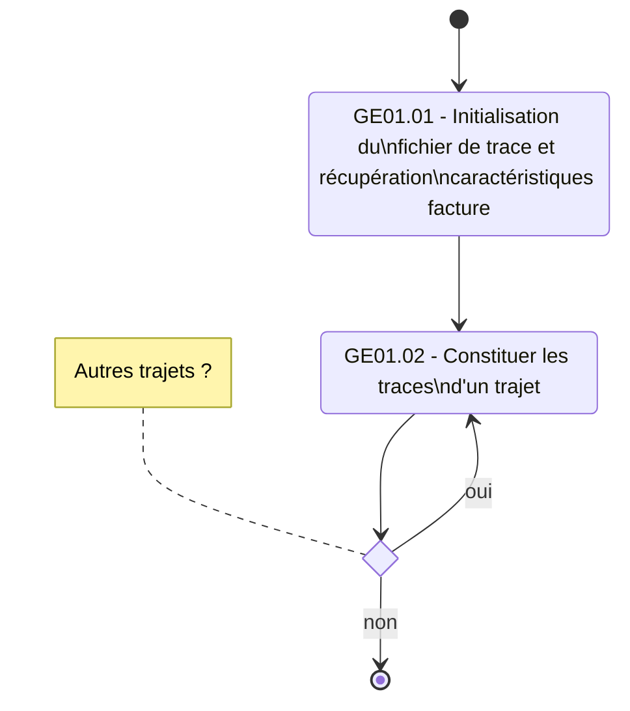
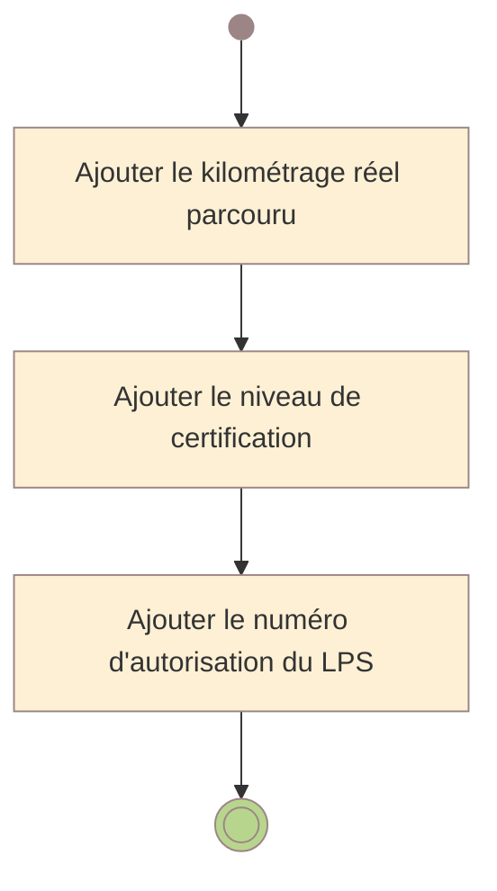
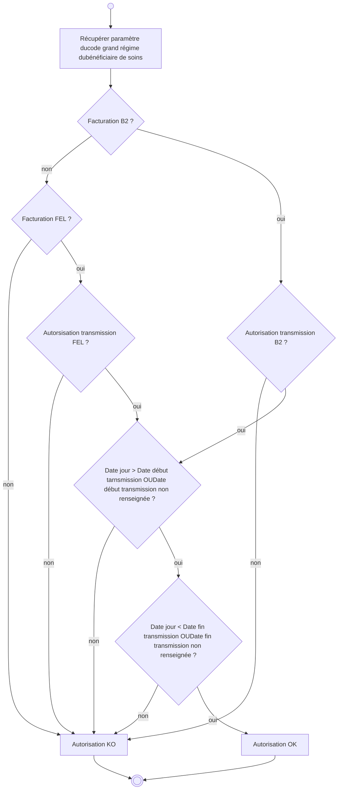
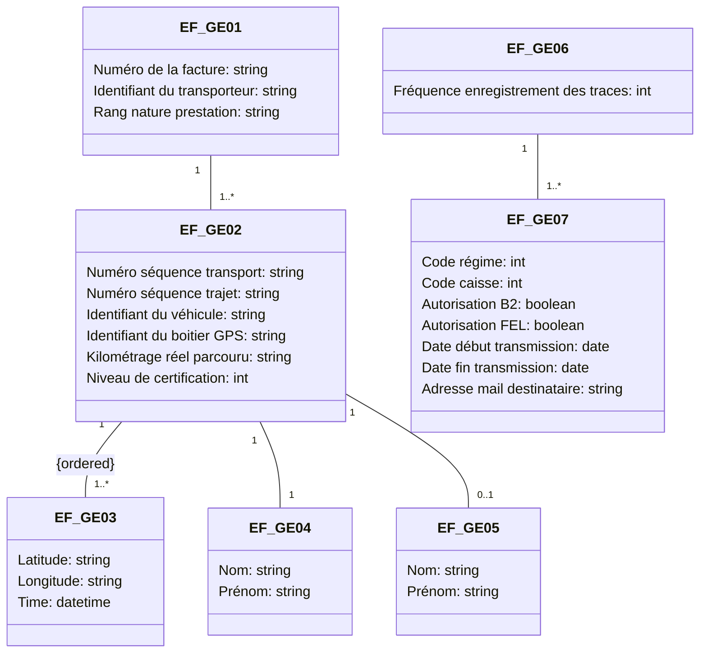

<!-- Conversion intégrale : LlamaParse Agentic Plus, avec pages transcrites ou corrigées visuellement par Codex ; détail dans _suivi/session-2026-10-04-17.json. -->


<!-- Pages source 1-10 -->

logo: sesam-vitale

# **Facturation Transporteur**

## *Spécifications Fonctionnelles Générales*

# **Facturation Transporteur**

## **Constituer et transmettre les traces de géolocalisation**

### **Taxi**

VERSION DE TRAVAIL

Référence : FACT-SFG-039 / Version : 1.08 / Date : 16/07/2026
Diffusion : RESTREINTE
État : REFERENCE

**GIE SESAM-Vitale**
5, boulevard Marie et Alexandre Oyon – 72 019 LE MANS CEDEX 2
<u>www.sesam-vitale.fr</u>

Ce document a été élaboré par le GIE SESAM-Vitale.

Conformément à l’article L.122-4 du Code de la Propriété Intellectuelle, toute représentation ou reproduction (intégrale ou partielle) du présent ouvrage, quel que soit le support utilisé, doit être soumise à l’accord préalable écrit de son auteur.

Il en est de même pour sa traduction, sa transformation, son adaptation ou son arrangement, quel que soit le procédé utilisé.

**Tout manquement à ces obligations constituerait un délit de contrefaçon, au sens des **articles L 335-2 et suivants du code de la propriété intellectuelle, susceptible d’entraîner** des sanctions pour l’auteur du délit.**

## **CONTACTS**

icon: sesam-vitale

Pour toute demande d'évolution, comme pour toute question technique ou fonctionnelle, contactez le Centre de services :

*   portail IRIS : [https://portail-support.sesam-vitale.fr/](https://portail-support.sesam-vitale.fr/)
*   téléphone : 02 43 57 42 88

VERSION DE TRAVAIL

*FACT-SFG-039*
*SFG - Facturation Taxi*
*GE - Constituer et transmettre les traces de géolocalisation*
*Version : 1.08*

## **SOMMAIRE**

| 1 | INTRODUCTION......................................................................................................................................... | 4 |
| --- | --- | --- |
| 1.1 | OBJECTIF DU DOCUMENT ..................................................................................................................... | 4 |
| 1.2 | STATUT DU DOCUMENT........................................................................................................................ | 4 |
| 1.3 | CONTENU DU DOCUMENT..................................................................................................................... | 4 |
| 1.4 | DOCUMENTS DE RÉFÉRENCE ............................................................................................................... | 4 |
| 2 | PRÉSENTATION GÉNÉRALE................................................................................................................... | 5 |
| 2.1 | INTRODUCTION.................................................................................................................................... | 5 |
| 2.2 | ACTEURS ET OBJECTIFS MÉTIERS......................................................................................................... | 7 |
| 2.3 | DESCRIPTION GÉNÉRALE DU PROCESSUS ........................................................................................... | 10 |
| 3 | DESCRIPTION DÉTAILLÉE DU PROCESSUS ...................................................................................... | 11 |
| 3.1 | FONCTION « GE01 – CONSTITUER LES TRACES DE GÉOLOCALISATION » ............................................. | 11 |
| 3.2 | FONCTION « GE02 – COMPLÉTER LA FACTURE » ............................................................................... | 21 |
| 3.3 | FONCTION « GE03 – TRANSMETTRE LES TRACES DE GÉOLOCALISATION » .......................................... | 23 |
| 3.4 | FONCTION « GE04 – ADMINISTRER LES TRACES DE GÉOLOCALISATION » ............................................ | 26 |
| 4 | SYNTHÈSE DES ENTITÉS FONCTIONNELLES.................................................................................... | 28 |

### **TABLE DES ILLUSTRATIONS**

| FIGURE 1 : PROCESSUS SIMPLIFIÉ DE LA FACTURATION TAXI.................................................................................... | 5 |
| --- | --- |
| FIGURE 2 : PÉRIMÈTRE DES SPÉCIFICATIONS.......................................................................................................... | 6 |
| FIGURE 3 : ILLUSTRATION DES RÉPARTITIONS DES FONCTIONS D’UN LPS................................................................. | 7 |
| FIGURE 4 : ACTEURS ET OBJECTIFS MÉTIERS.......................................................................................................... | 9 |
| FIGURE 5 : PROCESSUS GLOBAL DE CONSTITUTION ET TRANSMISSION DES TRACES DE GÉOLOCALISATION............... | 10 |
| FIGURE 6 : FONCTION GE01 - CONSTITUER LES TRACES DE GÉOLOCALISATION ..................................................... | 12 |
| FIGURE 7 : FONCTION GE02 - COMPLÉTER LA FACTURE ....................................................................................... | 22 |
| FIGURE 8 : FONCTION GE03 - TRANSMETTRE LES TRACES DE GÉOLOCALISATION .................................................. | 24 |
| FIGURE 9 : ALGORITHME D’AUTORISATION DE LA TRANSMISSION DES TRACES DE GÉOLOCALISATION ....................... | 25 |
| FIGURE 10 : SYNTHÈSES DES ENTITÉS FONCTIONNELLES ...................................................................................... | 28 |

### **TABLE DES ANNEXES**

| ANNEXE 1 | GUIDE DE LECTURE .....................................................................................................31 |
| --- | --- |
| ANNEXE 2 | MISE À JOUR DE LA NORME B2 .................................................................................33 |
| ANNEXE 3 | SCHÉMA XML DU FICHIER DE TRACES.....................................................................34 |

VERSION DE TRAVAIL

*16/07/2026*
3 / 36
*Ce document à diffusion restreinte ne peut être diffusé sans l'autorisation d'une personne habilitée*

icon: dots

*FACT-SFG-039*
*SFG - Facturation Taxi*
*GE - Constituer et transmettre les traces de géolocalisation*
*Version : 1.08*

# **1 INTRODUCTION**

## **1.1 Objectif du document**

Ce document a pour but de spécifier le processus « Constituer et transmettre les traces de géolocalisation » associées à une facture de transport.

Ce document constitue le cahier des charges technique à destination des éditeurs de logiciels de facturation pour les sociétés de taxi conventionnées [CNV2025].

## **1.2 Statut du document**

## **1.3 Contenu du document**

Outre ce chapitre introductif, ce document de spécifications fonctionnelles générales présente les opérations :

* de constitution des traces de géolocalisation associées à une facture transport,
* de modification du processus de facturation permettant d’inclure dans la facture les informations liées à la géolocalisation,
* de transmission des traces de géolocalisation vers l’assurance maladie,
* d’administration de la constitution et la transmission des traces de géolocalisation.

## **1.4 Documents de référence**

| Appellation | Type et titre | Référence |
| --- | --- | --- |
| [B2-2007] | Norme B2 inter-régime | Juin 2007 |
| [B2-2005] | Norme B2 inter-régime | Novembre 2005 |
| [SEFI] | Documentation éditeurs pour le téléservice SEFi transport | Cf. Espace Industriels |
| [CNV2025] | Convention-cadre nationale relative à l’établissement d’une convention-type entre les entreprises de taxi et les organismes locaux d’Assurance Maladie¹ | Cf. ameli.fr |

<sup>1</sup> Arrêté du 29 juillet 2025 portant approbation de la convention-cadre nationale relative à l'établissement d'une convention-type entre les entreprises de taxi et les organismes locaux d'Assurance maladie

VERSION DE TRAVAIL

*16/07/2026*
4 / 36
*Ce document à diffusion restreinte ne peut être diffusé sans l'autorisation d'une personne habilitée*

icon: dots

*FACT-SFG-039* *GE - Constituer et transmettre les traces de géolocalisation* *SFG - Facturation Taxi* *Version : 1.08*

# **2 PRÉSENTATION GÉNÉRALE**

## **2.1 Introduction**

### **Contexte**

La fiabilisation de la facturation repose sur l’intégration du dispositif de géolocalisation introduit par la convention-cadre nationale de 2025.

```mermaid
graph TD
    subgraph Step1 [1]
        S1_Icons["icon: Bénéficiaire de soins icon: Écran et document icon: Médecin Prescripteur"]
        S1_Text["Un médecin ou établissement de santé prescrit à un patient un transport. Il lui remet la prescription générateur de la prise en charge (identification du malade à transporter, lieu de prise en charge et destination, etc.)"]
    end

    subgraph Step2 [2]
        S2_Text["Le patient remet la prescription au taxi et éventuellement l'entente préalable."]
    end

    subgraph Step3 [3]
        subgraph S3_Detail [3]
            S3D_Text["Le taxi récupère les éléments relatifs au transport effectué :
            - La prescription et l'entente préalable éventuelle
            - L'identification du bénéficiaire de soins
            - L'identification du véhicule utilisé et du conducteur
            - Les caractéristiques du trajet effectué (lieu de prise en charge, destination, kilométrage parcouru...)"]
        end
        
        subgraph S3_Action [3]
            S3A_Icons["icon: Bénéficiaire de soins icon: Taxi (véhicule) icon: taxi (personne) icon: Document"]
            S3A_Text["Le taxi réalise la prise en charge et le transport du malade"]
        end
    end

    subgraph Step4 [4]
        S4_Icons["icon: Bénéficiaire de soins absent (barré) icon: Écran et document icon: taxi (personne)"]
        S4_Text["Le taxi effectue la facturation des trajets effectués (facture et annexes)"]
    end

    subgraph Step5 [5]
        S5_Text["Le taxi transmet ses factures, les pièces justificatives et les traces de géolocalisation vers l'assurance maladie."]
        S5_Icon["icon: Bâtiment Assurance Maladie (AMO)"]
    end

    Step1 --> Step2
    Step2 --> S3_Action
    S3_Action --> S3_Detail
    S3_Detail --> Step4
    Step4 --> Step5
```



**Figure 1 : Processus simplifié de la facturation taxi**

### **Principes**

Le système de constitution et de transmission des traces de géolocalisation s’appuie sur les principes suivants :

*   L’utilisation par le taxi de la facturation B2 ou de la facturation en ligne (SEFi).
    *   La facturation B2 et la facturation en ligne (SEFi) sont exclusives l’une de l’autre. S’il s’agit d’une facture B2, seules les données relatives à cette facture doivent être renseignées dans les traces de géolocalisation. S’il s’agit d’une facture SEFi seules les données relatives à la FEL doivent être renseignées dans les traces de géolocalisation.
    *   Le taxi a la possibilité de passer d’une facture SEFI à une facture B2 comme indiqué dans la documentation SEFI.
*   Le fichier de trace de géolocalisation est une pièce complémentaire à la facture, non intégré à la facture B2 ou la facture en ligne (FEL).
*   La transmission des traces de géolocalisation se fait vers le point d’accueil des traces de géolocalisation.
*   En cas de facture B2, la version de norme de facturation pouvant être utilisée est a minima la version B2 2005-B ou version supérieure (cf. document [B2-2005]).
*   Ce cahier des charges intègre la facturation en ligne (SEFi).

*16/07/2026* *5 / 36*
*Ce document à diffusion restreinte ne peut être diffusé sans l'autorisation d'une personne habilitée*

icon: three dots

*SFG - Facturation Taxi*
*FACT-SFG-039* *GE - Constituer et transmettre les traces de géolocalisation* *Version : 1.08*

*   En cas de facture en ligne (FEL), la version de SEFi pouvant être utilisée est a minima la prochaine version définitive de SEFi Taxi (cf. documentation [SEFI]).

## **Périmètre**

Ces spécifications portent sur les modalités de constitution et de transmission des traces de géolocalisation des trajets facturés (cf. fonctions GE01 et GE03, respectivement décrites au §3.1 et au §3.3), ainsi que sur le complément de la facturation associé à cette géolocalisation (cf. fonction GE02 décrite au §3.2).

## **Hors périmètre**

Ne sont pas spécifiées dans cette version de spécification l’identification et la transmission de l’identification de l’assuré et bénéficiaire de soins dans les traces de géolocalisation. Ces données sont actuellement renseignées uniquement dans la facture et certaines pièces justificatives. Les traces de géolocalisation ne contiennent pas ces données et font référence à la facture correspondante.

Ne sont pas spécifiées dans ce document :

*   Les modalités de mise à jour du parc des véhicules utilisés et des personnels associés dans les bases de l’assurance maladie.
*   Les modalités de mise en place du système de géolocalisation par la société de taxi ainsi que les modalités de récupération des données de géolocalisation (position GPS enregistrées) dans le LPS du taxi.

Le périmètre de ces spécifications est illustré par le schéma suivant :

**Véhicule**
(équipé d’un boitier de géolocalisation)
icon: voiture

**Enregistrement des positions GPS de tous les trajets** (dans un bloc bleu) $\rightarrow$ (vers le cadre orange)

---

**Périmètre des spécifications** (cadre orange)

**Poste de travail**
icon: ordinateur $\rightarrow$ **Fichier trace géoloc** (bloc bleu)

(Lien en pointillés entre les deux blocs suivants)

**Facture B2 ou FEL** (bloc violet)

---

**Système d’accueil des traces de géolocalisation**
icon: serveur $\leftarrow$ (depuis **Fichier trace géoloc**)

**AMO**
icon: bâtiment AMO $\leftarrow$ (depuis **Facture B2 ou FEL**)

---

**Annotations externes :**

*   $\rightarrow$ **Fichier trace géoloc** : Fichier contenant des informations de la facture et les positions GPS enregistrées uniquement pour la facture correspondante
*   $\rightarrow$ **Facture B2 ou FEL** : La facture est complétée par les informations de géolocalisation (distance réelle parcourue, niveau de certification, n° autorisation du LPS)

**Figure 2 : Périmètre des spécifications**

*16/07/2026* 6 / 36
*Ce document à diffusion restreinte ne peut être diffusé sans l'autorisation d'une personne habilitée*

icon: logo

*SFG - Facturation Taxi*
*FACT-SFG-039* *GE - Constituer et transmettre les traces de géolocalisation* *Version : 1.08*

Un exemple de répartition des fonctionnalités dans le LPS du taxi est illustré par le schéma suivant :

```mermaid
graph LR
    subgraph SG [Système géolocalisation]
        direction TB
        SG_Text[Systèmegéolocalisation]
        SG_Icon[photo: voiture de transport avec chauffeur ]
    end

    subgraph LPS [LPS]
        direction TB
        Interface[Interface système géoloc]
        
        subgraph LPS_Content [ ]
            direction TB
            Metier[Métier :planificationdes missions]
            Ref[Référentiel :véhicules etéquipages]
            
            Const[Constitutiondes fichiers detraces géoloc]
            Trans[Transmissiondes fichiers detraces géoloc]
            
            Fact[Facturation AM]
        end
    end

    subgraph Accueil [Système d'accueil des traces de géolocalisation]
        direction TB
        Server_Icon[image: serveur informatique ]
        AMO_Icon[image: bâtiment avec logo AMO ]
    end

    SG --> Interface
    Trans --> Server_Icon
    Fact --> AMO_Icon

    %% Data labels
    Fichier_Trace{{Fichiertracegéoloc}}
    Facture_B2{{FactureB2 ou FEL}}

    Trans -.-> Fichier_Trace
    Fact -.-> Facture_B2

    %% Styling
    style SG fill:#4F81BD,color:white
    style LPS fill:#FCD5B4,stroke:#E46C0A
    style Interface fill:#4F81BD,color:white
    style Metier fill:#4F81BD,color:white
    style Ref fill:#4F81BD,color:white
    style Const fill:#9BBB59,color:white
    style Trans fill:#9BBB59,color:white
    style Fact fill:url(#grad1),stroke:#76923C
    style Fichier_Trace fill:#DCE6F1,stroke:#4F81BD
    style Facture_B2 fill:#E4DFEC,stroke:#60497A
    style Accueil fill:none,stroke:none
```

image: rectangle vert Périmètre des spécifications

**Figure 3 : Illustration des répartitions des fonctions d’un LPS**

## 2.2 **Acteurs et objectifs métiers**

**Acteurs**

| Nom | Définition du rôle |
| --- | --- |
| Bénéficiaire des soins | Personne bénéficiant d’une protection sociale et pour laquelle un soin est prodigué par le Partenaire de Santé. Ce soin fait l’objet d’une facturation à destination de l’Assurance Maladie. Le bénéficiaire des soins (ou son représentant légal) signe l’annexe de la facture attestant de la réalisation du soin. |
| Taxi | Le Taxi (TX) réalise la facturation de prestations relatives à une prescription et transmet ses factures, ses pièces justificatives (P.J.) et les traces de géolocalisation aux organismes d’Assurance Maladie Obligatoire. |
| LPS | Logiciel du Professionnel de Santé : il s’agit du progiciel utilisé par le taxi pour gérer son processus métier, la facturation vers l’assurance maladie et l’interface avec le système de géolocalisation. |
| Système de géolocalisation | Système permettant l’enregistrement des positions GPS des véhicules de la flotte de la société de taxi. |
| Véhicule de transport | Véhicule ayant servi au transport du bénéficiaire de soins |
| Conducteur | Conducteur du véhicule de transport |
| Boitier GPS | Boitier associé au véhicule de transport enregistrant les positions GPS de géolocalisation pendant le transport du bénéficiaire de soins. Il est installé dans le véhicule et le N° de boîtier (IMEI) est référencé dans l’entreprise par le LPS en association avec le véhicule. Il fait partie du système de géolocalisation. |

*16/07/2026* *7 / 36*
*Ce document à diffusion restreinte ne peut être diffusé sans l'autorisation d'une personne habilitée*

icon: dots

*SFG - Facturation Taxi*
*FACT-SFG-039* *GE - Constituer et transmettre les traces de géolocalisation* *Version : 1.08*

| Système d’accueil des traces de géolocalisation | Le système d’accueil des traces de géolocalisation reçoit et traite les traces de géolocalisation transmises par les taxis. |
| --- | --- |
| S.I. AMO | Le Système d’Information de l’Assurance Maladie Obligatoire : ● reçoit, contrôle et assure la liquidation des factures, ● transmet les RSP (Noémie), ● procède au règlement des factures conformes. |

## **Objectifs métier**

Les objectifs métiers justifiant l’utilisation du système sont les suivants :

*  constituer les traces de géolocalisation des trajets de transport effectués,
*  compléter la facturation avec les données issues de la géolocalisation,
*  transmettre les traces de géolocalisation vers l’assurance maladie,
*  administrer la constitution et la transmission des traces de géolocalisation.

VERSION DE TRAVAIL

*16/07/2026* 8 / 36
*Ce document à diffusion restreinte ne peut être diffusé sans l'autorisation d'une personne habilitée*

icon: dots

*FACT-SFG-039*
*SFG - Facturation Taxi*
*GE - Constituer et transmettre les traces de géolocalisation*
*Version : 1.08*

**Croisement**
**objectifs / acteurs**

Ce diagramme de cas d'utilisation illustre les interactions entre différents acteurs (humains et systèmes) et les fonctionnalités liées à la géolocalisation.

### Acteurs et Systèmes
*   **Transporteur** : Représenté par une icône de personnage.
*   **LPS** (Logiciel de Professionnel de Santé) : Représenté par une capture d'écran d'interface logicielle.
*   **Véhicule de transport** : Représenté par une icône de voiture.
*   **Boitier GPS** : Représenté par une image de matériel électronique (erco&gener GenPro 20e).
*   **Système Géolocalisation** : Représenté par une icône de smartphone affichant une carte.
*   **Conducteur** : Représenté par une icône de personnage.
*   **Bénéficiaire de soins** : Représenté par une icône de personnage.
*   **SI AMO** : Représenté par une icône de bâtiment avec le logo "iAMO".
*   **Système accueil traces géoloc** : Représenté par une icône de bâtiment avec le logo "iAMO".

### Cas d'utilisation (Objectifs)
Le diagramme présente quatre cas d'utilisation principaux (bulles bleues) et leurs relations :

*   **GE01 - Constituer les traces de géolocalisation**
    *   Relié au **LPS**.
    *   Relié au **Véhicule de transport**.
    *   Relié au **Boitier GPS**.
    *   Relié au **Système Géolocalisation**.
    *   Relié au **Conducteur**.

*   **GE02 - Compléter la facture**
    *   Relié au **LPS**.
    *   Relié au **Bénéficiaire de soins**.
    *   Relié au **SI AMO**.

*   **GE03 - Transmettre les traces de géolocalisation**
    *   Relié au **LPS**.
    *   Relié au **Système accueil traces géoloc**.

*   **GE04 - Administrer la géolocalisation**
    *   Relié au **LPS**.

### Relations transverses
*   Le **Transporteur** interagit directement avec le **LPS**.
*   Le **LPS** sert de pivot central, étant relié aux quatre cas d'utilisation (GE01, GE02, GE03, GE04).
*   Le **Véhicule de transport**, le **Boitier GPS** et le **Système Géolocalisation** sont interconnectés entre eux et liés au cas d'utilisation GE01.

**Figure 4 : Acteurs et objectifs métiers**

VERSION DE TRAVAIL

*16/07/2026*
9 / 36
*Ce document à diffusion restreinte ne peut être diffusé sans l'autorisation d'une personne habilitée*

icon: logo

*SFG - Facturation Taxi*
*FACT-SFG-039* *GE - Constituer et transmettre les traces de géolocalisation* *Version : 1.08*

## **2.3** **Description générale du processus**

Le processus global de constitution et de transmission des traces de géolocalisation est illustré par le schéma suivant :

```mermaid
graph TD
    Start(( )) --> Fork[ ]
    
    Fork --> GE04["GE04 - Administrer lestraces de géolocalisation"]
    Fork --> GE01["GE01 - Constituer lestraces de géolocalisation"]
    
    GE01 --> Decision1{ }
    Decision1 -- "oui" --> GE02["GE02 - Compléter lafacture"]
    Decision1 -- "non" --> Join[ ]
    
    GE02 --> Decision2{ }
    Decision2 -- "oui" --> GE03["GE03 - Transmettre lestraces de géolocalisation"]
    Decision2 -- "non" --> Join
    
    GE04 --> Join
    GE03 --> Join
    
    Join --> End((( )))

    %% Labels for decisions
    style Decision1 fill:#FFF2CC,stroke:#000
    style Decision2 fill:#FFF2CC,stroke:#000
    style GE01 fill:#F8CECC,stroke:#000
    style GE02 fill:#F8CECC,stroke:#000
    style GE03 fill:#F8CECC,stroke:#000
    style GE04 fill:#F8CECC,stroke:#000
    style Fork fill:#000,stroke:#000
    style Join fill:#000,stroke:#000

    subgraph Labels [ ]
        direction TB
        L1[Fichier de trace présent ?]
        L2[Facture transmise ?]
    end
    Labels ~~~ Decision1
    Labels ~~~ Decision2
```



**Figure 5 : Processus global de constitution et transmission des traces de** géolocalisation

VERSION DE TRAVAIL

*16/07/2026* 10 / 36
*Ce document à diffusion restreinte ne peut être diffusé sans l'autorisation d'une personne habilitée*

icon: three dots

<!-- Pages source 11-20 -->

*SFG - Facturation Taxi*
*FACT-SFG-039 GE - Constituer et transmettre les traces de géolocalisation Version : 1.08*

# **3 DESCRIPTION DÉTAILLÉE DU PROCESSUS**

Les entités fonctionnelles mentionnées dans ce chapitre sont décrites en détail au §4.

## **3.1 Fonction « GE01 – Constituer les traces de géolocalisation »**

### **3.1.1 **Cadrage fonctionnel****

**Pré-requis**
Un (des) transport(s) a (ont) été réalisé(s) par le taxi pour un bénéficiaire de soins avec un (des) véhicule(s) de transport équipé(s) d’un boitier GPS de géolocalisation dont l’enregistrement des positions GPS a été activé<sup>2</sup>.

**Evénement déclencheur**
Facturation par le taxi du (des) trajet(s) effectué(s).

**Description**
A chaque facture réalisée, un fichier de traces de géolocalisation est constitué qui comprend, pour chaque trajet facturé :
* L’identification du véhicule (immatriculation) utilisé
* L’identifiant du boitier GPS associé au véhicule (n° IMEI)
* Le niveau de certification attribué pour le trajet permettant de définir le niveau de fiabilité des données enregistrées.
* Les positions GPS de géolocalisation enregistrées entre le début et la fin de prise en charge du trajet pour le bénéficiaire (coordonnées GPS et horodatage par minute)
* Le kilométrage réel parcouru calculé à partir des traces de géolocalisation
* L’identification du conducteur du véhicule utilisé
* L’identifiant du taxi (n° assurance maladie)
* Le numéro de la facture associée
* Le rang de la nature de prestation
* La séquence du transport correspondant au transport

**Données en entrée**
Facture en cours

**Données en sortie**
Fichier de traces de géolocalisation contenant les traces de chaque trajet facturé (EF_GE01 à EF_GE05)

VERSION DE TRAVAIL

<sup>2</sup> Dans le cas d’utilisation d’un véhicule de remplacement non équipé de boitier GPS, il n’y a pas de constitution de traces de géolocalisation pour ce trajet.

*16/07/2026* 11 / 36
*Ce document à diffusion restreinte ne peut être diffusé sans l'autorisation d'une personne habilitée*

icon: three dots

*SFG - Facturation Taxi*
*FACT-SFG-039* *GE - Constituer et transmettre les traces de géolocalisation* *Version : 1.08*

## **Illustration**



**Figure 6 : Fonction GE01 - Constituer les traces de géolocalisation**

## **Situations spécifiques**

SP1 – Génération des fichiers de traces de géolocalisation dans le cas des transports partagés.

SP2 – Génération des fichiers de traces de géolocalisation dans le cas d’une réémission d’une facture précédemment rejetée.

VERSION DE TRAVAIL

*16/07/2026* 12 / 36
*Ce document à diffusion restreinte ne peut être diffusé sans l'autorisation d'une personne habilitée*

icon: dots

*SFG - Facturation Taxi*
*FACT-SFG-039* *GE - Constituer et transmettre les traces de géolocalisation* *Version : 1.08*

# **3.1.2** **GE01.01 - Initialiser le fichier de trace et récupérer les caractéristiques de la facture**

## **Vue générale**

**Description** Lors de la facturation des trajets effectués, un fichier de traces XML de géolocalisation est initialisé à partir des données de la facture :

* Nommage du fichier à partir des éléments de la facture suivants :
    * Type et numéro émetteur facture
    * Type et numéro destinataire facture
    * Identification du fichier de facture
    * Numéro de la facture
* Récupération des caractéristiques de la facture à inclure dans le fichier de traces :
    * Numéro de la facture
    * Identifiant du taxi (numéro d’émetteur)
    * Nature de la prestation

***Entrées*** Facture en cours
***Sorties*** Fichier de traces de géolocalisation initialisé EF_GE01

***Situations spécifiques***
* SP1 – transports partagés : dans ce cas, il y a autant de factures que de bénéficiaires transportés, et donc autant de fichiers de traces de géolocalisation que de factures produites.
* SP2 – réémission de facture : émission d’un nouveau fichier de traces de géolocalisation

## **Règles de gestion**

***[RG_GE101] Nommage du fichier de traces XML de géolocalisation***

Le nommage du fichier de traces XML de géolocalisation est constitué par concaténation des éléments suivants de la facture, suivi de l’extension « .xml ».

Dans le cas d’une facture B2 :

| Nom | Origine B2 | Exemple |
| --- | --- | --- |
| Type émetteur | Type 000 pos 4-5 | TP00000762522746 ou SI12345678901234 |
| Numéro émetteur | Type 000 pos 6-19 |  |
| Type destinataire | Type 000 pos 26-27 | CT00000001001764 |
| Numéro destinataire | Type 000 pos 28-41 |  |
| Identification du fichier | Type 000 pos 50-55 | CPA249 ou 812653 |
| Date de création du fichier | Type 000 pos 56-61 (AAMMJJ) | 150528 |
| Numéro de la facture | Type 2 pos 27-35 | 000000330 ou 020080475 |

Exemple de nom de fichier :
TP00000762522746CT00000001001764812653150528000000330.xml

VERSION DE TRAVAIL

*16/07/2026* *13 / 36*
*Ce document à diffusion restreinte ne peut être diffusé sans l'autorisation d'une personne habilitée*

icon: dots

*FACT-SFG-039*
*GE - Constituer et transmettre les traces de géolocalisation*
*SFG - Facturation Taxi*
*Version : 1.08*

## GE - Constituer et transmettre les traces de géolocalisation

Dans le cas d’une facture en ligne (FEL) :

| Nom | Origine FEL | Précisions / exemple |
| --- | --- | --- |
| Type émetteur | - | Valeur fixe « TS » |
| Numéro émetteur | EF_FTE51_01 | Sur 14 caractères. Cadrer à droite, compléter avec des zéros à gauche si le numéro fait moins de 14 caractères. |
| Type destinataire | - | Type 000 pos 26-27 (Cf. norme B2) |
| Numéro destinataire | EF_FTE57_04 et EF_FTE71_03 | Numéro composé comme suit : - six 0 (zéro) - le code régime (EF_FTE57_04) - trois 0 (zéro) - n° d’organisme destinataire (EF_FTE71_03). |
| Identification du fichier | - | Type 000 pos 50-55 (Cf. norme B2) |
| Date de création du fichier | EF_FTE50_02 | Mettre la date au format AAMMJJ. Exemple : 150528 |
| Numéro de la facture | EF_FTE50_01 | Exemples : 000000330 ou 020080475 |

Exemple de nom de fichier :

TS00000762522746CT00000001000764812653150528000000330.xml

### *[RG_GE102] Enregistrement des caractéristiques de la facture*

Les caractéristiques suivantes de la facture sont enregistrées dans le fichier de traces de géolocalisation :

Dans le cas d’une facture B2 :

| Référence | Nom | Origine B2 | O/F |
| --- | --- | --- | --- |
| EF_GE01_01 | Numéro facture | Type 2 pos 27-35 | O |
| EF_GE01_02 | Identifiant transporteur | Type 2 pos 2-10 |  |
| EF_GE01_03 | Rang nature prestation | Valeur fixe = « TA » |  |

icon: information

Dans le cas d’une facture en ligne (FEL) :

| Référence | Nom | Origine FEL | O/F |
| --- | --- | --- | --- |
| EF_GE01_01 | Numéro facture | EF_FTE50_01 | O |
| EF_GE01_02 | Identifiant transporteur | EF_FTE61_01 | O |
| EF_GE01_03 | Rang nature prestation | Valeur fixe = « TA » | O |

DOCUMENT DE TRAVAIL

*16/07/2026*
*14 / 36*
*Ce document à diffusion restreinte ne peut être diffusé sans l'autorisation d'une personne habilitée*

icon: decorative dots

*SFG - Facturation Taxi*
*FACT-SFG-039 *GE - Constituer et transmettre les traces de géolocalisation* Version : 1.08*

**Situations Spécifiques**

**SP2 – réémission de facture**

En cas de réémission d’une facture suite à un rejet, un nouveau numéro de facture est affecté.

En conséquence, parallèlement à la réémission de la facture, le fichier de trace de géolocalisation correspondant à ce trajet facturé doit également être retransmis à l’assurance maladie en l’état, exception faite de la prise en compte du nouveau numéro de facture attribué qui doit être présent dans les enregistrements des caractéristiques de la facture (donnée EF_GE01_01) et dans le nom du fichier généré (RG_GE101).

### **3.1.3** **GE01.02 - Constituer les données d’un trajet**

#### **Vue générale**

***Description*** Pour chaque trajet facturé, les caractéristiques suivantes sont enregistrées dans le fichier de trace XML de géolocalisation associé à la facture :

*   Numéro de séquence du transport effectué
*   Numéro de séquence du trajet
*   Identifiant du véhicule utilisé
*   Identifiant du boitier GPS utilisé
*   Identifiant du conducteur du véhicule

Les lieux et heure de début de prise en charge et de fin de prise en charge sont déterminés à partir :

*   Soit par géolocalisation préalable des lieux et heure si ceux-ci sont connus à l’avance (solution recommandée lorsque c’est possible)
*   Soit par déclenchement manuel par le conducteur lors du début et de la fin de prise en charge

Les positions GPS de géolocalisation récupérées depuis le boitier GPS du véhicule et situées entre le début et la fin de prise en charge sont enregistrées dans le fichier de traces.

La distance réelle parcourue est ensuite calculée à partir des positions GPS récupérées.

Le niveau de certification des données enregistrées est ensuite déterminé.

| Entrées | Facture en cours |  |
| --- | --- | --- |
| Fichier de traces de géolocalisation initialisé | EF_GE01 |  |
| Paramètres de géolocalisation | EF_GE06 |  |
| et EF_GE07 |  |  |
| Sorties | Fichier de traces de géolocalisation complété avec les données des trajets enregistrées | EF_GE01 |
| EF_GE02 |  |  |
|  | EF_GE03 |  |
|  | EF_GE04 |  |
|  | EF_GE05 |  |

***Situations spécifiques***

*   SP1 – transports partagés : chaque fichier de traces de géolocalisation contiendra uniquement les positions GPS correspondant au parcours effectué par le bénéficiaire transporté objet de la facture associé.

VERSION DE TRAVAIL

*16/07/2026* 15 / 36
*Ce document à diffusion restreinte ne peut être diffusé sans l'autorisation d'une personne habilitée*

icon: icon

*SFG - Facturation Taxi*
FACT-SFG-039 *GE - Constituer et transmettre les traces de géolocalisation Version : 1.08*

**Règles de**
**gestion**

### *[RG_GE103] Enregistrement des caractéristiques d’un transport*

Pour chaque transport facturé, les caractéristiques suivantes sont enregistrées dans le fichier de traces de géolocalisation, en cohérence avec les données correspondantes de la facture en cours :

#### Dans le cas d’une facture B2 :

| Référence | Nom | Origine B2 | O/F |
| --- | --- | --- | --- |
| EF_GE02_01 | Numéro séquence transport | B2 Type 4T pos 37-38 | O |
| EF_GE02_02 | Numéro séquence trajet | B2 Type 4U pos 37-38 | O |
| EF_GE02_03 | Identification véhicule | B2 Type 4U pos 54-62 | O |
| EF_GE04_01 | Nom conducteur | B2 Type 4U pos 63-70 | O |
| EF_GE04_02 | Prénom conducteur | B2 Type 4U pos 71-73 | O |
| EF_GE02_04 | Identifiant boitier GPS | Numéro IMEI du boitier GPS installé dans le véhicule (15 chiffres dont une clé de contrôle) enregistré et référencé dans l’entreprise | O |

#### Dans le cas d’une facture en ligne (FEL) :

| Référence | Nom | Origine FEL | O/F |
| --- | --- | --- | --- |
| EF_GE02_01 | Numéro séquence transport | Valeur fixe « 01 » | O |
| EF_GE02_02 | Numéro séquence trajet | Valeur sur 2 chiffres initialisée à « 01 » pour le premier trajet dans la facture et incrémentée de 1 pour chaque trajet supplémentaire dans la facture : « 02 », … | O |
| EF_GE02_03 | Identification véhicule | EF_FTE64_01 | O |
| EF_GE04_01 | Nom conducteur | EF_FTE64_02 | O |
| EF_GE04_02 | Prénom conducteur | EF_FTE64_03 | O |
| EF_GE02_04 | Identifiant boitier GPS | Numéro IMEI du boitier GPS installé dans le véhicule (15 chiffres dont une clé de contrôle) enregistré et référencé dans l’entreprise | O |

### *[RG_GE104] Détermination du lieu et de l’heure de début de prise en charge du bénéficiaire*

Si le lieu de début de prise en charge du bénéficiaire est connu à l’avance, le LPS doit avoir géolocalisé (géocodé) le lieu de début prise en charge (détermination des coordonnées GPS via un logiciel de cartographie).

Le conducteur du véhicule peut déclencher manuellement la prise en charge via le dispositif informatique embarqué dans le véhicule. La position du lieu de début de prise en charge du bénéficiaire correspondra alors à la position GPS du boitier au moment du déclenchement manuel.

*16/07/2026 16 / 36*
*Ce document à diffusion restreinte ne peut être diffusé sans l'autorisation d'une personne habilitée*

icon: •••

*SFG - Facturation Taxi*
*FACT-SFG-039* *GE - Constituer et transmettre les traces de géolocalisation* *Version : 1.08*

La détermination du lieu et de l’heure de début de prise en charge vis-à-vis des positions GPS issues du boitier GPS se fait selon les règles suivantes :

*   Positionnement du véhicule dans un rayon inférieur à 500 mètres vis-à-vis de la position théorique géolocalisée en préalable ou positionnée par le conducteur manuellement.
*   Détection d’un arrêt du véhicule dans un intervalle de +/- 5 minutes vis-à-vis de l’heure théorique positionnée en préalable ou positionnée par le conducteur manuellement.

## *[RG_GE105] Détermination du lieu et de l’heure de fin de prise en charge du bénéficiaire*

Si le lieu de fin de prise en charge du bénéficiaire est connu à l’avance, le LPS doit avoir géolocalisé le lieu de fin de prise en charge (détermination des coordonnées GPS via un logiciel de cartographie).

Le conducteur du véhicule peut déclencher manuellement la fin de prise en charge via le dispositif informatique embarqué dans le véhicule. La position du lieu de fin de prise en charge du bénéficiaire correspondra alors à la position GPS du boitier au moment du déclenchement manuel.

La détermination du lieu et de l’heure de fin de prise en charge vis-à-vis des positions GPS issues du boitier GPS se fait selon les règles suivantes :

*   Positionnement du véhicule dans un rayon inférieur à 500 mètres vis-à-vis de la position théorique géolocalisée en préalable ou positionnée par le conducteur manuellement.
*   Détection d’un arrêt du véhicule dans un intervalle de +/- 5 minutes vis-à-vis de l’heure théorique positionnée en préalable ou positionnée par le conducteur manuellement.

## *[RG_GE106] Enregistrement des positions GPS*

Les positions GPS enregistrées (EF_GE03) sont issues du boitier GPS embarqué dans le véhicule utilisé pour le trajet et sont récupérées/transmises via le système de géolocalisation.

Les positions GPS enregistrées pour le trajet référencé sont celles situées entre le début de prise en charge (cf. RG_GE104) et la fin de prise en charge (cf. RG_GE105).

Le format d’enregistrement doit respecter le format ouvert GPX (GPS Exchange Format) en version 1.1 (cf. [www.topografix.com/GPX)](http://www.topografix.com/GPX).

Pour chaque position GPS enregistrée, seules les données suivantes du format GPX (cf. Annexe 3) sont utilisées et doivent obligatoirement être renseignées :

| Référence | Nom | Origine | O/F |
| --- | --- | --- | --- |
| EF_GE03_01 | Latitude | Boitier GPS | O |
| EF_GE03_02 | Longitude | Boitier GPS | O |
| EF_GE03_03 | Date et heure de l’enregistrement (time) | Boitier GPS | O |

logo: logo

### *Recommandation*

Le nombre de traces enregistrées doit être cohérent avec la fréquence d’enregistrement des traces paramétrée sur le système de géolocalisation (EF_GE06_01). Une tolérance de 15% de perte de traces est admise.

*16/07/2026* 17 / 36
*Ce document à diffusion restreinte ne peut être diffusé sans l'autorisation d'une personne habilitée*

icon: icon

*SFG - Facturation Taxi*
*FACT-SFG-039 *GE - Constituer et transmettre les traces de géolocalisation* Version : 1.08*

Le nombre théorique de traces enregistrées est calculé de la façon suivante :

$$N = \frac{Hf - Hd}{f} + 1$$

Où :

*   **N** représente le nombre de trace théorique
*   **Hf** représente l’heure de fin de prise en charge exprimée en seconde
*   **Hd** représente l’heure de début de prise en charge exprimée en seconde
*   **f** représente la fréquence d’enregistrement des traces exprimée en seconde (valeur fournie dans le paramétrage entité EF_GE06_01).

icon: arrow ***Cas d’erreur***

***CE_GE02 : Absence de positions GPS***

Dans le cas où les positions GPS pour ce trajet ne sont pas disponibles, le fichier de traces doit contenir a minima la position du point de prise en charge et la position du point de fin de prise en charge qui peuvent être obtenus à partir de la cartographie utilisée par le LPS.

## *[RG_GE107] Calcul de la distance réelle parcourue*

La distance réelle parcourue (EF_GE02_05) ne doit pas être nulle et est déterminée de la façon suivante :

*   La distance est fournie directement par le boitier GPS embarqué dans le véhicule utilisé lorsque celui-ci permet de faire ce calcul (par différence entre la valeur du compteur au moment du dépôt du patient et la valeur du compteur au moment de sa prise en charge).
*   Si le boitier GPS ne permet pas de calculer la distance parcourue, ou que la valeur relevée par celui-ci est égale à zéro, la distance est recalculée a posteriori par le LPS à partir de la totalité des positions GPS enregistrées (EF_GE03) (cf. RG_GE106) selon la norme GPX.
*   Si les positions GPS enregistrées ne permettent pas de recalculer la distance parcourue (nombre insuffisant de positions GPS, valeur aberrante dans les positions GPS…), la distance est recalculée a posteriori par le LPS à partir de la cartographie utilisée.

## *[RG_GE108] Détermination du niveau de certification*

Une donnée est dite certifiée à partir du moment où il y a garantie que celle-ci n’a pas été modifiée manuellement entre son acquisition / calcul et son enregistrement dans le fichier de trace.

La certification repose sur un niveau de certification atteint selon que les informations communiquées répondent favorablement à un nombre plus ou moins important d’exigences. Elle ne garantit pas que les données enregistrées soient exemptes d’erreurs.

Les exigences à respecter sont résumées dans le tableau ci-après :

| Information | Critères validant le caractère certifié de l’information |
| --- | --- |
| Identification du véhicule | Association entre le boîtier GPS et le véhicule doit être effectuée avant la prestation de transport Ne doit pas être modifiée une fois la prise en charge débutée |
| Identification du boîtier GPS | Information issue du boîtier GPS et transmise/récupérée au moins une fois au cours du trajet Ne doit pas être modifié |

VERSION DE TRAVAIL

*16/07/2026* 18 / 36
*Ce document à diffusion restreinte ne peut être diffusé sans l'autorisation d'une personne habilitée*

icon: dots

*SFG - Facturation Taxi*
*FACT-SFG-039* *GE - Constituer et transmettre les traces de géolocalisation* *Version : 1.08*

| Coordonnées GPS et horodatage de début et de fin de la prise en charge de l’assuré | Si déclenchement manuel, les coordonnées GPS et horodatage sont celles qui correspondent aux lieux et instants du déclenchement manuel Si connu avant le début du transport, le déclenchement peut-être automatique : Point GPS avec +/- 500 m du lieu de prise en charge ou fin de prise en charge arrêt du véhicule dans la zone sur une durée suffisante détectée par le GPS +/– 5 minutes par rapport à l’heure mentionnée sur la facture Ne doit pas être modifié |
| --- | --- |
| Positions GPS | Information transmise par le boîtier GPS Ne pas dépasser 15% de perte sur le parcours total Ne doit pas être modifié |
| Kilométrage réel parcouru | Calculé à partir des données issues du boîtier GPS (compteur kilométrique) ou obtenu suite à un traitement de géolocalisation exploitant l’intégralité des coordonnées des positions GPS Ne doit pas être modifié et ne doit pas être nul. |
| Ident. Conducteur | Identification manuelle ou automatique réalisée dès la première utilisation du véhicule par le LPS ou le système de géolocalisation Ne doit pas être modifiée une fois le transport amorcé |
| Identité de l’assuré | Ne doit pas être modifiée une fois le transport amorcé |

Le niveau de certification du trajet (EF_GE02_06) est déterminé selon le tableau suivant :

|  | Toutes les données GPS : - Ident. boîtier GPS - Coord. GPS et horodatage début et fin de prise en charge - Positions GPS - Km réel parcouru | Ident. véhicule | Ident. assuré | Ident. conducteur |  |
| --- | --- | --- | --- | --- | --- |
| Niveau de certification | 1 | Non certifié (*) | Non certifié | Non certifié | Non certifié |
| 2 | Certifié | Non certifié | Non certifié | Non certifié |  |
| 3 | Certifié | Certifié | Non certifié | Non certifié |  |
| 4 | Certifié | Certifié | Certifié | Non certifié |  |
| 5 | Certifié | Certifié | Certifié | Certifié |  |

(*) La valeur « Non certifié » s’applique à partir du moment où l’une des données GPS est absente ou incomplète, par exemple toutes les positions GPS n’ont pas été enregistrées par le boîtier dans le véhicule.

VERSION DE TRAVAIL

*16/07/2026* *19 / 36*
*Ce document à diffusion restreinte ne peut être diffusé sans l'autorisation d'une personne habilitée*

icon: decorative dots

*SFG - Facturation Taxi*
*FACT-SFG-039 GE - Constituer et transmettre les traces de géolocalisation Version : 1.08*

# **Situations Spécifiques**

## ***SP1 – transport partagé***

Des exemples de transport partagé sont illustrés par les schémas suivants.

<u>**Exemple 1**</u> : points de prise en charge et de dépose différents pour les trois bénéficiaires

Le schéma représente une ligne de temps ou un trajet linéaire (ligne bleue horizontale) sur lequel sont positionnés différents points d'arrêt identifiés par des losanges de couleur :

*   **Prise en charge Patient A** (losange rouge) : Premier point à gauche.
*   **Prise en charge Patient B** (losange vert) : Deuxième point.
*   **Prise en charge Patient C** (losange orange) : Troisième point.
*   **Dépose Patient B** (losange vert) : Quatrième point.
*   **Dépose Patient C** (losange orange) : Cinquième point.
*   **Dépose Patient A** (losange rouge) : Dernier point à droite.

Sous cette ligne, trois flèches horizontales à double pointe indiquent la durée ou l'étendue de chaque trajet :

*   **Trajet Patient A** (flèche rouge) : S'étend du premier au dernier point.
*   **Trajet Patient B** (flèche verte) : S'étend du deuxième au quatrième point.
*   **Trajet Patient C** (flèche orange) : S'étend du troisième au cinquième point.

<u>**Exemple 2**</u> : point de prise en charge commun pour l’ensemble des bénéficiaires

Le schéma illustre les trajets de trois patients (A, B et C) ayant un point de départ commun.

*   **Ligne de référence (axe horizontal bleu) :**
    *   **Départ commun** (marqué par un losange rouge à gauche).
    *   **Dépose Patient B** (marqué par un losange vert au milieu).
    *   **Dépose Patient C** (marqué par un losange orange plus à droite).
    *   **Dépose Patient A** (marqué par un losange rouge à l'extrémité droite).

*   **Segments de trajets (flèches horizontales sous la ligne de référence) :**
    *   **Trajet Patient A** (flèche rouge) : s'étend du départ commun jusqu'au point de dépose Patient A.
    *   **Trajet Patient B** (flèche verte) : s'étend du départ commun jusqu'au point de dépose Patient B.
    *   **Trajet Patient C** (flèche orange) : s'étend du départ commun jusqu'au point de dépose Patient C.

<u>**Exemple 3**</u> : Point de dépose commun pour l’ensemble des bénéficiaires

Le schéma illustre les trajets de trois patients (A, B et C) ayant un point d'arrivée commun.

*   **Ligne de temps / Trajet global :** Une ligne bleue horizontale comporte quatre points de repère représentés par des losanges :
    *   **Prise en charge Patient A** (losange rouge, à l'extrémité gauche)
    *   **Prise en charge Patient B** (losange vert)
    *   **Prise en charge Patient C** (losange orange)
    *   **Arrivée commune** (losange rouge, à l'extrémité droite)

*   **Segments de trajets individuels :** Sous la ligne principale, trois flèches horizontales à double pointe indiquent la durée/distance de prise en charge pour chaque patient, se terminant toutes au point d'arrivée commune :
    *   **Trajet Patient A** (flèche rouge) : Part du point de prise en charge A jusqu'à l'arrivée commune.
    *   **Trajet Patient B** (flèche verte) : Part du point de prise en charge B jusqu'à l'arrivée commune.
    *   **Trajet Patient C** (flèche orange) : Part du point de prise en charge C jusqu'à l'arrivée commune.

Dans ces exemples, trois factures seront émises, une pour chaque patient (A, B et C) et trois fichiers de traces de géolocalisation seront produits associés à chacune des factures.

Le fichier de traces de géolocalisation associé à la facture du patient A contiendra les traces GPS enregistrées entre le point de prise en charge du patient A et le point de dépose du patient A (trajet A).

Le fichier de traces de géolocalisation associé à la facture du patient B contiendra les traces GPS enregistrées entre le point de prise en charge du patient B et le point de dépose du patient B (trajet B).

Le fichier de traces de géolocalisation associé à la facture du patient C contiendra les traces GPS enregistrées entre le point de prise en charge du patient C et le point de dépose du patient C (trajet C).

Les positions GPS communes aux différents trajets sont donc dupliquées dans chacun des fichiers de traces A, B et C.

VERSION DE TRAVAIL

*16/07/2026* *20 / 36*
*Ce document à diffusion restreinte ne peut être diffusé sans l'autorisation d'une personne habilitée*

icon: dots

<!-- Pages source 21-30 -->

*SFG - Facturation Taxi*
*FACT-SFG-039 GE - Constituer et transmettre les traces de géolocalisation Version : 1.08*

# **3.2** **Fonction « GE02 – Compléter la facture »**

## **Pré-requis**

Un fichier de traces de géolocalisation a été généré avec succès pour la facture à compléter.

## **Evénement déclencheur**

Enregistrement d’un fichier de traces de géolocalisation pour la facture à compléter.

## **Description**

Pour chaque facture (B2 ou FEL), la facture est complétée avec :

*   le kilométrage réel parcouru calculé à partir des positions GPS de géolocalisation de ce trajet,
*   le niveau de certification des traces enregistrées,
*   le numéro d’autorisation du LPS obtenu pour la géolocalisation.

La norme B2 transporteur est enrichie par l’ajout de nouvelles zones dans le type 4U (cf. Annexe 2) et le type 2S pour enregistrer ces données.

Ces données doivent être renseignées dans la facture, même si le fichier de trace n’est pas transmis par la suite (cf. §3.3).

## **Données en entrée**

Facture en cours
Fichier de traces de géolocalisation pour chaque facture (EF_GE01 à EF_GE05)

## **Données en sortie**

Facture en cours complétée

VERSION DE TRAVAIL

*16/07/2026* 21 / 36
*Ce document à diffusion restreinte ne peut être diffusé sans l'autorisation d'une personne habilitée*

icon: dots

*SFG - Facturation Taxi*
*FACT-SFG-039* *GE - Constituer et transmettre les traces de géolocalisation* *Version : 1.08*

**Illustration**



**Figure 7 : Fonction GE02 - Compléter la facture**

**Règles de**
**gestion**

*[RG_GE201] Enregistrement de la distance réelle parcourue*

La facture est enrichie avec la distance réelle parcourue issue des traces de géolocalisation (cf. RG_GE107).

Dans le cas d’une facture B2 :

| Référence Facture | Nom | Origine | O/F |
| --- | --- | --- | --- |
| B2 Type 4U pos 113-116 | Distance réelle parcourue | EF_GE02_05 | O |

Dans le cas d’une facture en ligne (FEL) :

| Référence Facture | Nom | Origine | O/F |
| --- | --- | --- | --- |
| EF_FTE63_22 | Distance GPS | EF_GE02_05 | O |

*[RG_GE202] Enregistrement du niveau de certification*

La facture est enrichie avec le niveau de certification issue des traces de géolocalisation (cf. RG_GE108).

Dans le cas d’une facture B2 :

| Référence Facture | Nom | Origine | O/F |
| --- | --- | --- | --- |
| B2 Type 4U pos 118 | Niveau de certification | EF_GE02_06 | O |

*16/07/2026* 22 / 36
*Ce document à diffusion restreinte ne peut être diffusé sans l'autorisation d'une personne habilitée*

icon: dots

*SFG - Facturation Taxi*
*FACT-SFG-039 *GE - Constituer et transmettre les traces de géolocalisation* Version : 1.08*

Dans le cas d’une facture en ligne (FEL) :

| Référence Facture | Nom | Origine | O/F |
| --- | --- | --- | --- |
| EF_FTE63_24 | Niveau de certification GPS | EF_GE02_06 | O |

### *[RG_GE204] Enregistrement du numéro d’autorisation du LPS*

Le numéro d’autorisation est obtenu lors de la certification du LPS vis-à-vis de la géolocalisation.

Dans le cas d’une facture B2 :

| Référence Facture | Nom | Origine | O/F |
| --- | --- | --- | --- |
| B2 Type 2S pos 45-49 | Numéro d’autorisation du LPS sur 5 caractères alphanumériques | LPS | O |

Dans le cas d’une facture en ligne (FEL) :

| Référence Facture | Nom | Origine | O/F |
| --- | --- | --- | --- |
| EF_FTE63_25 | Numéro d’autorisation du LPS sur 5 caractères alphanumériques | LPS | O |

## **3.3** **Fonction « GE03 – Transmettre les traces de géolocalisation »**

**Pré-requis**

Un ou plusieurs fichiers de traces de géolocalisation ont été générés avec succès pour une ou plusieurs factures.

Les factures associées ont été transmises vers l’assurance maladie.

**Evénement déclencheur**

La facture associée au fichier de traces de géolocalisation a été transmise vers l’assurance maladie.

**Description**

Si le paramétrage de la transmission des fichiers de traces de géolocalisation autorise cette transmission pour la facture associée, le fichier de traces est transmis vers le système d’accueil des traces de géolocalisation³ par messagerie électronique. Un seul fichier de trace est transmis par message.

Il n’y a pas de regroupement des différents fichiers de traces générés.

La transmission du fichier de traces peut se faire dès que la facture associée a été transmise.

VERSION DE TRAVAIL

________________________________________________________________________________
³ La solution de transmission mise en place lors de l’expérimentation associée au cahier des charges de l’avenant n°5 (cf. document [CDC]) reste compatible avec le système d’accueil des traces de géolocalisation décrit dans ce cahier des charges.

*16/07/2026* 23 / 36
*Ce document à diffusion restreinte ne peut être diffusé sans l'autorisation d'une personne habilitée*

icon: logo

*SFG - Facturation Taxi*
*FACT-SFG-039* *GE - Constituer et transmettre les traces de géolocalisation* *Version : 1.08*

## **Données en entrée**

Fichier de traces de géolocalisation pour chaque trajet facturé (EF_GE01 à EF_GE05)
Paramétrage de la transmission (EF_GE06 à EF_GE07)

## **Données en sortie**

aucune

## **Illustration**



```mermaid
graph TD
    Start(( )) --> Decision1{ }
    
    Decision1 -- oui --> Process1(Constituer le message SMTP)
    Process1 --> Process2(Transmettre le message SMTP)
    Process2 --> Decision2{ }
    
    Decision2 -- oui --> Decision1
    Decision2 -- non --> End((( )))
    
    Decision1 -- non --> End
    
    %% Labels and positioning
    subgraph Labels
        direction TB
        L1[Autorisation transmission ?]
        L2[Autre fichiers trace à transmettre ?]
    end
    
    style Start fill:#000
    style End fill:#000,stroke:#000,stroke-width:4px
    style Process1 fill:#f2e3c9,stroke:#000
    style Process2 fill:#f2e3c9,stroke:#000
    style Decision1 fill:#fff9eb,stroke:#000
    style Decision2 fill:#fff9eb,stroke:#000
    
    %% Positioning labels near decision points
    Decision1 -.->|Autorisation transmission ?| Decision1
    Decision2 -.->|Autre fichiers trace à transmettre ?| Decision2
```

**Figure 8 : Fonction GE03 - Transmettre les traces de géolocalisation**

## **Règles de gestion**

***[RG_GE301] Autorisation transmission du fichier de traces géolocalisation***

L’autorisation de transmettre le fichier de traces de géolocalisation se fait à partir des paramètres de géolocalisation (EF_GE07) pour le code régime et le code caisse destinataire du bénéficiaire de soins transporté et du type de facture effectuée (B2 ou FEL).

VERSION DE TRAVAIL

*16/07/2026* *24 / 36*
*Ce document à diffusion restreinte ne peut être diffusé sans l'autorisation d'une personne habilitée*

icon: dots

*SFG - Facturation Taxi*
*FACT-SFG-039 GE - Constituer et transmettre les traces de géolocalisation Version : 1.08*

L’autorisation de transmission se détermine comme suit :



**Figure 9 : Algorithme d’autorisation de la transmission des traces de géolocalisation**

La détermination de l’autorisation en fonction des dates de début de transmission ou de fin de transmission se font en référence aux dates paramétrées dans l’entité EF_GE07 (EF_GE07_05 et EF_GE07_06) décrite ci-après (cf. §3.4).

icon: 4

***Cas d’erreur***

***CE_GE03 : autorisation KO***

Dans ce cas, la transmission n’est pas possible.

### *[RG_GE302] Constitution du message SMTP d’envoi des traces*

Le fichier de trace XML est mis en pièce jointe, **non compressé**, d’un message SMTP **non sécurisé**, à destination de l’adresse mail paramétrée dans l’entité EF_GE07_07 pour le code régime et le code caisse destinataire du **bénéficiaire de soins** transporté.

Il n’y a qu’un seul fichier de trace par message SMTP (une seule pièce jointe possible).

VERSION DE TRAVAIL

*16/07/2026 25 / 36*
*Ce document à diffusion restreinte ne peut être diffusé sans l'autorisation d'une personne habilitée*

icon: dots

*SFG - Facturation Taxi*
*FACT-SFG-039 GE - Constituer et transmettre les traces de géolocalisation Version : 1.08*

# **3.4** **Fonction « GE04 – Administrer les traces de géolocalisation »**

**Evénement déclencheur**
Action de l’administrateur du LPS pour modifier le paramétrage lié aux traces de géolocalisation.

**Description**
Les éléments suivants doivent faire l’objet d’un paramétrage dans le LPS :
* Au niveau de l’enregistrement des données de géolocalisation
    * La fréquence d’enregistrement des traces de géolocalisation par le boitier GPS d’un véhicule. La valeur par défaut est de 1 minute.
* Au niveau de la transmission des fichiers de traces de géolocalisation, l’autorisation de transmission est définie par
    * Code régime AMO et code caisse destinataire
    * Mode de facturation (B2 ou en ligne (FEL) ou les deux)
    * Date de début d’autorisation de transmission
    * Date de fin d’autorisation de transmission
    * Adresse mail où envoyer les traces de géolocalisation

**Données en entrée**
Paramétrage de la géolocalisation (EF_GE06 à EF_GE07)

**Données en sortie**
Paramétrage de la géolocalisation (EF_GE06 à EF_GE07) mis à jour

**Règles de gestion**

***[RG_GE401] Paramétrage de la fréquence d’enregistrement des traces***

| Référence | Nom | Valeur |
| --- | --- | --- |
| EF_GE06_01 | Fréquence d’enregistrement des traces exprimées en secondes | Valeur par défaut : 60 secondes |

***[RG_GE402] Paramétrage des autorisations de transmission des traces***

Ce paramétrage permet de définir pour chaque régime ses capacités à recevoir ou non les traces de géolocalisation.

Pour le régime général et les régimes hébergés par le régime général (ENIM, CAVIMAC, MGP, CAMIEG, INTERIALE, CANSSM, CNMSS, CRPCEN), les valeurs par défaut doivent être valorisées.

| Référence | Nom | Valeur |
| --- | --- | --- |
| EF_GE07_01 | Code régime | De 01 à 99 |
| EF_GE07_02 | Code caisse destinataire | De 000 à 999 |

VERSION DE TRAVAIL

*16/07/2026* 26 / 36
*Ce document à diffusion restreinte ne peut être diffusé sans l'autorisation d'une personne habilitée*

icon: dots

*SFG - Facturation Taxi*
*FACT-SFG-039* *GE - Constituer et transmettre les traces de géolocalisation* *Version : 1.08*

| EF_GE07_03 | Autorisation B2 | « O » : transmission autorisée pour une facture B2 pour le régime « N » : transmission non autorisée Valeur par défaut : « O » |
| --- | --- | --- |
| EF_GE07_04 | Autorisation FEL | « O » : transmission autorisée pour une facture FEL pour le régime « N » : transmission non autorisée Valeur par défaut : « O » |
| EF_GE07_05 | Date de début de transmission | Date à partir de laquelle la transmission des traces pour le régime est possible. Si non renseignée, la transmission est toujours possible. Valeur par défaut : « non renseignée » |
| EF_GE07_06 | Date de fin de transmission | Date au delà de laquelle la transmission des traces pour le régime n’est plus possible. Si non renseignée, la transmission est toujours possible. Valeur par défaut : « non renseignée » |
| EF_GE07_07 | Adresse mail destinataire | Adresse où envoyer les traces de géolocalisation pour chaque régime. Pour le régime général et les régimes hébergés : geoloctx.cnam@assurance-maladie.fr Pour les autres régimes « non renseignée » |

Pour information, la liste des régimes hébergés par le régime général à la date de publication de ce document est la suivante (hors code régime 01).

| Code régime | Code Caisse destinataire | Libellé |  |
| --- | --- | --- | --- |
| 06 | * | Etablissement Nationale des Invalides de la Marine | ENIM |
| 07 | * | Caisse Autonome Nationale de la Sécurité Sociale dans les Mines | CANSSM |
| 08 | * | Caisse nationale militaire de sécurite sociale | CNMSS |
| 10 | * | Caisse de Retraite et de Prévoyance des Clercs et Employés de Notaire | CRPCEN |

VERSION DE TRAVAIL

*16/07/2026* *27 / 36*
*Ce document à diffusion restreinte ne peut être diffusé sans l'autorisation d'une personne habilitée*

icon: icon

*SFG - Facturation Taxi*
FACT-SFG-039 *GE - Constituer et transmettre les traces de géolocalisation Version : 1.08*

| 90 | * | Caisse d’Assurance Vieillesse, Invalidité et Maladie des Cultes | CAVIMAC |
| --- | --- | --- | --- |
| 93 | * | Mutuelle Générale de la Police | MGP |
| 99 | 609 | Mutuelle de la Police et des Préfectures | INTERIALE |
| 99 | 939 | Caisse d’Assurance Maladie des Industries Electriques et Gazières | CAMIEG |

* toutes caisses

Remarque : pour les régimes hébergés en code régime 99, seuls les codes caisses mentionnés sont à prendre en compte pour le routage vers l’adresse mail « geolocts.cnam@assurance-maladie.fr »

# 4 **SYNTHÈSE DES ENTITÉS FONCTIONNELLES**

Les entités fonctionnelles sont organisées comme suit :



**Figure 10 : Synthèses des entités fonctionnelles**

VERSION DE TRAVAIL

*16/07/2026* *28 / 36*
*Ce document à diffusion restreinte ne peut être diffusé sans l'autorisation d'une personne habilitée*

icon: three dots

*FACT-SFG-039* *GE - Constituer et transmettre les traces de géolocalisation* *SFG - Facturation Taxi* *Version : 1.08*

Les entités fonctionnelles utilisées pour l’enregistrement des traces de géolocalisation sont les suivantes :

|  | Nom | Format | Description | RG |
| --- | --- | --- | --- | --- |
| EF_GE01 | Fichier de traces géolocalisation |  |  |  |
| 01 | Numéro de la facture | 9 N | Numéro de la facture B2 ou FEL | GE102 |
| 02 | Identifiant du transporteur | 9 N | Identifiant AM du transporteur | GE102 |
| 03 | Rang nature prestation | 2 AN | Valeur fixe « TA » | GE102 |
| EF_GE02 | Transport facturé |  |  |  |
| 01 | Numéro séquence transport | 2 N | Numéro de séquence dans la facture | GE103 |
| 02 | Numéro séquence trajet | 2 N |  | GE103 |
| 03 | Identifiant du véhicule | 9 AN |  | GE103 |
| 04 | Identifiant du boitier GPS | 15 N |  | GE103 |
| 05 | Distance réelle parcourue | 4 N |  | GE107 |
| 06 | Niveau de certification | 1 N |  | GE108 |
| EF_GE03 | Position GPS |  | Position GPS fournie par le boitier GPS |  |
| 01 | Latitude | N | Conforme norme GPX | GE106 |
| 02 | Longitude | N | Idem | GE106 |
| 03 | Time | Date et heure | Idem | GE106 |
| EF_GE04 | Conducteur |  | Identification du conducteur du véhicule |  |
| 01 | Nom | 50 AN |  | GE103 |
| 02 | Prénom | 50 AN |  | GE103 |

Les entités fonctionnelles utilisées pour le paramétrage de la géolocalisation sont les suivantes :

| Nom | Format | Description | RG |
| --- | --- | --- | --- |
| Paramètres géolocalisation |  |  |  |
| Fréquence enregistrement des traces | N | Exprimée en seconde | GE401 GE106 |

VERSION DE TRAVAIL

*16/07/2026* *29 / 36*
*Ce document à diffusion restreinte ne peut être diffusé sans l'autorisation d'une personne habilitée*

icon: dots

*SFG - Facturation Taxi*
*FACT-SFG-039 GE - Constituer et transmettre les traces de géolocalisation Version : 1.08*

| EF_GE07 |  | Paramètres régime AMO |  |  |  |
| --- | --- | --- | --- | --- | --- |
| 01 | Code régime | 2N |  | GE402 GE301 |  |
| 02 | Code caisse destinataire | 3N |  | GE402 GE301 |  |
| 03 | Autorisation B2 | 1 AN |  | GE402 GE301 |  |
| 04 | Autorisation FEL | 1 AN |  | GE402 GE301 |  |
| 05 | Date début transmission | Date |  | GE402 GE301 |  |
| 06 | Date fin transmission | Date |  | GE402 GE301 |  |
| 07 | Adresse mail destinataire | 64AN |  | GE402 GE302 |  |

VERSION DE TRAVAIL

*16/07/2026* 30 / 36
*Ce document à diffusion restreinte ne peut être diffusé sans l'autorisation d'une personne habilitée*

icon: icon

<!-- Pages source 31-31 -->

*SFG - Facturation Taxi*
*FACT-SFG-039* *GE - Constituer et transmettre les traces de géolocalisation* *Version : 1.08*

# **ANNEXE 1 GUIDE DE LECTURE**

## **Indications dans la marge**

icon: arrow Les éléments importants et les remarques sont indiqués par une flèche dans la marge.

icon: question mark Les questions importantes sont indiquées par un point d’interrogation dans la marge.

icon: alert Les alertes importantes sont indiquées par ce pictogramme dans la marge.

## **Codes couleur**

Les codes couleur suivants sont utilisés dans ce document :

* Si la version du document contient des marques de révision
    * <mark><u>Texte surligné jaune</u></mark> = texte ajouté par rapport à la version précédente du document
    * ~~Texte barré~~ = texte supprimé par rapport à la version précédente du document
* <mark style="background-color: #00FF00;"><u>Texte surligné vert</u></mark> ou <mark style="background-color: #FF00FF;"><u>surligné violet</u></mark> = texte à revoir
* Texte de couleur bleu ou <mark style="background-color: #00FFFF;"><u>surligné en bleu</u></mark> = texte à revoir avec les membres

Pour les diagrammes les codes couleur sont les suivants :

| Couleur par défaut | Elément important | Elément externe | **Elément modifié** | Elément à revoir | Elément à revoir **avec la MOA** |
| :---: | :---: | :---: | :---: | :---: | :---: |
| icon: rectangle beige | icon: rectangle bleu | icon: rectangle gris clair | icon: rectangle jaune | icon: rectangle vert | icon: rectangle turquoise |

## **Exigences fonctionnelles**

Par défaut, la totalité de ces SFG est constituée d’exigences fonctionnelles.

Les exceptions suivantes sont à noter :

* Dans les processus d’utilisation du système, il est possible de citer des étapes sans utilisation du système (fonctionnalités typées « métier »),
* Les règles de gestion de type « métier », « consigne utilisateur » ou « convention » ne font pas partie des exigences fonctionnelles (elles ne sont pas prises en charge par le système),
* Les illustrations et les exemples ne font également pas partie des exigences fonctionnelles. Ils sont précédés par la mention « Illustration » en marge. Il est également possible d’utiliser une étiquette « Préambule ».
* Les recommandations pour les développeurs et les éditeurs

## **Références**

Certains éléments dans ces SFG sont référencés à l’aide d’un identifiant unique au sein de ce corpus documentaire. Les références suivantes sont utilisées :

* RG_... pour les règles de gestion,
* WS_... pour les web services,
* EF_... pour les entités fonctionnelles,
* IT_... pour les données intermédiaires,


VERSION DE TRAVAIL

*16/07/2026* 31 / 36
*Ce document à diffusion restreinte ne peut être diffusé sans l'autorisation d'une personne habilitée*

icon: dots

<!-- Pages source 32-32 -->

*SFG - Facturation Taxi*
*FACT-SFG-039* *GE - Constituer et transmettre les traces de géolocalisation* *Version : 1.08*

• CP_… pour les cas particuliers,
• CE_... pour les cas d’erreur,
• …

Ces références sont utilisées pour faire des renvois explicites vers les éléments concernés.

NB : pour une donnée unitaire, on ajoute l’indice de cette donnée à la référence de l’entité fonctionnelle. Par exemple : EF_01_01 est un renvoi vers la première donnée unitaire de l’entité EF_01.


VERSION DE TRAVAIL

*16/07/2026* 32 / 36
*Ce document à diffusion restreinte ne peut être diffusé sans l'autorisation d'une personne habilitée*

icon: dots

<!-- Pages source 33-33 -->

*SFG - Facturation Taxi*
*FACT-SFG-039* *GE - Constituer et transmettre les traces de géolocalisation* *Version : 1.08*

# ANNEXE 2 MISE À JOUR DE LA NORME B2

La norme B2 transporteur est enrichie avec les données suivantes :

*   **Type 2S** pour transporter le numéro d’autorisation CNDA

| Donnée | Position | Format | Présence | Consignes |
| --- | --- | --- | --- | --- |
| N° d’autorisation géolocalisation | 45-49 | 5 car Alpha-Num | O | Numéro d’autorisation spécifique attribué lors de l’obtention de l’autorisation au logiciel PS d’intégrer le service « transmission des données de géolocalisation ». |

Présence « O » = Obligatoire

*   **Type 4U** pour transporter les données issues de la géolocalisation :

| Donnée | Position | Format | Présence | Consignes |
| --- | --- | --- | --- | --- |
| Distance réelle parcourue | 113-116 | 4 car Num. | O | Indique le nombre de kms réellement parcourus, entre le lieu de départ et le lieu d’arrivée. Cette zone est renseignée avec les informations issues du boitier GPS embarqué. |
| Niveau de certification | 118 | 1 car. Num. | O | Indique le niveau de confiance à accorder aux informations fournies relatives aux transports : 1 : non certifié. 2 : certification des données GPS Uniquement. 3 : certification des données GPS et de l’identification du véhicule. 4 : certification des données GPS, de l’identification du véhicule et de l’identifiant de l’assuré. |
|  |  |  |  | 5 : certification des données GPS, de l’identification du véhicule, de l’identifiant de l’assuré, du conducteur. |

Présence « O » = Obligatoire

VERSION DE TRAVAIL

*16/07/2026* *33 / 36*
*Ce document à diffusion restreinte ne peut être diffusé sans l'autorisation d'une personne habilitée*

icon: dots

<!-- Pages source 34-34 -->

*SFG - Facturation Taxi*
*FACT-SFG-039* *GE - Constituer et transmettre les traces de géolocalisation* *Version : 1.08*

# **ANNEXE 3 SCHÉMA XML DU FICHIER DE TRACES**

Cette annexe décrit le schéma du fichier XML que doit respecter le fichier de traces de géolocalisation, ainsi que la correspondance entre les balises XML et les entités fonctionnelles décrites dans ce document. Les fichiers transmis doivent être valides vis-à-vis de ce schéma.

| Balises XML Gras : élément vide Italique : élément avec contenu Rouge foncé : attributs | Occurrence | Format | Valeurs |  |  |  |
| --- | --- | --- | --- | --- | --- | --- |
| CURMED [Namespace : www.cnamts.fr/namespace/EXP/0/0/Transporteur] | 1 |  |  |  |  |  |
|  | PGMD_Profil | 1 | AN | « Transporteur » |  |  |
|  | PGMD_Version | 1 | ND | « 8.3 » |  |  |
|  | Profil_Version | 1 | ND | « 0.3 » |  |  |
|  | Identification | 1 | N | EF_GE01_01 |  |  |
| Emetteur | 1 |  |  |  |  |  |
|  | Identite_PSAM | 1 | N | EF_GE01_02 |  |  |
| ContexteMA | 1 |  |  |  |  |  |
|  | Nature | 1 | AN | EF_GE01_03 |  |  |
|  | Transport | 1 |  |  |  |  |
|  |  | Identifiant | 1..n | N | EF_GE02_01 |  |
|  |  | Trajet | 1..n |  |  |  |
|  |  |  | Identifiant | 1 | N | EF_GE02_02 |
|  |  |  | Vehicule | 1 | AN | EF_GE02_03 |
|  |  |  | Conducteur | 1 |  |  |
|  |  |  | Usage | 1 | AN | EF_GE04_01 |
|  |  |  | Prenom | 1 | AN | EF_GE04_02 |
|  |  |  | Accompagnateur | 0..1 |  |  |
|  |  |  | Usage | 1 | AN | EF_GE05_01 |
|  |  |  | Prenom | 1 | AN | EF_GE05_02 |
|  |  |  | Distance | 1 | N | EF_GE02_05 |
|  |  |  | Q | 1 | AN | « reel » |
|  |  |  | BoitierGPS | 1 | AN | EF_GE02_04 |
|  |  |  | Q | 1 | N | EF_GE02_06 |
|  |  |  | gpx [Namespace : http://www.topografix.com/GPX/1/1] | 1 |  |  |

La structure de la balise gpx du schéma ci-dessus respecte le standard GPX version 1.1. Les éléments utilisés de cette structure standard dans le cadre des traces de géolocalisation sont décrits ci-après :

*16/07/2026* 34 / 36
*Ce document à diffusion restreinte ne peut être diffusé sans l'autorisation d'une personne habilitée*

icon: three dots

<!-- Pages source 35-35 -->

SFG - Facturation Taxi

FACT-SFG-039 — GE - Constituer et transmettre les traces de géolocalisation — Version : 1.08

<table>
<tr><th>Balises XML<br>Gras : élément vide<br><i>Italique : élément avec contenu</i><br><span style="color:darkred">Rouge foncé : attributs</span></th><th>Occurrence</th><th>Format</th><th>Valeurs</th></tr>
<tr><td><b>gpx</b><br>[Namespace : http://www.topografix.com/GPX/1/1]</td><td>1</td><td></td><td></td></tr>
<tr><td>&nbsp; <b><span style="color:darkred">version</span></b></td><td>1</td><td>AN</td><td>« 1.1 »</td></tr>
<tr><td>&nbsp; <b><span style="color:darkred">creator</span></b></td><td>1</td><td>AN</td><td>«»</td></tr>
<tr><td>&nbsp; <b>trk</b></td><td>0..n</td><td></td><td></td></tr>
<tr><td>&nbsp;&nbsp; <b>trkseg</b></td><td>0..n</td><td></td><td></td></tr>
<tr><td>&nbsp;&nbsp;&nbsp; <b>trkpt</b></td><td>0..n</td><td></td><td></td></tr>
<tr><td>&nbsp;&nbsp;&nbsp;&nbsp; <b><span style="color:darkred">lat</span></b></td><td>1</td><td>ND</td><td>EF_GE03_01</td></tr>
<tr><td>&nbsp;&nbsp;&nbsp;&nbsp; <b><span style="color:darkred">lon</span></b></td><td>1</td><td>ND</td><td>EF_GE03_02</td></tr>
<tr><td>&nbsp;&nbsp;&nbsp;&nbsp; <i>time</i></td><td>0..1</td><td>DT</td><td>EF_GE03_03</td></tr>
</table>

### Exemple

Un exemple de fichier XML respectant le schéma xsd ci-dessus est donné ci-après :

```xml
<?xml version="1.0" encoding="UTF-8"?> 
 
<CURMED xmlns="www.cnamts.fr/namespace/EXP/0/0/Transporteur" 
xmlns:xsi="http://www.w3.org/2001/XMLSchema-instance" PGMD_Profil="Transporteur" 
PGMD_Version="8.3" Profil_Version="0.3" 
xsi:schemaLocation="www.cnamts.fr/namespace/EXP/0/0/Transporteur 
TracesGeolocalisation.xsd"> 
 
  <Identification>098765432</Identification> 
  <Emetteur> 
    <Identite_PSAM>123456789</Identite_PSAM> 
  </Emetteur> 
  <ContexteMA> 
    <Nature>TA</Nature> 
    <Transport> 
      <Identifiant>01</Identifiant> 
      <Trajet> 
        <Identifiant>01</Identifiant> 
        <Vehicule>WW123WW</Vehicule> 
        <Conducteur> 
          <Usage>NOMCONDUCTEUR</Usage> 
          <Prenom>PRENOMCONDUCTEUR</Prenom> 
        </Conducteur> 
        <Distance Q="reel">1234</Distance> 
        <BoitierGPS Q="1">AB123456789CDEF</BoitierGPS> 
        <gpx xmlns="http://www.topografix.com/GPX/1/1" version="1.1" creator=""> 
          <trk> 
            <trkseg> 
              <trkpt lat="43.387138" lon="5.169208"> 
                <time>2014-09-19T07:15:53Z</time> 
              </trkpt> 
              <trkpt lat="43.387105" lon="5.16919"> 
                <time>2014-09-19T07:16:53Z</time> 
              </trkpt> 
              <trkpt lat="43.387115" lon="5.169197"> 
                <time>2014-09-19T07:17:53Z</time> 
              </trkpt>
```

VERSION DE TRAVAIL (filigrane)

16/07/2026 — 35 / 36

Ce document à diffusion restreinte ne peut être diffusé sans l’autorisation d’une personne habilitée


<!-- Pages source 36-36 -->

*FACT-SFG-039* *SFG - Facturation Taxi* *Version : 1.08*
*GE - Constituer et transmettre les traces de géolocalisation*

```xml
               <trkpt lat="43.387135" lon="5.169223">
                 <time>2014-09-19T07:18:52Z</time>
               </trkpt>
               <trkpt lat="43.387128" lon="5.169235">
                 <time>2014-09-19T07:19:52Z</time>
               </trkpt>
             </trkseg>
           </trk>
         </gpx>
       </Trajet>

       <Identifiant>01</Identifiant>
       <Trajet>
         <Identifiant>02</Identifiant>
         <Vehicule>ZZ123ZZ</Vehicule>
         <Conducteur>
           <Usage>NOMCONDUCTEUR2</Usage>
           <Prenom>PRENOMCONDUCTEUR2</Prenom>
         </Conducteur>
         <Distance Q="reel">100</Distance>
         <BoitierGPS Q="2">ZC123456789CDEF</BoitierGPS>
         <gpx xmlns="http://www.topografix.com/GPX/1/1" version="1.1" creator="">
           <trk>
             <trkseg>
               <trkpt lat="43.387138" lon="5.169208">
                 <time>2014-09-19T07:15:53Z</time>
               </trkpt>
               <trkpt lat="43.387105" lon="5.16919">
                 <time>2014-09-19T07:16:53Z</time>
               </trkpt>
               <trkpt lat="43.387115" lon="5.169197">
                 <time>2014-09-19T07:17:53Z</time>
               </trkpt>
               <trkpt lat="43.387135" lon="5.169223">
                 <time>2014-09-19T07:18:52Z</time>
               </trkpt>
               <trkpt lat="43.387128" lon="5.169235">
                 <time>2014-09-19T07:19:52Z</time>
               </trkpt>
             </trkseg>
           </trk>
         </gpx>
       </Trajet>

       </Transport>
     </ContexteMA>
   </CURMED>
```


VERSION DE TRAVAIL

*16/07/2026* *36 / 36*
*Ce document à diffusion restreinte ne peut être diffusé sans l'autorisation d'une personne habilitée*

icon: dots