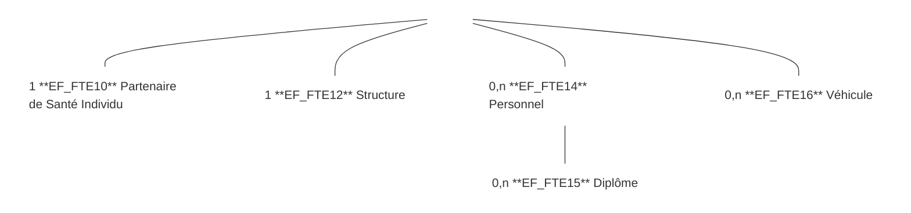
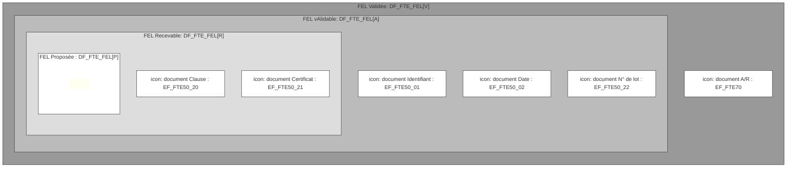

logo: sesam-vitale

logo: **FTE**

*Spécifications Fonctionnelles Générales*

# **Facturation Transporteur Etendue**
# **Taxi**

## **DICO - Dictionnaire**

Référence : FACT-SFG-029 / Version : 03.53 / Date : 09/07/2026
Diffusion : RESTREINTE
État : PROVISOIRE

VERSION DE TRAVAIL

**GIE SESAM-Vitale**
5, boulevard Marie et Alexandre Oyon – 72 019 LE MANS Cedex 2
<u>www.sesam-vitale.fr</u>

Ce document a été élaboré par le GIE SESAM-Vitale.

Conformément à l’article L.122-4 du Code de la Propriété Intellectuelle, toute représentation ou reproduction (intégrale ou partielle) du présent ouvrage, quel que soit le support utilisé, doit être soumise à l’accord préalable écrit de son auteur.

Il en est de même pour sa traduction, sa transformation, son adaptation ou son arrangement, quel que soit le procédé utilisé.

**Tout manquement à ces obligations constituerait un délit de contrefaçon, au sens des articles **L 335-2 et suivants du code de la propriété intellectuelle, susceptible d’entraîner des** sanctions pour l’auteur du délit.**

## **CONTACTS**

icon: sesam-vitale

Pour toute demande d'évolution, comme pour toute question technique ou fonctionnelle, contactez le Centre de services :

*   portail IRIS : [https://portail-support.sesam-vitale.fr/](https://portail-support.sesam-vitale.fr/)
*   téléphone : 02 43 57 42 88

VERSION DE TRAVAIL

*SFG - Facturation Transporteur Etendue - Taxi*
FACT-SFG-029 *DICO - Dictionnaire* *Version : 03.53*

# **TABLES DES MATIERES**

<table>
    <tr>
      <td><strong>1</strong></td>
      <td><strong>INTRODUCTION.........................................................................................................................................4</strong></td>
    </tr>
    <tr>
      <td>1.1</td>
      <td>OBJECTIF DU DOCUMENT .......................................................................................................................4</td>
    </tr>
    <tr>
      <td>1.2</td>
      <td>STATUT DU DOCUMENT ..........................................................................................................................4</td>
    </tr>
    <tr>
      <td>1.3</td>
      <td>POSITIONNEMENT DU DOCUMENT............................................................................................................4</td>
    </tr>
    <tr>
      <td>1.4</td>
      <td>CONTENU DU DOCUMENT .......................................................................................................................4</td>
    </tr>
    <tr>
      <td>1.5</td>
      <td>DOCUMENTS DE RÉFÉRENCE ..................................................................................................................4</td>
    </tr>
    <tr>
      <td>1.6</td>
      <td>ABRÉVIATIONS.......................................................................................................................................4</td>
    </tr>
    <tr>
      <td>1.7</td>
      <td>DÉFINITIONS..........................................................................................................................................5</td>
    </tr>
    <tr>
      <td><strong>2</strong></td>
      <td><strong>DÉFINITIONS ET ABRÉVIATIONS ...........................................................................................................6</strong></td>
    </tr>
    <tr>
      <td><strong>3</strong></td>
      <td><strong>DICTIONNAIRE DES DONNÉES.............................................................................................................11</strong></td>
    </tr>
    <tr>
      <td>3.1</td>
      <td>DF_FTE_PS : DONNÉES PS...............................................................................................................11</td>
    </tr>
    <tr>
      <td>3.2</td>
      <td>DF_FTE_BS : DONNÉES BS...............................................................................................................12</td>
    </tr>
    <tr>
      <td>3.3</td>
      <td>DF_FTE_PEL : PRESCRIPTION EN LIGNE (PEL)..................................................................................14</td>
    </tr>
    <tr>
      <td>3.4</td>
      <td>DF_FTE_FEL : FACTURE EN LIGNE (FEL)...........................................................................................17</td>
    </tr>
    <tr>
      <td>3.5</td>
      <td>DF_FTE_ADJ-FEL : DONNÉES ADJOINTES À LA FEL ...........................................................................25</td>
    </tr>
    <tr>
      <td>3.6</td>
      <td>DF_FTE_SCOR : DONNÉES SCOR POUR LE SYSTÈME FTE................................................................26</td>
    </tr>
    <tr>
      <td>3.7</td>
      <td>DF_FTE_GEN : DONNÉES GÉNÉRALES DU SYSTÈME FTE....................................................................28</td>
    </tr>
    <tr>
      <td>3.8</td>
      <td>DF_B2 : FACTURE IRIS/B2 .................................................................................................................29</td>
    </tr>
    <tr>
      <td>3.9</td>
      <td>ENTITÉS TYPE .....................................................................................................................................30</td>
    </tr>
    <tr>
      <td>3.10</td>
      <td>TB : TABLES DE VALEURS ....................................................................................................................31</td>
    </tr>
    <tr>
      <td></td>
      <td>    <i>3.10.1 Préambule ............................................................................................................................31</i></td>
    </tr>
    <tr>
      <td></td>
      <td>    <i>3.10.2 Tables de valeurs de données PEL .....................................................................................31</i></td>
    </tr>
    <tr>
      <td></td>
      <td>    <i>3.10.3 Tables de valeurs de données FEL......................................................................................32</i></td>
    </tr>
    <tr>
      <td></td>
      <td>    <i>3.10.4 Tables de valeurs des types de voie (T80_06 / T81_06) .....................................................36</i></td>
    </tr>
    <tr>
      <td></td>
      <td>    <i>3.10.5 Tables de Conditions ............................................................................................................40</i></td>
    </tr>
    <tr>
      <td><strong>4</strong></td>
      <td><strong>TABLE DE RÉFÉRENCE DES MESSAGES D’ERREURS FONCTIONNELLES ..................................40</strong></td>
    </tr>
    <tr>
      <td>4.1</td>
      <td>MESSAGES D’ERREUR POUR TX ...........................................................................................................40</td>
    </tr>
</table>

VERSION DE TRAVAIL

*09/07/2026* 3 / 40
*Ce document ne peut être diffusé sans l'autorisation d'une personne habilitée au GIE SESAM-Vitale*

icon: icon

*SFG - Facturation Transporteur Etendue - Taxi*
FACT-SFG-029 *DICO - Dictionnaire Version : 03.53*

# 1 **Introduction**

## 1.1 **Objectif du document**

Ce document a pour objet de présenter les différentes définitions et abréviations utilisées dans le cadre des spécifications du système FTE.

## 1.2 **Statut du document**

EN COURS

## 1.3 **Positionnement du document**

Ce document constitue une annexe au document de présentation générale du système FTE référencé FACT-SFG-030.

## 1.4 **Contenu du document**

Ce document contient une liste de définitions et abréviations classées par ordre alphabétique (cf. §2), ainsi que le dictionnaire des données (cf. §3) utilisées dans l’ensemble des spécifications du système FTE.

icon: warning Les formats, plages de valeurs et types des données spécifiés dans le présent document sont présentés à titre indicatif. Ils peuvent être amenés à évoluer.

## 1.5 **Documents de référence**

<table>
  <thead>
    <tr>
      <th><b>Appellation</b></th>
      <th><b>Type et titre</b></th>
      <th><b>Référence</b></th>
    </tr>
  </thead>
  <tbody>
    <tr>
      <td>[SCOR TT-TA]</td>
      <td>SCOR - TT-TA « Transmettre un flux de PJ et analyser les retours »</td>
      <td>SCOR-SFG-003</td>
    </tr>
  </tbody>
</table>

## 1.6 **Abréviations**

**Termes**

Cf. chapitre 2 du présent document.

**Format des données**

<table>
    <tr>
      <td><i><b>AN</b></i></td>
      <td>Alphanumérique</td>
      <td>Tous les caractères correspondant au type xsd :string</td>
    </tr>
    <tr>
      <td><i><b>AN1</b></i></td>
      <td>Alphanumérique restreint</td>
      <td>Tous les caractères dont la valeur ASCII est comprise entre 0x20 (espace) et 0x5E (^).</td>
    </tr>
    <tr>
      <td><i><b>B</b></i></td>
      <td>Booléen</td>
      <td>Variable à 2 états. En général Vrai/Faux ou Oui/Non</td>
    </tr>
    <tr>
      <td><i><b>D</b></i></td>
      <td>Date</td>
      <td>Formats D (Date) de type AAAA-MM-JJ. Le format D est conforme à la définition standard de la norme XML schémas d'une date grégorienne et accepte les dates comprises entre 0001-01-01 et 9999-12-31.</td>
    </tr>
</table>

VERSION DE TRAVAIL

*09/07/2026* 4 / 40
*Ce document ne peut être diffusé sans l'autorisation d'une personne habilitée au GIE SESAM-Vitale*

icon: GIE SESAM-Vitale logo

*FACT-SFG-029*
*SFG - Facturation Transporteur Etendue - Taxi*
*DICO - Dictionnaire*
*Version : 03.53*

<table>
    <tr>
      <td><i>DL</i></td>
      <td>Date Lunaire</td>
      <td>Une date peut être lunaire (format DL) avec un mois supérieur à 12 et un jour supérieur à 31.  Le format Date Lunaire (DL) est un format date spécifique : format de type AAAA-MM-JJ, il autorise des valeurs de MM > 12 et des valeurs de JJ > 31.</td>
    </tr>
    <tr>
      <td><i>H</i></td>
      <td>Hexadécimaux</td>
      <td>Chaîne de caractères hexadécimaux (16 symboles, en général 0 à 9 pour les dix premiers chiffres et les lettres A à F pour les six suivants).</td>
    </tr>
    <tr>
      <td><i>N</i></td>
      <td>Numérique</td>
      <td>Tous les chiffres de 0 à 9.</td>
    </tr>
    <tr>
      <td><i>ND</i></td>
      <td>Nombre décimal</td>
      <td>Le format ND est conforme à la définition de la norme XML schémas xsd:decimal (avec utilisation du point comme séparateur).  Exemple : «999. 50» «+999.54 50», «-999.52 30», « 14», etc</td>
    </tr>
    <tr>
      <td><i>S</i></td>
      <td>Statut</td>
      <td>Donnée pouvant prendre plusieurs états successifs. Chaque état est caractérisé par une valeur prédéfinie.</td>
    </tr>
    <tr>
      <td><i>T</i></td>
      <td>Time</td>
      <td>Le format T est de type hh:mm:ss±hh:mm. (ISO 8601, Local time, Extended format).  +hh:mm/-hh:mm : Décalage par rapport à l'heure UTC.  Exemple : 15:27:46+01:00 ou "+01:00" représente le décalage par rapport à l'heure UTC  En l’absence de consigne spécifique, l’heure est exprimée en heure locale avec décalage horaire UTC.</td>
    </tr>
</table>

## **1.7**          **Définitions**

Cf. chapitre 2 du présent document.

VERSION DE TRAVAIL

*09/07/2026*
*5 / 40*
*Ce document ne peut être diffusé sans l'autorisation d'une personne habilitée au GIE SESAM-Vitale*

icon: SESAM-Vitale logo

*FACT-SFG-029*
*SFG - Facturation Transporteur Etendue - Taxi*
*DICO - Dictionnaire*
*Version : 03.53*

## **2 Définitions et Abréviations**

<table>
  <thead>
    <tr>
      <th><b>Terme</b></th>
      <th><b>Définition</b></th>
    </tr>
  </thead>
  <tbody>
    <tr>
      <td>AC</td>
      <td>Autorité de Certification.</td>
    </tr>
    <tr>
      <td>Accident de Droit Commun</td>
      <td>La notion d’accident de droit commun est utilisée pour :  les accidents de circulation, mais aussi les accidents dans lesquels la responsabilité d'un tiers, quel qu'il soit, peut être mise en cause,  les accidents de la vie courante survenus soit à la maison, à l'école, ou sur les aires de sport ou de loisirs où la victime se blesse seule (accident domestique, accident de sport, accident scolaire, accident de loisir, jardinage, etc.),  pour les bénéficiaires de tous les régimes hormis les bénéficiaires non salariés du régime agricole.</td>
    </tr>
    <tr>
      <td>Accident de la vie privée</td>
      <td>Le terme « accident de la vie privée » est utilisé pour tous les bénéficiaires non salariés du régime agricole et est équivalent à la notion « d’accident de droit commun » pour les autres régimes.</td>
    </tr>
    <tr>
      <td>Accident DC</td>
      <td>Accident de Droit Commun.</td>
    </tr>
    <tr>
      <td><mark><del>ACS</del></mark></td>
      <td><mark><del>Aide à l'acquisition d'une Complémentaire Santé</del></mark></td>
    </tr>
    <tr>
      <td>ADELI</td>
      <td>ADELI.  Répertoire des professions médicales et paramédicales. Le numéro d’enregistrement du Professionnel de Santé sert d’identifiant vis-à-vis des régimes.</td>
    </tr>
    <tr>
      <td><mark>ADS</mark></td>
      <td><mark>Autorisation De Stationnement</mark></td>
    </tr>
    <tr>
      <td>ALD</td>
      <td>Affection Longue Durée.</td>
    </tr>
    <tr>
      <td>AMC</td>
      <td>Assurance Maladie Complémentaire (Assurance Complémentaire).  Organisme apportant un complément au remboursement de l’Assurance Maladie Obligatoire et pouvant rembourser les dépenses non prises en charge par l’AMO.  Ce peut être : - une mutuelle régie par le Code de la mutualité, - une société ou une mutuelle d’assurance régie par le Code des assurances, - une institution de prévoyance régie par le Code de la sécurité sociale.  Certains organismes d’Assurance Maladie Complémentaire traitent la part obligatoire dans le cadre d’une délégation de gestion légale ou d’une habilitation conventionnelle établie avec un AMO.</td>
    </tr>
    <tr>
      <td>AME</td>
      <td>Aide Médicale d’Etat.</td>
    </tr>
    <tr>
      <td>AMO</td>
      <td>Assurance Maladie Obligatoire (Assurance Obligatoire).  Ensemble des régimes assurant le paiement de la part obligatoire du remboursement relatif à des dépenses maladie : - le régime général, - le régime agricole, <mark><s><u>- le régime des professions indépendantes,</u></s></mark> - les régimes spéciaux.  Certains organismes d’Assurance Maladie Obligatoire traitent la part complémentaire dans le cadre d’une convention de gestion entre AMO et AMC.</td>
    </tr>
    <tr>
      <td>ANS</td>
      <td>Agence du Numérique en Santé.</td>
    </tr>
    <tr>
      <td>ARL</td>
      <td>Accusé de Réception Logique.</td>
    </tr>
  </tbody>
</table>

*09/07/2026*
*6 / 40*
*Ce document ne peut être diffusé sans l'autorisation d'une personne habilitée au GIE SESAM-Vitale*

icon: GIE SESAM-Vitale logo

*SFG - Facturation Transporteur Etendue - Taxi*
*FACT-SFG-029* *DICO - Dictionnaire* *Version : 03.53*

<table>
    <tr>
      <td>Assuré (social)</td>
      <td>Personne titulaire d’un droit au regard de la protection sociale.</td>
    </tr>
    <tr>
      <td>AT</td>
      <td>Accident du Travail.</td>
    </tr>
    <tr>
      <td>Ayant droit</td>
      <td>Personne rattachée à un assuré bénéficiant des droits aux prestations de l’Assurance Maladie.</td>
    </tr>
    <tr>
      <td>B2</td>
      <td>Norme d’échange de factures entre Partenaires de Santé et Organisme d’Assurance Maladie.</td>
    </tr>
    <tr>
      <td>BAL</td>
      <td>Boîte aux lettres électronique.</td>
    </tr>
    <tr>
      <td>Bénéficiaire</td>
      <td>Personne bénéficiant d’une protection sociale (assuré social ou ayant droit).</td>
    </tr>
    <tr>
      <td>Caisse de rattachement</td>
      <td>Subdivision administrative des régimes. Elle peut être nationale, régionale, départementale ou locale.</td>
    </tr>
    <tr>
      <td>C2S</td>
      <td>Complémentaire Santé Solidaire <mark>(remplace la CMU-C depuis le 01/11/2019)</mark></td>
    </tr>
    <tr>
      <td>CAMIEG</td>
      <td>Caisse d'Assurance Maladie des Industries Electriques et Gazières.</td>
    </tr>
    <tr>
      <td>CANSSM</td>
      <td>Caisse Autonome Nationale de Sécurité Sociale dans les Mines.</td>
    </tr>
    <tr>
      <td>Carte Professionnel de Santé</td>
      <td>Terme générique désignant une carte sans distinction de son type (CPS, CDE, CPE).</td>
    </tr>
    <tr>
      <td>CAVIMAC</td>
      <td>Caisse d’Assurance Vieillesse, Invalidité et Maladie des Cultes.</td>
    </tr>
    <tr>
      <td>CCMSA</td>
      <td>Caisse Centrale de la Mutualité Sociale Agricole.</td>
    </tr>
    <tr>
      <td>CDE</td>
      <td>Carte de Directeur d’Etablissement (famille CPS).</td>
    </tr>
    <tr>
      <td>CMU</td>
      <td>Couverture Maladie Universelle.</td>
    </tr>
    <tr>
      <td><mark><s>CMU-C</s></mark></td>
      <td><mark><s>Couverture Maladie Universelle Complémentaire.</s></mark> 
        <mark><s>Conformément aux dispositions législatives (loi n° 99-641), la Couverture Maladie Universelle (CMU) permet d’offrir aux personnes dont les revenus sont inférieurs à un seuil déterminé par décret, une protection complémentaire sans contrepartie contributive, pendant un an renouvelable. A ce titre, la personne bénéficie en particulier de la dispense d’avance des frais.</s></mark> 
        <mark><s>Cette prestation complémentaire peut être servie à l’assuré soit par sa caisse d’Assurance Maladie Obligatoire, soit par une Assurance Maladie Complémentaire de son choix référencée sur une liste disponible auprès de sa caisse de rattachement.</s></mark></td>
    </tr>
    <tr>
      <td>Cnam</td>
      <td>Caisse Nationale de l’Assurance Maladie.</td>
    </tr>
    <tr>
      <td>CNDA</td>
      <td>Centre National de Dépôt et d’Agrément. 
        Centre de l’Assurance Maladie ayant pour missions l’agrément SESAM-Vitale et la certification des LPS.</td>
    </tr>
    <tr>
      <td><mark><s>CNDSSTI</s></mark></td>
      <td><mark><s>Caisse Nationale Déléguée pour la Sécurité Sociale des Travailleurs Indépendants</s></mark></td>
    </tr>
    <tr>
      <td>CNIL</td>
      <td>Commission Nationale de l’Informatique et des Libertés.</td>
    </tr>
    <tr>
      <td>CNMSS</td>
      <td>Caisse Nationale Militaire de Sécurité Sociale.</td>
    </tr>
    <tr>
      <td>CPAM</td>
      <td>Caisse Primaire d’Assurance Maladie.</td>
    </tr>
    <tr>
      <td>CPE</td>
      <td>Carte de Personnel d’Etablissement.</td>
    </tr>
    <tr>
      <td>CPRPSNCF</td>
      <td>Caisse de Prévoyance et de Retraite du Personnel de la SNCF.</td>
    </tr>
    <tr>
      <td>CPS</td>
      <td>Carte du Professionnel de Santé. 
        Carte à microprocesseur d’identification et d’habilitation du Professionnel de Santé développée par l’ANS.</td>
    </tr>
    <tr>
      <td>DAM</td>
      <td>Domaine de l’Assurance Maladie sur la Carte du Professionnel de Santé. 
        Les cartes PS des Transporteurs ne disposent pas de DAM.</td>
    </tr>
</table>

VERSION DE TRAVAIL

*09/07/2026* *7 / 40*
*Ce document ne peut être diffusé sans l'autorisation d'une personne habilitée au GIE SESAM-Vitale*

icon: GIE SESAM-Vitale logo

*FACT-SFG-029*
*SFG - Facturation Transporteur Etendue - Taxi*
*DICO - Dictionnaire*
*Version : 03.53*

<table>
    <tr>
      <td>DAP</td>
      <td>Demande d’Accord Préalable</td>
    </tr>
    <tr>
      <td>Entente préalable (Accord préalable)</td>
      <td>Procédure d’autorisation préalable (sauf urgence) à certains actes ou traitements, délivrée par l’Assurance Maladie Obligatoire, et subordonnant leur prise en charge par celle-ci.  L’entente préalable équivaut à accord préalable.</td>
    </tr>
    <tr>
      <td>ETM</td>
      <td>Exonération du Ticket Modérateur.</td>
    </tr>
    <tr>
      <td>Facturation</td>
      <td>On utilise le terme facturation pour désigner le processus de demande de remboursement du Professionnel de Santé à l’Assurance Maladie.</td>
    </tr>
    <tr>
      <td>FAT</td>
      <td>Feuillet Accident du Travail.</td>
    </tr>
    <tr>
      <td>FE</td>
      <td>Facture Electronique (Facture B2 ou FEL).</td>
    </tr>
    <tr>
      <td>FEL</td>
      <td>Facture En Ligne.</td>
    </tr>
    <tr>
      <td>FINESS</td>
      <td>Fichier National des Établissements Sanitaires et Sociaux</td>
    </tr>
    <tr>
      <td>FTE</td>
      <td>Facturation Transporteurs Etendue.</td>
    </tr>
    <tr>
      <td>Gestion Unique</td>
      <td>Les organismes gérant à la fois les parts obligatoire et complémentaire pour un assuré sont appelés dans ce document organismes en mode de gestion unique (GU).</td>
    </tr>
    <tr>
      <td>Gestion Séparée</td>
      <td>Les organismes gérant la part complémentaire et ne gérant pas la part obligatoire pour un assuré sont appelés dans ce document organismes en mode de gestion séparée (GS).</td>
    </tr>
    <tr>
      <td>G.I.E. SESAM-Vitale</td>
      <td>Groupement d’Intérêt Economique SESAM-Vitale.  Créé en 1993, il a pour missions l’étude, la réalisation, la mise en œuvre et la normalisation du programme SESAM-Vitale.  Membres fondateurs : Cnam, CCMSA, CANAM, UNRS.  Membres associés : GAMEX, CAVIMAC, MFP.  Membres à voix consultative au Comité Directeur : le ministère du Travail et des Affaires sociales, le CNPS.</td>
    </tr>
    <tr>
      <td>GAMEX</td>
      <td>Groupement d’Assurance Maladie des Exploitants Agricoles. Il appartient au régime Agricole.</td>
    </tr>
    <tr>
      <td>Hors tiers payant</td>
      <td>Montant payé au Professionnel de Santé par le bénéficiaire.</td>
    </tr>
    <tr>
      <td><mark>KM</mark></td>
      <td><mark>Kilomètre</mark></td>
    </tr>
    <tr>
      <td>LPS</td>
      <td>Logiciel du Partenaire de Santé.</td>
    </tr>
    <tr>
      <td>MFGAM</td>
      <td>Mutuelle de Fonctionnaires pour la Gestion de l’Assurance Maladie.  Mutuelle regroupant les régimes MGEN, MG, MGP, MFP, MNH, MNAM et MNT.</td>
    </tr>
    <tr>
      <td>MFP</td>
      <td>Mutualité de la Fonction Publique.</td>
    </tr>
    <tr>
      <td>MG</td>
      <td>Mutuelle Générale.</td>
    </tr>
    <tr>
      <td>MGAT</td>
      <td>Mutuelle Générale des Agents Territoriaux.</td>
    </tr>
    <tr>
      <td>MGEN</td>
      <td>Mutuelle Générale de l’Education Nationale.</td>
    </tr>
    <tr>
      <td>MGP</td>
      <td>Mutuelle Générale de la Police.</td>
    </tr>
    <tr>
      <td>Migrants de passage</td>
      <td>Il s’agit de ressortissants étrangers pris en charge par le régime général pendant un séjour temporaire et uniquement dans le cas où il existe une convention bilatérale entre la France et le pays d’origine.</td>
    </tr>
    <tr>
      <td>MNAM</td>
      <td>Mutuelle Nationale Aviation Marine.</td>
    </tr>
    <tr>
      <td>MNH</td>
      <td>Mutuelle Nationale des Hospitaliers.</td>
    </tr>
    <tr>
      <td>MNT</td>
      <td>Mutuelle Nationale Territoriale.</td>
    </tr>
</table>

VERSION DE TRAVAIL

*09/07/2026*
*8 / 40*
*Ce document ne peut être diffusé sans l'autorisation d'une personne habilitée au GIE SESAM-Vitale*

icon: three blue dots

*FACT-SFG-029*
*SFG - Facturation Transporteur Etendue - Taxi*
*DICO - Dictionnaire*
*Version : 03.53*

# *SFG - Facturation Transporteur Etendue - Taxi*
## *DICO - Dictionnaire*

<table>
    <tr>
      <td>MP</td>
      <td>Maladie Professionnelle</td>
    </tr>
    <tr>
      <td>MRO</td>
      <td>Part prise en charge par le régime obligatoire.</td>
    </tr>
    <tr>
      <td>MSA</td>
      <td>Mutualité Sociale Agricole.</td>
    </tr>
    <tr>
      <td>MUTAME</td>
      <td>MUTuelle des Agents territoriaux et des Membres Extérieurs.</td>
    </tr>
    <tr>
      <td>NIR</td>
      <td>Numéro d’Inscription au Répertoire.</td>
    </tr>
    <tr>
      <td>NOEMIE</td>
      <td>Norme Ouverte d’Echange pour la Maladie avec les Intervenants Extérieurs.  Norme d’échange utilisée pour transmettre les flux retour du centre informatique AMO vers le partenaire de santé ; ces échanges se font aussi avec les AMC (télétransmission du double magnétique des décomptes).</td>
    </tr>
    <tr>
      <td>OCT</td>
      <td>Organisme Concentrateur Technique  Organisme se chargeant de centraliser, pour le compte des Professionnels de Santé, la télétransmission des échanges avec les organismes d’Assurance Maladie.</td>
    </tr>
    <tr>
      <td>Ouvrant Droit</td>
      <td>Assuré</td>
    </tr>
    <tr>
      <td>PEL</td>
      <td>Prescription En Ligne.</td>
    </tr>
    <tr>
      <td>PJ</td>
      <td>Pièces Justificatives.</td>
    </tr>
    <tr>
      <td>PP</td>
      <td>Prescription Papier.</td>
    </tr>
    <tr>
      <td>Prescription</td>
      <td>Acte qui permet la délivrance d'un traitement, l'exécution d'actes ou l'exécution de transports.</td>
    </tr>
    <tr>
      <td>Prise en charge</td>
      <td>Prise en charge au titre de l’assurance obligatoire : accord de prise en charge délivré par l’organisme de base faisant généralement suite à une demande d’entente préalable ou à un devis.</td>
    </tr>
    <tr>
      <td>PS</td>
      <td>Partenaire de Santé.</td>
    </tr>
    <tr>
      <td>PS émetteur</td>
      <td>Partenaire de Santé à l’origine de l’envoi de la FEL.</td>
    </tr>
    <tr>
      <td>PS exécutant</td>
      <td>On entend dans l’ensemble du système de Facturation par PS exécutant, le Partenaire de santé qui exécute la prestation de soins. Il ne s’agit pas nécessairement du Partenaire de santé réalisant la facture (cas d’un PS employeur et de l’exécutant salarié).</td>
    </tr>
    <tr>
      <td>PS facturant</td>
      <td>On entend dans l’ensemble du système de Facturation par PS facturant, le Partenaire de santé qui réalise la facture. Il ne s’agit pas nécessairement du Partenaire de santé exécutant la prestation de soins. (cas d’un PS employeur et de l’exécutant salarié)</td>
    </tr>
    <tr>
      <td>PT</td>
      <td>Prestation.</td>
    </tr>
    <tr>
      <td><mark>RAC</mark></td>
      <td><mark>Reste à charge (de l’assuré)</mark></td>
    </tr>
    <tr>
      <td>RG</td>
      <td>Régime Général.</td>
    </tr>
    <tr>
      <td>RNT</td>
      <td>Répertoire National Transporteur.</td>
    </tr>
    <tr>
      <td><s><mark>RSI</mark></s></td>
      <td><s><mark>Régime des Salariés Indépendant (remplacé par CNDSSTI)</mark></s></td>
    </tr>
    <tr>
      <td>RSP</td>
      <td>Rejet/Signalement/Paiement :  Flux émis par les centres de traitement ou de liquidation des prestations des AMO. Ils signalent au Partenaire de Santé le résultat de la liquidation (paiement, rejet) de ses factures.</td>
    </tr>
    <tr>
      <td>SCOR</td>
      <td>SCannérisation des Ordonnances.</td>
    </tr>
    <tr>
      <td>SFG</td>
      <td>Spécifications Fonctionnelles Générales.</td>
    </tr>
    <tr>
      <td>SIREN</td>
      <td>Système d'Identification du Répertoire des ENtreprises  Numéro d’identification d’une entreprise</td>
    </tr>
    <tr>
      <td>SIRET</td>
      <td>Système d'Identification du Répertoire des ETablissements</td>
    </tr>
</table>

VERSION DE TRAVAIL

*09/07/2026*
9 / 40
*Ce document ne peut être diffusé sans l'autorisation d'une personne habilitée au GIE SESAM-Vitale*

icon: SESAM-Vitale logo

*FACT-SFG-029* *SFG - Facturation Transporteur Etendue - Taxi*
*DICO - Dictionnaire* *Version : 03.53*

<table>
    <tr>
      <td></td>
      <td>Numéro d’identification professionnelle de l’établissement.</td>
    </tr>
    <tr>
      <td>Situation conventionnelle</td>
      <td>Nature de la convention liant le Professionnel de Santé et l’Assurance Maladie.</td>
    </tr>
    <tr>
      <td>SLM</td>
      <td>Section Locale Mutualiste.</td>
    </tr>
    <tr>
      <td>SMG</td>
      <td>Soins Médicaux Gratuits.</td>
    </tr>
    <tr>
      <td><mark><s>Sortant de CMU-C</s></mark></td>
      <td><mark><s>La loi CMU (loi n°99-641 du 27/07/1999) prévoit au I de l’article 23 :</s></mark> 
        <mark><s>« Après l’article 6 de la loi n°89-1009 du 31 décembre 1989 renforçant les garanties offertes aux personnes assurées contre certains risques, il est inséré un article 6-1 ainsi rédigé :</s></mark> 
        <mark><s>A l’expiration de son droit aux prestations définies à l’article L. 861-3 du code de la sécurité sociale, toute personne ayant bénéficié de la prise en charge prévue au b de l’article L. 861-4 de ce code reçoit de l’organisme auprès duquel elle bénéficiait de cette prise en charge la proposition de prolonger son adhésion ou son contrat pour une période d’un an, avec les mêmes prestations et pour un tarif n’excédant pas un montant fixé par arrêté ».</s></mark></td>
    </tr>
    <tr>
      <td>TAP</td>
      <td>Transport Assis Professionnalisé</td>
    </tr>
    <tr>
      <td>Ticket modérateur</td>
      <td>Différence entre le tarif servant de base au remboursement de l’AMO et le montant du remboursement par l’AMO (n’équivaut pas aux dépenses restant à charge, notamment en cas de dépassements d’honoraires).</td>
    </tr>
    <tr>
      <td>Tiers payant (TP)</td>
      <td>Processus permettant la dispense d’avance des frais pour les parts obligatoire et/ou complémentaire.</td>
    </tr>
    <tr>
      <td>TM</td>
      <td>Ticket modérateur.</td>
    </tr>
    <tr>
      <td><mark>TOD</mark></td>
      <td><mark>Table des Organismes Destinataires</mark></td>
    </tr>
    <tr>
      <td>TPMR ou TMR</td>
      <td>Transport de personnes à mobilité réduite</td>
    </tr>
    <tr>
      <td>TR</td>
      <td>Transporteur (Transporteur sanitaire ou Taxi)</td>
    </tr>
    <tr>
      <td>Trajet</td>
      <td>Élément le plus petit d’un transport 
        <mark><u>Aller ou retour, en charge (= pas à vide)</u></mark> 
        Correspond à la notion de prestation dans la PEL et dans la FEL.</td>
    </tr>
    <tr>
      <td>TS</td>
      <td>Transporteur Sanitaire.</td>
    </tr>
    <tr>
      <td>TX</td>
      <td>Taxi</td>
    </tr>
    <tr>
      <td>UNCAM</td>
      <td>Union Nationale des Caisses d’Assurance Maladie.</td>
    </tr>
    <tr>
      <td>UNRS</td>
      <td>Union Nationale des Régimes Spéciaux. 
        Composée de : 
        - Caisses de Prévoyance et de Retraite du Personnel de la SNCF 
        - Unité Décentralisée de Protection Sociale de la RATP 
        - Etablissement National des Invalides de la Marine 
        - Caisse Autonome de Sécurité Sociale dans les Mines 
        - Caisse Nationale Militaire de Sécurité Sociale 
        - Caisse de Retraite et de Prévoyance des Clercs et Employés de Notaire 
        - Caisse Autonome de la Chambre de Commerce et d’Industrie de Paris 
        - Caisse Autonome de Sécurité Sociale de l’Assemblée Nationale 
        - Caisse de Prévoyance du Port Autonome de Bordeaux 
        - Caisses Autonomes de Sécurité Sociale du Sénat 
        - Caisse d’Assurance Vieillesse, Invalidité et Maladie des Cultes.</td>
    </tr>
</table>

VERSION DE TRAVAIL

*09/07/2026* *10 / 40*
*Ce document ne peut être diffusé sans l'autorisation d'une personne habilitée au GIE SESAM-Vitale*

icon: dots

*SFG - Facturation Transporteur Etendue - Taxi*
FACT-SFG-029 *DICO - Dictionnaire* *Version : 03.53*

# **3 Dictionnaire des données**

## **3.1 DF_FTE_PS : Données PS**

**Schéma des**
**données PS**

**Données PS**

<table>
  <thead>
    <tr>
      <th><b>Référence</b></th>
      <th><b>Libellé</b></th>
      <th><b>Type</b></th>
      <th><b>Format / Valeurs</b></th>
    </tr>
  </thead>
  <tbody>
    <tr>
      <td>EF_FTE10</td>
      <td>Partenaire de Santé Individu</td>
      <td></td>
      <td>2 occurrences : • <i>[transporteur]</i> • <i>[prescripteur]</i></td>
    </tr>
    <tr>
      <td><b><i>01</i></b></td>
      <td>Identifiant A.M. du PS</td>
      <td>N</td>
      <td>9 caractères</td>
    </tr>
    <tr>
      <td><b><i>02</i></b></td>
      <td>Identifiant RPPS du PS</td>
      <td>N</td>
      <td>11 caractères</td>
    </tr>
    <tr>
      <td><b><i>03</i></b></td>
      <td>Nom de famille du PS</td>
      <td>AN</td>
      <td>---</td>
    </tr>
    <tr>
      <td><b><i>04</i></b></td>
      <td>Prénom du PS</td>
      <td>AN</td>
      <td>---</td>
    </tr>
    <tr>
      <td><b><i>05</i></b></td>
      <td>Code spécialité du PS</td>
      <td>N</td>
      <td></td>
    </tr>
    <tr>
      <td>EF_FTE12</td>
      <td>Structure</td>
      <td></td>
      <td></td>
    </tr>
    <tr>
      <td><b><i>01</i></b></td>
      <td>Identifiant de l’établissement de soins</td>
      <td>AN</td>
      <td>9 caractères</td>
    </tr>
    <tr>
      <td><b><i>02</i></b></td>
      <td>Code spécialité PS exerçant dans l’établissement de soins</td>
      <td>N</td>
      <td>[01...80]</td>
    </tr>
    <tr>
      <td><b><i>03</i></b></td>
      <td>Raison sociale de l’établissement de soins</td>
      <td>AN</td>
      <td>Maximum 164 caractères</td>
    </tr>
    <tr>
      <td><b><i>80</i></b></td>
      <td>Adresse de l’établissement de soins</td>
      <td>ADR=E80</td>
      <td>---</td>
    </tr>
    <tr>
      <td>EF_FTE14</td>
      <td>Personnel</td>
      <td></td>
      <td></td>
    </tr>
    <tr>
      <td><b><i>01</i></b></td>
      <td>Nom</td>
      <td>AN</td>
      <td>---</td>
    </tr>
    <tr>
      <td><b><i>02</i></b></td>
      <td>Prénom</td>
      <td>AN</td>
      <td>---</td>
    </tr>
    <tr>
      <td><b><i>03</i></b></td>
      <td>Date d’entrée</td>
      <td>D</td>
      <td>---</td>
    </tr>
    <tr>
      <td><b><i>04</i></b></td>
      <td>Date de sortie</td>
      <td>D</td>
      <td>---</td>
    </tr>
    <tr>
      <td>EF_FTE15</td>
      <td>Diplôme</td>
      <td></td>
      <td></td>
    </tr>
    <tr>
      <td><b><i>01</i></b></td>
      <td>Nature du diplôme</td>
      <td>AN</td>
      <td></td>
    </tr>
    <tr>
      <td><b><i>02</i></b></td>
      <td>Date d’obtention du diplôme</td>
      <td>D</td>
      <td>---</td>
    </tr>
    <tr>
      <td>EF_FTE16</td>
      <td>Véhicule</td>
      <td></td>
      <td></td>
    </tr>
    <tr>
      <td><b><i>01</i></b></td>
      <td>N° d’immatriculation du véhicule</td>
      <td>AN1</td>
      <td>---</td>
    </tr>
    <tr>
      <td><b><i>02</i></b></td>
      <td>Date d’autorisation du véhicule</td>
      <td>D</td>
      <td>---</td>
    </tr>
    <tr>
      <td><b><i>03</i></b></td>
      <td>Date de sortie du parc du véhicule</td>
      <td>D</td>
      <td>---</td>
    </tr>
  </tbody>
</table>

*09/07/2026* 11 / 40
*Ce document ne peut être diffusé sans l'autorisation d'une personne habilitée au GIE SESAM-Vitale*

icon: SESAM-Vitale logo

*SFG - Facturation Transporteur Etendue - Taxi*
*FACT-SFG-029* *DICO - Dictionnaire* *Version : 03.53*

# **3.2** **DF_FTE_BS : Données BS**

## **Schéma des données BS**

- 1 **EF_FTE20** Bénéficiaire
    - 1 **EF_FTE21** Assuré
    - 1 **EF_FTE22** Couverture
    - 1 **EF_FTE28** Contexte de prise en charge d’une prescription
    - n **EF_FTE29** Prise en charge d’une prestation d’une prescription

## **Données BS**

<table>
  <thead>
    <tr>
      <th><b>Référence</b></th>
      <th><b>Libellé</b></th>
      <th><b>Type</b></th>
      <th><b>Format / Valeurs</b></th>
    </tr>
  </thead>
  <tbody>
    <tr>
      <td>EF_FTE20</td>
      <td>Bénéficiaire</td>
      <td></td>
      <td></td>
    </tr>
    <tr>
      <td><b><i>01</i></b></td>
      <td>Nom de famille</td>
      <td>AN1</td>
      <td>Maximum 80 caractères</td>
    </tr>
    <tr>
      <td><b><i>02</i></b></td>
      <td>Nom d’usage</td>
      <td>AN1</td>
      <td>Maximum 80 caractères</td>
    </tr>
    <tr>
      <td><b><i>03</i></b></td>
      <td>Prénom</td>
      <td>AN1</td>
      <td>Maximum 54 caractères</td>
    </tr>
    <tr>
      <td><b><i>04</i></b></td>
      <td>Date de naissance</td>
      <td>DL</td>
      <td></td>
    </tr>
    <tr>
      <td><b><i>05</i></b></td>
      <td>Rang du bénéficiaire</td>
      <td>N</td>
      <td>1 caractère</td>
    </tr>
    <tr>
      <td>EF_FTE21</td>
      <td>Assuré</td>
      <td></td>
      <td></td>
    </tr>
    <tr>
      <td><b><i>01</i></b></td>
      <td>NIR de l’ouvrant droit</td>
      <td>AN1</td>
      <td>6N1A6N</td>
    </tr>
    <tr>
      <td><b><i>02</i></b></td>
      <td>Clé du NIR de l’ouvrant droit</td>
      <td>N</td>
      <td>2 car.</td>
    </tr>
    <tr>
      <td>EF_FTE22</td>
      <td>Couverture</td>
      <td></td>
      <td></td>
    </tr>
    <tr>
      <td><b><i>01</i></b></td>
      <td>Code régime</td>
      <td>N</td>
      <td>2 caractères</td>
    </tr>
    <tr>
      <td><b><i>02</i></b></td>
      <td>Code caisse gestionnaire</td>
      <td>N</td>
      <td>3 caractères</td>
    </tr>
    <tr>
      <td><b><i>03</i></b></td>
      <td>Code centre gestionnaire</td>
      <td>N</td>
      <td>4 caractères</td>
    </tr>
    <tr>
      <td>EF_FTE28</td>
      <td>Contexte de prise en charge d’une prescription</td>
      <td></td>
      <td></td>
    </tr>
    <tr>
      <td><b><i>01</i></b></td>
      <td>Code régime de prise en charge</td>
      <td>N</td>
      <td>2 caractères</td>
    </tr>
    <tr>
      <td><b><i>02</i></b></td>
      <td>Code caisse gestionnaire de prise en charge</td>
      <td>N</td>
      <td>3 caractères</td>
    </tr>
    <tr>
      <td><b><i>03</i></b></td>
      <td>Code centre gestionnaire de prise en charge</td>
      <td>N</td>
      <td>4 caractères</td>
    </tr>
    <tr>
      <td><b><i>04</i></b></td>
      <td>Nature d’assurance</td>
      <td>AN1</td>
      <td></td>
    </tr>
    <tr>
      <td><b><i>05</i></b></td>
      <td>Date de maternité</td>
      <td>D</td>
      <td></td>
    </tr>
    <tr>
      <td><b><i>06</i></b></td>
      <td>Rang du bénéficiaire</td>
      <td>N</td>
      <td>1 caractère</td>
    </tr>
    <tr>
      <td><b><i>07</i></b></td>
      <td>Contrat AMO particulier</td>
      <td>AN1</td>
      <td></td>
    </tr>
    <tr>
      <td><b><i>08</i></b></td>
      <td>Indicateur de situation particulière</td>
      <td>AN</td>
      <td></td>
    </tr>
    <tr>
      <td><b><i>09</i></b></td>
      <td>TP réglementaire</td>
      <td>B</td>
      <td>O/N</td>
    </tr>
    <tr>
      <td>EF_FTE29</td>
      <td>Prise en charge d’une prestation d’une prescription</td>
      <td></td>
      <td></td>
    </tr>
  </tbody>
</table>

*09/07/2026* 12 / 40
*Ce document ne peut être diffusé sans l'autorisation d'une personne habilitée au GIE SESAM-Vitale*

icon: SESAM-Vitale logo

*SFG - Facturation Transporteur Etendue - Taxi*
FACT-SFG-029
DICO - Dictionnaire
Version : 03.53

<table>
    <tr>
      <td><strong><i>01</i></strong></td>
      <td>Date d’exécution de la prestation</td>
      <td>D</td>
      <td></td>
    </tr>
    <tr>
      <td><strong><i>02</i></strong></td>
      <td>Justificatif d’exonération</td>
      <td>AN1</td>
      <td></td>
    </tr>
    <tr>
      <td><strong><i>03</i></strong></td>
      <td>Taux applicable à la prestation</td>
      <td>N</td>
      <td>3+2</td>
    </tr>
</table>

VERSION DE TRAVAIL

09/07/2026
13 / 40
Ce document ne peut être diffusé sans l'autorisation d'une personne habilitée au GIE SESAM-Vitale

icon: SESAM-Vitale logo

FACT-SFG-029 *SFG - Facturation Transporteur Etendue - Taxi* Version : 03.53
*DICO - Dictionnaire*

# **3.3** **DF_FTE_PEL : Prescription En Ligne (PEL)**

## **Schéma de la PEL**

<table>
    <tr>
      <td rowspan="15"></td>
      <td>1</td>
      <td colspan="4"><strong>EF_FTE30</strong></td>
      <td>PEL-Données générales Prescription</td>
    </tr>
    <tr>
      <td>1</td>
      <td colspan="4"><strong>EF_FTE31</strong></td>
      <td>PEL-Données Bénéficiaire</td>
    </tr>
    <tr>
      <td rowspan="4">XOR*</td>
      <td>0,1</td>
      <td colspan="4"><strong>EF_FTE32</strong></td>
      <td>PEL-Données Prescripteur en cabinet</td>
    </tr>
    <tr>
      <td rowspan="3"></td>
      <td rowspan="2"></td>
      <td>0,1</td>
      <td colspan="2"><strong>EF_FTE33</strong></td>
      <td>PEL-Information prescripteur individu</td>
    </tr>
    <tr>
      <td colspan="5"></td>
    </tr>
    <tr>
      <td>0,1</td>
      <td colspan="4"><strong>EF_FTE35</strong></td>
      <td>PEL- Information structure d'exercice</td>
    </tr>
    <tr>
      <td rowspan="8"></td>
      <td rowspan="7"></td>
      <td rowspan="2"></td>
      <td>0,1</td>
      <td colspan="2"><strong>EF_FTE33</strong></td>
      <td>PEL-Information prescripteur individu</td>
    </tr>
    <tr>
      <td colspan="5"></td>
    </tr>
    <tr>
      <td>1</td>
      <td colspan="4"><strong>EF_FTE40</strong></td>
      <td>PEL-Éléments du transport</td>
    </tr>
    <tr>
      <td rowspan="5"></td>
      <td>0,1</td>
      <td colspan="3"><strong>EF_FTE41</strong></td>
      <td>PEL-Condition de remboursement</td>
    </tr>
    <tr>
      <td>1</td>
      <td colspan="3"><strong>EF_FTE42</strong></td>
      <td>PEL-Données prescription de transport</td>
    </tr>
    <tr>
      <td rowspan="3"></td>
      <td rowspan="3"></td>
      <td>1</td>
      <td><strong>EF_FTE43</strong></td>
      <td>PEL-Départ</td>
    </tr>
    <tr>
      <td>1</td>
      <td><strong>EF_FTE44</strong></td>
      <td>PEL-Arrivée</td>
    </tr>
    <tr>
      <td></td>
      <td>1</td>
      <td><strong>EF_FTE45</strong></td>
      <td>PEL-Contexte du transport</td>
    </tr>
    <tr>
      <td></td>
      <td></td>
      <td></td>
      <td></td>
      <td>p</td>
      <td><strong>EF_FTE46</strong></td>
      <td>PEL-Prestation</td>
    </tr>
</table>

* une entité identifiant le Prescripteur est **obligatoire** :
* soit **EF_FTE32**,
* soit **EF_FTE35**.

Un transport correspond soit à un trajet aller soit à un trajet aller/retour. (Nature du transport : EF_FTE42_01).

Une prescription, peut concerner 1 ou n transports qui correspondent à p trajets avec :

* p = n pour une prescription de transports de nature aller (EF_FTE42_01=AS)
* p = 2*n pour une prescription de transports de nature aller/retour (EF_FTE42_01=AR)

icon: green arrow

La prestation correspond toujours à l’élément le plus petit : un aller ou un retour, i.e. un trajet.

VERSION DE TRAVAIL

*09/07/2026* *14 / 40*
*Ce document ne peut être diffusé sans l'autorisation d'une personne habilitée au GIE SESAM-Vitale*

icon: decorative dots

*SFG - Facturation Transporteur Etendue - Taxi*
*FACT-SFG-029* *DICO - Dictionnaire* *Version : 03.53*

# **Données de la PEL**

<table>
  <thead>
    <tr>
      <th><b>Référence</b></th>
      <th><b>Libellé</b></th>
      <th>Type</th>
      <th><b>Format / Valeurs</b></th>
    </tr>
  </thead>
  <tbody>
    <tr>
      <td>EF_FTE30</td>
      <td><strong><b>PEL-Données générales Prescription</b></strong></td>
      <td></td>
      <td></td>
    </tr>
    <tr>
      <td><strong><em>01</em></strong></td>
      <td>Identifiant PEL</td>
      <td>AN1</td>
      <td>Maximum 14 caractères</td>
    </tr>
    <tr>
      <td><strong><em>02</em></strong></td>
      <td>Date de la PEL</td>
      <td>D</td>
      <td></td>
    </tr>
    <tr>
      <td><strong><em>03</em></strong></td>
      <td>Type de PEL</td>
      <td>AN1</td>
      <td>TRS</td>
    </tr>
    <tr>
      <td><strong><em>04</em></strong></td>
      <td>Statut de la PEL</td>
      <td>AN1</td>
      <td><strong><em>cf. TB30-04</em></strong></td>
    </tr>
    <tr>
      <td><strong><em>05</em></strong></td>
      <td>Horodatage du statut de la PEL</td>
      <td>T</td>
      <td></td>
    </tr>
    <tr>
      <td>EF_FTE31</td>
      <td><strong><b>PEL-Données Bénéficiaire</b></strong></td>
      <td>E20</td>
      <td></td>
    </tr>
    <tr>
      <td><strong><em>01</em></strong></td>
      <td>NIR de l’ouvrant droit</td>
      <td>AN1</td>
      <td>6N1A6N</td>
    </tr>
    <tr>
      <td><strong><em>02</em></strong></td>
      <td>Clé du NIR de l’ouvrant droit</td>
      <td>N</td>
      <td>2 caractères</td>
    </tr>
    <tr>
      <td><strong><em>03</em></strong></td>
      <td>Nom de famille bénéficiaire</td>
      <td>AN1</td>
      <td>Maximum 25 caractères</td>
    </tr>
    <tr>
      <td><strong><em>04</em></strong></td>
      <td>Nom d’usage bénéficiaire</td>
      <td>AN1</td>
      <td>Maximum 25 caractères</td>
    </tr>
    <tr>
      <td><strong><em>05</em></strong></td>
      <td>Prénom bénéficiaire</td>
      <td>AN1</td>
      <td>Maximum 25 caractères</td>
    </tr>
    <tr>
      <td><strong><em>06</em></strong></td>
      <td>Date naissance bénéficiaire</td>
      <td>DL</td>
      <td></td>
    </tr>
    <tr>
      <td><strong><em>07</em></strong></td>
      <td>Rang du bénéficiaire</td>
      <td>N</td>
      <td>1 caractère</td>
    </tr>
    <tr>
      <td>EF_FTE32</td>
      <td><strong><b>PEL-Données Prescripteur en cabinet</b></strong></td>
      <td>E12</td>
      <td></td>
    </tr>
    <tr>
      <td><strong><em>01</em></strong></td>
      <td>Identifiant AM prescripteur</td>
      <td>AN1</td>
      <td>9 caractères</td>
    </tr>
    <tr>
      <td><strong><em>02</em></strong></td>
      <td>Raison sociale</td>
      <td>AN1</td>
      <td>Maximum 255 caractères</td>
    </tr>
    <tr>
      <td><strong><em>80</em></strong></td>
      <td>Adresse prescripteur en cabinet</td>
      <td>T80</td>
      <td>Type PEL-Adresse : cf. Entités Type</td>
    </tr>
    <tr>
      <td>EF_FTE33</td>
      <td><strong><b>PEL-Information prescripteur individu</b></strong></td>
      <td>E10</td>
      <td></td>
    </tr>
    <tr>
      <td><strong><em>01</em></strong></td>
      <td>Numéro RPPS Prescripteur</td>
      <td>N</td>
      <td>11 caractères</td>
    </tr>
    <tr>
      <td><strong><em>02</em></strong></td>
      <td>Nom de famille Prescripteur</td>
      <td>AN</td>
      <td>Maximum 30 caractères</td>
    </tr>
    <tr>
      <td><strong><em>03</em></strong></td>
      <td>Prénom du prescripteur</td>
      <td>AN</td>
      <td>Maximum 30 caractères</td>
    </tr>
    <tr>
      <td>EF_FTE35</td>
      <td><strong><b>PEL- Information structure d'exercice</b></strong></td>
      <td></td>
      <td></td>
    </tr>
    <tr>
      <td><strong><em>01</em></strong></td>
      <td>Identifiant de la structure</td>
      <td>AN1</td>
      <td>14 caractères</td>
    </tr>
    <tr>
      <td><strong><em>02</em></strong></td>
      <td>Raison sociale</td>
      <td>AN1</td>
      <td>Maximum 255 caractères</td>
    </tr>
    <tr>
      <td><strong><em>03</em></strong></td>
      <td>Adresse structure d'exercice</td>
      <td>T80</td>
      <td><em>Type</em> PEL-Adresse : <em>cf. Entités Type</em></td>
    </tr>
    <tr>
      <td>EF_FTE40</td>
      <td><strong><b>PEL- Eléments du transport</b></strong></td>
      <td></td>
      <td></td>
    </tr>
    <tr>
      <td><strong><em>01</em></strong></td>
      <td>ID de la prestation</td>
      <td>N</td>
      <td>Maximum 18 caractères</td>
    </tr>
    <tr>
      <td><strong><em>02</em></strong></td>
      <td>Validité de la prestation</td>
      <td>AN</td>
      <td></td>
    </tr>
    <tr>
      <td>EF_FTE41</td>
      <td><strong><b>PEL-Condition de remboursement</b></strong></td>
      <td></td>
      <td></td>
    </tr>
    <tr>
      <td><strong><em>01</em></strong></td>
      <td>Taux remboursement</td>
      <td>N</td>
      <td>3+2</td>
    </tr>
    <tr>
      <td>EF_FTE42</td>
      <td><strong><b>PEL-Données prescription de transport</b></strong></td>
      <td></td>
      <td></td>
    </tr>
    <tr>
      <td><strong><em>01</em></strong></td>
      <td>Nature transport</td>
      <td>AN1</td>
      <td><strong><b>cf. TB42-01</b></strong></td>
    </tr>
    <tr>
      <td><strong><em>02</em></strong></td>
      <td>Nombre de transport</td>
      <td>N</td>
      <td>3 caractères</td>
    </tr>
    <tr>
      <td><strong><em>03</em></strong></td>
      <td>Mode transport</td>
      <td>AN1</td>
      <td><strong><b><i>cf. TB42-03</i></b></strong></td>
    </tr>
    <tr>
      <td><strong><em>04</em></strong></td>
      <td>Condition de transport</td>
      <td>AN</td>
      <td><strong><b><i>cf. TB42-04</i></b></strong></td>
    </tr>
  </tbody>
</table>

*09/07/2026* *15 / 40*
*Ce document ne peut être diffusé sans l'autorisation d'une personne habilitée au GIE SESAM-Vitale*

icon: SESAM-Vitale logo

*FACT-SFG-029*
*SFG - Facturation Transporteur Etendue - Taxi*
**DICO - Dictionnaire**
*Version : 03.53*

<table>
    <tr>
      <td>EF_FTE43</td>
      <td><strong><b>PEL-Départ</b></strong></td>
      <td></td>
      <td></td>
    </tr>
    <tr>
      <td></td>
      <td><strong><em>01</em></strong> Nature du lieu</td>
      <td>AN1</td>
      <td><strong><em>cf. TB4a-01</em></strong></td>
    </tr>
    <tr>
      <td></td>
      <td><strong><em>80</em></strong> Adresse de départ</td>
      <td>T80</td>
      <td><em>Type</em> PEL-Adresse : <em>cf. Entités Type</em></td>
    </tr>
    <tr>
      <td>EF_FTE44</td>
      <td><strong><b>PEL-Arrivée</b></strong></td>
      <td></td>
      <td></td>
    </tr>
    <tr>
      <td></td>
      <td><strong><em>01</em></strong> Nature du lieu</td>
      <td>AN1</td>
      <td><strong><em>cf. TB4a-01</em></strong></td>
    </tr>
    <tr>
      <td></td>
      <td><strong><em>80</em></strong> Adresse d’arrivée</td>
      <td>T80</td>
      <td><em>Type</em> PEL-Adresse : <em>cf. Entités Type</em></td>
    </tr>
    <tr>
      <td>EF_FTE45</td>
      <td><strong><b>PEL-Contexte du transport</b></strong></td>
      <td></td>
      <td></td>
    </tr>
    <tr>
      <td></td>
      <td><strong><em>01</em></strong> Motif du transport</td>
      <td>AN1</td>
      <td><strong><em>cf. TB45-01</em></strong></td>
    </tr>
    <tr>
      <td></td>
      <td><strong><em>02</em></strong> Date ATMP</td>
      <td>D</td>
      <td></td>
    </tr>
    <tr>
      <td></td>
      <td><strong><em>03</em></strong> Exonération</td>
      <td>B</td>
      <td></td>
    </tr>
    <tr>
      <td></td>
      <td><strong><em>04</em></strong> Indicateur accident DC</td>
      <td>B</td>
      <td></td>
    </tr>
    <tr>
      <td></td>
      <td><strong><em>05</em></strong> Date accident DC</td>
      <td>D</td>
      <td></td>
    </tr>
    <tr>
      <td></td>
      <td><strong><em>06</em></strong> ALD exonérante</td>
      <td>B</td>
      <td></td>
    </tr>
    <tr>
      <td></td>
      <td><strong><em>07</em></strong> Forçage</td>
      <td>AN1</td>
      <td><strong><em>cf. TB45-07</em></strong></td>
    </tr>
    <tr>
      <td>EF_FTE46</td>
      <td><strong><b>PEL-Prestation</b></strong></td>
      <td></td>
      <td></td>
    </tr>
    <tr>
      <td></td>
      <td><strong><em>01</em></strong> Identifiant de la prestation</td>
      <td>N</td>
      <td>18 chiffres max</td>
    </tr>
    <tr>
      <td></td>
      <td><strong><em>02</em></strong> Nature de la prestation</td>
      <td>AN1</td>
      <td><em>Correspond au type de trajet : aller, retour…</em> <strong><em>cf. TB46-02</em></strong></td>
    </tr>
    <tr>
      <td></td>
      <td><strong><em>03</em></strong> Statut de la prestation</td>
      <td>AN1</td>
      <td><strong><em>cf. TB46-03</em></strong></td>
    </tr>
    <tr>
      <td></td>
      <td><strong><em>04</em></strong> Horodatage du statut de la prestation</td>
      <td>T</td>
      <td></td>
    </tr>
    <tr>
      <td></td>
      <td><strong><em>05</em></strong> Indicateur de la prestation</td>
      <td>B</td>
      <td></td>
    </tr>
</table>

VERSION DE TRAVAIL

*09/07/2026*
16 / 40
*Ce document ne peut être diffusé sans l'autorisation d'une personne habilitée au GIE SESAM-Vitale*

icon: SESAM-Vitale logo

*SFG - Facturation Transporteur Etendue - Taxi*
*FACT-SFG-029 *DICO - Dictionnaire* Version : 03.53*

## **3.4** **DF_FTE_FEL : Facture en Ligne (FEL)**

### **Schéma de la** FEL

1 **EF_FTE50** *FEL-Facture*
1 **EF_FTE51** *FEL- PS Emetteur*
1 **EF_FTE52** *FEL- PS facturant*
1 **EF_FTE53** *FEL-PS Prescripteur*
1 **EF_FTE54** *FEL-Prescription*
1 **EF_FTE55** *FEL-Bénéficiaire*
1,2 **EF_FTE57** *FEL-Couverture*
    ┌── 1 **EF_FTE56** *FEL-Contrat*
    │
1,n ├── 1 **EF_FTE61** *FEL- PS Exécutant*
    │   1 **EF_FTE62** *FEL- Prestation*
    │   1 **EF_FTE63** *FEL- Trajet*
    │   ==0,1 **EF_FTE65** *FEL- Majoration*==
    │   0,n **EF_FTE66** *FEL-Supplément forfaitaire ==<u>et NR</u>==*
    │   0,2 **EF_FTE67** *FEL-Supplément remboursable*
    │   0,1 **EF_FTE68** *FEL-Tarif kilométrique*
    │   ==0,n **EF_FTE69** *FEL-Tarif horaire*==
    │   ==1 **EF_FTE69** *FEL-Forfait*==
    │   ==0,1 **EF_FTE79** *FEL-Remise*==
    └── 1 **EF_FTE64** *FEL- Exécution Trajet*
1 **EF_FTE70** *FEL-Accusé de Réception*

icon: icon

### Remarques

*   2 occurrences au maximum de l’entité Couverture :
    *   l’une pour la couverture de la part AMO
    *   l’autre pour la couverture de la part complémentaire
    L’occurrence AMO est obligatoire, l’occurrence AMC est facultative.
*   1 seul contrat par couverture
*   2 occurrences au maximum de l’entité Supplément remboursable
    *   une pour les suppléments de type « Péage »
    *   <mark><u>•</u> <u>une pour les suppléments de type « TPMR »</u></mark>
*   <mark>~~<u>•</u>~~ <u>Suppléments forfaitaires et non remboursables : N occurrences possibles</u></mark>
*   <mark>~~<u>•</u>~~ <u>Le PS indique pour chaque supplément non remboursable (plusieurs ~~E66~~ possibles) son type (E66_08) et son montant (E66_09)</u></mark>
*   <mark>~~<u>•</u>~~ <u>1 seule occurrence au maximum de l’entité Remise</u></mark>

VERSION DE TRAVAIL

*09/07/2026* 17 / 40
*Ce document ne peut être diffusé sans l'autorisation d'une personne habilitée au GIE SESAM-Vitale*

icon: icon

*SFG - Facturation Transporteur Etendue - Taxi*
*FACT-SFG-029* *DICO - Dictionnaire* *Version : 03.53*

Le schéma ci-après présente le contenu de la FEL en fonction de ses états (ou statut) :

icon: icon L’état A : « vAlidable » est un état intermédiaire de la FEL propre au LPS.

VERSION DE TRAVAIL

*09/07/2026* 18 / 40
*Ce document ne peut être diffusé sans l'autorisation d'une personne habilitée au GIE SESAM-Vitale*

icon: icon

*FACT-SFG-029* *SFG - Facturation Transporteur Etendue - Taxi* *Version : 03.53*
*DICO - Dictionnaire*

**Données de la**
**FEL**

<table>
  <thead>
    <tr>
      <th><b>Référence</b></th>
      <th><b>Libellé</b></th>
      <th>Type</th>
      <th>Format / Valeurs</th>
      <th>RG</th>
    </tr>
  </thead>
  <tbody>
    <tr>
      <td>EF_FTE50</td>
      <td>FEL-Facture</td>
      <td></td>
      <td></td>
      <td></td>
    </tr>
    <tr>
      <td><i><b>01</b></i></td>
      <td>Identifiant de la facture</td>
      <td>N</td>
      <td>9 caractères</td>
      <td>282</td>
    </tr>
    <tr>
      <td><i><b>02</b></i></td>
      <td>Date de la facture</td>
      <td>D</td>
      <td></td>
      <td>283</td>
    </tr>
    <tr>
      <td><i><b>06</b></i></td>
      <td>Code demande accord préalable</td>
      <td>AN1</td>
      <td></td>
      <td>224</td>
    </tr>
    <tr>
      <td><i><b>07</b></i></td>
      <td>Code accord préalable</td>
      <td>AN1</td>
      <td>1 caractère numérique. Cf. TB50-07.</td>
      <td>224</td>
    </tr>
    <tr>
      <td><i><b>08</b></i></td>
      <td>Date de l'accord préalable</td>
      <td>D</td>
      <td></td>
      <td>224</td>
    </tr>
    <tr>
      <td><i><b>09</b></i></td>
      <td>Numéro d'accord préalable</td>
      <td>AN1</td>
      <td></td>
      <td>224</td>
    </tr>
    <tr>
      <td><i><b>11</b></i></td>
      <td>Total des montants facturés</td>
      <td>ND</td>
      <td>6+2</td>
      <td><mark>770</mark></td>
    </tr>
    <tr>
      <td><i><b>12</b></i></td>
      <td>Montant total remboursable AMO</td>
      <td>ND</td>
      <td>6+2</td>
      <td><mark>770</mark></td>
    </tr>
    <tr>
      <td><i><b>13</b></i></td>
      <td>Montant total remboursable AMC</td>
      <td>ND</td>
      <td>6+2</td>
      <td><mark>770</mark></td>
    </tr>
    <tr>
      <td><i><b>14</b></i></td>
      <td>Total reste à charge</td>
      <td>ND</td>
      <td>6+2</td>
      <td><mark>770</mark></td>
    </tr>
    <tr>
      <td><i><b>15</b></i></td>
      <td><mark><s>Montant total des suppléments</s></mark></td>
      <td><mark><s>ND</s></mark></td>
      <td><mark><s>4+2</s></mark></td>
      <td><mark><s>249</s></mark></td>
    </tr>
    <tr>
      <td><i><b>17</b></i></td>
      <td><mark><s>Montant total majoration trajet court</s></mark></td>
      <td><mark><s>ND</s></mark></td>
      <td><mark><s>6+2</s></mark></td>
      <td><mark><s>249</s></mark></td>
    </tr>
    <tr>
      <td><i><b>20</b></i></td>
      <td>Clause</td>
      <td>AN</td>
      <td></td>
      <td>280</td>
    </tr>
    <tr>
      <td><i><b>21</b></i></td>
      <td>Certificat</td>
      <td>AN</td>
      <td></td>
      <td>280</td>
    </tr>
    <tr>
      <td><i><b>22</b></i></td>
      <td>N° de lot</td>
      <td>N</td>
      <td>3 caractères</td>
      <td>287</td>
    </tr>
    <tr>
      <td><i><b>30</b></i></td>
      <td><mark>Montant total des forfaits</mark></td>
      <td><mark>ND</mark></td>
      <td></td>
      <td><mark>760</mark></td>
    </tr>
    <tr>
      <td><i><b>31</b></i></td>
      <td><mark>Montant remboursable AMO des forfaits</mark></td>
      <td><mark>ND</mark></td>
      <td></td>
      <td><mark>760</mark></td>
    </tr>
    <tr>
      <td><i><b>32</b></i></td>
      <td><mark>Montant RAC assuré avant éventuel TP sur la part AMC des forfaits</mark></td>
      <td><mark>ND</mark></td>
      <td></td>
      <td><mark>760</mark></td>
    </tr>
    <tr>
      <td><i><b>33</b></i></td>
      <td><mark>Montant remboursable AMC des forfaits</mark></td>
      <td><mark>ND</mark></td>
      <td></td>
      <td><mark>760</mark></td>
    </tr>
    <tr>
      <td><i><b>34</b></i></td>
      <td><mark>Montant RAC assuré après éventuel TP sur la part AMC des forfaits</mark></td>
      <td><mark>ND</mark></td>
      <td></td>
      <td><mark>760</mark></td>
    </tr>
    <tr>
      <td><i><b>40</b></i></td>
      <td><mark>Montant total kilométrique</mark></td>
      <td><mark>ND</mark></td>
      <td></td>
      <td><mark>761</mark></td>
    </tr>
    <tr>
      <td><i><b>41</b></i></td>
      <td><mark>Montant remboursable AMO kilométrique</mark></td>
      <td><mark>ND</mark></td>
      <td></td>
      <td><mark>761</mark></td>
    </tr>
    <tr>
      <td><i><b>42</b></i></td>
      <td><mark>Montant RAC assuré avant éventuel TP sur la part AMC kilométrique</mark></td>
      <td><mark>ND</mark></td>
      <td></td>
      <td><mark>761</mark></td>
    </tr>
    <tr>
      <td><i><b>43</b></i></td>
      <td><mark>Montant remboursable AMC kilométrique</mark></td>
      <td><mark>ND</mark></td>
      <td></td>
      <td><mark>761</mark></td>
    </tr>
    <tr>
      <td><i><b>44</b></i></td>
      <td><mark>Montant RAC assuré après éventuel TP sur la part AMC kilométrique</mark></td>
      <td><mark>ND</mark></td>
      <td></td>
      <td><mark>761</mark></td>
    </tr>
    <tr>
      <td><i><b>50</b></i></td>
      <td><mark>Montant total des suppléments forfaitaires</mark></td>
      <td><mark>ND</mark></td>
      <td></td>
      <td><mark>762</mark></td>
    </tr>
    <tr>
      <td><i><b>51</b></i></td>
      <td><mark>Montant remboursable AMO des suppléments forfaitaires</mark></td>
      <td><mark>ND</mark></td>
      <td></td>
      <td><mark>762</mark></td>
    </tr>
    <tr>
      <td><i><b>52</b></i></td>
      <td><mark>Montant RAC assuré avant éventuel TP sur la part AMC des suppléments forfaitaires</mark></td>
      <td><mark>ND</mark></td>
      <td></td>
      <td><mark>762</mark></td>
    </tr>
    <tr>
      <td><i><b>53</b></i></td>
      <td><mark>Montant remboursable AMC des suppléments forfaitaires</mark></td>
      <td><mark>ND</mark></td>
      <td></td>
      <td><mark>762</mark></td>
    </tr>
  </tbody>
</table>

*09/07/2026* 19 / 40
*Ce document ne peut être diffusé sans l'autorisation d'une personne habilitée au GIE SESAM-Vitale*

icon: SESAM-Vitale logo

*SFG - Facturation Transporteur Etendue - Taxi*
*FACT-SFG-029 *DICO - Dictionnaire* Version : 03.53*

<table>
    <tr>
      <td><strong>54</strong></td>
      <td>Montant RAC assuré après éventuel TP sur la part AMC des suppléments forfaitaires</td>
      <td>ND</td>
      <td></td>
      <td>762</td>
    </tr>
    <tr>
      <td><strong>60</strong></td>
      <td>Montant total des suppléments péage</td>
      <td>ND</td>
      <td></td>
      <td>763</td>
    </tr>
    <tr>
      <td><strong>61</strong></td>
      <td>Montant remboursable AMO des suppléments péage</td>
      <td>ND</td>
      <td></td>
      <td>763</td>
    </tr>
    <tr>
      <td><strong>62</strong></td>
      <td>Montant RAC assuré avant éventuel TP sur la part AMC des suppléments péage</td>
      <td>ND</td>
      <td></td>
      <td>763</td>
    </tr>
    <tr>
      <td><strong>63</strong></td>
      <td>Montant remboursable AMC des suppléments péage</td>
      <td>ND</td>
      <td></td>
      <td>763</td>
    </tr>
    <tr>
      <td><strong>64</strong></td>
      <td>Montant RAC assuré après éventuel TP sur la part AMC des suppléments péage</td>
      <td>ND</td>
      <td></td>
      <td>763</td>
    </tr>
    <tr>
      <td><strong>70</strong></td>
      <td>Montant total des suppléments TPMR</td>
      <td>ND</td>
      <td></td>
      <td>764</td>
    </tr>
    <tr>
      <td><strong>71</strong></td>
      <td>Montant remboursable AMO des suppléments TPMR</td>
      <td>ND</td>
      <td></td>
      <td>764</td>
    </tr>
    <tr>
      <td><strong>72</strong></td>
      <td>Montant RAC assuré avant éventuel TP sur la part AMC des suppléments TPMR</td>
      <td>ND</td>
      <td></td>
      <td>764</td>
    </tr>
    <tr>
      <td><strong>73</strong></td>
      <td>Montant remboursable AMC des suppléments TPMR</td>
      <td>ND</td>
      <td></td>
      <td>764</td>
    </tr>
    <tr>
      <td><strong>74</strong></td>
      <td>Montant RAC assuré après éventuel TP sur la part AMC des suppléments TPMR</td>
      <td>ND</td>
      <td></td>
      <td>764</td>
    </tr>
    <tr>
      <td><strong>82</strong></td>
      <td>Total des montants RAC assuré avant éventuel TP sur la part AMC</td>
      <td>ND</td>
      <td></td>
      <td>770</td>
    </tr>
    <tr>
      <td>EF_FTE51</td>
      <td>FEL- PS Emetteur</td>
      <td></td>
      <td></td>
      <td></td>
    </tr>
    <tr>
      <td><strong>01</strong></td>
      <td>Identifiant émetteur</td>
      <td>AN1</td>
      <td>Maximum 14 caractères</td>
      <td>211</td>
    </tr>
    <tr>
      <td><strong>02</strong></td>
      <td>Adresse mail</td>
      <td>AN</td>
      <td>Maximum 80 caractères</td>
      <td>211</td>
    </tr>
    <tr>
      <td>EF_FTE52</td>
      <td>FEL- PS facturant</td>
      <td></td>
      <td></td>
      <td></td>
    </tr>
    <tr>
      <td><strong>01</strong></td>
      <td>Numéro AM du PS Origine</td>
      <td>N</td>
      <td>9 caractères</td>
      <td>212</td>
    </tr>
    <tr>
      <td><strong>02</strong></td>
      <td>Raison sociale</td>
      <td>AN1</td>
      <td>Maximum 164 caractères</td>
      <td>212</td>
    </tr>
    <tr>
      <td><strong>03</strong></td>
      <td>Numéro de la carte PS CPx</td>
      <td>N</td>
      <td>Maximum 20 caractères</td>
      <td>212</td>
    </tr>
    <tr>
      <td>EF_FTE53</td>
      <td>FEL-PS Prescripteur</td>
      <td></td>
      <td></td>
      <td></td>
    </tr>
    <tr>
      <td><strong>01</strong></td>
      <td>Identifiant du PS prescripteur</td>
      <td>AN1</td>
      <td>9 caractères</td>
      <td>215</td>
    </tr>
    <tr>
      <td><strong>02</strong></td>
      <td>Code spécialité du PS prescripteur</td>
      <td>N</td>
      <td>2 caractères</td>
      <td>215</td>
    </tr>
    <tr>
      <td><strong>03</strong></td>
      <td>Code condition d'exercice du PS prescripteur</td>
      <td>AN1</td>
      <td><strong><i>Cf. TB53-03</i></strong></td>
      <td>215</td>
    </tr>
    <tr>
      <td><strong>05</strong></td>
      <td>Identifiant RPPS du PS prescripteur</td>
      <td>N</td>
      <td>11 caractères</td>
      <td>215</td>
    </tr>
</table>

VERSION DE TRAVAIL

*09/07/2026* 20 / 40
*Ce document ne peut être diffusé sans l'autorisation d'une personne habilitée au GIE SESAM-Vitale*

icon: logo

*FACT-SFG-029*
*SFG - Facturation Transporteur Etendue - Taxi*
*DICO - Dictionnaire*
*Version : 03.53*

<table>
    <tr>
      <td>EF_FTE54</td>
      <td>FEL-Prescription</td>
      <td></td>
      <td></td>
      <td></td>
    </tr>
    <tr>
      <td><strong><em>01</em></strong></td>
      <td>Numéro de la prescription</td>
      <td>AN1</td>
      <td>Maximum 14 caractères</td>
      <td>215</td>
    </tr>
    <tr>
      <td><strong><em>02</em></strong></td>
      <td>Type de prescription</td>
      <td>AN1</td>
      <td><strong><em>Cf. TB54-02</em></strong></td>
      <td>215</td>
    </tr>
    <tr>
      <td><strong><em>03</em></strong></td>
      <td>Date de prescription</td>
      <td>D</td>
      <td></td>
      <td>215</td>
    </tr>
    <tr>
      <td><strong><em>04</em></strong></td>
      <td>Descriptif du transport</td>
      <td>AN1</td>
      <td><strong><em>Cf. TB54-04</em></strong></td>
      <td>215</td>
    </tr>
    <tr>
      <td><strong><em>05</em></strong></td>
      <td>Justificatif de prise en charge du transport</td>
      <td>Liste (AN1)</td>
      <td><strong><em>Cf. TB54-05</em></strong> N occurrences</td>
      <td>215</td>
    </tr>
    <tr>
      <td><strong><em>06</em></strong></td>
      <td>Indicateur prise en charge 100%</td>
      <td>B</td>
      <td></td>
      <td>215</td>
    </tr>
    <tr>
      <td><strong><em>07</em></strong></td>
      <td>Indicateur soins en rapport avec article L115</td>
      <td>B</td>
      <td></td>
      <td>215</td>
    </tr>
    <tr>
      <td>EF_FTE55</td>
      <td>FEL-Bénéficiaire</td>
      <td></td>
      <td></td>
      <td></td>
    </tr>
    <tr>
      <td><strong><em>01</em></strong></td>
      <td>N° immatriculation assuré</td>
      <td>AN1</td>
      <td>13 caractères</td>
      <td>214</td>
    </tr>
    <tr>
      <td><strong><em>02</em></strong></td>
      <td>Clé du N° immatriculation assuré</td>
      <td>N</td>
      <td>2 caractères</td>
      <td>214</td>
    </tr>
    <tr>
      <td><strong><em>03</em></strong></td>
      <td>Date de naissance du bénéficiaire</td>
      <td>DL</td>
      <td></td>
      <td>214</td>
    </tr>
    <tr>
      <td><strong><em>04</em></strong></td>
      <td>Rang du bénéficiaire</td>
      <td>N</td>
      <td>1 caractère</td>
      <td>214</td>
    </tr>
    <tr>
      <td><strong><em>05</em></strong></td>
      <td>Nom de famille du bénéficiaire</td>
      <td>AN1</td>
      <td>Maximum 80 caractères</td>
      <td>214</td>
    </tr>
    <tr>
      <td><strong><em>06</em></strong></td>
      <td>Nom d'usage du bénéficiaire</td>
      <td>AN1</td>
      <td>Maximum 80 caractères</td>
      <td>214</td>
    </tr>
    <tr>
      <td><strong><em>07</em></strong></td>
      <td>Prénom du bénéficiaire</td>
      <td>AN1</td>
      <td>Maximum 54 caractères</td>
      <td>214</td>
    </tr>
    <tr>
      <td><strong><em>08</em></strong></td>
      <td>N° immatriculation individuel</td>
      <td>AN1</td>
      <td>13 caractères</td>
      <td>214</td>
    </tr>
    <tr>
      <td><strong><em>09</em></strong></td>
      <td>Clé du N° immatriculation individuel</td>
      <td>N</td>
      <td>2 caractères</td>
      <td>214</td>
    </tr>
    <tr>
      <td>EF_FTE56</td>
      <td>FEL-Contrat</td>
      <td></td>
      <td></td>
      <td></td>
    </tr>
    <tr>
      <td><strong><em>01</em></strong></td>
      <td>Contrat</td>
      <td>AN1</td>
      <td><strong><em>cf. TB56-01_AMO</em></strong> <strong><em>et TB56-01_AMC</em></strong> <em>Cette information correspond :</em> • <em>soit au contrat AMO particulier (CONTRAT rattaché à la COUVERTURE AMO)</em> • <em>soit à l’indicateur de situation particulière (CONTRAT rattaché à la COUVERTURE AMC)</em></td>
      <td>222 223</td>
    </tr>
    <tr>
      <td><strong><em>02</em></strong></td>
      <td>N° d’adhérent</td>
      <td>N</td>
      <td>Maximum 13 caractères</td>
      <td>223</td>
    </tr>
    <tr>
      <td><strong><em>03</em></strong></td>
      <td>Numéro d'organisme complémentaire</td>
      <td>N</td>
      <td>Maximum 9 caractères</td>
      <td>223</td>
    </tr>
    <tr>
      <td><strong><em>04</em></strong></td>
      <td>Nature d'Assurance</td>
      <td>AN1</td>
      <td><strong><em>Cf. TB56-04</em></strong></td>
      <td>224</td>
    </tr>
</table>

VERSION DE TRAVAIL

*09/07/2026* 21 / 40
*Ce document ne peut être diffusé sans l'autorisation d'une personne habilitée au GIE SESAM-Vitale*

icon: SESAM-Vitale logo

*FACT-SFG-029*
*SFG - Facturation Transporteur Etendue - Taxi*
*DICO - Dictionnaire*
*Version : 03.53*

<table>
    <tr>
      <td>EF_FTE57</td>
      <td>FEL-Couverture</td>
      <td></td>
      <td></td>
      <td></td>
    </tr>
    <tr>
      <td><strong><em>01</em></strong></td>
      <td>Nature de couverture</td>
      <td>AN1</td>
      <td><strong><em>Cf. TB57-01</em></strong></td>
      <td>222 223</td>
    </tr>
    <tr>
      <td><strong><em>02</em></strong></td>
      <td>Nature pièces justificatif ouverture droits</td>
      <td>N</td>
      <td><strong><em>Cf. TB57-02</em></strong></td>
      <td>222 223</td>
    </tr>
    <tr>
      <td><strong><em>03</em></strong></td>
      <td>Tiers Payant</td>
      <td>B</td>
      <td></td>
      <td>222 223</td>
    </tr>
    <tr>
      <td><strong><em>04</em></strong></td>
      <td>Code régime</td>
      <td>N</td>
      <td>2 caractères</td>
      <td>222</td>
    </tr>
    <tr>
      <td><strong><em>05</em></strong></td>
      <td>Code caisse gestionnaire</td>
      <td>N</td>
      <td>3 caractères</td>
      <td>222</td>
    </tr>
    <tr>
      <td><strong><em>06</em></strong></td>
      <td>Code centre gestionnaire</td>
      <td>N</td>
      <td>4 caractères</td>
      <td>222</td>
    </tr>
    <tr>
      <td><strong><em>08</em></strong></td>
      <td>Date maternité</td>
      <td>D</td>
      <td></td>
      <td>224</td>
    </tr>
    <tr>
      <td><strong><em>09</em></strong></td>
      <td>Date ATMP</td>
      <td>D</td>
      <td></td>
      <td>224</td>
    </tr>
    <tr>
      <td><strong><em>10</em></strong></td>
      <td>Identifiant de l'AT</td>
      <td>AN1</td>
      <td>9 caractères</td>
      <td>224</td>
    </tr>
    <tr>
      <td><strong><em>11</em></strong></td>
      <td>Accident causé par un tiers</td>
      <td>B</td>
      <td></td>
      <td>224</td>
    </tr>
    <tr>
      <td><strong><em>12</em></strong></td>
      <td>Date accident causé par tiers</td>
      <td>D</td>
      <td></td>
      <td>224</td>
    </tr>
    <tr>
      <td>EF_FTE61</td>
      <td>FEL- PS Exécutant</td>
      <td></td>
      <td></td>
      <td></td>
    </tr>
    <tr>
      <td><strong><em>01</em></strong></td>
      <td>Identifiant AM du PS exécutant</td>
      <td>N</td>
      <td>9 caractères</td>
      <td>213</td>
    </tr>
    <tr>
      <td><strong><em>02</em></strong></td>
      <td>Identifiant RPPS du PS exécutant</td>
      <td>N</td>
      <td>11 caractères</td>
      <td>213</td>
    </tr>
    <tr>
      <td><strong><em>03</em></strong></td>
      <td>Spécialité du PS exécutant</td>
      <td>N</td>
      <td>2 caractères</td>
      <td>213</td>
    </tr>
    <tr>
      <td>EF_FTE62</td>
      <td>FEL- Prestation</td>
      <td></td>
      <td></td>
      <td></td>
    </tr>
    <tr>
      <td><strong><em>01</em></strong></td>
      <td>Id prestation</td>
      <td>AN1</td>
      <td>Maximum 25 caractères</td>
      <td>217</td>
    </tr>
    <tr>
      <td><strong><em>02</em></strong></td>
      <td>Nature de prestation</td>
      <td>AN1</td>
      <td><strong><em>Cf. TB62-02</em></strong></td>
      <td>217</td>
    </tr>
    <tr>
      <td><strong><em><mark>03</mark></em></strong></td>
      <td><mark><s>Montant du forfait</s></mark></td>
      <td><mark><s>ND</s></mark></td>
      <td><mark><s>4+2</s></mark></td>
      <td><mark><s>227</s></mark></td>
    </tr>
    <tr>
      <td><strong><em>04</em></strong></td>
      <td>Distance parcourue</td>
      <td>N</td>
      <td>&#x3C;10 000</td>
      <td>218</td>
    </tr>
    <tr>
      <td><strong><em><mark>08</mark></em></strong></td>
      <td><mark><s>% Abattement</s></mark></td>
      <td><mark><s>ND</s></mark></td>
      <td><mark><s>3+2</s></mark></td>
      <td><mark><s>231</s></mark></td>
    </tr>
    <tr>
      <td><strong><em><mark>09</mark></em></strong></td>
      <td><mark><s>Montant abattement</s></mark></td>
      <td><mark><s>ND</s></mark></td>
      <td><mark><s>4+2</s></mark></td>
      <td><mark><s>231</s></mark></td>
    </tr>
    <tr>
      <td><strong><em>10</em></strong></td>
      <td><mark>Cadre du transport</mark> <mark>Refus du transport partagé</mark></td>
      <td>AN1</td>
      <td><strong><em>Cf. TB62-10</em></strong></td>
      <td>218</td>
    </tr>
    <tr>
      <td><strong><em><mark>11</mark></em></strong></td>
      <td><mark><s>Type de Forfait</s></mark></td>
      <td><mark><s>AN1</s></mark></td>
      <td><mark><strong><em><s>Cf. TB62-11</s></em></strong></mark></td>
      <td><mark><s>218</s></mark></td>
    </tr>
    <tr>
      <td><strong><em><mark>12</mark></em></strong></td>
      <td><mark><s>Distance facturée</s></mark></td>
      <td><mark><s>N</s></mark></td>
      <td><mark><s>&#x3C;10 000</s></mark></td>
      <td><mark><s>225</s></mark></td>
    </tr>
    <tr>
      <td><strong><em><mark>13</mark></em></strong></td>
      <td><mark><s>Type de tarif kilomètre/horaire</s></mark></td>
      <td><mark><s>AN</s></mark></td>
      <td><mark><strong><em><s>Cf. TB62-13</s></em></strong></mark></td>
      <td><mark><s>602</s></mark></td>
    </tr>
    <tr>
      <td><strong><em><mark>14</mark></em></strong></td>
      <td><mark><s>Cumul des montants horaires et kilométriques</s></mark></td>
      <td><mark><s>ND</s></mark></td>
      <td><mark><s>4+2</s></mark></td>
      <td><mark><s>602</s></mark></td>
    </tr>
    <tr>
      <td><strong><em><mark>18</mark></em></strong></td>
      <td><mark>Indicateur trajet seul supérieur au seuil KM</mark></td>
      <td><mark>B</mark></td>
      <td></td>
      <td><mark>231</mark></td>
    </tr>
    <tr>
      <td>EF_FTE63</td>
      <td>FEL- Trajet</td>
      <td></td>
      <td></td>
      <td></td>
    </tr>
    <tr>
      <td><strong><em>01</em></strong></td>
      <td>Date départ</td>
      <td>D</td>
      <td></td>
      <td>219</td>
    </tr>
    <tr>
      <td><strong><em>02</em></strong></td>
      <td>Heure départ</td>
      <td>T</td>
      <td></td>
      <td>219</td>
    </tr>
    <tr>
      <td><strong><em><mark>09</mark></em></strong></td>
      <td><mark>Code FINESS établissement départ</mark></td>
      <td><mark>AN</mark></td>
      <td>9 caractères</td>
      <td><mark>219</mark></td>
    </tr>
    <tr>
      <td><strong><em>10</em></strong></td>
      <td>Code INSEE lieu départ</td>
      <td>AN1</td>
      <td>5 caractères</td>
      <td>219</td>
    </tr>
    <tr>
      <td></td>
      <td><mark>Pour la liste des pays frontaliers</mark></td>
      <td></td>
      <td>Cf. TB63-10</td>
      <td></td>
    </tr>
</table>

VERSION DE TRAVAIL

*09/07/2026*
22 / 40
*Ce document ne peut être diffusé sans l'autorisation d'une personne habilitée au GIE SESAM-Vitale*

icon: dots

*SFG - Facturation Transporteur Etendue - Taxi*
*FACT-SFG-029 *DICO - Dictionnaire* Version : 03.53*

<table>
    <tr>
      <td><strong><em>11</em></strong></td>
      <td>Date arrivée</td>
      <td>D</td>
      <td></td>
      <td>219</td>
    </tr>
    <tr>
      <td><strong><em>12</em></strong></td>
      <td>Heure arrivée</td>
      <td>T</td>
      <td></td>
      <td>219</td>
    </tr>
    <tr>
      <td><strong><em>19</em></strong></td>
      <td><mark>Code FINESS établissement d’arrivée</mark></td>
      <td><mark>AN</mark></td>
      <td><mark>9 caractères</mark></td>
      <td><mark>219</mark></td>
    </tr>
    <tr>
      <td><strong><em>20</em></strong></td>
      <td>Code INSEE lieu d'arrivée</td>
      <td>AN1</td>
      <td>5 caractères</td>
      <td>219</td>
    </tr>
    <tr>
      <td></td>
      <td><mark>Pour la liste des pays frontaliers</mark></td>
      <td></td>
      <td><mark>Cf. TB63-20</mark></td>
      <td></td>
    </tr>
    <tr>
      <td><strong><em>21</em></strong></td>
      <td>Nombre de malades transportés</td>
      <td>N</td>
      <td>1 caractère</td>
      <td>218</td>
    </tr>
    <tr>
      <td><strong><em>22</em></strong></td>
      <td>Distance GPS</td>
      <td>N</td>
      <td>&#x3C;10 000</td>
      <td>220</td>
    </tr>
    <tr>
      <td><strong><em>23</em></strong></td>
      <td><mark><s>Indicateur utilisation du distancier</s></mark></td>
      <td><mark><s>AN1</s></mark></td>
      <td><mark><strong><em><s>Cf. TB63-23</s></em></strong></mark></td>
      <td><mark><s>220</s></mark></td>
    </tr>
    <tr>
      <td><strong><em>24</em></strong></td>
      <td>Niveau de certification</td>
      <td>N</td>
      <td><strong><em>Cf. TB63-24</em></strong></td>
      <td>220</td>
    </tr>
    <tr>
      <td><strong><em>25</em></strong></td>
      <td>Numéro d’autorisation</td>
      <td>AN</td>
      <td>5 caractères</td>
      <td>220</td>
    </tr>
    <tr>
      <td><strong><em>26</em></strong></td>
      <td><mark>Indicateur aller ou retour à vide</mark></td>
      <td><mark>B</mark></td>
      <td></td>
      <td><mark>218</mark></td>
    </tr>
    <tr>
      <td><strong><em>27</em></strong></td>
      <td><mark>Patient seul durant transport partagé</mark></td>
      <td><mark>B</mark></td>
      <td></td>
      <td><mark>218</mark></td>
    </tr>
    <tr>
      <td><strong><em>81</em></strong></td>
      <td>Adresse</td>
      <td>T81</td>
      <td><strong><em>Type FEL-Adresse : cf. Entités Type</em></strong> <strong><em>2 occurrences :</em></strong> <strong><em>[Départ]</em></strong> : <em>lieu de départ</em> <strong><em>[Arrivée]</em></strong> : <em>lieu d’arrivée</em></td>
      <td>219</td>
    </tr>
    <tr>
      <td>EF_FTE64</td>
      <td>FEL- Exécution Trajet</td>
      <td></td>
      <td></td>
      <td></td>
    </tr>
    <tr>
      <td><strong><em>01</em></strong></td>
      <td>N° d’immatriculation du véhicule</td>
      <td>AN1</td>
      <td>Maximum 15 caractères</td>
      <td>221</td>
    </tr>
    <tr>
      <td><strong><em>02</em></strong></td>
      <td>Nom du conducteur</td>
      <td>AN1</td>
      <td>Maximum 80 caractères</td>
      <td>221</td>
    </tr>
    <tr>
      <td><strong><em>03</em></strong></td>
      <td>Prénom du conducteur</td>
      <td>AN1</td>
      <td>Maximum 50 caractères</td>
      <td>221</td>
    </tr>
    <tr>
      <td><strong><em>04</em></strong></td>
      <td><mark>Nom du 2nd membre d’équipage</mark></td>
      <td><mark>AN1</mark></td>
      <td><mark>Maximum 80 caractères</mark></td>
      <td><mark>221</mark></td>
    </tr>
    <tr>
      <td><strong><em>05</em></strong></td>
      <td><mark>Prénom du 2nd membre d’équipage</mark></td>
      <td><mark>AN1</mark></td>
      <td><mark>Maximum 50 caractères</mark></td>
      <td><mark>221</mark></td>
    </tr>
    <tr>
      <td><strong><em>06</em></strong></td>
      <td>Montant prestation</td>
      <td>ND</td>
      <td>5+2</td>
      <td><mark>239</mark> <mark>750</mark></td>
    </tr>
    <tr>
      <td><strong><em>07</em></strong></td>
      <td>Justificatif de l'exonération du TM</td>
      <td>AN</td>
      <td><strong><em>Cf. TB64-07</em></strong></td>
      <td>241</td>
    </tr>
    <tr>
      <td><strong><em>08</em></strong></td>
      <td>Taux de remboursement</td>
      <td>ND</td>
      <td>3+2</td>
      <td>241</td>
    </tr>
    <tr>
      <td><strong><em>09</em></strong></td>
      <td><mark><s>Base de remboursement</s></mark></td>
      <td><mark><s>ND</s></mark></td>
      <td><mark><s>5+2</s></mark></td>
      <td><mark><s>238</s></mark></td>
    </tr>
    <tr>
      <td><strong><em>11</em></strong></td>
      <td><mark><s>Montant remboursable AMO de la prestation</s></mark></td>
      <td><mark><s>ND</s></mark></td>
      <td><mark><s>5+2</s></mark></td>
      <td><mark><s>242</s></mark></td>
    </tr>
    <tr>
      <td><strong><em>12</em></strong></td>
      <td><mark><s>Montant remboursable AMC de la prestation</s></mark></td>
      <td><mark><s>ND</s></mark></td>
      <td><mark><s>5+2</s></mark></td>
      <td><mark><s>242</s></mark></td>
    </tr>
    <tr>
      <td><strong><em>13</em></strong></td>
      <td><mark><s>Reste à charge de l’assuré de la prestation</s></mark></td>
      <td><mark><s>ND</s></mark></td>
      <td><mark><s>5+2</s></mark></td>
      <td><mark><s>242</s></mark></td>
    </tr>
    <tr>
      <td><strong><em>14</em></strong></td>
      <td><mark>Département de l’ADS du véhicule</mark></td>
      <td><mark>AN</mark></td>
      <td><mark>3 caractères</mark></td>
      <td><mark>221</mark></td>
    </tr>
    <tr>
      <td><strong><em>15</em></strong></td>
      <td><mark>Numéro ADS</mark></td>
      <td><mark>AN</mark></td>
      <td><mark>Maximum 11 caractères</mark></td>
      <td><mark>221</mark></td>
    </tr>
    <tr>
      <td><strong><em>16</em></strong></td>
      <td><mark>Code caisse de l’ADS</mark></td>
      <td><mark>N</mark></td>
      <td><mark>3 caractères</mark></td>
      <td><mark>221</mark></td>
    </tr>
    <tr>
      <td><mark>EF_FTE65</mark></td>
      <td><mark>FEL- Majoration</mark></td>
      <td></td>
      <td></td>
      <td></td>
    </tr>
    <tr>
      <td><strong><em>01</em></strong></td>
      <td><mark>Type majoration</mark></td>
      <td><mark>AN1</mark></td>
      <td><mark><strong><em><s>Cf. TB65-01</s></em></strong></mark></td>
      <td><mark>226</mark></td>
    </tr>
    <tr>
      <td>EF_FTE66</td>
      <td>FEL-Supplément forfaitaire <mark>et NR</mark></td>
      <td></td>
      <td></td>
      <td></td>
    </tr>
    <tr>
      <td><strong><em>01</em></strong></td>
      <td>Type supplément forfaitaire</td>
      <td>N</td>
      <td><strong><em>Cf. TB66-01</em></strong></td>
      <td><mark>730</mark></td>
    </tr>
    <tr>
      <td><strong><em>02</em></strong></td>
      <td>Montant du supplément forfaitaire</td>
      <td>ND</td>
      <td>4+2</td>
      <td><mark>730</mark></td>
    </tr>
</table>

VERSION DE TRAVAIL

*09/07/2026* *23 / 40*
*Ce document ne peut être diffusé sans l'autorisation d'une personne habilitée au GIE SESAM-Vitale*

icon: icon

*FACT-SFG-029*
*SFG - Facturation Transporteur Etendue - Taxi*
*DICO - Dictionnaire*
*Version : 03.53*

<table>
    <tr>
      <td><strong><em>04</em></strong></td>
      <td><mark>Montant final du supplément forfaitaire</mark></td>
      <td>ND</td>
      <td>4+2</td>
      <td>720</td>
    </tr>
    <tr>
      <td><strong><em>08</em></strong></td>
      <td><mark>Type de supplément non remboursable</mark></td>
      <td><strong><em>AN</em></strong></td>
      <td><strong><em>Cf. TB66-08</em></strong></td>
      <td>234</td>
    </tr>
    <tr>
      <td><strong><em>09</em></strong></td>
      <td><mark><s>Montant du supplément non remboursable</s></mark></td>
      <td>ND</td>
      <td>4+2</td>
      <td>234</td>
    </tr>
    <tr>
      <td><strong><em>08</em></strong></td>
      <td><mark>% Abattement</mark></td>
      <td>ND</td>
      <td>3+2</td>
      <td>231</td>
    </tr>
    <tr>
      <td>EF_FTE67</td>
      <td>FEL-Supplément remboursable</td>
      <td></td>
      <td><mark><em>2 occurrences</em></mark> • <mark><em>[péage]</em></mark> • <mark><em>[TPMR]</em></mark></td>
      <td></td>
    </tr>
    <tr>
      <td><strong><em>01</em></strong></td>
      <td>Type supplément remboursable</td>
      <td>AN</td>
      <td><strong><em>Cf. TB67-01</em></strong></td>
      <td>740</td>
    </tr>
    <tr>
      <td><strong><em>02</em></strong></td>
      <td>Montant du supplément remboursable</td>
      <td>ND</td>
      <td></td>
      <td>740</td>
    </tr>
    <tr>
      <td>EF_FTE68</td>
      <td>FEL-Tarif kilométrique</td>
      <td></td>
      <td></td>
      <td></td>
    </tr>
    <tr>
      <td><strong><em>01</em></strong></td>
      <td><mark><s>Type de tarif kilométrique</s></mark></td>
      <td>AN</td>
      <td><strong><em><s>Cf. TB68-01</s></em></strong></td>
      <td><mark><s>600</s></mark></td>
    </tr>
    <tr>
      <td><strong><em>02</em></strong></td>
      <td><mark><s>Nombre de km pour un type de tarif km donné</s></mark></td>
      <td>N</td>
      <td></td>
      <td><mark><s>600</s></mark></td>
    </tr>
    <tr>
      <td><strong><em>02</em></strong></td>
      <td><mark>Distance facturée</mark></td>
      <td>N</td>
      <td>&#x3C;10 000</td>
      <td>225</td>
    </tr>
    <tr>
      <td><strong><em>03</em></strong></td>
      <td><mark><s>PU pour un type de tarif km donné</s></mark></td>
      <td>ND</td>
      <td>4+2</td>
      <td><mark><s>600</s></mark></td>
    </tr>
    <tr>
      <td><strong><em>03</em></strong></td>
      <td><mark>% Abattement</mark></td>
      <td>ND</td>
      <td>3+2</td>
      <td>231</td>
    </tr>
    <tr>
      <td><strong><em>04</em></strong></td>
      <td><mark><s>Montant Kilométrique pour un type de tarif km donné</s></mark></td>
      <td>ND</td>
      <td>4+2</td>
      <td><mark><s>600</s></mark></td>
    </tr>
    <tr>
      <td><strong><em>04</em></strong></td>
      <td><mark>Type majoration</mark></td>
      <td>AN1</td>
      <td><strong><em>Cf. TB68-04</em></strong></td>
      <td>226</td>
    </tr>
    <tr>
      <td><strong><em>05</em></strong></td>
      <td><mark>Tarif KM du trajet de base</mark></td>
      <td>ND</td>
      <td>4+2</td>
      <td>720</td>
    </tr>
    <tr>
      <td><strong><em>06</em></strong></td>
      <td><mark>% d’aller ou de retour à vide</mark></td>
      <td>ND</td>
      <td>3+2</td>
      <td>720</td>
    </tr>
    <tr>
      <td><strong><em>07</em></strong></td>
      <td><mark>Tarif KM du trajet appliqué en facturation</mark></td>
      <td>ND</td>
      <td>4+2</td>
      <td>720</td>
    </tr>
    <tr>
      <td><strong><em>08</em></strong></td>
      <td><mark>Montant Kilométrique</mark></td>
      <td>ND</td>
      <td>4+2</td>
      <td>720</td>
    </tr>
    <tr>
      <td><strong><em>09</em></strong></td>
      <td><mark>% majoration du montant kilométrique</mark></td>
      <td>ND</td>
      <td>3+2</td>
      <td>720</td>
    </tr>
    <tr>
      <td><strong><em>10</em></strong></td>
      <td><mark>Majoration PU kilométrique</mark></td>
      <td>ND</td>
      <td></td>
      <td>720</td>
    </tr>
    <tr>
      <td><strong><em>11</em></strong></td>
      <td><mark>Majoration montant kilométrique</mark></td>
      <td>ND</td>
      <td>4+2</td>
      <td>720</td>
    </tr>
    <tr>
      <td><strong><em>12</em></strong></td>
      <td><mark>Montant kilométrique majoré</mark></td>
      <td>ND</td>
      <td></td>
      <td>228</td>
    </tr>
    <tr>
      <td><strong><em>13</em></strong></td>
      <td><mark>Montant final kilométrique</mark></td>
      <td>ND</td>
      <td>4+2</td>
      <td>720</td>
    </tr>
    <tr>
      <td>EF_FTE69</td>
      <td><mark><s>FEL-Tarif horaire</s></mark></td>
      <td></td>
      <td><mark><em><s>N occurrences</s></em></mark></td>
      <td></td>
    </tr>
    <tr>
      <td><strong><em>01</em></strong></td>
      <td><mark><s>Type de tarif horaire</s></mark></td>
      <td>AN</td>
      <td><strong><em><s>Cf. TB69-01</s></em></strong></td>
      <td><mark><s>601</s></mark></td>
    </tr>
    <tr>
      <td><strong><em>02</em></strong></td>
      <td><mark><s>Temps du trajet pour un type de tarif horaire donné</s></mark></td>
      <td>ND</td>
      <td></td>
      <td><mark><s>601</s></mark></td>
    </tr>
    <tr>
      <td><strong><em>03</em></strong></td>
      <td><mark><s>Prix unitaire pour un type de tarif horaire donné</s></mark></td>
      <td>ND</td>
      <td>4+2</td>
      <td><mark><s>601</s></mark></td>
    </tr>
    <tr>
      <td><strong><em>04</em></strong></td>
      <td><mark><s>Montant pour un type de tarif horaire donné</s></mark></td>
      <td>ND</td>
      <td>4+2</td>
      <td><mark><s>601</s></mark></td>
    </tr>
    <tr>
      <td>EF_FTE69</td>
      <td><mark>FEL-Forfait</mark></td>
      <td></td>
      <td></td>
      <td></td>
    </tr>
    <tr>
      <td><strong><em>01</em></strong></td>
      <td><mark>Type de Forfait</mark></td>
      <td>AN1</td>
      <td><strong><em>Cf. TB69-01</em></strong></td>
      <td>218</td>
    </tr>
    <tr>
      <td><strong><em>02</em></strong></td>
      <td><mark>Montant du forfait</mark></td>
      <td>ND</td>
      <td>4+2</td>
      <td>710</td>
    </tr>
    <tr>
      <td><strong><em>03</em></strong></td>
      <td><mark>% Majoration forfait</mark></td>
      <td>ND</td>
      <td>3+2</td>
      <td>710</td>
    </tr>
    <tr>
      <td><strong><em>04</em></strong></td>
      <td><mark>Majoration montant forfait</mark></td>
      <td>ND</td>
      <td>4+2</td>
      <td>710</td>
    </tr>
    <tr>
      <td><strong><em>05</em></strong></td>
      <td><mark>Montant du forfait majoré</mark></td>
      <td>ND</td>
      <td>4+2</td>
      <td>710</td>
    </tr>
</table>

icon: dots

VERSION DE TRAVAIL

*09/07/2026*
24 / 40
*Ce document ne peut être diffusé sans l'autorisation d'une personne habilitée au GIE SESAM-Vitale*

*SFG - Facturation Transporteur Etendue - Taxi*
*FACT-SFG-029* *DICO - Dictionnaire* *Version : 03.53*

<table>
    <tr>
      <td><strong><em>06</em></strong></td>
      <td><mark>Montant final du forfait</mark></td>
      <td><mark>ND</mark></td>
      <td><mark>4+2</mark></td>
      <td><mark>710</mark></td>
    </tr>
    <tr>
      <td><strong><em>07</em></strong></td>
      <td><mark>Type majoration</mark></td>
      <td><mark>AN1</mark></td>
      <td><mark><strong><em>Cf. TB69-07</em></strong></mark></td>
      <td><mark>226</mark></td>
    </tr>
    <tr>
      <td><strong><em>08</em></strong></td>
      <td><mark>% Abattement</mark></td>
      <td><mark>ND</mark></td>
      <td><mark>3+2</mark></td>
      <td><mark>231</mark></td>
    </tr>
    <tr>
      <td><strong><em>EF_FTE70</em></strong></td>
      <td>FEL-Accusé de réception</td>
      <td></td>
      <td></td>
      <td>290</td>
    </tr>
    <tr>
      <td><strong><em>01</em></strong></td>
      <td>Identifiant de la facture</td>
      <td>AN1</td>
      <td></td>
      <td>290</td>
    </tr>
    <tr>
      <td><strong><em>02</em></strong></td>
      <td>Date de la facture</td>
      <td>D</td>
      <td></td>
      <td>290</td>
    </tr>
    <tr>
      <td><strong><em>03</em></strong></td>
      <td>N° lot</td>
      <td>N</td>
      <td><strong><em>3 caractères</em></strong></td>
      <td>290</td>
    </tr>
    <tr>
      <td><strong><em>04</em></strong></td>
      <td>Code régime</td>
      <td>N</td>
      <td><strong><em>2 caractères</em></strong></td>
      <td>290</td>
    </tr>
    <tr>
      <td><strong><em>05</em></strong></td>
      <td>Caisse gestionnaire</td>
      <td>N</td>
      <td><strong><em>3 caractères</em></strong></td>
      <td>290</td>
    </tr>
    <tr>
      <td><strong><em>06</em></strong></td>
      <td>Centre gestionnaire</td>
      <td>N</td>
      <td><strong><em>4 caractères</em></strong></td>
      <td>290</td>
    </tr>
    <tr>
      <td><strong><em>07</em></strong></td>
      <td>Organisme Destinataire</td>
      <td>AN1</td>
      <td></td>
      <td>290</td>
    </tr>
    <tr>
      <td><strong><em>08</em></strong></td>
      <td>Adresse organisme destinataire</td>
      <td>T81</td>
      <td><strong><em>Type FEL-Adresse : cf. Entités Type</em></strong></td>
      <td>290</td>
    </tr>
    <tr>
      <td><strong><em>09</em></strong></td>
      <td>Date traitement</td>
      <td>D</td>
      <td></td>
      <td>290</td>
    </tr>
    <tr>
      <td><mark>EF_FTE79</mark></td>
      <td><mark>FEL-Remise</mark></td>
      <td></td>
      <td></td>
      <td></td>
    </tr>
    <tr>
      <td><mark>EF_FTE79_<strong>01</strong></mark></td>
      <td><mark><s>Taux de la remise</s></mark></td>
      <td><mark>ND</mark></td>
      <td><mark>3+2</mark></td>
      <td><mark>604</mark></td>
    </tr>
    <tr>
      <td><mark>EF_FTE79_<strong>02</strong></mark></td>
      <td><mark><s>Montant de la remise</s></mark></td>
      <td><mark>ND</mark></td>
      <td><mark>4+2</mark></td>
      <td><mark>604</mark></td>
    </tr>
</table>

## **3.5 DF_FTE_ADJ-FEL : Données adjointes à la FEL**

<table>
  <thead>
    <tr>
      <th><b>Référence</b></th>
      <th><b>Libellé</b></th>
      <th>Type</th>
      <th>Format / Valeurs</th>
      <th>RG</th>
    </tr>
  </thead>
  <tbody>
    <tr>
      <td>EF_FTE71</td>
      <td>Données FEL niveau global</td>
      <td></td>
      <td></td>
      <td></td>
    </tr>
    <tr>
      <td><strong><em>01</em></strong></td>
      <td>Type de facture</td>
      <td>AN1</td>
      <td>Valeur « FEL »</td>
      <td>284</td>
    </tr>
    <tr>
      <td><strong><em>02</em></strong></td>
      <td>Date de création du lot de la facture</td>
      <td>D</td>
      <td></td>
      <td>284</td>
    </tr>
    <tr>
      <td><strong><em>03</em></strong></td>
      <td>Code organisme destinataire</td>
      <td>AN1</td>
      <td>3 caractères</td>
      <td>284</td>
    </tr>
    <tr>
      <td><strong><em>04</em></strong></td>
      <td>Rang de la FEL dans le lot</td>
      <td>N</td>
      <td></td>
      <td>288</td>
    </tr>
    <tr>
      <td><strong><em>05</em></strong></td>
      <td>CRL de la FEL</td>
      <td>AN1</td>
      <td></td>
      <td>284</td>
    </tr>
    <tr>
      <td><strong><em>06</em></strong></td>
      <td>Lieu d’exercice du prescripteur</td>
      <td>AN1</td>
      <td>Valeurs : « Libéral » « Etablissement »</td>
      <td>201</td>
    </tr>
    <tr>
      <td><strong><em>07</em></strong></td>
      <td>Indicateur « soins de la facture en rapport avec ALD exonérante »</td>
      <td>B</td>
      <td></td>
      <td>251</td>
    </tr>
    <tr>
      <td><strong><em>08</em></strong></td>
      <td>Critère spécifique AMO</td>
      <td></td>
      <td></td>
      <td>284</td>
    </tr>
    <tr>
      <td>EF_FTE75</td>
      <td>Données FEL niveau prestation</td>
      <td></td>
      <td>N occurrences (1 par prestation)</td>
      <td></td>
    </tr>
    <tr>
      <td><strong><em>03</em></strong></td>
      <td><del>Montant du trajet hors supp. hors abt.</del></td>
      <td><del>ND</del></td>
      <td></td>
      <td><del>233</del></td>
    </tr>
    <tr>
      <td><strong><em>04</em></strong></td>
      <td><mark>BR avant abattement</mark></td>
      <td><mark>ND</mark></td>
      <td></td>
      <td><mark>236</mark></td>
    </tr>
    <tr>
      <td><strong><em>05</em></strong></td>
      <td><mark>BR après abattement</mark></td>
      <td><mark>ND</mark></td>
      <td></td>
      <td><mark>237</mark></td>
    </tr>
  </tbody>
</table>

icon: arrow Remarque : ces données adjointes à la FEL sont utilisées dans le processus d'élaboration de la FEL (FTE02) mais ne sont pas présents dans la FEL échangée par les services en lignes.

*09/07/2026* 25 / 40
*Ce document ne peut être diffusé sans l'autorisation d'une personne habilitée au GIE SESAM-Vitale*
icon: decorative dots

*SFG - Facturation Transporteur Etendue - Taxi*
*FACT-SFG-029* *DICO - Dictionnaire* *Version : 03.53*

## **3.6** **DF_FTE_SCOR : Données SCOR pour le système FTE**

<table>
  <thead>
    <tr>
      <th><b>Référence</b></th>
      <th><b>Libellé</b></th>
      <th>Type</th>
      <th>Format / Valeurs</th>
      <th>RG</th>
    </tr>
  </thead>
  <tbody>
    <tr>
      <td>EF_FTE84</td>
      <td>SCOR- Données niveau Lot de FE</td>
      <td></td>
      <td></td>
      <td></td>
    </tr>
    <tr>
      <td><strong><em>01</em></strong></td>
      <td>N° de lot de FE</td>
      <td>N</td>
      <td>3 caractères</td>
      <td>301</td>
    </tr>
    <tr>
      <td><strong><em>02</em></strong></td>
      <td>Date de création du lot de FE</td>
      <td>D</td>
      <td></td>
      <td>301</td>
    </tr>
    <tr>
      <td><strong><em>03</em></strong></td>
      <td>Nombre de factures dans le lot de FE</td>
      <td>N</td>
      <td></td>
      <td>300</td>
    </tr>
    <tr>
      <td><strong><em>04</em></strong></td>
      <td>Nom commercial de l’émetteur lot de FE</td>
      <td>AN1</td>
      <td></td>
      <td>301</td>
    </tr>
    <tr>
      <td><strong><em>05</em></strong></td>
      <td>Statut d’émission du lot de PJ associé au lot de FE</td>
      <td>S</td>
      <td>Valeurs : « Emis » « Non émis « « Non émis » par défaut</td>
      <td>302</td>
    </tr>
    <tr>
      <td>EF_FTE85</td>
      <td>SCOR- Données niveau FE</td>
      <td></td>
      <td></td>
      <td></td>
    </tr>
    <tr>
      <td><strong><em>01</em></strong></td>
      <td>N° facture</td>
      <td>N</td>
      <td>9 caractères</td>
      <td>301</td>
    </tr>
    <tr>
      <td><strong><em>02</em></strong></td>
      <td>CRL FE</td>
      <td>AN1</td>
      <td></td>
      <td>301</td>
    </tr>
    <tr>
      <td><strong><em>03</em></strong></td>
      <td>N° partenaire de santé + clé</td>
      <td>N</td>
      <td>9 caractères</td>
      <td>301</td>
    </tr>
    <tr>
      <td><strong><em>04</em></strong></td>
      <td>Code grand régime</td>
      <td>N</td>
      <td>2 caractères</td>
      <td>301</td>
    </tr>
    <tr>
      <td><strong><em>05</em></strong></td>
      <td>Code caisse gestionnaire</td>
      <td>N</td>
      <td>3 caractères</td>
      <td>301</td>
    </tr>
    <tr>
      <td><strong><em>06</em></strong></td>
      <td>Code centre gestionnaire</td>
      <td>N</td>
      <td>4 caractères</td>
      <td>301</td>
    </tr>
    <tr>
      <td><strong><em>07</em></strong></td>
      <td>Mode de sécurisation FE</td>
      <td>AN1</td>
      <td></td>
      <td>301</td>
    </tr>
    <tr>
      <td><strong><em>08</em></strong></td>
      <td>Code renouvellement</td>
      <td>AN1</td>
      <td></td>
      <td>301</td>
    </tr>
    <tr>
      <td><strong><em>09</em></strong></td>
      <td>Total des montants facturés</td>
      <td>ND</td>
      <td></td>
      <td>301</td>
    </tr>
    <tr>
      <td><strong><em>10</em></strong></td>
      <td>Total remboursable par la caisse</td>
      <td>ND</td>
      <td></td>
      <td>301</td>
    </tr>
    <tr>
      <td><strong><em>11</em></strong></td>
      <td>N° immatriculation assuré + clé</td>
      <td>AN1</td>
      <td></td>
      <td>301</td>
    </tr>
    <tr>
      <td><strong><em>12</em></strong></td>
      <td>Date de naissance du bénéficiaire</td>
      <td>DL</td>
      <td></td>
      <td>301</td>
    </tr>
    <tr>
      <td><strong><em>13</em></strong></td>
      <td>Rang du bénéficiaire</td>
      <td>N</td>
      <td>1 caractère</td>
      <td>301</td>
    </tr>
    <tr>
      <td><strong><em>14</em></strong></td>
      <td>NIR bénéficiaire + clé</td>
      <td>AN1</td>
      <td></td>
      <td>301</td>
    </tr>
    <tr>
      <td><strong><em>16</em></strong></td>
      <td>Code organisme destinataire</td>
      <td>AN1</td>
      <td></td>
      <td>301</td>
    </tr>
    <tr>
      <td><strong><em>17</em></strong></td>
      <td>Numéro RPPS</td>
      <td>N</td>
      <td>11 caractères</td>
      <td>301</td>
    </tr>
    <tr>
      <td><strong><em>18</em></strong></td>
      <td>Code spécialité du PS</td>
      <td>N</td>
      <td>2 caractères</td>
      <td>301</td>
    </tr>
  </tbody>
</table>

VERSION DE TRAVAIL

*09/07/2026* 26 / 40
*Ce document ne peut être diffusé sans l'autorisation d'une personne habilitée au GIE SESAM-Vitale*

icon: GIE SESAM-Vitale logo

*FACT-SFG-029*
*SFG - Facturation Transporteur Etendue - Taxi*
*DICO - Dictionnaire*
*Version : 03.53*

<table>
    <tr>
      <td><strong><em>EF_FTE86</em></strong></td>
      <td>SCOR-Données adjointes au fichier pdf (F_SCOR01)</td>
      <td></td>
      <td></td>
      <td>FTE03-A</td>
    </tr>
    <tr>
      <td><strong><em>01</em></strong></td>
      <td>N° facture</td>
      <td>N</td>
      <td>9 caractères</td>
      <td></td>
    </tr>
    <tr>
      <td><strong><em>02</em></strong></td>
      <td>CRL FE</td>
      <td>AN1</td>
      <td></td>
      <td></td>
    </tr>
    <tr>
      <td><strong><em>EF_FTE86_03</em></strong></td>
      <td>Identifiant du fichier PDF</td>
      <td>AN1</td>
      <td></td>
      <td></td>
    </tr>
    <tr>
      <td><strong><em>04</em></strong></td>
      <td>Nature de la pièce justificative</td>
      <td>N</td>
      <td>Cf. TB86-04</td>
      <td></td>
    </tr>
    <tr>
      <td><strong><em>05</em></strong></td>
      <td>Date de constitution du fichier PDF de justificatif</td>
      <td>D</td>
      <td></td>
      <td></td>
    </tr>
    <tr>
      <td><strong><em>06</em></strong></td>
      <td>Statut de transmission du fichier PDF</td>
      <td>AN1</td>
      <td></td>
      <td></td>
    </tr>
    <tr>
      <td><strong><em>EF_FTE87</em></strong></td>
      <td>SCOR-Données adjointes au dossier de justificatif (F_SCOR03)</td>
      <td></td>
      <td></td>
      <td>FTE03-B.02</td>
    </tr>
    <tr>
      <td><strong><em>01</em></strong></td>
      <td>Statut de transmission du dossier de justificatifs</td>
      <td>AN1</td>
      <td></td>
      <td></td>
    </tr>
    <tr>
      <td><strong><em>EF_FTE88</em></strong></td>
      <td>SCOR-Données adjointes à la PJ lot (F_SCOR04)</td>
      <td></td>
      <td></td>
      <td>FTE03-B.03</td>
    </tr>
    <tr>
      <td><strong><em>01</em></strong></td>
      <td>Nombre de FEL dans le lot</td>
      <td>N</td>
      <td></td>
      <td></td>
    </tr>
    <tr>
      <td><strong><em>02</em></strong></td>
      <td>Statut de transmission Lot de justificatifs</td>
      <td>AN1</td>
      <td></td>
      <td></td>
    </tr>
</table>

## **Objets SCOR**

<table>
  <thead>
    <tr>
      <th><b>Référence</b></th>
      <th><b>Libellé</b></th>
      <th><b>Type</b></th>
      <th><b>Format / Valeurs</b></th>
    </tr>
  </thead>
  <tbody>
    <tr>
      <td><strong>F_SCOR01</strong></td>
      <td>Fichier PDF de justificatif</td>
      <td></td>
      <td></td>
    </tr>
    <tr>
      <td><strong>F_SCOR02</strong></td>
      <td>Fichier d’index SCANORDO</td>
      <td></td>
      <td></td>
    </tr>
    <tr>
      <td><strong>F_SCOR03</strong></td>
      <td>Dossier de justificatif</td>
      <td></td>
      <td></td>
    </tr>
    <tr>
      <td><strong>F_SCOR04</strong></td>
      <td>Pièce jointe lot de justificatifs</td>
      <td></td>
      <td></td>
    </tr>
    <tr>
      <td><strong>F_SCOR05</strong></td>
      <td>Message SMTP SEH</td>
      <td></td>
      <td></td>
    </tr>
    <tr>
      <td><strong>F_SCOR06</strong></td>
      <td>Fichier entête SEH du lot de justificatifs</td>
      <td></td>
      <td></td>
    </tr>
  </tbody>
</table>

VERSION DE TRAVAIL

*09/07/2026*
*27 / 40*
*Ce document ne peut être diffusé sans l'autorisation d'une personne habilitée au GIE SESAM-Vitale*

icon: SESAM-Vitale logo

*SFG - Facturation Transporteur Etendue - Taxi*
*FACT-SFG-029 *DICO - Dictionnaire* Version : 03.53*

## **3.7** **DF_FTE_GEN : Données générales du système FTE**

<table>
  <thead>
    <tr>
      <th><b>Référence</b></th>
      <th>Libellé</th>
      <th>Type</th>
      <th>Format / Valeurs</th>
      <th>RG</th>
    </tr>
  </thead>
  <tbody>
    <tr>
      <td>EF_FTE90</td>
      <td>Activation services en ligne pour la facturation</td>
      <td></td>
      <td></td>
      <td></td>
    </tr>
    <tr>
      <td><i><b>11</b></i></td>
      <td>Activation WS_PS1</td>
      <td>B</td>
      <td>O/N</td>
      <td>511</td>
    </tr>
    <tr>
      <td><i><b>13</b></i></td>
      <td>Activation WS_PS3</td>
      <td>B</td>
      <td>O/N</td>
      <td>513</td>
    </tr>
    <tr>
      <td><i><b>14</b></i></td>
      <td>Activation WS_PS4</td>
      <td>B</td>
      <td>O/N</td>
      <td>514</td>
    </tr>
    <tr>
      <td><i><b>21</b></i></td>
      <td>Activation WS_BS1</td>
      <td>B</td>
      <td><i><b>O/N</b></i></td>
      <td>521</td>
    </tr>
    <tr>
      <td><i><b>22</b></i></td>
      <td>Activation WS_BS2</td>
      <td>B</td>
      <td><i><b>O/N</b></i></td>
      <td>522</td>
    </tr>
    <tr>
      <td><i><b>29</b></i></td>
      <td>Activation WS_PEC1</td>
      <td>B</td>
      <td><i><b>O/N</b></i></td>
      <td>529</td>
    </tr>
    <tr>
      <td>EF_FTE91</td>
      <td>Données PS paramétrées sur le LPS</td>
      <td></td>
      <td></td>
      <td></td>
    </tr>
    <tr>
      <td><i><b>01</b></i></td>
      <td>Identifiant émetteur des FEL</td>
      <td>AN1</td>
      <td>Maximum 14 caractères</td>
      <td>501</td>
    </tr>
    <tr>
      <td><i><b>02</b></i></td>
      <td>Adresse mail émetteur des FEL</td>
      <td>AN1</td>
      <td>Maximum 80 caractères</td>
      <td>502</td>
    </tr>
    <tr>
      <td><i><b>03</b></i></td>
      <td>Identifiant PS facturant les FEL</td>
      <td>N</td>
      <td>9 caractères</td>
      <td>503</td>
    </tr>
    <tr>
      <td><i><b>04</b></i></td>
      <td>Raison sociale PS facturant les FEL</td>
      <td>AN1</td>
      <td>Maximum 164 caractères</td>
      <td>504</td>
    </tr>
    <tr>
      <td>EF_FTE92</td>
      <td>Données techniques paramétrées sur le LPS</td>
      <td></td>
      <td></td>
      <td></td>
    </tr>
    <tr>
      <td><i><b>01</b></i></td>
      <td>Taille maximale du fichier PDF</td>
      <td>N</td>
      <td>Valeur par défaut fixée dans [SCOR TT-TA] ([RG_AP004])</td>
      <td></td>
    </tr>
    <tr>
      <td><i><b>02</b></i></td>
      <td>Minimum Plage 1</td>
      <td>N</td>
      <td>Valeur entre 0 et 999</td>
      <td><i>591</i></td>
    </tr>
    <tr>
      <td><i><b>03</b></i></td>
      <td>Maximum Plage 1</td>
      <td>N</td>
      <td>Valeur entre 0 et 999</td>
      <td><i>591</i></td>
    </tr>
    <tr>
      <td><i><b>04</b></i></td>
      <td>Minimum Plage 2</td>
      <td>N</td>
      <td>Valeur entre 0 et 999</td>
      <td><i>591</i></td>
    </tr>
    <tr>
      <td><i><b>05</b></i></td>
      <td>Maximum Plage 2</td>
      <td>N</td>
      <td>Valeur entre 0 et 999</td>
      <td><i>591</i></td>
    </tr>
    <tr>
      <td><i><b>06</b></i></td>
      <td>Minimum Plage 3</td>
      <td>N</td>
      <td>Valeur entre 0 et 999</td>
      <td><i>591</i></td>
    </tr>
    <tr>
      <td><i><b>07</b></i></td>
      <td>Maximum Plage 3</td>
      <td>N</td>
      <td>Valeur entre 0 et 999</td>
      <td><i>591</i></td>
    </tr>
    <tr>
      <td><i><b>08</b></i></td>
      <td>Minimum Plage 4</td>
      <td>N</td>
      <td>Valeur entre 0 et 999</td>
      <td><i>591</i></td>
    </tr>
    <tr>
      <td><i><b>09</b></i></td>
      <td>Maximum Plage 4</td>
      <td>N</td>
      <td>Valeur entre 0 et 999</td>
      <td><i>591</i></td>
    </tr>
    <tr>
      <td><i><b>10</b></i></td>
      <td>Nombre maximum de trajets par FEL</td>
      <td>N</td>
      <td></td>
      <td><i>593</i></td>
    </tr>
    <tr>
      <td><i><b>11</b></i></td>
      <td>Délai maximum d’envoi des PJ SCOR</td>
      <td>N</td>
      <td></td>
      <td><i>594</i></td>
    </tr>
    <tr>
      <td><i><b>12</b></i></td>
      <td>Top activation du positionnement par défaut du TP AMO</td>
      <td>B</td>
      <td>O/N</td>
      <td><i>595</i></td>
    </tr>
    <tr>
      <td>EF_FTE97</td>
      <td>Diagnostic</td>
      <td></td>
      <td>N occurrences</td>
      <td></td>
    </tr>
    <tr>
      <td rowspan="2"><i><b>01</b></i></td>
      <td rowspan="2">Code diagnostic</td>
      <td rowspan="2">N</td>
      <td rowspan="2"></td>
      <td>280</td>
    </tr>
    <tr>
      <td>290</td>
    </tr>
    <tr>
      <td rowspan="2"><i><b>02</b></i></td>
      <td rowspan="2">Libellé diagnostic</td>
      <td rowspan="2">AN1</td>
      <td rowspan="2"></td>
      <td>280</td>
    </tr>
    <tr>
      <td>290</td>
    </tr>
    <tr>
      <td rowspan="2"><i><b>03</b></i></td>
      <td rowspan="2">Identifiant de l’élément diagnostiqué</td>
      <td rowspan="2">D</td>
      <td rowspan="2"></td>
      <td>280</td>
    </tr>
    <tr>
      <td>290</td>
    </tr>
    <tr>
      <td>EF_FTE98</td>
      <td>Données temporaires</td>
      <td></td>
      <td></td>
      <td></td>
    </tr>
    <tr>
      <td><i><b>03</b></i></td>
      <td>Date d’évaluation</td>
      <td>D</td>
      <td>---</td>
      <td></td>
    </tr>
  </tbody>
</table>

VERSION DE TRAVAIL

*09/07/2026* *28 / 40*
*Ce document ne peut être diffusé sans l'autorisation d'une personne habilitée au GIE SESAM-Vitale*

icon: logo

*FACT-SFG-029*
*SFG - Facturation Transporteur Etendue - Taxi*
**DICO - Dictionnaire**
*Version : 03.53*

<table>
    <tr>
      <td><strong><em>04</em></strong></td>
      <td>Date de début de période</td>
      <td>D</td>
      <td>---</td>
      <td></td>
    </tr>
    <tr>
      <td><strong><em>05</em></strong></td>
      <td>Date de fin de période</td>
      <td>D</td>
      <td>---</td>
      <td></td>
    </tr>
    <tr>
      <td><strong><em>06</em></strong></td>
      <td>Indicateur « soins en rapport avec l’article L115 »</td>
      <td>B</td>
      <td></td>
      <td>429</td>
    </tr>
    <tr>
      <td><strong><em>07</em></strong></td>
      <td>soins en rapport avec ATMP</td>
      <td>B</td>
      <td></td>
      <td>429</td>
    </tr>
    <tr>
      <td><strong><em>08</em></strong></td>
      <td>Identifiant AT</td>
      <td>AN1</td>
      <td></td>
      <td>429</td>
    </tr>
    <tr>
      <td><mark><strong><em>EF_FTE98_09</em></strong></mark></td>
      <td><mark><s>Type de Taxi</s></mark></td>
      <td><mark><s>AN</s></mark></td>
      <td></td>
      <td><mark><s>599</s></mark></td>
    </tr>
    <tr>
      <td>EF_FTE99</td>
      <td>Message</td>
      <td></td>
      <td></td>
      <td></td>
    </tr>
    <tr>
      <td><strong><em>01</em></strong></td>
      <td>Code Message</td>
      <td>AN1</td>
      <td>Cf. Annexe 1 des GI</td>
      <td></td>
    </tr>
    <tr>
      <td><strong><em>02</em></strong></td>
      <td>Libellé Message</td>
      <td>AN</td>
      <td>Annexe 1 des GI</td>
      <td></td>
    </tr>
</table>

## **3.8** **DF_B2 : Facture IRIS/B2**

Cf. Document [CDC-B2]

VERSION DE TRAVAIL

*09/07/2026*
*Ce document ne peut être diffusé sans l'autorisation d'une personne habilitée au GIE SESAM-Vitale*

icon: SESAM-Vitale logo
*29 / 40*

*SFG - Facturation Transporteur Etendue - Taxi*
*FACT-SFG-029 *DICO - Dictionnaire* Version : 03.53*

## 3.9 **Entités Type**

<table>
  <thead>
    <tr>
      <th><b>Référence</b></th>
      <th><b>Libellé</b></th>
      <th>Type</th>
      <th>Format / Valeurs</th>
    </tr>
  </thead>
  <tbody>
    <tr>
      <td><strong>T80</strong></td>
      <td><strong><b>Type PEL-Adresse</b></strong></td>
      <td></td>
      <td></td>
    </tr>
    <tr>
      <td><em><strong>T80_01</strong></em></td>
      <td>Identité du destinataire</td>
      <td>AN</td>
      <td>{0,38}</td>
    </tr>
    <tr>
      <td><em><strong>T80_02</strong></em></td>
      <td>Point de Remise</td>
      <td>AN</td>
      <td>{0,38}</td>
    </tr>
    <tr>
      <td><em><strong>T80_03</strong></em></td>
      <td>Complément d’adresse</td>
      <td>AN</td>
      <td>Maximum 38 caractères</td>
    </tr>
    <tr>
      <td><em><strong>T80_04</strong></em></td>
      <td>Numéro de la voie</td>
      <td>AN</td>
      <td>Maximum 4 caractères</td>
    </tr>
    <tr>
      <td><em><strong>T80_05</strong></em></td>
      <td>Extension du numéro de voie</td>
      <td>AN</td>
      <td>1 caractère</td>
    </tr>
    <tr>
      <td><em><strong>T80_06</strong></em></td>
      <td>Type de voie</td>
      <td>AN</td>
      <td>4 caractères <em>Cf. §3.10.5 Table des valeurs des types de voie</em></td>
    </tr>
    <tr>
      <td><em><strong>T80_07</strong></em></td>
      <td>Nom de la voie</td>
      <td>AN</td>
      <td>Maximum 29 caractères</td>
    </tr>
    <tr>
      <td><em><strong>T80_08</strong></em></td>
      <td>Mention de distribution</td>
      <td>AN</td>
      <td>Maximum 25 caractères</td>
    </tr>
    <tr>
      <td><em><strong>T80_09</strong></em></td>
      <td>Code postal</td>
      <td>AN</td>
      <td>5 caractères</td>
    </tr>
    <tr>
      <td><em><strong>T80_10</strong></em></td>
      <td>Localité</td>
      <td>AN</td>
      <td>Maximum 80 caractères</td>
    </tr>
    <tr>
      <td><em><strong>T80_11</strong></em></td>
      <td>Code pays</td>
      <td>AN</td>
      <td>5 caractères (code pays INSEE)</td>
    </tr>
    <tr>
      <td><em><strong>T80_12</strong></em></td>
      <td>Nom du pays</td>
      <td>AN</td>
      <td>Maximum 70 caractères (nom INSEE)</td>
    </tr>
    <tr>
      <td><em><strong>T80_13</strong></em></td>
      <td>Code INSEE</td>
      <td></td>
      <td>5 caractères (code commune INSEE)</td>
    </tr>
    <tr>
      <td><em><strong>T80_14</strong></em></td>
      <td>Ligne d’adresse</td>
      <td></td>
      <td></td>
    </tr>
    <tr>
      <td><em><strong>T80_15</strong></em></td>
      <td>Manuelle</td>
      <td></td>
      <td></td>
    </tr>
    <tr>
      <td><strong>T81</strong></td>
      <td><strong><b>Type FEL-Adresse</b></strong></td>
      <td><em><strong>Type</strong></em></td>
      <td><em><strong>Format / Valeurs</strong></em></td>
    </tr>
    <tr>
      <td><em><strong>T81_01</strong></em></td>
      <td>Raison sociale</td>
      <td>AN</td>
      <td>{0,38}</td>
    </tr>
    <tr>
      <td><em><strong>T81_02</strong></em></td>
      <td>Point de remise</td>
      <td>AN</td>
      <td>{0,38}</td>
    </tr>
    <tr>
      <td><em><strong>T81_03</strong></em></td>
      <td>Complément d’adresse</td>
      <td>AN</td>
      <td>Maximum 25 caractères</td>
    </tr>
    <tr>
      <td><em><strong>T81_04</strong></em></td>
      <td>Numéro de la voie</td>
      <td>AN</td>
      <td>Maximum 4 caractères</td>
    </tr>
    <tr>
      <td><em><strong>T81_05</strong></em></td>
      <td>Extension du numéro de voie</td>
      <td>AN</td>
      <td>1 caractère</td>
    </tr>
    <tr>
      <td><em><strong>T81_06</strong></em></td>
      <td>Type de voie</td>
      <td>AN</td>
      <td>4 caractères <em>Cf. §3.10.5 Table des valeurs des types de voie</em></td>
    </tr>
    <tr>
      <td><em><strong>T81_07</strong></em></td>
      <td>Nom de la voie</td>
      <td>AN</td>
      <td>Maximum 25 caractères</td>
    </tr>
    <tr>
      <td><em><strong>T81_08</strong></em></td>
      <td>Mention de Distribution</td>
      <td>AN</td>
      <td>Maximum 25 caractères</td>
    </tr>
    <tr>
      <td><em><strong>T81_09</strong></em></td>
      <td>Code Postal</td>
      <td>AN</td>
      <td>5 caractères</td>
    </tr>
    <tr>
      <td><em><strong>T81_10</strong></em></td>
      <td>Localité</td>
      <td>AN</td>
      <td>Maximum 80 caractères</td>
    </tr>
  </tbody>
</table>

VERSION DE TRAVAIL

*09/07/2026* *30 / 40*
*Ce document ne peut être diffusé sans l'autorisation d'une personne habilitée au GIE SESAM-Vitale*

icon: SESAM-Vitale logo

*SFG - Facturation Transporteur Etendue - Taxi*
*FACT-SFG-029 *DICO - Dictionnaire* Version : 03.53*

# **3.10 TB : Tables de valeurs**

## **3.10.1 Préambule**

Le contenu des tables présentées ci-après est valable pour la version de démarrage du système FTE. Il est non exhaustif et est susceptible de faire l’objet d’évolutions.

icon: warning
Il est indispensable de respecter le format (minuscules / majuscules) des données spécifiées au niveau des tables de valeurs ci-après.

---

## **3.10.2 Tables de valeurs de données PEL**

***TB30-04*** Statut de la PEL

<table>
  <caption><b><i>TB30-04</i></b> Statut de la PEL</caption>
    <tr>
      <td>PRES</td>
      <td>Prescrit</td>
    </tr>
    <tr>
      <td>ECO</td>
      <td>En cours</td>
    </tr>
    <tr>
      <td>PRM</td>
      <td>Périmé</td>
    </tr>
    <tr>
      <td>CLO</td>
      <td>Clôturé</td>
    </tr>
</table>

***TB42-01*** Nature transport

<table>
  <caption><b><i>TB42-01</i></b> Nature transport</caption>
    <tr>
      <td>AS</td>
      <td>Aller</td>
    </tr>
    <tr>
      <td>AR</td>
      <td>Aller/Retour</td>
    </tr>
</table>

***TB42-03*** Mode transport

<table>
  <caption><b><i>TB42-03</i></b> Mode transport</caption>
    <tr>
      <td>ABA</td>
      <td>Ambulance</td>
    </tr>
    <tr>
      <td>ATP</td>
      <td>Transport en Commun¹</td>
    </tr>
    <tr>
      <td>TAP</td>
      <td>Transport Assis Professionnalisé</td>
    </tr>
    <tr>
      <td>VP</td>
      <td>Moyen de Transport Individuel¹</td>
    </tr>
</table>

***TB42-04*** Condition de transport

<table>
  <caption><b><i>TB42-04</i></b> Condition de transport</caption>
    <tr>
      <td>necessiteAsepsie</td>
      <td>Nécessité d’une asepsie rigoureuse</td>
    </tr>
    <tr>
      <td>urgence</td>
      <td>Urgence</td>
    </tr>
    <tr>
      <td>PACC</td>
      <td>Personne accompagnante</td>
    </tr>
    <tr>
      <td>Partage</td>
      <td>L'état du patient permet un transport partagé</td>
    </tr>
    <tr>
      <td>allongeDemiAss</td>
      <td>Nécessité d'être allongé ou demi-assise</td>
    </tr>
    <tr>
      <td><u>necessiteSurveillance</u></td>
      <td>Nécessité d’une surveillance par une personne qualifiée</td>
    </tr>
    <tr>
      <td>necessiteOxygene</td>
      <td>Nécessité d’administration d’oxygène</td>
    </tr>
    <tr>
      <td>brancardagePortage</td>
      <td>Nécessité d’un brancardage ou d’un portage</td>
    </tr>
</table>

***TB4a-01*** Nature du lieu

<table>
  <caption><b><i>TB4a-01</i></b> Nature du lieu</caption>
    <tr>
      <td>DOM</td>
      <td>Domicile</td>
    </tr>
    <tr>
      <td>STRS</td>
      <td>Etablissement</td>
    </tr>
    <tr>
      <td>AUTR</td>
      <td>Autre</td>
    </tr>
</table>

***TB45-01*** Motif du transport

<table>
  <caption><b><i>TB45-01</i></b> Motif du transport</caption>
    <tr>
      <td>HOSPI</td>
      <td>Hospitalisation</td>
    </tr>
    <tr>
      <td>RALD</td>
      <td>En rapport avec ALD</td>
    </tr>
    <tr>
      <td>RATMP</td>
      <td>En rapport avec ATMP</td>
    </tr>
    <tr>
      <td>ARTI</td>
      <td>En rapport avec L115</td>
    </tr>
</table>

---

1 Cette valeur peut être obtenue lors de la consultation d’une PEL mais ne peut pas donner lieu à facturation dans SEFi.

VERSION DE TRAVAIL

*09/07/2026* 31 / 40
*Ce document ne peut être diffusé sans l'autorisation d'une personne habilitée au GIE SESAM-Vitale*

icon: logo

*SFG - Facturation Transporteur Etendue - Taxi*
FACT-SFG-029 *DICO - Dictionnaire Version : 03.53*

<table>
  <thead>
    <tr>
      <th colspan="2">ALLON</th>
      <th colspan="2">Allongé/Sous surveillance</th>
    </tr>
    <tr>
      <th colspan="4">Forçage</th>
    </tr>
    <tr>
      <th colspan="2">Type de forçage (balise Forcage, attribut Q)</th>
      <th colspan="2">Motif de forçage (balise Forcage)</th>
    </tr>
  </thead>
  <tbody>
    <tr>
      <td rowspan="4">ALD</td>
      <td rowspan="4">Affection de Longue Durée</td>
      <td>APS</td>
      <td>Je viens d’adresser un protocole de soins</td>
    </tr>
    <tr>
      <td>ATM</td>
      <td>Autre(s)</td>
    </tr>
    <tr>
      <td>MTC</td>
      <td>Mutation en cours (changement d’organisme en cours)</td>
    </tr>
    <tr>
      <td>RCD</td>
      <td>Récidive (renouvellement en cours)</td>
    </tr>
    <tr>
      <td rowspan="4">AT</td>
      <td rowspan="4">Accident du Travail</td>
      <td>ATM</td>
      <td>Autre(s)</td>
    </tr>
    <tr>
      <td>CMI</td>
      <td>Je viens de renseigner le CMI</td>
    </tr>
    <tr>
      <td>HRG</td>
      <td>Hors régime général et régimes hébergés</td>
    </tr>
    <tr>
      <td>MTC</td>
      <td>Mutation en cours (changement d’organisme en cours)</td>
    </tr>
    <tr>
      <td>ExoTM</td>
      <td>Exonération du Ticket Modérateur</td>
      <td></td>
      <td></td>
    </tr>
  </tbody>
</table>

**_TB46-02_** Nature de la prestation

<table>
    <tr>
      <td>AS</td>
      <td>Aller</td>
    </tr>
    <tr>
      <td>RS</td>
      <td>Retour</td>
    </tr>
</table>

**_TB46-03_** Statut de la prestation

<table>
    <tr>
      <td>PRES</td>
      <td>Prescrite</td>
    </tr>
    <tr>
      <td>RES</td>
      <td>Réservée</td>
    </tr>
    <tr>
      <td>REA</td>
      <td>Réalisée</td>
    </tr>
    <tr>
      <td>FAC</td>
      <td>Facturée</td>
    </tr>
    <tr>
      <td>NFA</td>
      <td>Non facturable</td>
    </tr>
</table>

### **3.10.3 Tables de valeurs de données FEL**

**_TB50-07_** Code accord préalable

<table>
    <tr>
      <td>0</td>
      <td>pas de réponse de la caisse dans le délai réglementaire</td>
    </tr>
    <tr>
      <td>4</td>
      <td>réponse favorable</td>
    </tr>
    <tr>
      <td>5</td>
      <td>notion d’urgence</td>
    </tr>
</table>

**_TB53-03_** Condition d'exercice du PS prescripteur

<table>
    <tr>
      <td>B</td>
      <td>Bénévole</td>
    </tr>
    <tr>
      <td>L</td>
      <td>Libéral</td>
    </tr>
    <tr>
      <td>S</td>
      <td>Salarié</td>
    </tr>
</table>

**_TB54-02_** Type de prescription

<table>
    <tr>
      <td>PL</td>
      <td>Prescription en Ligne</td>
    </tr>
    <tr>
      <td>PP</td>
      <td>Prescription papier</td>
    </tr>
</table>

**_TB54-04_** Descriptif du transport

<table>
  <caption>TB54-04 Descriptif du transport</caption>
    <tr>
      <td>HES</td>
      <td>hospitalisation « entrée/sortie »</td>
    </tr>
    <tr>
      <td>HT</td>
      <td>hospitalisation « transfert »</td>
    </tr>
    <tr>
      <td>TLD</td>
      <td>Transport longue distance</td>
    </tr>
    <tr>
      <td>TS</td>
      <td>Transport en série</td>
    </tr>
</table>

**_TB54-05_** Justificatifs de prise en charge du transport

VERSION DE TRAVAIL

*09/07/2026 32 / 40*
*Ce document ne peut être diffusé sans l'autorisation d'une personne habilitée au GIE SESAM-Vitale*

icon: SESAM-Vitale logo

*SFG - Facturation Transporteur Etendue - Taxi*
FACT-SFG-029 *DICO - Dictionnaire Version : 03.53*

<table>
    <tr>
      <td>CONVOC</td>
      <td>En lien avec une convocation du contrôle médical ou fournisseur d'appareillage</td>
    </tr>
    <tr>
      <td>HOSPI</td>
      <td>Hospitalisation (entrée/sortie)</td>
    </tr>
    <tr>
      <td>RALD</td>
      <td>En lien avec une ALD et défiance ou incapacité</td>
    </tr>
    <tr>
      <td>RATMP</td>
      <td>En lien avec un AT</td>
    </tr>
</table>

### ***TB56-01_AMO*** Contrats AMO

<table>
<tr>
<td>ALM</td>
<td>Régime Alsace-Moselle</td>
</tr>
<tr>
<td>BASE</td>
<td>Régime de base</td>
</tr>
<tr>
<td>FSV</td>
<td>Fond de Solidarité Vieillesse</td>
</tr>
</table>

### ***TB56-01_AMC*** Contrats AMC

<table>
    <tr>
      <td><mark><s>ACS A</s></mark></td>
      <td><mark><s>Aide à la Complémentaire Santé contrat A</s></mark></td>
    </tr>
    <tr>
      <td><mark><s>ACS B</s></mark></td>
      <td><mark><s>Aide à la Complémentaire Santé contrat B</s></mark></td>
    </tr>
    <tr>
      <td><mark><s>ACS C</s></mark></td>
      <td><mark><s>Aide à la Complémentaire Santé contrat C</s></mark></td>
    </tr>
    <tr>
      <td>AMC</td>
      <td>Organisme Complémentaire privé</td>
    </tr>
    <tr>
      <td>AME</td>
      <td>Aide Médicalisée d'Etat</td>
    </tr>
    <tr>
      <td>CMUC</td>
      <td>Couverture Maladie Universelle- <mark>Complémentaire jusqu’au 31/10/2019</mark> <mark>puis C2S à partir du 01/11/2019 (sans changement du code CMUC dans</mark> <mark>les échanges avec le service SEFi)</mark></td>
    </tr>
    <tr>
      <td>ECL</td>
      <td>Eclatement à la source</td>
    </tr>
</table>

### ***TB56-04*** Nature d'assurance

<table>
<tr>
<td>AS</td>
<td>Risque Maladie</td>
</tr>
<tr>
<td>ATMP</td>
<td>Risque Accidents de travail/Maladies Professionnelles</td>
</tr>
<tr>
<td>MA</td>
<td>Risque Maternité</td>
</tr>
</table>

### ***TB57-01*** Nature de couverture

<table>
    <tr>
      <td>AMC</td>
      <td>Couverture Régime Complémentaire</td>
    </tr>
    <tr>
      <td>AMO</td>
      <td>Couverture Régime Obligatoire</td>
    </tr>
</table>

### ***TB57-02*** Nature pièces justificatives Ouverture des droits

<table>
    <tr>
      <td>0</td>
      <td>L’assuré n’a présenté aucune pièce justificative</td>
    </tr>
    <tr>
      <td>1</td>
      <td>L’assuré a présenté un bulletin de salaire, une attestation de droits, une prise en charge pour l’AME, une attestation de bénéficiaire CMU, etc…</td>
    </tr>
    <tr>
      <td>2</td>
      <td>L’assuré a présenté son attestation d’ouverture de droits</td>
    </tr>
    <tr>
      <td>4</td>
      <td>L’assuré a présenté sa Carte VITALE</td>
    </tr>
    <tr>
      <td>9</td>
      <td>Utilisation du service PEC</td>
    </tr>
</table>

### ***TB62-02*** Nature de prestation

<table>
    <tr>
      <td><mark><s>TXI</s> TXN</mark></td>
      <td>Taxi</td>
    </tr>
</table>

### ***TB62-11*** Types de forfait

<table>
    <tr>
      <td><s>2</s></td>
      <td><s>Agglomération</s></td>
    </tr>
    <tr>
      <td><s>4</s></td>
      <td><s>Minimum de perception</s></td>
    </tr>
    <tr>
      <td><s>5</s></td>
      <td><s>Local</s></td>
    </tr>
    <tr>
      <td><s>6</s></td>
      <td><s>Courte distance</s></td>
    </tr>
    <tr>
      <td><s>7</s></td>
      <td><s>Intra-Muros</s></td>
    </tr>
    <tr>
      <td><s>8</s></td>
      <td><s>Vers ou depuis les aéroports parisiens</s></td>
    </tr>
</table>

VERSION DE TRAVAIL

*09/07/2026* 33 / 40
*Ce document ne peut être diffusé sans l'autorisation d'une personne habilitée au GIE SESAM-Vitale*

icon: SESAM-Vitale logo

*FACT-SFG-029*
*SFG - Facturation Transporteur Etendue - Taxi*
*DICO - Dictionnaire*
*Version : 03.53*

<table>
  <thead>
    <tr>
      <th rowspan="2"><i><b>TB62-13</b></i></th>
      <th colspan="2">Type de tarif kilomètre/horaire</th>
    </tr>
    <tr>
      <td></td>
      <td><b><b>TX1 = taxi parisien</b> <b>TX2 = taxi provincial</b> TX1&#x26;2 = Taxi provincial et taxi parisiens</b></td>
    </tr>
  </thead>
  <tbody>
    <tr>
      <td></td>
      <td>A</td>
      <td></td>
    </tr>
    <tr>
      <td></td>
      <td>B</td>
      <td></td>
    </tr>
    <tr>
      <td></td>
      <td>C</td>
      <td></td>
    </tr>
    <tr>
      <td></td>
      <td>D</td>
      <td></td>
    </tr>
    <tr>
      <td></td>
      <td>AB</td>
      <td></td>
    </tr>
    <tr>
      <td></td>
      <td>ABA</td>
      <td></td>
    </tr>
    <tr>
      <td></td>
      <td>ABC</td>
      <td></td>
    </tr>
    <tr>
      <td></td>
      <td>AC</td>
      <td></td>
    </tr>
    <tr>
      <td></td>
      <td>ACA</td>
      <td></td>
    </tr>
    <tr>
      <td></td>
      <td>ACB</td>
      <td></td>
    </tr>
    <tr>
      <td></td>
      <td>BA</td>
      <td></td>
    </tr>
    <tr>
      <td></td>
      <td>BAB</td>
      <td></td>
    </tr>
    <tr>
      <td></td>
      <td>BAC</td>
      <td></td>
    </tr>
    <tr>
      <td></td>
      <td>BC</td>
      <td></td>
    </tr>
    <tr>
      <td></td>
      <td>BCA</td>
      <td></td>
    </tr>
    <tr>
      <td></td>
      <td>BCB</td>
      <td></td>
    </tr>
    <tr>
      <td></td>
      <td>CA</td>
      <td></td>
    </tr>
    <tr>
      <td></td>
      <td>CAB</td>
      <td></td>
    </tr>
    <tr>
      <td></td>
      <td>CAC</td>
      <td></td>
    </tr>
    <tr>
      <td></td>
      <td>CB</td>
      <td></td>
    </tr>
    <tr>
      <td></td>
      <td>CBA</td>
      <td></td>
    </tr>
    <tr>
      <td></td>
      <td>CBC</td>
      <td></td>
    </tr>
    <tr>
      <td></td>
      <td>CD</td>
      <td></td>
    </tr>
    <tr>
      <td></td>
      <td>DC</td>
      <td></td>
    </tr>
  </tbody>
</table>

<table>
  <thead>
    <tr>
      <th rowspan="1"><i><b>TB63-10</b></i> <i><b>TB63-20</b></i></th>
      <th colspan="2">Codes INSEE des pays frontaliers</th>
    </tr>
  </thead>
  <tbody>
    <tr>
      <td></td>
      <td>99131</td>
      <td>Belgique</td>
    </tr>
    <tr>
      <td></td>
      <td>99137</td>
      <td>Luxembourg</td>
    </tr>
    <tr>
      <td></td>
      <td>99109</td>
      <td>Allemagne</td>
    </tr>
    <tr>
      <td></td>
      <td>99140</td>
      <td>Suisse</td>
    </tr>
    <tr>
      <td></td>
      <td>99127</td>
      <td>Italie</td>
    </tr>
    <tr>
      <td></td>
      <td>99138</td>
      <td>Monaco</td>
    </tr>
    <tr>
      <td></td>
      <td>99130</td>
      <td>Andorre</td>
    </tr>
    <tr>
      <td></td>
      <td>99134</td>
      <td>Espagne</td>
    </tr>
    <tr>
      <td></td>
      <td>99416</td>
      <td>Brésil</td>
    </tr>
    <tr>
      <td></td>
      <td>99437</td>
      <td>Suriname</td>
    </tr>
    <tr>
      <td></td>
      <td>99135</td>
      <td>Pays-Bas</td>
    </tr>
  </tbody>
</table>

VERSION DE TRAVAIL

*09/07/2026*
34 / 40
*Ce document ne peut être diffusé sans l'autorisation d'une personne habilitée au GIE SESAM-Vitale*

icon: SESAM-Vitale logo

*FACT-SFG-029*
*SFG - Facturation Transporteur Etendue - Taxi*
*DICO - Dictionnaire*
*Version : 03.53*

<table>
    <tr>
      <td rowspan="3"><strong><em><s>TB63-23</s></em></strong></td>
      <td colspan="2"><s>Indicateurs utilisation du distancier</s></td>
    </tr>
    <tr>
      <td><s>D</s></td>
      <td><s>Distance facturée déterminée sur la base du distancier local</s></td>
    </tr>
    <tr>
      <td><s>N</s></td>
      <td><s>Le distancier n'a pas été utilisé</s></td>
    </tr>
    <tr>
      <td rowspan="6"><strong><em>TB63-24</em></strong></td>
      <td colspan="2">Niveau de certification</td>
    </tr>
    <tr>
      <td>1</td>
      <td>Non certifié</td>
    </tr>
    <tr>
      <td>2</td>
      <td>Certification des données GPS uniquement</td>
    </tr>
    <tr>
      <td>3</td>
      <td>Certification des données GPS et de l'identification du véhicule</td>
    </tr>
    <tr>
      <td>4</td>
      <td>Certification des données GPS, de l'identification du véhicule et de l'identifiant de l'assuré</td>
    </tr>
    <tr>
      <td>5</td>
      <td>Certification des données GPS, de l'identification du véhicule, de l'identifiant de l'assuré, du conducteur et de l'accompagnant le cas échéant</td>
    </tr>
    <tr>
      <td rowspan="9"><strong><em>TB64-07</em></strong></td>
      <td colspan="2">Justificatifs de l'exonération du TM</td>
    </tr>
    <tr>
      <td>0</td>
      <td>Pas d'exonération</td>
    </tr>
    <tr>
      <td>3</td>
      <td>Exonération diverse</td>
    </tr>
    <tr>
      <td>4</td>
      <td>Affection longue durée</td>
    </tr>
    <tr>
      <td>5</td>
      <td>Régime exonérant</td>
    </tr>
    <tr>
      <td>9</td>
      <td>FSV ou FSI</td>
    </tr>
    <tr>
      <td>HAC</td>
      <td>Hospitalisation avec acte couteux</td>
    </tr>
    <tr>
      <td>THAC</td>
      <td>Transfert hospitalisation suite à 1er acte couteux</td>
    </tr>
    <tr>
      <td>TRA</td>
      <td>Transfert en vue trait. mieux adapté</td>
    </tr>
    <tr>
      <td><strong><em><s>TB65-01</s></em></strong></td>
      <td colspan="2" rowspan="3">Types de majorations</td>
    </tr>
    <tr>
      <td><strong><em>TB68-04</em></strong></td>
    </tr>
    <tr>
      <td><strong><em>TB69-07</em></strong></td>
    </tr>
    <tr>
      <td></td>
      <td><s>3</s></td>
      <td><s>Neige-Verglas</s></td>
    </tr>
    <tr>
      <td></td>
      <td><s>N</s></td>
      <td><s>majoration pour un trajet effectué de Nuit</s></td>
    </tr>
    <tr>
      <td></td>
      <td><s>F</s></td>
      <td><s>majoration pour un trajet effectué lors d’un dimanche et d’un jour férié</s></td>
    </tr>
    <tr>
      <td rowspan="9"><strong><em>TB66-01</em></strong></td>
      <td colspan="2">Type de supplément forfaitaire</td>
    </tr>
    <tr>
      <td><s>4</s></td>
      <td><s>Attente</s></td>
    </tr>
    <tr>
      <td><s>5</s></td>
      <td><s>Réservation de la course</s></td>
    </tr>
    <tr>
      <td><s>6</s></td>
      <td><s>Accompagnement pour formalités administratives</s></td>
    </tr>
    <tr>
      <td><s>7</s></td>
      <td><s>Prise en charge</s></td>
    </tr>
    <tr>
      <td><s>8</s></td>
      <td><s>Autre</s></td>
    </tr>
    <tr>
      <td><s>001</s></td>
      <td><s>DROM</s></td>
    </tr>
    <tr>
      <td><s>002</s></td>
      <td><s>INSULAIRE BELLE-ILE EN MER &#x26; GROIX</s></td>
    </tr>
    <tr>
      <td><s>003</s></td>
      <td><s>COURTE DISTANCE</s></td>
    </tr>
    <tr>
      <td rowspan="6"><strong><em><s>TB66-08</s></em></strong></td>
      <td colspan="2"><s>Type de suppléments non remboursables</s></td>
    </tr>
    <tr>
      <td><s>1</s></td>
      <td><s>Bagages</s></td>
    </tr>
    <tr>
      <td><s>2</s></td>
      <td><s>Exigence du malade</s></td>
    </tr>
    <tr>
      <td><s>3</s></td>
      <td><s>Animaux</s></td>
    </tr>
    <tr>
      <td><s>4</s></td>
      <td><s>4ème passager</s></td>
    </tr>
    <tr>
      <td><s>5</s></td>
      <td><s>Port</s></td>
    </tr>
</table>

VERSION DE TRAVAIL

*09/07/2026*
35 / 40
*Ce document ne peut être diffusé sans l'autorisation d'une personne habilitée au GIE SESAM-Vitale*

icon: dots

*FACT-SFG-029* *SFG - Facturation Transporteur Etendue - Taxi*
*DICO - Dictionnaire* *Version : 03.53*

<table>
    <tr>
      <td><u>6</u></td>
      <td><u>Aéroport</u></td>
    </tr>
    <tr>
      <td><u>7</u></td>
      <td><u>Gare</u></td>
    </tr>
    <tr>
      <td><u>8</u></td>
      <td><u>Autre</u></td>
    </tr>
    <tr>
      <td colspan="2">Type de suppléments remboursables</td>
    </tr>
    <tr>
      <td><mark>PEAGE</mark></td>
      <td><mark>Péage</mark></td>
    </tr>
    <tr>
      <td><mark>TPMR</mark></td>
      <td><mark>Transport des personnes à mobilité réduite</mark></td>
    </tr>
    <tr>
      <td colspan="2"><s>Type de tarif kilométrique</s></td>
    </tr>
    <tr>
      <td colspan="2">
        
          <strong><s>TX1 = taxi parisien</s></strong> 
          <strong><s>TX2 = taxi provincial</s></strong> 
          <strong><mark>TX1&#x26;2 = Taxi provincial et taxi parisiens</mark></strong>
        
      </td>
    </tr>
    <tr>
      <td><s>A</s></td>
      <td>
        <strong><mark>**Tarif A :**</mark></strong>
        <ul>
          <li><s><strong>Taxi parisien :</strong> course de jour à l’intérieur de la zone d’application du tarif;</s></li>
          <li><s><strong>Taxis ≠ taxis parisiens :</strong> tarif de la course de jour, avec retour en charge à la station. (Course circulaire)</s></li>
        </ul>
      </td>
    </tr>
    <tr>
      <td><s>B</s></td>
      <td>
        <strong><mark>**Tarif B :**</mark></strong>
        <ul>
          <li><s><strong>Taxi parisien :</strong> course de jour à l’intérieur de la zone d’application de ce tarif ou course de nuit à l’intérieur de la zone de tarif A ou course effectuée le dimanche et les jours fériés à l’intérieur de la zone de tarif A ;</s></li>
          <li><s><strong>Taxis ≠ taxis parisiens :</strong> même type de course que le tarif A mais la nuit, le dimanche ou les jours fériés.</s></li>
        </ul>
      </td>
    </tr>
    <tr>
      <td><s>C</s></td>
      <td>
        <strong><mark>**Tarif C :**</mark></strong>
        <ul>
          <li><s><strong>Taxi parisien :</strong> course effectuée au-delà de la zone d’application du tarif B ou course de nuit à l’intérieur de la zone de tarif B ou course effectuée le dimanche et les jours fériés à l’intérieur de la zone de tarif B</s></li>
          <li><s><strong>Taxis ≠ taxis parisiens :</strong> course de jour, avec retour à vide à la station</s></li>
        </ul>
      </td>
    </tr>
    <tr>
      <td><s>D</s></td>
      <td>
        <strong><mark>**Tarif D :**</mark></strong>
        <ul>
          <li><s><strong>Taxis ≠ taxis parisiens :</strong> même type de course que celle du tarif C mais la nuit, le dimanche ou les jours fériés</s></li>
        </ul>
      </td>
    </tr>
    <tr>
      <td colspan="2"><s>Type de tarif horaire</s></td>
    </tr>
    <tr>
      <td colspan="2"><mark>Cf. <b><i>TB68-01</i></b></mark></td>
    </tr>
    <tr>
      <td colspan="2"><mark>Types de forfait</mark></td>
    </tr>
    <tr>
      <td><mark>BASE</mark></td>
      <td><mark>Prise en charge et accompagnement</mark></td>
    </tr>
    <tr>
      <td><mark>GV</mark></td>
      <td><mark>Prise en charge et accompagnement et grande ville</mark></td>
    </tr>
    <tr>
      <td colspan="2"><s><strong>Tarification taxis parisiens :</strong> la tarification fonctionne par zones, généralement zones de prise en charge étendues où la tarification est organisée en zones concentriques à mesure que l’on s’éloigne du centre.</s></td>
    </tr>
</table>

icon: icon **Tarification taxis parisiens** : <u>la tarification fonctionne par zones, généralement zones de prise en charge étendues où la tarification est organisée en zones concentriques à mesure que l’on s’éloigne du centre.</u>

### **3.10.4** **Tables de valeurs des types de voie (T80_06 / T81_06)**

**TB8x-06**

<table>
    <tr>
      <td>ABE</td>
      <td>Abbaye</td>
    </tr>
    <tr>
      <td>ACH</td>
      <td>Ancien chemin(s)</td>
    </tr>
</table>
<table>
    <tr>
      <td>AER</td>
      <td>Aérodrome</td>
    </tr>
    <tr>
      <td>AGL</td>
      <td>Agglomération</td>
    </tr>
</table>

icon: icon

Version de TRAVAIL

*09/07/2026* 36 / 40
*Ce document ne peut être diffusé sans l'autorisation d'une personne habilitée au GIE SESAM-Vitale*

FACT-SFG-029
# SFG - Facturation Transporteur Etendue - Taxi
## DICO - Dictionnaire
Version : 03.53

<table>
    <tr>
      <td>AIRE</td>
      <td>Aire(s)</td>
    </tr>
    <tr>
      <td>ALL</td>
      <td>Allée(s)</td>
    </tr>
    <tr>
      <td>ANSE</td>
      <td>Anse</td>
    </tr>
    <tr>
      <td>APP</td>
      <td>Appartement</td>
    </tr>
    <tr>
      <td>ARC</td>
      <td>Arcade(s)</td>
    </tr>
    <tr>
      <td>ART</td>
      <td>Ancienne route(s)</td>
    </tr>
    <tr>
      <td>AUT</td>
      <td>Autoroute</td>
    </tr>
    <tr>
      <td>AV</td>
      <td>Avenue</td>
    </tr>
    <tr>
      <td>BAST</td>
      <td>Bastion</td>
    </tr>
    <tr>
      <td>BCH</td>
      <td>Bas chemin</td>
    </tr>
    <tr>
      <td>BCLE</td>
      <td>Boucle</td>
    </tr>
    <tr>
      <td>BD</td>
      <td>Boulevard</td>
    </tr>
    <tr>
      <td>BEGI</td>
      <td>Béguinage(s)</td>
    </tr>
    <tr>
      <td>BER</td>
      <td>Berge(s)</td>
    </tr>
    <tr>
      <td>BOIS</td>
      <td>Bois</td>
    </tr>
    <tr>
      <td>BRE</td>
      <td>Barrière(s)</td>
    </tr>
    <tr>
      <td>BRG</td>
      <td>Bourg</td>
    </tr>
    <tr>
      <td>BSTD</td>
      <td>Bastide</td>
    </tr>
    <tr>
      <td>BUT</td>
      <td>Butte</td>
    </tr>
    <tr>
      <td>CALE</td>
      <td>Cale</td>
    </tr>
    <tr>
      <td>CAMP</td>
      <td>Camp</td>
    </tr>
    <tr>
      <td>CAN</td>
      <td>Canal</td>
    </tr>
    <tr>
      <td>CAR</td>
      <td>Carrefour</td>
    </tr>
    <tr>
      <td>CARE</td>
      <td>Carrière(s)</td>
    </tr>
    <tr>
      <td>CARR</td>
      <td>Carré</td>
    </tr>
    <tr>
      <td>CAU</td>
      <td>Carreau</td>
    </tr>
    <tr>
      <td>CAV</td>
      <td>Cavée</td>
    </tr>
    <tr>
      <td>CGNE</td>
      <td>Campagne</td>
    </tr>
    <tr>
      <td>CHE</td>
      <td>Chemin(s)</td>
    </tr>
    <tr>
      <td>CHEM</td>
      <td>Cheminement(s)</td>
    </tr>
    <tr>
      <td>CHEZ</td>
      <td>Chez</td>
    </tr>
    <tr>
      <td>CHI</td>
      <td>Charmille</td>
    </tr>
    <tr>
      <td>CHL</td>
      <td>Chalet</td>
    </tr>
    <tr>
      <td>CHP</td>
      <td>Chapelle</td>
    </tr>
    <tr>
      <td>CHS</td>
      <td>Chaussée(s)</td>
    </tr>
    <tr>
      <td>CHT</td>
      <td>Château</td>
    </tr>
    <tr>
      <td>CHV</td>
      <td>Chemin vicinal(aux)</td>
    </tr>
    <tr>
      <td>CITE</td>
      <td>Cité(s)</td>
    </tr>
    <tr>
      <td>CLOI</td>
      <td>Cloitre</td>
    </tr>
    <tr>
      <td>CLOS</td>
      <td>Clos</td>
    </tr>
    <tr>
      <td>CLR</td>
      <td>Couloir</td>
    </tr>
    <tr>
      <td>COL</td>
      <td>Col</td>
    </tr>
    <tr>
      <td>COLI</td>
      <td>Colline(s)</td>
    </tr>
    <tr>
      <td>COR</td>
      <td>Corniche(s)</td>
    </tr>
    <tr>
      <td>COTE</td>
      <td>Cote(au)</td>
    </tr>
    <tr>
      <td>COTT</td>
      <td>Cottage(s)</td>
    </tr>
</table>

<table>
    <tr>
      <td>COUR</td>
      <td>Cour</td>
    </tr>
    <tr>
      <td>CPG</td>
      <td>Camping</td>
    </tr>
    <tr>
      <td>CRS</td>
      <td>Cours</td>
    </tr>
    <tr>
      <td>CRX</td>
      <td>Croix</td>
    </tr>
    <tr>
      <td>CST</td>
      <td>Castel</td>
    </tr>
    <tr>
      <td>CTR</td>
      <td>Contour</td>
    </tr>
    <tr>
      <td>CTRE</td>
      <td>Centre(al)</td>
    </tr>
    <tr>
      <td>DARS</td>
      <td>Darse</td>
    </tr>
    <tr>
      <td>DEG</td>
      <td>Degré(s)</td>
    </tr>
    <tr>
      <td>DIG</td>
      <td>Digue(s)</td>
    </tr>
    <tr>
      <td>DOM</td>
      <td>Domaine(s)</td>
    </tr>
    <tr>
      <td>DSC</td>
      <td>Descente(s)</td>
    </tr>
    <tr>
      <td>ECA</td>
      <td>Ecart</td>
    </tr>
    <tr>
      <td>ECL</td>
      <td>Ecluse(s)</td>
    </tr>
    <tr>
      <td>EGL</td>
      <td>Eglise</td>
    </tr>
    <tr>
      <td>EMP</td>
      <td>Emplacement</td>
    </tr>
    <tr>
      <td>EN</td>
      <td>Enceinte</td>
    </tr>
    <tr>
      <td>ENC</td>
      <td>Enclos</td>
    </tr>
    <tr>
      <td>ENT</td>
      <td>Entrée</td>
    </tr>
    <tr>
      <td>ENV</td>
      <td>Enclave</td>
    </tr>
    <tr>
      <td>ESC</td>
      <td>Escalier(s)</td>
    </tr>
    <tr>
      <td>ESP</td>
      <td>Esplanade(s)</td>
    </tr>
    <tr>
      <td>ESPA</td>
      <td>Espace</td>
    </tr>
    <tr>
      <td>ETG</td>
      <td>Etage</td>
    </tr>
    <tr>
      <td>ETNG</td>
      <td>Etang</td>
    </tr>
    <tr>
      <td>FG</td>
      <td>Faubourg</td>
    </tr>
    <tr>
      <td>FON</td>
      <td>Fontaine</td>
    </tr>
    <tr>
      <td>FOR</td>
      <td>Foret</td>
    </tr>
    <tr>
      <td>FORM</td>
      <td>Forum</td>
    </tr>
    <tr>
      <td>FORT</td>
      <td>Fort</td>
    </tr>
    <tr>
      <td>FOS</td>
      <td>Fossé(s)</td>
    </tr>
    <tr>
      <td>FOYR</td>
      <td>Foyer</td>
    </tr>
    <tr>
      <td>FRM</td>
      <td>Ferme(s)</td>
    </tr>
    <tr>
      <td>GAL</td>
      <td>Galerie(s)</td>
    </tr>
    <tr>
      <td>GARE</td>
      <td>Gare</td>
    </tr>
    <tr>
      <td>GARN</td>
      <td>Garenne</td>
    </tr>
    <tr>
      <td>GBD</td>
      <td>Grand boulevard</td>
    </tr>
    <tr>
      <td>GDEN</td>
      <td>Grand(s) ensemble(s)</td>
    </tr>
    <tr>
      <td>GPE</td>
      <td>Groupe(s)</td>
    </tr>
    <tr>
      <td>GPT</td>
      <td>Groupement</td>
    </tr>
    <tr>
      <td>GR</td>
      <td>Grande(s) rue(s)</td>
    </tr>
    <tr>
      <td>GRI</td>
      <td>Grille</td>
    </tr>
    <tr>
      <td>GRIM</td>
      <td>Grimpette</td>
    </tr>
    <tr>
      <td>HAM</td>
      <td>Hameau(x)</td>
    </tr>
    <tr>
      <td>HCH</td>
      <td>Haut(s) chemin(s)</td>
    </tr>
    <tr>
      <td>HIP</td>
      <td>Hippodrome</td>
    </tr>
</table>

VERSION DE TRAVAIL

09/07/2026
37 / 40
Ce document ne peut être diffusé sans l'autorisation d'une personne habilitée au GIE SESAM-Vitale

icon: icon

FACT-SFG-029
SFG - Facturation Transporteur Etendue - Taxi
DICO - Dictionnaire
Version : 03.53

<table>
<tr>
<td>HLE</td>
<td>Halle(s)</td>
</tr>
<tr>
<td>HLG</td>
<td>Halage</td>
</tr>
<tr>
<td>HLM</td>
<td>HLM</td>
</tr>
<tr>
<td>HOP</td>
<td>Hopital</td>
</tr>
<tr>
<td>HOT</td>
<td>Hotel</td>
</tr>
<tr>
<td>ILE</td>
<td>Ile</td>
</tr>
<tr>
<td>IMM</td>
<td>Immeuble(s)</td>
</tr>
<tr>
<td>IMP</td>
<td>Impasse(s)</td>
</tr>
<tr>
<td>JARD</td>
<td>Jardin(s)</td>
</tr>
<tr>
<td>JTE</td>
<td>Jetée(s)</td>
</tr>
<tr>
<td>LD</td>
<td>Lieu dit</td>
</tr>
<tr>
<td>LEVE</td>
<td>Levée</td>
</tr>
<tr>
<td>LOT</td>
<td>Lotissement(s)</td>
</tr>
<tr>
<td>MAIL</td>
<td>Mail</td>
</tr>
<tr>
<td>MAN</td>
<td>Manoir</td>
</tr>
<tr>
<td>MAR</td>
<td>Marche(s)</td>
</tr>
<tr>
<td>MAS</td>
<td>Mas</td>
</tr>
<tr>
<td>MET</td>
<td>Métro</td>
</tr>
<tr>
<td>MF</td>
<td>Maison forestière</td>
</tr>
<tr>
<td>MLN</td>
<td>Moulin(s)</td>
</tr>
<tr>
<td>MTE</td>
<td>Montée(s)</td>
</tr>
<tr>
<td>MUS</td>
<td>Musée</td>
</tr>
<tr>
<td>NTE</td>
<td>Nouvelle route</td>
</tr>
<tr>
<td>PAE</td>
<td>Petite avenue</td>
</tr>
<tr>
<td>PAL</td>
<td>Palais</td>
</tr>
<tr>
<td>PARC</td>
<td>Parc(s)</td>
</tr>
<tr>
<td>PAS</td>
<td>Passage</td>
</tr>
<tr>
<td>PASS</td>
<td>Passe(s)</td>
</tr>
<tr>
<td>PAT</td>
<td>Patio</td>
</tr>
<tr>
<td>PAV</td>
<td>Pavillon(s)</td>
</tr>
<tr>
<td>PCH</td>
<td>Petit chemin</td>
</tr>
<tr>
<td>PERI</td>
<td>Périphérique</td>
</tr>
<tr>
<td>PIM</td>
<td>Petite impasse</td>
</tr>
<tr>
<td>PKG</td>
<td>Parking</td>
</tr>
<tr>
<td>PL</td>
<td>Place</td>
</tr>
<tr>
<td>PLAG</td>
<td>Plage(s)</td>
</tr>
<tr>
<td>PLAN</td>
<td>Plan</td>
</tr>
<tr>
<td>PLCI</td>
<td>Placis</td>
</tr>
<tr>
<td>PLE</td>
<td>Passerelle(s)</td>
</tr>
<tr>
<td>PLN</td>
<td>Plaine</td>
</tr>
<tr>
<td>PLT</td>
<td>Plateau(x)</td>
</tr>
<tr>
<td>PN</td>
<td>Niveau</td>
</tr>
<tr>
<td>PNT</td>
<td>Pointe</td>
</tr>
<tr>
<td>PONT</td>
<td>Pont(s)</td>
</tr>
<tr>
<td>PORQ</td>
<td>Portique(s)</td>
</tr>
<tr>
<td>PORT</td>
<td>Port</td>
</tr>
</table>

<table>
    <tr>
      <td>POT</td>
      <td>Poterne</td>
    </tr>
    <tr>
      <td>POUR</td>
      <td>Pourtour</td>
    </tr>
    <tr>
      <td>PRCH</td>
      <td>Porche</td>
    </tr>
    <tr>
      <td>PRE</td>
      <td>Pré</td>
    </tr>
    <tr>
      <td>PROM</td>
      <td>Promenade</td>
    </tr>
    <tr>
      <td>PRQ</td>
      <td>Presqu'île</td>
    </tr>
    <tr>
      <td>PRT</td>
      <td>Petite route</td>
    </tr>
    <tr>
      <td>PRV</td>
      <td>Parvis</td>
    </tr>
    <tr>
      <td>PSTY</td>
      <td>Péristyle</td>
    </tr>
    <tr>
      <td>PTA</td>
      <td>Petite(s) allée(s)</td>
    </tr>
    <tr>
      <td>PTE</td>
      <td>Porte</td>
    </tr>
    <tr>
      <td>PTR</td>
      <td>Petite rue</td>
    </tr>
    <tr>
      <td>QU</td>
      <td>Quai</td>
    </tr>
    <tr>
      <td>QUA</td>
      <td>Quartier</td>
    </tr>
    <tr>
      <td>R</td>
      <td>Rue(s)</td>
    </tr>
    <tr>
      <td>RAC</td>
      <td>Raccourci</td>
    </tr>
    <tr>
      <td>RAID</td>
      <td>Raidillon</td>
    </tr>
    <tr>
      <td>REM</td>
      <td>Rempart</td>
    </tr>
    <tr>
      <td>RES</td>
      <td>Résidence(s)</td>
    </tr>
    <tr>
      <td>RLE</td>
      <td>Ruelle(s)</td>
    </tr>
    <tr>
      <td>ROC</td>
      <td>Roc(ade)</td>
    </tr>
    <tr>
      <td>ROQT</td>
      <td>Roquet</td>
    </tr>
    <tr>
      <td>RPE</td>
      <td>Rampe</td>
    </tr>
    <tr>
      <td>RPT</td>
      <td>Rond-point</td>
    </tr>
    <tr>
      <td>RTD</td>
      <td>Rotonde</td>
    </tr>
    <tr>
      <td>RTE</td>
      <td>Route(s)</td>
    </tr>
    <tr>
      <td>SEN</td>
      <td>Sente(ier)(s)</td>
    </tr>
    <tr>
      <td>SQ</td>
      <td>Square</td>
    </tr>
    <tr>
      <td>STA</td>
      <td>Station</td>
    </tr>
    <tr>
      <td>STDE</td>
      <td>Stade</td>
    </tr>
    <tr>
      <td>TOUR</td>
      <td>Tour</td>
    </tr>
    <tr>
      <td>TPL</td>
      <td>Terre-plein</td>
    </tr>
    <tr>
      <td>TRA</td>
      <td>Traverse</td>
    </tr>
    <tr>
      <td>TRN</td>
      <td>Terrain</td>
    </tr>
    <tr>
      <td>TRT</td>
      <td>Tertre(s)</td>
    </tr>
    <tr>
      <td>TSSE</td>
      <td>Terrasse(s)</td>
    </tr>
    <tr>
      <td>VAL</td>
      <td>Val(lée) (lon)</td>
    </tr>
    <tr>
      <td>VCHE</td>
      <td>Vieux chemin</td>
    </tr>
    <tr>
      <td>VEN</td>
      <td>Venelle(s)</td>
    </tr>
    <tr>
      <td>VIA</td>
      <td>Via</td>
    </tr>
    <tr>
      <td>VIL</td>
      <td>Ville</td>
    </tr>
    <tr>
      <td>VLA</td>
      <td>Villa(s)</td>
    </tr>
    <tr>
      <td>VLGE</td>
      <td>Village(s)</td>
    </tr>
    <tr>
      <td>VOI</td>
      <td>Voie(s)</td>
    </tr>
    <tr>
      <td>VTE</td>
      <td>Vieille route</td>
    </tr>
    <tr>
      <td>ZA</td>
      <td>Zone d'activités</td>
    </tr>
</table>

VERSION DE TRAVAIL

09/07/2026
38 / 40
Ce document ne peut être diffusé sans l'autorisation d'une personne habilitée au GIE SESAM-Vitale

icon: icon

FACT-SFG-029 **SFG - Facturation Transporteur Etendue - Taxi** Version : 03.53
**DICO - Dictionnaire**

<table>
    <tr>
      <td>ZAC</td>
      <td>Zone d'aménagement concerté</td>
    </tr>
    <tr>
      <td>ZAD</td>
      <td>Zone d'aménagement différé</td>
    </tr>
    <tr>
      <td>ZI</td>
      <td>Zone industrielle</td>
    </tr>
    <tr>
      <td>ZONE</td>
      <td>Zone</td>
    </tr>
    <tr>
      <td>ZUP</td>
      <td>Zone à urbaniser en priorité</td>
    </tr>
</table>

VERSION DE TRAVAIL

09/07/2026 39 / 40
Ce document ne peut être diffusé sans l'autorisation d'une personne habilitée au GIE SESAM-Vitale

icon: icon

*SFG - Facturation Transporteur Etendue - Taxi*
*FACT-SFG-029 DICO - Dictionnaire Version : 03.53*

### **3.10.5** **Tables de Conditions**

---
**TB222**

Table des Conditions de positionnement du Tiers Payant AMO.

**C3**
<table>
  <thead>
    <tr>
      <th rowspan="2"><b>Date d’effet de la</b> <b>condition</b></th>
      <th><b>Nature d’assurance</b></th>
      <th><b>Soins de la facture en</b> <b>rapport avec ALD</b></th>
    </tr>
    <tr>
      <th><b>EF_FTE56_04</b></th>
      <th><b>EF_FTE71_07</b></th>
    </tr>
  </thead>
  <tbody>
    <tr>
      <td><b>01/01/17</b></td>
      <td>Toute</td>
      <td><b>Tous</b></td>
    </tr>
  </tbody>
</table>

icon: icon Cette table est utilisée par la règle RG_FTE222 [57.03]

---

# 4 **Table de référence des messages d’erreurs fonctionnelles**

### **Préambule**

Les erreurs fonctionnelles retournées par les Web-services se présentent sous la forme d’un code et d’un libellé, par exemple :

« ERR_BS_001 : Prestation postérieure à la date de décès du bénéficiaire »

Cf. tableau des erreurs présenté ci-après.

Pour chaque erreur, le tableau des erreurs permet de retrouver :

*   le code de l’erreur : un code peut être commun à plusieurs libellés
*   le libellé de l’erreur : les informations inscrites entre des crochets ou des parenthèses dans les libellés peuvent évoluer en fonction de la valeur saisie ou de la réponse du service.

Ces erreurs sont classées par catégorie de données, en suivant l’ordre alphanumérique du code erreur dans les table de référence ci-après.

icon: icon Certains codes erreur correspondent à plusieurs libellés différents.

icon: icon Les tables de référence ci-après ne contiennent pas les erreurs techniques. Celles –ci sont explicitées dans les Guides d’Intégration des Web Services.

icon: icon Les tables de référence ci-après sont susceptibles de faire l’objet d’évolutions.

---

### **4.1** **Messages d’erreur pour TX**

Cf. document SEL-EXT-002 : Table des messages d’erreur TX

VERSION DE TRAVAIL

*09/07/2026 40 / 40*
*Ce document ne peut être diffusé sans l'autorisation d'une personne habilitée au GIE SESAM-Vitale*

icon: icon