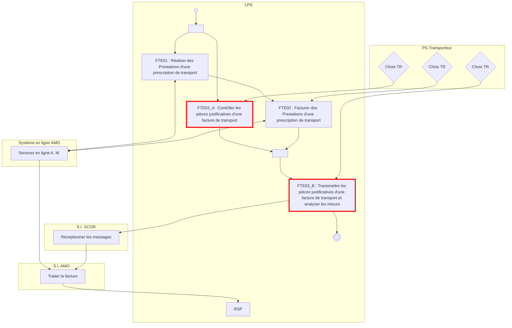
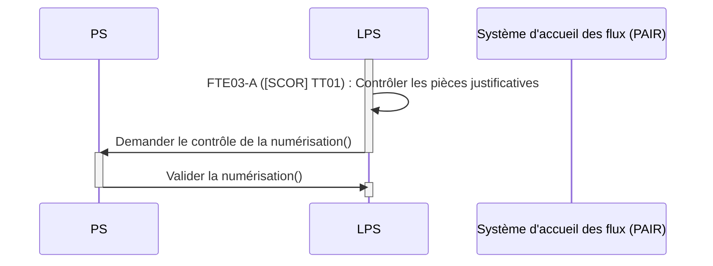
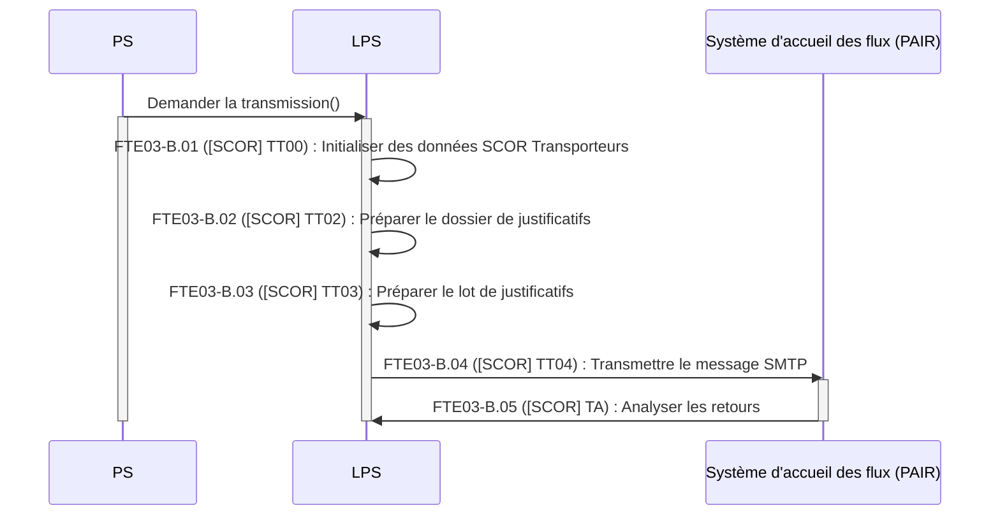

logo: sesam-vitale

**FTE**

*Spécifications Fonctionnelles Générales*

## **Facturation Transporteur Etendue**
## ***Taxi***

# **FTE03 - Contrôler et transmettre les pièces justificatives d’une facture de transport**

Référence : FACT-SFG-033 / Version : 03.20 / Date : 26/06/2026
Diffusion : RESTREINTE
État : PROVISOIRE


VERSION DE TRAVAIL

**GIE SESAM-Vitale**
5, boulevard Marie et Alexandre Oyon – 72 019 LE MANS Cedex 2
<u>www.sesam-vitale.fr</u>

Ce document a été élaboré par le GIE SESAM-Vitale.

Conformément à l’article L.122-4 du Code de la Propriété Intellectuelle, toute représentation ou reproduction (intégrale ou partielle) du présent ouvrage, quel que soit le support utilisé, doit être soumise à l’accord préalable écrit de son auteur.

Il en est de même pour sa traduction, sa transformation, son adaptation ou son arrangement, quel que soit le procédé utilisé.

**Tout manquement à ces obligations constituerait un délit de contrefaçon, au sens des articles **L 335-2 et suivants du code de la propriété intellectuelle, susceptible d’entraîner des** sanctions pour l’auteur du délit.**

## **CONTACTS**

icon: sesam-vitale

Pour toute demande d'évolution, comme pour toute question technique ou fonctionnelle, contactez le Centre de services :

*   portail IRIS : [https://portail-support.sesam-vitale.fr/](https://portail-support.sesam-vitale.fr/)
*   téléphone : 02 43 57 42 88

VERSION DE TRAVAIL

*SFG - Facturation Transporteur Etendue - Taxi*
*FACT-SFG-033 *FTE03 - Contrôler et transmettre les pièces justificatives d’une facture de transport* Version : 03.20*

# **TABLES DES MATIERES**

<table>
    <tr>
      <td><strong>1</strong></td>
      <td><strong>INTRODUCTION.........................................................................................................................................4</strong></td>
    </tr>
    <tr>
      <td>1.1</td>
      <td>OBJECTIF DU DOCUMENT .......................................................................................................................4</td>
    </tr>
    <tr>
      <td>1.2</td>
      <td>STATUT DU DOCUMENT ..........................................................................................................................4</td>
    </tr>
    <tr>
      <td>1.3</td>
      <td>POSITIONNEMENT DU DOCUMENT............................................................................................................4</td>
    </tr>
    <tr>
      <td>1.4</td>
      <td>CONTENU DU DOCUMENT .......................................................................................................................5</td>
    </tr>
    <tr>
      <td>1.5</td>
      <td>DOCUMENTS DE RÉFÉRENCE ..................................................................................................................5</td>
    </tr>
    <tr>
      <td>1.6</td>
      <td>ABRÉVIATIONS.......................................................................................................................................5</td>
    </tr>
    <tr>
      <td>1.7</td>
      <td>DÉFINITIONS..........................................................................................................................................5</td>
    </tr>
    <tr>
      <td>1.8</td>
      <td>GUIDE DE LECTURE................................................................................................................................5</td>
    </tr>
    <tr>
      <td><strong>2</strong></td>
      <td><strong>PRÉSENTATION DU SOUS-PROCESSUS FTE03...................................................................................7</strong></td>
    </tr>
    <tr>
      <td>2.1</td>
      <td>POSITIONNEMENT DU SOUS-PROCESSUS FTE03 .....................................................................................7</td>
    </tr>
    <tr>
      <td>2.2</td>
      <td>PRÉSENTATION GÉNÉRALE DU SOUS-PROCESSUS FTE03 : CONTRÔLER ET TRANSMETTRE LES PIÈCES<br />JUSTIFICATIVES D’UNE FACTURE DE TRANSPORT ......................................................................................8</td>
    </tr>
    <tr>
      <td>2.3</td>
      <td>DESCRIPTION DÉTAILLÉE DES FONCTIONS DE LA FONCTIONNALITÉ FTE03-A : CONTRÔLER LES PIÈCES<br />JUSTIFICATIVES D’UNE FACTURE DE TRANSPORT ....................................................................................10</td>
    </tr>
    <tr>
      <td>2.4</td>
      <td>DESCRIPTION DÉTAILLÉE DES FONCTIONS DE LA FONCTIONNALITÉ FTE03-B : TRANSMETTRE LES PIÈCES<br />JUSTIFICATIVES D’UNE FACTURE DE TRANSPORT ET ANALYSER LES RETOURS..........................................13</td>
    </tr>
    <tr>
      <td></td>
      <td>2.4.1.1 FTE03-B.01 ([SCOR TT-TA] TT00) : Initialiser les données SCOR Transporteurs .............. 16</td>
    </tr>
    <tr>
      <td></td>
      <td>2.4.1.2 FTE03-B.02 ([SCOR TT-TA] TT02) : Préparer le dossier de justificatifs .............................. 18</td>
    </tr>
    <tr>
      <td></td>
      <td>2.4.1.3 FTE03-B.03 ([SCOR TT-TA] TT03) : Préparer le lot de justificatifs ...................................... 19</td>
    </tr>
    <tr>
      <td></td>
      <td>2.4.1.4 FTE03-B.04 ([SCOR TT-TA] TT04) : Transmettre le message SMTP ................................. 20</td>
    </tr>
    <tr>
      <td></td>
      <td>2.4.1.5 FTE03-B.05 ([SCOR TT-TA] TA) : Analyser les retours ....................................................... 20</td>
    </tr>
</table>

<table>
  <caption>**TABLE DES ILLUSTRATIONS**</caption>
    <tr>
      <td>FIGURE 1 : PRINCIPE DE FONCTIONNEMENT ENTRE LA DOCUMENTATION APPELANTE ET LE CORPUS DOCUMENTAIRE<br />SCOR..........................................................................................................................................................4</td>
    </tr>
    <tr>
      <td>FIGURE 2 : INTERACTIONS DE FTE03-A (CONTRÔLER LES PIÈCES JUSTIFICATIVES D’UNE FACTURE DE TRANSPORT) 11</td>
    </tr>
    <tr>
      <td>FIGURE 3 : DIAGRAMME D'ACTIVITÉ DE FTE03-A (CONTRÔLER LES PIÈCES JUSTIFICATIVES D’UNE FACTURE DE<br />TRANSPORT) ...............................................................................................................................................12</td>
    </tr>
    <tr>
      <td>FIGURE 4 : INTERACTIONS DE FTE03-B (TRANSMETTRE LES PIÈCES JUSTIFICATIVES D’UNE FACTURE DE TRANSPORT<br />ET ANALYSER LES RETOURS)........................................................................................................................14</td>
    </tr>
    <tr>
      <td>FIGURE 5 : DIAGRAMME D'ACTIVITÉ DE FTE03-B (TRANSMETTRE LES PIÈCES JUSTIFICATIVES D’UNE FACTURE DE<br />TRANSPORT ET ANALYSER LES RETOURS).....................................................................................................15</td>
    </tr>
</table>


VERSION DE TRAVAIL

*26/06/2026* 3 / 20
*Ce document ne peut être diffusé sans l'autorisation d'une personne habilitée au GIE SESAM-Vitale*

icon: dots

*SFG - Facturation Transporteur Etendue - Taxi*
*FACT-SFG-033* *FTE03 - Contrôler et transmettre les pièces justificatives d’une facture de transport* *Version : 03.20*

# 1 **Introduction**

## 1.1 **Objectif du document**

Ce document a pour but de spécifier le sous processus « FTE03: *Contrôler* et Transmettre les Pièces Justificatives d’une facture de transport » présentant les particularités liées aux transporteurs.

Ce document décrit les deux fonctionnalités FTE03-A (« *Contrôler des pièces justificatives d’une facture de transport* », FTE03-B (« *Transmettre les pièces justificatives d’une facture de transport et analyser les retours* »).

Ce document s’appuie sur les Spécifications Fonctionnelles Générales SCOR diffusées par le GIE SESAM-VITALE et plus particulièrement sur les fonctionnalités :

*   TT01 : Contrôler les pièces justificatives numériques
*   TT02 : Préparer le dossier de justificatifs
*   TT03 : Préparer le lot de justificatifs
*   TT04 : Transmettre le message SEH

Et

*   TA : Analyser les retours.

icon: icon **<u>Nota :</u>** La procédure de gravure sur CDROM ne s’applique pas pour les Transporteurs. En conséquence, la fonctionnalité TT05 ne doit pas être implémentée par les éditeurs de LPS Transporteurs.

icon: icon **<u>Nota :</u>** Le processus de diffusion des lots de PJ vers un OCT (cf. cas particulier SP12 dans les SFG SCOR) ne doit pas être implémenté par les éditeurs Transporteurs.

## 1.2 **Statut du document**

Ces SFG sont en version provisoire et référencée.

## 1.3 **Positionnement du document**

Ce document fait partie du corpus documentaire des SFG du système de Facturation Transporteur Etendue **(FTE)**.

Le présent document décrit la manière d’utiliser et d’appeler le système SCOR à partir d’un contexte FTE.

**Contexte FTE**
icon: dossier bleu « FTE03 » icon: Vous êtes ici
$\downarrow$

**Corpus documentaire SCOR**
| SFG PG (Présentation Générale) icon: dossier bleu |
| :---: |
| $\downarrow$ |

| icon: dossier bleu **SFG TT-TA « Transmettre un flux de pièces justificatives et analyser les retours »** | icon: dossier bleu *SFG RA-RR « Réceptionner les flux »* | icon: dossier bleu *SFG AT « Traiter les flux de pièces justificatives »* | $\left. \vphantom{\begin{matrix} \text{SFG TT-TA} \\ \text{SFG RA-RR} \\ \text{SFG AT} \end{matrix}} \right\}$ | **SFG DICO (Dictionnaire de données)** icon: dossier bleu |
| :--- | :--- | :--- | :--- | :--- |

**Figure 1 : Principe de fonctionnement entre la documentation appelante et le corpus documentaire SCOR**


TRAVAIL

*26/06/2026* *4 / 20*
*Ce document ne peut être diffusé sans l'autorisation d'une personne habilitée au GIE SESAM-Vitale*

icon: icon

*SFG - Facturation Transporteur Etendue - Taxi*
*FACT-SFG-033 *FTE03 - Contrôler et transmettre les pièces justificatives d’une facture de transport* Version : 03.20*

Seuls les documents suivants sont fournis aux éditeurs :

* FTE03 (des SFG FTE)
* PG (des SFG SCOR)
* TT-TA (des SFG SCOR)
* DICO (des SFG SCOR)

Les documents « RA-RR » et AT des SFG SCOR ne décrivent pas des fonctionnalités du poste de travail.

---

## **1.4** **Contenu du document**

Outre ce chapitre introductif, ce document de spécifications fonctionnelles générales présente les opérations de transmission des pièces justificatives d’une facture à transmettre à l’AMO par le sous-processus FTE03.

---

## **1.5** **Documents de référence**

<table>
  <thead>
    <tr>
      <th><b>Appellation</b></th>
      <th><b>Type et titre</b></th>
      <th><b>Référence</b></th>
      <th></th>
    </tr>
  </thead>
  <tbody>
    <tr>
      <td>[SCOR TT-TA]</td>
      <td>SCOR - TT-TA « Transmettre un flux de PJ et analyser les retours »</td>
      <td>SCOR-SFG-003</td>
      <td></td>
    </tr>
    <tr>
      <td>[SCOR PG]</td>
      <td>SCOR - PG – Présentation Générale</td>
      <td>SCOR-SFG-002</td>
      <td></td>
    </tr>
    <tr>
      <td>[SCOR DICO]</td>
      <td>SCOR - DICO - Dictionnaire de données</td>
      <td>SCOR-SFG-006</td>
      <td></td>
    </tr>
    <tr>
      <td>[PG]</td>
      <td>Présentation générale du système FTE</td>
      <td>FACT-SFG-030</td>
      <td></td>
    </tr>
    <tr>
      <td>[FTE02]</td>
      <td>Facturer des prestations</td>
      <td>FACT-SFG-032</td>
      <td></td>
    </tr>
    <tr>
      <td>[FTE06]</td>
      <td>Superviser le poste PS</td>
      <td>FACT-SFG-060</td>
      <td></td>
    </tr>
    <tr>
      <td><mark>[Formulaire facture]</mark></td>
      <td><mark>Facture de transport en taxi conventionné</mark></td>
      <td><mark>CNAM 606b-09/2025</mark></td>
      <td></td>
    </tr>
    <tr>
      <td><mark>[Formulaire annexe facture]</mark></td>
      <td><mark>Annexe à la facture transport(s) par taxi conventionné</mark></td>
      <td><mark>CNAM 606b-09/2025 annexe</mark></td>
      <td></td>
    </tr>
  </tbody>
</table>

---

## **1.6** **Abréviations**

Cf. Document FACT-SFG-029 : Dictionnaire

---

## **1.7** **Définitions**

Cf. Document FACT-SFG-029 : Dictionnaire

---

## **1.8** **Guide de lecture**

Cf. Document FACT-SFG-030 : PG-Annexe 1 : Guide de lecture

---

**Spécificité transporteurs**

Pour une compréhension des SFG SCOR et pour la suite de ces SFG, il est nécessaire de remplacer :

* ARL positif par accusé de réception émis par l’AMO,
* Collecte papier par envoi des PJ par circuit papier,

*26/06/2026* 5 / 20
*Ce document ne peut être diffusé sans l'autorisation d'une personne habilitée au GIE SESAM-Vitale*

icon: logo dots

FACT-SFG-033
# SFG - Facturation Transporteur Etendue - Taxi
## *FTE03 - Contrôler et transmettre les pièces justificatives d’une facture de transport*
Version : 03.20

VERSION DE TRAVAIL

26/06/2026
Ce document ne peut être diffusé sans l'autorisation d'une personne habilitée au GIE SESAM-Vitale

icon: icon
6 / 20

FACT-SFG-033
*SFG - Facturation Transporteur Etendue - Taxi*
*FTE03 - Contrôler et transmettre les pièces justificatives d’une facture de transport*
*Version : 03.20*

# 2 Présentation du sous-processus FTE03

## 2.1 Positionnement du sous-processus FTE03




VERSION DE TRAVAIL

*26/06/2026*
7 / 20
*Ce document ne peut être diffusé sans l'autorisation d'une personne habilitée au GIE SESAM-Vitale*

icon: icon

*FACT-SFG-033*
*SFG - Facturation Transporteur Etendue - Taxi*
*FTE03 - Contrôler et transmettre les pièces justificatives d’une facture de transport*
*Version : 03.20*

## **2.2** **Présentation générale du sous-processus FTE03 : Contrôler et Transmettre les pièces justificatives d’une facture de transport**

### Vue générale

***Description*** L’objet de ce sous-processus est de transmettre à l’AMO, via le système d’accueil des flux, les pièces justificatives numériques (ou les informations d’identification des pièces justificatives déjà transmises) justifiant l’exécution d’une prestation pour un bénéficiaire des soins.

Le processus de facturation du transporteur intègre la transmission des pièces justificatives numériques (PJ) liée à une facture en ligne (FEL) ou à une facture réalisée en mode IRIS/B2.

La transmission des pièces justificatives numériques (PJ) est disponible uniquement pour les transporteurs équipés d’un logiciel autorisé à transmettre des pièces justificatives dans le cadre de l’offre de service SEFi.

De plus, pour ces transporteurs, la transmission des PJ numériques doit être possible pour les flux B2 adressés à tout régime.

La transmission des PJ numériques ne fait pas appel à un service en ligne AMO.

Pour un lot de PJ, le transporteur doit :

*   soit disposer de l’ensemble des accusés de réception des FEL associées aux PJ,
*   soit avoir constitué et transmis le lot IRIS B2.

La mise en lot et la transmission des PJ doit être effectuées à l’issue de l’activité de facturation du jour.

La transmission des PJ doit faire l’objet d’une action manuelle de la part du transporteur.

Les PJ afférentes à un même lot de factures peuvent être transmises dans des lots différents à des dates différentes. Le logiciel doit permettre l'envoi d'une PJ manquante ou oubliée lors d'un précédent envoi.

Par ailleurs, dans le cas d’une facture réémise suite à rejet d’une facture B2 initiale, il est nécessaire de transmettre à nouveau les PJ associées.

En fin de processus de télétransmission des pièces justificatives le statut du lot de justificatifs doit être à :

*   « Archivé » dans le cas d’une télétransmission aboutie, ou
*   « Collecte papier » dans le cas où une procédure de transmission papier des PJ est nécessaire suite à une sortie du processus pour l’un des cas dégradés prévus dans (cf. [SCOR TT-TA]) (exemple : impossibilité réduire la taille du PDF).

Le processus FTE03 est décomposé en deux fonctionnalités :

*   **FTE03-A** (contrôler les pièces justificatives d’une facture de transport) qui peut être effectué à n’importe quel moment du processus de facturation journalière du transporteur.
*   **FTE03-B** (Transmettre les pièces justificatives d’une facture de transport et analyser les retours) qui permet :
    *   la création du dossier et du lot d’une pièce justificative et ne pouvant être réalisé qu’une fois le contrôle de la pièce justificative effectué.
    *   l’analyse des flux émis par le PAIR.


VERSION DE TRAVAIL

*26/06/2026*
8 / 20
*Ce document ne peut être diffusé sans l'autorisation d'une personne habilitée au GIE SESAM-Vitale*

icon: SESAM-Vitale logo

*SFG - Facturation Transporteur Etendue - Taxi*
FACT-SFG-033
# FTE03 - Contrôler et transmettre les pièces justificatives *d’une facture de transport*
*Version : 03.20*

***Entrées*** FEL validée **DF_FTE_FEL[V]**
Facture IRIS/B2 **DF_B2**
Taille maximale du fichier PDF **EF_FTE92_01**

***Sorties*** Message SMTP SEH **F_SCOR05**
Statut transmission du fichier PDF « Finalisé » **EF_FET86_06**

**Diagramme **d’activité de** FTE03**

```mermaid
graph TD
    subgraph LPS
        direction TB
        subgraph "Périmètre de FTE03"
            direction TB
            Start(( ))
            Start --> StepA
            StepA["FTE03-A : Contrôler les piècesjustificatives d'une facture detransport"]
            StepA --> StepB
            StepB["FET03-B : Transmettre les piècesjustificatives d'une facture detransport et analyser les retours"]
            StepB --> End((( )))
            
            StartLabel[Début de FTE03] --- Start
            EndLabel[Fin de FTE03] --- End
            
            style Start fill:#000
            style End fill:#000,stroke:#f5e6c4,stroke-width:4px
            style "Périmètre de FTE03" fill:#a9a9a9,stroke:#000
        end
    end

    subgraph AMO
        StepC["Traiter les flux de piècesjustificatives numérisées"]
    end

    Input[Pièces justificatives] -.-> StepA
    StepB <--> StepC

    %% Styling
    style LPS fill:none,stroke:#000
    style AMO fill:none,stroke:#000
    style StepA fill:#f5e6c4,stroke:#000,rx:20,ry:20
    style StepB fill:#f5e6c4,stroke:#000,rx:20,ry:20
    style StepC fill:#f5e6c4,stroke:#000,rx:20,ry:20
    style Input fill:#f5e6c4,stroke:#000
    style StartLabel stroke:none,fill:none
    style EndLabel stroke:none,fill:none
```


VERSION TRAVAIL

*26/06/2026*
9 / 20
*Ce document ne peut être diffusé sans l'autorisation d'une personne habilitée au GIE SESAM-Vitale*

icon: logo SESAM-Vitale

*SFG - Facturation Transporteur Etendue - Taxi*
*FACT-SFG-033* *FTE03 - Contrôler et transmettre les pièces justificatives d’une facture de transport* *Version : 03.20*

# **2.3** **Description détaillée des fonctions de la fonctionnalité FTE03-A : Contrôler les pièces justificatives d’une facture de transport**

**Vue générale**

***Description*** L’objet de cette fonctionnalité FTE03-A est de permettre au transporteur le contrôle des pièces justificatives numériques justifiant l’exécution de prestations pour des bénéficiaires des soins. Pour ce faire, le LPS doit **contrôler la pièce justificative numérique** (acquittement de la part du Professionnel de Santé).

En fin de cette fonctionnalité de contrôle des pièces justificatives numériques, le statut de transmission du fichier PDF doit être à « à finaliser ». Ce statut passera à l’état « Emis AMO » en fin de la fonctionnalité « Transmettre les pièces justificatives d’une facture de transport » (FTE03-B).

La fonctionnalité FTE03-A est identique à la fonctionnalité TT01 présentée dans les SFG SCOR (cf. [SCOR TT-TA]), elle n’est donc pas présentée dans ce document.

La liste des natures de PJ pour un transporteur et la liste des PJ à transmettre en fonction du contexte de facturation est la suivante :

<table>
  <thead>
    <tr>
      <th><b>Type de PJ</b></th>
      <th><b>Code</b> <b>nature</b></th>
      <th>Cas d’une FEL</th>
      <th>Cas d’une <b>facture IRIS/B2</b></th>
    </tr>
  </thead>
  <tbody>
    <tr>
      <td>Prescription de transport.</td>
      <td><strong><b>PRST</b></strong></td>
      <td><strong>X</strong></td>
      <td><strong>X</strong></td>
    </tr>
    <tr>
      <td>DAP Volet 3 <sup>(1)</sup></td>
      <td><em><strong>DAPA</strong></em></td>
      <td><strong>X</strong></td>
      <td><strong>X</strong></td>
    </tr>
    <tr>
      <td><s>Attestation de service fait<sup>(1)</sup><br />signature manuscrite</s></td>
      <td><s><strong>ANST</strong></s></td>
      <td><s><strong>X</strong></s></td>
      <td><s><strong>X</strong></s></td>
    </tr>
    <tr>
      <td><s>Attestation de service fait<sup>(1)</sup><br />signature numérique</s></td>
      <td><s><strong>ASF</strong></s></td>
      <td><s><strong>X</strong></s></td>
      <td><s><strong>X</strong></s></td>
    </tr>
    <tr>
      <td><s>Facture papier<br />S3601</s></td>
      <td><s><strong>FSNC</strong></s></td>
      <td></td>
      <td><s><strong>X</strong></s></td>
    </tr>
    <tr>
      <td><strong>Formulaire 606b<br />[Formulaire facture]<br />signature manuscrite <sup>(3)</sup></strong></td>
      <td><strong><b>XFAM</b></strong></td>
      <td><strong>X</strong></td>
      <td><strong>X</strong></td>
    </tr>
    <tr>
      <td><strong>Formulaire 606b - annexe<br />[Formulaire annexe facture]<br />signature manuscrite <sup>(3)</sup></strong></td>
      <td><strong><b>XAAM</b></strong></td>
      <td><strong>X</strong></td>
      <td><strong>X</strong></td>
    </tr>
    <tr>
      <td><strong>Formulaire 606b<br />[Formulaire facture]<br />signature numérique <sup>(3)</sup></strong></td>
      <td><strong><b>XFAN</b></strong></td>
      <td><strong>X</strong></td>
      <td><strong>X</strong></td>
    </tr>
    <tr>
      <td><strong>Formulaire 606b - annexe<br />[Formulaire annexe facture]<br />signature numérique <sup>(3)</sup></strong></td>
      <td><strong><b>XAAN</b></strong></td>
      <td><strong>X</strong></td>
      <td><strong>X</strong></td>
    </tr>
    <tr>
      <td>Attestation Frais de transport <sup>(2)</sup></td>
      <td><strong><b>FRST</b></strong></td>
      <td><strong>X</strong></td>
      <td><strong>X</strong></td>
    </tr>
    <tr>
      <td>PJ règlementaires non prévues<br />dans ce tableau</td>
      <td><strong><b>AUTP</b></strong></td>
      <td><strong>X</strong></td>
      <td><strong>X</strong></td>
    </tr>
  </tbody>
</table>

~~(1) correspond au document sur lequel figure la signature du patient (annexe à la facture …)~~

(1) correspond au Volet 3 de la Demande d’Accord Préalable de transport (volet ne comportant pas d'éléments d'ordre médical). Elle vaut prescription.

(2) peuvent comprendre les tickets de péages.

<mark>(3) uniquement le « Volet destiné à l’organisme de paiement »</mark>


VERSION DE TRAVAIL

*26/06/2026* *10 / 20*
*Ce document ne peut être diffusé sans l'autorisation d'une personne habilitée au GIE SESAM-Vitale*

icon: icon

*SFG - Facturation Transporteur Etendue - Taxi*
FACT-SFG-033
*FTE03 - Contrôler et transmettre les pièces justificatives d’une facture de transport*
*Version : 03.20*

<table>
    <tr>
      <td rowspan="5"><i><b>Entrées</b></i></td>
      <td>FEL validée</td>
      <td><b>DF_FTE_FEL<sub>[V]</sub></b></td>
    </tr>
    <tr>
      <td>Facture IRIS/B2</td>
      <td><b>DF_B2</b></td>
    </tr>
    <tr>
      <td>Pièces justificatives numérique</td>
      <td></td>
    </tr>
    <tr>
      <td>Taille maximale du fichier PDF</td>
      <td><b><b>EF_FTE92_01</b></b></td>
    </tr>
    <tr>
      <td>Statut de transmission du fichier PDF</td>
      <td><b>EF_FTE86_06</b></td>
    </tr>
    <tr>
      <td rowspan="4"><i><b>Sorties</b></i></td>
      <td><b>N</b> Fichier PDF de justificatif</td>
      <td><b>F_SCOR01</b></td>
    </tr>
    <tr>
      <td>Statut de transmission du fichier PDF « <i>à finaliser</i> »</td>
      <td><b>EF_FTE86_06</b></td>
    </tr>
    <tr>
      <td>Nature de la pièce justificative</td>
      <td><b><b>EF_FTE86_04</b></b></td>
    </tr>
    <tr>
      <td>Date de constitution du fichier PDF de justificatif</td>
      <td><b><b>EF_FTE86_05</b></b></td>
    </tr>
</table>

***Situations spécifiques*** Aucune

**Interactions de **FTE03-A avec** l’extérieur**



**Figure 2 : Interactions de FTE03-A (Contrôler les pièces justificatives d’une facture de transport)**


VERSION DE TRAVAIL

*26/06/2026*
*Ce document ne peut être diffusé sans l'autorisation d'une personne habilitée au GIE SESAM-Vitale*

icon: logo
11 / 20

FACT-SFG-033
*SFG - Facturation Transporteur Etendue - Taxi*
*FTE03 - Contrôler et transmettre les pièces justificatives d’une facture de transport*
*Version : 03.20*

**Diagramme**
**d’activité**



```mermaid
graph TD
    Start(( ))
    StartLabel[Début de FTE03-B] --- Start
    style StartLabel fill:none,stroke:none
    
    Start --> Step1("FTE03-A ([SCOR] TT01) : Contrôler les pièces justificatives d'une facture de transport")
    
    Step1 --> End
    
    End((( )))
    EndLabel[Fin de FTE03-B] --- End
    style EndLabel fill:none,stroke:none

    style Start fill:#000,stroke:#000
    style End fill:#000,stroke:#000
```

**Figure 3 : Diagramme d'activité de FTE03-A (Contrôler les pièces justificatives d’une facture de transport)**


VERSION DE TRAVAIL

*26/06/2026*
12 / 20
*Ce document ne peut être diffusé sans l'autorisation d'une personne habilitée au GIE SESAM-Vitale*

icon: dots

*SFG - Facturation Transporteur Etendue - Taxi*
*FACT-SFG-033 FTE03 - Contrôler et transmettre les pièces justificatives d’une facture de transport Version : 03.20*

# **2.4** **Description détaillée des fonctions de la fonctionnalité FTE03-B : Transmettre les pièces justificatives d’une facture de transport et analyser les retours**

**Vue générale**

***Description*** L’objet de cette fonctionnalité FTE03-B est de :

*   transmettre à l’AMO, via le système d’accueil des flux (PAIR), les pièces justificatives numériques (ou les informations d’identification des pièces justificatives déjà transmises) justifiant l’exécution d’une prestation pour un bénéficiaire des soins.
*   D’analyser les retours (ARL ou message de service) émis par le PAIR.

Pour ce faire, le LPS après avoir préalablement contrôler les pièces justificatives numériques et initialisé les données nécessaires à SCOR, réalise les opérations suivantes :

*   ***Préparer le dossier de justificatifs*** permettant d’initialiser le dossier de pièces justificatives de la Facture Electronique (FE = FEL ou B2).
*   ***Préparer le lot de justificatifs*** avec les lots de FE associées aux pièces justificatives (regroupement et sécurisation des dossiers de justificatifs) et stockage du lot de justificatifs jusqu’à réception d’un accusé de réception pour ce lot de justificatifs.
*   **Transmettre le message SMTP du lot de justificatifs** au plus tard après la fin de l’activité de facturation journalière du transporteur.
*   **Analyser le retour émis par le PAIR.**

<table>
    <tr>
      <td rowspan="5"><i>Entrées</i></td>
      <td>Fichier PDF de justificatif</td>
      <td><strong>F_SCOR01</strong></td>
    </tr>
    <tr>
      <td>Statut de transmission du fichier PDF « <i><b>à finaliser</b></i> » ; « <i><b>émis à l’AM</b></i> »</td>
      <td><strong><b>EF_FTE86_06</b></strong></td>
    </tr>
    <tr>
      <td>FEL validée</td>
      <td><strong>DF_FTE_FEL<sub>[V]</sub></strong></td>
    </tr>
    <tr>
      <td>Facture IRIS/B2</td>
      <td><strong>DF_B2</strong></td>
    </tr>
    <tr>
      <td>Taille maximale du fichier PDF</td>
      <td><strong><b>EF_FTE92_01</b></strong></td>
    </tr>
    <tr>
      <td rowspan="16"><i>Sorties</i></td>
      <td>N° facture</td>
      <td><strong><b>EF_FTE85_01</b></strong></td>
    </tr>
    <tr>
      <td>CRL FE</td>
      <td><strong><b>EF_FTE85_02</b></strong></td>
    </tr>
    <tr>
      <td>N° partenaire de santé + clé</td>
      <td><strong><b>EF_FTE85_03</b></strong></td>
    </tr>
    <tr>
      <td>Code grand régime</td>
      <td><strong><b>EF_FTE85_04</b></strong></td>
    </tr>
    <tr>
      <td>Code caisse gestionnaire</td>
      <td><strong><b>EF_FTE85_05</b></strong></td>
    </tr>
    <tr>
      <td>Code centre gestionnaire</td>
      <td><strong><b>EF_FTE85_06</b></strong></td>
    </tr>
    <tr>
      <td>Mode de sécurisation FE</td>
      <td><strong><b>EF_FTE85_07</b></strong></td>
    </tr>
    <tr>
      <td>Code renouvellement</td>
      <td><strong><b>EF_FTE85_08</b></strong></td>
    </tr>
    <tr>
      <td>Total des montants facturés</td>
      <td><strong><b>EF_FTE85_09</b></strong></td>
    </tr>
    <tr>
      <td>Total remboursable par la caisse</td>
      <td><strong><b>EF_FTE85_10</b></strong></td>
    </tr>
    <tr>
      <td>N° immatriculation assuré + clé</td>
      <td><strong><b>EF_FTE85_11</b></strong></td>
    </tr>
    <tr>
      <td>Date de naissance du bénéficiaire</td>
      <td><strong><b>EF_FTE85_12</b></strong></td>
    </tr>
    <tr>
      <td>Rang du bénéficiaire</td>
      <td><strong><b>EF_FTE85_13</b></strong></td>
    </tr>
    <tr>
      <td>NIR bénéficiaire + clé</td>
      <td><strong><b>EF_FTE85_14</b></strong></td>
    </tr>
    <tr>
      <td>Type de FE</td>
      <td><strong><b>EF_FTE85_15</b></strong></td>
    </tr>
    <tr>
      <td>N° de lot de FE</td>
      <td><strong><b>EF_FTE84_01</b></strong></td>
    </tr>
</table>


VERSION DE TRAVAIL

*26/06/2026* 13 / 20
*Ce document ne peut être diffusé sans l'autorisation d'une personne habilitée au GIE SESAM-Vitale*

icon: SESAM-Vitale logo

*SFG - Facturation Transporteur Etendue - Taxi*
FACT-SFG-033 FTE03 - Contrôler et transmettre les pièces justificatives d’une facture de transport *Version : 03.20*

<table>
    <tr>
      <td>Code organisme destinataire</td>
      <td><strong><b>EF_FTE85_16</b></strong></td>
    </tr>
    <tr>
      <td>Date de création du lot de FE</td>
      <td><strong><b>EF_FTE84_02</b></strong></td>
    </tr>
    <tr>
      <td>Nombre de FE dans le lot de FE</td>
      <td><strong><b>EF_FTE84_03</b></strong></td>
    </tr>
    <tr>
      <td>Nom commercial de l’émetteur lot de FE</td>
      <td><strong><b>EF_FTE84_04</b></strong></td>
    </tr>
    <tr>
      <td>Numéro RPPS</td>
      <td><strong><b>EF_FTE85_17</b></strong></td>
    </tr>
    <tr>
      <td>Code spécialité du PS</td>
      <td><strong><b>EF_FTE85_18</b></strong></td>
    </tr>
    <tr>
      <td>Message SMTP SEH « Emis »</td>
      <td><strong>F_SCOR05</strong></td>
    </tr>
    <tr>
      <td>Statut transmission dossier de justificatifs «<strong>émis</strong> »</td>
      <td><strong><b>EF_FTE87_01</b></strong></td>
    </tr>
    <tr>
      <td>Statut transmission lot de justificatifs «<strong>émis</strong> »</td>
      <td><strong><b>EF_FTE88_02</b></strong></td>
    </tr>
</table>

***Situations spécifiques*** Aucune

**Interactions de **FTE03-B avec** l’extérieur**



**Figure 4 : Interactions de FTE03-B (Transmettre les pièces justificatives d’une facture de transport et analyser les retours)**


VERSION DE TRAVAIL

*26/06/2026* 14 / 20
*Ce document ne peut être diffusé sans l'autorisation d'une personne habilitée au GIE SESAM-Vitale*

icon: logo

*SFG - Facturation Transporteur Etendue - Taxi*
*FACT-SFG-033 *FTE03 - Contrôler et transmettre les pièces justificatives d’une facture de transport* Version : 03.20*

**Diagramme**
**d’activité**



```mermaid
graph TD
    Start(( )) --> B01
    
    subgraph "Début de FTE03-B"
    direction TB
    B01["**FTE03-B.01 ([SCOR] TT00) : Initialiser des données de SCOR Transporteurs**"]
    B02["**FTE03-B.02 ([SCOR] TT02) : Préparer le dossier de justificatifs**"]
    B03["**FTE03-B.03 ([SCOR] TT03) : Préparer le lot de justificatifs**"]
    B04["**FTE03-B.04 ([SCOR] TT04) : Transmettre le message SMTP**"]
    B05["**FTE03-B.05 ([SCOR] TA) : Analyser les retours**"]
    end

    B01 --> B02
    B02 --> B03
    B03 --> B04
    B04 --> B05
    B05 --> End((( )))

    style Start fill:#000
    style End fill:#000,stroke:#000,stroke-width:4px
    
    linkStyle default marker-end:arrow
```

Fin de FTE03-B

**Figure 5 : Diagramme d'activité de FTE03-B (Transmettre les pièces justificatives d’une facture de transport et analyser les retours)**

icon: icon **<u>Nota :</u>** Pour la fonctionnalité d’analyse des retours, le LPS transporteurs n’a aucune spécificité. Cette fonctionnalité ne sera pas décrite dans ce document et l’éditeur doit se référer à la fonctionnalité TA décrite dans les SFG SCOR (cf. [SCOR TT-TA]).

*26/06/2026* 15 / 20
*Ce document ne peut être diffusé sans l'autorisation d'une personne habilitée au GIE SESAM-Vitale*

icon: icon

*SFG - Facturation Transporteur Etendue - Taxi*
*FACT-SFG-033 *FTE03 - Contrôler et transmettre les pièces justificatives d’une facture de transport* Version : 03.20*

# **2.4.1.1** **FTE03-B.01 ([SCOR TT-TA] TT00) : Initialiser les données SCOR Transporteurs**

## **Vue générale**

<table>
    <tr>
      <td><i><b>Description</b></i></td>
      <td colspan="2">Cette fonction a pour rôle d’initialiser les données nécessaires à l’ensemble du déroulement du processus de numérisation des pièces justificatives en provenance d’une FE.<br />La valorisation des données peut être effectuée pendant le déroulement de la fonctionnalité FTE03-B.</td>
    </tr>
    <tr>
      <td rowspan="3"><i><b>Entrées</b></i></td>
      <td>FEL validée</td>
      <td><b>DF_FTE_FEL<sub>[V]</sub></b></td>
    </tr>
    <tr>
      <td>Facture IRIS/B2</td>
      <td><b>DF_B2</b></td>
    </tr>
    <tr>
      <td>Taille maximale du fichier PDF</td>
      <td><b><b>EF_FTE92_01</b></b></td>
    </tr>
    <tr>
      <td rowspan="22"><i><b>Sorties</b></i></td>
      <td>N° facture</td>
      <td><b><b>EF_FTE85_01</b></b></td>
    </tr>
    <tr>
      <td>CRL FE</td>
      <td><b><b>EF_FTE85_02</b></b></td>
    </tr>
    <tr>
      <td>N° partenaire de santé + clé</td>
      <td><b><b>EF_FTE85_03</b></b></td>
    </tr>
    <tr>
      <td>Code grand régime</td>
      <td><b><b>EF_FTE85_04</b></b></td>
    </tr>
    <tr>
      <td>Code caisse gestionnaire</td>
      <td><b><b>EF_FTE85_05</b></b></td>
    </tr>
    <tr>
      <td>Code centre gestionnaire</td>
      <td><b><b>EF_FTE85_06</b></b></td>
    </tr>
    <tr>
      <td>Mode de sécurisation FE</td>
      <td><b><b>EF_FTE85_07</b></b></td>
    </tr>
    <tr>
      <td>Code renouvellement</td>
      <td><b><b>EF_FTE85_08</b></b></td>
    </tr>
    <tr>
      <td>Total des montants facturés</td>
      <td><b><b>EF_FTE85_09</b></b></td>
    </tr>
    <tr>
      <td>Total remboursable par la caisse</td>
      <td><b><b>EF_FTE85_10</b></b></td>
    </tr>
    <tr>
      <td>N° immatriculation assuré + clé</td>
      <td><b><b>EF_FTE85_11</b></b></td>
    </tr>
    <tr>
      <td>Date de naissance du bénéficiaire</td>
      <td><b><b>EF_FTE85_12</b></b></td>
    </tr>
    <tr>
      <td>Rang du bénéficiaire</td>
      <td><b><b>EF_FTE85_13</b></b></td>
    </tr>
    <tr>
      <td>NIR bénéficiaire + clé</td>
      <td><b><b>EF_FTE85_14</b></b></td>
    </tr>
    <tr>
      <td>Type de FE</td>
      <td><b><b>EF_FTE85_15</b></b></td>
    </tr>
    <tr>
      <td>N° de lot de FE</td>
      <td><b><b>EF_FTE84_01</b></b></td>
    </tr>
    <tr>
      <td>Code organisme destinataire</td>
      <td><b><b>EF_FTE85_16</b></b></td>
    </tr>
    <tr>
      <td>Date de création du lot de FE</td>
      <td><b><b>EF_FTE84_02</b></b></td>
    </tr>
    <tr>
      <td>Nombre de FE dans le lot de FE</td>
      <td><b>EF_FTE84_03</b></td>
    </tr>
    <tr>
      <td>Nom commercial de l’émetteur lot de FE</td>
      <td><b><b>EF_FTE84_04</b></b></td>
    </tr>
    <tr>
      <td>Numéro RPPS</td>
      <td><b><b>EF_FTE85_17</b></b></td>
    </tr>
    <tr>
      <td>Code spécialité du PS</td>
      <td><b><b>EF_FTE85_18</b></b></td>
    </tr>
</table>

## **Règles de gestion**

**INITIALISER LES DONNEES SCOR**

***[RG_FTE300] Calculer le nombre de factures du lot de FEL (FEL ou B2) (EF_FTE84_03)***

Le LPS calcul le nombre de factures constituant le lot de FEL à partir de la valeur maximum du rang de la FEL (EF_FTE71_04).


VERSION DE TRAVAIL

*26/06/2026* 16 / 20
*Ce document ne peut être diffusé sans l'autorisation d'une personne habilitée au GIE SESAM-Vitale*

icon: dots

*SFG - Facturation Transporteur Etendue - Taxi*
FACT-SFG-033
*FTE03 - Contrôler et transmettre les pièces justificatives d’une facture de transport*
*Version : 03.20*

# **[RG_FTE301] Initialiser les données SCOR pour une FE**

En fonction du type de facture électronique (FEL, B2) le LPS initialise les données nécessaires au sous-processus « *Dématérialiser et transmettre les PJ d’une facture de transport* » en fonction du tableau ci-dessous.

<table>
  <thead>
    <tr>
      <th colspan="2" rowspan="2">Données des SFG SCOR</th>
      <th rowspan="2">Données FTE03 à initialiser</th>
      <th colspan="3">Données d’entrée du sous-processus FTE03</th>
    </tr>
    <tr>
      <th>Données FEL</th>
      <th colspan="2">Données IRIS/B2</th>
    </tr>
    <tr>
      <th>Réf. [SCOR DICO]</th>
      <th>Libellés</th>
      <th>Ref :</th>
      <th>Réf :</th>
      <th>Type</th>
      <th>Pos.</th>
    </tr>
  </thead>
  <tbody>
    <tr>
      <td><i>EF_PA_001_16</i></td>
      <td><strong><b>N° de lot de FE</b></strong></td>
      <td><strong><b>EF_FTE84_01</b></strong></td>
      <td>EF_FTE50_22</td>
      <td>1</td>
      <td>20-22</td>
    </tr>
    <tr>
      <td><i>EF_PA_001_18</i></td>
      <td><strong><b>Date de création du lot de FE</b></strong></td>
      <td><strong><b>EF_FTE84_02</b></strong></td>
      <td>EF_FTE71_02</td>
      <td>1</td>
      <td>72-77</td>
    </tr>
    <tr>
      <td><i>EF_PA_001_19</i></td>
      <td><strong><b>Nombre de factures dans le lot de</b> FE</strong></td>
      <td><strong><b>EF_FTE84_03</b></strong></td>
      <td>RG_FTE300</td>
      <td>6</td>
      <td>11-13</td>
    </tr>
    <tr>
      <td><i>EF_PA_001_20</i></td>
      <td><strong><b>Nom commercial de l’émetteur lot</b> de FE</strong></td>
      <td><strong><b>EF_FTE84_04</b></strong></td>
      <td>EF_FTE52_02</td>
      <td>1</td>
      <td>30-69</td>
    </tr>
    <tr>
      <td colspan="6"><i>Pour chaque facture du lot de FE</i></td>
    </tr>
    <tr>
      <td><i>EF_PA_001_01</i></td>
      <td><strong><b>N° facture</b></strong></td>
      <td><strong><b>EF_FTE85_01</b></strong></td>
      <td>EF_FTE50_01</td>
      <td>2A</td>
      <td>27-35</td>
    </tr>
    <tr>
      <td><i>EF_PA_001_02</i></td>
      <td><strong><b>CRL FE</b></strong></td>
      <td><strong><b>EF_FTE85_02</b></strong></td>
      <td colspan="3">EF_FTE71_05</td>
    </tr>
    <tr>
      <td><i>EF_PA_001_03</i></td>
      <td><strong><b>N° partenaire de santé + clé</b></strong></td>
      <td><strong><b>EF_FTE85_03</b></strong></td>
      <td>EF_FTE52_01</td>
      <td>2A</td>
      <td>2-10</td>
    </tr>
    <tr>
      <td><i>EF_PA_001_04</i></td>
      <td><strong><b>Code grand régime</b></strong></td>
      <td><strong><b>EF_FTE85_04</b></strong></td>
      <td>EF_FTE57_04</td>
      <td>2A</td>
      <td>49-50</td>
    </tr>
    <tr>
      <td><i>EF_PA_001_05</i></td>
      <td><strong><b>Code caisse gestionnaire</b></strong></td>
      <td><strong><b>EF_FTE85_05</b></strong></td>
      <td>EF_FTE57_05</td>
      <td>2A</td>
      <td>51-53</td>
    </tr>
    <tr>
      <td><i>EF_PA_001_06</i></td>
      <td><strong><b>Code centre gestionnaire</b></strong></td>
      <td><strong><b>EF_FTE85_06</b></strong></td>
      <td>EF_FTE57_06</td>
      <td>2A</td>
      <td>54-57</td>
    </tr>
    <tr>
      <td><i>EF_PA_001_07</i></td>
      <td><strong><b>Mode de sécurisation FE</b></strong></td>
      <td><strong><b>EF_FTE85_07</b></strong></td>
      <td>Valeur à blanc</td>
      <td>1</td>
      <td>81</td>
    </tr>
    <tr>
      <td><i>EF_PA_001_08</i></td>
      <td><strong><b>Code renouvellement</b></strong></td>
      <td><strong><b>EF_FTE85_08</b></strong></td>
      <td>Valeur à blanc</td>
      <td>4A</td>
      <td>51-52</td>
    </tr>
    <tr>
      <td><i>EF_PA_001_09</i></td>
      <td><strong><b>Total des montants facturés</b></strong></td>
      <td><strong><b>EF_FTE85_09</b></strong></td>
      <td>EF_FTE50_11</td>
      <td>5</td>
      <td>58-65</td>
    </tr>
    <tr>
      <td><i>EF_PA_001_10</i></td>
      <td><strong>Total remboursable par la caisse</strong></td>
      <td><strong>EF_FTE85_10</strong></td>
      <td>EF_FTE50_12</td>
      <td>5</td>
      <td>66-73</td>
    </tr>
    <tr>
      <td rowspan="2"><i>EF_PA_001_11</i></td>
      <td rowspan="2"><strong>N° immatriculation assuré + clé</strong></td>
      <td rowspan="2"><strong>EF_FTE85_11</strong></td>
      <td>EF_FTE55_01</td>
      <td rowspan="2">2</td>
      <td rowspan="2">12-26</td>
    </tr>
    <tr>
      <td>EF_FTE55_02</td>
    </tr>
    <tr>
      <td><i>EF_PA_001_12</i></td>
      <td><strong>Date de naissance du bénéficiaire</strong></td>
      <td><strong>EF_FTE85_12</strong></td>
      <td>EF_FTE55_03</td>
      <td>2</td>
      <td>96-101</td>
    </tr>
    <tr>
      <td><i>EF_PA_001_13</i></td>
      <td><strong><b>Rang du bénéficiaire</b></strong></td>
      <td><strong><b>EF_FTE85_13</b></strong></td>
      <td>EF_FTE55_04</td>
      <td>2</td>
      <td>102</td>
    </tr>
    <tr>
      <td rowspan="2"><i>EF_PA_001_14</i></td>
      <td rowspan="2"><strong><b>NIR bénéficiaire + clé</b></strong></td>
      <td rowspan="2"><strong><b>EF_FTE85_14</b></strong></td>
      <td>EF_FTE55_08</td>
      <td rowspan="2">2S</td>
      <td rowspan="2">50-64</td>
    </tr>
    <tr>
      <td>EF_FTE55_09</td>
    </tr>
    <tr>
      <td><i>EF_PA_001_17</i></td>
      <td><strong><b>Code organisme destinataire</b></strong></td>
      <td><strong><b>EF_FTE85_16</b></strong></td>
      <td>EF_FTE71_03</td>
      <td>1</td>
      <td>17-19</td>
    </tr>
    <tr>
      <td><i>EF_PA_001_21</i></td>
      <td><strong><b>Numéro RPPS</b></strong></td>
      <td><strong><b>EF_FTE85_17</b></strong></td>
      <td>EF_FTE61_02</td>
      <td>4<sup>E</sup></td>
      <td>64-74</td>
    </tr>
    <tr>
      <td><i>EF_PA_001_22</i></td>
      <td><strong>Code spécialité du PS</strong></td>
      <td><strong>EF_FTE85_18</strong></td>
      <td>EF_FTE61_03</td>
      <td>4</td>
      <td>66-67</td>
    </tr>
  </tbody>
</table>


VERSION DE TRAVAIL

26/06/2026
17 / 20
*Ce document ne peut être diffusé sans l'autorisation d'une personne habilitée au GIE SESAM-Vitale*

icon: logo SESAM-Vitale

*FACT-SFG-033*
*SFG - Facturation Transporteur Etendue - Taxi*
*FTE03 - Contrôler et transmettre les pièces justificatives d’une facture de transport*
*Version : 03.20*

# **2.4.1.2** **FTE03-B.02 ([SCOR TT-TA] TT02) : Préparer le dossier de justificatifs**

## **Vue générale**

### ***Description***
Cette fonctionnalité est identique à la fonctionnalité TT02 présentée dans les SFG SCOR (cf. [SCOR TT-TA]), à une contrainte près :

*   il n’est pas possible de transmettre l’identifiant d’une PJ si cet identifiant n’a pas été transmis au moins une fois pour une FEL pour laquelle un accusé de réception a été délivré par l’AMO.

Un identifiant de PJ peut être transmis, par exemple, suite à une facturation de transports itératifs.

<table>
        <tr>
            <td rowspan="10"><i><b>Entrées</b></i></td>
            <td>N° facture</td>
            <td><b><b>EF_FTE85_01</b></b></td>
        </tr>
        <tr>
            <td>Code renouvellement</td>
            <td><b><b>EF_FTE85_08</b></b></td>
        </tr>
        <tr>
            <td>Total des montants facturés</td>
            <td><b><b>EF_FTE85_09</b></b></td>
        </tr>
        <tr>
            <td>Total remboursable par la caisse</td>
            <td><b><b>EF_FTE85_10</b></b></td>
        </tr>
        <tr>
            <td>N° immatriculation assuré</td>
            <td><b><b>EF_FTE85_11</b></b></td>
        </tr>
        <tr>
            <td>Date de naissance du bénéficiaire</td>
            <td><b><b>EF_FTE85_12</b></b></td>
        </tr>
        <tr>
            <td>Rang du bénéficiaire</td>
            <td><b><b>EF_FTE85_13</b></b></td>
        </tr>
        <tr>
            <td>Statut de transmission du dossier de justificatifs</td>
            <td><b>EF_FTE87_01</b></td>
        </tr>
        <tr>
            <td>Fichier PDF de justificatif</td>
            <td><b>F_SCOR01</b></td>
        </tr>
        <tr>
            <td>Statut de transmission du fichier PDF « <b><b>à finaliser</b></b> »</td>
            <td><b>EF_FTE86_06</b></td>
        </tr>
        <tr>
            <td rowspan="6"><i><b>Sorties</b></i></td>
            <td>Fichier d’index SCANORDO</td>
            <td><b>F_SCOR02</b></td>
        </tr>
        <tr>
            <td>Fichiers PDF de justificatif</td>
            <td><b>F_SCOR01</b></td>
        </tr>
        <tr>
            <td>Identifiant du fichier PDF</td>
            <td><b><b>EF_FTE86_03</b></b></td>
        </tr>
        <tr>
            <td>Statut de transmission du fichier PDF « finalisé »</td>
            <td><b>EF_FTE86_06</b></td>
        </tr>
        <tr>
            <td>Dossier de pièces justificatives</td>
            <td><b>F_SCOR03</b></td>
        </tr>
        <tr>
            <td>Statut de transmission du dossier de justificatifs «A finaliser »</td>
            <td><b>EF_FTE87_01</b></td>
        </tr>
</table>

## **Règles de gestion**

### **[SCOR TT-TA] [RG_TT083]** ***Trouver le mode d’envoi du fichier PDF déjà transmis à l’AMO***

Le poste de travail du PS identifie le mode d’envoi de la PJ numérique à partir de la donnée « Information mode d’envoi du document externe » (EF_MA_019_05).

### **4** ***Cas particulier pour les transporteurs dans le cadre de la facturation des transports itératifs***

Pour transmettre un identifiant d’une pièce justificative transmise antérieurement, le dossier de PJ initial doit avoir reçu un ARL positif et la FEL doit avoir été validée par le transporteur et acceptée par l’AMO (accusé de réception reçu par le transporteur).

Une facture électronique au format B2 ne reçoit pas d’accusé de réception de la part de l’AMO. Ce qui implique que si l’identifiant d’une pièce justificative n’a pas été transmis au préalable au moins une fois pour une PJ d’une FEL, cet identifiant ne peut être transmis. La PJ numérique devra à nouveau être créée.


VERSION DE TRAVAIL

*26/06/2026*
*18 / 20*
*Ce document ne peut être diffusé sans l'autorisation d'une personne habilitée au GIE SESAM-Vitale*

icon: icon

*SFG - Facturation Transporteur Etendue - Taxi*
*FACT-SFG-033 *FTE03 - Contrôler et transmettre les pièces justificatives d’une facture de transport* Version : 03.20*

# **2.4.1.3** **FTE03-B.03 ([SCOR TT-TA] TT03) : Préparer le lot de justificatifs**

## **Vue générale**

<table>
        <tr>
            <td rowspan="2"><i><b>Description</b></i></td>
            <td colspan="2">Cette fonctionnalité est identique à la fonctionnalité TT03 présentée dans les SFG SCOR (cf. [SCOR TT-TA]).</td>
        </tr>
        <tr>
            <td colspan="2">La valorisation des informations liées au lot de FE (FEL ou B2) est présentée ci-dessous.</td>
        </tr>
        <tr>
            <td rowspan="2"><i><b>Entrées</b></i></td>
            <td>Dossier de pièces justificatives</td>
            <td><b>F_SCOR03</b></td>
        </tr>
        <tr>
            <td>Statut de transmission du dossier de justificatifs «<i><b>A finaliser</b></i> » ou « <b><b>émis</b></b> ».</td>
            <td><b>EF_FTE87_01</b></td>
        </tr>
        <tr>
            <td rowspan="8"><i><b>Sorties</b></i></td>
            <td>Fichier d’index SCANORDO</td>
            <td><b>F_SCOR02</b></td>
        </tr>
        <tr>
            <td>Fichiers PDF de justificatif</td>
            <td><b>F_SCOR01</b></td>
        </tr>
        <tr>
            <td>Identifiant du fichier PDF</td>
            <td><b><b>EF_FTE86_03</b></b></td>
        </tr>
        <tr>
            <td>Statut de transmission du fichier PDF « <b><b>finalisé</b></b> »</td>
            <td><b><b>EF_FTE86_06</b></b></td>
        </tr>
        <tr>
            <td>Dossier de justificatifs</td>
            <td><b>F_SCOR03</b></td>
        </tr>
        <tr>
            <td>Fichier entête SEH du lot de justificatifs</td>
            <td><b>F_SCOR06</b></td>
        </tr>
        <tr>
            <td>Statut de transmission Lot de justificatifs « <i><b>A transmettre</b></i> ».</td>
            <td><b><b>EF_FTE88_02</b></b></td>
        </tr>
        <tr>
            <td>Statut de transmission du Dossier de justificatifs « <i><b>A transmettre</b></i> »</td>
            <td><b>EF_FTE87_01</b></td>
        </tr>
</table>

**Règles de gestion**

**PREPARER L’ENTITE « Identification lot FSE »**

### **[SCOR TT-TA] [RG_TT032]** *Constituer l’entité « Identification lot FSE »*

Les valeurs des champs de l’entité « Identification lot FE » sont renseignées suivant le tableau ci-dessous :

<table>
  <thead>
    <tr>
      <th><b>Libelle de l’entité</b></th>
      <th><b>Renseigné avec</b></th>
    </tr>
  </thead>
  <tbody>
    <tr>
      <td>Activité lot FSE</td>
      <td>« LOTFSE »</td>
    </tr>
    <tr>
      <td>Horodatage lot FSE</td>
      <td>Le progiciel doit renseigner ce champ suivant le format suivant :<br /><b><b>AAAA-MM-JJT00:00:00</b></b><br />Où <b><b>AAAA-MM-JJ</b></b> est construit à partir de la date d’élaboration de la FEL (Cf. [FTE02] – RG_FTE284).</td>
    </tr>
    <tr>
      <td>Numéro lot FSE</td>
      <td>[FTE02] – RG_FTE287</td>
    </tr>
    <tr>
      <td>Type de lot de FSE (sécurisé ou dégradé)</td>
      <td>Si les pièces justificatives sont liées à des factures réalisées en ligne (FEL) ce champ est renseigné avec la valeur «1 ».<br />Sinon ce champ prend la valeur « 2 » (factures réalisées en facturation B2).</td>
    </tr>
    <tr>
      <td>Nombre de FSE dans le lot de FSE</td>
      <td>Cf. RG_ FTE300</td>
    </tr>
  </tbody>
</table>


VERSION DE TRAVAIL

*26/06/2026* 19 / 20
*Ce document ne peut être diffusé sans l'autorisation d'une personne habilitée au GIE SESAM-Vitale*

icon: .••

*SFG - Facturation Transporteur Etendue - Taxi*
*FACT-SFG-033 *FTE03 - Contrôler et transmettre les pièces justificatives d’une facture de transport* Version : 03.20*

## **2.4.1.4** **FTE03-B.04 ([SCOR TT-TA] TT04) : Transmettre le message SMTP**

**Vue générale**

| | | |
| :--- | :--- | :--- |
| ***Description*** | Cette fonctionnalité est identique à la fonctionnalité TT04 présentée les SFG SCOR (cf. [SCOR TT-TA]). | |
| | La différence est que le transporteur doit obligatoirement lancer la procédure de télétransmission manuellement. | |
| ***Entrées*** | Pièce jointe lot de justificatifs | **F_SCOR04** |
| ***Sorties*** | Message SMTP SEH | **F_SCOR05** |

### **2.4.1.4.1** **FTE03-B.04.01 ([SCOR TT-TA] TT04.01 : Constituer et transmettre le message**

| **[SCOR TT-TA] [RG_TT043]** ***Transmettre le message SMTP SEH*** |
| :--- |

Le progiciel transmet à l’AMO son message SMTP compressé.

icon: icon **[CP1] *Cas particulier pour les transporteurs***

Pour transmettre les PJ, le LPS du transporteur doit demander l’accord au transporteur et vérifier la présence de la CPx (CDE ou CPE) du transporteur.

**[CE1] *Cas d’erreur 1 : Transmission impossible du lot de PJ***

Se reporter à RG_TT043 décrite dans [SCOR].

### **2.4.1.4.2** **FTE03-B.04.02 ([SCOR TT-TA] TT04.02) : Mettre à jour les statuts sur le PdT du PS**

| **[RG_FTE302]** ***Mettre à jour le statut d’émission du lot*** |
| :--- |

Le statut d’émission du lot de PJ correspondant au n° de lot de FE présent dans l’entête SCANORDO (EF_MA_009_03, cf. [SCOR DICO]) est renseigné comme suit :

<table>
  <thead>
    <tr>
      <th colspan="2"><strong><b>Données renseignées</b></strong></th>
      <th><strong>🡨</strong></th>
      <th><strong><b>Avec</b></strong></th>
    </tr>
  </thead>
  <tbody>
    <tr>
      <td>Statut d’émission du<br />lot de PJ</td>
      <td>EF_FTE84_05</td>
      <td>🡨</td>
      <td>« Emis »</td>
    </tr>
  </tbody>
</table>

## **2.4.1.5** **FTE03-B.05 ([SCOR TT-TA] TA) : Analyser les retours**

**Vue générale**

| | |
| :--- | :--- |
| ***Description*** | Cette fonctionnalité est identique à la fonctionnalité TA présentée les SFG SCOR (cf. [SCOR TT-TA]). |


VERSION DE TRAVAIL

*26/06/2026* 20 / 20
*Ce document ne peut être diffusé sans l'autorisation d'une personne habilitée au GIE SESAM-Vitale*

icon: icon