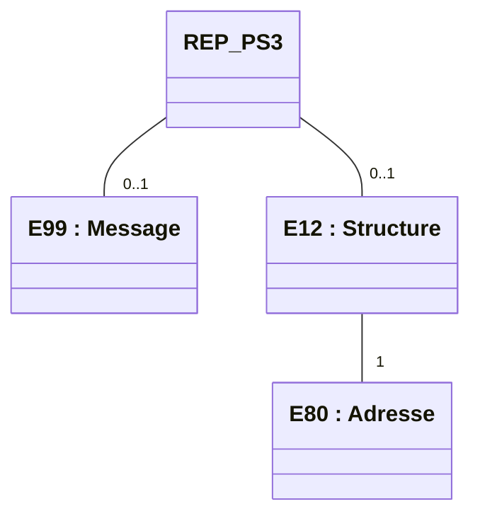
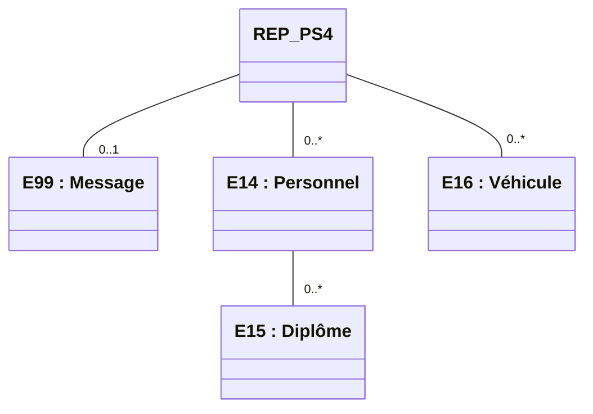

logo: sesam-vitale

**logo: **FTE****

*Guide d'Intégration*

# **Facturation Transporteur Étendue**
# **Taxi**

## **WS_PS - Services en Ligne**
## **"Partenaire de Santé"**

Référence : SEL-MP-012 / Version : 02.19 / Date : 20/05/2026
Diffusion : RESTREINTE
État : PROVISOIRE

VERSION DE TRAVAIL

**GIE SESAM-Vitale**

5, boulevard Marie et Alexandre Oyon – 72 019 LE MANS Cedex 2
<u>www.sesam-vitale.fr</u>

Ce document a été élaboré par le GIE SESAM-Vitale.

Conformément à l’article L.122-4 du Code de la Propriété Intellectuelle, toute représentation ou reproduction (intégrale ou partielle) du présent ouvrage, quel que soit le support utilisé, doit être soumise à l’accord préalable écrit de son auteur.

Il en est de même pour sa traduction, sa transformation, son adaptation ou son arrangement, quel que soit le procédé utilisé.

**Tout manquement à ces obligations constituerait un délit de contrefaçon, au sens des articles **L 335-2 et suivants du code de la propriété intellectuelle, susceptible d’entraîner des** sanctions pour l’auteur du délit.**

## **CONTACTS**

logo: sesam-vitale
icon: dots

Pour toute demande d'évolution, comme pour toute question technique ou fonctionnelle, contactez le Centre de services :

*   portail IRIS : [https://portail-support.sesam-vitale.fr/](https://portail-support.sesam-vitale.fr/)
*   téléphone : 02 43 57 42 88

VERSION DE TRAVAIL

*MP - Facturation Transporteur Étendue - Taxi*
SEL-MP-012 *WS_PS - Services en Ligne "Partenaire de Santé"* Version : 02.19

<table>
  <caption>**TABLES DES MATIERES**</caption>
    <tr>
      <td><b>1</b></td>
      <td><b>INTRODUCTION.........................................................................................................................................4</b></td>
      <td><b>4</b></td>
    </tr>
    <tr>
      <td></td>
      <td>1.1 LE SERVICE WS_PS : PARTENAIRE DE SANTÉ ........................................................................................4</td>
      <td>4</td>
    </tr>
    <tr>
      <td></td>
      <td>    <i>1.1.1 Contexte .................................................................................................................................4</i></td>
      <td>4</td>
    </tr>
    <tr>
      <td></td>
      <td>    <i>1.1.2 Pré-requis ...............................................................................................................................4</i></td>
      <td>4</td>
    </tr>
    <tr>
      <td></td>
      <td>    <i>1.1.3 Evolutions à venir...................................................................................................................4</i></td>
      <td>4</td>
    </tr>
    <tr>
      <td></td>
      <td>1.2 DOCUMENT DE RÉFÉRENCE ....................................................................................................................4</td>
      <td>4</td>
    </tr>
    <tr>
      <td></td>
      <td>1.3 ABRÉVIATIONS.......................................................................................................................................4</td>
      <td>4</td>
    </tr>
    <tr>
      <td><b>2</b></td>
      <td><b>CINÉMATIQUE ET ASPECTS FONCTIONNELS......................................................................................5</b></td>
      <td><b>5</b></td>
    </tr>
    <tr>
      <td></td>
      <td>2.1 WS_PS1 : ACQUÉRIR LES DONNÉES PS PAR N° AM ...............................................................................5</td>
      <td>5</td>
    </tr>
    <tr>
      <td></td>
      <td>    <i>2.1.1 Présentation fonctionnelle du service.....................................................................................5</i></td>
      <td>5</td>
    </tr>
    <tr>
      <td></td>
      <td>    <i>2.1.2 Données en entrée du service ...............................................................................................5</i></td>
      <td>5</td>
    </tr>
    <tr>
      <td></td>
      <td>    <i>2.1.3 Données en sortie du service .................................................................................................5</i></td>
      <td>5</td>
    </tr>
    <tr>
      <td></td>
      <td>2.2 WS_PS3 : ACQUÉRIR LES INFORMATIONS PS PAR N° FINESS ...............................................................6</td>
      <td>6</td>
    </tr>
    <tr>
      <td></td>
      <td>    <i>2.2.1 Présentation fonctionnelle du service.....................................................................................6</i></td>
      <td>6</td>
    </tr>
    <tr>
      <td></td>
      <td>    <i>2.2.2 Données en entrée du service ...............................................................................................6</i></td>
      <td>6</td>
    </tr>
    <tr>
      <td></td>
      <td>    <i>2.2.3 Données en sortie du service .................................................................................................6</i></td>
      <td>6</td>
    </tr>
    <tr>
      <td></td>
      <td>2.3 WS_PS4 : ACQUÉRIR LES INFORMATIONS RNT......................................................................................9</td>
      <td>9</td>
    </tr>
    <tr>
      <td></td>
      <td>    <i>2.3.1 Présentation fonctionnelle du service.....................................................................................9</i></td>
      <td>9</td>
    </tr>
    <tr>
      <td></td>
      <td>    <i>2.3.2 Données en entrée du service ...............................................................................................9</i></td>
      <td>9</td>
    </tr>
    <tr>
      <td></td>
      <td>    <i>2.3.3 Données en sortie du service ...............................................................................................10</i></td>
      <td>10</td>
    </tr>
    <tr>
      <td><b>3</b></td>
      <td><b>ÉLÉMENTS TECHNIQUES SPÉCIFIQUES AU SERVICE .....................................................................11</b></td>
      <td><b>11</b></td>
    </tr>
    <tr>
      <td></td>
      <td>3.1 LES COMPOSANTS DU POSTE DE TRAVAIL ..............................................................................................12</td>
      <td>12</td>
    </tr>
    <tr>
      <td></td>
      <td>3.2 MISE EN ŒUVRE ..................................................................................................................................12</td>
      <td>12</td>
    </tr>
    <tr>
      <td></td>
      <td>3.3 ENVIRONNEMENTS DE TRAVAIL .............................................................................................................14</td>
      <td>14</td>
    </tr>
    <tr>
      <td></td>
      <td>    <i>3.3.1 Environnement de test .........................................................................................................14</i></td>
      <td>14</td>
    </tr>
    <tr>
      <td></td>
      <td>    <i>3.3.2 Environnement de production ..............................................................................................14</i></td>
      <td>14</td>
    </tr>
    <tr>
      <td></td>
      <td>3.4 OPÉRATION WS_PS1 « RECHERCHERPRESCRIPTEURPRATICIEN » .......................................................15</td>
      <td>15</td>
    </tr>
    <tr>
      <td></td>
      <td>    <i>3.4.1 REQ_PS1 « EXPOLPSTRANSP_REQINFOPSAM »..........................................................15</i></td>
      <td>15</td>
    </tr>
    <tr>
      <td></td>
      <td>    <i>3.4.2 REP_PS1 « EXPOLPSTRANSP_INFOPSINDIVIDU » .......................................................15</i></td>
      <td>15</td>
    </tr>
    <tr>
      <td></td>
      <td>3.5 OPÉRATION WS_PS3 « RECHERCHERETABLISSEMENT »......................................................................16</td>
      <td>16</td>
    </tr>
    <tr>
      <td></td>
      <td>    <i>3.5.1 REQ_PS3 « EXPOLPSTRANSP_REQINFOPSFINESS »..................................................16</i></td>
      <td>16</td>
    </tr>
    <tr>
      <td></td>
      <td>    <i>3.5.2 REP_PS3 « EXPOLPSTRANSP_INFOPSSTRUCTURE ».................................................16</i></td>
      <td>16</td>
    </tr>
    <tr>
      <td></td>
      <td>3.6 OPÉRATION WS_PS4 « RECHERCHERDONNEESTRANSPORTEUR » ........................................................17</td>
      <td>17</td>
    </tr>
    <tr>
      <td></td>
      <td>    <i>3.6.1 REQ_PS4 « EXPOLPSTRANSP_REQINFOTRANSP » .....................................................17</i></td>
      <td>17</td>
    </tr>
    <tr>
      <td></td>
      <td>    <i>3.6.2 REP_PS4 « EXPOLPSTRANSP_INFOTRANSP » .............................................................17</i></td>
      <td>17</td>
    </tr>
</table>

<table>
  <caption>**TABLE DES ILLUSTRATIONS**</caption>
    <tr>
      <td>FIGURE 1 : RELATIONS ENTRE LES ENTITÉS FONCTIONNELLES DU MESSAGE REP_PS3 ............................................6</td>
      <td>6</td>
    </tr>
    <tr>
      <td>FIGURE 2 : RELATIONS ENTRE LES ENTITÉS FONCTIONNELLES DU MESSAGE REP_PS4 ..........................................10</td>
      <td>10</td>
    </tr>
</table>

<table>
  <caption>**TABLE DES ANNEXES**</caption>
    <tr>
      <td><b>ANNEXE 1</b></td>
      <td><b>MESSAGES D’ERREUR .....................................................................................................18</b></td>
      <td><b>18</b></td>
    </tr>
</table>

VERSION DE TRAVAIL

*20/05/2026* 3 / 18
*Ce document ne peut être diffusé sans l'autorisation d'une personne habilitée au GIE SESAM-Vitale*

icon: dots

*MP - Facturation Transporteur Étendue - Taxi*
*SEL-MP-012 WS_PS - Services en Ligne "Partenaire de Santé" Version : 02.19*

# **1 Introduction**

## **1.1 Le service WS_PS : Partenaire de santé**

### **1.1.1 Contexte**

Le service Partenaire de Santé, dénommé également WS_PS, permet à un LPS Transporteur d’obtenir des informations d’un Partenaire de Santé issues des référentiels de l’AMO.

Ce service a pour objectif premier d’être utilisé par le LPS du Transporteur dans le cadre de son processus de facturation en ligne.

Ce service propose 3 opérations :
WS_PS1 : Acquérir les données PS par n° AM
WS_PS3 : Acquérir les informations PS par n° FINESS
WS_PS4 : Acquérir les informations RNT

icon: icon Les noms de message et d’opération présentés au chapitre 2 (partie fonctionnelle) sont utilisés comme identifiant dans les messages au chapitre 3 (partie technique)

### **1.1.2 Pré-requis**

Le LPS doit disposer de données d’identification du Partenaire de Santé pour solliciter les opérations du service WS_PS.

L’accès au service se fait par carte CPE/CDE.

### **1.1.3 Evolutions à venir**

Dans les prochaines versions, l’accès au service WS_PS proposera l’opération d’acquisition de données PS par n°RPPS.

## **1.2 Document de référence**

<table>
  <thead>
    <tr>
      <th><b>Appellation</b></th>
      <th><b>Type et titre</b></th>
      <th><b>Référence</b></th>
    </tr>
  </thead>
  <tbody>
    <tr>
      <td>[CI]</td>
      <td>Cadre d’interopérabilité des téléservices intégrés</td>
      <td>CI-CNAMTS-DC v1.0.2</td>
    </tr>
    <tr>
      <td>[DICO]</td>
      <td>Services en Ligne "Partenaire de Santé" du système FTE</td>
      <td>FACT-SFG-029</td>
    </tr>
  </tbody>
</table>

## **1.3 Abréviations**

Cf. Document FACT-SFG-029 : Dictionnaire

VERSION DE TRAVAIL

*20/05/2026* 4 / 18
*Ce document ne peut être diffusé sans l'autorisation d'une personne habilitée au GIE SESAM-Vitale*

icon: icon

*SEL-MP-012*
*MP - Facturation Transporteur Étendue - Taxi*
*WS_PS - Services en Ligne "Partenaire de Santé"*
*Version : 02.19*

# **2 Cinématique et aspects fonctionnels**

## **2.1 WS_PS1 : Acquérir les données PS par n° AM**

### **2.1.1 Présentation fonctionnelle du service**

**Description**

Ce service fournit à l’appelant des informations connues des référentiels de l’AMO sur un Partenaire de Santé identifié par son numéro d’Assurance Maladie.

Ce Partenaire de Santé doit avoir autorisation à exercer et à prescrire au sein d’une structure de santé à la date d’évaluation donnée.

**Références techniques**

*Opération*

<table>
    <tr>
      <td>WS_PS1</td>
      <td>rechercherPrescripteurPraticien</td>
    </tr>
</table>

*Messages*

<table>
    <tr>
      <td>REQ_PS1</td>
      <td>EXPOLPSTRANSP_REQINFOPSAM</td>
    </tr>
    <tr>
      <td>REP_PS1</td>
      <td>EXPOLPSTRANSP_INFOPSINDIVIDU</td>
    </tr>
</table>

### **2.1.2 Données en entrée du service**

<table>
  <thead>
    <tr>
      <th>Référence</th>
      <th>Libellé</th>
      <th>Description</th>
      <th>O/F</th>
    </tr>
  </thead>
  <tbody>
    <tr>
      <td><strong><b>DE_PS1_01</b></strong></td>
      <td>Identifiant AM du PS</td>
      <td>Identifiant A.M. du partenaire de santé</td>
      <td>O</td>
    </tr>
    <tr>
      <td><strong><b>DE_PS1_02</b></strong></td>
      <td>Date d’évaluation</td>
      <td>Cette date ne doit pas être postérieure à la date du jour</td>
      <td>O</td>
    </tr>
  </tbody>
</table>

### **2.1.3 Données en sortie du service**

<table>
  <thead>
    <tr>
      <th>Référence</th>
      <th>Libellé</th>
      <th>Description</th>
      <th>O/F</th>
    </tr>
  </thead>
  <tbody>
    <tr>
      <td><strong>DS_PS1_E10</strong></td>
      <td>Partenaire de Santé</td>
      <td>Données d’identification du Partenaire de Santé</td>
      <td>O</td>
    </tr>
    <tr>
      <td><strong><b>DS_PS1_E10.02</b></strong></td>
      <td>Identifiant RPPS du PS</td>
      <td>N° RPPS du partenaire de santé</td>
      <td>F</td>
    </tr>
    <tr>
      <td><strong><b>DS_PS1_E10.03</b></strong></td>
      <td>Nom de famille du PS</td>
      <td>Nom du partenaire de santé</td>
      <td>O</td>
    </tr>
    <tr>
      <td><strong><b>DS_PS1_E10.04</b></strong></td>
      <td>Prénom du PS</td>
      <td>Prénom du partenaire de santé</td>
      <td>F</td>
    </tr>
    <tr>
      <td><strong><b>DS_PS1_E10.05</b></strong></td>
      <td>Code spécialité du PS</td>
      <td>Code spécialité du partenaire de santé</td>
      <td>F</td>
    </tr>
    <tr>
      <td><strong>DS_PS1_E99</strong></td>
      <td>Message</td>
      <td>Message d’information</td>
      <td>F</td>
    </tr>
    <tr>
      <td><strong><b>DS_PS1_E99.01</b></strong></td>
      <td>Code Message</td>
      <td>Code du Message d’information</td>
      <td>O</td>
    </tr>
    <tr>
      <td><strong><b>DS_PS1_E99.02</b></strong></td>
      <td>Libellé Message</td>
      <td>Libellé du Message d’information</td>
      <td>O</td>
    </tr>
  </tbody>
</table>

VERSION DE TRAVAIL

*20/05/2026*
5 / 18
*Ce document ne peut être diffusé sans l'autorisation d'une personne habilitée au GIE SESAM-Vitale*

icon: SESAM-Vitale logo

*MP - Facturation Transporteur Étendue - Taxi*
SEL-MP-012 *WS_PS - Services en Ligne "Partenaire de Santé"* Version : 02.19

# **2.2** **WS_PS3 : Acquérir les informations PS par n° FINESS**

## **2.2.1** **Présentation fonctionnelle du service**

**Description**

Ce service fournit à l’appelant des informations connues des référentiels de l’AMO sur un établissement de santé identifié par son numéro FINESS.

**Références techniques**

***Opération***

<table>
    <tr>
      <td>WS_PS3</td>
      <td>rechercherEtablissement</td>
    </tr>
</table>

***Messages***

<table>
<tr>
<td>REQ_PS3</td>
<td>EXPOLPSTRANSP_REQINFOPSFINESS</td>
</tr>
<tr>
<td>REP_PS3</td>
<td>EXPOLPSTRANSP_INFOPSSTRUCTURE</td>
</tr>
</table>

## **2.2.2** **Données en entrée du service**

<table>
  <thead>
    <tr>
      <th><strong><b>Référence</b></strong></th>
      <th><strong><b>Libellé</b></strong></th>
      <th><strong>Description</strong></th>
      <th><strong><b>O/F</b></strong></th>
    </tr>
  </thead>
  <tbody>
    <tr>
      <td><strong><b>DE_PS3_01</b></strong></td>
      <td>Identifiant FINESS</td>
      <td>N° FINESS de l’établissement de santé</td>
      <td>O</td>
    </tr>
    <tr>
      <td><strong><b>DE_PS3_02</b></strong></td>
      <td>Date d’évaluation</td>
      <td>Cette date ne doit pas être postérieure à la date du jour</td>
      <td>O</td>
    </tr>
  </tbody>
</table>

## **2.2.3** **Données en sortie du service**

**Schéma**

**Figure 1 : relations entre les entités fonctionnelles du message REP_PS3**

VERSION DE TRAVAIL

*20/05/2026* 6 / 18
*Ce document ne peut être diffusé sans l'autorisation d'une personne habilitée au GIE SESAM-Vitale*

icon: SESAM-Vitale logo

SEL-MP-012
*MP - Facturation Transporteur Étendue - Taxi*
*WS_PS - Services en Ligne "Partenaire de Santé"*
Version : 02.19

## **Données**

<table>
    <thead>
        <tr>
            <th><b>Référence</b></th>
            <th><b>Libellé</b></th>
            <th><b>Description</b></th>
            <th><b>O/F</b></th>
        </tr>
    </thead>
    <tbody>
        <tr>
            <td><strong>DS_PS3_E12</strong></td>
            <td>Structure</td>
            <td>Informations générales d’identification de la structure de santé</td>
            <td>F</td>
        </tr>
        <tr>
            <td><strong><b>DS_PS3_E12.02</b></strong></td>
            <td>Code spécialité</td>
            <td>Code d’une spécialité exercée dans cette structure et compatible avec la prescription de prestations de transport</td>
            <td>F</td>
        </tr>
        <tr>
            <td><strong><b>DS_PS3_E12.03</b></strong></td>
            <td>Raison sociale</td>
            <td>Raison sociale de la structure de santé</td>
            <td>O</td>
        </tr>
        <tr>
            <td><strong>DS_PS3_E80</strong></td>
            <td>Adresse</td>
            <td>Adresse de la structure de santé</td>
            <td>O</td>
        </tr>
        <tr>
            <td><strong><b>DS_PS3_E80.01</b></strong></td>
            <td>Identité du Destinataire</td>
            <td>AFNOR XP Z 10-011, ligne 1 : - Lorsque le destinataire est un particulier, il est identifié par sa civilité ou son titre, par sa qualité, ses nom et prénom. - Lorsque le destinataire est une entreprise, il est identifié par la raison sociale ou la dénomination de l’entreprise. L’identité du destinataire final au sein de l’entreprise correspond à un complément d’adresse, qui figure en ligne 2 de l’adresse</td>
            <td>F</td>
        </tr>
        <tr>
            <td><strong><b>DS_PS3_E80.02</b></strong></td>
            <td>Point de Remise</td>
            <td>AFNOR XP Z 10-011, ligne 2 : - Lorsque le destinataire est une personne physique : identité du domicile (mention « chez »), numéro de boite aux lettre ou d’appartement, escalier, étage, CIDEX (Courrier Individuel à Destination Exceptionnelle), etc. - Lorsque le destinataire est une personne morale : Identité de la personne destinataire, direction, service, numéro de l’étage, bureau, etc.</td>
            <td>F</td>
        </tr>
        <tr>
            <td><strong><b>DS_PS3_E80.03</b></strong></td>
            <td>Complément d’adresse</td>
            <td><i>AFNOR XP Z 10-011, ligne 3 :</i> Complément au point géographique. Accès au bâtiment, bâtiment, ensemble immobilier.</td>
            <td>F</td>
        </tr>
        <tr>
            <td><strong><b>DS_PS3_E80.04</b></strong></td>
            <td>Numéro de la voie</td>
            <td><i>AFNOR XP Z 10-011, ligne 4 :</i> Point géographique. Numéro dans la voie.</td>
            <td>F</td>
        </tr>
        <tr>
            <td><strong><b>DS_PS3_E80.05</b></strong></td>
            <td>Extension du numéro de voie</td>
            <td><i>AFNOR XP Z 10-011, ligne 4 :</i> Point géographique. Extension du numéro dans la voie sous forme littérale (Bis, Ter, Quater, etc. ) ou codée (B, T, Q, C etc.).  Il peut également s'agir d'une simple lettre (A, B, C, etc.).</td>
            <td>F</td>
        </tr>
        <tr>
            <td><strong><b>DS_PS3_E80.06</b></strong></td>
            <td>Type de voie</td>
            <td><i>AFNOR XP Z 10-011, ligne 4 :</i> Point géographique. Donne la nature de voie sous forme littérale, abrégée, ou codée.</td>
            <td>F</td>
        </tr>
        <tr>
            <td><strong><b>DS_PS3_E80.07</b></strong></td>
            <td>Nom de la voie</td>
            <td><i>AFNOR XP Z 10-011, ligne 4 :</i> Point géographique. Nom ou libellé de la voie. « Nom de la voie » <i>(E80.07)</i> peut également transporter l’intégralité de la ligne 4. Dans ce cas, ne doivent pas être utilisés : - ni « Numéro de la voie » <i>(E80.04)</i>, - ni « Extension du numéro de voie » <i>(E80.05)</i>, - ni « Type de voie » <i>(E80.04)</i>.</td>
            <td>F</td>
        </tr>
    </tbody>
</table>

VERSION DE TRAVAIL

*20/05/2026*
7 / 18
*Ce document ne peut être diffusé sans l'autorisation d'une personne habilitée au GIE SESAM-Vitale*

icon: icon

*SEL-MP-012*
*MP - Facturation Transporteur Étendue - Taxi*
*WS_PS - Services en Ligne "Partenaire de Santé"*
*Version : 02.19*

<table>
    <tr>
      <td><strong><b>DS_PS3_E80.08</b></strong></td>
      <td>Mention distribution</td>
      <td><i>AFNOR XP Z 10-011, ligne 5</i> : Mention particulière de distribution. BP, Poste Restante, TSA (Tri Service Arrivée), AUTORISATION etc., suivie du libellé de la localité de destination dans le cas ou celle-ci serait différente du libellé CEDEX, lieu dit ou hameau.</td>
      <td>F</td>
    </tr>
    <tr>
      <td><strong><b>DS_PS3_E80.09</b></strong></td>
      <td>Code Postal</td>
      <td><i>AFNOR XP Z 10-011, ligne 6</i> : Informations d'acheminement. Code postal ou code CEDEX (Courrier d'Entreprise à Distribution EXceptionnelle). Dans ce dernier cas, l'information identifiant le bureau de CEDEX doit également être renseignée.</td>
      <td>F</td>
    </tr>
    <tr>
      <td><strong><b>DS_PS3_E80.10</b></strong></td>
      <td>Localité</td>
      <td>LibelleCommune <i>AFNOR XP Z 10-011, ligne 6</i> : informations d'acheminement. Nom de la localité du destinataire, ou libellé du bureau distributeur CEDEX (dans ce cas, présence obligatoire de l'attribut Cedex (E80.09)). Localité peut également transporter l’intégralité de la ligne 6. Dans ce cas, ni Code Postal (E80.09), ni Cedex(E80.09), ni Code Pays(E80.011) ne doivent être utilisés.</td>
      <td>F</td>
    </tr>
    <tr>
      <td><strong><b>DS_PS3_E80.11</b></strong></td>
      <td>Code du pays</td>
      <td>AFNOR XP Z 10-011, ligne 6 : informations d'acheminement. Pour les adresses à l'étranger : code identifiant le pays. Ex. ISO 3166, UN7372/3207,etc. Contrainte : {0,38}</td>
      <td>F</td>
    </tr>
    <tr>
      <td><strong><b>DS_PS3_E80.12</b></strong></td>
      <td>Nom du pays</td>
      <td>Ligne additionnelle 7 : nom du pays. Pour les adresses à l'étranger : nom du pays, de l'entité géographique, de la province, etc.</td>
      <td>F</td>
    </tr>
    <tr>
      <td><strong><b>DS_PS3_E80.13</b></strong></td>
      <td>Code INSEE</td>
      <td>Numéro INSEE de la commune de résidence.</td>
      <td>F</td>
    </tr>
    <tr>
      <td><strong><b>DS_PS3_E80.14</b></strong></td>
      <td>Ligne d’adresse</td>
      <td>Description d'une ligne d'adresse.</td>
      <td>F</td>
    </tr>
    <tr>
      <td><strong><b>DS_PS3_E80.15</b></strong></td>
      <td>Manuelle</td>
      <td>Usage réservé à l’A.M.</td>
      <td>F</td>
    </tr>
    <tr>
      <td><strong>DS_PS3_E99</strong></td>
      <td>Message</td>
      <td>Message d’information</td>
      <td>F</td>
    </tr>
    <tr>
      <td><strong><b>DS_PS3_E99.01</b></strong></td>
      <td>Code Message</td>
      <td>Code du Message d’information</td>
      <td>O</td>
    </tr>
    <tr>
      <td><strong><b>DS_PS3_E99.02</b></strong></td>
      <td>Libellé Message</td>
      <td>Libellé du Message d’information</td>
      <td>O</td>
    </tr>
</table>

icon: three dots

VERSION DE TRAVAIL

*20/05/2026*
8 / 18
*Ce document ne peut être diffusé sans l'autorisation d'une personne habilitée au GIE SESAM-Vitale*

*MP - Facturation Transporteur Étendue - Taxi*
*SEL-MP-012 WS_PS - Services en Ligne "Partenaire de Santé" Version : 02.19*

# **2.3** **WS_PS4 : Acquérir les informations RNT**

## **2.3.1** **Présentation fonctionnelle du service**

**Description**

Ce service fournit à l’appelant des informations concernant son personnel et son parc automobile, connues au référentiel AMO RNT (Référentiel National Transporteurs) dans une période donnée.

La recherche se fait à partir du N° AM de l’appelant (i.e. inscrit dans l’entête du message) et à partir duquel l’appelant est authentifié.

**Références techniques**

***Opération***

<table>
<tr>
<td>WS_PS4</td>
<td>rechercherDonneesTransporteur</td>
</tr>
</table>

***Messages***

<table>
    <tr>
      <td>REQ_PS4</td>
      <td>EXPOLPSTRANSP_ REQINFOTRANSP</td>
    </tr>
    <tr>
      <td>REP_PS4</td>
      <td>EXPOLPSTRANSP_ INFOTRANSP</td>
    </tr>
</table>

## **2.3.2** **Données en entrée du service**

<table>
  <thead>
    <tr>
      <th><b>Référence</b></th>
      <th><b>Libellé</b></th>
      <th>Description</th>
      <th><b>O/F</b></th>
    </tr>
  </thead>
  <tbody>
    <tr>
      <td><strong><b>DE_PS4_01</b></strong></td>
      <td>Date de début</td>
      <td>Date de début de période de recherche des informations du RNT  Cette date ne doit pas être postérieure à la date du jour.</td>
      <td>O</td>
    </tr>
    <tr>
      <td><strong><b>DE_PS4_02</b></strong></td>
      <td>Date de fin</td>
      <td>Date de fin de période de recherche des informations du RNT.  Cette date doit être postérieure à la date de début et ne doit pas être postérieure à la date du jour.  Si cette information n’est pas renseignée, le service considère comme date de fin la date du jour</td>
      <td>F</td>
    </tr>
  </tbody>
</table>

VERSION DE TRAVAIL

*20/05/2026* 9 / 18
*Ce document ne peut être diffusé sans l'autorisation d'une personne habilitée au GIE SESAM-Vitale*

icon: SESAM-Vitale logo

SEL-MP-012 *MP - Facturation Transporteur Étendue - Taxi* Version : 02.19
*WS_PS - Services en Ligne "Partenaire de Santé"*

## **2.3.3** **Données en sortie du service**

**Schéma**

**Figure 2 : relations entre les entités fonctionnelles du message REP_PS4**

### **Données**

<table>
  <thead>
    <tr>
      <th><b>Référence</b></th>
      <th><b>Libellé</b></th>
      <th><b>Description</b></th>
      <th><b>O/F</b></th>
    </tr>
  </thead>
  <tbody>
    <tr>
      <td><strong>DS_PS4_E14</strong></td>
      <td>Personnel</td>
      <td>Personne physique exerçant dans l’entreprise de transport et assurant le rôle de personnel conducteur ou accompagnant</td>
      <td>F</td>
    </tr>
    <tr>
      <td><strong><b>DS_PS4_E14.01</b></strong></td>
      <td>Nom de famille</td>
      <td>Nom de famille de la personne</td>
      <td>O</td>
    </tr>
    <tr>
      <td><strong><b>DS_PS4_E14.02</b></strong></td>
      <td>Prénom</td>
      <td>Prénom de la personne</td>
      <td>O</td>
    </tr>
    <tr>
      <td><strong><b>DS_PS4_E14.03</b></strong></td>
      <td>Date d’entrée</td>
      <td>Date d’entrée dans l’entreprise de transport.</td>
      <td>O</td>
    </tr>
    <tr>
      <td><strong><b>DS_PS4_E14.04</b></strong></td>
      <td>Date de sortie</td>
      <td>Date de départ de l’entreprise de transport.</td>
      <td>F</td>
    </tr>
    <tr>
      <td><strong>DS_PS4_E15</strong></td>
      <td>Diplôme</td>
      <td></td>
      <td>F</td>
    </tr>
    <tr>
      <td><strong><b>DS_PS4_E15.01</b></strong></td>
      <td>Nature du diplôme</td>
      <td>Type du diplôme : • AA (Auxiliaire Ambulancier) • BNPS (Brevet National des Premiers Secours) • BNS (Brevet National de Secourisme) • CCA (Certificat de Capacité d'Ambulancier) • DEA (Diplôme d'Etat d'Ambulancier) • PSC 1 (Prévention et Secours Civiques niveau 1) • PSC 2 (Prévention et Secours Civiques niveau 2) Cette liste est non exhaustive et susceptible d’évoluer.</td>
      <td>O</td>
    </tr>
    <tr>
      <td><strong><b>DS_PS4_E15.02</b></strong></td>
      <td>Date d’obtention du diplôme</td>
      <td>Date d’obtention du diplôme</td>
      <td>O</td>
    </tr>
    <tr>
      <td><strong><b>DS_PS4_E16</b></strong></td>
      <td>Véhicule</td>
      <td></td>
      <td>F</td>
    </tr>
  </tbody>
</table>

icon: logo

*20/05/2026* 10 / 18
*Ce document ne peut être diffusé sans l'autorisation d'une personne habilitée au GIE SESAM-Vitale*

*MP - Facturation Transporteur Étendue - Taxi*
*SEL-MP-012 WS_PS - Services en Ligne "Partenaire de Santé" Version : 02.19*

<table>
    <tr>
      <td><strong><b>DS_PS4_E16.01</b></strong></td>
      <td>Immatriculation</td>
      <td>Immatriculation du véhicule</td>
      <td>O</td>
    </tr>
    <tr>
      <td><strong><b>DS_PS4_E16.02</b></strong></td>
      <td>Date d’autorisation</td>
      <td>Date d’autorisation ARS du véhicule, i.e. date d’entrée du véhicule dans le parc.</td>
      <td>O</td>
    </tr>
    <tr>
      <td><strong><b>DS_PS4_E16.03</b></strong></td>
      <td>Date de sortie du parc</td>
      <td>Date de vente ou de sortie du véhicule du parc</td>
      <td>F</td>
    </tr>
    <tr>
      <td><strong>DS_PS4_E99</strong></td>
      <td>Message</td>
      <td>Message d’information</td>
      <td>F</td>
    </tr>
    <tr>
      <td><strong><b>DS_PS4_E99.01</b></strong></td>
      <td>Code Message</td>
      <td>Code du Message d’information</td>
      <td>O</td>
    </tr>
    <tr>
      <td><strong><b>DS_PS4_E99.02</b></strong></td>
      <td>Libellé Message</td>
      <td>Libellé du Message d’information</td>
      <td>O</td>
    </tr>
</table>

## 3 **Éléments techniques spécifiques au service**

Les mécanismes techniques mis en œuvre sont décrits dans le cadre d'interopérabilité, version 1.0.2 minimum. Ce chapitre traite uniquement des spécificités de ce téléservice.

icon: icon Le cadre d’interopérabilité contient toutes les informations techniques qu’il est nécessaire de prendre en compte pour l’intégration d’un téléservice à un progiciel de santé.
La section présente décrit quant à elle tous les éléments **spécifiques au service**, et rien que ces éléments.
Vous devez donc vous appuyer sur les deux documents pour avoir la totalité des informations nécessaires.

icon: icon Les formats, plages de valeurs et types des données spécifiés dans le présent document sont présentés à titre indicatif. Ils peuvent être amenés à évoluer. Seuls les schémas XSD constituent la référence des échanges.

icon: icon Les formats des données sont décrits dans le cadre d’interopérabilité.

Deux formats supplémentaires sont susceptibles d’être utilisés dans le service :

<table>
  <thead>
    <tr>
      <th>Code</th>
      <th><b>Signification</b></th>
      <th></th>
    </tr>
  </thead>
  <tbody>
    <tr>
      <td>ND</td>
      <td>Nombre Décimal.  Le format ND est conforme à la définition de la norme XML schémas xsd:decimal (avec utilisation du point comme séparateur).  Exemple : «999.50», «+999.5450», «-999.5230», «14», etc.</td>
      <td></td>
    </tr>
    <tr>
      <td>T</td>
      <td>Le format T est de type hh:mm:ss±hh:mm. (ISO 8601, Local time, Extended format).  +hh:mm/-hh:mm : Décalage par rapport à l'heure UTC.  <mark><u>Exemple : «15:27:46+01:00».</u></mark>  <mark><s>En absence de consigne spécifique, l’heure est exprimée en heure locale avec décalage horaire UTC.</s></mark>  <mark>Il est demandé de ne pas indiquer le décalage par rapport à l’heure UTC.</mark>  <mark>Par exemple, pour une heure locale de 15h27, indiquer dans le flux « 15:27:00 » au lieu de « 15:27:00+2 :00 ».</mark></td>
      <td></td>
    </tr>
  </tbody>
</table>

DESSIN DE TRAVAIL VERSION

*20/05/2026* 11 / 18
*Ce document ne peut être diffusé sans l'autorisation d'une personne habilitée au GIE SESAM-Vitale*

icon: icon

*MP - Facturation Transporteur Étendue - Taxi*
*SEL-MP-012* *WS_PS - Services en Ligne "Partenaire de Santé"* *Version : 02.19*

## **3.1** **Les composants du poste de travail**

Le poste de travail doit disposer de composants permettant au progiciel d'accéder aux cartes à puces.

Les composants d'accès liés à la carte CPx sont les librairies cryptographiques (CryptoLib) de l'ASIP-Santé.

Grâce aux données obtenues des cartes, le progiciel formate ses requêtes et les envoie sur une liaison sécurisée préalablement établie.

icon: icon Toutes les documentations des produits cités ci-dessus sont disponibles sur l’Espace Industriels du GIE SESAM-Vitale ou le site de l’ASIP Santé.

## **3.2** **Mise en œuvre**

icon: icon Voir cadre d’interopérabilité – volet «Web-service», chapitre «Liaison sécurisée avec authentification du téléservice».

icon: icon Voir cadre d’interopérabilité – Document « Assertions et contexte ».

icon: icon Le document « Assertions et contexte » du cadre d’interopérabilité fixe les champs des assertions et des contextes à renseigner obligatoirement.

**Occurrences des**
**en-têtes et**
**requêtes**

<table>
  <thead>
    <tr>
      <th colspan="2">Opération</th>
      <th colspan="3"><b>Assertion / contexte</b></th>
    </tr>
    <tr>
      <th></th>
      <th></th>
      <th>PS</th>
      <th>LPS</th>
      <th>BAM</th>
    </tr>
  </thead>
  <tbody>
    <tr>
      <td>WS_PS1</td>
      <td>rechercherPrescripteurPraticien</td>
      <td>X</td>
      <td>X</td>
      <td></td>
    </tr>
    <tr>
      <td>WS_PS3</td>
      <td>rechercherEtablissement</td>
      <td>X</td>
      <td>X</td>
      <td></td>
    </tr>
    <tr>
      <td>WS_PS4</td>
      <td>rechercherDonneesTransporteur</td>
      <td>X</td>
      <td>X</td>
      <td></td>
    </tr>
  </tbody>
</table>
<u>Légende</u> : X = obligatoire

**Niveaux de**
**sécurité des**
**assertions**

Un contrôle est effectué sur les niveaux de sécurité des assertions, en référence au cadre d’interopérabilité (à partir de la version 1.0.2), volet «Web-service», chapitre «Niveau de contrôle des assertions».

<table>
  <thead>
    <tr>
      <th colspan="2">Opération</th>
      <th>Assertion</th>
    </tr>
    <tr>
      <th></th>
      <th></th>
      <th>PS</th>
    </tr>
  </thead>
  <tbody>
    <tr>
      <td>WS_PS1</td>
      <td>rechercherPrescripteurPraticien</td>
      <td rowspan="3">Niveau 2</td>
    </tr>
    <tr>
      <td>WS_PS3</td>
      <td>rechercherEtablissement</td>
    </tr>
    <tr>
      <td>WS_PS4</td>
      <td>rechercherDonneesTransporteur</td>
    </tr>
  </tbody>
</table>

*20/05/2026* *12 / 18*
*Ce document ne peut être diffusé sans l'autorisation d'une personne habilitée au GIE SESAM-Vitale*

icon: icon

SEL-MP-012 *MP - Facturation Transporteur Étendue - Taxi* Version : 02.19
*WS_PS - Services en Ligne "Partenaire de Santé"*

## **Renseignement des Assertions et Contextes**

Le tableau ci-dessous présente pour chaque opération, les champs à renseigner dans les en-têtes **en plus** des champs obligatoires décrits dans le cadre d’interopérabilité :

<table>
  <thead>
    <tr>
      <th></th>
      <th></th>
      <th></th>
      <th>rechercherPrescripteurPraticien</th>
      <th>rechercherEtablissement</th>
      <th>rechercherDonneesTransporteur</th>
    </tr>
    <tr>
      <th><b>Assertion</b> / <b>Contexte</b></th>
      <th><b>Champs</b></th>
      <th>Renseignement</th>
      <th>WS_PS1</th>
      <th>WS_PS3</th>
      <th>WS_PS4</th>
    </tr>
  </thead>
  <tbody>
    <tr>
      <td rowspan="2">AssertionPS</td>
      <td colspan="2">AttributeStatement</td>
      <td>X</td>
      <td>X</td>
      <td>X</td>
    </tr>
    <tr>
      <td>identifiantFacturation</td>
      <td>N° de facturation + clé renseignés par le Transporteur</td>
      <td>X</td>
      <td>X</td>
      <td>X</td>
    </tr>
  </tbody>
</table>

Pour appeler les services de facturation en ligne, le progiciel doit obtenir les données CPx par lecture de la carte.

### *Cas particulier Utilisation en multi-sociétés*

Dans le cas d’une utilisation en multi-sociétés, l’identifiant de facturation de l’assertion PS doit correspondre :

*   pour le service WS_PS4 : au n° de facturation de la **société fille** ayant réalisé le trajet ou qui va le réaliser, i.e. la **société fille**.
*   pour les services WS_PS1 et WS_PS3 : au n° de facturation du PS facturant (**société fille**) ou du PS émetteur (**société mère**) selon les organisations en place.

VERSION DE TRAVAIL

*20/05/2026* 13 / 18
*Ce document ne peut être diffusé sans l'autorisation d'une personne habilitée au GIE SESAM-Vitale*

icon: logo

*MP - Facturation Transporteur Étendue - Taxi*
*SEL-MP-012 WS_PS - Services en Ligne "Partenaire de Santé" Version : 02.19*

# **3.3** **Environnements de travail**

Deux environnements sont disponibles : un environnement de test et un environnement de production. Le passage de l’un à l’autre implique des changements de configuration qui ont un impact sur les flux XML échangés au sein de l’infrastructure.

## **3.3.1** **Environnement de test**

**URL d’appel**
L’URL d’appel est : [https://qualiflps.services-ps.ameli.fr/lps](https://qualiflps.services-ps.ameli.fr/lps)

**Numéro d’autorisation**
Vous devez utiliser le numéro d’autorisation de test fourni par le CNDA lors de la signature des conditions particulières de la convention.

Le type du numéro d’autorisation à utiliser dans le flux XML est «4» (voir chapitre 3.1 du volet «Assertions et contextes» du cadre d’interopérabilité).

Pour plus d'informations, voir le guide de tests de conformité du CNDA, chapitre «Pré-requis».

## **3.3.2** **Environnement de production**

**URL d’appel**
L’URL d’appel est : [https://services-ps.ameli.fr/lps](https://services-ps.ameli.fr/lps)

**Numéro d’autorisation**
Vous devez utiliser le numéro d’autorisation définitif obtenu auprès du CNDA à l’issue de la procédure d’autorisation.

Le type du numéro d’autorisation à utiliser dans le flux XML est «4» (voir chapitre 3.1 du volet «Assertions et contextes» du cadre d’interopérabilité).

VERSION DE TRAVAIL

*20/05/2026* 14 / 18
*Ce document ne peut être diffusé sans l'autorisation d'une personne habilitée au GIE SESAM-Vitale*

icon: decorative dots

*MP - Facturation Transporteur Étendue - Taxi*
SEL-MP-012 *WS_PS - Services en Ligne "Partenaire de Santé" Version : 02.19*

## **3.4** **Opération WS_PS1 « rechercherPrescripteurPraticien »**

### **3.4.1** **REQ_PS1 « EXPOLPSTRANSP_REQINFOPSAM »**

<table>
  <thead>
    <tr>
      <th><strong>Balises XML</strong> <i>Italique : attribut</i></th>
      <th><strong>Occ</strong></th>
      <th><strong>Format</strong></th>
      <th><strong>Donnée fonctionnelle</strong></th>
    </tr>
  </thead>
  <tbody>
    <tr>
      <td>DateEval</td>
      <td>1</td>
      <td>D</td>
      <td>DE_PS1_02</td>
    </tr>
    <tr>
      <td><strong>PARTENAIREDESANTE</strong></td>
      <td>1</td>
      <td></td>
      <td></td>
    </tr>
    <tr>
      <td>    Numero</td>
      <td>1</td>
      <td>AN</td>
      <td>DE_PS1_01</td>
    </tr>
  </tbody>
</table>

### **3.4.2** **REP_PS1 « EXPOLPSTRANSP_INFOPSINDIVIDU »**

<table>
  <thead>
    <tr>
      <th><b>Balises XML</b> <i>Italique : attribut</i></th>
      <th>Occ</th>
      <th>Format</th>
      <th>Donnée fonctionnelle</th>
    </tr>
  </thead>
  <tbody>
    <tr>
      <td><b>PARTENAIREDESANTE</b></td>
      <td>0..1</td>
      <td></td>
      <td>DS_PS1_E10</td>
    </tr>
    <tr>
      <td>    CodeSpe</td>
      <td>0..1</td>
      <td>AN</td>
      <td>DS_PS1_E10.05</td>
    </tr>
    <tr>
      <td>    <b><b>PRESTATAIRE</b></b></td>
      <td>1</td>
      <td></td>
      <td>DS_PS1_E10</td>
    </tr>
    <tr>
      <td>        Numero</td>
      <td>0..1</td>
      <td>AN</td>
      <td>DS_PS1_E10.02</td>
    </tr>
    <tr>
      <td>        NomFamille</td>
      <td>1</td>
      <td>AN</td>
      <td>DS_PS1_E10.03</td>
    </tr>
    <tr>
      <td>        Prenom</td>
      <td>0..1</td>
      <td>AN</td>
      <td>DS_PS1_E10.04</td>
    </tr>
    <tr>
      <td><b><b>MESSAGE</b></b></td>
      <td>0..1</td>
      <td></td>
      <td>DE_PS1_E99</td>
    </tr>
    <tr>
      <td>    Code</td>
      <td>1</td>
      <td>AN</td>
      <td>DE_PS1_E99.01</td>
    </tr>
    <tr>
      <td>    Libelle</td>
      <td>1</td>
      <td>AN</td>
      <td>DE_PS1_E99.02</td>
    </tr>
  </tbody>
</table>

VERSION DE TRAVAIL

*20/05/2026* 15 / 18
*Ce document ne peut être diffusé sans l'autorisation d'une personne habilitée au GIE SESAM-Vitale*

icon: logo

SEL-MP-012
*MP - Facturation Transporteur Étendue - Taxi*
*WS_PS - Services en Ligne "Partenaire de Santé"*
Version : 02.19

# **3.5** **Opération WS_PS3 « rechercherEtablissement »**

## **3.5.1** **REQ_PS3 « EXPOLPSTRANSP_REQINFOPSFINESS »**

<table>
  <thead>
    <tr>
      <th><strong>Balises XML</strong> <i>Italique : attribut</i></th>
      <th><strong>Occ</strong></th>
      <th><strong>Format</strong></th>
      <th><strong>Donnée fonctionnelle</strong></th>
    </tr>
  </thead>
  <tbody>
    <tr>
      <td>DateEval</td>
      <td>1</td>
      <td>D</td>
      <td>DE_PS3_02</td>
    </tr>
    <tr>
      <td><strong>PARTENAIREDESANTE</strong></td>
      <td>1</td>
      <td></td>
      <td></td>
    </tr>
    <tr>
      <td>    Numero</td>
      <td>1</td>
      <td>AN</td>
      <td>DE_PS3_01</td>
    </tr>
  </tbody>
</table>

## **3.5.2** **REP_PS3 « EXPOLPSTRANSP_INFOPSSTRUCTURE »**

<table>
  <thead>
    <tr>
      <th>Balises XML <i>Italique : attribut</i></th>
      <th>Occ</th>
      <th>Format</th>
      <th>Donnée fonctionnelle</th>
    </tr>
  </thead>
  <tbody>
    <tr>
      <td><strong>PARTENAIREDESANTE</strong></td>
      <td>0..1</td>
      <td></td>
      <td></td>
    </tr>
    <tr>
      <td>    RaisonSociale</td>
      <td>1</td>
      <td>AN</td>
      <td>DS_PS3_E12.03</td>
    </tr>
    <tr>
      <td>    CodeSpe</td>
      <td>0..1</td>
      <td>AN</td>
      <td>DS_PS3_E12.02</td>
    </tr>
    <tr>
      <td>    <strong><b>STUCTURE</b></strong></td>
      <td>1</td>
      <td></td>
      <td>DS_PS3_E12</td>
    </tr>
    <tr>
      <td>        <strong><b>ADRESSE</b></strong></td>
      <td>1</td>
      <td></td>
      <td>DS_PS3_E80</td>
    </tr>
    <tr>
      <td>            Destinataire</td>
      <td>0..1</td>
      <td>AN</td>
      <td>DS_PS3_E80.01</td>
    </tr>
    <tr>
      <td>            PointRemise</td>
      <td>0..1</td>
      <td>AN</td>
      <td>DS_PS3_E80.02</td>
    </tr>
    <tr>
      <td>            Complement</td>
      <td>0..1</td>
      <td>AN</td>
      <td>DS_PS3_E80.03</td>
    </tr>
    <tr>
      <td>            NumeroVoie</td>
      <td>0..1</td>
      <td>AN</td>
      <td>DS_PS3_E80.04</td>
    </tr>
    <tr>
      <td>            IndiceRepetition</td>
      <td>0..1</td>
      <td>AN</td>
      <td>DS_PS3_E80.05</td>
    </tr>
    <tr>
      <td>            TypeVoie</td>
      <td>0..1</td>
      <td>AN</td>
      <td>DS_PS3_E80.06</td>
    </tr>
    <tr>
      <td>            NomVoie</td>
      <td>0..1</td>
      <td>AN</td>
      <td>DS_PS3_E80.07</td>
    </tr>
    <tr>
      <td>            MentionDistribution</td>
      <td>0..1</td>
      <td>AN</td>
      <td>DS_PS3_E80.08</td>
    </tr>
    <tr>
      <td>            CodePostal</td>
      <td>0..1</td>
      <td>AN</td>
      <td>DS_PS3_E80.09</td>
    </tr>
    <tr>
      <td>            Localite</td>
      <td>0..1</td>
      <td>AN</td>
      <td>DS_PS3_E80.10</td>
    </tr>
    <tr>
      <td>            CodePays</td>
      <td>0..1</td>
      <td>AN</td>
      <td>DS_PS3_E80.11</td>
    </tr>
    <tr>
      <td>            NomPays</td>
      <td>0..1</td>
      <td>AN</td>
      <td>DS_PS3_E80.12</td>
    </tr>
    <tr>
      <td>            CodeInsee</td>
      <td>0..1</td>
      <td>AN</td>
      <td>DS_PS3_E80.13</td>
    </tr>
    <tr>
      <td>            Ligne</td>
      <td>0..n</td>
      <td>AN</td>
      <td>DS_PS3_E80.14</td>
    </tr>
    <tr>
      <td>            Manuelle</td>
      <td>0..1</td>
      <td>B</td>
      <td>DS_PS3_E80.15</td>
    </tr>
    <tr>
      <td><strong><b>MESSAGE</b></strong></td>
      <td>0..1</td>
      <td></td>
      <td>DS_PS3_E99</td>
    </tr>
    <tr>
      <td>    Code</td>
      <td>1</td>
      <td>AN</td>
      <td>DS_PS3_E99.01</td>
    </tr>
    <tr>
      <td>    Libelle</td>
      <td>1</td>
      <td>AN</td>
      <td>DS_PS3_E99.02</td>
    </tr>
  </tbody>
</table>

VERSION DE TRAVAIL

*20/05/2026*
*Ce document ne peut être diffusé sans l'autorisation d'une personne habilitée au GIE SESAM-Vitale*
16 / 18

icon: SESAM-Vitale logo

SEL-MP-012
MP - Facturation Transporteur Étendue - Taxi
WS_PS - Services en Ligne "Partenaire de Santé"
Version : 02.19

# 3.6 Opération WS_PS4 « rechercherDonneesTransporteur »

## 3.6.1 REQ_PS4 « EXPOLPSTRANSP_REQINFOTRANSP »

<table>
  <thead>
    <tr>
      <th><b>Balises XML</b> <i>Italique : attribut</i></th>
      <th><b>Occ</b></th>
      <th><b>Format</b></th>
      <th><b>Donnée fonctionnelle</b></th>
    </tr>
  </thead>
  <tbody>
    <tr>
      <td>DATEDEBUT</td>
      <td>1</td>
      <td>D</td>
      <td>DE_PS4_01</td>
    </tr>
    <tr>
      <td>DATEFIN</td>
      <td>0..1</td>
      <td>D</td>
      <td>DE_PS4_02</td>
    </tr>
  </tbody>
</table>

## 3.6.2 REP_PS4 « EXPOLPSTRANSP_INFOTRANSP »

<table>
  <thead>
    <tr>
      <th>Balises XML <i>Italique : attribut</i></th>
      <th>Occ</th>
      <th>Format</th>
      <th>Donnée fonctionnelle</th>
    </tr>
  </thead>
  <tbody>
    <tr>
      <td><strong>TRANSPORTEUR</strong></td>
      <td>0..1</td>
      <td></td>
      <td></td>
    </tr>
    <tr>
      <td>    <strong>VEHICULE</strong></td>
      <td>0..n</td>
      <td></td>
      <td>DS_PS4_E16</td>
    </tr>
    <tr>
      <td>        Immatriculation</td>
      <td>1</td>
      <td>AN</td>
      <td>DS_PS4_E16.01</td>
    </tr>
    <tr>
      <td>        DateAutoDDASS</td>
      <td>1</td>
      <td>D</td>
      <td>DS_PS4_E16.02</td>
    </tr>
    <tr>
      <td>        DateVente</td>
      <td>0..1</td>
      <td>D</td>
      <td>DS_PS4_E16.03</td>
    </tr>
    <tr>
      <td>    <strong>PERSONNEL</strong></td>
      <td>0..n</td>
      <td></td>
      <td>DS_PS4_E14</td>
    </tr>
    <tr>
      <td>        NomFamille</td>
      <td>1</td>
      <td>AN</td>
      <td>DS_PS4_E14.01</td>
    </tr>
    <tr>
      <td>        Prenom</td>
      <td>1</td>
      <td>AN</td>
      <td>DS_PS4_E14.02</td>
    </tr>
    <tr>
      <td>        DateEntree</td>
      <td>1</td>
      <td>D</td>
      <td>DS_PS4_E14.03</td>
    </tr>
    <tr>
      <td>        DateSortie</td>
      <td>0..1</td>
      <td>D</td>
      <td>DS_PS4_E14.04</td>
    </tr>
    <tr>
      <td>        <strong>DIPLOME</strong></td>
      <td>0..n</td>
      <td></td>
      <td>DS_PS4_E15</td>
    </tr>
    <tr>
      <td>            Nature</td>
      <td>1</td>
      <td>AN</td>
      <td>DS_PS4_E15.01</td>
    </tr>
    <tr>
      <td>            DateAcquis</td>
      <td>1</td>
      <td>D</td>
      <td>DS_PS4_E15.02</td>
    </tr>
    <tr>
      <td><strong>MESSAGE</strong></td>
      <td>0..1</td>
      <td></td>
      <td>DS_PS4_E99</td>
    </tr>
    <tr>
      <td>    Code</td>
      <td>1</td>
      <td>AN</td>
      <td>DS_PS4_E99.01</td>
    </tr>
    <tr>
      <td>    Libelle</td>
      <td>1</td>
      <td>AN</td>
      <td>DS_PS4_E99.02</td>
    </tr>
  </tbody>
</table>

VERSION DE TRAVAIL

20/05/2026
17 / 18
Ce document ne peut être diffusé sans l'autorisation d'une personne habilitée au GIE SESAM-Vitale

icon: logo

*MP - Facturation Transporteur Étendue - Taxi*
SEL-MP-012 *WS_PS - Services en Ligne "Partenaire de Santé" Version : 02.19*

# **Annexe 1 Messages d’erreur**

## **Erreurs techniques**

En cas d’erreur remontée par le service, le progiciel affiche une fenêtre contenant le libellé de l’erreur, sans traitement, et suivi du code entre parenthèses.

Le code erreur est préfixé par le nom de l'espace de nommage.

Par exemple, pour une déclaration xmlns:soapenv="http://www.w3.org/2003/05/soap-envelope", le code erreur est préfixé par soapenv (par exemple : soapenv:10).

icon: icon Attention, le nom de l'espace de nommage peut varier.

Le tableau suivant vient compléter la liste des erreurs du cadre d’interopérabilité. De type « SOAP FAULT », ces erreurs sont propres au service WS_PS et reprennent les principes de ce dernier.

<table>
  <thead>
    <tr>
      <th colspan="3"><b>Faute SOAP</b></th>
      <th colspan="3"><b>Détail</b></th>
    </tr>
    <tr>
      <th>Code</th>
      <th>Subcode</th>
      <th><b>Reason</b></th>
      <th>Code</th>
      <th>Severite</th>
      <th>Descriptif</th>
    </tr>
  </thead>
  <tbody>
    <tr>
      <td rowspan="4">Sender</td>
      <td>ips_ps_002</td>
      <td>{0} inconnu(e) dans le répertoire national</td>
      <td rowspan="4">-</td>
      <td rowspan="4">-</td>
      <td rowspan="4">-</td>
    </tr>
    <tr>
      <td>ips_ps_005</td>
      <td>Le PS prescripteur n'a pas d'autorisation d'exercer à la date d'évaluation</td>
    </tr>
    <tr>
      <td>ips_ps_006</td>
      <td>Incohérence date de début et/ou date de fin de la prestation</td>
    </tr>
    <tr>
      <td>ips_ps_023</td>
      <td>Les données sont obligatoires : {0}</td>
    </tr>
    <tr>
      <td>Receiver</td>
      <td>siram_40</td>
      <td>Le service est temporairement inaccessible. Veuillez renouveler votre demande ultérieurement. Si le problème persiste, contactez l’éditeur du progiciel.</td>
      <td>ips_err_technique</td>
      <td>Fatale</td>
      <td>Le service est temporairement inaccessible. Veuillez renouveler votre demande ultérieurement.</td>
    </tr>
  </tbody>
</table>

## **Erreurs fonctionnelles**

Les erreurs de type fonctionnel propres au service WS_PS sont présents dans les éléments de type « Message ».

Ces erreurs fonctionnelles sont présentées dans la table TB_ERR_F : table de référence des messages d’erreurs fonctionnelles dans le document [DICO] du système FTE.

VERSION DE TRAVAIL

*20/05/2026* 18 / 18
*Ce document ne peut être diffusé sans l'autorisation d'une personne habilitée au GIE SESAM-Vitale*

icon: icon