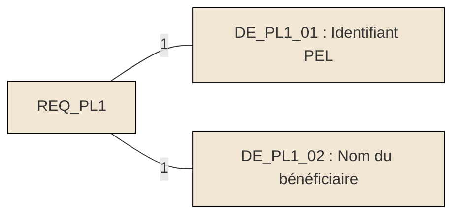
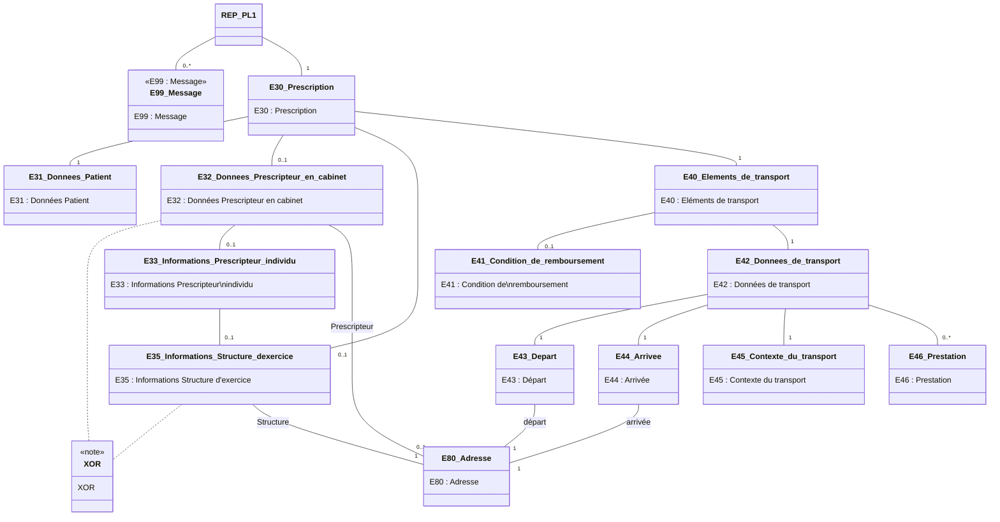
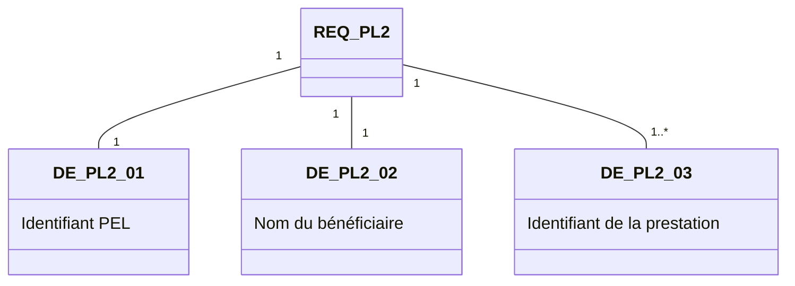
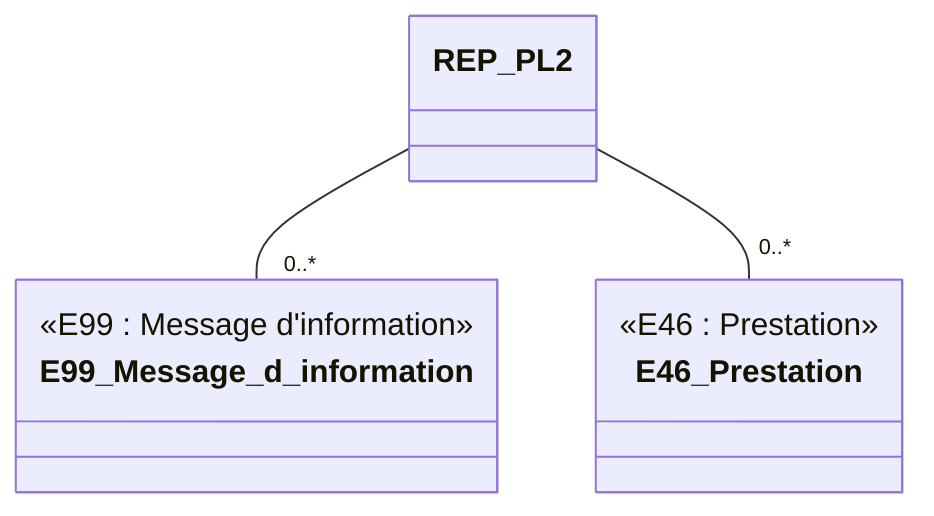
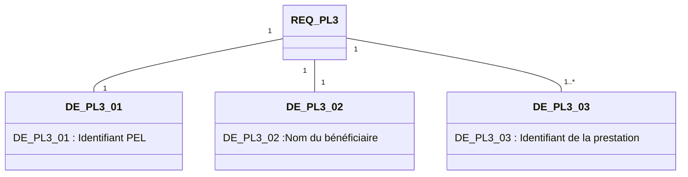
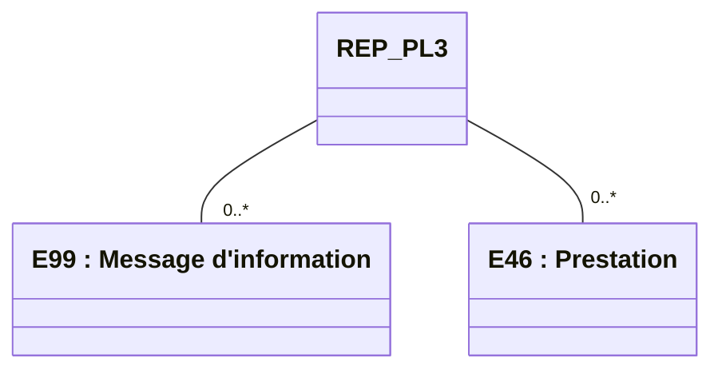

logo: sesam-vitale

logo: **FTE**

*Guide d'Intégration*

# **Système de Facturation Transporteur**
# ***Taxi***

## **WS_PL - Services en Ligne**
## **"Prescription en Ligne"**

Référence : SEL-MP-014 / Version : 03.16 / Date : 20/05/2026
Diffusion : RESTREINTE
État : PROVISOIRE

VERSION DE TRAVAIL

**GIE SESAM-Vitale**
5, boulevard Marie et Alexandre Oyon – 72 019 LE MANS Cedex 2
<u>www.sesam-vitale.fr</u>

Ce document a été élaboré par le GIE SESAM-Vitale.

Conformément à l’article L.122-4 du Code de la Propriété Intellectuelle, toute représentation ou reproduction (intégrale ou partielle) du présent ouvrage, quel que soit le support utilisé, doit être soumise à l’accord préalable écrit de son auteur.

Il en est de même pour sa traduction, sa transformation, son adaptation ou son arrangement, quel que soit le procédé utilisé.

**Tout manquement à ces obligations constituerait un délit de contrefaçon, au sens des articles **L 335-2 et suivants du code de la propriété intellectuelle, susceptible d’entraîner des** sanctions pour l’auteur du délit.**

## **CONTACTS**

icon: sesam-vitale

Pour toute demande d'évolution, comme pour toute question technique ou fonctionnelle, contactez le Centre de services :

*   portail IRIS : [https://portail-support.sesam-vitale.fr/](https://portail-support.sesam-vitale.fr/)
*   téléphone : 02 43 57 42 88

VERSION DE TRAVAIL

*SEL-MP-014*
*MP - Système de Facturation Transporteur - Taxi*
*WS_PL - Services en Ligne "Prescription en Ligne"*
*Version : 03.16*

# **TABLES DES MATIERES**

<table>
    <tr>
      <td><b>1</b></td>
      <td><b>INTRODUCTION.........................................................................................................................................4</b></td>
      <td><b>4</b></td>
    </tr>
    <tr>
      <td>1.1</td>
      <td>LE SERVICE WS_PL : PRESCRIPTION EN LIGNE ......................................................................................4</td>
      <td>4</td>
    </tr>
    <tr>
      <td></td>
      <td><i>1.1.1 Contexte .................................................................................................................................4</i></td>
      <td><i>4</i></td>
    </tr>
    <tr>
      <td></td>
      <td><i>1.1.2 Pré-requis ...............................................................................................................................4</i></td>
      <td><i>4</i></td>
    </tr>
    <tr>
      <td>1.2</td>
      <td>DOCUMENT DE RÉFÉRENCE ....................................................................................................................4</td>
      <td>4</td>
    </tr>
    <tr>
      <td>1.3</td>
      <td>ABRÉVIATIONS.......................................................................................................................................4</td>
      <td>4</td>
    </tr>
    <tr>
      <td><b>2</b></td>
      <td><b>CINÉMATIQUE ET ASPECTS FONCTIONNELS......................................................................................5</b></td>
      <td><b>5</b></td>
    </tr>
    <tr>
      <td>2.1</td>
      <td>WS_PL1 : ACQUÉRIR LES INFORMATIONS D’UNE PEL .............................................................................5</td>
      <td>5</td>
    </tr>
    <tr>
      <td></td>
      <td><i>2.1.1 Présentation fonctionnelle de l’opération ...............................................................................5</i></td>
      <td><i>5</i></td>
    </tr>
    <tr>
      <td></td>
      <td><i>2.1.2 Données en entrée du service ...............................................................................................5</i></td>
      <td><i>5</i></td>
    </tr>
    <tr>
      <td></td>
      <td><i>2.1.3 Données en sortie du service .................................................................................................6</i></td>
      <td><i>6</i></td>
    </tr>
    <tr>
      <td></td>
      <td>    2.1.3.1 Données transverses ........................................................................................................... 10</td>
      <td>10</td>
    </tr>
    <tr>
      <td>2.2</td>
      <td>WS_PL2 : RÉSERVER PRESTATION D’UNE PEL ....................................................................................12</td>
      <td>12</td>
    </tr>
    <tr>
      <td></td>
      <td><i>2.2.1 Présentation fonctionnelle du service...................................................................................12</i></td>
      <td><i>12</i></td>
    </tr>
    <tr>
      <td></td>
      <td><i>2.2.2 Données en entrée du service .............................................................................................12</i></td>
      <td><i>12</i></td>
    </tr>
    <tr>
      <td></td>
      <td><i>2.2.3 Données en sortie du service ...............................................................................................13</i></td>
      <td><i>13</i></td>
    </tr>
    <tr>
      <td>2.3</td>
      <td>WS_PL3 : SIGNALER LA RÉALISATION DE PRESTATIONS D’UNE PEL ......................................................14</td>
      <td>14</td>
    </tr>
    <tr>
      <td></td>
      <td><i>2.3.1 Présentation fonctionnelle du service...................................................................................14</i></td>
      <td><i>14</i></td>
    </tr>
    <tr>
      <td></td>
      <td><i>2.3.2 Données en entrée du service .............................................................................................14</i></td>
      <td><i>14</i></td>
    </tr>
    <tr>
      <td></td>
      <td><i>2.3.3 Données en sortie du service ...............................................................................................15</i></td>
      <td><i>15</i></td>
    </tr>
    <tr>
      <td><b>3</b></td>
      <td><b>ÉLÉMENTS TECHNIQUES SPÉCIFIQUES AU SERVICE .....................................................................16</b></td>
      <td><b>16</b></td>
    </tr>
    <tr>
      <td>3.1</td>
      <td>LES COMPOSANTS DU POSTE DE TRAVAIL ..............................................................................................16</td>
      <td>16</td>
    </tr>
    <tr>
      <td>3.2</td>
      <td>MISE EN ŒUVRE ..................................................................................................................................17</td>
      <td>17</td>
    </tr>
    <tr>
      <td>3.3</td>
      <td>ENVIRONNEMENTS DE TRAVAIL .............................................................................................................18</td>
      <td>18</td>
    </tr>
    <tr>
      <td></td>
      <td><i>3.3.1 Environnement de test .........................................................................................................18</i></td>
      <td><i>18</i></td>
    </tr>
    <tr>
      <td></td>
      <td><i>3.3.2 Environnement de production ..............................................................................................19</i></td>
      <td><i>19</i></td>
    </tr>
    <tr>
      <td>3.4</td>
      <td>OPÉRATION WS_PL1 « ACQUERIRPRESCRIPTION » .............................................................................19</td>
      <td>19</td>
    </tr>
    <tr>
      <td></td>
      <td><i>3.4.1 REQ_PL1 « EXPOLPSTRANSP_REQPELTRANSP » .......................................................19</i></td>
      <td><i>19</i></td>
    </tr>
    <tr>
      <td></td>
      <td><i>3.4.2 REP_PL1 « EXPOLPSTRANSP_PELTRANSP »................................................................19</i></td>
      <td><i>19</i></td>
    </tr>
    <tr>
      <td>3.5</td>
      <td>OPÉRATION WS_PL2 « RESERVERTRAJET »........................................................................................25</td>
      <td>25</td>
    </tr>
    <tr>
      <td></td>
      <td><i>3.5.1 REQ_PL2 « EXPOLPSTRANSP_REQRESERVERTRAJET » ...........................................25</i></td>
      <td><i>25</i></td>
    </tr>
    <tr>
      <td></td>
      <td><i>3.5.2 REP_PL2 « EXPOLPSTRANSP_RESERVERTRAJET »....................................................25</i></td>
      <td><i>25</i></td>
    </tr>
    <tr>
      <td>3.6</td>
      <td>OPÉRATION WS_PL3 « EXECUTERTRAJET »........................................................................................26</td>
      <td>26</td>
    </tr>
    <tr>
      <td></td>
      <td><i>3.6.1 REQ_PL3 « EXPOLPSTRANSP_REQEXECUTERTRAJET » ...........................................26</i></td>
      <td><i>26</i></td>
    </tr>
    <tr>
      <td></td>
      <td><i>3.6.2 REP_PL3 « EXPOLPSTRANSP_EXECUTERTRAJET »....................................................26</i></td>
      <td><i>26</i></td>
    </tr>
    <tr>
      <td colspan="3"><b><b>TABLE DES ILLUSTRATIONS</b></b></td>
    </tr>
    <tr>
      <td colspan="2">FIGURE 1 : RELATIONS ENTRE LES ENTITÉS FONCTIONNELLES DU MESSAGE REQ_PL1 ............................................5</td>
      <td>5</td>
    </tr>
    <tr>
      <td colspan="2">FIGURE 2 : RELATIONS ENTRE LES ENTITÉS FONCTIONNELLES DU MESSAGE REP_PL1.............................................6</td>
      <td>6</td>
    </tr>
    <tr>
      <td colspan="2">FIGURE 3 : RELATIONS ENTRE LES ENTITÉS FONCTIONNELLES DU MESSAGE REQ_PL2 ..........................................12</td>
      <td>12</td>
    </tr>
    <tr>
      <td colspan="2">FIGURE 4 : RELATIONS ENTRE LES ENTITÉS FONCTIONNELLES DU MESSAGE REP_PL2...........................................13</td>
      <td>13</td>
    </tr>
    <tr>
      <td colspan="2">FIGURE 5 : RELATIONS ENTRE LES ENTITÉS FONCTIONNELLES DU MESSAGE REQ_PL3 ..........................................14</td>
      <td>14</td>
    </tr>
    <tr>
      <td colspan="2">FIGURE 6 : RELATIONS ENTRE LES ENTITÉS FONCTIONNELLES DU MESSAGE REP_PL3...........................................15</td>
      <td>15</td>
    </tr>
    <tr>
      <td colspan="3"><b><b>TABLE DES ANNEXES</b></b></td>
    </tr>
    <tr>
      <td><b>ANNEXE 1</b></td>
      <td><b>MESSAGES D’ERREUR .....................................................................................................27</b></td>
      <td><b>27</b></td>
    </tr>
</table>

VERSION DE TRAVAIL

*20/05/2026*
*3 / 28*
*Ce document ne peut être diffusé sans l'autorisation d'une personne habilitée au GIE SESAM-Vitale*

icon: dots

SEL-MP-014 *MP - Système de Facturation Transporteur - Taxi*
*WS_PL - Services en Ligne "Prescription en Ligne"* Version : 03.16

# 1 **Introduction**

## 1.1 **Le service WS_PL : Prescription en Ligne**

### 1.1.1 **Contexte**

Le service Prescription en ligne, dénommé également WS_PL, permet à un LPS Transporteur :

*   d’acquérir les informations d’une prescription issues des référentiels de l’AMO (PEL),
*   de réserver une ou plusieurs prestations d’une PEL,
*   de signaler la réalisation d’une ou plusieurs prestations d’une PEL.

Ce service qui a pour objectif d’être utilisé par le LPS du Transporteur dans le cadre de son processus de facturation en ligne propose 3 opérations :

WS_PL1 : Acquérir les informations d’une PEL
WS_PL2 : Réserver prestation d’une PEL
WS_PL3 : Signaler la réalisation de prestations d’une PEL

icon: arrow Les noms de message et d’opération présentés au chapitre 2 (partie fonctionnelle) sont utilisés comme identifiant dans les messages au chapitre 3 (partie technique)

### 1.1.2 **Pré-requis**

Le LPS doit, à minima, disposer de données d’identification de la prescription (numéro de la prescription), et du nom du bénéficiaire pour solliciter les opérations du service WS_PL.

## 1.2 **Document de référence**

<table>
  <thead>
    <tr>
      <th><b>Appellation</b></th>
      <th><b>Type et titre</b></th>
      <th><b>Référence</b></th>
    </tr>
  </thead>
  <tbody>
    <tr>
      <td>[CI]</td>
      <td>Cadre d’interopérabilité des téléservices intégrés</td>
      <td>CI-CNAMTS-DC v1.0.2</td>
    </tr>
    <tr>
      <td>[DICO]</td>
      <td>Services en Ligne "Prescription en Ligne" du système FTE</td>
      <td>FACT-SFG-029</td>
    </tr>
  </tbody>
</table>

## 1.3 **Abréviations**

Cf. Document FACT-SFG-029 : Dictionnaire

VERSION DE TRAVAIL

*20/05/2026* 4 / 28
*Ce document ne peut être diffusé sans l'autorisation d'une personne habilitée au GIE SESAM-Vitale*

icon: decorative dots

*MP - Système de Facturation Transporteur - Taxi*
*SEL-MP-014 WS_PL - Services en Ligne "Prescription en Ligne" Version : 03.16*

# 2 **Cinématique et aspects fonctionnels**

## 2.1 **WS_PL1 : Acquérir les informations d’une PEL**

### 2.1.1 **Présentation fonctionnelle de l’opération**

**Description**

Cette opération fournit l’ensemble des informations d’une PEL hormis les informations à caractère médical.

icon: arrow L'ordre de restitution des trajets par le service est non significatif. L'ordre d'affichage de ces trajets au Transporteur reste à la convenance de l'Editeur.

**Références techniques**

*Opération*

<table>
    <tr>
      <td>WS_PL1</td>
      <td>acquerirPrescription</td>
    </tr>
</table>

*Messages*

<table>
    <tr>
      <td>REQ_PL1</td>
      <td>EXPOLPSTRANSP_REQPELTRANSP</td>
    </tr>
    <tr>
      <td>REP_PL1</td>
      <td>EXPOLPSTRANSP_PELTRANSP</td>
    </tr>
</table>

### 2.1.2 **Données en entrée du service**

**Schéma**

Figure 1 : relations entre les entités fonctionnelles du message REQ_PL1

**Données**

<table>
  <thead>
    <tr>
      <th><b>Référence</b></th>
      <th><b>Libellé</b></th>
      <th>Description</th>
      <th><b>O/F</b></th>
    </tr>
  </thead>
  <tbody>
    <tr>
      <td><strong><b>DE_PL1_01</b></strong></td>
      <td>Identifiant PEL</td>
      <td>Identifiant de la prescription acquis par le transporteur</td>
      <td>O</td>
    </tr>
    <tr>
      <td><strong><b>DE_PL1_02</b></strong></td>
      <td>Nom du bénéficiaire</td>
      <td>Nom du bénéficiaire acquis par le transporteur</td>
      <td>O</td>
    </tr>
  </tbody>
</table>

VERSION DE TRAVAIL

*20/05/2026* 5 / 28
*Ce document ne peut être diffusé sans l'autorisation d'une personne habilitée au GIE SESAM-Vitale*

icon: logo

*SEL-MP-014*
*MP - Système de Facturation Transporteur - Taxi*
*WS_PL - Services en Ligne "Prescription en Ligne"*
*Version : 03.16*

## **2.1.3** **Données en sortie du service**

### **Schéma**

Figure 2 : relations entre les entités fonctionnelles du message REP_PL1

VERSION DE TRAVAIL

*20/05/2026*
*6 / 28*
*Ce document ne peut être diffusé sans l'autorisation d'une personne habilitée au GIE SESAM-Vitale*

icon: SESAM-Vitale logo

*MP - Système de Facturation Transporteur - Taxi*
SEL-MP-014 *WS_PL - Services en Ligne "Prescription en Ligne"* Version : 03.16

# **Données**

<table>
  <thead>
    <tr>
      <th><b>Référence</b></th>
      <th><b>Libellé</b></th>
      <th><b>Description</b></th>
      <th><b>O/F</b></th>
    </tr>
  </thead>
  <tbody>
    <tr>
      <td><strong>DS_PL1_E30</strong></td>
      <td><strong>Données Prescription</strong></td>
      <td></td>
      <td><strong>F</strong></td>
    </tr>
    <tr>
      <td><strong><b>DS_PL1_E30.01</b></strong></td>
      <td>Identifiant PEL</td>
      <td>Identifiant de la prescription</td>
      <td>O</td>
    </tr>
    <tr>
      <td><strong><b>DS_PL1_E30.02</b></strong></td>
      <td>Date de la PEL</td>
      <td>Date de la prescription</td>
      <td>O</td>
    </tr>
    <tr>
      <td><strong><b>DS_PL1_E30.03</b></strong></td>
      <td>Type de PEL</td>
      <td>Indique s’il s’agit une prescription médicamenteuse, de transport, etc. … Dans le cadre de la PEL, valorisé à « TRS»</td>
      <td>F</td>
    </tr>
    <tr>
      <td><strong><b>DS_PL1_E30.04</b></strong></td>
      <td>Statut de la prescription</td>
      <td>Valeurs possibles : Cf. [Dico] TB30-04</td>
      <td>F</td>
    </tr>
    <tr>
      <td><strong><b>DS_PL1_E30.05</b></strong></td>
      <td>Horodatage du statut de la prescription</td>
      <td></td>
      <td>F</td>
    </tr>
    <tr>
      <td><strong>DS_PL1_E31</strong></td>
      <td><strong>Données bénéficiaire</strong></td>
      <td></td>
      <td><strong>O</strong></td>
    </tr>
    <tr>
      <td><strong><b>DS_PL1_E31.01</b></strong></td>
      <td>NIR OD</td>
      <td>NIR de l’ouvrant droit,</td>
      <td>O</td>
    </tr>
    <tr>
      <td><strong><b>DS_PL1_E31.02</b></strong></td>
      <td>Clé NIR OD</td>
      <td></td>
      <td>O</td>
    </tr>
    <tr>
      <td><strong><b>DS_PL1_E31.03</b></strong></td>
      <td>Nom de famille bénéficiaire</td>
      <td></td>
      <td>O</td>
    </tr>
    <tr>
      <td><strong><b>DS_PL1_E31.04</b></strong></td>
      <td>Nom d’usage bénéficiaire</td>
      <td></td>
      <td>F</td>
    </tr>
    <tr>
      <td><strong><b>DS_PL1_E31.05</b></strong></td>
      <td>Prénom bénéficiaire</td>
      <td></td>
      <td>F</td>
    </tr>
    <tr>
      <td><strong><b>DS_PL1_E31.06</b></strong></td>
      <td>Date naissance bénéficiaire</td>
      <td></td>
      <td>O</td>
    </tr>
    <tr>
      <td><strong><b>DS_PL1_E31.07</b></strong></td>
      <td>Rang du bénéficiaire</td>
      <td></td>
      <td>O</td>
    </tr>
    <tr>
      <td><strong>DS_PL1_E32</strong></td>
      <td><strong>Données <b>Prescripteur en</b> cabinet</strong></td>
      <td></td>
      <td><strong>F</strong></td>
    </tr>
    <tr>
      <td><strong><b>DS_PL1_E32.01</b></strong></td>
      <td>Identifiant AM prescripteur</td>
      <td>Identifiant AM du prescripteur libéral Non renseigné pour un prescripteur salarié d’un établissement</td>
      <td>O</td>
    </tr>
    <tr>
      <td><strong><b>DS_PL1_E32.02</b></strong></td>
      <td>Raison sociale</td>
      <td>Nom de la raison sociale du prescripteur libéral Non renseigné pour un prescripteur salarié d’un établissement</td>
      <td>F</td>
    </tr>
    <tr>
      <td><strong><b>DS_PL1_E32.E80</b></strong></td>
      <td>Adresse prescripteur en cabinet</td>
      <td>Adresse du cabinet du prescripteur libéral Non renseigné pour un prescripteur salarié d’un établissement Cf. T80</td>
      <td>F</td>
    </tr>
    <tr>
      <td><strong>DS_PL1_E33</strong></td>
      <td><strong><b>Information</b> prescripteur <b>individu</b></strong></td>
      <td></td>
      <td><strong>F</strong></td>
    </tr>
    <tr>
      <td><strong><b>DS_PL1_E33.01</b></strong></td>
      <td>Numéro RPPS Prescripteur</td>
      <td>PRESCRIPTEUR/PRESTATAIRE/numéro</td>
      <td>F</td>
    </tr>
    <tr>
      <td><strong><b>DS_PL1_E33.02</b></strong></td>
      <td>Nom de famille Prescripteur</td>
      <td>PRESCRIPTEUR/PRESTATAIRE/nom</td>
      <td>F</td>
    </tr>
  </tbody>
</table>

VERSION DE TRAVAIL

*20/05/2026* 7 / 28
*Ce document ne peut être diffusé sans l'autorisation d'une personne habilitée au GIE SESAM-Vitale*

icon: icon

*SEL-MP-014*
*MP - Système de Facturation Transporteur - Taxi*
*WS_PL - Services en Ligne "Prescription en Ligne"*
*Version : 03.16*

<table>
    <tr>
      <td><strong><b>DS_PL1_E33.03</b></strong></td>
      <td>Prénom du prescripteur</td>
      <td>PRESCRIPTEUR/PRESTATAIRE/prénom</td>
      <td>F</td>
    </tr>
    <tr>
      <td><strong>DS_PL1_E35</strong></td>
      <td><strong><b>Information</b> structure d'exercice</strong></td>
      <td></td>
      <td><strong>F</strong></td>
    </tr>
    <tr>
      <td><strong><b>DS_PL1_E35.01</b></strong></td>
      <td>Identifiant de la structure</td>
      <td>Identifiant FINESS géographique de l’établissement du prescripteur salarié. Non renseigné pour un prescripteur libéral</td>
      <td>O</td>
    </tr>
    <tr>
      <td><strong><b>DS_PL1_E35.02</b></strong></td>
      <td>Raison sociale</td>
      <td>Raison sociale de l’établissement du prescripteur salarié. Non renseigné pour un prescripteur libéral</td>
      <td>F</td>
    </tr>
    <tr>
      <td><strong><b>DS_PL1_E35.03</b></strong></td>
      <td>Adresse structure d'exercice</td>
      <td>Adresse de l’établissement du prescripteur salarié. Non renseigné pour un prescripteur libéral Cf. T80</td>
      <td>O</td>
    </tr>
    <tr>
      <td><strong>DS_PL1_E40</strong></td>
      <td><strong><b>Eléments de</b> transport</strong></td>
      <td></td>
      <td><strong>O</strong></td>
    </tr>
    <tr>
      <td><strong><b>DS_PL1_E40.01</b></strong></td>
      <td>ID des éléments de transport</td>
      <td></td>
      <td>O</td>
    </tr>
    <tr>
      <td><strong><b>DS_PL1_E40.02</b></strong></td>
      <td>Validité des éléments de transport</td>
      <td></td>
      <td>F</td>
    </tr>
    <tr>
      <td><strong>DS_PL1_E41</strong></td>
      <td><strong>Condition de remboursement</strong></td>
      <td></td>
      <td><strong>F</strong></td>
    </tr>
    <tr>
      <td><strong><b>DS_PL1_E41.01</b></strong></td>
      <td>Taux remboursement</td>
      <td>Taux de remboursement de la prestation estimé lors de l’élaboration de la prescription.</td>
      <td>F</td>
    </tr>
    <tr>
      <td><strong>DS_PL1_E42</strong></td>
      <td><strong><b>Données de</b> transport</strong></td>
      <td></td>
      <td><strong>O</strong></td>
    </tr>
    <tr>
      <td><strong><b>DS_PL1_E42.01</b></strong></td>
      <td>Nature transport</td>
      <td>Précise s’il s’agit d’un transport Aller ou d’un transport Aller/Retour Valeurs possibles : Cf. [Dico] TB42-01</td>
      <td>O</td>
    </tr>
    <tr>
      <td><strong><b>DS_PL1_E42.02</b></strong></td>
      <td>Nombre de transport</td>
      <td>Indique le nombre de prestation de transport</td>
      <td>O</td>
    </tr>
    <tr>
      <td><strong><b>DS_PL1_E42.03</b></strong></td>
      <td>Mode transport</td>
      <td>Mode de transport prescrit. Valeurs possibles : Cf. [Dico] TB42-03</td>
      <td>O</td>
    </tr>
    <tr>
      <td><strong><b>DS_PL1_E42.04</b></strong></td>
      <td>Condition de transport</td>
      <td>Condition particulière de transport Exemple : - Nécessité d’une personne accompagnante si transport en commun - Nécessité d’une asepsie - Urgence attestée par le médecin prescripteur Dans le cadre de la PEL, valorisation possible : « Nécessité d’une asepsie» Valeurs possibles : Cf. [Dico] TB42-04</td>
      <td>F</td>
    </tr>
    <tr>
      <td><strong>DS_PL1_E43</strong></td>
      <td><strong><b>Départ</b></strong></td>
      <td></td>
      <td><strong>O</strong></td>
    </tr>
    <tr>
      <td><strong><b>DS_PL1_E43.01</b></strong></td>
      <td>Nature du lieu</td>
      <td>Précise si le lieu est le domicile, un établissement ou autre Valeurs possibles : Cf. [Dico] TB4x-01</td>
      <td>F</td>
    </tr>
    <tr>
      <td><strong><b>DS_PL1_E43.E80</b></strong></td>
      <td>Adresse de départ</td>
      <td>Cf. T80</td>
      <td>F</td>
    </tr>
</table>

VERSION DE TRAVAIL

*20/05/2026*
*8 / 28*
*Ce document ne peut être diffusé sans l'autorisation d'une personne habilitée au GIE SESAM-Vitale*

icon: GIE SESAM-Vitale logo

*SEL-MP-014*
*MP - Système de Facturation Transporteur - Taxi*
*WS_PL - Services en Ligne "Prescription en Ligne"*
*Version : 03.16*

<table>
    <tr>
      <td><strong>DS_PL1_E44</strong></td>
      <td><strong><b>Arrivée</b></strong></td>
      <td></td>
      <td><strong>O</strong></td>
    </tr>
    <tr>
      <td><strong><b>DS_PL1_E44.01</b></strong></td>
      <td>Nature du lieu</td>
      <td>Précise si le lieu est le domicile, un établissement ou autre</td>
      <td>F</td>
    </tr>
    <tr>
      <td><strong><b>DS_PL1_E44.E80</b></strong></td>
      <td>Adresse d’arrivée</td>
      <td>Cf. T80</td>
      <td>F</td>
    </tr>
    <tr>
      <td><strong>DS_PL1_E45</strong></td>
      <td><strong><b>Contexte du</b> transport</strong></td>
      <td></td>
      <td><strong>O</strong></td>
    </tr>
    <tr>
      <td><strong><b>DS_PL1_E45.01</b></strong></td>
      <td>Motif du transport</td>
      <td>Valeurs possibles : Cf. [Dico] TB45-01</td>
      <td>O</td>
    </tr>
    <tr>
      <td><strong><b>DS_PL1_E45.02</b></strong></td>
      <td>Date ATMP</td>
      <td>Date de l’AT</td>
      <td>F</td>
    </tr>
    <tr>
      <td><strong><b>DS_PL1_E45.03</b></strong></td>
      <td>Exonération</td>
      <td>Prise en charge à 100%</td>
      <td>F</td>
    </tr>
    <tr>
      <td><strong><b>DS_PL1_E45.04</b></strong></td>
      <td>Indicateur accident DC</td>
      <td>Indicateur d’accident de droit commun</td>
      <td>F</td>
    </tr>
    <tr>
      <td><strong><b>DS_PL1_E45.05</b></strong></td>
      <td>Date accident DC</td>
      <td>Date d’accident de droit commun</td>
      <td>F</td>
    </tr>
    <tr>
      <td><strong><b>DS_PL1_E45.06</b></strong></td>
      <td>ALD exonérante</td>
      <td>Précise si l’ALD est exonérante</td>
      <td>F</td>
    </tr>
    <tr>
      <td><strong><b>DS_PL1_E45.07</b></strong></td>
      <td>Forçage</td>
      <td>Permet de maintenir une information saisie par le prescripteur; Concerne les AT, ALD, ExoTM.  Valeurs possibles : Cf. [Dico] TB45-07</td>
      <td>F</td>
    </tr>
    <tr>
      <td><strong>DS_PL1_E46</strong></td>
      <td><strong><b>Prestation</b></strong></td>
      <td></td>
      <td><strong>F</strong></td>
    </tr>
    <tr>
      <td><strong><b>DS_PL1_E46.01</b></strong></td>
      <td>Identifiant de la prestation</td>
      <td></td>
      <td>O</td>
    </tr>
    <tr>
      <td><strong><b>DS_PL1_E46.02</b></strong></td>
      <td>Nature de la prestation</td>
      <td>Indique un trajet aller ou un trajet retour Valeurs possibles : Cf. [Dico] TB46-02</td>
      <td>O</td>
    </tr>
    <tr>
      <td><strong><b>DS_PL1_E46.03</b></strong></td>
      <td>Statut de la prestation</td>
      <td>Valeurs possibles : Cf. [Dico] TB46-03</td>
      <td>F</td>
    </tr>
    <tr>
      <td><strong><b>DS_PL1_E46.04</b></strong></td>
      <td>Horodatage du statut de la prestation</td>
      <td></td>
      <td>F</td>
    </tr>
    <tr>
      <td><strong><b>DS_PL1_E46.05</b></strong></td>
      <td>Indicateur de la prestation</td>
      <td>Indicateur précisant si l’appelant est l’auteur de la réservation ou de la réalisation ou de la facturation de la prestation</td>
      <td>F</td>
    </tr>
    <tr>
      <td><strong>DS_PL1_99</strong></td>
      <td><strong>Message</strong></td>
      <td>Message d’information</td>
      <td><strong>F</strong></td>
    </tr>
    <tr>
      <td><strong><b>DS_PL1_99.01</b></strong></td>
      <td>Code du message</td>
      <td>Code du Message d’information</td>
      <td>O</td>
    </tr>
    <tr>
      <td><strong><b>DS_PL1_99.02</b></strong></td>
      <td>Libellé du message</td>
      <td>Libellé du Message d’information</td>
      <td>O</td>
    </tr>
</table>

VERSION DE TRAVAIL

*20/05/2026*
9 / 28
*Ce document ne peut être diffusé sans l'autorisation d'une personne habilitée au GIE SESAM-Vitale*

icon: SESAM-Vitale logo

*MP - Système de Facturation Transporteur - Taxi*
SEL-MP-014 *WS_PL - Services en Ligne "Prescription en Ligne"* Version : 03.16

## **2.1.3.1** **Données transverses**

Les données ci-dessous représentent des informations qui peuvent être appelées plusieurs fois par différentes entités de système présenté dans le paragraphe ci-dessus.

<table>
  <thead>
    <tr>
      <th><b>Référence</b></th>
      <th>Libellé</th>
      <th>Description</th>
      <th><b>O/F</b></th>
    </tr>
  </thead>
  <tbody>
    <tr>
      <td><strong>T80</strong></td>
      <td><strong><b>Adresse postale</b></strong></td>
      <td></td>
      <td></td>
    </tr>
    <tr>
      <td><strong><b>T80.01</b></strong></td>
      <td>Identité du destinataire</td>
      <td><i>AFNOR XP Z 10-011, ligne 1 :</i> - Lorsque le destinataire est un particulier, il est identifié par sa civilité ou son titre, par sa qualité, ses nom et prénom. - Lorsque le destinataire est une entreprise, il est identifié par la raison sociale ou la dénomination de l’entreprise. L’identité du destinataire final au sein de l’entreprise correspond à un complément d’adresse, qui figure en ligne 2 de l’adresse</td>
      <td>F</td>
    </tr>
    <tr>
      <td><strong><b>T80.02</b></strong></td>
      <td>Point de remise</td>
      <td><i>AFNOR XP Z 10-011, ligne 2 :</i> - Lorsque le destinataire est une personne physique : identité du domicile (mention « chez »), numéro de boite aux lettre ou d’appartement, escalier, étage, CIDEX (Courrier Individuel à Destination Exceptionnelle), etc. - Lorsque le destinataire est une personne morale : Identité de la personne destinataire, direction, service, numéro de l’étage, bureau, etc…</td>
      <td>F</td>
    </tr>
    <tr>
      <td><strong><b>T80.03</b></strong></td>
      <td>Complément d’adresse</td>
      <td><i>AFNOR XP Z 10-011, ligne 3 :</i> Complément au point géographique. Accès au bâtiment, bâtiment, ensemble immobilier.</td>
      <td>F</td>
    </tr>
    <tr>
      <td><strong><b>T80.04</b></strong></td>
      <td>Numéro de la voie</td>
      <td><i>AFNOR XP Z 10-011, ligne 4 :</i> Point géographique. Numéro dans la voie.</td>
      <td>F</td>
    </tr>
    <tr>
      <td><strong><b>T80.05</b></strong></td>
      <td>Extension du numéro de voie</td>
      <td><i>AFNOR XP Z 10-011, ligne 4 :</i> Point géographique. Extension du numéro dans la voie sous forme littérale (Bis, Ter, Quater, etc. ) ou codée (B, T, Q, C etc.). Il peut également s'agir d'une simple lettre (A, B, C, etc.).</td>
      <td>F</td>
    </tr>
    <tr>
      <td><strong><b>T80.06</b></strong></td>
      <td>Type de voie</td>
      <td><i>AFNOR XP Z 10-011, ligne 4 :</i> Point géographique. Donne la nature de voie sous forme littérale, abrégée, ou codée.</td>
      <td>F</td>
    </tr>
    <tr>
      <td><strong><b>T80.07</b></strong></td>
      <td>Nom de la voie</td>
      <td><i>AFNOR XP Z 10-011, ligne 4 :</i> Point géographique. Nom ou libellé de la voie. « Nom de la voie » <i>(E80.07)</i> peut également transporter l’intégralité de la ligne 4. Dans ce cas, ne doivent pas être utilisés : - ni « Numéro de la voie » <i>(E80.04)</i>, - ni « Extension du numéro de voie » <i>(E80.05)</i>, - ni « Type de voie » <i>(E80.04)</i>.</td>
      <td>F</td>
    </tr>
  </tbody>
</table>

icon: blue dots

VERSION DE TRAVAIL

*20/05/2026* *10 / 28*
*Ce document ne peut être diffusé sans l'autorisation d'une personne habilitée au GIE SESAM-Vitale*

*SEL-MP-014*
*MP - Système de Facturation Transporteur - Taxi*
*WS_PL - Services en Ligne "Prescription en Ligne"*
*Version : 03.16*

<table>
    <tr>
      <td><strong><b>T80.08</b></strong></td>
      <td>Mention de Distribution</td>
      <td><i>AFNOR XP Z 10-011, ligne 5 :</i> Mention particulière de distribution. BP, Poste Restante, TSA (Tri Service Arrivée), AUTORISATION etc., suivie du libellé de la localité de destination dans le cas ou celle-ci serait différente du libellé CEDEX, lieu dit ou hameau.</td>
      <td>F</td>
    </tr>
    <tr>
      <td><strong><b>T80.09</b></strong></td>
      <td>Code Postal</td>
      <td><i>AFNOR XP Z 10-011, ligne 6 :</i> Informations d'acheminement. Code postal ou code CEDEX (Courrier d'Entreprise à Distribution EXceptionnelle). Dans ce dernier cas, l'information identifiant le bureau de CEDEX doit également être renseignée.</td>
      <td>F</td>
    </tr>
    <tr>
      <td><strong><b>T80.10</b></strong></td>
      <td>Localité</td>
      <td>LibelleCommune <i>AFNOR XP Z 10-011, ligne 6 :</i> informations d'acheminement. Nom de la localité du destinataire, ou libellé du bureau distributeur CEDEX (dans ce cas, présence obligatoire de l'attribut Cedex (E80.09)). Localité peut également transporter l’intégralité de la ligne 6. Dans ce cas, ni Code Postal (E80.09), ni Cedex (E80.09), ni Code Pays(E80.11) ne doivent être utilisés.</td>
      <td>F</td>
    </tr>
    <tr>
      <td><strong><b>T80.11</b></strong></td>
      <td>Code du pays</td>
      <td><i>AFNOR XP Z 10-011, ligne 6 :</i> informations d'acheminement. Pour les adresses à l'étranger : code identifiant le pays. Ex. ISO 3166, UN7372/3207,etc.</td>
      <td>F</td>
    </tr>
    <tr>
      <td><strong><b>T80.12</b></strong></td>
      <td>Nom du pays</td>
      <td>Ligne additionnelle 7 : nom du pays. Pour les adresses à l'étranger : nom du pays, de l'entité géographique, de la province, etc.</td>
      <td>F</td>
    </tr>
    <tr>
      <td><strong><b>T80.13</b></strong></td>
      <td>Code INSEE</td>
      <td>Numéro INSEE de la commune de résidence.</td>
      <td>F</td>
    </tr>
    <tr>
      <td><strong><b>T80.14</b></strong></td>
      <td>Ligne d’adresse</td>
      <td>Description d'une ligne d'adresse.</td>
      <td>F</td>
    </tr>
    <tr>
      <td><strong><b>T80.15</b></strong></td>
      <td>Référentiel de l’adresse</td>
      <td>Usage réservé à l’A.M.</td>
      <td>F</td>
    </tr>
</table>

VERSION DE TRAVAIL

*20/05/2026*
11 / 28
*Ce document ne peut être diffusé sans l'autorisation d'une personne habilitée au GIE SESAM-Vitale*

icon: icon

*SEL-MP-014*
*MP - Système de Facturation Transporteur - Taxi*
*WS_PL - Services en Ligne "Prescription en Ligne"*
*Version : 03.16*

## **2.2** **WS_PL2 : Réserver prestation d’une PEL**

### **2.2.1** **Présentation fonctionnelle du service**

**Description**

L’objet de cette opération est de permettre aux transporteurs de réserver une ou plusieurs prestations d’une prescription.

**Références techniques**

<table>
  <thead>
    <tr>
      <th colspan="2"><i>Service</i></th>
    </tr>
  </thead>
  <tbody>
    <tr>
      <td>WS_PL2</td>
      <td>reserverTrajet</td>
    </tr>
  </tbody>
</table>

<table>
  <thead>
    <tr>
      <th colspan="2"><i>Messages</i></th>
    </tr>
  </thead>
  <tbody>
    <tr>
      <td>REQ_PL2</td>
      <td>EXPOLPSTRANSP_REQRESERVERTRAJET</td>
    </tr>
    <tr>
      <td>REP_PL2</td>
      <td>EXPOLPSTRANSP_RESERVERTRAJET</td>
    </tr>
  </tbody>
</table>

### **2.2.2** **Données en entrée du service**

**Schéma**

Schéma

Figure 3 : relations entre les entités fonctionnelles du message REQ_PL2

**Données**

<table>
  <caption>Données</caption>
  <thead>
    <tr>
      <th><b>Référence</b></th>
      <th><b>Libellé</b></th>
      <th>Description</th>
      <th><b>O/F</b></th>
    </tr>
  </thead>
  <tbody>
    <tr>
      <td><strong><b>DE_PL2_01</b></strong></td>
      <td>Identifiant PEL</td>
      <td>Identifiant de la prescription acquis par le transporteur</td>
      <td>O</td>
    </tr>
    <tr>
      <td><strong><b>DE_PL2_02</b></strong></td>
      <td>Nom de famille bénéficiaire</td>
      <td>Nom de famille du bénéficiaire de la prescription</td>
      <td>O</td>
    </tr>
    <tr>
      <td><strong><b>DE_PL2_03</b></strong></td>
      <td>Identifiant de la prestation</td>
      <td>Identifiant de la prestation que souhaite réserver le transporteur</td>
      <td>O</td>
    </tr>
  </tbody>
</table>

VERSION DE TRAVAIL

*20/05/2026*
*12 / 28*
*Ce document ne peut être diffusé sans l'autorisation d'une personne habilitée au GIE SESAM-Vitale*

icon: SESAM-Vitale logo

*SEL-MP-014* *MP - Système de Facturation Transporteur - Taxi* *Version : 03.16*
*WS_PL - Services en Ligne "Prescription en Ligne"*

## **2.2.3** **Données en sortie du service**

### **Schéma**

Figure 4 : relations entre les entités fonctionnelles du message REP_PL2

### **Données**

<table>
  <thead>
    <tr>
      <th><b>Référence</b></th>
      <th>Libellé</th>
      <th><b>Description</b></th>
      <th><b>O/F</b></th>
    </tr>
  </thead>
  <tbody>
    <tr>
      <td><strong>DS_PL2_E46</strong></td>
      <td><strong>Prestation</strong></td>
      <td></td>
      <td>O</td>
    </tr>
    <tr>
      <td><strong><b>DS_PL2_E46.01</b></strong></td>
      <td>Identifiant de la prestation</td>
      <td>Identifiant de la prestation acquis par le transporteur</td>
      <td>O</td>
    </tr>
    <tr>
      <td><strong><b>DS_PL2_E46.03</b></strong></td>
      <td>Statut de la prestation</td>
      <td>Statut de la prestation après la demande de réservation</td>
      <td>O</td>
    </tr>
    <tr>
      <td><strong><b>DS_PL2_E46.04</b></strong></td>
      <td>Horodatage du statut de la prestation</td>
      <td>Horodatage de la dernière modification du statut.</td>
      <td>F</td>
    </tr>
    <tr>
      <td><strong>DS_PL2_99</strong></td>
      <td><strong>Message</strong></td>
      <td>Message d’information</td>
      <td><strong>F</strong></td>
    </tr>
    <tr>
      <td><strong><b>DS_PL2_99.01</b></strong></td>
      <td>Code du message</td>
      <td>Code du Message d’information</td>
      <td>O</td>
    </tr>
    <tr>
      <td><strong><b>DS_PL2_99.02</b></strong></td>
      <td>Libellé du message</td>
      <td>Libellé du Message d’information</td>
      <td>O</td>
    </tr>
  </tbody>
</table>

VERSION DE TRAVAIL

*20/05/2026* *13 / 28*
*Ce document ne peut être diffusé sans l'autorisation d'une personne habilitée au GIE SESAM-Vitale*

icon: SESAM-Vitale logo

*SEL-MP-014*
*MP - Système de Facturation Transporteur - Taxi*
*WS_PL - Services en Ligne "Prescription en Ligne"*
Version : 03.16

# **2.3** **WS_PL3 : Signaler la réalisation de prestations d’une PEL**

## **2.3.1** **Présentation fonctionnelle du service**

**Description**

L’objet de cette opération est de permettre aux transporteurs de signaler la réalisation d’une ou plusieurs prestations d’une prescription en ligne.

**Références techniques**

<table>
  <caption><i><b>Service</b></i></caption>
    <tr>
      <td>WS_PL3</td>
      <td>executerTrajet</td>
    </tr>
</table>

<table>
  <caption><i><b>Messages</b></i></caption>
    <tr>
      <td>REQ_PL3</td>
      <td>EXPOLPSTRANSP_REQEXECUTERTRAJET</td>
    </tr>
    <tr>
      <td>REP_PL3</td>
      <td>EXPOLPSTRANSP_EXECUTERTRAJET</td>
    </tr>
</table>

## **2.3.2** **Données en entrée du service**

**Schéma**

**Figure 5 : relations entre les entités fonctionnelles du message REQ_PL3**

**Données**

<table>
  <thead>
    <tr>
      <th><strong><b>Référence</b></strong></th>
      <th><strong><b>Libellé</b></strong></th>
      <th><strong>Description</strong></th>
      <th><strong><b>O/F</b></strong></th>
    </tr>
  </thead>
  <tbody>
    <tr>
      <td><strong><b>DE_PL3_01</b></strong></td>
      <td>Identifiant PEL</td>
      <td>Identifiant de la prescription acquis par le transporteur</td>
      <td>O</td>
    </tr>
    <tr>
      <td><strong><b>DE_PL3_02</b></strong></td>
      <td>Nom de famille bénéficiaire</td>
      <td>Nom de famille du bénéficiaire de la prescription</td>
      <td>O</td>
    </tr>
    <tr>
      <td><strong><b>DE_PL3_03</b></strong></td>
      <td>Identifiant de la prestation</td>
      <td>Identifiant de la prestation réalisée par le transporteur</td>
      <td>O</td>
    </tr>
  </tbody>
</table>

VERSION DE TRAVAIL

*20/05/2026*
*14 / 28*
*Ce document ne peut être diffusé sans l'autorisation d'une personne habilitée au GIE SESAM-Vitale*

icon: SESAM-Vitale logo

*MP - Système de Facturation Transporteur - Taxi*
SEL-MP-014 *WS_PL - Services en Ligne "Prescription en Ligne"* Version : 03.16

## **2.3.3 Données en sortie du service**

### **Schéma**

**Figure 6 : relations entre les entités fonctionnelles du message REP_PL3**

### **Données**

<table>
  <thead>
    <tr>
      <th><b>Référence</b></th>
      <th>Libellé</th>
      <th><b>Description</b></th>
      <th><b>O/F</b></th>
    </tr>
  </thead>
  <tbody>
    <tr>
      <td><strong>DS_PL3_E46</strong></td>
      <td><strong><b>Prestation</b></strong></td>
      <td></td>
      <td>O</td>
    </tr>
    <tr>
      <td><strong><b>DS_PL3_E46.01</b></strong></td>
      <td>Identifiant de la prestation</td>
      <td>Identifiant de la prestation acquis par le transporteur</td>
      <td>O</td>
    </tr>
    <tr>
      <td><strong><b>DS_PL3_E46.03</b></strong></td>
      <td>Statut de la prestation</td>
      <td>Statut de la prestation réalisé</td>
      <td>O</td>
    </tr>
    <tr>
      <td><strong><b>DS_PL3_E46.04</b></strong></td>
      <td>Horodatage du statut de la prestation</td>
      <td>Horodatage de la dernière modification du statut.</td>
      <td>F</td>
    </tr>
    <tr>
      <td><strong>DS_PL3_99</strong></td>
      <td><strong>Message</strong></td>
      <td>Message d’information</td>
      <td>F</td>
    </tr>
    <tr>
      <td><strong><b>DS_PL3_99.01</b></strong></td>
      <td>Code du message</td>
      <td>Code du Message d’information</td>
      <td>O</td>
    </tr>
    <tr>
      <td><strong><b>DS_PL3_99.02</b></strong></td>
      <td>Libellé du message</td>
      <td>Libellé du Message d’information</td>
      <td>O</td>
    </tr>
  </tbody>
</table>

VERSION DE TRAVAIL

*20/05/2026* *15 / 28*
*Ce document ne peut être diffusé sans l'autorisation d'une personne habilitée au GIE SESAM-Vitale*

icon: icon

*MP - Système de Facturation Transporteur - Taxi*
SEL-MP-014 *WS_PL - Services en Ligne "Prescription en Ligne" Version : 03.16*

# 3 **Éléments techniques spécifiques au service**

Les mécanismes techniques mis en œuvre sont décrits dans le cadre d'interopérabilité, version 1.0.2 minimum. Ce chapitre traite uniquement des spécificités de ce téléservice.

icon: icon Le cadre d’interopérabilité contient toutes les informations techniques qu’il est nécessaire de prendre en compte pour l’intégration d’un téléservice à un progiciel de santé.
La section présente décrit quant à elle tous les éléments **spécifiques au service**, et rien que ces éléments.
Vous devez donc vous appuyer sur les deux documents pour avoir la totalité des informations nécessaires.

icon: icon Les formats, plages de valeurs et types des données spécifiés dans le présent document sont présentés à titre indicatif. Ils peuvent être amenés à évoluer. Seuls les schémas XSD constituent la référence des échanges.

icon: icon Les formats des données sont décrits dans le cadre d’interopérabilité.

Deux formats supplémentaires sont susceptibles d’être utilisés dans le service :

<table>
  <thead>
    <tr>
      <th><b>Code</b></th>
      <th><b>Signification</b></th>
      <th></th>
    </tr>
  </thead>
  <tbody>
    <tr>
      <td>ND</td>
      <td>Nombre Décimal.  Le format ND est conforme à la définition de la norme XML schémas xsd:decimal (avec utilisation du point comme séparateur).  Exemple : «999.50», «+999.5450», «-999.5230», «14», etc.</td>
      <td></td>
    </tr>
    <tr>
      <td>T</td>
      <td>Le format T est de type hh:mm:ss±hh:mm. (ISO 8601, Local time, Extended format).  +hh:mm/-hh:mm : Décalage par rapport à l'heure UTC.  <mark><u>Exemple : «15:27:46+01:00».</u></mark>  <mark><s>En absence de consigne spécifique, l’heure est exprimée en heure locale avec décalage horaire UTC.</s></mark>  <mark>Il est demandé de ne pas indiquer le décalage par rapport à l’heure UTC.</mark>  <mark>Par exemple, pour une heure locale de 15h27, indiquer dans le flux « 15:27:00 » au lieu de « 15:27:00+2 :00 ».</mark></td>
      <td></td>
    </tr>
  </tbody>
</table>

icon: icon La balise **TRAJET** correspond à la notion de **prestation** définie dans les descriptions fonctionnelles.

## **3.1** **Les composants du poste de travail**

Le poste de travail doit disposer de composants permettant au progiciel d'accéder aux cartes à puces.

Les composants d'accès liés à la carte CPx sont les librairies cryptographiques (CryptoLib) de l'ASIP-Santé.

Grâce aux données obtenues des cartes, le progiciel formate ses requêtes et les envoie sur une liaison sécurisée préalablement établie.

icon: icon Toutes les documentations des produits cités ci-dessus sont disponibles sur l’Espace Industriels du GIE SESAM-Vitale ou le site de l’ASIP Santé.

VERSION DE TRAVAIL

*20/05/2026* 16 / 28
*Ce document ne peut être diffusé sans l'autorisation d'une personne habilitée au GIE SESAM-Vitale*

icon: icon

*MP - Système de Facturation Transporteur - Taxi*
SEL-MP-014 *WS_PL - Services en Ligne "Prescription en Ligne"* *Version : 03.16*

## **3.2** **Mise en œuvre**

icon: icon Voir cadre d’interopérabilité – volet «Web-service», chapitre «Liaison sécurisée avec authentification du téléservice».

icon: icon Voir cadre d’interopérabilité – Document « Assertions et contexte ».

icon: icon Le document « Assertions et contexte » du cadre d’interopérabilité fixe les champs des assertions et des contextes à renseigner obligatoirement.

**Occurrences des**
**en-têtes et**
**requêtes**

<table>
  <thead>
    <tr>
      <th colspan="2">Opération</th>
      <th colspan="3"><b>Assertion / contexte</b></th>
    </tr>
    <tr>
      <th colspan="2"></th>
      <th>PS</th>
      <th>LPS</th>
      <th>BAM</th>
    </tr>
  </thead>
  <tbody>
    <tr>
      <td>WS_PL1</td>
      <td>acquerirPrescription</td>
      <td>X</td>
      <td>X</td>
      <td></td>
    </tr>
    <tr>
      <td>WS_PL2</td>
      <td>reserverTrajet</td>
      <td>X</td>
      <td>X</td>
      <td></td>
    </tr>
    <tr>
      <td>WS_PL3</td>
      <td>executerTrajet</td>
      <td>X</td>
      <td>X</td>
      <td></td>
    </tr>
  </tbody>
</table>
<u>Légende</u> : X = obligatoire

**Niveaux de**
**sécurité des**
**assertions**

Un contrôle est effectué sur les niveaux de sécurité des assertions, en référence au cadre d’interopérabilité (à partir de la version 1.0.2), volet «Web-service», chapitre «Niveau de contrôle des assertions».

<table>
  <thead>
    <tr>
      <th colspan="2">Opération</th>
      <th>Assertion</th>
    </tr>
    <tr>
      <th colspan="2"></th>
      <th>PS</th>
    </tr>
  </thead>
  <tbody>
    <tr>
      <td>WS_PL1</td>
      <td>acquerirPrescription</td>
      <td rowspan="3">Niveau 2</td>
    </tr>
    <tr>
      <td>WS_PL2</td>
      <td>reserverTrajet</td>
    </tr>
    <tr>
      <td>WS_PL3</td>
      <td>executerTrajet</td>
    </tr>
  </tbody>
</table>

VERSION DE TRAVAIL

*20/05/2026* 17 / 28
*Ce document ne peut être diffusé sans l'autorisation d'une personne habilitée au GIE SESAM-Vitale*

icon: icon

*SEL-MP-014*
*MP - Système de Facturation Transporteur - Taxi*
*WS_PL - Services en Ligne "Prescription en Ligne"*
*Version : 03.16*

# **Renseignement des Assertions et Contextes**

Le tableau ci-dessous présente pour chaque opération, les champs à renseigner dans les en-têtes <u>**en plus**</u> des champs obligatoires décrits dans le cadre d’interopérabilité :

<table>
  <thead>
    <tr>
      <th></th>
      <th></th>
      <th></th>
      <th><b>Acquérir les</b> <b>informatios</b> d’ une PEL</th>
      <th><b>Réserver</b> <b>prestation d’</b> une PEL</th>
      <th>Signaler la <b>réalisation de</b> <b>prestations d’</b> une PEL</th>
    </tr>
    <tr>
      <th><b>Assertion</b> / <b>Contexte</b></th>
      <th><b>Champs</b></th>
      <th>Renseignement</th>
      <th>WS_PL1</th>
      <th>WS_PL2</th>
      <th>WS_PL3</th>
    </tr>
  </thead>
  <tbody>
    <tr>
      <td rowspan="2">AssertionPS</td>
      <td>AttributeStatement</td>
      <td></td>
      <td>X</td>
      <td>X</td>
      <td>X</td>
    </tr>
    <tr>
      <td>    identifiantFacturation</td>
      <td>N° de facturation + clé renseignés par le Transporteur</td>
      <td>X</td>
      <td>X</td>
      <td>X</td>
    </tr>
  </tbody>
</table>

Pour appeler les services de facturation en ligne, le progiciel doit obtenir les données CPx par lecture de la carte.

### ***Cas particulier Utilisation en multi-sociétés***

Dans le cas d’une utilisation en multi-sociétés, l’identifiant de facturation de l’assertion PS doit correspondre au n° de facturation de la société ayant réalisé le trajet ou qui va le réaliser, i.e. la société fille.

## **3.3** **Environnements de travail**

Deux environnements sont disponibles : un environnement de test et un environnement de production. Le passage de l’un à l’autre implique des changements de configuration qui ont un impact sur les flux XML échangés au sein de l’infrastructure.

### **3.3.1** **Environnement de test**

**URL d’appel**

L’URL d’appel est : [https://qualiflps.services-ps.ameli.fr/lps](https://qualiflps.services-ps.ameli.fr/lps)

**Numéro d’autorisation**

Vous devez utiliser le numéro d’autorisation de test fourni par le CNDA lors de la signature des conditions particulières de la convention.

Le type du numéro d’autorisation à utiliser dans le flux XML est «4» (voir chapitre 3.1 du volet «Assertions et contextes» du cadre d’interopérabilité).

Pour plus d'informations, voir le guide de tests de conformité du CNDA, chapitre «Pré-requis».

icon: SESAM-Vitale logo

*20/05/2026* 18 / 28
*Ce document ne peut être diffusé sans l'autorisation d'une personne habilitée au GIE SESAM-Vitale*

*MP - Système de Facturation Transporteur - Taxi*
SEL-MP-014 *WS_PL - Services en Ligne "Prescription en Ligne"* Version : 03.16

## **3.3.2** **Environnement de production**

**URL d’appel**

L’URL d’appel est : [https://services-ps.ameli.fr/lps](https://services-ps.ameli.fr/lps)

**Numéro**
**d’autorisation**

Vous devez utiliser le numéro d’autorisation définitif obtenu auprès du CNDA à l’issue de la procédure d’autorisation.

Le type du numéro d’autorisation à utiliser dans le flux XML est «4» (voir chapitre 3.1 du volet «Assertions et contextes» du cadre d’interopérabilité).

## **3.4** **Opération WS_PL1 « acquerirPrescription »**

### **3.4.1** **REQ_PL1 « EXPOLPSTRANSP_REQPELTRANSP »**

<table>
  <thead>
    <tr>
      <th><b>Balises XML</b> <i>Italique : attribut</i></th>
      <th><b>Occ</b></th>
      <th><b>Format</b></th>
      <th><b>Donnée fonctionnelle</b></th>
    </tr>
  </thead>
  <tbody>
    <tr>
      <td><b>PRESCRIPTION</b></td>
      <td>1</td>
      <td></td>
      <td></td>
    </tr>
    <tr>
      <td>    Numero</td>
      <td>1</td>
      <td>AN</td>
      <td>DE_PL1_01</td>
    </tr>
    <tr>
      <td>    PATIENT</td>
      <td>1</td>
      <td></td>
      <td></td>
    </tr>
    <tr>
      <td>        NomFamille</td>
      <td>1</td>
      <td>AN</td>
      <td>DE_PL1_02</td>
    </tr>
  </tbody>
</table>

### **3.4.2** **REP_PL1 « EXPOLPSTRANSP_PELTRANSP »**

<table>
  <thead>
    <tr>
      <th>Balises XML <i>Italique : attribut</i></th>
      <th>Occ</th>
      <th>Format</th>
      <th>Donnée fonctionnelle</th>
    </tr>
  </thead>
  <tbody>
    <tr>
      <td><b>PRESCRIPTION</b></td>
      <td>0..1</td>
      <td></td>
      <td>DS_PL1_E30</td>
    </tr>
    <tr>
      <td>    Numero</td>
      <td>1</td>
      <td>AN</td>
      <td>DS_PL1_E30.01</td>
    </tr>
    <tr>
      <td>    DatePrescription</td>
      <td>1</td>
      <td>D</td>
      <td>DS_PL1_E30.02</td>
    </tr>
    <tr>
      <td>    Type</td>
      <td>0..1</td>
      <td>AN</td>
      <td>DS_PL1_E30.03</td>
    </tr>
    <tr>
      <td><b>PATIENT</b></td>
      <td>1</td>
      <td></td>
      <td>DS_PL1_E31</td>
    </tr>
    <tr>
      <td>    NirOD</td>
      <td>1</td>
      <td></td>
      <td></td>
    </tr>
    <tr>
      <td>        Num</td>
      <td>0..1</td>
      <td>AN</td>
      <td>DS_PL1_E31.01</td>
    </tr>
    <tr>
      <td>        Cle</td>
      <td>0..1</td>
      <td>AN</td>
      <td>DS_PL1_E31.02</td>
    </tr>
    <tr>
      <td>    NomFamille</td>
      <td>1</td>
      <td>AN</td>
      <td>DS_PL1_E31.03</td>
    </tr>
    <tr>
      <td>    NomUsage</td>
      <td>0..1</td>
      <td>AN</td>
      <td>DS_PL1_E31.04</td>
    </tr>
    <tr>
      <td>    Prenom</td>
      <td>0..1</td>
      <td>AN</td>
      <td>DS_PL1_E31.05</td>
    </tr>
    <tr>
      <td>    DateNai</td>
      <td>1</td>
      <td>DL</td>
      <td>DS_PL1_E31.06</td>
    </tr>
    <tr>
      <td>    RangNai</td>
      <td>1</td>
      <td>N</td>
      <td>DS_PL1_E31.07</td>
    </tr>
    <tr>
      <td><b><b>PRESCRIPTEUR</b></b></td>
      <td>1</td>
      <td></td>
      <td>DS_PL1_E32</td>
    </tr>
    <tr>
      <td>    Numero</td>
      <td>0..n</td>
      <td>AN</td>
      <td>DS_PL1_E32.01 ou DS_PL1_E35.01</td>
    </tr>
  </tbody>
</table>

VERSION DE TRAVAIL

*20/05/2026*
*Ce document ne peut être diffusé sans l'autorisation d'une personne habilitée au GIE SESAM-Vitale*

icon: SESAM-Vitale logo
19 / 28

*MP - Système de Facturation Transporteur - Taxi*
SEL-MP-014 *WS_PL - Services en Ligne "Prescription en Ligne"* Version : 03.16

<table>
  <thead>
    <tr>
      <th colspan="5"><b><b>Balises XML</b></b> <i>Italique : attribut</i></th>
      <th>Occ</th>
      <th>Format</th>
      <th><b>Donnée</b> <b>fonctionnelle</b></th>
    </tr>
  </thead>
  <tbody>
    <tr>
      <td></td>
      <td></td>
      <td></td>
      <td colspan="2"><i>R</i></td>
      <td>0..1</td>
      <td>AN</td>
      <td>Valeur « FINESS » / « AM »</td>
    </tr>
    <tr>
      <td></td>
      <td colspan="4">RaisonSociale</td>
      <td>0..1</td>
      <td>AN</td>
      <td>DS_PL1_E32.02 ou DS_PL1_E35.02</td>
    </tr>
    <tr>
      <td></td>
      <td colspan="4"><b><b>PRESTATAIRE</b></b></td>
      <td>0..1</td>
      <td></td>
      <td>DS_PL1_E33</td>
    </tr>
    <tr>
      <td></td>
      <td></td>
      <td colspan="3">Numero</td>
      <td>0..1</td>
      <td>AN</td>
      <td>DS_PL1_E33.01</td>
    </tr>
    <tr>
      <td></td>
      <td></td>
      <td colspan="3">NomFamille</td>
      <td>0..1</td>
      <td>AN</td>
      <td>DS_PL1_E33.02</td>
    </tr>
    <tr>
      <td></td>
      <td></td>
      <td colspan="3">Prenom</td>
      <td>0..1</td>
      <td>AN</td>
      <td>DS_PL1_E33.03</td>
    </tr>
    <tr>
      <td></td>
      <td></td>
      <td colspan="3"><b>STRUCTURE</b></td>
      <td>0..1</td>
      <td></td>
      <td></td>
    </tr>
    <tr>
      <td></td>
      <td></td>
      <td></td>
      <td colspan="2">Adresse1</td>
      <td>1</td>
      <td></td>
      <td>DS_PL1_E32.E80 ou DS_PL1_E35.E80</td>
    </tr>
    <tr>
      <td></td>
      <td></td>
      <td></td>
      <td></td>
      <td>Destinataire</td>
      <td>0..1</td>
      <td>AN</td>
      <td>…*E80.01</td>
    </tr>
    <tr>
      <td></td>
      <td></td>
      <td></td>
      <td></td>
      <td>PointRemise</td>
      <td>0..1</td>
      <td>AN</td>
      <td>…*E80.02</td>
    </tr>
    <tr>
      <td></td>
      <td></td>
      <td></td>
      <td></td>
      <td>Complement</td>
      <td>0..1</td>
      <td>AN</td>
      <td>…*E80.03</td>
    </tr>
    <tr>
      <td></td>
      <td></td>
      <td></td>
      <td></td>
      <td>NumeroVoie</td>
      <td>0..1</td>
      <td>AN</td>
      <td>…*E80.04</td>
    </tr>
    <tr>
      <td></td>
      <td></td>
      <td></td>
      <td></td>
      <td>IndiceRepetition</td>
      <td>0..1</td>
      <td>AN</td>
      <td>…*E80.05</td>
    </tr>
    <tr>
      <td></td>
      <td></td>
      <td></td>
      <td></td>
      <td>TypeVoie</td>
      <td>0..1</td>
      <td>AN</td>
      <td>…*E80.06</td>
    </tr>
    <tr>
      <td></td>
      <td></td>
      <td></td>
      <td></td>
      <td>NomVoie</td>
      <td>0..1</td>
      <td>AN</td>
      <td>…*E80.07</td>
    </tr>
    <tr>
      <td></td>
      <td></td>
      <td></td>
      <td></td>
      <td>MentionDistribution</td>
      <td>0..1</td>
      <td>AN</td>
      <td>…*E80.08</td>
    </tr>
    <tr>
      <td></td>
      <td></td>
      <td></td>
      <td></td>
      <td>CodePostal</td>
      <td>0..1</td>
      <td>AN</td>
      <td>…*E80.09</td>
    </tr>
    <tr>
      <td></td>
      <td></td>
      <td></td>
      <td></td>
      <td>Localite</td>
      <td>0..1</td>
      <td>AN</td>
      <td>…*E80.10</td>
    </tr>
    <tr>
      <td></td>
      <td></td>
      <td></td>
      <td></td>
      <td>CodePays</td>
      <td>0..1</td>
      <td>AN</td>
      <td>…*E80.11</td>
    </tr>
    <tr>
      <td></td>
      <td></td>
      <td></td>
      <td></td>
      <td>NomPays</td>
      <td>0..1</td>
      <td>AN</td>
      <td>…*E80.12</td>
    </tr>
    <tr>
      <td></td>
      <td></td>
      <td></td>
      <td></td>
      <td>CodeInsee</td>
      <td>0..1</td>
      <td>AN</td>
      <td>…*E80.13</td>
    </tr>
    <tr>
      <td></td>
      <td></td>
      <td></td>
      <td></td>
      <td>Ligne</td>
      <td>0..n</td>
      <td>AN</td>
      <td>…*E80.14</td>
    </tr>
    <tr>
      <td></td>
      <td></td>
      <td></td>
      <td></td>
      <td>Manuelle</td>
      <td>0..1</td>
      <td>B</td>
      <td>…*E80.15</td>
    </tr>
    <tr>
      <td></td>
      <td colspan="4"><b>STRUCTURE</b></td>
      <td>0..1</td>
      <td></td>
      <td></td>
    </tr>
    <tr>
      <td></td>
      <td></td>
      <td colspan="3">Adresse</td>
      <td>1</td>
      <td></td>
      <td></td>
    </tr>
    <tr>
      <td></td>
      <td></td>
      <td></td>
      <td colspan="2">Destinataire</td>
      <td>0..1</td>
      <td>AN</td>
      <td></td>
    </tr>
    <tr>
      <td></td>
      <td></td>
      <td></td>
      <td colspan="2">PointRemise</td>
      <td>0..1</td>
      <td>AN</td>
      <td></td>
    </tr>
    <tr>
      <td></td>
      <td></td>
      <td></td>
      <td colspan="2">Complement</td>
      <td>0..1</td>
      <td>AN</td>
      <td></td>
    </tr>
    <tr>
      <td></td>
      <td></td>
      <td></td>
      <td colspan="2">NumeroVoie</td>
      <td>0..1</td>
      <td>AN</td>
      <td></td>
    </tr>
    <tr>
      <td></td>
      <td></td>
      <td></td>
      <td colspan="2">IndiceRepetition</td>
      <td>0..1</td>
      <td>AN</td>
      <td></td>
    </tr>
    <tr>
      <td></td>
      <td></td>
      <td></td>
      <td colspan="2">TypeVoie</td>
      <td>0..1</td>
      <td>AN</td>
      <td></td>
    </tr>
  </tbody>
</table>

---
1 * : DS_PL1_E32. ou DS_PL1_E35.

VERSION DE TRAVAIL

*20/05/2026* 20 / 28
*Ce document ne peut être diffusé sans l'autorisation d'une personne habilitée au GIE SESAM-Vitale*

icon: dots

SEL-MP-014
MP - Système de Facturation Transporteur - Taxi
WS_PL - Services en Ligne "Prescription en Ligne"
Version : 03.16

<table>
  <thead>
    <tr>
      <th colspan="5"><b>Balises XML</b> <i>Italique : attribut</i></th>
      <th>Occ</th>
      <th>Format</th>
      <th>Donnée fonctionnelle</th>
    </tr>
  </thead>
  <tbody>
    <tr>
      <td></td>
      <td></td>
      <td></td>
      <td></td>
      <td>NomVoie</td>
      <td>0..1</td>
      <td>AN</td>
      <td></td>
    </tr>
    <tr>
      <td></td>
      <td></td>
      <td></td>
      <td></td>
      <td>MentionDistribution</td>
      <td>0..1</td>
      <td>AN</td>
      <td></td>
    </tr>
    <tr>
      <td></td>
      <td></td>
      <td></td>
      <td></td>
      <td>CodePostal</td>
      <td>0..1</td>
      <td>AN</td>
      <td></td>
    </tr>
    <tr>
      <td></td>
      <td></td>
      <td></td>
      <td></td>
      <td>Localite</td>
      <td>0..1</td>
      <td>AN</td>
      <td></td>
    </tr>
    <tr>
      <td></td>
      <td></td>
      <td></td>
      <td></td>
      <td>CodePays</td>
      <td>0..1</td>
      <td>AN</td>
      <td></td>
    </tr>
    <tr>
      <td></td>
      <td></td>
      <td></td>
      <td></td>
      <td>NomPays</td>
      <td>0..1</td>
      <td>AN</td>
      <td></td>
    </tr>
    <tr>
      <td></td>
      <td></td>
      <td></td>
      <td></td>
      <td>CodeInsee</td>
      <td>0..1</td>
      <td>AN</td>
      <td></td>
    </tr>
    <tr>
      <td></td>
      <td></td>
      <td></td>
      <td></td>
      <td>Ligne</td>
      <td>0..n</td>
      <td>AN</td>
      <td></td>
    </tr>
    <tr>
      <td></td>
      <td></td>
      <td></td>
      <td></td>
      <td>Manuelle</td>
      <td>0..1</td>
      <td>B</td>
      <td></td>
    </tr>
    <tr>
      <td colspan="5"><b>ELTTRANSPORT</b></td>
      <td>1</td>
      <td></td>
      <td></td>
    </tr>
    <tr>
      <td></td>
      <td colspan="4">NatureTrans</td>
      <td>1</td>
      <td>AN</td>
      <td>DS_PL1_E42.01</td>
    </tr>
    <tr>
      <td></td>
      <td colspan="4">Nombre</td>
      <td>1</td>
      <td>N</td>
      <td>DS_PL1_E42.02</td>
    </tr>
    <tr>
      <td></td>
      <td colspan="4">ModeTransport</td>
      <td>1</td>
      <td>AN</td>
      <td>DS_PL1_E42.03</td>
    </tr>
    <tr>
      <td></td>
      <td colspan="4">Condition</td>
      <td>0..n</td>
      <td>AN</td>
      <td>DS_PL1_E42.04</td>
    </tr>
    <tr>
      <td></td>
      <td colspan="4"><b>DEPART</b></td>
      <td>1</td>
      <td></td>
      <td>DS_PL1_E43</td>
    </tr>
    <tr>
      <td></td>
      <td></td>
      <td colspan="3">NatureLieu</td>
      <td>0..1</td>
      <td>AN</td>
      <td>DS_PL1_E43.01</td>
    </tr>
    <tr>
      <td></td>
      <td></td>
      <td colspan="3">Adresse</td>
      <td>0..1</td>
      <td></td>
      <td>DS_PL1_E80</td>
    </tr>
    <tr>
      <td></td>
      <td></td>
      <td></td>
      <td colspan="2">Destinataire</td>
      <td>0..1</td>
      <td>AN</td>
      <td>DS_PL1_E80.01</td>
    </tr>
    <tr>
      <td></td>
      <td></td>
      <td></td>
      <td colspan="2">PointRemise</td>
      <td>0..1</td>
      <td>AN</td>
      <td>DS_PL1_E80.02</td>
    </tr>
    <tr>
      <td></td>
      <td></td>
      <td></td>
      <td colspan="2">Complement</td>
      <td>0..1</td>
      <td>AN</td>
      <td>DS_PL1_E80.03</td>
    </tr>
    <tr>
      <td></td>
      <td></td>
      <td></td>
      <td colspan="2">NumeroVoie</td>
      <td>0..1</td>
      <td>AN</td>
      <td>DS_PL1_E80.04</td>
    </tr>
    <tr>
      <td></td>
      <td></td>
      <td></td>
      <td colspan="2">IndiceRepetition</td>
      <td>0..1</td>
      <td>AN</td>
      <td>DS_PL1_E80.05</td>
    </tr>
    <tr>
      <td></td>
      <td></td>
      <td></td>
      <td colspan="2">TypeVoie</td>
      <td>0..1</td>
      <td>AN</td>
      <td>DS_PL1_E80.06</td>
    </tr>
    <tr>
      <td></td>
      <td></td>
      <td></td>
      <td colspan="2">NomVoie</td>
      <td>0..1</td>
      <td>AN</td>
      <td>DS_PL1_E80.07</td>
    </tr>
    <tr>
      <td></td>
      <td></td>
      <td></td>
      <td colspan="2">MentionDistribution</td>
      <td>0..1</td>
      <td>AN</td>
      <td>DS_PL1_E80.08</td>
    </tr>
    <tr>
      <td></td>
      <td></td>
      <td></td>
      <td colspan="2">CodePostal</td>
      <td>0..1</td>
      <td>AN</td>
      <td>DS_PL1_E80.09</td>
    </tr>
    <tr>
      <td></td>
      <td></td>
      <td></td>
      <td colspan="2">Localite</td>
      <td>0..1</td>
      <td>AN</td>
      <td>DS_PL1_E80.10</td>
    </tr>
    <tr>
      <td></td>
      <td></td>
      <td></td>
      <td colspan="2">CodePays</td>
      <td>0..1</td>
      <td>AN</td>
      <td>DS_PL1_E80.11</td>
    </tr>
    <tr>
      <td></td>
      <td></td>
      <td></td>
      <td colspan="2">NomPays</td>
      <td>0..1</td>
      <td>AN</td>
      <td>DS_PL1_E80.12</td>
    </tr>
    <tr>
      <td></td>
      <td></td>
      <td></td>
      <td colspan="2">CodeInsee</td>
      <td>0..1</td>
      <td>AN</td>
      <td>DS_PL1_E80.13</td>
    </tr>
    <tr>
      <td></td>
      <td></td>
      <td></td>
      <td colspan="2">Ligne</td>
      <td>0..n</td>
      <td>AN</td>
      <td>DS_PL1_E80.14</td>
    </tr>
    <tr>
      <td></td>
      <td></td>
      <td></td>
      <td colspan="2">Manuelle</td>
      <td>0..1</td>
      <td>AN</td>
      <td>DS_PL1_E80.15</td>
    </tr>
    <tr>
      <td></td>
      <td colspan="4"><b>ARRIVEE</b></td>
      <td>1</td>
      <td></td>
      <td>DS_PL1_E44</td>
    </tr>
    <tr>
      <td></td>
      <td></td>
      <td colspan="3">NatureLieu</td>
      <td>0..1</td>
      <td>AN</td>
      <td>DS_PL1_E44.01</td>
    </tr>
    <tr>
      <td></td>
      <td></td>
      <td colspan="3">Adresse</td>
      <td>0..1</td>
      <td></td>
      <td>DS_PL1_E80</td>
    </tr>
    <tr>
      <td></td>
      <td></td>
      <td></td>
      <td colspan="2">Destinataire</td>
      <td>0..1</td>
      <td>AN</td>
      <td>DS_PL1_E80.01</td>
    </tr>
  </tbody>
</table>

VERSION DE TRAVAIL

20/05/2026
21 / 28
Ce document ne peut être diffusé sans l'autorisation d'une personne habilitée au GIE SESAM-Vitale

icon: logo

SEL-MP-014
MP - Système de Facturation Transporteur - Taxi
WS_PL - Services en Ligne "Prescription en Ligne"

Version : 03.16

<table>
  <thead>
    <tr>
      <th colspan="4">Balises XML <i>Italique : attribut</i></th>
      <th>Occ</th>
      <th>Format</th>
      <th>Donnée fonctionnelle</th>
    </tr>
  </thead>
  <tbody>
    <tr>
      <td></td>
      <td></td>
      <td></td>
      <td>PointRemise</td>
      <td>0..1</td>
      <td>AN</td>
      <td>DS_PL1_E80.02</td>
    </tr>
    <tr>
      <td></td>
      <td></td>
      <td></td>
      <td>Complement</td>
      <td>0..1</td>
      <td>AN</td>
      <td>DS_PL1_E80.03</td>
    </tr>
    <tr>
      <td></td>
      <td></td>
      <td></td>
      <td>NumeroVoie</td>
      <td>0..1</td>
      <td>AN</td>
      <td>DS_PL1_E80.04</td>
    </tr>
    <tr>
      <td></td>
      <td></td>
      <td></td>
      <td>IndiceRepetition</td>
      <td>0..1</td>
      <td>AN</td>
      <td>DS_PL1_E80.05</td>
    </tr>
    <tr>
      <td></td>
      <td></td>
      <td></td>
      <td>TypeVoie</td>
      <td>0..1</td>
      <td>AN</td>
      <td>DS_PL1_E80.06</td>
    </tr>
    <tr>
      <td></td>
      <td></td>
      <td></td>
      <td>NomVoie</td>
      <td>0..1</td>
      <td>AN</td>
      <td>DS_PL1_E80.07</td>
    </tr>
    <tr>
      <td></td>
      <td></td>
      <td></td>
      <td>MentionDistribution</td>
      <td>0..1</td>
      <td>AN</td>
      <td>DS_PL1_E80.08</td>
    </tr>
    <tr>
      <td></td>
      <td></td>
      <td></td>
      <td>CodePostal</td>
      <td>0..1</td>
      <td>AN</td>
      <td>DS_PL1_E80.09</td>
    </tr>
    <tr>
      <td></td>
      <td></td>
      <td></td>
      <td>Localite</td>
      <td>0..1</td>
      <td>AN</td>
      <td>DS_PL1_E80.10</td>
    </tr>
    <tr>
      <td></td>
      <td></td>
      <td></td>
      <td>CodePays</td>
      <td>0..1</td>
      <td>AN</td>
      <td>DS_PL1_E80.11</td>
    </tr>
    <tr>
      <td></td>
      <td></td>
      <td></td>
      <td>NomPays</td>
      <td>0..1</td>
      <td>AN</td>
      <td>DS_PL1_E80.12</td>
    </tr>
    <tr>
      <td></td>
      <td></td>
      <td></td>
      <td>CodeInsee</td>
      <td>0..1</td>
      <td>AN</td>
      <td>DS_PL1_E80.13</td>
    </tr>
    <tr>
      <td></td>
      <td></td>
      <td></td>
      <td>Ligne</td>
      <td>0..n</td>
      <td>AN</td>
      <td>DS_PL1_E80.14</td>
    </tr>
    <tr>
      <td></td>
      <td></td>
      <td></td>
      <td>Manuelle</td>
      <td>0..1</td>
      <td>B</td>
      <td>DS_PL1_E80.15</td>
    </tr>
    <tr>
      <td colspan="4">ContexteTransport</td>
      <td>1</td>
      <td></td>
      <td>DS_PL1_E45</td>
    </tr>
    <tr>
      <td></td>
      <td colspan="3">Motif</td>
      <td>1..n</td>
      <td>AN</td>
      <td>DS_PL1_E45.01</td>
    </tr>
    <tr>
      <td></td>
      <td colspan="3">DateATMP</td>
      <td>0..1</td>
      <td>D</td>
      <td>DS_PL1_E45.02</td>
    </tr>
    <tr>
      <td></td>
      <td colspan="3">Exoneration</td>
      <td>0..1</td>
      <td>B</td>
      <td>DS_PL1_E45.03</td>
    </tr>
    <tr>
      <td></td>
      <td colspan="3">IndAccident</td>
      <td>0..1</td>
      <td>B</td>
      <td>DS_PL1_E45.04</td>
    </tr>
    <tr>
      <td></td>
      <td colspan="3">DateAccident</td>
      <td>0..1</td>
      <td>D</td>
      <td>DS_PL1_E45.05</td>
    </tr>
    <tr>
      <td></td>
      <td colspan="3">ALDExonerante</td>
      <td>0..1</td>
      <td>B</td>
      <td>DS_PL1_E45.06</td>
    </tr>
    <tr>
      <td></td>
      <td colspan="3">Forcage</td>
      <td>0..n</td>
      <td>AN</td>
      <td>DS_PL1_E45.07</td>
    </tr>
    <tr>
      <td colspan="4"><strong>TRAJET</strong></td>
      <td>0..n</td>
      <td></td>
      <td>DS_PL1_E46</td>
    </tr>
    <tr>
      <td></td>
      <td colspan="3">Identifiant</td>
      <td>1</td>
      <td>AN</td>
      <td>DS_PL1_E46.01</td>
    </tr>
    <tr>
      <td></td>
      <td colspan="3">Nature</td>
      <td>1</td>
      <td>AN</td>
      <td>DS_PL1_E46.02</td>
    </tr>
    <tr>
      <td></td>
      <td colspan="3"><strong>TRACE</strong></td>
      <td>0..1</td>
      <td></td>
      <td></td>
    </tr>
    <tr>
      <td></td>
      <td></td>
      <td></td>
      <td>Etat</td>
      <td>0..1</td>
      <td>AN</td>
      <td>DS_PL1_E46.03</td>
    </tr>
    <tr>
      <td></td>
      <td></td>
      <td></td>
      <td>Horodatage</td>
      <td>0..1</td>
      <td>DT</td>
      <td>DS_PL1_E46.04</td>
    </tr>
    <tr>
      <td></td>
      <td></td>
      <td></td>
      <td>GereExec</td>
      <td>1</td>
      <td>B</td>
      <td>DS_PL1_E46.05</td>
    </tr>
    <tr>
      <td colspan="4">Id</td>
      <td>1</td>
      <td>AN</td>
      <td>DS_PL1_E40.01</td>
    </tr>
    <tr>
      <td colspan="4">Validite</td>
      <td>0..1</td>
      <td>D</td>
      <td>DS_PL1_E40.02</td>
    </tr>
    <tr>
      <td colspan="4">CDTRMB</td>
      <td>0..1</td>
      <td></td>
      <td>DS_PL1_E41</td>
    </tr>
    <tr>
      <td></td>
      <td colspan="3">Taux</td>
      <td>0..1</td>
      <td>ND</td>
      <td>DS_PL1_E41.01</td>
    </tr>
    <tr>
      <td colspan="4"><strong>TRACE</strong></td>
      <td>0..1</td>
      <td></td>
      <td></td>
    </tr>
    <tr>
      <td></td>
      <td colspan="3">Etat</td>
      <td>0..1</td>
      <td>AN</td>
      <td>DS_PL1_E30.04</td>
    </tr>
    <tr>
      <td></td>
      <td colspan="3">Horodatage</td>
      <td>0..1</td>
      <td>DT</td>
      <td>DS_PL1_E30.05</td>
    </tr>
  </tbody>
</table>

VERSION DE TRAVAIL

20/05/2026
22 / 28
Ce document ne peut être diffusé sans l'autorisation d'une personne habilitée au GIE SESAM-Vitale

icon: icon

SEL-MP-014
MP - Système de Facturation Transporteur - Taxi
WS_PL - Services en Ligne "Prescription en Ligne"
Version : 03.16

<table>
  <thead>
    <tr>
      <th colspan="6">Balises XML <i>Italique : attribut</i></th>
      <th>Occ</th>
      <th>Format</th>
      <th>Donnée fonctionnelle</th>
    </tr>
  </thead>
  <tbody>
    <tr>
      <td></td>
      <td colspan="5">GereExec</td>
      <td>1</td>
      <td>B</td>
      <td></td>
    </tr>
    <tr>
      <td colspan="6"><b>LIEU</b></td>
      <td>0..1</td>
      <td></td>
      <td></td>
    </tr>
    <tr>
      <td></td>
      <td colspan="5">Numero</td>
      <td>0..n</td>
      <td>AN</td>
      <td></td>
    </tr>
    <tr>
      <td></td>
      <td></td>
      <td colspan="4"><i>R</i></td>
      <td>0..1</td>
      <td>AN</td>
      <td></td>
    </tr>
    <tr>
      <td></td>
      <td colspan="5">RaisonSociale</td>
      <td>0..1</td>
      <td>AN</td>
      <td></td>
    </tr>
    <tr>
      <td></td>
      <td colspan="5"><b>PRESTATAIRE</b></td>
      <td>0..1</td>
      <td></td>
      <td></td>
    </tr>
    <tr>
      <td></td>
      <td></td>
      <td colspan="4">Numero</td>
      <td>0..1</td>
      <td>AN</td>
      <td></td>
    </tr>
    <tr>
      <td></td>
      <td></td>
      <td colspan="4">NomFamille</td>
      <td>0..1</td>
      <td>AN</td>
      <td></td>
    </tr>
    <tr>
      <td></td>
      <td></td>
      <td colspan="4">Prenom</td>
      <td>0..1</td>
      <td>AN</td>
      <td></td>
    </tr>
    <tr>
      <td></td>
      <td></td>
      <td colspan="4"><b>STRUCTURE</b></td>
      <td>0..1</td>
      <td></td>
      <td></td>
    </tr>
    <tr>
      <td></td>
      <td></td>
      <td></td>
      <td colspan="3">Adresse</td>
      <td>1</td>
      <td></td>
      <td></td>
    </tr>
    <tr>
      <td></td>
      <td></td>
      <td></td>
      <td></td>
      <td colspan="2">Destinataire</td>
      <td>0..1</td>
      <td>AN</td>
      <td></td>
    </tr>
    <tr>
      <td></td>
      <td></td>
      <td></td>
      <td></td>
      <td colspan="2">PointRemise</td>
      <td>0..1</td>
      <td>AN</td>
      <td></td>
    </tr>
    <tr>
      <td></td>
      <td></td>
      <td></td>
      <td></td>
      <td colspan="2">Complement</td>
      <td>0..1</td>
      <td>AN</td>
      <td></td>
    </tr>
    <tr>
      <td></td>
      <td></td>
      <td></td>
      <td></td>
      <td colspan="2">NumeroVoie</td>
      <td>0..1</td>
      <td>AN</td>
      <td></td>
    </tr>
    <tr>
      <td></td>
      <td></td>
      <td></td>
      <td></td>
      <td colspan="2">IndiceRepetition</td>
      <td>0..1</td>
      <td>AN</td>
      <td></td>
    </tr>
    <tr>
      <td></td>
      <td></td>
      <td></td>
      <td></td>
      <td colspan="2">TypeVoie</td>
      <td>0..1</td>
      <td>AN</td>
      <td></td>
    </tr>
    <tr>
      <td></td>
      <td></td>
      <td></td>
      <td></td>
      <td colspan="2">NomVoie</td>
      <td>0..1</td>
      <td>AN</td>
      <td></td>
    </tr>
    <tr>
      <td></td>
      <td></td>
      <td></td>
      <td></td>
      <td colspan="2">MentionDistribution</td>
      <td>0..1</td>
      <td>AN</td>
      <td></td>
    </tr>
    <tr>
      <td></td>
      <td></td>
      <td></td>
      <td></td>
      <td colspan="2">CodePostal</td>
      <td>0..1</td>
      <td>AN</td>
      <td></td>
    </tr>
    <tr>
      <td></td>
      <td></td>
      <td></td>
      <td></td>
      <td colspan="2">Localite</td>
      <td>0..1</td>
      <td>AN</td>
      <td></td>
    </tr>
    <tr>
      <td></td>
      <td></td>
      <td></td>
      <td></td>
      <td colspan="2">CodePays</td>
      <td>0..1</td>
      <td>AN</td>
      <td></td>
    </tr>
    <tr>
      <td></td>
      <td></td>
      <td></td>
      <td></td>
      <td colspan="2">NomPays</td>
      <td>0..1</td>
      <td>AN</td>
      <td></td>
    </tr>
    <tr>
      <td></td>
      <td></td>
      <td></td>
      <td></td>
      <td colspan="2">CodeInsee</td>
      <td>0..1</td>
      <td>AN</td>
      <td></td>
    </tr>
    <tr>
      <td></td>
      <td></td>
      <td></td>
      <td></td>
      <td colspan="2">Ligne</td>
      <td>0..n</td>
      <td>AN</td>
      <td></td>
    </tr>
    <tr>
      <td></td>
      <td></td>
      <td></td>
      <td></td>
      <td colspan="2">Manuelle</td>
      <td>0..1</td>
      <td>B</td>
      <td></td>
    </tr>
    <tr>
      <td></td>
      <td colspan="5"><b>STRUCTURE</b></td>
      <td>0..1</td>
      <td></td>
      <td></td>
    </tr>
    <tr>
      <td></td>
      <td></td>
      <td colspan="4">Adresse</td>
      <td>1</td>
      <td></td>
      <td></td>
    </tr>
    <tr>
      <td></td>
      <td></td>
      <td></td>
      <td colspan="3">Destinataire</td>
      <td>0..1</td>
      <td>AN</td>
      <td></td>
    </tr>
    <tr>
      <td></td>
      <td></td>
      <td></td>
      <td colspan="3">PointRemise</td>
      <td>0..1</td>
      <td>AN</td>
      <td></td>
    </tr>
    <tr>
      <td></td>
      <td></td>
      <td></td>
      <td colspan="3">Complement</td>
      <td>0..1</td>
      <td>AN</td>
      <td></td>
    </tr>
    <tr>
      <td></td>
      <td></td>
      <td></td>
      <td colspan="3">NumeroVoie</td>
      <td>0..1</td>
      <td>AN</td>
      <td></td>
    </tr>
    <tr>
      <td></td>
      <td></td>
      <td></td>
      <td colspan="3">IndiceRepetition</td>
      <td>0..1</td>
      <td>AN</td>
      <td></td>
    </tr>
    <tr>
      <td></td>
      <td></td>
      <td></td>
      <td colspan="3">TypeVoie</td>
      <td>0..1</td>
      <td>AN</td>
      <td></td>
    </tr>
    <tr>
      <td></td>
      <td></td>
      <td></td>
      <td colspan="3">NomVoie</td>
      <td>0..1</td>
      <td>AN</td>
      <td></td>
    </tr>
    <tr>
      <td></td>
      <td></td>
      <td></td>
      <td colspan="3">MentionDistribution</td>
      <td>0..1</td>
      <td>AN</td>
      <td></td>
    </tr>
  </tbody>
</table>

VERSION DE TRAVAIL

20/05/2026
Ce document ne peut être diffusé sans l'autorisation d'une personne habilitée au GIE SESAM-Vitale

icon: icon
23 / 28

*SEL-MP-014*
*MP - Système de Facturation Transporteur - Taxi*
*WS_PL - Services en Ligne "Prescription en Ligne"*
*Version : 03.16*

<table>
  <thead>
    <tr>
      <th><b><b>Balises XML</b></b> <i>Italique : attribut</i></th>
      <th><b>Occ</b></th>
      <th><b>Format</b></th>
      <th><b><b>Donnée</b> <b>fonctionnelle</b></b></th>
    </tr>
  </thead>
  <tbody>
    <tr>
      <td>    CodePostal</td>
      <td>0..1</td>
      <td>AN</td>
      <td></td>
    </tr>
    <tr>
      <td>    Localite</td>
      <td>0..1</td>
      <td>AN</td>
      <td></td>
    </tr>
    <tr>
      <td>    CodePays</td>
      <td>0..1</td>
      <td>AN</td>
      <td></td>
    </tr>
    <tr>
      <td>    NomPays</td>
      <td>0..1</td>
      <td>AN</td>
      <td></td>
    </tr>
    <tr>
      <td>    CodeInsee</td>
      <td>0..1</td>
      <td>AN</td>
      <td></td>
    </tr>
    <tr>
      <td>    Ligne</td>
      <td>0..n</td>
      <td>AN</td>
      <td></td>
    </tr>
    <tr>
      <td>    Manuelle</td>
      <td>0..1</td>
      <td>B</td>
      <td></td>
    </tr>
    <tr>
      <td><b><b>MESSAGE</b></b></td>
      <td>0..n</td>
      <td></td>
      <td>DS_PL1_99</td>
    </tr>
    <tr>
      <td>    Code</td>
      <td>1</td>
      <td>AN</td>
      <td>DS_PL1_99.01</td>
    </tr>
    <tr>
      <td>    Libelle</td>
      <td>1</td>
      <td>AN</td>
      <td>DS_PL1_99.02</td>
    </tr>
  </tbody>
</table>

icon: three blue dots

VERSION DE TRAVAIL

*20/05/2026*
24 / 28
*Ce document ne peut être diffusé sans l'autorisation d'une personne habilitée au GIE SESAM-Vitale*

SEL-MP-014 *MP - Système de Facturation Transporteur - Taxi*
*WS_PL - Services en Ligne "Prescription en Ligne"* Version : 03.16

## **3.5** **Opération WS_PL2 « reserverTrajet »**

### **3.5.1** **REQ_PL2 « EXPOLPSTRANSP_REQRESERVERTRAJET »**

<table>
  <thead>
    <tr>
      <th>Balises XML <i>Italique : attribut</i></th>
      <th>Occ</th>
      <th>Format</th>
      <th>Donnée fonctionnelle</th>
    </tr>
  </thead>
  <tbody>
    <tr>
      <td><strong><b>PRESCRIPTION</b></strong></td>
      <td>1</td>
      <td></td>
      <td></td>
    </tr>
    <tr>
      <td>    Numero</td>
      <td>1</td>
      <td>AN</td>
      <td>DE_PL2_01</td>
    </tr>
    <tr>
      <td>    PATIENT</td>
      <td>1</td>
      <td></td>
      <td></td>
    </tr>
    <tr>
      <td>        NomFamille</td>
      <td>1</td>
      <td>AN</td>
      <td>DE_PL2_02</td>
    </tr>
    <tr>
      <td>    EltTransport</td>
      <td>1</td>
      <td></td>
      <td></td>
    </tr>
    <tr>
      <td>        TRAJET</td>
      <td>1..n</td>
      <td></td>
      <td></td>
    </tr>
    <tr>
      <td>            Identifiant</td>
      <td>1</td>
      <td>AN</td>
      <td>DE_PL3_03</td>
    </tr>
  </tbody>
</table>

### **3.5.2** **REP_PL2 « EXPOLPSTRANSP_RESERVERTRAJET »**

<table>
  <thead>
    <tr>
      <th colspan="3">Balises XML <i>Italique : attribut</i></th>
      <th>Occ</th>
      <th>Format</th>
      <th>Donnée fonctionnelle</th>
    </tr>
  </thead>
  <tbody>
    <tr>
      <td colspan="3"><b>TRAJET</b></td>
      <td>1..n</td>
      <td></td>
      <td>DS_PL2_E46</td>
    </tr>
    <tr>
      <td></td>
      <td colspan="2">Identifiant</td>
      <td>1</td>
      <td>AN</td>
      <td>DS_PL2_E46.01</td>
    </tr>
    <tr>
      <td></td>
      <td colspan="2">TRACE</td>
      <td>1</td>
      <td></td>
      <td></td>
    </tr>
    <tr>
      <td></td>
      <td></td>
      <td>Etat</td>
      <td>1</td>
      <td>AN</td>
      <td>DS_PL2_E46.03</td>
    </tr>
    <tr>
      <td></td>
      <td></td>
      <td>Horodatage</td>
      <td>0..1</td>
      <td>DT</td>
      <td>DS_PL2_E46.04</td>
    </tr>
    <tr>
      <td></td>
      <td colspan="2">MESSAGE</td>
      <td>0..n</td>
      <td></td>
      <td>DS_PL2_99</td>
    </tr>
    <tr>
      <td></td>
      <td></td>
      <td>Code</td>
      <td>1</td>
      <td>AN</td>
      <td>DS_PL2_99.01</td>
    </tr>
    <tr>
      <td></td>
      <td></td>
      <td>Libelle</td>
      <td>1</td>
      <td>AN</td>
      <td>DS_PL2_99.02</td>
    </tr>
    <tr>
      <td colspan="3"><b>MESSAGE</b></td>
      <td>0..n</td>
      <td></td>
      <td>DS_PL2_99</td>
    </tr>
    <tr>
      <td></td>
      <td colspan="2">Code</td>
      <td>1</td>
      <td>AN</td>
      <td>DS_PL2_99.01</td>
    </tr>
    <tr>
      <td></td>
      <td colspan="2">Libelle</td>
      <td>1</td>
      <td>AN</td>
      <td>DS_PL2_99.02</td>
    </tr>
  </tbody>
</table>

TRAVAIL EN COURS

VERSION

*20/05/2026* 25 / 28
*Ce document ne peut être diffusé sans l'autorisation d'une personne habilitée au GIE SESAM-Vitale*

icon: SESAM-Vitale logo

SEL-MP-014
*MP - Système de Facturation Transporteur - Taxi*
*WS_PL - Services en Ligne "Prescription en Ligne"*
Version : 03.16

## **3.6** **Opération WS_PL3 « executerTrajet »**

### **3.6.1** **REQ_PL3 « EXPOLPSTRANSP_REQEXECUTERTRAJET »**

<table>
  <thead>
    <tr>
      <th><b>Balises XML</b> <i>Italique : attribut</i></th>
      <th><b>Occ</b></th>
      <th><b>Format</b></th>
      <th><b>Donnée fonctionnelle</b></th>
    </tr>
  </thead>
  <tbody>
    <tr>
      <td><b><b>PRESCRIPTION</b></b></td>
      <td>1</td>
      <td></td>
      <td></td>
    </tr>
    <tr>
      <td>    Numero</td>
      <td>1</td>
      <td>AN</td>
      <td>DE_PL3_01</td>
    </tr>
    <tr>
      <td>    PATIENT</td>
      <td>1</td>
      <td></td>
      <td></td>
    </tr>
    <tr>
      <td>        NomFamille</td>
      <td>1</td>
      <td>AN</td>
      <td>DE_PL3_02</td>
    </tr>
    <tr>
      <td>    EltTransport</td>
      <td>1</td>
      <td></td>
      <td></td>
    </tr>
    <tr>
      <td>        TRAJET</td>
      <td>1..n</td>
      <td></td>
      <td></td>
    </tr>
    <tr>
      <td>            Identifiant</td>
      <td>1</td>
      <td>AN</td>
      <td>DE_PL3_03</td>
    </tr>
  </tbody>
</table>

### **3.6.2** **REP_PL3 « EXPOLPSTRANSP_EXECUTERTRAJET »**

<table>
  <thead>
    <tr>
      <th><strong>Balises XML</strong> <i>Italique : attribut</i></th>
      <th><strong>Occ</strong></th>
      <th><strong>Format</strong></th>
      <th><strong>Donnée fonctionnelle</strong></th>
    </tr>
  </thead>
  <tbody>
    <tr>
      <td><strong>TRAJET</strong></td>
      <td>1..n</td>
      <td></td>
      <td>DS_PL3_E46</td>
    </tr>
    <tr>
      <td>    Identifiant</td>
      <td>1</td>
      <td>AN</td>
      <td>DS_PL3_E46.01</td>
    </tr>
    <tr>
      <td>    TRACE</td>
      <td>1</td>
      <td></td>
      <td></td>
    </tr>
    <tr>
      <td>        Etat</td>
      <td>1</td>
      <td>AN</td>
      <td>DS_PL3_E46.03</td>
    </tr>
    <tr>
      <td>        Horodatage</td>
      <td>0..1</td>
      <td>DT</td>
      <td>DS_PL3_E46.04</td>
    </tr>
    <tr>
      <td>    MESSAGE</td>
      <td>0..n</td>
      <td></td>
      <td>DS_PL3_99</td>
    </tr>
    <tr>
      <td>        Code</td>
      <td>1</td>
      <td>AN</td>
      <td>DS_PL3_99.01</td>
    </tr>
    <tr>
      <td>        Libelle</td>
      <td>1</td>
      <td>AN</td>
      <td>DS_PL3_99.02</td>
    </tr>
    <tr>
      <td><strong>MESSAGE</strong></td>
      <td>0..n</td>
      <td></td>
      <td>DS_PL3_99</td>
    </tr>
    <tr>
      <td>    Code</td>
      <td>1</td>
      <td>AN</td>
      <td>DS_PL3_99.01</td>
    </tr>
    <tr>
      <td>    Libelle</td>
      <td>1</td>
      <td>AN</td>
      <td>DS_PL3_99.02</td>
    </tr>
  </tbody>
</table>

*20/05/2026*
26 / 28
*Ce document ne peut être diffusé sans l'autorisation d'une personne habilitée au GIE SESAM-Vitale*

icon: GIE SESAM-Vitale logo

*MP - Système de Facturation Transporteur - Taxi*
SEL-MP-014 *WS_PL - Services en Ligne "Prescription en Ligne"* Version : 03.16

# **Annexe 1 Messages d’erreur**

## **Erreurs techniques**

En cas d’erreur remontée par le service, le progiciel affiche une fenêtre contenant le libellé de l’erreur, sans traitement, et suivi du code entre parenthèses.

Le code erreur est préfixé par le nom de l'espace de nommage.

Par exemple, pour une déclaration xmlns:soapenv="http://www.w3.org/2003/05/soap-envelope", le code erreur est préfixé par soapenv (par exemple : soapenv:10).

icon: icon Attention, le nom de l'espace de nommage peut varier.

Les deux tableaux suivants viennent compléter la liste des erreurs du cadre d’interopérabilité. Le premier tableau décrit des erreurs de type « SOAP Fault » propres au service WS_PL tout en reprenant les principes de ce dernier.

icon: icon La liste des messages d’erreur décrits ci-dessous est évolutive.

<table>
  <thead>
    <tr>
      <th colspan="3"><b>Faute SOAP</b></th>
      <th colspan="3"><b>Détail</b></th>
    </tr>
    <tr>
      <th>Code</th>
      <th>Subcode</th>
      <th><b>Reason</b></th>
      <th>Code</th>
      <th>Severite</th>
      <th>Descriptif</th>
    </tr>
  </thead>
  <tbody>
    <tr>
      <td rowspan="4">Sender</td>
      <td>pel_ps_1</td>
      <td>Le numéro de prescription n'est pas valide</td>
      <td rowspan="4">-</td>
      <td rowspan="4">-</td>
      <td rowspan="4">-</td>
    </tr>
    <tr>
      <td>pel_ps_2</td>
      <td>Le numéro de prescription est inconnu</td>
    </tr>
    <tr>
      <td>pel_ps_3</td>
      <td>Le nom du patient ne correspond pas à la prescription</td>
    </tr>
    <tr>
      <td>pel_ps_39</td>
      <td>La donnée/Les données {0} est/sont obligatoire(s)</td>
    </tr>
    <tr>
      <td rowspan="2">Receiver</td>
      <td rowspan="2">siram_40</td>
      <td>Le service est temporairement inaccessible. Veuillez renouveler votre demande ultérieurement. Si le problème persiste, contactez l’éditeur du progiciel.</td>
      <td>pel_err_technique_101</td>
      <td rowspan="2">Fatale</td>
      <td>Erreur inattendue</td>
    </tr>
    <tr>
      <td>Le service est temporairement inaccessible. Veuillez renouveler votre demande ultérieurement. Si le problème persiste, contactez l’éditeur du progiciel.</td>
      <td>pel_err_technique_102</td>
      <td>Erreur lors de la récupération du contexte</td>
    </tr>
  </tbody>
</table>

VERSION DE TRAVAIL

*20/05/2026* 27 / 28
*Ce document ne peut être diffusé sans l'autorisation d'une personne habilitée au GIE SESAM-Vitale*

icon: icon

*MP - Système de Facturation Transporteur - Taxi*
SEL-MP-014 *WS_PL - Services en Ligne "Prescription en Ligne"* Version : 03.16

**Erreurs**
**fonctionnelles**

Les erreurs de type fonctionnel propres au service WS_PL sont présents dans les éléments de type « Message ».

Ces erreurs fonctionnelles sont présentées dans la table TB_ERR_F : table de référence des messages d’erreurs fonctionnelles dans le document [DICO] du système FTE.

VERSION DE TRAVAIL

*20/05/2026* 28 / 28
*Ce document ne peut être diffusé sans l'autorisation d'une personne habilitée au GIE SESAM-Vitale*

icon: icon