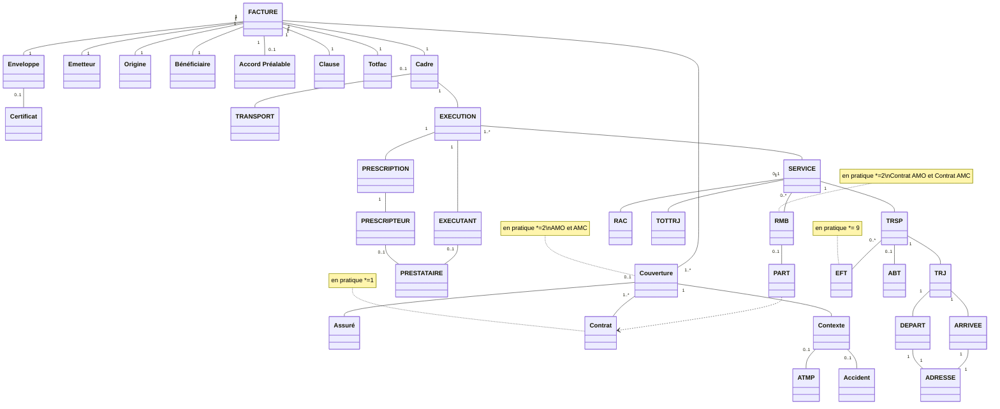

logo: sesam-vitale

logo: **FTE**

*Guide d'Intégration*

# **Facturation Transporteur Étendue**
# ***Taxi***

## **WS_FT - Services en Ligne "Facture"**

Référence : SEL-MP-015 / Version : 03.50 / Date : 09/07/2026
Diffusion : RESTREINTE
État : PROVISOIRE

VERSION DE TRAVAIL

**GIE SESAM-Vitale**

5, boulevard Marie et Alexandre Oyon – 72 019 LE MANS Cedex 2
<u>www.sesam-vitale.fr</u>

Ce document a été élaboré par le GIE SESAM-Vitale.

Conformément à l’article L.122-4 du Code de la Propriété Intellectuelle, toute représentation ou reproduction (intégrale ou partielle) du présent ouvrage, quel que soit le support utilisé, doit être soumise à l’accord préalable écrit de son auteur.

Il en est de même pour sa traduction, sa transformation, son adaptation ou son arrangement, quel que soit le procédé utilisé.

**Tout manquement à ces obligations constituerait un délit de contrefaçon, au sens des articles **L 335-2 et suivants du code de la propriété intellectuelle, susceptible d’entraîner des** sanctions pour l’auteur du délit.**

## **CONTACTS**

icon: sesam-vitale

Pour toute demande d'évolution, comme pour toute question technique ou fonctionnelle, contactez le Centre de services :

*   portail IRIS : [https://portail-support.sesam-vitale.fr/](https://portail-support.sesam-vitale.fr/)
*   téléphone : 02 43 57 42 88

VERSION DE TRAVAIL

*SEL-MP-015*
*MP - Facturation Transporteur Étendue - Taxi*
*WS_FT - Services en Ligne "Facture"*
*Version : 03.50*

# **TABLES DES MATIERES**

<table>
    <tr>
      <td><strong>1</strong></td>
      <td colspan="2"><strong>INTRODUCTION.........................................................................................................................................4</strong></td>
    </tr>
    <tr>
      <td></td>
      <td>1.1</td>
      <td>LE SERVICE WS_FT : FACTURE .............................................................................................................4</td>
    </tr>
    <tr>
      <td></td>
      <td></td>
      <td><em>1.1.1 Contexte .................................................................................................................................4</em></td>
    </tr>
    <tr>
      <td></td>
      <td></td>
      <td><em>1.1.2 Pré-requis ...............................................................................................................................4</em></td>
    </tr>
    <tr>
      <td></td>
      <td>1.2</td>
      <td>DOCUMENT DE RÉFÉRENCE ....................................................................................................................4</td>
    </tr>
    <tr>
      <td></td>
      <td>1.3</td>
      <td>ABRÉVIATIONS.......................................................................................................................................4</td>
    </tr>
    <tr>
      <td><strong>2</strong></td>
      <td colspan="2"><strong>CINÉMATIQUE ET ASPECTS FONCTIONNELS......................................................................................5</strong></td>
    </tr>
    <tr>
      <td></td>
      <td>2.1</td>
      <td>WS_FT2 : VÉRIFIER LA RECEVABILITÉ D’UNE FEL ..................................................................................5</td>
    </tr>
    <tr>
      <td></td>
      <td></td>
      <td><em>2.1.1 Présentation fonctionnelle du service.....................................................................................5</em></td>
    </tr>
    <tr>
      <td></td>
      <td></td>
      <td><em>2.1.2 Données en entrée du service ...............................................................................................5</em></td>
    </tr>
    <tr>
      <td></td>
      <td></td>
      <td><em>2.1.3 Données en sortie du service .................................................................................................5</em></td>
    </tr>
    <tr>
      <td></td>
      <td>2.2</td>
      <td>WS_FT3 : VALIDER UNE FEL ................................................................................................................6</td>
    </tr>
    <tr>
      <td></td>
      <td></td>
      <td><em>2.2.1 Présentation fonctionnelle du service.....................................................................................6</em></td>
    </tr>
    <tr>
      <td></td>
      <td></td>
      <td><em>2.2.2 Données en entrée du service ...............................................................................................6</em></td>
    </tr>
    <tr>
      <td></td>
      <td></td>
      <td><em>2.2.3 Données en sortie du service .................................................................................................6</em></td>
    </tr>
    <tr>
      <td></td>
      <td>2.3</td>
      <td>MODÈLE D’UNE FEL ..............................................................................................................................7</td>
    </tr>
    <tr>
      <td></td>
      <td></td>
      <td><em>2.3.1 Modèle métier.........................................................................................................................7</em></td>
    </tr>
    <tr>
      <td></td>
      <td></td>
      <td><em>2.3.2 Détail des occurrences EFT.................................................................................................16</em></td>
    </tr>
    <tr>
      <td></td>
      <td></td>
      <td><em>2.3.3 Modèle FEL dans les messages (structure xml) ..................................................................23</em></td>
    </tr>
    <tr>
      <td><strong>3</strong></td>
      <td colspan="2"><strong>ÉLÉMENTS TECHNIQUES SPÉCIFIQUES AU SERVICE .....................................................................24</strong></td>
    </tr>
    <tr>
      <td></td>
      <td>3.1</td>
      <td>LES COMPOSANTS DU POSTE DE TRAVAIL ..............................................................................................24</td>
    </tr>
    <tr>
      <td></td>
      <td>3.2</td>
      <td>MISE EN ŒUVRE ..................................................................................................................................26</td>
    </tr>
    <tr>
      <td></td>
      <td>3.3</td>
      <td>ENVIRONNEMENTS DE TRAVAIL .............................................................................................................27</td>
    </tr>
    <tr>
      <td></td>
      <td></td>
      <td><em>3.3.1 Environnement de test .........................................................................................................27</em></td>
    </tr>
    <tr>
      <td></td>
      <td></td>
      <td><em>3.3.2 Environnement de production ..............................................................................................28</em></td>
    </tr>
    <tr>
      <td></td>
      <td>3.4</td>
      <td>OPÉRATION WS_FT2 « CONTROLERRECEVABILITE »............................................................................30</td>
    </tr>
    <tr>
      <td></td>
      <td></td>
      <td><em>3.4.1 REQ_FT2 « SE_SOUMISFACTRANSP » ...........................................................................30</em></td>
    </tr>
    <tr>
      <td></td>
      <td></td>
      <td><em>3.4.2 REP_FT2 « SE_ARCVFACTRANSP »................................................................................35</em></td>
    </tr>
    <tr>
      <td></td>
      <td>3.5</td>
      <td>OPÉRATION WS_FT3 « VALIDER ».......................................................................................................37</td>
    </tr>
    <tr>
      <td></td>
      <td></td>
      <td><em>3.5.1 REQ_FT3 « SE_VALIDEFACTRANS » ...............................................................................37</em></td>
    </tr>
    <tr>
      <td></td>
      <td></td>
      <td><em>3.5.2 REP_FT3 « SE_AVALFACTRANSP ».................................................................................44</em></td>
    </tr>
</table>

<table>
  <caption>**TABLE DES ILLUSTRATIONS**</caption>
    <tr>
      <td>FIGURE 1 : RELATIONS ENTRE LES ENTITÉS FONCTIONNELLES D’UNE FEL ................................................................7</td>
    </tr>
    <tr>
      <td>FIGURE 2 : RELATIONS ENTRE LES ENTITÉS FONCTIONNELLES DES MESSAGES REP_FT1, REQ_FT2 ET REQ_FT3 ..................................................................................................................................................................23</td>
    </tr>
</table>

<table>
  <caption>**TABLE DES ANNEXES**</caption>
    <tr>
      <td><strong>ANNEXE 1</strong></td>
      <td><strong>MESSAGES D’ERREUR .....................................................................................................44</strong></td>
    </tr>
</table>

icon: logo

VERSION DE TRAVAIL

*09/07/2026*
*3 / 45*
*Ce document ne peut être diffusé sans l'autorisation d'une personne habilitée au GIE SESAM-Vitale*

*MP - Facturation Transporteur Étendue - Taxi*
*SEL-MP-015* *WS_FT - Services en Ligne "Facture"* *Version : 03.50*

# 1 **Introduction**

## 1.1 **Le service WS_FT : Facture**

### 1.1.1 **Contexte**

Le service Facture en ligne, dénommé également WS_FT, permet à un LPS Transporteur :

*   d’acquérir les informations d’une facture en ligne (FEL) validées et stockées dans les systèmes AMO,
*   de contrôler la recevabilité d’une FEL,
*   de valider une FEL,
*   d’acquérir les montants d’une prestation.

Ce service, qui a pour objectif d’être utilisé par le LPS du Transporteur dans le cadre de son processus de facturation en ligne propose 2 opérations :

<mark>~~<u>WS_FT1 : Consulter une FEL</u>~~</mark>
WS_FT2 : Vérifier la recevabilité d’une FEL
WS_FT3 : Valider une FEL
<mark>~~<u>WS_FT4 : Déterminer les montants d’une prestation de transport (utilisable uniquement en tarification majorée)</u>~~</mark>

icon: icon Les noms de message et d’opération présentés au chapitre 2 (partie fonctionnelle) sont utilisés comme identifiant dans les messages au chapitre 3 (partie technique).

### 1.1.2 **Pré-requis**

Le LPS doit disposer de données d’identification du bénéficiaire pour solliciter les opérations du service WS_FT.

## 1.2 **Document de référence**

<table>
  <thead>
    <tr>
      <th><b>Appellation</b></th>
      <th><b>Type et titre</b></th>
      <th><b>Référence</b></th>
    </tr>
  </thead>
  <tbody>
    <tr>
      <td>[CI]</td>
      <td>Cadre d’interopérabilité des téléservices intégrés</td>
      <td>CI-CNAMTS-DC v1.0.2</td>
    </tr>
    <tr>
      <td>[DICO]</td>
      <td>Services en Ligne "Facture" du système FTE</td>
      <td>FACT-SFG-029</td>
    </tr>
    <tr>
      <td>[FTE02]</td>
      <td>SFG Facturer des Prestations</td>
      <td>FACT-SFG-032</td>
    </tr>
  </tbody>
</table>

## 1.3 **Abréviations**

Cf. Document FACT-SFG-029 : Dictionnaire

VERSION DE TRAVAIL

*09/07/2026* 4 / 45
*Ce document ne peut être diffusé sans l'autorisation d'une personne habilitée au GIE SESAM-Vitale*

icon: icon

*MP - Facturation Transporteur Étendue - Taxi*
*SEL-MP-015* *WS_FT - Services en Ligne "Facture"* *Version : 03.50*

# **2 Cinématique et aspects fonctionnels**

## **2.1 WS_FT2 : Vérifier la recevabilité d’une FEL**

### **2.1.1 Présentation fonctionnelle du service**

**Description**

Cette opération a pour objet de vérifier la recevabilité au regard de l’Assurance Maladie d’une FEL fournie en entrée. **Références techniques**

<table>
    <tr>
      <td rowspan="2"><strong><em>WSDL</em></strong></td>
      <td rowspan="2">WS_FT2</td>
      <td><mark>ServiceAccueilTaxi:1.0.0</mark></td>
    </tr>
    <tr>
      <td><mark>ServiceAccueilSEFiTransport:2.0.0</mark></td>
    </tr>
</table>

<table>
    <tr>
      <td><strong><em>Opération</em></strong></td>
      <td>WS_FT2</td>
      <td>controlerRecevabilite</td>
    </tr>
</table>

<table>
    <tr>
      <td rowspan="2"><strong><em>Messages</em></strong></td>
      <td>REQ_FT2</td>
      <td>SE_SOUMISFACTRANSP</td>
    </tr>
    <tr>
      <td>REP_FT2</td>
      <td>SE_ARCVFACTRANSP</td>
    </tr>
</table>

### **2.1.2 Données en entrée du service**

<table>
  <thead>
    <tr>
      <th>référence</th>
      <th>Libellé</th>
      <th>Description</th>
      <th>O/F</th>
    </tr>
  </thead>
  <tbody>
    <tr>
      <td><strong><b>DE_FT2_01</b></strong></td>
      <td>FEL proposée</td>
      <td>FEL[P] : cf. description §2.5 
        icon: icon Une FEL proposée contient toutes les données de la FEL <strong>**exception faite**</strong> des données suivantes : 
        • E50.01 : Identifiant de la facture 
        • E50.02 : Date de la facture 
        • E50.20 : Clause 
        • E50.21 : Certificat 
        • E50.22 : N° de lot 
        • E70 : Accusé de Réception</td>
      <td>O</td>
    </tr>
  </tbody>
</table>

### **2.1.3 Données en sortie du service**

<table>
  <thead>
    <tr>
      <th>référence</th>
      <th>Libellé</th>
      <th>Description</th>
      <th>O/F</th>
    </tr>
  </thead>
  <tbody>
    <tr>
      <td><strong><b>DS_FT2_01</b></strong></td>
      <td>Clause</td>
      <td>Clause de la FEL – Correspond à E50.20</td>
      <td>F</td>
    </tr>
    <tr>
      <td><strong><b>DS_FT2_02</b></strong></td>
      <td>Certificat</td>
      <td>Certificat de la FEL - Correspond à E50.21</td>
      <td>F</td>
    </tr>
    <tr>
      <td><strong>DS_FT2_E97</strong></td>
      <td>Diagnostic</td>
      <td>N occurrences</td>
      <td>F</td>
    </tr>
    <tr>
      <td><strong><b>DS_FT2_E97.01</b></strong></td>
      <td>Code diagnostic</td>
      <td></td>
      <td>O</td>
    </tr>
    <tr>
      <td><strong><b>DS_FT2_E97.02</b></strong></td>
      <td>Libellé diagnostic</td>
      <td></td>
      <td>O</td>
    </tr>
  </tbody>
</table>

VERSION DE TRAVAIL

*09/07/2026* 5 / 45
*Ce document ne peut être diffusé sans l'autorisation d'une personne habilitée au GIE SESAM-Vitale*

icon: logo

*MP - Facturation Transporteur Étendue - Taxi*
*SEL-MP-015 WS_FT - Services en Ligne "Facture" Version : 03.50*

## **2.2 WS_FT3 : Valider une FEL**

### **2.2.1 Présentation fonctionnelle du service**

**Description**

Cette opération a pour objet de valider auprès de l’Assurance Maladie Obligatoire une FEL fournie en entrée.

Cette FEL doit au préalable avoir été déclarée « recevable » par l’AMO (cf. [FTE02] : FTE02.03)

**Références techniques**

***WSDL***
<table>
    <tr>
      <td rowspan="2">WS_FT3</td>
      <td><mark><s>ServiceAccueilTaxi:1.0.0</s></mark></td>
    </tr>
    <tr>
      <td><mark>ServiceAccueilSEFiTransport:2.0.0</mark></td>
    </tr>
</table>

***Opération***
<table>
    <tr>
      <td>WS_FT3</td>
      <td>valider</td>
    </tr>
</table>

***Messages***
<table>
    <tr>
      <td>REQ_FT3</td>
      <td>SE_VALIDEFACTRANSP</td>
    </tr>
    <tr>
      <td>REP_FT3</td>
      <td>SE_AVALFACTRANSP</td>
    </tr>
</table>

### **2.2.2 Données en entrée du service**

<table>
  <thead>
    <tr>
      <th>référence</th>
      <th>Libellé</th>
      <th>Description</th>
      <th>O/F</th>
    </tr>
  </thead>
  <tbody>
    <tr>
      <td><strong><b>DE_FT3_01</b></strong></td>
      <td>FEL validable</td>
      <td>FEL[A] : cf. description §2.5 icon: description Une FEL validable contient toutes les données de la FEL exception faite de la donnée suivante : E70 : Accusé de Réception</td>
      <td>O</td>
    </tr>
  </tbody>
</table>

### **2.2.3 Données en sortie du service**

<table>
  <thead>
    <tr>
      <th>référence</th>
      <th>Libellé</th>
      <th>Description</th>
      <th>O/F</th>
    </tr>
  </thead>
  <tbody>
    <tr>
      <td><b>DS_FT3_01</b></td>
      <td>Accusé de Réception</td>
      <td>Cf. E70 (§2.3.1 Modèle métier)</td>
      <td>O</td>
    </tr>
    <tr>
      <td>DS_FT3_E97</td>
      <td>Diagnostic</td>
      <td>N occurrences</td>
      <td>F</td>
    </tr>
    <tr>
      <td><b>DS_FT3_E97.01</b></td>
      <td>Code diagnostic</td>
      <td></td>
      <td>O</td>
    </tr>
    <tr>
      <td><b>DS_FT3_E97.02</b></td>
      <td>Libellé diagnostic</td>
      <td></td>
      <td>O</td>
    </tr>
  </tbody>
</table>

VERSION DE TRAVAIL

*09/07/2026* 6 / 45
*Ce document ne peut être diffusé sans l'autorisation d'une personne habilitée au GIE SESAM-Vitale*

icon: dots

*SEL-MP-015* *MP - Facturation Transporteur Étendue - Taxi*
*WS_FT - Services en Ligne "Facture"* *Version : 03.50*

## **2.3** **Modèle d’une FEL**

### **2.3.1** **Modèle métier**

**Schéma**

**Figure 1 : relations entre les entités fonctionnelles d’une FEL**

**Données**

<table>
  <thead>
    <tr>
      <th><b>Référence</b></th>
      <th><b>Libellé</b></th>
      <th><b>Description</b></th>
      <th><b>O/F</b></th>
    </tr>
  </thead>
  <tbody>
    <tr>
      <td><strong>E50</strong></td>
      <td><strong><b>FEL-Facture</b></strong></td>
      <td></td>
      <td></td>
    </tr>
    <tr>
      <td><em><strong><u>E50.01</u></strong></em></td>
      <td><u>Identifiant de la facture</u></td>
      <td>FACTURE/Numero *cf. « Données variables » ci-après</td>
      <td>*</td>
    </tr>
    <tr>
      <td><em><strong><u>E50.02</u></strong></em></td>
      <td><u>Date de la facture</u></td>
      <td>FACTURE/DateFacturation * cf. « Données variables » ci-après</td>
      <td>*</td>
    </tr>
    <tr>
      <td><em><strong><u>E50.06</u></strong></em></td>
      <td>Code demande accord préalable</td>
      <td>FACTURE/PREALABLE/CodeDemande</td>
      <td>F</td>
    </tr>
    <tr>
      <td><em><strong><u>E50.07</u></strong></em></td>
      <td>Code accord préalable</td>
      <td>FACTURE/PREALABLE/CodeAccord</td>
      <td>F</td>
    </tr>
    <tr>
      <td><em><strong><u>E50.08</u></strong></em></td>
      <td>Date de l’accord préalable</td>
      <td>FACTURE/PREALABLE/Date</td>
      <td>F</td>
    </tr>
    <tr>
      <td><em><strong><u>E50.09</u></strong></em></td>
      <td>Numéro de l’accord préalable</td>
      <td>FACTURE/PREALABLE/Num</td>
      <td>F</td>
    </tr>
    <tr>
      <td><em><strong><u>E50.11</u></strong></em></td>
      <td>Total des montants facturés</td>
      <td>FACTURE/TOTFAC/TotFac</td>
      <td>O</td>
    </tr>
    <tr>
      <td><em><strong><u>E50.12</u></strong></em></td>
      <td>Montant total remboursable AMO</td>
      <td>FACTURE/TOTFAC/TotPECAMO</td>
      <td>O</td>
    </tr>
    <tr>
      <td><em><strong><u>E50.13</u></strong></em></td>
      <td>Montant total remboursable AMC</td>
      <td>FACTURE/TOTFAC/TotPECAMC</td>
      <td>O</td>
    </tr>
    <tr>
      <td><em><strong><u>E50.14</u></strong></em></td>
      <td>Total reste à charge</td>
      <td>FACTURE/TOTFAC/TotRAC</td>
      <td>O</td>
    </tr>
    <tr>
      <td><em><strong><u>E50.15</u></strong></em></td>
      <td><s><mark>Montant total des suppléments</mark></s></td>
      <td><s><mark>FACTURE/TOTFAC/TotSupplement</mark></s></td>
      <td><s><mark>F</mark></s></td>
    </tr>
    <tr>
      <td><em><strong><u>E50.16</u></strong></em></td>
      <td><s><mark>Montant total des suppléments non remboursable</mark></s></td>
      <td><s><mark>FACTURE/TOTFAC/SomNR</mark></s></td>
      <td><s><mark>F</mark></s></td>
    </tr>
    <tr>
      <td><em><strong><u>E50.17</u></strong></em></td>
      <td><s><mark>Montant total majoration trajet court</mark></s></td>
      <td><s><mark>FACTURE/TOTFAC/TotMajTrjCourt</mark></s></td>
      <td><s><mark>F</mark></s></td>
    </tr>
    <tr>
      <td><em><strong><u>E50.20</u></strong></em></td>
      <td><u>Clause</u></td>
      <td>FACTURE/CLAUSE/Texte * cf. « Données variables » ci-après</td>
      <td>*</td>
    </tr>
    <tr>
      <td><em><strong><u>E50.21</u></strong></em></td>
      <td><u>Certificat</u></td>
      <td>FACTURE/Certificat * cf. « Données variables » ci-après</td>
      <td>*</td>
    </tr>
    <tr>
      <td><em><strong><u>E50.22</u></strong></em></td>
      <td><u>N° de lot</u></td>
      <td>FACTURE/ENVELOPPE/Lot * cf. « Données variables » ci-après</td>
      <td>*</td>
    </tr>
    <tr>
      <td><strong>E51</strong></td>
      <td><strong><b>FEL- PS Emetteur</b></strong></td>
      <td></td>
      <td></td>
    </tr>
    <tr>
      <td><em><strong><u>E51.01</u></strong></em></td>
      <td>Identifiant émetteur</td>
      <td>FACTURE/EMETTEUR/Numero</td>
      <td>O</td>
    </tr>
    <tr>
      <td><em><strong><u>E51.02</u></strong></em></td>
      <td>Adresse mail</td>
      <td>FACTURE/EMETTEUR/Email</td>
      <td>O</td>
    </tr>
    <tr>
      <td><strong><b>E52</b></strong></td>
      <td><strong><b>FEL- PS facturant</b></strong></td>
      <td></td>
      <td></td>
    </tr>
  </tbody>
</table>

VERSION DE TRAVAIL

*09/07/2026* 7 / 45
*Ce document ne peut être diffusé sans l'autorisation d'une personne habilitée au GIE SESAM-Vitale*

icon: GIE SESAM-Vitale logo

*MP - Facturation Transporteur Étendue - Taxi*
SEL-MP-015 *WS_FT - Services en Ligne "Facture" Version : 03.50*

<table>
  <thead>
    <tr>
      <th><b>Référence</b></th>
      <th><b>Libellé</b></th>
      <th><b>Description</b></th>
      <th><b>O/F</b></th>
    </tr>
  </thead>
  <tbody>
    <tr>
      <td><strong><em>E52.01</em></strong></td>
      <td>Numéro AM du PS Origine</td>
      <td>FACTURE/ORIGINE/Numero</td>
      <td>O</td>
    </tr>
    <tr>
      <td><strong><em>E52.02</em></strong></td>
      <td>Raison sociale</td>
      <td>FACTURE/ORIGINE/RaisonSociale</td>
      <td>O</td>
    </tr>
    <tr>
      <td><strong><em>E52.03</em></strong></td>
      <td>Numéro de la carte PS CPx</td>
      <td>FACTURE/ORIGINE/NumCarte</td>
      <td>O</td>
    </tr>
    <tr>
      <td><strong>E53</strong></td>
      <td><strong><b>FEL-PS Prescripteur</b></strong></td>
      <td></td>
      <td></td>
    </tr>
    <tr>
      <td><strong><em>E53.01</em></strong></td>
      <td>Identifiant du PS prescripteur</td>
      <td>FACTURE/CADRE/EXECUTION/PRESCRIPTION/ PRESCRIPTEUR/Numero (soit attribut R='AM', soit attribut = R='FINESS')  icon: arrow A renseigner dans la FEL avec le numéro FINESS si le numéro AM et le numéro FINESS du prescripteur sont présents simultanément dans la PEL</td>
      <td>O</td>
    </tr>
    <tr>
      <td><strong><em>E53.02</em></strong></td>
      <td>Code spécialité du PS prescripteur</td>
      <td>FACTURE/CADRE/EXECUTION/PRESCRIPTION/ PRESCRIPTEUR/CodeSpe</td>
      <td>O</td>
    </tr>
    <tr>
      <td><strong><em>E53.03</em></strong></td>
      <td>Code condition d’exercice du PS prescripteur</td>
      <td>FACTURE/CADRE/EXECUTION/PRESCRIPTION/ PRESCRIPTEUR/PRESTATAIRE/ConditionExercice</td>
      <td>F</td>
    </tr>
    <tr>
      <td><strong><em>E53.05</em></strong></td>
      <td>Identifiant RPPS du PS prescripteur</td>
      <td>FACTURE/CADRE/EXECUTION/PRESCRIPTION/ PRESCRIPTEUR/PRESTATAIRE/Numero (attrribut R='RPPS')</td>
      <td>F</td>
    </tr>
    <tr>
      <td><strong>E54</strong></td>
      <td><strong><b>FEL-Prescription</b></strong></td>
      <td></td>
      <td></td>
    </tr>
    <tr>
      <td><strong><em>E54.01</em></strong></td>
      <td>Numéro de la prescription</td>
      <td>FACTURE/CADRE/EXECUTION/PRESCRIPTION/ Numero</td>
      <td>F</td>
    </tr>
    <tr>
      <td><strong><em>E54.02</em></strong></td>
      <td>Type de prescription</td>
      <td>FACTURE/CADRE/EXECUTION/PRESCRIPTION/ Pel</td>
      <td>O</td>
    </tr>
    <tr>
      <td><strong><em>E54.03</em></strong></td>
      <td>Date de prescription</td>
      <td>FACTURE/CADRE/EXECUTION/PRESCRIPTION/ Date</td>
      <td>O</td>
    </tr>
    <tr>
      <td><strong><em>E54.04</em></strong></td>
      <td>Descriptif du transport</td>
      <td>FACTURE/CADRE/TRANSPORT/Descriptif</td>
      <td>F</td>
    </tr>
    <tr>
      <td><strong><em>E54.05</em></strong></td>
      <td>Justificatif de prise en charge du transport</td>
      <td>FACTURE/CADRE/EXECUTION/PRESCRIPTION/JustPECPres</td>
      <td>O</td>
    </tr>
    <tr>
      <td><strong><em>E54.06</em></strong></td>
      <td>Indicateur prise en charge 100%</td>
      <td>FACTURE/CADRE/EXECUTION/PRESCRIPTION/ PEC100Demande</td>
      <td>F</td>
    </tr>
    <tr>
      <td><strong><em>E54.07</em></strong></td>
      <td>Indicateur soins en rapport avec article L115</td>
      <td>FACTURE/CADRE/EXECUTION/PRESCRIPTION/ ArtL115</td>
      <td>F</td>
    </tr>
    <tr>
      <td><strong>E55</strong></td>
      <td><strong><b>FEL-Bénéficiaire</b></strong></td>
      <td></td>
      <td></td>
    </tr>
    <tr>
      <td><strong><em>E55.01</em></strong></td>
      <td>N° immatriculation assuré</td>
      <td>FACTURE/COUVERTURE/ASSURE/Id/Num</td>
      <td>O</td>
    </tr>
    <tr>
      <td><strong><em>E55.02</em></strong></td>
      <td>Clé du N° immatriculation assuré</td>
      <td>FACTURE/COUVERTURE/ASSURE/Id/Cle</td>
      <td>O</td>
    </tr>
    <tr>
      <td><strong><em>E55.03</em></strong></td>
      <td>Date de naissance du bénéficiaire</td>
      <td>FACTURE/BENEFICIAIRE/DateNai</td>
      <td>O</td>
    </tr>
    <tr>
      <td><strong><em>E55.04</em></strong></td>
      <td>Rang du bénéficiaire</td>
      <td>FACTURE/BENEFICIAIRE/Rang</td>
      <td>O</td>
    </tr>
    <tr>
      <td><strong><em>E55.05</em></strong></td>
      <td>Nom de famille du bénéficiaire</td>
      <td>FACTURE/BENEFICIAIRE/NomFamille</td>
      <td>O</td>
    </tr>
  </tbody>
</table>

VERSION DE TRAVAIL

*09/07/2026* 8 / 45
*Ce document ne peut être diffusé sans l'autorisation d'une personne habilitée au GIE SESAM-Vitale*

icon: dots

*SEL-MP-015*
*MP - Facturation Transporteur Étendue - Taxi*
*WS_FT - Services en Ligne "Facture"*
*Version : 03.50*

<table>
  <thead>
    <tr>
      <th><b>Référence</b></th>
      <th><b>Libellé</b></th>
      <th><b>Description</b></th>
      <th><b>O/F</b></th>
    </tr>
  </thead>
  <tbody>
    <tr>
      <td><strong><em>E55.06</em></strong></td>
      <td>Nom d’usage du bénéficiaire</td>
      <td>FACTURE/BENEFICIAIRE/NomUsage</td>
      <td>F</td>
    </tr>
    <tr>
      <td><strong><em>E55.07</em></strong></td>
      <td>Prénom du bénéficiaire</td>
      <td>FACTURE/BENEFICIAIRE/Prenom</td>
      <td>O</td>
    </tr>
    <tr>
      <td><strong><em>E55.08</em></strong></td>
      <td>N° immatriculation individuel</td>
      <td>FACTURE/BENEFICIAIRE/Nir/Num</td>
      <td>F</td>
    </tr>
    <tr>
      <td><strong><em>E55.09</em></strong></td>
      <td>Clé du N° immatriculation individuel</td>
      <td>FACTURE/BENEFICIAIRE/Nir/Cle</td>
      <td>F</td>
    </tr>
    <tr>
      <td><strong>E56</strong></td>
      <td><strong><b>FEL-Contrat</b></strong></td>
      <td></td>
      <td></td>
    </tr>
    <tr>
      <td><strong><em>E56.01</em></strong></td>
      <td>Contrat</td>
      <td>FACTURE/COUVERTURE/CONTRATS/Contrat</td>
      <td>O</td>
    </tr>
    <tr>
      <td><strong><em>E56.02</em></strong></td>
      <td>N° d’adhérent</td>
      <td>FACTURE/COUVERTURE/ASSURE/Id/Num</td>
      <td>F</td>
    </tr>
    <tr>
      <td><strong><em>E56.03</em></strong></td>
      <td>Numéro d’organisme complémentaire</td>
      <td>FACTURE/COUVERTURE/IdOrg</td>
      <td>F</td>
    </tr>
    <tr>
      <td><strong><em>E56.04</em></strong></td>
      <td>Nature d’Assurance</td>
      <td>FACTURE/COUVERTURE/CONTRATS/NatureAssurance</td>
      <td>O</td>
    </tr>
    <tr>
      <td><strong>E57</strong></td>
      <td><strong><b>FEL-Couverture</b></strong></td>
      <td></td>
      <td></td>
    </tr>
    <tr>
      <td><strong><em>E57.01</em></strong></td>
      <td>Nature de couverture</td>
      <td>FACTURE/COUVERTURE/Nature</td>
      <td>O</td>
    </tr>
    <tr>
      <td><strong><em>E57.02</em></strong></td>
      <td>Nature pièces justificatif ouverture droits</td>
      <td>COUVERTURE/CONTEXTE/NatureJOD</td>
      <td>O</td>
    </tr>
    <tr>
      <td><strong><em>E57.03</em></strong></td>
      <td>Tiers payant</td>
      <td>COUVERTURE:CONTEXTE/CadreReglement</td>
      <td>O</td>
    </tr>
    <tr>
      <td><strong><em>E57.04</em></strong></td>
      <td>Code régime</td>
      <td>FACTURE/COUVERTURE/GrandRegime</td>
      <td>O</td>
    </tr>
    <tr>
      <td><strong><em>E57.05</em></strong></td>
      <td>Code caisse gestionnaire</td>
      <td>FACTURE/COUVERTURE/Organisme</td>
      <td>O</td>
    </tr>
    <tr>
      <td><strong><em>E57.06</em></strong></td>
      <td>Code centre gestionnaire</td>
      <td>FACTURE/COUVERTURE/EntiteGestion</td>
      <td>O</td>
    </tr>
    <tr>
      <td><strong><em>E57.08</em></strong></td>
      <td>Date maternité</td>
      <td>FACTURE/COUVERTURE/CONTEXTE/DateMaternite</td>
      <td>F</td>
    </tr>
    <tr>
      <td><strong><em>E57.09</em></strong></td>
      <td>Date ATMP</td>
      <td>FACTURE/COUVERTURE/CONTEXTE/ATMP/DateATMP</td>
      <td>F</td>
    </tr>
    <tr>
      <td><strong><em>E57.10</em></strong></td>
      <td>Identifiant de l’AT</td>
      <td>FACTURE/COUVERTURE/CONTEXTE/ATMP/NumATMP</td>
      <td>F</td>
    </tr>
    <tr>
      <td><strong><em>E57.11</em></strong></td>
      <td>Accident causé par un tiers</td>
      <td>FACTURE/COUVERTURE/CONTEXTE/ACCIDENT/IndAccident</td>
      <td>F</td>
    </tr>
    <tr>
      <td><strong><em>E57.12</em></strong></td>
      <td>Date accident causé par un tiers</td>
      <td>FACTURE/COUVERTURE/CONTEXTE/ACCIDENT/dateAccident</td>
      <td>F</td>
    </tr>
    <tr>
      <td><strong>E61</strong></td>
      <td><strong><b>FEL-PS Exécutant</b></strong></td>
      <td></td>
      <td></td>
    </tr>
    <tr>
      <td><strong><em>E61.01</em></strong></td>
      <td>Identifiant AM du PS exécutant</td>
      <td>FACTURE/CADRE/EXECUTION/EXECUTANT/Numero</td>
      <td>O</td>
    </tr>
    <tr>
      <td><strong><em>E61.02</em></strong></td>
      <td>Identifiant RPPS du PS exécutant</td>
      <td>FACTURE/CADRE/EXECUTION/EXECUTANT/PRESTATAIRE/Numero</td>
      <td>F</td>
    </tr>
    <tr>
      <td><strong><em>E61.03</em></strong></td>
      <td>Spécialité du PS exécutant</td>
      <td>FACTURE/CADRE/EXECUTION/EXECUTANT/CodeSpe</td>
      <td>F</td>
    </tr>
    <tr>
      <td><strong>E62</strong></td>
      <td><strong><b>FEL-Prestation</b></strong></td>
      <td>Correspond à un trajet.</td>
      <td></td>
    </tr>
    <tr>
      <td><strong><em>E62.01</em></strong></td>
      <td>Id prestation</td>
      <td>FACTURE/CADRE/EXECUTION/SERVICE/TRSP/TRJ/Identifiant Pour PEL correspond à Id Trajet</td>
      <td>O</td>
    </tr>
    <tr>
      <td><strong><em>E62.02</em></strong></td>
      <td>Nature de prestation</td>
      <td>FACTURE/CADRE/EXECUTION/SERVICE/Prs</td>
      <td>O</td>
    </tr>
  </tbody>
</table>

VERSION DE TRAVAIL

*09/07/2026*
9 / 45
*Ce document ne peut être diffusé sans l'autorisation d'une personne habilitée au GIE SESAM-Vitale*

icon: three dots

*SEL-MP-015*
*MP - Facturation Transporteur Étendue - Taxi*
*WS_FT - Services en Ligne "Facture"*
*Version : 03.50*

<table>
  <thead>
    <tr>
      <th><b>Référence</b></th>
      <th><b>Libellé</b></th>
      <th><b>Description</b></th>
      <th><b>O/F</b></th>
    </tr>
  </thead>
  <tbody>
    <tr>
      <td><strong><em>E62.04</em></strong></td>
      <td>Distance parcourue</td>
      <td>FACTURE/CADRE/EXECUTION/SERVICE/TRSP/ TRJ/DistanceParcourue</td>
      <td>O</td>
    </tr>
    <tr>
      <td><mark><strong><em><s>E62.05</s></em></strong></mark></td>
      <td><mark><s>PU Km</s></mark></td>
      <td><mark><s>FACTURE/CADRE/EXECUTION/SERVICE/TRSP/ EFT cf. « Détail des occurrences EFT » §2.3.2</s></mark></td>
      <td><mark><s>F</s></mark></td>
    </tr>
    <tr>
      <td><mark><strong><em><s>E62.06</s></em></strong></mark></td>
      <td><mark><s>Montant Kilométrique</s></mark></td>
      <td><mark><s>FACTURE/CADRE/EXECUTION/SERVICE/TRSP/ EFT cf. « Détail des occurrences EFT » §2.3.2</s></mark></td>
      <td><mark><s>F</s></mark></td>
    </tr>
    <tr>
      <td><strong><em>E62.10</em></strong></td>
      <td>Cadre du transport</td>
      <td><mark>FACTURE/CADRE/EXECUTION/SERVICE/TRSP/ TRJ/RefusTP</mark></td>
      <td>F</td>
    </tr>
    <tr>
      <td><mark><strong><em><s>E62.11</s></em></strong></mark></td>
      <td><mark><s>Type de Forfait</s></mark></td>
      <td><mark><s>FACTURE/CADRE/EXECUTION/SERVICE/TRSP/ EFT cf. « Détail des occurrences EFT » §2.3.2</s></mark></td>
      <td><mark><s>O</s></mark></td>
    </tr>
    <tr>
      <td><mark><strong><em><s>E62.12</s></em></strong></mark></td>
      <td><mark><u><s>Distance facturée</s></u></mark></td>
      <td><mark><s>REP_FT1 : FACTURE/CADRE/EXECUTION/SERVICE/TRSP/ TRJ/DistanceFacturee  REQ_FT2 et REQ_FT3 : FACTURE/CADRE/EXECUTION/SERVICE/TRSP/ EFT/Qte * cf. « Données variables » ci-après</s></mark></td>
      <td><mark><s>O</s></mark></td>
    </tr>
    <tr>
      <td><mark><strong><em><s>E62.13</s></em></strong></mark></td>
      <td><mark><s>Type de tarif kilomètre/horaire</s></mark></td>
      <td><mark><s>FACTURE/CADRE/EXECUTION/SERVICE/TRSP/ EFT cf. « Détail des occurrences EFT » §2.3.2</s></mark></td>
      <td><mark><s>F</s></mark></td>
    </tr>
    <tr>
      <td><mark><strong><em><s>E62.14</s></em></strong></mark></td>
      <td><mark><s>Cumul des montants horaires et kilométriques</s></mark></td>
      <td><mark><s>FACTURE/CADRE/EXECUTION/SERVICE/TRSP/ EFT cf. « Détail des occurrences EFT » §2.3.2</s></mark></td>
      <td><mark><s>F</s></mark></td>
    </tr>
    <tr>
      <td><strong>E63</strong></td>
      <td><strong><b>FEL- Trajet</b></strong></td>
      <td></td>
      <td></td>
    </tr>
    <tr>
      <td><strong><em>E63.01</em></strong></td>
      <td>Date départ</td>
      <td>FACTURE/CADRE/EXECUTION/SERVICE/TRSP/ TRJ/DEPART/Date</td>
      <td>O</td>
    </tr>
    <tr>
      <td><strong><em>E63.02</em></strong></td>
      <td>Heure départ</td>
      <td>FACTURE/CADRE/EXECUTION/SERVICE/TRSP/ TRJ/DEPART/Heure</td>
      <td>O</td>
    </tr>
    <tr>
      <td><mark><strong><em>E63.09</em></strong></mark></td>
      <td><mark>Code FINESS établissement départ</mark></td>
      <td><mark>FACTURE/CADRE/EXECUTION/SERVICE/TRSP/ TRJ/DEPART/CodeFINESS</mark></td>
      <td><mark>F</mark></td>
    </tr>
    <tr>
      <td><strong><em>E63.10</em></strong></td>
      <td>Code INSEE lieu départ</td>
      <td>FACTURE/CADRE/EXECUTION/SERVICE/TRSP/ TRJ/DEPART/<mark>Adresse</mark>/CodeCommune</td>
      <td>O</td>
    </tr>
    <tr>
      <td><strong><em>E63.11</em></strong></td>
      <td>Date arrivée</td>
      <td>FACTURE/CADRE/EXECUTION/SERVICE/TRSP/ TRJ/ARRIVEE/Date</td>
      <td>O</td>
    </tr>
    <tr>
      <td><strong><em>E63.12</em></strong></td>
      <td>Heure arrivée</td>
      <td>FACTURE/CADRE/EXECUTION/SERVICE/TRSP/ TRJ/ARRIVEE/Heure</td>
      <td>O</td>
    </tr>
    <tr>
      <td><mark><strong><em>E63.19</em></strong></mark></td>
      <td><mark>Code FINESS établissement d’arrivée</mark></td>
      <td><mark>FACTURE/CADRE/EXECUTION/SERVICE/TRSP/ TRJ/ARRIVEE/CodeFINESS</mark></td>
      <td><mark>F</mark></td>
    </tr>
    <tr>
      <td><strong><em>E63.20</em></strong></td>
      <td>Code INSEE lieu d’arrivée</td>
      <td>FACTURE/CADRE/EXECUTION/SERVICE/TRSP/ TRJ/ARRIVEE/<mark>Adresse</mark>/CodeCommune</td>
      <td>O</td>
    </tr>
    <tr>
      <td><strong><em>E63.21</em></strong></td>
      <td>Nombre de malades transportés</td>
      <td>FACTURE/CADRE/EXECUTION/SERVICE/TRSP/ TRJ/NbPersonnesTransportees</td>
      <td>O</td>
    </tr>
    <tr>
      <td><strong><em>E63.22</em></strong></td>
      <td>Distance GPS</td>
      <td>FACTURE/CADRE/EXECUTION/SERVICE/TRSP/ TRJ/DistanceGPS</td>
      <td><mark><strong>O(*)</strong></mark></td>
    </tr>
    <tr>
      <td><mark><strong><em><s>E63.23</s></em></strong></mark></td>
      <td><mark><s>Indicateur utilisation du distancier</s></mark></td>
      <td><mark><s>FACTURE/CADRE/EXECUTION/SERVICE/TRSP/ TRJ/DistanceReferentiel</s></mark></td>
      <td><mark><s>F(*)</s></mark></td>
    </tr>
    <tr>
      <td><strong><em>E63.24</em></strong></td>
      <td>Niveau de certification GPS</td>
      <td>FACTURE/CADRE/EXECUTION/SERVICE/TRSP/ TRJ/NiveauCertification</td>
      <td><mark><strong>O(*)</strong></mark></td>
    </tr>
  </tbody>
</table>

VERSION DE TRAVAIL

*09/07/2026*
*10 / 45*
*Ce document ne peut être diffusé sans l'autorisation d'une personne habilitée au GIE SESAM-Vitale*

icon: dots

*SEL-MP-015* *MP - Facturation Transporteur Étendue - Taxi*
*WS_FT - Services en Ligne "Facture"* *Version : 03.50*

<table>
  <thead>
    <tr>
      <th><b>Référence</b></th>
      <th><b>Libellé</b></th>
      <th><b>Description</b></th>
      <th><b>O/F</b></th>
    </tr>
  </thead>
  <tbody>
    <tr>
      <td><strong><em>E63.25</em></strong></td>
      <td>Numéro d’autorisation</td>
      <td>FACTURE/CADRE/EXECUTION/SERVICE/TRSP/T RJ/NumeroAutorisation</td>
      <td><mark>O(*)</mark></td>
    </tr>
    <tr>
      <td colspan="4"><mark><s>(*) Si le Transporteur remplit les conditions d’application de la tarification majorée (Cf. PDT-INF-818 Avenant 11 impacts pour les transporteurs sanitaires), alors, ces données sont obligatoires et ne peuvent faire l’objet d’aucune modification manuelle de la part du Transporteur. Cf. la documentation [Géoloc] pour l’alimentation de ces données.</s></mark> <mark>(*) Ces données ne peuvent faire l’objet d’aucune modification manuelle de la part du Transporteur. Cf. la documentation [Géoloc] pour l’alimentation de ces données.</mark></td>
    </tr>
    <tr>
      <td><strong><em><mark>E63.26</mark></em></strong></td>
      <td><mark>Indicateur aller ou retour à vide</mark></td>
      <td><mark>FACTURE/CADRE/EXECUTION/SERVICE/TRSP/TRJ/IndicateurARVide</mark></td>
      <td><mark>O</mark></td>
    </tr>
    <tr>
      <td><strong><em><mark>E63.27</mark></em></strong></td>
      <td><mark>Patient seul durant transport partagé</mark></td>
      <td><mark>FACTURE/CADRE/EXECUTION/SERVICE/TRSP/TRJ/PatientSeulSurXkms</mark></td>
      <td><mark>O</mark></td>
    </tr>
    <tr>
      <td><strong><em>E63.E81</em></strong></td>
      <td>Adresse</td>
      <td>Adresse de type FEL-Adresse : cf. T81 2 occurrences : • [Départ] • [Arrivée]</td>
      <td>O</td>
    </tr>
    <tr>
      <td><strong>E64</strong></td>
      <td><strong><b>FEL- Exécution Trajet</b></strong></td>
      <td></td>
      <td></td>
    </tr>
    <tr>
      <td><strong><em>E64.01</em></strong></td>
      <td>N° d’immatriculation du véhicule</td>
      <td>FACTURE/CADRE/EXECUTION/SERVICE/TRSP/TRJ/Vehicule</td>
      <td>O</td>
    </tr>
    <tr>
      <td><strong><em>E64.02</em></strong></td>
      <td>Nom du conducteur</td>
      <td>FACTURE/CADRE/EXECUTION/SERVICE/TRSP/TRJ/NomConducteur</td>
      <td>O</td>
    </tr>
    <tr>
      <td><strong><em>E64.03</em></strong></td>
      <td>Prénom du conducteur</td>
      <td>FACTURE/CADRE/EXECUTION/SERVICE/TRSP/TRJ/PrenomConducteur</td>
      <td>O</td>
    </tr>
    <tr>
      <td><strong><em>E64.06</em></strong></td>
      <td>Montant prestation</td>
      <td>FACTURE/CADRE/EXECUTION/SERVICE/TOTTRJ/TotPrest</td>
      <td>O</td>
    </tr>
    <tr>
      <td><strong><em>E64.07</em></strong></td>
      <td>Justificatif de l’exonération du TM</td>
      <td>FACTURE/CADRE/EXECUTION/SERVICE/RMB/Exo et RMB/PEC100 avec une valeur indiquant une EXOTM</td>
      <td>F</td>
    </tr>
    <tr>
      <td><strong><em>E64.08</em></strong></td>
      <td>Taux de remboursement</td>
      <td>FACTURE/CADRE/EXECUTION/SERVICE/RMB/Part/tux (sur un contrat de couverture AMO)</td>
      <td>O</td>
    </tr>
    <tr>
      <td><strong><em><mark>E64.09</mark></em></strong></td>
      <td><mark>Base de remboursement</mark></td>
      <td><mark>FACTURE/CADRE/EXECUTION/SERVICE/RMB/Part/Bas</mark></td>
      <td><mark><s>O</s></mark></td>
    </tr>
    <tr>
      <td><strong><em><mark>E64.11</mark></em></strong></td>
      <td><mark><s>Montant remboursable AMO de la prestation</s></mark></td>
      <td><mark><s>FACTURE/CADRE/EXECUTION/SERVICE/RMB/Part/Mnt</s></mark> <mark><s>(sur un contrat de couverture AMO)</s></mark></td>
      <td><mark><s>O</s></mark></td>
    </tr>
    <tr>
      <td><strong><em><mark>E64.12</mark></em></strong></td>
      <td><mark><s>Montant remboursable AMC de la prestation</s></mark></td>
      <td><mark><s>FACTURE/CADRE/EXECUTION/SERVICE/RMB/Part/Mnt</s></mark> <mark><s>(sur un contrat de couverture AMC)</s></mark></td>
      <td><mark><s>O</s></mark></td>
    </tr>
    <tr>
      <td><strong><em><mark>E64.13</mark></em></strong></td>
      <td><mark><s>Reste à charge de l’assuré de la prestation</s></mark></td>
      <td><mark><s>FACTURE/CADRE/EXECUTION/SERVICE/RAC/Part/Mnt</s></mark></td>
      <td><mark><s>O</s></mark></td>
    </tr>
    <tr>
      <td><strong><em><mark>E64.14</mark></em></strong></td>
      <td><mark>Département de l’ADS du véhicule</mark></td>
      <td><mark>FACTURE/CADRE/EXECUTION/SERVICE/TRSP/TRJ/CadreTransport/ADS/DepartementADS</mark></td>
      <td><mark>O</mark></td>
    </tr>
    <tr>
      <td><strong><em><mark>E64.15</mark></em></strong></td>
      <td><mark>Numéro ADS</mark></td>
      <td><mark>FACTURE/CADRE/EXECUTION/SERVICE/TRSP/TRJ/CadreTransport/ADS/NumeroADS</mark></td>
      <td><mark>O</mark></td>
    </tr>
    <tr>
      <td><strong><em><mark>E64.16</mark></em></strong></td>
      <td><mark>Code caisse de l’ADS</mark></td>
      <td><mark>FACTURE/CADRE/EXECUTION/SERVICE/TRSP/TRJ/CadreTransport/ADS/CodeCPAMADS</mark></td>
      <td><mark>O</mark></td>
    </tr>
    <tr>
      <td><strong><mark><b>E65</b></mark></strong></td>
      <td><strong><mark><u>FEL- Majoration</u></mark></strong></td>
      <td></td>
      <td></td>
    </tr>
  </tbody>
</table>

VERSION DE TRAVAIL

*09/07/2026* *11 / 45*
*Ce document ne peut être diffusé sans l'autorisation d'une personne habilitée au GIE SESAM-Vitale*

icon: dots

*SEL-MP-015*
*MP - Facturation Transporteur Étendue - Taxi*
*WS_FT - Services en Ligne "Facture"*
*Version : 03.50*

<table>
  <thead>
    <tr>
      <th><b>Référence</b></th>
      <th><b>Libellé</b></th>
      <th><b>Description</b></th>
      <th><b>O/F</b></th>
    </tr>
  </thead>
  <tbody>
    <tr>
      <td><strong><s><u>E65.01</u></s></strong></td>
      <td><u>Type majoration</u></td>
      <td><u>FACTURE/CADRE/EXECUTION/SERVICE/TRSP/EFT</u> <u>cf. « Détail des occurrences EFT » §2.3.2</u></td>
      <td><s>F</s></td>
    </tr>
    <tr>
      <td><strong>E66</strong></td>
      <td><strong><b>FEL-Suppléments</b> forfaitaire <u>et <s>NR</s></u></strong></td>
      <td></td>
      <td></td>
    </tr>
    <tr>
      <td><strong><em>E66.01</em></strong></td>
      <td>Type supplément forfaitaire</td>
      <td>FACTURE/CADRE/EXECUTION/SERVICE/TRSP/EFT cf. « Détail des occurrences EFT » §2.3.2</td>
      <td><u>O</u></td>
    </tr>
    <tr>
      <td><strong><em>E66.02</em></strong></td>
      <td>Montant du supplément forfaitaire</td>
      <td>FACTURE/CADRE/EXECUTION/SERVICE/TRSP/EFT cf. « Détail des occurrences EFT » §2.3.2</td>
      <td><u>O</u></td>
    </tr>
    <tr>
      <td><strong><em><u>E66.04</u></em></strong></td>
      <td><u>Montant final du supplément forfaitaire</u></td>
      <td><u>FACTURE/CADRE/EXECUTION/SERVICE/TRSP/EFT</u> <u>cf. « Détail des occurrences EFT » §2.3.2</u></td>
      <td>O</td>
    </tr>
    <tr>
      <td><strong><em><u>E66.08</u></em></strong></td>
      <td><u><s>Type de supplément non remboursable</s></u></td>
      <td><u><s>FACTURE/CADRE/EXECUTION/SERVICE/TRSP/EFT</s></u> <u><s>cf. « Détail des occurrences EFT » §2.3.2</s></u></td>
      <td><s>F</s></td>
    </tr>
    <tr>
      <td><strong><em><u>E66.08</u></em></strong></td>
      <td><u>% Abattement</u></td>
      <td><u>FACTURE/CADRE/EXECUTION/SERVICE/TRSP/EFT</u> <u>cf. « Détail des occurrences EFT » §2.3.2</u></td>
      <td>O</td>
    </tr>
    <tr>
      <td><strong><em><u>E66.09</u></em></strong></td>
      <td><u><s>Montant du supplément non remboursable</s></u></td>
      <td><u><s>FACTURE/CADRE/EXECUTION/SERVICE/TRSP/EFT</s></u> <u><s>cf. « Détail des occurrences EFT » §2.3.2</s></u></td>
      <td><s>F</s></td>
    </tr>
    <tr>
      <td><strong>E67</strong></td>
      <td><strong><b>FEL-Supplément</b> remboursable</strong></td>
      <td></td>
      <td></td>
    </tr>
    <tr>
      <td><strong><em>E67.01</em></strong></td>
      <td>Type supplément remboursable</td>
      <td>FACTURE/CADRE/EXECUTION/SERVICE/TRSP/EFT cf. « Détail des occurrences EFT » §2.3.2</td>
      <td><u>O</u></td>
    </tr>
    <tr>
      <td><strong><em>E67.02</em></strong></td>
      <td>Montant supplément remboursable</td>
      <td>FACTURE/CADRE/EXECUTION/SERVICE/TRSP/EFT cf. « Détail des occurrences EFT » §2.3.2</td>
      <td><u>O</u></td>
    </tr>
    <tr>
      <td><strong>E68</strong></td>
      <td><strong><b>FEL-Tarif kilométrique</b></strong></td>
      <td></td>
      <td></td>
    </tr>
    <tr>
      <td><strong><em><u>E68.01</u></em></strong></td>
      <td><u><s>Type de tarif kilométrique</s></u></td>
      <td><u><s>FACTURE/CADRE/EXECUTION/SERVICE/TRSP/EFT</s></u> <u><s>cf. « Détail des occurrences EFT » §2.3.2</s></u></td>
      <td><s>F</s></td>
    </tr>
    <tr>
      <td><strong><em><u>E68.02</u></em></strong></td>
      <td><u><s>Nombre de km pour un tarif donné</s></u></td>
      <td><u><s>FACTURE/CADRE/EXECUTION/SERVICE/TRSP/EFT</s></u> <u><s>cf. « Détail des occurrences EFT » §2.3.2</s></u></td>
      <td><s>F</s></td>
    </tr>
    <tr>
      <td><strong><em><u>E68.02</u></em></strong></td>
      <td><u>Distance facturée</u></td>
      <td><u>REQ_FT2 et REQ_FT3 : FACTURE/CADRE/EXECUTION/SERVICE/TRSP/EFT/Qte</u></td>
      <td>O</td>
    </tr>
    <tr>
      <td><strong><em><u>E68.03</u></em></strong></td>
      <td><u><s>PU Km pour un tarif donné</s></u></td>
      <td><u><s>FACTURE/CADRE/EXECUTION/SERVICE/TRSP/EFT</s></u> <u><s>cf. « Détail des occurrences EFT » §2.3.2</s></u></td>
      <td><s>F</s></td>
    </tr>
    <tr>
      <td><strong><em><u>E68.03</u></em></strong></td>
      <td><u>% Abattement</u></td>
      <td><u>FACTURE/CADRE/EXECUTION/SERVICE/TRSP/EFT</u> <u>cf. « Détail des occurrences EFT » §2.3.2</u></td>
      <td>O</td>
    </tr>
    <tr>
      <td><strong><em><u>E68.04</u></em></strong></td>
      <td><u><s>Montant Kilométrique pour un tarif donné</s></u></td>
      <td><u><s>FACTURE/CADRE/EXECUTION/SERVICE/TRSP/EFT</s></u> <u><s>cf. « Détail des occurrences EFT » §2.3.2</s></u></td>
      <td><s>F</s></td>
    </tr>
    <tr>
      <td><strong><em><u>E68.04</u></em></strong></td>
      <td><u>Type majoration</u></td>
      <td><u>FACTURE/CADRE/EXECUTION/SERVICE/TRSP/EFT</u> <u>cf. « Détail des occurrences EFT » §2.3.2</u></td>
      <td>O</td>
    </tr>
  </tbody>
</table>

VERSION DE TRAVAIL

*09/07/2026*
*12 / 45*
*Ce document ne peut être diffusé sans l'autorisation d'une personne habilitée au GIE SESAM-Vitale*

icon: SESAM-Vitale logo

*SEL-MP-015*
*MP - Facturation Transporteur Étendue - Taxi*
*WS_FT - Services en Ligne "Facture"*
*Version : 03.50*

<table>
<thead>
<tr>
<th><b>Référence</b></th>
<th><b>Libellé</b></th>
<th><b>Description</b></th>
<th><b>O/F</b></th>
</tr>
</thead>
<tbody>
<tr>
<td><strong><em>E68.05</em></strong></td>
<td><mark>Tarif kilométrique du trajet de base</mark></td>
<td><mark>FACTURE/CADRE/EXECUTION/SERVICE/TRSP/ EFT</mark> <mark>cf. « Détail des occurrences EFT » §2.3.2</mark></td>
<td><mark>O</mark></td>
</tr>
<tr>
<td><strong><em>E68.06</em></strong></td>
<td><mark>% d’aller ou de retour à vide</mark></td>
<td><mark>FACTURE/CADRE/EXECUTION/SERVICE/TRSP/ EFT</mark> <mark>cf. « Détail des occurrences EFT » §2.3.2</mark></td>
<td><mark>F</mark></td>
</tr>
<tr>
<td><strong><em>E68.07</em></strong></td>
<td><mark>Tarif kilométrique du trajet appliqué en facturation</mark></td>
<td><mark>FACTURE/CADRE/EXECUTION/SERVICE/TRSP/ EFT</mark> <mark>cf. « Détail des occurrences EFT » §2.3.2</mark></td>
<td><mark>F</mark></td>
</tr>
<tr>
<td><strong><em>E68.08</em></strong></td>
<td><mark>Montant Kilométrique</mark></td>
<td><mark>FACTURE/CADRE/EXECUTION/SERVICE/TRSP/ EFT</mark> <mark>cf. « Détail des occurrences EFT » §2.3.2</mark></td>
<td><mark>O</mark></td>
</tr>
<tr>
<td><strong><em>E68.09</em></strong></td>
<td><mark>% majoration du montant kilométrique</mark></td>
<td><mark>FACTURE/CADRE/EXECUTION/SERVICE/TRSP/ EFT</mark> <mark>cf. « Détail des occurrences EFT » §2.3.2</mark></td>
<td><mark>O</mark></td>
</tr>
<tr>
<td><strong><em>E68.11</em></strong></td>
<td><mark>Majoration montant kilométrique</mark></td>
<td><mark>FACTURE/CADRE/EXECUTION/SERVICE/TRSP/ EFT</mark> <mark>cf. « Détail des occurrences EFT » §2.3.2</mark></td>
<td><mark>O</mark></td>
</tr>
<tr>
<td><strong><em>E68.13</em></strong></td>
<td><mark>Montant final kilométrique</mark></td>
<td><mark>FACTURE/CADRE/EXECUTION/SERVICE/TRSP/ EFT</mark> <mark>cf. « Détail des occurrences EFT » §2.3.2</mark></td>
<td><mark>O</mark></td>
</tr>
<tr>
<td><u><strong>E69</strong></u></td>
<td><u><strong>FEL-Tarif horaire</strong></u></td>
<td></td>
<td></td>
</tr>
<tr>
<td><strong><em><s>E69.01</s></em></strong></td>
<td><s><mark>Type de tarif horaire</mark></s></td>
<td><s><mark>FACTURE/CADRE/EXECUTION/SERVICE/TRSP/ EFT</mark></s> <s><mark>cf. « Détail des occurrences EFT » §2.3.2</mark></s></td>
<td><s><mark>F</mark></s></td>
</tr>
<tr>
<td><strong><em><s>E69.02</s></em></strong></td>
<td><s><mark>Temps du trajet pour un tarif donné</mark></s></td>
<td><s><mark>FACTURE/CADRE/EXECUTION/SERVICE/TRSP/ EFT</mark></s> <s><mark>cf. « Détail des occurrences EFT » §2.3.2</mark></s></td>
<td><s><mark>F</mark></s></td>
</tr>
<tr>
<td><strong><em><s>E69.03</s></em></strong></td>
<td><s><mark>Prix unitaire horaire pour un tarif donné</mark></s></td>
<td><s><mark>FACTURE/CADRE/EXECUTION/SERVICE/TRSP/ EFT</mark></s> <s><mark>cf. « Détail des occurrences EFT » §2.3.2</mark></s></td>
<td><s><mark>F</mark></s></td>
</tr>
<tr>
<td><strong><em><s>E69.04</s></em></strong></td>
<td><s><mark>Montant horaire pour un tarif donné</mark></s></td>
<td><s><mark>FACTURE/CADRE/EXECUTION/SERVICE/TRSP/ EFT</mark></s> <s><mark>cf. « Détail des occurrences EFT » §2.3.2</mark></s></td>
<td><s><mark>F</mark></s></td>
</tr>
<tr>
<td><u><strong>E69</strong></u></td>
<td><u><strong>FEL-Forfait</strong></u></td>
<td></td>
<td></td>
</tr>
<tr>
<td><strong><em>E69.01</em></strong></td>
<td><mark>Type de Forfait</mark></td>
<td><mark>FACTURE/CADRE/EXECUTION/SERVICE/TRSP/ EFT</mark> <mark>cf. « Détail des occurrences EFT » §2.3.2</mark></td>
<td><mark>O</mark></td>
</tr>
<tr>
<td><strong><em>E69.02</em></strong></td>
<td><mark>Montant du forfait</mark></td>
<td><mark>FACTURE/CADRE/EXECUTION/SERVICE/TRSP/ EFT</mark> <mark>cf. « Détail des occurrences EFT » §2.3.2</mark></td>
<td><mark>O</mark></td>
</tr>
<tr>
<td><strong><em>E69.03</em></strong></td>
<td><mark>% Majoration forfait</mark></td>
<td><mark>FACTURE/CADRE/EXECUTION/SERVICE/TRSP/ EFT</mark> <mark>cf. « Détail des occurrences EFT » §2.3.2</mark></td>
<td><mark>O</mark></td>
</tr>
<tr>
<td><strong><em>E69.04</em></strong></td>
<td><mark>Majoration montant forfait</mark></td>
<td><mark>FACTURE/CADRE/EXECUTION/SERVICE/TRSP/ EFT</mark> <mark>cf. « Détail des occurrences EFT » §2.3.2</mark></td>
<td><mark>O</mark></td>
</tr>
<tr>
<td><strong><em>E69.06</em></strong></td>
<td><mark>Montant final du forfait</mark></td>
<td><mark>FACTURE/CADRE/EXECUTION/SERVICE/TRSP/ EFT</mark> <mark>cf. « Détail des occurrences EFT » §2.3.2</mark></td>
<td><mark>O</mark></td>
</tr>
<tr>
<td><strong><em>E69.07</em></strong></td>
<td><mark>Type majoration</mark></td>
<td><mark>FACTURE/CADRE/EXECUTION/SERVICE/TRSP/ EFT</mark> <mark>cf. « Détail des occurrences EFT » §2.3.2</mark></td>
<td><mark>O</mark></td>
</tr>
</tbody>
</table>

VERSION DE TRAVAIL

*09/07/2026*
*13 / 45*
*Ce document ne peut être diffusé sans l'autorisation d'une personne habilitée au GIE SESAM-Vitale*

icon: logo

*MP - Facturation Transporteur Étendue - Taxi*
SEL-MP-015 *WS_FT - Services en Ligne "Facture" Version : 03.50*

<table>
  <thead>
    <tr>
      <th>Référence</th>
      <th>Libellé</th>
      <th>Description</th>
      <th>O/F</th>
    </tr>
  </thead>
  <tbody>
    <tr>
      <td><i><b><s>E69.08</s></b></i></td>
      <td><s>% Abattement</s></td>
      <td><s>FACTURE/CADRE/EXECUTION/SERVICE/TRSP/ EFT cf. « Détail des occurrences EFT » §2.3.2</s></td>
      <td><s>O</s></td>
    </tr>
    <tr>
      <td><b><s>E79</s></b></td>
      <td><b><s>FEL-Remise</s></b></td>
      <td></td>
      <td></td>
    </tr>
    <tr>
      <td><i><b><s>E79.01</s></b></i></td>
      <td><s>Taux de la remise</s></td>
      <td><s>FACTURE/CADRE/EXECUTION/SERVICE/TRSP/ EFT cf. « Détail des occurrences EFT » §2.3.2</s></td>
      <td><s>F</s></td>
    </tr>
    <tr>
      <td><i><b><s>E79.02</s></b></i></td>
      <td><s>Montant de la remise</s></td>
      <td><s>FACTURE/CADRE/EXECUTION/SERVICE/TRSP/ EFT cf. « Détail des occurrences EFT » §2.3.2</s></td>
      <td><s>F</s></td>
    </tr>
    <tr>
      <td><b>E70</b></td>
      <td><b><b>FEL-Accusé de réception</b></b></td>
      <td>*</td>
      <td></td>
    </tr>
    <tr>
      <td><i><b>E70.01</b></i></td>
      <td>Identifiant de la facture</td>
      <td></td>
      <td>O</td>
    </tr>
    <tr>
      <td><i><b>E70.02</b></i></td>
      <td>Date de la facture</td>
      <td></td>
      <td>O</td>
    </tr>
    <tr>
      <td><i><b>E70.03</b></i></td>
      <td>N° lot</td>
      <td></td>
      <td>O</td>
    </tr>
    <tr>
      <td><i><b>E70.04</b></i></td>
      <td>Code régime</td>
      <td></td>
      <td>F</td>
    </tr>
    <tr>
      <td><i><b>E70.05</b></i></td>
      <td>Caisse gestionnaire</td>
      <td></td>
      <td>F</td>
    </tr>
    <tr>
      <td><i><b>E70.06</b></i></td>
      <td>Centre gestionnaire</td>
      <td></td>
      <td>F</td>
    </tr>
    <tr>
      <td><i><b>E70.07</b></i></td>
      <td>Organisme destinataire</td>
      <td></td>
      <td>O</td>
    </tr>
    <tr>
      <td><i><b>E70.09</b></i></td>
      <td>Date traitement</td>
      <td></td>
      <td>F</td>
    </tr>
    <tr>
      <td><i><b>E70.E81</b></i></td>
      <td>Adresse organisme destinataire</td>
      <td>Cf. T81 Spécificité : les champs ● E81.08 : Mention de Distribution ● E81.09 : Code Postal ● E81.10 : Localité sont facultatifs pour cette adresse</td>
      <td>O</td>
    </tr>
  </tbody>
</table>

<table>
  <thead>
    <tr>
      <th>Référence</th>
      <th>Libellé</th>
      <th>Description</th>
      <th>O/F</th>
    </tr>
  </thead>
  <tbody>
    <tr>
      <td><strong>T81</strong></td>
      <td><strong><b>FEL-Adresse</b></strong></td>
      <td>Description Avec [AFNOR] = norme AFNOR XP Z 10-011</td>
      <td></td>
    </tr>
    <tr>
      <td><strong><b>T81.01</b></strong></td>
      <td>Raison sociale</td>
      <td>FACTURE/ AdresseOrgDest/<em>Dst</em>  Identité du destinataire</td>
      <td>F</td>
    </tr>
    <tr>
      <td><strong><b>T81.02</b></strong></td>
      <td>Point de remise</td>
      <td>FACTURE/ AdresseOrgDest/<em>Rem</em>  [AFNOR], ligne 2 : 
        -    Lorsque le destinataire est une personne physique : 
              identité du domicile (mention « chez »), numéro de 
              boite aux lettre ou d’appartement, escalier, étage, 
              CIDEX (Courrier Individuel à Destination 
              Exceptionnelle), etc. 
        -    Lorsque le destinataire est une personne morale : 
              Identité de la personne destinataire, direction, 
              service, numéro de l’étage, bureau, etc…</td>
      <td>F</td>
    </tr>
    <tr>
      <td><strong><b>T81.03</b></strong></td>
      <td>Complément d’adresse</td>
      <td>FACTURE/ AdresseOrgDest/<em>Cpl</em>  [AFNOR], <em>ligne 3</em> : Complément au point géographique. Accès au bâtiment, bâtiment, ensemble immobilier.</td>
      <td>F</td>
    </tr>
  </tbody>
</table>

VERSION DE TRAVAIL

*09/07/2026* 14 / 45
*Ce document ne peut être diffusé sans l'autorisation d'une personne habilitée au GIE SESAM-Vitale*

icon: SESAM-Vitale logo

*MP - Facturation Transporteur Étendue - Taxi*
SEL-MP-015 *WS_FT - Services en Ligne "Facture"* Version : 03.50

<table>
    <tr>
      <td><strong><b>T81.04</b></strong></td>
      <td>Numéro de la voie</td>
      <td>FACTURE/ AdresseOrgDest/<em>Num</em>  [AFNOR], <em>ligne 4</em> : Point géographique. Numéro dans la voie.</td>
      <td>F</td>
    </tr>
    <tr>
      <td><strong><b>T81.05</b></strong></td>
      <td>Extension du numéro de voie</td>
      <td>FACTURE/ AdresseOrgDest/<em>Ind</em>  <em>IndiceRepetition</em>  [AFNOR], <em>ligne 4</em> : Point géographique. Extension du numéro dans la voie sous forme littérale (Bis, Ter, Quater, etc. ) ou codée (B, T, Q, C etc.).  Il peut également s'agir d'une simple lettre (A, B, C, etc.).</td>
      <td>F</td>
    </tr>
    <tr>
      <td><strong><b>T81.06</b></strong></td>
      <td>Type de voie</td>
      <td>FACTURE/ AdresseOrgDest/<em>Voi</em>  [AFNOR], <em>ligne 4</em> : Point géographique. Donne la nature de voie sous forme littérale, abrégée, ou codée.</td>
      <td>F</td>
    </tr>
    <tr>
      <td><strong><b>T81.07</b></strong></td>
      <td>Nom de la voie</td>
      <td>FACTURE/ AdresseOrgDest/<em>Nom</em>  [AFNOR], <em>ligne 4</em> : Point géographique. Nom ou libellé de la voie. « Nom de la voie » (<em>E81.07</em>) peut également transporter l’intégralité de la ligne 4. Dans ce cas, ne doivent pas être utilisés : - ni « Numéro de la voie » (<em>E81.04</em>), - ni « Extension du numéro de voie » (<em>E81.05</em>), - ni « Type de voie » (<em>E81.04</em>).</td>
      <td>F</td>
    </tr>
    <tr>
      <td><strong><b>T81.08</b></strong></td>
      <td>Mention de Distribution</td>
      <td>FACTURE/ AdresseOrgDest/<em>Dis</em>  [AFNOR], <em>ligne 5</em> : Mention particulière de distribution. BP, Poste Restante, TSA (Tri Service Arrivée), AUTORISATION etc., suivie du libellé de la localité de destination dans le cas ou celle-ci serait différente du libellé CEDEX, lieu dit ou hameau.</td>
      <td>O</td>
    </tr>
    <tr>
      <td><strong><b>T81.09</b></strong></td>
      <td>Code Postal</td>
      <td>FACTURE/ AdresseOrgDest/<em>Cod</em>  [AFNOR], <em>ligne 6</em> : Informations d'acheminement. Code postal ou code CEDEX (Courrier d'Entreprise à Distribution EXceptionnelle). Dans ce dernier cas, l'information identifiant le bureau de CEDEX doit également être renseignée.</td>
      <td>O</td>
    </tr>
    <tr>
      <td><strong><b>T81.10</b></strong></td>
      <td>Localité</td>
      <td>FACTURE/ AdresseOrgDest/<em>Cmn</em>  LibelleCommune  [AFNOR], <em>ligne 6</em> : informations d'acheminement. Nom de la localité du destinataire, ou libellé du bureau distributeur CEDEX (dans ce cas, présence obligatoire de l'attribut Cedex (E81.09)). Localité peut également transporter l’intégralité de la ligne 6. Dans ce cas, ni Code Postal (E81.09), ni Cedex (E81.09), ni Code Pays(E81.11) ne doivent être utilisés.</td>
      <td>O</td>
    </tr>
</table>

VERSION DE TRAVAIL

*09/07/2026* 15 / 45
*Ce document ne peut être diffusé sans l'autorisation d'une personne habilitée au GIE SESAM-Vitale*

icon: icon

*SEL-MP-015*
*MP - Facturation Transporteur Étendue - Taxi*
*WS_FT - Services en Ligne "Facture"*
*Version : 03.50*

# * **Données variables**

Les données soulignées mettent en évidence les données de la FEL dont la position varie dans les 3 messages concernés.

Ces variations sont détaillées dans le tableau ci-après :

<table>
  <thead>
    <tr>
      <th></th>
      <th></th>
      <th>FEL <s>consultable</s></th>
      <th>FEL <b>proposée</b></th>
      <th>FEL <b>validable</b></th>
    </tr>
    <tr>
      <th><b>Référence</b></th>
      <th><b>Libellé</b></th>
      <th><s>FEL[C]</s> <s>(REP_FT1)</s></th>
      <th>FEL[P] (REQ_FT2)</th>
      <th>FEL[A] (REQ_FT3)</th>
    </tr>
  </thead>
  <tbody>
    <tr>
      <td>E50.01</td>
      <td>Identifiant de la facture</td>
      <td><s>renseigné</s></td>
      <td>non renseigné</td>
      <td>renseigné</td>
    </tr>
    <tr>
      <td>E50.02</td>
      <td>Date de la facture</td>
      <td><s>renseigné</s></td>
      <td>non renseigné</td>
      <td>renseigné</td>
    </tr>
    <tr>
      <td>E50.20</td>
      <td>Clause</td>
      <td><s>renseigné</s></td>
      <td>non renseigné</td>
      <td>renseigné</td>
    </tr>
    <tr>
      <td>E50.21</td>
      <td>Certificat</td>
      <td><s>non renseigné</s></td>
      <td>non renseigné</td>
      <td>renseigné</td>
    </tr>
    <tr>
      <td>E50.22</td>
      <td>N° de lot</td>
      <td><s>renseigné</s></td>
      <td>non renseigné</td>
      <td>renseigné</td>
    </tr>
    <tr>
      <td><s>E62.12</s></td>
      <td><s>Distance facturée</s></td>
      <td><s>renseigné : dans</s> <s>TRJ et dans EFT</s></td>
      <td><s>renseigné dans</s> <s>EFT</s></td>
      <td><s>renseigné dans</s> <s>EFT</s></td>
    </tr>
    <tr>
      <td>E70</td>
      <td>FEL-Accusé de réception</td>
      <td><s>non renseigné</s></td>
      <td>non renseigné</td>
      <td>non renseigné</td>
    </tr>
  </tbody>
</table>

L’accusé de réception (E70) apparait uniquement dans le message réponse du service Validation (REP_FT3)

## **2.3.2** **Détail des occurrences EFT**

Les tableaux ci-après présentent la valorisation de chaque balise de l’entité EFT pour chaque occurrence de cette entité.

Plusieurs occurrences d’EFT de même type (« TypFac ») sont possibles, hormis pour :

*   « TypFac » = ~~« KMHOR », « MAJOFORF »,~~ « FORF » et ~~« REM »~~ « KM » pour lequel 1 EFT est possible,
*   « TypFac » = ~~« SUPLREMB »~~ « SUPPLEMENT » pour lequel 2 EFT sont possibles <u>(péage et TPMR).</u>

### * **Légende**

Le tableau ci-dessous précise la signification des valeurs utilisées dans la balise TypFac :

<table>
  <thead>
    <tr>
      <th><b>Valeur utilisée</b></th>
      <th><b>Signification</b></th>
    </tr>
  </thead>
  <tbody>
    <tr>
      <td><b>FORF</b></td>
      <td>Forfait</td>
    </tr>
    <tr>
      <td><b><s>HOR</s></b></td>
      <td><s>Tarif horaire</s></td>
    </tr>
    <tr>
      <td><b>KM</b></td>
      <td>Kilomètre</td>
    </tr>
    <tr>
      <td><b><s>KMHOR</s></b></td>
      <td><s>Tarif kilomètre/horaire</s></td>
    </tr>
    <tr>
      <td><b><s>MAJOFORF</s></b></td>
      <td><s>Majoration Forfait</s></td>
    </tr>
    <tr>
      <td><b><s>REM</s></b></td>
      <td><s>Remise</s></td>
    </tr>
    <tr>
      <td><b><s>SUPLFORF</s></b></td>
      <td><s>Supplément Remboursable Forfaitaire</s></td>
    </tr>
    <tr>
      <td><b><s>SUPLNR</s></b></td>
      <td><s>Supplément Non Remboursable</s></td>
    </tr>
    <tr>
      <td><b><s>SUPLREMB</s></b></td>
      <td><s>Supplément Remboursable</s></td>
    </tr>
    <tr>
      <td><b><s>SUPPLEMENT</s></b></td>
      <td><s>Supplément</s></td>
    </tr>
    <tr>
      <td><b><s>SL</s></b></td>
      <td><s>Supplément Local</s></td>
    </tr>
  </tbody>
</table>

*09/07/2026*
*16 / 45*
*Ce document ne peut être diffusé sans l'autorisation d'une personne habilitée au GIE SESAM-Vitale*

icon: SESAM-Vitale logo

*SEL-MP-015*
*MP - Facturation Transporteur Étendue - Taxi*
*WS_FT - Services en Ligne "Facture"*
*Version : 03.50*

## ***Occurrence Forfait***

<table>
  <thead>
    <tr>
      <th>Balise</th>
      <th colspan="2">Valeur</th>
      <th>Commentaire</th>
    </tr>
  </thead>
  <tbody>
    <tr>
      <td>EFT/TypFac</td>
      <td colspan="2"><b><b>FORF</b></b></td>
      <td>Forfait</td>
    </tr>
    <tr>
      <td>EFT/EltFac</td>
      <td><mark><b><b>E62.11</b></b></mark> <mark><b>E69.01</b></mark></td>
      <td>Type de Forfait</td>
      <td>Valeurs possibles : (cf. <mark><s>TB62-11</s> TB69-01</mark>)</td>
    </tr>
    <tr>
      <td><mark><s>EFT/Majo</s></mark></td>
      <td></td>
      <td></td>
      <td><mark><s>Non renseigné</s></mark></td>
    </tr>
    <tr>
      <td><mark><s>EFT/TypMajo</s></mark></td>
      <td></td>
      <td></td>
      <td><mark><s>Non renseigné</s></mark></td>
    </tr>
    <tr>
      <td><mark><s>EFT/TauxMajo</s></mark></td>
      <td></td>
      <td></td>
      <td><mark><s>Non renseigné</s></mark></td>
    </tr>
    <tr>
      <td><mark>EFT/Qte</mark></td>
      <td colspan="2"><mark><b>1</b></mark></td>
      <td><mark><s>Non renseigné</s></mark></td>
    </tr>
    <tr>
      <td><mark>EFT/Pu</mark></td>
      <td><mark><b>E69.02</b></mark></td>
      <td><mark>Montant du forfait</mark></td>
      <td><mark><s>Non renseigné</s></mark></td>
    </tr>
    <tr>
      <td>EFT/Mnt</td>
      <td><mark><b><b>E62.03</b></b></mark> <mark><b>E69.02</b></mark></td>
      <td>Montant du forfait</td>
      <td></td>
    </tr>
    <tr>
      <td><mark>EFT/Info</mark></td>
      <td></td>
      <td></td>
      <td><mark>Non renseigné</mark></td>
    </tr>
    <tr>
      <td><mark>EFT/CoefARvide</mark></td>
      <td></td>
      <td></td>
      <td><mark>Non renseigné</mark></td>
    </tr>
    <tr>
      <td><mark>EFT/PUMajoreARvide</mark></td>
      <td></td>
      <td></td>
      <td><mark>Non renseigné</mark></td>
    </tr>
    <tr>
      <td><mark>EFT/MntFinal</mark></td>
      <td><mark><b><b>E69.06</b></b></mark></td>
      <td><mark>Montant final du forfait</mark></td>
      <td></td>
    </tr>
    <tr>
      <td><mark>EFT/Majoration/MntMajo</mark></td>
      <td><mark><b>E69.04</b></mark></td>
      <td><mark>Majoration montant forfait</mark></td>
      <td></td>
    </tr>
    <tr>
      <td><mark>EFT/Majoration/TypeMajo</mark></td>
      <td><mark><b><b>E69.07</b></b></mark></td>
      <td><mark>Type Majoration</mark></td>
      <td><mark>Valeurs possibles (cf. TB69-07)</mark></td>
    </tr>
    <tr>
      <td><mark>EFT/Majoration/TauxMajo</mark></td>
      <td><mark><b>E69.03</b></mark></td>
      <td><mark>% Majoration forfait</mark></td>
      <td></td>
    </tr>
    <tr>
      <td><mark>EFT/ABT/TauxAbattement</mark></td>
      <td><mark><b><b>E69.08</b></b></mark></td>
      <td><mark>% Abattement</mark></td>
      <td></td>
    </tr>
  </tbody>
</table>

## ***Occurrence Horaire***

<table>
  <thead>
    <tr>
      <th>Balise</th>
      <th colspan="2">Valeur</th>
      <th>Commentaire</th>
    </tr>
  </thead>
  <tbody>
    <tr>
      <td>EFT/TypFac</td>
      <td colspan="2"><b>HOR</b></td>
      <td>Tarif horaire</td>
    </tr>
    <tr>
      <td>EFT/EltFac</td>
      <td>E69.01</td>
      <td>Type de tarif horaire</td>
      <td>Type de tarif horaire</td>
    </tr>
    <tr>
      <td>EFT/Majo</td>
      <td></td>
      <td></td>
      <td>Non renseigné</td>
    </tr>
    <tr>
      <td>EFT/TypMajo</td>
      <td></td>
      <td></td>
      <td>Non renseigné</td>
    </tr>
    <tr>
      <td>EFT/TauxMajo</td>
      <td></td>
      <td></td>
      <td>Non renseigné</td>
    </tr>
    <tr>
      <td>EFT/Qte</td>
      <td>E69.02</td>
      <td>Temps facturé en mn pour un tarif horaire donné</td>
      <td></td>
    </tr>
    <tr>
      <td>EFT/Pu</td>
      <td>E69.03</td>
      <td>PU horaire pour un tarif horaire donné</td>
      <td></td>
    </tr>
    <tr>
      <td>EFT/Mnt</td>
      <td>E69.04</td>
      <td>Montant horaire pour un tarif horaire donné</td>
      <td></td>
    </tr>
    <tr>
      <td>EFT/Info</td>
      <td></td>
      <td></td>
      <td>Non renseigné</td>
    </tr>
  </tbody>
</table>

## ***Occurrence Kilomètre***

<table>
  <thead>
    <tr>
      <th>Balise</th>
      <th colspan="2">Valeur</th>
      <th>Commentaire</th>
    </tr>
  </thead>
  <tbody>
    <tr>
      <td>EFT/TypFac</td>
      <td colspan="2"><b>KM</b></td>
      <td>Kilomètre</td>
    </tr>
    <tr>
      <td rowspan="2">EFT/EltFac</td>
      <td><del><mark><b>E68.01</b></mark></del></td>
      <td><del><mark>Type de tarif kilométrique</mark></del></td>
      <td><del><mark>Valeurs possibles : cf. TB68-01</mark></del></td>
    </tr>
    <tr>
      <td></td>
      <td></td>
      <td><i><mark>Non renseigné</mark></i></td>
    </tr>
    <tr>
      <td><del><mark>EFT/Majo</mark></del></td>
      <td></td>
      <td></td>
      <td><i><mark>Non renseigné</mark></i></td>
    </tr>
  </tbody>
</table>

VERSION DE TRAVAIL

*09/07/2026*
17 / 45
*Ce document ne peut être diffusé sans l'autorisation d'une personne habilitée au GIE SESAM-Vitale*

icon: logo GIE SESAM-Vitale

*SEL-MP-015*
*MP - Facturation Transporteur Étendue - Taxi*
*WS_FT - Services en Ligne "Facture"*
*Version : 03.50*

<table>
    <tr>
      <td>EFT/TypMajo</td>
      <td></td>
      <td></td>
      <td><i>Non renseigné</i></td>
    </tr>
    <tr>
      <td>EFT/TauxMajo</td>
      <td></td>
      <td></td>
      <td><i>Non renseigné</i></td>
    </tr>
    <tr>
      <td>EFT/Qte</td>
      <td><b><b>E68.02</b></b></td>
      <td>Distance pour un type de tarif km donné Distance facturée</td>
      <td></td>
    </tr>
    <tr>
      <td>EFT/Pu</td>
      <td><b>E68.03</b></td>
      <td>PU pour un type de tarif km donné</td>
      <td></td>
    </tr>
    <tr>
      <td>EFT/Pu</td>
      <td><b><b>E68.05</b></b></td>
      <td>Tarif kilométrique du trajet de base</td>
      <td></td>
    </tr>
    <tr>
      <td>EFT/Mnt</td>
      <td><b>E68.04</b></td>
      <td>Montant pour un type de tarif km donné</td>
      <td></td>
    </tr>
    <tr>
      <td>EFT/Mnt</td>
      <td><b><b>E68.08</b></b></td>
      <td>Montant Kilométrique</td>
      <td></td>
    </tr>
    <tr>
      <td>EFT/Info</td>
      <td></td>
      <td></td>
      <td><i>Non renseigné</i></td>
    </tr>
    <tr>
      <td>EFT/CoefARvide</td>
      <td><b><b>E68.06</b></b></td>
      <td>% d’aller ou de retour à vide</td>
      <td><i>Si E63.26 = « VRAI » Sinon non renseigné</i></td>
    </tr>
    <tr>
      <td>EFT/PUMajoreARvide</td>
      <td><b><b>E68.07</b></b></td>
      <td>Tarif kilométrique du trajet appliqué en facturation</td>
      <td><i>Si E63.26 = « VRAI » Sinon non renseigné</i></td>
    </tr>
    <tr>
      <td>EFT/MntFinal</td>
      <td><b><b>E68.13</b></b></td>
      <td>Montant final kilométrique</td>
      <td></td>
    </tr>
    <tr>
      <td>EFT/Majoration/MntMajo</td>
      <td><b><b>E68.11</b></b></td>
      <td>Majoration montant kilométrique</td>
      <td></td>
    </tr>
    <tr>
      <td>EFT/Majoration/TypeMajo</td>
      <td><b>E68.04</b></td>
      <td>Type Majoration</td>
      <td>Valeurs possibles (cf. TB68-04)</td>
    </tr>
    <tr>
      <td>EFT/Majoration/TauxMajo</td>
      <td><b><b>E68.09</b></b></td>
      <td>% majoration du montant kilométrique</td>
      <td></td>
    </tr>
    <tr>
      <td>EFT/ABT/TauxAbattement</td>
      <td><b>E68.03</b></td>
      <td>% Abattement</td>
      <td></td>
    </tr>
</table>

## **Occurrence Kilomètre / horaire**

<table>
  <thead>
    <tr>
      <th>Balise</th>
      <th>Valeur</th>
      <th>Commentaire</th>
    </tr>
  </thead>
  <tbody>
    <tr>
      <td>EFT/TypFac</td>
      <td><strong><b>KMHOR</b></strong></td>
      <td>Tarif Kilomètre/horaire</td>
    </tr>
    <tr>
      <td>EFT/EltFac</td>
      <td><strong><b>E62.13</b></strong></td>
      <td>Type de tarif kilomètre/horaire</td>
    </tr>
    <tr>
      <td>EFT/Majo</td>
      <td></td>
      <td><i>Non renseigné</i></td>
    </tr>
    <tr>
      <td>EFT/TypMajo</td>
      <td></td>
      <td><i>Non renseigné</i></td>
    </tr>
    <tr>
      <td>EFT/TauxMajo</td>
      <td></td>
      <td><i>Non renseigné</i></td>
    </tr>
    <tr>
      <td>EFT/Qte</td>
      <td></td>
      <td><i>Non renseigné</i></td>
    </tr>
    <tr>
      <td>EFT/Pu</td>
      <td></td>
      <td><i>Non renseigné</i></td>
    </tr>
    <tr>
      <td>EFT/Mnt</td>
      <td><strong><b>E62.14</b></strong></td>
      <td>Cumul des montants horaires et kilométriques</td>
    </tr>
    <tr>
      <td>EFT/Info</td>
      <td></td>
      <td><i>Non renseigné</i></td>
    </tr>
  </tbody>
</table>

## **Occurrence Majoration Forfait**

<table>
  <thead>
    <tr>
      <th>Balise</th>
      <th colspan="2">Valeur</th>
      <th>Commentaire</th>
    </tr>
  </thead>
  <tbody>
    <tr>
      <td>EFT/TypFac</td>
      <td colspan="2"><strong><b>MAJOFORF</b></strong></td>
      <td>Majoration Forfait</td>
    </tr>
    <tr>
      <td>EFT/EltFac</td>
      <td></td>
      <td></td>
      <td><i>Non renseigné</i></td>
    </tr>
    <tr>
      <td>EFT/Majo</td>
      <td><strong><b>E65.01</b></strong></td>
      <td>Type Majoration</td>
      <td>Valeurs possibles (cf. TB65-01)</td>
    </tr>
    <tr>
      <td>EFT/TypMajo</td>
      <td></td>
      <td></td>
      <td><i>Non renseigné</i></td>
    </tr>
    <tr>
      <td>EFT/TauxMajo</td>
      <td></td>
      <td></td>
      <td><i>Non renseigné</i></td>
    </tr>
  </tbody>
</table>

*09/07/2026*
*18 / 45*
*Ce document ne peut être diffusé sans l'autorisation d'une personne habilitée au GIE SESAM-Vitale*

icon: SESAM-Vitale logo

*MP - Facturation Transporteur Étendue - Taxi*
SEL-MP-015 *WS_FT - Services en Ligne "Facture"* Version : 03.50

<table>
    <tr>
      <td><s>EFT/Qte</s></td>
      <td></td>
      <td></td>
      <td><s><i>Non renseigné</i></s></td>
    </tr>
    <tr>
      <td><s>EFT/Pu</s></td>
      <td></td>
      <td></td>
      <td><s><i>Non renseigné</i></s></td>
    </tr>
    <tr>
      <td><s>EFT/Mnt</s></td>
      <td></td>
      <td></td>
      <td><s><i>Non renseigné</i></s></td>
    </tr>
    <tr>
      <td><s>EFT/Info</s></td>
      <td></td>
      <td></td>
      <td><s><i>Non renseigné</i></s></td>
    </tr>
</table>

***Occurrence Remise***

<table>
  <thead>
    <tr>
      <th>Balise</th>
      <th colspan="2">Valeur</th>
      <th>Commentaire</th>
    </tr>
  </thead>
  <tbody>
    <tr>
      <td>EFT/TypFac</td>
      <td colspan="2"><b>REM</b></td>
      <td>Remise</td>
    </tr>
    <tr>
      <td>EFT/EltFac</td>
      <td></td>
      <td></td>
      <td><i>Non renseigné</i></td>
    </tr>
    <tr>
      <td>EFT/Majo</td>
      <td></td>
      <td></td>
      <td><i>Non renseigné</i></td>
    </tr>
    <tr>
      <td>EFT/TypMajo</td>
      <td></td>
      <td></td>
      <td><i>Non renseigné</i></td>
    </tr>
    <tr>
      <td>EFT/TauxMajo</td>
      <td><b>E79.01</b></td>
      <td>Taux de la remise</td>
      <td></td>
    </tr>
    <tr>
      <td>EFT/Qte</td>
      <td></td>
      <td></td>
      <td><i>Non renseigné</i></td>
    </tr>
    <tr>
      <td>EFT/Pu</td>
      <td></td>
      <td></td>
      <td><i>Non renseigné</i></td>
    </tr>
    <tr>
      <td>EFT/Mnt</td>
      <td><b>E79.02</b></td>
      <td>Montant de la remise</td>
      <td></td>
    </tr>
    <tr>
      <td>EFT/Info</td>
      <td></td>
      <td></td>
      <td><i>Non renseigné</i></td>
    </tr>
  </tbody>
</table>

***Occurrence Supplément Forfaitaire***

<table>
<thead>
<tr>
<th>Balise</th>
<th colspan="2">Valeur</th>
<th>Commentaire</th>
</tr>
</thead>
<tbody>
<tr>
<td>EFT/TypFac</td>
<td colspan="2"><b>SUPLFORF</b></td>
<td>Supplément Forfaitaire</td>
</tr>
<tr>
<td>EFT/EltFac</td>
<td><b>E66.01</b></td>
<td>Type supplément forfaitaire</td>
<td></td>
</tr>
<tr>
<td>EFT/Majo</td>
<td></td>
<td></td>
<td><i>Non renseigné</i></td>
</tr>
<tr>
<td>EFT/TypMajo</td>
<td></td>
<td></td>
<td><i>Non renseigné</i></td>
</tr>
<tr>
<td>EFT/TauxMajo</td>
<td></td>
<td></td>
<td></td>
</tr>
<tr>
<td>EFT/Qte</td>
<td></td>
<td></td>
<td><i>Non renseigné</i></td>
</tr>
<tr>
<td>EFT/Pu</td>
<td></td>
<td></td>
<td><i>Non renseigné</i></td>
</tr>
<tr>
<td>EFT/Mnt</td>
<td><b>E66.02</b></td>
<td>Montant du supplément forfaitaire</td>
<td></td>
</tr>
<tr>
<td>EFT/Info</td>
<td></td>
<td></td>
<td><i>Non renseigné</i></td>
</tr>
</tbody>
</table>

***Occurrence Supplément Non Remboursable***

<table>
  <thead>
    <tr>
      <th>Balise</th>
      <th>Valeur</th>
      <th>Commentaire</th>
    </tr>
  </thead>
  <tbody>
    <tr>
      <td>EFT/TypFac</td>
      <td><b>SUPLNR</b></td>
      <td>Supplément Non Remboursable</td>
    </tr>
    <tr>
      <td>EFT/EltFac</td>
      <td><b>E66.08</b></td>
      <td>Type de supplément non remboursable</td>
    </tr>
    <tr>
      <td>EFT/Majo</td>
      <td></td>
      <td><i>Non renseigné</i></td>
    </tr>
    <tr>
      <td>EFT/TypMajo</td>
      <td></td>
      <td><i>Non renseigné</i></td>
    </tr>
    <tr>
      <td>EFT/TauxMajo</td>
      <td></td>
      <td></td>
    </tr>
    <tr>
      <td>EFT/Qte</td>
      <td></td>
      <td><i>Non renseigné</i></td>
    </tr>
    <tr>
      <td>EFT/Pu</td>
      <td></td>
      <td><i>Non renseigné</i></td>
    </tr>
  </tbody>
</table>

*09/07/2026* *19 / 45*
*Ce document ne peut être diffusé sans l'autorisation d'une personne habilitée au GIE SESAM-Vitale*

icon: logo

*SEL-MP-015*                           *WS_FT - Services en Ligne "Facture"*                         *Version : 03.50*

<table>
    <tr>
      <td>EFT/Mnt</td>
      <td><b>E66.09</b></td>
      <td>Montant du supplément non remboursable</td>
      <td></td>
    </tr>
    <tr>
      <td>EFT/Info</td>
      <td></td>
      <td></td>
      <td><i>Non renseigné</i></td>
    </tr>
</table>

*<u>**Occurrence Supplément Remboursable PEAGE**</u>*

<table>
  <thead>
    <tr>
      <th>Balise</th>
      <th colspan="2">Valeur</th>
      <th>Commentaire</th>
    </tr>
  </thead>
  <tbody>
    <tr>
      <td>EFT/TypFac</td>
      <td colspan="2">SUPLREMB</td>
      <td>Supplément Remboursable</td>
    </tr>
    <tr>
      <td>EFT/EltFac</td>
      <td>E67.01</td>
      <td>Type supplément remboursable</td>
      <td>= <b>Péage</b></td>
    </tr>
    <tr>
      <td>EFT/Majo</td>
      <td></td>
      <td></td>
      <td><i>Non renseigné</i></td>
    </tr>
    <tr>
      <td>EFT/TypMajo</td>
      <td></td>
      <td></td>
      <td><i>Non renseigné</i></td>
    </tr>
    <tr>
      <td>EFT/TauxMajo</td>
      <td></td>
      <td></td>
      <td><i>Non renseigné</i></td>
    </tr>
    <tr>
      <td>EFT/Qte</td>
      <td></td>
      <td></td>
      <td><i>Non renseigné</i></td>
    </tr>
    <tr>
      <td>EFT/Pu</td>
      <td></td>
      <td></td>
      <td><i>Non renseigné</i></td>
    </tr>
    <tr>
      <td>EFT/Mnt</td>
      <td>E67.02</td>
      <td>Montant du supplément remboursable</td>
      <td></td>
    </tr>
    <tr>
      <td>EFT/Info</td>
      <td></td>
      <td></td>
      <td><i>Non renseigné</i></td>
    </tr>
  </tbody>
</table>

*<u>**Occurrence Supplément Remboursable VOIE D’EAU**</u>*

<table>
  <thead>
    <tr>
      <th>Balise</th>
      <th colspan="2">Valeur</th>
      <th>Commentaire</th>
    </tr>
  </thead>
  <tbody>
    <tr>
      <td>EFT/TypFac</td>
      <td colspan="2">SUPLREMB</td>
      <td>Supplément Remboursable</td>
    </tr>
    <tr>
      <td>EFT/EltFac</td>
      <td>E67.01</td>
      <td>Type supplément remboursable</td>
      <td>= <b>Voie d’eau</b></td>
    </tr>
    <tr>
      <td>EFT/Majo</td>
      <td></td>
      <td></td>
      <td><i>Non renseigné</i></td>
    </tr>
    <tr>
      <td>EFT/TypMajo</td>
      <td></td>
      <td></td>
      <td><i>Non renseigné</i></td>
    </tr>
    <tr>
      <td>EFT/TauxMajo</td>
      <td></td>
      <td></td>
      <td><i>Non renseigné</i></td>
    </tr>
    <tr>
      <td>EFT/Qte</td>
      <td></td>
      <td></td>
      <td><i>Non renseigné</i></td>
    </tr>
    <tr>
      <td>EFT/Pu</td>
      <td></td>
      <td></td>
      <td><i>Non renseigné</i></td>
    </tr>
    <tr>
      <td>EFT/Mnt</td>
      <td>E67.02</td>
      <td>Montant du supplément remboursable</td>
      <td></td>
    </tr>
    <tr>
      <td>EFT/Info</td>
      <td></td>
      <td></td>
      <td><i>Non renseigné</i></td>
    </tr>
  </tbody>
</table>

*<u>**Occurrence Supplément Local**</u>*
NB : une occurrence pour chaque supplément local qui s’applique au trajet.

<table>
  <thead>
    <tr>
      <th>Balise</th>
      <th colspan="2">Valeur</th>
      <th>Commentaire</th>
    </tr>
  </thead>
  <tbody>
    <tr>
      <td>EFT/TypFac</td>
      <td colspan="2">SL</td>
      <td>Supplément Local</td>
    </tr>
    <tr>
      <td>EFT/EltFac</td>
      <td><b>E66.01</b></td>
      <td>Type supplément forfaitaire</td>
      <td></td>
    </tr>
    <tr>
      <td>EFT/Qte</td>
      <td>1</td>
      <td></td>
      <td></td>
    </tr>
    <tr>
      <td>EFT/Pu</td>
      <td>E66.02</td>
      <td>Montant du supplément forfaitaire</td>
      <td></td>
    </tr>
    <tr>
      <td>EFT/Mnt</td>
      <td>E66.02</td>
      <td>Montant du supplément forfaitaire</td>
      <td></td>
    </tr>
    <tr>
      <td>EFT/Info</td>
      <td></td>
      <td></td>
      <td><i>Non renseigné</i></td>
    </tr>
    <tr>
      <td>EFT/CoefARvide</td>
      <td></td>
      <td></td>
      <td><i>Non renseigné</i></td>
    </tr>
  </tbody>
</table>

*09/07/2026*                                                                                                                                *20 / 45*
*Ce document ne peut être diffusé sans l'autorisation d'une personne habilitée au GIE SESAM-Vitale*

icon: SESAM-Vitale logo

*MP - Facturation Transporteur Étendue - Taxi*
SEL-MP-015 *WS_FT - Services en Ligne "Facture" Version : 03.50*

<table>
    <tr>
      <td>EFT/PUMajoreARvide</td>
      <td></td>
      <td></td>
      <td><i>Non renseigné</i></td>
    </tr>
    <tr>
      <td>EFT/MntFinal</td>
      <td><b><b>E66.04</b></b></td>
      <td>Montant final du supplément forfaitaire</td>
      <td></td>
    </tr>
    <tr>
      <td>EFT/Majoration/MntMajo</td>
      <td></td>
      <td></td>
      <td><i>Non renseigné</i></td>
    </tr>
    <tr>
      <td>EFT/Majoration/TypeMajo</td>
      <td></td>
      <td></td>
      <td><i>Non renseigné</i></td>
    </tr>
    <tr>
      <td>EFT/Majoration/TauxMajo</td>
      <td></td>
      <td></td>
      <td><i>Non renseigné</i></td>
    </tr>
    <tr>
      <td>EFT/ABT/TauxAbattement</td>
      <td><b><b>E63.08</b></b></td>
      <td>% Abattement</td>
      <td></td>
    </tr>
</table>

### *Occurrence Supplément PEAGE*

<table>
  <thead>
    <tr>
      <th><strong>Balise</strong></th>
      <th colspan="2"><strong>Valeur</strong></th>
      <th><strong>Commentaire</strong></th>
    </tr>
  </thead>
  <tbody>
    <tr>
      <td>EFT/TypFac</td>
      <td colspan="2"><strong>SUPPLEMENT</strong></td>
      <td></td>
    </tr>
    <tr>
      <td>EFT/EltFac</td>
      <td><strong>E67.01</strong></td>
      <td>Type supplément remboursable</td>
      <td>= PEAGE</td>
    </tr>
    <tr>
      <td>EFT/Qte</td>
      <td><strong>1</strong></td>
      <td></td>
      <td></td>
    </tr>
    <tr>
      <td>EFT/Pu</td>
      <td><strong>E67.02</strong></td>
      <td>Montant du supplément remboursable</td>
      <td></td>
    </tr>
    <tr>
      <td>EFT/Mnt</td>
      <td><strong>E67.02</strong></td>
      <td>Montant du supplément remboursable</td>
      <td></td>
    </tr>
    <tr>
      <td>EFT/Info</td>
      <td></td>
      <td></td>
      <td><i>Non renseigné</i></td>
    </tr>
    <tr>
      <td>EFT/CoefARvide</td>
      <td></td>
      <td></td>
      <td><i>Non renseigné</i></td>
    </tr>
    <tr>
      <td>EFT/PUMajoreARvide</td>
      <td></td>
      <td></td>
      <td><i>Non renseigné</i></td>
    </tr>
    <tr>
      <td>EFT/MntFinal</td>
      <td><strong>E67.02</strong></td>
      <td>Montant du supplément remboursable</td>
      <td></td>
    </tr>
    <tr>
      <td>EFT/Majoration/MntMajo</td>
      <td></td>
      <td></td>
      <td><i>Non renseigné</i></td>
    </tr>
    <tr>
      <td>EFT/Majoration/TypeMajo</td>
      <td></td>
      <td></td>
      <td><i>Non renseigné</i></td>
    </tr>
    <tr>
      <td>EFT/Majoration/TauxMajo</td>
      <td></td>
      <td></td>
      <td><i>Non renseigné</i></td>
    </tr>
    <tr>
      <td>EFT/ABT/TauxAbattement</td>
      <td></td>
      <td></td>
      <td><i>Non renseigné</i></td>
    </tr>
  </tbody>
</table>

### *Occurrence Supplément TPMR*

<table>
  <thead>
    <tr>
      <th><b>Balise</b></th>
      <th colspan="2"><b>Valeur</b></th>
      <th><b>Commentaire</b></th>
    </tr>
  </thead>
  <tbody>
    <tr>
      <td>EFT/TypFac</td>
      <td colspan="2"><b>SUPPLEMENT</b></td>
      <td></td>
    </tr>
    <tr>
      <td>EFT/EltFac</td>
      <td><b>E67.01</b></td>
      <td>Type supplément remboursable</td>
      <td>= TPMR</td>
    </tr>
    <tr>
      <td>EFT/Qte</td>
      <td><b>1</b></td>
      <td></td>
      <td></td>
    </tr>
    <tr>
      <td>EFT/Pu</td>
      <td><b>E67.02</b></td>
      <td>Montant du supplément remboursable</td>
      <td></td>
    </tr>
    <tr>
      <td>EFT/Mnt</td>
      <td><b>E67.02</b></td>
      <td>Montant du supplément remboursable</td>
      <td></td>
    </tr>
    <tr>
      <td>EFT/Info</td>
      <td colspan="2"></td>
      <td><i>Non renseigné</i></td>
    </tr>
    <tr>
      <td>EFT/CoefARvide</td>
      <td colspan="2"></td>
      <td><i>Non renseigné</i></td>
    </tr>
    <tr>
      <td>EFT/PUMajoreARvide</td>
      <td colspan="2"></td>
      <td><i>Non renseigné</i></td>
    </tr>
  </tbody>
</table>

*09/07/2026* 21 / 45
*Ce document ne peut être diffusé sans l'autorisation d'une personne habilitée au GIE SESAM-Vitale*

icon: SESAM-Vitale logo

SEL-MP-015
MP - Facturation Transporteur Étendue - Taxi
WS_FT - Services en Ligne "Facture"
Version : 03.50

<table>
    <tr>
      <td>EFT/MntFinal</td>
      <td><strong><b>E67.02</b></strong></td>
      <td>Montant du supplément remboursable</td>
      <td></td>
    </tr>
    <tr>
      <td>EFT/Majoration/MntMajo</td>
      <td></td>
      <td></td>
      <td></td>
    </tr>
    <tr>
      <td>EFT/Majoration/TypeMajo</td>
      <td></td>
      <td></td>
      <td><i>Non renseigné</i></td>
    </tr>
    <tr>
      <td>EFT/Majoration/TauxMajo</td>
      <td></td>
      <td></td>
      <td><i>Non renseigné</i></td>
    </tr>
    <tr>
      <td>EFT/ABT/TauxAbattement</td>
      <td></td>
      <td></td>
      <td><i>Non renseigné</i></td>
    </tr>
</table>

VERSION DE TRAVAIL

09/07/2026
22 / 45
Ce document ne peut être diffusé sans l'autorisation d'une personne habilitée au GIE SESAM-Vitale

icon: footer logo

*MP - Facturation Transporteur Étendue - Taxi*
SEL-MP-015 *WS_FT - Services en Ligne "Facture"* Version : 03.50

## **2.3.3** **Modèle FEL dans les messages (structure xml)**

**Figure 2 : relations entre les entités fonctionnelles des messages REP_FT1, REQ_FT2 et REQ_FT3**

VERSION DE TRAVAIL

*09/07/2026* 23 / 45
*Ce document ne peut être diffusé sans l'autorisation d'une personne habilitée au GIE SESAM-Vitale*

icon: icon

*MP - Facturation Transporteur Étendue - Taxi*
SEL-MP-015 *WS_FT - Services en Ligne "Facture" Version : 03.50*

# 3 **Éléments techniques spécifiques au service**

Les mécanismes techniques mis en œuvre sont décrits dans le cadre d'interopérabilité, version 1.0.2 minimum. Ce chapitre traite uniquement des spécificités de ce téléservice.

icon: icon Le cadre d’interopérabilité contient toutes les informations techniques qu’il est nécessaire de prendre en compte pour l’intégration d’un téléservice à un progiciel de santé.
La section présente décrit quant à elle tous les éléments **spécifiques au service**, et rien que ces éléments.
Vous devez donc vous appuyer sur les deux documents pour avoir la totalité des informations nécessaires.

icon: icon Les formats, plages de valeurs et types des données spécifiés dans le présent document sont présentés à titre indicatif. Ils peuvent être amenés à évoluer. Seuls les schémas XSD constituent la référence des échanges.

icon: icon Les formats des données sont décrits dans le cadre d’interopérabilité.

Deux formats supplémentaires sont susceptibles d’être utilisés dans le service :

<table>
  <thead>
    <tr>
      <th><b>Code</b></th>
      <th><b>Signification</b></th>
    </tr>
  </thead>
  <tbody>
    <tr>
      <td>ND</td>
      <td>Nombre Décimal. Le format ND est conforme à la définition de la norme XML schémas xsd:decimal (avec utilisation du point comme séparateur). Exemple : «999.50», «+999.5450», «-999.5230», «14», etc.</td>
    </tr>
    <tr>
      <td>T</td>
      <td>Le format T est de type hh:mm:ss±hh:mm. (ISO 8601, Local time, Extended format). +hh:mm/-hh:mm : Décalage par rapport à l'heure UTC. <mark><s>Exemple : «15:27:46+01:00».</s></mark> <mark><s>ou"+01:00" représente le décalage par rapport à l'heure UTC</s></mark> <mark><s>En absence de consigne spécifique, l’heure est exprimée en heure locale avec décalage horaire UTC.</s></mark> <mark>Il est demandé de ne pas indiquer le décalage par rapport à l’heure UTC.</mark> <mark>Par exemple, pour une heure locale de 15h27, indiquer dans le flux « 15:27:00 » au lieu de « 15:27:00+2 :00 ».</mark></td>
    </tr>
    <tr>
      <td><mark>Taux</mark></td>
      <td><mark>Concernant les différents champs de taux de prise en charge, il convient de ne pas renseigner les décimales non significatives.</mark> <mark>Par exemple le taux de remboursement est valorisé avec 65 et non avec 65.00.</mark></td>
    </tr>
  </tbody>
</table>
<mark>(Les modifications ci-dessus étaient documentées dans la fiche PDT-INF-293 et ont été reportées ici.)</mark>

## 3.1 **Les composants du poste de travail**

Le poste de travail doit disposer de composants permettant au progiciel d'accéder aux cartes à puces.

Les composants d'accès liés à la carte CPx sont les librairies cryptographiques (CryptoLib) de l'ANS.

Grâce aux données obtenues des cartes, le progiciel formate ses requêtes et les envoie sur une liaison sécurisée préalablement établie.

VERSION DE TRAVAIL

*09/07/2026* 24 / 45
*Ce document ne peut être diffusé sans l'autorisation d'une personne habilitée au GIE SESAM-Vitale*

icon: icon

*MP - Facturation Transporteur Étendue - Taxi*
SEL-MP-015 *WS_FT - Services en Ligne "Facture"* Version : 03.50

icon: icon Toutes les documentations des produits cités ci-dessus sont disponibles sur l’Espace Industriels du GIE SESAM-Vitale ou le site de l’ANS.

VERSION DE TRAVAIL

09/07/2026 25 / 45
Ce document ne peut être diffusé sans l'autorisation d'une personne habilitée au GIE SESAM-Vitale

icon: icon

*MP - Facturation Transporteur Étendue - Taxi*
*SEL-MP-015 WS_FT - Services en Ligne "Facture" Version : 03.50*

## **3.2** **Mise en œuvre**

icon: icon Voir cadre d’interopérabilité – volet «Web-service», chapitre « Liaison sécurisée avec authentification du téléservice ».

icon: icon Voir cadre d’interopérabilité – Document « Assertions et contexte ».

icon: icon Le document « Assertions et contexte » du cadre d’interopérabilité fixe les champs des assertions et des contextes à renseigner obligatoirement.

**Occurrences des**
**en-têtes et**
**requêtes**

<table>
  <thead>
    <tr>
      <th colspan="2">Opération</th>
      <th colspan="3"><b>Assertion / contexte</b></th>
    </tr>
    <tr>
      <th></th>
      <th></th>
      <th>PS</th>
      <th>LPS</th>
      <th>BAM</th>
    </tr>
  </thead>
  <tbody>
    <tr>
      <td>WS_FT2</td>
      <td>controlerRecevabilite</td>
      <td>X</td>
      <td>X</td>
      <td>X</td>
    </tr>
    <tr>
      <td>WS_FT3</td>
      <td>valider</td>
      <td>X</td>
      <td>X</td>
      <td>X</td>
    </tr>
  </tbody>
</table>
<u>Légende</u> : X = obligatoire

**Niveaux de**
**sécurité des**
**assertions**

Un contrôle est effectué sur les niveaux de sécurité des assertions, en référence au cadre d’interopérabilité (à partir de la version 1.0.2), volet « Web-service », chapitre « Niveau de contrôle des assertions ».

<table>
  <thead>
    <tr>
      <th colspan="2"><strong>Opération</strong></th>
      <th><strong>Assertion</strong></th>
    </tr>
    <tr>
      <th colspan="2"></th>
      <th><strong>PS</strong></th>
    </tr>
  </thead>
  <tbody>
    <tr>
      <td>WS_FT2</td>
      <td>controlerRecevabilite</td>
      <td>Niveau 2</td>
    </tr>
    <tr>
      <td>WS_FT3</td>
      <td>valider</td>
      <td>Niveau 2</td>
    </tr>
  </tbody>
</table>

**Renseignement**
**des Assertions et**
**Contextes**

Le tableau ci-dessous présente pour chaque opération, les champs à renseigner dans les en-têtes **<u>en plus</u>** des champs obligatoires décrits dans le cadre d’interopérabilité:

<table>
    <tr>
      <td>controlerRecevabilite</td>
    </tr>
    <tr>
      <td>valider</td>
    </tr>
</table>

VERSION DE TRAVAIL

*09/07/2026* 26 / 45
*Ce document ne peut être diffusé sans l'autorisation d'une personne habilitée au GIE SESAM-Vitale*

icon: icon

*MP - Facturation Transporteur Étendue - Taxi*
*SEL-MP-015* *WS_FT - Services en Ligne "Facture"* *Version : 03.50*

<table>
  <thead>
    <tr>
      <th><b><b>Assertion</b> / Contexte</b></th>
      <th colspan="3"><b><b>Champs</b></b></th>
      <th><b>Renseignement</b></th>
      <th><b>WS_FT2</b></th>
      <th><b>WS_FT3</b></th>
    </tr>
  </thead>
  <tbody>
    <tr>
      <td rowspan="2"><b><b>AssertionPS</b></b></td>
      <td colspan="3">AttributeStatement</td>
      <td></td>
      <td>X</td>
      <td>X</td>
    </tr>
    <tr>
      <td></td>
      <td colspan="2">identifiantFacturation</td>
      <td>N° de facturation + clé renseignés par le Transporteur</td>
      <td>X</td>
      <td>X</td>
    </tr>
    <tr>
      <td rowspan="11"><b><b>Contexte BAM</b></b></td>
      <td colspan="3">COUVERTURE</td>
      <td></td>
      <td>X</td>
      <td>X</td>
    </tr>
    <tr>
      <td></td>
      <td colspan="2">GrandRegime</td>
      <td>Code régime</td>
      <td>X</td>
      <td>X</td>
    </tr>
    <tr>
      <td></td>
      <td colspan="2">Organisme</td>
      <td>Caisse gestionnaire</td>
      <td>X</td>
      <td>X</td>
    </tr>
    <tr>
      <td></td>
      <td colspan="2">CodeCentre</td>
      <td>Centre gestionnaire</td>
      <td>X</td>
      <td>X</td>
    </tr>
    <tr>
      <td></td>
      <td colspan="3">ASSURE</td>
      <td></td>
      <td>X</td>
      <td>X</td>
    </tr>
    <tr>
      <td></td>
      <td></td>
      <td colspan="2">Id</td>
      <td></td>
      <td>X</td>
      <td>X</td>
    </tr>
    <tr>
      <td></td>
      <td></td>
      <td></td>
      <td>Num</td>
      <td>NIR de l’ouvrant droit</td>
      <td>X</td>
      <td>X</td>
    </tr>
    <tr>
      <td></td>
      <td></td>
      <td></td>
      <td>Cle</td>
      <td>Clé du NIR de l’ouvrant droit</td>
      <td>X</td>
      <td>X</td>
    </tr>
    <tr>
      <td></td>
      <td colspan="3">BENEFICIAIRE</td>
      <td></td>
      <td>X</td>
      <td>X</td>
    </tr>
    <tr>
      <td></td>
      <td></td>
      <td colspan="2">DateNai</td>
      <td>Date de naissance du bénéficiaire</td>
      <td>X</td>
      <td>X</td>
    </tr>
    <tr>
      <td></td>
      <td></td>
      <td colspan="2">Rang</td>
      <td>Rang du bénéficiaire</td>
      <td>X</td>
      <td>X</td>
    </tr>
  </tbody>
</table>

Pour appeler les services de facturation en ligne, le progiciel doit obtenir les données CPx par lecture de la carte.

***Cas particulier Utilisation en multi-sociétés***

icon: icon Dans le cas d’une utilisation en multi-sociétés, l’identifiant de facturation de l’assertion PS doit correspondre au n° de facturation de la société ayant réalisé le trajet ou qui va le réaliser, i.e. la société mandante.

Pour les services **WS_FT2** : ControlerRecevabilite et **WS_FT3** : Valider , l’identifiant de facturation de l’assertion PS doit ainsi correspondre au numéro de facturation du PS facturant de la FEL (EF_FTE52_01) contenu dans les données métier, i.e. dans le corps du message.

## **3.3** **Environnements de travail**

Deux environnements sont disponibles : un environnement de test et un environnement de production. Le passage de l’un à l’autre implique des changements de configuration qui ont un impact sur les flux XML échangés au sein de l’infrastructure.

### **3.3.1** **Environnement de test**

**URL d’appel**

L’URL d’appel est : [https://qualiflps.services-ps.ameli.fr/lps](https://qualiflps.services-ps.ameli.fr/lps)

**Numéro**
**d’autorisation**

Vous devez utiliser le numéro d’autorisation de test fourni par le CNDA lors de la signature des conditions particulières de la convention.

VERSION DE TRAVAIL

*09/07/2026* 27 / 45
*Ce document ne peut être diffusé sans l'autorisation d'une personne habilitée au GIE SESAM-Vitale*

icon: icon

*SEL-MP-015* *MP - Facturation Transporteur Étendue - Taxi*
*WS_FT - Services en Ligne "Facture"* *Version : 03.50*

Le type du numéro d’autorisation à utiliser dans le flux XML est «4» (voir chapitre 3.1 du volet « Assertions et contextes » du cadre d’interopérabilité).

Pour plus d'informations, voir le guide de tests de conformité du CNDA, chapitre « Pré-requis ».

## **3.3.2** **Environnement de production**

**URL d’appel**
L’URL d’appel est : [https://services-ps.ameli.fr/lps](https://services-ps.ameli.fr/lps)

**Numéro d’autorisation**
Vous devez utiliser le numéro d’autorisation définitif obtenu auprès du CNDA à l’issue de la procédure d’autorisation.

Le type du numéro d’autorisation à utiliser dans le flux XML est «4» (voir chapitre 3.1 du volet « Assertions et contextes » du cadre d’interopérabilité).

VERSION DE TRAVAIL

*09/07/2026* 28 / 45
*Ce document ne peut être diffusé sans l'autorisation d'une personne habilitée au GIE SESAM-Vitale*

icon: icon

*MP - Facturation Transporteur Étendue - Taxi*
**SEL-MP-015** *WS_FT - Services en Ligne "Facture"* Version : 03.50

VERSION DE TRAVAIL

09/07/2026 29 / 45
Ce document ne peut être diffusé sans l'autorisation d'une personne habilitée au GIE SESAM-Vitale

icon: icon

SEL-MP-015
MP - Facturation Transporteur Étendue - Taxi
WS_FT - Services en Ligne "Facture"
Version : 03.50

## **3.4         Opération WS_FT2 « controlerRecevabilite »**

### **3.4.1       REQ_FT2 « SE_SOUMISFACTRANSP »**

<table>
  <thead>
    <tr>
      <th>Balises XML <i>Italique : attribut</i></th>
      <th>Occ</th>
      <th>Format</th>
      <th>Donnée fonctionnelle</th>
      <th></th>
    </tr>
  </thead>
  <tbody>
    <tr>
      <td><b>FACTURE</b></td>
      <td>1</td>
      <td></td>
      <td></td>
      <td></td>
    </tr>
    <tr>
      <td>    <b>TOTFAC</b></td>
      <td>1</td>
      <td></td>
      <td></td>
      <td></td>
    </tr>
    <tr>
      <td>        SomNR</td>
      <td>0..1</td>
      <td>ND</td>
      <td><mark>Balise non utilisée</mark></td>
      <td></td>
    </tr>
    <tr>
      <td>        TotFac</td>
      <td>1</td>
      <td>ND</td>
      <td>E50.11</td>
      <td></td>
    </tr>
    <tr>
      <td>        TotPECAMO</td>
      <td>1</td>
      <td>ND</td>
      <td>E50.12</td>
      <td></td>
    </tr>
    <tr>
      <td>        TotPECAMC</td>
      <td>1</td>
      <td>ND</td>
      <td>E50.13</td>
      <td></td>
    </tr>
    <tr>
      <td>        TotRAC</td>
      <td>1</td>
      <td>ND</td>
      <td>E50.14</td>
      <td></td>
    </tr>
    <tr>
      <td>        TotMajTrjCourt</td>
      <td>0..1</td>
      <td>ND</td>
      <td><mark>Balise non utilisée</mark></td>
      <td></td>
    </tr>
    <tr>
      <td>        TotSupplement</td>
      <td>0..1</td>
      <td>ND</td>
      <td><mark>Balise non utilisée</mark></td>
      <td></td>
    </tr>
    <tr>
      <td>    <b>EMETTEUR</b></td>
      <td>1</td>
      <td></td>
      <td></td>
      <td></td>
    </tr>
    <tr>
      <td>        Numero</td>
      <td>1</td>
      <td>AN</td>
      <td>E51.01</td>
      <td></td>
    </tr>
    <tr>
      <td>        Email</td>
      <td>1</td>
      <td>AN</td>
      <td>E51.02</td>
      <td></td>
    </tr>
    <tr>
      <td>    <b>ORIGINE</b></td>
      <td>1</td>
      <td></td>
      <td></td>
      <td></td>
    </tr>
    <tr>
      <td>        Numero</td>
      <td>1</td>
      <td>AN</td>
      <td>E52.01</td>
      <td></td>
    </tr>
    <tr>
      <td>        RaisonSociale</td>
      <td>1</td>
      <td>AN</td>
      <td>E52.02</td>
      <td></td>
    </tr>
    <tr>
      <td>        NumCarte</td>
      <td>1</td>
      <td>AN</td>
      <td>E52.03</td>
      <td></td>
    </tr>
    <tr>
      <td>    <b>BENEFICIAIRE</b></td>
      <td>1</td>
      <td></td>
      <td></td>
      <td></td>
    </tr>
    <tr>
      <td>        Nir</td>
      <td>0..1</td>
      <td></td>
      <td></td>
      <td></td>
    </tr>
    <tr>
      <td>            Num</td>
      <td>0..1</td>
      <td>AN</td>
      <td>E55.08</td>
      <td></td>
    </tr>
    <tr>
      <td>            Cle</td>
      <td>0..1</td>
      <td>AN</td>
      <td>E55.09</td>
      <td></td>
    </tr>
    <tr>
      <td>        NomFamille</td>
      <td>1</td>
      <td>AN</td>
      <td>E55.05</td>
      <td></td>
    </tr>
    <tr>
      <td>        NomUsage</td>
      <td>0..1</td>
      <td>AN</td>
      <td>E55.06</td>
      <td></td>
    </tr>
    <tr>
      <td>        Prenom</td>
      <td>1</td>
      <td>AN</td>
      <td>E55.07</td>
      <td></td>
    </tr>
    <tr>
      <td>        DateNai</td>
      <td>1</td>
      <td>DL</td>
      <td>E55.03</td>
      <td></td>
    </tr>
    <tr>
      <td>        Rang</td>
      <td>1</td>
      <td>N</td>
      <td>E55.04</td>
      <td></td>
    </tr>
    <tr>
      <td>    <b>PREALABLE</b></td>
      <td>0..1</td>
      <td></td>
      <td></td>
      <td></td>
    </tr>
    <tr>
      <td>        Num</td>
      <td>0..1</td>
      <td>AN</td>
      <td>E50.09</td>
      <td></td>
    </tr>
    <tr>
      <td>        CodeAccord</td>
      <td>0..1</td>
      <td>AN</td>
      <td>E50.07</td>
      <td></td>
    </tr>
    <tr>
      <td>        Date</td>
      <td>0..1</td>
      <td>D</td>
      <td>E50.08</td>
      <td></td>
    </tr>
    <tr>
      <td>        CodeDemande</td>
      <td>0..1</td>
      <td>AN</td>
      <td>E50.06</td>
      <td></td>
    </tr>
    <tr>
      <td>    <b>COUVERTURE</b></td>
      <td>1..2</td>
      <td></td>
      <td></td>
      <td></td>
    </tr>
    <tr>
      <td>        IdOrg</td>
      <td>0..1</td>
      <td>AN</td>
      <td>E56.03</td>
      <td></td>
    </tr>
    <tr>
      <td>        GrandRegime</td>
      <td>1</td>
      <td>AN</td>
      <td>E57.04</td>
      <td></td>
    </tr>
  </tbody>
</table>

VERSION DE TRAVAIL

09/07/2026
30 / 45
Ce document ne peut être diffusé sans l'autorisation d'une personne habilitée au GIE SESAM-Vitale

icon: dots

SEL-MP-015
MP - Facturation Transporteur Étendue - Taxi
WS_FT - Services en Ligne "Facture"

Version : 03.50

<table>
  <thead>
    <tr>
      <th colspan="5"><b>Balises XML</b> <i>Italique : attribut</i></th>
      <th>Occ</th>
      <th>Format</th>
      <th>Donnée fonctionnelle</th>
      <th></th>
    </tr>
  </thead>
  <tbody>
    <tr>
      <td></td>
      <td colspan="4">Organisme</td>
      <td>1</td>
      <td>AN</td>
      <td>E57.05</td>
      <td></td>
    </tr>
    <tr>
      <td></td>
      <td colspan="4">EntiteGestion</td>
      <td>1</td>
      <td>AN</td>
      <td>E57.06</td>
      <td></td>
    </tr>
    <tr>
      <td></td>
      <td colspan="4">Nature</td>
      <td>1</td>
      <td>AN</td>
      <td>E57.01</td>
      <td></td>
    </tr>
    <tr>
      <td colspan="5"><b>ASSURE</b></td>
      <td>0..1</td>
      <td></td>
      <td></td>
      <td></td>
    </tr>
    <tr>
      <td></td>
      <td colspan="4">Id</td>
      <td>1</td>
      <td></td>
      <td></td>
      <td></td>
    </tr>
    <tr>
      <td></td>
      <td></td>
      <td colspan="3">Num</td>
      <td>0..1</td>
      <td>AN</td>
      <td>E55.01 si couverture AMO E56.02 si couverture AMC</td>
      <td></td>
    </tr>
    <tr>
      <td></td>
      <td></td>
      <td colspan="3">Cle</td>
      <td>0..1</td>
      <td>AN</td>
      <td>E55.02</td>
      <td></td>
    </tr>
    <tr>
      <td colspan="5"><b>CONTRATS</b></td>
      <td>1..n</td>
      <td></td>
      <td></td>
      <td></td>
    </tr>
    <tr>
      <td></td>
      <td colspan="4">Id</td>
      <td>1</td>
      <td>AN</td>
      <td>Identifiant technique du contrat (=COUVERTURE/CONTRATS/Id)</td>
      <td></td>
    </tr>
    <tr>
      <td></td>
      <td colspan="4">Contrat</td>
      <td>1</td>
      <td>AN</td>
      <td>E56.01</td>
      <td></td>
    </tr>
    <tr>
      <td></td>
      <td colspan="4">NatureAssurance</td>
      <td>1</td>
      <td>AN</td>
      <td>E56.04</td>
      <td></td>
    </tr>
    <tr>
      <td colspan="5"><b>CONTEXTE</b></td>
      <td>1</td>
      <td></td>
      <td></td>
      <td></td>
    </tr>
    <tr>
      <td></td>
      <td colspan="4">NatureJOD</td>
      <td>1</td>
      <td>AN</td>
      <td>E57.02</td>
      <td></td>
    </tr>
    <tr>
      <td></td>
      <td colspan="4">CadreReglement</td>
      <td>1</td>
      <td>AN</td>
      <td>E57.03</td>
      <td></td>
    </tr>
    <tr>
      <td></td>
      <td colspan="4">DateMaternite</td>
      <td>0..1</td>
      <td>D</td>
      <td>E57.08</td>
      <td></td>
    </tr>
    <tr>
      <td></td>
      <td colspan="4"><b>ATMP</b></td>
      <td>0..1</td>
      <td></td>
      <td></td>
      <td></td>
    </tr>
    <tr>
      <td></td>
      <td></td>
      <td colspan="3">NumATMP</td>
      <td>0..1</td>
      <td>AN</td>
      <td>E57.10</td>
      <td></td>
    </tr>
    <tr>
      <td></td>
      <td></td>
      <td colspan="3">DateATMP</td>
      <td>0..1</td>
      <td>D</td>
      <td>E57.09</td>
      <td></td>
    </tr>
    <tr>
      <td></td>
      <td colspan="4"><b>ACCIDENT</b></td>
      <td>0..1</td>
      <td></td>
      <td></td>
      <td></td>
    </tr>
    <tr>
      <td></td>
      <td></td>
      <td colspan="3">IndAccident</td>
      <td>0..1</td>
      <td>B</td>
      <td>E57.11</td>
      <td></td>
    </tr>
    <tr>
      <td></td>
      <td></td>
      <td colspan="3">DateAccident</td>
      <td>0..1</td>
      <td>D</td>
      <td>E57.12</td>
      <td></td>
    </tr>
    <tr>
      <td colspan="5"><b>CADRE</b></td>
      <td>1</td>
      <td></td>
      <td></td>
      <td></td>
    </tr>
    <tr>
      <td></td>
      <td colspan="4"><b>TRANSPORT</b></td>
      <td>0..1</td>
      <td></td>
      <td></td>
      <td></td>
    </tr>
    <tr>
      <td></td>
      <td></td>
      <td colspan="3">Descriptif</td>
      <td>0..1</td>
      <td>AN</td>
      <td>E54.04</td>
      <td></td>
    </tr>
    <tr>
      <td></td>
      <td colspan="4"><b>EXECUTION</b></td>
      <td>1</td>
      <td></td>
      <td></td>
      <td></td>
    </tr>
    <tr>
      <td></td>
      <td></td>
      <td colspan="3"><b>PRESCRIPTION</b></td>
      <td>1</td>
      <td></td>
      <td></td>
      <td></td>
    </tr>
    <tr>
      <td></td>
      <td></td>
      <td></td>
      <td colspan="2">Numero</td>
      <td>0..1</td>
      <td>AN</td>
      <td>E54.01</td>
      <td></td>
    </tr>
    <tr>
      <td></td>
      <td></td>
      <td></td>
      <td colspan="2">Date</td>
      <td>1</td>
      <td>D</td>
      <td>E54.03</td>
      <td></td>
    </tr>
    <tr>
      <td></td>
      <td></td>
      <td></td>
      <td colspan="2">JustPecPres</td>
      <td>1..n</td>
      <td>AN</td>
      <td>E54.05</td>
      <td></td>
    </tr>
    <tr>
      <td></td>
      <td></td>
      <td></td>
      <td colspan="2">Pec100Demande</td>
      <td>1</td>
      <td>AN</td>
      <td>E54.06</td>
      <td></td>
    </tr>
    <tr>
      <td></td>
      <td></td>
      <td></td>
      <td colspan="2"><b>PRESCRIPTEUR</b></td>
      <td>1</td>
      <td></td>
      <td></td>
      <td></td>
    </tr>
    <tr>
      <td></td>
      <td></td>
      <td></td>
      <td></td>
      <td>Numero</td>
      <td>1</td>
      <td>AN</td>
      <td>E53.01</td>
      <td></td>
    </tr>
  </tbody>
</table>

VERSION DE TRAVAIL

09/07/2026
31 / 45
Ce document ne peut être diffusé sans l'autorisation d'une personne habilitée au GIE SESAM-Vitale

icon: dots

*SEL-MP-015*
*MP - Facturation Transporteur Étendue - Taxi*
*WS_FT - Services en Ligne "Facture"*
*Version : 03.50*

<table>
  <thead>
    <tr>
      <th colspan="10"><b>Balises XML</b> <i>Italique : attribut</i></th>
      <th>Occ</th>
      <th>Format</th>
      <th><b>Donnée</b> <b>fonctionnelle</b></th>
      <th></th>
    </tr>
  </thead>
  <tbody>
    <tr>
      <td></td>
      <td></td>
      <td></td>
      <td></td>
      <td></td>
      <td></td>
      <td></td>
      <td colspan="3"><i>R</i></td>
      <td>0..1</td>
      <td>AN</td>
      <td>Valeur = « AM » ou « FINESS »</td>
      <td></td>
    </tr>
    <tr>
      <td></td>
      <td></td>
      <td></td>
      <td></td>
      <td></td>
      <td></td>
      <td colspan="4">CodeSpe</td>
      <td>0..1</td>
      <td>AN</td>
      <td>E53.02</td>
      <td></td>
    </tr>
    <tr>
      <td></td>
      <td></td>
      <td></td>
      <td></td>
      <td></td>
      <td></td>
      <td colspan="4"><b>PRESTATAIRE</b></td>
      <td>0..1</td>
      <td></td>
      <td></td>
      <td></td>
    </tr>
    <tr>
      <td></td>
      <td></td>
      <td></td>
      <td></td>
      <td></td>
      <td></td>
      <td></td>
      <td colspan="3">Numero</td>
      <td>0..1</td>
      <td>AN</td>
      <td>E53.05</td>
      <td></td>
    </tr>
    <tr>
      <td></td>
      <td></td>
      <td></td>
      <td></td>
      <td></td>
      <td></td>
      <td></td>
      <td></td>
      <td colspan="2"><i>R</i></td>
      <td>0..1</td>
      <td>AN</td>
      <td>Valeur = « RPPS »</td>
      <td></td>
    </tr>
    <tr>
      <td></td>
      <td></td>
      <td></td>
      <td></td>
      <td></td>
      <td></td>
      <td></td>
      <td colspan="3">ConditionExercice</td>
      <td>0..1</td>
      <td>AN</td>
      <td>E53.03</td>
      <td></td>
    </tr>
    <tr>
      <td></td>
      <td></td>
      <td></td>
      <td></td>
      <td></td>
      <td colspan="5">Pel</td>
      <td>1</td>
      <td>AN</td>
      <td>E54.02</td>
      <td></td>
    </tr>
    <tr>
      <td></td>
      <td></td>
      <td></td>
      <td></td>
      <td></td>
      <td colspan="5">ArtL115</td>
      <td>1</td>
      <td>AN</td>
      <td>E54.07</td>
      <td></td>
    </tr>
    <tr>
      <td></td>
      <td></td>
      <td></td>
      <td></td>
      <td colspan="6"><b><b>EXECUTANT</b></b></td>
      <td>1</td>
      <td></td>
      <td></td>
      <td></td>
    </tr>
    <tr>
      <td></td>
      <td></td>
      <td></td>
      <td></td>
      <td></td>
      <td colspan="5">Numero</td>
      <td>1</td>
      <td>AN</td>
      <td>E61.01</td>
      <td></td>
    </tr>
    <tr>
      <td></td>
      <td></td>
      <td></td>
      <td></td>
      <td></td>
      <td></td>
      <td colspan="4"><i>R</i></td>
      <td>0..1</td>
      <td>AN</td>
      <td>Valeur = « AM »</td>
      <td></td>
    </tr>
    <tr>
      <td></td>
      <td></td>
      <td></td>
      <td></td>
      <td></td>
      <td colspan="5">CodeSpe</td>
      <td>0..1</td>
      <td>AN</td>
      <td>E61.03</td>
      <td></td>
    </tr>
    <tr>
      <td></td>
      <td></td>
      <td></td>
      <td></td>
      <td></td>
      <td colspan="5"><b>PRESTATAIRE</b></td>
      <td>0..1</td>
      <td></td>
      <td></td>
      <td></td>
    </tr>
    <tr>
      <td></td>
      <td></td>
      <td></td>
      <td></td>
      <td></td>
      <td></td>
      <td colspan="4">Numero</td>
      <td>0..1</td>
      <td>AN</td>
      <td>E61.02</td>
      <td></td>
    </tr>
    <tr>
      <td></td>
      <td></td>
      <td></td>
      <td></td>
      <td></td>
      <td></td>
      <td></td>
      <td colspan="3"><i>R</i></td>
      <td>0..1</td>
      <td>AN</td>
      <td>Valeur = « RPPS »</td>
      <td></td>
    </tr>
    <tr>
      <td></td>
      <td></td>
      <td></td>
      <td></td>
      <td></td>
      <td></td>
      <td colspan="4">ConditionExercice</td>
      <td>0..1</td>
      <td>AN</td>
      <td><mark>Balise non utilisée</mark></td>
      <td></td>
    </tr>
    <tr>
      <td></td>
      <td></td>
      <td></td>
      <td></td>
      <td colspan="6"><b>SERVICE</b></td>
      <td>1..n</td>
      <td></td>
      <td>Cf. NB ci-dessous</td>
      <td></td>
    </tr>
    <tr>
      <td></td>
      <td></td>
      <td colspan="12"><b><b>NB pour les taxis :</b></b> les blocs SERVICE doivent être placés dans l’ordre chronologique des dates et heures de départ des trajets (E63.01 et E63.02).</td>
    </tr>
    <tr>
      <td></td>
      <td></td>
      <td></td>
      <td></td>
      <td></td>
      <td colspan="5">Id</td>
      <td>0..1</td>
      <td>AN</td>
      <td>Identifiant technique de l’entité Service : compteur numérique. Valeur maximale 32 767</td>
      <td></td>
    </tr>
    <tr>
      <td></td>
      <td></td>
      <td></td>
      <td></td>
      <td></td>
      <td colspan="5">Prs</td>
      <td>1</td>
      <td>AN</td>
      <td>E62.02</td>
      <td></td>
    </tr>
    <tr>
      <td></td>
      <td></td>
      <td></td>
      <td></td>
      <td></td>
      <td colspan="5"><b><b>RMB</b></b></td>
      <td>0..n</td>
      <td></td>
      <td></td>
      <td></td>
    </tr>
    <tr>
      <td></td>
      <td></td>
      <td></td>
      <td></td>
      <td></td>
      <td></td>
      <td colspan="4">Exo</td>
      <td>0..1</td>
      <td>AN</td>
      <td>E64.07</td>
      <td></td>
    </tr>
    <tr>
      <td></td>
      <td></td>
      <td></td>
      <td></td>
      <td></td>
      <td></td>
      <td colspan="4"><b><b>Part</b></b></td>
      <td>0..1</td>
      <td></td>
      <td></td>
      <td></td>
    </tr>
    <tr>
      <td></td>
      <td></td>
      <td></td>
      <td></td>
      <td></td>
      <td></td>
      <td></td>
      <td colspan="3">Tux</td>
      <td>0..1</td>
      <td>ND</td>
      <td>E64.08 (si contrat AMO)  Non renseigné (si contrat AMC)</td>
      <td></td>
    </tr>
    <tr>
      <td></td>
      <td></td>
      <td></td>
      <td></td>
      <td></td>
      <td></td>
      <td></td>
      <td colspan="3">Pu</td>
      <td>0..1</td>
      <td>ND</td>
      <td>Non utilisé, ne pas renseigner</td>
      <td></td>
    </tr>
    <tr>
      <td></td>
      <td></td>
      <td></td>
      <td></td>
      <td></td>
      <td></td>
      <td></td>
      <td colspan="3">Mnt</td>
      <td>0..1</td>
      <td>ND</td>
      <td><mark><del>E64.11</del></mark> <mark><del>E64.12</del></mark>  <mark>Non utilisé, ne pas renseigner</mark></td>
      <td></td>
    </tr>
    <tr>
      <td></td>
      <td></td>
      <td></td>
      <td></td>
      <td></td>
      <td></td>
      <td></td>
      <td colspan="3">Bas</td>
      <td>0..1</td>
      <td>ND</td>
      <td><mark><del>E64.09</del></mark></td>
      <td></td>
    </tr>
  </tbody>
</table>

icon: icon

VERSION DE TRAVAIL

*09/07/2026*
*32 / 45*
*Ce document ne peut être diffusé sans l'autorisation d'une personne habilitée au GIE SESAM-Vitale*

*SEL-MP-015*
*MP - Facturation Transporteur Étendue - Taxi*
*WS_FT - Services en Ligne "Facture"*
*Version : 03.50*

<table>
<thead>
<tr>
<th><b>Balises XML</b> <i>Italique : attribut</i></th>
<th>Occ</th>
<th>Format</th>
<th><b>Donnée</b> <b>fonctionnelle</b></th>
<th></th>
</tr>
</thead>
<tbody>
<tr>
<td></td>
<td></td>
<td></td>
<td><mark>Non utilisé, ne pas renseigner</mark></td>
<td></td>
</tr>
<tr>
<td><strong><b>CONTRAT</b></strong></td>
<td>1</td>
<td></td>
<td></td>
<td></td>
</tr>
<tr>
<td>    Id</td>
<td>1</td>
<td>AN</td>
<td>Identifiant technique du contrat (=COUVERTURE/CONTRATS/Id)</td>
<td></td>
</tr>
<tr>
<td><strong><b>RAC</b></strong></td>
<td>1</td>
<td></td>
<td></td>
<td></td>
</tr>
<tr>
<td>    <strong><b>Part</b></strong></td>
<td>1</td>
<td></td>
<td></td>
<td></td>
</tr>
<tr>
<td>        Tux</td>
<td>0..1</td>
<td>ND</td>
<td>Non utilisé, ne pas renseigner</td>
<td></td>
</tr>
<tr>
<td>        Pu</td>
<td>0..1</td>
<td>ND</td>
<td>Non utilisé, ne pas renseigner</td>
<td></td>
</tr>
<tr>
<td>        Mnt</td>
<td>0..1</td>
<td>ND</td>
<td><mark><s>E64.13</s></mark> <mark>Non utilisé, ne pas renseigner</mark></td>
<td></td>
</tr>
<tr>
<td>        Bas</td>
<td>0..1</td>
<td>ND</td>
<td>Non utilisé, ne pas renseigner</td>
<td></td>
</tr>
<tr>
<td><strong><b>TOTTRJ</b></strong></td>
<td>1</td>
<td></td>
<td></td>
<td></td>
</tr>
<tr>
<td>    TotPrest</td>
<td>1</td>
<td>ND</td>
<td>E64.06</td>
<td></td>
</tr>
<tr>
<td><strong><b>TRSP</b></strong></td>
<td>1</td>
<td></td>
<td></td>
<td></td>
</tr>
<tr>
<td>    <strong><b>EFT</b></strong></td>
<td><mark>0..n</mark> <mark>1..n</mark></td>
<td></td>
<td></td>
<td></td>
</tr>
<tr>
<td>        TypFac</td>
<td>1</td>
<td>AN</td>
<td>Cf. §2.3.2</td>
<td></td>
</tr>
<tr>
<td>        EltFac</td>
<td>0..1</td>
<td>AN</td>
<td>Cf. §2.3.2</td>
<td></td>
</tr>
<tr>
<td>        <mark><s>Majo</s></mark></td>
<td><mark><s>0..1</s></mark></td>
<td><mark><s>AN</s></mark></td>
<td><mark><s>Cf. §2.3.2</s></mark></td>
<td></td>
</tr>
<tr>
<td>        <mark><s>TypMajo</s></mark></td>
<td><mark><s>0..1</s></mark></td>
<td><mark><s>AN</s></mark></td>
<td><mark><s>Cf. §2.3.2</s></mark></td>
<td></td>
</tr>
<tr>
<td>        <mark><s>TauxMajo</s></mark></td>
<td><mark><s>0..1</s></mark></td>
<td><mark><s>ND</s></mark></td>
<td><mark><s>Cf. §2.3.2</s></mark></td>
<td></td>
</tr>
<tr>
<td>        Qte</td>
<td>0..1</td>
<td>ND</td>
<td>Cf. §2.3.2</td>
<td></td>
</tr>
<tr>
<td>        Pu</td>
<td>0..1</td>
<td>ND</td>
<td>Cf. §2.3.2</td>
<td></td>
</tr>
<tr>
<td>        Mnt</td>
<td>0..1</td>
<td>ND</td>
<td>Cf. §2.3.2</td>
<td></td>
</tr>
<tr>
<td>        Info</td>
<td>0..1</td>
<td>AN</td>
<td>Cf. §2.3.2</td>
<td></td>
</tr>
<tr>
<td>        <mark>CoefARvide</mark></td>
<td><mark>0..1</mark></td>
<td><mark>ND</mark></td>
<td><mark>Cf. §2.3.2</mark></td>
<td></td>
</tr>
<tr>
<td>        <mark>PUMajoreARvide</mark></td>
<td><mark>0..1</mark></td>
<td><mark>ND</mark></td>
<td><mark>Cf. §2.3.2</mark></td>
<td></td>
</tr>
<tr>
<td>        <mark>MntFinal</mark></td>
<td><mark>0..1</mark></td>
<td><mark>ND</mark></td>
<td><mark>Cf. §2.3.2</mark></td>
<td></td>
</tr>
<tr>
<td>        <mark><strong><b>Majoration</b></strong></mark></td>
<td><mark>0..1</mark></td>
<td></td>
<td></td>
<td></td>
</tr>
<tr>
<td>            <mark>MntMajo</mark></td>
<td><mark>1</mark></td>
<td><mark>ND</mark></td>
<td><mark>Cf. §2.3.2</mark></td>
<td></td>
</tr>
<tr>
<td>            <mark>TypeMajo</mark></td>
<td><mark>1</mark></td>
<td><mark>AN</mark></td>
<td><mark>Cf. §2.3.2</mark></td>
<td></td>
</tr>
<tr>
<td>            <mark>TauxMajo</mark></td>
<td><mark>1</mark></td>
<td><mark>ND</mark></td>
<td><mark>Cf. §2.3.2</mark></td>
<td></td>
</tr>
</tbody>
</table>

VERSION DE TRAVAIL

*09/07/2026*
33 / 45
*Ce document ne peut être diffusé sans l'autorisation d'une personne habilitée au GIE SESAM-Vitale*

icon: dots

*SEL-MP-015*
*MP - Facturation Transporteur Étendue - Taxi*
*WS_FT - Services en Ligne "Facture"*
*Version : 03.50*

<table>
  <thead>
    <tr>
      <th colspan="11"><b>Balises XML</b> <i>Italique : attribut</i></th>
      <th>Occ</th>
      <th>Format</th>
      <th><b>Donnée</b> <b>fonctionnelle</b></th>
      <th></th>
    </tr>
  </thead>
  <tbody>
    <tr>
      <td></td>
      <td></td>
      <td></td>
      <td></td>
      <td colspan="7"><mark><b><b>ABT</b></b></mark></td>
      <td><mark>0..1</mark></td>
      <td></td>
      <td></td>
      <td></td>
    </tr>
    <tr>
      <td></td>
      <td></td>
      <td></td>
      <td></td>
      <td></td>
      <td colspan="6"><mark><i>TauxAbattement</i></mark></td>
      <td><mark>1</mark></td>
      <td><mark>ND</mark></td>
      <td><mark>Cf. §2.3.2</mark></td>
      <td></td>
    </tr>
    <tr>
      <td></td>
      <td></td>
      <td></td>
      <td colspan="8"><b><b>TRJ</b></b></td>
      <td>1</td>
      <td></td>
      <td></td>
      <td></td>
    </tr>
    <tr>
      <td></td>
      <td></td>
      <td></td>
      <td></td>
      <td colspan="7">Identifiant</td>
      <td>1</td>
      <td>AN</td>
      <td>E62.01</td>
      <td></td>
    </tr>
    <tr>
      <td></td>
      <td></td>
      <td></td>
      <td></td>
      <td colspan="7"><b><b>DEPART</b></b></td>
      <td>1</td>
      <td></td>
      <td></td>
      <td></td>
    </tr>
    <tr>
      <td></td>
      <td></td>
      <td></td>
      <td></td>
      <td></td>
      <td colspan="6">Date</td>
      <td>1</td>
      <td>D</td>
      <td>E63.01</td>
      <td></td>
    </tr>
    <tr>
      <td></td>
      <td></td>
      <td></td>
      <td></td>
      <td></td>
      <td colspan="6">Heure</td>
      <td>1</td>
      <td>T</td>
      <td>E63.02</td>
      <td></td>
    </tr>
    <tr>
      <td></td>
      <td></td>
      <td></td>
      <td></td>
      <td></td>
      <td colspan="6">Adresse</td>
      <td>1</td>
      <td></td>
      <td></td>
      <td></td>
    </tr>
    <tr>
      <td></td>
      <td></td>
      <td></td>
      <td></td>
      <td></td>
      <td></td>
      <td colspan="5">Dst</td>
      <td>0..1</td>
      <td>AN</td>
      <td>E63.E81.01[Départ]</td>
      <td></td>
    </tr>
    <tr>
      <td></td>
      <td></td>
      <td></td>
      <td></td>
      <td></td>
      <td></td>
      <td colspan="5">Rem</td>
      <td>0..1</td>
      <td>AN</td>
      <td>E63.E81.02[Départ]</td>
      <td></td>
    </tr>
    <tr>
      <td></td>
      <td></td>
      <td></td>
      <td></td>
      <td></td>
      <td></td>
      <td colspan="5">Cpl</td>
      <td>0..1</td>
      <td>AN</td>
      <td>E63.E81.03[Départ]</td>
      <td></td>
    </tr>
    <tr>
      <td></td>
      <td></td>
      <td></td>
      <td></td>
      <td></td>
      <td></td>
      <td colspan="5">Num</td>
      <td>0..1</td>
      <td>AN</td>
      <td>E63.E81.04[Départ]</td>
      <td></td>
    </tr>
    <tr>
      <td></td>
      <td></td>
      <td></td>
      <td></td>
      <td></td>
      <td></td>
      <td colspan="5">Ind</td>
      <td>0..1</td>
      <td>AN</td>
      <td>E63.E81.05[Départ]</td>
      <td></td>
    </tr>
    <tr>
      <td></td>
      <td></td>
      <td></td>
      <td></td>
      <td></td>
      <td></td>
      <td colspan="5">Voi</td>
      <td>0..1</td>
      <td>AN</td>
      <td>E63.E81.06[Départ]</td>
      <td></td>
    </tr>
    <tr>
      <td></td>
      <td></td>
      <td></td>
      <td></td>
      <td></td>
      <td></td>
      <td colspan="5">Nom</td>
      <td>0..1</td>
      <td>AN</td>
      <td>E63.E81.07[Départ]</td>
      <td></td>
    </tr>
    <tr>
      <td></td>
      <td></td>
      <td></td>
      <td></td>
      <td></td>
      <td></td>
      <td colspan="5">Dis</td>
      <td>1</td>
      <td>AN</td>
      <td>E63.E81.08[Départ]</td>
      <td></td>
    </tr>
    <tr>
      <td></td>
      <td></td>
      <td></td>
      <td></td>
      <td></td>
      <td></td>
      <td colspan="5">Cod</td>
      <td>1</td>
      <td>AN</td>
      <td>E63.E81.09[Départ]</td>
      <td></td>
    </tr>
    <tr>
      <td></td>
      <td></td>
      <td></td>
      <td></td>
      <td></td>
      <td></td>
      <td colspan="5">Cmn</td>
      <td>1</td>
      <td>AN</td>
      <td>E63.E81.10[Départ]</td>
      <td></td>
    </tr>
    <tr>
      <td></td>
      <td></td>
      <td></td>
      <td></td>
      <td></td>
      <td></td>
      <td colspan="5"><mark><i>CodeCommune</i></mark></td>
      <td><mark>1</mark></td>
      <td><mark>AN</mark></td>
      <td><mark>E63.10</mark></td>
      <td></td>
    </tr>
    <tr>
      <td></td>
      <td></td>
      <td></td>
      <td></td>
      <td></td>
      <td colspan="6"><mark><i>CodeCommune</i></mark></td>
      <td><mark>1</mark></td>
      <td><mark>AN</mark></td>
      <td><mark>E63.10</mark></td>
      <td></td>
    </tr>
    <tr>
      <td></td>
      <td></td>
      <td></td>
      <td></td>
      <td></td>
      <td colspan="6"><mark><i>CodeFINESS</i></mark></td>
      <td><mark>0..1</mark></td>
      <td><mark>AN</mark></td>
      <td><mark>E63.09</mark></td>
      <td></td>
    </tr>
    <tr>
      <td></td>
      <td></td>
      <td></td>
      <td></td>
      <td colspan="7"><b><b>ARRIVEE</b></b></td>
      <td>1</td>
      <td></td>
      <td></td>
      <td></td>
    </tr>
    <tr>
      <td></td>
      <td></td>
      <td></td>
      <td></td>
      <td></td>
      <td colspan="6">Date</td>
      <td>1</td>
      <td>D</td>
      <td>E63.11</td>
      <td></td>
    </tr>
    <tr>
      <td></td>
      <td></td>
      <td></td>
      <td></td>
      <td></td>
      <td colspan="6">Heure</td>
      <td>1</td>
      <td>T</td>
      <td>E63.12</td>
      <td></td>
    </tr>
    <tr>
      <td></td>
      <td></td>
      <td></td>
      <td></td>
      <td></td>
      <td colspan="6">Adresse</td>
      <td>1</td>
      <td></td>
      <td></td>
      <td></td>
    </tr>
    <tr>
      <td></td>
      <td></td>
      <td></td>
      <td></td>
      <td></td>
      <td></td>
      <td colspan="5">Dst</td>
      <td>0..1</td>
      <td>AN</td>
      <td>E63.E81.01[Arrivée]</td>
      <td></td>
    </tr>
    <tr>
      <td></td>
      <td></td>
      <td></td>
      <td></td>
      <td></td>
      <td></td>
      <td colspan="5">Rem</td>
      <td>0..1</td>
      <td>AN</td>
      <td>E63.E81.02[Arrivée]</td>
      <td></td>
    </tr>
    <tr>
      <td></td>
      <td></td>
      <td></td>
      <td></td>
      <td></td>
      <td></td>
      <td colspan="5">Cpl</td>
      <td>0..1</td>
      <td>AN</td>
      <td>E63.E81.03[Arrivée]</td>
      <td></td>
    </tr>
    <tr>
      <td></td>
      <td></td>
      <td></td>
      <td></td>
      <td></td>
      <td></td>
      <td colspan="5">Num</td>
      <td>0..1</td>
      <td>AN</td>
      <td>E63.E81.04[Arrivée]</td>
      <td></td>
    </tr>
    <tr>
      <td></td>
      <td></td>
      <td></td>
      <td></td>
      <td></td>
      <td></td>
      <td colspan="5">Ind</td>
      <td>0..1</td>
      <td>AN</td>
      <td>E63.E81.05[Arrivée]</td>
      <td></td>
    </tr>
    <tr>
      <td></td>
      <td></td>
      <td></td>
      <td></td>
      <td></td>
      <td></td>
      <td colspan="5">Voi</td>
      <td>0..1</td>
      <td>AN</td>
      <td>E63.E81.06[Arrivée]</td>
      <td></td>
    </tr>
    <tr>
      <td></td>
      <td></td>
      <td></td>
      <td></td>
      <td></td>
      <td></td>
      <td colspan="5">Nom</td>
      <td>0..1</td>
      <td>AN</td>
      <td>E63.E81.07[Arrivée]</td>
      <td></td>
    </tr>
    <tr>
      <td></td>
      <td></td>
      <td></td>
      <td></td>
      <td></td>
      <td></td>
      <td colspan="5">Dis</td>
      <td>1</td>
      <td>AN</td>
      <td>E63.E81.08[Arrivée]</td>
      <td></td>
    </tr>
    <tr>
      <td></td>
      <td></td>
      <td></td>
      <td></td>
      <td></td>
      <td></td>
      <td colspan="5">Cod</td>
      <td>1</td>
      <td>AN</td>
      <td>E63.E81.09[Arrivée]</td>
      <td></td>
    </tr>
    <tr>
      <td></td>
      <td></td>
      <td></td>
      <td></td>
      <td></td>
      <td></td>
      <td colspan="5">Cmn</td>
      <td>1</td>
      <td>AN</td>
      <td>E63.E81.10[Arrivée]</td>
      <td></td>
    </tr>
    <tr>
      <td></td>
      <td></td>
      <td></td>
      <td></td>
      <td></td>
      <td></td>
      <td colspan="5"><mark><i>CodeCommune</i></mark></td>
      <td><mark>1</mark></td>
      <td><mark>AN</mark></td>
      <td><mark>E63.20</mark></td>
      <td></td>
    </tr>
  </tbody>
</table>

icon: four blue dots

VERSION DE TRAVAIL

*09/07/2026*
34 / 45
*Ce document ne peut être diffusé sans l'autorisation d'une personne habilitée au GIE SESAM-Vitale*

SEL-MP-015
*MP - Facturation Transporteur Étendue - Taxi*
*WS_FT - Services en Ligne "Facture"* Version : 03.50

<table>
  <thead>
    <tr>
      <th>Balises XML <i>Italique : attribut</i></th>
      <th>Occ</th>
      <th>Format</th>
      <th>Donnée fonctionnelle</th>
      <th></th>
    </tr>
  </thead>
  <tbody>
    <tr>
      <td>    CodeCommune</td>
      <td>1</td>
      <td>AN</td>
      <td>E63.20</td>
      <td></td>
    </tr>
    <tr>
      <td>    CodeFINESS</td>
      <td>0..1</td>
      <td>AN</td>
      <td>E63.19</td>
      <td></td>
    </tr>
    <tr>
      <td>Vehicule</td>
      <td>1</td>
      <td>AN</td>
      <td>E64.01</td>
      <td></td>
    </tr>
    <tr>
      <td>NomConducteur</td>
      <td>1</td>
      <td>AN</td>
      <td>E64.02</td>
      <td></td>
    </tr>
    <tr>
      <td>PrenomConducteur</td>
      <td>1</td>
      <td>AN</td>
      <td>E64.03</td>
      <td></td>
    </tr>
    <tr>
      <td>NomAccompagnateur</td>
      <td>0..1</td>
      <td>AN</td>
      <td>E64.04</td>
      <td></td>
    </tr>
    <tr>
      <td>PrenomAccompagnateur</td>
      <td>0..1</td>
      <td>AN</td>
      <td>E64.05</td>
      <td></td>
    </tr>
    <tr>
      <td>DistanceParcourue</td>
      <td>1</td>
      <td>ND</td>
      <td>E62.04</td>
      <td></td>
    </tr>
    <tr>
      <td>DistanceReferentiel</td>
      <td>0..1</td>
      <td>AN</td>
      <td>Balise non utilisée</td>
      <td></td>
    </tr>
    <tr>
      <td>DistanceGPS</td>
      <td>0..1</td>
      <td>ND</td>
      <td>E63.22</td>
      <td></td>
    </tr>
    <tr>
      <td>NbPersonnesTransportees</td>
      <td>1</td>
      <td>N</td>
      <td>E63.21</td>
      <td></td>
    </tr>
    <tr>
      <td>NiveauCertification</td>
      <td>0..1</td>
      <td>AN</td>
      <td>E63.24</td>
      <td></td>
    </tr>
    <tr>
      <td>NumeroAutorisation</td>
      <td>0..1</td>
      <td>AN</td>
      <td>E63.25</td>
      <td></td>
    </tr>
    <tr>
      <td>CadreTransport RefusTP</td>
      <td>0..1</td>
      <td>AN</td>
      <td>E62.10</td>
      <td></td>
    </tr>
    <tr>
      <td>ADS</td>
      <td>1</td>
      <td></td>
      <td></td>
      <td></td>
    </tr>
    <tr>
      <td>    NumeroADS</td>
      <td>0..1</td>
      <td>AN</td>
      <td>E64.15</td>
      <td></td>
    </tr>
    <tr>
      <td>    CodeCPAMADS</td>
      <td>0..1</td>
      <td>AN</td>
      <td>E64.16</td>
      <td></td>
    </tr>
    <tr>
      <td>    DepartementADS</td>
      <td>0..1</td>
      <td>AN</td>
      <td>E64.14</td>
      <td></td>
    </tr>
    <tr>
      <td>IndicateurARVide</td>
      <td>0..1</td>
      <td>B</td>
      <td>E63.26</td>
      <td></td>
    </tr>
    <tr>
      <td>PatientSeulSurXkms</td>
      <td>0..1</td>
      <td>B</td>
      <td>E63.27</td>
      <td></td>
    </tr>
    <tr>
      <td><b>ABT</b></td>
      <td>0..1</td>
      <td></td>
      <td></td>
      <td></td>
    </tr>
    <tr>
      <td>    Tux</td>
      <td>1</td>
      <td>ND</td>
      <td>E62.08</td>
      <td></td>
    </tr>
    <tr>
      <td>    Mnt</td>
      <td>1</td>
      <td>ND</td>
      <td>E62.09</td>
      <td></td>
    </tr>
  </tbody>
</table>

## 3.4.2 **REP_FT2 « SE_ARCVFACTRANSP »**

<table>
  <thead>
    <tr>
      <th colspan="3">
        <b>Balises XML</b> 
        <i>Italique : attribut</i>
      </th>
      <th><b>Occ</b></th>
      <th><b>Format</b></th>
      <th><b>Donnée fonctionnelle</b></th>
    </tr>
  </thead>
  <tbody>
    <tr>
      <td colspan="3"><b><b>FACTURE</b></b></td>
      <td>0..1</td>
      <td></td>
      <td></td>
    </tr>
    <tr>
      <td></td>
      <td colspan="2"><b><b>CLAUSE</b></b></td>
      <td>0..1</td>
      <td></td>
      <td></td>
    </tr>
    <tr>
      <td></td>
      <td></td>
      <td>Texte</td>
      <td>1</td>
      <td>AN</td>
      <td>DS_FT2_01</td>
    </tr>
    <tr>
      <td></td>
      <td colspan="2"><b><b>DIAGNOSTIC</b></b></td>
      <td>0..n</td>
      <td></td>
      <td>DS_FT2_E97</td>
    </tr>
    <tr>
      <td></td>
      <td></td>
      <td>Code</td>
      <td>1</td>
      <td>AN</td>
      <td>DS_FT2_E97.01</td>
    </tr>
    <tr>
      <td></td>
      <td></td>
      <td>Libelle</td>
      <td>1</td>
      <td>AN</td>
      <td>DS_FT2_E97.02</td>
    </tr>
    <tr>
      <td></td>
      <td colspan="2"><b><b>CERTIFICAT</b></b></td>
      <td>0..1</td>
      <td></td>
      <td></td>
    </tr>
    <tr>
      <td></td>
      <td></td>
      <td>Valeur</td>
      <td>1</td>
      <td>AN</td>
      <td>DS_FT2_02</td>
    </tr>
  </tbody>
</table>

VERSION DE TRAVAIL

*09/07/2026* 35 / 45
*Ce document ne peut être diffusé sans l'autorisation d'une personne habilitée au GIE SESAM-Vitale*

icon: logo

MP - Facturation Transporteur Étendue - Taxi
SEL-MP-015 WS_FT - Services en Ligne "Facture" Version : 03.50

<table>
    <tr>
      <td colspan="3"><strong><b>TRSP</b></strong></td>
      <td>0..n</td>
      <td></td>
      <td></td>
    </tr>
    <tr>
      <td></td>
      <td colspan="2"><strong><b>TRJ</b></strong></td>
      <td>1</td>
      <td></td>
      <td></td>
    </tr>
    <tr>
      <td></td>
      <td></td>
      <td>Identifiant</td>
      <td>1</td>
      <td>AN</td>
      <td>E62.01</td>
    </tr>
    <tr>
      <td></td>
      <td colspan="2"><strong><b>DIAGNOSTIC</b></strong></td>
      <td>0..n</td>
      <td></td>
      <td></td>
    </tr>
    <tr>
      <td></td>
      <td></td>
      <td>Code</td>
      <td>1</td>
      <td>AN</td>
      <td></td>
    </tr>
    <tr>
      <td></td>
      <td></td>
      <td>Libelle</td>
      <td>1</td>
      <td>AN</td>
      <td></td>
    </tr>
</table>

VERSION DE TRAVAIL

09/07/2026 36 / 45
Ce document ne peut être diffusé sans l'autorisation d'une personne habilitée au GIE SESAM-Vitale

icon: icon

*SEL-MP-015*
*MP - Facturation Transporteur Étendue - Taxi*
*WS_FT - Services en Ligne "Facture"*
*Version : 03.50*

# **3.5** **Opération WS_FT3 « valider »**

## **3.5.1** **REQ_FT3 « SE_VALIDEFACTRANS »**

<table>
  <thead>
    <tr>
      <th><b>Balises XML</b> <i>Italique : attribut</i></th>
      <th>Occ</th>
      <th>Format</th>
      <th><b>Donnée</b> <b>fonctionnelle</b></th>
      <th></th>
    </tr>
  </thead>
  <tbody>
    <tr>
      <td><strong><b>FACTURE</b></strong></td>
      <td>1</td>
      <td></td>
      <td></td>
      <td></td>
    </tr>
    <tr>
      <td>    Numero</td>
      <td>1</td>
      <td>AN</td>
      <td>E50.01</td>
      <td></td>
    </tr>
    <tr>
      <td>    DateFacturation</td>
      <td>1</td>
      <td>D</td>
      <td>E50.02</td>
      <td></td>
    </tr>
    <tr>
      <td>    <strong><b>TOTFAC</b></strong></td>
      <td>1</td>
      <td></td>
      <td></td>
      <td></td>
    </tr>
    <tr>
      <td>        SomNR</td>
      <td>0..1</td>
      <td>ND</td>
      <td><mark>Balise non utilisée</mark></td>
      <td></td>
    </tr>
    <tr>
      <td>        TotFac</td>
      <td>1</td>
      <td>ND</td>
      <td>E50.11</td>
      <td></td>
    </tr>
    <tr>
      <td>        TotPECAMO</td>
      <td>1</td>
      <td>ND</td>
      <td>E50.12</td>
      <td></td>
    </tr>
    <tr>
      <td>        TotPECAMC</td>
      <td>1</td>
      <td>ND</td>
      <td>E50.13</td>
      <td></td>
    </tr>
    <tr>
      <td>        TotRAC</td>
      <td>1</td>
      <td>ND</td>
      <td>E50.14</td>
      <td></td>
    </tr>
    <tr>
      <td>        TotMajTrjCourt</td>
      <td>0..1</td>
      <td>ND</td>
      <td><mark>Balise non utilisée</mark></td>
      <td></td>
    </tr>
    <tr>
      <td>        TotSupplement</td>
      <td>0..1</td>
      <td>ND</td>
      <td><mark>Balise non utilisée</mark></td>
      <td></td>
    </tr>
    <tr>
      <td>    <strong><b>CLAUSE</b></strong></td>
      <td>1</td>
      <td></td>
      <td></td>
      <td></td>
    </tr>
    <tr>
      <td>        Texte</td>
      <td>1</td>
      <td>AN</td>
      <td>E50.20</td>
      <td></td>
    </tr>
    <tr>
      <td>        Accord</td>
      <td>1</td>
      <td>B</td>
      <td>Valeur = « VRAI » icon: arrow la clause a nécessairement été acceptée par le PS pour déclencher le présent message</td>
      <td></td>
    </tr>
    <tr>
      <td>    <strong><b>EMETTEUR</b></strong></td>
      <td>1</td>
      <td></td>
      <td>E51</td>
      <td></td>
    </tr>
    <tr>
      <td>        Numero</td>
      <td>1</td>
      <td>AN</td>
      <td>E51.01</td>
      <td></td>
    </tr>
    <tr>
      <td>        Email</td>
      <td>1</td>
      <td>AN</td>
      <td>E51.02</td>
      <td></td>
    </tr>
    <tr>
      <td>    <strong><b>ORIGINE</b></strong></td>
      <td>1</td>
      <td></td>
      <td>E52</td>
      <td></td>
    </tr>
    <tr>
      <td>        Numero</td>
      <td>1</td>
      <td>AN</td>
      <td>E52.01</td>
      <td></td>
    </tr>
    <tr>
      <td>        RaisonSociale</td>
      <td>1</td>
      <td>AN</td>
      <td>E52.02</td>
      <td></td>
    </tr>
    <tr>
      <td>        NumCarte</td>
      <td>1</td>
      <td>AN</td>
      <td>E52.03</td>
      <td></td>
    </tr>
    <tr>
      <td>    <strong><b>BENEFICIAIRE</b></strong></td>
      <td>1</td>
      <td></td>
      <td>E55</td>
      <td></td>
    </tr>
    <tr>
      <td>        Nir</td>
      <td>0..1</td>
      <td></td>
      <td></td>
      <td></td>
    </tr>
    <tr>
      <td>            Num</td>
      <td>0..1</td>
      <td>AN</td>
      <td>E55.08</td>
      <td></td>
    </tr>
    <tr>
      <td>            Cle</td>
      <td>0..1</td>
      <td>AN</td>
      <td>E55.09</td>
      <td></td>
    </tr>
    <tr>
      <td>        NomFamille</td>
      <td>1</td>
      <td>AN</td>
      <td>E55.05</td>
      <td></td>
    </tr>
    <tr>
      <td>        NomUsage</td>
      <td>0..1</td>
      <td>AN</td>
      <td>E55.06</td>
      <td></td>
    </tr>
    <tr>
      <td>        Prenom</td>
      <td>1</td>
      <td>AN</td>
      <td>E55.07</td>
      <td></td>
    </tr>
  </tbody>
</table>

VERSION DE TRAVAIL

*09/07/2026*
*37 / 45*
*Ce document ne peut être diffusé sans l'autorisation d'une personne habilitée au GIE SESAM-Vitale*

icon: dots

**SEL-MP-015**
**MP - Facturation Transporteur Étendue - Taxi**
**WS_FT - Services en Ligne "Facture"**
**Version : 03.50**

<table>
  <thead>
    <tr>
      <th colspan="4">Balises XML <i>Italique : attribut</i></th>
      <th>Occ</th>
      <th>Format</th>
      <th>Donnée fonctionnelle</th>
      <th></th>
    </tr>
  </thead>
  <tbody>
    <tr>
      <td></td>
      <td colspan="3">DateNai</td>
      <td>1</td>
      <td>DL</td>
      <td>E55.03</td>
      <td></td>
    </tr>
    <tr>
      <td></td>
      <td colspan="3">Rang</td>
      <td>1</td>
      <td>N</td>
      <td>E55.04</td>
      <td></td>
    </tr>
    <tr>
      <td colspan="4"><b>PREALABLE</b></td>
      <td>0..1</td>
      <td></td>
      <td></td>
      <td></td>
    </tr>
    <tr>
      <td></td>
      <td colspan="3">Num</td>
      <td>0..1</td>
      <td>AN</td>
      <td>E50.09</td>
      <td></td>
    </tr>
    <tr>
      <td></td>
      <td colspan="3">CodeAccord</td>
      <td>0..1</td>
      <td>AN</td>
      <td>E50.07</td>
      <td></td>
    </tr>
    <tr>
      <td></td>
      <td colspan="3">Date</td>
      <td>0..1</td>
      <td>D</td>
      <td>E50.08</td>
      <td></td>
    </tr>
    <tr>
      <td></td>
      <td colspan="3">CodeDemande</td>
      <td>0..1</td>
      <td>AN</td>
      <td>E50.06</td>
      <td></td>
    </tr>
    <tr>
      <td colspan="4"><b>COUVERTURE</b></td>
      <td>1..2</td>
      <td></td>
      <td>E57</td>
      <td></td>
    </tr>
    <tr>
      <td></td>
      <td colspan="3">IdOrg</td>
      <td>0..1</td>
      <td>AN</td>
      <td>E56.03</td>
      <td></td>
    </tr>
    <tr>
      <td></td>
      <td colspan="3">GrandRegime</td>
      <td>1</td>
      <td>AN</td>
      <td>E57.04</td>
      <td></td>
    </tr>
    <tr>
      <td></td>
      <td colspan="3">Organisme</td>
      <td>1</td>
      <td>AN</td>
      <td>E57.05</td>
      <td></td>
    </tr>
    <tr>
      <td></td>
      <td colspan="3">EntiteGestion</td>
      <td>1</td>
      <td>AN</td>
      <td>E57.06</td>
      <td></td>
    </tr>
    <tr>
      <td></td>
      <td colspan="3">Nature</td>
      <td>1</td>
      <td>AN</td>
      <td>E57.01</td>
      <td></td>
    </tr>
    <tr>
      <td></td>
      <td colspan="3"><b>ASSURE</b></td>
      <td>0..1</td>
      <td></td>
      <td></td>
      <td></td>
    </tr>
    <tr>
      <td></td>
      <td></td>
      <td colspan="2">Id</td>
      <td>1</td>
      <td></td>
      <td></td>
      <td></td>
    </tr>
    <tr>
      <td></td>
      <td></td>
      <td></td>
      <td>Num</td>
      <td>0..1</td>
      <td>AN</td>
      <td>E55.01 si couverture AMO E56.02 si couverture AMC</td>
      <td></td>
    </tr>
    <tr>
      <td></td>
      <td></td>
      <td></td>
      <td>Cle</td>
      <td>0..1</td>
      <td>AN</td>
      <td>E55.02</td>
      <td></td>
    </tr>
    <tr>
      <td></td>
      <td></td>
      <td colspan="2"><b>CONTRATS</b></td>
      <td>1..n</td>
      <td></td>
      <td>E56</td>
      <td></td>
    </tr>
    <tr>
      <td></td>
      <td></td>
      <td></td>
      <td>Id</td>
      <td>1</td>
      <td>AN</td>
      <td>Identifiant technique du contrat (=COUVERTURE/CONTRATS/Id)</td>
      <td></td>
    </tr>
    <tr>
      <td></td>
      <td></td>
      <td></td>
      <td>Contrat</td>
      <td>1</td>
      <td>AN</td>
      <td>E56.01</td>
      <td></td>
    </tr>
    <tr>
      <td></td>
      <td></td>
      <td></td>
      <td>NatureAssurance</td>
      <td>1</td>
      <td>AN</td>
      <td>E56.04</td>
      <td></td>
    </tr>
    <tr>
      <td></td>
      <td></td>
      <td colspan="2"><b>CONTEXTE</b></td>
      <td>1</td>
      <td></td>
      <td></td>
      <td></td>
    </tr>
    <tr>
      <td></td>
      <td></td>
      <td></td>
      <td>NatureJOD</td>
      <td>1</td>
      <td>AN</td>
      <td>E57.02</td>
      <td></td>
    </tr>
    <tr>
      <td></td>
      <td></td>
      <td></td>
      <td>CadreReglement</td>
      <td>1</td>
      <td>AN</td>
      <td>E57.03</td>
      <td></td>
    </tr>
    <tr>
      <td></td>
      <td></td>
      <td></td>
      <td>DateMaternite</td>
      <td>0..1</td>
      <td>D</td>
      <td>E57.08</td>
      <td></td>
    </tr>
    <tr>
      <td></td>
      <td></td>
      <td></td>
      <td><b>ATMP</b></td>
      <td>0..1</td>
      <td></td>
      <td></td>
      <td></td>
    </tr>
    <tr>
      <td></td>
      <td></td>
      <td></td>
      <td>    NumATMP</td>
      <td>0..1</td>
      <td>AN</td>
      <td>E57.10</td>
      <td></td>
    </tr>
    <tr>
      <td></td>
      <td></td>
      <td></td>
      <td>    DateATMP</td>
      <td>0..1</td>
      <td>D</td>
      <td>E57.09</td>
      <td></td>
    </tr>
    <tr>
      <td></td>
      <td></td>
      <td></td>
      <td><b>ACCIDENT</b></td>
      <td>0..1</td>
      <td></td>
      <td></td>
      <td></td>
    </tr>
    <tr>
      <td></td>
      <td></td>
      <td></td>
      <td>    IndAccident</td>
      <td>0..1</td>
      <td>B</td>
      <td>E57.11</td>
      <td></td>
    </tr>
    <tr>
      <td></td>
      <td></td>
      <td></td>
      <td>    DateAccident</td>
      <td>0..1</td>
      <td>D</td>
      <td>E57.12</td>
      <td></td>
    </tr>
    <tr>
      <td colspan="4"><b>CADRE</b></td>
      <td>1</td>
      <td></td>
      <td></td>
      <td></td>
    </tr>
  </tbody>
</table>

VERSION DE TRAVAIL

09/07/2026
38 / 45
Ce document ne peut être diffusé sans l'autorisation d'une personne habilitée au GIE SESAM-Vitale

icon: SESAM-Vitale logo

SEL-MP-015
MP - Facturation Transporteur Étendue - Taxi
WS_FT - Services en Ligne "Facture"
Version : 03.50

<table>
  <thead>
    <tr>
      <th colspan="5">Balises XML <i>Italique : attribut</i></th>
      <th>Occ</th>
      <th>Format</th>
      <th>Donnée fonctionnelle</th>
      <th></th>
    </tr>
  </thead>
  <tbody>
    <tr>
      <td></td>
      <td colspan="4"><strong>TRANSPORT</strong></td>
      <td>0..1</td>
      <td></td>
      <td></td>
      <td></td>
    </tr>
    <tr>
      <td></td>
      <td></td>
      <td colspan="3">Descriptif</td>
      <td>0..1</td>
      <td>AN</td>
      <td>E54.04</td>
      <td></td>
    </tr>
    <tr>
      <td></td>
      <td colspan="4"><strong>EXECUTION</strong></td>
      <td>1</td>
      <td></td>
      <td></td>
      <td></td>
    </tr>
    <tr>
      <td></td>
      <td></td>
      <td colspan="3"><strong>PRESCRIPTION</strong></td>
      <td>1</td>
      <td></td>
      <td>E54</td>
      <td></td>
    </tr>
    <tr>
      <td></td>
      <td></td>
      <td></td>
      <td colspan="2">Numero</td>
      <td>0..1</td>
      <td>AN</td>
      <td>E54.01</td>
      <td></td>
    </tr>
    <tr>
      <td></td>
      <td></td>
      <td></td>
      <td colspan="2">Date</td>
      <td>1</td>
      <td>D</td>
      <td>E54.03</td>
      <td></td>
    </tr>
    <tr>
      <td></td>
      <td></td>
      <td></td>
      <td colspan="2">JustPecPres</td>
      <td>1..n</td>
      <td>AN</td>
      <td>E54.05</td>
      <td></td>
    </tr>
    <tr>
      <td></td>
      <td></td>
      <td></td>
      <td colspan="2">Pec100Demande</td>
      <td>1</td>
      <td>AN</td>
      <td>E54.06</td>
      <td></td>
    </tr>
    <tr>
      <td></td>
      <td></td>
      <td></td>
      <td colspan="2"><strong>PRESCRIPTEUR</strong></td>
      <td>1</td>
      <td></td>
      <td>E53</td>
      <td></td>
    </tr>
    <tr>
      <td></td>
      <td></td>
      <td></td>
      <td></td>
      <td>Numero</td>
      <td>1</td>
      <td>AN</td>
      <td>E53.01</td>
      <td></td>
    </tr>
    <tr>
      <td></td>
      <td></td>
      <td></td>
      <td></td>
      <td><i>R</i></td>
      <td>0..1</td>
      <td>AN</td>
      <td>Valeur = « AM » ou « FINESS »</td>
      <td></td>
    </tr>
    <tr>
      <td></td>
      <td></td>
      <td></td>
      <td></td>
      <td>CodeSpe</td>
      <td>0..1</td>
      <td>AN</td>
      <td>E53.02</td>
      <td></td>
    </tr>
    <tr>
      <td></td>
      <td></td>
      <td></td>
      <td></td>
      <td><strong>PRESTATAIRE</strong></td>
      <td>0..1</td>
      <td></td>
      <td></td>
      <td></td>
    </tr>
    <tr>
      <td></td>
      <td></td>
      <td></td>
      <td></td>
      <td>Numero</td>
      <td>0..1</td>
      <td>AN</td>
      <td>E53.05</td>
      <td></td>
    </tr>
    <tr>
      <td></td>
      <td></td>
      <td></td>
      <td></td>
      <td><i>R</i></td>
      <td>0..1</td>
      <td>AN</td>
      <td>Valeur = « RPPS »</td>
      <td></td>
    </tr>
    <tr>
      <td></td>
      <td></td>
      <td></td>
      <td></td>
      <td>ConditionExercice</td>
      <td>0..1</td>
      <td>AN</td>
      <td>E53.03</td>
      <td></td>
    </tr>
    <tr>
      <td></td>
      <td></td>
      <td></td>
      <td colspan="2">Pel</td>
      <td>1</td>
      <td>AN</td>
      <td>E54.02</td>
      <td></td>
    </tr>
    <tr>
      <td></td>
      <td></td>
      <td></td>
      <td colspan="2">ArtL115</td>
      <td>1</td>
      <td>AN</td>
      <td>E54.07</td>
      <td></td>
    </tr>
    <tr>
      <td></td>
      <td></td>
      <td colspan="3"><strong>EXECUTANT</strong></td>
      <td>1</td>
      <td></td>
      <td>E61</td>
      <td></td>
    </tr>
    <tr>
      <td></td>
      <td></td>
      <td></td>
      <td colspan="2">Numero</td>
      <td>1</td>
      <td>AN</td>
      <td>E61.01</td>
      <td></td>
    </tr>
    <tr>
      <td></td>
      <td></td>
      <td></td>
      <td></td>
      <td><i>R</i></td>
      <td>0..1</td>
      <td>AN</td>
      <td>Valeur = « AM »</td>
      <td></td>
    </tr>
    <tr>
      <td></td>
      <td></td>
      <td></td>
      <td colspan="2">CodeSpe</td>
      <td>0..1</td>
      <td>AN</td>
      <td>E61.03</td>
      <td></td>
    </tr>
    <tr>
      <td></td>
      <td></td>
      <td></td>
      <td colspan="2"><strong>PRESTATAIRE</strong></td>
      <td>0..1</td>
      <td></td>
      <td></td>
      <td></td>
    </tr>
    <tr>
      <td></td>
      <td></td>
      <td></td>
      <td></td>
      <td>Numero</td>
      <td>0..1</td>
      <td>AN</td>
      <td>E61.02</td>
      <td></td>
    </tr>
    <tr>
      <td></td>
      <td></td>
      <td></td>
      <td></td>
      <td><i>R</i></td>
      <td>0..1</td>
      <td>AN</td>
      <td>Valeur = « RPPS »</td>
      <td></td>
    </tr>
    <tr>
      <td></td>
      <td></td>
      <td></td>
      <td></td>
      <td>ConditionExercice</td>
      <td>0..1</td>
      <td>AN</td>
      <td><mark>Balise non utilisée</mark></td>
      <td></td>
    </tr>
    <tr>
      <td></td>
      <td></td>
      <td colspan="3"><strong>SERVICE</strong></td>
      <td>1..n</td>
      <td></td>
      <td>Cf. NB ci-dessous</td>
      <td></td>
    </tr>
    <tr>
      <td></td>
      <td colspan="7"><strong>NB pour les taxis :</strong> les blocs SERVICE doivent être placés dans l’ordre chronologique des dates et heures de début des trajets (E63.01 et E63.02).</td>
      <td></td>
    </tr>
    <tr>
      <td></td>
      <td></td>
      <td></td>
      <td colspan="2">Id</td>
      <td>0..1</td>
      <td>AN</td>
      <td>Identifiant technique de l’entité Service Service : compteur numérique. Valeur maximale 32 767</td>
      <td></td>
    </tr>
    <tr>
      <td></td>
      <td></td>
      <td></td>
      <td colspan="2">Prs</td>
      <td>1</td>
      <td>AN</td>
      <td>E62.02</td>
      <td></td>
    </tr>
    <tr>
      <td></td>
      <td></td>
      <td></td>
      <td colspan="2"><strong>RMB</strong></td>
      <td>0..n</td>
      <td></td>
      <td></td>
      <td></td>
    </tr>
    <tr>
      <td></td>
      <td></td>
      <td></td>
      <td></td>
      <td>Exo</td>
      <td>0..1</td>
      <td>AN</td>
      <td>E64.07</td>
      <td></td>
    </tr>
    <tr>
      <td></td>
      <td></td>
      <td></td>
      <td></td>
      <td>Part</td>
      <td>0..1</td>
      <td></td>
      <td></td>
      <td></td>
    </tr>
  </tbody>
</table>

VERSION DE TRAVAIL

09/07/2026
39 / 45
Ce document ne peut être diffusé sans l'autorisation d'une personne habilitée au GIE SESAM-Vitale

icon: logo

*SEL-MP-015*
*MP - Facturation Transporteur Étendue - Taxi*
*WS_FT - Services en Ligne "Facture"*
*Version : 03.50*

<table>
  <thead>
    <tr>
      <th colspan="8"><b>Balises XML</b> <i>Italique : attribut</i></th>
      <th>Occ</th>
      <th>Format</th>
      <th><b>Donnée</b> <b>fonctionnelle</b></th>
      <th></th>
    </tr>
  </thead>
  <tbody>
    <tr>
      <td></td>
      <td></td>
      <td></td>
      <td></td>
      <td></td>
      <td></td>
      <td></td>
      <td>Tux</td>
      <td>0..1</td>
      <td>ND</td>
      <td>E64.08 (si contrat AMO)  Non renseigné (si contrat AMC)</td>
      <td></td>
    </tr>
    <tr>
      <td></td>
      <td></td>
      <td></td>
      <td></td>
      <td></td>
      <td></td>
      <td></td>
      <td>Pu</td>
      <td>0..1</td>
      <td>ND</td>
      <td>Non utilisé, ne pas renseigner</td>
      <td></td>
    </tr>
    <tr>
      <td></td>
      <td></td>
      <td></td>
      <td></td>
      <td></td>
      <td></td>
      <td></td>
      <td>Mnt</td>
      <td>0..1</td>
      <td>ND</td>
      <td><s><mark>E64.11</mark></s> <s><mark>E64.12</mark></s> <mark>Non utilisé, ne pas renseigner</mark></td>
      <td></td>
    </tr>
    <tr>
      <td></td>
      <td></td>
      <td></td>
      <td></td>
      <td></td>
      <td></td>
      <td></td>
      <td>Bas</td>
      <td>0..1</td>
      <td>ND</td>
      <td><s><mark>E64.09</mark></s> <mark>Non utilisé, ne pas renseigner</mark></td>
      <td></td>
    </tr>
    <tr>
      <td></td>
      <td></td>
      <td></td>
      <td></td>
      <td></td>
      <td colspan="3"><b><b>CONTRAT</b></b></td>
      <td>1</td>
      <td></td>
      <td></td>
      <td></td>
    </tr>
    <tr>
      <td></td>
      <td></td>
      <td></td>
      <td></td>
      <td></td>
      <td></td>
      <td></td>
      <td>Id</td>
      <td>1</td>
      <td>AN</td>
      <td>Identifiant technique du contrat (=COUVERTURE/CONTRATS/Id)</td>
      <td></td>
    </tr>
    <tr>
      <td></td>
      <td></td>
      <td></td>
      <td colspan="5"><b><b>RAC</b></b></td>
      <td>1</td>
      <td></td>
      <td></td>
      <td></td>
    </tr>
    <tr>
      <td></td>
      <td></td>
      <td></td>
      <td></td>
      <td colspan="4">Part</td>
      <td>1</td>
      <td></td>
      <td></td>
      <td></td>
    </tr>
    <tr>
      <td></td>
      <td></td>
      <td></td>
      <td></td>
      <td></td>
      <td></td>
      <td></td>
      <td>Tux</td>
      <td>0..1</td>
      <td>ND</td>
      <td>Non utilisé, ne pas renseigner</td>
      <td></td>
    </tr>
    <tr>
      <td></td>
      <td></td>
      <td></td>
      <td></td>
      <td></td>
      <td></td>
      <td></td>
      <td>Pu</td>
      <td>0..1</td>
      <td>ND</td>
      <td>Non utilisé, ne pas renseigner</td>
      <td></td>
    </tr>
    <tr>
      <td></td>
      <td></td>
      <td></td>
      <td></td>
      <td></td>
      <td></td>
      <td></td>
      <td>Mnt</td>
      <td>0..1</td>
      <td>ND</td>
      <td><s><mark>E64.13</mark></s> <mark>Non utilisé, ne pas renseigner</mark></td>
      <td></td>
    </tr>
    <tr>
      <td></td>
      <td></td>
      <td></td>
      <td></td>
      <td></td>
      <td></td>
      <td></td>
      <td>Bas</td>
      <td>0..1</td>
      <td>ND</td>
      <td>Non utilisé, ne pas renseigner</td>
      <td></td>
    </tr>
  </tbody>
</table>

VERSION DE TRAVAIL

*09/07/2026*
40 / 45
*Ce document ne peut être diffusé sans l'autorisation d'une personne habilitée au GIE SESAM-Vitale*

icon: GIE SESAM-Vitale logo

*SEL-MP-015*
*MP - Facturation Transporteur Étendue - Taxi*
*WS_FT - Services en Ligne "Facture"*
*Version : 03.50*

<table>
  <thead>
    <tr>
      <th colspan="8"><b>Balises XML</b> <i>Italique : attribut</i></th>
      <th>Occ</th>
      <th>Format</th>
      <th><b>Donnée</b> <b>fonctionnelle</b></th>
      <th></th>
    </tr>
  </thead>
  <tbody>
    <tr>
      <td></td>
      <td></td>
      <td></td>
      <td></td>
      <td colspan="4"><b><b>TOTTRJ</b></b></td>
      <td>1</td>
      <td></td>
      <td></td>
      <td></td>
    </tr>
    <tr>
      <td></td>
      <td></td>
      <td></td>
      <td></td>
      <td></td>
      <td colspan="3">TotPrest</td>
      <td>1</td>
      <td>ND</td>
      <td>E64.06</td>
      <td></td>
    </tr>
    <tr>
      <td></td>
      <td></td>
      <td></td>
      <td></td>
      <td colspan="4"><b><b>TRSP</b></b></td>
      <td>1</td>
      <td></td>
      <td></td>
      <td></td>
    </tr>
    <tr>
      <td></td>
      <td></td>
      <td></td>
      <td></td>
      <td></td>
      <td colspan="3"><b><b>EFT</b></b></td>
      <td><mark><s>0..n</s></mark> <mark>1..n</mark></td>
      <td></td>
      <td></td>
      <td></td>
    </tr>
    <tr>
      <td></td>
      <td></td>
      <td></td>
      <td></td>
      <td></td>
      <td></td>
      <td colspan="2">TypFac</td>
      <td>1</td>
      <td>AN</td>
      <td>Cf. §2.3.2</td>
      <td></td>
    </tr>
    <tr>
      <td></td>
      <td></td>
      <td></td>
      <td></td>
      <td></td>
      <td></td>
      <td colspan="2">EltFac</td>
      <td>0..1</td>
      <td>AN</td>
      <td>Cf. §2.3.2</td>
      <td></td>
    </tr>
    <tr>
      <td></td>
      <td></td>
      <td></td>
      <td></td>
      <td></td>
      <td></td>
      <td colspan="2"><mark><s>Majo</s></mark></td>
      <td><mark><s>0..1</s></mark></td>
      <td><mark><s>AN</s></mark></td>
      <td><mark><s>Cf. §2.3.2</s></mark></td>
      <td></td>
    </tr>
    <tr>
      <td></td>
      <td></td>
      <td></td>
      <td></td>
      <td></td>
      <td></td>
      <td colspan="2"><mark><s>TypMajo</s></mark></td>
      <td><mark><s>0..1</s></mark></td>
      <td><mark><s>AN</s></mark></td>
      <td><mark><s>Cf. §2.3.2</s></mark></td>
      <td></td>
    </tr>
    <tr>
      <td></td>
      <td></td>
      <td></td>
      <td></td>
      <td></td>
      <td></td>
      <td colspan="2"><mark><s>TauxMajo</s></mark></td>
      <td><mark><s>0..1</s></mark></td>
      <td><mark><s>ND</s></mark></td>
      <td><mark><s>Cf. §2.3.2</s></mark></td>
      <td></td>
    </tr>
    <tr>
      <td></td>
      <td></td>
      <td></td>
      <td></td>
      <td></td>
      <td></td>
      <td colspan="2">Qte</td>
      <td>0..1</td>
      <td>ND</td>
      <td>Cf. §2.3.2</td>
      <td></td>
    </tr>
    <tr>
      <td></td>
      <td></td>
      <td></td>
      <td></td>
      <td></td>
      <td></td>
      <td colspan="2">Pu</td>
      <td>0..1</td>
      <td>ND</td>
      <td>Cf. §2.3.2</td>
      <td></td>
    </tr>
    <tr>
      <td></td>
      <td></td>
      <td></td>
      <td></td>
      <td></td>
      <td></td>
      <td colspan="2">Mnt</td>
      <td>0..1</td>
      <td>ND</td>
      <td>Cf. §2.3.2</td>
      <td></td>
    </tr>
    <tr>
      <td></td>
      <td></td>
      <td></td>
      <td></td>
      <td></td>
      <td></td>
      <td colspan="2">Info</td>
      <td>0..1</td>
      <td>AN</td>
      <td>Cf. §2.3.2</td>
      <td></td>
    </tr>
    <tr>
      <td></td>
      <td></td>
      <td></td>
      <td></td>
      <td></td>
      <td></td>
      <td colspan="2"><mark>CoefARvide</mark></td>
      <td><mark>0..1</mark></td>
      <td><mark>ND</mark></td>
      <td><mark>Cf. §2.3.2</mark></td>
      <td></td>
    </tr>
    <tr>
      <td></td>
      <td></td>
      <td></td>
      <td></td>
      <td></td>
      <td></td>
      <td colspan="2"><mark>PUMajoreARvide</mark></td>
      <td><mark>0..1</mark></td>
      <td><mark>ND</mark></td>
      <td><mark>Cf. §2.3.2</mark></td>
      <td></td>
    </tr>
    <tr>
      <td></td>
      <td></td>
      <td></td>
      <td></td>
      <td></td>
      <td></td>
      <td colspan="2"><mark>MntFinal</mark></td>
      <td><mark>0..1</mark></td>
      <td><mark>ND</mark></td>
      <td><mark>Cf. §2.3.2</mark></td>
      <td></td>
    </tr>
    <tr>
      <td></td>
      <td></td>
      <td></td>
      <td></td>
      <td></td>
      <td></td>
      <td colspan="2"><mark><b><b>Majoration</b></b></mark></td>
      <td><mark>0..1</mark></td>
      <td></td>
      <td></td>
      <td></td>
    </tr>
    <tr>
      <td></td>
      <td></td>
      <td></td>
      <td></td>
      <td></td>
      <td></td>
      <td></td>
      <td><mark>MntMajo</mark></td>
      <td><mark>1</mark></td>
      <td><mark>ND</mark></td>
      <td><mark>Cf. §2.3.2</mark></td>
      <td></td>
    </tr>
    <tr>
      <td></td>
      <td></td>
      <td></td>
      <td></td>
      <td></td>
      <td></td>
      <td></td>
      <td><mark>TypeMajo</mark></td>
      <td><mark>1</mark></td>
      <td><mark>AN</mark></td>
      <td><mark>Cf. §2.3.2</mark></td>
      <td></td>
    </tr>
    <tr>
      <td></td>
      <td></td>
      <td></td>
      <td></td>
      <td></td>
      <td></td>
      <td></td>
      <td><mark>TauxMajo</mark></td>
      <td><mark>1</mark></td>
      <td><mark>ND</mark></td>
      <td><mark>Cf. §2.3.2</mark></td>
      <td></td>
    </tr>
    <tr>
      <td></td>
      <td></td>
      <td></td>
      <td></td>
      <td></td>
      <td></td>
      <td colspan="2"><mark><b><b>ABT</b></b></mark></td>
      <td><mark>0..1</mark></td>
      <td></td>
      <td></td>
      <td></td>
    </tr>
    <tr>
      <td></td>
      <td></td>
      <td></td>
      <td></td>
      <td></td>
      <td></td>
      <td></td>
      <td><mark>TauxAbattement</mark></td>
      <td><mark>1</mark></td>
      <td><mark>ND</mark></td>
      <td><mark>Cf. §2.3.2</mark></td>
      <td></td>
    </tr>
    <tr>
      <td></td>
      <td></td>
      <td></td>
      <td></td>
      <td colspan="4"><b><b>TRJ</b></b></td>
      <td>1</td>
      <td></td>
      <td></td>
      <td></td>
    </tr>
    <tr>
      <td></td>
      <td></td>
      <td></td>
      <td></td>
      <td></td>
      <td colspan="3">Identifiant</td>
      <td>1</td>
      <td>AN</td>
      <td>E62.01</td>
      <td></td>
    </tr>
    <tr>
      <td></td>
      <td></td>
      <td></td>
      <td></td>
      <td></td>
      <td colspan="3"><b><b>DEPART</b></b></td>
      <td>1</td>
      <td></td>
      <td></td>
      <td></td>
    </tr>
    <tr>
      <td></td>
      <td></td>
      <td></td>
      <td></td>
      <td></td>
      <td></td>
      <td colspan="2">Date</td>
      <td>1</td>
      <td>D</td>
      <td>E63.01</td>
      <td></td>
    </tr>
    <tr>
      <td></td>
      <td></td>
      <td></td>
      <td></td>
      <td></td>
      <td></td>
      <td colspan="2">Heure</td>
      <td>1</td>
      <td>T</td>
      <td>E63.02</td>
      <td></td>
    </tr>
    <tr>
      <td></td>
      <td></td>
      <td></td>
      <td></td>
      <td></td>
      <td></td>
      <td colspan="2">Adresse</td>
      <td>1</td>
      <td></td>
      <td></td>
      <td></td>
    </tr>
    <tr>
      <td></td>
      <td></td>
      <td></td>
      <td></td>
      <td></td>
      <td></td>
      <td></td>
      <td>Dst</td>
      <td>0..1</td>
      <td>AN</td>
      <td>E63.E81.01[Départ]</td>
      <td></td>
    </tr>
    <tr>
      <td></td>
      <td></td>
      <td></td>
      <td></td>
      <td></td>
      <td></td>
      <td></td>
      <td>Rem</td>
      <td>0..1</td>
      <td>AN</td>
      <td>E63.E81.02[Départ]</td>
      <td></td>
    </tr>
    <tr>
      <td></td>
      <td></td>
      <td></td>
      <td></td>
      <td></td>
      <td></td>
      <td></td>
      <td>Cpl</td>
      <td>0..1</td>
      <td>AN</td>
      <td>E63.E81.03[Départ]</td>
      <td></td>
    </tr>
    <tr>
      <td></td>
      <td></td>
      <td></td>
      <td></td>
      <td></td>
      <td></td>
      <td></td>
      <td>Num</td>
      <td>0..1</td>
      <td>AN</td>
      <td>E63.E81.04[Départ]</td>
      <td></td>
    </tr>
    <tr>
      <td></td>
      <td></td>
      <td></td>
      <td></td>
      <td></td>
      <td></td>
      <td></td>
      <td>Ind</td>
      <td>0..1</td>
      <td>AN</td>
      <td>E63.E81.05[Départ]</td>
      <td></td>
    </tr>
    <tr>
      <td></td>
      <td></td>
      <td></td>
      <td></td>
      <td></td>
      <td></td>
      <td></td>
      <td>Voi</td>
      <td>0..1</td>
      <td>AN</td>
      <td>E63.E81.06[Départ]</td>
      <td></td>
    </tr>
    <tr>
      <td></td>
      <td></td>
      <td></td>
      <td></td>
      <td></td>
      <td></td>
      <td></td>
      <td>Nom</td>
      <td>0..1</td>
      <td>AN</td>
      <td>E63.E81.07[Départ]</td>
      <td></td>
    </tr>
  </tbody>
</table>

*09/07/2026*
*41 / 45*
*Ce document ne peut être diffusé sans l'autorisation d'une personne habilitée au GIE SESAM-Vitale*

icon: icon

*SEL-MP-015*
*MP - Facturation Transporteur Étendue - Taxi*
*WS_FT - Services en Ligne "Facture"*
*Version : 03.50*

<table>
<thead>
<tr>
<th colspan="10"><b><b>Balises XML</b></b> <i>Italique : attribut</i></th>
<th><b>Occ</b></th>
<th><b>Format</b></th>
<th><b><b>Donnée</b> <b>fonctionnelle</b></b></th>
<th></th>
</tr>
</thead>
<tbody>
<tr>
<td></td>
<td></td>
<td></td>
<td></td>
<td></td>
<td></td>
<td>Dis</td>
<td colspan="3"></td>
<td>1</td>
<td>AN</td>
<td>E63.E81.08[Départ]</td>
<td></td>
</tr>
<tr>
<td></td>
<td></td>
<td></td>
<td></td>
<td></td>
<td></td>
<td>Cod</td>
<td colspan="3"></td>
<td>1</td>
<td>AN</td>
<td>E63.E81.09[Départ]</td>
<td></td>
</tr>
<tr>
<td></td>
<td></td>
<td></td>
<td></td>
<td></td>
<td></td>
<td>Cmn</td>
<td colspan="3"></td>
<td>1</td>
<td>AN</td>
<td>E63.E81.10[Départ]</td>
<td></td>
</tr>
<tr>
<td></td>
<td></td>
<td></td>
<td></td>
<td></td>
<td></td>
<td><mark>CodeCommune</mark></td>
<td colspan="3"></td>
<td><mark>1</mark></td>
<td><mark>AN</mark></td>
<td><mark>E63.10</mark></td>
<td></td>
</tr>
<tr>
<td></td>
<td></td>
<td></td>
<td></td>
<td></td>
<td><mark><s>CodeCommune</s></mark></td>
<td colspan="4"></td>
<td><mark><s>1</s></mark></td>
<td><mark><s>AN</s></mark></td>
<td><mark><s>E63.10</s></mark></td>
<td></td>
</tr>
<tr>
<td></td>
<td></td>
<td></td>
<td></td>
<td></td>
<td><mark>CodeFINESS</mark></td>
<td colspan="4"></td>
<td><mark>0..1</mark></td>
<td><mark>AN</mark></td>
<td><mark>E63.09</mark></td>
<td></td>
</tr>
<tr>
<td></td>
<td></td>
<td></td>
<td></td>
<td><b><b>ARRIVEE</b></b></td>
<td colspan="5"></td>
<td>1</td>
<td></td>
<td></td>
<td></td>
</tr>
<tr>
<td></td>
<td></td>
<td></td>
<td></td>
<td></td>
<td>Date</td>
<td colspan="4"></td>
<td>1</td>
<td>D</td>
<td>E63.11</td>
<td></td>
</tr>
<tr>
<td></td>
<td></td>
<td></td>
<td></td>
<td></td>
<td>Heure</td>
<td colspan="4"></td>
<td>1</td>
<td>T</td>
<td>E63.12</td>
<td></td>
</tr>
<tr>
<td></td>
<td></td>
<td></td>
<td></td>
<td></td>
<td>Adresse</td>
<td colspan="4"></td>
<td>1</td>
<td>AN</td>
<td></td>
<td></td>
</tr>
<tr>
<td></td>
<td></td>
<td></td>
<td></td>
<td></td>
<td></td>
<td>Dst</td>
<td colspan="3"></td>
<td>0..1</td>
<td>AN</td>
<td>E63.E81.01[Arrivée]</td>
<td></td>
</tr>
<tr>
<td></td>
<td></td>
<td></td>
<td></td>
<td></td>
<td></td>
<td>Rem</td>
<td colspan="3"></td>
<td>0..1</td>
<td>AN</td>
<td>E63.E81.02[Arrivée]</td>
<td></td>
</tr>
<tr>
<td></td>
<td></td>
<td></td>
<td></td>
<td></td>
<td></td>
<td>Cpl</td>
<td colspan="3"></td>
<td>0..1</td>
<td>AN</td>
<td>E63.E81.03[Arrivée]</td>
<td></td>
</tr>
<tr>
<td></td>
<td></td>
<td></td>
<td></td>
<td></td>
<td></td>
<td>Num</td>
<td colspan="3"></td>
<td>0..1</td>
<td>AN</td>
<td>E63.E81.04[Arrivée]</td>
<td></td>
</tr>
<tr>
<td></td>
<td></td>
<td></td>
<td></td>
<td></td>
<td></td>
<td>Ind</td>
<td colspan="3"></td>
<td>0..1</td>
<td>AN</td>
<td>E63.E81.05[Arrivée]</td>
<td></td>
</tr>
<tr>
<td></td>
<td></td>
<td></td>
<td></td>
<td></td>
<td></td>
<td>Voi</td>
<td colspan="3"></td>
<td>0..1</td>
<td>AN</td>
<td>E63.E81.06[Arrivée]</td>
<td></td>
</tr>
<tr>
<td></td>
<td></td>
<td></td>
<td></td>
<td></td>
<td></td>
<td>Nom</td>
<td colspan="3"></td>
<td>0..1</td>
<td>AN</td>
<td>E63.E81.07[Arrivée]</td>
<td></td>
</tr>
<tr>
<td></td>
<td></td>
<td></td>
<td></td>
<td></td>
<td></td>
<td>Dis</td>
<td colspan="3"></td>
<td>1</td>
<td>AN</td>
<td>E63.E81.08[Arrivée]</td>
<td></td>
</tr>
<tr>
<td></td>
<td></td>
<td></td>
<td></td>
<td></td>
<td></td>
<td>Cod</td>
<td colspan="3"></td>
<td>1</td>
<td>AN</td>
<td>E63.E81.09[Arrivée]</td>
<td></td>
</tr>
<tr>
<td></td>
<td></td>
<td></td>
<td></td>
<td></td>
<td></td>
<td>Cmn</td>
<td colspan="3"></td>
<td>1</td>
<td>AN</td>
<td>E63.E81.10[Arrivée]</td>
<td></td>
</tr>
<tr>
<td></td>
<td></td>
<td></td>
<td></td>
<td></td>
<td></td>
<td><mark>CodeCommune</mark></td>
<td colspan="3"></td>
<td><mark>1</mark></td>
<td><mark>AN</mark></td>
<td><mark>E63.20</mark></td>
<td></td>
</tr>
<tr>
<td></td>
<td></td>
<td></td>
<td></td>
<td></td>
<td><mark><s>CodeCommune</s></mark></td>
<td colspan="4"></td>
<td><mark><s>1</s></mark></td>
<td><mark><s>AN</s></mark></td>
<td><mark><s>E63.20</s></mark></td>
<td></td>
</tr>
<tr>
<td></td>
<td></td>
<td></td>
<td></td>
<td></td>
<td><mark>CodeFINESS</mark></td>
<td colspan="4"></td>
<td><mark>0..1</mark></td>
<td><mark>AN</mark></td>
<td><mark>E63.19</mark></td>
<td></td>
</tr>
<tr>
<td></td>
<td></td>
<td></td>
<td></td>
<td>Vehicule</td>
<td colspan="5"></td>
<td>1</td>
<td>AN</td>
<td>E64.01</td>
<td></td>
</tr>
<tr>
<td></td>
<td></td>
<td></td>
<td></td>
<td>NomConducteur</td>
<td colspan="5"></td>
<td>1</td>
<td>AN</td>
<td>E64.02</td>
<td></td>
</tr>
<tr>
<td></td>
<td></td>
<td></td>
<td></td>
<td>PrenomConducteur</td>
<td colspan="5"></td>
<td>1</td>
<td>AN</td>
<td>E64.03</td>
<td></td>
</tr>
<tr>
<td></td>
<td></td>
<td></td>
<td></td>
<td><mark>NomAccompagnateur</mark></td>
<td colspan="5"></td>
<td><mark>0..1</mark></td>
<td><mark>AN</mark></td>
<td><mark>E64.04</mark></td>
<td></td>
</tr>
<tr>
<td></td>
<td></td>
<td></td>
<td></td>
<td><mark>PrenomAccompagnateur</mark></td>
<td colspan="5"></td>
<td><mark>0..1</mark></td>
<td><mark>AN</mark></td>
<td><mark>E64.05</mark></td>
<td></td>
</tr>
<tr>
<td></td>
<td></td>
<td></td>
<td></td>
<td>DistanceParcourue</td>
<td colspan="5"></td>
<td>1</td>
<td>ND</td>
<td>E62.04</td>
<td></td>
</tr>
<tr>
<td></td>
<td></td>
<td></td>
<td></td>
<td>DistanceReferentiel</td>
<td colspan="5"></td>
<td>0..1</td>
<td>AN</td>
<td><mark>Balise non utilisée</mark></td>
<td></td>
</tr>
<tr>
<td></td>
<td></td>
<td></td>
<td></td>
<td>DistanceGPS</td>
<td colspan="5"></td>
<td>0..1</td>
<td>ND</td>
<td>E63.22</td>
<td></td>
</tr>
<tr>
<td></td>
<td></td>
<td></td>
<td></td>
<td>NbPersonnesTransportees</td>
<td colspan="5"></td>
<td>1</td>
<td>N</td>
<td>E63.21</td>
<td></td>
</tr>
<tr>
<td></td>
<td></td>
<td></td>
<td></td>
<td>NiveauCertification</td>
<td colspan="5"></td>
<td>0..1</td>
<td>AN</td>
<td>E63.24</td>
<td></td>
</tr>
<tr>
<td></td>
<td></td>
<td></td>
<td></td>
<td>NumeroAutorisation</td>
<td colspan="5"></td>
<td>0..1</td>
<td>AN</td>
<td>E63.25</td>
<td></td>
</tr>
<tr>
<td></td>
<td></td>
<td></td>
<td></td>
<td><mark>CadreTransport RefusTP</mark></td>
<td colspan="5"></td>
<td><mark>0..1</mark></td>
<td><mark>AN</mark></td>
<td>E62.10</td>
<td></td>
</tr>
<tr>
<td></td>
<td></td>
<td></td>
<td></td>
<td><mark>ADS</mark></td>
<td colspan="5"></td>
<td><mark>1</mark></td>
<td></td>
<td></td>
<td></td>
</tr>
</tbody>
</table>

VERSION DE TRAVAIL

*09/07/2026*
42 / 45
*Ce document ne peut être diffusé sans l'autorisation d'une personne habilitée au GIE SESAM-Vitale*

icon: icon

SEL-MP-015
*MP - Facturation Transporteur Étendue - Taxi*
*WS_FT - Services en Ligne "Facture"*
Version : 03.50

<table>
  <thead>
    <tr>
      <th><b><b>Balises XML</b></b> <i>Italique : attribut</i></th>
      <th>Occ</th>
      <th>Format</th>
      <th><b>Donnée</b> <b>fonctionnelle</b></th>
      <th></th>
    </tr>
  </thead>
  <tbody>
    <tr>
      <td>        NumeroADS</td>
      <td>0..1</td>
      <td>AN</td>
      <td>E64.15</td>
      <td></td>
    </tr>
    <tr>
      <td>        CodeCPAMADS</td>
      <td>0..1</td>
      <td>AN</td>
      <td>E64.16</td>
      <td></td>
    </tr>
    <tr>
      <td>        DepartementADS</td>
      <td>0..1</td>
      <td>AN</td>
      <td>E64.14</td>
      <td></td>
    </tr>
    <tr>
      <td>      IndicateurARVide</td>
      <td>0..1</td>
      <td>B</td>
      <td>E63.26</td>
      <td></td>
    </tr>
    <tr>
      <td>      PatientSeulSurXkms</td>
      <td>0..1</td>
      <td>B</td>
      <td>E63.27</td>
      <td></td>
    </tr>
    <tr>
      <td>    <s><b>ABT</b></s></td>
      <td><s>0..1</s></td>
      <td></td>
      <td></td>
      <td></td>
    </tr>
    <tr>
      <td>        <s>Tux</s></td>
      <td><s>1</s></td>
      <td><s>ND</s></td>
      <td><s>E62.08</s></td>
      <td></td>
    </tr>
    <tr>
      <td>        <s>Mnt</s></td>
      <td><s>1</s></td>
      <td><s>ND</s></td>
      <td><s>E62.09</s></td>
      <td></td>
    </tr>
    <tr>
      <td><b><b>ENVELOPPE</b></b></td>
      <td>1</td>
      <td></td>
      <td></td>
      <td></td>
    </tr>
    <tr>
      <td>    Lot</td>
      <td>1</td>
      <td>AN</td>
      <td>E50.22</td>
      <td></td>
    </tr>
    <tr>
      <td><b><b>CERTIFICAT</b></b></td>
      <td>1</td>
      <td></td>
      <td></td>
      <td></td>
    </tr>
    <tr>
      <td>    Valeur</td>
      <td>1</td>
      <td>AN</td>
      <td>E50.21</td>
      <td></td>
    </tr>
  </tbody>
</table>

VERSION DE TRAVAIL

*09/07/2026*
*43 / 45*
*Ce document ne peut être diffusé sans l'autorisation d'une personne habilitée au GIE SESAM-Vitale*

icon: GIE SESAM-Vitale logo

*SEL-MP-015*
*MP - Facturation Transporteur Étendue - Taxi*
*WS_FT - Services en Ligne "Facture"*
*Version : 03.50*

## **3.5.2** **REP_FT3 « SE_AVALFACTRANSP »**

<table>
  <thead>
    <tr>
      <th><b><b>Balises XML</b></b> <i>Italique : attribut</i></th>
      <th><b>Occ</b></th>
      <th><b>Format</b></th>
      <th><b>Donnée fonctionnelle</b></th>
    </tr>
  </thead>
  <tbody>
    <tr>
      <td><b><b>FACTURE</b></b></td>
      <td>1</td>
      <td></td>
      <td></td>
    </tr>
    <tr>
      <td>    Numero</td>
      <td>1</td>
      <td>AN</td>
      <td>DS_FT3_E70.01</td>
    </tr>
    <tr>
      <td>    DateFacturation</td>
      <td>1</td>
      <td>D</td>
      <td>DS_FT3_E70.02</td>
    </tr>
    <tr>
      <td>    OrgDest</td>
      <td>1</td>
      <td>AN</td>
      <td>DS_FT3_E70.07</td>
    </tr>
    <tr>
      <td><b><b>COUVERTURE</b></b></td>
      <td>0..1</td>
      <td></td>
      <td></td>
    </tr>
    <tr>
      <td>    GrandRegime</td>
      <td>0..1</td>
      <td>AN</td>
      <td>DS_FT3_E70.04</td>
    </tr>
    <tr>
      <td>    Organisme</td>
      <td>0..1</td>
      <td>AN</td>
      <td>DS_FT3_E70.05</td>
    </tr>
    <tr>
      <td>    EntiteGestion</td>
      <td>0..1</td>
      <td>AN</td>
      <td>DS_FT3_E70.06</td>
    </tr>
    <tr>
      <td><b><b>DIAGNOSTIC</b></b></td>
      <td>0..n</td>
      <td></td>
      <td></td>
    </tr>
    <tr>
      <td>    Code</td>
      <td>1</td>
      <td>AN</td>
      <td>DS_FT3_E97.01</td>
    </tr>
    <tr>
      <td>    Libelle</td>
      <td>1</td>
      <td>AN</td>
      <td>DS_FT3_E97.02</td>
    </tr>
    <tr>
      <td><b><b>ENVELOPPE</b></b></td>
      <td>1</td>
      <td></td>
      <td></td>
    </tr>
    <tr>
      <td>    Lot</td>
      <td>1</td>
      <td>AN</td>
      <td>DS_FT3_E70.03</td>
    </tr>
    <tr>
      <td><b><b>AdresseOrgDest</b></b></td>
      <td>1</td>
      <td></td>
      <td>DS_FT3_E70.E81</td>
    </tr>
    <tr>
      <td>    Dst</td>
      <td>0..1</td>
      <td>AN</td>
      <td>DS_FT3_E70.E81.01</td>
    </tr>
    <tr>
      <td>    Rem</td>
      <td>0..1</td>
      <td>AN</td>
      <td>DS_FT3_E70.E81.02</td>
    </tr>
    <tr>
      <td>    Cpl</td>
      <td>0..1</td>
      <td>AN</td>
      <td>DS_FT3_E70.E81.03</td>
    </tr>
    <tr>
      <td>    Num</td>
      <td>0..1</td>
      <td>AN</td>
      <td>DS_FT3_E70.E81.04</td>
    </tr>
    <tr>
      <td>    Ind</td>
      <td>0..1</td>
      <td>AN</td>
      <td>DS_FT3_E70.E81.05</td>
    </tr>
    <tr>
      <td>    Voi</td>
      <td>0..1</td>
      <td>AN</td>
      <td>DS_FT3_E70.E81.06</td>
    </tr>
    <tr>
      <td>    Nom</td>
      <td>0..1</td>
      <td>AN</td>
      <td>DS_FT3_E70.E81.07</td>
    </tr>
    <tr>
      <td>    Dis</td>
      <td>0..1</td>
      <td>AN</td>
      <td>DS_FT3_E70.E81.08</td>
    </tr>
    <tr>
      <td>    Cod</td>
      <td>0..1</td>
      <td>AN</td>
      <td>DS_FT3_E70.E81.09</td>
    </tr>
    <tr>
      <td>    Cmn</td>
      <td>0..1</td>
      <td>AN</td>
      <td>DS_FT3_E70.E81.10</td>
    </tr>
    <tr>
      <td>DateTraitement</td>
      <td>0..1</td>
      <td>DT</td>
      <td>DS_FT3_E70.09</td>
    </tr>
  </tbody>
</table>

## **Annexe 1** **Messages d’erreur**

### **Erreurs** **techniques**

En cas d’erreur remontée par le service, le progiciel affiche une fenêtre contenant le libellé de l’erreur, sans traitement, et suivi du code entre parenthèses.

Le code erreur est préfixé par le nom de l'espace de nommage.

Par exemple, pour une déclaration xmlns:soapenv="http://www.w3.org/2003/05/soapenvelope", le code erreur est préfixé par soapenv (par exemple : soapenv:10).

icon: warning
Attention, le nom de l'espace de nommage peut varier.

VERSION DE TRAVAIL

*09/07/2026*
*44 / 45*
*Ce document ne peut être diffusé sans l'autorisation d'une personne habilitée au GIE SESAM-Vitale*

icon: decorative dots

*SEL-MP-015*
*MP - Facturation Transporteur Étendue - Taxi*
*WS_FT - Services en Ligne "Facture"*
*Version : 03.50*

**_Erreurs TX_**

Cf. document SEL-EXT-002 : Table des messages d’erreur TX

**Erreurs**
**fonctionnelles**

Les erreurs de type fonctionnel propres au service WS_FT sont présents dans les éléments de type « Diagnostic » et « Message ».

Cf. document SEL-EXT-002 : Table des messages d’erreur TX

VERSION DE TRAVAIL

*09/07/2026*
45 / 45
*Ce document ne peut être diffusé sans l'autorisation d'une personne habilitée au GIE SESAM-Vitale*

icon: icon