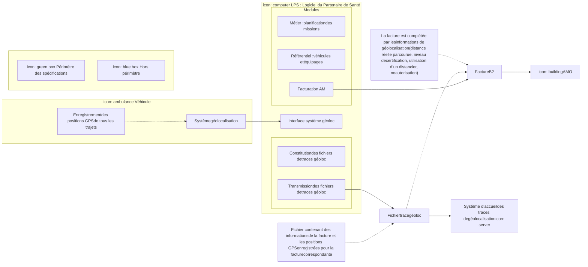
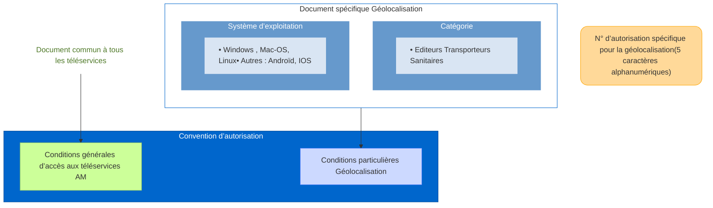

# Projet transport
# Géolocalisation

## Réunion
## Éditeurs Transporteurs Sanitaires

---

logo: sesam-vitale

logo: CNDA

logo: l'Assurance Maladie

---

**Le 24/06/2015**
**De 14h30 à 17h00**

# **Sommaire**

## ❑ Géolocalisation
*   Présentation du contexte
*   Description MAJ du cahier des charges
*   Présentation du processus
*   Modalités d’autorisation

## ❑ Actualités générales transport
*   PEC+
*   SEFi
*   SPE/SPEi

logo: sesam-vitale
Document de travail
logo: CNDA
2

logo: l'Assurance Maladie Caisse Nationale

# **Contexte du cahier des charges**

❑ Avenant 7 à la convention des transporteurs sanitaires
*   Création d’une option conventionnelle pour la géolocalisation et le transport partagé
*   Production, dans ce cadre, d’un cahier des charges « rénové » décrivant les modalités techniques de constitution des traces et leur transmission

❑ Reprend les principes mis en place lors de l’expérimentation avec l’avenant 5
*   Format du fichier de trace identique à celui de l’expérimentation
*   Le cahier des charges « rénové » apporte des précisions sur les règles de constitution du fichier de traces

❑ Objectif : fiabiliser le contenu des traces de géolocalisation transmises à l’assurance maladie
*   Mise en place en parallèle d’une procédure de vérification de conformité des logiciels

logo: sesam-vitale
Document de travail
logo: CNDA
3

logo: l'Assurance Maladie

# **Zoom sur les principales anomalies constatées sur les traces – Retour de l’expérimentation Avenant 5**

[ ] La structure du fichier traces est incomplète ou incorrecte : cause majeure de rejets des traces de géolocalisation (plus de 95% des cas de rejets).

[ ] L’entête du fichier comporte des erreurs (non-conformité au fichier attendu).

[ ] Le kilométrage relevé par le boitier est incorrect au vu du trajet effectué.

[ ] Le nombre de points de positionnement relevé par le boitier (théoriquement toutes les minutes) est inférieur à 85% (moyenne tolérable).

[ ] Certains trajets ne comportent aucune trace GPS dans le fichier.

[ ] Le kilométrage réel remonté dans les traces reste à zéro.

[ ] Le numéro de série du boitier est non renseigné.

[ ] Il y a une incohérence d’heure entre deux points de positionnement relevés.

[ ] Les informations nominatives des transporteurs sont non renseignées.

logo: sesam-vitale
Document de travail
logo: CNDA
4

logo: l'Assurance Maladie Caisse Nationale

# **Principes retenus pour le cahier des charges**
# **GEOLOCALISATION**

❑ Le cahier des charges « rénové » décrit les modalités techniques de constitution des traces et leur transmission.

❑ Il n’y a pas de remise en cause des conditions d’enregistrement, de fiabilisation et d’envoi mises en place lors de l’expérimentation « Avenant 5 »
*   Le format du fichier de traces reste identique à celui de l’expérimentation.
*   Les traces sont envoyées par messagerie.

❑ Le cahier des charges « rénové » apporte des précisions sur les règles de constitution du fichier de traces pour que le fichier soit conforme
*   Indique les modalités d'enregistrement (et les standards à respecter qui sont les mêmes que ceux de l’expérimentation)
*   Permet de respecter l'intégrité des données transmises à l’Assurance Maladie
    ➔ les modalités de transmission des données de géolocalisation entre le boîtier GPS et le LPS sont hors périmètre de ce cahier des charges
*   Fiabilise les données transmises par l’entreprise à l’Assurance Maladie après :
    ➔ Vérification automatique par le LPS de la complétude des données et du respect du format
    ➔ Contrôle des noms et prénoms du conducteur et de l’accompagnateur
*   Systématise l'envoi des traces par le LPS à la fin de chaque journée de facturation.

❑ Le guide de vérification de conformité de l’offre géolocalisation publié par le CNDA permettra de vérifier que les logiciels produisent un fichier de traces de géolocalisation conforme.

logo: sesam-vitale
Document de travail
logo: CNDA
5

logo: l'Assurance Maladie

# **Périmètre du cahier des charges**



logo: l'Assurance Maladie

logo: sesam-vitale

Document de travail

logo: CNDA

6

logo: l'Assurance Maladie
Caisse Nationale

# Mise à jour du cahier des charges

❑ Le cahier des charges rénové apporte des précisions sans changer les principes définis dans l’avenant 5.

❑ Il reprend le formalisme utilisé dans les spécifications éditeurs élaborées par le GIE SESAM-Vitale.

*   Description processus général
*   Description détaillée de chaque processus
    *   ➔ Description
    *   ➔ Données en entrée
    *   ➔ Données en sortie
    *   ➔ Eventuellement situations spécifiques
    *   ➔ Règles de gestion RG_GEXXX
*   Description des entités fonctionnelles

|                                                                 |               |
| :-------------------------------------------------------------- | :------------ |
| page_thumbnail: sesam-vitale Facturation Transporteur | \`\`\`mermaid |
| stateDiagram-v2                                                 |               |
    [*] --> GE01
    state GE01 : **GE01 - Constituer les** traces de géolocalisation
    GE01 --> cond1
    state cond1 <<choice>>
    note right of cond1 : Fichier de trace présent ?
    cond1 --> GE02 : <sub>oui</sub>
    cond1 --> GE04 : non
    state GE02 : **GE02 - Compléter la** **facture**
    GE02 --> cond2
    state cond2 <<choice>>
    note left of cond2 : Facture transmise ?
    cond2 --> GE03 : <sub>oui</sub>
    cond2 --> GE04 : non
    state GE03 : **GE03 - Transmettre les** traces de géolocalisation
    state GE04 : **GE04 - Administrer les** traces de géolocalisation
    GE03 --> [*]
    GE04 --> [*]
``` |

| | |
| :--- | :--- |
| **3.1.2 GE01.01 - Initialiser le fichier de trace et récupérer les caractéristiques de la facture** | <table style="border-collapse: collapse; width: 100%;"><tr><td style="border: 1px solid black; background-color: #FFF2CC; padding: 5px;"><b>EF_GE01 - Fichier trace géolocalisation</b><hr/>Identifiant transporteur :string<br/>Nature prestation :string<br/>Numéro facture :string</td><td style="border: none; width: 50px;"></td><td style="border: 1px solid black; background-color: #FFF2CC; padding: 5px;"><b>EF_GE06 - Paramètres géolocalisation</b><hr/>Fréquence enregistrement des traces :int</td></tr><tr><td style="text-align: center;">1<br/>↓<br/>1..*</td><td style="border: none;"></td><td style="border: none;"></td></tr><tr><td style="border: 1px solid black; background-color: #FFF2CC; padding: 5px;"><b>EF_GE02 - Transport</b><hr/>Identifiant boitier GPS :string<br/>Identifiant véhicule :string<br/>Kilométrage réel parcouru :string<br/>Niveau certification :int<br/>Numéro séquence trajet :string<br/>Numéro séquence transport :string</td><td style="vertical-align: middle;">1 ← 1<br/><br/><br/>1 ← 0..1</td><td style="border: 1px solid black; background-color: #FFF2CC; padding: 5px;"><b>EF_GE04 - Conducteur : Personnel</b><hr/><i>::Personnel</i><br/>Nom d'usage :string<br/>Prénom :string<hr/><b>EF_GE05 - Accompagnateur : Personnel</b><hr/><i>::Personnel</i><br/>Nom d'usage :string<br/>Prénom :string</td></tr><tr><td style="text-align: center;">1<br/>↓<br/>1..*<br/>{ordered}</td><td style="border: none;"></td><td style="border: 1px solid black; background-color: #FFF2CC; padding: 5px;"><b>EF_GE07 - Paramètres régime AMO</b><hr/>Adresse mail destinataire :string<br/>Autorisation B2 :boolean<br/>Autorisation FEL :boolean<br/>Code Grand régime :int<br/>Date début transmission :date<br/>Date Fin Transmission :date</td></tr><tr><td style="border: 1px solid black; background-color: #FFF2CC; padding: 5px;"><b>EF_GE03 - Trace géolocalisation</b><hr/>Lattitude :string<br/>Longitude :string<br/>Time :datetime</td><td style="border: none;"></td><td style="border: none;"></td></tr></table> |

**Vue générale**
**Description** Lors de la facturation des trajets effectués, un fichier de traces XML de géolocalisation est initialisé à partir des données de la facture :
* Nommage du fichier à partir des éléments de la facture suivants :
    * Type et numéro émetteur facture
    * Type et numéro destinataire facture
    * Identification du fichier de facture
    * Numéro de la facture
* Récupération des caractéristiques de la facture à inclure dans le fichier de trace :
    * Numéro de la facture
    * Identifiant du transporteur (numéro d'émetteur)
    * Nature de la prestation

**Entrées** Facture B2 en cours
**Sorties** Fichier de traces de géolocalisation initialisé **EF_GE01**
**Situations spécifiques**
* SP1 - transports partagés : dans ce cas, il y a autant de facture que de bénéficiaires transportés, et donc autant de fichiers de traces de géolocalisation que de factures produites.

**Règles de gestion**
**[RG_GE101] Nommage du fichier de traces XML de géolocalisation**
Le nommage du fichier de traces XML de géolocalisation est constitué par concaténation des éléments suivants de la facture suivi de l'extension « .xml » :

| Nom | Origine B2 | Exemple |
| :--- | :--- | :--- |
| Type émetteur | Type 000 pos 4-5 | TP |
| Numéro émetteur | Type 000 pos 6-19 | S112345678901234 |
| Type destinataire | Type 000 pos 26-27 | CT00000001001764 |
| Numéro destinataire | Type 000 pos 28-41 | |
| Identification du fichier | Type 000 pos 50-55 | CPA249 ou 812653 |
| Date de création du fichier | Type 000 pos 56-61 | 081209 ou 081208 |
| Numéro de la facture | Type 2 pos 27-35 | 000000330 ou 020080475 |

Exemple de nom de fichier :
TP00000762522746CT00000001001764812653081209000000220.xml

logo: sesam-vitale Document de travail logo: CNDA **7** logo: L'Assurance Maladie
Caisse Nationale

logo: sesam-vitale
Document de travail
logo: CNDA
7
logo: l'Assurance Maladie

# **Processus général**

---

❑ GE01 - Constitution du fichier de **traces de géolocalisation**
* À partir des données issues du système de géolocalisation du transporteur et des données de facturation

❑ GE02 - Complément de la **facture** avec les données issues de la géolocalisation
* Km réel parcouru, niveau de certification...

❑ GE03 - Transmission du fichier de traces
* Transmission par messagerie

❑ GE04 - Paramétrage de la production et de la transmission du fichier de traces

```mermaid
graph TD
    Start(( )) --> Fork[ ]
    
    Fork --> GE04[GE04 - Administrer les traces de géolocalisation]
    Fork --> GE01[GE01 - Constituer les traces de géolocalisation]
    
    GE01 --> Decision1{Fichier de trace présent ?}
    Decision1 -- oui --> GE02[GE02 - Compléter la facture]
    Decision1 -- non --> Join[ ]
    
    GE02 --> Decision2{Facture transmise ?}
    Decision2 -- oui --> GE03[GE03 - Transmettre les traces de géolocalisation]
    Decision2 -- non --> Join
    
    GE04 --> Join
    GE03 --> Join
    
    Join --> End((( )))

    style Fork fill:#333,stroke:#333,stroke-width:4px
    style Join fill:#333,stroke:#333,stroke-width:4px
    style Start fill:#000
    style End fill:#fff,stroke:#000,stroke-width:2px
```



logo: L'Assurance Maladie Sécurité Sociale

logo: sesam-vitale
Document de travail

logo: CNDA
8
logo: l'Assurance Maladie Caisse Nationale

# **GE01 - Constitution du fichier de traces de géolocalisation**

---

❑ **Un fichier de trace** de géolocalisation est associé à **une facture**

❑ Format XML (un schéma XSD est fourni)


❑ Le fichier de trace contient :

*   Les données liées à la facture : n° Facture, identifiant transporteur
*   Les données liées à chaque trajet facturé :
    *   🡺 N° du trajet
    *   🡺 Identification du véhicule (immatriculation)
    *   🡺 Identification de l’équipage (Nom, prénom conducteur et accompagnateur)
    *   🡺 Identification du boitier GPS du véhicule (n° IME)
    *   🡺 Kilométrage réel parcouru
    *   🡺 Le niveau de certification des données
    *   🡺 Ensemble des positions GPS enregistrées par le boitier pendant le trajet :
        *   o Format standard GPX 1.1
        *   o A minima il doit y avoir le point de départ et le point d’arrivée (prise en charge et dépose du patient)


Inchangé

logo: sesam-vitale
Document de travail
logo: CNDA
9

logo: l'Assurance Maladie

# **GE01 – Modèle de données associé**

icon: Inchangé

```mermaid
classDiagram
    class EF_GE01 {
        Identifiant transporteur :string
        Nature prestation :string
        Numéro facture :string
    }

    class EF_GE02 {
        Identifiant boitier GPS :string
        Identifiant véhicule :string
        Kilométrage réel parcouru :string
        Niveau certification :int
        Numéro séquence trajet :string
        Numéro séquence transport :string
    }

    class EF_GE03 {
        Lattitude :string
        Longitude :string
        Time :datetime
    }

    class EF_GE04 {
        <<Personnel>>
        ::Personnel
        Nom d'usage :string
        Prénom :string
    }

    class EF_GE05 {
        <<Personnel>>
        ::Personnel
        Nom d'usage :string
        Prénom :string
    }

    EF_GE01 "1" -- "1..*" EF_GE02
    EF_GE02 "1" -- "1..* {ordered}" EF_GE03
    EF_GE02 "1" -- "1" EF_GE04
    EF_GE02 "1" -- "0..1" EF_GE05

    EF_GE01 : EF_GE01 - Fichier trace géolocalisation
    EF_GE02 : EF_GE02 - Transport
    EF_GE03 : EF_GE03 - Position GPS
    EF_GE04 : EF_GE04 - Conducteur : Personnel
    EF_GE05 : EF_GE05 - Accompagnateur : Personnel
```

logo: sesam-vitale
Document de travail
logo: CNDA
10

logo: l'Assurance Maladie Caisse Nationale

# GE01 – Cas des transports partagés


❑ **Exemple :**

❑ Exemple :

| Prise en charge Patient A | Prise en charge Patient B | Prise en charge Patient C | **Arrivée** commune |
| :---: | :---: | :---: | :---: |
| ♦ | ♦ | ♦ | ♦ |
| ↔ | | | |
| **Trajet Patient A** | | | |
| | ↔ | | |
| | **Trajet Patient B** | | |
| | | ↔ | |
| | | **Trajet Patient C** | |

*(Note : Le diagramme montre une ligne de temps bleue avec quatre points de repère en forme de losange. Des flèches horizontales colorées indiquent la durée des trajets pour chaque patient jusqu'à l'arrivée commune.)*

❑ Il y a autant de factures que de patients transportés (ici 3), donc autant de fichiers de traces générés (3 également)

*   Le fichier de traces associé au patient A (respectivement B et C) contiendra les positions GPS du trajet A (respectivement B et C)
*   Les positions GPS communes aux différents trajets sont dupliquées dans chacun des fichiers de traces.


Précision apportée

logo: sesam-vitale
Document de travail
logo: CNDA
11

logo: l'Assurance Maladie Caisse Nationale

# **GE01 – Niveau de certification**

---

❑ Le niveau de certification permet de définir si une donnée n’a pas été modifiée entre son acquisition et son enregistrement dans le fichier de trace ou la facture

❑ Il est défini par le tableau suivant :

<table>
  <thead>
    <tr>
      <th><b>Toutes les données</b> <b>GPS :</b><br />- Ident. boîtier GPS<br />- Coord. GPS et horodatage début et fin de prise en charge<br />- Positions GPS<br />- Km réel parcouru</th>
      <th><b>Ident. véhicule</b></th>
      <th>Ident. <b>assuré</b></th>
      <th><b>Ident. conducteur</b> <b>et accompagnant</b></th>
    </tr>
  </thead>
  <tbody>
    <tr>
      <td>Non certifié</td>
      <td>Non certifié</td>
      <td>Non certifié</td>
      <td>Non certifié</td>
    </tr>
    <tr>
      <td>Certifié</td>
      <td>Non certifié</td>
      <td>Non certifié</td>
      <td>Non certifié</td>
    </tr>
    <tr>
      <td>Certifié</td>
      <td>Certifié</td>
      <td>Non certifié</td>
      <td>Non certifié</td>
    </tr>
    <tr>
      <td>Certifié</td>
      <td>Certifié</td>
      <td>Certifié</td>
      <td>Non certifié</td>
    </tr>
    <tr>
      <td>Certifié</td>
      <td>Certifié</td>
      <td>Certifié</td>
      <td>Certifié</td>
    </tr>
  </tbody>
</table>


Inchangé

logo: sesam-vitale Document de travaillogo: CNDA 12
 logo: l'Assurance Maladie Caisse Nationale

GE01 – Exemple fichier de traces (1/3)

    <?xml version="1.0" encoding="UTF-8"?>
    <CURMED xmlns="www.cnamts.fr/namespace/EXP/0/0/Transporteur"
      xmlns:xsi="http://www.w3.org/2001/XMLSchema-instance"
      PGMD_Profil="Transporteur" PGMD_Version="8.3" Profil_Version="0.3">
                                                            N° Facture
     <Identification>098765432</Identification>
     <Emetteur>                                N° Transporteur
     <Identite_PSAM>123456789</Identite_PSAM>
     </Emetteur>
     <ContexteMA>
     <Nature>TA</Nature>


    CNDA                               13  TAssurance
sesam-vitale    CNDA    Maladie
sesam-vitale    Document de travail    13    Maladie
                Document de travail    Caisse Nationale
                        Caisse Nationale

# **GE01 – Exemple fichier de traces (2/3)**

```xml
<Transport>
    <Identifiant>01</Identifiant> --------------------------- [ N° Trajet ]
    <Trajet>
        <Identifiant>01</Identifiant> ----------------------- [ Immatriculation véhicule ]
        <Vehicule>WW123WW</Vehicule>
        <Conducteur> ---------------------------------------- [ Ident. Conducteur ]
            <Usage>NOMCONDUCTEUR</Usage>
            <Prenom>PRENOMCONDUCTEUR</Prenom>
        </Conducteur>
        <Accompagnateur> ------------------------------------ [ Ident. Accompagnateur ]
            <Usage>NOMACCOMPAGNATEUR</Usage>
            <Prenom>PRENOMACCOMPAGNATEUR</Prenom>
        </Accompagnateur>
        <Distance Q="reel">1234</Distance> ------------------- [ Kilométrage parcouru ]
        <BoitierGPS Q="1">AB123456789CDEF</BoitierGPS> ------- [ Ident. Boitier GPS ]
    </Trajet>
</Transport>
```

| [ niveau certification ]                            |
| :--------------------------------------------------- |
| (pointant vers l'attribut `Q="1"` de `<BoitierGPS>`) |

logo: sesam-vitale
Document de travail
logo: CNDA
14

logo: L'Assurance Maladie Caisse Nationale

# **GE01 – Exemple fichier de traces (3/3)**

---

```xml
<gpx xmlns="http://www.topografix.com/GPX/1/1" version="1.1" creator="">
  <trk>
   <trkseg>
    <trkpt lat="43.387138" lon="5.169208">
     <time>2014-09-19T07:15:53Z</time>
    </trkpt>
    <trkpt lat="43.387105" lon="5.16919">
     <time>2014-09-19T07:16:53Z</time>
    </trkpt>
    <trkpt lat="43.387115" lon="5.169197">
     <time>2014-09-19T07:17:53Z</time>
    </trkpt>
    (...)
   </trkseg>
  </trk>
 </gpx>

</Trajet>
</Transport>
</ContexteMA>
</CURMED>
```

> **Positions GPS au format GPX 1.1**

logo: sesam-vitale
Document de travail
logo: CNDA
15

logo: l'Assurance Maladie Caisse Nationale

# **GE02 - Complément de la facture**

## ❑ La facture B2 (B2 2007) est complétée

*   dans <u>le type 4U</u> : <mark>Inchangé</mark>

**TYPE 4U :**

<table>
  <thead>
    <tr>
      <th>Donnée</th>
      <th>position</th>
      <th>format</th>
      <th>Présen- ce</th>
      <th>Consignes</th>
    </tr>
  </thead>
  <tbody>
    <tr>
      <td>- Distance réelle parcourue</td>
      <td>113-116</td>
      <td>4 car Num.</td>
      <td>O</td>
      <td>Indique le nombre de kms réellement parcourus, entre le lieu de départ et le lieu d'arrivée. Cette zone est renseignée avec les informations issues du module de géo localisation.</td>
    </tr>
    <tr>
      <td>- Utilisation du distancier</td>
      <td>117</td>
      <td>1 car alpha</td>
      <td>O</td>
      <td>Valeur « D » : la distance facturée a été déterminée sur la base du distancier local négocié avec la profession.<br />Valeur « N » : le distancier n'a pas été utilisé car le trajet effectué n'y figure pas.</td>
    </tr>
    <tr>
      <td>- Niveau de certification</td>
      <td>118</td>
      <td>1 car. Num.</td>
      <td>O</td>
      <td>Indique le niveau de confiance à accorder aux informations fournies relatives aux transports :<br />1 : non certifié<br />2 : certification des données GPS uniquement<br />3 : certification des données GPS et de l'identification du véhicule.<br />4 : certification des données GPS, de l'identification du véhicule et de l'identifiant de l'assuré.<br />5 : certification des données GPS, de l'identification du véhicule, de l'identifiant de l'assuré, du conducteur, et de l'accompagnant le cas échéant.</td>
    </tr>
  </tbody>
</table>
Présence « O » = Obligatoire

*   Dans <u>le type 2S :</u> <mark>Nouveau</mark>
    🡺 Pos 45-49: N° d’autorisation délivré par le CNDA (5 caractères alphanumériques)

icon: info
<mark>Gestion des Factures en Lignes (**FEL**) prise en compte dans une version ultérieure du cahier des charges</mark>

logo: sesam-vitale
Document de travail
logo: CNDA
16

logo: l'Assurance Maladie Caisse Nationale

# **GE03 - Transmission du fichier de trace**

icon: Inchangé

---

- Réutilisation du système d’accueil mis en place pour l’expérimentation
- Transmission par messagerie SMTP
- La transmission se fait après envoi de la facture
- Un seul fichier de trace par message, non compressé, non sécurisé (pas de signature, pas de chiffrement)

logo: sesam-vitale
Document de travail
logo: CNDA
17

logo: l'Assurance Maladie Caisse Nationale

# **GE04 – Administrer les traces des géolocalisation**

icon: Nouveau

---

❑ Paramétrage au niveau de l’enregistrement des données de géolocalisation
* • La fréquence d’enregistrement des traces de géolocalisation par le boitier GPS d’un véhicule. La valeur par défaut est de 1 minute.

❑ Paramétrage de la transmission selon :
* • Code régime d’appartenance du patient transporté
* • Type de facture (B2 ou FEL)
* • Date d’ouverture et/ou date fermeture du service de transmission
* • Adresse mail où envoyer les traces de géolocalisation
    * ➔ Actuellement en production <u>geolocts@cnamts.fr</u> pour le régime général
    * ➔ L’adresse pour les tests sera indiquée dans le guide de tests

logo: sesam-vitale
Document de travail
logo: CNDA
18

logo: l'Assurance Maladie Caisse Nationale

# **Corpus documentaire**

---

❑ 19/06/2015 : Mise à disposition sur le portail industriels du GIE SESAM-Vitale : <u>https://industriels.sesam-vitale.fr</u>
* Cahier des charges rénové <u>en version de travail</u>

❑ A venir : Mise à disposition
* Cahier des charges rénové <u>en version référence</u>
* Schéma xml (*.xsd) permettant de valider les flux avant de les envoyer

logo: sesam-vitale
Document de travail
logo: CNDA
19

logo: l'Assurance Maladie

# **Convention d’autorisation Géolocalisation**

❑ La convention d’autorisation de Géolocalisation est constituée



icon: information

logo: sesam-vitale
Document de travail
logo: CNDA
20

logo: l'Assurance Maladie Caisse Nationale

# **Présentation de la procédure d'autorisation**

# 1 Spécifications
L’éditeur télécharge les documents de référence

*   **Portail industriels du GIE SESAM-Vitale :**
*   Cahier des charges rénové $\rightarrow$ Pré requis : Signature accord confidentialité
*   **Site du CNDA :** guide de test de conformité et convention

# 2 Engagement
Il signe la convention

**Le CNDA délivre :**
*   le N° d’autorisation LPS autorisé à accéder à la plate-forme de test éditeurs

# 3 Développement
Il développe l’appel au service conformément aux documents de référence

# 4 Passage au CNDA
Il dépose le dossier de recette complété sur le site du CNDA

**Le CNDA **examine le** dossier de recette**

# 5
L’éditeur transmet son LPS au CNDA (ou connexion à distance)

*   Le CNDA réalise les tests
*   A la fin de ces tests, le CNDA :
    *   délivre le n° d’autorisation à intégrer dans la facture
    *   affiche la conformité du LPS sur le site du CNDA

# 6 Déploiement
L’éditeur déploie auprès de ses clients :

*   Le déploiement s’effectue dans les conditions fixées par l’Assurance Maladie

> **Lors des évolutions ultérieures, dans certaines situations, la procédure d’autorisation pourra être simplifiée.**
> **Après évolution de son LPS, l’éditeur transmettra au CNDA les documents requis.**

logo: sesam-vitale
Document de travail
logo: CNDA
21

logo: l'Assurance Maladie

# Planning

---

*   ❑ Juin 2015 : mise à disposition du corpus documentaire (CdC et schéma xsd)
*   ❑ Juillet 2015: mise à disposition des conditions particulières et des guides de tests
*   ❑ Août 2015 (à confirmer): ouverture autorisation par le CNDA

La signature des conditions particulières est obligatoire avant toute autorisation icon: information

icon: purple four-pointed star icon: red target with "VOUS ÊTES ICI" text icon: purple four-pointed star icon: purple four-pointed star icon: green four-pointed star

***

***Juin 2015 :***
***Mise à disposition***
***du Cahier des***
***charges rénové***

***24 juin 2015***
***Réunion***
***Fédérations TS /***
***Editeurs***

***Juillet 2015 :***
***Mise à disposition***
***conditions***
***particulières***

***Août2015 :***
***Ouverture***
***autorisation***

***Échéance décembre 2015 :***
***Date à laquelle les TS ayant***
***signé l’option***
***géolocalisation doivent être***
***équipés d’un LPS***
***implémentant le CDC rénové***

logo: sesam-vitale
Document de travail
logo: CNDA
22

logo: l'Assurance Maladie Caisse Nationale

# **Sommaire**

## ❑ Géolocalisation

*   Présentation du contexte
*   Description MAJ du cahier des charges
*   Présentation du processus
*   Modalités d’autorisation

## ❑ Actualités générales transport

*   PEC+
*   SEFi
*   SPE/SPEi

logo: sesam-vitale
Document de travail
logo: CNDA
23

logo: l'Assurance Maladie Caisse Nationale

# **PEC+ : 2 Versions actuellement en production**

logo: PEC Maladie

```mermaid
graph TD
    subgraph Version_Historique [Version historique dite « hors cadre »]
        VH1[Généralisée en 2012]
        VH2[Transporteurs sanitaires]
        VH3[Régime général seulement]
        VH4[Risques Maladie, Maternité]
        VH5[Plus maintenue]
        
        Version_Historique --- VH1
        Version_Historique --- VH2
        Version_Historique --- VH3
        Version_Historique --- VH4
        Version_Historique --- VH5
    end

    subgraph Version_PEC [Version PEC+ TIRAT  (Taxis, Inter-régime, AT)]
        VP1[Généralisée fin avril 2014]
        VP2[Transporteurs sanitaires, Taxis]
        VP3["Régime général, MSA, RATP, CAMIEG,  CAVIMAC, ENIM, MNH, LMG, INTERIALE"]
        VP4["Risques Maladie, Maternité, Accident  Travail"]
        VP5[Mise à jour à venir pour le TPI ACS]
        
        Version_PEC --- VP1
        Version_PEC --- VP2
        Version_PEC --- VP3
        Version_PEC --- VP4
        Version_PEC --- VP5
    end

    style Version_Historique fill:#a1006b,color:#fff,stroke:#a1006b
    style VH1 fill:#fff,stroke:#a1006b,color:#a1006b
    style VH2 fill:#fff,stroke:#a1006b,color:#a1006b
    style VH3 fill:#fff,stroke:#a1006b,color:#a1006b
    style VH4 fill:#fff,stroke:#a1006b,color:#a1006b
    style VH5 fill:#fff,stroke:#a1006b,color:#a1006b

    style Version_PEC fill:#005ba6,color:#fff,stroke:#005ba6
    style VP1 fill:#fff,stroke:#005ba6,color:#005ba6
    style VP2 fill:#fff,stroke:#005ba6,color:#005ba6
    style VP3 fill:#fff,stroke:#005ba6,color:#005ba6
    style VP4 fill:#fff,stroke:#005ba6,color:#005ba6
    style VP5 fill:#fff,stroke:#005ba6,color:#005ba6
```

icon: warning icon: arrow **- **La date butoir pour migrer de la version historique, dite** « hors cadre » vers PEC + TIRAT est fixée au <u>31 juillet </u> <u>2015 </u>**

logo: sesam-vitale
Document de travail
logo: CNDA
24

logo: l'Assurance Maladie Caisse Nationale

logo: PEC+

# **PEC+ : suivi mensuel**

---

* Suivi mensuel global de l’utilisation des versions du service PEC+ et PEC+ TIRAT

<!--llamaparse-error ordinal="0" mode="chart" box_2d="[265,25,690,975]" code="SPECIALIST_ERROR"-->

* Nb de transporteurs sanitaires utilisant encore PEC+ à fin mai 2015 : 250

logo: sesam-vitale
Document de travail
logo: CNDA
25

logo: l'Assurance Maladie Caisse Nationale

# **PEC+ TIRAT : Montée en charge**

---

❑ Plus de 1 000 000 de connexions par mois
❑ Près de 5 000 utilisateurs (Transporteurs sanitaires et taxis)

<table>
  <caption>PEC+ TIRAT : Montée en charge — Nb Accès (barres, axe gauche) et Nb PS (ligne, axe droit) par mois</caption>
  <thead>
    <tr>
      <th>Mois</th>
      <th>Nb Accès</th>
      <th>Nb PS</th>
    </tr>
  </thead>
  <tbody>
    <tr>
      <th>juin-14</th>
      <td>360 000</td>
      <td>2 000</td>
    </tr>
    <tr>
      <th>juil-14</th>
      <td>600 000</td>
      <td>2 600</td>
    </tr>
    <tr>
      <th>août-14</th>
      <td>510 000</td>
      <td>3 000</td>
    </tr>
    <tr>
      <th>sept-14</th>
      <td>790 000</td>
      <td>3 600</td>
    </tr>
    <tr>
      <th>oct-14</th>
      <td>910 000</td>
      <td>4 000</td>
    </tr>
    <tr>
      <th>nov-14</th>
      <td>730 000</td>
      <td>4 100</td>
    </tr>
    <tr>
      <th>déc-15</th>
      <td>940 000</td>
      <td>4 300</td>
    </tr>
    <tr>
      <th>janv-15</th>
      <td>1 040 000</td>
      <td>4 600</td>
    </tr>
    <tr>
      <th>févr-15</th>
      <td>940 000</td>
      <td>4 700</td>
    </tr>
    <tr>
      <th>mars-15</th>
      <td>1 150 000</td>
      <td>4 900</td>
    </tr>
    <tr>
      <th>avr-15</th>
      <td>1 120 000</td>
      <td>4 900</td>
    </tr>
    <tr>
      <th>mai-15</th>
      <td>890 000</td>
      <td>4 500</td>
    </tr>
  </tbody>
</table>

logo: sesam-vitale

Document de travail

logo: CNDA

26


logo: l'Assurance Maladie
Caisse Nationale

# **PEC+ TIRAT: TPi ACS**

---

❑ A partir du 1<sup>er</sup> juillet 2015, arrivée des contrats complémentaires ACS 🡪 TP intégral ACS

❑ Diffusion le 17/06/2015 du corpus documentaire 2.12:
*   Mise à disposition de la fiche d’information PDT-INF-353
*   L’environnement de tests éditeurs a été mis à jour
*   Les logiciels actuellement déployés doivent vérifier qu’il n’y a pas de rupture de service

logo: sesam-vitale
Document de travail
logo: CNDA
27

logo: l'Assurance Maladie

# **Sommaire**

---

## ❑ Géolocalisation

* Présentation du contexte
* Description MAJ du cahier des charges
* Présentation du processus
* Modalités d’autorisation

## ❑ Actualités générales transport

* PEC+
* SEFi
* SPE/SPEi

logo: sesam-vitale
Document de travail
logo: CNDA
28

logo: l'Assurance Maladie Caisse Nationale

# **Service Electronique Facturation intégré - Transporteurs** 
logo: SEFI Transport

## ❑ Rappel : Les objectifs de SEFI *   Simplifier le processus de bout en bout*   ➔ **Simplifier et fiabiliser** la saisie des éléments de facturation transmis à la caisse grâce à la récupération des informations dans les bases de l’Assurance Maladie (PS, bénéficiaire, prescription …)*   ➔ **Aider le transporteur** à l’élaboration de la facture*   ➔ **Faciliter** le traitement par la dématérialisation de l’ensemble des pièces justificatives dès la facturation*   Tendre vers le **zéro papier** et le **zéro rejet** pour les transporteurs et les caisses

logo: sesam-vitale
Document de travaillogo: CNDA
29
logo: l'Assurance Maladie Caisse Nationale

# **Service Electronique Facturation intégré - Transporteurs**

logo: SEFI Transport

---

❑ Nouvelle solution de facturation s’appuyant sur des services en ligne, intégrée au logiciel métier des transporteurs sanitaires (TS) permettant :

* d’élaborer une facture en ligne à partir des référentiels de l’assurance maladie
* d’utiliser le service SCOR pour la numérisation et la transmission des pièces justificatives (PJ) nécessaires au remboursement (prescription, attestation de service fait signée,…).
* de récupérer automatiquement les informations des prescriptions de transport

* Solution sécurisée par une carte de professionnel de santé (CDE ou CPE).

❑ S’appuie, comme tous les TLSi de l’Assurance Maladie, sur le cadre d’interopérabilité et le service SCOR, largement déployés.

logo: sesam-vitale
Document de travail
logo: CNDA30

logo: l'Assurance Maladie Caisse Nationale

logo: SEFi

# **Montée en charge de la présérie SEFi**

---

## ❑ Actuellement le service est en Présérie

*   Spécifications disponibles pour les éditeurs du Groupe de Travail (9 éditeurs Transporteurs Sanitaires volontaires)
*   25 Transporteurs Sanitaires – 2 éditeurs autorisés
*   Plus de 12 000 FEL reçues et payées
*   Environ 1000 FEL / semaine
*   Périmètre fonctionnel couvrant 90% des cas de facturation

<table>
  <caption>Évolution du nombre de FEL et d'utilisateurs par mois — août-2014 à mai-2015</caption>
  <thead>
    <tr>
      <th>Mois</th>
      <th>Nb FEL</th>
      <th>Utilisateurs</th>
    </tr>
  </thead>
  <tbody>
    <tr>
      <th>août-2014</th>
      <td>150</td>
      <td>1</td>
    </tr>
    <tr>
      <th>sept.-2014</th>
      <td>220</td>
      <td>1</td>
    </tr>
    <tr>
      <th>oct.-2014</th>
      <td>210</td>
      <td>1</td>
    </tr>
    <tr>
      <th>nov.-2014</th>
      <td>120</td>
      <td>1</td>
    </tr>
    <tr>
      <th>déc.-2014</th>
      <td>210</td>
      <td>1</td>
    </tr>
    <tr>
      <th>janv.-2015</th>
      <td>240</td>
      <td>10</td>
    </tr>
    <tr>
      <th>févr.-2015</th>
      <td>1420</td>
      <td>20</td>
    </tr>
    <tr>
      <th>mars-2015</th>
      <td>3150</td>
      <td>26</td>
    </tr>
    <tr>
      <th>avr.-2015</th>
      <td>3480</td>
      <td>25</td>
    </tr>
    <tr>
      <th>mai-2015</th>
      <td>2420</td>
      <td>27</td>
    </tr>
  </tbody>
</table>

logo: sesam-vitale
Document de travail
logo: CNDA

logo: l'Assurance Maladie

logo: SEFi Transport

# **Une démarche en 3 étapes**

---

## Expérimentation

* 1 TS
* 1 caisse du régime général
* Editeurs du GT ayant répondu à l’appel à candidature
* 50 % des factures

## Pré série

* ~ 30 TS
* 7 caisses (RG)
* Editeurs du GT ayant répondu à l’appel à candidature
* 90 % des factures

## Généralisation TS

* Tous les TS
* Toutes les caisses du RG
* Tous les éditeurs ayant une offre TS
* 95 % des factures

---

* Un bilan partagé entre tous les acteurs à la fin de chaque étape
* A chaque étape, le périmètre fonctionnel du SEFi est élargi, les factures non couvertes en SEFi télétransmises en B2

logo: sesam-vitale
Document de travail
logo: CNDA
32

logo: l'Assurance Maladie

# **SEFi : suite des travaux**

logo: SEFi Transport

---

[ ] A partir du mois de juillet, le service retournera les informations des contrats ACS pour les bénéficiaires de l’ACS

[ ] Bilan de la présérie prévue à l’été 2015

[ ] L’Assurance Maladie, en concertation avec les tous les acteurs, décidera de la généralisation

[ ] Une réunion plénière avec les éditeurs sera organisée lorsque la généralisation sera prononcée

logo: sesam-vitale
Document de travail
logo: CNDA
33

logo: l'Assurance Maladie Caisse Nationale

# **Sommaire**

---

## ❑ Géolocalisation

*   Présentation du contexte
*   Description MAJ du cahier des charges
*   Présentation du processus
*   Modalités d’autorisation

## ❑ Actualités générales transport

*   PEC+
*   SEFi
*   SPE/SPEi

logo: sesam-vitale
Document de travail
logo: CNDA
34

logo: l'Assurance Maladie Caisse Nationale

# **Service de Prescription Electronique de Transport**

logo: Service de Prescription Electronique intégré TRANSPORT

---

## ❑ La version SPE (Espace pro) en expérimentation :

*   Avec 3 établissements (78, 13, 93) en collaboration avec les CPAM associées et les ELSM

## ❑ La version SPEi (intégrée dans les outils de régulation de transport des établissements)

*   Partie Assurance Maladie➔ Environnement de production opérationnel

*   Travaux éditeurs➔ Documentation éditeurs disponible pour les éditeurs déclarés PFR (Plateforme de régulation)➔ Environnement éditeurs opérationnel

*   Préparation de l’expérimentation➔ Principe retenu : 1 Etablissement pressenti par éditeur (identifié suite à des échanges avec les CPAMs)

logo: sesam-vitale
Document de travail
logo: CNDA
35

logo: l'Assurance Maladie Caisse Nationale

# Merci de votre attention

*Vos questions…*

logo: decorative graphic with blue gradient and white curved lines