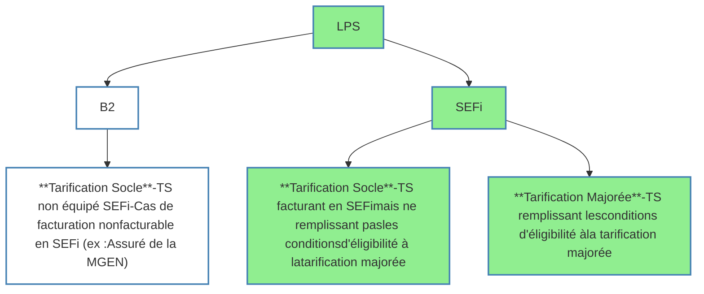

logo: sesam-vitale

# <u>Fiche d’information.</u>

<table>
    <tr>
      <td><b>Référence</b></td>
      <td colspan="2"><b>PDT-INF-818v4</b></td>
      <td><b>Date</b></td>
      <td><b>28.01.2026</b></td>
    </tr>
    <tr>
      <td><b><b>Objet</b></b></td>
      <td colspan="4"><b><b>Avenant 11 : impacts pour les transporteurs sanitaires</b></b></td>
    </tr>
</table>

<table>
    <tr>
      <td><u><b>Type</b></u></td>
      <td>☐ Technique</td>
      <td>☐ Pratique</td>
      <td>☒ Communication</td>
      <td>☐ Livraison</td>
    </tr>
    <tr>
      <td><u><b>Destinataires</b></u></td>
      <td>☒ Éditeurs</td>
      <td>☐ Équipementiers</td>
      <td>☐ OCT</td>
      <td>☐ CIS</td>
    </tr>
    <tr>
      <td><u><b>Produits</b></u></td>
      <td>Facturation 
            ☐ CDC Éditeurs 
            ☐ CDC OCT 
            ☐ FSV agrément 
            ☐ FSV exploitation 
            ☐ SCOR 
         
        Services AMC 
            ☐ TP Complémentaire</td>
      <td>Référentiels 
            ☐ Dispositif Intégré 
            ☐ Terminal lecteur 
            ☐ TLA 
            ☐ Lecture Vitale 
            ☐ Télémise à jour</td>
      <td>Produits d’infrastructure 
            ☐ ATSAM 
            ☐ SrvSVCNAM 
            ☐ GALSS 
         
        Services en Ligne 
            ☐ CDR 
            ☐ amelipro</td>
      <td>Téléservices intégrés 
            ☐ AATi 
            ☐ ADRi 
            ☐ ALDi 
            ☐ DMTi 
            ☐ HRi 
            ☐ IMTi 
            ☐ PEC + 
            ☐ PEM 2D 
            ☒ SEFi 
         
        Acquisition des droits 
            ☐ API de Lecture Vitale</td>
    </tr>
    <tr>
      <td><u><b>Secteur</b></u></td>
      <td>☒ Libéral</td>
      <td>☐ Hospitalier</td>
      <td></td>
      <td></td>
    </tr>
    <tr>
      <td><u><b>Professionnels</b></u> 
        <u><b>de Santé</b></u> 
        <u><b>concernés</b></u></td>
      <td>☐ Médecins 
        ☐ Sages-femmes 
        ☐ Chirurgiens-dentistes 
        ☐ Pharmaciens 
        ☐ Laboratoires</td>
      <td>☐ Auxiliaires médicaux 
        ☐ Centres de Santé 
        ☐ Fournisseurs 
        ☒ Transporteurs</td>
      <td>☐ Établissements publics 
        ☐ Cliniques privées 
        ☐ ESPIC</td>
      <td></td>
    </tr>
    <tr>
      <td><b>Prise en compte</b></td>
      <td>☐ Facultative</td>
      <td>☒ Obligatoire</td>
      <td colspan="2">Mise en œuvre obligatoire de la tarification majorée au 06 mai 2024</td>
    </tr>
</table>

## **Contexte**
La tarification majorée définie à l’avenant n°11 à la convention nationale des transporteurs sanitaires privés s’appliquera dans les flux SEFi des LPS à compter du **06 mai 2024** et induira de nouvelles règles qui affecteront la facturation des transporteurs sanitaires (Ambulances et VSL). → Décalage par rapport à la date initialement prévue le 7 novembre 2023 puis le 15 février 2024
NB : Les autres catégories de transporteurs (dont taxis) ne sont pas concernées.

## **Tarification différenciée**
L’avenant n°11 à la convention nationale des transporteurs sanitaires privés prévoit la mise en place d’une tarification différenciée pour les VSL et les ambulances uniquement.

Cette tarification se formalise en trois temps.

### 1. <u>**Au 7 novembre 2023**</u>

*   **par des revalorisations tarifaires <u>socles</u>** s’appliquant à l’ensemble des entreprises ;
*   **par des revalorisations tarifaires <u>majorées</u>** s’appliquant sous la forme du versement d’une rémunération compensatrice, aux entreprises remplissant certaines conditions.

*PDT-INF-818v4*
**1 / 5**

logo: sesam-vitale

# <u>Fiche d’information.</u>

---

## 2.  **<u>Au 06 mai 2024</u>**

*   par la **<u>tarification majorée</u>** s’appliquant à l’entreprise de transports à condition qu’elle :
    *   atteste que l’ensemble de ses véhicules sont équipés d’un système de géolocalisation certifié par l’Assurance Maladie et activé (FACT-SFG-039 v1.03)
    *   transmettre ses factures en SEFi

*   par la **tarification socle** s’appliquant :
    *   à l’entreprise de transports qui ne peut satisfaire aux 2 conditions ci-dessus permettant la tarification majorée
    *   et/ou lorsque la transmission en SEFi n’est pas autorisée (exemple de la MGEN)

Ainsi, à compter du 06 mai 2024, **les flux SEFi** des logiciels de facturation devront permettre au transporteur de facturer soit exclusivement avec la tarification socle, soit exclusivement avec la tarification majorée.

Par défaut, le paramétrage de base des flux SEFi du LPS est la tarification socle.
Si le transporteur remplit les conditions pour pouvoir bénéficier de la tarification majorée, alors seul l’éditeur pourra activer la tarification majorée dans le flux SEFi du logiciel du transporteur.
Les flux B2 ne sont facturables qu’en tarification socle et ce quelle que soit la situation de l’entreprise de transport.

<mark>**<u>Cette activation </u> <u>est </u> <u>conditionnée à l’accord de la CPAM de rattachement du </u>**</mark>
<mark>**<u>transporteur</u>** <u>sous réserve de la réception d’une attestation sur l’honneur établie par le </u></mark>
<mark><u>transporteur ainsi que les numéros des factures de vérification prouvant que le TS remplit </u></mark>
<mark>toutes les conditions pour utiliser la tarification majorée1.</mark>

<mark><u>L’envoi de factures de vérification est exceptionnel. Il est limité au contexte de cette activation </u></mark>
<mark><u>et n’est pas indiqué dans le cahier des charges SEFi.</u></mark>

<mark><u>Depuis le 22 décembre 2025, il n’y a plus d’attestation à fournir de la part des éditeurs.</u></mark>

<mark><u>Le guide méthodologique destiné aux transporteurs, le modèle d’attestation sur l’honneur et </u></mark>
les modalités associées sont disponibles sur ce lien :

[https://www.ameli.fr/content/logiciel-de-facturation-sefi-et-tarification-majoree-guide-pour-
les-transporteurs-sanitaires](https://www.ameli.fr/content/logiciel-de-facturation-sefi-et-tarification-majoree-guide-pour-les-transporteurs-sanitaires)

<mark><u>Pour rappel, les cas non facturables en SEFi, sont transmis en tarif socle via la norme de </u></mark>
<mark><u>facturation B2 et font l’objet d’un versement d’une rémunération compensatrice qui a lieu </u></mark>
<mark><u>trimestriellement. </u></mark>

En résumé :

1 La facture de vérification est une facture SEFi en **tarif socle** dont l’objectif est de vérifier que le TS est correctement équipé et peut adresser des trajets présentant des niveaux de certification compris entre 3 et 5.

*PDT-INF-818v4*
*2 / 5*

logo: sesam-vitale

# <u>Fiche d’information.</u>

### 3. **<u>Au 1</u>er <u>janvier 2025</u>**

La **<u>tarification socle</u>** continue de s’appliquer à l’ensemble des entreprises avec les mêmes modalités qu’établies depuis le 06 mai 2024.

En revanche, **la tarification majorée pourrait évoluer vers une tarification dite <u>conditionnelle</u>** mettant alors en œuvre :
*   une revalorisation de la tarification majorée ;
*   cette revalorisation est cependant conditionnée à la réalisation préalable des 3 chantiers d’efficience mentionnés dans l’avenant 11.

**<u>Attention</u>** : si ces trois chantiers ne sont pas réalisés, la tarification majorée (telle que définie au 06 mai 2024) continuera alors de s’appliquer au 1ᵉʳ janvier 2025.

Veuillez-vous référer à l’avenant 11 pour le détail des modalités d’application.

NB : Les tarifs sont précisés dans l’avenant 11.

**Géolocalisation pour la tarification majorée ou conditionnelle**

La mise en place de la tarification majorée ou conditionnelle implique que les éditeurs respectent les dispositions ci-dessous :

*   **Rendre obligatoire et non modifiable les données** de géolocalisation issues du dispositif de géolocalisation et renseignées dans la facture.
*   Distance GPS : la distance doit être à minima > à 0 et, en cas de défaillance du dispositif de géolocalisation, la donnée devra alors être renseignée à 1.
*   Utilisation d’un distancier local : la valeur doit être systématiquement renseignée à N ou D
*   Le niveau de certification : cette donnée doit être comprise entre 1 et 5
*   Le n° d’autorisation du LPS : cette donnée doit être renseignée avec 5 caractères alphanumériques (il s’agit d’une nouvelle donnée obligatoire publiée dans le package SEFi en version 3.40)

*PDT-INF-818v4* *3 / 5*

logo: sesam-vitale

<u>Fiche d’information.</u>

## **Déterminer les montants de prestation**

Le service de tarification (déterminer les montants de prestation - CalculerMontantsPrestation) ne pourra être appelé que dans le cas de la tarification majorée ou conditionnelle.

Ce service ne doit pas être appelé dans le cas de la tarification socle.

## **Le transport partagé**

L’avenant 11 à la convention nationale des transporteurs sanitaires privés prévoit des taux d’abattement préférentiels en cas de transport partagé pour les entreprises.

A noter que la valeur des taux d’abattement définis dans l’avenant 11 ne change pas : seules les conditions pour pouvoir prétendre à l’application des taux d’abattement préférentiels évoluent.

Ainsi, afin de bénéficier des taux de 15% et 33%, il n’est plus nécessaire que l’entreprise soit signataire de l’avenant n°7.

A compter du 7 novembre 2023, elle doit :
❖ transmettre ses factures en SEFi
❖ utiliser un dispositif de géolocalisation certifié par l’Assurance Maladie

Veuillez-vous référer à l’avenant 11 pour plus de précisions sur ces nouvelles dispositions.

## **TPMR**

Par ailleurs, à compter du 7 novembre 2023, l’avenant 11 à la convention nationale des transporteurs sanitaires privés prévoit une revalorisation du forfait TPMR.

Le tarif TPMR, forfait versé uniquement aux **<u>VSL</u>** pour chaque transport de personne à mobilité réduite, est modifié.

Vous voudrez bien vous référer à l’avenant 11 pour le détail des tarifs.

## **Multi-sociétés**

Lorsqu’il est question de multi-sociétés, le fonctionnement et le processus des attestations avec l’avenant 11 rappelle que :
• la société mandataire est émettrice de la facture
• la société mandante est réalisatrice du trajet

Autrement dit, la société mandataire dispose d’un mandat de la société mandante pour émettre, en son nom, les factures des trajets réalisés par les véhicules de la société mandante.

La société mandante ne pourra alors bénéficier de la tarification majorée que si et seulement si les sociétés mandante et mandataire respectent toutes deux les conditions d’éligibilité citées plus haut.

Pour ce faire, la société mandante devra donc, au préalable :
• obtenir l’accord de sa CPAM de rattachement sous réserve de lui avoir transmis les 2 attestations sur l’honneur comme indiqué supra ;
• s’assurer que la société mandataire chargée d’établir les factures des trajets qu’elle réalise, bénéficie également de la tarification majorée pour sa propre activité.

**En résumé, voici les **cas de mandatements possibles** :**

➢ Société mandataire bénéficiant de la tarification majorée :
▪ émission de facture pour le compte d’une société mandante en tarification majorée via SEFi
▪ émission de facture pour le compte d’une société mandante en tarification socle via B2

➢ Société mandataire disposant de la tarification socle :

*PDT-INF-818v4* **4 / 5**

logo: sesam-vitale

# Fiche d’information

***

*   émission uniquement pour le compte d’une société mandante en tarification socle via SEFi ou B2

**A noter** : une société mandataire disposant de la tarification socle ne pourra réaliser la facturation d’une société mandante facturant avec la tarification majorée.

## **Agrément / Homologation CNDA**
Les dispositions de cet avenant 11 sont reprises dans les packages SEFi version 3.40 et géolocalisation version 1.05.
Attention, ces packages nécessitent un passage au CNDA.

## **Support du GIE pour les éditeurs**
Le support relatif à cette information s’effectue via le <u>**[portail Iris](https://portail-support.sesam-vitale.fr/gsvextranet/#/signin)**</u>

## **Support de la CNAM pour les éditeurs et les transporteurs**
Ce support concerne <mark><u>les attestations transporteurs ainsi que l’avenant 11</u></mark> :
- par courriel à l'adresse : <u>**[facturation-sefi.cnam@assurance-maladie.fr](mailto:facturation-sefi.cnam@assurance-maladie.fr%20)**</u>

*PDT-INF-818v4* **5 / 5**