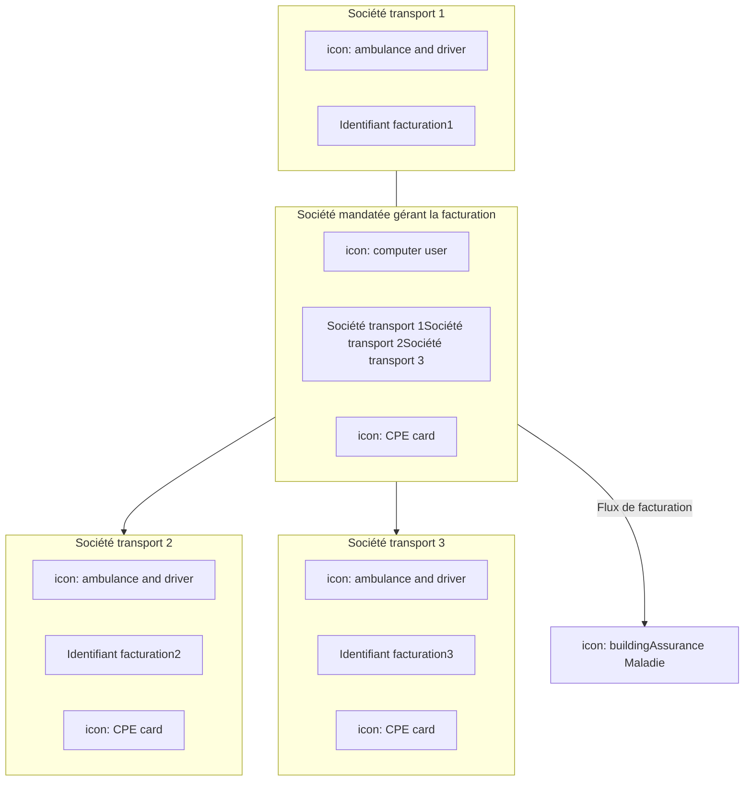

**Mener à bien le déploiement – II.5**

logo: l'Assurance Maladie SEFi TRANSPORT

# **Multi-sociétés**

icon: transport icon

## **Le contexte multi-sociétés**

Dans un contexte **multi-sociétés** (sociétés organisées en groupement ...), la facturation est généralement réalisée par une des sociétés du groupement appelée dans ce support **« mandataire »**.

La société mandataire reçoit un mandat d’un ou plusieurs autre(s) transporteur(s) (nommées sociétés mandantes dans ce document), pour réaliser la facturation en ligne **en leur nom et pour leur compte.**

Dans cette situation, c’est la carte de la société mandataire qui est utilisée pour s’authentifier et accéder aux services.

La carte de la société mandataire peut être **une CDE ou une CPE nominative**.

Les cartes CDE et CPE ont les mêmes fonctions, elles sont décrites dans l’annexe 3 de l’avenant n°10 de la convention nationale des transporteurs sanitaires privés. En SEFi, il n’y a pas de spécificités quant aux modalités de signature des factures ou des lots comme en SESAM-Vitale. Les cartes CDE et CPE permettent de contrôler :

*   ⮚ l’authentification de l’émetteur
*   ⮚ l’autorisation de l’utilisateur à accéder au service
*   ⮚ l‘habilitation à transmettre une facture pour le compte du facturant

A noter que les factures des sociétés mandantes comportent bien leur propre numéro de facturation Assurance Maladie ainsi que l’identification de l’émetteur.

### **Aspect juridique**

Dans le cas d’un transporteur sanitaire ayant reçu mandat d’un autre transporteur pour réaliser la facturation en ligne en son nom et pour son compte, seul le mandataire est tenu de respecter les termes de l’annexe 3 de l’avenant n°10 de la convention nationale des transporteurs sanitaires privés.

Société mandatée = société mandataire

Sociétés mandantes

SEFi transporteur - kit de déploiement - Cnam - Mai 2022

La santé progresse **avec vous**

1

logo: l'Assurance Maladie Caisse Nationale