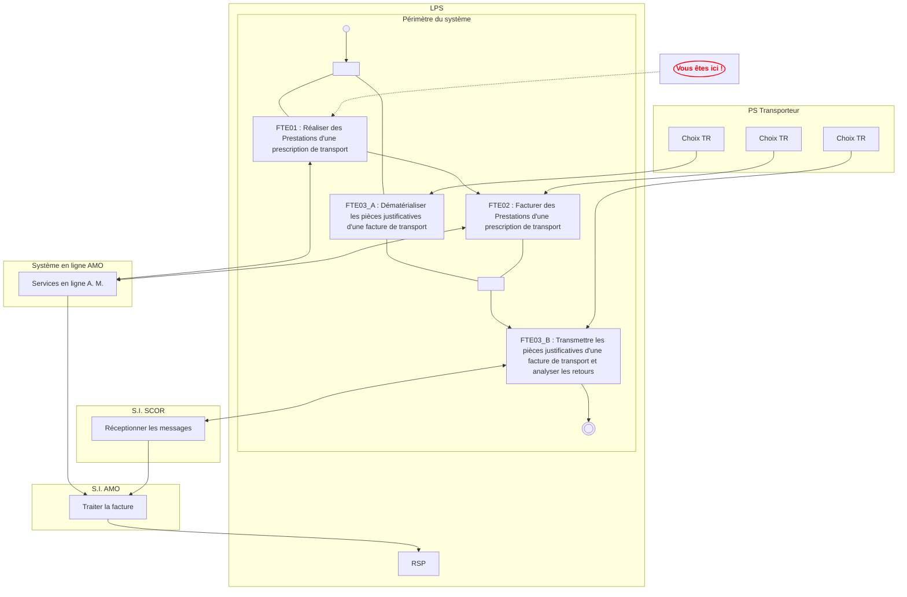
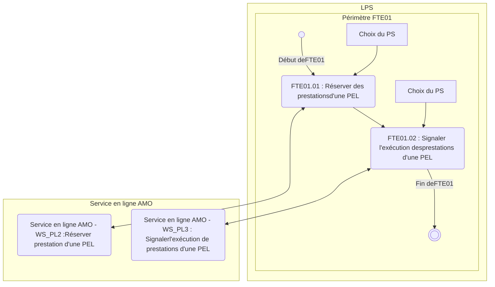
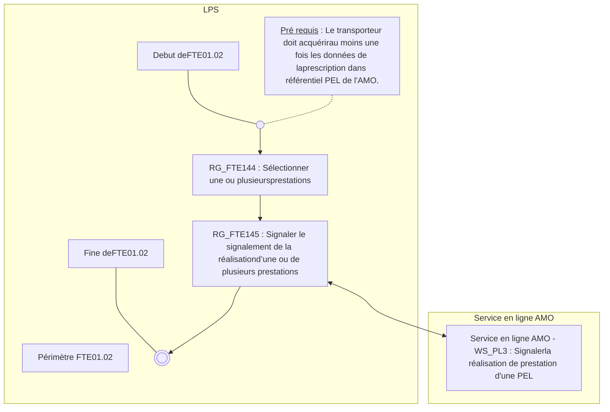

*Spécifications Fonctionnelles Générales*

logo: sesam-vitale

logo: **FTE**

# **Facturation Transporteur Etendue**
# ***Transporteur Sanitaire***

## **FTE01 - Réaliser des Prestations d’une**
## **prescription**

Référence : FACT-SFG-031 / Version : 03.18 / Date : 17/07/2026
Diffusion : RESTREINTE
État : REFERENCE

**GIE SESAM-Vitale**
5, boulevard Marie et Alexandre Oyon – 72 019 LE MANS Cedex 2
<u>www.sesam-vitale.fr</u>

Ce document a été élaboré par le GIE SESAM-Vitale.

Conformément à l’article L.122-4 du Code de la Propriété Intellectuelle, toute représentation ou reproduction (intégrale ou partielle) du présent ouvrage, quel que soit le support utilisé, doit être soumise à l’accord préalable écrit de son auteur.

Il en est de même pour sa traduction, sa transformation, son adaptation ou son arrangement, quel que soit le procédé utilisé.

**Tout manquement à ces obligations constituerait un délit de contrefaçon, au sens des articles **L 335-2 et suivants du code de la propriété intellectuelle, susceptible d’entraîner des** sanctions pour l’auteur du délit.**

## **CONTACTS**

icon: sesam-vitale

Pour toute demande d'évolution, comme pour toute question technique ou fonctionnelle, contactez le Centre de services :

*   portail IRIS : [https://portail-support.sesam-vitale.fr/](https://portail-support.sesam-vitale.fr/)
*   téléphone : 02 43 57 42 88

*SFG - Facturation Transporteur Etendue - Transporteur Sanitaire*
*FACT-SFG-031 FTE01 - Réaliser des Prestations d’une prescription Version : 03.18*

# **TABLES DES MATIERES**

<table>
    <tr>
      <td><strong>1</strong></td>
      <td><strong>INTRODUCTION.........................................................................................................................................4</strong></td>
    </tr>
    <tr>
      <td>1.1</td>
      <td>OBJECTIF DU DOCUMENT .......................................................................................................................4</td>
    </tr>
    <tr>
      <td>1.2</td>
      <td>STATUT DU DOCUMENT ..........................................................................................................................4</td>
    </tr>
    <tr>
      <td>1.3</td>
      <td>POSITIONNEMENT DU DOCUMENT............................................................................................................4</td>
    </tr>
    <tr>
      <td>1.4</td>
      <td>CONTENU DU DOCUMENT .......................................................................................................................4</td>
    </tr>
    <tr>
      <td>1.5</td>
      <td>DOCUMENTS DE RÉFÉRENCE ..................................................................................................................4</td>
    </tr>
    <tr>
      <td>1.6</td>
      <td>ABRÉVIATIONS.......................................................................................................................................4</td>
    </tr>
    <tr>
      <td>1.7</td>
      <td>DÉFINITIONS..........................................................................................................................................4</td>
    </tr>
    <tr>
      <td>1.8</td>
      <td>GUIDE DE LECTURE................................................................................................................................4</td>
    </tr>
    <tr>
      <td><strong>2</strong></td>
      <td><strong>PRÉSENTATION DU SOUS-PROCESSUS FTE01...................................................................................5</strong></td>
    </tr>
    <tr>
      <td>2.1</td>
      <td>POSITIONNEMENT DU SOUS-PROCESSUS FTE01 .....................................................................................5</td>
    </tr>
    <tr>
      <td>2.2</td>
      <td>DESCRIPTION GÉNÉRALE DU SOUS-PROCESSUS FTE01 : RÉALISER DES PRESTATIONS D’UNE PRESCRIPTION ÉLECTRONIQUE ...............................................................................................................6</td>
    </tr>
    <tr>
      <td>2.3</td>
      <td>DESCRIPTION DÉTAILLÉE DU SOUS-PROCESSUS FTE01 : RÉALISER DES PRESTATIONS D’UNE PRESCRIPTION ÉLECTRONIQUE ...............................................................................................................7</td>
    </tr>
    <tr>
      <td></td>
      <td>    2.3.1 <em>FTE01.01 : Réserver des prestations d’une PEL</em>...................................................................7</td>
    </tr>
    <tr>
      <td></td>
      <td>    2.3.2 <em>FTE01.02 : Signaler la réalisation des prestations d’une PEL</em>............................................10</td>
    </tr>
</table>

<table>
  <caption><strong>**TABLE DES ILLUSTRATIONS**</strong></caption>
    <tr>
      <td>FIGURE 1 : PROCESSUS D’UTILISATION DU SYSTÈME EN SCÉNARIO FEL...................................................................5</td>
    </tr>
    <tr>
      <td>FIGURE 2 : PROCESSUS D’UTILISATION DU SYSTÈME FTE01 : RÉALISER DES PRESTATIONS D’UNE     PRESCRIPTION ÉLECTRONIQUE ......................................................................................................................6</td>
    </tr>
    <tr>
      <td>FIGURE 3 : PROCESSUS D’UTILISATION DU SYSTÈME FTE01.01 : RÉSERVER DES PRESTATIONS...............................8</td>
    </tr>
    <tr>
      <td>FIGURE 4 : PROCESSUS D’UTILISATION DU SYSTÈME FTE01.02 : SIGNALER LA RÉALISATION DES PRESTATIONS D’UNE     PEL ...........................................................................................................................................................11</td>
    </tr>
</table>

*17/07/2026 3 / 12*
*Ce document ne peut être diffusé sans l'autorisation d'une personne habilitée au GIE SESAM-Vitale*

icon: icon

FACT-SFG-031 *SFG - Facturation Transporteur Etendue - Transporteur Sanitaire*
*FTE01 - Réaliser des Prestations d’une prescription Version : 03.18*

# **1 Introduction**

## **1.1 Objectif du document**
Ce document a pour but de spécifier la fonctionnalité « FTE01 : Réaliser des Prestations d’une prescription électronique »

## **1.2 Statut du document**
Ces SFG sont en version provisoire et référencée.

## **1.3 Positionnement du document**
Ce document fait partie du corpus documentaire des SFG du système de Facturation Transporteur Etendue **(FTE).**

## **1.4 Contenu du document**
Outre ce chapitre introductif, ce document de spécifications fonctionnelles générales comporte le chapitre 2 qui présente le périmètre du sous-processus FTE01

## **1.5 Documents de référence**

<table>
  <thead>
    <tr>
      <th><b>Appellation</b></th>
      <th><b>Type et titre</b></th>
      <th><b>Référence</b></th>
    </tr>
  </thead>
  <tbody>
    <tr>
      <td>[WS_PL]</td>
      <td>WP_PL - Services en Ligne "Prescription en Ligne"</td>
      <td>SEL-MP-014</td>
    </tr>
  </tbody>
</table>

## **1.6 Abréviations**
Cf. Document FACT-SFG-029 : **Dictionnaire**

## **1.7 Définitions**
Cf. Document FACT-SFG-029 : **Dictionnaire**

## **1.8 Guide de lecture**
Cf. Document FACT-SFG-030 : PG-Annexe 1 : Guide de lecture

*17/07/2026* 4 / 12
*Ce document ne peut être diffusé sans l'autorisation d'une personne habilitée au GIE SESAM-Vitale*

icon: SESAM-Vitale logo

*FACT-SFG-031*
*SFG - Facturation Transporteur Etendue - Transporteur Sanitaire*
*FTE01 - Réaliser des Prestations d’une prescription*
*Version : 03.18*

# 2 Présentation du sous-processus FTE01

## 2.1 Positionnement du sous-processus FTE01

**Figure 1 : Processus d’utilisation du système en scénario FEL**

*17/07/2026*
*5 / 12*
*Ce document ne peut être diffusé sans l'autorisation d'une personne habilitée au GIE SESAM-Vitale*

icon: SESAM-Vitale logo

*SFG - Facturation Transporteur Etendue - Transporteur Sanitaire*
FACT-SFG-031 *FTE01 - Réaliser des Prestations d’une prescription Version : 03.18*

## **2.2 Description générale du sous-processus FTE01 : Réaliser des Prestations d’une prescription électronique**

### **Vue générale**

***Description*** Le processus de facturation du transporteur s’appuie sur une prescription électronique (PEL) élaborée au préalable par le prescripteur et enregistrée au sein du Système d’Information de l’Assurance Maladie (SI A.M.).

Le Transporteur accède aux données de la PEL :
* d’abord pour réserver la (les) prestation(s) qu’il va réaliser
* puis pour déclarer la réalisation de la (ou des) prestation(s).

Pour chacune des prestations d’une prescription, le transporteur sait si elle est réservée, réalisée ou facturée par lui-même ou par un autre transporteur. Aucun élément permettant l’identification de l’autre transporteur n’est fourni.

Une prestation qui n’est pas réservée, réalisée ou facturée par un transporteur est à l’état « prescrite ».

***Entrées*** Domaine de BS DF_FTE_BS
***Entrées*** Domaine de la PEL DF_FTE_PEL
***Sorties*** Prestation à l’état « *réservée* » ou « réalisée »
***Scénarios***
***Situations spécifiques*** aucune

### **Schéma**

**Figure 2 : Processus d’utilisation du système FTE01 : Réaliser des prestations d’une prescription électronique**

*17/07/2026* 6 / 12
*Ce document ne peut être diffusé sans l'autorisation d'une personne habilitée au GIE SESAM-Vitale*

icon: logo

*SFG - Facturation Transporteur Etendue - Transporteur Sanitaire*
FACT-SFG-031 FTE01 - Réaliser des Prestations d’une prescription *Version : 03.18*

# **2.3 Description détaillée du sous-processus FTE01 : Réaliser des Prestations d’une prescription électronique**

## **2.3.1 FTE01.01 : Réserver des prestations d’une PEL**

**Vue générale**

***Description*** Dans le cadre du processus « FACTURER en Ligne » d’une prescription de transport, le transporteur doit réserver les prestations de la PEL avant de les réaliser. Cet état est alors visible de tout autre transporteur qui accéderait aux données de la PEL.

L’objectif de cette fonctionnalité est de lui permettre de réserver une (des) prestation(s) issue(s) d’une PEL. Cette fonctionnalité est effectuée après avoir au préalable acquis les informations de la prescription (Cf. FTE04.31 : Consulter une prescription).

Cette fonctionnalité peut être sollicitée par le transporteur :

• lors de ses activités métier de réservation (prise de commande)
• lors de la réalisation du transport (prise en charge de l’assuré) en amont du processus de facturation.

Pour la réservation d’une prestation de transport, les règles suivantes s’appliquent :

• Une prestation peut être réservée si celle-ci est à l’état « prescrite » ou « réservée »,
• une prestation à l’état « réalisée » ou « facturée » ne peut pas être réservée,
• Une prestation à l’état « réservée » peut être réservée par un autre transporteur.

Pour réserver une (des) prestation(s), le transporteur doit :

• Au préalable, acquérir au moins une fois les informations de la prescription à partir du référentiel PEL de l’AMO (l’acquisition des données de la prescription peut être désynchronisée de la réservation d’une ou plusieurs prestations de la prescription),
• Sélectionner la (les) prestation(s) qu’il souhaite réserver
• Demander au référentiel de prescriptions en ligne de l’Assurance Maladie la réservation de la (des) prestation(s) sélectionnée(s).
• L’AMO envoie une confirmation au transporteur du (des) changement(s) des états (mis à jour) des prestations.

icon: icon Une demande de réservation de plusieurs prestations doit être traitée en un appel unique au service en ligne. La réponse de l’assurance maladie est unique et le résultat du traitement AMO est de niveau prestation.

La réservation en ligne de prestations est décrite dans le guide d’intégration [*WS_PL*].

Lors de la réservation d’une ou plusieurs prestations d’une prescription, le transporteur est informé du résultat de sa demande :

• par le changement de statut de la (des) prestation(s) sélectionnée(s)
• ou par un message d’information indiquant
    ○ soit que la prestation de transport est inexistante dans la prescription,
    ○ soit que la prestation n’est pas à l’état « prescrite » ou « réservée ».

***Entrées*** **Données de la prescription**

• Identifiant PEL EF_FTE30_01

Données du bénéficiaire des soins de la PEL

• Nom de famille bénéficiaire EF_FTE31_03

*17/07/2026* *7 / 12*
*Ce document ne peut être diffusé sans l'autorisation d'une personne habilitée au GIE SESAM-Vitale*

icon: icon

FACT-SFG-031 *SFG - Facturation Transporteur Etendue - Transporteur Sanitaire*
*FTE01 - Réaliser des Prestations d’une prescription Version : 03.18*

<table>
    <tr>
      <td></td>
      <td>Données pour chaque prestation</td>
      <td></td>
    </tr>
    <tr>
      <td></td>
      <td>• Identifiant de la prestation</td>
      <td>EF_FTE46_01</td>
    </tr>
    <tr>
      <td><i>Sorties</i></td>
      <td>Données pour chaque prestation</td>
      <td></td>
    </tr>
    <tr>
      <td></td>
      <td>• Identifiant de la prestation</td>
      <td>EF_FTE46_01</td>
    </tr>
    <tr>
      <td></td>
      <td>• Statut de la prestation</td>
      <td>EF_FTE46_03</td>
    </tr>
    <tr>
      <td></td>
      <td>• Horodatage du statut de la prestation</td>
      <td>EF_FTE46_04</td>
    </tr>
</table>

### *Situations spécifiques*

### **Schéma**

```mermaid
graph TD
    subgraph LPS ["LPS"]
        subgraph Perimetre ["Périmètre FTE01.01"]
            Start(( ))
            Step1["RG_FTE141 : Sélectionner une ou desprestations de la prescription"]
            Step2["RG_FTE142 : Demander la réservationd'une ou plusieurs prestations"]
            End((( )))
            
            Start --> Step1
            Step1 --> Step2
            Step2 --> End
            
            StartLabel[DébutFTE01.01] --- Start
            EndLabel[Fin deFTE01.01] --- End
        end
        
        Prerequis["<u>Pré requis</u> : Le transporteur doit acquérir aumoins une fois les données de la prescriptiondans le référentiel PEL de l'AMO."]
        Prerequis -.-> Start
    end

    subgraph ServiceAMO ["Service en ligne AMO"]
        WS_PL2["Service en ligne AMO - WS_PL2 :Réserver prestation d'une PEL"]
    end

    Step2 <--> WS_PL2

    style Perimetre fill:#f5f5f7,stroke:#333,stroke-width:1px
    style Prerequis fill:#cccccc,stroke:#333,stroke-width:1px
    style Step1 fill:#e9dcc0,stroke:#333,stroke-width:1px
    style Step2 fill:#e9dcc0,stroke:#333,stroke-width:1px
    style WS_PL2 fill:#e9dcc0,stroke:#333,stroke-width:1px
    style Start fill:#000000
    style End fill:#000000,stroke:#ffffff,stroke-width:2px
```

**Figure 3 : Processus d’utilisation du système FTE01.01 : Réserver des Prestations**

*17/07/2026* 8 / 12
*Ce document ne peut être diffusé sans l'autorisation d'une personne habilitée au GIE SESAM-Vitale*

icon: logo

FACT-SFG-031 *SFG - Facturation Transporteur Etendue - Transporteur Sanitaire*
*FTE01 - Réaliser des Prestations d’une prescription* Version : 03.18

## **Règles de gestion**

### **[RG_FTE141] Sélectionner une ou des prestations de la prescription**

Suite au retour de la demande d’acquisition des données d’une prescription et depuis son LPS le transporteur sélectionne la ou les prestations dont il souhaite signaler la réservation.

### **[RG_FTE142] Demander la réservation d’une ou de plusieurs prestations**

Le LPS sollicite le système en ligne de l’Assurance Maladie pour demander la réservation des prestations sélectionnées par le transporteur (*[WS_PL] : DE_PL2_02.01*).

**Données transmises**

<table>
  <thead>
    <tr>
      <th colspan="2"></th>
      <th>➔</th>
      <th>Opération WS_PL2</th>
    </tr>
  </thead>
  <tbody>
    <tr>
      <td>Identifiant PEL</td>
      <td>EF_FTE30_01</td>
      <td>➔</td>
      <td>DE_PL2_01</td>
    </tr>
    <tr>
      <td>Nom de famille du bénéficiaire</td>
      <td>EF_FTE31_03</td>
      <td>➔</td>
      <td>DE_PL2_02</td>
    </tr>
    <tr>
      <td><i>Pour chaque prestation sélectionnée</i></td>
      <td></td>
      <td></td>
      <td></td>
    </tr>
    <tr>
      <td>Identifiant de la prestation</td>
      <td>EF_FTE46_01</td>
      <td>➔</td>
      <td>DE_PL2_03</td>
    </tr>
  </tbody>
</table>

**Données reçues**

<table>
  <thead>
    <tr>
      <th colspan="2">Pour chaque prestation sélectionnée</th>
      <th>🡨</th>
      <th>Opération WS_PL2</th>
    </tr>
  </thead>
  <tbody>
    <tr>
      <td>Identifiant de la prestation</td>
      <td>EF_FTE46_01</td>
      <td>🡨</td>
      <td>DS_PL2_E46.01</td>
    </tr>
    <tr>
      <td>Statut de la prestation</td>
      <td>EF_FTE46_03</td>
      <td>🡨</td>
      <td>DS_PL2_E46.03</td>
    </tr>
    <tr>
      <td>Horodatage du statut de la prestation</td>
      <td>EF_FTE46_04</td>
      <td>🡨</td>
      <td>DS_PL2_E46.04</td>
    </tr>
  </tbody>
</table>

icon: icon **CAS D’ERREUR**

#### **[CE1] Erreur fonctionnelle reçue**

Ce cas d’erreur correspond à la consigne générale CG_PG001.

#### **[CE2] Prestation déjà réalisée ou facturée**

Lorsque la prestation est à l’état « réalisée » ou « facturée », un message d’information est retourné au transporteur par l’AM.

Le LPS affiche ce message au transporteur.

*17/07/2026* *9 / 12*
*Ce document ne peut être diffusé sans l'autorisation d'une personne habilitée au GIE SESAM-Vitale*

icon: icon

FACT-SFG-031 *SFG - Facturation Transporteur Etendue - Transporteur Sanitaire*
*FTE01 - Réaliser des Prestations d’une prescription* Version : 03.18

## **2.3.2** **FTE01.02 : Signaler la réalisation des prestations d’une PEL**

### **Vue générale**

**Description** Dans le cadre du processus « FACTURER en Ligne » d’une prescription de transport, le transporteur doit indiquer au préalable à l’AMO et à l’ensemble de ses confrères la réalisation d’une ou plusieurs prestations de la PEL.

L’objectif de cette fonctionnalité est de permettre au transporteur de signaler la réalisation d’une ou plusieurs prestations issues d’une PEL préalablement réservées par ce dernier. Cette fonctionnalité est effectuée après avoir au préalable acquis les informations de la prescription (Cf. FTE04.31 : consulter une prescription).

Seules les prestations issues d’une PEL dont l’état est « réservée » par le transporteur peuvent être signalées comme réalisées par ce dernier.

En conséquence,

*   une prestation de transport à l’état « prescrite » ne peut être signalée comme réalisée ;
*   une prestation de transport réservée par un transporteur ne peut être signalée comme réalisée par un autre transporteur sans avoir été précédemment réservée par ce dernier ;
*   une prestation de transport à l’état « réalisée » ou « facturée » par un transporteur ne peut être réalisée par un autre transporteur.

Pour signaler la réalisation d’une ou plusieurs prestations :

*   Au préalable, acquérir au moins une fois les informations de la prescription à partir du référentiel PEL de l’AMO (l’acquisition des données de la prescription peut être désynchronisée de la réservation d’une ou plusieurs prestations de la prescription),
*   le transporteur (depuis son LPS) sélectionne la ou les prestations qu’il souhaite signaler comme réalisées.
*   Le transporteur (depuis son LPS) signale au référentiel de prescriptions en ligne de l’Assurance Maladie avoir réalisé une ou des prestations.
*   L’AM envoie au transporteur une confirmation ou non du changement d’état de chacune des demandes de signalement de la réalisation de prestations.
    icon: icon Une demande de signalement de la réalisation de plusieurs prestations doit être traitée en un appel unique au service en ligne.

Lors du signalement de la réalisation d’une ou plusieurs prestations d’une prescription, le transporteur est informé du résultat de sa demande :

*   par le changement de statut de la (des) prestation(s) sélectionnée(s)
*   ou par un message d’information indiquant
    *   soit que la prestation de transport est inexistante dans la prescription,
    *   soit que la prestation n’est pas à l’état « réservée».

Le signalement en ligne de la réalisation d’une prestation est décrit dans le guide d’intégration [*WS_PL*].

**<u>Pré requis : </u>**

La ou les prestations que le transporteur souhaite signaler comme réalisées doivent être réservées au préalable par ce dernier.

***Entrées*** Données de la prescription
*   Identifiant PEL EF_FTE30_01

*17/07/2026* *10 / 12*
*Ce document ne peut être diffusé sans l'autorisation d'une personne habilitée au GIE SESAM-Vitale*

icon: icon

FACT-SFG-031 *SFG - Facturation Transporteur Etendue - Transporteur Sanitaire* Version : 03.18
*FTE01 - Réaliser des Prestations d’une prescription*

<table>
    <tr>
      <td></td>
      <td>Données du bénéficiaire des soins de la PEL</td>
      <td></td>
    </tr>
    <tr>
      <td></td>
      <td>• Nom de famille bénéficiaire</td>
      <td>EF_FTE31_03</td>
    </tr>
    <tr>
      <td></td>
      <td>Données pour chaque prestation</td>
      <td></td>
    </tr>
    <tr>
      <td></td>
      <td>• Identifiant de la prestation</td>
      <td>EF_FTE46_01</td>
    </tr>
    <tr>
      <td><i>Sorties</i></td>
      <td>Données pour chaque prestation</td>
      <td></td>
    </tr>
    <tr>
      <td></td>
      <td>• Identifiant de la prestation</td>
      <td>EF_FTE46_01</td>
    </tr>
    <tr>
      <td></td>
      <td>• Statut de la prestation</td>
      <td>EF_FTE46_03</td>
    </tr>
    <tr>
      <td></td>
      <td>• Horodatage du statut de la prestation</td>
      <td>EF_FTE46_04</td>
    </tr>
</table>

### ***Situations spécifiques***

## **Schéma**

**Figure 4 : Processus d’utilisation du système FTE01.02 : Signaler la réalisation des **prestations** d’une PEL**

*17/07/2026* 
 icon: dots *11 / 12*
*Ce document ne peut être diffusé sans l'autorisation d'une personne habilitée au GIE SESAM-Vitale*

FACT-SFG-031 *SFG - Facturation Transporteur Etendue - Transporteur Sanitaire* Version : 03.18
*FTE01 - Réaliser des Prestations d’une prescription*

## **Règles de gestion**

### ***[RG_FTE144] Sélectionner une ou plusieurs prestations***

Suite au retour de la demande d’acquisition d’une prescription en ligne et depuis son LPS le transporteur sélectionne la ou les prestations dont il souhaite signaler la réalisation.

### ***[RG_FTE145] Signaler la réalisation d’une ou de plusieurs prestations***

Le LPS sollicite le système en ligne de l’Assurance Maladie pour signaler la réalisation des prestations sélectionnées par le transporteur (*[WS_PL] : DE_PL2_02.01*).

***Données transmises***

<table>
  <thead>
    <tr>
      <th colspan="2"></th>
      <th>→</th>
      <th>Opération WS_PL3</th>
    </tr>
  </thead>
  <tbody>
    <tr>
      <td>Identifiant PEL</td>
      <td>EF_FTE30_01</td>
      <td>→</td>
      <td>DE_PL3_01</td>
    </tr>
    <tr>
      <td>Nom de famille du bénéficiaire</td>
      <td>EF_FTE31_03</td>
      <td>→</td>
      <td>DE_PL3_02</td>
    </tr>
    <tr>
      <td><i>Pour chaque prestation sélectionnée</i></td>
      <td></td>
      <td></td>
      <td></td>
    </tr>
    <tr>
      <td>    Identifiant de la prestation</td>
      <td>EF_FTE46_01</td>
      <td>→</td>
      <td>DE_PL3_03</td>
    </tr>
  </tbody>
</table>

***Données reçues***

<table>
  <thead>
    <tr>
      <th colspan="2">Pour chaque prestation sélectionnée</th>
      <th>←</th>
      <th>Opération WS_PL3</th>
    </tr>
  </thead>
  <tbody>
    <tr>
      <td>Identifiant de la prestation</td>
      <td>EF_FTE46_01</td>
      <td>←</td>
      <td>DS_PL3_E46.01</td>
    </tr>
    <tr>
      <td>Statut de la prestation</td>
      <td>EF_FTE46_03</td>
      <td>←</td>
      <td>DS_PL3_E46.03</td>
    </tr>
    <tr>
      <td>Horodatage du statut de la prestation</td>
      <td>EF_FTE46_04</td>
      <td>←</td>
      <td>DS_PL3_E46.04</td>
    </tr>
  </tbody>
</table>

icon: arrow ***CAS D’ERREUR***

#### ***[CE1] Erreur fonctionnelle reçue***

icon: info Ce cas d’erreur correspond à la consigne générale CG_PG001.

#### ***[CE2] Prestation non réservée***

Lorsque la prestation n’a pas été préalablement réservée par le transporteur, un message d’information est retourné au transporteur par l’AM.

Le LPS affiche ce message au transporteur.

*17/07/2026* 12 / 12
*Ce document ne peut être diffusé sans l'autorisation d'une personne habilitée au GIE SESAM-Vitale*

icon: dots