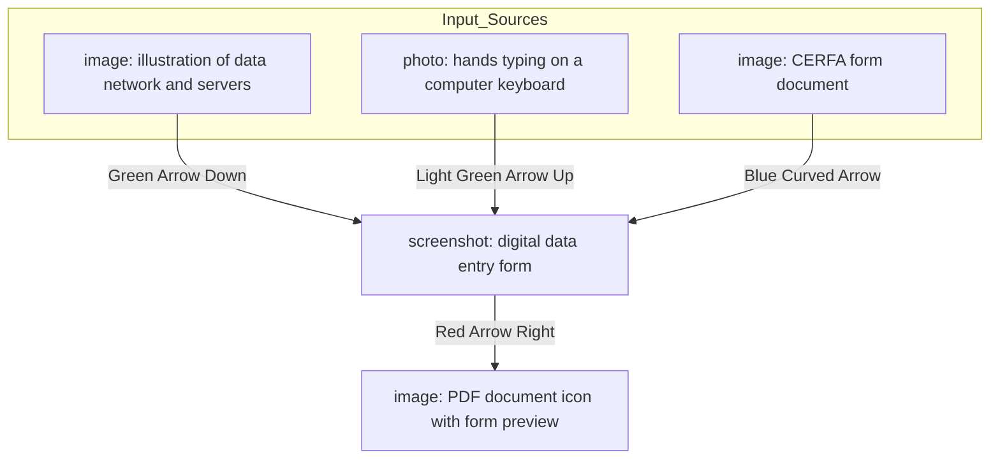
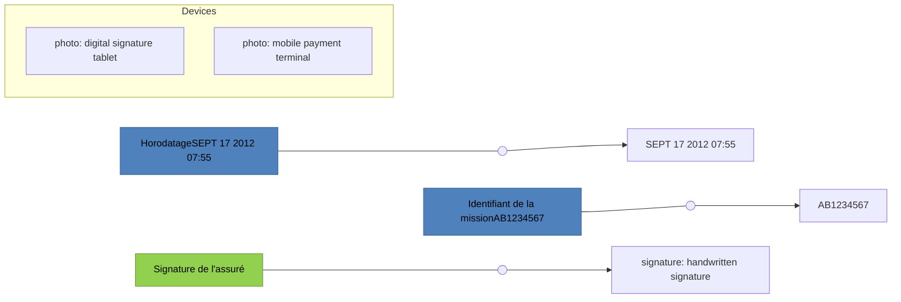
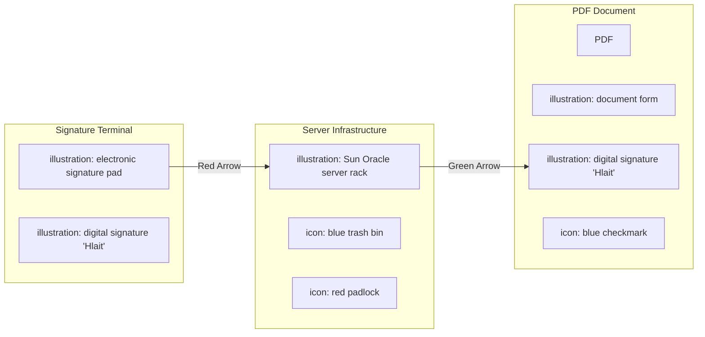

| *CNAMTS* | SCOR Transporteurs sanitaires | |
| :--- | :---: | :--- |
| icon: CNAMTS logo | Dématérialisation de l’Attestation de Service Fait | DMPR 2016/2 |

# Attestation de Service Fait et gestion de la signature manuscrite numérique

**SCOR Transporteurs Sanitaires**

1/6

logo: *CNAMTS*

**SCOR Transporteurs sanitaires**
**Dématérialisation de l’Attestation**
**de Service Fait**

DMPR 2016/2

**Fonctionnalité facultative offerte aux éditeurs de LPS Transport sanitaire, la dématérialisation à **l’Attestation de Service Fait (ASF) s’appuie sur des briques techniques et fonctionnelles** existantes et éprouvées :**

*   **SCOR**, pour l’échange des pièces justificatives de la facturation numérisées au format .pdf. Cette solution est aujourd’hui utilisée par presque 151.000 professionnels de santé prescrits.

*   **La création d’un formulaire numérique** par les éditeurs de logiciels de gestion d’activité sur le modèle du CERFA de l’Attestation de Service Fait (S3602a ou du formulaire local valant attestation de service fait). Cette solution, intégrée au logiciel, permet d’éviter la gestion de l’ASF papier pour qu’elle soit signée puis sa numérisation.

*   **Des outils logiciels de recueil de la signature manuscrite numérisée**, disponibles sur le marché. Il existe des applications intégrées à des tablettes fonctionnant sous iOS ou Android, notamment.

L’association de ces trois outils permet de proposer une solution optimisée pour les transporteurs sanitaires et de sécuriser le processus de facturation pour chacun des acteurs. La mise à disposition des transporteurs sanitaires de cette fonctionnalité n’est pas obligatoire et reste facultative.

# 1 Dispositif général

## 1.1.1 Générer une ASF numérique

Le logiciel de gestion de l’activité du transporteur peut générer un formulaire ASF remplissable à l’écran et/ou pré-rempli, respectant le contenu du CERFA.

2/6

*CNAMTS*
icon: logo

# SCOR Transporteurs sanitaires
# Dématérialisation de l’Attestation de Service Fait

DMPR 2016/2

Il peut s’agir simplement d’un formulaire papier numérisé au format.pdf.

L’Attestation de Service Fait peut être l’un des documents suivants :

* Annexe à la facture de transport S 3602
* Document local valant annexe à la facture de transport

## **1.2 Numériser la signature manuscrite de l’assuré**

Sur un terminal mobile, l’assuré appose sa signature et le logiciel plaque automatiquement la signature ainsi numérisée sur l’ASF numérique afférente.

**Prérequis** : Au moment du recueil de la signature de l’assuré, doivent obligatoirement apparaître, sur l’écran du terminal mobile ou du terminal fixe, de manière lisible pour l’utilisateur, les informations suivantes :

* Données d’horodatage
* Identifiant unique de la mission associée

### **Rappel de signatures requises**

screenshot: formulaire de facture de transport et tablette de signature numérique

Signature de l’assuré

3/6

*CNAMTS*
icon: logo

# SCOR Transporteurs sanitaires
# Dématérialisation de l’Attestation de Service Fait

DMPR 2016/2

## **Utilisation de la signature manuscrite numérisée**

*   L’enregistrement ne peut être utilisé que pour l’ASF à laquelle il se rapporte. L’enregistrement ne doit pas pouvoir être utilisé plusieurs fois.

*   Une fois que l’enregistrement a été associé à l’ASF à laquelle il se rapporte, il est définitivement et automatiquement supprimé du serveur de stockage. Il ne doit pas exister de stockage pérenne des signatures manuscrites numériques des utilisateurs.

### **1.3 Générer un flux SCOR**

Le logiciel de gestion de l’activité du transporteur génère un flux SCOR tel que défini dans le cahier des charges et comprenant l’ASF signée au format .pdf.

## **2 Principes et recommandations**

### **2.1 Au moment du recueil de la signature de l’assuré, doivent obligatoirement apparaître, sur l’écran du terminal mobile, de manière lisible pour l’assuré, les informations suivantes :**

✓ Les données d’horodatage
✓ Un identifiant unique de la mission

### **2.2 Principes liés à l’enregistrement de la signature manuscrite numérique de l’assuré :**

✓ L’enregistrement de l’image de la signature manuscrite de l’assuré contient obligatoirement les données d’horodatage et l’identifiant unique de la mission.
✓ Cet enregistrement est scellé et signé informatiquement.

### **2.3 Principes liés à l’utilisation de la signature manuscrite de l’assuré :**

✓ L’enregistrement ne peut être utilisé que pour l’ASF à laquelle il se rapporte. L’enregistrement ne doit pas pouvoir être utilisé plusieurs fois.

4/6

*CNAMTS*
icon: CNAMTS logo

# SCOR Transporteurs sanitaires
# Dématérialisation de l’Attestation de Service Fait

DMPR 2016/2

---

*   Une fois que l’enregistrement a été associé automatiquement à l’ASF à laquelle il se rapporte, il est définitivement et automatiquement supprimé du serveur de stockage. Il ne doit pas exister de stockage pérenne des signatures manuscrites numériques des assurés sous quelque forme que ce soit.

## **2.4 Principes liés à la traçabilité des actions :**

*   Les différentes actions de signature et de validation associées doivent être tracées dans le système d’information et leur auteur identifié.
*   Ces traces doivent être archivées pendant au moins 24 mois et doivent être restituables sur un format standard.

## **2.5 Convention de preuve**

*   Il doit exister une convention de preuve entre le transporteur et l’assuré, qui doit être inscrite sur l’écran du terminal mobile. Le texte de cette convention de preuve est le suivant :

    *« Le soussigné reconnaît la force probante de sa signature manuscrite recueillie informatiquement sur ce terminal mobile, qui vaut attestation du transport réalisé et accord pour la subrogation. »*

5/6

*CNAMTS*
icon: CNAMTS logo

# SCOR Transporteurs sanitaires
# Dématérialisation de l’Attestation de Service Fait

DMPR 2016/2

---

## **Lettre d’engagement unilatéral de conformité**
## **Dématérialisation de l’Attestation de service fait**
## **CDC SCOR Transporteurs**

**Je soussigné(e) :**

**Société :**

**Sise :**

**Représentée par :**

**S’engage à respecter dans son ensemble l’annexe « SCOR Transporteur dématérialisation ASF et signature numérique » du cahier des charges « SCOR » dont j’ai pris connaissance et compris l’ensemble des clauses, contraintes et recommandations.**

**Je suis informé que le CNDA ne réalise aucun test de vérification sur cette fonctionnalité et n’est donc pas responsable de quelle que conséquence que ce soit d’un éventuel non-respect du présent engagement par ma société, vis-à-vis de l’Assurance Maladie comme des tiers.**

**Fait le :**

**A :**

**Signature du responsable légal**

---

Cet engagement de conformité sera adressé au CNDA par l’éditeur qui proposera ce service avec ou après l’obtention de son autorisation SEFI afin que cette nouvelle fonctionnalité soit enregistrée dans les référentiels.

6/6