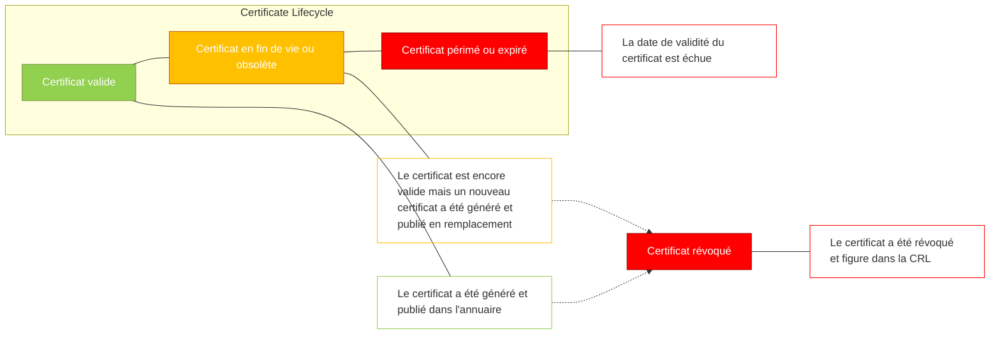
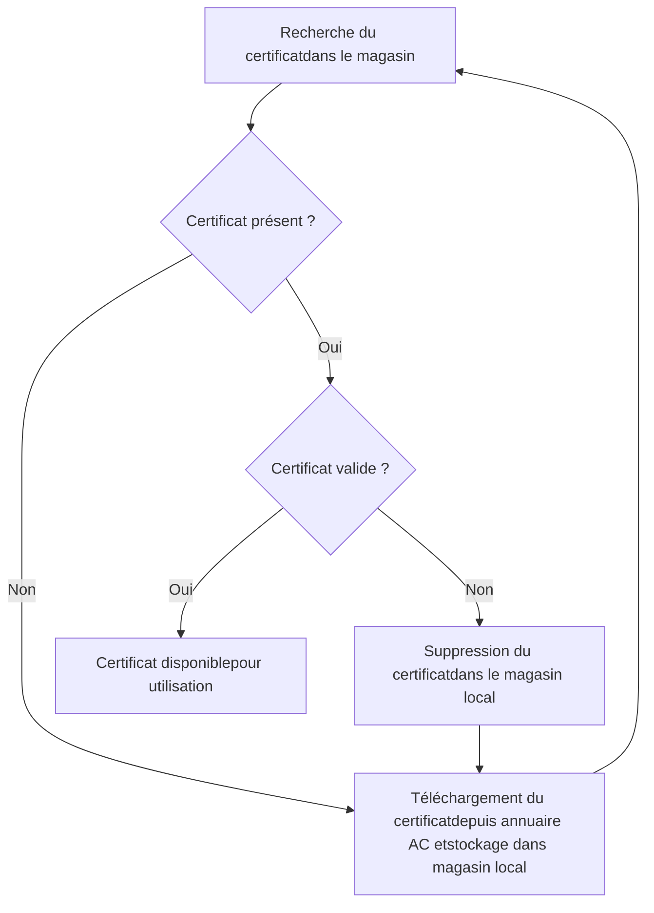
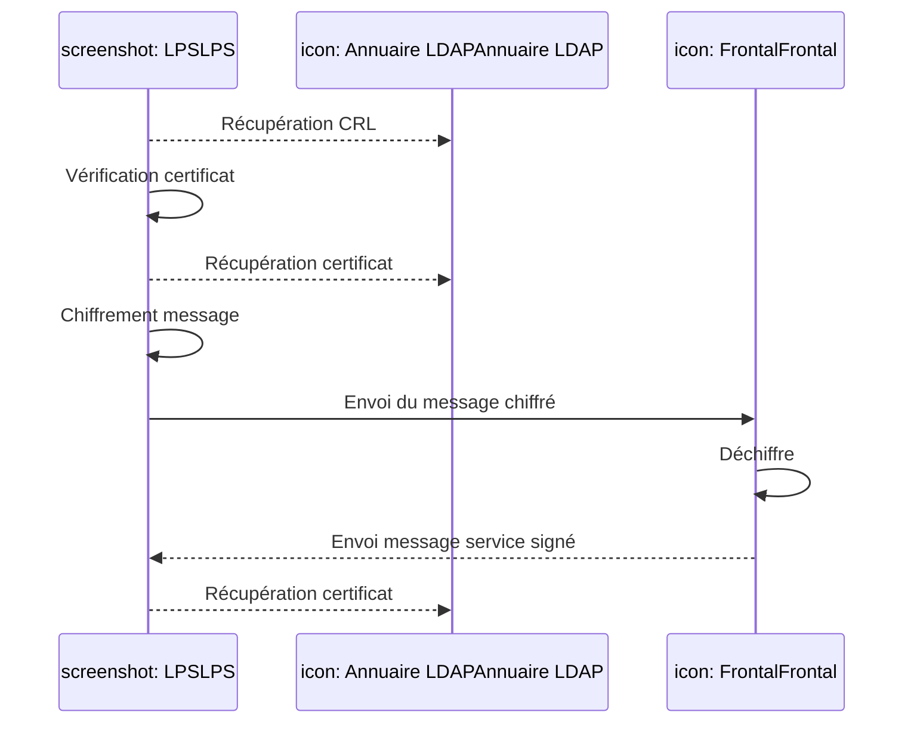
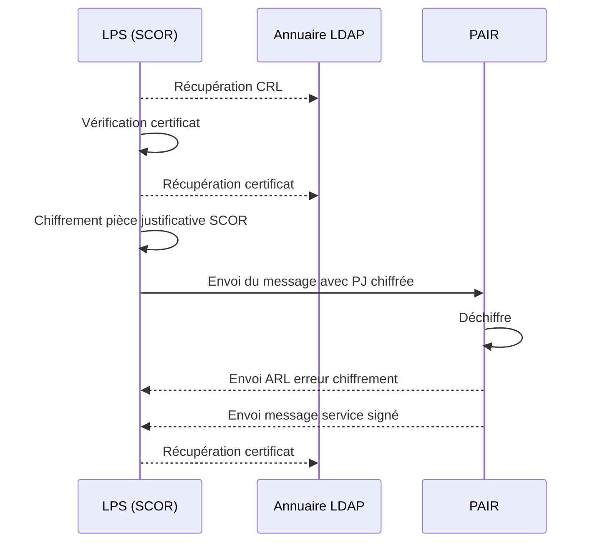
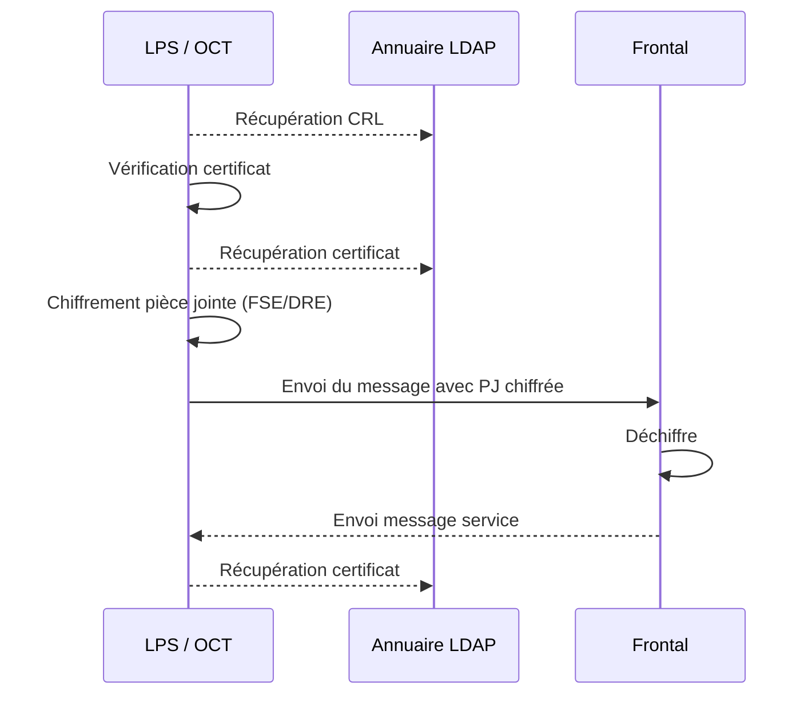
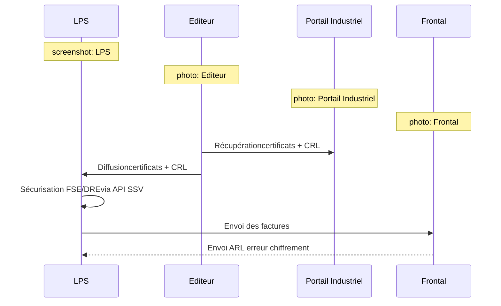
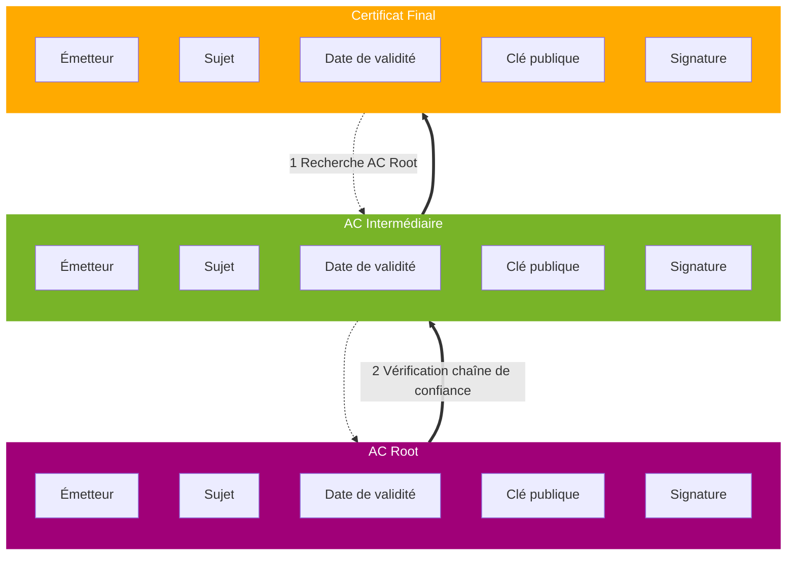

logo: sesam-vitale

logo: - tutoriel -

**_IGC OSI du GIE SESAM-Vitale**

*Utiliser les certificats de chiffrement et la CRL*

Ce document s’adresse aux Industriels offreurs de solutions aux Professionnels de Santé et aux Établissements de Santé qui font appel aux certificats de chiffrement et à la liste de révocation (CRL) de l’AC-FACTURATION, publiés par l’Infrastructure de Gestion de Clés du GIE SESAM-Vitale (IGC OSI*), afin de sécuriser les factures transmises à l’Assurance Maladie.

*OSI = Offre de Sécurisation d’Infrastructure

## **1 L’ANNUAIRE LDAP DU GIE SESAM-VITALE**

Le GIE SESAM-Vitale a choisi de mettre à disposition des Industriels offreurs de solutions aux PS, des certificats et la liste de révocation (CRL) dans un annuaire basé sur le protocole LDAP. Ces certificats et cette CRL sont émis par l’IGC OSI et sont relatifs à l’autorité de certification « AC-FACTURATION ».

## **2 CARTOGRAPHIE DES CERTIFICATS DE CHIFFREMENT UTILISÉS DANS LE CADRE DE LA FACTURATION**

Il existe plusieurs cas d’usage des certificats de chiffrement pour la facturation :

*   Le chiffrement de transport
*   Le chiffrement de pièce jointe ou de pièces justificatives
*   Le chiffrement des données sensibles des factures

Tous ces certificats de chiffrement sont issus de l’AC FACTURATION publiés par l’Infrastructure de Gestion de Clés du GIE SESAM-Vitale (IGC OSI) et sont disponibles dans l’annuaire LDAP de l’IGC OSI. Les règles d’usage de cet annuaire sont décrites dans le chapitre 3.

### **2.1 Chiffrement de transport**

Les certificats sont utilisés pour chiffrer au standard S/MIME les messages SMTP contenant les factures transmises à l’Assurance Maladie. Ce chiffrement s’applique aux flux émis par les Établissements de Santé et aux flux IRIS-B2 émis par les Professionnels de Santé non inclus dans SESAM-Vitale.

La mise en œuvre de ce chiffrement de transport est décrite dans le document suivant, disponible sur l’Espace Industriels du GIE SESAM-Vitale :
[https://industriels.sesam-vitale.fr](https://industriels.sesam-vitale.fr/)

icon: document icon
*« Transport des flux de facturation par messagerie et chiffrement de transport », référence ETS-DT-001.*

### **2.2 Chiffrement de pièce jointe ou de pièces justificatives**

Les certificats sont utilisés pour chiffrer les pièces jointes ou les pièces justificatives contenues dans les messages SMTP à destination de l’Assurance Maladie. Ce chiffrement est applicable aux flux SCOR (toutes versions) et aux flux SESAM-Vitale (à partir de la version 1.40 addendum 7 du Cahier des charges SESAM-Vitale).

Référence : **OSI-TUTO-002** / Version : **1.0** / Date : **17/02/2016**
Sécurité : **LIBRE**
**GIE SESAM-Vitale**
5, boulevard Marie et Alexandre Oyon – 72019 LE MANS Cedex 2
<u>www.sesam-vitale.fr</u> 
 logo: sesam-vitale

*OSI-TUTO-002* *Utiliser les certificats de chiffrement et la CRL* *Version : 1.0*

La mise en œuvre de ce chiffrement est décrite dans les Cahiers des charges SCOR (pièces justificatives) et SESAM-Vitale (pièce jointe) disponibles sur l’Espace Industriels du GIE SESAM-Vitale.

## **2.3 Chiffrement des données sensibles des factures**

Les certificats sont utilisés pour chiffrer les données sensibles directement dans les factures SESAM-Vitale (FSE ou DRE). Ce chiffrement est réalisé par les API SESAM-Vitale mises à disposition des Industriels à partir de la version 1.40 addendum 6 extension PC/SC du Cahier des charges SESAM-Vitale (version 1.40.10 des Fournitures SESAM-Vitale (FSV)).
La mise en œuvre de ce chiffrement est décrite dans le Cahier des charges SESAM-Vitale disponible sur l’Espace Industriels du GIE SESAM-Vitale : [https://industriels.sesam-vitale.fr](https://industriels.sesam-vitale.fr/).

## **3 RAPPELS CONCERNANT L’USAGE DES CERTIFICATS ÉLECTRONIQUES**

L’utilisation de certificats électroniques pour l’authentification ou la signature nécessite de **vérifier** que :

1.  **Le certificat provient d’une autorité de certification de confiance, c’est-à-dire que le certificat a été signé par **une autorité de certification (autorité finale) dépendant directement de l’autorité de confiance (autorité** racine).**
    **Ces autorités de certification doivent, au préalable, être insérées dans le magasin local de certificats de **l’application (coffre-fort) – l’introduction doit être faite après vérification de leur authenticité (intégrité et** origine).**
2.  **L’utilisation du certificat est bien conforme aux usages de clé autorisés précisés dans les extensions keyUsage et extendedKeyUsage.**
3.  **Le certificat est encore valide, c’est-à-dire que la date de validité n’est pas dépassée.**
4.  **Le certificat n’a pas fait l’objet d’une révocation (par exemple, pour perte ou suspicion de compromission).**

icon: arrow

Les trois premières vérifications se basent uniquement sur le certificat utilisé.
En revanche, la vérification de la non révocation nécessite de faire référence à une liste à jour des certificats révoqués (CRL).

La cinématique de vérification des certificats est détaillée au chapitre 8.

## **4 BONNES PRATIQUES DE GESTION DES CERTIFICATS SUR LE POSTE DE TRAVAIL**

### **4.1 Stockage des certificats sur le poste**

Les certificats sont stockés dans un magasin local de certificats sur le poste de travail. Le rôle de ce magasin est d’assurer l’intégrité de son contenu afin d’assurer un bon niveau de confiance dans les certificats utilisés en offrant des services de gestion contrôlés d’ajout, modification et suppression de certificats et d’autorité de certification dans le magasin. Il est possible d’utiliser les magasins offerts par le système d’exploitation du poste (exemple : magasin de certificats Microsoft Windows) ou des magasins spécifiques gérés directement par la solution proposée par l’Industriel au Professionnel de Santé ou à l’Établissement de Santé.

### **4.2 Mise à jour des Autorités de Certification (AC)**

Les autorités de certification permettent de vérifier la validité des certificats de chiffrement utilisés sur le poste de travail. Ces autorités doivent donc être obligatoirement installées et mises à jour sur le poste. Cette opération d’installation ou de mise à jour doit être réalisée par une « personne de confiance » sous le contrôle de l’utilisateur final du poste de travail.

*17/02/2016* *GIE SESAM-Vitale* 
icon: GIE SESAM-Vitale logo *2 / 11*

*OSI-TUTO-002* *Utiliser les certificats de chiffrement et la CRL* *Version : 1.0*

Le système d’exploitation du poste de travail ou les navigateurs Internet mettent à jour automatiquement les « autorités commerciales reconnues » sur le marché. Pour les autorités spécifiques, comme celle de l’IGC OSI du GIE SESAM-Vitale, celles-ci doivent être installées par l’Industriel, le Professionnel de Santé ou l’Établissement de Santé :

*   Cette installation peut être prise en charge automatiquement par la solution de l’Industriel qui récupèrera l’AC auprès du GIE SESAM-Vitale et pourra mettre à jour son parc de clients en même temps que son offre logicielle ;
*   Une procédure manuelle doit également être mise à disposition du Professionnel de Santé ou de l’Établissement de Santé pour que celui-ci puisse réaliser cette opération sans passer par l’Industriel.

## **4.3 Mise à jour de la CRL**

La liste de révocation des certificats (CRL, « Certificate Revocation List ») permet de contrôler la validité des certificats de chiffrement utilisés en vérifiant que ceux-ci n’ont pas fait l’objet d’une révocation. La CRL est publiée tous les jours dans l’annuaire de l’IGC OSI et il est recommandé que le Logiciel du Professionnel de Santé (LPS) ou de l’Établissement de Santé télécharge et stocke localement cette CRL régulièrement en respectant les bonnes pratiques présentées ci-après.

## **4.4 Mise à jour des certificats**

Les certificats de chiffrement ont une durée de vie limitée (6 ans dans le cas des certificats de chiffrement de l’IGC OSI) et suivent un cycle de vie illustré par le schéma suivant :

N.B. Les certificats obsolètes sont valides au sens cryptographique (cf. § *vérification de la validité d’un certificat*) tandis que les certificats périmés ou révoqués sont invalides au sens cryptographique.1

***

1 Il n’existe pas de moyen permettant de déterminer localement sur le poste de travail si un certificat est obsolète ou non. Seule l’infrastructure de gestion de clé (IGC OSI) a connaissance de cet état car elle a publié un nouveau certificat en remplacement du précédent.

*17/02/2016* *GIE SESAM-Vitale* 
 icon: GIE SESAM-Vitale logo *3 / 11*

*OSI-TUTO-002* *Utiliser les certificats de chiffrement et la CRL* *Version : 1.0*

Il est recommandé que les certificats utilisés soient stockés localement sur le poste de travail. Dès que l’état d’un certificat n’est plus valide, celui-ci doit être mis à jour depuis l’annuaire LDAP de l’IGC OSI. La procédure de mise à jour est illustrée par le schéma suivant :

## *<u>**Cas particuliers :**</u>*

*   Lorsque le certificat utilisé pour le chiffrement est obsolète, l’Assurance Maladie émet en retour un message de service de type « warning » indiquant qu’un nouveau certificat a été publié en remplacement de celui utilisé. Le flux chiffré est toutefois **accepté** par les serveurs de l’Assurance Maladie.

*   Pour le chiffrement de transport ou le chiffrement de pièces justificatives pour SCOR, dans le cas où le certificat de chiffrement utilisé n’est pas valide *(périmé, expiré ou révoqué)*, l’Assurance Maladie **rejette** le flux chiffré et émet en retour vers le PS ou l’Établissement de Santé un message de service signé avec le nouveau certificat à utiliser. Il est alors possible de récupérer le nouveau certificat dans ce message de service pour le stocker dans le magasin local du poste de travail.

    icon: exclamation mark **<u>Attention</u>** : cette fonctionnalité **n’existe pas** pour le chiffrement de pièce jointe des factures FSE et DRE, ni pour le chiffrement des données sensibles des factures.

*   Pour le chiffrement des données sensibles des factures, les certificats sont gérés directement par les API SESAM-Vitale qui utilisent leur propre magasin de certificats. Dans ce cas particulier, il est demandé aux Industriels de récupérer les nouveaux certificats sur l’Espace Industriels du GIE SESAM-Vitale (ces certificats sont mis à disposition avec le package d’exploitation des Fournitures SESAM-Vitale qui contient également les tables CCAM et STS) pour mettre à jour leur parc client (au même titre que la mise à jour des tables CCAM et STS).

*17/02/2016* *GIE SESAM-Vitale* 
icon: GIE SESAM-Vitale logo *4 / 11*

*OSI-TUTO-002* *Utiliser les certificats de chiffrement et la CRL* *Version : 1.0*

## 5 **BONNES PRATIQUES DE RÉCUPÉRATION DES CERTIFICATS DE L’AC-FACTURATION**

Les bonnes pratiques de récupération des certificats relatifs à l’AC-FACTURATION de l’IGC OSI reposent sur les **principes** suivants :

**1 Téléchargement du/des certificat(s) à l’initialisation de la solution**

**2 Limitation des durées de connexion au temps nécessaire de téléchargement**

**3 Stockage du/des certificat(s) dans un magasin local de certificats**

**4 Lors du renouvellement et de la réception d’un message de service, récupération du nouveau certificat dans le message de service ou téléchargement sur l’annuaire si absent du message de service**

icon: exclamation mark Si un problème de téléchargement survient :
* faire 2 ou 3 autres tentatives espacées chacune d’une demi-heure ;
* si le problème persiste toujours, afficher un message d’alerte au Professionnel de Santé lui demandant de contacter l’Industriel offreur de sa solution. Ce dernier doit analyser la source et contacter si besoin le Centre de service du GIE SESAM-Vitale au 02 43 57 42 88 ou via l’adresse mail : [centre-de-service@sesam-vitale.fr](file:///C:/Users/venetm/AppData/Local/Microsoft/Windows/Temporary%20Internet%20Files/Content.Outlook/AppData/Local/Microsoft/Windows/Temporary%20Internet%20Files/Content.Outlook/2Z8XJ5F8/centre-de-service@sesam-vitale.fr).

## 6 **BONNES PRATIQUES DE RÉCUPÉRATION DE LA CRL DE L’AC-FACTURATION**

**L’adresse** de récupération de la liste de révocation des certificats de l’AC-FACTURATION est disponible dans le **champ « point de distribution de la liste de révocation des certificats » du certificat**.
Les bonnes pratiques de récupération de la CRL relative à l’AC-FACTURATION de l’IGC OSI reposent sur les **principes** suivants :

**1 Fréquence de téléchargement de la CRL : 1 fois par semaine**

**2 Variabilité des horaires de téléchargement de la CRL**

**3 Limitation des durées de connexion au temps nécessaire de téléchargement**

**4 Stockage de la CRL en local**

Les **règles d’implémentation** préconisées sont les suivantes :

**1 Lors de chaque téléchargement de la CRL, les dates et heures d’expiration sont mémorisées.**

**2 Un chargement hebdomadaire est mis en place. La requête est planifiée aléatoirement sur la semaine (algorithme intégré dans la solution de l’éditeur garantissant une répartition de charge chez ses clients).**

**3 La CRL téléchargée est stockée dans un magasin local de CRLs.**

*17/02/2016* *GIE SESAM-Vitale* 
 icon: GIE SESAM-Vitale *5 / 11*

*OSI-TUTO-002* *Utiliser les certificats de chiffrement et la CRL* *Version : 1.0*

icon: warning Si un problème de téléchargement survient :

*   faire 2 ou 3 autres tentatives espacées chacune d’une demi-heure,
*   si le problème persiste, relancer le téléchargement le jour suivant,
*   si le problème persiste toujours, afficher un message d’alerte au Professionnel de Santé lui demandant de contacter l’Industriel offreur de sa solution avant l’expiration de la CRL. Ce dernier doit analyser la source et contacter si besoin le Centre de service du GIE SESAM-Vitale au 02 43 57 42 88 ou via l’adresse mail : [centre-de-service@sesam-vitale.fr](file:///C:/Users/venetm/AppData/Local/Microsoft/Windows/Temporary%20Internet%20Files/Content.Outlook/AppData/Local/Microsoft/Windows/Temporary%20Internet%20Files/Content.Outlook/2Z8XJ5F8/centre-de-service@sesam-vitale.fr).

# **7 CINÉMATIQUE D’UTILISATION DES CERTIFICATS DE CHIFFREMENT PAR USAGE**

La mise en œuvre des certificats de chiffrement pour les différents cas d’usage est illustrée par les schémas suivants.

## **7.1 Chiffrement de transport**

La cinématique illustrée suit les étapes suivantes :

*   régulièrement, le Logiciel du Professionnel de Santé (LPS) ou de l’Établissement de Santé récupère auprès de l’annuaire LDAP de l’IGC OSI la CRL des certificats de chiffrement, ceci afin de permettre la vérification de validité des certificats utilisés ;
*   lors de l’envoi d’un message devant être chiffré, le Logiciel du Professionnel de Santé (LPS) ou de l’Établissement de Santé récupère depuis le magasin local le certificat à utiliser et vérifie sa validité. Si le certificat est absent ou non valide, un nouveau certificat est récupéré depuis l’annuaire LDAP de l’IGC OSI ;
*   une fois le certificat vérifié et valide, le message est chiffré et envoyé vers l’Assurance Maladie (Frontal), qui déchiffre le message reçu ;
*   en cas d’erreur de chiffrement détectée sur le Frontal due à l’utilisation d’un certificat erroné, un message de service est renvoyé vers le Logiciel du Professionnel de Santé (LPS) ou de l’Établissement de Santé, qui peut alors récupérer le bon certificat soit dans le message de service, soit dans l’annuaire LDAP.

*17/02/2016* *GIE SESAM-Vitale* 
 icon: logo 6 / 11

*OSI-TUTO-002* *Utiliser les certificats de chiffrement et la CRL* *Version : 1.0*

## **7.2 Chiffrement de pièce(s) justificative(s) (PJ) SCOR**

La cinématique illustrée suit les étapes suivantes :

*   régulièrement, le Logiciel du Professionnel de Santé (LPS) récupère auprès de l’annuaire LDAP de l’IGC OSI la CRL des certificats de chiffrement, ceci afin de permettre la vérification de validité des certificats utilisés ;
*   lors de l’envoi d’un message avec pièces justificatives devant être chiffrées, le LPS récupère depuis le magasin local le certificat à utiliser et vérifie sa validité. Si le certificat est absent ou non valide, un nouveau certificat est récupéré depuis l’annuaire LDAP de l’IGC OSI ;
*   une fois le certificat vérifié et valide, les pièces justificatives du message sont chiffrées et envoyées vers l’Assurance Maladie (PAIR, *Point d’Accueil Inter Régimes*), qui déchiffre les PJ chiffrées reçues ;
*   en cas d’erreur de chiffrement détectée sur le PAIR due à l’utilisation d’un certificat erroné, un ARL et un message de service sont renvoyés vers le LPS, qui peut alors récupérer le bon certificat soit dans le message de service, soit dans l’annuaire LDAP.

*17/02/2016* *GIE SESAM-Vitale* 
 icon: icon *7 / 11*

*OSI-TUTO-002* *Utiliser les certificats de chiffrement et la CRL* *Version : 1.0*

## **7.3 Chiffrement pièce jointe FSE et DRE**

La cinématique illustrée suit les étapes suivantes :

*   régulièrement, le Logiciel du Professionnel de Santé (LPS) récupère auprès de l’annuaire LDAP de l’IGC OSI la CRL des certificats de chiffrement, ceci afin de permettre la vérification de validité des certificats utilisés ;
*   lors de l’envoi d’un message avec pièces jointes devant être chiffrées, le LPS récupère depuis le magasin local le certificat à utiliser et vérifie sa validité. Si le certificat est absent ou non valide, un nouveau certificat est récupéré depuis l’annuaire LDAP de l’IGC OSI ;
*   une fois le certificat vérifié et valide, les pièces jointes du message sont chiffrées et envoyées vers l’Assurance Maladie (Frontal), qui déchiffre les pièces jointes reçues ;
*   en cas d’erreur de chiffrement détectée sur le Frontal due à l’utilisation d’un certificat erroné, un message de service est renvoyé vers le LPS, qui peut alors récupérer le bon certificat dans l’annuaire LDAP.

icon: icon **<u>Attention</u>** : dans ce cas, le message de service n’est pas signé et ne contient pas le nouveau certificat à utiliser.

*17/02/2016* *GIE SESAM-Vitale* 
icon: icon *8 / 11*

*OSI-TUTO-002* *Utiliser les certificats de chiffrement et la CRL* *Version : 1.0*

## **7.4 Chiffrement des données sensibles de la facture**

La cinématique illustrée suit les étapes suivantes :

*   l’Industriel récupère sur l’Espace Industriels le package contenant les certificats et la CRL associée pour le chiffrement des données sensibles et les diffuse sur ses postes clients ;
*   lors de la réalisation des factures (FSE ou DRE), les API SESAM-Vitale utilisent les certificats installés pour chiffrer les données sensibles. Elles prennent en charge la vérification de validité de ces certificats et restituent au LPS des factures chiffrées qui seront envoyées à l’Assurance Maladie, selon les procédures décrites dans le Cahier des charges SESAM-Vitale ;
*   le Frontal déchiffre les factures et envoie un ARL négatif en cas d’utilisation de certificats erronés pour le chiffrement des données sensibles. Il n’y a pas, dans ce cas particulier, de contrôle de la date de fin de validité de ces certificats. Ces cas d’erreur peuvent survenir notamment en cas de mauvaise installation des certificats sur le poste (exemple : installation des certificats « debug » utilisés pour l’agrément des LPS en lieu et place des certificats d’exploitation).

*17/02/2016* *GIE SESAM-Vitale* 
 icon: GIE SESAM-Vitale logo *9 / 11*

*OSI-TUTO-002* *Utiliser les certificats de chiffrement et la CRL* *Version : 1.0*

# **8 CINÉMATIQUE DE VERIFICATION DES CERTIFICATS DE CHIFFREMENT**

L’utilisation de certificats électroniques pour l’authentification ou la signature nécessite de vérifier que :

1. Le certificat provient d’une autorité de certification de confiance, c’est-à-dire que le certificat a été signé par une autorité de certification (autorité finale ou AC intermédiaire) dépendant directement de l’autorité de confiance (autorité racine ou AC root).
   Ces autorités de certification doivent, au préalable, être insérées dans le magasin local de certificats de l’application (coffre-fort) – l’introduction doit être faite après vérification de leur authenticité (intégrité et origine).

Le schéma suivant indique la procédure à suivre :

**Figure 1 : Vérification d’une chaîne de confiance**

Le principe est le suivant :

1) A l’aide du champ émetteur du certificat final, l’AC intermédiaire est identifiée, puis l’AC root est identifiée à partir du champ émetteur de l’AC intermédiaire.

2) La signature du certificat intermédiaire peut être vérifiée à l’aide de la clé publique de l’AC root, puis la signature du certificat final peut être vérifiée à partir de la clé publique du certificat intermédiaire.

icon: exclamation mark L’AC root est auto-signée. Pour que ce mécanisme soit de confiance, il est nécessaire d’assurer l’intégrité des AC root. Un attaquant ne doit pas être en capacité de remplacer ou d’ajouter une AC root.

2. L’utilisation du certificat est bien conforme aux usages de clé autorisés précisés dans les extensions keyUsage et extendedKeyUsage.
   Les certificats X509 disposent d’une extension (KeyUsage) qui permet de définir l’usage du certificat. La [RFC 5280] précise que cette extension doit être positionnée à critique et doit ainsi être vérifiée avant l’utilisation du certificat.

*17/02/2016* *GIE SESAM-Vitale* 
 icon: logo *10 / 11*

*OSI-TUTO-002* *Utiliser les certificats de chiffrement et la CRL* *Version : 1.0*

Pour un certificat de chiffrement, il convient de vérifier que le bit KeyEncipherment de l’extension KeyUsage du certificat est positionné à 1.

3. Le certificat est encore valide, c’est-à-dire que la date de validité n’est pas dépassée.

4. Le certificat n’a pas fait l’objet d’une révocation (par exemple, pour perte ou suspicion de compromission).

Les trois premières vérifications se basent uniquement sur le certificat utilisé. En revanche, la vérification de la non révocation nécessite de faire référence à une liste à jour des certificats révoqués (CRL).

*17/02/2016* *GIE SESAM-Vitale* 
 icon: SESAM-Vitale logo *11 / 11*