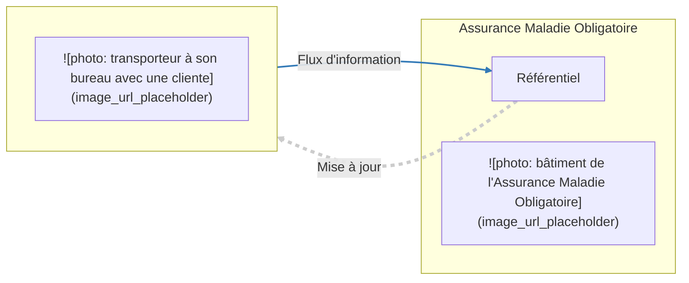

---
**Spécifications Fonctionnelles Générales**


# **Facturation Transporteur B2**


## **Aide à la prise en charge**


*Version* 03.11
*Date* 19/10/2016
*Référence* FACT-SFG-037
*Information* RESTREINTE
*Etat* REFERENCE

**GIE SESAM-Vitale**
5, boulevard Marie et Alexandre Oyon – 72 019 LE MANS Cedex 2
<u>www.sesam-vitale.fr</u>

**SFG Facturation Transporteur B2 -**
**FACT-SFG-037**  **Aide à la prise en charge**  **Version : 03.11**

19/10/2016  GIE SESAM-Vitale  2 / 24
Ce document ne peut être diffusé sans l'autorisation d'une personne habilitée au GIE SESAM-Vitale

***SFG Facturation Transporteur B2 -***
***FACT-SFG-037*** ***Aide à la prise en charge*** ***Version : 03.11***

Ce document a été élaboré par le GIE SESAM-Vitale.

Conformément à l'article L.122-4 du code de la propriété intellectuelle, toute représentation ou reproduction (intégrale ou partielle) du présent ouvrage, quel que soit le support utilisé, doit être soumise à l’accord écrit préalable de son auteur.

Il en est de même pour sa traduction, sa transformation, son adaptation ou son arrangement, quel que soit le procédé utilisé.

Tout manquement à ces obligations constituerait un délit de contrefaçon, au sens des articles L 335-2 et suivants du code de la propriété intellectuelle, susceptible d’entraîner des sanctions pour l’auteur du délit.

## **CONTACTS**


Pour toute demande d'évolution, comme pour toute question technique ou fonctionnelle, contactez le Centre de services :

*   e-mail : **centre-de-service@sesam-vitale.fr**
*   téléphone : **02 43 57 42 88**

***19/10/2016*** ***GIE SESAM-Vitale*** ***3 / 24***
***Ce document ne peut être diffusé sans l'autorisation d'une personne habilitée au GIE SESAM-Vitale***

**FACT-SFG-037**
***SFG Facturation Transporteur B2 -***
***Aide à la prise en charge***
**Version : 03.11**

# **TABLES DES MATIERES**

<table>
    <tr>
      <td><strong>1</strong></td>
      <td><strong>INTRODUCTION.........................................................................................................................................5</strong></td>
    </tr>
    <tr>
      <td>1.1</td>
      <td>OBJECTIF ET UTILISATION DU DOCUMENT ................................................................................................5</td>
    </tr>
    <tr>
      <td>1.2</td>
      <td>STATUT DU DOCUMENT ..........................................................................................................................5</td>
    </tr>
    <tr>
      <td>1.3</td>
      <td>DOCUMENTS DE REFERENCE ..................................................................................................................5</td>
    </tr>
    <tr>
      <td>1.4</td>
      <td>ABREVIATIONS.......................................................................................................................................6</td>
    </tr>
    <tr>
      <td>1.5</td>
      <td>GUIDE DE LECTURE ................................................................................................................................6</td>
    </tr>
    <tr>
      <td><strong>2</strong></td>
      <td><strong>PRESENTATION GENERALE DU SYSTEME ..........................................................................................7</strong></td>
    </tr>
    <tr>
      <td>2.1</td>
      <td>INTRODUCTION ......................................................................................................................................7</td>
    </tr>
    <tr>
      <td>2.2</td>
      <td>ACTEURS ET OBJECTIFS D’UTILISATION DU SYSTEME ..............................................................................10</td>
    </tr>
    <tr>
      <td>2.3</td>
      <td>ASPECTS NON FONCTIONNELS DU SYSTEME ..........................................................................................11</td>
    </tr>
    <tr>
      <td>2.4</td>
      <td>DESCRIPTION GENERALE DE L’UTILISATION DU SERVICE PEC+...............................................................12</td>
    </tr>
    <tr>
      <td></td>
      <td>    2.4.1 <i>Cadrage fonctionnel .............................................................................................................12</i></td>
    </tr>
    <tr>
      <td></td>
      <td>    2.4.2 <i>Principes...............................................................................................................................14</i></td>
    </tr>
    <tr>
      <td>2.5</td>
      <td>DESCRIPTION DETAILLEE DE L’UTILISATION DU SERVICE PEC+ ...............................................................15</td>
    </tr>
    <tr>
      <td></td>
      <td>    2.5.1 <i>F01 : Rechercher les informations de prise en charge d’une prestation..............................15</i></td>
    </tr>
    <tr>
      <td></td>
      <td>    2.5.2 <i>F02 : Afficher les informations de prise en charge d’une prestation ..................................19</i></td>
    </tr>
    <tr>
      <td></td>
      <td>    2.5.3 <i>F03 : Prendre en compte le choix du Transporteur..............................................................20</i></td>
    </tr>
    <tr>
      <td></td>
      <td>    2.5.4 <i>F04 : Utiliser les informations de prise en charge d’une prestation pour la facture .............20</i></td>
    </tr>
</table>

<table>
  <caption>**TABLE DES ILLUSTRATIONS**</caption>
    <tr>
      <td>FIGURE 1 : CONTEXTE D’UTILISATION DU SERVICE D’AIDE A LA PRISE EN CHARGE ....................................................7</td>
    </tr>
    <tr>
      <td>FIGURE 2 : DIAGRAMME DE CONTEXTE DYNAMIQUE DE L’UTILISATION DU SERVICE « AIDE A LA PRISE EN CHARGE » :<br />ECHANGES AVEC LES SYSTEMES EXTERNES..................................................................................................10</td>
    </tr>
    <tr>
      <td>FIGURE 3 : ILLUSTRATION D’UTILISATION DU SERVICE PEC+ DANS LE CAS D’UNE CONSULTATION (PROCESSUS P1 :<br />CONSULTER) ..........................................................................................................................................12</td>
    </tr>
    <tr>
      <td>FIGURE 4 : ILLUSTRATION D’UTILISATION DU SERVICE PEC+ DANS LE CAS D’UNE FACTURATION (PROCESSUS P2 :<br />FACTURER) .............................................................................................................................................13</td>
    </tr>
</table>

<table>
  <caption>**TABLE DES ANNEXES**</caption>
    <tr>
      <td><strong>ANNEXE 1</strong></td>
      <td><strong>GUIDE DE LECTURE ..........................................................................................................23</strong></td>
    </tr>
</table>

**19/10/2016**
**GIE SESAM-Vitale**
**4 / 24**
**Ce document ne peut être diffusé sans l'autorisation d'une personne habilitée au GIE SESAM-Vitale**

***SFG Facturation Transporteur B2 -***
***FACT-SFG-037*** ***Aide à la prise en charge*** ***Version : 03.11***

# **1 Introduction**

## **1.1 Objectif et utilisation du document**

Ce dossier de SFG décrit l’utilisation du service fonctionnel d’Aide à la Prise en Charge dans le cadre d’un LPS Transporteur effectuant la gestion des prescriptions de transport et des factures au format B2 associées.

## **1.2 Statut du document**

EN COURS

## **1.3 Documents de référence**

<table>
  <thead>
    <tr>
      <th>Appellation</th>
      <th>Type et titre</th>
      <th><b>Référence</b></th>
    </tr>
  </thead>
  <tbody>
    <tr>
      <td>[B2]</td>
      <td>Norme B2</td>
      <td>
        ● version juin 2007-Addendum B<br />
        ● version juin 2005<br />
        ● Norme_B2_Notice_Avenant6_Trans<br />
        ports_sanitaires_2012-04-24.pdf
      </td>
    </tr>
    <tr>
      <td>[WS_PEC+]</td>
      <td>Guide d’Intégration<br />PEC+</td>
      <td>SEL_MP_010</td>
    </tr>
  </tbody>
</table>

***19/10/2016*** ***GIE SESAM-Vitale*** ***5 / 24***
***Ce document ne peut être diffusé sans l'autorisation d'une personne habilitée au GIE SESAM-Vitale***

***SFG Facturation Transporteur B2 -***
**FACT-SFG-037** ***Aide à la prise en charge*** **Version : 03.11**

## **1.4 Abréviations**

<table>
  <thead>
    <tr>
      <th colspan="2"><b>Abréviations</b></th>
    </tr>
  </thead>
  <tbody>
    <tr>
      <td><b><b>ACS</b></b></td>
      <td>Aide à l'Acquisition d'une Complémentaire Santé</td>
    </tr>
    <tr>
      <td><b><b>ALD</b></b></td>
      <td>Affection de Longue Durée</td>
    </tr>
    <tr>
      <td><b><b>AME</b></b></td>
      <td>Aide Médicale d'Etat</td>
    </tr>
    <tr>
      <td><b><b>AMO</b></b></td>
      <td>Assurance Maladie Obligatoire</td>
    </tr>
    <tr>
      <td><b><b>AT/MP</b></b></td>
      <td>Accident du Travail / Maladie Professionnelle</td>
    </tr>
    <tr>
      <td><b><b>CAMIEG</b></b></td>
      <td>Caisse d'Assurance Maladie des Industries Electriques et Gazières</td>
    </tr>
    <tr>
      <td><b><b>CNDA</b></b></td>
      <td>Centre National de Dépôt et d'Agrément</td>
    </tr>
    <tr>
      <td><b><b>CNMSS</b></b></td>
      <td>Caisse Nationale Militaire de Sécurité Sociale</td>
    </tr>
    <tr>
      <td><b><b>CAVIMAC</b></b></td>
      <td>Caisse d'Assurance Vieillesse, Invalidité et Maladie des Cultes</td>
    </tr>
    <tr>
      <td><b><b>CMU-C</b></b></td>
      <td>Couverture Maladie Universelle Complémentaire</td>
    </tr>
    <tr>
      <td><b><b>ENIM</b></b></td>
      <td>Etablissement National des Invalides de la Marine</td>
    </tr>
    <tr>
      <td><b><b>LPS</b></b></td>
      <td>Logiciel du Partenaire de Santé</td>
    </tr>
    <tr>
      <td><b><b>MGP</b></b></td>
      <td>Mutuelle Générale de la Police</td>
    </tr>
    <tr>
      <td><b><b>MNH</b></b></td>
      <td>Mutuelle Nationale des Hospitaliers</td>
    </tr>
    <tr>
      <td><b><b>MSA</b></b></td>
      <td>Mutualité Sociale Agricole</td>
    </tr>
    <tr>
      <td><b><b>NIR</b></b></td>
      <td>Numéro d’Inscription au Répertoire</td>
    </tr>
    <tr>
      <td><b><b>RATP</b></b></td>
      <td>Régie Autonome des Transports Parisiens</td>
    </tr>
    <tr>
      <td><b><b>SMG</b></b></td>
      <td>Soins Médicaux Gratuits</td>
    </tr>
    <tr>
      <td><b>TR</b></td>
      <td>Transporteur (Ce terme englobe les TS et les taxis)</td>
    </tr>
    <tr>
      <td><b>TS</b></td>
      <td>Transporteur Sanitaire</td>
    </tr>
  </tbody>
</table>

## **1.5 Guide de lecture**

Cf. Annexe 1 : Guide de lecture

***19/10/2016*** ***GIE SESAM-Vitale*** ***6 / 24***
*Ce document ne peut être diffusé sans l'autorisation d'une personne habilitée au GIE SESAM-Vitale*

***FACT-SFG-037*** ***SFG Facturation Transporteur B2 - Aide à la prise en charge*** ***Version : 03.11***

# **2 Présentation générale du système**

## **2.1 Introduction**

**Objectifs du système**

Le service d’Aide à la prise en charge, appelé aussi PEC+ permet à un Transporteur (TR) de consulter, via son Logiciel de Professionnel de Santé (LPS), le taux de prise en charge par l’AMO d’une prestation de transport à une date donnée.

Ce service est utilisé par le Transporteur dans le cadre de son processus métier (prise de commande et élaboration de la facture).

Ces informations sont fournies à partir d’une interrogation des référentiels de l’Assurance Maladie et des différentes situations de droits du bénéficiaire connues des référentiels. Les informations restituées par ce service s'appuient sur des données déclaratives saisies par le Transporteur.

Ce service a pour objectifs :

*   d’offrir un service à valeur ajoutée «intégrée au progiciel» des Transporteurs,
*   de fournir une information utilisable lors de la prise en charge et/ou lors de l’élaboration de la facture, sans opération supplémentaire des utilisateurs (sans double saisie).

Les Transporteurs doivent être identifiés sur Espace pro par un identifiant et un mot de passe avant de pouvoir accéder au service d'aide à la prise en charge PEC+ avec le même identifiant mot de passe.



**Figure 1 : Contexte d’utilisation du service d’Aide à la Prise en Charge**

Les données retournées par le service doivent être affichées au Transporteur qui doit avoir la possibilité de les valider ou de les modifier.

L’appel au service doit être débrayable et peut être appelé en mode manuel ou en mode automatique (au choix du Transporteur).

***19/10/2016*** ***GIE SESAM-Vitale*** ***7 / 24***
***Ce document ne peut être diffusé sans l'autorisation d'une personne habilitée au GIE SESAM-Vitale***

***SFG Facturation Transporteur B2 -***
**FACT-SFG-037** ***Aide à la prise en charge*** **Version : 03.11**

### Ce service répond à trois enjeux :

*   répondre aux demandes de simplifications émises par les Transporteurs ;
*   faciliter la gestion et l’accès aux informations sur les droits des assurés pour les Transporteurs ;
*   diminuer le taux de rejet des factures TR reçues par l’Assurance Maladie Obligatoire.

---

## **Déclinaison de**
## **l’offre de service**
## **PEC+**

### **L’accès au service PEC+ se décline en 2 offres :**

*   **Offre 1 : *Accès à PEC+ pour consultation seule***
    Cette offre permet un accès au service uniquement consultation autonome.
    Cette offre s’appuie sur la mise en œuvre du processus P1 : CONSULTER.

*   **Offre 2 : *Accès à PEC+ dans un contexte facturation***
    Cette offre permet à la fois :
    *   un accès au service en vue d’une intégration, dans la facture, des informations restituées par le service
    *   un accès au service en consultation seule hors contexte de facturation

    Cette offre s’appuie sur la mise en œuvre des processus P1 : CONSULTER et P2 : FACTURER.

**19/10/2016** **GIE SESAM-Vitale** **8 / 24**
*Ce document ne peut être diffusé sans l'autorisation d'une personne habilitée au GIE SESAM-Vitale*

**FACT-SFG-037**  *SFG Facturation Transporteur B2 -* **Aide à la prise en charge**  **Version : 03.11**

## **Périmètre du système**

*   Professionnels de Santé concernés :
    *   Transporteurs Sanitaires (spécialité 55)
    *   Taxis (spécialité 56)

*   Risques :
    *   Maladie
    *   Maternité
    *   Accident du Travail/Maladie Professionnelle

*   Situations particulières du bénéficiaire prises en compte :
    *   CMU-C
    *   AME
    *   ACS (ACS A, ACS B, ACS C)

*   Soins Médicaux Gratuits (SMG)

*   Régimes des bénéficiaires des soins concernés :
    Le service est ouvert pour les assurés relevant des différents régimes obligatoires. Toutefois, cette ouverture est progressive.
    Les régimes pour lesquels ce service est disponible sont présentés sur le Portail Industriels du GIE SESAM-Vitale.

**19/10/2016** **GIE SESAM-Vitale** **9 / 24**
*Ce document ne peut être diffusé sans l'autorisation d'une personne habilitée au GIE SESAM-Vitale*

***SFG Facturation Transporteur B2 -***
***FACT-SFG-037*** ***Aide à la prise en charge*** ***Version : 03.11***

## **2.2 Acteurs et objectifs d’utilisation du système**

### **Objectif global**

Le schéma ci-après présente le système et ses liens avec les utilisateurs et les systèmes externes.

```mermaid
graph LR
    subgraph " "
        PS[Partenaire de Santé]
        LPS[LPS]
        PEC[Service PEC +]

        PS -- "1 Données saisies par le PS" --> LPS
        LPS -- "2 Données échangées" --> PEC
        PEC -- "5 Données échangées" --> LPS
        LPS -- "6 Données affichées par le LPS" --> PS
    end

    AMO[Assurance Maladie Obligatoire]
    DB[]

    PEC -- "3 Demande de recherche des droits" --> DB
    DB -- "4 Droits du bénéficiaire" --> PEC

    style PS fill:none,stroke:none
    style LPS fill:none,stroke:none
    style PEC fill:none,stroke:none
    style AMO fill:none,stroke:none
    style DB fill:none,stroke:none
```

**Figure 2 : Diagramme de contexte dynamique de l’utilisation du service « Aide à la Prise en Charge » : échanges avec les systèmes externes**

### **Acteurs du système**

<table>
  <thead>
    <tr>
      <th>Acteurs</th>
      <th><b>Entité</b></th>
      <th><b>Rôle</b></th>
    </tr>
  </thead>
  <tbody>
    <tr>
      <td><strong>Transporteur <b>(TR)</b></strong></td>
      <td>Transporteur (<strong>TR</strong>)</td>
      <td>Le Transporteur renseigne les informations nécessaires à la consultation des informations de prise en charge.</td>
    </tr>
    <tr>
      <td><strong>LPS</strong></td>
      <td>Editeurs Transporteurs</td>
      <td>Le LPS sollicite le service PEC+ pour obtenir les informations de prise en charge à partir des informations renseignées par le Transporteur.</td>
    </tr>
    <tr>
      <td><strong>Assurance Maladie Obligatoire</strong></td>
      <td>Régimes spécifiés au § 2.1 Périmètre</td>
      <td>L’Assurance Maladie Obligatoire fournit les informations de prise en charge du bénéficiaire de soins à partir de ses référentiels AMO.</td>
    </tr>
  </tbody>
</table>

*19/10/2016* *GIE SESAM-Vitale* **10 / 24**
*Ce document ne peut être diffusé sans l'autorisation d'une personne habilitée au GIE SESAM-Vitale*

***SFG Facturation Transporteur B2 -***
***FACT-SFG-037*** ***Aide à la prise en charge*** ***Version : 03.11***

# **2.3 Aspects non fonctionnels du système**

**Autorisation**
**LPS d’accès**
**aux TLSi**

Le LPS transporteur peut implémenter :

*   soit le processus P1 : **CONSULTER** (cf. §2.4 ci-après) :
    il est alors autorisé en « **mode consultation** » ;
*   soit le processus P2 : **FACTURER** (cf. §2.4 ci-après) :
    il est alors autorisé en « **mode facturation** ».

**Accès aux**
**services en**
**ligne AMO**

Le transporteur est identifié et authentifié par son login/mot de passe pour l’accès aux services en ligne de l’Assurance Maladie.

Les modalités d’implémentation de ce mode d’accès sont décrites dans le guide d’intégration du service en ligne PEC+.

**Exigences de**
**sécurité**

Le LPS Transporteur doit être conforme au référentiel d'exigences d'architecture et de sécurité appliquées aux TLSI tel que spécifié dans les documents en vigueur.

**Utilisation des**
**données**
**Assurance**
**Maladie**

Les données mises à disposition par l’Assurance Maladie via les services en ligne sont protégées par le droit à la propriété intellectuelle.

L’utilisation de ces données par le LPS hors du périmètre spécifié dans ce document est interdite de fait.

***19/10/2016*** ***GIE SESAM-Vitale*** ***11 / 24***
***Ce document ne peut être diffusé sans l'autorisation d'une personne habilitée au GIE SESAM-Vitale***

*FACT-SFG-037* *SFG Facturation Transporteur B2 -* *Version : 03.11*
*Aide à la prise en charge*

# 2.4 Description générale de l’utilisation du service PEC+

### Préambule

Les règles spécifiées ci-après peuvent être utilisées :
* soit dans le cadre d’une consultation autonome :
  processus **P1 : CONSULTER**.
* soit dans le cadre du processus de facturation B2 :
  processus **P2 : FACTURER**.

## 2.4.1 Cadrage fonctionnel

### Processus P1 : CONSULTER

```mermaid
graph TD
    subgraph PS_Transporteur [PS Transporteur]
        Prescription[Prescription]
    end

    subgraph LPS [LPS]
        direction TB
        subgraph CONSULTER [CONSULTER]
            Start(( )) --> Activity1[Activity1]
            Activity1 --> F01[F01 : Rechercher les informations de Prise en Charge]
            F01 --> F02[F02 : Afficher les informations de Prise en Charge]
            F02 --> Decision{Autre prestation?}
            Decision -- Non --> Activity2[Activity2]
            Decision -- Oui --> F01
            Activity2 --> End((( )))
        end
    end

    subgraph AMO [AMO]
        subgraph Service_PEC [Service d'Aide à la Prise en Charge / PEC+]
            PEC_Process[PEC+ : Déterminer les modalités de prise en charge]
        end
        Referentiel[Référentiel AMO]
    end

    %% Connections
    Prescription -.-> Activity1
    F01 <--> PEC_Process
    PEC_Process --> F02
    PEC_Process <--> Referentiel

    %% Styling
    style Start fill:#000
    style End fill:#000,stroke-width:4px
    style CONSULTER fill:#c0c0c0
    style Service_PEC fill:#ffff99
    style Activity1 fill:#fff2e6,color:#fff
    style Activity2 fill:#fff2e6,color:#fff
    style F01 fill:#fff2e6
    style F02 fill:#fff2e6
    style PEC_Process fill:#fff2e6
    style Decision fill:#fff2e6
```



**Figure 3 : Illustration d’utilisation du service PEC+ dans le cas d’une consultation (processus P1 : CONSULTER)**

 Dans le cadre du processus CONSULTER, seules les fonctionnalités F01 et F02 sont obligatoires.

*19/10/2016* *GIE SESAM-Vitale* 12 / 24
*Ce document ne peut être diffusé sans l'autorisation d'une personne habilitée au GIE SESAM-Vitale*

*FACT-SFG-037* *SFG Facturation Transporteur B2 -* *Version : 03.11*
*Aide à la prise en charge*

# Processus P2 :
# FACTURER

```mermaid
graph TD
    subgraph "PS Transporteur"
        Prescription[Prescription]
        ChoixTransporteur["Choix du\nTransporteur"]
    end

    subgraph LPS
        subgraph FACTURER
            ActivityInitial(( )) --> Activity1(Activity1)
            Activity1 --> F01["F01 : Rechercher les informations de\nPrise en Charge"]
            F01 --> F02["F02 : Afficher les informations de Prise\nen Charge"]
            F02 --> F03["F03 : Prendre en compte les choix du\nTransporteur"]
            F03 --> F04["F04 : Utiliser les informations de Prise\nen Charge pour la facture"]
            F04 --> Decision{Autre prestation?}
            Decision -- Non --> Activity2(Activity2)
            Decision -- Oui --> F01
            Activity2 --> ActivityFinal((( )))
        end
    end

    subgraph AMO
        subgraph "Service d'Aide à la Prise en Charge / PEC+"
            PEC_Det["PEC+ : Déterminer les modalités\nde prise en charge"]
        end
        ReferentielAMO[Référentiel\nAMO]
    end

    %% Connections
    Prescription -.-> Activity1
    F01 <--> PEC_Det
    PEC_Det <--> ReferentielAMO
    PEC_Det --> F02
    ChoixTransporteur --> F03

    %% Labels for start/end
    ActivityInitial -.-> ActivityInitialLabel[ActivityInitial]
    ActivityFinal -.-> ActivityFinalLabel[ActivityFinal]

    style FACTURER fill:#C0C0C0,stroke:#333,stroke-width:1px
    style "Service d'Aide à la Prise en Charge / PEC+" fill:#FFFFAA,stroke:#333,stroke-width:1px
    style PEC_Det fill:#A9A9A9,stroke:#333,stroke-width:1px
    style Activity1 fill:#FFF5E6,stroke:#333,stroke-width:1px
    style Activity2 fill:#FFF5E6,stroke:#333,stroke-width:1px
    style F01 fill:#FFEBCD,stroke:#333,stroke-width:1px
    style F02 fill:#FFEBCD,stroke:#333,stroke-width:1px
    style F03 fill:#FFEBCD,stroke:#333,stroke-width:1px
    style F04 fill:#FFEBCD,stroke:#333,stroke-width:1px
```

**Figure 4 : Illustration d’utilisation du service PEC+ dans le cas d’une facturation (processus P2 : FACTURER)**

## Situations
## spécifiques

*   CMU-C
*   AME de base
*   ACS (ACS A, ACS B, ACS C)

*19/10/2016* *GIE SESAM-Vitale* 13 / 24
*Ce document ne peut être diffusé sans l'autorisation d'une personne habilitée au GIE SESAM-Vitale*

***FACT-SFG-037*** ***SFG Facturation Transporteur B2 - Aide à la prise en charge*** ***Version : 03.11***

# **2.4.2** **Principes**

## **Description**

Le Transporteur utilise son LPS :

* pour obtenir les informations de prise en charge du transport d'un bénéficiaire à une date de transport donnée.
  Le Transporteur peut requérir ces informations à tout moment. Le nombre de consultations des informations de prise en charge n'est pas limité.
* pour l'élaboration de sa facture.

Compte tenu des informations transmises par le Transporteur,

* le SI de l’AMO appelé transmet les éléments de prise en charge connus pour une date donnée d'une prestation,
* ces informations sont renvoyées au logiciel dans un format sécurisé.

Dans le cadre du processus FACTURER, le logiciel propose ces informations à l'utilisateur ; ce dernier peut les intégrer ou non dans sa facture.

## **Utilisation des données de sortie**

Le LPS peut :

* soit afficher au Transporteur les informations obtenues,
* soit les proposer au Transporteur pour la réalisation d’une facture.

Dans le cadre du processus FACTURER, les informations retournées par le service ont pour objectif de renseigner une facture. Pour autant, le Transporteur conserve toute possibilité de les modifier.

En cas de modification de ces informations par le Transporteur lors de l’élaboration d’une facture, la cohérence de la facture est assurée par le LPS.

***19/10/2016*** ***GIE SESAM-Vitale*** ***14 / 24***
***Ce document ne peut être diffusé sans l'autorisation d'une personne habilitée au GIE SESAM-Vitale***

***SFG Facturation Transporteur B2 -***
**FACT-SFG-037** ***Aide à la prise en charge*** ***Version : 03.11***

# **2.5 Description détaillée de l’utilisation du service PEC+**

## **Préambule**

Les règles spécifiées dans ce paragraphe sont à respecter par le LPS dans le cadre de l'appel au service PEC+ et font l'objet d’une vérification de conformité du logiciel au CNDA.

## **2.5.1 F01 : Rechercher les informations de prise en charge d’une prestation**

### **Description**

Cette fonction a pour objet de déterminer, pour une prestation de transport, les informations de prise en charge AMO.

Cette fonction F01 utilise l’opération WS_PEC+ décrite dans le guide d’intégration [*WS_PEC+*].

### **Comportements particuliers**

**Ecart entre informations de la prescription et informations de prise en charge retournées par le service PEC+ :**

Le service PEC+ gère les priorités entre les différentes situations médico administratives du bénéficiaire pour la prestation donnée.

Le service restitue le contexte de prise en charge prioritaire.

***Exemple :***

*   Appel du service : indicateur soins en rapport avec une ALD à OUI et Indicateur de prise en charge à 100% à OUI.
*   Service PEC+ : Situation de maternité connue dans le référentiel Assurance Maladie, alors prise en compte de la maternité de façon prioritaire à l’ALD.
*   Réponse du service : nature d’assurance maternité (et non exonération de type « assuré ou bénéficiaire exonéré »).

### **Règles de gestion**

***[RG_LPS_317] Avertir le Transporteur de l’appel au service PEC+***

<table>
    <tr>
      <td>
        <b>P1</b><br />
        <b>**CONSULTER**</b>
      </td>
      <td>
        <b>P2</b><br />
        <b>**FACTURER**</b>
      </td>
    </tr>
</table>

Lors de l'appel au service PEC+, le LPS doit afficher au Transporteur un message pour le prévenir qu'il appelle les bases de l'Assurance Maladie.

Ce message peut être par exemple :

« Connexion au service d'aide à la prise en charge de l'Assurance Maladie ».

Il est obligatoire d’afficher ce message au minimum quand le Transporteur accède au service. Tant que la session est active, il est possible de ne pas le réafficher.

Ce message, purement informationnel, ne doit pas être bloquant.

**19/10/2016** **GIE SESAM-Vitale** **15 / 24**
**Ce document ne peut être diffusé sans l'autorisation d'une personne habilitée au GIE SESAM-Vitale**

**FACT-SFG-037** **SFG Facturation Transporteur B2 -** **Version : 03.11**
***Aide à la prise en charge***

## ***[RG_LPS_318] Débrayer l’appel au service PEC+***

<table>
    <tr>
      <td>P1<br />CONSULTER</td>
      <td>P2<br />FACTURER</td>
    </tr>
</table>

L’appel au service PEC+ doit être débrayable.

## ***[RG_LPS_319] Automatiser l’appel au service PEC+***

<table>
    <tr>
      <td>P1<br />CONSULTER</td>
      <td>P2<br />FACTURER</td>
    </tr>
</table>

L’appel au service PEC+ pour l'élaboration de la facture (processus FACTURER) doit être :
* soit automatisé par le LPS,
* soit manuel,

selon le choix du Transporteur.

Ce choix doit être paramétrable.

 Pour autant, l’appel du service pour une consultation seule (processus P1 : CONSULTER) doit être possible au Transporteur à tout moment du processus métier, même si le mode automatique est activé.

## ***[RG_LPS_320] Accéder aux informations de prise en charge AMO***

<table>
    <tr>
      <td>
        <strong>P1</strong><br />
        <strong>CONSULTER</strong>
      </td>
      <td>
        <strong>P2</strong><br />
        <strong>FACTURER</strong>
      </td>
    </tr>
</table>

Le LPS doit permettre l’accès au service PEC+ :
* soit dans le cadre de l’élaboration d’une facture,
* soit indépendamment de l’élaboration d’une facture.

## ***[RG_LPS_321] Appeler le service PEC+***

<table>
    <tr>
      <td>
        <strong>P1</strong><br />
        <strong>CONSULTER</strong>
      </td>
      <td>
        <strong>P2</strong><br />
        <strong>FACTURER</strong>
      </td>
    </tr>
</table>

Le service PEC+ fonctionne pour une prestation donnée.

Pour une prescription comprenant plusieurs prestations, il convient d’appeler le service PEC+ autant de fois que de dates de réalisation de prestations différentes.

Cette règle s’applique donc aux transports itératifs.

Les informations recherchées sont obtenues par l’appel au service WS_PEC+ comme suit :

### ***Données transmises***

<table>
  <thead>
    <tr>
      <th></th>
      <th>→</th>
      <th><strong><b>Opération</b><br />WS_PEC+</strong></th>
    </tr>
  </thead>
  <tbody>
    <tr>
      <td>NIR de l’assuré</td>
      <td>→</td>
      <td>DE_PEC_001</td>
    </tr>
    <tr>
      <td>Clé du NIR de l’assuré</td>
      <td>→</td>
      <td>DE_PEC_002</td>
    </tr>
  </tbody>
</table>

**19/10/2016** **GIE SESAM-Vitale** **16 / 24**
***Ce document ne peut être diffusé sans l'autorisation d'une personne habilitée au GIE SESAM-Vitale***

**FACT-SFG-037** **SFG Facturation Transporteur B2 -** **Version : 03.11**
***Aide à la prise en charge***

<table>
    <tr>
      <td>Date de naissance du bénéficiaire</td>
      <td>→</td>
      <td>DE_PEC_003</td>
    </tr>
    <tr>
      <td>Rang de naissance du bénéficiaire</td>
      <td>→</td>
      <td>DE_PEC_004</td>
    </tr>
    <tr>
      <td>Date de prescription</td>
      <td>→</td>
      <td>DE_PEC_005</td>
    </tr>
    <tr>
      <td>Date de réalisation de la prestation</td>
      <td>→</td>
      <td>DE_PEC_006</td>
    </tr>
    <tr>
      <td>Code prestation</td>
      <td>→</td>
      <td>DE_PEC_007</td>
    </tr>
    <tr>
      <td>Indicateur soins en rapport avec un<br />AT/MP</td>
      <td>→</td>
      <td>DE_PEC_010</td>
    </tr>
    <tr>
      <td>Indicateur soins en rapport avec ALD</td>
      <td>→</td>
      <td>DE_PEC_011</td>
    </tr>
    <tr>
      <td>Indicateur prise en charge à 100%</td>
      <td>→</td>
      <td>DE_PEC_012</td>
    </tr>
    <tr>
      <td>Indicateur soins en rapport avec<br />article L115</td>
      <td>→</td>
      <td>DE_PEC_013</td>
    </tr>
    <tr>
      <td>Date AT/MP</td>
      <td>→</td>
      <td>DE_PEC_008</td>
    </tr>
    <tr>
      <td>Identifiant AT/MP</td>
      <td>→</td>
      <td>DE_PEC_009</td>
    </tr>
</table>

 **6 Précision sur les données transmises**

Les informations suivantes :

* NIR de l’assuré DE_PEC_001
* Clé du NIR de l’assuré DE_PEC_002
* Date de naissance du bénéficiaire DE_PEC_003
* Rang de naissance du bénéficiaire DE_PEC_004
* Date de prescription DE_PEC_005
* Indicateur soins en rapport avec un AT/MP DE_PEC_010
* Indicateur soins en rapport avec ALD DE_PEC_011
* Indicateur prise en charge à 100% DE_PEC_012

figurent sur la prescription de transport.

***Données reçues***

<table>
  <thead>
    <tr>
      <th></th>
      <th>🡨</th>
      <th><strong><b>Opération</b><br />WS_PEC+</strong></th>
    </tr>
  </thead>
  <tbody>
    <tr>
      <td>Code régime de prise en charge</td>
      <td>🡨</td>
      <td>DS_PEC_115</td>
    </tr>
    <tr>
      <td>Code caisse gestionnaire de prise en charge</td>
      <td>🡨</td>
      <td>DS_PEC_116</td>
    </tr>
    <tr>
      <td>Code centre gestionnaire de prise en charge</td>
      <td>🡨</td>
      <td>DS_PEC_117</td>
    </tr>
    <tr>
      <td>Nature d’assurance</td>
      <td>🡨</td>
      <td>DS_PEC_118</td>
    </tr>
    <tr>
      <td>Date de maternité</td>
      <td>🡨</td>
      <td>DS_PEC_119</td>
    </tr>
    <tr>
      <td>Rang du bénéficiaire</td>
      <td>🡨</td>
      <td>DS_PEC_120</td>
    </tr>
    <tr>
      <td>Type de Contrat</td>
      <td>🡨</td>
      <td>DS_PEC_123</td>
    </tr>
    <tr>
      <td>Indicateur de situation particulière du</td>
      <td>🡨</td>
      <td>DS_PEC_122</td>
    </tr>
  </tbody>
</table>

**19/10/2016** **GIE SESAM-Vitale** **17 / 24**
*Ce document ne peut être diffusé sans l'autorisation d'une personne habilitée au GIE SESAM-Vitale*

**FACT-SFG-037**
***SFG Facturation Transporteur B2 - Aide à la prise en charge***
**Version : 03.11**

<table>
    <tr>
      <td>bénéficiaire</td>
      <td></td>
      <td></td>
    </tr>
    <tr>
      <td>N° Organisme Complémentaire</td>
      <td>←</td>
      <td>DS_PEC_124</td>
    </tr>
    <tr>
      <td>Destinataire de règlement</td>
      <td>←</td>
      <td>DS_PEC_125</td>
    </tr>
    <tr>
      <td>Justificatif d’exonération</td>
      <td>←</td>
      <td>DS_PEC_126</td>
    </tr>
    <tr>
      <td>Taux applicable à la prestation</td>
      <td>←</td>
      <td>DS_PEC_127</td>
    </tr>
    <tr>
      <td>TP réglementaire AMO</td>
      <td>←</td>
      <td>DS_PEC_130</td>
    </tr>
    <tr>
      <td>TP réglementaire AMC</td>
      <td>←</td>
      <td>DS_PEC_131</td>
    </tr>
</table>

## *[RG_LPS_322] **Renseigner la Date de réalisation de la prestation en entrée de PEC+***

<table>
    <tr>
      <td><b>P1</b><br /><b>CONSULTER</b></td>
      <td><b>P2</b><br /><b>FACTURER</b></td>
    </tr>
</table>

Le LPS valorise cette date à la date du jour ; le Transporteur a la possibilité de la modifier.

## *[RG_LPS_323] **Renseigner le Code prestation en entrée de PEC+***

<table>
    <tr>
      <td>
        <strong>P1</strong>
        <br />
        <strong>CONSULTER</strong>
      </td>
      <td>
        <strong>P2</strong>
        <br />
        <strong>FACTURER</strong>
      </td>
    </tr>
</table>

Le LPS propose au Transporteur de choisir entre l’une des valeurs suivantes :

*   « ABA/VSL »
*   « ABA »
*   « VSL »
*   « TXI »

## *[RG_LPS_324] **Renseigner la Date de prescription en entrée de PEC+***

<table>
    <tr>
      <td>
        <b>P1</b><br />
        <b>CONSULTER</b>
      </td>
      <td>
        <b>P2</b><br />
        <b>FACTURER</b>
      </td>
    </tr>
</table>

La date de prescription fournie en entrée du service PEC+ est valorisée, par défaut, à la date du jour ou à la date de réalisation de la prestation, si cette dernière est antérieure à la date du jour.
Cette date est modifiable par le Transporteur.

## *[RG_LPS_325] **Renseigner les informations en rapport avec un AT/MP***

<table>
    <tr>
      <td>
        <b>P1</b><br />
        <b>CONSULTER</b>
      </td>
      <td>
        <b>P2</b><br />
        <b>FACTURER</b>
      </td>
    </tr>
</table>

Si l’indicateur soins en rapport avec AT/MP est positionné à «OUI», il est nécessaire de renseigner également soit la date, soit l’identifiant de l’AT/MP en question.

## *[RG_LPS_326] **Renseigner les Indicateurs***

<table>
    <tr>
      <td>
        <b>P1</b><br />
        <b>CONSULTER</b>
      </td>
      <td>
        <b>P2</b><br />
        <b>FACTURER</b>
      </td>
    </tr>
</table>

Hormis pour l’indicateur soins en rapport avec Art.115, les indicateurs sont issus de <u>la prescription.</u>

**19/10/2016**
**GIE SESAM-Vitale**
**18 / 24**
***Ce document ne peut être diffusé sans l'autorisation d'une personne habilitée au GIE SESAM-Vitale***

**FACT-SFG-037** *SFG Facturation Transporteur B2 - Aide à la prise en charge* **Version : 03.11**

## **2.5.2** **F02 : Afficher les informations de prise en charge d’une prestation**

### **Description**

Les données retournées par le service doivent être affichées au Transporteur.

### **Règles de gestion**

*[RG_LPS_350] Afficher les données retournées*

<table>
    <tr>
      <td>
        <b>P1</b>
        <br />
        <b>**CONSULTER**</b>
      </td>
      <td>
        <b>P2</b>
        <br />
        <b>**FACTURER**</b>
      </td>
    </tr>
</table>

Le LPS doit permettre d’afficher au Transporteur les données telles que retournées par le service.

Simultanément, le LPS doit afficher au Transporteur le message suivant :

> «Attention, le présent taux de prise en charge n’est applicable que si le transport est en lien avec une situation permettant son remboursement par l’Assurance Maladie obligatoire.»

 ***Cas particulier***

**[CP1] *Tiers payant réglementaire AMO***

Si le PS est un Transporteur Sanitaire (spécialité 55) et qu’une des conditions suivantes est vérifiée :

<table>
  <thead>
    <tr>
      <th rowspan="2"></th>
      <th rowspan="2"><b>Date d’effet de</b><br /><b>la condition</b></th>
      <th>Nature d’assurance</th>
      <th>Soins de la facture en<br /><b>rapport avec ALD</b></th>
    </tr>
    <tr>
      <th><b>DS_PEC_118</b></th>
      <th><b>DS_PEC_126</b></th>
    </tr>
  </thead>
  <tbody>
    <tr>
      <td><strong><i>C1</i></strong></td>
      <td><strong>01/07/16</strong></td>
      <td>Maternité</td>
      <td>Toute</td>
    </tr>
    <tr>
      <td><strong><i>C2</i></strong></td>
      <td><strong>01/07/16</strong></td>
      <td>Maladie</td>
      <td>4</td>
    </tr>
    <tr>
      <td><strong><i>C3</i></strong></td>
      <td><strong>01/01/17</strong></td>
      <td>Toute</td>
      <td>Toute</td>
    </tr>
  </tbody>
</table>

l’information Tiers Payant Réglementaire AMO (DS_PEC_130) retournée par le service ne doit pas être affiché : le LPS doit ignorer la réponse de PEC+ et afficher « OUI »

 A noter que les Taxis (spécialité 56) ne sont pas concernés par ce cas particulier.

**19/10/2016** **GIE SESAM-Vitale** **19 / 24**
*Ce document ne peut être diffusé sans l'autorisation d'une personne habilitée au GIE SESAM-Vitale*

**FACT-SFG-037**
***SFG Facturation Transporteur B2 - Aide à la prise en charge***
**Version : 03.11**

## **2.5.3** **F03 : Prendre en compte le choix du Transporteur**

**Description**
Le LPS doit donner la possibilité au Transporteur de valider, annuler ou modifier les données retournées par le service. La cohérence de la facture doit être assurée par le LPS.

**Règles de gestion**

*[RG_LPS_331] Modifier les données de sortie*

<table>
    <tr>
      <td>P1<br /><b>CONSULTER</b></td>
      <td>P2<br /><b>FACTURER</b></td>
    </tr>
</table>

Le LPS doit permettre au Transporteur de modifier une ou plusieurs données retournées par le service PEC+.

## **2.5.4** **F04 : Utiliser les informations de prise en charge d’une prestation pour la facture**

**Description**
Une fois les données de prise en charge validées par le Transporteur, le LPS les utilise pour la réalisation de la facture.

**Comportements particuliers**

**Signaler une évolution de la situation médico administrative du bénéficiaire :**

Le service PEC+ retourne des informations de niveau prise en charge et de niveau prestation.

Le LPS doit signaler au TR les écarts de situation entre prestations réalisées à des dates différentes.

***Exemple :***

*   Prestation trajet aller : 1<sup>er</sup> appel PEC+ :
    la nature d'assurance retournée est maladie (code 10)
*   Prestation trajet retour : 2<sup>ème</sup> appel PEC+ :
    la nature d'assurance retournée est maternité (code 30)

Entre la date du trajet aller et la date du trajet retour, la patiente a entamé son 6ème mois de grossesse.

La nature d'assurance étant unique pour une facture, il est nécessaire d’identifier cette situation qui donne lieu à l’élaboration de deux factures distinctes, l'une pour le trajet aller en nature d’assurance maladie, l'autre pour le trajet retour en nature d’assurance maternité.

**19/10/2016** **GIE SESAM-Vitale** **20 / 24**
***Ce document ne peut être diffusé sans l'autorisation d'une personne habilitée au GIE SESAM-Vitale***

**FACT-SFG-037**
***SFG Facturation Transporteur B2 - Aide à la prise en charge***
***Version : 03.11***

# **Règles de**
# **gestion**

## ***[RG_LPS_342] Déterminer le TP AMO pour la facture***


Cette information permet au Professionnel de Santé de préciser s’il a appliqué le tiers payant sur la part obligatoire.

Le LPS positionne par défaut le Tiers Payant AMO de la facture à la valeur du tiers payant réglementaire AMO reçue du service PEC+ (DS_PEC_130), le Transporteur pouvant toujours modifier cette information.


### **Cas particulier**

#### ***[CP1] Positionner par défaut le TP AMO***

Le LPS ne prend pas en compte la valeur reçue du service PEC+ et propose par défaut le Tiers Payant AMO de la facture à **OUI** si le PS est un Transporteur Sanitaire (spécialité 55) et qu’une des conditions de la table ci-après est vérifiée.

Ces conditions dépendent des données suivantes reçues du service PEC+ :

*   la nature d’assurance (DS_PEC_118)
*   le justificatif d’exonération» (DS_PEC_126)


6 Ces conditions sont appréciées à la date du jour.

<table>
  <thead>
    <tr>
      <th rowspan="2"></th>
      <th rowspan="2"><b>Date d’effet de</b> <b>la condition</b></th>
      <th>Nature d’assurance</th>
      <th>Soins de la facture en <b>rapport avec ALD</b></th>
    </tr>
    <tr>
      <th>DS_PEC_118</th>
      <th>DS_PEC_126</th>
    </tr>
  </thead>
  <tbody>
    <tr>
      <td><b><i>C1</i></b></td>
      <td><b>01/07/16</b></td>
      <td>Maternité</td>
      <td>Toute</td>
    </tr>
    <tr>
      <td><b><i>C2</i></b></td>
      <td><b>01/07/16</b></td>
      <td>Maladie</td>
      <td>4</td>
    </tr>
    <tr>
      <td><b><i>C3</i></b></td>
      <td><b>01/01/17</b></td>
      <td>Toute</td>
      <td>Toute</td>
    </tr>
  </tbody>
</table>


E A noter que les Taxis (spécialité 56) ne sont pas concernés par ce cas particulier.

**19/10/2016**
**GIE SESAM-Vitale**
**21 / 24**
**Ce document ne peut être diffusé sans l'autorisation d'une personne habilitée au GIE SESAM-Vitale**

**FACT-SFG-037**
***SFG Facturation Transporteur B2 - Aide à la prise en charge***
**Version : 03.11**

## *[RG_LPS_343] Renseigner la facture à partir des données restituées par PEC+*

<table>
    <tr>
      <td>P1<br /><b>CONSULTER</b></td>
      <td>P2<br /><b>FACTURER</b></td>
    </tr>
</table>

Le tableau ci-après présente les données susceptibles d’être renseignées <u>directement</u> à partir des données de sortie du service PEC+ :

<table>
  <thead>
    <tr>
      <th colspan="4"><b>Donnée de la facture</b><br /><b>(au format B2 2005 et B2 2007)</b></th>
      <th></th>
      <th><b>Donnée PEC+</b></th>
    </tr>
    <tr>
      <th>Libellé</th>
      <th>Type</th>
      <th>Position</th>
      <th>Format</th>
      <th></th>
      <th><b>Référence</b></th>
    </tr>
  </thead>
  <tbody>
    <tr>
      <td>Code Grand Régime</td>
      <td rowspan="9">2A</td>
      <td>49-50</td>
      <td>2N</td>
      <td>🡨</td>
      <td>DS_PEC_115</td>
    </tr>
    <tr>
      <td>N° Caisse Gestionnaire</td>
      <td>51-53</td>
      <td>3N</td>
      <td>🡨</td>
      <td>DS_PEC_116</td>
    </tr>
    <tr>
      <td>N° Centre Gestionnaire</td>
      <td>54-57</td>
      <td>4N</td>
      <td>🡨</td>
      <td>DS_PEC_117<sup>(1)</sup></td>
    </tr>
    <tr>
      <td>Nature d’assurance</td>
      <td>77-78</td>
      <td>2N</td>
      <td>🡨</td>
      <td>DS_PEC_118</td>
    </tr>
    <tr>
      <td>Date Maternité</td>
      <td>80-85</td>
      <td>AAMMJJ</td>
      <td>🡨</td>
      <td>DS_PEC_119</td>
    </tr>
    <tr>
      <td>Rang de Bénéficiaire</td>
      <td>103-104</td>
      <td>2A</td>
      <td>🡨</td>
      <td>DS_PEC_120</td>
    </tr>
    <tr>
      <td>Destinataire de règlement</td>
      <td>115-116</td>
      <td>2A</td>
      <td></td>
      <td><sup>(2)</sup></td>
    </tr>
    <tr>
      <td>Type de contrat souscrit auprès<br />d’un organisme complémentaire</td>
      <td>117-118</td>
      <td>2N</td>
      <td>🡨</td>
      <td>DS_PEC_123</td>
    </tr>
    <tr>
      <td>N° d’organisme complémentaire</td>
      <td>119-128</td>
      <td>10A</td>
      <td>🡨</td>
      <td>DS_PEC_124</td>
    </tr>
    <tr>
      <td>Justification Exo Ticket<br />Modérateur</td>
      <td rowspan="2">4A</td>
      <td>54</td>
      <td>1N</td>
      <td>🡨</td>
      <td>DS_PEC_126</td>
    </tr>
    <tr>
      <td>Taux applicable à la Prestation</td>
      <td>103-105</td>
      <td>3N</td>
      <td>🡨</td>
      <td>DS_PEC_127</td>
    </tr>
  </tbody>
</table>

 **Précision sur les données restituées par PEC+ :**
<sup>(1)</sup> Dans le cas où la donnée « centre gestionnaire » restituée par le service PEC+ est d’une longueur inférieure à 4 caractères, il convient de renseigner le flux B2 en cadrant cette donnée à droite et en la complétant par des zéros à gauche.

 Remarque : pour plus d’informations sur l’alimentation de ces données se référer au document [B2].

###  *(2) Renseigner le destinataire de règlement de la facture*

Le destinataire de règlement de la facture est positionné par le LPS en fonction du **TP AMO pour la facture** déterminé précédemment (cf. RG_LPS_342) et du **TP AMC** appliqué pour la facture conformément au tableau ci-après :

<table>
  <thead>
    <tr>
      <th rowspan="2">TP AMO<br />pour la facture<br /><b>(RG_LPS_342)</b></th>
      <th rowspan="2">TP AMC<br />pour la facture<br /><b>(DS_PEC_131)</b></th>
      <th colspan="2"><b>Destinataire de règlement de la facture</b></th>
    </tr>
    <tr>
      <th>Valeur</th>
      <th>Libellé</th>
    </tr>
  </thead>
  <tbody>
    <tr>
      <td>Non</td>
      <td>Non</td>
      <td>00</td>
      <td>hors Tiers payant,</td>
    </tr>
    <tr>
      <td>OUI</td>
      <td>Non</td>
      <td>05</td>
      <td>Tiers payant sur la part obligatoire<br />uniquement</td>
    </tr>
    <tr>
      <td>OUI</td>
      <td>OUI</td>
      <td>15</td>
      <td>Tiers payant sur la part obligatoire et<br />sur la part complémentaire.</td>
    </tr>
  </tbody>
</table>

**19/10/2016**
**GIE SESAM-Vitale**
**22 / 24**
***Ce document ne peut être diffusé sans l'autorisation d'une personne habilitée au GIE SESAM-Vitale***

***SFG Facturation Transporteur B2 -***
***FACT-SFG-037*** ***Aide à la prise en charge*** ***Version : 03.11***

# **Annexe 1 Guide de lecture**

## **Indications dans la marge**

 Les éléments importants et les remarques sont indiqués par une main dans la marge .

**?** Les questions importantes sont indiquées par un point d’interrogation dans la marge.

 Les alertes importantes sont indiquées par ce pictogramme dans la marge.

## **Conventions d’écriture**

***Première lettre toujours en majuscule***

**T**ransporteur
**A**ssurance **M**aladie

## **Codes couleur**

Les codes couleur suivants sont utilisés dans ce document :

* Si la version du document contient des marques de révision
    * <mark>Texte surligné jaune</mark> = texte ajouté par rapport à la version précédente du **document**
    * ~~**Texte barré = texte supprimé par rapport à la version précédente du**~~ **document**
* <mark><u>Texte surligné vert</u></mark> ou <mark><u>surligné violet</u></mark> = texte à revoir
* Texte de couleur bleu ou <u>surligné en bleu</u> = texte à revoir avec les membres

Pour les diagrammes les codes couleur sont les suivants :

***19/10/2016*** ***GIE SESAM-Vitale*** ***23 / 24***
***Ce document ne peut être diffusé sans l'autorisation d'une personne habilitée au GIE SESAM-Vitale***

**FACT-SFG-037**
***SFG Facturation Transporteur B2 - Aide à la prise en charge***
**Version : 03.11**

| Couleur par défaut | Elément important | Elément externe | Elément modifié | Elément à revoir | Elément à revoir **avec la MOA** |
| :---: | :---: | :---: | :---: | :---: | :---: |
|  |  |  |  |  |  |

## **Exigences fonctionnelles**

Par défaut, la totalité de ces SFG est constituée d’exigences fonctionnelles.

Les exceptions suivantes sont à noter :

*   Dans les processus d’utilisation du système, il est possible de citer des étapes sans utilisation du système (fonctionnalités typées « métier »),
*   Les règles de gestion de type « métier », « consigne utilisateur » ou « convention » ne font pas partie des exigences fonctionnelles (elles ne sont pas prises en charge par le système),
*   Les illustrations et les exemples ne font également pas partie des exigences fonctionnelles. Ils sont précédés par la mention « Illustration » en marge. Il est également possible d’utiliser une étiquette « Préambule ».
*   Les recommandations pour les développeurs et les éditeurs

## **Références**

Certains éléments dans ces SFG sont référencés à l’aide d’un identifiant unique au sein de ce corpus documentaire. Les références suivantes sont utilisées :

*   RG_... pour les règles de gestion,
*   WS_... pour les web services,
*   EF_... pour les entités fonctionnelles,
*   IT_... pour les données intermédiaires,
*   CP_… pour les cas particuliers,
*   CE_... pour les cas d’erreur,
*   ...

Ces références sont utilisées pour faire des renvois explicites vers les éléments concernés.

NB : pour une donnée unitaire, on ajoute l’indice de cette donnée à la référence de l’entité fonctionnelle. Par exemple : EF_01_01 est un renvoi vers la première donnée unitaire de l’entité EF_01.

## **Cas d’erreur**

La liste exhaustive des erreurs pouvant être retournées par les différents services en ligne de l’A.M. est présentée dans l’annexe 2 de chaque guide d’intégration.

Dans les spécifications fonctionnelles du système FTE, seuls les cas d’erreur entraînant une action du LPS sont décrits.

***19/10/2016***
***GIE SESAM-Vitale***
**24 / 24**
*Ce document ne peut être diffusé sans l'autorisation d'une personne habilitée au GIE SESAM-Vitale*