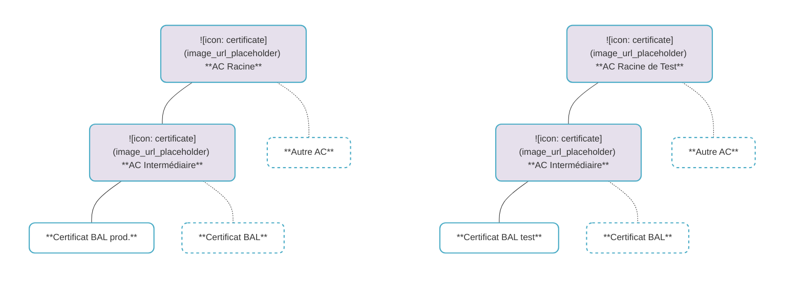
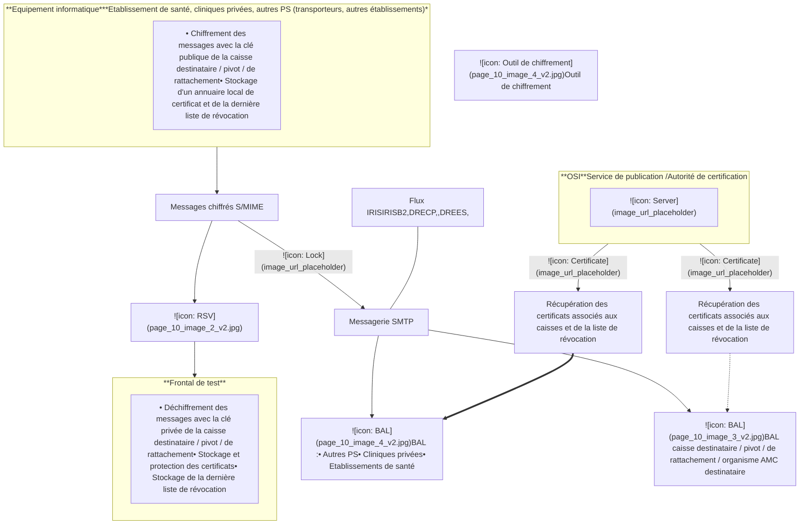
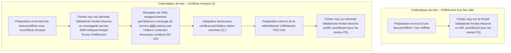

# **CHIFFREMENT DES FLUX**
*Plan de test*

# **Spécifications et plan de tests de Validation**

Référence : **VALID-PTV-001** / Version : **1.05** / Date : **11/2018**
Rédigé par : **Cyril THOMAS** / Approuvé par : **Yann CALLOC'H**
Sécurité : **DIFFUSION RESTREINTE**

**GIE SESAM-Vitale**
5, boulevard Marie et Alexandre Oyon – 72019 LE MANS Cedex 2
<u>www.sesam-vitale.fr</u>

Ce document a été élaboré par le **GIE SESAM-Vitale**.

Conformément à l’article L.122-4 du Code de la Propriété Intellectuelle, toute représentation ou reproduction (intégrale ou partielle) du présent ouvrage, quel que soit le support utilisé, doit être soumise à l’accord préalable écrit de son auteur.

Il en est de même pour sa traduction, sa transformation, son adaptation ou son arrangement, quel que soit le procédé utilisé.

**Tout manquement à ces obligations constituerait un délit de contrefaçon, au sens **des articles L 335-2 et suivants du code de la propriété intellectuelle, susceptible** d’entraîner des sanctions pour l’auteur du délit.**

**GIE SESAM-Vitale**
5, boulevard Marie et Alexandre Oyon – 72019 LE MANS Cedex 2
<u>www.sesam-vitale.fr</u>

*VALID-PTV-001 Spécifications et plan de tests de Validation Version : 1.05*

<table>
  <thead>
    <tr>
      <th><b>Date</b></th>
      <th><b>Version</b></th>
      <th><b><b>Évolution du document</b></b></th>
    </tr>
  </thead>
  <tbody>
    <tr>
      <td>02/07/2013</td>
      <td>0.01</td>
      <td>Création</td>
    </tr>
    <tr>
      <td>09/08/2013</td>
      <td>0.02</td>
      <td>Prise en compte des remarques</td>
    </tr>
    <tr>
      <td>19/09/2013</td>
      <td>0.03</td>
      <td>Mise en cohérence avec plan de test de migration</td>
    </tr>
    <tr>
      <td rowspan="3">27/01/2014</td>
      <td rowspan="3">1.00</td>
      <td>Mise à jour des adresses pour les certificats</td>
    </tr>
    <tr>
      <td>Mise à jour des schémas et des informations pour les certificats</td>
    </tr>
    <tr>
      <td>Ajout de précision pour les tests de certificats révoqués</td>
    </tr>
    <tr>
      <td>06/03/2014</td>
      <td>1.01</td>
      <td>Ajout d’une contrainte de tests § 5.5 – Remplissage Zone message type 000</td>
    </tr>
    <tr>
      <td rowspan="3">12/2017</td>
      <td rowspan="3">1.02</td>
      <td>Mise à jour des tests en conformité aux spécifications ETS-DT-</td>
    </tr>
    <tr>
      <td>001_TransportsFlux_SpecsTechCommune pour les évolutions AES et prise</td>
    </tr>
    <tr>
      <td>en compte des DRE-ES</td>
    </tr>
    <tr>
      <td>12/2017</td>
      <td>1.03</td>
      <td>Prise en compte des remarques et validation du document</td>
    </tr>
    <tr>
      <td>06/2018</td>
      <td>1.04</td>
      <td>Correction des requêtes LDAP</td>
    </tr>
    <tr>
      <td>11/2018</td>
      <td>1.05</td>
      <td>Correction des requêtes LDAP (Suppression paramètre S=SARTHE)</td>
    </tr>
  </tbody>
</table>

*11/2018 GIE SESAM-Vitale*  3 / 37

*Ce document à diffusion restreinte ne peut être diffusé sans l'autorisation d'une personne habilitée au GIE SESAM-Vitale*

*VALID-PTV-001* *Spécifications et plan de tests de Validation* *Version : 1.05*

# **Tables des matières**

<table>
    <tr>
      <td><b>1</b></td>
      <td><b>Introduction ...............................................................................................................................................6</b></td>
    </tr>
    <tr>
      <td><b>2</b></td>
      <td><b>Références.................................................................................................................................................7</b></td>
    </tr>
    <tr>
      <td><b>3</b></td>
      <td><b>Plate-forme de test....................................................................................................................................8</b></td>
    </tr>
    <tr>
      <td>3.1</td>
      <td>Le frontal de Validation........................................................................................................................8</td>
    </tr>
    <tr>
      <td>3.2</td>
      <td>L'annuaire de l’OSI ..............................................................................................................................8</td>
    </tr>
    <tr>
      <td><b>4</b></td>
      <td><b>Schéma d’échange des flux...................................................................................................................10</b></td>
    </tr>
    <tr>
      <td><b>5</b></td>
      <td><b>Tests d’accrochage vers l’annuaire OSI...............................................................................................11</b></td>
    </tr>
    <tr>
      <td>5.1</td>
      <td>Principe des tests ..............................................................................................................................11</td>
    </tr>
    <tr>
      <td>5.2</td>
      <td>Cinématique de test ..........................................................................................................................11</td>
    </tr>
    <tr>
      <td>5.3</td>
      <td>Préparation des tests ........................................................................................................................11</td>
    </tr>
    <tr>
      <td>5.4</td>
      <td>Contraintes de test ............................................................................................................................11</td>
    </tr>
    <tr>
      <td>5.5</td>
      <td>Test 1 : Acquisition d’un certificat......................................................................................................12</td>
    </tr>
    <tr>
      <td>5.6</td>
      <td>Test 2 : Téléchargement de la liste de révocation ............................................................................13</td>
    </tr>
    <tr>
      <td><b>6</b></td>
      <td><b>Tests d’accrochage vers le Frontal.......................................................................................................14</b></td>
    </tr>
    <tr>
      <td>6.1</td>
      <td>CINEMATIQUE DE TEST .................................................................................................................14</td>
    </tr>
    <tr>
      <td>6.2</td>
      <td>PRINCIPE DE TESTS.......................................................................................................................14</td>
    </tr>
    <tr>
      <td>6.3</td>
      <td>PRÉPARATION DES TESTS............................................................................................................15</td>
    </tr>
    <tr>
      <td>6.4</td>
      <td>CONTRAINTES DE TEST ................................................................................................................16</td>
    </tr>
    <tr>
      <td>6.5</td>
      <td>TESTS DE VÉRIFICATION DE L’IDENTIFIANT DU LOGICIEL DE CHIFFREMENT .....................16</td>
    </tr>
    <tr>
      <td>6.6</td>
      <td>TESTS CHIFFREMENT DES FLUX – ÉTABLISSEMENTS DE SANTÉ À DESTINATION DES ORGANISMES AMO/AMC................................................................................................................18</td>
    </tr>
    <tr>
      <td></td>
      <td>6.6.1 <i>Flux Chiffrés IRIS/B2</i> ............................................................................................................18</td>
    </tr>
    <tr>
      <td></td>
      <td>    6.6.1.1 Test 1 : Chiffrement d’un flux aller non compressé .............................................................. 18</td>
    </tr>
    <tr>
      <td></td>
      <td>    6.6.1.2 Test 2 : Chiffrement d’un Flux aller non compressé avec un certificat révoqué ................... 18</td>
    </tr>
    <tr>
      <td></td>
      <td>    6.6.1.3 Test 3 : Chiffrement d’un flux aller compressé ..................................................................... 19</td>
    </tr>
    <tr>
      <td></td>
      <td>    6.6.1.4 Test 4 : Chiffrement d’un flux aller compressé avec un certificat révoqué............................ 20</td>
    </tr>
    <tr>
      <td></td>
      <td>6.6.2 <i>Flux Chiffrés DRE-ES</i>...........................................................................................................21</td>
    </tr>
    <tr>
      <td></td>
      <td>    6.6.2.1 Test 1 : Chiffrement d’un flux aller non compressé .............................................................. 21</td>
    </tr>
    <tr>
      <td></td>
      <td>    6.6.2.2 Test 2 : Chiffrement d’un flux non compressé avec un certificat révoqué ............................ 21</td>
    </tr>
    <tr>
      <td></td>
      <td>    6.6.2.3 Test 3 : Chiffrement d’un flux aller compressé ..................................................................... 22</td>
    </tr>
    <tr>
      <td></td>
      <td>    6.6.2.4 Test 4 : Chiffrement d’un flux aller compressé avec un certificat révoqué............................ 23</td>
    </tr>
    <tr>
      <td>6.8</td>
      <td>TESTS CHIFFREMENT DES FLUX – CLINIQUES PRIVÉES A DESTINATION DES ORGANISMES AMO/AMC................................................................................................................25</td>
    </tr>
    <tr>
      <td></td>
      <td>6.8.1 <i>Flux Chiffrés IRIS/B2</i> ............................................................................................................25</td>
    </tr>
    <tr>
      <td></td>
      <td>    6.8.1.1 Test 1 : Chiffrement d’un flux aller non compressé .............................................................. 25</td>
    </tr>
    <tr>
      <td></td>
      <td>    6.8.1.2 Test 2 : Chiffrement d’un flux non compressé avec un certificat révoqué ............................ 25</td>
    </tr>
    <tr>
      <td></td>
      <td>    6.8.1.3 Test 3 : Chiffrement d’un flux aller compressé ..................................................................... 26</td>
    </tr>
    <tr>
      <td></td>
      <td>    6.8.1.4 Test 4 : Chiffrement d’un flux aller compressé avec un certificat révoqué............................ 27</td>
    </tr>
    <tr>
      <td></td>
      <td>6.8.2 <i>Flux Chiffrés DRE-CP</i>...........................................................................................................28</td>
    </tr>
    <tr>
      <td></td>
      <td>    6.8.2.1 Test 1 : Chiffrement d’un flux aller non compressé .............................................................. 28</td>
    </tr>
    <tr>
      <td></td>
      <td>    6.8.2.2 Test 2 : Chiffrement d’un flux non compressé avec un certificat révoqué ............................ 28</td>
    </tr>
    <tr>
      <td></td>
      <td>    6.8.2.3 Test 3 : Chiffrement d’un flux aller compressé ..................................................................... 29</td>
    </tr>
    <tr>
      <td></td>
      <td>    6.8.2.4 Test 4 : Chiffrement d’un flux aller compressé avec un certificat révoqué............................ 30</td>
    </tr>
    <tr>
      <td>6.9</td>
      <td>TESTS CHIFFREMENT DES FLUX – AUTRES PS.........................................................................32</td>
    </tr>
    <tr>
      <td></td>
      <td>6.9.1 <i>Flux Chiffrés</i> .........................................................................................................................32</td>
    </tr>
    <tr>
      <td></td>
      <td>    6.9.1.1 Test 1 : Chiffrement d’un flux aller non compressé .............................................................. 32</td>
    </tr>
    <tr>
      <td></td>
      <td>    6.9.1.2 Test 2 : Chiffrement d’un flux non compressé avec un certificat révoqué ............................ 32</td>
    </tr>
    <tr>
      <td></td>
      <td>    6.9.1.3 Test 3 : Chiffrement d’un flux aller compressé ..................................................................... 33</td>
    </tr>
    <tr>
      <td></td>
      <td>    6.9.1.4 Test 4 : Chiffrement d’un flux aller compressé avec un certificat révoqué............................ 34</td>
    </tr>
    <tr>
      <td></td>
      <td>6.9.2 <i>Flux non chiffrés</i> ...................................................................................................................35</td>
    </tr>
    <tr>
      <td></td>
      <td>    6.9.2.1 Test 1 : Flux aller non compressé ........................................................................................ 35</td>
    </tr>
    <tr>
      <td></td>
      <td>    6.9.2.2 Test 2 : Flux aller compressé ............................................................................................... 35</td>
    </tr>
    <tr>
      <td>6.10</td>
      <td>TESTS DE MIGRATION – ÉDITEURS / OCT SESAM-Vitale ..........................................................36</td>
    </tr>
    <tr>
      <td></td>
      <td>6.10.1 <i>Test 1 – Chiffrement d’un flux aller</i>.......................................................................................36</td>
    </tr>
    <tr>
      <td></td>
      <td>6.10.2 <i>Test 2 – Chiffrement d’un flux aller avec un certificat révoqué</i> ............................................36</td>
    </tr>
</table>

*11/2018* GIE SESAM-Vitale 
  4 / 37
*Ce document à diffusion restreinte ne peut être diffusé sans l'autorisation d'une personne habilitée au GIE SESAM-Vitale*

*VALID-PTV-001* *Spécifications et plan de tests de Validation* *Version : 1.05*

# **Tables des illustrations**

<table>
    <tr>
      <td>FIGURE 1 : SCHEMA DE L'ANNUAIRE OSI ................................................................................................................</td>
      <td>8</td>
    </tr>
    <tr>
      <td>FIGURE 2 : SCHEMA DE TRANSMISSION DES FLUX..................................................................................................</td>
      <td>10</td>
    </tr>
    <tr>
      <td>FIGURE 3 : CINEMATIQUE DE TEST D’ACQUISITION DES CERTIFICATS ......................................................................</td>
      <td>11</td>
    </tr>
    <tr>
      <td>FIGURE 4 : CINEMATIQUE DE TEST D'ENVOI DES FLUX ............................................................................................</td>
      <td>14</td>
    </tr>
</table>

*11/2018* *GIE SESAM-Vitale*  *5 / 37*

*Ce document à diffusion restreinte ne peut être diffusé sans l'autorisation d'une personne habilitée au GIE SESAM-Vitale*

*VALID-PTV-001 Spécifications et plan de tests de Validation Version : 1.05*

# **1 Introduction**

Ce document a pour but de décrire les tests proposés aux éditeurs des « Établissements de santé 1», par le service Validation DISIPS du G.I.E. SESAM-VITALE et relatifs à la mise en place de la migration des certificats IGC CPS2Bis vers les certificats OSI.

Le terme « Établissements de santé » désigne à la fois :

*   Les cliniques privées (CP)
*   Les Établissements Publics de Santé (EPS), les établissements Privés Non Lucratifs (PNL) et les Hôpitaux d'Instruction des Armées (HIA)
*   D’autres Professionnels de Santé (AUTRES PS) qui regroupent :
    *   Tous les établissements cités dans l’Annexe 3 : Liste des autres catégories d’Établissements,
    *   Les transporteurs (transporteurs sanitaires et sociétés de taxis conventionnés).

__________________________________
1 Les catégories précises sont listées dans le document ETS-DT-001

*11/2018 GIE SESAM-Vitale*  *6 / 37*

*Ce document à diffusion restreinte ne peut être diffusé sans l'autorisation d'une personne habilitée au GIE SESAM-Vitale*

VALID-PTV-001
Spécifications et plan de tests de Validation
Version : 1.05

## **2 Références**

<table>
  <thead>
    <tr>
      <th><b>Type et Titre</b></th>
      <th><b>Référence</b></th>
    </tr>
  </thead>
  <tbody>
    <tr>
      <td><i>Spécifications techniques du chiffrement de transport des flux de facturation pour les établissements de santé et les PS ville hors SESAM-Vitale</i></td>
      <td>ETS-DT-001</td>
    </tr>
    <tr>
      <td>Cahier des charges SESAM-Vitale - Annexe 4</td>
      <td>PDT-CDC-001</td>
    </tr>
    <tr>
      <td>Cahier des charges OCT</td>
      <td>OCT-CDC-004</td>
    </tr>
  </tbody>
</table>

11/2018
GIE SESAM-Vitale 
  7 / 37
Ce document à diffusion restreinte ne peut être diffusé sans l'autorisation d'une personne habilitée au GIE SESAM-Vitale

*VALID-PTV-001* *Spécifications et plan de tests de Validation* *Version : 1.05*

# **3 Plate-forme de test**

## **3.1 Le frontal de Validation**

Le frontal de test Validation (VL) est un frontal géré par le service Validation du GIE SESAM-Vitale qui permet notamment de réaliser des tests d'accrochage technique sur des flux échangés entre les acteurs du système.

Ce frontal est **identique aux frontaux en exploitation** en terme de fonctionnalités et de versions.

Ce frontal dispose des boîtes aux lettres (BAL) sur le réseau RSV nommées :

*   **AMO :**
    *   **01996@996.01.rss.fr** – numéro destinataire attendu : 00000001000996,
    *   **02997@997.02.rss.fr** – numéro destinataire attendu : 00000002000997
*   **AMC :**
    *   **dre.1234567890.996.0@996.01.rss.fr** - numéro organisme destinataire attendu : 12345678909960

Ces BAL disposent d’un certificat de chiffrement hébergé par l’annuaire de l’Autorité de Certification de test OSI.

## **3.2 L'annuaire de l’OSI**

Le GIE SESAM-Vitale propose un annuaire de test dont la structure est identique à celle en production. L'adresse de cet annuaire est :

**ldap://annuaire.sesam-vitale.fr**

**La chaine de facturation IGC OSI est la suivante :**

Figure 1 : Schéma de l'annuaire OSI

**Figure 1 : Schéma de l'annuaire OSI**

Les profils de certificats classe facturation de l’IGC OSI sont les suivants :

*11/2018* *GIE SESAM-Vitale* 
  *8 / 37*
*Ce document à diffusion restreinte ne peut être diffusé sans l'autorisation d'une personne habilitée au GIE SESAM-Vitale*

*VALID-PTV-001* *Spécifications et plan de tests de Validation* *Version : 1.05*

***(IGC OSI - AC***
***FACTURATION)***
***Contenu du champ***
***« Objet » :***
**CN=xxx@yyy.zzz**
**OU=AC-FACTURATION**
**O=GIE-SESAM-VITALE**
**C = FR**

Exemple pour la BAL de la CPAM du Mans : (adresse mail : **01721@721.01.rss.fr**)

### ***Contenu du champ « Objet » :***

**CN=01721@721.01.rss.fr**

**OU=AC-FACTURATION**

**O=SESAM-VITALE**

**C = FR**

### **Extension « SubjectAltName » :**

Les certificats de chiffrement appartenant aux BAL des caisses destinataires et gérés par le « frontal de test VL » sont certifiés par l’autorité de certification IGC OSI.

Chaque Autorité de Certification possède une ou plusieurs listes de révocation de ses certificats.

Les caractéristiques des certificats des BALS du frontal de test VL accessibles par l’annuaire de l’OSI sont :

<table>
  <thead>
    <tr>
      <th>Adresse e-mail</th>
      <th>Emetteur</th>
      <th>Champs Objet</th>
    </tr>
  </thead>
  <tbody>
    <tr>
      <td>Mail = 01996@996.01.rss.fr</td>
      <td>CN=AC-FACTURATION- TEST OU=0002_391722881 O=SESAM-VITALE-TEST C=FR</td>
      <td>C=FR O=SESAM-VITALE OU=AC-FACTURATION- TEST CN=01996@996.01.rss.fr</td>
    </tr>
    <tr>
      <td>Mail = 02997@997.02.rss.fr</td>
      <td>CN=AC-FACTURATION- TEST OU=0002_391722881 O=SESAM-VITALE-TEST C=FR</td>
      <td>C=FR O=SESAM-VITALE OU=AC-FACTURATION- TEST CN=02997@997.02.rss.fr</td>
    </tr>
  </tbody>
</table>

*11/2018* *GIE SESAM-Vitale* 
  9 / 37
*Ce document à diffusion restreinte ne peut être diffusé sans l'autorisation d'une personne habilitée au GIE SESAM-Vitale*

VALID-PTV-001 Spécifications et plan de tests de Validation Version : 1.05

# 4 **Schéma d’échange des flux**

**Figure 2 : Schéma de transmission des flux**

11/2018 GIE SESAM-Vitale 
 10 / 37
Ce document à diffusion restreinte ne peut être diffusé sans l'autorisation d'une personne habilitée au GIE SESAM-Vitale

*VALID-PTV-001 Spécifications et plan de tests de Validation Version : 1.05*

# **5 Tests d’accrochage vers l’annuaire OSI**

## **5.1 Principe des tests**

Avant de procéder à un chiffrement, le système informatique concerné doit avoir téléchargé depuis l’annuaire LDAP de test le **certificat** des caisses destinataires / pivot / rattachement de test et sa liste de **révocation** des certificats.

## **5.2 Cinématique de test**

```mermaid
graph TD
    subgraph LeftProcess ["Cinématique de test – Acquisition d’un certificat"]
        L1["Connexion LDAP OSI"] -- " " --> L2["Téléchargement du certificat"]
        L2 -- " " --> L3["Installation du certificat"]
        L3 -- " " --> L4["Certificat installé"]
    end

    subgraph RightProcess ["Cinématique de test – Téléchargement listes de révocation"]
        R1["Connexoin LDAP OSI"] -- " " --> R2["Téléchargement listes de révocation"]
        R2 -- " " --> R3["installation listes révocation"]
        R3 -- " " --> R4["Listes correctement installées"]
    end

    %% Styling
    style LeftProcess fill:none,stroke:none
    style RightProcess fill:none,stroke:none
    
    %% Node Colors
    style L1 fill:#4F81BD,color:white,stroke:none
    style L3 fill:#4F81BD,color:white,stroke:none
    style R1 fill:#4F81BD,color:white,stroke:none
    style R3 fill:#4F81BD,color:white,stroke:none
    
    style L2 fill:#FFC000,color:black,stroke:none
    style R2 fill:#FFC000,color:black,stroke:none
    
    style L4 fill:#9BBB59,color:white,stroke:none
    style R4 fill:#9BBB59,color:white,stroke:none
```

**Figure 3 : Cinématique de test d’acquisition des certificats**

 Les flux pourront être compressés ou non.

## **5.3 Préparation des tests**

Le progiciel doit installer au préalable les certificats de l'AC Racine et de l'AC FACTURATION-TEST de l’IGC OSI.

## **5.4 Contraintes de test**

Le progiciel doit accéder à l’annuaire de test de l’OSI.

*11/2018 GIE SESAM-Vitale*  *11 / 37*

*Ce document à diffusion restreinte ne peut être diffusé sans l'autorisation d'une personne habilitée au GIE SESAM-Vitale*

*VALID-PTV-001 Spécifications et plan de tests de Validation Version : 1.05*

# **5.5 Test 1 : Acquisition d’un certificat**

<table>
  <tbody>
    <tr>
      <td><strong><b>Nom du test</b></strong></td>
      <td colspan="2">Test 1 – Acquisition d’un certificat</td>
    </tr>
    <tr>
      <td><strong><b>Objectifs</b></strong></td>
      <td colspan="2">Le certificat de la BAL de la caisse du frontal devra être stocké par l’équipement informatique concerné.  Les vérifications à effectuer par l’équipement informatique concerné sur un certificat sont les suivantes : <ul><li>certificat signé par l’autorité de certification habilitée (c’est à dire OSI) ;</li><li>période de validité du certificat correcte (incluant la date du jour) ;</li><li>certificat non révoqué (certificat non présent dans la liste de révocation de l'OSI) ;</li><li>contrôle du nom du propriétaire du certificat. Le champ « <i>Subject</i> » contient la valeur :</li></ul>« C=FR, S = Sarthe (72) , O=SESAM-VITALE-TEST-2034, OU= AC-FACTURATION-TEST, CN=adresse e-mail de la caisse du frontal de test Validation»</td>
    </tr>
  </tbody>
  <thead>
    <tr>
      <th>Étape</th>
      <th>Description</th>
      <th><b>Résultat(s) Attendu(s)</b></th>
    </tr>
  </thead>
  <tbody>
    <tr>
      <td>1</td>
      <td><strong><b>Connexion LDAP vers l’annuaire du l’OSI</b> :</strong> • [cn=01996@996.01.rss.fr](mailto:cn=01996@996.01.rss.fr),, ou=AC-FACTURATION-TEST, ou=AC-SESAM-VITALE-TEST-2034,o= SESAM-VITALE,c=fr • cn=02997@997.02.rss.fr, ou=AC-FACTURATION-TEST, ou=AC-SESAM-VITALE-TEST-2034,o= SESAM-VITALE,c=fr • cn=dre.1234567890.996.0@996.01.rss.fr, ou=AC-FACTURATION-TEST, ou=AC-SESAM-VITALE-TEST-2034, o= SESAM-VITALE,c=fr</td>
      <td></td>
    </tr>
    <tr>
      <td>2</td>
      <td><strong><b>Téléchargement du certificat du frontal de test</b></strong> • téléchargement de l’attribut "userCertificate"</td>
      <td></td>
    </tr>
    <tr>
      <td>3</td>
      <td><strong><b>Installation du certificat sur l’équipement informatique</b> concerné</strong> • le certificat est reconnu par le progiciel, il est installé sur le poste de travail.</td>
      <td>• le certificat est correctement installé sur l’équipement informatique concerné. • Il est signé par l’OSI, valide et non révoqué</td>
    </tr>
  </tbody>
</table>

*11/2018 GIE SESAM-Vitale* 
  *12 / 37*
*Ce document à diffusion restreinte ne peut être diffusé sans l'autorisation d'une personne habilitée au GIE SESAM-Vitale*

*VALID-PTV-001 Spécifications et plan de tests de Validation Version : 1.05*

## **5.6 Test 2 : Téléchargement de la liste de révocation**

<table>
    <tr>
      <td><strong><b>Nom du test</b></strong></td>
      <td colspan="2">Test 2 – Téléchargement de la liste de révocation</td>
    </tr>
    <tr>
      <td><strong><b>Objectifs</b></strong></td>
      <td colspan="2">Télécharger la liste des certificats révoqués publiée par l'AC de test de l’OSI</td>
    </tr>
    <tr>
      <td><strong>Étape</strong></td>
      <td><strong>Description</strong></td>
      <td><strong><b>Résultat(s) Attendu(s)</b></strong></td>
    </tr>
    <tr>
      <td>1</td>
      <td><strong><b>Connexion LDAP vers l’annuaire du l’OSI</b> :</strong> • cn=02997@997.02.rss.fr, ou=AC-FACTURATION-TEST, ou=AC-SESAM-VITALE-TEST-2034, o= SESAM-VITALE,c=fr • cn=dre.1234567890.996.0@996.01.rss.fr, ou=AC-FACTURATION-TEST, ou=AC-SESAM-VITALE-TEST-2034,o= SESAM-VITALE,c=fr</td>
      <td></td>
    </tr>
    <tr>
      <td>2</td>
      <td><strong><b>Téléchargement des listes de révocation de l’AC des</b> <b>caisses</b></strong> • téléchargement de l’attribut certificateRevocationList</td>
      <td></td>
    </tr>
    <tr>
      <td>3</td>
      <td><strong><b>Installation des listes sur l’équipement informatique du «</b> <b>PS concerné »</b></strong> • la liste de révocation est reconnue par le progiciel, elle est installée sur le poste de travail.</td>
      <td>• La liste de révocation est correctement installée.</td>
    </tr>
</table>

*11/2018 GIE SESAM-Vitale*  *13 / 37*

*Ce document à diffusion restreinte ne peut être diffusé sans l'autorisation d'une personne habilitée au GIE SESAM-Vitale*

*VALID-PTV-001* *Spécifications et plan de tests de Validation* *Version : 1.05*

# **6 Tests d’accrochage vers le Frontal**

## **6.1 CINEMATIQUE DE TEST**

**Figure 4 : Cinématique de test d'envoi des flux**

(1) : L’éditeur aura la possibilité d’intégrer le nouveau certificat soit via le message de service, soit en le téléchargeant de l’annuaire.
(2) **: **Dans le cadre des tests de migration, il sera nécessaire d’utiliser les certificats** **révoqués fournis par le GIE SESAM-Vitale et d’utiliser la BAL 02997@99702.rss.fr pour** **les flux FSE et la BAL dre.1234567890.996.0@996.01.rss.fr** .**

 Les flux pourront être compressés ou non.

## **6.2 PRINCIPE DE TESTS**

<table>
    <tr>
      <td>ÉTABLISSEMENTS DE SANTE (EPS / <s>EPIC</s> / PNL / HIA)</td>
      <td><u><strong><i>Flux Chiffrés IRIS/B2 :</i></strong></u>  L’éditeur de progiciel envoie des flux Hospitaliers vers le frontal de test Validation sous la forme de messages SMTP au format S/MIME, chiffrés avec la clé publique de la caisse CIE.  S’il y a lieu, émission d’un message de service « 40XX » indiquant un problème de chiffrement sur le flux, avec mise à disposition du nouveau certificat via le Msg Service rejet chiffrement.</td>
    </tr>
</table>

*11/2018* *GIE SESAM-Vitale* 
  *14 / 37*
*Ce document à diffusion restreinte ne peut être diffusé sans l'autorisation d'une personne habilitée au GIE SESAM-Vitale*

*VALID-PTV-001* *Spécifications et plan de tests de Validation* *Version : 1.05*

<table>
    <tr>
      <td rowspan="3">CLINIQUES PRIVÉES A DESTINATION DES ORGANISMES AMO/AMC</td>
      <td><u><b>Flux Chiffrés DRE-ES :</b></u>  L’éditeur de progiciel envoie des flux DRE-ES vers le frontal de test Validation sous la forme de messages SMTP au format S/MIME, chiffrés avec la clé publique de l’AMC destinataire.  S’il y a lieu émission d’un message de service « 40XX » indiquant un problème de chiffrement sur le flux, avec mise à disposition du nouveau certificat via le Msg Service.</td>
    </tr>
    <tr>
      <td><u><b>Flux Chiffrés IRIS/B2 :</b></u>  L’éditeur de progiciel envoie des flux IRIS/B2 vers le frontal de test Validation sous la forme de messages SMTP au format S/MIME, chiffré avec la clé publique de la CIE.  S’il y a lieu, émission d’un message de service « 40XX » indiquant un problème de chiffrement sur le flux, avec mise à disposition du nouveau certificat via le Msg Service rejet chiffrement.</td>
    </tr>
    <tr>
      <td><u><b>Flux Chiffrés DRE-CP :</b></u>  L’éditeur de progiciel envoie des flux DRE-CP vers le frontal de test Validation sous la forme de messages SMTP au format S/MIME, chiffrés avec la clé publique de l’AMC destinataire.  S’il y a lieu émission d’un message de service « 40XX » indiquant un problème de chiffrement sur le flux, avec mise à disposition du nouveau certificat via le Msg Service.</td>
    </tr>
    <tr>
      <td>AUTRES PS</td>
      <td>L’éditeur de progiciel envoie des flux IRIS/B2 vers le frontal de test Validation sous la forme de messages SMTP au format S/MIME, chiffré avec la clé publique de la caisse AMO.  S’il y a lieu, émission d’un message de service « 40XX » indiquant un problème de chiffrement sur le flux, avec mise à disposition du nouveau certificat via le Msg Service rejet chiffrement.  Le bon chiffrement est assuré par l’acceptation du flux par le frontal de test.</td>
    </tr>
    <tr>
      <td>ÉDITEURS / OCT SESAM-Vitale</td>
      <td>L’éditeur de progiciel ou l’OCT envoie des flux SESAM-Vitale vers le frontal de test Validation sous la forme de messages SMTP au format S/MIME, chiffré avec la clé publique de la caisse AMO.  S’il y a lieu, émission d’un message de service « 40XX » indiquant un problème de chiffrement sur le flux, avec mise à disposition du nouveau certificat via le Msg Service rejet chiffrement.  Le bon chiffrement est assuré par l’acceptation du flux par le frontal de test.</td>
    </tr>
</table>

## **6.3 PRÉPARATION DES TESTS**

<table>
<tr>
<td>ÉÉTABLISSEMENTS DE SANTE</td>
<td><u><strong><em>Flux Chiffrés IRIS/B2 :</em></strong></u>  La facture devra être formatée pour s'adresser à une CIE connue du frontal Validation.</td>
</tr>
</table>

*11/2018* *GIE SESAM-Vitale*  *15 / 37*

*Ce document à diffusion restreinte ne peut être diffusé sans l'autorisation d'une personne habilitée au GIE SESAM-Vitale*

*VALID-PTV-001* *Spécifications et plan de tests de Validation* *Version : 1.05*

<table>
    <tr>
      <td rowspan="2"></td>
      <td>L'éditeur devra indiquer l'identifiant (code établissement à 9 chiffres) et le type de l’établissement de santé au service Validation afin de le déclarer sur le frontal de test.  L'éditeur aura intégré le certificat associé à la BAL de test dans son annuaire local.  <u><b><i>Flux Chiffrés DRE-ES :</i></b></u>  La facture devra être formatée pour s'adresser à une caisse AMC connue du frontal Validation.</td>
    </tr>
    <tr>
      <td><u><b><i>Flux Chiffrés IRIS/B2 :</i></b></u>  La facture devra être formatée pour s'adresser à une CIE connue du frontal Validation.  L'éditeur aura intégré le certificat associé à la BAL de test dans son annuaire local.  <u><b><i>Flux Chiffrés DRE-CP :</i></b></u>  La facture devra être formatée pour s'adresser à une caisse AMC connue du frontal Validation.</td>
    </tr>
    <tr>
      <td>CLINIQUES PRIVÉES A DESTINATION DES ORGANISMES AMO/AMC</td>
      <td>La facture devra être formatée pour s'adresser à une caisse AMO connue du frontal Validation.  L'éditeur aura intégré le certificat associé à la BAL de test dans son annuaire local.</td>
    </tr>
    <tr>
      <td>AUTRES PS</td>
      <td>La facture devra être formatée pour s'adresser à une caisse AMO connue du frontal Validation.  L'éditeur ou l’OCT aura intégré le certificat associé à la BAL de test dans son annuaire local.</td>
    </tr>
    <tr>
      <td>ÉDITEURS / OCT SESAM-Vitale</td>
      <td></td>
    </tr>
</table>

### **6.4 CONTRAINTES DE TEST**

Afin d’identifier au mieux les tests déroulés et les flux envoyés, vous devez renseigner dans le champ « zone Message » (pos. 92 à 128) du type « 000 », le nom de votre solution logicielle et votre nom d’éditeur ( [Logiciel] – [Raison sociale de votre société] ). Voir le document ETS-DT-001

*   Exemple : Zone message type 000 = « Produit chiffrement – GIE SESAM-Vitale »

### **6.5 TESTS DE VÉRIFICATION DE L’IDENTIFIANT DU LOGICIEL DE CHIFFREMENT**

<table>
    <tr>
      <th><b><b>Nom du test</b></b></th>
      <td colspan="2">Test 1 – Vérification du transport de l’identifiant du logiciel de chiffrement</td>
    </tr>
    <tr>
      <th><b><b>Objectifs</b></b></th>
      <td colspan="2">Le progiciel créé un Flux IRIS / DRE-CP / DRE-ES non compressé sous forme de message SMTP contenant l’identifiant du logiciel de chiffrement au format S/MIME, chiffré à l'aide du certificat de chiffrement de la CIE ou de la caisse AMC.</td>
    </tr>
    <tr>
      <th><b>Étape</b></th>
      <th><b>Description</b></th>
      <th><b><b>Résultat(s) Attendu(s)</b></b></th>
    </tr>
    <tr>
      <td>1</td>
      <td><b><b>Préparation et envoi d’une facture chiffrée</b></b> : • l'éditeur créé un Flux IRIS / DRE-CP / DRE-ES de test, contenant une facture de test, à destination d’une BAL d’une caisse du frontal de test Validation.</td>
      <td>• fichier reçu sur le frontal Validation • le frontal retourne un ARL positif</td>
    </tr>
</table>

*11/2018* *GIE SESAM-Vitale* 
  *16 / 37*
*Ce document à diffusion restreinte ne peut être diffusé sans l'autorisation d'une personne habilitée au GIE SESAM-Vitale*

*VALID-PTV-001* *Spécifications et plan de tests de Validation* *Version : 1.05*

<table>
    <tr>
      <td></td>
      <td>
        • le flux est chiffré par le progiciel de l’établissement de santé 
        • le flux, sous forme d’un message SMTP chiffré contenant l’identifiant du logiciel de chiffrement est transmis via le RSV. 
        • l'interlocuteur Validation vérifie sur le frontal de test : 
            - l'arrivée du flux 
            - l’acceptation du flux 
            - L’identifiant du logiciel de chiffrement 
            - la génération de l'ARL associé au lot envoyé
      </td>
      <td>• Identifiant du logiciel de chiffrement correct</td>
    </tr>
    <tr>
      <td>2</td>
      <td>
        <strong>**Réception de l'ARL et rapprochement par l'éditeur**</strong> 
        • le frontal Validation retourne l'ARL dans la BAL de l’éditeur 
        • l'ARL doit être positif. Dans le cas contraire, l’éditeur analyse la cause du rejet 
        • Le test est répété entièrement jusqu'à obtention d'un ARL positif
      </td>
      <td>• ARL positif</td>
    </tr>
</table>

*11/2018* *GIE SESAM-Vitale*  *17 / 37*

*Ce document à diffusion restreinte ne peut être diffusé sans l'autorisation d'une personne habilitée au GIE SESAM-Vitale*

*VALID-PTV-001 Spécifications et plan de tests de Validation Version : 1.05*

# **6.6 TESTS CHIFFREMENT DES FLUX – ÉTABLISSEMENTS DE SANTÉ À DESTINATION DES ORGANISMES AMO/AMC**

## **6.6.1 Flux Chiffrés IRIS/B2**

### **6.6.1.1 Test 1 : Chiffrement d’un flux aller non compressé**

<table>
    <tr>
      <th><b>Nom du test</b></th>
      <td colspan="2">Test 1 – Chiffrement d’un flux aller non compressé</td>
    </tr>
    <tr>
      <th><b>Objectifs</b></th>
      <td colspan="2">Le progiciel créé un Flux IRIS non compressé sous forme de message SMTP au format S/MIME, chiffré à l'aide du certificat de chiffrement de la CIE.</td>
    </tr>
    <tr>
      <th><b>Étape</b></th>
      <th><b>Description</b></th>
      <th><b>Résultat(s) Attendu(s)</b></th>
    </tr>
    <tr>
      <td>1</td>
      <td>
        <b>Préparation et envoi d’une facture chiffrée :</b> 
        • l'éditeur créé un Flux IRIS de test, contenant une facture de test, à destination d’une BAL d’une caisse du frontal de test Validation. 
        • le flux est chiffré par le progiciel de l’établissement de santé 
        • le flux, sous forme d’un message SMTP chiffré est transmis via le RSV. 
        • l'interlocuteur Validation vérifie sur le frontal de test : 
            - l'arrivée du flux 
            - l’acceptation du flux 
            - la génération de l'ARL associé au lot envoyé
      </td>
      <td>
        • fichier reçu sur le frontal Validation 
        • le frontal retourne un ARL positif
      </td>
    </tr>
    <tr>
      <td>2</td>
      <td>
        <b>**Réception de l'ARL et rapprochement par l'éditeur**</b> 
        • le frontal Validation retourne l'ARL dans la BAL de l’éditeur 
        • l'ARL doit être positif. Dans le cas contraire, l’éditeur analyse la cause du rejet 
        • Le test est répété entièrement jusqu'à obtention d'un ARL positif
      </td>
      <td>• ARL positif</td>
    </tr>
</table>

### **6.6.1.2 Test 2 : Chiffrement d’un Flux aller non compressé avec un certificat révoqué**

<table>
    <tr>
      <th>Nom du test</th>
      <td colspan="2">Test 2 – Chiffrement d’un flux aller non compressé avec un certificat révoqué</td>
    </tr>
    <tr>
      <th>Objectifs</th>
      <td colspan="2">Lorsque le certificat est révoqué, le progiciel de l’émetteur doit pouvoir interpréter le message de service SMTP au format S/MIME, retourné par le frontal.  Un message de service 4000 de type Erreur doit être envoyé au progiciel avec le nouveau certificat IGC OSI à utiliser.  Le message de service est signé avec le bon certificat, qui devra être intégré dans l’annuaire local de l’équipement informatique de l’établissement de santé.  L’établissement de santé devra utiliser le certificat IGC OSI dans la retransmission du fichier rejeté, ainsi que ses prochaines télétransmissions.</td>
    </tr>
    <tr>
      <th><b>Conditions</b> de test</th>
      <td colspan="2"><u><b>Les Certificats à utiliser sont ceux fournis avec le plan de tests par le GIE SESAM-Vitale.</b></u> <u><b>Afin de valider ce test, il est nécessaire de transmettre le flux sur la BAL 02997@997.02.rss.fr.</b></u></td>
    </tr>
    <tr>
      <th>Étape</th>
      <th>Description</th>
      <th>Résultat(s) Attendu(s)</th>
    </tr>
    <tr>
      <td>1</td>
      <td><b><b>Préparation et envoi d’une facture chiffrée avec un certificat</b> révoqué</b> • Le flux contenant le fichier est chiffré par le progiciel de l’émetteur avec le certificat révoqué • La facture chiffrée est transmise à la CIE</td>
      <td>• fichier compressé reçu sur le frontal Validation • le frontal retourne un message de service 4000 indiquant le rejet "Erreur Chiffrement"</td>
    </tr>
</table>

*11/2018 GIE SESAM-Vitale*  *18 / 37*

*Ce document à diffusion restreinte ne peut être diffusé sans l'autorisation d'une personne habilitée au GIE SESAM-Vitale*

*VALID-PTV-001* *Spécifications et plan de tests de Validation* *Version : 1.05*

<table>
    <tr>
      <td></td>
      <td>
        <ul>
          <li>L'interlocuteur Validation vérifie sur le frontal de test Validation :
            <ul>
              <li>- l’arrivée du flux</li>
              <li>- le rejet du flux</li>
              <li>- la génération de retour 4000 « Erreur Chiffrement – Certificat révoqué » contenant le certificat IGC OSI à utiliser</li>
            </ul>
          </li>
        </ul>
      </td>
      <td></td>
    </tr>
    <tr>
      <td>2</td>
      <td>
        <strong>**Réception du message de service et rapprochement par** **l'éditeur**</strong>
        <ul>
          <li>Le frontal Validation retourne à l’émetteur un message de service « flux chiffré en erreur » signé avec le certificat de la CIE.</li>
          <li>Le message de service 4000 est reçu par l’éditeur contenant le certificat IGC OSI</li>
          <li>L’éditeur intègre le certificat IGC OSI en remplacement de l’ancien :
            <ul>
              <li>• soit via le message de service</li>
              <li>• soit en le téléchargeant de l’annuaire</li>
            </ul>
          </li>
        </ul>
      </td>
      <td></td>
    </tr>
    <tr>
      <td>3</td>
      <td>
        <strong>**Préparation et envoi de la même facture chiffrée avec** **l’IGC-OSI** :</strong>
        <ul>
          <li>Le flux est chiffré par l’émetteur avec le nouveau certificat</li>
          <li>Le flux chiffré contenant la facture est transmise à la CIE.</li>
          <li>L'interlocuteur Validation vérifie sur le frontal de test Validation :
            <ul>
              <li>- l'arrivée du flux</li>
              <li>- l’acceptation du flux</li>
              <li>- la génération de l'ARL associé au lot envoyé</li>
            </ul>
          </li>
        </ul>
      </td>
      <td>
        <ul>
          <li>fichier reçu sur le frontal Validation</li>
          <li>le frontal retourne un ARL positif</li>
        </ul>
      </td>
    </tr>
    <tr>
      <td>4</td>
      <td>
        <strong>**Réception de l’ARL positif**</strong>
        <ul>
          <li>Le frontal Validation retourne l'ARL dans la BAL de l’éditeur</li>
          <li>L'ARL doit être positif. Dans le cas contraire, l’éditeur analyse la cause du rejet</li>
          <li>Le test est répété entièrement jusqu'à obtention d'un ARL positif</li>
        </ul>
      </td>
      <td>
        <ul>
          <li>ARL positif</li>
        </ul>
      </td>
    </tr>
</table>

### **6.6.1.3 Test 3 : Chiffrement d’un flux aller compressé**

<table>
    <tr>
      <th><b>Nom du test</b></th>
      <td colspan="2">Test 3 – Chiffrement d’un flux aller compressé</td>
    </tr>
    <tr>
      <th><b>Objectifs</b></th>
      <td colspan="2">Le progiciel créé un Flux IRIS sous forme de message SMTP au format S/MIME, le compresse et le chiffre à l'aide du certificat de chiffrement de la CIE.</td>
    </tr>
    <tr>
      <th>Étape</th>
      <th>Description</th>
      <th><b>Résultat(s) Attendu(s)</b></th>
    </tr>
    <tr>
      <td>1</td>
      <td><strong><b>Préparation et envoi d’une facture chiffrée</b> :</strong> 
        • L'éditeur crée un fichier contenant une facture de test à destination d’une BAL du frontal de test Validation. 
        • Le fichier contenant la facture est compressé 
        • Le flux contenant le fichier est chiffré par l’équipement informatique de l’établissement de santé 
        • Le flux est transmis via le RSV dans la BAL du frontal de test Validation 
        • l'interlocuteur Validation vérifie sur le frontal de test : 
            - l'arrivée du flux 
            - l’acceptation du flux</td>
      <td>• fichier reçu sur le frontal Validation 
        • le frontal retourne un ARL positif</td>
    </tr>
</table>

*11/2018* *GIE SESAM-Vitale* 
  *19 / 37*
*Ce document à diffusion restreinte ne peut être diffusé sans l'autorisation d'une personne habilitée au GIE SESAM-Vitale*

*VALID-PTV-001 Spécifications et plan de tests de Validation Version : 1.05*

<table>
    <tr>
      <td></td>
      <td>- la génération de l'ARL associé au lot envoyé</td>
      <td></td>
    </tr>
    <tr>
      <td>2</td>
      <td><strong><b>Réception de l'ARL et rapprochement par l'éditeur</b></strong> 
        • le frontal Validation retourne l'ARL dans la BAL de l’éditeur 
        • l'ARL doit être positif. Dans le cas contraire, l’éditeur analyse la cause du rejet 
        • Le test est répété entièrement jusqu'à obtention d'un ARL positif</td>
      <td>• ARL positif</td>
    </tr>
</table>

## **6.6.1.4 Test 4 : Chiffrement d’un flux aller compressé avec un certificat révoqué**

<table>
  <tbody>
    <tr>
      <th><strong><b>Nom du test</b></strong></th>
      <td colspan="2">Test 4 – Chiffrement d’un flux aller compressé avec un certificat révoqué</td>
    </tr>
    <tr>
      <th><strong><b>Objectifs</b></strong></th>
      <td colspan="2">Lorsque le certificat est révoqué, le progiciel de l’émetteur doit pouvoir interpréter le message de service SMTP au format S/MIME, retourné par le frontal.  Un message de service 4000 de type Erreur doit être envoyé au progiciel avec le nouveau certificat IGC OSI à utiliser.  Le message de service est signé avec le bon certificat, qui devra être intégré dans l’annuaire local de l’équipement informatique de l’établissement de santé.  L’établissement de santé devra utiliser le certificat IGC OSI dans la retransmission du fichier rejeté, ainsi que ses prochaines télé-transmissions.</td>
    </tr>
    <tr>
      <th><strong><b>Condition de</b> test</strong></th>
      <td colspan="2"><strong><u>Les Certificats à utiliser sont ceux fournis avec le plan de tests par le GIE SESAM-Vitale.</u></strong> <strong><u>Afin de valider ce test, il est nécessaire de transmettre le flux sur la BAL 02997@997.02.rss.fr.</u></strong></td>
    </tr>
  </tbody>
  <thead>
    <tr>
      <th><strong>Étape</strong></th>
      <th><strong>Description</strong></th>
      <th><strong><b>Résultat(s) Attendu(s)</b></strong></th>
    </tr>
  </thead>
  <tbody>
    <tr>
      <td>1</td>
      <td><strong><b>Préparation et envoi d’une facture compressée et chiffrée avec</b> un certificat révoqué</strong> • Un fichier contenant une facture de test est compressé • Le flux contenant le fichier est chiffré par le progiciel de l’émetteur avec le certificat révoqué • la facture compressée et chiffrée est transmise à la CIE • l'interlocuteur Validation vérifie sur le frontal de test Validation :     - l’arrivée du flux     - le rejet du flux     - la génération de retour 4000 « Erreur Chiffrement – Certificat révoqué » contenant le certificat IGC OSI à utiliser</td>
      <td>• fichier compressé reçu sur le frontal Validation • le frontal retourne un message de service 4000 indiquant le rejet "Erreur Chiffrement"</td>
    </tr>
    <tr>
      <td>2</td>
      <td><strong><b>Réception du message de service et rapprochement par</b> l'éditeur</strong> • Le frontal Validation retourne à l’émetteur un message de service « flux chiffré en erreur » signé avec le certificat de la CIE. • Le message de service 4000 est reçu par l’éditeur contenant le certificat IGC OSI • L’éditeur intègre le certificat IGC OSI en remplacement de l’ancien :     • soit via le message de service     • soit en le téléchargeant de l’annuaire</td>
      <td></td>
    </tr>
    <tr>
      <td>3</td>
      <td><strong><b>Préparation et envoi d’une nouvelle facture chiffrée</b> :</strong> • un fichier contenant une facture de test est compressée</td>
      <td>• fichier reçu sur le frontal Validation</td>
    </tr>
  </tbody>
</table>

*11/2018 GIE SESAM-Vitale*  *20 / 37*

*Ce document à diffusion restreinte ne peut être diffusé sans l'autorisation d'une personne habilitée au GIE SESAM-Vitale*

*VALID-PTV-001* *Spécifications et plan de tests de Validation* *Version : 1.05*

<table>
		<tr>
			<td></td>
			<td>
				<ul>
					<li>Le flux est chiffré par l’émetteur avec le nouveau certificat</li>
					<li>le flux chiffré contenant la facture compressée est transmise à la CIE</li>
					<li>l'interlocuteur Validation vérifie sur le frontal de test Validation :
						<ul>
							<li>- l'arrivée du flux</li>
							<li>- l’acceptation du flux</li>
							<li>- la génération de l'ARL associé au lot envoyé</li>
						</ul>
					</li>
				</ul>
			</td>
			<td>
				<ul>
					<li>le frontal retourne un ARL positif</li>
				</ul>
			</td>
		</tr>
		<tr>
			<td>4</td>
			<td>
				<strong>**Réception de l’ARL positif**</strong>
				<ul>
					<li>le frontal Validation retourne l'ARL dans la BAL de l’éditeur</li>
					<li>l'ARL doit être positif. Dans le cas contraire, l’éditeur analyse la cause du rejet</li>
					<li>Le test est répété entièrement jusqu'à obtention d'un ARL positif</li>
				</ul>
			</td>
			<td>
				<ul>
					<li>ARL positif</li>
				</ul>
			</td>
		</tr>
</table>

## **6.6.2 Flux Chiffrés DRE-ES**

### **6.6.2.1 Test 1 : Chiffrement d’un flux aller non compressé**

<table>
    <tr>
      <th>Nom du test</th>
      <td colspan="2">Test 1 – Chiffrement d’un flux aller non compressé</td>
    </tr>
    <tr>
      <th>Objectifs</th>
      <td colspan="2">Le progiciel créé un flux DRE-ES non compressé sous forme de message SMTP au format S/MIME, chiffré à l'aide du certificat de chiffrement de la caisse AMC.</td>
    </tr>
    <tr>
      <th>Étape</th>
      <th>Description</th>
      <th><b>Résultat(s) Attendu(s)</b></th>
    </tr>
    <tr>
      <td>1</td>
      <td><strong><b>Préparation et envoi d’un flux DRE-ES chiffrée :</b></strong> 
        • L'éditeur crée un fichier au format DRE-ES de test à destination d’une BAL du frontal de test Validation. 
        • Le flux contenant le fichier est chiffré par le progiciel de la clinique privée 
        • Le flux est transmis via le RSV dans la BAL du frontal de test Validation 
        • L'interlocuteur Validation vérifie sur le frontal de test : 
            - l'arrivée du flux 
            - l’acceptation du flux 
            - la génération de l'ARL associé au lot envoyé</td>
      <td>• fichier reçu sur le frontal Validation 
        • le frontal retourne un ARL positif</td>
    </tr>
    <tr>
      <td>2</td>
      <td><strong><b>Réception du fichier et rapprochement par l’interlocuteur</b> Validation</strong> 
        • le flux ne doit pas être rejeté. Dans le cas contraire, l’interlocuteur Validation analyse la cause du rejet 
        • le test est répété entièrement jusqu'à obtention d'un ARL positif</td>
      <td>• le frontal retourne un ARL positif</td>
    </tr>
</table>

### **6.6.2.2 Test 2 : Chiffrement d’un flux non compressé avec un certificat révoqué**

<table>
    <tr>
      <td><strong>Nom du test</strong></td>
      <td>Test 2 – Chiffrement d’un flux non compressé avec un certificat révoqué</td>
    </tr>
    <tr>
      <td><strong>Objectifs</strong></td>
      <td>Lorsque le certificat est révoqué, le progiciel de l’établissement doit pouvoir interpréter le message de service SMTP au format S/MIME retourné par le frontal.</td>
    </tr>
</table>

*11/2018* *GIE SESAM-Vitale* 
  *21 / 37*
*Ce document à diffusion restreinte ne peut être diffusé sans l'autorisation d'une personne habilitée au GIE SESAM-Vitale*

*VALID-PTV-001* *Spécifications et plan de tests de Validation* *Version : 1.05*

<table>
  <tbody>
    <tr>
      <td></td>
      <td colspan="2">Un message de service 4000 de type Erreur doit être envoyé au progiciel avec le nouveau certificat IGC OSI à utiliser.  Le message de service est signé avec le bon certificat, qui devra être intégré dans l’annuaire local de l’équipement informatique de la clinique privée.  L’établissement centre de santé devra utiliser le certificat IGC OSI dans la retransmission du fichier rejeté ainsi que dans ses prochaines télétransmissions.</td>
    </tr>
    <tr>
      <th><b>Condition de</b> test</th>
      <td colspan="2"><strong><u>Les Certificats à utiliser sont ceux fournis avec le plan de tests par le GIE SESAM-Vitale.</u> <u>Afin de valider ce test, il est nécessaire de transmettre le flux sur la BAL dre.1234567890.996.0@996.01.rss.fr.</u></strong></td>
    </tr>
  </tbody>
  <thead>
    <tr>
      <th>Étape</th>
      <th>Description</th>
      <th><b>Résultat(s) Attendu(s)</b></th>
    </tr>
  </thead>
  <tbody>
    <tr>
      <td>1</td>
      <td><strong><b>Préparation et envoi d’un flux DRE-ES non compressé et</b> <b>chiffré avec un certificat révoqué</b> :</strong> <ul><li>Le flux contenant le fichier est chiffré par le progiciel de la clinique privée avec le certificat révoqué</li><li>La facture chiffrée est transmise à la caisse AMC</li><li>l'interlocuteur Validation vérifie sur le frontal de test Validation:<ul><li>l’arrivée du flux</li><li>le rejet du flux</li><li>la génération du message de service 4000 de type « Erreur Chiffrement – Certificat révoqué » contenant le certificat IGC OSI à utiliser</li></ul></li></ul></td>
      <td><ul><li>fichier reçu sur le frontal Validation</li><li>le frontal retourne un message de service 4000 indiquant le rejet "Erreur Chiffrement"</li></ul></td>
    </tr>
    <tr>
      <td>2</td>
      <td><strong>Réception de l'ARL et rapprochement par l'éditeur</strong> <ul><li>Le frontal Validation retourne à l’établissement un message de service « flux chiffré en erreur » signé avec le certificat de la caisse AMC.</li><li>Le message de service est reçu par l’éditeur contenant le certificat IGC OSI</li><li>L’éditeur intègre le certificat IGC OSI en remplacement de l’ancien.</li></ul></td>
      <td></td>
    </tr>
    <tr>
      <td>3</td>
      <td><strong><b>Préparation et envoi du même flux DRE-ES chiffré avec</b> <b>l’IGC OSI</b> :</strong> <ul><li>Le flux est chiffré par le progiciel de l’établissement avec le nouveau certificat</li><li>Le flux chiffré contenant la facture est transmise à la caisse AMC.</li><li>L'interlocuteur Validation vérifie sur le frontal de test Validation:<ul><li>l'arrivée du flux</li><li>l’acceptation du flux</li><li>la génération de l'ARL associé au lot envoyé</li></ul></li></ul></td>
      <td><ul><li>fichier reçu sur le frontal Validation</li><li>le frontal retourne un ARL positif</li></ul></td>
    </tr>
    <tr>
      <td>4</td>
      <td><strong>Réception de l'ARL et rapprochement par l'éditeur</strong> <ul><li>Le frontal Validation retourne l'ARL dans la BAL de l’éditeur</li><li>L'ARL doit être positif. Dans le cas contraire, l’éditeur analyse la cause du rejet</li><li>Le test est répété entièrement jusqu'à obtention d'un ARL positif</li></ul></td>
      <td><ul><li>ARL positif</li></ul></td>
    </tr>
  </tbody>
</table>

## **6.6.2.3 Test 3 : Chiffrement d’un flux aller compressé**

<table>
    <tr>
      <td><strong><b>Nom du test</b></strong></td>
      <td>Test 3 – Chiffrement d’un flux aller compressé</td>
    </tr>
</table>

*11/2018* *GIE SESAM-Vitale* 
  *22 / 37*
*Ce document à diffusion restreinte ne peut être diffusé sans l'autorisation d'une personne habilitée au GIE SESAM-Vitale*

*VALID-PTV-001* *Spécifications et plan de tests de Validation* *Version : 1.05*

<table>
  <thead>
    <tr>
      <th><b>Objectifs</b></th>
      <th colspan="2">Le progiciel créé un flux DRE-ES sous forme de message SMTP au format S/MIME, le compresse et le chiffre à l'aide du certificat de chiffrement de l’AMC.</th>
    </tr>
    <tr>
      <th><b>Étape</b></th>
      <th><b>Description</b></th>
      <th><b>Résultat(s) Attendu(s)</b></th>
    </tr>
  </thead>
  <tbody>
    <tr>
      <td>1</td>
      <td><b><b>Préparation et envoi d’un flux DRE-ES compressée</b> chiffrée :</b> 
        • L'éditeur crée un fichier au format DRE-ES de test à destination d’une BAL du frontal de test Validation. 
        • Le flux contenant le fichier compressé est chiffré par le progiciel de la clinique privée 
        • Le flux est transmis via le RSV dans la BAL du frontal de test Validation 
        • L'interlocuteur Validation vérifie sur le frontal de test : 
            - l'arrivée du flux 
            - l’acceptation du flux 
            - la génération de l'ARL associé au lot envoyé</td>
      <td>• fichier compressé reçu sur le frontal Validation 
        • le frontal retourne un ARL positif</td>
    </tr>
    <tr>
      <td>2</td>
      <td><b><b>Réception du fichier compressé et rapprochement par</b> l’interlocuteur Validation</b> 
        • le fichier ne doit pas être rejeté. Dans le cas contraire, l’interlocuteur Validation analyse la cause du rejet 
        • Le test est répété entièrement jusqu'à obtention d'un ARL positif</td>
      <td>• ARL positif</td>
    </tr>
  </tbody>
</table>

## **6.6.2.4 Test 4 : Chiffrement d’un flux aller compressé avec un certificat révoqué**

<table>
    <tr>
      <td><strong><b>Nom du test</b></strong></td>
      <td colspan="2">Test 4 – Chiffrement d’un flux aller compressé avec un certificat révoqué</td>
    </tr>
    <tr>
      <td><strong>Objectifs</strong></td>
      <td colspan="2">Lorsque le certificat est révoqué, le progiciel de l’établissement doit pouvoir interpréter le message de service SMTP au format S/MIME retourné par le frontal.  Un message de service 4000 de type Erreur doit être envoyé au progiciel avec le nouveau certificat IGC OSI à utiliser.  Le message de service est signé avec le bon certificat, qui devra être intégré dans l’annuaire local de l’équipement informatique de la clinique privée.  L’établissement centre de santé devra utiliser le certificat IGC OSI dans la retransmission du fichier rejeté ainsi que dans ses prochaines télé-transmissions.</td>
    </tr>
    <tr>
      <td><strong><b>Condition de</b> test</strong></td>
      <td colspan="2"><u><strong>Les Certificats à utiliser sont ceux fournis avec le plan de tests par le GIE SESAM-Vitale.</strong></u> <u><strong>Afin de valider ce test, il est nécessaire de transmettre le flux sur la BAL dre.1234567890.996.0@996.01.rss.fr.</strong></u></td>
    </tr>
    <tr>
      <td><strong>Étape</strong></td>
      <td><strong>Description</strong></td>
      <td><strong>Résultat(s) Attendu(s)</strong></td>
    </tr>
    <tr>
      <td>1</td>
      <td><strong><b>Préparation et envoi d’un flux DRE-ES compressé et</b> <b>chiffré avec un certificat révoqué</b> :</strong> <ul><li>Le flux contenant le fichier compressé est chiffré par le progiciel de l’établissement avec le certificat révoqué</li><li>La facture chiffrée est transmise à la caisse AMC</li><li>L'interlocuteur Validation vérifie sur le frontal de test Validation:</li></ul>        -    l’arrivée du flux         -    le rejet du flux         -    la génération du message de service 4000 de type « Erreur Chiffrement – Certificat révoqué » contenant le certificat IGC OSI à utiliser</td>
      <td><ul><li>fichier reçu sur le frontal Validation</li><li>le frontal retourne un message de service 4000 indiquant le rejet "Erreur Chiffrement"</li></ul></td>
    </tr>
    <tr>
      <td>2</td>
      <td><strong><b>Réception de l'ARL et rapprochement par l'éditeur</b></strong></td>
      <td></td>
    </tr>
</table>

*11/2018* *GIE SESAM-Vitale*  *23 / 37*

*Ce document à diffusion restreinte ne peut être diffusé sans l'autorisation d'une personne habilitée au GIE SESAM-Vitale*

*VALID-PTV-001* *Spécifications et plan de tests de Validation* *Version : 1.05*

<table>
    <tr>
      <td></td>
      <td>
        <ul>
          <li>Le frontal Validation retourne à l’établissement un message de service « flux chiffré en erreur » signé avec le certificat de la caisse AMC.</li>
          <li>Le message de service est reçu par l’éditeur contenant le certificat IGC OSI</li>
          <li>L’éditeur intègre le certificat IGC OSI en remplacement de l’ancien.</li>
        </ul>
      </td>
      <td></td>
    </tr>
    <tr>
      <td>3</td>
      <td>
        <strong>**Préparation et envoi du même flux DRE-ES compressé et** **chiffré avec l’IGC OSI** :</strong>
        <ul>
          <li>Le flux est chiffré par le progiciel de l’établissement avec le nouveau certificat</li>
          <li>Le flux chiffré contenant la facture est transmise à la caisse AMC.</li>
          <li>L'interlocuteur Validation vérifie sur le frontal de test Validation:
            <ul>
              <li>l'arrivée du flux</li>
              <li>l’acceptation du flux</li>
              <li>la génération de l'ARL associé au lot envoyé</li>
            </ul>
          </li>
        </ul>
      </td>
      <td>
        <ul>
          <li>fichier reçu sur le frontal Validation</li>
          <li>le frontal retourne un ARL positif</li>
        </ul>
      </td>
    </tr>
    <tr>
      <td>4</td>
      <td>
        <strong>**Réception de l'ARL et rapprochement par l'éditeur**</strong>
        <ul>
          <li>Le frontal Validation retourne l'ARL dans la BAL de l’éditeur</li>
          <li>L'ARL doit être positif. Dans le cas contraire, l’éditeur analyse la cause du rejet</li>
          <li>Le test est répété entièrement jusqu'à obtention d'un ARL positif</li>
        </ul>
      </td>
      <td>
        <ul>
          <li>ARL positif</li>
        </ul>
      </td>
    </tr>
</table>

*11/2018* *GIE SESAM-Vitale*  *24 / 37*

*Ce document à diffusion restreinte ne peut être diffusé sans l'autorisation d'une personne habilitée au GIE SESAM-Vitale*

*VALID-PTV-001* *Spécifications et plan de tests de Validation* *Version : 1.05*

# **6.8 TESTS CHIFFREMENT DES FLUX – CLINIQUES PRIVÉES A DESTINATION DES ORGANISMES AMO/AMC**

## **6.8.1 Flux Chiffrés IRIS/B2**

### **6.8.1.1 Test 1 : Chiffrement d’un flux aller non compressé**

<table>
    <tr>
      <th>Nom du test</th>
      <td colspan="2">Test 1 – Chiffrement d’un flux aller non compressé</td>
    </tr>
    <tr>
      <th>Objectifs</th>
      <td colspan="2">Le progiciel créé un flux B2 non compressé sous forme de message SMTP au format S/MIME, chiffré à l'aide du certificat de chiffrement de la caisse AMO.</td>
    </tr>
    <tr>
      <th>Étape</th>
      <th>Description</th>
      <th>Résultat(s) Attendu(s)</th>
    </tr>
    <tr>
      <td>1</td>
      <td><strong><b>Préparation et envoi d’un flux IRIS/B2 chiffrée :</b></strong> 
        • L'éditeur crée un fichier au format B2 de test à destination d’une BAL du frontal de test Validation. 
        • Le flux contenant le fichier est chiffré par le progiciel de la clinique privée 
        • Le flux est transmis via le RSV dans la BAL du frontal de test Validation 
        • L'interlocuteur Validation vérifie sur le frontal de test : 
            - l'arrivée du flux 
            - l’acceptation du flux 
            - la génération de l'ARL associé au lot envoyé</td>
      <td>• fichier reçu sur le frontal Validation 
        • le frontal retourne un ARL positif</td>
    </tr>
    <tr>
      <td>2</td>
      <td><strong><b>Réception du fichier et rapprochement par l’interlocuteur</b> Validation</strong> 
        • le flux ne doit pas être rejeté. Dans le cas contraire, l’interlocuteur Validation analyse la cause du rejet 
        • le test est répété entièrement jusqu'à obtention d'un ARL positif</td>
      <td>• le frontal retourne un ARL positif</td>
    </tr>
</table>

### **6.8.1.2 Test 2 : Chiffrement d’un flux non compressé avec un certificat révoqué**

<table>
    <tr>
      <th><strong>Nom du test</strong></th>
      <td colspan="2">Test 2 – Chiffrement d’un flux non compressé avec un certificat révoqué</td>
    </tr>
    <tr>
      <th><strong>Objectifs</strong></th>
      <td colspan="2">Lorsque le certificat est révoqué, le progiciel de la clinique privée doit pouvoir interpréter le message de service SMTP au format S/MIME retourné par le frontal.  Un message de service 4000 de type Erreur doit être envoyé au progiciel avec le nouveau certificat IGC OSI à utiliser.  Le message de service est signé avec le bon certificat, qui devra être intégré dans l’annuaire local de l’équipement informatique de la clinique privée.  La clinique privée centre de santé devra utiliser le certificat IGC OSI dans la retransmission du fichier rejeté ainsi que dans ses prochaines télé-transmissions.</td>
    </tr>
    <tr>
      <th><strong><b>Condition de</b> test</strong></th>
      <td colspan="2"><u><strong>Les Certificats à utiliser sont ceux fournis avec le plan de tests par le GIE SESAM-Vitale.</strong></u> <u><strong>Afin de valider ce test, il est nécessaire de transmettre le flux sur la BAL 02997@997.02.rss.fr.</strong></u></td>
    </tr>
    <tr>
      <th><strong>Étape</strong></th>
      <th><strong>Description</strong></th>
      <th><strong>Résultat(s) Attendu(s)</strong></th>
    </tr>
    <tr>
      <td>1</td>
      <td><strong><b>Préparation et envoi d’un flux IRIS/B2 chiffré avec un</b> certificat révoqué :</strong> • Le flux contenant le fichier est chiffré par le progiciel de la clinique privée avec le certificat révoqué • La facture chiffrée est transmise à la caisse AMO</td>
      <td>• fichier reçu sur le frontal Validation • le frontal retourne un message de service 4000 indiquant le rejet "Erreur Chiffrement"</td>
    </tr>
</table>

*11/2018* *GIE SESAM-Vitale* 
  *25 / 37*
*Ce document à diffusion restreinte ne peut être diffusé sans l'autorisation d'une personne habilitée au GIE SESAM-Vitale*

*VALID-PTV-001 Spécifications et plan de tests de Validation Version : 1.05*

<table>
    <tr>
      <td></td>
      <td>
        <ul>
          <li>L'interlocuteur Validation vérifie sur le frontal de test Validation :
            <ul>
              <li>l’arrivée du flux</li>
              <li>le rejet du flux</li>
              <li>la génération du message de service 4000 de type « Erreur Chiffrement – Certificat révoqué » contenant le certificat IGC OSI à utiliser</li>
            </ul>
          </li>
        </ul>
      </td>
      <td></td>
    </tr>
    <tr>
      <td>2</td>
      <td>
        <strong>Réception de l'ARL et rapprochement par l'éditeur</strong>
        <ul>
          <li>Le frontal Validation retourne à la clinique privée un message de service « flux chiffré en erreur » signé avec le certificat de la caisse AMO.</li>
          <li>Le message de service 4000 est reçu par l’éditeur contenant le certificat IGC OSI</li>
          <li>L’éditeur intègre le certificat IGC OSI en remplacement de l’ancien.
            <ul>
              <li>soit via le message de service</li>
              <li>soit en le téléchargeant de l’annuaire</li>
            </ul>
          </li>
        </ul>
      </td>
      <td></td>
    </tr>
    <tr>
      <td>3</td>
      <td>
        <strong>**Préparation et envoi du même flux IRIS/B2 chiffré avec** **l’IGC OSI** :</strong>
        <ul>
          <li>Le flux est chiffré par le progiciel de la clinique privée avec le nouveau certificat</li>
          <li>le flux chiffré contenant la facture compressée est transmise à la caisse AMO.</li>
          <li>L'interlocuteur Validation vérifie sur le frontal de test Validation:
            <ul>
              <li>l'arrivée du flux</li>
              <li>l’acceptation du flux</li>
              <li>la génération de l'ARL associé au lot envoyé</li>
            </ul>
          </li>
        </ul>
      </td>
      <td>
        <ul>
          <li>fichier reçu sur le frontal Validation</li>
          <li>le frontal retourne un ARL positif</li>
        </ul>
      </td>
    </tr>
    <tr>
      <td>4</td>
      <td>
        <strong>Réception de l'ARL et rapprochement par l'éditeur</strong>
        <ul>
          <li>Le frontal Validation retourne l'ARL dans la BAL de l’éditeur</li>
          <li>L'ARL doit être positif. Dans le cas contraire, l’éditeur analyse la cause du rejet</li>
          <li>Le test est répété entièrement jusqu'à obtention d'un ARL positif</li>
        </ul>
      </td>
      <td>
        <ul>
          <li>ARL positif</li>
        </ul>
      </td>
    </tr>
</table>

### **6.8.1.3 Test 3 : Chiffrement d’un flux aller compressé**

<table>
    <tr>
      <th><b>Nom du test</b></th>
      <td colspan="2">Test 3 – Chiffrement d’un flux aller compressé</td>
    </tr>
    <tr>
      <th><b>Objectifs</b></th>
      <td colspan="2">Le progiciel créé un flux IRIS/B2 sous forme de message SMTP au format S/MIME, le compresse et le chiffre à l'aide du certificat de chiffrement de la caisse AMO.</td>
    </tr>
    <tr>
      <th>Étape</th>
      <th>Description</th>
      <th><b>Résultat(s) Attendu(s)</b></th>
    </tr>
    <tr>
      <td>1</td>
      <td><strong><b>Préparation et envoi d’un flux IRIS/B2 compressée</b> <b>chiffrée</b> :</strong> 
        • L'éditeur crée un fichier au format B2 de test à destination d’une BAL du frontal de test Validation. 
        • Le flux contenant le fichier compressé est chiffré par le progiciel de la clinique privée 
        • Le flux est transmis via le RSV dans la BAL du frontal de test Validation 
        • L'interlocuteur Validation vérifie sur le frontal de test Validation : 
            - l'arrivée du flux</td>
      <td>• fichier compressé reçu sur le frontal Validation 
        • le frontal retourne un ARL positif</td>
    </tr>
</table>

*11/2018 GIE SESAM-Vitale*  *26 / 37*

*Ce document à diffusion restreinte ne peut être diffusé sans l'autorisation d'une personne habilitée au GIE SESAM-Vitale*

*VALID-PTV-001 Spécifications et plan de tests de Validation Version : 1.05*

<table>
    <tr>
      <td></td>
      <td>- l’acceptation du flux - la génération de l'ARL associé au lot envoyé</td>
      <td></td>
    </tr>
    <tr>
      <td>2</td>
      <td><strong><b>Réception du fichier compressé et rapprochement par le</b> Validation</strong> ● Le fichier ne doit pas être rejeté. Dans le cas contraire, l’interlocuteur Validation analyse la cause du rejet ● Le test est répété entièrement jusqu'à obtention d'un ARL positif</td>
      <td>● ARL positif</td>
    </tr>
</table>

#### **6.8.1.4 Test 4 : Chiffrement d’un flux aller compressé avec un certificat révoqué**

<table>
  <tbody>
    <tr>
      <th><strong><b>Nom du test</b></strong></th>
      <td colspan="2">Test 4 – Chiffrement d’un flux aller compressé avec un certificat révoqué</td>
    </tr>
    <tr>
      <th><strong><b>Objectifs</b></strong></th>
      <td colspan="2">Lorsque le certificat est révoqué, le progiciel de la clinique privée doit pouvoir interpréter le message de service SMTP au format S/MIME retourné par le frontal.  Un message de service 4000 de type Erreur doit être envoyé au progiciel avec le nouveau certificat IGC OSI à utiliser.  Le message de service est signé avec le bon certificat, qui devra être intégré dans l’annuaire local de l’équipement informatique de la clinique privée.  La clinique privée centre de santé devra utiliser le certificat IGC OSI dans la retransmission du fichier rejeté ainsi que dans ses prochaines télé-transmissions.</td>
    </tr>
    <tr>
      <th><strong><b>Condition de</b> test</strong></th>
      <td colspan="2"><u><strong>Les Certificats à utiliser sont ceux fournis avec le plan de tests par le GIE SESAM-Vitale.</strong></u> <u><strong>Afin de valider ce test, il est nécessaire de transmettre le flux sur la BAL 02997@997.02.rss.fr.</strong></u></td>
    </tr>
  </tbody>
  <thead>
    <tr>
      <th><strong>Étape</strong></th>
      <th><strong>Description</strong></th>
      <th><strong><b>Résultat(s) Attendu(s)</b></strong></th>
    </tr>
  </thead>
  <tbody>
    <tr>
      <td>1</td>
      <td><strong><b>Préparation et envoi d’un flux IRIS/B2 compressée et chiffrée</b> avec un certificat révoqué</strong> • L'éditeur crée un fichier au format B2 de test à destination d’une BAL du frontal de test Validation. • Le flux contenant le fichier compressé est chiffré par le progiciel de la clinique privée • Le flux est transmis via le RSV dans la BAL du frontal de test Validation • L'interlocuteur Validation va vérifier sur le frontal de test Validation :   - l’arrivée du flux   - la génération du message de service 4000 de type « Erreur Chiffrement – Certificat révoqué » contenant le certificat IGC OSI à utiliser</td>
      <td>• fichier reçu sur le frontal Validation • le frontal retourne un message de service 4000 indiquant le rejet "Erreur Chiffrement"</td>
    </tr>
    <tr>
      <td>2</td>
      <td><strong><b>Réception de l'ARL et rapprochement par l'éditeur</b></strong> • Le frontal Validation retourne à la clinique privée un message de service « flux chiffré en erreur » signé avec le certificat de la caisse AMO. • Le message de service 4000 est reçu par l’éditeur contenant le certificat IGC OSI • L’éditeur intègre le certificat IGC OSI en remplacement de l’ancien.   • soit via le message de service   • soit en le téléchargeant de l’annuaire</td>
      <td></td>
    </tr>
    <tr>
      <td>3</td>
      <td><strong><b>Préparation et envoi d’une nouvelle facture chiffrée</b> :</strong> • Un fichier de test au format B2 est compressé.</td>
      <td>• flux reçu sur le frontal Validation</td>
    </tr>
  </tbody>
</table>

*11/2018 GIE SESAM-Vitale*  *27 / 37*

*Ce document à diffusion restreinte ne peut être diffusé sans l'autorisation d'une personne habilitée au GIE SESAM-Vitale*

*VALID-PTV-001* *Spécifications et plan de tests de Validation* *Version : 1.05*

<table>
    <tr>
      <td></td>
      <td>
        <ul>
          <li>Le flux est chiffré par le progiciel de la clinique privée avec le nouveau certificat</li>
          <li>Le flux chiffré contenant la facture compressée est transmise à la caisse AMO.</li>
          <li>L'interlocuteur Validation vérifie sur le frontal de test Validation:
            <ul>
              <li>l'arrivée du flux</li>
              <li>l’acceptation du flux</li>
            </ul>
            la génération de l'ARL associé au lot envoyé
          </li>
        </ul>
      </td>
      <td>
        <ul>
          <li>le frontal retourne le frontal retourne un ARL positif</li>
        </ul>
      </td>
    </tr>
    <tr>
      <td>4</td>
      <td>
        <strong>**Traitement du flux par le frontal**</strong>
        <ul>
          <li>le frontal Validation ne doit pas rejeter le fichier. Dans le cas contraire, l’interlocuteur Validation analyse la cause du rejet</li>
          <li>Le test est répété entièrement jusqu'à obtention d'un ARL positif</li>
        </ul>
      </td>
      <td>
        <ul>
          <li>ARL positif</li>
        </ul>
      </td>
    </tr>
</table>

## **6.8.2 Flux Chiffrés DRE-CP**

### **6.8.2.1 Test 1 : Chiffrement d’un flux aller non compressé**

<table>
    <tr>
      <th><b>Nom du test</b></th>
      <td colspan="2">Test 1 – Chiffrement d’un flux aller non compressé</td>
    </tr>
    <tr>
      <th><b>Objectifs</b></th>
      <td colspan="2">Le progiciel créé un flux DRE-CP non compressé sous forme de message SMTP au format S/MIME, chiffré à l'aide du certificat de chiffrement de la caisse AMC.</td>
    </tr>
    <tr>
      <th><b>Étape</b></th>
      <th><b>Description</b></th>
      <th><b><b>Résultat(s) Attendu(s)</b></b></th>
    </tr>
    <tr>
      <td>1</td>
      <td>
        <b>**Préparation et envoi d’un flux DRE-CP chiffrée :**</b> 
        • L'éditeur crée un fichier au format DRE-CP de test à destination d’une BAL du frontal de test Validation. 
        • Le flux contenant le fichier est chiffré par le progiciel de la clinique privée 
        • Le flux est transmis via le RSV dans la BAL du frontal de test Validation 
        • L'interlocuteur Validation vérifie sur le frontal de test : 
            - l'arrivée du flux 
            - l’acceptation du flux 
            - la génération de l'ARL associé au lot envoyé
      </td>
      <td>
        • fichier reçu sur le frontal Validation 
        • le frontal retourne un ARL positif
      </td>
    </tr>
    <tr>
      <td>2</td>
      <td>
        <b>**Réception du fichier et rapprochement par l’interlocuteur** Validation</b> 
        • le flux ne doit pas être rejeté. Dans le cas contraire, l’interlocuteur Validation analyse la cause du rejet 
        • le test est répété entièrement jusqu'à obtention d'un ARL positif
      </td>
      <td>
        • le frontal retourne un ARL positif
      </td>
    </tr>
</table>

### **6.8.2.2 Test 2 : Chiffrement d’un flux non compressé avec un certificat révoqué**

<table>
    <tr>
      <td><strong>Nom du test</strong></td>
      <td>Test 2 – Chiffrement d’un flux non compressé avec un certificat révoqué</td>
    </tr>
    <tr>
      <td><strong>Objectifs</strong></td>
      <td>Lorsque le certificat est révoqué, le progiciel de la clinique privée doit pouvoir interpréter le message de service SMTP au format S/MIME retourné par le frontal.</td>
    </tr>
</table>

*11/2018* *GIE SESAM-Vitale* 
  *28 / 37*
*Ce document à diffusion restreinte ne peut être diffusé sans l'autorisation d'une personne habilitée au GIE SESAM-Vitale*

*VALID-PTV-001* *Spécifications et plan de tests de Validation* *Version : 1.05*

<table>
  <tbody>
    <tr>
      <td></td>
      <td colspan="2">Un message de service 4000 de type Erreur doit être envoyé au progiciel avec le nouveau certificat IGC OSI à utiliser.  Le message de service est signé avec le bon certificat, qui devra être intégré dans l’annuaire local de l’équipement informatique de la clinique privée.  La clinique privée centre de santé devra utiliser le certificat IGC OSI dans la retransmission du fichier rejeté ainsi que dans ses prochaines télé-transmissions.</td>
    </tr>
    <tr>
      <td><strong><b>Condition de</b> test</strong></td>
      <td colspan="2"><strong><u>Les Certificats à utiliser sont ceux fournis avec le plan de tests par le GIE SESAM-Vitale.</u></strong> <strong><u>Afin de valider ce test, il est nécessaire de transmettre le flux sur la BAL dre.1234567890.996.0@996.01.rss.fr.</u></strong></td>
    </tr>
  </tbody>
  <thead>
    <tr>
      <th>Étape</th>
      <th>Description</th>
      <th><b>Résultat(s) Attendu(s)</b></th>
    </tr>
  </thead>
  <tbody>
    <tr>
      <td>1</td>
      <td><strong><b>Préparation et envoi d’un flux DRE-CP non compressé et</b> <b>chiffré avec un certificat révoqué</b> :</strong> <ul><li>Le flux contenant le fichier est chiffré par le progiciel de la clinique privée avec le certificat révoqué</li><li>La facture chiffrée est transmise à la caisse AMC</li><li>L'interlocuteur Validation vérifie sur le frontal de test Validation:<ul><li>l’arrivée du flux</li><li>le rejet du flux</li><li>la génération du message de service 4000 de type « Erreur Chiffrement – Certificat révoqué » contenant le certificat IGC OSI à utiliser</li></ul></li></ul></td>
      <td><ul><li>fichier reçu sur le frontal Validation</li><li>le frontal retourne un message de service 4000 indiquant le rejet "Erreur Chiffrement"</li></ul></td>
    </tr>
    <tr>
      <td>2</td>
      <td><strong>Réception de l'ARL et rapprochement par l'éditeur</strong> <ul><li>Le frontal Validation retourne à la clinique privée un message de service « flux chiffré en erreur » signé avec le certificat de la caisse AMC.</li><li>Le message de service est reçu par l’éditeur contenant le certificat IGC OSI</li><li>L’éditeur intègre le certificat IGC OSI en remplacement de l’ancien.</li></ul></td>
      <td></td>
    </tr>
    <tr>
      <td>3</td>
      <td><strong><b>Préparation et envoi du même flux DRE-CP chiffré avec</b> <b>l’IGC OSI</b> :</strong> <ul><li>Le flux est chiffré par le progiciel de la clinique privée avec le nouveau certificat</li><li>Le flux chiffré contenant la facture est transmise à la caisse AMC.</li><li>L'interlocuteur Validation vérifie sur le frontal de test Validation:<ul><li>l'arrivée du flux</li><li>l’acceptation du flux</li><li>la génération de l'ARL associé au lot envoyé</li></ul></li></ul></td>
      <td><ul><li>fichier reçu sur le frontal Validation</li><li>le frontal retourne un ARL positif</li></ul></td>
    </tr>
    <tr>
      <td>4</td>
      <td><strong>Réception de l'ARL et rapprochement par l'éditeur</strong> <ul><li>Le frontal Validation retourne l'ARL dans la BAL de l’éditeur</li><li>L'ARL doit être positif. Dans le cas contraire, l’éditeur analyse la cause du rejet</li><li>Le test est répété entièrement jusqu'à obtention d'un ARL positif</li></ul></td>
      <td><ul><li>ARL positif</li></ul></td>
    </tr>
  </tbody>
</table>

## **6.8.2.3 Test 3 : Chiffrement d’un flux aller compressé**

<table>
    <tr>
      <td><strong><b>Nom du test</b></strong></td>
      <td>Test 3 – Chiffrement d’un flux aller compressé</td>
    </tr>
</table>

*11/2018* *GIE SESAM-Vitale* 
  *29 / 37*
*Ce document à diffusion restreinte ne peut être diffusé sans l'autorisation d'une personne habilitée au GIE SESAM-Vitale*

*VALID-PTV-001* *Spécifications et plan de tests de Validation* *Version : 1.05*

<table>
  <thead>
    <tr>
      <th><b>Objectifs</b></th>
      <th colspan="2">Le progiciel créé un flux DRE-CP sous forme de message SMTP au format S/MIME, le compresse et le chiffre à l'aide du certificat de chiffrement de l’AMC.</th>
    </tr>
    <tr>
      <th><b>Étape</b></th>
      <th><b>Description</b></th>
      <th><b>Résultat(s) Attendu(s)</b></th>
    </tr>
  </thead>
  <tbody>
    <tr>
      <td>1</td>
      <td><b><b>Préparation et envoi d’un flux DRE-CP compressée</b> chiffrée :</b> • L'éditeur crée un fichier au format DRE-CP de test à destination d’une BAL du frontal de test Validation. • Le flux contenant le fichier compressé est chiffré par le progiciel de la clinique privée • Le flux est transmis via le RSV dans la BAL du frontal de test Validation • L'interlocuteur Validation vérifie sur le frontal de test :     - l'arrivée du flux     - l’acceptation du flux     - la génération de l'ARL associé au lot envoyé</td>
      <td>• fichier compressé reçu sur le frontal Validation • le frontal retourne un ARL positif</td>
    </tr>
    <tr>
      <td>2</td>
      <td><b><b>Réception du fichier compressé et rapprochement par</b> <b>l’interlocuteur Validation :</b></b> • Le fichier ne doit pas être rejeté. Dans le cas contraire, l’interlocuteur Validation analyse la cause du rejet • Le test est répété entièrement jusqu'à obtention d'un ARL positif</td>
      <td>• ARL positif</td>
    </tr>
  </tbody>
</table>

## **6.8.2.4 Test 4 : Chiffrement d’un flux aller compressé avec un certificat révoqué**

<table>
    <tr>
      <td><strong><b>Nom du test</b></strong></td>
      <td colspan="2">Test 4 – Chiffrement d’un flux aller compressé avec un certificat révoqué</td>
    </tr>
    <tr>
      <td><strong>Objectifs</strong></td>
      <td colspan="2">Lorsque le certificat est révoqué, le progiciel de la clinique privée doit pouvoir interpréter le message de service SMTP au format S/MIME retourné par le frontal.  Un message de service 4000 de type Erreur doit être envoyé au progiciel avec le nouveau certificat IGC OSI à utiliser.  Le message de service est signé avec le bon certificat, qui devra être intégré dans l’annuaire local de l’équipement informatique de la clinique privée.  La clinique privée centre de santé devra utiliser le certificat IGC OSI dans la retransmission du fichier rejeté ainsi que dans ses prochaines télé-transmissions.</td>
    </tr>
    <tr>
      <td><strong><b>Condition de</b> test</strong></td>
      <td colspan="2"><u><strong>Les Certificats à utiliser sont ceux fournis avec le plan de tests par le GIE SESAM-Vitale.</strong></u> <u><strong>Afin de valider ce test, il est nécessaire de transmettre le flux sur la BAL dre.1234567890.996.0@996.01.rss.fr.</strong></u></td>
    </tr>
    <tr>
      <td><strong>Étape</strong></td>
      <td><strong>Description</strong></td>
      <td><strong>Résultat(s) Attendu(s)</strong></td>
    </tr>
    <tr>
      <td>1</td>
      <td><strong><b>Préparation et envoi d’un flux DRE-CP compressé et</b> <b>chiffré avec un certificat révoqué</b> :</strong> • Le flux contenant le fichier compressé est chiffré par le progiciel de la clinique privée avec le certificat révoqué • La facture chiffrée est transmise à la caisse AMC • l'interlocuteur Validation vérifie sur le frontal de test Validation:     - l’arrivée du flux     - le rejet du flux     - la génération du message de service 4000 de type « Erreur Chiffrement – Certificat révoqué » contenant le certificat IGC OSI à utiliser</td>
      <td>• fichier reçu sur le frontal Validation • le frontal retourne un message de service 4000 indiquant le rejet "Erreur Chiffrement"</td>
    </tr>
    <tr>
      <td>2</td>
      <td><strong><b>Réception de l'ARL et rapprochement par l'éditeur</b></strong></td>
      <td></td>
    </tr>
</table>

*11/2018* *GIE SESAM-Vitale* 
  *30 / 37*
*Ce document à diffusion restreinte ne peut être diffusé sans l'autorisation d'une personne habilitée au GIE SESAM-Vitale*

*VALID-PTV-001* *Spécifications et plan de tests de Validation* *Version : 1.05*

<table>
<tr>
<td></td>
<td>
<ul>
<li>Le frontal Validation retourne à la clinique privée un message de service « flux chiffré en erreur » signé avec le certificat de la caisse AMC.</li>
<li>Le message de service est reçu par l’éditeur contenant le certificat IGC OSI</li>
<li>L’éditeur intègre le certificat IGC OSI en remplacement de l’ancien.</li>
</ul>
</td>
<td></td>
</tr>
<tr>
<td>3</td>
<td>
<strong>**Préparation et envoi du même flux DRE-CP compressé et** **chiffré avec l’IGC OSI** :</strong>
<ul>
<li>Le flux est chiffré par le progiciel de la clinique privée avec le nouveau certificat</li>
<li>Le flux chiffré contenant la facture est transmise à la caisse AMC.</li>
<li>L'interlocuteur Validation vérifie sur le frontal de test Validation:
<ul>
<li>l'arrivée du flux</li>
<li>l’acceptation du flux</li>
<li>la génération de l'ARL associé au lot envoyé</li>
</ul>
</li>
</ul>
</td>
<td>
<ul>
<li>fichier reçu sur le frontal Validation</li>
<li>le frontal retourne un ARL positif</li>
</ul>
</td>
</tr>
<tr>
<td>4</td>
<td>
<strong>**Réception de l'ARL et rapprochement par l'éditeur**</strong>
<ul>
<li>Le frontal Validation retourne l'ARL dans la BAL de l’éditeur</li>
<li>L'ARL doit être positif. Dans le cas contraire, l’éditeur analyse la cause du rejet</li>
<li>Le test est répété entièrement jusqu'à obtention d'un ARL positif</li>
</ul>
</td>
<td>
<ul>
<li>ARL positif</li>
</ul>
</td>
</tr>
</table>

*11/2018* *GIE SESAM-Vitale*  *31 / 37*

*Ce document à diffusion restreinte ne peut être diffusé sans l'autorisation d'une personne habilitée au GIE SESAM-Vitale*

*VALID-PTV-001 Spécifications et plan de tests de Validation Version : 1.05*

# **6.9 TESTS CHIFFREMENT DES FLUX – AUTRES PS**

## **6.9.1 Flux Chiffrés**

### **6.9.1.1 Test 1 : Chiffrement d’un flux aller non compressé**

<table>
  <tbody>
    <tr>
      <th><b>Nom du test</b></th>
      <td colspan="2">Test 1 – Chiffrement d’un flux aller non compressé</td>
    </tr>
    <tr>
      <th><b>Objectifs</b></th>
      <td colspan="2">Le progiciel créé un flux B2 non compressé sous forme de message SMTP au format S/MIME, chiffré à l'aide du certificat de chiffrement de la caisse AMO.</td>
    </tr>
  </tbody>
  <thead>
    <tr>
      <th>Étape</th>
      <th>Description</th>
      <th>Résultat(s) Attendu(s)</th>
    </tr>
  </thead>
  <tbody>
    <tr>
      <td>1</td>
      <td><b><b>Préparation et envoi d’une facture chiffrée</b> :</b> • L'éditeur crée un fichier contenant une facture de test à destination d’une BAL du frontal de test Validation. • Le flux contenant le fichier est chiffré par le progiciel de l’émetteur • Le flux est transmis via le RSV dans la BAL du frontal de test Validation • L'interlocuteur Validation vérifie sur le frontal de test :     - l'arrivée du flux     l’acceptation du flux</td>
      <td>• fichier reçu sur le frontal Validation</td>
    </tr>
    <tr>
      <td>2</td>
      <td><b><b>Réception du fichier et rapprochement par l’interlocuteur</b> Validation</b> • le flux ne doit pas être rejeté. Dans le cas contraire, l’interlocuteur Validation analyse la cause du rejet • le test est répété entièrement jusqu'à acceptation du flux par le frontal</td>
      <td>• le frontal accepte le flux</td>
    </tr>
  </tbody>
</table>

### **6.9.1.2 Test 2 : Chiffrement d’un flux non compressé avec un certificat révoqué**

<table>
  <tbody>
    <tr>
      <td><strong>Nom du test</strong></td>
      <td colspan="2">Test 2 – Chiffrement d’un flux non compressé avec un certificat révoqué</td>
    </tr>
    <tr>
      <td><strong>Objectifs</strong></td>
      <td colspan="2">Lorsque le certificat est révoqué, le progiciel de l’émetteur doit pouvoir interpréter le message de service SMTP au format S/MIME, retourné par le frontal.  Un message de service 4000 de type Erreur doit être envoyé au progiciel avec le nouveau certificat IGC OSI à utiliser.  Le message de service est signé avec le bon certificat, qui devra être intégré dans l’annuaire local de l’équipement informatique de l’établissement de santé.  L’établissement de santé devra utiliser le certificat IGC OSI dans la retransmission du fichier rejeté, ainsi que dans ses prochaines télé-transmissions.</td>
    </tr>
    <tr>
      <td><strong><b>Condition de</b> test</strong></td>
      <td colspan="2"><u><strong>Les Certificats à utiliser sont ceux fournis avec le plan de tests par le GIE SESAM-Vitale.</strong></u> <u><strong>Afin de valider ce test, il est nécessaire de transmettre le flux sur la BAL 02997@997.02.rss.fr.</strong></u></td>
    </tr>
  </tbody>
  <thead>
    <tr>
      <th>Étape</th>
      <th>Description</th>
      <th>Résultat(s) Attendu(s)</th>
    </tr>
  </thead>
  <tbody>
    <tr>
      <td>1</td>
      <td><strong><b>Préparation et envoi d’un flux chiffré avec un certificat</b> révoqué</strong> • Le flux contenant le fichier est chiffré par le progiciel de l’émetteur avec le certificat révoqué • la facture chiffrée est transmise à la caisse AMO • L'interlocuteur Validation vérifie sur le frontal de test Validation :     - l’arrivée du flux     - le rejet du flux</td>
      <td>• fichier compressé reçu sur le frontal Validation • le frontal retourne un message de service 4000 indiquant le rejet "Erreur Chiffrement"</td>
    </tr>
  </tbody>
</table>

*11/2018 GIE SESAM-Vitale* 
  32 / 37
*Ce document à diffusion restreinte ne peut être diffusé sans l'autorisation d'une personne habilitée au GIE SESAM-Vitale*

*VALID-PTV-001* *Spécifications et plan de tests de Validation* *Version : 1.05*

<table>
    <tr>
      <td></td>
      <td>- la génération de retour 4000 "Erreur Chiffrement – Certificat révoqué contenant le certificat IGC OSI à utiliser</td>
      <td></td>
    </tr>
    <tr>
      <td>2</td>
      <td><strong><b>Réception du message de service et rapprochement par</b> <b>l’interlocuteur validation</b></strong> • le frontal Validation retourne à l’émetteur un message de service « flux chiffré en erreur » signé avec le certificat de la caisse AMO. • Le message de service 4000 est reçu par l’éditeur contenant le certificat IGC OSI • L’éditeur intègre le certificat IGC OSI en remplacement de l’ancien :     • soit via le message de service     • soit en le téléchargeant de l’annuaire</td>
      <td></td>
    </tr>
    <tr>
      <td>3</td>
      <td><strong><b>Préparation et envoi de la même facture chiffrée avec</b> <b>l’IGC-OSI</b> :</strong> • Le flux est chiffré par l’émetteur avec le nouveau certificat • le flux chiffré contenant la facture est transmise à la caisse AMO. • L'interlocuteur Validation vérifie sur le frontal de test Validation :     - l'arrivée du flux     - l’acceptation du flux</td>
      <td>• fichier reçu sur le frontal Validation • Acceptation du flux par le frontal</td>
    </tr>
    <tr>
      <td>4</td>
      <td><strong><b>Réception du flux, rapprochement par l’interlocuteur</b> <b>validation et traitement par le frontal</b></strong> • Le frontal Validation ne doit pas rejeter le flux. Dans le cas contraire, l’interlocuteur Validation analyse la cause du rejet • Le test est répété entièrement jusqu'à acceptation du flux par le frontal</td>
      <td>• Acceptation du flux par le frontal</td>
    </tr>
</table>

### **6.9.1.3 Test 3 : Chiffrement d’un flux aller compressé**

<table>
    <tr>
      <th><strong><b>Nom du test</b></strong></th>
      <td colspan="2">Test 3 – Chiffrement d’un flux aller compressé</td>
    </tr>
    <tr>
      <th><strong><b>Objectifs</b></strong></th>
      <td colspan="2">Le progiciel créé un flux B2 sous forme de message SMTP au format S/MIME, le compresse et le chiffre à l'aide du certificat de chiffrement de la caisse AMO.</td>
    </tr>
    <tr>
      <th>Étape</th>
      <th>Description</th>
      <th><b>Résultat(s) Attendu(s)</b></th>
    </tr>
    <tr>
      <td>1</td>
      <td><strong><b>Préparation et envoi d’une facture compressée chiffrée</b></strong> : • L'éditeur crée un fichier contenant une facture de test à destination d’une BAL du frontal de test Validation. • Le flux contenant le fichier compressé est chiffré par le progiciel de l’émetteur • Le flux est transmis via le RSV dans la BAL du frontal de test Validation • L'interlocuteur Validation vérifie sur le frontal de test :     - l'arrivée du flux     l’acceptation du flux</td>
      <td>• fichier compressé reçu sur le frontal Validation</td>
    </tr>
    <tr>
      <td>2</td>
      <td><strong><b>Réception du fichier compressé et rapprochement par le</b> Validation</strong> • le fichier ne doit pas être rejeté. Dans le cas contraire, l’interlocuteur Validation analyse la cause du rejet • le test est répété entièrement jusqu'à acceptation du flux par le frontal</td>
      <td>• le frontal décompresse et accepte le flux</td>
    </tr>
</table>

*11/2018* *GIE SESAM-Vitale*  33 / 37

*Ce document à diffusion restreinte ne peut être diffusé sans l'autorisation d'une personne habilitée au GIE SESAM-Vitale*

*VALID-PTV-001* *Spécifications et plan de tests de Validation* *Version : 1.05*

## **6.9.1.4 Test 4 : Chiffrement d’un flux aller compressé avec un certificat révoqué**

<table>
  <tbody>
    <tr>
      <th><b>Nom du test</b></th>
      <td colspan="2">Test 4 – Chiffrement d’un flux aller compressé avec un certificat révoqué</td>
    </tr>
    <tr>
      <th><b>Objectifs</b></th>
      <td colspan="2">Lorsque le certificat est révoqué, le progiciel de l’émetteur doit pouvoir interpréter le message de service SMTP au format S/MIME, retourné par le frontal.  Un message de service 4000 de type Erreur doit être envoyé au progiciel avec le nouveau certificat IGC OSI à utiliser.  Le message de service est signé avec le bon certificat, qui devra être intégré dans l’annuaire local de l’équipement informatique de l’établissement de santé.  L’établissement de santé devra utiliser le certificat IGC OSI dans la retransmission du fichier rejeté, ainsi que dans ses prochaines télétransmissions.</td>
    </tr>
    <tr>
      <th><b>Condition de</b> test</th>
      <td colspan="2"><u><b>Les Certificats à utiliser sont ceux fournis avec le plan de tests par le GIE SESAM-Vitale.</b></u> <u><b>Afin de valider ce test, il est nécessaire de transmettre le flux sur la BAL 02997@997.02.rss.fr.</b></u></td>
    </tr>
  </tbody>
  <thead>
    <tr>
      <th>Étape</th>
      <th>Description</th>
      <th><b>Résultat(s) Attendu(s)</b></th>
    </tr>
  </thead>
  <tbody>
    <tr>
      <td>1</td>
      <td><b><b>Préparation et envoi d’une facture compressée et chiffrée avec</b> un certificat révoqué</b> • Le flux contenant le fichier compressé est chiffré par le progiciel de l’émetteur avec le certificat révoqué • la facture chiffrée est transmise à la caisse AMO • l'interlocuteur Validation vérifie sur le frontal de test Validation :     - l’arrivée du flux     - le rejet du flux     - la génération de retour 4000 "Erreur Chiffrement – Certificat révoqué contenant le certificat IGC OSI à utiliser</td>
      <td>• fichier compressé reçu sur le frontal Validation • le frontal retourne un message de service 4000 indiquant le rejet "Erreur Chiffrement"</td>
    </tr>
    <tr>
      <td>2</td>
      <td><b><b>Réception du message de service et rapprochement par</b> l’interlocuteur validation</b> • le frontal Validation retourne à l’émetteur un message de service « flux chiffré en erreur » signé avec le certificat de la caisse AMO. • Le message de service 4000 est reçu par l’éditeur contenant le certificat IGC OSI • L’éditeur intègre le certificat IGC OSI en remplacement de l’ancien :     • soit via le message de service     • soit en le téléchargeant de l’annuaire</td>
      <td></td>
    </tr>
    <tr>
      <td>3</td>
      <td><b><b>Préparation et envoi de la même facture compressée et</b> <b>chiffrée avec l’IGC-OSI</b> :</b> • Le flux est chiffré par l’émetteur avec le nouveau certificat • Le flux chiffré contenant la facture est transmise à la caisse AMO. • L'interlocuteur Validation vérifie sur le frontal de test Validation :     - l'arrivée du flux     - l’acceptation du flux</td>
      <td>• fichier reçu sur le frontal Validation • Acceptation du flux par le frontal</td>
    </tr>
    <tr>
      <td>4</td>
      <td><b><b>Réception du flux, rapprochement par l’interlocuteur</b> <b>validation et traitement par le frontal</b></b></td>
      <td>• Acceptation du flux par le frontal</td>
    </tr>
  </tbody>
</table>

*11/2018* *GIE SESAM-Vitale* 
  *34 / 37*
*Ce document à diffusion restreinte ne peut être diffusé sans l'autorisation d'une personne habilitée au GIE SESAM-Vitale*

*VALID-PTV-001 Spécifications et plan de tests de Validation Version : 1.05*

<table>
<tr>
<td></td>
<td>
• Le frontal Validation ne doit pas rejeter le flux. Dans le cas contraire, l’interlocuteur Validation analyse la cause du rejet 
• Le test est répété entièrement jusqu'à acceptation du flux par le frontal
</td>
<td></td>
</tr>
</table>

### **6.9.2 Flux non chiffrés**

#### **6.9.2.1 Test 1 : Flux aller non compressé**

<table>
  <tbody>
    <tr>
      <th>Nom du test</th>
      <td colspan="2">Test 1 – Flux aller non compressé</td>
    </tr>
    <tr>
      <th>Objectifs</th>
      <td colspan="2">Le progiciel crée un flux B2 non compressé sous forme de message SMTP au format MIME.</td>
    </tr>
  </tbody>
  <thead>
    <tr>
      <th>Étape</th>
      <th>Description</th>
      <th>Résultat(s) Attendu(s)</th>
    </tr>
  </thead>
  <tbody>
    <tr>
      <td>1</td>
      <td><strong><b>Préparation et envoi d’une facture chiffrée</b></strong> : • l'éditeur crée un flux B2 de test, contenant une facture de test, à destination d’une BAL d’une caisse du frontal de test Validation. • le flux sous forme d’un message SMTP est transmis via le RSV • L'interlocuteur Validation vérifie sur le frontal de test :     - l'arrivée du flux     - l’acceptation du flux</td>
      <td>• fichier reçu sur le frontal Validation</td>
    </tr>
    <tr>
      <td>2</td>
      <td><strong><b>Réception du fichier et rapprochement par l’interlocuteur</b> Validation</strong> • le flux ne doit pas être rejeté. Dans le cas contraire, l’interlocuteur Validation analyse la cause du rejet • le test est répété entièrement jusqu'à acceptation du flux par le frontal</td>
      <td>• le frontal accepte le flux</td>
    </tr>
  </tbody>
</table>

#### **6.9.2.2 Test 2 : Flux aller compressé**

<table>
    <tr>
      <th>Nom du test</th>
      <td colspan="2">Test 2 – Flux aller compressé</td>
    </tr>
    <tr>
      <th>Objectifs</th>
      <td colspan="2">Le progiciel crée un flux B2 sous forme de message SMTP au format MIME et le compresse.</td>
    </tr>
    <tr>
      <th>Étape</th>
      <th>Description</th>
      <th>Résultat(s) Attendu(s)</th>
    </tr>
    <tr>
      <td>1</td>
      <td><strong><b>Préparation et envoi d’une facture compressée</b></strong> : 
        • L'éditeur crée une facture de test à destination d’une BAL du frontal de test Validation. 
        • La facture est compressée et est transmise via le RSV 
        • L'interlocuteur Validation vérifie sur le frontal de test Validation: 
            - l'arrivée du flux 
            - l’acceptation du flux</td>
      <td>• fichier compressé reçu sur le frontal Validation</td>
    </tr>
    <tr>
      <td>2</td>
      <td><strong><b>Réception du fichier compressé et rapprochement par le</b> Validation</strong> 
        • Le fichier ne doit pas être rejeté. Dans le cas contraire, l’interlocuteur Validation analyse la cause du rejet 
        • Le test est répété entièrement jusqu'à acceptation du flux par le frontal</td>
      <td>• le frontal décompresse et accepte le flux</td>
    </tr>
</table>

*11/2018 GIE SESAM-Vitale*  *35 / 37*

*Ce document à diffusion restreinte ne peut être diffusé sans l'autorisation d'une personne habilitée au GIE SESAM-Vitale*

*VALID-PTV-001* *Spécifications et plan de tests de Validation* *Version : 1.05*

# **6.10 TESTS DE MIGRATION – ÉDITEURS / OCT SESAM-Vitale**

## **6.10.1 Test 1 – Chiffrement d’un flux aller**

<table>
    <tr>
      <th><strong>Nom du test</strong></th>
      <td colspan="2">Test 1 – Chiffrement d’un flux aller avec un certificat obsolète</td>
    </tr>
    <tr>
      <th><strong>Objectifs</strong></th>
      <td colspan="2">Le progiciel créé un Flux SESAM-Vitale sous forme de message SMTP au format S/MIME, le chiffre à l'aide du certificat de chiffrement IGC-CPS2BIS de la caisse AMO.</td>
    </tr>
    <tr>
      <th><strong>Étape</strong></th>
      <th><strong>Description</strong></th>
      <th><strong>Résultat(s) Attendu(s)</strong></th>
    </tr>
    <tr>
      <td>1</td>
      <td><strong>Préparation et envoi d’une facture chiffrée :</strong> 
        • L'éditeur ou l’OCT crée un fichier contenant une facture de test à destination d’une BAL du frontal de test Validation. 
        • Le flux contenant le fichier est chiffré par le progiciel de l’émetteur 
        • Le flux est transmis via le RSV dans la BAL du frontal de test Validation 
        • L'interlocuteur Validation vérifie sur le frontal de test : 
            - l'arrivée du flux 
            - l’acceptation du flux</td>
      <td>• fichier reçu sur le frontal Validation</td>
    </tr>
    <tr>
      <td>2</td>
      <td><strong><b>Réception du flux, rapprochement par l’interlocuteur</b> <b>validation et traitement par le frontal</b></strong> 
        • Le frontal Validation ne doit pas rejeter le flux. Dans le cas contraire, l’interlocuteur Validation analyse la cause du rejet 
        • Le test est répété entièrement jusqu'à acceptation du flux par le frontal</td>
      <td>• Le frontal retourne un ARL positif</td>
    </tr>
</table>

## **6.10.2 Test 2 – Chiffrement d’un flux aller avec un certificat révoqué**

<table>
    <tr>
      <td><strong>Nom du test</strong></td>
      <td colspan="2">Test 2 – Chiffrement d’un flux aller avec un certificat révoqué</td>
    </tr>
    <tr>
      <td><strong>Objectifs</strong></td>
      <td colspan="2">Lorsque le certificat est révoqué, le progiciel de l’émetteur doit pouvoir interpréter le message de service SMTP au format S/MIME, retourné par le frontal.  Un message de service 4000 de type Erreur doit être envoyé au progiciel avec le nouveau certificat IGC OSI à utiliser.  Le message de service est signé avec le bon certificat, qui devra être intégré dans l’annuaire local de l’équipement informatique de l’émetteur.  L’émetteur devra utiliser le certificat IGC OSI dans la retransmission du fichier rejeté, ainsi que dans ses prochaines télé-transmissions.</td>
    </tr>
    <tr>
      <td><strong><b>Condition de</b> test</strong></td>
      <td colspan="2"><u><strong>Les Certificats à utiliser sont ceux fournis avec le plan de tests par le GIE SESAM-Vitale.</strong></u> <u><strong>Afin de valider ce test, il est nécessaire de transmettre le flux sur la BAL 02997@997.02.rss.fr.</strong></u></td>
    </tr>
    <tr>
      <td><strong>Étape</strong></td>
      <td><strong>Description</strong></td>
      <td><strong>Résultat(s) Attendu(s)</strong></td>
    </tr>
    <tr>
      <td>1</td>
      <td><strong><b>Préparation et envoi d’une facture chiffrée avec un certificat</b> révoqué</strong> <ul><li>Le flux contenant le fichier est chiffré par le progiciel de l’émetteur avec le certificat révoqué</li><li>la facture chiffrée est transmise à la caisse AMO</li><li>l'interlocuteur Validation vérifie sur le frontal de test Validation : - l’arrivée du flux - le rejet du flux</li></ul></td>
      <td><ul><li>fichier compressé reçu sur le frontal Validation</li><li>le frontal retourne un message de service 4000 indiquant le rejet "Erreur Chiffrement"</li></ul></td>
    </tr>
</table>

*11/2018* *GIE SESAM-Vitale* 
  36 / 37
*Ce document à diffusion restreinte ne peut être diffusé sans l'autorisation d'une personne habilitée au GIE SESAM-Vitale*

*VALID-PTV-001 Spécifications et plan de tests de Validation Version : 1.05*

<table>
<tr>
<td></td>
<td>- la génération de retour 4000 "Erreur Chiffrement – Certificat révoqué contenant le certificat IGC OSI à utiliser</td>
<td></td>
</tr>
<tr>
<td>2</td>
<td><strong><b>Réception du message de service et rapprochement par</b> l’interlocuteur validation</strong> • le frontal Validation retourne à l’émetteur un message de service « flux chiffré en erreur » signé avec le certificat de la caisse AMO. • Le message de service 4000 est reçu par l’éditeur contenant le certificat IGC OSI • L’éditeur ou l’OCT intègre le certificat IGC OSI en remplacement de l’ancien :     • soit via le message de service     • soit en le téléchargeant de l’annuaire</td>
<td></td>
</tr>
<tr>
<td>3</td>
<td><strong><b>Préparation et envoi de la même facture chiffrée avec</b> <b>l’IGC-OSI</b> :</strong> • Le flux est chiffré par l’émetteur avec le nouveau certificat • le flux chiffré contenant la facture est transmise à la caisse AMO. • L'interlocuteur Validation vérifie sur le frontal de test Validation :     - l'arrivée du flux     - l’acceptation du flux</td>
<td>• fichier reçu sur le frontal Validation • le frontal retourne un ARL positif</td>
</tr>
<tr>
<td>4</td>
<td><strong><b>Réception du flux, rapprochement par l’interlocuteur</b> <b>validation et traitement par le frontal</b></strong> • Le frontal Validation ne doit pas rejeter le flux. Dans le cas contraire, l’interlocuteur Validation analyse la cause du rejet • Le test est répété entièrement jusqu'à acceptation du flux par le frontal</td>
<td>• le frontal retourne un ARL positif</td>
</tr>
</table>

*11/2018 GIE SESAM-Vitale*  *37 / 37*

*Ce document à diffusion restreinte ne peut être diffusé sans l'autorisation d'une personne habilitée au GIE SESAM-Vitale*