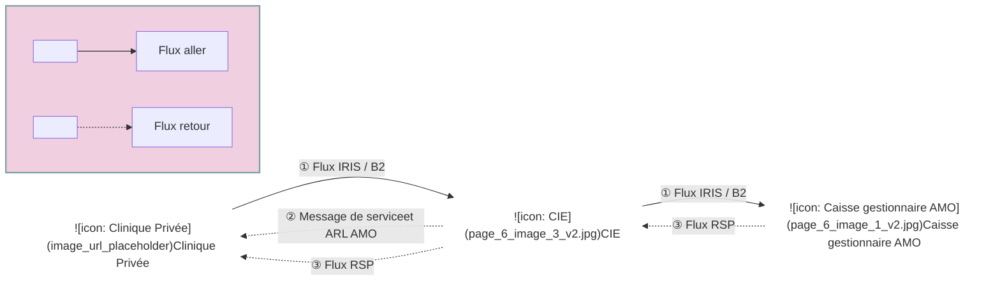
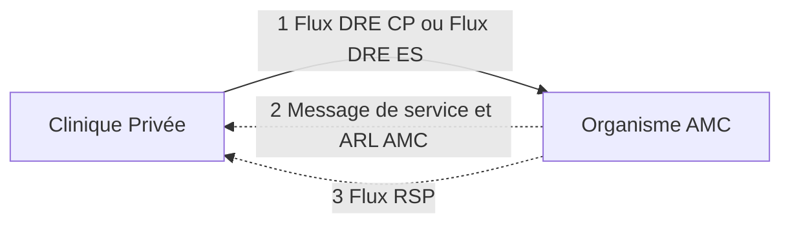
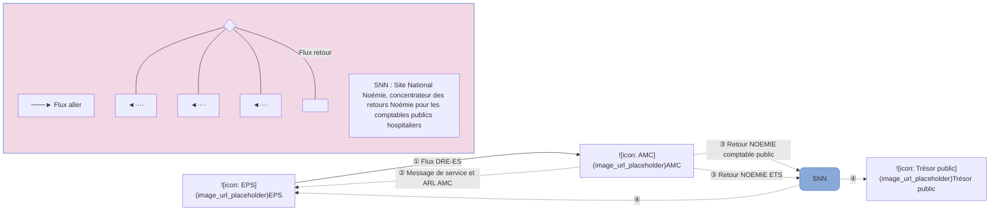
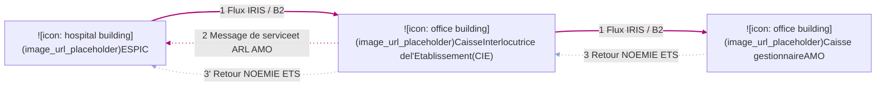
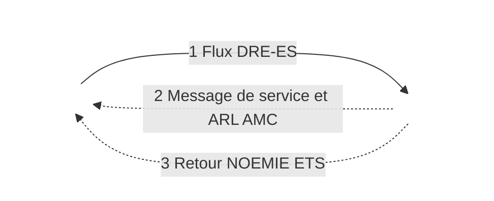
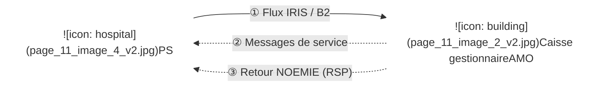
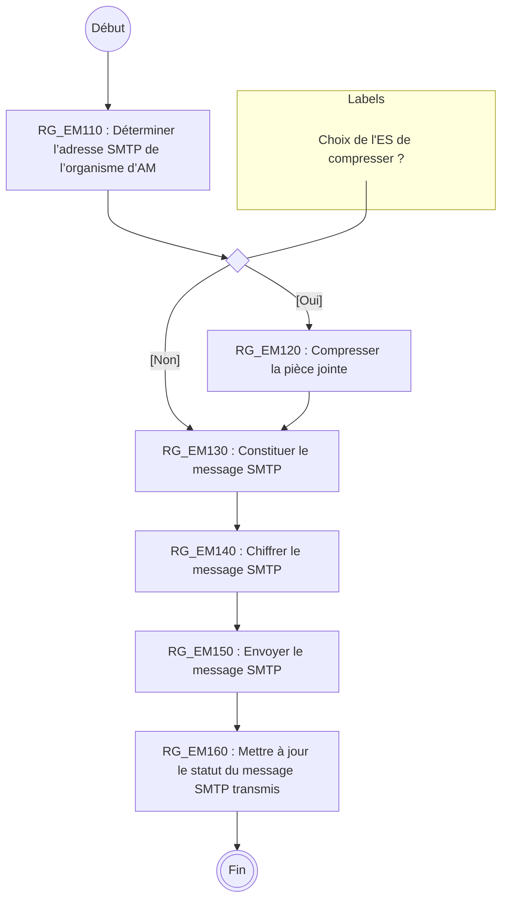
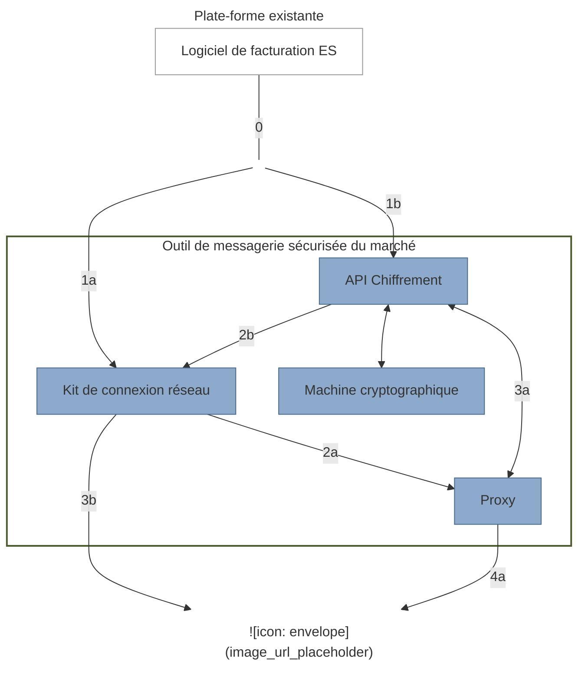

```mermaid
graph TD
    Start(( )) --> Step1(RG_PR600 : Déterminer le type de message SMTP)
    Step1 --> Step2(PR30 : Prendre en compte les messages de service)
    Step2 --> End((( )))

    subgraph Labels
        direction TB
        L1[Début]
        L2[Fin]
    end

    style Start fill:#000,stroke:#000
    style End fill:#000,stroke:#000
    style Step1 fill:#f2e3cc,stroke:#000,stroke-width:1px
    style Step2 fill:#f2e3cc,stroke:#000,stroke-width:1px
    
    linkStyle 0,1,2 stroke:#000,stroke-width:1px;
```

**Projet Etablissements et autres PS**
**SPECIFICATIONS TECHNIQUES**

# Transport des flux de facturation par messagerie SMTP et chiffrement de transport

Référence : ETS-DT-001 / Version : 01.52.00 / Date : 27/05/2025
Sécurité : RESTREINTE / État : REFERENCE

**GIE SESAM-Vitale**
5, boulevard Marie et Alexandre Oyon – 72 019 LE MANS Cedex 2
<u>www.sesam-vitale.fr</u>

ETS-DT-001 Transport des flux de facturation par messagerie SMTP et chiffrement de transport Version : 01.52.00

Ce document a été élaboré par le GIE SESAM-Vitale.

Conformément à l’article L.122-4 du Code de la Propriété Intellectuelle, toute représentation ou reproduction (intégrale ou partielle) du présent ouvrage, quel que soit le support utilisé, doit être soumise à l’accord préalable écrit de son auteur.

Il en est de même pour sa traduction, sa transformation, son adaptation ou son arrangement, quel que soit le procédé utilisé.

**Tout manquement à ces obligations constituerait un délit de contrefaçon, au sens **des articles L 335-2 et suivants du code de la propriété intellectuelle, susceptible** d’entraîner des sanctions pour l’auteur du délit.**

27/05/2025 GIE SESAM-Vitale 
 2 / 62
Ce document à diffusion restreinte ne peut être diffusé sans l'autorisation d'une personne habilitée au GIE SESAM-Vitale

ETS-DT-001
Transport des flux de facturation par messagerie SMTP et chiffrement de transport
Version : 01.52.00

<table>
    <caption>**SOMMAIRE**</caption>
        <tr>
            <td><strong>1</strong></td>
            <td><strong>PRÉSENTATION ........................................................................................................................................5</strong></td>
            <td><strong>5</strong></td>
        </tr>
        <tr>
            <td>1.1</td>
            <td>OBJET DU DOCUMENT..........................................................................................................................5</td>
            <td>5</td>
        </tr>
        <tr>
            <td>1.2</td>
            <td>SUPPORT TECHNIQUE..........................................................................................................................6</td>
            <td>6</td>
        </tr>
        <tr>
            <td>1.3</td>
            <td>ARCHITECTURE GLOBALE DU SYSTÈME DE TÉLÉTRANSMISSION ..............................................................6</td>
            <td>6</td>
        </tr>
        <tr>
            <td><strong>2</strong></td>
            <td><strong>PRÉ-REQUIS TECHNIQUES ...................................................................................................................12</strong></td>
            <td><strong>12</strong></td>
        </tr>
        <tr>
            <td>2.1</td>
            <td>INTRODUCTION..................................................................................................................................12</td>
            <td>12</td>
        </tr>
        <tr>
            <td>2.2</td>
            <td>CONFORMITÉS AUX STANDARDS INTERNET .........................................................................................12</td>
            <td>12</td>
        </tr>
        <tr>
            <td>2.3</td>
            <td>RÉSEAU DE TÉLÉTRANSMISSION DE DONNÉES.....................................................................................12</td>
            <td>12</td>
        </tr>
        <tr>
            <td>2.4</td>
            <td>TRANSMISSION VIA UN CONCENTRATEUR DE FLUX ...............................................................................12</td>
            <td>12</td>
        </tr>
        <tr>
            <td>2.5</td>
            <td>CONTRAINTES SPÉCIFIQUES AUX ES ..................................................................................................12</td>
            <td>12</td>
        </tr>
        <tr>
            <td><strong>3</strong></td>
            <td><strong>PRINCIPE DE GESTION DES BOITES AUX LETTRES.........................................................................13</strong></td>
            <td><strong>13</strong></td>
        </tr>
        <tr>
            <td>3.1</td>
            <td>CADRE GLOBAL DU TRAITEMENT DES MESSAGES SMTP ......................................................................13</td>
            <td>13</td>
        </tr>
        <tr>
            <td>3.2</td>
            <td>GESTION DE LA CONNEXION RÉSEAU ET DES MESSAGES SMTP REÇUS ................................................13</td>
            <td>13</td>
        </tr>
        <tr>
            <td>3.3</td>
            <td>GESTION DES AVIS DE NON REMISE ET DES MESSAGES DE SERVICE......................................................14</td>
            <td>14</td>
        </tr>
        <tr>
            <td><strong>4</strong></td>
            <td><strong>DESCRIPTION DES FLUX DE FACTURATION VERS L’AM.................................................................14</strong></td>
            <td><strong>14</strong></td>
        </tr>
        <tr>
            <td>4.1</td>
            <td>RÈGLES GÉNÉRALES D’ÉMISSION DES FLUX VERS L’AM .......................................................................14</td>
            <td>14</td>
        </tr>
        <tr>
            <td>4.2</td>
            <td>SPÉCIFICATIONS DÉTAILLÉES DE EM - EMISSION DES MESSAGES DE FLUX DE FACTURATIONS ...............20</td>
            <td>20</td>
        </tr>
        <tr>
            <td><strong>5</strong></td>
            <td><strong>DESCRIPTION DES FLUX RETOURS DES AM .....................................................................................22</strong></td>
            <td><strong>22</strong></td>
        </tr>
        <tr>
            <td>5.1</td>
            <td>LES DIFFÉRENTS TYPES DE RETOURS DES AM ....................................................................................22</td>
            <td>22</td>
        </tr>
        <tr>
            <td>5.2</td>
            <td>SPÉCIFICATIONS DÉTAILLÉES DE TRAITEMENT DES FLUX RETOUR «PR – PRENDRE EN COMPTE LES<br />RETOURS ».......................................................................................................................................30</td>
            <td>30</td>
        </tr>
        <tr>
            <td><strong>6</strong></td>
            <td><strong>DESCRIPTION DU CHIFFREMENT ........................................................................................................37</strong></td>
            <td><strong>37</strong></td>
        </tr>
        <tr>
            <td>6.1</td>
            <td>CHOIX D’UNE MESSAGERIE SÉCURISÉE ...............................................................................................37</td>
            <td>37</td>
        </tr>
        <tr>
            <td>6.2</td>
            <td>CHIFFREMENT DE TRANSPORT ...........................................................................................................39</td>
            <td>39</td>
        </tr>
        <tr>
            <td>6.3</td>
            <td>OFFRE DE TEST.................................................................................................................................41</td>
            <td>41</td>
        </tr>
        <tr>
            <td><strong>7</strong></td>
            <td><strong>LEXIQUE ..................................................................................................................................................43</strong></td>
            <td><strong>43</strong></td>
        </tr>
        <tr>
            <td><strong>8</strong></td>
            <td><strong>RÉFÉRENCES..........................................................................................................................................46</strong></td>
            <td><strong>46</strong></td>
        </tr>
        <tr>
            <td>8.1</td>
            <td>DOCUMENTATION ..............................................................................................................................46</td>
            <td>46</td>
        </tr>
        <tr>
            <td>8.2</td>
            <td>NORMES...........................................................................................................................................46</td>
            <td>46</td>
        </tr>
        <tr>
            <td>8.3</td>
            <td>DÉCRETS ET CIRCULAIRES MINISTÉRIELLES ........................................................................................46</td>
            <td>46</td>
        </tr>
</table>

27/05/2025
GIE SESAM-Vitale


3 / 62
Ce document à diffusion restreinte ne peut être diffusé sans l'autorisation d'une personne habilitée au GIE SESAM-Vitale

ETS-DT-001
Transport des flux de facturation par messagerie SMTP et chiffrement de transport
Version : 01.52.00

## **TABLE DES ILLUSTRATIONS**

<table>
    <tr>
      <td>FIGURE 1 : CIRCUIT DES FLUX AMO EN CLINIQUE PRIVÉE .......................................................................................</td>
      <td>6</td>
    </tr>
    <tr>
      <td>FIGURE 2 : CIRCUIT DES FLUX AMC EN CLINIQUE PRIVÉE .......................................................................................</td>
      <td>7</td>
    </tr>
    <tr>
      <td>FIGURE 3 : CIRCUIT DES FLUX AMO EN ÉTABLISSEMENT PUBLIC DE SANTÉ (EPS)...................................................</td>
      <td>8</td>
    </tr>
    <tr>
      <td>FIGURE 4 : CIRCUIT DES FLUX AMC EN ÉTABLISSEMENT PUBLIC DE SANTÉ (EPS) ...................................................</td>
      <td>9</td>
    </tr>
    <tr>
      <td>FIGURE 5 : CIRCUIT DES FLUX AMO EN ÉTABLISSEMENT ESPIC............................................................................</td>
      <td>10</td>
    </tr>
    <tr>
      <td>FIGURE 6 : CIRCUIT DES FLUX AMC EN ÉTABLISSEMENT DU B°, C°)........................................................................</td>
      <td>10</td>
    </tr>
    <tr>
      <td>FIGURE 7 : CIRCUIT DES FLUX POUR LES AUTRES PS ............................................................................................</td>
      <td>11</td>
    </tr>
</table>

## **TABLE DES ANNEXES**

<table>
    <tr>
      <td><strong><b>ANNEXE 1</b><br />AM</strong></td>
      <td></td>
      <td><strong><b>LISTE DES CODES REJETS DES MESSAGES DE SERVICE GÉNÉRÉS PAR LES</b><br />48</strong></td>
    </tr>
    <tr>
      <td><strong><b>ANNEXE 2</b></strong></td>
      <td></td>
      <td><strong><b>DESCRIPTION DU FICHIER DIAGNOSTIC DES MESSAGES DE SERVICE .............51</b></strong></td>
    </tr>
    <tr>
      <td><strong><b>ANNEXE 3</b></strong></td>
      <td></td>
      <td><strong><b>STRUCTURE DES MESSAGES SMTP .........................................................................53</b></strong></td>
    </tr>
    <tr>
      <td></td>
      <td><i>A3-1</i></td>
      <td><i>Structure des messages SMTP des flux vers l’AM .........................................................53</i></td>
    </tr>
    <tr>
      <td></td>
      <td><i>A3-2</i></td>
      <td><i>Structure du message SMTP contenant des messages de service ...............................55</i></td>
    </tr>
    <tr>
      <td></td>
      <td><i>A3-3</i></td>
      <td><i>Structure du message SMTP contenant des ARL ..........................................................58</i></td>
    </tr>
    <tr>
      <td></td>
      <td><i>A3-4</i></td>
      <td><i>Structure du message SMTP contenant des RSP..........................................................60</i></td>
    </tr>
</table>

27/05/2025
GIE SESAM-Vitale

4 / 62

Ce document à diffusion restreinte ne peut être diffusé sans l'autorisation d'une personne habilitée au GIE SESAM-Vitale

ETS-DT-001 Transport des flux de facturation par messagerie SMTP et chiffrement de transport Version : 01.52.00

# 1 **PRÉSENTATION**

## 1.1 **Objet du document**

Ce document est commun à tous les établissements de Santé.

Ce document s’adresse aux éditeurs qui souhaitent implémenter les échanges basés sur la messagerie SMTP entre les partenaires de santé et les caisses d’assurance maladie (AMO et/ou AMC).

Dans ce document, le terme « Établissements de Santé » (ES) désigne les établissements définis aux a°), b°), c°), d°) du L162-22-6 du code de la sécurité sociale désignés également sous la terminologie suivante :

*   Les établissements ex - OQN ou sous OQN :
    *   ○ les établissements du d°),
*   Les établissements ex DG ou sous DAF :
    *   ○ les établissements du a°) : hôpitaux publics,
    *   ○ les établissements du b°), c°) : ESPIC¹.

Dans le cadre des échanges avec les organismes d’assurances maladie complémentaires, ce document précise certaines spécificités liées aux périmètres de :

*   la DRE-CP utilisée par les établissements du d°) de l’article L162-22-6, et qui sont en dehors du dispositif ROC Établissements. Ces établissements sont appelés CP hors ROC.
*   la DRE-ES utilisée par les établissements du a°), b°), c°), d°) de l’article L162-22-6. Les établissements du d) dans le dispositif ROC Établissements qui émettent des factures en norme DRE-ES sont appelés CP ROC.

Dans ce document, **le termes autres PS** » sera utilisé pour les autres Professionnels de Santé qui regroupent (uniquement pour les flux à destination des AMO) :

*   les établissements médico-sociaux relevant du code de l’action sociale et des familles, adressant des factures à l’assurance maladie obligatoire,
*   les transporteurs : transporteurs sanitaires et sociétés de taxis conventionnés.

Pour faciliter la lecture de ce document, le terme « Partenaire de santé » sera utilisé pour désigner à la fois l’ensemble des Établissements de Santé et les « Autres PS ».


Ce document ne spécifie que la partie transmission des factures d’un partenaire de santé mise à disposition par une solution de création d’un fichier logique de facturation. Chacun des acteurs ayant sa propre documentation de mise en œuvre (éditeurs de solution de transport SMTP et de chiffrement, et éditeurs de facturation).


Ce document intègre les spécifications du chiffrement et du transport des flux de facturation contenant la <u>part</u> <u>complémentaire</u> à destination des organismes complémentaires, indépendamment des flux à destination de la caisse AMO (Flux DRE CP et DRE ES). Le chiffrement et le transport de ces flux reposent sur les mêmes mécanismes.


Les catégories de PS intégrées au système SESAM-Vitale ne sont pas concernées par ce document, car elles produisent des flux SESAM-Vitale chiffrés selon les règles du CdC SESAM-Vitale.

¹ Dans le cadre des spécifications du corpus documentaire ROC Établissements (Remboursement des Organismes Complémentaires) le terme PNL (établissements Privés Non Lucratifs) est utilisé.

27/05/2025 GIE SESAM-Vitale  5 / 62

Ce document à diffusion restreinte ne peut être diffusé sans l'autorisation d'une personne habilitée au GIE SESAM-Vitale

ETS-DT-001 Transport des flux de facturation par messagerie SMTP et chiffrement de transport Version : 01.52.00

# **1.2 Support technique**

Le GIE SESAM-Vitale assure le support technique de ce document. Les lecteurs sont invités à adresser leurs commentaires ou leurs questions à :

**Courrier :** GIE SESAM-Vitale
(Support Cahier des charges)
5 Boulevard Marie et Alexandre Oyon
72019 Le Mans Cedex 2

**Téléphone :** 02 43 57 42 88
**Télécopie :** 02 43 57 45 42
**E-mail :** centre-de-service@sesam-vitale.fr

# **1.3 Architecture globale du système de télétransmission**

Les partenaires de santé, transmettent des flux vers les régimes Assurances Maladie, Obligatoires (AMO) ou Complémentaires (AMC). Ces flux contiennent des factures conséquentes aux actes médicaux réalisés. Ces factures doivent être transmises à l’Assurance Maladie selon les modalités techniques décrites dans ce document.

 Les partenaires de santé doivent chiffrer les flux de facturation selon le standard S/MIME pour respecter la confidentialité des données figurant dans ces factures. Par contre, les flux retour ne sont pas chiffrés.

## **1.3.1 Circuit des flux en établissements privés du d°) du L162-22-6 (« Cliniques Privées »)**

### **1.3.1.1 Circuit des flux AMO en établissements privés du d°) (« Cliniques Privées »)**



|                                  |                 |
| :------------------------------- | :-------------- |
|        | **Flux aller**  |
|  | **Flux retour** |

**Figure 1 : Circuit des flux AMO en Clinique Privée**

Afin de conserver le principe d’un interlocuteur unique pour chaque Clinique Privée celle ci **adresse les flux AMO** à un seul destinataire, la **Caisse Interlocutrice des Établissements**, qui se charge de router les flux vers les caisses gestionnaires concernées et de concentrer les flux retours.

**Adressage des **retours en** cliniques privées**

Les messages de service, les ARL et les flux RSP sont adressés directement à la Clinique Privée par la Caisse Interlocutrice des Établissements (CIE) pour les flux d’un organisme AMO.

27/05/2025 GIE SESAM-Vitale 
 6 / 62
Ce document à diffusion restreinte ne peut être diffusé sans l'autorisation d'une personne habilitée au GIE SESAM-Vitale

ETS-DT-001
Transport des flux de facturation par messagerie SMTP et chiffrement de transport
Version : 01.52.00

## **1.3.1.2** **Circuit des flux AMC en établissements privés du d°) (« Cliniques Privées »)**


**Clinique Privée**


**Organisme AMC**



| Légende                | Description |
| :--------------------- | :---------- |
| $\longrightarrow$      | Flux aller  |
| $\dashleftarrow \dots$ | Flux retour |

**Figure 2 : Circuit des flux AMC en Clinique Privée**

La Clinique Privée adresse **ses flux AMC** directement aux organismes AMC destinataires.

Dans le cadre des échanges avec les organismes d’assurances maladie complémentaires, les DRE précisées dans le schéma ci-dessus sont liées aux périmètres de :

*   la DRE-CP utilisée par les établissements du d°) de l’article L162-22-6, et qui sont en dehors du dispositif ROC Établissements. Ces établissements sont appelés CP hors ROC.
*   la DRE ES utilisée par les établissements du d) dans le dispositif ROC Établissements qui émettent des factures en norme DRE-ES sont appelés les CP-ROC.

**Adressage des**
**retours en**
**cliniques privées**

Les messages de service, les ARL et les flux RSP sont adressés directement à la Clinique Privée par l’organisme complémentaire pour les flux d’un organisme AMC.

27/05/2025
GIE SESAM-Vitale


7 / 62
Ce document à diffusion restreinte ne peut être diffusé sans l'autorisation d'une personne habilitée au GIE SESAM-Vitale

ETS-DT-001
Transport des flux de facturation par messagerie SMTP et chiffrement de transport
Version : 01.52.00

## **1.3.2** **Circuit des flux en établissements du a°) (établissements publics de santé)**

### **1.3.2.1** **Circuit des flux AMO en établissements publics de santé**

### Circuit des flux AMO en Etablissement Public de Santé

```mermaid
graph TD
    subgraph " "
        TP[Trésor public]
        SNN[SNN]
        EPS[EPS]
        CIE[Caisse Interlocutrice de l'Etablissement (CIE)]
        CGA[Caisse gestionnaire AMO]
    end

    %% Flows from EPS to CIE
    EPS -- "1 Flux IRIS / B2" --> CIE
    CIE -- "2 Message de service et ARL AMO" --> EPS

    %% Flows from CIE to CGA
    CIE -- "1 Flux IRIS / B2" --> CGA

    %% Flows from CGA to CIE
    CGA -- "3 Retour NOEMIE comptable public" --> CIE
    CGA -- "3 Retour NOEMIE ETS" --> CIE

    %% Flows from CIE to SNN
    CIE -- "4" --> SNN
    CIE -- "4" --> SNN

    %% Flows from SNN to TP and EPS
    SNN -- "5" --> TP
    SNN -- "5" --> EPS

    %% Styling for arrows (conceptual representation of colors/styles)
    %% 1: Solid Purple
    %% 2: Dotted Purple
    %% 3: Dotted Green / Dotted Blue
    %% 4: Dotted Green / Dotted Blue
    %% 5: Dotted Green / Dotted Blue
```

| Legend                                                                                                                                                                                                  | Description                                                                                               |
| :------------------------------------------------------------------------------------------------------------------------------------------------------------------------------------------------------ | :-------------------------------------------------------------------------------------------------------- |
| $\longrightarrow$ Flux aller                                                                                                                                                                            | **SNN : Site National Noémie, concentrateur des retours Noémie pour les comptables publics hospitaliers** |
| $\left. \begin{array}{l} \color{blue}{\blacktriangleleft \dots \dots} \ \color{green}{\blacktriangleleft \dots \dots} \ \color{purple}{\blacktriangleleft \dots \dots} \end{array} \right}$ Flux retour |                                                                                                           |

**Figure 3 : Circuit des flux AMO en Établissement Public de Santé (EPS)**

**Adressage des**
**retours AMO en**
**EPS**

Les messages de service, les ARL et les flux RSP sont adressés à l’Établissement par la Caisse Interlocutrice des Établissements (CIE).

Le Site National NOEMIE (SNN) :

*   reçoit de la CIE les retours RSP à l’attention de l’EPS et du comptable public TPG,
*   met à disposition de l’EPS et du comptable du TPG, les flux RSP.

 L’Établissement Public de Santé doit pour cela avoir transmis au SNN par le biais des fiches contacts, l’adresse de messagerie sur laquelle il désire recevoir les retours RSP le concernant. Les fiches contacts doivent être transmises au SNN avec l’indication des FINESS juridiques et géographiques et du numéro de mandataire de l’EPS.

27/05/2025 GIE SESAM-Vitale 
  8 / 62
Ce document à diffusion restreinte ne peut être diffusé sans l'autorisation d'une personne habilitée au GIE SESAM-Vitale

ETS-DT-001 Transport des flux de facturation par messagerie SMTP et chiffrement de transport Version : 01.52.00

## **1.3.2.2** **Circuit des flux AMC en établissements publics de santé**

### Circuit des flux AMC en Etablissement Public de Santé



**Légende :**
*   $\color{#B00068}{\text{───►}}$ **Flux aller**
*   $\left. \begin{array}{l} \color{#89A9D9}{\text{◄····}} \\ \color{#76B82D}{\text{◄····}} \\ \color{#B00068}{\text{◄····}} \end{array} \right\}$ **Flux retour**

**SNN :** Site National Noémie, concentrateur des retours Noémie pour les comptables publics hospitaliers

**Figure 4 : Circuit des flux AMC en Établissement Public de Santé (EPS)**

---
**Adressage des**
**retours AMC en**
**EPS**

Les messages de service, les ARL et les flux RSP sont adressés à l’Établissement par l’AMC.

Le Site National NOEMIE (SNN) :

*   reçoit les retours RSP constitués par l’AMC de l’assuré à l’attention de l’EPS et du comptable public TPG,
*   met à disposition de l’EPS et du TPG, les flux RSP émis par l’AMC.

27/05/2025 GIE SESAM-Vitale 
  9 / 62
Ce document à diffusion restreinte ne peut être diffusé sans l'autorisation d'une personne habilitée au GIE SESAM-Vitale

ETS-DT-001
Transport des flux de facturation par messagerie SMTP et chiffrement de transport
Version : 01.52.00

## **1.3.3** **Circuit des flux en établissements du b°), c°) (ESPIC)**

### **1.3.3.1** **Circuit des flux AMO en établissements du b°, c°)**

### Circuit des flux AMO en Etablissement PNL



| Legend                                                                       | Description |
| :--------------------------------------------------------------------------- | :---------- |
| $\longrightarrow$                                                            | Flux aller  |
| $\begin{cases} \dashleftarrow \ \dashleftarrow \ \dashleftarrow \end{cases}$ | Flux retour |

**Figure 5 : Circuit des flux AMO en établissement ESPIC**

**Adressage des **retours AMO en** ESPIC**

Les messages de service, les ARL et les flux RSP sont adressés à l’Etablissement par la Caisse Interlocutrice des Etablissements (CIE).

### **1.3.3.2** **Circuit des flux AMC en établissements du b°, c°)**

# Circuit des flux AMC en Etablissement PNL


**Etablissement PNL**


**AMC**



**Légende**
| Symbole                                                                                        | Signification |
| :--------------------------------------------------------------------------------------------- | :------------ |
| $\longrightarrow$                                                                              | Flux aller    |
| $\left. \begin{array}{l} \dashleftarrow \ \dashleftarrow \ \dashleftarrow \end{array} \right}$ | Flux retour   |

**Figure 6 : Circuit des flux AMC en établissement du b°, c°)**

27/05/2025 GIE SESAM-Vitale  10 / 62

Ce document à diffusion restreinte ne peut être diffusé sans l'autorisation d'une personne habilitée au GIE SESAM-Vitale

ETS-DT-001
Transport des flux de facturation par messagerie SMTP et chiffrement de transport
Version : 01.52.00

**Adressage des **retours AMC en** ESPIC**

Les messages de service, les ARL et les flux RSP sont adressés à l’Établissement par l’AMC.

## 1.3.4 **Circuits des flux AMO pour les « autres PS »**

### 1.3.4 Circuits des flux AMO pour les « autres PS »



| Légende           |             |
| :---------------- | :---------- |
| $\longrightarrow$ | Flux aller  |
| $\dashrightarrow$ | Flux retour |

**Figure 7 : Circuit des flux pour les autres PS**

**Adressage des **retours AMO** pour les autres PS**

Les messages de service et les RSP sont adressés par l’AMO.

27/05/2025
GIE SESAM-Vitale


11 / 62
Ce document à diffusion restreinte ne peut être diffusé sans l'autorisation d'une personne habilitée au GIE SESAM-Vitale

ETS-DT-001
Transport des flux de facturation par messagerie SMTP et chiffrement de transport
Version : 01.52.00

# 2 **PRÉ-REQUIS TECHNIQUES**

## 2.1 **Introduction**

Les SI des partenaires de santé établissent les factures électroniques télétransmises à l’Assurance Maladie obligatoire (flux IRIS/B2) et à l’Assurance Maladie complémentaire (flux DRE-ES ou DRE-CP).

Ces factures doivent être transmises à l’Assurance Maladie selon les modalités techniques décrites dans ce document.

## 2.2 **Conformités aux standards Internet**

Les échanges s'appuient sur les standards Internet. À ce titre, les conformités doivent être les suivantes :

<table>
  <thead>
    <tr>
      <th><b>Fonction</b></th>
      <th><b>Standard</b></th>
    </tr>
  </thead>
  <tbody>
    <tr>
      <td>Messagerie SMTP</td>
      <td>TCP/IP, ESMTP, MIME, POP3 et S/MIME</td>
    </tr>
    <tr>
      <td>● Chiffrement des messages SMTP</td>
      <td>● RFC 5751</td>
    </tr>
    <tr>
      <td>● Certificats de clé publique des organismes<br />destinataires</td>
      <td>● RFC 6818 ; RFC 5280 (X509 V3)</td>
    </tr>
    <tr>
      <td>● Mécanisme d’avis de non remise</td>
      <td>● RFC 1891, 1893 et 1894</td>
    </tr>
  </tbody>
</table>

Cette spécification technique est basée sur les travaux de l’IETF relatifs au transport par messagerie des flux EDI (cf. RFC 1767).

## 2.3 **Réseau de télétransmission de données**

La télétransmission de flux destinés à l’Assurance Maladie nécessite une connexion à un réseau de transmission basé sur les protocoles SMTP et TCP/IP.

Le partenaire de santé, s’abonne au réseau de messagerie SMTP auprès d’un fournisseur d’accès de son choix. Il acquiert un module de connexion réseau (Cf.6.1 - Choix d’une messagerie sécurisée ).

Il existe deux types de réseaux pour télétransmettre :
- les réseaux banalisés avec service de messagerie Internet,
- les réseaux sectoriels de la profession.

## 2.4 **Transmission via un concentrateur de flux**

Les partenaires de santé peuvent avoir recours à un intermédiaire, appelé « concentrateur de flux », pour transmettre leur flux à l’Assurance Maladie. Dans ce cas, les partenaires de santé ont la responsabilité de s’assurer du respect de la confidentialité de bout en bout :
- du partenaire de santé au concentrateur de flux **<u>et</u>**
- du concentrateur de flux à l’Assurance Maladie.

## 2.5 **Contraintes spécifiques aux ES**

Pour transmettre les flux IRIS/B2, les partenaires de santé doivent contacter les caisses avec lesquelles ils souhaitent télétransmettre.
- Pour les établissements du a°), b°), c°) les modalités de télétransmission sont en particulier définies :
    - par le protocole national inter partenaire du 24 juin 2006,

27/05/2025 GIE SESAM-Vitale  12 / 62

Ce document à diffusion restreinte ne peut être diffusé sans l'autorisation d'une personne habilitée au GIE SESAM-Vitale

ETS-DT-001
Transport des flux de facturation par messagerie SMTP et chiffrement de transport
Version : 01.52.00

*   ○ et par les articles R174-2-1 et suivants du code de la sécurité sociale pour les prestations des établissements entrant dans le champ de FIDES.
*   **Pour les établissements du d°) les modalités de télétransmission sont en particulier définies :**
    *   ○ par les articles Article R174-17 et suivants du code de la sécurité sociale.

Les partenaires de santé doivent également faire parvenir les pièces justificatives en parallèle aux caisses gestionnaires d’AMO sauf exception.

# 3 **PRINCIPE DE GESTION DES BOITES AUX LETTRES**

## **3.1** **Cadre global du traitement des messages SMTP**

Les fonctions concernées recouvrent :
*   la gestion de la connexion réseau et des messages reçus ;
*   la gestion des avis de non-remise et des messages de Service ;

Un avis de non-remise du message SMTP est systématiquement demandé au réseau de messagerie (RFC 1891, 1893 et 1894).

Si un fichier transmis a fait l’objet d’au moins un retour ARL pour un des lots constitutifs d’un fichier, cela signifie alors que le message SMTP a été reçu par le destinataire des flux. Ceci implique que la réception d’un retour ARL vaut réception d’un avis de remise.


Pour la catégorie « Autres PS », des messages de service peuvent être émis par les AMO. Cependant, il n’y a pas d’émission d’ARL par les AMO. Il est donc fortement recommandé pour cette catégorie de mettre en œuvre les avis de remise et de non-remise.

Dans la logique de traitement des messages SMTP contenus dans la boîte aux lettres des partenaires de santé, il convient de traiter dans l’ordre :
*   les avis de non remise, signalant **les erreurs de transmission,**
*   les messages de services indiquant **les erreurs de format** (en-tête SMTP ou structure du fichier joint);
*   **les ARL** résultant des contrôles de structure opérés par les systèmes d’accueil des flux de l’Assurance Maladie sur les lots ou les factures Électroniques contenus dans le fichier.

## **3.2** **Gestion de la connexion réseau et des messages SMTP reçus**

Les procédures liées aux ouvertures et fermetures de sessions d’accès aux réseaux de messagerie doivent respecter l’enchaînement suivant :
*   l’étape initiale démarre par la connexion et l’ouverture d’une session de travail sur le réseau de messagerie (accès à la boîte aux lettres dédiée aux flux de facturation) ;
*   la session de travail doit commencer par la sélection de tous les messages SMTP contenus dans la boîte aux lettres du partenaire de santé :
    *   ○ l'extraction des avis de non-remise et leur rapprochement avec les messages SMTP émis ;
    *   ○ l'extraction des messages de service et leur rapprochement avec les messages SMTP émis ;
    *   ○ l'extraction des ARL et leur rapprochement avec les lots précédemment émis ;
    *   ○ l’extraction des messages non dédiés aux flux de facturation (avec possibilité de paramétrer la suppression ou non de ces messages du serveur).
*   la session se poursuit par l’envoi des messages SMTP contenant les lots à émettre ;
*   fermeture de la session de travail et la déconnexion réseau ;

27/05/2025 GIE SESAM-Vitale


13 / 62
Ce document à diffusion restreinte ne peut être diffusé sans l'autorisation d'une personne habilitée au GIE SESAM-Vitale

ETS-DT-001 Transport des flux de facturation par messagerie SMTP et chiffrement de transport Version : 01.52.00


Le rapprochement des différents messages n’inclut pas la reconstitution des lots pour réémission. Cette reconstitution peut être réalisée hors connexion et les lots reconstitués seront alors réémis au cours d'une session suivante.

## **3.3** **Gestion des avis de non remise et des messages de service**

La gestion des avis de non-remise et des messages de service est étroitement liée à la gestion des ARL.

Lors de l'extraction des messages SMTP dans la BAL du partenaire de santé, le partenaire de santé peut recevoir :

* de l’opérateur de messagerie un (ou des) Avis de Non Remise indiquant qu'un message SMTP précédemment transmis n'a pas été correctement acheminé jusqu'à la BAL de l'organisme destinataire. Cet avis contient le champ sujet du message SMTP concerné ;
* de l’Assurance Maladie un message de service indiquant qu'un message SMTP précédemment transmis est incorrect, soit au niveau du format de son en-tête SMTP, soit au niveau de la structure du fichier joint ou soit au niveau du chiffrement. Ce message SMTP fait référence au champ sujet du message SMTP concerné.

Le progiciel doit gérer les Avis de Non Remise et les messages de service en liaison avec la gestion des lots de la manière suivante :

* Durant la phase d’extraction des messages SMTP reçus, le progiciel doit extraire, en plus des fichiers ARL, les Avis de Non Remise et les messages de service éventuels afin d’identifier les fichiers posant un problème.
* Lors de la phase d’envoi des fichiers de lots, le progiciel doit :
  1. lors de la première transmission d’un fichier, mémoriser l’en-tête du message SMTP et le fichier joint pour permettre le rapprochement ultérieur ;
  2. permettre de recréer un message SMTP, après analyse de l’incident, pour chaque fichier pour lequel un Avis de Non Remise ou un message de service de type « REJET_SMTP » a été reçu (rapprochement possible grâce au champ sujet de l'en-tête SMTP du message) et appliquer la cinématique du traitement des lots et des ARL.
* Si le fichier a été reçu par son destinataire (réception d’au moins un ARL pour un lot contenu dans ce fichier) alors le progiciel doit supprimer l’en-tête du message SMTP et le fichier.

# **4** **DESCRIPTION DES FLUX DE FACTURATION VERS L’AM**

Les flux entre les partenaires de santé et l’Assurance Maladie sont constitués de factures électroniques nécessaires au remboursement des soins.


Les flux de facturation sont obligatoirement chiffrés de bout en bout, qu’il s’agisse de messages réels ou de test.

## **4.1** **Règles générales d’émission des flux vers l’AM**

### **4.1.1** **Points d’attention**

L’éditeur du logiciel de chiffrement ne doit pas modifier les données contenues dans le fichier de factures constitué par l’éditeur de facturation.

Afin de permettre au logiciel de facturation de réaliser le rapprochement des retours des AMO ou des AMC qui lui sont destinés, avec le fichier de factures qu’il a initialement transmis au logiciel de chiffrement, l’éditeur du logiciel de chiffrement doit mémoriser **le** ***numéro d’identification du fichier*** logique de facturation et retransmettre ce dernier dans le message comportant ces retours à destination du logiciel de facturation. Position du **numéro d’identification du fichier** logique de factures :

27/05/2025 GIE SESAM-Vitale  14 / 62

Ce document à diffusion restreinte ne peut être diffusé sans l'autorisation d'une personne habilitée au GIE SESAM-Vitale

ETS-DT-001
Transport des flux de facturation par messagerie SMTP et chiffrement de transport
Version : 01.52.00

*   position 50-55 du type 000 des flux à destination des AMO ou des AMC.


Rappel : Le champ « In Reply To » du message retour envoyé par le frontal contient la valeur du champ « sujet » du message SMTP initialement émis par le logiciel de chiffrement. Ce champ « In Reply To » permettra de retrouver le numéro d’identification du ficher logique de facturation.

## **4.1.2** **Règles d’adressage des flux vers l’AMO pour les établissements de santé du a°), b°), c°), d°)**

Pour la transmission des flux de facturation à destination d’une AMO, l’adresse destinataire doit être structurée de la façon suivante : [XXYYY@YYY.XX.rss.fr](mailto:XXYYY@YYY.XX.rss.fr) où, XX désigne le « code grand régime » et YYY désigne le code « organisme destinataire » de la Caisse Interlocutrice de l’Etablissement de Santé.

Le regroupement des lots par l’éditeur de facturation est réalisé par numéro de partenaire de santé (notion du CDC B2) et par numéro d’organisme destinataire.

## **4.1.3** **Règles d’adressage des flux vers l’AMO pour les autres PS**

Pour la transmission des flux de facturation à destination d’une AMO, l’adresse destinataire doit être structurée de la façon suivante : [XXYYY@YYY.XX.rss.fr](mailto:XXYYY@YYY.XX.rss.fr) où :

*   XX désigne le « code grand régime » pris en position 34 et 35 du type 000 des factures et,
*   YYY désigne le code « organisme destinataire » pris en position 17-19 du type 1 des lots.

Le regroupement des lots par l’éditeur de facturation est réalisé par numéro de partenaire de santé (notion du CDC B2) et par numéro d’organisme destinataire.

## **4.1.4** **Règles d’adressages vers les AMC**

### **4.1.4.1** **Règles d’adressage des flux DRE ES**

Pour les flux DRE ES la transmission à l’AMC d’un fichier logique de facturation est réalisée à partir de l’adresse SMTP contenu en position 86 à 128 du type 999 du fichier logique de facturation à transmettre à l’AMC.

### **4.1.4.2** **Règles d’adressage des flux DRE CP**

L’éditeur doit transmettre les flux DRE CP conformément aux directives du CDC DRE-CP disponible sur le site de l’Assurance Maladie Complémentaire [(http://www.complementairesante.fr,](http://www.complementairesante.fr/) section Cliniques Privées)

## **4.1.5** **Constitution des messages SMTP contenant les fichiers de facturation**

Les règles de constitution du message SMTP sont les suivantes :

*   En cas de compression, celle-ci doit s’effectuer avant le chiffrement du fichier.
*   Un message SMTP ne doit contenir qu’un seul fichier logique.

Les étapes permettant de constituer un message SMTP au format S/MIME à partir d’un fichier sont les suivantes :

27/05/2025
GIE SESAM-Vitale


15 / 62
Ce document à diffusion restreinte ne peut être diffusé sans l'autorisation d'une personne habilitée au GIE SESAM-Vitale

ETS-DT-001
Transport des flux de facturation par messagerie SMTP et chiffrement de transport
Version : 01.52.00

```mermaid
graph TD
    F1[Fichier] -->|0. Compression| F2[Fichier]
    F2 -->|1. Encapsulation MIME| E1[Entité MIME]
    
    subgraph E1_Box [Entité MIME]
        F3[Fichier]
    end

    E1_Box -->|2. Chiffrement| CMS1[Objet CMS]

    subgraph CMS1_Box [Objet CMS]
        direction LR
        subgraph EM_Chiffree [Entité MIME chiffrée]
            F4[Fichier]
        end
        Plus1[+]
        KC1[Clé de chiffrement chiffrée]
    end

    CMS1_Box -->|3. Encapsulation S/MIME| ESM1[Entité S/MIME]

    subgraph ESM1_Box [Entité S/MIME]
        subgraph CMS2_Box [Objet CMS]
            direction LR
            subgraph EM_Chiffree2 [Entité MIME chiffrée]
                F5[Fichier]
            end
            Plus2[+]
            KC2[Clé de chiffrement chiffrée]
        end
    end

    ESM1_Box -->|4. Joindre à un message SMTP| SMTP[ ]

    style E1_Box fill:#e1eeba,stroke:#8eb021
    style CMS1_Box fill:#c5d991,stroke:#8eb021
    style ESM1_Box fill:#4d5d2c,stroke:#8eb021,color:#fff
    style CMS2_Box fill:#c5d991,stroke:#8eb021,color:#000
    style EM_Chiffree fill:#fff,stroke:#8eb021
    style EM_Chiffree2 fill:#fff,stroke:#8eb021
    style KC1 fill:#f8d7da,stroke:#dc3545
    style KC2 fill:#f8d7da,stroke:#dc3545
    style F1 fill:#dae8fc,stroke:#6c8ebf
    style F2 fill:#dae8fc,stroke:#6c8ebf
    style F3 fill:#dae8fc,stroke:#6c8ebf
    style F4 fill:#dae8fc,stroke:#6c8ebf
    style F5 fill:#dae8fc,stroke:#6c8ebf
```

<table>
  <thead>
    <tr>
      <th><b>Référence</b> <b>schéma</b></th>
      <th><b>Action</b></th>
    </tr>
  </thead>
  <tbody>
    <tr>
      <td>0</td>
      <td>Le fichier est éventuellement compressé. Dans ce cas, le champ « Content-Description » du message SMTP possède un troisième sous-champ valorisé à « Z ».</td>
    </tr>
    <tr>
      <td>1</td>
      <td>Le fichier est encapsulé dans une entité MIME. Celle-ci ne doit contenir qu’un et un seul fichier.</td>
    </tr>
    <tr>
      <td>2</td>
      <td>L’entité MIME est chiffrée conformément à la RFC 5751 ; elle doit être chiffrée une seule fois et ne doit pas être signée. L’entité MIME et la clé de chiffrement toutes deux chiffrées sont regroupées dans un objet CMS. Le message peut être chiffré vers plusieurs destinataires. Dans ce cas, il est conseillé que le 1<sup>er</sup> destinataire soit la BAL de l’Assurance Maladie.</td>
    </tr>
    <tr>
      <td>3</td>
      <td>L’objet CMS est encapsulé dans une entité S/MIME ; celle-ci peut avoir une structure « multipart » ou « single part ».</td>
    </tr>
    <tr>
      <td>4</td>
      <td>L’entité S/MIME est attachée à un message SMTP. Le message SMTP ne doit contenir qu’une et une seule entité S/MIME.</td>
    </tr>
  </tbody>
</table>

Les spécifications détaillées de l’Emission des Messages de flux de facturations (EM) sont présentées au paragraphe 4.2 - Spécifications détaillées de EM - Emission des Messages de flux de facturations.

## **4.1.6** **Description des messages SMTP contenant les fichiers de facturation**

Un avis de non-remise du message SMTP est systématiquement demandé au réseau de messagerie (RFC 1891, 1893 et 1894).

La taille des en-têtes des messages SMTP ne doit pas dépasser 16Ko, pour être acceptés par l’AMO ou l’AMC.

La structure des entêtes SMTP vers l’AM est décrite à l’A3-1- Structure des messages SMTP des flux vers l’AM.

La valorisation des champs de l’entête SMTP doit suivre les règles ci-dessous.

27/05/2025 GIE SESAM-Vitale 
  16 / 62
Ce document à diffusion restreinte ne peut être diffusé sans l'autorisation d'une personne habilitée au GIE SESAM-Vitale

ETS-DT-001
Transport des flux de facturation par messagerie SMTP et chiffrement de transport
Version : 01.52.00

## **4.1.6.1** **Déterminer les valeurs des champs de l’en-tête SMTP**

**Expéditeur**
**(« From »)**
Doit contenir l’adresse du partenaire de santé émetteur du message SMTP

**Destinataire**
**(« To »)**
L’adresse de l’AM réceptrice du message SMTP doit être renseignée suivant les directives spécifiées :
* Pour les AMO : Cf. 4.1.2 - Règles d’adressage des flux vers l’AMO.
* Pour les AMC : Cf. 4.1.4 - Règles d’adressages vers les AMC.

**Sujet du message SMTP**
**(« Subject »)²**
Le « Sujet du message SMTP » doit être valorisé suivant les tableaux ci-dessous :

<table>
  <thead>
    <tr>
      <th colspan="2"><b><b>Cas d’un fichier IRIS/B2</b></b></th>
    </tr>
    <tr>
      <th><b>Contenus</b></th>
      <th><b>Valeurs</b></th>
    </tr>
  </thead>
  <tbody>
    <tr>
      <td rowspan="1">
        <b>**Cas d’un fichier d’un établissement** **de santé du d°) (« Cliniques Privée »** **(CP) :**</b><br />
        <br />
        <b>CP</b>vvvvvv/exercice/compostage/nnnnn
      </td>
      <td>
        Le délimiteur entre chaque champ est le caractère « / »<br />
        <b>CP</b> : le message contient un flux IRIS/B2 envoyé par une Clinique Privée<br />
        Où :<br />
        ● « <b>vvvvvv</b> » = numéro de version du présent cahier des charges, « 100500 »<br />
        ● « <b>exercice</b> » = numéro émetteur du fichier transmis. Par cohérence, le champ « exercice » est identique au champ « émetteur » du type « 000 » du fichier et est donc numérique. Ce champ peut être utilisé pour le retrait sélectif des messages dans une boîte aux lettres.<br />
        ● « <b>compostage</b> » = champ obligatoire identifiant de manière unique chaque message SMTP pour un émetteur donné (format fixe de type « AAAAMMJJHHMMSSxxxxx » constitué des données suivantes : année [4N], mois [2N], jour [2N], heure [2N], minute [2N], seconde [2N], compteur [5N]).<br />
        <br />
         Remarque :Le champ compostage doit être différent des messages SMTP précédents<br />
        ● « <b>nnnnn</b> » = nombre de factures électroniques contenues dans le fichier inclus dans le message SMTP (chaîne de caractères numériques, format fixe aligné à droite). Le nombre de factures est identique entre l’en-tête SMTP et le nombre de factures du fichier logique de factures.
      </td>
    </tr>
  </tbody>
</table>

***

<sup>2</sup> En cas de dysfonctionnement lors de l’échange des messages SMTP, ce champ peut servir à retrouver les messages égarés ou sources de problèmes (traçabilité). Il est donc recommandé au partenaire de santé de le conserver et d’en permettre une restitution à l’utilisateur.

27/05/2025
GIE SESAM-Vitale


17 / 62
Ce document à diffusion restreinte ne peut être diffusé sans l'autorisation d'une personne habilitée au GIE SESAM-Vitale

ETS-DT-001 Transport des flux de facturation par messagerie SMTP et chiffrement de transport Version : 01.52.00

<table>
  <thead>
    <tr>
      <th colspan="2"><b>Cas d’un fichier IRIS/B2</b></th>
    </tr>
    <tr>
      <th><b>Contenus</b></th>
      <th><b>Valeurs</b></th>
    </tr>
  </thead>
  <tbody>
    <tr>
      <td><b><b>Cas d’un fichier d’un établissement</b> <b>de santé du a°), b°), c°) :</b></b><br /><b>FH</b>vvvvvv/exercice/compostage/nnnnn</td>
      <td>« <b>FH</b> » = le message contient un flux IRIS/B2 envoyé par établissement de santé public ou ESPIC.<br /><br />Tous les autres champs ont la même signification que ci-dessus</td>
    </tr>
    <tr>
      <td>Cas d’un fichier « <b>autres PS</b> » :<br /><br /><b>IR</b>/exercice/compostage/nnnnn</td>
      <td>« <b>IR</b> » = le message contient un flux IRIS/B2 envoyé par un « autres PS »<br /><br />Tous les autres champs ont la même signification que ci-dessus sauf le champ « <b>vvvvvv</b> » qui est inexistant pour les flux « IR »</td>
    </tr>
  </tbody>
</table>

<table>
  <thead>
    <tr>
      <th colspan="2"><b>Cas d’un fichier DRE</b></th>
    </tr>
    <tr>
      <th><b>Contenus</b></th>
      <th><b>Valeurs</b></th>
    </tr>
  </thead>
  <tbody>
    <tr>
      <td><b><b>Cas d’un fichier DRE-CP</b> :</b><br /><br />« <b>DC</b>vvvvvv /exercice/compostage/nnnnn »</td>
      <td>« <b>DC</b> » = le message contient un flux DRE-CP envoyé par une Clinique Privée.<br /><br />Tous les autres champs ont la même signification que ci-dessus.</td>
    </tr>
    <tr>
      <td><b><b>Cas d’un fichier DRE-ES :</b></b><br /><br />« <b>DO</b>vvvvvv/exercice/compostage/nnnnn »</td>
      <td>« <b>DO</b> » = le message contient un flux DRE-ES envoyé par un établissement de santé public ou ESPIC.<br /><br />Tous les autres champs ont la même signification que ci-dessus.</td>
    </tr>
  </tbody>
</table>

**Type du contenu**
**(« *Content-Type* »)**

Le champ « Type et sous-type de l’objet transporté » doit être valorisé avec « application/pkcs7-mime ».

**Description du contenu**
**(« *Content-Description* »)**

La « Nature et norme de l’objet transporté » doit être valorisée suivant les tableaux ci-dessous :

<table>
  <thead>
    <tr>
      <th colspan="3"><b>Cas d’un fichier IRIS/B2</b></th>
    </tr>
    <tr>
      <th><b><b>Type d’ES</b></b></th>
      <th><b><b>Type de fichier</b></b></th>
      <th><b>Valeurs</b></th>
    </tr>
  </thead>
  <tbody>
    <tr>
      <td rowspan="2">d°) « Clinique privée » (CP) »</td>
      <td>non compressé</td>
      <td>CP/B2</td>
    </tr>
    <tr>
      <td>compressé</td>
      <td>CP/B2/Z</td>
    </tr>
    <tr>
      <td rowspan="2">a°), b°), c°) « Établissement public<br />ou ESPIC</td>
      <td>non compressé</td>
      <td>FH/B2</td>
    </tr>
    <tr>
      <td>compressé</td>
      <td>FH/B2/Z</td>
    </tr>
    <tr>
      <td rowspan="2">Autres PS</td>
      <td>non compressé</td>
      <td>IRIS/B2</td>
    </tr>
    <tr>
      <td>compressé</td>
      <td>IRIS/B2/Z</td>
    </tr>
  </tbody>
</table>

27/05/2025 GIE SESAM-Vitale 
 18 / 62
Ce document à diffusion restreinte ne peut être diffusé sans l'autorisation d'une personne habilitée au GIE SESAM-Vitale

ETS-DT-001
Transport des flux de facturation par messagerie SMTP et chiffrement de transport
Version : 01.52.00

<table>
  <thead>
    <tr>
      <th colspan="3"><b>Cas d’un fichier DRE</b></th>
    </tr>
    <tr>
      <th><b>Type d’ES</b></th>
      <th><b>Type de fichier</b></th>
      <th><b>Valeurs</b></th>
    </tr>
  </thead>
  <tbody>
    <tr>
      <td rowspan="2">d°) « Clinique privée » (CP hors ROC) »</td>
      <td>non compressé</td>
      <td>DRECP/DRE</td>
    </tr>
    <tr>
      <td>compressé</td>
      <td>DRECP/DRE/Z</td>
    </tr>
    <tr>
      <td rowspan="2">a°), b°), c°) « Établissement public ou ESPIC<br />d°) Clinique privée » (CP ROC)</td>
      <td>non compressé</td>
      <td>DREES/DRE</td>
    </tr>
    <tr>
      <td>compressé</td>
      <td>DREES/DRE/Z</td>
    </tr>
  </tbody>
</table>

**Extension du **message SMTP** **(« Extended** SMTP »)**

« L’Identifiant du logiciel de chiffrement » doit être valorisé avec « **X-SV_CHIFFREMENT: Identifiant** » où :

*   **X-SV_CHIFFREMENT** indique que le champ « extended SMTP » fourni une chaine de caractère donnant l’identifiant du logiciel de chiffrement. Cet identifiant est fourni par le GIE SESAM-Vitale aux éditeurs à l’issue des tests conformément à la procédure décrite au §6.3.1.1

27/05/2025
GIE SESAM-Vitale

19 / 62

Ce document à diffusion restreinte ne peut être diffusé sans l'autorisation d'une personne habilitée au GIE SESAM-Vitale

ETS-DT-001
Transport des flux de facturation par messagerie SMTP et chiffrement de transport
Version : 01.52.00

## **4.2 Spécifications détaillées de EM - Emission des Messages de flux de facturations**

### **Vue générale**

***Description*** Cette fonction a pour objectif de définir les règles de constitution des messages relatives aux fichiers logique de lots de factures et de leurs transmissions aux AMO ou aux AMC.

***Entrées*** Fichier logique de facturation

***Sorties*** Message SMTP aller « Transmis »

### **Schéma**



### **Règles de gestion**

***[RG_EM110] Déterminer l’adresse SMTP de l’organisme d’AM***

Le partenaire de santé structure l’adresse électronique de l’AM conformément aux principes décris :

*   Pour les AMO : au § 4.1.2 - Règles d’adressage des flux vers l’AMO
*   Pour les AMC : au § 4.1.4 - Règles d’adressages vers les AMC

27/05/2025 GIE SESAM-Vitale  20 / 62

Ce document à diffusion restreinte ne peut être diffusé sans l'autorisation d'une personne habilitée au GIE SESAM-Vitale

ETS-DT-001 Transport des flux de facturation par messagerie SMTP et chiffrement de transport Version : 01.52.00

## ***[RG_EM120] Compresser la pièce jointe***

Pour des raisons dues au réseau Internet, la taille du fichier (compressé ou non) est limitée à 7 méga octets. Par conséquent, il est fortement conseillé aux partenaires de santé, de compresser les fichiers avant de les chiffrer et de les télétransmettre à l’organisme d’Assurance Maladie destinataire.

Un partenaire de santé, qui télétransmet des flux compressés reçoit les flux retours (ARL et RSP) également compressés.

Si les flux sont compressés, le champ « Content-Description » des messages SMTP possède un troisième sous-champ valorisé à « Z » qui indique la compression.

L’algorithme de compression utilisé est référencé dans la RFC 1952 « GZIP file format spécification version 4.3 » ou supérieur. Il est disponible dans la librairie publique ZLIB 1.1.3 ou supérieure disponible sur multiples plates-formes (cf. [http ://www.zlib.net/](http://www.zlib.net/) pour disposer des spécifications techniques et des sources pour les plates-formes les plus utilisées).

Lorsque l’entête d’un message SMTP indique un fichier compressé, et que la pièce jointe n’est pas au bon format de compression (pièce jointe au format non-compressé ou différent de celui utilisé par ZLIB 1.1.3), un message de service indiquant une anomalie de structure SMTP (code rejet 1031) est émis à destination du partenaire de santé (cf. A3-1- Structure des messages SMTP des flux vers l’AM Annexe 1).

## ***[RG_EM130] Constituer le message SMTP***

Le partenaire de santé constitue le message SMTP conformément aux principes décrits au § 4.1.6 - Description des messages SMTP contenant les fichiers de facturation.

## ***[RG_EM140] Chiffrer le message SMTP***

Afin d’assurer la confidentialité de certaines données contenues dans la facture, le chiffrement de transport est **obligatoire**. Celui-ci doit posséder les caractéristiques suivantes :

*   Le chiffrement des messages s’effectue en utilisant l’algorithme AES-128 en mode CBC (clé de session de 128 bits) ;
*   La clé de session est chiffrée avec la clé publique RSA du destinataire du message SMTP (clé publique de 2048 bits) ;
*   Les certificats sont signés par l’autorité de certification intermédiaire « AC FACTURATION », dépendant de l’AC racine « AC-SESAM-VITALE-2034 » de l’IGC OSI et sont au format X509 V3.
*   L’identifiant du logiciel de chiffrement (numéro attribué par le GIE SESAM Vitale) doit figurer dans l’entête SMTP.

Les caractéristiques du chiffrement de transport sont détaillées au paragraphe 6.2.1 - Caractéristiques du chiffrement.

## ***[RG_EM150] Envoyer le message SMTP***

Pour l’échange des factures électroniques, le partenaire de santé doit faire appel aux logiciels de gestion des protocoles de communication.

 ***Cas d’erreur***

Suite à la réception d’un avis de non remise signifiant que le message SMTP n’a pu être transmis, le partenaire de santé, renvoie à l’identique les données initialement émises dès que le réseau est à nouveau fonctionnel.

Il est recommandé que le logiciel de facturation du partenaire de santé alerte l’utilisateur en cas de réception successive de plusieurs avis de non-remise (ex. : mauvaise adresse ou problème de paramétrage).

27/05/2025 GIE SESAM-Vitale 
 21 / 62
Ce document à diffusion restreinte ne peut être diffusé sans l'autorisation d'une personne habilitée au GIE SESAM-Vitale

ETS-DT-001
Transport des flux de facturation par messagerie SMTP et chiffrement de transport
Version : 01.52.00

***[RG_EM160] Mettre à jour le statut du message SMTP transmis***

Suite à la transmission du message SMTP, le LPS doit mettre à jour le statut du message tel que :

Le système de facturation doit valoriser le statut à « Émis ».

# **5 DESCRIPTION DES FLUX RETOURS DES AM**

Pour rappel, aucun des flux retours (ARL, messages de services, RSP) n’est chiffré.


Important : les ARL n’existent que pour les établissements de santé, pas pour les « autres PS ».
Pour les « autres PS », en cas de rejet du fichier par l’AMO l’absence de flux RSP ou la réception d’un message de service rejet indique qu’il y a un problème.

## **5.1 Les différents types de retours des AM**

### **5.1.1 Messages de service (rejets de messages)**

#### **5.1.1.1 Nature des messages de service**

Les messages de service sont envoyés à tous les émetteurs de flux par l’Assurance Maladie en réponse à des erreurs détectées au niveau des entêtes SMTP ou de l’enveloppe des fichiers de facturation.

Le partenaire de santé peut recevoir :

*   Un message de service de rejet de chiffrement,
*   Un message de service de rejet de structure SMTP,
*   Un message de service de rejet de fichier suite à un contrôle de cohérence non passant.

Ces messages informent le partenaire de santé de la non-prise en compte des lots transmis et sont systématiquement accompagnés d’un fichier trace (fichier diagnostics) détaillant le motif du rejet.

Ce fichier est au format ASCII, et comporte plusieurs rubriques (identification du fichier rejeté et diagnostic d’erreur) qui permettent aux éditeurs de progiciels d’analyser l’incident avec l’aide du support du GIE SESAM-Vitale (Cf. Annexe 2 - Description du fichier diagnostic des messages de service).


Le message de service et son fichier diagnostic indiquant une erreur de fichier logique de facturation doivent être mis à disposition du logiciel qui a réalisé ce fichier logique de facturation. Le message de service 9999 doit être analysé par le logiciel de facturation et le logiciel réalisant le chiffrement.

**Liste des messages de service à traiter par le logiciel de facturation**

La liste des messages de service à traiter par le logiciel qui a réalisé le fichier logique de facturation est ci-dessous.

<table>
  <caption>Liste des messages de service à traiter par le logiciel de facturation<br />La liste des messages de service à traiter par le logiciel qui a réalisé le fichier logique de facturation est ci-dessous.</caption>
  <thead>
    <tr>
      <th><b>Code</b></th>
      <th><b>Libellé</b></th>
    </tr>
  </thead>
  <tbody>
    <tr>
      <td>2030</td>
      <td>Erreur de séquencement</td>
    </tr>
    <tr>
      <td>2040</td>
      <td>Incohérence sur le numéro AMC</td>
    </tr>
    <tr>
      <td>2110</td>
      <td>T000 : type émetteur différent de TP, TE, SI, CP, CS, OC, ou OT</td>
    </tr>
    <tr>
      <td>2111</td>
      <td>T000 : numéro d’émetteur non numérique</td>
    </tr>
    <tr>
      <td>2112</td>
      <td>T000 : numéro d’émetteur différent du champ exercice</td>
    </tr>
  </tbody>
</table>

27/05/2025 GIE SESAM-Vitale  22 / 62

Ce document à diffusion restreinte ne peut être diffusé sans l'autorisation d'une personne habilitée au GIE SESAM-Vitale

ETS-DT-001
Transport des flux de facturation par messagerie SMTP et chiffrement de transport

Version : 01.52.00

<table>
  <thead>
    <tr>
      <th><b>Code</b></th>
      <th><b>Libellé</b></th>
    </tr>
  </thead>
  <tbody>
    <tr>
      <td>2113</td>
      <td>T000 : numéro de destinataire inconnu pour ce frontal</td>
    </tr>
    <tr>
      <td>2114</td>
      <td>T000 : application différente de « TR » ou « TO » (caisse AMO) – « 98 » ou « 99 » (caisse AMC)</td>
    </tr>
    <tr>
      <td>2115</td>
      <td>T000 : identification du fichier non renseignée</td>
    </tr>
    <tr>
      <td>2116</td>
      <td>T000 : date de création du fichier pas au format date</td>
    </tr>
    <tr>
      <td>2117</td>
      <td>T000 : norme différente de IF, MK, OO, OY, PE, TA, LB, PH, FR, ER, CP, CS, CT ou ES</td>
    </tr>
    <tr>
      <td>2118</td>
      <td>T000 : version norme différente de ‘DR’ ou’B2’</td>
    </tr>
    <tr>
      <td>2119</td>
      <td>T000 : compactage différent de 0 et espace</td>
    </tr>
    <tr>
      <td>2120</td>
      <td>T000 : cryptage différent de 0 ou 1 et espace</td>
    </tr>
    <tr>
      <td>2121</td>
      <td>T000 : champ longueur différent de 128</td>
    </tr>
    <tr>
      <td>2122</td>
      <td>T000 : numéro de destinataire non numérique</td>
    </tr>
    <tr>
      <td>2123</td>
      <td>T000 : Zone Mise en Œuvre Sécurité différent de 3 espaces</td>
    </tr>
    <tr>
      <td>2124</td>
      <td>T000 : incohérence entre l’adresse destinataire et le numéro de destinataire renseigné dans le fichier</td>
    </tr>
    <tr>
      <td>2125</td>
      <td>T000 : type de destinataire inconnu</td>
    </tr>
    <tr>
      <td>2210</td>
      <td>T999 : type émetteur différent du type 000</td>
    </tr>
    <tr>
      <td>2211</td>
      <td>T999 : numéro émetteur différent du type 000</td>
    </tr>
    <tr>
      <td>2212</td>
      <td>T999 : type destinataire différent du type 000</td>
    </tr>
    <tr>
      <td>2213</td>
      <td>T999 : numéro destinataire différent du type 000</td>
    </tr>
    <tr>
      <td>2214</td>
      <td>T999 : application différente de celle du type 000</td>
    </tr>
    <tr>
      <td>2215</td>
      <td>T999 : identification du fichier différente de celle du type 000</td>
    </tr>
    <tr>
      <td>2216</td>
      <td>T999 : nombre d’enregistrements incorrect</td>
    </tr>
    <tr>
      <td>2217</td>
      <td>T999 : nombre de lots incorrect</td>
    </tr>
    <tr>
      <td>2218</td>
      <td>T999 : nombre d’enregistrement non numérique</td>
    </tr>
    <tr>
      <td>2219</td>
      <td>T999 : nombre de lots non numérique</td>
    </tr>
    <tr>
      <td>2400</td>
      <td>Caisse gestionnaire incapable de traiter les lots caisse de rattachement</td>
    </tr>
    <tr>
      <td>2402</td>
      <td>Etablissement de Santé inconnue de la table des Etablissements</td>
    </tr>
    <tr>
      <td>2403</td>
      <td>Caisse gestionnaire inconnue</td>
    </tr>
    <tr>
      <td>2404</td>
      <td>Norme incompatible avec dispositif CPU</td>
    </tr>
    <tr>
      <td>2405</td>
      <td>Version de norme Obsolète</td>
    </tr>
    <tr>
      <td>3004</td>
      <td>Date de création du lot non conforme</td>
    </tr>
    <tr>
      <td>4021</td>
      <td>Flux non signé</td>
    </tr>
    <tr>
      <td>9999</td>
      <td>Autre erreur</td>
    </tr>
  </tbody>
</table>

27/05/2025
GIE SESAM-Vitale

23 / 62

Ce document à diffusion restreinte ne peut être diffusé sans l'autorisation d'une personne habilitée au GIE SESAM-Vitale

ETS-DT-001 Transport des flux de facturation par messagerie SMTP et chiffrement de transport Version : 01.52.00

**Liste des messages de service à traiter par le logiciel de facturation**

La liste des messages de service à traiter par le logiciel qui a réalisé l’envoi en SMTP des fichiers logiques de facturation est ci-dessous

<table>
  <thead>
    <tr>
      <th><b>Code</b></th>
      <th><b>Libellés</b></th>
    </tr>
  </thead>
  <tbody>
    <tr>
      <td>1010</td>
      <td>Le fichier pièce jointe déclaré n’existe pas</td>
    </tr>
    <tr>
      <td>1020</td>
      <td>Pas de pièce jointe.</td>
    </tr>
    <tr>
      <td>1021</td>
      <td>Pièce jointe vide</td>
    </tr>
    <tr>
      <td>1030</td>
      <td>Plus d’une pièce jointe</td>
    </tr>
    <tr>
      <td>1031</td>
      <td>Mauvais format de compression de la pièce jointe</td>
    </tr>
    <tr>
      <td>1040</td>
      <td>Content- Type différent de « APPLICATION/EDI-consent »</td>
    </tr>
    <tr>
      <td>1050</td>
      <td>Content- Description inconnu ou non autorisé.</td>
    </tr>
    <tr>
      <td>1060</td>
      <td>Sujet non-conforme</td>
    </tr>
    <tr>
      <td>1061</td>
      <td>Le 1er sous-champ du champ "Subject" est différent de :<br />● Pour les flux AMO EPS et ESPIC : "<b><b>FHvvvvvv</b></b>"<br />● Pour Les flux AMO CP : "<b><b>CPvvvvvv</b></b>"<br />● Pour les flux IR : "<b>IR</b>"<br />● Pour les flux AMC CP : "<b><b>DCvvvvvv</b></b>"<br />● Pour les flux AMC ES : « <b><b>DOvvvvv</b></b> »</td>
    </tr>
    <tr>
      <td>1062</td>
      <td>2ème sous-champ du sujet absent ou de longueur différente de 14 caractères</td>
    </tr>
    <tr>
      <td>1063</td>
      <td>3ème sous-champ du sujet absent ou de longueur différente de 19 caractères</td>
    </tr>
    <tr>
      <td>1064</td>
      <td>Date et heure compostage non valides</td>
    </tr>
    <tr>
      <td>1065</td>
      <td>4ème sous-champ du sujet absent ou de longueur différente de 5 caractères</td>
    </tr>
    <tr>
      <td>1066</td>
      <td>4ème sous-champ non numérique ou incohérent</td>
    </tr>
    <tr>
      <td>1070</td>
      <td>Sujet identique (message déjà transmis)<br />Message de service transmis uniquement au service diagnostic du GIE SESAM VITALE</td>
    </tr>
    <tr>
      <td>1080</td>
      <td>Structure de l’adresse de l’expéditeur incorrecte</td>
    </tr>
    <tr>
      <td>2300</td>
      <td>Nombre de factures incorrect par rapport au sujet du message SMTP</td>
    </tr>
    <tr>
      <td>2401</td>
      <td>Flux non transmis dans la BAL de la caisse de rattachement</td>
    </tr>
    <tr>
      <td>9999</td>
      <td>Autre erreur</td>
    </tr>
  </tbody>
</table>

### 5.1.1.2 **Structure du message SMTP contenant les messages de service**

Dans les cas de rejet de chiffrement, la structure du message est la suivante :

*   Le fichier rejet est encapsulé dans une entité MIME.
*   L’entité MIME est signée conformément à la RFC 5751 ; l’entité MIME signée ainsi que le certificat de signature X509 sont regroupés dans un objet CMS.
*   L’objet CMS est encapsulé dans une entité S/MIME ; cette entité S/MIME peut avoir une structure « multipart » ou « single part ».
*   L’entité S/MIME est attachée à un message SMTP. Le message SMTP ne contient qu’une et une seule entité S/MIME.

27/05/2025 GIE SESAM-Vitale 
 24 / 62
Ce document à diffusion restreinte ne peut être diffusé sans l'autorisation d'une personne habilitée au GIE SESAM-Vitale

ETS-DT-001
Transport des flux de facturation par messagerie SMTP et chiffrement de transport
Version : 01.52.00

La structure des messages de service est présentée dans l’annexe A3-2 - Structure du message SMTP contenant des messages de service.

Les entêtes SMTP sont renseignés de la façon suivante :

La structure des entêtes SMTP contenant les messages de service émis par l’AM est décrite à l’A3-2 - Structure du message SMTP contenant des messages de service.

## **5.1.2** **Messages contenant les ARL**

### **5.1.2.1** **Nature des flux ARL**

La référence 930 NOEMIE-PS a été choisie comme format de données pour les retours ARL à destination des établissements du a°), b°), c°) et d°) <mark>(CP ROC et CP hors ROC)</mark> ~~<u>(CP dans le dispositif ROC)</u>~~.

<u>La référence 930 R est également possible pour les établissements du a°), b°), c°) et d°) (CP ROC).</u>

L’AM crée un accusé de réception logique (ARL) pour chaque lot de factures électroniques reçu :

*   L’ARL positif assure à l’établissement de santé que l’AM a bien reçu le lot et que les contrôles de structure sont corrects.
*   Un ARL négatif signifie que le lot n’a pas été transmis avec succès.

La structure des messages contenant les ARL est présentée dans l’annexe A3-3 - Structure du message SMTP contenant des ARL.


Le fichier logique NOÉMIE mis en pièce jointe des messages contenant les ARL doit être mis à disposition du LPS qui a réalisé le fichier logique de facturation.

## **5.1.3** **Messages Rejet/Signalement/Paiement (RSP)**

### **5.1.3.1** **Nature des flux RSP**

Après liquidation du lot de factures électroniques, la caisse destinataire crée un flux RSP qui est envoyé au partenaire de santé. Ce flux indique, pour chaque facture électronique traitée :

*   Soit le motif du non-traitement (indication de Rejet) ;
*   Soit les caractéristiques du traitement (Signalement) ;
*   Soit le montant remboursé après liquidation (indication de Paiement).


En cas de rejet, le SI du partenaire de santé doit être capable d’effectuer la correction nécessaire et de retransmettre une facture précédemment rejetée.

Ce document ne contient aucune spécification relative aux flux RSP. Ces spécifications sont contenues dans la norme NOEMIE-PS ou le cahier des charges ROC Établissements.

Le tableau suivant liste les références NOEMIE-PS utilisées comme format de données pour les flux retours RSP en fonction de leur émetteur et de leur destinataire :

<table>
  <thead>
    <tr>
      <th></th>
      <th>Établissement de <b>santé du d°)</b><br />CP hors ROC</th>
      <th>Établissement de <b>santé du a°), b°), c°)</b><br /><b>et du d°) (CP ROC)</b></th>
      <th><b>Autres</b><br />PS<br /><br /><sub>Exemple de</sub><br /><b>Référence</b></th>
    </tr>
  </thead>
  <tbody>
    <tr>
      <td><b>Flux AMO paiement</b></td>
      <td>576</td>
      <td>578</td>
      <td>576</td>
    </tr>
    <tr>
      <td>    Flux AMO<br />    rejet</td>
      <td>900</td>
      <td>908</td>
      <td>900</td>
    </tr>
  </tbody>
</table>

27/05/2025
GIE SESAM-Vitale


25 / 62
Ce document à diffusion restreinte ne peut être diffusé sans l'autorisation d'une personne habilitée au GIE SESAM-Vitale

ETS-DT-001
Transport des flux de facturation par messagerie SMTP et chiffrement de transport
Version : 01.52.00

<table>
  <thead>
    <tr>
      <th></th>
      <th>Établissement de <b>santé du d°)</b> <b>CP hors ROC</b></th>
      <th>Établissement de <b>santé du a°), b°), c°)</b> <b>et du d°) (CP ROC)</b></th>
      <th><b>Autres</b> PS <sub>Exemple de</sub> <b>Référence</b></th>
    </tr>
  </thead>
  <tbody>
    <tr>
      <td><b>Flux AMC paiement</b></td>
      <td>580</td>
      <td>578R</td>
      <td>S/O</td>
    </tr>
    <tr>
      <td>Flux AMC rejet</td>
      <td>580</td>
      <td>908R</td>
      <td>S/O</td>
    </tr>
  </tbody>
</table>

La structure des messages contenant les RSP est présentée dans l’annexe A3-4 - Structure du message SMTP contenant des RSP.


Le fichier logique NOÉMIE mis en pièce jointe des messages contenant les RSP doit être mis à disposition du LPS qui a réalisé fichier logique de facturation

# **5.1.3.2 Flux en provenance des AMO**

**À destination des établissements du d°)**

La caisse interlocutrice de l’établissement (CIE) verse sans liquidation préalable, un montant correspondant à un pourcentage du montant pris en charge par les régimes obligatoires, sur la base des informations portées sur le bordereau S3404 établi par la clinique au titre des seuls frais d’hospitalisation, y compris les consommations intermédiaires.

Cet acompte est traduit dans le flux **RSP de type « acompte »** envoyé par la CIE à la clinique privée.

Après liquidation du lot de factures électroniques, la CIE envoie un flux **RSP de type « solde »** (frais d’hospitalisation, consommations intermédiaires, remboursement des honoraires).

Les flux RSP sont créés dans les cas suivants :

*   En tiers payant : systématiquement,
*   Hors tiers payant : lors d’une détection d’un rejet ou d’un signalement émis par les systèmes informatiques de l’Assurance Maladie destinataire.

**À destination des établissements du a°), b°), c°)**

Après liquidation des lots de factures électroniques, la caisse gestionnaire créé des flux RSP qui sont envoyés vers la CIE.

Si l’Etablissement de santé est concerné par la facturation directe en caisse de Paiement Unique (CPU), il reçoit des flux RSP « agrégés » par la CIE.

S’il n’est pas concerné par ce type de facturation, il reçoit les flux RSP générés par les Caisses Gestionnaires (pas d’agrégation en CIE).

Le circuit de diffusion des flux RSP diffère selon la catégorie de l’Etablissement de Santé :

*   pour un b°), c°) et pour les HIA, les flux RSP sont adressés directement à l’Etablissement par la CIE,
*   pour les établissements du a°), il existe des flux RSP à l’attention des comptables publics et des flux RSP à l’attention des établissements. Ces flux RSP sont transmis au Site National NOEMIE (SNN) qui les met ensuite à disposition de l’établissement.

Les principes de génération et d’agrégation des flux retours RSP ne font pas partie du périmètre de ce document.

27/05/2025 GIE SESAM-Vitale  26 / 62

Ce document à diffusion restreinte ne peut être diffusé sans l'autorisation d'une personne habilitée au GIE SESAM-Vitale

ETS-DT-001 Transport des flux de facturation par messagerie SMTP et chiffrement de transport Version : 01.52.00

La donnée « Programme émetteur » (position 20-25) dans l’entité 000 des flux retours RSP reçus par un Etablissements de Santé peut prendre l’une des trois valeurs suivantes :

*   « CGECPT » ou blanc : les factures mentionnées dans le flux RSP ont été traitées hors du dispositif CPU
*   « CPU » : les factures mentionnées dans le flux RSP ont été traitées dans le dispositif CPU.

---

## **5.1.3.3** **Flux en provenance des AMC**


Point attention : le descriptif des fichiers logiques de RSP transmis par le SNN est spécifié dans le fichier de « *Création du fichier logique de facturation AMC et traitement des retours* » (ETS-DT-004).

**À destination des établissements **du a°), b°), c°) et** d° (CP ROC)**

La donnée « Programme émetteur » (position 20-25) dans l’entité 000 des flux retours RSP reçus par un Etablissements de Santé prend la valeur « ESRDRE » : les factures mentionnées dans le flux RSP ont été traitées dans le cadre de la DRE-ES.

Après traitement, l’AMC transmet les flux RSP au SNN pour les EPS, ou directement pour les ESPIC ou les CP dans le dispositif ROC Établissements.

**À destination des établissements **du d°) (CP hors** ROC)**

La donnée « Programme émetteur » (position 20-25) dans l’entité 000 des flux retours RSP reçus par un Établissement de Santé prend la valeur « CPRDRE » : les factures mentionnées dans le flux RSP ont été traitées dans le cadre de la DRE-CP.

Après traitement, l’AMC transmet les flux RSP à la Clinique Privée.

---

## **5.1.4** **Description du message SMTP**

Ce paragraphe présente les différentes valorisations des champs de l’entête SMTP des retours des AM (Message de service, ARL et RSP).

**Expéditeur (« *From* »)**

L’adresse de l’émetteur du message SMTP est identique à celui indiqué dans le champ destinataire du message contenant le « fichier de facturation ».

**Champ destinataire (« To »)**

L’adresse du partenaire de santé destinataire du message SMTP, identique à l’adresse contenue dans le champ expéditeur du message initialement transmis par ce partenaire de santé.


Pour les EPS et ses retours RSP : L’adresse est celle spécifiée dans la fiche contact transmise au SNN.

27/05/2025 GIE SESAM-Vitale 
 27 / 62
Ce document à diffusion restreinte ne peut être diffusé sans l'autorisation d'une personne habilitée au GIE SESAM-Vitale

ETS-DT-001
Transport des flux de facturation par messagerie SMTP et chiffrement de transport
Version : 01.52.00

---

**Sujet du message**
**(« *Subject* »)**

Le « sujet du message SMTP » est valorisé :

*   Pour les cliniques privées :
    *   « CP/exercice/compostage » pour un flux provenant de l’AMO,
    *   « DC/exercice/compostage » pour un flux provenant de l’AMC (CP hors du dispositif ROC Établissements).

*   Pour les EPS et les ESPIC (également pour les cliniques privées du dispositif ROC Établissements) :
    *   « FH/exercice/compostage » pour un flux provenant de l’AMO
    *   « DO/exercice/compostage/nnnnn » pour un flux provenant de l’AMC.

*   Pour les autres PS :
    *   « IR/exercice/compostage » pour les messages de service
    *   « SV/exercice/compostage » pour les messages contenant les RSP.

Le champ « exercice » est identique à celui contenu dans le message de facturation initialement transmis par le partenaire de santé.

---

**Identifiant**
**original (« *In Reply-To* »)**

S’il est renseigné, contient la valeur du champ « sujet » du message SMTP correspondant contenant le fichier, initialement émis par le partenaire de santé (dans ce cas, un message SMTP contenant des ARL ne se rapporte qu’à un seul message SMTP contenant un fichier).

---

**Type du contenu**
**(« *Content Type* »)**

Le type et le sous-type de l’objet transporté est valorisé avec « Application/EDI-consent ».

---

**Description du**
**contenu**
**(« *Content Description* »)**

La nature et norme de l’objet transporté est valorisée suivant le tableau ci-dessous :

<table>
  <thead>
    <tr>
      <th colspan="3"><b>Cas des flux IRIS/B2</b></th>
    </tr>
    <tr>
      <th><b>Type de</b> <b>retour</b></th>
      <th><b>Fichier</b> <b>compressé</b></th>
      <th><b>Valeurs</b></th>
    </tr>
  </thead>
  <tbody>
    <tr>
      <td>Message de Service</td>
      <td>Sans objet</td>
      <td>« SERVICE/REJET_CHIFFREMENT » = erreur de chiffrement<br />« SERVICE/REJET_SMTP » = anomalie de structure<br />« SERVICE/REJET_FICHIER » = fichier rejeté</td>
    </tr>
    <tr>
      <td rowspan="2">ARL</td>
      <td>Non</td>
      <td>« ARL/NOEMIE »</td>
    </tr>
    <tr>
      <td>Oui</td>
      <td>« ARLDRE/NOEMIE/Z »</td>
    </tr>
    <tr>
      <td rowspan="2">RSP</td>
      <td>Non</td>
      <td>« RSP/NOEMIE »</td>
    </tr>
    <tr>
      <td>Oui</td>
      <td>« RSP/NOEMIE/Z »</td>
    </tr>
  </tbody>
</table>

27/05/2025
GIE SESAM-Vitale


28 / 62
Ce document à diffusion restreinte ne peut être diffusé sans l'autorisation d'une personne habilitée au GIE SESAM-Vitale

ETS-DT-001
Transport des flux de facturation par messagerie SMTP et chiffrement de transport
Version : 01.52.00

<table>
  <thead>
    <tr>
      <th colspan="3"><b>Cas des flux DRE-CP ou DRE-ES</b></th>
    </tr>
    <tr>
      <th><b>Type de</b> <b>retour</b></th>
      <th><b>Fichier</b> <b>compressé</b></th>
      <th><b>Valeurs</b></th>
    </tr>
  </thead>
  <tbody>
    <tr>
      <td>Message de Service</td>
      <td>Sans objet</td>
      <td>« SERVICE/REJET_CHIFFREMENT » = erreur de chiffrement<br />« SERVICE/REJET_SMTP » = anomalie de structure<br />« SERVICE/REJET_FICHIER » = fichier rejeté</td>
    </tr>
    <tr>
      <td rowspan="2">ARL</td>
      <td>Non</td>
      <td>« ARLDRE/NOEMIE »</td>
    </tr>
    <tr>
      <td>Oui</td>
      <td>« ARLDRE/NOEMIE/Z »</td>
    </tr>
    <tr>
      <td rowspan="2">RSP</td>
      <td>Non</td>
      <td>RSPDRE/NOEMIE</td>
    </tr>
    <tr>
      <td>Oui</td>
      <td>RSPDRE /NOEMIE/Z</td>
    </tr>
  </tbody>
</table>

27/05/2025
GIE SESAM-Vitale


29 / 62
Ce document à diffusion restreinte ne peut être diffusé sans l'autorisation d'une personne habilitée au GIE SESAM-Vitale

ETS-DT-001 Transport des flux de facturation par messagerie SMTP et chiffrement de transport Version : 01.52.00

# **5.2 Spécifications détaillées de traitement des flux retour «PR – Prendre en compte les retours »**

## **5.2.1 Cadrage fonctionnel**

### **Vue générale**

***Description*** Cette fonction a pour objectif de définir les règles de prise en compte des messages SMTP retour en provenance du frontal.

Elle est composée des sous-fonctions suivantes :

* PR30 - Prendre en compte les messages de service ;
    ○ Sous-fonction chargée de définir les règles de prise en compte des messages de service relatives aux messages SMTP retour dont le Type de message est égal à « Message de service ».
* PR31 - Prendre en compte les ARL ;
    ○ Sous-fonction chargée de définir les règles de prise en compte des ARL relatives aux messages SMTP retour dont le Type de message est égal à « ARL ».
* PR32 - Prendre en compte les RSP ;
    ○ Sous-fonction chargée de définir les règles de prise en compte des RSP relatives aux messages SMTP retour dont le Type de message est égal à « RSP ».

Pour les sous-fonctions PR31 et PR32, le traitement des fichiers logique NOÉMIE (ARL et RSP) est réalisé par le LPS ayant effectué le fichier logique de facturation. Via les fonctions PM32 (prendre en compte les ARL) et PM33 (prendre en compte les RSP), ce traitement des fichiers logique NOÉMIE est spécifié dans les documents :

* [Traitement AMO] pour les flux retour d’une AMO ;
* [Traitement AMC] pour les flux retour d’une AMC.

***Entrées*** Message SMTP retour « Interprété»
Message de service
Fichier ARL
Fichier RSP

***Sorties*** Message de service « Traité »
ARL « Traité »
RSP « Traité »

27/05/2025 GIE SESAM-Vitale 
  30 / 62
Ce document à diffusion restreinte ne peut être diffusé sans l'autorisation d'une personne habilitée au GIE SESAM-Vitale

ETS-DT-001
Transport des flux de facturation par messagerie SMTP et chiffrement de transport
Version : 01.52.00

**Enchaînement**
**des opérations**



**Règles de**
**gestion**

### *[RG_PR600] Déterminer le type de message SMTP*

La détermination du type de message est réalisée à partir de la « nature » du champ « Content-description » de l’entête SMTP.

Le « nature » est systématiquement référencé par la valeur du 1<sup>ième</sup> sous-champ relatif au champ « Content-Description » de l’entête du message SMTP retour. La valeur du 1<sup>er</sup> caractère de ce code rejet permet de déterminer le type d’erreur rencontré tel que :

*   « Service » signifie que le message reçu est un message SMTP indiquant un retour de type message de service : Type de message = « Message de service » ;
*   « ARL » signifie que le message reçu est un message SMTP indiquant un retour de type message de service de l’AMO : Type de message = « ARL-AMO » ;
*   « ARLDRE » signifie que le message reçu est un message SMTP indiquant un retour de type message de service de l’AMC : Type de message = « ARL-AMC » ;
*   « RSP » signifie que le message reçu est un message SMTP indiquant un retour de type message de service de l’AMO : Type de message = « RSP-AMO ».
*   « RSPDRE » signifie que le message reçu est un message SMTP indiquant un retour de type message de service de l’AMC : Type de message = « RSP-AMC ».

27/05/2025 GIE SESAM-Vitale


31 / 62
Ce document à diffusion restreinte ne peut être diffusé sans l'autorisation d'une personne habilitée au GIE SESAM-Vitale

ETS-DT-001
Transport des flux de facturation par messagerie SMTP et chiffrement de transport
Version : 01.52.00

## **5.2.2** **PR30 - Prendre en compte les messages de service**

**Vue générale**

***Description*** Cette sous-fonction a pour objectif de définir les règles de prise en compte des messages de service relatives aux messages SMTP retour dont le Type de message est égal à « Message de service ».

***Entrées*** Message de service

***Sorties*** Message de service « Traité »

**Enchaînement**
**des opérations**

```mermaid
graph TD
    Start((Début)) --> PR30_01[PR30.01 - Identifier les messagesSMTP d'origine]
    PR30_01 --> PR30_02[PR30.02 - Interpréter les messagesde service]
    PR30_02 --> PR30_03[PR30.03 - Traiter les messages deservice]
    PR30_03 --> End(((Fin)))

    PR30_01 --> MS_Rapproché[Message de service[Rapproché]]
    PR30_02 --> MS_Interprété[Message de service[Interprété]]
    PR30_03 --> MS_Traité[Message de service[Traité]]

    style Start fill:#000,stroke:#000
    style End fill:#fff,stroke:#000
    style PR30_01 fill:#f5e6d3,stroke:#000
    style PR30_02 fill:#f5e6d3,stroke:#000
    style PR30_03 fill:#f5e6d3,stroke:#000
    style MS_Rapproché fill:#f0f591,stroke:#000
    style MS_Interprété fill:#f0f591,stroke:#000
    style MS_Traité fill:#f0f591,stroke:#000
```

**Figure 8 : Diagramme d’enchaînement de la sous-fonction « PR30 - Prendre en compte les messages de service »**

27/05/2025
GIE SESAM-Vitale


32 / 62
Ce document à diffusion restreinte ne peut être diffusé sans l'autorisation d'une personne habilitée au GIE SESAM-Vitale

ETS-DT-001 Transport des flux de facturation par messagerie SMTP et chiffrement de transport Version : 01.52.00

## **5.2.2.1.1** **PR30.01 - Identifier les messages SMTP d’origine**

---

**Vue générale**

    ***Description*** Cette opération a pour objectif d’identifier les messages SMTP d’origine relatifs aux messages de services.

    ***Entrées*** Message SMTP retour

    ***Sorties*** Message SMTP aller
                Fichier B2
                Message de service « Rapproché »

---

**Règles de gestion**

    ***[RG_PR601] Identifier les messages SMTP aller d’origine***

    Pour chaque message de service reçu, il est nécessaire d’identifier le message STMP aller d’origine tel que :

*   Le champ « In-Reply-to » du message SMTP retour contient le sujet du message initialement transmis par le partenaire de santé ;
*   Le Statut du fichier contenu dans le message SMTP aller d’origine doit être égal à « Émis » ou « Réémis ».

27/05/2025 GIE SESAM-Vitale  33 / 62

Ce document à diffusion restreinte ne peut être diffusé sans l'autorisation d'une personne habilitée au GIE SESAM-Vitale

ETS-DT-001 Transport des flux de facturation par messagerie SMTP et chiffrement de transport Version : 01.52.00

## **5.2.2.1.2** **PR30.02 - Interpréter les messages de service**

**Vue générale**

*Description* Cette opération a pour objectif l’interprétation des messages de service dont les messages SMTP aller d’origine ont été identifiés.

Les différents messages de service que peut recevoir le partenaire de santé sont les suivants :

* Message de service de type « Rejet de chiffrement » en réponse à des erreurs détectées au niveau du chiffrement ;
* Message de service de type « Rejet de structure SMTP » en réponse à des erreurs détectées au niveau des en-têtes SMTP ;
* Message de service de type « Rejet de fichier » en réponse à des erreurs détectées au niveau de l’enveloppe des fichiers contenant les lots de factures.


Dans le cas où les messages SMTP sont gérés par le LPS de l’éditeur de chiffrement, l’ensemble des fichiers diagnostics mis en pièce jointe des messages de service de type « Rejet de fichier » doit être mis à disposition du LPS de facturation qui a initialement réalisé le fichier logique de factures incriminé par le message de service « rejet fichier ».

Ces messages informent l’émetteur du message SMTP « aller » de la non-prise en compte des lots transmis et sont systématiquement accompagnés d’un fichier trace détaillant le motif du rejet.

***Entrées*** Message de service « Rapproché »
***Sorties*** Message de service « Interprété »

**Règles de**
**gestion**

***[RG_PR602] Déterminer le Type de message de service***

Le Type de message de service doit être valorisé avec le 2<sup>ème</sup> sous-champ du champ « Content-Description » du message SMTP retour.

Le motif du rejet est quant à lui systématiquement référencé par un code rejet présent dans le 4<sup>ième</sup> sous-champ relatif au champ « subject » de l’entête du message SMTP retour. La valeur du 1<sup>er</sup> caractère de ce code rejet permet de déterminer le type d’erreur rencontré tel que :

* 1 signifie une anomalie au niveau de la structure SMTP (Message de service de type « Rejet de structure SMTP »);
* 2 signifie une anomalie au niveau du fichier (Message de service de type « Rejet de fichier ») ;
* 3 signifie une anomalie au niveau de la date de création du lot (Message de service de type « Rejet de fichier ») ;
* 4 signifie une anomalie au niveau du chiffrement (Message de service de type « rejet de chiffrement ») .

***[RG_PR603] Interpréter les messages de service de type « Rejet de chiffrement »***

Lorsque le chiffrement du message SMTP présente une anomalie, le frontal rejette le message et transmet au partenaire de santé un message de service dont les caractéristiques sont les suivantes :

27/05/2025 GIE SESAM-Vitale 
 34 / 62
Ce document à diffusion restreinte ne peut être diffusé sans l'autorisation d'une personne habilitée au GIE SESAM-Vitale

ETS-DT-001 Transport des flux de facturation par messagerie SMTP et chiffrement de transport Version : 01.52.00

<table>
  <thead>
    <tr>
      <th>Code rejet</th>
      <th>Libellé</th>
      <th>Motif du rejet</th>
    </tr>
  </thead>
  <tbody>
    <tr>
      <td>4000</td>
      <td>Flux chiffré en<br />erreur</td>
      <td>Le certificat est indisponible, révoqué ou la date<br />de validité du certificat est dépassée.</td>
    </tr>
    <tr>
      <td>4010</td>
      <td>Flux chiffré warning</td>
      <td>Un nouveau certificat existe pour la clé publique<br />du partenaire de santé.</td>
    </tr>
    <tr>
      <td>4020</td>
      <td>Flux non chiffré</td>
      <td>Le partenaire de santé doit chiffré son message<br />SMTP selon la règle de gestion [RG_EM600].</td>
    </tr>
  </tbody>
</table>

###  ***Cas particuliers***

#### ***[CP01] : Flux chiffré erreur***

Lorsque le frontal n’arrive pas à déchiffrer le message SMTP, il rejette le message SMTP et transmet au partenaire de santé un message de service signé (avec la clé publique de l’ES) indiquant une erreur de chiffrement.

#### ***[CP02] : Flux chiffré warning***

Lorsqu’un nouveau certificat existe pour la clé publique du partenaire de santé, le frontal accepte le message SMTP et transmet au partenaire de santé un message de service signé signalant l’anomalie de chiffrement avec en pièce jointe le nouveau certificat.

### ***[RG_PR604] Interpréter les messages de service de type « Rejet de structure SMTP »***

Lorsque la structure de l’entête SMTP présente une anomalie, le frontal rejette le message SMTP et transmet au partenaire de santé un message de service dont les caractéristiques sont les suivantes :

<table>
  <thead>
    <tr>
      <th>Code rejet</th>
      <th>Libellé</th>
      <th>Motif du rejet</th>
    </tr>
  </thead>
  <tbody>
    <tr>
      <td>1040</td>
      <td>Content-Type différent de<br />« APPLICATION/EDI-<br />consent »</td>
      <td>Le champ « Content-Type » doit être<br />valorisé à « Application/EDI-<br />consent ».</td>
    </tr>
    <tr>
      <td>1050</td>
      <td>Content-Description<br />inconnu ou non autorisé</td>
      <td>Le champ « Content-Description » doit<br />être valorisé selon la règle de gestion<br />[RG_EM600].</td>
    </tr>
    <tr>
      <td>1060</td>
      <td>Sujet non-conforme</td>
      <td>Le champ « Subject » doit être valorisé<br />selon la règle de gestion [RG_EM600].</td>
    </tr>
    <tr>
      <td>1061</td>
      <td>1er sous-champ du sujet<br />inconnu ou non autorisé</td>
      <td>Le 1e sous-champ du sujet doit être<br />valorisé avec « FH100500 ».</td>
    </tr>
    <tr>
      <td>1062</td>
      <td>2e sous-champ du sujet<br />absent ou de longueur<br />différente de 14<br />caractères</td>
      <td>Le 2e sous-champ du sujet doit être<br />valorisé avec le numéro émetteur du<br />fichier transmis (cf. [00006]).</td>
    </tr>
    <tr>
      <td>1063</td>
      <td>3e sous-champ du sujet<br />absent ou de longueur<br />différente de 19<br />caractères</td>
      <td>Le 3e sous-champ du sujet doit être<br />valorisé avec un format fixe de type<br />«AAAMMJJHHMMSSxxxxx».</td>
    </tr>
    <tr>
      <td>1064</td>
      <td>Date et heure<br />compostage non valides</td>
      <td>Le format fixe du 3e sous-champ du sujet<br />doit être renseigné avec année [4N], mois<br />[2N], jour [2N], heure [2N], minute [2N],<br />seconde [2N], compteur [5N].</td>
    </tr>
    <tr>
      <td>1065</td>
      <td>4e sous-champ du sujet<br />absent ou de longueur<br />différente de 5 caractères</td>
      <td>La somme du nombre de factures doit<br />être exprimée sous la forme d’une chaîne<br />de 5 caractères numériques alignés à<br />droite.</td>
    </tr>
  </tbody>
</table>

27/05/2025 GIE SESAM-Vitale 
 35 / 62
Ce document à diffusion restreinte ne peut être diffusé sans l'autorisation d'une personne habilitée au GIE SESAM-Vitale

ETS-DT-001 Transport des flux de facturation par messagerie SMTP et chiffrement de transport Version : 01.52.00

<table>
  <thead>
    <tr>
      <th>Code rejet</th>
      <th>Libellé</th>
      <th>Motif du rejet</th>
    </tr>
  </thead>
  <tbody>
    <tr>
      <td>1066</td>
      <td>4e sous-champ non<br />numérique ou incohérent</td>
      <td>Le 4e sous-champ du sujet doit être<br />valorisé avec la somme du nombre de<br />factures (cf. [0611]) inclus dans le<br />message SMTP.</td>
    </tr>
  </tbody>
</table>

Lorsque le message SMTP présente une anomalie au niveau de la pièce jointe, le frontal rejette le message et transmet au partenaire de santé un message de service dont les caractéristiques sont les suivantes :

<table>
  <thead>
    <tr>
      <th>Code rejet</th>
      <th>Libellé</th>
      <th>Motif du rejet</th>
    </tr>
  </thead>
  <tbody>
    <tr>
      <td>1010</td>
      <td>La pièce jointe déclaré n’existe pas</td>
      <td rowspan="4">Le fichier B2 transmis par le partenaire de santé doit être encapsulé dans l’entité MIME selon la règle de gestion [RG_EM600].</td>
    </tr>
    <tr>
      <td>1020</td>
      <td>Pas de pièce jointe</td>
    </tr>
    <tr>
      <td>1021</td>
      <td>La pièce jointe est vide ou son contenu est inexploitable</td>
    </tr>
    <tr>
      <td>1030</td>
      <td>Plus d’une pièce jointe</td>
    </tr>
    <tr>
      <td>1031</td>
      <td>Mauvais format de compression de la pièce jointe</td>
      <td>L’algorithme de compression qui doit être utilisé est référencé dans la règle de gestion [RG_EM600].</td>
    </tr>
  </tbody>
</table>

 Remarque : Les règles [RG_XXX] proviennent du document TF « Transmettre les Factures ».

### ***[RG_PR605] Interpréter les messages de service de type « Rejet de fichier »***

Dans le cas où les messages SMTP sont gérés par le LPS de l’éditeur de chiffrement, les messages de service de type « Rejet de fichier » doivent être mis à disposition du LPS de l’éditeur de facturation qui a initialement réalisé le fichier logique de factures incriminé par le message de service « rejet fichier ».

Le descriptif du traitement de ces rejets de fichier est présenté dans les documents :

* [Traitement AMO] pour les flux retour d’une AMO ;
* [Traitement AMC] pour les flux retours d’une AMC.

27/05/2025 GIE SESAM-Vitale 
 36 / 62
Ce document à diffusion restreinte ne peut être diffusé sans l'autorisation d'une personne habilitée au GIE SESAM-Vitale

ETS-DT-001
Transport des flux de facturation par messagerie SMTP et chiffrement de transport
Version : 01.52.00

## **5.2.2.1.3** **PR30.03 - Traiter les messages de service « Rejet chiffrement » ou « Rejet SMTP »**

### **Vue générale**

**_Description_** Cette opération a pour objectif le traitement des messages de service envoyés par le frontal en réponse à des erreurs détectées au niveau du chiffrement ou de la structure SMTP transmis par le partenaire de santé.

**_Entrées_** Message SMTP aller
Fichier B2
Message de service « Interprété »

**_Sorties_** Message de service « Traité »

### **Règles de gestion**

**_[RG_PR606] Traiter les messages de service dont le Type de message de service est valorisé à « REJET_CHIFFREMENT » et « REJET_SMTP »_**

Dans le cas de la réception d’un message de service de type « Rejet de chiffrement » ou « Rejet de structure SMTP », le LPS doit permettre de :

*   reconstituer le message suivant les consignes décrites au § 4 - Description des flux de facturation vers l’AM,
*   modifier le statut du message SMTP d’origine tel que si le Statut du message est égal à « Émis » ou « Réémis », alors il doit être valorisé à « A réémettre » ;


Les consignes relatives à la reconstitution des messages sont décrites dans la fonction « EM - Emission des Messages de flux de facturations » au paragraphe 4.2 - Spécifications détaillées de EM - Emission des Messages de flux de facturations.

# **6** **DESCRIPTION DU CHIFFREMENT**

## **6.1** **Choix d’une messagerie sécurisée**

Le partenaire de santé doit s’équiper d’un dispositif de messagerie sécurisée permettant de chiffrer les flux contenant des données confidentielles et de les télétransmettre à l’Assurance Maladie. **Ce chiffrement de transport des flux est obligatoire.**

Quelle que soit la solution choisie, le dispositif de messagerie sécurisée est configuré pour récupérer automatiquement le certificat de la clé publique de l’Assurance Maladie (contenant la clé publique de chiffrement des messages).

Lorsqu’un certificat est périmé ou révoqué, le dispositif de messagerie en interdit l’utilisation et en récupère un nouveau qui le remplace. Cette récupération se fait :

*   par connexion à l’annuaire LDAP de l’IGC OSI, opéré par le GIE SESAM-Vitale,
*   ou à la réception du message de service de l’Assurance Maladie contenant un code rejet 4000 ou 4010 (Cf Annexe 2).

Nota : L’ensemble des partenaires de santé est destinataire des messages de service.

27/05/2025
GIE SESAM-Vitale


37 / 62
Ce document à diffusion restreinte ne peut être diffusé sans l'autorisation d'une personne habilitée au GIE SESAM-Vitale

ETS-DT-001
Transport des flux de facturation par messagerie SMTP et chiffrement de transport
Version : 01.52.00



Equipement informatique de chiffrement et télétransmission des flux IRIS

## **6.1.1** **Solution agent de messagerie SMTP (« proxy »)**

Cette solution est basée sur l’utilisation d’un « proxy » par lequel passent tous les messages issus du module de connexion réseau. Le proxy peut intercepter les messages sortants pour les chiffrer « à la volée » puis les transférer vers le destinataire réel.

<table>
  <thead>
    <tr>
      <th><b>Référence</b> <b>schéma</b></th>
      <th><b>Élément concerné</b></th>
      <th><b>Action</b></th>
    </tr>
  </thead>
  <tbody>
    <tr>
      <td>0 et 1a</td>
      <td>Le logiciel de facturation du partenaire de santé communique le fichier au module de connexion réseau</td>
      <td>Le module :<br />
        ● encapsule le fichier au format MIME<br />
        ● met en forme SMTP l’entité MIME</td>
    </tr>
    <tr>
      <td>2a et 3a</td>
      <td>Le module de connexion réseau envoie le message SMTP au proxy</td>
      <td>Le proxy :<br />
        ● le chiffre et récupère un objet CMS (3a) en utilisant l’API de chiffrement qui s’appuie sur la machine cryptographique.<br />
        ● encapsule l’objet CMS au format S/MIME.<br />
        ● met en forme SMTP l’entité S/MIME.</td>
    </tr>
    <tr>
      <td>4a</td>
      <td colspan="2">En sortie du proxy, le message SMTP au format S/MIME est envoyé à l’Assurance Maladie.</td>
    </tr>
  </tbody>
</table>

Le proxy reconnaît les messages contenant les flux (IRIS/B2 ou DRECP/DRE ou DREES/DRE) à destination d’une AM. Cette reconnaissance peut se faire par exemple sur la base de l’adresse du destinataire, du champ « Content-Description » ou par analyse du contenu du message.

Le logiciel de facturation du partenaire de santé ne gère pas directement les appels aux fonctions de chiffrement et n’est donc pas directement impacté par le chiffrement.

27/05/2025
GIE SESAM-Vitale

38 / 62

Ce document à diffusion restreinte ne peut être diffusé sans l'autorisation d'une personne habilitée au GIE SESAM-Vitale

ETS-DT-001
Transport des flux de facturation par messagerie SMTP et chiffrement de transport
Version : 01.52.00

## **6.1.2** **Solution « API de chiffrement »**

Cette solution a un impact sur le logiciel de facturation du partenaire de santé qui doit appeler une fonction spécifique pour le chiffrement du fichier.

<table>
  <thead>
    <tr>
      <th><b>Référence</b> <b>schéma</b></th>
      <th><b>Élément concerné</b></th>
      <th><b>Action</b></th>
    </tr>
  </thead>
  <tbody>
    <tr>
      <td>0 et 1b</td>
      <td>Le logiciel de facturation du partenaire de santé s’interface en direct avec l’API de chiffrement qui s’appuie sur la machine cryptographique</td>
      <td>
        ● encapsulation du fichier au format MIME<br />
        <br />
        ● chiffrement<br />
        <br />
        ● récupération d’un objet CMS par le logiciel de facturation qui le communique au module de connexion réseau
      </td>
    </tr>
    <tr>
      <td>2b</td>
      <td>Le module de connexion réseau</td>
      <td>
        ● encapsule l’objet CMS au format S/MIME<br />
        <br />
        ● met en forme SMTP l’entité S/MIME
      </td>
    </tr>
    <tr>
      <td>3b</td>
      <td colspan="2">En sortie du module de connexion réseau, le message SMTP au format S/MIME est envoyé à l’Assurance Maladie</td>
    </tr>
  </tbody>
</table>

Le module de connexion réseau doit permettre de spécifier les champs spécifiques à S/MIME (champs « Content-Type » et « Content-Disposition ») décrit plus loin.

## **6.1.3** **Autres dispositifs de messagerie**

Des outils de messagerie du marché peuvent également être utilisés. Toutefois, ils doivent obligatoirement :

* effectuer du chiffrement de transport ;
* respecter les profils SMTP définis dans ce document ;
* générer des messages SMTP au format S/MIME à partir des fichiers ;
* intégrer le certificat X509 contenant la clé publique de l’AM.

Un test d'interopérabilité de ces outils est vivement conseillé, pour vérifier la bonne mise en œuvre du chiffrement de transport auprès du GIE SESAM-Vitale.

Pour les établissements de santé du a°), b°), c°) qui utilisent des outils de messagerie, les tests de chiffrement de transport (phase 1 de la mise en œuvre de la télétransmission sécurisée) sont obligatoires (circulaire DHOS/E3/2005/578 du 27/12/2005).

# **6.2** **Chiffrement de transport**

## **6.2.1** **Caractéristiques du chiffrement**

Afin d’assurer la confidentialité de certaines données contenues dans la facture, le chiffrement de transport est obligatoire. Celui-ci doit posséder les caractéristiques suivantes :

* Le chiffrement des messages s’effectue en utilisant l’algorithme AES-128 en mode CBC (clé de session de 128 bits) ;
* La clé de session est chiffrée avec la clé publique RSA du destinataire du message SMTP (clé publique de 2048 bits) ;
* Les certificats sont signés par l’autorité de certification intermédiaire « AC FACTURATION », dépendant de l’AC racine « AC-SESAM-VITALE-2034 » de l’IGC OSI et sont au format X509 V3.

27/05/2025 GIE SESAM-Vitale 
  39 / 62
Ce document à diffusion restreinte ne peut être diffusé sans l'autorisation d'une personne habilitée au GIE SESAM-Vitale

ETS-DT-001 Transport des flux de facturation par messagerie SMTP et chiffrement de transport Version : 01.52.00

* L’identifiant du logiciel de chiffrement (numéro attribué par le GIE SESAM Vitale) doit figurer dans l’entête SMTP.

## **6.2.2** **Clé publique et certificat**

Les certificats des organismes Assurance Maladie sont disponibles dans l’annuaire LDAP du GIE SESAM-Vitale à l’adresse suivante :

ldap://annuaire.sesam-vitale.fr/cn=[xxx@yyy.zzz](mailto:xxx@yyy.zzz),ou=AC-FACTURATION,ou=AC-SESAM-VITALE-2034,o=sesam-vitale,c=fr?userCertificate;binary

où <u>xxx@yyy.zzz</u> est la boîte mail utilisée pour les envois des flux de facturation.

Les certificats sont également récupérables via l’utilisation d’un outil de recherche LDAP.

Ci-dessous, un exemple de récupération de certificat avec l’outil **ldapsearch** :

ldapsearch -s sub -x -H 'ldap://annuaire.sesam-vitale.fr:389' -b 'ou=AC-SESAM-VITALE-2034,o=sesam-vitale,c=fr' '(cn=xxx@yyy.zzz)' 'userCertificate;binary'

Une connexion à l’annuaire est nécessaire pour récupérer un nouveau certificat et l’intégrer dans l’annuaire local sur l’équipement informatique du partenaire de santé. La récupération d’un certificat est nécessaire dans les cas suivants :

* Initialement, lorsque le partenaire de santé met en place la solution de chiffrement de transport des flux,
* Lorsque le certificat est périmé : Le partenaire de santé récupère le nouveau certificat environ 15 jours avant la date de fin de validité,
* Lorsque le certificat est révoqué.


En cas de réception d’un message de service « 4010 (certificat périmé) » ou « 4000 (certificat révoqué) ». **Le certificat peut être directement récupéré du message de service reçu.**

## **6.2.3** **Liste de révocation**

La **liste de révocation** des certificats émis par l’AC FACTURATION est disponible à l’adresse suivante :

ldap://annuaire.sesam-vitale.fr/cn=AC-FACTURATION,ou=AC-FACTURATION,ou=AC-SESAM-VITALE-2034,o=sesam-vitale,c=fr?certificateRevocationList;binary

La liste de révocation est également récupérable via l’utilisation d’un outil de recherche LDAP.

Ci-dessous, un exemple de récupération de la liste de révocation avec l’outil **ldapsearch** :

ldapsearch -s sub -x -H 'ldap://annuaire.sesam-vitale.fr:389' -b 'ou=AC-SESAM-VITALE-2034,o=sesam-vitale,c=fr' '(cn=AC-FACTURATION)' 'CertificateRevocationList;binary'

## **6.2.4** **Vérification du certificat**

Le logiciel de chiffrement vérifie que le certificat n’est pas dans la liste de révocation avant de chiffrer les flux. En cas de liste de révocation non présente ou obsolète sur l’équipement informatique du partenaire de santé, la vérification du certificat peut être omise.

Par la suite, en cas de réception d’un message de service « 4010 (certificat périmé) » ou « 4000 (certificat révoqué) » le certificat peut être directement récupéré du message de service reçu.

Pour trouver un certificat d’une BAL destinataire dans l’annuaire LDAP, il suffit d’indiquer l’adresse e-mail du destinataire.

Les vérifications à effectuer par l’équipement informatique du partenaire de santé sur un certificat sont les suivantes :

27/05/2025 GIE SESAM-Vitale 
 40 / 62
Ce document à diffusion restreinte ne peut être diffusé sans l'autorisation d'une personne habilitée au GIE SESAM-Vitale

ETS-DT-001
Transport des flux de facturation par messagerie SMTP et chiffrement de transport
Version : 01.52.00

*   contrôle de parenté (chaine de confiance) du certificat <sup>3</sup>
*   date de début et de fin de validité du certificat correcte (incluant la date du jour) ;
*   certificat non révoqué (certificat non présent dans la liste de révocation des certificats) ;
*   contrôle du champ ‘Objet’ du certificat. Les champs ‘C’, ‘O’, ‘OU’ et ‘CN’ doivent contenir les valeurs suivantes :
    C=FR, O=GIE-SESAM-VITALE, OU=AC-FACTURATION, CN=adresse email du destinataire.
*   L’extension « *Subject Alternative Name* » contient l’adresse e-mail :
    *   pour les flux AMO, de la Caisse Interlocutrice du partenaire de santé du type <u>*XXYYY*</u><u>@</u><u>*YYY.XX*.rss.fr</u>
    *   Pour les flux AMC, de l’AMC destinataire du type : <u>dre.*nnnnnnnnnn.yyy.0*@domaine</u>
*   Vérification du Key Usage (extension critique). Le Key Usage doit contenir
    *   Digital Signature
    *   KeyEncipherment
    *   NonRepudiation

Chaque résultat du chiffrement constitue le document sous forme « binaire » (**pas **d’encodage base 64 bits**).**

## **6.3 Offre de test**

### **6.3.1 Procédure de mise en place**

#### **6.3.1.1 Service de test de chiffrement**

Le GIE SESAM-Vitale propose aux éditeurs de logiciels de chiffrement un service de test de chiffrement permettant de vérifier la bonne mise en œuvre du <u>chiffrement de transport des flux.</u>

Ce service permet d’effectuer des tests d’interopérabilité du logiciel de facturation avec un Système d’Information de l’Assurance Maladie.

La procédure est la suivante :

1. L’éditeur télécharge les spécifications et le cahier de tests sur l’espace Industriels du GIE SESAM-Vitale : [https://industriels.sesam-vitale.fr/group/facturation-b2](https://industriels.sesam-vitale.fr/group/facturation-b2)
2. L’éditeur fait évoluer son logiciel de facturation conformément aux spécifications.
3. L’éditeur développe les jeux de tests basés sur le cahier de tests.
4. L’éditeur contacte le Centre de Service du GIE SESAM-Vitale pour planifier le déroulement des tests via le formulaire de demande de tests, disponible également sur l’espace Industriels.
5. Le GIE SESAM-Vitale attribue un identifiant à l’éditeur et lui adresse un compte-rendu de tests.
6. L’éditeur configure son logiciel pour que l’identifiant transmis figure dans l’entête SMTP.
7. L’éditeur passe les jeux de tests avec l’assistance du GIE SESAM-Vitale.

Contact : Centre de Service du GIE SESAM-Vitale :
Téléphone : 02 43 57 42 88, du lundi au vendredi

---
<sup>3</sup> Le certificat est signé par un certificat « intermédiaire » lui-même signé par un certificat « racine ».

27/05/2025 GIE SESAM-Vitale 
  41 / 62
Ce document à diffusion restreinte ne peut être diffusé sans l'autorisation d'une personne habilitée au GIE SESAM-Vitale

ETS-DT-001 Transport des flux de facturation par messagerie SMTP et chiffrement de transport Version : 01.52.00

E-mail : [centre-de-service@sesam-vitale.fr](mailto:centre-de-service@sesam-vitale.fr)

## **6.3.1.2 Mode test**

Le mode test correspond à l’élaboration de factures électroniques de test et à leur télétransmission vers l’AM destinataire du flux.

Par conséquent, le logiciel de facturation doit prévoir un mode de configuration de test spécifique.

Le mode test peut être utilisé par le partenaire de santé, avec l’aide de son éditeur, pour tester initialement ou après un dysfonctionnement majeur, le bon fonctionnement de la solution de chiffrement de transport des flux.

## **6.3.1.3 Émission du 1<sup>er</sup> flux**


Les partenaires de santé doivent aviser la caisse destinataire avant toute émission du 1<sup>er</sup> flux, afin qu’elle effectue les opérations habituelles de suivi, de test et de qualification. La caisse destinataire surveillera la bonne réception de ce flux, et contrôlera ensuite sa bonne interprétation dans son SI.

## **6.3.2 Profil des messages de test**

Les messages SMTP de « test » diffèrent des flux « réels » uniquement par le contenu du champ « *Content-Description* » qui contient la nature et la norme de l’objet transporté. Les tableaux suivants donnent le contenu de ce champ :

### **6.3.2.1 Sans compression**

<table>
  <thead>
    <tr>
      <th rowspan="2">Partenaire de santé<br />Fichier</th>
      <th colspan="3">AMO</th>
      <th colspan="2">AMC</th>
    </tr>
    <tr>
      <th>d°)</th>
      <th>a°), b°), c°)</th>
      <th>Autres PS</th>
      <th>d°) (CP hors ROC)</th>
      <th>a°), b°), c°) et d°) (CP ROC)</th>
    </tr>
  </thead>
  <tbody>
    <tr>
      <td>Message SMTP de test contenant un “fichier ”</td>
      <td>CPTEST/<br />B2</td>
      <td>FHTEST/<br />B2</td>
      <td>IRISTEST/<br />B2</td>
      <td>DRECPTEST/<br />DRE</td>
      <td>DREESTEST/<br />DRE</td>
    </tr>
    <tr>
      <td>Message SMTP de test contenant les flux ARL</td>
      <td colspan="3">ARLTEST/NOEMIE</td>
      <td>ARLDRETEST<br />/NOEMIE</td>
      <td>ARLDRETEST/<br />NOEMIE</td>
    </tr>
    <tr>
      <td>Message SMTP de test contenant les flux RSP</td>
      <td colspan="3">RSPTEST/NOEMIE</td>
      <td>RSPDRETEST<br />/NOEMIE</td>
      <td>RSPDRETEST/<br />NOEMIE</td>
    </tr>
    <tr>
      <td>Message SMTP de test contenant les messages de services</td>
      <td colspan="5">Idem flux réel</td>
    </tr>
  </tbody>
</table>

### **6.3.2.2 Avec compression**

<table>
  <thead>
    <tr>
      <th rowspan="2">Partenaire de santé<br /><br />Fichier</th>
      <th colspan="3">AMO</th>
      <th colspan="2">AMC</th>
    </tr>
    <tr>
      <th>d°)</th>
      <th>a°), b°), c°)</th>
      <th>Autres PS</th>
      <th>d°) (CP hors ROC)</th>
      <th>a°), b°), c°) et d°) (CP ROC)</th>
    </tr>
  </thead>
  <tbody>
    <tr>
      <td>Message SMTP de test contenant un “fichier ”</td>
      <td>CPTEST/<br />B2/Z</td>
      <td>FHTEST/<br />B2/Z</td>
      <td>IRISTEST/<br />B2/Z</td>
      <td>DRECPTEST/<br />DRE/Z</td>
      <td>DREESTEST/D<br />RE/Z</td>
    </tr>
  </tbody>
</table>

27/05/2025 GIE SESAM-Vitale  42 / 62

Ce document à diffusion restreinte ne peut être diffusé sans l'autorisation d'une personne habilitée au GIE SESAM-Vitale

ETS-DT-001
Transport des flux de facturation par messagerie SMTP et chiffrement de transport
Version : 01.52.00

<table>
  <thead>
    <tr>
      <th rowspan="2"></th>
      <th colspan="3"><b>AMO</b></th>
      <th colspan="2"><b>AMC</b></th>
    </tr>
    <tr>
      <th><b><b>Partenaire de</b> santé</b><br /><b><b>Fichier</b></b></th>
      <th><b>d°)</b></th>
      <th><b>a°), b°), c°)</b></th>
      <th><b>Autres PS</b></th>
      <th><b>d°) (CP hors ROC)</b></th>
      <th><b>a°), b°), c°) <b>et d°) (CP ROC)</b></b></th>
    </tr>
  </thead>
  <tbody>
    <tr>
      <td>Message SMTP de test contenant les messages de services</td>
      <td colspan="6">Idem flux réel</td>
    </tr>
    <tr>
      <td>Message SMTP de test contenant les flux ARL</td>
      <td colspan="3">ARLTEST/NOEMIE/Z</td>
      <td>ARLDRETEST<br />/NOEMIE/Z</td>
      <td>ARLDRETEST/<br />NOEMIE/Z</td>
    </tr>
    <tr>
      <td>Message SMTP de test contenant les flux RSP</td>
      <td colspan="3">RSPTEST/NOEMIE/Z</td>
      <td>RSPDRETEST<br />/NOEMIE/Z</td>
      <td>RSPDRETEST/<br />NOEMIE/Z</td>
    </tr>
  </tbody>
</table>

# 7 **LEXIQUE**

<table>
  <thead>
    <tr>
      <th><b>Acronyme</b></th>
      <th><b>Définition</b></th>
    </tr>
  </thead>
  <tbody>
    <tr>
      <td>AES 128</td>
      <td>Algorithme de chiffrement</td>
    </tr>
    <tr>
      <td>AM</td>
      <td>Assurance Maladie. Désigne indifféremment AMO ou AMC.</td>
    </tr>
    <tr>
      <td>AMC</td>
      <td>Assurance Maladie Complémentaire. Assurance souscrite auprès d’un organisme différent des caisses d’Assurance Maladie Obligatoire (AMO), et qui rembourse à l’assuré une partie ou la totalité du ticket modérateur (parfois plus).<br /><br />La carte Vitale peut contenir des données concernant les organismes d’AMC. Les organismes d’AMC peuvent être :<br />● une mutuelle (régie par le code de la mutualité),<br />● une société ou une mutuelle d'assurance (régie par le code des assurances),<br />● une institution de prévoyance.</td>
    </tr>
    <tr>
      <td>AMO</td>
      <td>Assurance Maladie Obligatoire (également « Caisse d’Assurance Maladie », « Régime d’Assurance Maladie »). Organisme de remboursement des frais de santé</td>
    </tr>
    <tr>
      <td>ARL</td>
      <td><strong><b>Accusé de Réception Logique</b></strong>. Message électronique envoyé à l’émetteur d’un lot de factures (à la norme B2 ou DRE-CP) et qui délivre des informations sur la réception du lot correspondant. Les ARL peuvent être de deux types :<br />● « <strong>positif</strong> » qui informe que le lot correspondant est correctement reçu et sera transmis au central. L’ARL positif contient<br />○ le nombre de factures concernées,<br />○ le total des montants facturés dans le lot,<br />○ le n° du lot.<br />● « <strong>négatif</strong> » qui informe qu’une anomalie a été détectée sur le lot et qu’il ne sera pas transmis au central. Le libellé de l’ARL négatif précise le motif du rejet (indiqué par un code)</td>
    </tr>
    <tr>
      <td>Assurance Maladie</td>
      <td>Terme utilisé dans ce document pour désigner à la fois les AMO et les AMC</td>
    </tr>
    <tr>
      <td>Autres PS</td>
      <td>Terme utilisé dans ce document pour désigner à la fois :<br />● les établissements médico-sociaux relevant du code de l’action sociale et des familles et,<br />● les transporteurs (transporteurs sanitaires et sociétés de taxis conventionnés).</td>
    </tr>
  </tbody>
</table>

27/05/2025 GIE SESAM-Vitale  43 / 62

Ce document à diffusion restreinte ne peut être diffusé sans l'autorisation d'une personne habilitée au GIE SESAM-Vitale

ETS-DT-001
Transport des flux de facturation par messagerie SMTP et chiffrement de transport
Version : 01.52.00

<table>
  <thead>
    <tr>
      <th><b>Acronyme</b></th>
      <th><b>Définition</b></th>
    </tr>
  </thead>
  <tbody>
    <tr>
      <td>B2</td>
      <td>Norme informatique de construction et d’échange des factures électroniques entre les partenaires de santé et les caisses d’assurance maladie obligatoires. Tous les progiciels de santé agréés et toutes les solutions intégrées homologuées utilisent automatiquement la norme B2.</td>
    </tr>
    <tr>
      <td>BAL</td>
      <td>Boîtes Aux Lettres. Espace sur le serveur d’un fournisseur d’accès, dans lequel est stocké le courrier électronique d’un utilisateur.</td>
    </tr>
    <tr>
      <td>Caisse gestionnaire</td>
      <td>La caisse gestionnaire est la caisse de l’AMO dont relève l’assuré.</td>
    </tr>
    <tr>
      <td>Caisse pivot</td>
      <td>Définie par les articles L174-2 et L. 174-2-1 du code de la sécurité sociale</td>
    </tr>
    <tr>
      <td>CBC</td>
      <td>Cipher Block Chaining : mode de chiffrement de l’algorithme 3-DES.</td>
    </tr>
    <tr>
      <td>CCDP</td>
      <td>Caisse Centralisatrice De Paiement. La CCDP a été mise en place avant tout pour les flux AMO, dans le cadre des cliniques privées.</td>
    </tr>
    <tr>
      <td>Chiffrement</td>
      <td>Technique consistant à rendre confidentielles des données pour toute personne non autorisée.</td>
    </tr>
    <tr>
      <td>CIE</td>
      <td>Caisse Interlocutrice d’un Établissement de santé.<br /><br />Terme générique qui désigne indifféremment dans ce document la caisse centralisatrice des paiements (CCDP) dans le cadre des établissements de santé du d°) ou la Caisse de Paiement Unique (CPU ) dans le cadre des Établissements de santé du a°), b°), c°) dans FIDES ou la Caisse Pivot dans le cadre des Établissements de santé du a°), b°), c°) hors FIDES.</td>
    </tr>
    <tr>
      <td>CMS</td>
      <td>Cryptographic Message Syntax. Objet contenant un message chiffré.</td>
    </tr>
    <tr>
      <td>CP</td>
      <td>Clinique Privée</td>
    </tr>
    <tr>
      <td>CPT</td>
      <td>Dispositif de facturation dit « Caisse Pivot Technique » pour les établissements du a°), b°), c°) sur la base du protocole inter partenaire de juin 2006</td>
    </tr>
    <tr>
      <td>CPU</td>
      <td>Caisse de Paiement Unique. Voir « caisse pivot ».</td>
    </tr>
    <tr>
      <td>DRE</td>
      <td>Demande de Remboursement Electronique. Facture électronique permettant le remboursement des soins sur la part non prise en compte par l'assurance maladie obligatoire (AMO). Cette facture est transmise à un organisme d’assurance maladie complémentaire (AMC).</td>
    </tr>
    <tr>
      <td>DRE-CP</td>
      <td>Demande de Remboursement Electronique Cliniques Privées. Norme d’échange utilisée pour transmettre les flux du partenaire de santé de type Clinique Privée (hors du dispositif ROC Établissements) vers les centres informatiques AMC.</td>
    </tr>
    <tr>
      <td>DRE-ES</td>
      <td>Demande de Remboursement Electronique EPS et ESPIC. Norme d’échange utilisée pour transmettre les flux du partenaire de santé de type EPS, ESPIC ou CP (du dispositif ROC Établissements) vers les centres informatiques AMC.</td>
    </tr>
    <tr>
      <td>EDI</td>
      <td>Echange de Données Informatisées.</td>
    </tr>
    <tr>
      <td>EPS</td>
      <td>Établissements Publics de Santé.</td>
    </tr>
    <tr>
      <td>ES</td>
      <td>Établissements de Santé (en général).</td>
    </tr>
    <tr>
      <td>ESMTP</td>
      <td>Extended SMTP.</td>
    </tr>
    <tr>
      <td>ESPIC</td>
      <td>Établissements de santé privés d’intérêt collectif</td>
    </tr>
    <tr>
      <td>Establishment de santé</td>
      <td>Terme utilisé dans ce document pour désigner les établissements relevant du a°), b°), c°), d°) du L162-22-6 du code de la sécurité sociale.</td>
    </tr>
    <tr>
      <td>Fichier logique</td>
      <td>Fichier conforme :</td>
    </tr>
  </tbody>
</table>

27/05/2025 GIE SESAM-Vitale  44 / 62

Ce document à diffusion restreinte ne peut être diffusé sans l'autorisation d'une personne habilitée au GIE SESAM-Vitale

ETS-DT-001 Transport des flux de facturation par messagerie SMTP et chiffrement de transport Version : 01.52.00

<table>
  <thead>
    <tr>
      <th><b>Acronyme</b></th>
      <th><b>Définition</b></th>
    </tr>
  </thead>
  <tbody>
    <tr>
      <td></td>
      <td>à la normeB2 ou DRE (DRE CP ou DRE ES) incluant les lots de facture entre un type 000 et un type 999<br />à la norme NOEMIE PS ou DRE ROC incluant les retour RSP entre l’entité 000 et l’entité 999.</td>
    </tr>
    <tr>
      <td>GIE SESAM-Vitale</td>
      <td>Groupement d’Intérêt Economique SESAM-Vitale. Créé en 1993, il a pour missions l'étude, la réalisation, la mise en œuvre et la normalisation du programme SESAM-Vitale.</td>
    </tr>
    <tr>
      <td>IETF</td>
      <td>Internet Engineering Task Force. Groupe informel, international, ouvert à tout individu, qui participe à l'élaboration de standards pour Internet.</td>
    </tr>
    <tr>
      <td>HIA</td>
      <td>Les Hôpitaux d’Instruction des Armées.</td>
    </tr>
    <tr>
      <td>IRIS</td>
      <td>Interface Réseau Information Service. Projet national de l’Assurance Maladie fédérateur de sous-projets informatiques.</td>
    </tr>
    <tr>
      <td>IRIS/B2</td>
      <td>Norme d’échange de factures électroniques.<br />Norme d’échange utilisée pour transmettre les flux du partenaire de santé vers le centre informatique AMO.</td>
    </tr>
    <tr>
      <td>LDAP</td>
      <td>Lightweight Directory Access Protocol. Protocole permettant l'interrogation et la modification des services d'annuaire.</td>
    </tr>
    <tr>
      <td>MIME</td>
      <td>Multipurpose Internet Mail Extensions. Standard internet qui étend le format de données des courriels pour supporter des textes en différents codage de caractères autres que l'ASCII.</td>
    </tr>
    <tr>
      <td>NOÉMIE</td>
      <td>Norme Ouverte d’Echange entre la Maladie et les Intervenants Extérieurs. Norme informatique utilisée par les régimes d’Assurance Maladie Obligatoire (AMO) pour transmettre des fichiers retour vers les postes de travail des Professionnels de Santé (PS).</td>
    </tr>
    <tr>
      <td>OSI</td>
      <td>OSI = <b>O</b>ffre de <b>S</b>écurisation d’<b>I</b>nfrastructure<br />Au sein de l’ensemble IGC OSI, l’AC racine est AC-SESAM-VITALE-2034 et l’AC intermédiaire est l’AC-FACTURATION, qui gère les certificats concernés dans le cadre du chiffrement de transport.</td>
    </tr>
    <tr>
      <td>Partenaire de santé</td>
      <td>Terme utilisé dans ce document pour désigner à la fois les Etablissement de Santé et les « Autres PS ».</td>
    </tr>
    <tr>
      <td>PR</td>
      <td>Partenaire de santé</td>
    </tr>
    <tr>
      <td>POP3</td>
      <td>Post Office Protocol Version 3. Protocole qui permet de récupérer les courriers électroniques situés sur un serveur de messagerie électronique.</td>
    </tr>
    <tr>
      <td>RFC</td>
      <td>Request For Comments. Série numérotée de documents officiels décrivant les aspects techniques d'Internet.</td>
    </tr>
    <tr>
      <td>RSA</td>
      <td>Système cryptographique à clé publique de <u>Rivest Shamir Adleman</u>.</td>
    </tr>
    <tr>
      <td>RSP</td>
      <td>Rejet Signalement Paiement. Fichier envoyé au logiciel du PS par la caisse AMO ou AMC et qui indique le rejet, le signalement ou le paiement d’une facture électronique.</td>
    </tr>
    <tr>
      <td>RSV</td>
      <td>Réseau SESAM Vitale. Réseau de télécommunication sécurisé visant à interconnecter des sites informatiques et des plateformes de services. La mise en service et la maintenance du RSV sont assurées par le GIE SESAM-Vitale.</td>
    </tr>
    <tr>
      <td>S/MIME</td>
      <td>Secure Multipurpose Internet Mail Extensions. Norme de [cryptographie](http://fr.wikipedia.org/wiki/Cryptographie) et de [signature numérique](http://fr.wikipedia.org/wiki/Signature_num%C3%A9rique) de [mail](http://fr.wikipedia.org/wiki/Courriel) encapsulés en format [MIME](http://fr.wikipedia.org/wiki/MIME). Elle assure [l'intégrité,](http://fr.wikipedia.org/wiki/Int%C3%A9grit%C3%A9_%28cryptographie%29) [l'authentification,](http://fr.wikipedia.org/wiki/Authentification) la [non-répudiation](http://fr.wikipedia.org/wiki/Non-r%C3%A9pudiation) et la [confidentialité](http://fr.wikipedia.org/wiki/Confidentialit%C3%A9) des données.</td>
    </tr>
    <tr>
      <td>SMTP</td>
      <td>Simple Mail Transfer Protocol. Protocole de communication utilisé pour transférer le courrier électronique vers les serveurs de messagerie électronique.</td>
    </tr>
  </tbody>
</table>

27/05/2025 GIE SESAM-Vitale  45 / 62

Ce document à diffusion restreinte ne peut être diffusé sans l'autorisation d'une personne habilitée au GIE SESAM-Vitale

ETS-DT-001
Transport des flux de facturation par messagerie SMTP et chiffrement de transport
Version : 01.52.00

<table>
  <thead>
    <tr>
      <th><b>Acronyme</b></th>
      <th><b>Définition</b></th>
    </tr>
  </thead>
  <tbody>
    <tr>
      <td>SNN</td>
      <td>Site National NOEMIE. Concentrateur des retours NOEMIE</td>
    </tr>
    <tr>
      <td>TCP/IP</td>
      <td>Transmission Control Protocol / Internet Protocol. Pile de protocoles utilisée par Internet.</td>
    </tr>
    <tr>
      <td>X509</td>
      <td>Norme de cryptographie pour les infrastructures à clé publique.</td>
    </tr>
    <tr>
      <td>ZLIB</td>
      <td>Bibliothèque logicielle de compression de données.</td>
    </tr>
  </tbody>
</table>

# **8 RÉFÉRENCES**

## **8.1 Documentation**

*   [Traitement AMO] : Le fichier logique de facturation AMO et ses retours (ETS-DT-003)
*   [Traitement AMC] : Le fichier logique de facturation AMC et ses retours (ETS-DT-004)
*   [GU-ANN] : GUE-AMC Guide d’utilisation du Webservice annuaire AMC par les Editeurs (AMC-7001).

## **8.2 Normes**

*   **Normes B2 inter-régimes** - Télétransmission de factures entre Professionnels de Santé et Organismes d’Assurance Maladie

 Voir le site de l’Assurance Maladie Obligatoire : [http://www.ameli.fr](http://www.ameli.fr/), section « Ressources », onglet « documentation technique ».

*   **Norme NOEMIE-PS** : Norme Ouverte d’Echange entre la Maladie et les Intervenants Extérieurs IRIS Inter-Régime. Télétransmission de retour d’informations entre les Organismes d’Assurance Maladie et les Professionnels de Santé

 Voir le site de l’Assurance Maladie Obligatoire : [http://www.ameli.fr](http://www.ameli.fr/), section « Ressources », onglet « documentation technique ».

*   **Norme DRE-CP** : Norme d’échanges électroniques « Santé » entre Etablissement de soins et Organismes Complémentaires Demandes de Remboursement Electroniques Cliniques Privées hors du dispositif ROC Établissements.

 Voir le site de l’Assurance Maladie Complémentaire : [http://www.complementairesante.fr](http://www.complementairesante.fr/), section Cliniques Privées.

*   **Norme DRE-ES** : Norme d’échanges électroniques « Santé » entre Etablissement de soins et Organismes Complémentaires dans le dispositif ROC Établissements. Cf. documentation ROC Établissements.

## **8.3 Décrets et circulaires ministérielles**

*   **Décret N°97-1321 du 30/12/97 Article R.161-47 du Code de la Sécurité Sociale** relatif aux documents ouvrant droit aux prestations de l'Assurance Maladie et modifiant le code de la sécurité sociale et le code de la santé publique (les articles mentionnées dans le présent document sont issus de ce décret). Modifié par le [Décret n°2007-199 du 14 février 2007 - art. 5 JORF 15 février 2007](https://www.legifrance.gouv.fr/affichTexteArticle.do;jsessionid=9D8906E1E95EEEE18793A90E5D8AB3F0.tplgfr21s_1?cidTexte=JORFTEXT000000275461&idArticle=LEGIARTI000006260320&dateTexte=20190214&categorieLien=id#LEGIARTI000006260320)
*   **Circulaire interministérielle** relative à la généralisation des normes IRIS/B2 et NOEMIE dans les Etablissements publics de santé (DHOS/E3/DGFP/5B/2008/DSS/252 du 24 juillet 2008). Site ministère : [http://www.sante.gouv.fr](http://www.sante.gouv.fr/htm/dossiers/noemie/accueil.htm)

27/05/2025 GIE SESAM-Vitale 
  46 / 62
Ce document à diffusion restreinte ne peut être diffusé sans l'autorisation d'une personne habilitée au GIE SESAM-Vitale

ETS-DT-001 Transport des flux de facturation par messagerie Version : 01.52.00
SMTP et chiffrement de transport

*   **Circulaire DHOS/E3/2005/578 du 27 décembre 2005** relative à la généralisation de la transmission vers les caisses d’Assurance Maladie et l’adaptation des systèmes d’information des Etablissements de Santé mentionnés aux a), b) et c) de l’article L.162-22-6 du code de la sécurité sociale aux dispositions portées par la loi du 13/8/2004 relative à l’assurance maladie.

27/05/2025 GIE SESAM-Vitale  47 / 62

Ce document à diffusion restreinte ne peut être diffusé sans l'autorisation d'une personne habilitée au GIE SESAM-Vitale

ETS-DT-001 Transport des flux de facturation par messagerie SMTP et chiffrement de transport Version : 01.52.00

# **ANNEXE 1 LISTE DES CODES REJETS DES MESSAGES DE SERVICE GÉNÉRÉS PAR LES AM**


La liste suivante n’est pas exhaustive, de nouveaux codes rejets étant susceptibles d’être ajoutés.

<table>
  <thead>
    <tr>
      <th><b>Code</b></th>
      <th><b>Libellés</b></th>
      <th>AMO</th>
      <th>AMC</th>
      <th>Applicable <b>aux flux</b> <b>IRIS (IR)</b></th>
    </tr>
  </thead>
  <tbody>
    <tr>
      <td>1010</td>
      <td>Le fichier pièce jointe déclaré n’existe pas</td>
      <td>X</td>
      <td>X</td>
      <td>X</td>
    </tr>
    <tr>
      <td>1020</td>
      <td>Pas de pièce jointe.</td>
      <td>X</td>
      <td>X</td>
      <td>X</td>
    </tr>
    <tr>
      <td>1021</td>
      <td>Pièce jointe vide</td>
      <td>X</td>
      <td>X</td>
      <td>X</td>
    </tr>
    <tr>
      <td>1030</td>
      <td>Plus d’une pièce jointe</td>
      <td>X</td>
      <td>X</td>
      <td>X</td>
    </tr>
    <tr>
      <td>1031</td>
      <td>Mauvais format de compression de la pièce jointe</td>
      <td>X</td>
      <td>X</td>
      <td>X</td>
    </tr>
    <tr>
      <td>1040</td>
      <td>Content- Type différent de « APPLICATION/EDI-consent »</td>
      <td>X</td>
      <td>X</td>
      <td>X</td>
    </tr>
    <tr>
      <td>1050</td>
      <td>Content- Description inconnu ou non autorisé.</td>
      <td>X</td>
      <td>X</td>
      <td>X</td>
    </tr>
    <tr>
      <td>1060</td>
      <td>Sujet non-conforme</td>
      <td>X</td>
      <td>X</td>
      <td>X</td>
    </tr>
    <tr>
      <td>1061</td>
      <td>Le 1er sous-champ du champ "Subject" est différent de :<br />● Pour les flux AMO EPS et ESPIC : "<b>FHvvvvvv</b>"<br />● Pour Les flux AMO CP : "<b>CPvvvvvv</b>"<br />● Pour les flux IR : "<b>IR</b>"<br />● Pour les flux AMC CP : "<b>DCvvvvvv</b>"<br />● Pour les flux AMC ES : « <b><b>DOvvvvv</b></b> »</td>
      <td>X</td>
      <td>X</td>
      <td>X</td>
    </tr>
    <tr>
      <td>1062</td>
      <td>2ème sous-champ du sujet absent ou de longueur différente de 14 caractères</td>
      <td>X</td>
      <td>X</td>
      <td>X</td>
    </tr>
    <tr>
      <td>1063</td>
      <td>3ème sous-champ du sujet absent ou de longueur différente de 19 caractères</td>
      <td>X</td>
      <td>X</td>
      <td>X</td>
    </tr>
    <tr>
      <td>1064</td>
      <td>Date et heure compostage non valides</td>
      <td>X</td>
      <td>X</td>
      <td>X</td>
    </tr>
    <tr>
      <td>1065</td>
      <td>4ème sous-champ du sujet absent ou de longueur différente de 5 caractères</td>
      <td>X</td>
      <td>X</td>
      <td>X</td>
    </tr>
    <tr>
      <td>1066</td>
      <td>4ème sous-champ non numérique ou incohérent</td>
      <td>X</td>
      <td>X</td>
      <td>X</td>
    </tr>
    <tr>
      <td>1070</td>
      <td>Sujet identique (message déjà transmis)<br />Message de service transmis uniquement au service diagnostic du GIE SESAM VITALE</td>
      <td>X</td>
      <td>X</td>
      <td>X</td>
    </tr>
    <tr>
      <td>1080</td>
      <td>Structure de l’adresse de l’expéditeur incorrecte</td>
      <td>X</td>
      <td>X</td>
      <td>X</td>
    </tr>
    <tr>
      <td>2030</td>
      <td>Erreur de séquencement</td>
      <td>X</td>
      <td>X</td>
      <td>X</td>
    </tr>
    <tr>
      <td>2040</td>
      <td>Incohérence sur le numéro AMC</td>
      <td></td>
      <td>X</td>
      <td></td>
    </tr>
    <tr>
      <td>2110</td>
      <td>T000 : type émetteur différent de TP, TE, SI, CP, CS, OC, ou OT</td>
      <td>X</td>
      <td>X</td>
      <td></td>
    </tr>
    <tr>
      <td>2111</td>
      <td>T000 : numéro d’émetteur non numérique</td>
      <td>X</td>
      <td>X</td>
      <td>X</td>
    </tr>
    <tr>
      <td>2112</td>
      <td>T000 : numéro d’émetteur différent du champ exercice</td>
      <td>X</td>
      <td>X</td>
      <td>X</td>
    </tr>
    <tr>
      <td>2113</td>
      <td>T000 : numéro de destinataire inconnu pour ce frontal</td>
      <td>X</td>
      <td>X</td>
      <td>X</td>
    </tr>
  </tbody>
</table>

27/05/2025 GIE SESAM-Vitale 
  48 / 62
Ce document à diffusion restreinte ne peut être diffusé sans l'autorisation d'une personne habilitée au GIE SESAM-Vitale

ETS-DT-001
Transport des flux de facturation par messagerie SMTP et chiffrement de transport
Version : 01.52.00

<table>
  <thead>
    <tr>
      <th><b>Code</b></th>
      <th><b>Libellés</b></th>
      <th>AMO</th>
      <th>AMC</th>
      <th>Applicable <b>aux flux</b> <b>IRIS (IR)</b></th>
    </tr>
  </thead>
  <tbody>
    <tr>
      <td>2114</td>
      <td>T000 : application différente de « TR » ou « TO » (caisse AMO) – « 98 » ou « 99 » (caisse AMC)</td>
      <td>X</td>
      <td>X</td>
      <td></td>
    </tr>
    <tr>
      <td>2115</td>
      <td>T000 : identification du fichier non renseignée</td>
      <td>X</td>
      <td>X</td>
      <td></td>
    </tr>
    <tr>
      <td>2116</td>
      <td>T000 : date de création du fichier pas au format date</td>
      <td>X</td>
      <td>X</td>
      <td></td>
    </tr>
    <tr>
      <td>2117</td>
      <td>T000 : norme différente de IF, MK, OO, OY, PE, TA, LB, PH, FR, ER, CP, CS, CT ou ES</td>
      <td>X</td>
      <td>X</td>
      <td></td>
    </tr>
    <tr>
      <td>2118</td>
      <td>T000 : version norme différente de ‘DR’ ou’B2’</td>
      <td>X</td>
      <td>X</td>
      <td></td>
    </tr>
    <tr>
      <td>2119</td>
      <td>T000 : compactage différent de 0 et espace</td>
      <td>X</td>
      <td>X</td>
      <td></td>
    </tr>
    <tr>
      <td>2120</td>
      <td>T000 : cryptage différent de 0 ou 1 et espace</td>
      <td>X</td>
      <td>X</td>
      <td></td>
    </tr>
    <tr>
      <td>2121</td>
      <td>T000 : champ longueur différent de 128</td>
      <td>X</td>
      <td>X</td>
      <td></td>
    </tr>
    <tr>
      <td>2122</td>
      <td>T000 : numéro de destinataire non numérique</td>
      <td>X</td>
      <td>X</td>
      <td></td>
    </tr>
    <tr>
      <td>2123</td>
      <td>T000 : Zone Mise en Œuvre Sécurité différent de 3 espaces</td>
      <td>X</td>
      <td>X</td>
      <td></td>
    </tr>
    <tr>
      <td>2124</td>
      <td>T000 : incohérence entre l’adresse destinataire et le numéro de destinataire renseigné dans le fichier</td>
      <td>X</td>
      <td>X</td>
      <td></td>
    </tr>
    <tr>
      <td>2125</td>
      <td>T000 : type de destinataire inconnu</td>
      <td>X</td>
      <td>X</td>
      <td>X</td>
    </tr>
    <tr>
      <td>2210</td>
      <td>T999 : type émetteur différent du type 000</td>
      <td>X</td>
      <td>X</td>
      <td></td>
    </tr>
    <tr>
      <td>2211</td>
      <td>T999 : numéro émetteur différent du type 000</td>
      <td>X</td>
      <td>X</td>
      <td></td>
    </tr>
    <tr>
      <td>2212</td>
      <td>T999 : type destinataire différent du type 000</td>
      <td>X</td>
      <td>X</td>
      <td></td>
    </tr>
    <tr>
      <td>2213</td>
      <td>T999 : numéro destinataire différent du type 000</td>
      <td>X</td>
      <td>X</td>
      <td></td>
    </tr>
    <tr>
      <td>2214</td>
      <td>T999 : application différente de celle du type 000</td>
      <td>X</td>
      <td>X</td>
      <td></td>
    </tr>
    <tr>
      <td>2215</td>
      <td>T999 : identification du fichier différente de celle du type 000</td>
      <td>X</td>
      <td>X</td>
      <td></td>
    </tr>
    <tr>
      <td>2216</td>
      <td>T999 : nombre d’enregistrements incorrect</td>
      <td>X</td>
      <td>X</td>
      <td></td>
    </tr>
    <tr>
      <td>2217</td>
      <td>T999 : nombre de lots incorrect</td>
      <td>X</td>
      <td>X</td>
      <td></td>
    </tr>
    <tr>
      <td>2218</td>
      <td>T999 : nombre d’enregistrement non numérique</td>
      <td>X</td>
      <td>X</td>
      <td></td>
    </tr>
    <tr>
      <td>2219</td>
      <td>T999 : nombre de lots non numérique</td>
      <td>X</td>
      <td>X</td>
      <td></td>
    </tr>
    <tr>
      <td>2300</td>
      <td>Nombre de factures incorrect par rapport au sujet du message SMTP</td>
      <td>X</td>
      <td>X</td>
      <td>X</td>
    </tr>
    <tr>
      <td>2400</td>
      <td>Caisse gestionnaire incapable de traiter les lots caisse de rattachement</td>
      <td>X</td>
      <td></td>
      <td></td>
    </tr>
    <tr>
      <td>2401</td>
      <td>Flux non transmis dans la BAL de la caisse de rattachement</td>
      <td>X</td>
      <td></td>
      <td></td>
    </tr>
    <tr>
      <td>2402</td>
      <td>Établissement de Santé inconnue de la table des Établissements</td>
      <td>X</td>
      <td></td>
      <td></td>
    </tr>
    <tr>
      <td>2403</td>
      <td>Caisse gestionnaire inconnue</td>
      <td>X</td>
      <td></td>
      <td></td>
    </tr>
    <tr>
      <td>2404</td>
      <td>Norme incompatible avec dispositif CPU</td>
      <td>X</td>
      <td></td>
      <td></td>
    </tr>
    <tr>
      <td>2405</td>
      <td>Version de norme Obsolète</td>
      <td>X</td>
      <td></td>
      <td></td>
    </tr>
    <tr>
      <td>3004</td>
      <td>Date de création du lot non conforme</td>
      <td>X</td>
      <td>X</td>
      <td></td>
    </tr>
    <tr>
      <td>4000</td>
      <td>Flux chiffré en erreur<br />Le frontal de l’AM n’arrive pas à déchiffrer le flux :</td>
      <td>X</td>
      <td>X</td>
      <td>X</td>
    </tr>
  </tbody>
</table>

27/05/2025 GIE SESAM-Vitale 
  49 / 62
Ce document à diffusion restreinte ne peut être diffusé sans l'autorisation d'une personne habilitée au GIE SESAM-Vitale

ETS-DT-001
Transport des flux de facturation par messagerie SMTP et chiffrement de transport
Version : 01.52.00

<table>
  <thead>
    <tr>
      <th><b>Code</b></th>
      <th><b>Libellés</b></th>
      <th>AMO</th>
      <th>AMC</th>
      <th>Applicable <b>aux flux</b> <b>IRIS (IR)</b></th>
    </tr>
  </thead>
  <tbody>
    <tr>
      <td></td>
      <td>Les cas donnant lieux à ce message de service vers l’émetteur sont :<br /><br />● clé révoquée et clé périmée, le message de service est signé avec le bon certificat, qui devra être intégré dans l’annuaire local son équipement informatique. L'émetteur doit réémettre le flux à l’identique en utilisant le bon certificat<br /><br />● Flux chiffré avec un algorithme non autorisé, le message de service n’est pas signé. L'émetteur doit réémettre le flux à l’identique en utilisant un algorithme de chiffrement autorisé.</td>
      <td></td>
      <td></td>
      <td></td>
    </tr>
    <tr>
      <td>4010</td>
      <td>Flux chiffré warning<br />Le frontal de l’AM a déchiffré le flux, mais le certificat est périmé. Ce message de service est un avertissement.<br /><br />Le message de service est signé avec le bon certificat, qui devra être intégré dans l’annuaire local de l’équipement informatique de l’émetteur.<br />=> L'émetteur devra utiliser le nouveau certificat dans ses prochaines télétransmissions à l’AM.</td>
      <td>X</td>
      <td>X</td>
      <td>X</td>
    </tr>
    <tr>
      <td>4020</td>
      <td>Flux non chiffré<br />Le frontal a détecté un flux non chiffré.<br />=> Le partenaire de santé doit réémettre le flux à l’identique en le chiffrant.</td>
      <td>X</td>
      <td>X</td>
      <td></td>
    </tr>
    <tr>
      <td>4021</td>
      <td>Flux non signé</td>
      <td>X</td>
      <td>X</td>
      <td></td>
    </tr>
    <tr>
      <td>9999</td>
      <td>Autre erreur</td>
      <td>X</td>
      <td>X</td>
      <td></td>
    </tr>
  </tbody>
</table>

27/05/2025
GIE SESAM-Vitale


50 / 62
Ce document à diffusion restreinte ne peut être diffusé sans l'autorisation d'une personne habilitée au GIE SESAM-Vitale

ETS-DT-001 Transport des flux de facturation par messagerie Version : 01.52.00
SMTP et chiffrement de transport

# ANNEXE 2 DESCRIPTION DU FICHIER DIAGNOSTIC DES MESSAGES DE SERVICE

## **Syntaxe**

La syntaxe du fichier de diagnostic est proche de celle des fichiers de configuration Windows d’extension « .INI » : il s’agit d’un fichier texte, structuré en rubriques.

*   Une rubrique :
    *   commence par son nom de rubrique entre crochets : (« [ » et « ] »),
    *   contient des données,
    *   se termine à la section suivante ou à la fin du fichier.
*   Une ligne de données est constituée d’un nom et d’un contenu relié par le signe égal (« = »).

Le fichier de diagnostic peut aussi contenir des lignes vierges.

Exemple de section :

```text
[FICHIER]       *Début de la rubrique « Fichier »*

 DATE_REC       =           22/06/1999
                                           *Données*
 HEURE_REC      =           14:48:42
 *Nom*            *Séparateur*  *Contenu*
[DIAG]          *Début de la section suivante délimitant la rubrique « diagnostic »*
...
```

## **Rubrique**

Les fichiers de diagnostic joints aux messages de service signalant une anomalie de structure soit du fichier de facturation, soit du message le véhiculant, contiennent 2 rubriques :

*   Une rubrique « fichier » : [FICHIER]
*   Une rubrique « diagnostic » : [DIAG]

Les données de chacune de ces rubriques sont indiquées dans les 2 tableaux ci-dessous.

**Données de la rubrique « fichier »**

<table>
  <thead>
    <tr>
      <th><b>Nom</b></th>
      <th><b>Contenu</b></th>
    </tr>
  </thead>
  <tbody>
    <tr>
      <td>DATE_REC</td>
      <td>Date de réception du message incriminé sur le serveur de l’AM</td>
    </tr>
    <tr>
      <td>HEURE_REC</td>
      <td>Heure de réception du message incriminé sur le serveur de l’AM</td>
    </tr>
  </tbody>
</table>

**Données de la rubrique « diagnostic »**

Les **5 dernières lignes** du tableau suivant repèrent les données figurant uniquement dans les fichiers de diagnostic incriminant la structure d’un fichier de facturation.

27/05/2025 GIE SESAM-Vitale  51 / 62

Ce document à diffusion restreinte ne peut être diffusé sans l'autorisation d'une personne habilitée au GIE SESAM-Vitale

ETS-DT-001
Transport des flux de facturation par messagerie SMTP et chiffrement de transport
Version : 01.52.00

<table>
  <thead>
    <tr>
      <th><b>Nom</b></th>
      <th>Contenu</th>
    </tr>
  </thead>
  <tbody>
    <tr>
      <td>DATE_REJET</td>
      <td>Date du rejet par le serveur de l’Assurance Maladie</td>
    </tr>
    <tr>
      <td>HEURE_REJET</td>
      <td>Heure du rejet par le serveur de l’Assurance Maladie</td>
    </tr>
    <tr>
      <td>CODE_REJET</td>
      <td>Code de rejet (indiqué aussi à la fin du champ « subject » du message de service)</td>
    </tr>
    <tr>
      <td>LIB_REJET</td>
      <td>Libellé associé au code de rejet ci-dessus</td>
    </tr>
    <tr>
      <td>DESC_CHAMP</td>
      <td>Description abrégée du champ incriminé dans le fichier de facturation</td>
    </tr>
    <tr>
      <td>VAL_CHAMP</td>
      <td>Contenu (tel que reçu) du champ incriminé dans le fichier de facturation</td>
    </tr>
    <tr>
      <td>OFFSET</td>
      <td>Position du champ incriminé par rapport au début du fichier de facturation<br />(exprimée en octets)</td>
    </tr>
    <tr>
      <td>TYPE_ENR</td>
      <td>Type de l’enregistrement du fichier de facturation contenant le champ incriminé (000 ou<br />999)</td>
    </tr>
    <tr>
      <td>MOTIF</td>
      <td>Libellé indicatif du motif de l’incrimination (exemples : format, longueur, cohérence, etc.)<br /><br />Le motif peut contenir le libellé « numérique » indiquant alors une erreur de type de<br />données</td>
    </tr>
  </tbody>
</table>

## **Exemple**

[FICHIER]
DATE_REC = 10/03/1999
HEURE_REC = 15:25:12
[DIAG]
DATE_REJET = 10/03/1999
HEURE_REJET = 15:25:15
CODE_REJET = 2110
LIB_REJET = T000 : type différent de TP, TE, CP, SI, OT (AMO) ou OC, CS (AMC)
DESC_CHAMP = TypeEmet.
VAL_CHAMP = RE
OFFSET = 1223
TYPE_ENR = 000
MOTIF = Valeur incorrecte

27/05/2025
GIE SESAM-Vitale


52 / 62
Ce document à diffusion restreinte ne peut être diffusé sans l'autorisation d'une personne habilitée au GIE SESAM-Vitale

ETS-DT-001
Transport des flux de facturation par messagerie SMTP et chiffrement de transport
Version : 01.52.00

# **ANNEXE 3 STRUCTURE DES MESSAGES SMTP**

## **A3-1 Structure des messages SMTP des flux vers l’AM**

La structure des messages SMTP doit être conforme aux formats SMTP et S/MIME.

Deux types de structure peuvent être utilisés :

*   La structure « multipart »
*   Et la structure « single part ».

Légende : - O -> champ obligatoire
- F -> champ facultatif

**Entité MIME contenant le fichier**

<table>
    <tr>
      <td>Type de contenu</td>
      <td>O</td>
      <td>Content-Type : Type/Sous-type ; paramètre</td>
      <td colspan="6"><i>Type = Application</i><br /><i>Sous-type = EDI-consent</i></td>
    </tr>
    <tr>
      <td>Encodage du contenu</td>
      <td>O</td>
      <td>Content-Transfer-Encoding : Encodage</td>
      <td colspan="6"><i>Encodage = BASE64</i></td>
    </tr>
    <tr>
      <td rowspan="2">Description du contenu</td>
      <td rowspan="2">O</td>
      <td rowspan="2">Content-Description :<br /><br />nature/norme (fichier non compressé)<br /><br />nature/norme/Z (fichier compressé)</td>
      <td><i>Nature</i></td>
      <td><i>DRECP</i></td>
      <td><i>DREES</i></td>
      <td><i>CP</i></td>
      <td><i>FH</i></td>
      <td><i>IRIS</i></td>
    </tr>
    <tr>
      <td><i>Norme</i></td>
      <td colspan="2"><i>DRE</i></td>
      <td colspan="3"><i>B2</i></td>
    </tr>
    <tr>
      <td>Ligne vide</td>
      <td>O</td>
      <td></td>
      <td colspan="6"></td>
    </tr>
    <tr>
      <td>Contenu du message</td>
      <td>O</td>
      <td>FICHIER</td>
      <td colspan="6"></td>
    </tr>
</table>

27/05/2025
GIE SESAM-Vitale


53 / 62
Ce document à diffusion restreinte ne peut être diffusé sans l'autorisation d'une personne habilitée au GIE SESAM-Vitale

ETS-DT-001
Transport des flux de facturation par messagerie SMTP et chiffrement de transport
Version : 01.52.00

## **Entité S/MIME du message SMTP**

### **Cas 1 : Message SMTP multipart**

<table>
    <tr>
      <th rowspan="11"><b><b>EN-TETES</b></b></th>
      <td>Date</td>
      <td>O</td>
      <td colspan="2"><b><b>Date :</b></b> <i>date et heure d’envoi du message</i></td>
    </tr>
    <tr>
      <td>Adresse de l’expéditeur du message</td>
      <td>O</td>
      <td colspan="2"><b><b>From :</b></b> <i>adresse émetteur du partenaire de santé</i></td>
    </tr>
    <tr>
      <td>Adresse du destinataire du message</td>
      <td>O</td>
      <td colspan="2"><b><b>To :</b></b> <i>adresse destinataire AM</i></td>
    </tr>
    <tr>
      <td>Identifiant du message</td>
      <td>O</td>
      <td colspan="2"><b><b>Message ID :</b></b> <i>identifiant</i></td>
    </tr>
    <tr>
      <td rowspan="5">Objet du message</td>
      <td rowspan="5">O</td>
      <td rowspan="5"><b><b>Subject</b></b></td>
      <td><i>CP</i></td>
      <td>« CPvvvvvv/exercice/compostage/nnnnn »</td>
    </tr>
    <tr>
      <td><i>DC</i></td>
      <td>« DCvvvvvv/exercice/compostage/nnnnn »</td>
    </tr>
    <tr>
      <td><i>FH</i></td>
      <td>« FHvvvvvv/exercice/compostage/nnnnn »</td>
    </tr>
    <tr>
      <td><i>IR</i></td>
      <td>« IR/exercice/compostage/nnnnn »</td>
    </tr>
    <tr>
      <td>DO</td>
      <td>« DOvvvvvv/exercice/compostage/nnnnn »</td>
    </tr>
    <tr>
      <td>Version de MIME utilisée</td>
      <td>O</td>
      <td colspan="2"><b><b>Mime-Version :</b></b> <i>1.0</i></td>
    </tr>
    <tr>
      <td>Type du contenu</td>
      <td>O</td>
      <td colspan="2"><b><b>Content-Type :</b></b> <i>multipart/mixed ; boundary=délimiteur</i></td>
    </tr>
    <tr>
      <th><b><b>LIGNE VIDE</b></b></th>
      <td></td>
      <td>O</td>
      <td colspan="2"></td>
    </tr>
    <tr>
      <th rowspan="8"><b><b>BODY PART</b></b></th>
      <td>Préambule</td>
      <td>F</td>
      <td colspan="2"><i>Texte quelconque</i></td>
    </tr>
    <tr>
      <td>Délimiteur</td>
      <td>O</td>
      <td colspan="2"><i>Délimiteur</i></td>
    </tr>
    <tr>
      <td>Type de contenu</td>
      <td>O</td>
      <td colspan="2"><b>Content-Type =</b> <i>application/pkcs7-mime ;</i><br /><b><b>smime-type</b> =</b> <i>enveloped-data;</i><br /><b><b>name</b> =</b> <i>smime.p7m</i></td>
    </tr>
    <tr>
      <td>Encodage du contenu</td>
      <td>O</td>
      <td colspan="2"><b><b>Content-Transfer-Encoding :</b></b> BASE64</td>
    </tr>
    <tr>
      <td>Disposition du contenu</td>
      <td>O</td>
      <td colspan="2"><b>Content-Disposition =</b> <i>attachment ;</i><br /><b><b>Filename</b> =</b> <i>smime.p7m</i></td>
    </tr>
    <tr>
      <td><mark>Ligne vide</mark></td>
      <td>O</td>
      <td colspan="2"></td>
    </tr>
    <tr>
      <td>Contenu du message</td>
      <td>O</td>
      <td colspan="2"><b><b>OBJET CHIFFRE (CMS)</b></b></td>
    </tr>
    <tr>
      <td>Délimiteur final</td>
      <td>O</td>
      <td colspan="2"><i>Délimiteur</i></td>
    </tr>
</table>

27/05/2025 GIE SESAM-Vitale 
 54 / 62
Ce document à diffusion restreinte ne peut être diffusé sans l'autorisation d'une personne habilitée au GIE SESAM-Vitale

ETS-DT-001
Transport des flux de facturation par messagerie SMTP et chiffrement de transport
Version : 01.52.00

<table>
<tr>
<td></td>
<td>Epilogue</td>
<td>F</td>
<td><i>Texte quelconque</i></td>
</tr>
</table>

**Cas 2 : Message**
**SMTP single part**

<table>
    <tr>
      <td rowspan="13"><strong><b>EN-TETES</b></strong></td>
      <td>Date</td>
      <td>O</td>
      <td colspan="3"><strong><b>Date :</b></strong> <em>date et heure d’envoi du message</em></td>
    </tr>
    <tr>
      <td>Adresse de l’expéditeur<br />du message</td>
      <td>O</td>
      <td colspan="3"><strong><b>From :</b></strong> <em>adresse émetteur du partenaire de santé</em></td>
    </tr>
    <tr>
      <td>Adresse du destinataire<br />du message</td>
      <td>O</td>
      <td colspan="3"><strong><b>To :</b></strong> <em>adresse destinataire AM</em></td>
    </tr>
    <tr>
      <td>Identifiant du message</td>
      <td>O</td>
      <td colspan="3"><strong><b>Message ID :</b></strong> identifiant</td>
    </tr>
    <tr>
      <td rowspan="5">Objet du message</td>
      <td rowspan="5">O</td>
      <td rowspan="5"><strong><b>Subject</b></strong></td>
      <td><em>CP</em></td>
      <td>« <em>CPvvvvvv/exercice/compostage/nnnnn</em> »</td>
    </tr>
    <tr>
      <td><em>DC</em></td>
      <td>« <em>DCvvvvvv/exercice/compostage/nnnnn</em> »</td>
    </tr>
    <tr>
      <td><em>FH</em></td>
      <td>« <em>FHvvvvvv/exercice/compostage/nnnnn</em> »</td>
    </tr>
    <tr>
      <td><em>IR</em></td>
      <td>« <em>IR/exercice/compostage/nnnnn</em> »</td>
    </tr>
    <tr>
      <td><em>DO</em></td>
      <td>« <em>DO/exercice/compostage/nnnnn</em> »</td>
    </tr>
    <tr>
      <td>Version de MIME utilisée</td>
      <td>O</td>
      <td colspan="3"><strong><b>Mime-Version :</b></strong> <em>1.0</em></td>
    </tr>
    <tr>
      <td>Type du contenu</td>
      <td>O</td>
      <td colspan="3"><strong><b>Content-Type</b> =</strong> <em>application/pkcs7-mime;</em><br /><strong><b>smime-type</b> =</strong> <em>enveloped-data;</em><br /><strong><b>name</b> =</strong> <em>smime.p7m</em></td>
    </tr>
    <tr>
      <td>Encodage du contenu</td>
      <td>O</td>
      <td colspan="3"><strong><b>Content-Transfer-Encoding :</b></strong> <em>BASE64</em></td>
    </tr>
    <tr>
      <td>Disposition du contenu</td>
      <td>O</td>
      <td colspan="3"><strong><b>Content-Disposition</b> =</strong> <em>attachment ;</em><br /><strong><b>Filename</b> =</strong> <em>smime.p7m</em></td>
    </tr>
    <tr>
      <td><strong><b>LIGNE VIDE</b></strong></td>
      <td></td>
      <td>O</td>
      <td colspan="3"></td>
    </tr>
    <tr>
      <td><strong><b>BODY PART</b></strong></td>
      <td>Contenu du message</td>
      <td>O</td>
      <td colspan="3"><strong><b>OBJET CHIFFRE (CMS)</b></strong></td>
    </tr>
</table>

## **A3-2** **Structure du message SMTP contenant des messages de service**

Les messages de service SMTP transmis au partenaire de santé respectent les formats SMTP et MIME.

Deux types de structure peuvent être utilisés : la structure « multipart » et la structure « single part ».

Légende : - O : champ obligatoire
- F : champ facultatif

27/05/2025 GIE SESAM-Vitale  55 / 62

Ce document à diffusion restreinte ne peut être diffusé sans l'autorisation d'une personne habilitée au GIE SESAM-Vitale

ETS-DT-001
**Transport des flux de facturation par messagerie SMTP et chiffrement de transport**
Version : 01.52.00

## **Cas 1 : message SMTP multipart**

<table>
    <tr>
      <th rowspan="12"><b><b>EN-TETES</b></b></th>
      <td>Date</td>
      <td>O</td>
      <td colspan="3"><b><b>Date :</b></b> <i>date et heure d’envoi du message</i></td>
    </tr>
    <tr>
      <td>Adresse de l’expéditeur<br />du message</td>
      <td>O</td>
      <td colspan="3"><b><b>From :</b></b> <i>adresse émetteur AM</i></td>
    </tr>
    <tr>
      <td>Adresse du destinataire<br />du message</td>
      <td>O</td>
      <td colspan="3"><b>To :</b> <i>adresse destinataire du partenaire de santé</i></td>
    </tr>
    <tr>
      <td>Identifiant du message<br />initial</td>
      <td>O</td>
      <td colspan="3"><b><b>In-Reply-To :</b></b> <i>champ subject initial</i></td>
    </tr>
    <tr>
      <td>Identifiant du message</td>
      <td>O</td>
      <td colspan="3"><b><b>Message ID :</b></b> <i>identifiant</i></td>
    </tr>
    <tr>
      <td rowspan="5">Objet du message</td>
      <td rowspan="5">O</td>
      <td rowspan="5"><b><b>Subject :</b></b></td>
      <td><i>CP</i></td>
      <td><i>/exercice/compostage/code rejet</i></td>
    </tr>
    <tr>
      <td><i>DC</i></td>
      <td></td>
    </tr>
    <tr>
      <td><i>FH</i></td>
      <td></td>
    </tr>
    <tr>
      <td><i>IR</i></td>
      <td></td>
    </tr>
    <tr>
      <td><i>DO</i></td>
      <td></td>
    </tr>
    <tr>
      <td>Version de MIME utilisée</td>
      <td>O</td>
      <td colspan="3"><b><b>Mime-Version :</b></b> <i>1.0</i></td>
    </tr>
    <tr>
      <td>Type du contenu</td>
      <td>O</td>
      <td colspan="3"><b><b>Content-Type :</b></b> <i>multipart/mixed ;<br />boundary=délimiteur</i></td>
    </tr>
    <tr>
      <th><b><b>LIGNE VIDE</b></b></th>
      <td></td>
      <td>O</td>
      <td colspan="3"></td>
    </tr>
    <tr>
      <th rowspan="10"><b><b>BODY PART</b></b></th>
      <td>Préambule</td>
      <td>F</td>
      <td colspan="3"><i>Texte quelconque</i></td>
    </tr>
    <tr>
      <td>Délimiteur</td>
      <td>O</td>
      <td colspan="3"><i>Délimiteur</i></td>
    </tr>
    <tr>
      <td>Type de contenu</td>
      <td>O</td>
      <td colspan="3"><b>Content-Type</b> = <i>application/EDI-Consent;paramètre</i></td>
    </tr>
    <tr>
      <td>Encodage du contenu</td>
      <td>O</td>
      <td colspan="3"><b><b>Content-Transfer-Encoding :</b></b> <i>BASE64</i></td>
    </tr>
    <tr>
      <td rowspan="3">Description du contenu</td>
      <td rowspan="3">O</td>
      <td rowspan="3"><b>Content-<br />Description</b></td>
      <td rowspan="3">SERVICE</td>
      <td><i>REJET_CHIFFREMENT</i></td>
    </tr>
    <tr>
      <td><i>REJET_SMTP</i></td>
    </tr>
    <tr>
      <td><i>REJET_FICHIER</i></td>
    </tr>
    <tr>
      <td>Ligne vide</td>
      <td>O</td>
      <td colspan="3"></td>
    </tr>
    <tr>
      <td>Contenu du message</td>
      <td>O</td>
      <td colspan="3"><b><b>FICHIER REJET</b></b></td>
    </tr>
    <tr>
      <td>Délimiteur final</td>
      <td>O</td>
      <td colspan="3"><i>Délimiteur</i></td>
    </tr>
    <tr>
      <td></td>
      <td>Epilogue</td>
      <td>F</td>
      <td colspan="3"></td>
    </tr>
</table>

27/05/2025 GIE SESAM-Vitale 
  56 / 62
Ce document à diffusion restreinte ne peut être diffusé sans l'autorisation d'une personne habilitée au GIE SESAM-Vitale

ETS-DT-001
Transport des flux de facturation par messagerie SMTP et chiffrement de transport
Version : 01.52.00

---

### **Cas 2 : message**
### **SMTP single part**

<table>
    <tr>
      <td rowspan="14"><b><b>EN-TETES</b></b></td>
      <td>Date</td>
      <td>O</td>
      <td colspan="3"><b><b>Date :</b></b> <i>date et heure d’envoi du message</i></td>
    </tr>
    <tr>
      <td>Adresse de l’expéditeur<br />du message</td>
      <td>O</td>
      <td colspan="3"><b><b>From :</b></b> <i>adresse émetteur AM</i></td>
    </tr>
    <tr>
      <td>Adresse du destinataire<br />du message</td>
      <td>O</td>
      <td colspan="3"><b>To :</b> <i>adresse destinataire du partenaire de santé</i></td>
    </tr>
    <tr>
      <td>Identifiant du message<br />initial</td>
      <td>O</td>
      <td colspan="3"><b><b>In-Reply-To :</b></b> <i>champ subject initial</i></td>
    </tr>
    <tr>
      <td>Identifiant du message</td>
      <td>O</td>
      <td colspan="3"><b><b>Message ID :</b></b> <i>identifiant</i></td>
    </tr>
    <tr>
      <td rowspan="5">Objet du message</td>
      <td rowspan="5">O</td>
      <td rowspan="5"><b><b>Subject :</b></b></td>
      <td><i>CP</i></td>
      <td rowspan="5">/exercice/compostage/code-rejet</td>
    </tr>
    <tr>
      <td><i>DC</i></td>
    </tr>
    <tr>
      <td><i>FH</i></td>
    </tr>
    <tr>
      <td><i>IR</i></td>
    </tr>
    <tr>
      <td><i>DO</i></td>
    </tr>
    <tr>
      <td>Version de MIME utilisée</td>
      <td>O</td>
      <td colspan="3"><b><b>Mime-Version :</b></b> <i>1.0</i></td>
    </tr>
    <tr>
      <td>Type du contenu</td>
      <td>O</td>
      <td colspan="3"><b><i>Content-Type</i></b> = <i>application/EDI-Consent;paramètre</i></td>
    </tr>
    <tr>
      <td>Encodage du contenu</td>
      <td>O</td>
      <td colspan="3"><b><b>Content-Transfer-Encoding :</b></b> BASE64</td>
    </tr>
    <tr>
      <td>Description du contenu</td>
      <td>O</td>
      <td><b>Content-<br /><b>Description :</b></b></td>
      <td><i>SERVICE</i></td>
      <td><i>REJET_CHIFFREMENT</i></td>
    </tr>
    <tr>
      <td></td>
      <td></td>
      <td></td>
      <td></td>
      <td></td>
      <td><i>REJET_SMTP</i></td>
    </tr>
    <tr>
      <td></td>
      <td></td>
      <td></td>
      <td></td>
      <td></td>
      <td><i>REJET_FICHIER</i></td>
    </tr>
    <tr>
      <td><b><b>LIGNE VIDE</b></b></td>
      <td></td>
      <td>O</td>
      <td colspan="3"></td>
    </tr>
    <tr>
      <td><b><b>BODY PART</b></b></td>
      <td>Contenu du message</td>
      <td>O</td>
      <td colspan="3"><b><b>FICHIER REJET</b></b></td>
    </tr>
</table>

### **Exemple de**
### **message de**
### **service de rejet**
### **de fichier**

Date: Fri, 10 Dec 2010 18:16:46 +0100 (NFT)
Message-Id: <CP/00000991001678/2010121018154643039/2402@ottawa>
In-Reply-To: CP100000/00000991001678/2010121015051700001/00001
Subject: CP/00000991001678/2010121018154643039/2402
From: 01721@721.01.rss.fr
To: xxxxxx@xxxxx
X-XaM3-API-Version: 1.1.9
Content-Type: Application/EDI-consent

27/05/2025 GIE SESAM-Vitale  57 / 62

Ce document à diffusion restreinte ne peut être diffusé sans l'autorisation d'une personne habilitée au GIE SESAM-Vitale

ETS-DT-001 Transport des flux de facturation par messagerie Version : 01.52.00
SMTP et chiffrement de transport

```text
Content-Description: SERVICE/REJET_FICHIER
Content-Transfer-Encoding: BASE64
MIME-Version: 1.0
Return-Path: 01721@721.01.rss.fr
X-OriginalArrivalTime: 10 Dec 2010 17:30:14.0253 (UTC)
FILETIME=[4AD031D0:01C95C7F]

MDAwQ1AgICAgICAwMTEzMTAwMCAgICAgIFRQMDAwMDAxMzY0MDU0NTMgICAgI
CBSUE4xODMw
MTAyMDcwOTU3NiAwMDBOVSAgICAgICAgICAgIDEyOCAgICAgICAgICAgICAgICAgIC
AgICAg...
```

## **A3-3 Structure du message SMTP contenant des ARL**

Les messages SMTP transmis au partenaire de santé respectent les formats SMTP et MIME.

---
**Cas 1 : Message**
**SMTP multipart**

<table>
    <tr>
      <th rowspan="8"><b><b>EN-TETES</b></b></th>
      <td>Date</td>
      <td>O</td>
      <td colspan="3"><b><b>Date :</b></b> <i>date et heure d’envoi du message</i></td>
    </tr>
    <tr>
      <td>Adresse de l’expéditeur<br />du message</td>
      <td>O</td>
      <td colspan="3"><b><b>From :</b></b> <i>adresse émetteur AM</i></td>
    </tr>
    <tr>
      <td>Adresse du destinataire<br />du message</td>
      <td>O</td>
      <td colspan="3"><b>To :</b> <i>adresse destinataire du partenaire de santé</i></td>
    </tr>
    <tr>
      <td>Identifiant du message<br />initial</td>
      <td>O</td>
      <td colspan="3"><b><b>In-Reply-To :</b></b> <i>champ subject initial</i></td>
    </tr>
    <tr>
      <td>Identifiant du message</td>
      <td>O</td>
      <td colspan="3"><b><b>Message ID :</b></b> <i>identifiant</i></td>
    </tr>
    <tr>
      <td rowspan="3">Objet du message</td>
      <td rowspan="3">O</td>
      <td rowspan="3"><b><b>Subject :</b></b></td>
      <td><i>CP</i></td>
      <td rowspan="3"><i>/exercice/compostage</i></td>
    </tr>
    <tr>
      <td><i>DC</i></td>
    </tr>
    <tr>
      <td><i>FH</i><br /><i>DO</i></td>
    </tr>
    <tr>
      <td></td>
      <td>Version de MIME utilisée</td>
      <td>O</td>
      <td colspan="3"><b><b>Mime-Version :</b></b> <i>1.0</i></td>
    </tr>
    <tr>
      <td></td>
      <td>Type du contenu</td>
      <td>O</td>
      <td colspan="3"><b><b>Content-Type :</b></b> <i>multipart/mixed ; boundary=délimiteur</i></td>
    </tr>
    <tr>
      <th><b><b>LIGNE VIDE</b></b></th>
      <td></td>
      <td>O</td>
      <td colspan="3"></td>
    </tr>
    <tr>
      <th rowspan="4"><b><b>BODY PART</b></b></th>
      <td>Préambule</td>
      <td>F</td>
      <td colspan="3"><i>Texte quelconque</i></td>
    </tr>
    <tr>
      <td>Délimiteur</td>
      <td>O</td>
      <td colspan="3"><i>Délimiteur</i></td>
    </tr>
    <tr>
      <td>Type de contenu</td>
      <td>O</td>
      <td colspan="3"><b>Content-Type</b> = <i>application/ EDI-Consent;paramètre</i></td>
    </tr>
    <tr>
      <td>Encodage du contenu</td>
      <td>O</td>
      <td colspan="3"><b><b>Content-Transfer-Encoding :</b></b> BASE64</td>
    </tr>
    <tr>
      <td>Description du contenu</td>
      <td>O</td>
      <td><b>Content-Description :</b></td>
      <td><b><i>Nature</i></b></td>
      <td><i>ARL</i></td>
      <td><i>ARLDR<br />E</i></td>
    </tr>
</table>

27/05/2025 GIE SESAM-Vitale  58 / 62

Ce document à diffusion restreinte ne peut être diffusé sans l'autorisation d'une personne habilitée au GIE SESAM-Vitale

ETS-DT-001
Transport des flux de facturation par messagerie SMTP et chiffrement de transport
Version : 01.52.00

<table>
  <thead>
    <tr>
      <th></th>
      <th></th>
      <th></th>
      <th><i>nature/norme (fichier non compressé)<br />nature/norme/Z (fichier compressé)</i></th>
      <th><strong><i>Norme</i></strong></th>
      <th><i>NOEMIE</i></th>
    </tr>
  </thead>
  <tbody>
    <tr>
      <td>Ligne vide</td>
      <td>O</td>
      <td colspan="4"></td>
    </tr>
    <tr>
      <td>Contenu du message</td>
      <td>O</td>
      <td colspan="4"><strong>FICHIER</strong></td>
    </tr>
    <tr>
      <td>Délimiteur final</td>
      <td>O</td>
      <td colspan="4"><i>Délimiteur</i></td>
    </tr>
    <tr>
      <td>Epilogue</td>
      <td>F</td>
      <td colspan="4"><i>Texte quelconque</i></td>
    </tr>
  </tbody>
</table>

## **Cas 2 : Message SMTP single part**

<table>
    <tr>
      <th rowspan="12"><b><b>EN-TETES</b></b></th>
      <td>Date</td>
      <td>O</td>
      <td colspan="3"><b><b>Date :</b></b> <i>Date et heure d’envoi du message</i></td>
    </tr>
    <tr>
      <td>Adresse de l’expéditeur<br />du message</td>
      <td>O</td>
      <td colspan="3"><b><b>From :</b></b> <i>adresse émetteur AM</i></td>
    </tr>
    <tr>
      <td>Adresse du destinataire<br />du message</td>
      <td>O</td>
      <td colspan="3"><b>To :</b> <i>adresse destinataire du partenaire de santé</i></td>
    </tr>
    <tr>
      <td>Identifiant du message<br />initial</td>
      <td>O</td>
      <td colspan="3"><b><b>In-Reply-To :</b></b> <i>champ subject initial</i></td>
    </tr>
    <tr>
      <td>Identifiant du message</td>
      <td>O</td>
      <td colspan="3"><b><b>Message ID :</b></b> <i>identifiant</i></td>
    </tr>
    <tr>
      <td rowspan="4">Objet du message</td>
      <td rowspan="3">O</td>
      <td rowspan="4"><b><b>Subject :</b></b></td>
      <td>CP</td>
      <td rowspan="4">/exercice/compostage</td>
    </tr>
    <tr>
      <td>DC</td>
    </tr>
    <tr>
      <td>FH</td>
    </tr>
    <tr>
      <td></td>
      <td>DO</td>
    </tr>
    <tr>
      <td>Version de MIME utilisée</td>
      <td>O</td>
      <td colspan="3"><b><b>Mime-Version :</b></b> 1.0</td>
    </tr>
    <tr>
      <td>Type du contenu</td>
      <td>O</td>
      <td colspan="3"><b><i>Content-Type</i></b> = <i>application/ EDI-Consent;paramètre</i></td>
    </tr>
    <tr>
      <td>Encodage du contenu</td>
      <td>O</td>
      <td colspan="3"><b><b>Content-Transfer-Encoding :</b></b> BASE64</td>
    </tr>
    <tr>
      <td>Description du contenu</td>
      <td>O</td>
      <td><b><b>Content-Description :</b></b><br /><br /><i>nature/norme (fichier non<br />compressé)</i><br /><br /><i>nature/norme/Z (fichier<br />compressé)</i></td>
      <td><b><i>Nature</i></b><br /><br /><br /><b><i>Norme</i></b></td>
      <td><i>ARL</i><br /><br /><br /><i>NOEMIE</i></td>
      <td><i>ARLDR<br />E</i></td>
    </tr>
    <tr>
      <th><b><b>LIGNE VIDE</b></b></th>
      <td></td>
      <td>O</td>
      <td colspan="3"></td>
    </tr>
    <tr>
      <th><b><b>BODY PART</b></b></th>
      <td>Contenu du message</td>
      <td>O</td>
      <td colspan="3"><b>FICHIER</b></td>
    </tr>
</table>

27/05/2025 GIE SESAM-Vitale  59 / 62

Ce document à diffusion restreinte ne peut être diffusé sans l'autorisation d'une personne habilitée au GIE SESAM-Vitale

ETS-DT-001
Transport des flux de facturation par messagerie SMTP et chiffrement de transport
Version : 01.52.00

**Exemple de message contenant des ARL**

```text
Date: Wed, 22 Dec 2010 14:13:57 +0100 (NFT)
Message-Id: <FH/00000991001678/2010122214111775813@vip_smtp>
In-Reply-To: FH100000/00000991001678/2010122213455014100/00001
Subject: FH/00000991001678/2010122214111775813
From: 01764@764.01.rss.fr
To: xxxxxx@xxxxx
X-XaM3-API-Version: 1.1.9
Content-Type: Application/EDI-consent
Content-Description: ARL/NOEMIE/Z
Content-Transfer-Encoding: BASE64
MIME-Version: 1.0

MDAwQ1AgICAgICAwMTEzMTAwMCAgICAgIFRQMDAwMDAxMzY0MDU0NTMgICAgI
CBSUE4xODMw
MTAyMDcwOTU3NiAwMDBOVSAgICAgICAgICAgIDEyOCAgICAgICAgICAgICAgICAgIC
AgICAg
```

## **A3-4** **Structure du message SMTP contenant des RSP**

Les messages SMTP transmis au partenaire de santé respectent les formats SMTP et MIME.

Deux types de structure peuvent être utilisés : la structure « multipart » et la structure « single part ».

Légende : - O -> champ obligatoire
- F -> champ facultatif

27/05/2025
GIE SESAM-Vitale


60 / 62
Ce document à diffusion restreinte ne peut être diffusé sans l'autorisation d'une personne habilitée au GIE SESAM-Vitale

ETS-DT-001
# Transport des flux de facturation par messagerie SMTP et chiffrement de transport
Version : 01.52.00

## **Cas 1 : Message**
## **SMTP multipart**

<table>
    <tr>
      <th rowspan="11"><b>EN-<br /><b>TETES</b></b></th>
      <td>Date</td>
      <td>O</td>
      <td colspan="4">Date : <i>Date et heure d’envoi du message</i></td>
    </tr>
    <tr>
      <td>Adresse de l’expéditeur<br />du message</td>
      <td>O</td>
      <td colspan="4">From : <i>adresse émetteur AM pour les Cliniques Privées, les ESPIC et les « autres PS »</i><br /><br />Adresse émetteur du SNN pour les Etablissements publics de Santé</td>
    </tr>
    <tr>
      <td>Adresse du destinataire<br />du message</td>
      <td>O</td>
      <td colspan="4">To : <i>adresse destinataire du partenaire de santé</i></td>
    </tr>
    <tr>
      <td>Identifiant du message</td>
      <td>O</td>
      <td colspan="4">Message ID : <i>identifiant</i></td>
    </tr>
    <tr>
      <td rowspan="5">Objet du message</td>
      <td rowspan="5">O</td>
      <td rowspan="5">Subject :</td>
      <td><i>CP</i></td>
      <td colspan="2">/<i>exercice/compostage</i></td>
    </tr>
    <tr>
      <td><i>DC</i></td>
      <td colspan="2"></td>
    </tr>
    <tr>
      <td><i>FH</i></td>
      <td colspan="2"></td>
    </tr>
    <tr>
      <td><i>SV</i></td>
      <td colspan="2"></td>
    </tr>
    <tr>
      <td><i>DO</i></td>
      <td colspan="2"></td>
    </tr>
    <tr>
      <td>Version de MIME utilisée</td>
      <td>O</td>
      <td colspan="4">Mime-Version : <i>1.0</i></td>
    </tr>
    <tr>
      <td>Type du contenu</td>
      <td>O</td>
      <td colspan="4">Content-Type : <i>multipart/mixed ; boundary=délimiteur</i></td>
    </tr>
    <tr>
      <th><b><b>LIGNE</b><br /><b>VIDE</b></b></th>
      <td></td>
      <td>O</td>
      <td colspan="4"></td>
    </tr>
    <tr>
      <th rowspan="10"><b><b>BODY</b><br /><b>PART</b></b></th>
      <td>Préambule</td>
      <td>F</td>
      <td colspan="4"><i>Texte quelconque</i></td>
    </tr>
    <tr>
      <td>Délimiteur</td>
      <td>O</td>
      <td colspan="4"><i>Délimiteur</i></td>
    </tr>
    <tr>
      <td>Type de contenu</td>
      <td>O</td>
      <td colspan="4"><i>Content-Type = application/ EDI-Consent;</i><br /><i>paramètre</i></td>
    </tr>
    <tr>
      <td>Encodage du contenu</td>
      <td>O</td>
      <td colspan="4">Content-Transfer-Encoding : <i>BASE64</i></td>
    </tr>
    <tr>
      <td rowspan="2">Description du contenu</td>
      <td rowspan="2">O</td>
      <td rowspan="2">Content-Description :<br /><i>nature/norme (fichier non compressé)</i><br /><br /><i>nature/norme/Z (fichier compressé)</i></td>
      <td><i>Nature</i></td>
      <td><i>RSP</i></td>
      <td><i>RSPDRE</i></td>
    </tr>
    <tr>
      <td><i>Norme</i></td>
      <td colspan="2"><i>NOEMIE</i></td>
    </tr>
    <tr>
      <td>Ligne vide</td>
      <td>O</td>
      <td colspan="4"></td>
    </tr>
    <tr>
      <td>Contenu du message</td>
      <td>O</td>
      <td colspan="4">FICHIER</td>
    </tr>
    <tr>
      <td>Délimiteur final</td>
      <td>O</td>
      <td colspan="4"><i>Délimiteur</i></td>
    </tr>
    <tr>
      <td>Epilogue</td>
      <td>F</td>
      <td colspan="4"><i>Texte quelconque</i></td>
    </tr>
</table>

27/05/2025 GIE SESAM-Vitale  61 / 62

Ce document à diffusion restreinte ne peut être diffusé sans l'autorisation d'une personne habilitée au GIE SESAM-Vitale

ETS-DT-001
Transport des flux de facturation par messagerie SMTP et chiffrement de transport
Version : 01.52.00

**Cas 2 : Message**
**SMTP single part**

<table>
    <tr>
      <th rowspan="12"><b><b>EN-TETES</b></b></th>
      <td>Date</td>
      <td>O</td>
      <td colspan="3">Date : <i>date et heure d’envoi du message</i></td>
    </tr>
    <tr>
      <td>Adresse de l’expéditeur du message</td>
      <td>O</td>
      <td colspan="3">From : <i>adresse émetteur AM pour les ESPIC, les Cliniques Privées et les « autres PS ».</i><br /><br /><i>Adresse émetteur du SNN pour les Etablissements publics de Santé</i></td>
    </tr>
    <tr>
      <td>Adresse du destinataire du message</td>
      <td>O</td>
      <td colspan="3">To : <i>adresse destinataire du partenaire de santé</i></td>
    </tr>
    <tr>
      <td>Identifiant du message</td>
      <td>O</td>
      <td colspan="3">Message ID : <i>identifiant</i></td>
    </tr>
    <tr>
      <td rowspan="5">Objet du message</td>
      <td rowspan="5">O</td>
      <td rowspan="5">Subject :</td>
      <td><i>CP</i></td>
      <td rowspan="5"><i>/exercice/compostage</i></td>
    </tr>
    <tr>
      <td><i>DC</i></td>
    </tr>
    <tr>
      <td><i>FH</i></td>
    </tr>
    <tr>
      <td><i>SV</i></td>
    </tr>
    <tr>
      <td><i>DO</i></td>
    </tr>
    <tr>
      <td>Version de MIME utilisée</td>
      <td>O</td>
      <td colspan="3">Mime-Version : <i>1.0</i></td>
    </tr>
    <tr>
      <td>Type du contenu</td>
      <td>O</td>
      <td colspan="3"><i>Content-Type = application/ EDI-Consent; paramètre</i></td>
    </tr>
    <tr>
      <td>Encodage du contenu</td>
      <td>O</td>
      <td colspan="3">Content-Transfer-Encoding : <i>BASE64</i></td>
    </tr>
    <tr>
      <td>Description du contenu</td>
      <td>O</td>
      <td>Content-Description :<br /><i>nature/norme (fichier non compressé)</i><br /><br /><i>nature/norme/Z (fichier compressé)</i></td>
      <td><i>Nature</i><br /><br /><br /><i>Norme</i></td>
      <td><i>RSP</i><br /><br /><br /><i>NOEMIE</i></td>
      <td><i>RSPDRE</i></td>
    </tr>
    <tr>
      <td><b><b>LIGNE VIDE</b></b></td>
      <td></td>
      <td>O</td>
      <td colspan="3"></td>
    </tr>
    <tr>
      <td><b><b>BODY PART</b></b></td>
      <td>Contenu du message</td>
      <td>O</td>
      <td colspan="3">FICHIER</td>
    </tr>
</table>

27/05/2025
GIE SESAM-Vitale


62 / 62
Ce document à diffusion restreinte ne peut être diffusé sans l'autorisation d'une personne habilitée au GIE SESAM-Vitale