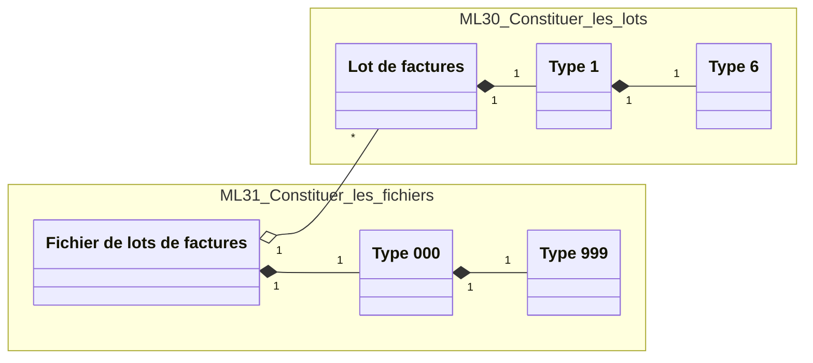
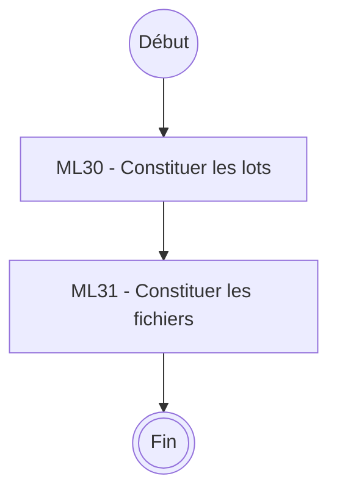
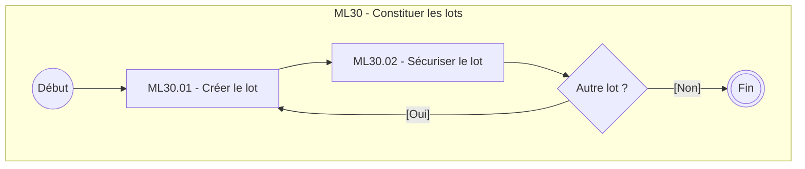
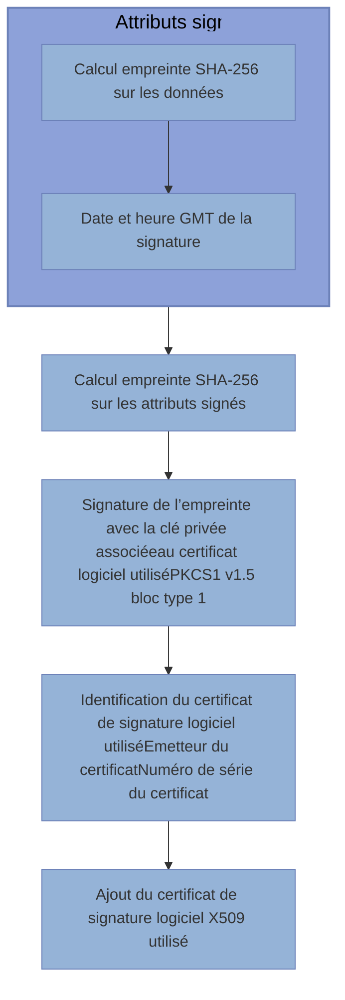

## **Projets Etablissements**
*Spécifications fonctionnelles*


# **Création du fichier logique de facturation AMO et traitement des retours**


Référence : **ETS-DT-003** / Version : **02.20** / Date : **14/06/2024**
Sécurité : **DIFFUSION RESTREINTE**

**GIE SESAM-Vitale**
5, boulevard Marie et Alexandre Oyon – 72019 LE MANS Cedex 2
<u>www.sesam-vitale.fr</u>

*ETS-DT-003* *Création du fichier logique de facturation AMO et traitement des retours* *Version : 02.20*

Ce document a été élaboré par le GIE SESAM-Vitale.

Conformément à l’article L.122-4 du Code de la Propriété Intellectuelle, toute représentation ou reproduction (intégrale ou partielle) du présent ouvrage, quel que soit le support utilisé, doit être soumise à l’accord préalable écrit de son auteur.

Il en est de même pour sa traduction, sa transformation, son adaptation ou son arrangement, quel que soit le procédé utilisé.

**Tout manquement à ces obligations constituerait un délit de contrefaçon, au sens **des articles L 335-2 et suivants du code de la propriété intellectuelle, susceptible** d’entraîner des sanctions pour l’auteur du délit.**

*14/06/2024* *GIE SESAM-Vitale* 
 *2 / 52*

*ETS-DT-003* *Création du fichier logique de facturation AMO et traitement des retours* *Version : 02.20*

## **Liste de diffusion**

<table>
  <thead>
    <tr>
      <th><b>Organisme</b></th>
      <th><b>Nom</b></th>
    </tr>
  </thead>
  <tbody>
    <tr>
      <td></td>
      <td></td>
    </tr>
  </tbody>
</table>

## **Historique des versions**

<table>
  <thead>
    <tr>
      <th>Date</th>
      <th>Version</th>
      <th><b>Évolution du document</b></th>
      <th><b>Rédacteur</b></th>
    </tr>
  </thead>
  <tbody>
    <tr>
      <td>29/10/2018</td>
      <td>1.0</td>
      <td>Création du nouveau corpus</td>
      <td>Christophe KRAKUS</td>
    </tr>
    <tr>
      <td>08/02/2019</td>
      <td>01.00.21</td>
      <td>Prise en compte des remarques de :<br />Laure Lecaime (mail du 23/01/2019 – partie commune AMC/AMO)<br />Prise en compte des remarques de :<br />Jean Baptiste GAILLARD (mail du 14/02/2019</td>
      <td>Christophe KRAKUS</td>
    </tr>
    <tr>
      <td>29/05/2019</td>
      <td>02.00</td>
      <td>Ajout contrôle certificat ES (ETS-RAF-008_EV023)</td>
      <td>S.REDREGOO</td>
    </tr>
    <tr>
      <td>27/10/2019</td>
      <td>02.00.20</td>
      <td>Ajout Sécurisation des flux établissements (HOP-RAF-008_EV022)</td>
      <td>C. KRAKUS</td>
    </tr>
    <tr>
      <td>17/03/2020</td>
      <td>02.00.30</td>
      <td>Ajout des adresses de récupération des certificats dans le descriptif de ML30.02</td>
      <td>C. KRAKUS</td>
    </tr>
    <tr>
      <td><mark>14/06/2024</mark></td>
      <td><mark>02.20</mark></td>
      <td><mark>Précision remplissage des normes B2 et numéro d’agrément ou de certificat</mark></td>
      <td><mark>E. PAIN</mark></td>
    </tr>
  </tbody>
</table>

*14/06/2024* *GIE SESAM-Vitale* 
  *3 / 52*

*ETS-DT-003* *Création du fichier logique de facturation AMO et traitement des retours* *Version : 02.20*

# **Tables des matières**

<table>
    <tr>
      <td><b>1</b></td>
      <td><b>Présentation ........................................................................................................................................6</b></td>
    </tr>
    <tr>
      <td>1.1</td>
      <td>Objet du document.........................................................................................................................6</td>
    </tr>
    <tr>
      <td>1.2</td>
      <td>Contenu du document....................................................................................................................6</td>
    </tr>
    <tr>
      <td>1.3</td>
      <td>Documents de référence ................................................................................................................7</td>
    </tr>
    <tr>
      <td>1.4</td>
      <td>Abréviations et définitions...............................................................................................................7</td>
    </tr>
    <tr>
      <td><b>2</b></td>
      <td><b>Description générale de la fonction « ML - Regrouper les factures en lot et regrouper les lots en fichier » ..............................................................................................................................................11</b></td>
    </tr>
    <tr>
      <td>2.1</td>
      <td>Cadrage fonctionnel .....................................................................................................................11</td>
    </tr>
    <tr>
      <td>2.2</td>
      <td>Lien entre les objets métiers de la fonction ...................................................................................11</td>
    </tr>
    <tr>
      <td>2.3</td>
      <td>Enchaînement des sous-fonctions de ML .....................................................................................12</td>
    </tr>
    <tr>
      <td><b>3</b></td>
      <td><b>Description détaillée de la fonction « ML - Regrouper les factures en lot et regrouper les lots en fichier » ..............................................................................................................................................13</b></td>
    </tr>
    <tr>
      <td>3.1</td>
      <td>ML30 - Constituer les lots (types 1 et 6)........................................................................................13</td>
    </tr>
    <tr>
      <td></td>
      <td>    <mark><u>3.1.1</u> ML30.01 – Créer le lot</mark> .....................................................................................................13</td>
    </tr>
    <tr>
      <td></td>
      <td>    <mark><u>3.1.2 ML30.02 – Signer les lots de factures</u></mark> ..............................................................................23</td>
    </tr>
    <tr>
      <td>3.2</td>
      <td>ML31 - Constituer les fichiers (types 000 et 999) ..........................................................................27</td>
    </tr>
    <tr>
      <td><b>4</b></td>
      <td><b>Description des flux retours des AMO .............................................................................................32</b></td>
    </tr>
    <tr>
      <td>4.1</td>
      <td>Les retours des AMO à traiter.......................................................................................................32</td>
    </tr>
    <tr>
      <td></td>
      <td>    4.1.1 <i>Message de service rejet</i> .................................................................................................32</td>
    </tr>
    <tr>
      <td></td>
      <td>    4.1.2 <i>Les ARL :</i>.........................................................................................................................32</td>
    </tr>
    <tr>
      <td></td>
      <td>        4.1.2.1 Traitement du message SMTP contenant les ARL ............................................................32</td>
    </tr>
    <tr>
      <td></td>
      <td>        4.1.2.2 Fonctionnement dégradé pour les ARL.............................................................................33</td>
    </tr>
    <tr>
      <td></td>
      <td>    4.1.3 <i>Pour les RSP :</i> .................................................................................................................34</td>
    </tr>
    <tr>
      <td>4.2</td>
      <td>Spécifications détaillées de traitement des flux retour «PM – Prendre en compte les rejets du fichier logique et les et les fichiers NOEMIE » ...............................................................................35</td>
    </tr>
    <tr>
      <td></td>
      <td>    4.2.1 <i>Cadrage fonctionnel</i>.........................................................................................................35</td>
    </tr>
    <tr>
      <td></td>
      <td>    4.2.2 <i>PM31 - Prendre en compte le rejet du fichier logique</i>........................................................36</td>
    </tr>
    <tr>
      <td></td>
      <td>    4.2.3 <i>PM32 - Prendre en compte les ARL</i> .................................................................................39</td>
    </tr>
    <tr>
      <td></td>
      <td>        4.2.3.1 PM32.01 - Identifier les lots d’origine ................................................................................40</td>
    </tr>
    <tr>
      <td></td>
      <td>        4.2.3.2 PM32.02 - Interpréter les ARL..........................................................................................41</td>
    </tr>
    <tr>
      <td></td>
      <td>        4.2.3.3 PM32.03 - Traiter les ARL................................................................................................41</td>
    </tr>
    <tr>
      <td></td>
      <td>    4.2.4 <i>PM33 - Prendre en compte les RSP</i>.................................................................................42</td>
    </tr>
    <tr>
      <td></td>
      <td>        4.2.4.1 PM32.01 - Identifier les factures d’origine .........................................................................43</td>
    </tr>
    <tr>
      <td></td>
      <td>        4.2.4.2 PM32.02 - Interpréter les RSP..........................................................................................44</td>
    </tr>
    <tr>
      <td></td>
      <td>        4.2.4.3 PM32.03 - Traiter les RSP ...............................................................................................44</td>
    </tr>
    <tr>
      <td><b>5</b></td>
      <td><b>Références .........................................................................................................................................46</b></td>
    </tr>
    <tr>
      <td>5.1</td>
      <td>Normes46</td>
    </tr>
    <tr>
      <td>5.2</td>
      <td>Décrets et circulaires ministérielles...............................................................................................46</td>
    </tr>
</table>

# **Tables des illustrations**

<table>
    <tr>
      <td>FIGURE 1 : DIAGRAMME DES OBJETS METIERS DE LA FONCTION ML ....................................................................</td>
      <td>11</td>
    </tr>
    <tr>
      <td>FIGURE 2 : DIAGRAMME D’ENCHAINEMENT DE LA FONCTION ML..........................................................................</td>
      <td>12</td>
    </tr>
    <tr>
      <td>FIGURE 3 : DIAGRAMME D’ENCHAINEMENT DE LA FONCTION ML30 ......................................................................</td>
      <td>13</td>
    </tr>
    <tr>
      <td>FIGURE 4 : DIAGRAMME D’ENCHAINEMENT DES FONCTION DE SECURISATION D’UN LOT..........................................</td>
      <td>24</td>
    </tr>
    <tr>
      <td>FIGURE 5 : DIAGRAMME D’ENCHAINEMENT DE LA SOUS-FONCTION PM ................................................................</td>
      <td>36</td>
    </tr>
    <tr>
      <td>FIGURE 6 : DIAGRAMME D’ENCHAINEMENT DE LA SOUS-FONCTION « PM32 » .......................................................</td>
      <td>40</td>
    </tr>
    <tr>
      <td>FIGURE 7 : DIAGRAMME D’ENCHAINEMENT DE LA SOUS-FONCTION « PM33 » .......................................................</td>
      <td>43</td>
    </tr>
</table>

*14/06/2024* *GIE SESAM-Vitale* 
  4 / 52

*ETS-DT-003* *Création du fichier logique de facturation AMO et traitement des retours* *Version : 02.20*

### Table des annexes

<table>
    <tr>
      <td>Annexe 1</td>
      <td><strong>Liste des codes rejets des messages de service fichier générés par les AM .................... 48</strong></td>
    </tr>
    <tr>
      <td>Annexe 2</td>
      <td><strong>Liste des autres catégories d’Etablissement .......................................................................... 50</strong></td>
    </tr>
</table>

*14/06/2024* *GIE SESAM-Vitale* 
  *5 / 52*

*ETS-DT-003* *Création du fichier logique de facturation AMO et traitement des retours* *Version : 02.20*

# 1 **PRESENTATION**

## 1.1 **Objet du document**

Dans ce document, le terme « Etablissement de Santé » (ES) désigne à la fois :

*   Les Cliniques Privées (CP),
*   Les Etablissements Publics de Santé (EPS),
*   Les établissements Privés Non Lucratifs (PNL),
*   Les Hôpitaux d'Instruction des Armées (HIA). Les HIA sont des EPS qui ont leur propre trésorerie.
*   D’autres Professionnels de Santé qui regroupent (uniquement pour les flux à destination des AMO),
    *   tous les établissements cités dans Annexe 2 - Liste des autres catégories d’Etablissement
    *   les transporteurs (transporteurs sanitaires et sociétés de taxis conventionnés).

Ce document s’adresse aux éditeurs qui proposent une solution de facturation aux établissements de santé, intégrant la création des fichiers logiques de facturation nécessaires aux remboursements des prestations de soins par les AMO.

Ce document précise également la gestion des retours (Rejet de fichier logique, ARL et RSP) liées aux fichiers logiques de facturation, aux lots et aux factures transmises dans le fichier logique de facturation.

Ce document présente la signature logicielle des lots de factures. La signature des lots est facultative, mais deviendra obligatoire. Des consignes imposant la transmission de lots signés seront fournies ultérieurement.

L’éditeur de facturation doit informer l’éditeur de messagerie de la mise à disposition de fichier logique de facturation contenant uniquement des lots signés.

 Ce document est commun à tous les Etablissements de Santé.

Les catégories de PS intégrées au système SESAM-Vitale ne sont pas concernées par ce document, car elles produisent des flux SESAM-Vitale selon les règles du CdC SESAM-Vitale.

Dans le cadre des échanges avec les organismes d’assurances maladie obligatoire, ce document précise certaines spécificités liées aux périmètres [FIDES ACE], [FIDES Séjours] et [MCO CP].

Les cinématiques de traitement des ARL et des RSP ne sont décrits que dans le cadre des flux [FIDES ACE], [FIDES Séjours] et [MCO CP].

Pour la suite du document le terme « Autres PS » sera utilisé pour identifier les établissements de l’annexe 2 et les transporteurs.

## 1.2 **Contenu du document**

Ce document de spécifications fonctionnelles générales présente la description de la fonction **« ML : Regrouper les factures en lot et regrouper les lots en fichier » et de la **fonction PM– Prendre en compte les rejets de fichier logique et les fichiers** NOEMIE ».**

Il est composé des :

*   Chapitre 1 : Présentation ;
*   Chapitre 2 à 3 : Description de la fonction « ML - Regrouper les factures en lot et regrouper les lots en fichier »
*   Chapitre 4 : Description des retours AMO

*14/06/2024* *GIE SESAM-Vitale* 
 *6 / 52*

*ETS-DT-003 *Création du fichier logique de facturation AMO et traitement des retours* Version : 02.20*

## **1.3** **Documents de référence**

*   [Transport et Chiffrement] : TransportsFlux_SpecsTechCommune (ETS-DT-001)
*   [FIDES Séjours] : Facturation Individuelle Des Établissements de Santé (ETS-SFG-029 PG)
*   [FIDES ACE] : Facturation Individuelle Des Établissements de Santé (ETS-SFG-001 PG)
*   [MCO CP] : Facturation MCO en Cliniques Privées (ETS-SFG-014 PG)
*   [NOEMIE] : Cahier de Charges MOEMIE PS

## **1.4** **Abréviations et définitions**

<table>
    <tr>
      <td>AES 128</td>
      <td>Algorithme de chiffrement</td>
    </tr>
    <tr>
      <td>AM</td>
      <td>Assurance Maladie. Désigne indifféremment AMO ou AMC.</td>
    </tr>
    <tr>
      <td>AMC</td>
      <td>Assurance Maladie Complémentaire. Assurance souscrite auprès d’un organisme différent des caisses d’Assurance Maladie Obligatoire (AMO), et qui rembourse à l’assuré une partie ou la totalité du ticket modérateur (parfois plus).<br />La carte Vitale peut contenir des données concernant les organismes d’AMC. Les organismes d’AMC peuvent être :<br />● une mutuelle (régie par le code de la mutualité),<br />● une société ou une mutuelle d'assurance (régie par le code des assurances),<br />● une institution de prévoyance.</td>
    </tr>
    <tr>
      <td>AMO</td>
      <td>Assurance Maladie Obligatoire (également « Caisse d’Assurance Maladie », « Régime d’Assurance Maladie »). Organisme de remboursement des frais de santé.</td>
    </tr>
    <tr>
      <td>ARL</td>
      <td><strong><b>Accusé de Réception Logique</b>.</strong> Message électronique envoyé à l’émetteur d’un lot de factures (à la norme B2 ou DRE-CP) et qui délivre des informations sur la réception du lot correspondant. Les ARL peuvent être de deux types :<br />● « <strong>positif</strong> » qui informe que le lot correspondant est correctement reçu, et sera transmis au central. L’ARL positif contient<br />○ le nombre de factures concernées,<br />○ le total des montants facturés dans le lot,<br />○ le n° du lot.<br />● « <strong>négatif</strong> » qui informe qu’une anomalie a été détectée sur le lot et qu’il ne sera pas transmis au central. Le libellé de l’ARL négatif précise le motif du rejet (indiqué par un code)</td>
    </tr>
    <tr>
      <td>B2</td>
      <td>Norme informatique de construction et d’échange des factures électroniques entre PS, Etablissements de Santé et caisses d’assurance maladie obligatoires. Tous les progiciels de santé agréés et toutes les solutions intégrées homologuées utilisent automatiquement la norme B2.</td>
    </tr>
</table>

*14/06/2024* *GIE SESAM-Vitale* 
  *7 / 52*

*ETS-DT-003* *Création du fichier logique de facturation AMO et traitement des retours* *Version : 02.20*

<table>
    <tr>
      <td>BAL</td>
      <td>Boîtes Aux Lettres. Espace sur le serveur d’un fournisseur d’accès, dans lequel est stocké le courrier électronique d’un utilisateur.</td>
    </tr>
    <tr>
      <td>Caisse gestionnaire</td>
      <td>La caisse gestionnaire est la caisse de l’AMO dont relève l’assuré.</td>
    </tr>
    <tr>
      <td>Caisse pivot</td>
      <td>Interlocuteur unique de l’Etablissement de Santé (voir « CIE ») pour toutes ses relations financières avec l’Assurance Maladie.<br /><br />Après liquidation, la caisse pivot verse aux Etablissements de Santé le solde des frais d’hospitalisation et des consommations intermédiaires et rembourse aux Professionnels de Santé le montant des honoraires.<br /><strong>NB</strong> : Cela n’est valable que lorsque la caisse pivot est devenue CPU de l’établissement, après son passage dans FIDES. Avant le passage dans FIDES, les factures (retours « CGECPT ») sont réglées par les caisses gestionnaires des régimes. La caisse pivot est alors une caisse pivot technique.<br /><br />La caisse pivot est aussi appelée « Caisse centralisatrice des paiements » (dans le cadre du dispositif cliniques privées) ou « Caisse de Paiement Unique » (CPU) ( dans le cadre des établissements publics, PNL ou HIA basculés dans FIDES).</td>
    </tr>
    <tr>
      <td>CBC</td>
      <td>Cipher Block Chaining : mode de chiffrement de l’algorithme 3-DES.</td>
    </tr>
    <tr>
      <td>CCDP</td>
      <td>Caisse Centralisatrice De Paiement. La CCDP a été mise en place avant tout pour les flux AMO, dans le cadre des cliniques privées.</td>
    </tr>
    <tr>
      <td>Chiffrement</td>
      <td>Technique consistant à rendre confidentielles des données pour toute personne non autorisée.</td>
    </tr>
    <tr>
      <td>CIE</td>
      <td>Caisse Interlocutrice d’un Etablissement. Désigne indifféremment une caisse pivot dans le cadre des Cliniques Privées ou une Caisse de Paiement Unique dans le cadre des Etablissements Publics de Santé et des PNL. Voir « Caisse pivot ».</td>
    </tr>
    <tr>
      <td>CMS</td>
      <td>Cryptographic Message Syntax. Objet contenant un message chiffré.</td>
    </tr>
    <tr>
      <td>CPT</td>
      <td>Caisse Pivot Technique</td>
    </tr>
    <tr>
      <td>CPU</td>
      <td>Caisse de Paiement Unique. Voir « caisse pivot ».</td>
    </tr>
    <tr>
      <td>DRE</td>
      <td>Demande de Remboursement Electronique. Facture électronique permettant le remboursement des soins sur la part non prise en compte par l'assurance maladie obligatoire (AMO). Cette facture est transmise à un organisme d’assurance maladie complémentaire (AMC).</td>
    </tr>
    <tr>
      <td>DRE-CP</td>
      <td>Demande de Remboursement Electronique Cliniques Privées. Norme d’échange utilisée pour transmettre les flux du partenaire de santé de type Clinique Privée vers les centres informatiques AMC.</td>
    </tr>
    <tr>
      <td>DRE-ES</td>
      <td>Demande de Remboursement Electronique EPS et PNL. Norme d’échange utilisée pour transmettre les flux du partenaire de santé de type EPS ou PNL vers les centres informatiques AMC.</td>
    </tr>
</table>

*14/06/2024* *GIE SESAM-Vitale* 
  *8 / 52*

*ETS-DT-003* *Création du fichier logique de facturation AMO et traitement des retours* *Version : 02.20*

<table>
    <tr>
      <td>EDI</td>
      <td>Echange de Données Informatisées.</td>
    </tr>
    <tr>
      <td>EPS</td>
      <td>Etablissements Publics de Santé.</td>
    </tr>
    <tr>
      <td>ES</td>
      <td>Etablissements de Santé (en général).</td>
    </tr>
    <tr>
      <td>ESMTP</td>
      <td>Extended SMTP.</td>
    </tr>
    <tr>
      <td>Fichier logique</td>
      <td>Fichier conforme :<br />
        • à la normeB2 ou DRE (DRE CP ou DRE ES) incluant les lots de facture entre un type 000 et un type 999<br />
        • à la norme NOEMIE PS ou DRE ROC incluant les retour RSP entre l’entité 000 et l’entité 999.</td>
    </tr>
    <tr>
      <td>FIPS</td>
      <td>Federal Information Processing Standard</td>
    </tr>
    <tr>
      <td>GIE SESAM-Vitale</td>
      <td>Groupement d’Intérêt Economique SESAM-Vitale. Créé en 1993, il a pour missions l'étude, la réalisation, la mise en œuvre et la normalisation du programme SESAM-Vitale.</td>
    </tr>
    <tr>
      <td>IETF</td>
      <td>Internet Engineering Task Force. Groupe informel, international, ouvert à tout individu, qui participe à l'élaboration de standards pour Internet.</td>
    </tr>
    <tr>
      <td>HIA</td>
      <td>Les Hôpitaux d’Instruction des Armées (HIA) relèvent du Ministère de la Défense. A ce titre, ils ne sont pas dotés de la personnalité morale et ne peuvent être assimilés à des établissements publics ou privés de santé.</td>
    </tr>
    <tr>
      <td>IRIS</td>
      <td>Interface Réseau Information Service. Projet national de l’Assurance Maladie fédérateur de sous-projets informatiques.</td>
    </tr>
    <tr>
      <td>IRIS/B2</td>
      <td>Norme d’échange de factures électroniques.<br />
        Norme d’échange utilisée pour transmettre les flux du partenaire de santé vers le centre informatique AMO.</td>
    </tr>
    <tr>
      <td>LDAP</td>
      <td>Lightweight Directory Access Protocol. Protocole permettant l'interrogation et la modification des services d'annuaire.</td>
    </tr>
    <tr>
      <td>MIME</td>
      <td>Multipurpose Internet Mail Extensions. Standard internet qui étend le format de données des courriels pour supporter des textes en différents codage de caractères autres que l'ASCII.</td>
    </tr>
    <tr>
      <td>NOEMIE</td>
      <td>Norme Ouverte d’Echange entre la Maladie et les Intervenants Extérieurs. Norme informatique utilisée par les régimes d’Assurance Maladie Obligatoire (AMO) pour transmettre des fichiers retour vers les postes de travail des Professionnels de Santé (PS).</td>
    </tr>
    <tr>
      <td>OSI</td>
      <td>OSI = <b>O</b>ffre de <b>S</b>écurisation d’<b>I</b>nfrastructure<br />
        Au sein de l’ensemble IGC OSI, l’AC racine est AC-SESAM-VITALE-2034 et l’AC intermédiaire est l’AC-FACTURATION, qui gère les certificats concernés dans le cadre du chiffrement de transport.</td>
    </tr>
    <tr>
      <td>PNL</td>
      <td>Etablissements Publics Non Lucratifs. Les centres de lutte contre le cancer (CLCC) et tous les Etablissements anciennement PSPH sont devenus des PNL depuis la promulgation de la loi HPST le 22 juillet 2009. Anciennement appelés ESPIC.</td>
    </tr>
</table>

*14/06/2024* *GIE SESAM-Vitale* 
 *9 / 52*

*ETS-DT-003* *Création du fichier logique de facturation AMO et traitement des retours* *Version : 02.20*

<table>
    <tr>
      <td>POP3</td>
      <td>Post Office Protocol Version 3. Protocole qui permet de récupérer les courriers électroniques situés sur un serveur de messagerie électronique.</td>
    </tr>
    <tr>
      <td>RFC</td>
      <td>Request For Comments. Série numérotée de documents officiels décrivant les aspects techniques d'Internet.</td>
    </tr>
    <tr>
      <td>RSA</td>
      <td>Système cryptographique à clé publique de <u>Rivest Shamir Adleman</u>.</td>
    </tr>
    <tr>
      <td>RSP</td>
      <td>Rejet Signalement Paiement. Fichier envoyé au logiciel du PS par la caisse AMO ou AMC et qui indique le rejet, le signalement ou le paiement d’une facture électronique.</td>
    </tr>
    <tr>
      <td>RSV</td>
      <td>Réseau SESAM Vitale. Réseau de télécommunication sécurisé visant à interconnecter des sites informatiques et des plateformes de services. La mise en service et la maintenance du RSV sont assurées par le GIE SESAM-Vitale.</td>
    </tr>
    <tr>
      <td>S/MIME</td>
      <td>Secure Multipurpose Internet Mail Extensions. Norme de cryptographie et de signature numérique de <u>mail</u> encapsulés en format <u>MIME</u>. Elle assure l'<u>intégrité</u>, l'<u>authentification</u>, la <u>non-répudiation</u> et la <u>confidentialité</u> des données.</td>
    </tr>
    <tr>
      <td>SMTP</td>
      <td>Simple Mail Transfer Protocol. Protocole de communication utilisé pour transférer le courrier électronique vers les serveurs de messagerie électronique.</td>
    </tr>
    <tr>
      <td>SNN</td>
      <td>Site National NOEMIE. Concentrateur des retours NOEMIE pour les comptables publics hospitaliers.</td>
    </tr>
    <tr>
      <td>TCP/IP</td>
      <td>Transmission Control Protocol / Internet Protocol. Pile de protocoles utilisée par Internet.</td>
    </tr>
    <tr>
      <td>VMS</td>
      <td>Version du mécanisme de sécurisation utilisée pour la signature des lots</td>
    </tr>
    <tr>
      <td>X509</td>
      <td>Norme de cryptographie pour les infrastructures à clé publique.</td>
    </tr>
    <tr>
      <td>ZLIB</td>
      <td>Bibliothèque logicielle de compression de données.</td>
    </tr>
</table>

*14/06/2024* *GIE SESAM-Vitale* 
  *10 / 52*
10 / 52

*ETS-DT-003 *Création du fichier logique de facturation AMO et traitement des retours* Version : 02.20*

# 2 **DESCRIPTION GENERALE DE LA FONCTION « ML - REGROUPER LES FACTURES EN LOT ET REGROUPER LES LOTS EN FICHIER »**

## 2.1 **Cadrage fonctionnel**

### **Vue générale**

***Description*** Cette fonction a pour objectif de définir les règles de constitution des fichiers et des lots relatifs aux factures.
Elle est composée des sous-fonctions suivantes :
* ML30 - Constituer les lots : Sous-fonction chargée de définir les règles de constitution des lots relatifs aux factures.
* ML31 - Constituer les fichiers : Sous-fonction chargée de définir les règles de constitution des fichiers relatifs aux lots de factures.

***Entrées*** Factures

***Sorties*** Lots de factures **EF_ML01**
<u>Fichier de lots de factures</u> **EF_ML02**

***Situations particulières*** Aucune

## 2.2 **Lien entre les objets métiers de la fonction**

Le schéma ci-dessous décrit le lien entre les objets métiers manipulés dans la fonction « ML - Regrouper les factures en lot et regrouper les lots en fichier ».

### **Lien entre les objets**



**Figure 1 : Diagramme des objets métiers de la fonction ML**

*14/06/2024* GIE SESAM-Vitale 
 *11 / 52*

*ETS-DT-003* *Création du fichier logique de facturation AMO et traitement des retours* *Version : 02.20*

## **2.3** **Enchaînement des sous-fonctions de ML**

Le schéma ci-dessous décrit l’enchaînement des sous-fonctions de la fonction « ML - Regrouper les factures en lot et regrouper les lots en fichier ».

**Enchainement des sous-fonctions**



**Figure 2 : Diagramme d’enchaînement de la fonction ML**

*14/06/2024* *GIE SESAM-Vitale* 
  *12 / 52*

*ETS-DT-003* *Création du fichier logique de facturation AMO et traitement des retours* *Version : 02.20*

# **3** **DESCRIPTION DETAILLEE DE LA FONCTION « ML - REGROUPER LES FACTURES EN LOT ET REGROUPER LES LOTS EN FICHIER »**

## **3.1** **ML30 - Constituer les lots (types 1 et 6)**

### **Vue générale**

***Description*** Cette sous-fonction a pour objectif de définir les règles de constitution des lots signés relatifs aux factures.
***Entrées*** Factures
***Sorties*** Lot de factures signé **EF_ML01**
Entête de lot **TYPE 1**
Fin de lot **TYPE 6**
Objet CMS de signature logiciel du lot **<u>[0697]</u>**

### **Enchaînement des opérations**



**Figure 3 : Diagramme d’enchaînement de la fonction ML30**

## **3.1.1** **ML30.01 – Créer le lot**

### **Vue générale**

***Description*** Cette sous-fonction a pour objectif de définir les règles de création d’un lot relatif aux factures.
***Entrées*** Factures
***Sorties*** Lot de factures « non sécurisé » **EF_ML01**
Entête de lot **TYPE 1**
Fin de lot **TYPE 6**

*14/06/2024* *GIE SESAM-Vitale* 
 *13 / 52*
13 / 52

*ETS-DT-003* *Création du fichier logique de facturation AMO et traitement des retours* *Version : 02.20*

## **Règles de gestion**

### ***[RG_ML600] Regrouper les factures relatives aux lots***

Chaque lot est borné par un enregistrement « Type 1 » (début) puis « Type 6 » (fin) et regroupe de 1 à n factures avec une capacité théorique de 999 factures par lot.

Les factures sont regroupées en lot selon les critères suivants :

*   Numéro du partenaire de santé + clé Position 2 – 10 du type 2.
*   Numéro d’organisme destinataire <u>[0117].</u>

C’est à dire qu’un lot regroupe des factures relatives à un même organisme destinataire (couple Code Grand régime / Numéro caisse gestionnaire ou d’un triplet Code Grand régime / Numéro caisse gestionnaire / Numéro centre gestionnaire et pour un même facturant (FINESS géographique) où chacune de ces factures peut adresser un assuré différent.

Les factures sont triées par ordre croissant de numéro de facture.

Le lot de factures AMO doit être émis moins de 90 jours après sa date de création.

##  ***Cas particulier***

<mark><u>***[CP01] : situation de facturation fractionnée (uniquement en SMR-CP)***</u></mark>

### <u>**Condition :**</u>

*   <mark><u>Facturation de prestations SMR en cliniques privées</u></mark>
*   <mark>Cas des factures fractionnées telle que spécifié dans la solution 2 de la RG_MF637 <u>du document TF – Transmettre les factures pour la facturation</u></mark>

<mark><u>Un lot dédié comportant les seules factures fractionnées pour le séjour SMR du bénéficiaire</u> <u>de soins doit être créé.</u></mark>

 <mark>Dans cette situation, l’établissement doit informer par mail sa caisse CCDP en précisant le <u>numéro de lot et les numéros de factures concernées.</u></mark>

*14/06/2024* *GIE SESAM-Vitale* 
 *14 / 52*
14 / 52

ETS-DT-003
Création du fichier logique de facturation AMO et traitement des retours
Version : 02.20

# **[RG_ML601] Constituer le « Type 1 »**

<table>
  <thead>
    <tr>
      <th colspan="5"><b>Donnée Type 1</b></th>
      <th></th>
      <th><b>Données</b></th>
    </tr>
    <tr>
      <th><i>Libellé</i></th>
      <th><i>Position</i></th>
      <th><i>Taille</i></th>
      <th><i>Format</i></th>
      <th><i>Présence</i></th>
      <th></th>
      <th></th>
    </tr>
  </thead>
  <tbody>
    <tr>
      <td>Type d'enregistrement</td>
      <td><b><b>[0101]</b></b></td>
      <td>1</td>
      <td>N</td>
      <td>O</td>
      <td>←</td>
      <td>1</td>
    </tr>
    <tr>
      <td>Numéro du partenaire de santé + Clé</td>
      <td><b>[0102]</b></td>
      <td>9</td>
      <td>N</td>
      <td>O</td>
      <td>←</td>
      <td>[0102]</td>
    </tr>
    <tr>
      <td>Origine du fichier</td>
      <td><b><b>[0111]</b></b></td>
      <td>6</td>
      <td>A</td>
      <td>F</td>
      <td>←</td>
      <td>Blanc</td>
    </tr>
    <tr>
      <td>Numéro organisme destinataire</td>
      <td><b>[0117]</b></td>
      <td>3</td>
      <td>N</td>
      <td>O</td>
      <td>←</td>
      <td>[0117]</td>
    </tr>
    <tr>
      <td>Numéro de lot</td>
      <td><b>[0120]</b></td>
      <td>3</td>
      <td>N</td>
      <td>O</td>
      <td>←</td>
      <td>[0120]</td>
    </tr>
    <tr>
      <td>Catégorie</td>
      <td><b>[0123]</b></td>
      <td>3</td>
      <td>A</td>
      <td>F</td>
      <td>←</td>
      <td>[0123]</td>
    </tr>
    <tr>
      <td>Statut juridique</td>
      <td><b>[0126]</b></td>
      <td>2</td>
      <td>A</td>
      <td>F</td>
      <td>←</td>
      <td>[0126]</td>
    </tr>
    <tr>
      <td>Mode de fixation des tarifs</td>
      <td><b>[0128]</b></td>
      <td>2</td>
      <td>A</td>
      <td>F</td>
      <td>←</td>
      <td>[0128]</td>
    </tr>
    <tr>
      <td>Nom ou raison sociale du partenaire de santé</td>
      <td><b>[0130]</b></td>
      <td>40</td>
      <td>A</td>
      <td>O</td>
      <td>←</td>
      <td>[0130]</td>
    </tr>
    <tr>
      <td>Version de norme utilisée</td>
      <td><b><b>[0170]</b></b></td>
      <td>2</td>
      <td>A</td>
      <td>O</td>
      <td>←</td>
      <td>B2</td>
    </tr>
    <tr>
      <td>Date de création du lot</td>
      <td><b>[0172]</b></td>
      <td>6</td>
      <td>N</td>
      <td>O</td>
      <td>←</td>
      <td>[0172]</td>
    </tr>
    <tr>
      <td>Indice de l'addenda</td>
      <td><b>[0178]</b></td>
      <td>1</td>
      <td>A</td>
      <td>F</td>
      <td>←</td>
      <td><mark>[0178]</mark><br /><mark><s>A valoriser en fonction de la norme utilisée</s></mark></td>
    </tr>
    <tr>
      <td>Code norme</td>
      <td><b>[0179]</b></td>
      <td>2</td>
      <td>A</td>
      <td>O</td>
      <td>←</td>
      <td>[0179]</td>
    </tr>
    <tr>
      <td>Top certification du lot</td>
      <td><b><b>[0181]</b></b></td>
      <td>1</td>
      <td>A</td>
      <td>F</td>
      <td>←</td>
      <td>Blanc</td>
    </tr>
    <tr>
      <td>Numéro de version de norme</td>
      <td><b><b>[0182]</b></b></td>
      <td>6</td>
      <td>N</td>
      <td>O</td>
      <td>←</td>
      <td><mark>[0178]</mark><br /><mark><s>A valoriser en fonction de la norme utilisée</s></mark></td>
    </tr>
    <tr>
      <td>Unité monétaire de facturation</td>
      <td><b><b>[0188]</b></b></td>
      <td>1</td>
      <td>A</td>
      <td>F</td>
      <td>←</td>
      <td>U</td>
    </tr>
    <tr>
      <td>Grand régime de la CPU</td>
      <td><b><b>[0189]</b></b></td>
      <td>2</td>
      <td>A</td>
      <td>F</td>
      <td>←</td>
      <td>Blanc</td>
    </tr>
    <tr>
      <td>Numéro de la CPU</td>
      <td><b><b>[0191]</b></b></td>
      <td>3</td>
      <td>A</td>
      <td>F</td>
      <td>←</td>
      <td>Blanc</td>
    </tr>
    <tr>
      <td>Indication dispositif Caisse centralisatrice des paiements ou CPU</td>
      <td><b><b>[0194]</b></b></td>
      <td>1</td>
      <td>A</td>
      <td>F</td>
      <td>←</td>
      <td>Blanc</td>
    </tr>
    <tr>
      <td>FILLER</td>
      <td><b><b>[0195]</b></b></td>
      <td>34</td>
      <td>A</td>
      <td>F</td>
      <td>←</td>
      <td>Blanc</td>
    </tr>
  </tbody>
</table>

## **[0102] *Numéro du partenaire de santé + Clé***

L’alimentation suit les règles de la norme B2.


Pour les flux FIDES ACE, FIDES Séjours et les flux MCO CP :

*   Correspond au FINESS géographique de l’établissement qui facture la prestation. A noter que dans le cadre des ACE, cette donnée correspond au N°FINESS géographique de l'établissement de rattachement (PS exécutant).
*   Lorsqu’il s’agit de l’exploitant (forfaits techniques d’imagerie) ou de l’établissement (prestations d’hospitalisation), le FINESS géographique du facturant est renseigné avec N° le FINESS géographique de l’ES exécutant ou exploitant.

14/06/2024
GIE SESAM-Vitale 

15 / 52

*ETS-DT-003*
*Création du fichier logique de facturation AMO et traitement des retours*
*Version : 02.20*

### *[0117] **Numéro organisme destinataire***

Le numéro d’organisme destinataire est déterminé à partir d’un couple (Code Grand régime / Numéro caisse gestionnaire) ou d’un triplet (Code Grand régime / Numéro caisse gestionnaire / Numéro centre gestionnaire).

Pour l’application de la règle de détermination de l’organisme destinataire, les données à utiliser sont issus du type 2 des factures regroupées.

*   Code Grand régime position 49-50 du type 2 ;
*   Numéro caisse gestionnaire position 51-53 du type 2 ;
*   Numéro centre gestionnaire position 54-57 du type 2

Le tableau ci-après issu du Cahier des Charges Éditeurs SESAM-Vitale V1.40 précise les cas d’utilisation d’un couple ou d’un triplet ainsi que les règles de détermination de l’organisme destinataire :

*14/06/2024*
*GIE SESAM-Vitale* 
 *16 / 52*

*ETS-DT-003* *Création du fichier logique de facturation AMO et traitement des retours* *Version : 02.20*

<table>
  <thead>
    <tr>
      <th><b>Type de</b> combinaison</th>
      <th>Régimes</th>
      <th>Code régime</th>
      <th><b>Numéro d’organisme destinataire</b></th>
    </tr>
  </thead>
  <tbody>
    <tr>
      <td>Couple</td>
      <td>Régime général</td>
      <td>01</td>
      <td rowspan="11">Le numéro d’organisme destinataire est identique au code caisse gestionnaire.</td>
    </tr>
    <tr>
      <td>Couple</td>
      <td>RATP</td>
      <td>05</td>
    </tr>
    <tr>
      <td>Couple</td>
      <td>Régime minier</td>
      <td>07</td>
    </tr>
    <tr>
      <td>Couple</td>
      <td>CNMSS</td>
      <td>08</td>
    </tr>
    <tr>
      <td>Couple</td>
      <td>CRPCEN</td>
      <td>10</td>
    </tr>
    <tr>
      <td>Couple</td>
      <td>Assemblée Nationale</td>
      <td>14</td>
    </tr>
    <tr>
      <td>Couple</td>
      <td>Sénat</td>
      <td>15</td>
    </tr>
    <tr>
      <td><mark><s>Couple</s></mark></td>
      <td><mark><s>Port Autonome de Bordeaux</s></mark></td>
      <td><mark><s>16</s></mark></td>
    </tr>
    <tr>
      <td>Couple</td>
      <td>CAVIMAC</td>
      <td>90</td>
    </tr>
    <tr>
      <td><mark><s>Couple</s></mark></td>
      <td><mark><s>MGPTT</s></mark></td>
      <td><mark><s>92</s></mark></td>
    </tr>
    <tr>
      <td><mark><s>Couple</s></mark></td>
      <td><mark><s>MNH</s></mark></td>
      <td><mark><s>95</s></mark></td>
    </tr>
    <tr>
      <td>Couple</td>
      <td>Régime Agricole</td>
      <td>02</td>
      <td>Si le code de la caisse gestionnaire est de type XX5, le numéro de l’organisme destinataire est XX1. Sinon le numéro de l’organisme destinataire est identique au code caisse gestionnaire.</td>
    </tr>
    <tr>
      <td>Couple</td>
      <td><mark>CPRPF – régime spécial CPRPSNCF</mark></td>
      <td>04</td>
      <td>Le numéro de l’organisme destinataire est toujours égal à 110</td>
    </tr>
    <tr>
      <td>Couple</td>
      <td>CCIP</td>
      <td>12</td>
      <td>Le numéro de l’organisme destinataire est toujours égal à 001</td>
    </tr>
    <tr>
      <td>Triplet</td>
      <td>MGEN</td>
      <td>91</td>
      <td>Si le code de la caisse gestionnaire est égal à 751 et le code centre gestionnaire est égal à 0501, le numéro de l’organisme destinataire est 999. Sinon le numéro de l’organisme destinataire est identique au code caisse gestionnaire.</td>
    </tr>
    <tr>
      <td>Triplet</td>
      <td>MGP</td>
      <td>93</td>
      <td>Si le code de la caisse gestionnaire est égal à 751, 781, 911, 921, 931, 941 ou 951, le numéro de l’organisme destinataire est identique au code centre gestionnaire. (*) Sinon le numéro de l’organisme destinataire est identique au code caisse gestionnaire</td>
    </tr>
    <tr>
      <td><mark><s>Triplet</s></mark></td>
      <td><mark><s>MFP</s></mark></td>
      <td><mark><s>94</s></mark></td>
      <td><mark><s>Si le code de la caisse gestionnaire est égal à 751, 781, 911, 921, 931, 941 ou 951 et code centre gestionnaire est égal à 511, le numéro de l’organisme destinataire est 514.<br />Si le code de la caisse gestionnaire est égal à 751, 781, 911, 921, 931, 941 ou 951 et code centre gestionnaire est différent de 511, le numéro de l’organisme destinataire est identique au code centre gestionnaire.<br />Sinon le numéro de l’organisme destinataire est identique au code caisse gestionnaire.</s></mark></td>
    </tr>
    <tr>
      <td><mark><s>Triplet</s></mark></td>
      <td><mark><s>MNAM</s></mark></td>
      <td><mark><s>96</s></mark></td>
      <td><mark><s>Si le code de la caisse gestionnaire est égal à 751, 781, 911, 921, 931, 941 ou 951, le numéro de l’organisme destinataire est 751.<br />Sinon le numéro de l’organisme destinataire est identique au code caisse gestionnaire.</s></mark></td>
    </tr>
    <tr>
      <td><mark><s>Triplet</s></mark></td>
      <td><mark><s>IND</s></mark></td>
      <td><mark><s>03</s></mark></td>
      <td rowspan="2">Pour ce code régime, utiliser la table des organismes destinataires (TOD) disponible sur le site Internet du GIE SESAM-Vitale (https://www.sesam-vitale.fr/tod-table-des-organismes-<mark>destinataires-es</mark>)</td>
    </tr>
    <tr>
      <td>Triplet</td>
      <td>Sections locales mutualistes</td>
      <td>99</td>
    </tr>
  </tbody>
</table>

### *[0120] **Numéro de lot***

La numérotation des lots se fait sur 3 caractères numériques, le système de facturation doit veiller à ce que ce numéro soit impérativement différent d’un lot à l’autre et évolutif de 000 à 999.

*14/06/2024* *GIE SESAM-Vitale* 
  *17 / 52* 17

*ETS-DT-003* *Création du fichier logique de facturation AMO et traitement des retours* *Version : 02.20*

### [0123] ***Catégorie***

L’alimentation suit les règles de la norme B2.

 <u>Pour les flux FIDES ACE, FIDES Séjours ou MCO CP,</u> cette donnée est valorisée avec la catégorie de l’établissement Géographique (cf. nomenclature FINESS)

### [0126] ***Statut juridique***

L’alimentation suit les règles de la norme B2.

 <u>Pour les flux FIDES ACE, FIDES Séjours ou MCO CP</u> : Statut juridique de l’établissement juridique (cf. nomenclature FINESS).

### [0128] ***Mode de fixation des tarifs***

L’alimentation suit les règles de la norme B2.

 Pour les flux FIDES ACE, FIDES Séjours ou MCO CP :

Le mode de tarification détermine l'autorité responsable de la fixation du tarif principal de l'établissement et la procédure utilisée.
Le mode de tarification est unique pour un établissement FINESS géographique donné (cf. nomenclature FINESS).

### [0130] ***Nom ou raison sociale du partenaire de santé***

L’alimentation suit les règles de la norme B2.

 <u>Pour les flux FIDES ACE, FIDES Séjours ou MCO CP</u> : Nom ou raison sociale de l’établissement facturant ou de la personne morale ou physique.

### [0172] ***Date de création du lot***

Cette information est renseignée sous la forme « AAMMJJ ».

 Rappel : Le lot de factures doit être émis moins de 90 jours après sa date de création.

### <u>[0178]</u> ***<u>Indice de l’addenda [0178] et numéro de version de la norme [0182]</u>***

Cette information dépend du périmètre de facturation couvert par le logiciel de facturation tel que décrit ci-dessous :

<table>
  <thead>
    <tr>
      <th><b>Si le logiciel de facturation</b> <b>prend en compte :</b></th>
      <th><b>Alors le numéro de version</b> <b>de la norme [0182] vaut :</b></th>
      <th><b>Et l’indice de l’addenda</b> <b>[0178] vaut :</b></th>
    </tr>
  </thead>
  <tbody>
    <tr>
      <td>la facturation FIDES ACE</td>
      <td>2005</td>
      <td>D</td>
    </tr>
    <tr>
      <td>La facturation SMR en CP</td>
      <td>2005</td>
      <td>E</td>
    </tr>
    <tr>
      <td>La facturation SMR en CP<br /><u>et</u> la facturation MCO en CP</td>
      <td>2005</td>
      <td>E</td>
    </tr>
    <tr>
      <td>La facturation MCO en CP</td>
      <td>2007</td>
      <td>A blanc</td>
    </tr>
    <tr>
      <td>Autres cas</td>
      <td colspan="2">En fonction de la norme utilisée</td>
    </tr>
  </tbody>
</table>

### [0179] ***Code norme***

*14/06/2024* GIE SESAM-Vitale 
 18 / 52

*ETS-DT-003* *Création du fichier logique de facturation AMO et traitement des retours* *Version : 02.20*

A valoriser suivant la norme utilisée et spécifiée dans l’annexe 4 de la norme B2 et est cadrée à gauche.

 Pour les flux FIDES ACE ou FIDES Séjours ou MCO CP : Valeur ‘CP’.

*14/06/2024* *GIE SESAM-Vitale* 
  *19 / 52*

*ETS-DT-003* *Création du fichier logique de facturation AMO et traitement des retours* *Version : 02.20*

## **[RG_ML602] Constituer le « Type 6 »**

<table>
  <thead>
    <tr>
      <th colspan="5"><b>Donnée Type 6</b></th>
      <th rowspan="2"></th>
      <th colspan="2">Donnée</th>
    </tr>
    <tr>
      <th><i>Libellé</i></th>
      <th><i>Position</i></th>
      <th><i>Taille</i></th>
      <th><i>Format</i></th>
      <th><i>Présence</i></th>
      <th><i>Source</i></th>
      <th><i>Libellé</i></th>
    </tr>
  </thead>
  <tbody>
    <tr>
      <td>Type d'enregistrement</td>
      <td><b><b>[0601]</b></b></td>
      <td>1</td>
      <td>N</td>
      <td>O</td>
      <td>←</td>
      <td colspan="2">6</td>
    </tr>
    <tr>
      <td>Numéro du partenaire de santé + clé</td>
      <td><b><b>[0602]</b></b></td>
      <td>9</td>
      <td>N</td>
      <td>O</td>
      <td>←</td>
      <td colspan="2">[0102]</td>
    </tr>
    <tr>
      <td>Nombre de factures</td>
      <td><b>[0611]</b></td>
      <td>3</td>
      <td>N</td>
      <td>O</td>
      <td>←</td>
      <td colspan="2"><u><b>[0611]</b></u></td>
    </tr>
    <tr>
      <td>Nombre de lignes actes</td>
      <td><b>[0614]</b></td>
      <td>4</td>
      <td>N</td>
      <td>O</td>
      <td>←</td>
      <td colspan="2"><u><b>[0614]</b></u></td>
    </tr>
    <tr>
      <td>Comptabilisation des enregistrements des types 2</td>
      <td><b>[0618]</b></td>
      <td>4</td>
      <td>N</td>
      <td>O</td>
      <td>←</td>
      <td colspan="2"><u><b>[0618]</b></u></td>
    </tr>
    <tr>
      <td>Total de tous les enregistrements de type 5</td>
      <td><b>[0622]</b></td>
      <td>3</td>
      <td>N</td>
      <td>O</td>
      <td>←</td>
      <td colspan="2"><u><b>[0622]</b></u></td>
    </tr>
    <tr>
      <td>Montant total général du lot prestations facturées</td>
      <td><b>[0625]</b></td>
      <td>7+2</td>
      <td>N</td>
      <td>O</td>
      <td>←</td>
      <td colspan="2"><u><b>[0625]</b></u></td>
    </tr>
    <tr>
      <td>Montant total général du lot prestations remboursables par l'assurance maladie</td>
      <td><b>[0634]</b></td>
      <td>7+2</td>
      <td>N</td>
      <td>O</td>
      <td>←</td>
      <td colspan="2"><u><b>[0634]</b></u></td>
    </tr>
    <tr>
      <td>Montant total général du lot prestations remboursables par les organismes complémentaires</td>
      <td><b>[0643]</b></td>
      <td>7+2</td>
      <td>N</td>
      <td>O</td>
      <td>←</td>
      <td colspan="2"><u><b>[0643]</b></u></td>
    </tr>
    <tr>
      <td>Numéro de lot</td>
      <td><b><b>[0652]</b></b></td>
      <td>3</td>
      <td>N</td>
      <td>O</td>
      <td>←</td>
      <td colspan="2"><u><b>[0120]</b></u></td>
    </tr>
    <tr>
      <td>Indicateur de marquage des factures du lot</td>
      <td><b><b>[0655]</b></b></td>
      <td>1</td>
      <td>A</td>
      <td>F</td>
      <td>←</td>
      <td colspan="2">Blanc</td>
    </tr>
    <tr>
      <td>Type de facture</td>
      <td><b><b>[0656]</b></b></td>
      <td>1</td>
      <td>A</td>
      <td>F</td>
      <td>←</td>
      <td colspan="2">Blanc</td>
    </tr>
    <tr>
      <td>FILLER</td>
      <td><b><b>[0657]</b></b></td>
      <td>4</td>
      <td>A</td>
      <td>F</td>
      <td>←</td>
      <td colspan="2">Blanc</td>
    </tr>
    <tr>
      <td>Numéro d'agrément ou de certificat</td>
      <td><b>[0661]</b></td>
      <td>12</td>
      <td>A</td>
      <td>F</td>
      <td>←</td>
      <td colspan="2"><u><b>[0661]</b></u></td>
    </tr>
    <tr>
      <td>N° agrément du dispositif portable</td>
      <td><b><b>[0673]</b></b></td>
      <td>12</td>
      <td>A</td>
      <td>F</td>
      <td>←</td>
      <td colspan="2">Blanc</td>
    </tr>
    <tr>
      <td>FILLER</td>
      <td><b><b>[0685]</b></b></td>
      <td>3</td>
      <td>A</td>
      <td>F</td>
      <td>←</td>
      <td colspan="2">Blanc</td>
    </tr>
    <tr>
      <td>N° d’identification du PS remplaçant</td>
      <td><b><b>[0688]</b></b></td>
      <td>9</td>
      <td>N</td>
      <td>F</td>
      <td>←</td>
      <td colspan="2">Blanc</td>
    </tr>
    <tr>
      <td>Zone de certification</td>
      <td><b>[0697]</b></td>
      <td>32</td>
      <td>A</td>
      <td>F</td>
      <td>←</td>
      <td colspan="2"><u><b>[0697]</b></u></td>
    </tr>
  </tbody>
</table>

### **[0611] *Nombre de factures***

Nombre d’enregistrements de « Type 2 » transmis sous le même numéro de lot.

###  ***Cas particuliers***

> **[CP01] : *Limite du nombre de facture dans un lot***
>
> Un lot de facture ne peut comporter plus de 999 factures. Lorsque le nombre de factures d’un même lot dépasse 999, le système de facturation doit créer autant de lots de 999 factures que nécessaire.
>
> À noter qu’un lot peut contenir une seule facture mais ce cas particulier ne doit en aucun cas être généralisé.

*14/06/2024* *GIE SESAM-Vitale* 
 20 / 52

*ETS-DT-003* *Création du fichier logique de facturation AMO et traitement des retours* *Version : 02.20*

### *[0614] **Nombre de lignes actes***

Le nombre de lignes actes correspond à la somme des enregistrements de « Type 3 » et « Type 4 » de l’ensemble des factures du lot.

### *[0618] **Comptabilisation des enregistrements des types 2***

Comptabilisation des enregistrements de type 2, 2A, 2B, 2C, 2E, 2M, 2P, 2S si présents dans la norme utilisée.

### *[0622] **Total de tous les enregistrements de type 5***

Nombre d’enregistrements de « Type 5 » pour l’ensemble des factures transmises sous le même numéro de lot.

À noter que ce nombre doit être égal au nombre de factures (cf. <u>[0611]</u>) du lot.

### *[0625] **Montant total général du lot prestations facturées***

Cumul des montants facturés de toutes les factures du lot.

Il faut prendre en compte :

*   Les montants facturés pour les honoraires Position 58 du type 5
*   Les prestations hospitalières Position 115 du type 5

### *[0634] **Montant total général du lot prestations remboursables par l’assurance maladie***

Cumul des montants remboursables par l’organisme d’Assurance Maladie de toutes les factures du lot.

Il faut prendre en compte :

*   Les montants remboursables pour les honoraires Position 66 du type 5
*   Les prestations hospitalières Position 50 du type 5.

### *[0643] **Montant total général du lot prestations remboursables par les organismes complémentaires***

Cumul des montants remboursables par les organismes complémentaires de toutes les factures du lot.

Il faut prendre en compte :

*   Les montants remboursables pour les honoraires Position 90 du type 5
*   Les prestations hospitalières Position 82 du type 5

*14/06/2024* *GIE SESAM-Vitale* 
  *21 / 52*
21 / 52

*ETS-DT-003* *Création du fichier logique de facturation AMO et traitement des retours* *Version : 02.20*

## *[0661] **Numéro d’agrément ou de certificat***

L’éditeur du logiciel de facturation doit s’identifier dans les flux télétransmis par les Etablissements de Santé à l’AMO.

Cette identification est indispensable au Centre de Service du GIE SESAM-Vitale, pour assurer un suivi en cas de dysfonctionnement.

Ce champ doit être renseigné de la manière suivante :

<table>
  <thead>
    <tr>
      <th><b><b>Si le logiciel de facturation</b></b></th>
      <th><b><b>Alors le Numéro d’agrément ou de</b> <b>certificat [0661] vaut :</b></b></th>
    </tr>
  </thead>
  <tbody>
    <tr>
      <td><b><b>a été certifié par le CNDA</b></b> : Cas de FIDES ACE, facturation SMR en CP, facturation MCO en CP</td>
      <td>n° de certificat attribué par le CNDA suite à la vérification du logiciel</td>
    </tr>
    <tr>
      <td>N’a pas été certifié par le CNDA</td>
      <td>12 premiers caractères de la raison sociale de l’éditeur pour les Cliniques Privées et les autres PS.</td>
    </tr>
  </tbody>
</table>

Pour renseigner son numéro de certificat qualité délivré par le CNDA (EPS et PNL) ou sa raison sociale (CP et autres PS), l’éditeur doit utiliser le champ « agrément progiciel » du type 6 des fichiers (cf. normes IRIS/B2).

<table>
  <thead>
    <tr>
      <th rowspan="2">INFORMATIONS</th>
      <th rowspan="2">POSITIONS</th>
      <th colspan="2">LONGUEUR</th>
      <th rowspan="2">CONSIGNES DE SAISIE<br /><b>DES RUBRIQUES</b></th>
    </tr>
    <tr>
      <th>A</th>
      <th>N</th>
    </tr>
  </thead>
  <tbody>
    <tr>
      <td><s>- N° agrément<br />progiciel de santé</s></td>
      <td rowspan="3">61-72</td>
      <td rowspan="3">12</td>
      <td rowspan="3"></td>
      <td><s>Non applicable, réservé aux<br />éditeurs agréés SESAM-<br />Vitale.</s></td>
    </tr>
    <tr>
      <td><s>- N° de certificat<br />pour les logiciels<br />Etablissements</s></td>
      <td><s>Pour les logiciels certifiés par<br />le CNDA: n° de certificat<br />attribué par le CNDA suite à la<br />vérification du logiciel</s></td>
    </tr>
    <tr>
      <td><s>- ou raison sociale<br />éditeur</s></td>
      <td><s>Pour les logiciels non certifiés<br />par le CNDA :<br />12 premiers caractères de la<br />raison sociale de l’éditeur pour<br />les Cliniques Privées et les<br />autres PS.</s><br /><br /><s>☞ - Il est fortement<br />recommandé de mettre<br />ces caractères en<br />lettres majuscules</s></td>
    </tr>
  </tbody>
</table>

## *[0697] **Zone de certification de lot***

La norme B2 spécifie une zone de certification d’un lot dans l’enregistrement de type 6 en position 97 à 128.

Elle est composée comme suit :

<table>
  <thead>
    <tr>
      <th><b>Octets 1 à 31</b></th>
      <th><b>Octets 32</b></th>
    </tr>
  </thead>
  <tbody>
    <tr>
      <td>Non utilisé</td>
      <td>NS</td>
    </tr>
  </tbody>
</table>

Les octets non utilisés (1 à 31) sont renseignés avec la valeur hexadécimale 0xFF.

L’octet NS est renseigné avec la valeur hexadécimale 0x7E.

*14/06/2024* *GIE SESAM-Vitale* 
  *22 / 52*

*ETS-DT-003* *Création du fichier logique de facturation AMO et traitement des retours* *Version : 02.20*

### **[RG_ML603] Déterminer le Statut du lot (EF_ML01_01)**

Le statut du lot permet de suivre l’évolution du traitement du lot. Lors de la création de celui-ci, le statut du lot (EF_ML01_01) doit être initialisé avec la valeur « À émettre ».

### **[RG_ML604] Sauvegarder le lot**

Si l’ES reçoit un ARL négatif, cela signifie qu’une anomalie a été détectée sur le lot ; dans ce cas, l’ES a la responsabilité de transmettre ce lot après correction.

Pour les EPS, ESPIC, HIA et CP, les lots doivent être conservés au moins tant que les ARL positifs correspondant n’ont pas été reçus.

A noter : les « Autres PS » ne reçoivent pas d’ARL. Il est recommandé de converser les lots tant qu’ils n’ont pas fait l’objet d’un RSP de paiement.

## **3.1.2** **ML30.02 – Signer les lots de factures**

### **Vue générale**

***Description*** Cette sous-fonction a pour objectif de définir les règles de signature d’un lot relatif aux factures.

La signature des lots s’appuie sur un certificat logiciel issu de l’IGC Santé de l’ASIP Santé.
*   Branche: C = FR, O = ASIP-SANTE, OU = 0002 187512751, OU = IGC-SANTE, CN = AC IGC-SANTE ELEMENTAIRE ORGANISATIONS
*   Branche: C = FR, O = ASIP-SANTE, OU = 0002 187512751, OU = IGC-SANTE TEST, CN = TEST AC IGC-SANTE ELEMENTAIRE ORGANISATIONS

L’algorithme de hachage est SHA-256 spécifié dans FIPS 180-2.

Le résultat de la signature du lot est un objet CMS incluant le certificat X509 associé aux biclés ayant été utilisé pour signer le lot. Cet objet CMS est enregistré dans un (ou plusieurs) nouveau type F ajouté en fin de lot à la suite du type 6.

Un fichier logique de factures (du type 000 au type 999) ne peut contenir que des lots signés.

<table>
    <tr>
      <td><i><b>Entrées</b></i></td>
      <td>Lot de factures « non signé »</td>
      <td><b>EF_ML01</b></td>
    </tr>
    <tr>
      <td><i><b>Sorties</b></i></td>
      <td>Lot de factures « signé »</td>
      <td><b>EF_ML01</b></td>
    </tr>
    <tr>
      <td></td>
      <td>Objet CMS de la signature du lot</td>
      <td><b><b>Type F</b></b></td>
    </tr>
</table>

*14/06/2024* *GIE SESAM-Vitale* 
  *23 / 52*
23

*ETS-DT-003* *Création du fichier logique de facturation AMO et traitement des retours* *Version : 02.20*

## **Enchaînement des règles**

```mermaid
graph TD
    Start(( )) --> Step1
    subgraph "Début"
    Start
    end

    Step1(Vérifier le certificat X509 utilisé) --> Step2(Calculer l'empreinte hash du lot)
    Step2 --> Step3(Créer l'objet CMS)
    Step3 --> Step4(Vérifier la signature réalisée)
    Step4 --> Step5(Intégrer l'objet CMS dans les types F)
    Step5 --> Step6(Sauvegarder le lot)
    Step6 --> End((( )))

    subgraph "Fin"
    End
    end

    %% Rules/Notes
    Rule1[RG_ML614RG_ML615]
    Rule2[RG_ML616]
    Rule3[RG_ML617]
    Rule4[RG_ML618]
    Rule5[RG_ML619]
    Rule6[RG_ML604]

    Step1 -.- Rule1
    Step2 -.- Rule2
    Step3 -.- Rule3
    Step4 -.- Rule4
    Step5 -.- Rule5
    Step6 -.- Rule6

    style Start fill:#000
    style End fill:#000,stroke:#000,stroke-width:4px
```



**Figure 4 : Diagramme d’enchaînement des fonction de sécurisation d’un lot**

## **Règles de gestion**

### *[RG_ML614] **Vérifier que le certificat est un certificat de signature***

Vérification du bit nonRepudiation du KeyUSage du certificat positionné à 1.

 ***Cas d’erreur***

***[CE_01] : Le certificat n’est pas un certificat de signature***

**Description** Dans le cas, le message restitué à l’utilisateur est « Erreur lors de la signature du lot »

### *[RG_ML615] **Vérifier la date de validité du certificat***

Vérifier la date de validité du certificat par rapport à la date système

 ***Cas d’erreur***

*14/06/2024* *GIE SESAM-Vitale* 
 *24 / 52*
24

*ETS-DT-003* *Création du fichier logique de facturation AMO et traitement des retours* *Version : 02.20*

## ***[CE_02] : La date de validité du certificat n’est pas valide***

**Description** Dans le cas, le message restitué à l’utilisateur est « Erreur lors de la signature du lot »

## **[RG_ML616] *Calculer le hasch***

Les données à prendre en compte dans le calcul du hasch ou empreinte sont les données incluses entre les types 1x à 6 du lot.

## **[RG_ML617] *Créer l’objet CMS de signature***

L’objet CMS de signature est constitué de la manière suivante :



**Objet CMS Signed DATA**

La première étape consiste à calculer une empreinte (Algorithme SHA-256) sur les données (cf. RG_MLc616). C’est un attribut signé.

La deuxième étape inclut dans l’objet CMS la date de la signature. C’est un attribut signé. Cette date sert de référence pour les contrôles de la date de validité du certificat et de la révocation.

La troisième étape consiste à calculer une empreinte (Algorithme SHA-256) sur les attributs signés.

La quatrième étape signe l’empreinte avec la clé privée associée au certificat logiciel utilisé.

La cinquième étape identifie de manière unique le certificat utilisé pour signer les données. L’émetteur (L’Autorité de certification) et le numéro de série du certificat identifient de manière unique le certificat.

La dernière étape inclut le certificat logiciel X509 utilisé nécessaire à la vérification de la signature du lot.

L’objet CMS ainsi créé doit être conforme au RFC 5652.

*14/06/2024* *GIE SESAM-Vitale* 
  *25 / 52*

*ETS-DT-003* *Création du fichier logique de facturation AMO et traitement des retours* *Version : 02.20*

## **[RG_MLc618] *Vérifier la correspondance entre la clé privée et la clé publique contenue dans le certificat.***

Vérifier la signature logicielle du lot à l’aide du certificat contenant la clé publique correspondant à la clé privée utilisée pour générer la signature.

###  **Cas d’erreur**

**[CE_03] : La correspondance n’est pas vérifiée**

**Description** Le message restitué à l’utilisateur est « Erreur lors de la signature du lot »

## **[RG_MLc619] *Constituer le type F du lot pour stocker l’objet CMS***

La structure du type F est définie de la manière suivante :

<table>
  <thead>
    <tr>
      <th colspan="5"><b>Donnée Type F</b></th>
      <th rowspan="2"></th>
      <th colspan="2">Donnée</th>
    </tr>
    <tr>
      <th><i>Libellé</i></th>
      <th><i>Position</i></th>
      <th><i>Taille</i></th>
      <th><i>Format</i></th>
      <th><i>Présence</i></th>
      <th><i>Source</i></th>
      <th><i>Libellé</i></th>
    </tr>
  </thead>
  <tbody>
    <tr>
      <td>Caractère d’identification de l’objet CMS de signature CPS d’un lot</td>
      <td><b><b>[0F01]</b></b></td>
      <td>1</td>
      <td>A</td>
      <td>O</td>
      <td>←</td>
      <td colspan="2">Valeur « F »</td>
    </tr>
    <tr>
      <td>Type de signature :</td>
      <td><b><b>[0F02]</b></b></td>
      <td>1</td>
      <td>N</td>
      <td>O</td>
      <td>←</td>
      <td colspan="2">Valeur : « 2 » : Logiciel</td>
    </tr>
    <tr>
      <td>Longueur de l’objet CMS</td>
      <td><b><b>[0F03]</b></b></td>
      <td>2</td>
      <td>Binaire</td>
      <td>O</td>
      <td></td>
      <td colspan="2">Binaire big endian (octet de poids fort suivi de l’octet de poids faible).</td>
    </tr>
    <tr>
      <td>Les données en binaire de l’objet CMS</td>
      <td><b>[0F05]</b></td>
      <td>i-4</td>
      <td>Binaire</td>
      <td>O</td>
      <td></td>
      <td colspan="2">5 à i (5 ≤ i ≤ 128)</td>
    </tr>
    <tr>
      <td>FILLER</td>
      <td><b><b>[0F05] + i</b></b></td>
      <td>--</td>
      <td>Binaire</td>
      <td>--</td>
      <td></td>
      <td colspan="2">Les octets non utilisés après le dernier octet de l’objet sont valorisés à 0x00.</td>
    </tr>
  </tbody>
</table>

La longueur d’un objet CMS dépasse 124 octets. L’objet CMS est ainsi découpé en blocs de 124 octets. Il existe autant de types ‘F’ que nécessaire pour stocker l’ensemble des blocs de 124 octets de l’objet CMS.

*14/06/2024* *GIE SESAM-Vitale* 
  *26 / 52*
26

*ETS-DT-003* *Création du fichier logique de facturation AMO et traitement des retours* *Version : 02.20*

# **3.2** **ML31 - Constituer les fichiers (types 000 et 999)**

## **Vue générale**

<table>
    <tr>
      <td><strong><em>Description</em></strong></td>
      <td colspan="2">Cette sous-fonction a pour objectif de définir les règles de constitution des fichiers relatifs aux lots de factures.</td>
    </tr>
    <tr>
      <td><strong><em>Entrées</em></strong></td>
      <td>Lots de factures « Signés »</td>
      <td><strong>EF_ML01</strong></td>
    </tr>
    <tr>
      <td rowspan="3"><strong><em>Sorties</em></strong></td>
      <td>Fichier de lots de factures</td>
      <td><strong>EF_ML2</strong></td>
    </tr>
    <tr>
      <td>Entête de fichier</td>
      <td><strong><b>TYPE 000</b></strong></td>
    </tr>
    <tr>
      <td>Fin de fichier</td>
      <td><strong><b>TYPE 999</b></strong></td>
    </tr>
</table>

### **Règles de gestion**

***[RG_ML610] Regrouper les lots relatifs aux fichiers***

Chaque fichier est borné par un enregistrement « Type 000 » (début) puis « Type 999 » (fin) et regroupe de 1 à n lots avec une capacité théorique de 999 lots par fichier.

Les lots sont regroupés en fichier selon les critères suivants :

*   Numéro d'émetteur <u>[00006]</u> ;
*   Type de destinataire (Cf. annexe 1 de la norme B2 – Exemple MA, CP, SR, etc.),
*   Numéro de destinataire <u>[00028].</u>
*   Zone de certification du lot <u>[0697]</u>

C’est à dire qu’un fichier regroupe des lots relatifs à un même numéro de destinataire (en charge de la liquidation des lots de factures du fichier IRIS/B2, à ne pas confondre avec la Caisse Interlocutrice de l’Etablissement, destinataire du message pour les flux FIDES ou MCO CP) et un même émetteur où chacun de ces lots peut adresser un facturant différent.

C’est à dire :

- pour les transporteurs et les « Autres PS » : un fichier regroupe des lots relatifs à un même numéro de destinataire (en charge de la liquidation des lots de factures du fichier IRIS/B2

- pour les EPS, ESPIC et CP : la Caisse Interlocutrice de l’Etablissement est destinataire du message contenant des lots pouvant être adressés à des caisses différentes

Les lots peuvent être triés par ordre croissant de numéro de lot.

*14/06/2024* *GIE SESAM-Vitale* 
 *27 / 52*
27 / 52

*ETS-DT-003* *Création du fichier logique de facturation AMO et traitement des retours* *Version : 02.20*

## **[RG_ML611] Constituer le « Type 000 »**

<table>
  <thead>
    <tr>
      <th colspan="5"><b>Donnée Type 000</b></th>
      <th></th>
      <th colspan="2"><b>Donnée source</b></th>
    </tr>
    <tr>
      <th><i>Libellé</i></th>
      <th><i>Position</i></th>
      <th><i>Taille</i></th>
      <th><i>Format</i></th>
      <th><i>Présence</i></th>
      <th></th>
      <th><i>Source</i></th>
      <th><i>Libellé</i></th>
    </tr>
  </thead>
  <tbody>
    <tr>
      <td>Type d'enregistrement</td>
      <td><b><b>[00001]</b></b></td>
      <td>3</td>
      <td>N</td>
      <td>0</td>
      <td>←</td>
      <td></td>
      <td>000</td>
    </tr>
    <tr>
      <td>Type d'émetteur</td>
      <td><b>[00004]</b></td>
      <td>2</td>
      <td>A</td>
      <td>O</td>
      <td>←</td>
      <td></td>
      <td><b>[00004]</b></td>
    </tr>
    <tr>
      <td>Numéro d'émetteur</td>
      <td><b>[00006]</b></td>
      <td>14</td>
      <td>N</td>
      <td>O</td>
      <td>←</td>
      <td></td>
      <td><b>[00006]</b></td>
    </tr>
    <tr>
      <td>FILLER</td>
      <td><b><b>[00020]</b></b></td>
      <td>6</td>
      <td>A</td>
      <td>F</td>
      <td>←</td>
      <td></td>
      <td>Blanc</td>
    </tr>
    <tr>
      <td>Type de destinataire</td>
      <td><b>[00026]</b></td>
      <td>2</td>
      <td>A</td>
      <td>O</td>
      <td>←</td>
      <td></td>
      <td><b>[00026]</b></td>
    </tr>
    <tr>
      <td>Numéro de destinataire</td>
      <td><b>[00028]</b></td>
      <td>14</td>
      <td>N</td>
      <td>O</td>
      <td>←</td>
      <td></td>
      <td><b>[00028]</b></td>
    </tr>
    <tr>
      <td>Date de réception du<br />flux sur le frontal</td>
      <td><b><b>[00042]</b></b></td>
      <td>6</td>
      <td>A</td>
      <td>O</td>
      <td>←</td>
      <td></td>
      <td>Blanc</td>
    </tr>
    <tr>
      <td>Application</td>
      <td><b>[00048]</b></td>
      <td>2</td>
      <td>A</td>
      <td>O</td>
      <td>←</td>
      <td></td>
      <td><b>[00048]</b></td>
    </tr>
    <tr>
      <td>Identification du fichier</td>
      <td><b>[00050]</b></td>
      <td>6</td>
      <td>A</td>
      <td>O</td>
      <td>←</td>
      <td></td>
      <td><b>[00050]</b></td>
    </tr>
    <tr>
      <td>Date de création du<br />fichier</td>
      <td><b>[00056]</b></td>
      <td>6</td>
      <td>N</td>
      <td>O</td>
      <td>←</td>
      <td></td>
      <td><b>[00056]</b></td>
    </tr>
    <tr>
      <td>Norme</td>
      <td><b>[00062]</b></td>
      <td>4</td>
      <td>A</td>
      <td>O</td>
      <td>←</td>
      <td></td>
      <td><b>[00062]</b></td>
    </tr>
    <tr>
      <td>Version de norme<br />utilisée</td>
      <td><b><b>[00066]</b></b></td>
      <td>2</td>
      <td>A</td>
      <td>O</td>
      <td>←</td>
      <td></td>
      <td>B2</td>
    </tr>
    <tr>
      <td>FILLER</td>
      <td><b><b>[00068]</b></b></td>
      <td>1</td>
      <td>A</td>
      <td>F</td>
      <td>←</td>
      <td></td>
      <td>Blanc</td>
    </tr>
    <tr>
      <td>FILLER</td>
      <td><b><b>[00069]</b></b></td>
      <td>1</td>
      <td>A</td>
      <td>F</td>
      <td>←</td>
      <td></td>
      <td>Blanc</td>
    </tr>
    <tr>
      <td>Version du mécanisme<br />de sécurisation</td>
      <td><b>[00070]</b></td>
      <td>3</td>
      <td>A</td>
      <td>F</td>
      <td>←</td>
      <td></td>
      <td><b>[00070]</b></td>
    </tr>
    <tr>
      <td>FILLER</td>
      <td><b><b>[00073]</b></b></td>
      <td>10</td>
      <td>A</td>
      <td>F</td>
      <td>←</td>
      <td></td>
      <td>Blanc</td>
    </tr>
    <tr>
      <td>Longueur<br />d'enregistrement</td>
      <td><b><b>[00083]</b></b></td>
      <td>3</td>
      <td>N</td>
      <td>O</td>
      <td>←</td>
      <td></td>
      <td>128</td>
    </tr>
    <tr>
      <td>FILLER</td>
      <td><b><b>[00086]</b></b></td>
      <td>6</td>
      <td>A</td>
      <td>F</td>
      <td>←</td>
      <td></td>
      <td>Blanc</td>
    </tr>
    <tr>
      <td>Zone message</td>
      <td><b>[00092]</b></td>
      <td>37</td>
      <td>A</td>
      <td>F</td>
      <td>←</td>
      <td></td>
      <td><b>[00092]</b></td>
    </tr>
  </tbody>
</table>

*14/06/2024* *GIE SESAM-Vitale* 
  *28 / 52*
28 / 52

ETS-DT-003
Création du fichier logique de facturation AMO et traitement des retours
Version : 02.20

## [00004] ***Type d’émetteur***

L’alimentation suit les règles de la norme B2.

 Pour les flux FIDES ACE ou FIDES Séjours ou MCO CP : Valorisé avec « TE : Etablissement »

###  ***Cas particuliers***

#### **[CP01] : *Concentrateurs hospitaliers***

Dans le cas des concentrateurs hospitaliers, le type d’émetteur est valorisé avec « SI : Autres émetteurs (sociétés civiles professionnelles…)».

## [00006] ***Numéro d’émetteur***

L’alimentation suit les règles de la norme B2

 **Pour les flux FIDES ACE ou FIDES Séjours :**

Cette information est valorisée avec le N° FINESS juridique sur 9 caractères cadrés à droite et complétés par des blancs.

<u>Remarque</u> : dans la pratique, le Numéro d’émetteur est renseigné avec le N°FINESS géographique - Lieu exercice du PS exécutant – (EF_IP15_01). Celui-ci devant être identique à toutes les factures.

 **Pour les flux MCO CP :**

Cette information est valorisée avec le N° FINESS géographique sur 9 caractères cadrés à droite et complétés par des blancs

###  ***Cas particuliers***

#### **[CP01] : *Concentrateurs hospitaliers***

Dans le cas d’une émission réalisée par un concentrateur hospitalier, cette information est valorisée avec le numéro de SIRET du concentrateur.

## [00026] ***Type de destinataire***

La liste des types de destinataire est disponible dans l’annexe 1 de la norme B2 et dans la version de la norme appliquée lors de la création des factures AMO.

## [00028] ***Numéro de destinataire***

Le numéro de destinataire du fichier B2 est constitué des éléments suivants :

<table>
    <tr>
      <td>●</td>
      <td>Six 0</td>
      <td>« 000000 » ;</td>
    </tr>
    <tr>
      <td>●</td>
      <td>Code grand régime</td>
      <td>Cf. Type 2 pos. 49</td>
    </tr>
    <tr>
      <td>●</td>
      <td>Code Centre informatique</td>
      <td>« 000 » ;</td>
    </tr>
    <tr>
      <td>●</td>
      <td>Numéro organisme destinataire</td>
      <td>Cf. Type 1 pos. 17</td>
    </tr>
</table>

## [00048] ***Application***

14/06/2024
GIE SESAM-Vitale 
29 / 52

*ETS-DT-003*
*Création du fichier logique de facturation AMO et traitement des retours*
*Version : 02.20*

<u>Dans le cadre des flux FIDES ACE ou FIDES Séjours ou dans le cadre des flux MCO CP :</u>
Cette donnée ne peut prendre que la valeur ‘TR’

<u>Dans le cadre des « Autres PS »</u> : Cette donnée peut prendre les valeurs suivantes :

<table>
  <thead>
    <tr>
      <th>Code<br />Application</th>
      <th>NUMERO DESTINATAIRE</th>
    </tr>
  </thead>
  <tbody>
    <tr>
      <td>TR</td>
      <td>Les flux sont envoyés directement aux AMO sans passage par<br />un OCT</td>
    </tr>
    <tr>
      <td>TO</td>
      <td>Les flux transitant par un OCT.</td>
    </tr>
  </tbody>
</table>

### *[00050] **Identification du fichier***

Le système de facturation doit permettre de valoriser cette information correspondant au nom du fichier transmis. Celui-ci ne doit pas contenir de caractères spéciaux et doit impérativement différer d’un fichier à l’autre.

### *[00056] **Date de création du fichier***

Le système de facturation doit permettre de valoriser cette information sous la forme « AAMMJJ ».

### *[00062] **Norme***

L’alimentation suit les règles de la norme B2.

 <u>Pour les flux FIDES ACE ou FIDES Séjours ou MCO CP :</u> Valorisé avec « CP »

### *[00070] **Valeur de la version du mécanisme de signature des lots***

Correspondant à la version du mécanisme de sécurisation des lots. Soit la valeur « **100** ».

### *[00092] **Zone de message***

Le système de facturation doit permettre de valoriser cette information avec le nom du logiciel de facturation et son numéro de version.

*14/06/2024*
*GIE SESAM-Vitale* 
 
*30 / 52*

*ETS-DT-003* *Création du fichier logique de facturation AMO et traitement des retours* *Version : 02.20*

## ***[RG_ML612] Constituer le « Type 999 »***

<table>
  <thead>
    <tr>
      <th colspan="5"><b>Donnée Type 000</b></th>
      <th rowspan="2"></th>
      <th colspan="2"><b>Donnée source</b></th>
    </tr>
    <tr>
      <th><i>Libellé</i></th>
      <th><i>Position</i></th>
      <th><i>Taille</i></th>
      <th><i>Format</i></th>
      <th><i>Présence</i></th>
      <th><i>Source</i></th>
      <th><i>Libellé</i></th>
    </tr>
  </thead>
  <tbody>
    <tr>
      <td>Type d'enregistrement</td>
      <td><b><b>[99901]</b></b></td>
      <td>3</td>
      <td>N</td>
      <td>O</td>
      <td>←</td>
      <td></td>
      <td>999</td>
    </tr>
    <tr>
      <td>Type d'émetteur</td>
      <td><b><b>[99904]</b></b></td>
      <td>2</td>
      <td>A</td>
      <td>O</td>
      <td>←</td>
      <td></td>
      <td><b><b>[00004]</b></b></td>
    </tr>
    <tr>
      <td>Numéro d'émetteur</td>
      <td><b><b>[99906]</b></b></td>
      <td>14</td>
      <td>N</td>
      <td>O</td>
      <td>←</td>
      <td></td>
      <td><b><b>[00006]</b></b></td>
    </tr>
    <tr>
      <td>FILLER</td>
      <td><b><b>[99920]</b></b></td>
      <td>6</td>
      <td>A</td>
      <td>F</td>
      <td>←</td>
      <td></td>
      <td>Blanc</td>
    </tr>
    <tr>
      <td>Type de destinataire</td>
      <td><b><b>[99926]</b></b></td>
      <td>2</td>
      <td>A</td>
      <td>O</td>
      <td>←</td>
      <td></td>
      <td><b><b>[00026]</b></b></td>
    </tr>
    <tr>
      <td>Numéro de destinataire</td>
      <td><b><b>[99928]</b></b></td>
      <td>14</td>
      <td>N</td>
      <td>O</td>
      <td>←</td>
      <td></td>
      <td><b><b>[00028]</b></b></td>
    </tr>
    <tr>
      <td>FILLER</td>
      <td><b><b>[99942]</b></b></td>
      <td>6</td>
      <td>A</td>
      <td>F</td>
      <td>←</td>
      <td></td>
      <td>Blanc</td>
    </tr>
    <tr>
      <td>Application</td>
      <td><b><b>[99948]</b></b></td>
      <td>2</td>
      <td>A</td>
      <td>O</td>
      <td>←</td>
      <td></td>
      <td><b>[00048]</b></td>
    </tr>
    <tr>
      <td>Identification du fichier</td>
      <td><b><b>[99950]</b></b></td>
      <td>6</td>
      <td>A</td>
      <td>O</td>
      <td>←</td>
      <td></td>
      <td><b><b>[00050]</b></b></td>
    </tr>
    <tr>
      <td>Volume du fichier</td>
      <td><b>[99956]</b></td>
      <td>8</td>
      <td>N</td>
      <td>O</td>
      <td>←</td>
      <td></td>
      <td><b>[99956]</b></td>
    </tr>
    <tr>
      <td>FILLER</td>
      <td><b><b>[99964]</b></b></td>
      <td>19</td>
      <td>A</td>
      <td>F</td>
      <td>←</td>
      <td></td>
      <td>Blanc</td>
    </tr>
    <tr>
      <td>Nombre de lots</td>
      <td><b>[99983]</b></td>
      <td>3</td>
      <td>N</td>
      <td>O</td>
      <td>←</td>
      <td></td>
      <td><b>[99983]</b></td>
    </tr>
    <tr>
      <td>FILLER</td>
      <td><b><b>[99986]</b></b></td>
      <td>43</td>
      <td>A</td>
      <td>F</td>
      <td>←</td>
      <td></td>
      <td>Blanc</td>
    </tr>
  </tbody>
</table>

### **[99956]** ***Volume du fichier***

Le volume du fichier correspond à la somme des enregistrements à transmettre :

*   Les « Types 000 » et « Types 999 » du fichier ;
*   Les « Types 1 » et « Type 6 » de chaque lot (correspond à deux fois le nombre de lots cf. <u>[99983]</u>) ;
*   Les « Types 2x » et « Type 5 » des factures pour chaque lot (cf. <u>[0618]</u> et <u>[0622]</u>) ;
*   Les « Types 3x » et « Types 4x » des lignes de factures pour chaque facture.
*   Les types F à la suite des types 6 dans le cadre de la signature des lots.

### **[99983]** ***Nombre de lots***

Nombre total de lots contenus dans le fichier.

## ***[RG_ML613] Déterminer le statut du fichier (EF_ML02_01)***

Le statut du fichier permet de suivre l’évolution du traitement du fichier. Lors de la création de celui-ci, le statut du fichier (EF_ML02_01) doit être initialisé avec la valeur « À émettre ».

## ***[RG_ML614] Sauvegarder le fichier***

Le fichier doit être sauvegardé à des fins d’analyse, par exemple, suite à la réception d’un message de service de type « Rejet de fichier » ou pour permettre le traitement des RSP.

Cette sauvegarde doit être conservée tant qu’un ARL positif n’est pas reçu pour un des lots du fichier logique. Sauf pour les flux ‘Autres PS’, pour lesquels il n’y pas d’ARL envoyé par les AMO et pour lesquels il est recommandé de mettre en place la gestion des avis de remise et de non remise.

*14/06/2024* *GIE SESAM-Vitale* 
  *31 / 52*

*ETS-DT-003*
*Création du fichier logique de facturation AMO et traitement des retours*
*Version : 02.20*

# 4 **DESCRIPTION DES FLUX RETOURS DES AMO**


Important : les ARL n’existent que pour les CP, les EPS et les PNL, pas pour les « Autres PS ».
Pour les « Autres PS », en cas de rejet du fichier par l’AMO l’absence de flux RSP ou la réception d’un message de service rejet indique qu’il y a un problème.

## **4.1** **Les retours des AMO à traiter**

### **4.1.1** **Message de service rejet**

Les messages de service sont envoyés à tous les émetteurs de flux par l’Assurance Maladie en réponse à des erreurs détectées au niveau des entêtes SMTP ou de l’enveloppe des fichiers de facturation.

L’ES peut recevoir :
* Un message de service de rejet de chiffrement,
* Un message de service de rejet de structure SMTP,
* Un message de service de rejet de fichier suite à un contrôle de cohérence non passant.

Ces messages informent l’ES de la non-prise en compte des lots transmis et sont systématiquement accompagnés d’un fichier trace détaillant le motif du rejet.

Le descriptif complet du fichier diagnostic est présenté dans l’annexe 3 du document [Transport et Chiffrement].

Ne sont décrit ici que le traitement fichiers diagnostic des messages de service rejet fichier. Le traitement des fichiers diagnostic de messages de service rejet de chiffrement et les messages de service rejet SMTP sont décrit dans le document [Transport et Chiffrement].

### **4.1.2** **Les ARL :**

Rappel : les ARL ne concernent pas les « Autres PS ».

La référence 930 NOEMIE-PS a été choisie comme format de données pour les retours ARL à destination des ES.

L’AM crée un accusé de réception logique (ARL) pour chaque lot de factures électroniques reçu :
* L’ARL positif assure à l’ES que l’AM a bien reçu le lot et que les contrôles de structure sont corrects.
* Un ARL négatif signifie que le lot n’a pas été transmis avec succès.

#### **4.1.2.1 Traitement du message SMTP contenant les ARL**

**Réception d’un**
**ARL positif**

Suite à la réception d’un ARL positif, l’ES conserve sur son système informatique le double électronique des factures télé transmises (au moins pendant 90 jours).

**Réception d’un**
**ARL négatif**

Un ARL négatif signifie que le lot n’a pas été transmis avec succès ; dans ce cas, l’ES n’est pas déchargé de sa responsabilité de télé transmettre ce lot après correction.

Le traitement d’un ARL négatif sur le système informatique de l’ES est décrit au chapitre suivant.

*14/06/2024*
*GIE SESAM-Vitale* 
 
*32 / 52*

*ETS-DT-003* *Création du fichier logique de facturation AMO et traitement des retours* *Version : 02.20*

---

## **4.1.2.2** **Fonctionnement dégradé pour les ARL**

Il est fortement conseillé aux Etablissements de Santé de mettre ces principes en œuvre.

### **Absence d’ARL**

Lorsque l’ES n’a pas pu obtenir d’ARL dans les deux jours ouvrés suivant l’émission des lots de factures électroniques, il ré-émet ces mêmes lots et, afin de déterminer les actions à entreprendre, il contacte la Caisse Interlocutrice dans le cadre de l’AMO.

### **Réception d’un ARL négatif**

**L’ARL négatif** contient le code rejet et son libellé :
* 1001 : structure du lot non-conforme.
* 1002 : xxxxxxxx = n° facture dont la structure est non conforme.
* 2001 : Signature du lot invérifiable.
* 2002 : Lot non intègre.
* 2502 : signature du lot erronée.
* 4001 et 4002 signifient une anomalie au niveau du numéro de certificat du logiciel de facturation.
* 5001 et 5002 signifie une anomalie au niveau de la date de création du lot.

Le logiciel de facturation de l’ES doit être capable de :
* Dans le cas où l’ARL fait référence à une erreur sur une facture, de retransmettre un lot tel que précédemment émis, débarrassé d’éventuelles factures incriminées dans le rejet du lot. Les numéros des deux lots doivent être différents.
* De conserver sur son système informatique le lot ayant été rejeté.

### **L’ARL négatif « 1001 » : structure du lot non-conforme**

Cet ARL indique une erreur au niveau du type 1 ou du type 6 du lot.

### **L’ARL négatif « 1002 »**

Cet ARL indique une erreur au niveau du type 2 ou du type 5 des factures.

### **L’ARL négatif « 5001 » ou « 5002 »**

* ARL 5001 : La date de création de lot ne doit pas être antérieure à 90 jours de la date de traitement du lot.
* ARL 5002 : La date de création du lot ne doit pas être supérieure à 2 jours de la date de traitement du lot.

### **L’ARL négatif « 4001 » ou « 4002 »**

* ARL 4001 : Le numéro de certificat du logiciel de facturation est absent du lot.
* ARL 4002 : Le numéro de certificat du logiciel de facturation n’est pas connu de l’assurance maladie.

*14/06/2024* *GIE SESAM-Vitale* 
  *33 / 52*

*ETS-DT-003* *Création du fichier logique de facturation AMO et traitement des retours* *Version : 02.20*

## **4.1.3** **Pour les RSP :**

Après liquidation du lot de factures électroniques, la caisse destinataire crée un flux RSP qui est envoyé à l’Etablissement de Santé. Ce flux indique, pour chaque facture électronique traitée :
* Soit le motif du non-traitement (indication de Rejet) ;
* Soit les caractéristiques du traitement (Signalement) ;
* Soit le montant remboursé après liquidation (indication de Paiement).

 En cas de rejet, le SI de l’ES doit être capable d’effectuer la correction nécessaire et de retransmettre une facture précédemment rejetée.

Ce document ne contient aucune spécification relative aux flux RSP. Ces spécifications sont contenues dans la norme NOEMIE-PS.

Le tableau suivant liste les références NOEMIE-PS utilisées comme format de données pour les flux retours RSP en fonction de leur émetteur et de leur destinataire :

<table>
  <thead>
    <tr>
      <th></th>
      <th><b>Clinique</b><br /><b>privée</b></th>
      <th><b>EPS et PNL</b></th>
      <th><b>Autres PS</b><br />Exemple de<br />Référence</th>
    </tr>
  </thead>
  <tbody>
    <tr>
      <td>Flux AMO<br /><b>paiement</b></td>
      <td>576</td>
      <td>578</td>
      <td>576</td>
    </tr>
    <tr>
      <td>Flux AMO<br />rejet</td>
      <td>900</td>
      <td>908</td>
      <td>900</td>
    </tr>
  </tbody>
</table>

*14/06/2024* *GIE SESAM-Vitale* 
 *34 / 52*

*ETS-DT-003 *Création du fichier logique de facturation AMO et traitement des retours* Version : 02.20*

# **4.2** **Spécifications détaillées de traitement des flux retour «PM – Prendre en compte les rejets du fichier logique et les et les fichiers NOEMIE »**

Ce chapitre n’est décrit que pour les éditeurs de facturation implémentant des solutions dans le cadres des flux FIDES ACE ou [FIDES] ou [MCO CP].

## **4.2.1** **Cadrage fonctionnel**

### **Vue générale**

***Description*** Cette fonction a pour objectif de définir les règles de prise en compte des rejets de fichier logique et des fichiers logique NOEMIE.
Elle est composée des sous-fonctions suivantes :
* PM31 - Prendre en compte le rejet du fichier logique ;
    * ○ Sous-fonction chargée de définir les règles de prise en compte des rejets d’un fichier logique suite à l’émission par le frontal d’un message de service rejet fichier.

        La fonctionnalité de prise en compte du message de service indiquant un rejet de fichier est décrite dans [Transport et Chiffrement].
* PM32 - Prendre en compte les fichiers ARL ;
    * ○ Sous-fonction chargée de définir les règles de prise en compte des ARL envoyés par le frontal.
* PM33 - Prendre en compte les fichiers RSP ;
    * ○ Sous-fonction chargée de définir les règles de prise en compte des RSP envoyés par le frontal.

***Entrées*** Rejet fichier logique
Fichier logique ARL
Fichier logique RSP

***Sorties*** Fichier diagnostic « Traité » **EF_PM01**
Fichier logique ARL « Traité » **EF_PM03**
Fichier logique RSP « Traité » **EF_PM04**

**Enchaînement des opérations**

*14/06/2024* *GIE SESAM-Vitale* 
 35 / 52

ETS-DT-003 *Création du fichier logique de facturation AMO et traitement des retours Version : 02.20*

```mermaid
graph TD
    Start((Début)) --> Decision{Type de message}

    Decision -- "[Rejet de fichier logique]" --> PM31[PM31 - Prendre en compte le rejet de fichier logique]
    Decision -- "[ARL]" --> PM32[PM32 - Prendre en compte les ARL]
    Decision -- "[RSP]" --> PM33[PM33 - Prendre en compte les RSP]

    PM31 --> FichierDiag[Fichier diagnostic[Traité]]
    PM31 --> Fin1((Fin))

    PM32 --> ARL_Traite[ARL[Traité]]
    PM32 --> Fin2((Fin))

    PM33 --> RSP_Traite[RSP[Traité]]
    PM33 --> Fin3((Fin))

    style Start fill:#000,stroke:#000
    style Fin1 fill:#fff,stroke:#000,stroke-width:2px
    style Fin2 fill:#fff,stroke:#000,stroke-width:2px
    style Fin3 fill:#fff,stroke:#000,stroke-width:2px
    style PM31 fill:#f5e6d3,stroke:#000
    style PM32 fill:#f5e6d3,stroke:#000
    style PM33 fill:#f5e6d3,stroke:#000
    style FichierDiag fill:#ffff99,stroke:#000
    style ARL_Traite fill:#ffff99,stroke:#000
    style RSP_Traite fill:#ffff99,stroke:#000
```

**Figure 5 : Diagramme d’enchaînement de la sous-fonction PM**

## **4.2.2** **PM31 - Prendre en compte le rejet du fichier logique**

### **Vue générale**

***Description*** Cette sous-fonction a pour objectif de définir les règles de d’interprétation du rejet du fichier logique.

La fonctionnalité de prise en compte du message de service indiquant un **rejet de fichier** est décrite dans [Transport et Chiffrement].

***Entrées*** Rejet du fichier logique.
***Sorties*** Rejet du fichier logique. « Traité » **EF_PM01**

### **Règles de gestion**

#### ***[RG_PM015] Interpréter le rejet du fichier logique***

Lorsque le fichier de facturation présente une anomalie, le frontal rejette le message et transmet à l’ES un message de service pour lequel un fichier diagnostic est mis à disposition en pièce jointe.

L’éditeur de facturation interprète le rejet du fichier logique par le traitement du champ « Code Rejet » du fichier diagnostic.

La valeur du champ « CODE_REJET » de la rubrique « diagnostic » du fichier de diagnostics représente les caractéristiques de rejet suivantes :

*14/06/2024 GIE SESAM-Vitale* 
 *36 / 52*
36 / 52

*ETS-DT-003*
*Création du fichier logique de facturation AMO et traitement des retours*
*Version : 02.20*

<table>
  <thead>
    <tr>
      <th>Code rejet</th>
      <th>Libellé</th>
      <th>Motif du rejet</th>
    </tr>
  </thead>
  <tbody>
    <tr>
      <td>2030</td>
      <td>Erreur de<br />séquencement dans les<br />types B2</td>
      <td>Le séquencement du fichier logique doit<br />être conforme à la norme B2.</td>
    </tr>
  </tbody>
</table>

Lorsque le format de l’enregistrement de début du Fichier B2 (« Type 000 ») présente une anomalie, le frontal rejette le message et transmet à l’ES un message de service dont les caractéristiques sont les suivantes :

<table>
  <thead>
    <tr>
      <th>Code rejet</th>
      <th>Libellé</th>
      <th>Motif du rejet</th>
    </tr>
  </thead>
  <tbody>
    <tr>
      <td>2110</td>
      <td>T000 : type émetteur différent de TP, TE, SI, CP ou OT</td>
      <td>La donnée doit être valorisée suivant la règle d’alimentation [00004].</td>
    </tr>
    <tr>
      <td>2111</td>
      <td>T000 : numéro d’émetteur non numérique</td>
      <td>La donnée doit être valorisée suivant la règle d’’alimentation [00006].</td>
    </tr>
    <tr>
      <td>2112</td>
      <td>T000 : numéro d’émetteur différent du champ exercice</td>
      <td>La donnée [00006] doit être identique au sous-champ « exercice » du champ « subject »).</td>
    </tr>
    <tr>
      <td>2113</td>
      <td>T000 : type+numéro de destinataire inconnu pour ce frontal</td>
      <td>Les informations type de destinataire et numéro de destinataire doivent respectivement être valorisées avec les règles d’alimentation [00026] et [00028].</td>
    </tr>
    <tr>
      <td>2114</td>
      <td>T000 : application différente de TR ou TO</td>
      <td>La donnée doit être valorisée à « TR ».</td>
    </tr>
    <tr>
      <td>2115</td>
      <td>T000 : identification du fichier non renseignée</td>
      <td>La donnée doit être valorisée suivant la règle d’alimentation [00050].</td>
    </tr>
    <tr>
      <td>2116</td>
      <td>T000 : date de création du fichier pas au format date</td>
      <td>La donnée doit être valorisée suivant la règle d’alimentation [00056].</td>
    </tr>
    <tr>
      <td>2117</td>
      <td>T000 : norme différente de IF, MK, OO, OY, PE, TA, LB, PH, FR, ER, CP, CS ou CT</td>
      <td>La donnée doit être valorisée à « CP ».</td>
    </tr>
    <tr>
      <td>2118</td>
      <td>T000 : version norme différente de B2</td>
      <td>La donnée doit être valorisée à « B2 ».</td>
    </tr>
    <tr>
      <td>2119</td>
      <td>T000 : compactage différent de 0 et espace</td>
      <td>La donnée doit être valorisée à « Blanc ».</td>
    </tr>
    <tr>
      <td>2120</td>
      <td>T000 : cryptage différent de 0 ou 1 et espace</td>
      <td>La donnée doit être valorisée à « Blanc ».</td>
    </tr>
    <tr>
      <td>2121</td>
      <td>T000 : champ longueur différent de 128</td>
      <td>La donnée doit être valorisée à « 128 ».</td>
    </tr>
    <tr>
      <td>2123</td>
      <td>T000 : Zone Mise en Œuvre Sécurité différent de 3 espaces</td>
      <td>La donnée doit être valorisée à « Blanc ».</td>
    </tr>
  </tbody>
</table>

Lorsque le format de l’enregistrement de fin du Fichier B2 (« Type 999 ») présente une anomalie, le frontal rejette le message et transmet à l’ES un message de service dont les caractéristiques sont les suivantes :

<table>
  <thead>
    <tr>
      <th>Code rejet</th>
      <th>Libellé</th>
      <th>Motif du rejet</th>
    </tr>
  </thead>
  <tbody>
    <tr>
      <td>2210</td>
      <td>T999 : type émetteur<br />différent du type 000</td>
      <td>La valeur de la donnée [99904] doit être<br />identique à la valeur de la donnée<br />[00004].</td>
    </tr>
  </tbody>
</table>

*14/06/2024*
*GIE SESAM-Vitale* 
 *37 / 52*

*ETS-DT-003* *Création du fichier logique de facturation AMO et traitement des retours* *Version : 02.20*

<table>
  <thead>
    <tr>
      <th>Code rejet</th>
      <th>Libellé</th>
      <th>Motif du rejet</th>
    </tr>
  </thead>
  <tbody>
    <tr>
      <td>2211</td>
      <td>T999 : numéro émetteur différent du type 000</td>
      <td>La valeur de la donnée [99906] doit être identique à la valeur de la donnée [00006].</td>
    </tr>
    <tr>
      <td>2212</td>
      <td>T999 : type destinataire différent du type 000</td>
      <td>La valeur de la donnée [99926] doit être identique à la valeur de la donnée [00026].</td>
    </tr>
    <tr>
      <td>2213</td>
      <td>T999 : numéro destinataire différent du type 000</td>
      <td>La valeur de la donnée [99928] doit être identique à la valeur de la donnée [00028].</td>
    </tr>
    <tr>
      <td>2214</td>
      <td>T999 : application différente de celle du type 000</td>
      <td>La valeur de la donnée [99948] doit être identique à la valeur de la donnée [00048].</td>
    </tr>
    <tr>
      <td>2215</td>
      <td>T999 : identification du fichier différente de celle du type 000</td>
      <td>La valeur de la donnée [99950] doit être identique à la valeur de la donnée [00050].</td>
    </tr>
    <tr>
      <td>2216</td>
      <td>T999 : nombre d’enregistrements incorrect</td>
      <td>La donnée doit être valorisée suivant la règle d’alimentation [99956].</td>
    </tr>
    <tr>
      <td>2217</td>
      <td>T999 : nombre de lots incorrect</td>
      <td>La donnée doit être valorisée suivant la règle d’alimentation [99983].</td>
    </tr>
    <tr>
      <td>2218</td>
      <td>T999 : nombre d’enregistrement non numérique</td>
      <td>La donnée doit être valorisée suivant la règle d’alimentation [99956].</td>
    </tr>
    <tr>
      <td>2219</td>
      <td>T999 : nombre de lots non numérique</td>
      <td>La donnée doit être valorisée suivant la règle d’alimentation [99983].</td>
    </tr>
    <tr>
      <td>2300</td>
      <td>Nombre de FSE incorrect par rapport au sujet du message SMTP</td>
      <td>La somme du nombre de factures contenu dans le 4<sup>e</sup> sous-champ du sujet de l’entête SMTP doit tenir compte de chaque lot contenu dans le fichier (cf. [99983]).</td>
    </tr>
  </tbody>
</table>

Lorsque les données d’identification présentent une anomalie, le frontal rejette le message et transmet à l’ES un message de service dont les caractéristiques sont les suivantes :

<table>
  <thead>
    <tr>
      <th>Code rejet</th>
      <th>Libellé</th>
      <th>Motif du rejet</th>
    </tr>
  </thead>
  <tbody>
    <tr>
      <td>2400</td>
      <td>Caisse gestionnaire incapable de traiter les lots caisses de rattachement</td>
      <td>Le frontal a identifié que la CG n’est pas en mesure de réceptionner les factures dans le cadre du dispositif</td>
    </tr>
    <tr>
      <td>2401</td>
      <td>Flux non transmis dans la BAL de la CIE</td>
      <td>Le frontal a identifié que l’ES a transmis son message SMTP à une mauvaise BAL.</td>
    </tr>
    <tr>
      <td>2402</td>
      <td>Établissement de santé inconnu de la table des établissements</td>
      <td><strong><u>Uniquement dans le cadre des EPS et des flux CPU</u></strong> : le frontal ne reconnaît pas l’ES comme un établissement connu du dispositif CPU à partir de la table des établissements.<br /><strong><u>Pour les autres partenaires réseau ou pour les EPS dans le cadre des flux CPT</u></strong> : Le frontal ne reconnaît pas l’ES comme un établissement connu de la table des établissements</td>
    </tr>
  </tbody>
</table>

*14/06/2024* *GIE SESAM-Vitale* 
  38 / 52

ETS-DT-003 *Création du fichier logique de facturation AMO et traitement des retours Version : 02.20*

<table>
  <thead>
    <tr>
      <th>Code rejet</th>
      <th>Libellé</th>
      <th>Motif du rejet</th>
    </tr>
  </thead>
  <tbody>
    <tr>
      <td>2403</td>
      <td>Caisse gestionnaire<br />inconnue</td>
      <td>Le frontal ne reconnaît pas la CG en contrôlant à partir de la table des caisses gestionnaires l’identifiant donnée en début du fichier logique (cf. [00028]).</td>
    </tr>
    <tr>
      <td>2404</td>
      <td>Norme incompatible avec dispositif CPU</td>
      <td><u><strong>Retour uniquement pour les EPS dans le cadre des flux CPU :</strong></u> Le frontal a identifié que la version de norme B2 n’est pas compatible avec le dispositif CPU (la version de norme doit être au moins égale à 062005D).</td>
    </tr>
    <tr>
      <td>2405</td>
      <td>Norme obsolète pour flux établissement santé</td>
      <td>Le frontal a identifié la version de norme B2 comme une version obsolète</td>
    </tr>
  </tbody>
</table>

Lorsque les dates de création des lots contenus dans le fichier B2 présentent une anomalie, le frontal rejette le message et transmet à l’ES un message de service dont les caractéristiques sont les suivantes :

<table>
  <thead>
    <tr>
      <th>Code rejet</th>
      <th>Libellé</th>
      <th>Motif du rejet</th>
    </tr>
  </thead>
  <tbody>
    <tr>
      <td>3004</td>
      <td>Date de création du lot<br />non-conforme</td>
      <td>La donnée doit être valorisée suivant la<br />règle d’alimentation [0172].</td>
    </tr>
  </tbody>
</table>

## **4.2.3** **PM32 - Prendre en compte les ARL**

### **Vue générale**

***Description*** Cette sous-fonction a pour objectif de définir les règles de prise en compte des ARL
***Entrées*** Fichier ARL
***Sorties*** ARL « Traité » **EF_PM03**
***Situations particulières*** Aucune

*14/06/2024* *GIE SESAM-Vitale* 
  *39 / 52*
39 / 52

*ETS-DT-003 *Création du fichier logique de facturation AMO et traitement des retours* Version : 02.20*

## **Enchaînement des opérations**

```mermaid
graph TD
    Start(( )) -->|Début| PM32_01
    
    PM32_01[PM32.01 - Identifier leslots d'origine] --> PM32_02[PM32.02 - Interpréter lesARL]
    PM32_01 --> ARL_Rapproche[ARL[Rapproché]]
    
    PM32_02 --> PM32_03[PM32.03 - Traiter lesARL]
    PM32_02 --> ARL_Interprete[ARL[Interprété]]
    
    PM32_03 --> End((( )))
    PM32_03 --> ARL_Traite[ARL[Traité]]
    
    End -->|Fin| Stop[ ]
    style Stop fill:none,stroke:none
```

**Figure 6 : Diagramme d’enchaînement de la sous-fonction « PM32 »**

### 4.2.3.1 **PM32.01 - Identifier les lots d’origine**

#### **Vue générale**

**_Description_** Cette opération a pour objectif d’extraire le fichier d’ARL et d’identifier les lots d’origine relatifs aux ARL.
**_Entrées_** Fichier ARL **EF_PM02**
**_Sorties_** Lot B2 **EF_ML01**
ARL « Rapproché » **EF_PM03**
**_Situations particulières_** Aucune

#### **Règles de gestion**

##### **[RG_PM610] Extraire les ARL du fichier d’ARL**

Le système de facturation doit extraire l’ensemble des ARL (EF_PM03) dont la référence NOEMIE est égale à 930 issus du Fichier d’ARL (EF_PM02) contenu dans le fichier logique NOEMIE.

##### **[RG_PM611] Identifier les lots d’origine**

Pour chaque ARL contenu dans le fichier logique NOEMIE, il est nécessaire d’identifier le lot d’origine contenu dans le message SMTP aller d’origine tel que :

*   Le champ « LOT-NUM » de l’entité 80 « NOP-LOT » de l’ARL correspond au numéro de lot (cf. [0120]) initialement transmis par l’ES ;
*   Le Statut du lot (EF_ML01_01) doit être égal à « Émis » ou « Réémis ».


#### **Cas particuliers**

**_[CP01] : Lot d’origine non identifié_**

*14/06/2024* GIE SESAM-Vitale 
 40 / 52

*ETS-DT-003*
*Création du fichier logique de facturation AMO et traitement des retours*
*Version : 02.20*

Si le lot d’origine n’a pas pu être identifié alors l’ARL est ignoré. L’entête SMTP du message retour (EF_RM01) ainsi que l’ARL doivent être archivés à des fins d’analyse technique à postériori.

## **4.2.3.2 PM32.02 - Interpréter les ARL**

### **Vue générale**

***Description*** Cette opération a pour objectif l’interprétation des ARL dont les lots d’origine ont été identifiés.
Les différents ARL que peut recevoir l’ES sont les suivants :
* ARL positif informant l’ES que le lot correspondant a été correctement reçu par le frontal et transmis à la CG ;
* ARL négatif informant l’ES qu’une anomalie a été détectée sur le lot et qu’il n’a pas été transmis à la CG.

L’ensemble des ARL à destination d’un ES sont concaténés dans un fichier NOEMIE dont la référence est 930.
À noter que le fichier physique d’ARL transmis par le frontal à l’ES est compressé si le fichier physique initialement transmis par l’ES était compressé.

***Entrées*** ARL « Rapproché » **EF_PM03**
***Sorties*** ARL « Interprété » **EF_PM03**
***Situations particulières*** Aucune

### **Règles de gestion**

#### ***[RG_PM612] Déterminer le Type d’ARL (EF_PM03_01)***

Le motif du rejet est systématiquement référencé par un code rejet présent dans les 4<sup>ier</sup> caractères du champ « LRS-COD » de l’entité 290 « NOP-LRS » de l’ARL.

Si ce code rejet est renseigné à « blanc » alors le Type d’ARL (EF_PM03_01) doit être valorisé à « Positif » sinon il doit être valorisé à « Négatif ».

À noter que la valeur de ce code rejet permet de déterminer le type d’erreur rencontré tel que :
* 1001 signifie une anomalie au niveau de la structure du lot ;
* 1002 signifie une anomalie au niveau de la structure de la facture ;
* 2001, 2002 et 2502 signifient une anomalie au niveau de la signature du lot,
* 4001 et 4002 signifient une anomalie au niveau du certificat du logiciel de facturation ;
* 5001 et 5002 signifie une anomalie au niveau de la date de création du lot.

#### ***[RG_PM613] Interpréter les ARL négatifs***

Le libellé relatif au motif du rejet est décrit dans le champ « LRS-LIB » de l’entité 290 « NOP-LRS » de l’ARL.

## **4.2.3.3 PM32.03 - Traiter les ARL**

### **Vue générale**

***Description*** Cette opération a pour objectif le traitement des ARL positifs et négatifs envoyés par le frontal en réponse à des erreurs détectées au niveau de la structure du lot, des factures ou de la date de création du lot transmis par l’ES.

À noter que lorsque l’ES n’a pas pu obtenir d’ARL dans les deux jours ouvrés suivant l’émission de ses lots de factures, il doit réémettre les lots en question et contacter la caisse afin de déterminer les actions complémentaires à engager.

*14/06/2024*
*GIE SESAM-Vitale* 
  *41 / 52*

ETS-DT-003 *Création du fichier logique de facturation AMO et traitement des retours Version : 02.20*

<table>
    <tr>
      <td rowspan="2"><i><b>Entrées</b></i></td>
      <td>Lot B2</td>
      <td><b>EF_ML01</b></td>
    </tr>
    <tr>
      <td>ARL « Interprété »</td>
      <td><b>EF_PM01</b></td>
    </tr>
    <tr>
      <td><i><b>Sorties</b></i></td>
      <td>ARL « Traité »</td>
      <td><b>EF_PM01</b></td>
    </tr>
    <tr>
      <td><i><b>Situations particulières</b></i></td>
      <td>Aucune</td>
      <td></td>
    </tr>
</table>

## **Règles de gestion**

### ***[RG_PM614] Traiter les ARL dont le Type d’ARL (EF_PM03_01) est valorisé à « Négatif »***

Dans le cas de la réception d’un ARL négatif, le système de facturation doit permettre de :

*   Modifier le statut du lot d’origine tel que si le Statut du lot (EF_ML01_01) est égal à « Émis » ou « Réémis », alors il doit être valorisé à « A réémettre » ;

Les consignes relatives à la reconstitution des lots sont décrites dans la fonction « ML30 - Constituer les lots » issue du paragraphe 3.1 de ce document:

 ***Cas particuliers***

> ***[CP01] : ARL négatif de niveau « Structure de la facture »***

En cas d’ARL négatif de niveau « Structure de la facture », le système de facturation doit permettre de :

*   Modifier le statut de la facture incriminée tel que si le Statut de la facture (EF_MF02_01) est égal à « Émis » ou « Réémis », alors il doit être valorisé à « A réémettre » ;

À noter que le numéro de la facture incriminée est spécifié dans le champ « LRS-LIB » de l’entité 290 « NOP-LRS » de l’ARL.

### ***[RG_PM615] Traiter les ARL dont le Type d’ARL (EF_PM03_01) est valorisé à « Positif »***

Dans le cas de la réception d’un ARL positif, le système de facturation doit permettre de :

*   Modifier le statut du lot d’origine tel que si le Statut du lot (EF_ML01_01) est égal à « Émis » ou « Réémis », alors il doit être valorisé à « Transmis AM ».

Un lot ayant reçu un ARL positif ne doit en aucun cas être retransmis.

 ***Cas particulier***

> ***CP1 : demande de réémission par la caisse***

Dans des cas exceptionnels, les caisses peuvent demander une réémission de factures ou de lots (dans ce cas les consignes seront données par la caisse).

## **4.2.4** **PM33 - Prendre en compte les RSP**

### **Vue générale**

<table>
    <tr>
      <td><i><b>Description</b></i></td>
      <td colspan="2">Cette sous-fonction a pour objectif de définir les règles de prise en compte des RSP</td>
    </tr>
    <tr>
      <td><i><b>Entrées</b></i></td>
      <td>Fichier de RSP</td>
      <td><b>EF_PM04</b></td>
    </tr>
    <tr>
      <td><i><b>Sorties</b></i></td>
      <td>RPS « Traité »</td>
      <td><b>EF_PM05</b></td>
    </tr>
    <tr>
      <td><i><b>Situations particulières</b></i></td>
      <td>Établissement Public de Santé (EPS)</td>
      <td><b><b>SP13</b></b></td>
    </tr>
</table>

**Enchaînement des opérations**

*14/06/2024* *GIE SESAM-Vitale* 
 *42 / 52*

*ETS-DT-003* *Création du fichier logique de facturation AMO et traitement des retours* *Version : 02.20*

```mermaid
graph TD
    Start((Début)) --> PM33_01[PM33.01 - Identifier lesfactures d'origine]
    PM33_01 --> PM33_02[PM33.02 - Interpréter lesRSP]
    PM33_02 --> PM33_03[PM33.03 - Traiter les RSP]
    PM33_03 --> End(((Fin)))

    PM33_01 --> RSP_R[RSP[Rapproché]]
    PM33_02 --> RSP_I[RSP[Interprété]]
    PM33_03 --> RSP_T[RSP[Traité]]

    style Start fill:#000,stroke:#000
    style End fill:#000,stroke:#000
    style PM33_01 fill:#f2e4d2,stroke:#000,stroke-width:1px
    style PM33_02 fill:#f2e4d2,stroke:#000,stroke-width:1px
    style PM33_03 fill:#f2e4d2,stroke:#000,stroke-width:1px
    style RSP_R fill:#ffff99,stroke:#000,stroke-width:1px
    style RSP_I fill:#ffff99,stroke:#000,stroke-width:1px
    style RSP_T fill:#ffff99,stroke:#000,stroke-width:1px
```

**Figure 7 : Diagramme d’enchaînement de la sous-fonction « PM33 »**

## 4.2.4.1 **PM32.01 - Identifier les factures d’origine**

### **Vue générale**

***Description*** Cette sous-fonction a pour objectif d’extraire le fichier de RSP et d’identifier les factures d’origine relatives aux RSP.
***Entrées*** Fichier RSP **EF_PM04**
***Sorties*** Facture B2 **EF_MF02**
RSP « Rapproché » **EF_PM05**
***Situations particulières*** Établissement Public de Santé (EPS) **SP13**

### *[RG_PM620] Extraire les RSP du fichier de RSP*

Le système de facturation doit extraire l’ensemble des RSP (EF_PM05) contenu dans le Fichier de RSP (EF_PM04) du message SMTP retour.

### *[RG_PM621] Identifier les factures d’origine*

Pour chaque RSP contenu dans le fichier de RSP, il est nécessaire d’identifier la facture d’origine contenue dans le message SMTP aller d’origine tel que :

*   Le champ « LOT-NUM » de l’entité 80 « NOP-LOT » du RSP correspond au numéro de lot (cf. [0120]) initialement transmis par l’ES ;
    *   *Remarque : ce contrôle ne peut s’appliquer en cas de lot créé manuellement par la caisse ce qui est notamment le cas lors de rappels tarifaires.*
*   La concaténation du champ « TIT-EXC » et du champ « TIT-NRO » de l’entité 105 « NOP-TIT » du RSP correspond au N° de titre (cf. [0230]) initialement transmis par l’ES ;
*   Le Statut de la facture (EF_MF02_01) doit être égal à « Émis » ou « Réémis ».

*14/06/2024* *GIE SESAM-Vitale* 
  *43 / 52*

*ETS-DT-003 *Création du fichier logique de facturation AMO et traitement des retours* Version : 02.20*

 **Cas particuliers**

> **[SP13] : Établissement Public de Santé (EPS)**
>
> Le champ « TIT-DEB » de l’entité 105 « NOP-TIT » du RSP correspond au Complément au numéro de titre de recette (cf. [2S42]) initialement transmis par l’ES ;

## 4.2.4.2 **PM32.02 - Interpréter les RSP**

### **Vue générale**

**Description** Cette sous-fonction a pour objectif l’interprétation des RSP dont les factures d’origine ont été identifiées.

Les différents RSP que peut recevoir l’ES sont les suivants :
* RSP de paiement informant l’ES que la facture correspondante a été traitée ;
* RSP de rejet / signalement informant l’ES que la facture correspondante n’a pas été traitée.
* L’ensemble des RSP à destination d’un ES sont concaténés dans un fichier NOEMIE

À noter que le fichier physique des RSP transmis par le frontal à l’ES est compressé si le fichier physique initialement transmis par l’ES était compressé.

<table>
    <tr>
      <td><i><b>Entrées</b></i></td>
      <td><b>RSP « Rapproché »</b></td>
      <td><b>EF_PM05</b></td>
    </tr>
    <tr>
      <td><i><b>Sorties</b></i></td>
      <td><b>RSP « Interprété »</b></td>
      <td><b>EF_PM05</b></td>
    </tr>
    <tr>
      <td><i><b>Situations particulières</b></i></td>
      <td>Aucune</td>
      <td></td>
    </tr>
</table>

### **Règles de gestion**

#### **[RG_PM622] Déterminer le Type de RSP (EF_PM05_01)**

Le Type de RSP doit être valorisé en fonction de la référence renseignée dans le champ « NOE-NRM » de l’entité 000 « NOP-ENT » du RSP tel que :
* Si la référence est égale à « 578 » ou « 576 » alors le Type de RSP (EF_PM05_01) doit être valorisé à « paiement » ;
* Si la référence est égale à « 900 » ou « 908 » alors le Type de RSP (EF_PM05_01) doit être valorisé à « rejet / signalement »

A noter que les autres références de RSP ne sont pas traitées dans le cadre de cette SFG.

#### **[RG_PM623] Interpréter les RSP de rejet / signalement**

Le message relatif au motif du rejet est décrit dans le champ « NOE-LRS » de l’entité 290 « NOP-LRS » du RSP

## 4.2.4.3 **PM32.03 - Traiter les RSP**

### **Vue générale**

**Description** Cette sous-fonction a pour objectif le traitement des RSP de rejet, signalement et paiement envoyés par le frontal.

Dans le cadre des flux [FIDES-ACE] ou [FIDES Séjours], il est à noter que les RSP sont envoyés par le SNN dans le cas d’un Établissement de Santé Public (EPS).

<table>
    <tr>
      <td><strong><em>Entrées</em></strong></td>
      <td>Facture B2</td>
      <td><strong>EF_MF02</strong></td>
    </tr>
    <tr>
      <td></td>
      <td>RSP « Interprété »</td>
      <td><strong>EF_PM01</strong></td>
    </tr>
    <tr>
      <td><strong><em>Sorties</em></strong></td>
      <td>RSP « Traité »</td>
      <td><strong>EF_PM01</strong></td>
    </tr>
</table>

14/06/2024 GIE SESAM-Vitale 
 44 / 52

*ETS-DT-003* *Création du fichier logique de facturation AMO et traitement des retours* *Version : 02.20*

***Situations particulières*** Aucune

---

**Règles de gestion**

### **[RG_PM624] *Traiter les RSP dont le Type de RSP (EF_PM05_01) est valorisé à « rejet / signalement »***

Dans le cas de la réception d’un RSP de rejet / signalement, le système de facturation doit permettre de :

*   Modifier le statut de la facture d’origine tel que si le Statut de la facture (EF_MF02_01) est égal à « Émis » ou « Réémis », alors il doit être valorisé à « A réémettre » ;

 <u>Remarque </u> : Toute facture rejetée doit être annulée.

### **[RG_PM625] *Traiter les RSP dont le Type de RSP (EF_PM05_01) est valorisé à « paiement »***

Dans le cas de la réception d’un RSP de paiement, le système de facturation doit permettre de :

*   Modifier le statut de la facture d’origine tel que si le Statut de la facture (EF_MF02_01) est égal à « Émis » ou « Réémis », alors il doit être valorisé à « Payé AM ».

*14/06/2024* *GIE SESAM-Vitale* 
 *45 / 52*

*ETS-DT-003* *Création du fichier logique de facturation AMO et traitement des retours* *Version : 02.20*

# 5 **REFERENCES**

## 5.1 **Normes**

*   Normes B2 inter-régimes - Télétransmission de factures entre Professionnels de Santé et Organismes d’Assurance Maladie
*   Voir le site de l’Assurance Maladie Obligatoire : http://www.ameli.fr, section documentation technique.
*   Norme NOEMIE-PS : Norme Ouverte d’Echange entre la Maladie et les Intervenants Extérieurs IRIS Inter-Régime. Télétransmission de retour d’informations entre les Organismes d’Assurance Maladie et les Professionnels de Santé
*   Voir le site de l’Assurance Maladie Obligatoire : http://www.ameli.fr, section documentation technique.
*   Norme DRE-CP : Norme d’échanges électroniques « Santé » entre Etablissement de soins et Organismes Complémentaires Demandes de Remboursement Electroniques Cliniques Privées.
*   Voir le site de l’Assurance Maladie Complémentaire : http://www.complementairesante.fr, section Cliniques Privées.
*   Norme DRE-ES : Norme d’échanges électroniques « Santé » entre Etablissement de soins et Organismes Complémentaires. Cf. documentation ROC.

## 5.2 **Décrets et circulaires ministérielles**

*   Décret N°97-1321 du 30/12/97 Article R.167-47 du Code de la Sécurité Sociale relatif aux documents ouvrant droit aux prestations de l'Assurance Maladie et modifiant le code de la sécurité sociale et le code de la santé publique (les articles mentionnées dans le présent document sont issus de ce décret).
*   Circulaire interministérielle relative à la généralisation des normes IRIS/B2 et Noemie dans les Etablissements publics de santé (DHOS/E3/DGFP/5B/2008/DSS/252 du 24 juillet 2008). Site ministère : http://www.sante.gouv.fr
*   Circulaire DHOS/E3/2005/578 du 27 décembre 2005 relative à la généralisation de la transmission vers les caisses d’Assurance Maladie et l’adaptation des systèmes d’information des Etablissements de Santé mentionnés aux a), b) et c) de l’article L.162-22-6 du code de la sécurité sociale aux dispositions portées par la loi du 13/8/2004 relative à l’assurance maladie.

*14/06/2024* *GIE SESAM-Vitale* 
  *46 / 52*

ETS-DT-003
Création du fichier logique de facturation AMO et traitement des retours
Version : 02.20

# ANNEXE

14/06/2024
GIE SESAM-Vitale 

47 / 52

*ETS-DT-003* *Création du fichier logique de facturation AMO et traitement des retours* *Version : 02.20*

# Annexe 1 **LISTE DES CODES REJETS DES MESSAGES DE SERVICE FICHIER GENERES PAR LES AM**

 La liste suivante n’est pas exhaustive, de nouveaux codes rejets étant susceptibles d’être ajoutés.

<table>
  <thead>
    <tr>
      <th><b>Code</b></th>
      <th><b>Libellés</b></th>
      <th>AMO</th>
      <th>AMC</th>
      <th><b>Applicable</b> <b>aux flux</b> <b>IRIS (IR)</b></th>
    </tr>
  </thead>
  <tbody>
    <tr>
      <td><b>2010</b></td>
      <td>Incohérence du marquage des flux</td>
      <td>X</td>
      <td>X</td>
      <td></td>
    </tr>
    <tr>
      <td><b>2012</b></td>
      <td>Marquage du type de facture et/ou du type de lot erroné</td>
      <td>X</td>
      <td>X</td>
      <td></td>
    </tr>
    <tr>
      <td><b>2020</b></td>
      <td>Marquage de flux incorrect</td>
      <td>X</td>
      <td>X</td>
      <td></td>
    </tr>
    <tr>
      <td><b>2030</b></td>
      <td>Erreur de séquencement</td>
      <td>X</td>
      <td>X</td>
      <td>X</td>
    </tr>
    <tr>
      <td><b>2040</b></td>
      <td>Incohérence sur le numéro AMC</td>
      <td></td>
      <td>X</td>
      <td></td>
    </tr>
    <tr>
      <td><b>2110</b></td>
      <td>T000 : type émetteur différent de TP, TE, SI, CP, CS, OC, ou OT</td>
      <td>X</td>
      <td>X</td>
      <td></td>
    </tr>
    <tr>
      <td><b>2111</b></td>
      <td>T000 : numéro d’émetteur non numérique</td>
      <td>X</td>
      <td>X</td>
      <td>X</td>
    </tr>
    <tr>
      <td><b>2112</b></td>
      <td>T000 : numéro d’émetteur différent du champ exercice</td>
      <td>X</td>
      <td>X</td>
      <td>X</td>
    </tr>
    <tr>
      <td><b>2113</b></td>
      <td>T000 : numéro de destinataire inconnu pour ce frontal</td>
      <td>X</td>
      <td>X</td>
      <td>X</td>
    </tr>
    <tr>
      <td><b>2114</b></td>
      <td>T000 : application différente de « TR » ou « TO » (caisse AMO) – « 98 » ou « 99 » (caisse AMC)</td>
      <td>X</td>
      <td>X</td>
      <td></td>
    </tr>
    <tr>
      <td><b>2115</b></td>
      <td>T000 : identification du fichier non renseignée</td>
      <td>X</td>
      <td>X</td>
      <td></td>
    </tr>
    <tr>
      <td><b>2116</b></td>
      <td>T000 : date de création du fichier pas au format date</td>
      <td>X</td>
      <td>X</td>
      <td></td>
    </tr>
    <tr>
      <td><b>2117</b></td>
      <td>T000 : norme différente de IF, MK, OO, OY, PE, TA, LB, PH, FR, ER, CP, CS, CT ou ES</td>
      <td>X</td>
      <td>X</td>
      <td></td>
    </tr>
    <tr>
      <td><b>2118</b></td>
      <td>T000 : version norme différente de ‘DR’ ou’B2’</td>
      <td>X</td>
      <td>X</td>
      <td></td>
    </tr>
    <tr>
      <td><b>2119</b></td>
      <td>T000 : compactage différent de 0 et espace</td>
      <td>X</td>
      <td>X</td>
      <td></td>
    </tr>
    <tr>
      <td><b>2120</b></td>
      <td>T000 : cryptage différent de 0 ou 1 et espace</td>
      <td>X</td>
      <td>X</td>
      <td></td>
    </tr>
    <tr>
      <td><b>2121</b></td>
      <td>T000 : champ longueur différent de 128</td>
      <td>X</td>
      <td>X</td>
      <td></td>
    </tr>
    <tr>
      <td><b>2122</b></td>
      <td>T000 : numéro de destinataire non numérique</td>
      <td>X</td>
      <td>X</td>
      <td></td>
    </tr>
    <tr>
      <td><b>2123</b></td>
      <td>T000 : Zone Mise en Œuvre Sécurité différent de 3 espaces</td>
      <td>X</td>
      <td>X</td>
      <td></td>
    </tr>
    <tr>
      <td><b>2124</b></td>
      <td>T000 : incohérence entre l’adresse destinataire et le numéro de destinataire renseigné dans le fichier</td>
      <td>X</td>
      <td>X</td>
      <td></td>
    </tr>
    <tr>
      <td><b>2125</b></td>
      <td>T000 : type de destinataire inconnu</td>
      <td>X</td>
      <td>X</td>
      <td>X</td>
    </tr>
    <tr>
      <td><b>2210</b></td>
      <td>T999 : type émetteur différent du type 000</td>
      <td>X</td>
      <td>X</td>
      <td></td>
    </tr>
    <tr>
      <td><b>2211</b></td>
      <td>T999 : numéro émetteur différent du type 000</td>
      <td>X</td>
      <td>X</td>
      <td></td>
    </tr>
    <tr>
      <td><b>2212</b></td>
      <td>T999 : type destinataire différent du type 000</td>
      <td>X</td>
      <td>X</td>
      <td></td>
    </tr>
    <tr>
      <td><b>2213</b></td>
      <td>T999 : numéro destinataire différent du type 000</td>
      <td>X</td>
      <td>X</td>
      <td></td>
    </tr>
    <tr>
      <td><b>2214</b></td>
      <td>T999 : application différente de celle du type 000</td>
      <td>X</td>
      <td>X</td>
      <td></td>
    </tr>
    <tr>
      <td><b>2215</b></td>
      <td>T999 : identification du fichier différente de celle du type 000</td>
      <td>X</td>
      <td>X</td>
      <td></td>
    </tr>
    <tr>
      <td><b>2216</b></td>
      <td>T999 : nombre d’enregistrements incorrect</td>
      <td>X</td>
      <td>X</td>
      <td></td>
    </tr>
    <tr>
      <td><b>2217</b></td>
      <td>T999 : nombre de lots incorrect</td>
      <td>X</td>
      <td>X</td>
      <td></td>
    </tr>
    <tr>
      <td><b>2218</b></td>
      <td>T999 : nombre d’enregistrement non numérique</td>
      <td>X</td>
      <td>X</td>
      <td></td>
    </tr>
    <tr>
      <td><b>2219</b></td>
      <td>T999 : nombre de lots non numérique</td>
      <td>X</td>
      <td>X</td>
      <td></td>
    </tr>
    <tr>
      <td><b>2300</b></td>
      <td>Nombre de factures incorrect par rapport au sujet du message SMTP</td>
      <td>X</td>
      <td>X</td>
      <td>X</td>
    </tr>
  </tbody>
</table>

*14/06/2024* *GIE SESAM-Vitale* 
 *48 / 52*

*ETS-DT-003* *Création du fichier logique de facturation AMO et traitement des retours* *Version : 02.20*

<table>
  <thead>
    <tr>
      <th><strong><b>Code</b></strong></th>
      <th><strong><b>Libellés</b></strong></th>
      <th><strong>AMO</strong></th>
      <th><strong>AMC</strong></th>
      <th><strong><b>Applicable</b> <b>aux flux</b> <b>IRIS (IR)</b></strong></th>
    </tr>
  </thead>
  <tbody>
    <tr>
      <td><strong>2400</strong></td>
      <td>Caisse gestionnaire incapable de traiter les lots caisse de rattachement</td>
      <td>X</td>
      <td></td>
      <td></td>
    </tr>
    <tr>
      <td><strong>2401</strong></td>
      <td>Flux non transmis dans la BAL de la caisse de rattachement</td>
      <td>X</td>
      <td></td>
      <td></td>
    </tr>
    <tr>
      <td><strong>2402</strong></td>
      <td>Etablissement de Santé inconnue de la table des Etablissements</td>
      <td>X</td>
      <td></td>
      <td></td>
    </tr>
    <tr>
      <td><strong>2403</strong></td>
      <td>Caisse gestionnaire inconnue</td>
      <td>X</td>
      <td></td>
      <td></td>
    </tr>
    <tr>
      <td><strong>2404</strong></td>
      <td>Norme incompatible avec dispositif CPU</td>
      <td>X</td>
      <td></td>
      <td></td>
    </tr>
    <tr>
      <td><strong>2405</strong></td>
      <td>Version de norme Obsolète</td>
      <td>X</td>
      <td></td>
      <td></td>
    </tr>
    <tr>
      <td><strong>3004</strong></td>
      <td>Date de création du lot non conforme</td>
      <td>X</td>
      <td>X</td>
      <td></td>
    </tr>
    <tr>
      <td><strong>4021</strong></td>
      <td>Flux non signé</td>
      <td>X</td>
      <td>X</td>
      <td></td>
    </tr>
    <tr>
      <td><strong>9999</strong></td>
      <td>Autre erreur</td>
      <td>X</td>
      <td>X</td>
      <td></td>
    </tr>
  </tbody>
</table>

*14/06/2024* *GIE SESAM-Vitale* 
  *49 / 52*

*ETS-DT-003* *Création du fichier logique de facturation AMO et traitement des retours* *Version : 02.20*

# Annexe 2 **LISTE DES AUTRES CATEGORIES D’ETABLISSEMENT**

Le tableau suivant liste les Etablissements ne relevant ni du champ des EPS, ni des PNL, ni des CP.
<u>Il convient d’ajouter à cette liste tous les établissements privés non conventionnés (dont le mode de fixation des tarifs est égal à 6).</u>

<table>
  <thead>
    <tr>
      <th><b><b>Catégorie PSH</b><br /><b>(PSH-CAT)</b></b></th>
      <th><b><b>Libellé</b></b></th>
    </tr>
  </thead>
  <tbody>
    <tr>
      <td><b>126</b></td>
      <td>Établissement thermal</td>
    </tr>
    <tr>
      <td><b>156</b></td>
      <td>Centre médico-psychologique (dispensaire d'hygiène mentale)</td>
    </tr>
    <tr>
      <td><b>160</b></td>
      <td>Centre conventionné de soins spécialisés pour toxicomanes</td>
    </tr>
    <tr>
      <td><b>162</b></td>
      <td>Centre de cure ambulatoire en alcoologie (CCAA)</td>
    </tr>
    <tr>
      <td><b>163</b></td>
      <td>Maison d'enfants à caractère sanitaire non spécialisée temporaire</td>
    </tr>
    <tr>
      <td><b>165</b></td>
      <td>Appartement de coordination thérapeutique</td>
    </tr>
    <tr>
      <td><b>173</b></td>
      <td>Pouponnière à caractère sanitaire</td>
    </tr>
    <tr>
      <td><b>177</b></td>
      <td>Maison d'enfants à caractère social</td>
    </tr>
    <tr>
      <td><b>178</b></td>
      <td>Centre d'accueil et d'accompagnement à la réduction des risques pour usagers de drogues (CAARUD)</td>
    </tr>
    <tr>
      <td><b>179</b></td>
      <td>Maison d'enfants à caractère sanitaire permanente</td>
    </tr>
    <tr>
      <td><b>182</b></td>
      <td>Service de soins et d'éducation spécialisée à domicile</td>
    </tr>
    <tr>
      <td><b>183</b></td>
      <td>Institut médico-éducatif (I.M.E.)</td>
    </tr>
    <tr>
      <td><b>184</b></td>
      <td>Institut médico-pédagogique (I.M.P.)</td>
    </tr>
    <tr>
      <td><b>185</b></td>
      <td>Institut médico-professionnel (I.M.P.R.O.)</td>
    </tr>
    <tr>
      <td><b>186</b></td>
      <td>Institut thérapeutique éducatif et pédagogique</td>
    </tr>
    <tr>
      <td><b>188</b></td>
      <td>Établissement pour enfants polyhandicapés</td>
    </tr>
    <tr>
      <td><b>189</b></td>
      <td>Centre médico-psycho-pédagogique (CMPP)</td>
    </tr>
    <tr>
      <td><b>190</b></td>
      <td>Centre d'action médico-sociale précoce</td>
    </tr>
    <tr>
      <td><b>191</b></td>
      <td>Établissement pour infirmes moteurs cérébraux</td>
    </tr>
    <tr>
      <td><b>192</b></td>
      <td>Établissement pour déficients moteurs</td>
    </tr>
    <tr>
      <td><b>193</b></td>
      <td>Établissement pour infirmes moteurs et moteurs cérébraux</td>
    </tr>
    <tr>
      <td><b>194</b></td>
      <td>Institut d'éducation sensorielle pour enfants atteints de déficiences visuelles</td>
    </tr>
    <tr>
      <td><b>195</b></td>
      <td>Institut d'éducation sensorielle pour enfants atteints de déficiences auditives</td>
    </tr>
    <tr>
      <td><b>196</b></td>
      <td>Institut d'éducation pour sourds et aveugles</td>
    </tr>
    <tr>
      <td><b>198</b></td>
      <td>Centre de pré orientation pour handicapés</td>
    </tr>
  </tbody>
</table>

*14/06/2024* *GIE SESAM-Vitale* 
  *50 / 52*

*ETS-DT-003* *Création du fichier logique de facturation AMO et traitement des retours* *Version : 02.20*

<table>
  <thead>
    <tr>
      <th><b><b>Catégorie PSH</b><br /><b>(PSH-CAT)</b></b></th>
      <th><b><b>Libellé</b></b></th>
    </tr>
  </thead>
  <tbody>
    <tr>
      <td><b>199</b></td>
      <td>Hospice</td>
    </tr>
    <tr>
      <td><b>200</b></td>
      <td>Maison de retraite</td>
    </tr>
    <tr>
      <td><b>202</b></td>
      <td>Logement foyer pour personnes âgées</td>
    </tr>
    <tr>
      <td><b>207</b></td>
      <td>Centre de jour pour personnes âgées</td>
    </tr>
    <tr>
      <td><b>214</b></td>
      <td>Centre hébergement et réadaptation sociale</td>
    </tr>
    <tr>
      <td><b>237</b></td>
      <td>Centre de placement familial pour adultes handicapés</td>
    </tr>
    <tr>
      <td><b>238</b></td>
      <td>Centre d'accueil familial spécialisé</td>
    </tr>
    <tr>
      <td><b>249</b></td>
      <td>Centre de rééducation professionnelle</td>
    </tr>
    <tr>
      <td><b>252</b></td>
      <td>Foyer d'hébergement pour handicapés</td>
    </tr>
    <tr>
      <td><b>253</b></td>
      <td>Foyer d'accueil polyvalent pour adultes handicapés</td>
    </tr>
    <tr>
      <td><b>255</b></td>
      <td>Maison d'accueil spécialisée (M.A.S.)</td>
    </tr>
    <tr>
      <td><b>354</b></td>
      <td>Service de soins à domicile</td>
    </tr>
    <tr>
      <td><b>362</b></td>
      <td>Établissement de soins de longue durée</td>
    </tr>
    <tr>
      <td><b>366</b></td>
      <td>Atelier thérapeutique</td>
    </tr>
    <tr>
      <td><b>377</b></td>
      <td>Établissement expérimental en faveur de l'enfance handicapée</td>
    </tr>
    <tr>
      <td><b>379</b></td>
      <td>Établissement expérimental en faveur des adultes handicapés</td>
    </tr>
    <tr>
      <td><b>380</b></td>
      <td>Établissement expérimental en faveur des autres adultes</td>
    </tr>
    <tr>
      <td><b>381</b></td>
      <td>Établissement expérimental en faveur des personnes âgées</td>
    </tr>
    <tr>
      <td><b>382</b></td>
      <td>Foyer occupationnel pour adultes handicapes</td>
    </tr>
    <tr>
      <td><b>390</b></td>
      <td>Établissement d'hébergement temporaire d'enfants</td>
    </tr>
    <tr>
      <td><b>394</b></td>
      <td>Résidence hébergement temporaire pour personnes âgées</td>
    </tr>
    <tr>
      <td><b>395</b></td>
      <td>Établissement d'accueil temporaire pour adultes handicapés</td>
    </tr>
    <tr>
      <td><b>396</b></td>
      <td>Foyer d'hébergement pour enfants et adolescents handicapés</td>
    </tr>
    <tr>
      <td><b>412</b></td>
      <td>Appartement thérapeutique</td>
    </tr>
    <tr>
      <td><b>415</b></td>
      <td>Service médico-psychologique régional</td>
    </tr>
    <tr>
      <td><b>422</b></td>
      <td>Traitements spécialisés à domicile</td>
    </tr>
    <tr>
      <td><b>425</b></td>
      <td>Centre d'accueil thérapeutique a temps partiel</td>
    </tr>
    <tr>
      <td><b>430</b></td>
      <td>Centre de post cure pour malades mentaux</td>
    </tr>
    <tr>
      <td><b>431</b></td>
      <td>Centre de post cure pour alcooliques</td>
    </tr>
  </tbody>
</table>

*14/06/2024* *GIE SESAM-Vitale* 
  *51 / 52*
51 / 52

*ETS-DT-003* *Création du fichier logique de facturation AMO et traitement des retours* *Version : 02.20*

<table>
  <thead>
    <tr>
      <th><b><b>Catégorie PSH</b><br /><b>(PSH-CAT)</b></b></th>
      <th><b><b>Libellé</b></b></th>
    </tr>
  </thead>
  <tbody>
    <tr>
      <td><b>435</b></td>
      <td>Centre formation aide à domicile</td>
    </tr>
    <tr>
      <td><b>437</b></td>
      <td>Foyer d'accueil médicalisé pour adultes handicapés (FAM)</td>
    </tr>
    <tr>
      <td><b>440</b></td>
      <td>Service d'investigation et d'orientation éducative</td>
    </tr>
    <tr>
      <td><b>441</b></td>
      <td>Centre d'action éducative</td>
    </tr>
    <tr>
      <td><b>442</b></td>
      <td>Centre provisoire d'hébergement</td>
    </tr>
    <tr>
      <td><b>446</b></td>
      <td>Service d'accompagnement à la vie sociale (SAVS)</td>
    </tr>
    <tr>
      <td><b>698</b></td>
      <td>Autres Etablissements soumis aux dispositions de la loi hospitalière</td>
    </tr>
    <tr>
      <td><b>700</b></td>
      <td>Réseau et filières de soins</td>
    </tr>
    <tr>
      <td><b>710</b></td>
      <td>Réseaux santé financés par la dotation nationale de financement des réseaux</td>
    </tr>
  </tbody>
</table>

*14/06/2024* *GIE SESAM-Vitale* 
  *52 / 52*