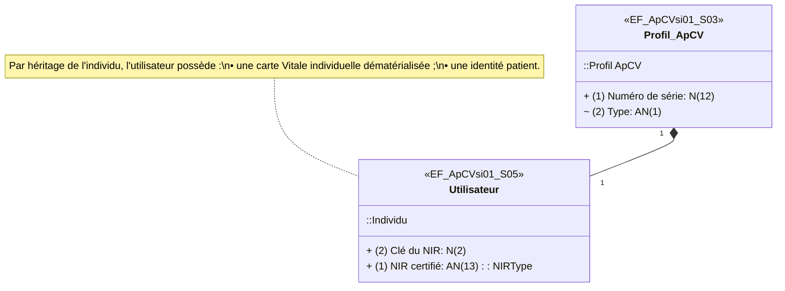
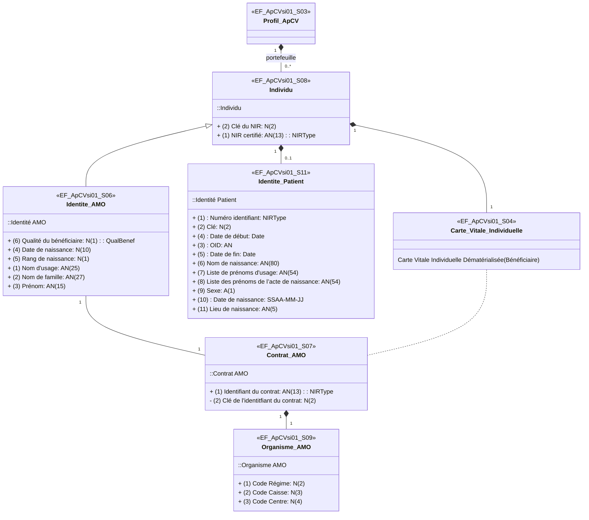
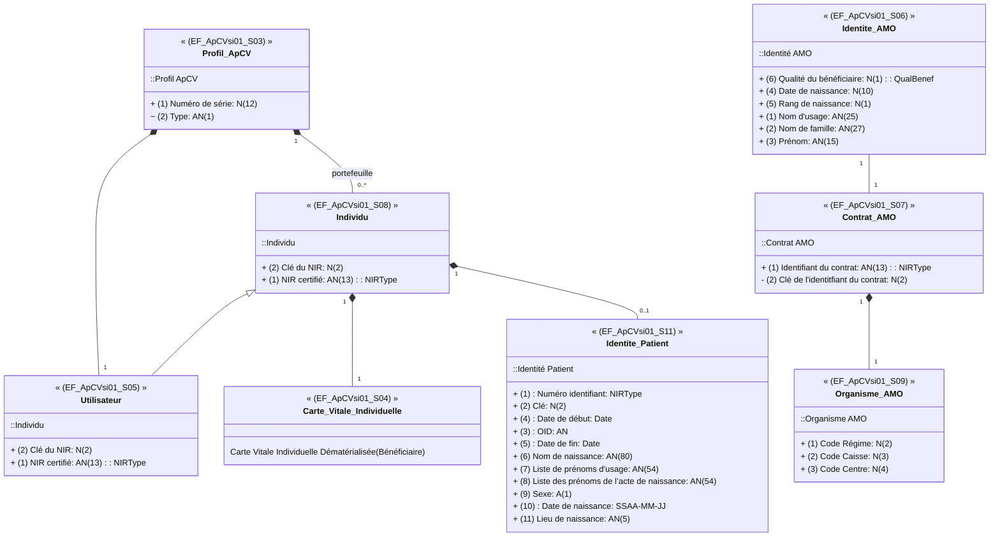
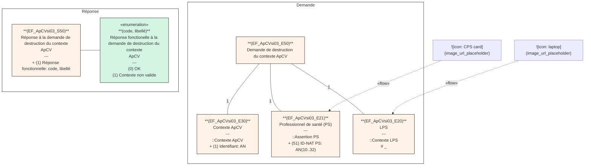
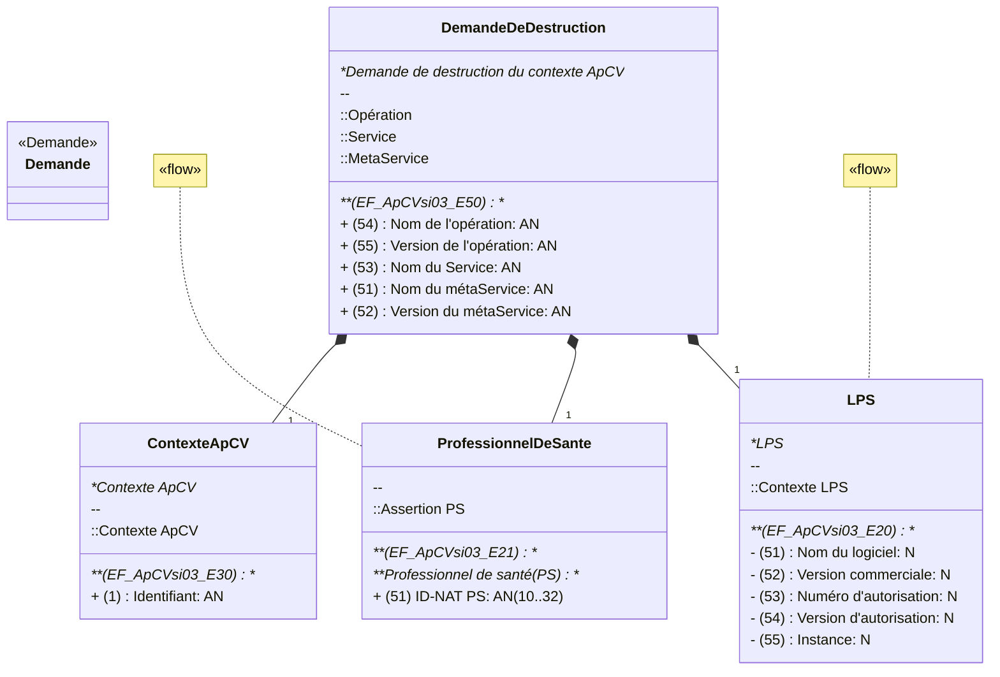

**Appli carte Vitale**
**GUIDE D'INTÉGRATION**

# GI - Appli carte Vitale -

## - Demander l'authentification et gérer le contexte ApCV - Editeurs

Référence : ApCV-MP-001 / Version : 1.8 / Date : 18/06/2025
Sécurité : RESTREINTE / État : REFERENCE


**GIE SESAM-Vitale**
5, boulevard Marie et Alexandre Oyon – 72 019 LE MANS Cedex 2
<u>www.sesam-vitale.fr</u>

GI - Appli carte Vitale -
ApCV-MP-001 - Demander l'authentification et gérer le contexte ApCV - Version : 1.8
Editeurs

Ce document a été élaboré par le GIE SESAM-Vitale.

Conformément à l’article L.122-4 du Code de la Propriété Intellectuelle, toute représentation ou reproduction (intégrale ou partielle) du présent ouvrage, quel que soit le support utilisé, doit être soumise à l’accord préalable écrit de son auteur.

Il en est de même pour sa traduction, sa transformation, son adaptation ou son arrangement, quel que soit le procédé utilisé.

**Tout manquement à ces obligations constituerait un délit de contrefaçon, au sens des articles L 335-2 et suivants du code de la propriété intellectuelle, susceptible d’entraîner des sanctions pour l’auteur du délit.**

## CONTACTS


Pour toute demande d'évolution, comme pour toute question technique ou fonctionnelle, contactez le Centre de services°:

*   e-mail°: <u>centre-de-service@sesam-vitale.fr</u>
*   téléphone°: 02 43 57 42 88

il s’agit du code spécialité AMO.

18/06/2025 GIE SESAM-Vitale 
 2 / 45
Ce document à diffusion restreinte ne peut être diffusé sans l'autorisation d'une personne habilitée au GIE SESAM-Vitale

ApCV-MP-001 - Demander l'authentification et gérer le contexte ApCV - Editeurs Version : 1.8
GI - Appli carte Vitale -

# SOMMAIRE

(Une table des matières est disponible page 45.)

<table>
    <tr>
      <td>3.2</td>
      <td>DESCRIPTION TECHNIQUE....................................................................................................................8</td>
    </tr>
    <tr>
      <td>3.3</td>
      <td>ENVIRONNEMENTS DE TRAVAIL ..........................................................................................................10</td>
    </tr>
    <tr>
      <td>3.4</td>
      <td>WS_APCV01 : DESCRIPTION DU SERVICE « DEMANDE DE L'AUTHENTIFICATION DE L'UTILISATEUR D'UNE APCV »............................................................................................................................................11</td>
    </tr>
    <tr>
      <td>3.5</td>
      <td>WS_APCV02 : DESCRIPTION DU SERVICE « DEMANDE DU CONTEXTE APCV » ...................................23</td>
    </tr>
    <tr>
      <td>3.6</td>
      <td>WS_APCV03 : DESCRIPTION DU SERVICE « DEMANDE DE DESTRUCTION DU CONTEXTE APCV » .........35</td>
    </tr>
</table>

<table>
  <caption>TABLE DES ILLUSTRATIONS</caption>
    <tr>
      <td>FIGURE 1°: ARCHITECTURE DOCUMENTAIRE DU SYSTEME APCV (EDITEURS)...........................................................5</td>
    </tr>
    <tr>
      <td>FIGURE 2°: DEMANDE DE L'AUTHENTIFICATION DE L'UTILISATEUR D'UNE APCV EN PROXIMITE PS (VULGARISATION).11</td>
    </tr>
    <tr>
      <td>FIGURE 3°: DEMANDE DE L'AUTHENTIFICATION DE L'UTILISATEUR D'UNE APCV EN PROXIMITE PS............................12</td>
    </tr>
    <tr>
      <td>FIGURE 4°: REPONSE A LA DEMANDE UNE AUTHENTIFICATION APCV EN PROXIMITE PS ..........................................14</td>
    </tr>
    <tr>
      <td>FIGURE 5°: DONNEES DU PROFIL APCV CONTENUES DANS LA REPONSE ................................................................16</td>
    </tr>
    <tr>
      <td>FIGURE 6°: DEMANDE DU CONTEXTE APCV (VULGARISATION) ...............................................................................23</td>
    </tr>
    <tr>
      <td>FIGURE 7°: DEMANDE DU CONTEXTE APCV..........................................................................................................24</td>
    </tr>
</table>

## TABLE DES ILLUSTRATIONS

<table>
    <tr>
      <td><mark>FIGURE 9°</mark>: DONNEES DU PROFIL APCV CONTENUES DANS LA REPONSE ...................................................</td>
      <td>28</td>
    </tr>
    <tr>
      <td>FIGURE 10°:DEMANDE DE DESTRUCTION DU CONTEXTE APCV (VULGARISATION) ...................................................</td>
      <td>35</td>
    </tr>
    <tr>
      <td>FIGURE 11°:DEMANDE DE DESTRUCTION DU CONTEXTE APCV ..............................................................................</td>
      <td>36</td>
    </tr>
    <tr>
      <td>FIGURE 12°:REPONSE A LA DEMANDE DE DESTRUCTION DU CONTEXTE APCV ........................................................</td>
      <td>38</td>
    </tr>
</table>

## TABLE DES ANNEXES

<table>
    <tr>
      <td><b>ANNEXE 1</b></td>
      <td></td>
      <td><b>LISTE DES ERREURS ...................................................................................................40</b></td>
    </tr>
    <tr>
      <td></td>
      <td><i>A1-1</i></td>
      <td><i>Erreurs des services........................................................................................................40</i></td>
    </tr>
    <tr>
      <td></td>
      <td><i>A1-2</i></td>
      <td><i>Liste des erreurs..............................................................................................................41</i></td>
    </tr>
    <tr>
      <td><b>ANNEXE 2</b></td>
      <td></td>
      <td><b>GUIDE DE LECTURE .....................................................................................................43</b></td>
    </tr>
    <tr>
      <td><b>ANNEXE 3</b></td>
      <td></td>
      <td><b>TABLES DES MATIERES ..............................................................................................45</b></td>
    </tr>
</table>

18/06/2025 GIE SESAM-Vitale 
  3 / 45
Ce document à diffusion restreinte ne peut être diffusé sans l'autorisation d'une personne habilitée au GIE SESAM-Vitale

ApCV-MP-001
GI - Appli carte Vitale -
- Demander l'authentification et gérer le contexte ApCV -
Editeurs
Version : 1.8

# 1 INTRODUCTION DOCUMENTAIRE

Ce document est le guide d’intégration décrivant les télé-services permettant l’authentification et la gestion du contexte ApCV.

## 1.1 Documents de référence

<table>
  <thead>
    <tr>
      <th><b>Appellation</b></th>
      <th><b>Type et titre</b></th>
      <th><b>Référence</b></th>
    </tr>
  </thead>
  <tbody>
    <tr>
      <td>CI</td>
      <td>Volet transport synchrone pour les téléservices de l'Assurance Maladie Obligatoire -<br /><i>Cadre d’interopérabilité des TLSi AMO</i></td>
      <td>CI_TLSI_AMO</td>
    </tr>
    <tr>
      <td>SFG-004</td>
      <td>SFG – Demander l’authentification et gérer le contexte ApCV</td>
      <td>ApCV-SFG-004</td>
    </tr>
    <tr>
      <td>NT-001</td>
      <td>Spécifications des échanges de proximité</td>
      <td>ApCV-NT-001</td>
    </tr>
    <tr>
      <td>SEL-INSi</td>
      <td>Téléservice Identifiant National de Santé (INS) intégré aux LPS</td>
      <td>SEL-MP-043</td>
    </tr>
    <tr>
      <td>SFD-INSi</td>
      <td>PROJET INSI – LOT1SC2 / SFD (Document assurance maladie)</td>
      <td>SFD_INSi_Lot1_1Sc2</td>
    </tr>
  </tbody>
</table>

## 1.2 Abréviations


Voir SFG-004.

## 1.3 Définitions


Voir SFG-004.

18/06/2025
GIE SESAM-Vitale 

4 / 45
Ce document à diffusion restreinte ne peut être diffusé sans l'autorisation d'une personne habilitée au GIE SESAM-Vitale

GI - Appli carte Vitale -
ApCV-MP-001 - Demander l'authentification et gérer le contexte ApCV - Version : 1.8
Editeurs

## 1.4 Positionnement du document dans le dossier de SFG

Editeurs


| (ApCV-SFG-004) <br>**Editeurs - Demander l'authentification et gérer le contexte ApCV** | (ApCV-MP-001)<br>**GI - Demander l'authentification et gérer le contexte ApCV** |
| :--- | :--- |
| *Spécifications Fonctionnelles Générales du LPS de demande de l'authentification de l'utilisateur d'une ApCV et de la gestion du contexte ApCV.*<br>A | *Guide d'intégration de demande de l'authentification de l'utilisateur d'une ApCV et de la gestion du contexte ApCV par le LPS.*<br>A |


| (ApCV-MP-002) <br>**GI - Demander la signature Vitale de la facture ApCV** |
| :--- |
| *Guide d'Intégration de gestion de la signature Vitale en présence d'une ApCV par le LPS*<br>A |

**Figure 1°: Architecture documentaire du système ApCV (Editeurs)**

## 1.5 Guide de lecture

Le guide de lecture est disponible dans l’Annexe 1 à la fin de ce document.

Certaines données facultatives dans les XSD (cf. occurrence XSD = 0..1) doivent obligatoirement être alimentées lors de l’appel du service. Se référer au chapitre 3 pour connaître les données obligatoires. Cf. « O » (obligatoire) et « F » (facultatif) dans la colonne « O/F » dans les tableaux décrivant les données.

## Références

Ci-dessous les informations permettant la compréhension des règles de nommages des web services exposés par le SI-ApCV. On distingue les :

*   données d’**E**ntrée (EF_ApCVsi**ZZ**_**Eyy**.xx) ;
*   données de **S**ortie (EF_ApCVsi**ZZ**_**Syy**.xx).

où **ZZ** correspond au numéro des webservices :

<table>
  <thead>
    <tr>
      <th>Numéro des<br />webservices<br />(zz)</th>
      <th>Description</th>
    </tr>
  </thead>
  <tbody>
    <tr>
      <td>01</td>
      <td>Demander l’authentification de l'utilisateur de l'ApCV</td>
    </tr>
    <tr>
      <td>02</td>
      <td>Demander un contexte ApCV</td>
    </tr>
    <tr>
      <td>03</td>
      <td>Demander la destruction du contexte ApCV</td>
    </tr>
  </tbody>
</table>

et **yy** au groupe de données suivants :

18/06/2025 GIE SESAM-Vitale 
 5 / 45
Ce document à diffusion restreinte ne peut être diffusé sans l'autorisation d'une personne habilitée au GIE SESAM-Vitale

ApCV-MP-001
GI - Appli carte Vitale -
Version : 1.8

# - Demander l'authentification et gérer le contexte ApCV -
## Editeurs

<table>
  <thead>
    <tr>
      <th>Groupe de données (yy)</th>
      <th>Description</th>
    </tr>
  </thead>
  <tbody>
    <tr>
      <td>03</td>
      <td>Profil ApCV</td>
    </tr>
    <tr>
      <td>04</td>
      <td>Carte Vitale Individuelle Dématérialisée</td>
    </tr>
    <tr>
      <td>05</td>
      <td>Utilisateur</td>
    </tr>
    <tr>
      <td>06</td>
      <td>Identité AMO</td>
    </tr>
    <tr>
      <td>07</td>
      <td>Contrat AMO</td>
    </tr>
    <tr>
      <td>08</td>
      <td>Individu</td>
    </tr>
    <tr>
      <td>09</td>
      <td>Organisme AMO</td>
    </tr>
    <tr>
      <td>11</td>
      <td>Identité Patient</td>
    </tr>
    <tr>
      <td>20</td>
      <td>LPS</td>
    </tr>
    <tr>
      <td>21</td>
      <td>Professionnel de santé (PS)</td>
    </tr>
    <tr>
      <td>30</td>
      <td>Contexte ApCV</td>
    </tr>
  </tbody>
</table>

et **xx** la donnée au sein de l’entité.

18/06/2025
GIE SESAM-Vitale 
  6 / 45
Ce document à diffusion restreinte ne peut être diffusé sans l'autorisation d'une personne habilitée au GIE SESAM-Vitale

ApCV-MP-001
GI - Appli carte Vitale -
- Demander l'authentification et gérer le contexte ApCV -
Editeurs
Version : 1.8

# 2 DESCRIPTION FONCTIONNELLE

**Description fonctionnelle**

 Voir SFG-004.

**Intégration des services**

Le tableau ci-dessous indique les services à implémenter.

<table>
  <thead>
    <tr>
      <th></th>
      <th>Fonctionnalité</th>
      <th>Opérations</th>
      <th>Implémentation</th>
    </tr>
  </thead>
  <tbody>
    <tr>
      <td><strong><i>WS_ApCV01</i></strong></td>
      <td>Demander l'authentification de l'utilisateur d'une ApCV</td>
      <td>authentifierUtilisateurProximite</td>
      <td>Obligatoire</td>
    </tr>
    <tr>
      <td><strong><i>WS_ApCV02</i></strong></td>
      <td>Demander un contexte ApCV</td>
      <td>restituerContexteApCV</td>
      <td>Obligatoire</td>
    </tr>
    <tr>
      <td><strong><i>WS_ApCV03</i></strong></td>
      <td>Demander la destruction du contexte ApCV</td>
      <td>detruireContexteApCV</td>
      <td>Obligatoire</td>
    </tr>
  </tbody>
</table>

18/06/2025
GIE SESAM-Vitale 
 7 / 45
Ce document à diffusion restreinte ne peut être diffusé sans l'autorisation d'une personne habilitée au GIE SESAM-Vitale

GI - Appli carte Vitale -
ApCV-MP-001 - Demander l'authentification et gérer le contexte ApCV - Editeurs Version : 1.8

# 3 ÉLEMENTS TECHNIQUES SPECIFIQUES AU SERVICE

Les mécanismes techniques mis en œuvre sont décrits dans le cadre d'interopérabilité [CI]. Ce chapitre traite uniquement des spécificités de ce téléservice.

Le cadre d’interopérabilité contient toutes les informations techniques qu’il est nécessaire de prendre en compte pour l’intégration d’un téléservice à un logiciel de santé.

La section présente décrit quant à elle tous les éléments **spécifiques au service**, et rien que ces éléments.

Vous devez donc vous appuyer sur les deux documents pour avoir la totalité des informations nécessaires.

Les formats, plages de valeurs et types des données spécifiés dans le présent document sont présentés à titre indicatif. Ils peuvent être amenés à évoluer. Seuls les schémas XSD constituent la référence des échanges.

 Les formats des données sont décrits dans le cadre d’interopérabilité [CI].

Concernant l’alimentation des données, une donnée facultative dans les schémas XSD peut être obligatoire pour le bon fonctionnement du téléservice. Les données obligatoires au niveau fonctionnel sont précisées dans SFG-004.

## 3.1 Les composants du poste de travail

Le poste de travail doit disposer de composants permettant au logiciel d'accéder aux cartes à puces.

Les composants d'accès liés à la carte CPx peuvent être :
* les librairies cryptographiques (CryptoLib) de l'ANS,
* et pour certaines données de la carte CPx, les API SSV.

Les composants utilisés pour l’accès à l’ApCV sont décrits dans le document :
* Spécifications des échanges de proximité (NT-001).

Grâce aux données obtenues, le logiciel formate ses requêtes et les envoie sur une liaison sécurisée préalablement établie.

 Toutes les documentations des produits cités ci-dessus sont disponibles sur la plate-forme de diffusion du GIE SESAM-Vitale ou le site de l’ANS.

## 3.2 Description technique

Les téléservices de demande d'authentification de l'utilisateur d'une ApCV, de demande d’un contexte ApCV et de demande de destruction du contexte ApCV sont intégrés au LPS et s’inscrivent dans le cadre d’interopérabilité des TLSi AMO [CI].

Pour l’intégration de ces téléservices, le poste de travail doit prendre en compte les exigences décrites ci-dessous.

**Occurrences des données**

Dans le contexte de l’authentification et la gestion du contexte ApCV :
* L’authentification du PS (identification forte) prend la forme d’une assertion PS signée par la carte CPx,
* L’identification du LPS prend la forme d’un contexte LPS,

18/06/2025 GIE SESAM-Vitale 
 8 / 45
Ce document à diffusion restreinte ne peut être diffusé sans l'autorisation d'une personne habilitée au GIE SESAM-Vitale

ApCV-MP-001
GI - Appli carte Vitale -
- Demander l'authentification et gérer le contexte ApCV -
Editeurs
Version : 1.8

Les assertions et les contextes sont décrits dans le cadre d’interopérabilité [CI].
Les téléservices décrits dans ce guide utilisent les assertions et contextes suivants :

<table>
  <thead>
    <tr>
      <th></th>
      <th>Opération</th>
      <th>Assertion PS</th>
      <th>Contexte LPS</th>
      <th>Assertion Vitale</th>
      <th>Assertion ApCV</th>
      <th>Contexte BAM</th>
    </tr>
  </thead>
  <tbody>
    <tr>
      <td><i>WS_ApCV01</i></td>
      <td>authentifier<br />Utilisateur<br />Proximite</td>
      <td>Obligatoire</td>
      <td>Obligatoire</td>
      <td>Non présente</td>
      <td>Non présente</td>
      <td>Non présent</td>
    </tr>
    <tr>
      <td><i>WS_ApCV02</i></td>
      <td>Restituer<br />Contexte<br />ApCV</td>
      <td>Obligatoire</td>
      <td>Obligatoire</td>
      <td>Non présente</td>
      <td>Non présente</td>
      <td>Non présent</td>
    </tr>
    <tr>
      <td><i>WS_ApCV03</i></td>
      <td>detruire<br />Contexte<br />ApCV</td>
      <td>Obligatoire</td>
      <td>Obligatoire</td>
      <td>Non présente</td>
      <td>Non présente</td>
      <td>Non présent</td>
    </tr>
  </tbody>
</table>

---
## Niveaux de contrôle des assertions

Un contrôle est effectué sur les niveaux des assertions, en référence au Cadre d’Interopérabilité [CI].

<table>
  <thead>
    <tr>
      <th></th>
      <th><strong>Opérations</strong></th>
      <th><strong>Assertion PS</strong></th>
    </tr>
  </thead>
  <tbody>
    <tr>
      <td><i><strong>WS_ApCV01</strong></i></td>
      <td>authentifierUtilisateurProximite</td>
      <td>Niveau 2</td>
    </tr>
    <tr>
      <td><i><strong>WS_ApCV02</strong></i></td>
      <td>restituerContexteApCV</td>
      <td>Niveau 2</td>
    </tr>
    <tr>
      <td><i><strong>WS_ApCV03</strong></i></td>
      <td>detruireContexteApCV</td>
      <td>Niveau 2</td>
    </tr>
  </tbody>
</table>

---
## Renseignement de l’Assertion PS

Le tableau ci-dessous présente pour chaque opération, les champs à renseigner dans les en-têtes **en plus** des champs obligatoires décrits dans le cadre d’interopérabilité :

<table>
  <thead>
    <tr>
      <th>Assertion<br />PS</th>
      <th>Renseignement</th>
      <th>authentifier<br />Utilisateur<br />Proximite<br /><br />WS_ApCV01</th>
      <th>restituer<br />Contexte<br />ApCV<br /><br />WS_ApCV02</th>
      <th>detruire<br />Contexte<br />ApCV<br /><br />WS_ApCV03</th>
    </tr>
  </thead>
  <tbody>
    <tr>
      <td colspan="2">Subject</td>
      <td></td>
      <td></td>
      <td></td>
    </tr>
    <tr>
      <td></td>
      <td>NameID</td>
      <td>ID-NAT</td>
      <td>EF_ApCVsi01<br />_E21.51</td>
      <td>EF_ApCVsi02<br />_E21.51</td>
      <td>EF_ApCVsi03<br />_E21.51</td>
    </tr>
  </tbody>
</table>

 Aucun attributStatement n’est exigé.

18/06/2025
GIE SESAM-Vitale 

9 / 45
Ce document à diffusion restreinte ne peut être diffusé sans l'autorisation d'une personne habilitée au GIE SESAM-Vitale

ApCV-MP-001
GI - Appli carte Vitale -
- Demander l'authentification et gérer le contexte ApCV -
Editeurs
Version : 1.8

# Renseignement du contexte LPS

Le tableau ci-dessous présente pour chaque opération, les champs à renseigner dans les en-têtes **<u>en plus</u>** des champs obligatoires décrits dans le cadre d’interopérabilité :

<table>
  <thead>
    <tr>
      <th colspan="2">Contexte LPS</th>
      <th>Renseignement</th>
      <th>authentifier Utilisateur Proximite<br />WS_ApCV01</th>
      <th>restituer Contexte ApCV<br />WS_ApCV02</th>
      <th>detruire Contexte ApCV<br />WS_ApCV03</th>
    </tr>
  </thead>
  <tbody>
    <tr>
      <td colspan="2">LPS</td>
      <td></td>
      <td></td>
      <td></td>
      <td></td>
    </tr>
    <tr>
      <td></td>
      <td rowspan="2">Nom</td>
      <td>Nom du logiciel</td>
      <td>EF_ApCVsi01_E20.51</td>
      <td>EF_ApCVsi02_E20.51</td>
      <td>EF_ApCVsi03_E20.51</td>
    </tr>
    <tr>
      <td></td>
      <td>Version commerciale</td>
      <td>EF_ApCVsi01_E20.52</td>
      <td>EF_ApCVsi02_E20.52</td>
      <td>EF_ApCVsi03_E20.52</td>
    </tr>
    <tr>
      <td></td>
      <td>IDAM</td>
      <td>Numéro d’autorisation</td>
      <td>EF_ApCVsi01_E20.53</td>
      <td>EF_ApCVsi02_E20.53</td>
      <td>EF_ApCVsi03_E20.53</td>
    </tr>
    <tr>
      <td></td>
      <td>Version</td>
      <td>Version d’autorisation</td>
      <td>EF_ApCVsi01_E20.54</td>
      <td>EF_ApCVsi02_E20.54</td>
      <td>EF_ApCVsi03_E20.54</td>
    </tr>
    <tr>
      <td></td>
      <td>Instance</td>
      <td>Instance</td>
      <td>EF_ApCVsi01_E20.55</td>
      <td>EF_ApCVsi02_E20.55</td>
      <td>EF_ApCVsi03_E20.55</td>
    </tr>
  </tbody>
</table>

 Le nom est un URN du type « urn:lps:\<nom commercial>:\<version commerciale> »

 Pour appeler le service de demande de contexte ApCV, le logiciel doit obtenir les données CPx par lecture de la carte. Le service peut être interrogé avec :

<table>
  <thead>
    <tr>
      <th>Type de carte</th>
      <th>Autorisation</th>
    </tr>
  </thead>
  <tbody>
    <tr>
      <td>CPS</td>
      <td>Oui</td>
    </tr>
    <tr>
      <td>CPF</td>
      <td>Oui</td>
    </tr>
    <tr>
      <td>CDE</td>
      <td>Oui</td>
    </tr>
    <tr>
      <td>CPE</td>
      <td>Oui</td>
    </tr>
    <tr>
      <td>CPA-CDA</td>
      <td><strong>Non</strong></td>
    </tr>
    <tr>
      <td>CPE Anonyme</td>
      <td>Oui</td>
    </tr>
  </tbody>
</table>

## 3.3 Environnements de travail

Deux environnements sont disponibles : un environnement de test et un environnement de production. Le passage de l’un à l’autre implique des changements de configuration qui ont un impact sur les flux XML échangés au sein de l’infrastructure.

### 3.3.1 Environnement de test

**URL d’appel**

L’URL d’appel est : <u>https://qualiflps.ecv-xp.sesam-vitale.fr/wssoap/apcv/auth/1/0</u>

18/06/2025
GIE SESAM-Vitale 
 10 / 45
Ce document à diffusion restreinte ne peut être diffusé sans l'autorisation d'une personne habilitée au GIE SESAM-Vitale

GI - Appli carte Vitale -
ApCV-MP-001 - Demander l'authentification et gérer le contexte ApCV - Editeurs Version : 1.8

**Numéro d’autorisation**
Vous devez utiliser le numéro d’autorisation de test fourni par le CNDA lors de la signature des conditions particulières de la convention.

Pour plus d'informations, voir le guide de tests de conformité du CNDA, chapitre « Pré-requis ».

## 3.3.2 Environnement de production

**URL d’appel**
L’URL d’appel est : <u>https://ias.apcv.sesam-vitale.fr:443/wssoap/apcv/auth/1/0</u>

**Numéro d’autorisation**
Vous devez utiliser le numéro d’autorisation définitif obtenu auprès du CNDA à l’issue de la procédure d’autorisation.

# 3.4 WS_ApCV01 : Description du service « Demande de l'authentification de l'utilisateur d'une ApCV »

## 3.4.1 Description fonctionnelle des données

```mermaid
classDiagram
    class Demande_EF_ApCVsi01_E50 {
        (EF_ApCVsi01_E50)
        Demande de l'authentification de l'utilisateur de l'ApCV avec CPx
        + (1) Données profil ApCV: données chiffrées
    }

    class Professionnel_de_sante_EF_ApCVsi01_E21 {
        (EF_ApCVsi01_E21)
        Professionnel de santé (PS)
        ::Professionnel de santé (PS)
        + (2) Spécialité PS: N(3)
        + (1) Identifiant de facturation: (N(9)
        ::Assertion PS
        + (51) ID-NAT PS: AN(10..32)
    }

    class LPS_EF_ApCVsi01_E20 {
        (EF_ApCVsi01_E20)
        LPS
        ::Contexte LPS
        # _
    }

    Demande_EF_ApCVsi01_E50 "1" *-- "1" Professionnel_de_sante_EF_ApCVsi01_E21
    Demande_EF_ApCVsi01_E50 "1" *-- "1" LPS_EF_ApCVsi01_E20

    class Reponse_EF_ApCVsi01_S50 {
        (EF_ApCVsi01_S50)
        Réponse à la demande d'authentification de l'utilisateur de l'ApCV avec CPx
        + (1) Réponse fonctionnelle: code, libellé
    }

    class Reponses_fonctionnelles_enumeration {
        <<enumeration>>
        (code, libellé)
        Réponses fonctionnelles à la demande d'authentification de l'utilisateur de l'ApCV
        literals
        (0) OK
    }

    class Contexte_ApCV_EF_ApCVsi01_S30 {
        (EF_ApCVsi01_S30)
        Contexte ApCV
        ::Contexte ApCV
        + (2) Date de fin de validité: Date UTC
        + (1) Identifiant: AN
    }

    Reponse_EF_ApCVsi01_S50 -- Reponses_fonctionnelles_enumeration
    Reponse_EF_ApCVsi01_S50 "1" *-- "0..1" Contexte_ApCV_EF_ApCVsi01_S30
    Contexte_ApCV_EF_ApCVsi01_S30 "1" *-- "1" Vitale_ins

    class Vitale_ins {
        
    }
```

**Figure 2°: Demande de l'authentification de l'utilisateur d'une ApCV en proximité PS (vulgarisation)**

18/06/2025 GIE SESAM-Vitale 
  11 / 45
Ce document à diffusion restreinte ne peut être diffusé sans l'autorisation d'une personne habilitée au GIE SESAM-Vitale

ApCV-MP-001 - GI - Appli carte Vitale - Version : 1.8
- Demander l'authentification et gérer le contexte ApCV -
Editeurs

### 3.4.1.1 Données d’entrée

Schéma

```mermaid
classDiagram
    direction TB

    class Demande {
        (EF_ApCVsi01_E50)
        Demande de l'authentification de l'utilisateur de l'ApCV avec CPx
        + (1) Données profil ApCV: données chiffrées
        ::Opération
        + (54) Nom de l'opération: AN
        + (55) Version de l'opération: AN
        ::Service
        + (53) Nom du Service: AN
        ::MetaService
        + (51) Nom du métaService: AN
        + (52) Version du métaService: AN
    }

    class Professionnel_de_sante {
        (EF_ApCVsi01_E21)
        Professionnel de santé (PS)
        ::Professionnel de santé (PS)
        + (2) Spécialité PS: N(3)
        + (1) Identifiant de facturation: (N(9)
        ::Assertion PS
        + (51) ID-NAT PS: AN(10..32)
    }

    class LPS {
        (EF_ApCVsi01_E20)
        LPS
        ::Contexte LPS
        # -
        - (55) Instance: UUID(32)
        - (51) Nom du logiciel: AN(256)
        - (53) Numéro d'autorisation: AN(12)
        - (52) Version commerciale: AN(256)
        - (54) Version d'autorisation: AN(256)
    }

    Demande "1" *-- "1" Professionnel_de_sante
    Demande "1" *-- "1" LPS

    %% External elements and flows
    note for Demande ""
    note for Professionnel_de_sante ""
    note for LPS ""

    %% Flow indicators
    link Demande "«flow»"
    link Professionnel_de_sante "«flow»"
    link LPS "«flow»"
```

**Figure 3°: Demande de l'authentification de l'utilisateur d'une ApCV en proximité PS**

Entités
fonctionnelles

18/06/2025 GIE SESAM-Vitale 
  12 / 45
Ce document à diffusion restreinte ne peut être diffusé sans l'autorisation d'une personne habilitée au GIE SESAM-Vitale

ApCV-MP-001
GI - Appli carte Vitale -
- Demander l'authentification et gérer le contexte ApCV -
Editeurs
Version : 1.8

<table>
  <thead>
    <tr>
      <th></th>
      <th>Nom</th>
      <th>Format</th>
      <th>Description</th>
    </tr>
  </thead>
  <tbody>
    <tr>
      <td rowspan="7">EF_ApCVsi01<br />_E50</td>
      <td>Demande de l'authentification de l'utilisateur de l'ApCV en proximité PS</td>
      <td></td>
      <td></td>
    </tr>
    <tr>
      <td><i>1</i> Données profilApCV</td>
      <td>data chiffrées</td>
      <td></td>
    </tr>
    <tr>
      <td><i>51</i> Nom du métaService</td>
      <td>AN</td>
      <td>Donnée d’entête d’appel du WS de niveau métaService.</td>
    </tr>
    <tr>
      <td><i>52</i> Version du métaService</td>
      <td>AN</td>
      <td>Donnée d’entête d’appel du WS de niveau métaService.</td>
    </tr>
    <tr>
      <td><i>53</i> Nom du Service</td>
      <td>AN</td>
      <td>Donnée d’entête d’appel du WS de niveau service.</td>
    </tr>
    <tr>
      <td><i>54</i> Nom de l'opération</td>
      <td>AN</td>
      <td>Donnée d’entête d’appel du WS de niveau opération.</td>
    </tr>
    <tr>
      <td><i>55</i> Version de l'opération</td>
      <td>AN</td>
      <td>Donnée d’entête d’appel du WS de niveau opération</td>
    </tr>
    <tr>
      <td rowspan="4">EF_ApCVsi01<br />_E21</td>
      <td>Professionnel de santé (PS)</td>
      <td></td>
      <td></td>
    </tr>
    <tr>
      <td><i>1</i> Identifiant de facturation</td>
      <td>N(9)</td>
      <td>Cet identifiant sert au décisionnel, en particulier pour le suivi des Flux de Facturation (S2F). Il inclut sa clé.</td>
    </tr>
    <tr>
      <td><i>2</i> Spécialité PS</td>
      <td>N(3)</td>
      <td>Il s’agit du codeSpecialiteAMO du PS (groupe 2 donnée 14 de SSV_LireCartePS) connu du SI-PS.</td>
    </tr>
    <tr>
      <td><i>51</i> ID-NAT PS</td>
      <td>AN (10..32)</td>
      <td>Numéro d'identification national PS contenue dans l’assertion PS (voir CI).</td>
    </tr>
    <tr>
      <td rowspan="6">EF_ApCVsi01<br />_E20</td>
      <td>LPS</td>
      <td></td>
      <td></td>
    </tr>
    <tr>
      <td><i>51</i> Nom du logiciel</td>
      <td>N</td>
      <td>Donnée contenue dans le contexte LPS.</td>
    </tr>
    <tr>
      <td><i>52</i> Version commerciale</td>
      <td>N</td>
      <td>Donnée contenue dans le contexte LPS.</td>
    </tr>
    <tr>
      <td><i>53</i> Numéro d'autorisation</td>
      <td>N</td>
      <td>Donnée contenue dans le contexte LPS.</td>
    </tr>
    <tr>
      <td><i>54</i> Version d'autorisation</td>
      <td>N</td>
      <td>Donnée contenue dans le contexte LPS.</td>
    </tr>
    <tr>
      <td><i>55</i> Instance</td>
      <td>N</td>
      <td>Donnée contenue dans le contexte LPS.<br />Numéro unique d'installation.</td>
    </tr>
  </tbody>
</table>

18/06/2025
GIE SESAM-Vitale 
  13 / 45
Ce document à diffusion restreinte ne peut être diffusé sans l'autorisation d'une personne habilitée au GIE SESAM-Vitale

ApCV-MP-001
GI - Appli carte Vitale -
- Demander l'authentification et gérer le contexte ApCV -
Editeurs
Version : 1.8

## 3.4.1.2 Données de sortie

Schéma

```mermaid
classDiagram
    class `(EF_ApCVsi01_S50)\nRéponse à la demande d'authentification de\nl'utilisateur de l'ApCV avec CPx` {
        + (1) Réponse fonctionnelle: code, libellé
    }

    class `«enumeration»\n(code, libellé)\nRéponses fonctionnelles à la demande\nd'authentification de l'utilisateur de l'ApCV` {
        <<enumeration>>
        literals
        (0) OK
    }

    class `(EF_ApCVsi01_S30)\nContexte ApCV` {
        ::Contexte ApCV
        + (2) Date de fin de validité: Date UTC
        + (1) Identifiant: AN
    }

    `(EF_ApCVsi01_S50)\nRéponse à la demande d'authentification de\nl'utilisateur de l'ApCV avec CPx` -- `«enumeration»\n(code, libellé)\nRéponses fonctionnelles à la demande\nd'authentification de l'utilisateur de l'ApCV` : 1

    `(EF_ApCVsi01_S50)\nRéponse à la demande d'authentification de\nl'utilisateur de l'ApCV avec CPx` *-- "0..1" `(EF_ApCVsi01_S30)\nContexte ApCV` : 1

    class Illustration {
        
    }

    `(EF_ApCVsi01_S30)\nContexte ApCV` *-- Illustration : 1
```

**Figure 4°: Réponse à la demande une authentification ApCV en proximité PS**

Entités
fonctionnelles

18/06/2025
GIE SESAM-Vitale 
  14 / 45
Ce document à diffusion restreinte ne peut être diffusé sans l'autorisation d'une personne habilitée au GIE SESAM-Vitale

GI - Appli carte Vitale -
ApCV-MP-001 - Demander l'authentification et gérer le contexte ApCV - Version : 1.8
Editeurs

<table>
  <thead>
    <tr>
      <th></th>
      <th>Nom</th>
      <th>Format</th>
      <th>Description</th>
    </tr>
  </thead>
  <tbody>
    <tr>
      <td rowspan="2">EF_ApCVsi01<br />_S50</td>
      <td>Réponse à la demande<br />d'authentification de<br />l'utilisateur de l'ApCV</td>
      <td></td>
      <td></td>
    </tr>
    <tr>
      <td><i><b>1</b></i> Réponse fonctionnelle</td>
      <td></td>
      <td>0 : OK</td>
    </tr>
    <tr>
      <td rowspan="3">EF_ApCVsi01<br />_S30</td>
      <td>Contexte ApCV</td>
      <td></td>
      <td>Un contexte ApCV est un groupe de<br />données contenant :<br /><br />● les données d’identification de<br />l’utilisateur de l’ApCV : sa carte Vitale<br />individuelle dématérialisée et son identité<br />patient ;<br /><br />● éventuellement les données<br />d’identification d’autres individus, avec<br />pour chacun : sa carte Vitale individuelle<br />dématérialisée et son identité patient ;<br /><br />● les informations relatives à l’ApCV.</td>
    </tr>
    <tr>
      <td><i><b>1</b></i> Identifiant</td>
      <td>AN</td>
      <td></td>
    </tr>
    <tr>
      <td><i><b>2</b></i> Date de fin de validité</td>
      <td>Date<br />UTC</td>
      <td></td>
    </tr>
  </tbody>
</table>

***

**Schéma**

18/06/2025 GIE SESAM-Vitale 
  15 / 45
Ce document à diffusion restreinte ne peut être diffusé sans l'autorisation d'une personne habilitée au GIE SESAM-Vitale

ApCV-MP-001 - Demander l'authentification et gérer le contexte ApCV - GI - Appli carte Vitale - Version : 1.8
Editeurs

Données de niveau "ApCV et son utilisateur"




Données de niveau "Individu du portefeuille du profil ApCV"



### Figure 5°: Données du profil ApCV contenues dans la réponse

## Entités fonctionnelles

<table>
  <thead>
    <tr>
      <th></th>
      <th>Nom</th>
      <th>Format</th>
      <th>Card</th>
      <th>Description</th>
    </tr>
  </thead>
  <tbody>
    <tr>
      <td rowspan="3"><strong>EF_ApCVsi01<br />_S03</strong></td>
      <td>Profil ApCV</td>
      <td></td>
      <td><strong>1</strong></td>
      <td>Un utilisateur lié à un support (enrôlé) et ayant son portefeuille de cartes Vitale dématérialisées. Un support peut contenir ainsi plusieurs profils d’utilisateurs (exemple : famille utilisant un seul smartphone).</td>
    </tr>
    <tr>
      <td><em><strong>1</strong></em></td>
      <td>Numéro de série</td>
      <td>N(12)</td>
      <td><strong>1</strong></td>
      <td>Permet une traçabilité au niveau des factures émises par quel support. Sa valeur doit être compatible avec celle prévue pour la carte Vitale pour qu'il n'y ait pas d'impact au niveau des chaînes de liquidation.</td>
    </tr>
    <tr>
      <td><em><strong>2</strong></em></td>
      <td>Type</td>
      <td>AN(1)</td>
      <td><strong>1</strong></td>
      <td>Cette donnée précise si l'application fonctionne en mode réel (R), en mode test (T) ou en mode démonstrations (D).<br /><br />Elle vient simplifier le contrôle réalisé à partir d'un contrôle sur la plage de numéros de série propre à chaque type.</td>
    </tr>
  </tbody>
</table>

18/06/2025 GIE SESAM-Vitale 
  16 / 45
Ce document à diffusion restreinte ne peut être diffusé sans l'autorisation d'une personne habilitée au GIE SESAM-Vitale

ApCV-MP-001
GI - Appli carte Vitale -
Version : 1.8
- Demander l'authentification et gérer le contexte ApCV -
Editeurs

<table>
    <tr>
      <td></td>
      <td></td>
      <td></td>
      <td></td>
      <td></td>
      <td>Un contrôle de cohérence avec les données de la carte <mark><u>CPS CPx</u></mark> est <u>réalisée :</u> une application de test ne peut être utilisée qu'avec une <mark><u>CPS CPx</u></mark> de test.<br /><br />Cette donnée était nommée 'nature' pour la carte Vitale.</td>
    </tr>
    <tr>
      <td rowspan="3"><b>EF_ApCVsi01<br />_S05</b></td>
      <td></td>
      <td colspan="2">Utilisateur</td>
      <td><mark>1</mark></td>
      <td>Le terme utilisateur désigne un individu qui a finalisé avec succès le processus de délivrance d'un profil ApCV.</td>
    </tr>
    <tr>
      <td><i>1</i></td>
      <td>NIR</td>
      <td>AN(13) :<br />NIRType</td>
      <td><mark>1</mark></td>
      <td></td>
    </tr>
    <tr>
      <td><i>2</i></td>
      <td>Clé du NIR</td>
      <td>N(2)</td>
      <td><mark>1</mark></td>
      <td></td>
    </tr>
    <tr>
      <td rowspan="3"><b>EF_ApCVsi01<br />_S08</b></td>
      <td></td>
      <td colspan="2">Individu</td>
      <td><mark>0..*</mark></td>
      <td>Il s'agit un bénéficiaire de l'assurance maladie présent dans le portefeuille de cartes Vitale individuelles dématérialisées d'un utilisateur de l'ApCV.</td>
    </tr>
    <tr>
      <td><i>1</i></td>
      <td>NIR certifié</td>
      <td>AN(13) :<br />NIRType</td>
      <td><mark>1</mark></td>
      <td></td>
    </tr>
    <tr>
      <td><i>2</i></td>
      <td>Clé du NIR</td>
      <td>N(2)</td>
      <td><mark>1</mark></td>
      <td>Nécessaire à la facturation.</td>
    </tr>
    <tr>
      <td rowspan="8"><b>EF_ApCVsi01<br />_S11</b></td>
      <td></td>
      <td colspan="2">Identité Patient <mark>(INS)</mark></td>
      <td><mark>0..1</mark></td>
      <td>Voir le document GIE-SV "Téléservice Identifiant National de Santé (INS) intégré aux LPS" (SEL-MP-043).<br /><br />Voir le document de l'assurance maladie "PROJET INSI – LOT1SC2" (SFD_INSi_Lot_1).</td>
    </tr>
    <tr>
      <td><i>1</i></td>
      <td>Numéro identifiant</td>
      <td>NIRType</td>
      <td><mark>1</mark></td>
      <td>Donnée EF_INS23.1 dans SEL-MP-043 : NIR du patient (sans clé) sur 13 caractères.<br /><br />Donnée ICIR_RACV_05 dans SFD_INSi_Lot_1 : Matricule Individu.</td>
    </tr>
    <tr>
      <td><i>2</i></td>
      <td>Clé</td>
      <td>N(2)</td>
      <td><mark>1</mark></td>
      <td>Donnée EF_INS23.2 dans SEL-MP-043 : Clé du NIR du patient sur 2 caractères.</td>
    </tr>
    <tr>
      <td><i>3</i></td>
      <td>OID</td>
      <td>AN</td>
      <td><mark>1</mark></td>
      <td>Donnée EF_INS22.1 dans SEL-MP-043 : Identifiant de l’organisme qui a affecté l’INS.<br /><br />Donnée ICIR_RACV_05 dans SFD_INSi_Lot_1 : Matricule Individu.<br /><br />Il existe trois type d'INS :<br />● INS-NIR : OID = 1.2.250.1.213.1.4.8<br />● INS-NIA<br />● INS-C<br />L'INS-C va disparaitre au profit de l'INS-NIR. L'ApCV ne traite pas des NIA.<br /><br />voir https://esante.gouv.fr/actualites/ins-publication-des-oid-des-autorites-daffectation.</td>
    </tr>
    <tr>
      <td><i>4</i></td>
      <td>Date de début</td>
      <td>Date</td>
      <td><mark>0..1</mark></td>
      <td>Donnée EF_INS22.2 dans SEL-MP-043 : Date d’entrée en vigueur de l’INS au format SSAA-MM-JJ.<br /><br />Donnée non décrite dans SFD_INSi_Lot_1.</td>
    </tr>
    <tr>
      <td><i>5</i></td>
      <td>Date de fin</td>
      <td>Date</td>
      <td><mark>0..1</mark></td>
      <td>Donnée EF_INS22.3 dans SEL-MP-043 : Date d’entrée de fin de validité de l’INS au format SSAA-MM-JJ.<br /><br />Donnée non décrite dans SFD_INSi_Lot_1.</td>
    </tr>
    <tr>
      <td><i>6</i></td>
      <td>Nom de naissance</td>
      <td>AN</td>
      <td><mark>0..1</mark></td>
      <td>Donnée EF_INS25.1 dans SEL-MP-<mark>043 : <del>Cette donnée peut ne pas être renseignée.</del></mark><br /><br />Donnée ICIR_RACV_07 dans SFD_INSi_Lot_1 : Nom de naissance de l'individu.</td>
    </tr>
    <tr>
      <td><i>7</i></td>
      <td>Liste de prénoms d'usage</td>
      <td>AN</td>
      <td><mark>0..1</mark></td>
      <td>Donnée EF_INS25.2 dans SEL-MP-043 : Liste de prénoms séparés par un espace.<br /><br /><mark>Cette donnée n’est plus remontée par le service INS</mark><br /><br />Donnée ICIR_RACV_08 dans SFD_INSi_Lot_1 : Liste de prénoms</td>
    </tr>
</table>

18/06/2025
GIE SESAM-Vitale 
  17 / 45
Ce document à diffusion restreinte ne peut être diffusé sans l'autorisation d'une personne habilitée au GIE SESAM-Vitale

GI - Appli carte Vitale -
ApCV-MP-001 - Demander l'authentification et gérer le contexte ApCV - Version : 1.8
Editeurs

<table>
    <tr>
      <td></td>
      <td>8</td>
      <td>Liste des prénoms de l’acte de naissance</td>
      <td>AN</td>
      <td><mark>0..1</mark></td>
      <td>d’usage de l’individu. <mark><s>Cette donnée peut ne pas être renseignée.</s></mark><br /><br />Donnée EF_INS25.3 dans SEL-MP-043 : Liste de prénoms séparés par un espace.<br /><br />Donnée ICIR_RACV_16 dans SFD_INSi_Lot_1 : Liste certifiante des prénoms d’état civil.</td>
    </tr>
    <tr>
      <td></td>
      <td>9</td>
      <td>Sexe</td>
      <td>A(1)</td>
      <td><mark>0..1</mark></td>
      <td>Donnée EF_INS25.4 dans SEL-MP-043 : Valeur « M » : masculin, Valeur « F » : féminin. <mark><s>Cette donnée peut ne pas être renseignée.</s></mark><br /><br />Donnée ICIR_RACV_09 dans SFD_INSi_Lot_1 : Sexe de l’individu</td>
    </tr>
    <tr>
      <td></td>
      <td>10</td>
      <td>Date de naissance</td>
      <td>Date</td>
      <td><mark>0..1</mark></td>
      <td>Donnée EF_INS25_05 dans SEL-MP-043 : Date au format SSAA-MM-JJ. <mark><s>Cette donnée peut ne pas être renseignée.</s></mark><br /><br />Donnée ICIR_RACV_10 dans SFD_INSi_Lot_1 : Date de naissance de l’individu.</td>
    </tr>
    <tr>
      <td></td>
      <td>11</td>
      <td>Lieu de naissance</td>
      <td>AN(5)</td>
      <td><mark>0..1</mark></td>
      <td>Donnée EF_INS25_06 dans SEL-MP-043 : Code sur 5 chiffres de la commune ou du pays de naissance du patient. Ce code est issu du Code Officiel Géographique (COG) de l’INSEE. Il ne <u>s’agit</u> pas du code postal de la commune de naissance du patient. <mark><s>Cette donnée peut ne pas être renseignée.</s></mark><br /><br />Donnée ICIR_RACV_11 dans SFD_INSi_Lot_1 : Lieu de naissance de l’individu.</td>
    </tr>
    <tr>
      <td>EF_ApCVsi01_S04</td>
      <td colspan="3">Carte Vitale Individuelle Dématérialisée</td>
      <td><mark>1</mark></td>
      <td>Désigne la carte Vitale dématérialisée et individuelle associée à une personne (OD, AD, bénéficiaire prêté, etc.) et faisant partie d’un portefeuille de cartes Vitale dématérialisées d’un utilisateur.</td>
    </tr>
    <tr>
      <td>EF_ApCVsi01_S06</td>
      <td colspan="3">Identité AMO</td>
      <td><mark>1</mark></td>
      <td>Identité civile connue de l'assurance maladie.</td>
    </tr>
    <tr>
      <td></td>
      <td>1</td>
      <td>Nom d'usage</td>
      <td>AN</td>
      <td><mark>0..1</mark></td>
      <td> <s><mark>Cette donnée peut être vide.</mark></s><br /><br /> Cette donnée peut contenir des caractères diacritiques<br /><br /> Cette donnée peut avoir une longueur supérieure à la longueur attendu en facturation. Il conviendra de tronquer sa longueur en utilisant les 25 premiers caractères<br /><br /><mark><u>Lorsque le nom de famille n'est pas présent, le nom d’usage est</u> renseigné.</mark></td>
    </tr>
    <tr>
      <td></td>
      <td>2</td>
      <td>Nom de famille</td>
      <td>AN</td>
      <td><mark>0..1</mark></td>
      <td> <s><mark>Cette donnée peut être vide.</mark></s><br /><br /> Cette donnée peut contenir des caractères diacritiques<br /><br /> Cette donnée peut avoir une longueur supérieure à la longueur attendu en facturation. Il conviendra de tronquer sa longueur en utilisant les 27 premiers caractères<br /><br /><mark><u>Lorsque le nom de famille n'est pas présent, le prénom est</u> renseigné.</mark><br /><br /><mark><u>Lorsque le nom d’usage de n'est pas présent, le nom de famille</u> est renseigné.</mark></td>
    </tr>
    <tr>
      <td></td>
      <td>3</td>
      <td>Prénom</td>
      <td>AN</td>
      <td><mark>0..1</mark></td>
      <td> Cette donnée peut contenir des caractères diacritiques<br /><br /> Cette donnée peut avoir une longueur supérieure à la longueur attendu en facturation. Il conviendra de tronquer sa longueur en utilisant les 15 premiers caractères<br /><br /><mark>Lorsque le prénom n'est pas présent, le nom de famille est renseigné.</mark></td>
    </tr>
    <tr>
      <td></td>
      <td>4</td>
      <td>Date de naissance</td>
      <td>N(10)</td>
      <td><mark>1</mark></td>
      <td>au format AAAA-MM-JJ (conforme TLSi)</td>
    </tr>
</table>

18/06/2025 GIE SESAM-Vitale  18 / 45
18

Ce document à diffusion restreinte ne peut être diffusé sans l'autorisation d'une personne habilitée au GIE SESAM-Vitale

GI - Appli carte Vitale -
ApCV-MP-001 - Demander l'authentification et gérer le contexte ApCV - Version : 1.8
Editeurs

<table>
    <tr>
      <td></td>
      <td></td>
      <td></td>
      <td></td>
      <td></td>
      <td>Il peut s'agir d'une date lunaire.</td>
    </tr>
    <tr>
      <td></td>
      <td><i><b>5</b></i></td>
      <td>Rang de naissance</td>
      <td>N(1)</td>
      <td><mark>1</mark></td>
      <td>[1..9].</td>
    </tr>
    <tr>
      <td></td>
      <td><i><b>6</b></i></td>
      <td>Qualité du bénéficiaire</td>
      <td>N(1) : QualBenef</td>
      <td><mark>1</mark></td>
      <td>Obligatoire aux TLSi, elle prend pour valeurs :<br />0 : Assuré<br />1 : Ascendant, descendant, collatéraux, ascendants<br />2 : Conjoint <mark>/ PACS</mark><br />3 : Conjoint divorcé <mark><u>/ Concubin en rupture / PACS séparé</u></mark><br />4 : Concubin<br />5 : Conjoint séparé<br />6 : Enfant<br />8 : Conjoint Veuf<br />9 : Autre ayant-droit</td>
    </tr>
    <tr>
      <td rowspan="3"><b>EF_ApCVsi01<br />_S07</b></td>
      <td></td>
      <td>Contrat AMO</td>
      <td></td>
      <td><mark>1</mark></td>
      <td>Désigne le titulaire du contrat d'<b>A</b>ssurance <b>M</b>aladie <b>O</b>bligatoire.</td>
    </tr>
    <tr>
      <td><i><b>1</b></i></td>
      <td>Identifiant du contrat</td>
      <td>AN(13) : NIRType</td>
      <td><mark>1</mark></td>
      <td>NIR de l'assuré sans sa clé.</td>
    </tr>
    <tr>
      <td><i><b>2</b></i></td>
      <td>Clé de l’identifiant du contrat</td>
      <td>N(2)</td>
      <td><mark>1</mark></td>
      <td></td>
    </tr>
    <tr>
      <td rowspan="4"><b>EF_ApCVsi01<br />_S09</b></td>
      <td></td>
      <td>Organisme AMO</td>
      <td></td>
      <td><mark>1</mark></td>
      <td>Un Organisme AMO est une entité organisationnelle. Il représente une caisse ou un centre d’un AMO. Il peut remplir deux rôles : un rôle de gestionnaire d’assurés de l’Assurance Maladie (unité de rattachement), et un rôle d’accompagnement des PS.</td>
    </tr>
    <tr>
      <td><i><b>1</b></i></td>
      <td>Code Régime</td>
      <td>N(2)</td>
      <td><mark>1</mark></td>
      <td></td>
    </tr>
    <tr>
      <td><i><b>2</b></i></td>
      <td>Code Caisse</td>
      <td>N(3)</td>
      <td><mark>1</mark></td>
      <td></td>
    </tr>
    <tr>
      <td><i><b>3</b></i></td>
      <td>Code Centre</td>
      <td>N(4)</td>
      <td><mark>1</mark></td>
      <td></td>
    </tr>
</table>

## 3.4.2 Description technique

### Références techniques

<strong>Références techniques</strong>

<i>WSDL</i>
<table>
        <tr>
            <td>Fichier</td>
            <td>AUTH_1.0.0.wsdl du 27/05/2020</td>
        </tr>
</table>

<i>Action</i>
<table>
        <tr>
            <td>Nom de l’opération</td>
            <td>authentifierUtilisateurProximite</td>
        </tr>
</table>

<i>Messages</i>
<table>
        <tr>
            <td>Requête</td>
            <td>AuthentifierUtilisateurProximiteReq</td>
        </tr>
        <tr>
            <td>Réponse</td>
            <td>AuthentifierUtilisateurProximiteRep</td>
        </tr>
</table>

18/06/2025 GIE SESAM-Vitale 
 19 / 45
Ce document à diffusion restreinte ne peut être diffusé sans l'autorisation d'une personne habilitée au GIE SESAM-Vitale

GI - Appli carte Vitale -
ApCV-MP-001 - Demander l'authentification et gérer le contexte ApCV - Version : 1.8
Editeurs

## Données en entrée

Namespace : http://www.sesam-vitale.fr/apcv/auth/1/0.

<table>
  <thead>
    <tr>
      <th colspan="3">Balises XML<br /><b>Gras : élément vide</b><br /><i>Italique : élément avec contenu</i><br />Rouge foncé : attribut</th>
      <th>Occur-<br />rence<br />XSD</th>
      <th>Format</th>
      <th>Alimentation données</th>
    </tr>
  </thead>
  <tbody>
    <tr>
      <td colspan="3"><b>AuthentifierUtilisateurProximiteReq</b></td>
      <td>1</td>
      <td></td>
      <td>EF_ApCVsi01_E50</td>
    </tr>
    <tr>
      <td></td>
      <td colspan="2">Version</td>
      <td>1</td>
      <td>AN</td>
      <td>EF_ApCVsi01_E50.55</td>
    </tr>
    <tr>
      <td></td>
      <td colspan="2"><b>ProfessionnelSante</b></td>
      <td>1</td>
      <td></td>
      <td>EF_ApCVsi01_E21</td>
    </tr>
    <tr>
      <td></td>
      <td></td>
      <td><i>IdentifiantFacturation</i></td>
      <td>0..1</td>
      <td>AN</td>
      <td>EF_ApCVsi01_E21.1</td>
    </tr>
    <tr>
      <td></td>
      <td></td>
      <td><i>CodeSpecialiteAMO</i></td>
      <td>0..1</td>
      <td>AN</td>
      <td>EF_ApCVsi01_E21.2</td>
    </tr>
    <tr>
      <td></td>
      <td colspan="2"><i>Donnees</i></td>
      <td>1</td>
      <td>AN</td>
      <td>EF_ApCVsi01_E50.1</td>
    </tr>
  </tbody>
</table>

## Données en sortie

Namespace : http://www.sesam-vitale.fr/apcv/auth/1/0.

<table>
  <thead>
    <tr>
      <th colspan="7">Balises XML<br /><b>Gras : élément vide</b><br /><i>Italique : élément avec contenu</i><br />Rouge foncé : attribut</th>
      <th>Occur<br />-rence<br />XSD</th>
      <th>Forma<br />t</th>
      <th>Alimentation données</th>
    </tr>
  </thead>
  <tbody>
    <tr>
      <td colspan="7"><b>AuthentifierUtilisateurProximiteRep</b></td>
      <td>1</td>
      <td></td>
      <td>EF_ApCVsi01_S50</td>
    </tr>
    <tr>
      <td></td>
      <td colspan="6">version</td>
      <td>1</td>
      <td>AN</td>
      <td></td>
    </tr>
    <tr>
      <td></td>
      <td colspan="6">horodatage</td>
      <td>1</td>
      <td>DT</td>
      <td></td>
    </tr>
    <tr>
      <td></td>
      <td colspan="6">ID</td>
      <td>1</td>
      <td>AN</td>
      <td></td>
    </tr>
    <tr>
      <td></td>
      <td colspan="6"><i>CodeStatut</i></td>
      <td>1</td>
      <td>N</td>
      <td>EF_ApCVsi01_S50.1</td>
    </tr>
    <tr>
      <td></td>
      <td colspan="6"><b>ContexteApCV</b></td>
      <td>1</td>
      <td></td>
      <td>EF_ApCVsi01_S30</td>
    </tr>
    <tr>
      <td></td>
      <td></td>
      <td colspan="5"><i>DateFinValidite</i></td>
      <td>1</td>
      <td>DT</td>
      <td>EF_ApCVsi01_S30.2</td>
    </tr>
    <tr>
      <td></td>
      <td></td>
      <td colspan="5"><i>Identifiant</i></td>
      <td>1</td>
      <td>AN</td>
      <td>EF_ApCVsi01_S30.1</td>
    </tr>
    <tr>
      <td></td>
      <td></td>
      <td colspan="5"><i>TokenApCV</i></td>
      <td>1</td>
      <td>AN</td>
      <td></td>
    </tr>
    <tr>
      <td></td>
      <td colspan="6"><b>ProfilApCV</b></td>
      <td>1</td>
      <td></td>
      <td>EF_ApCVsi01_S03</td>
    </tr>
    <tr>
      <td></td>
      <td></td>
      <td colspan="5"><b>Identification</b></td>
      <td>1</td>
      <td></td>
      <td></td>
    </tr>
    <tr>
      <td></td>
      <td></td>
      <td></td>
      <td colspan="4">numSerie</td>
      <td>1</td>
      <td>AN</td>
      <td>EF_ApCVsi01_S03.1</td>
    </tr>
    <tr>
      <td></td>
      <td></td>
      <td></td>
      <td colspan="4">type</td>
      <td>1</td>
      <td>AN</td>
      <td>EF_ApCVsi01_S03.2</td>
    </tr>
    <tr>
      <td></td>
      <td></td>
      <td colspan="5"><b>Utilisateur</b></td>
      <td>1</td>
      <td></td>
      <td>EF_ApCVsi01_S05</td>
    </tr>
    <tr>
      <td></td>
      <td></td>
      <td></td>
      <td colspan="4"><b>IdentitePatient</b></td>
      <td>1</td>
      <td></td>
      <td>EF_ApCVsi01_S11</td>
    </tr>
    <tr>
      <td></td>
      <td></td>
      <td></td>
      <td></td>
      <td colspan="3"><b>INSACTIF</b></td>
      <td>1</td>
      <td></td>
      <td></td>
    </tr>
    <tr>
      <td></td>
      <td></td>
      <td></td>
      <td></td>
      <td></td>
      <td colspan="2"><b>IdIndividu</b></td>
      <td>1</td>
      <td></td>
      <td></td>
    </tr>
    <tr>
      <td></td>
      <td></td>
      <td></td>
      <td></td>
      <td></td>
      <td></td>
      <td><i>NumIdentifiant</i></td>
      <td>1</td>
      <td>AN</td>
      <td>EF_ApCVsi01_S11.1</td>
    </tr>
  </tbody>
</table>

18/06/2025 GIE SESAM-Vitale 
  20 / 45
Ce document à diffusion restreinte ne peut être diffusé sans l'autorisation d'une personne habilitée au GIE SESAM-Vitale

ApCV-MP-001
GI - Appli carte Vitale -
- Demander l'authentification et gérer le contexte ApCV -
Editeurs
Version : 1.8

<table>
    <tr>
      <td></td>
      <td></td>
      <td></td>
      <td></td>
      <td></td>
      <td><i>Cle</i></td>
      <td>0..1</td>
      <td>AN</td>
      <td>EF_ApCVsi01_S11.2</td>
    </tr>
    <tr>
      <td></td>
      <td></td>
      <td></td>
      <td></td>
      <td></td>
      <td><i>TypeMatricule</i></td>
      <td>0..1</td>
      <td>AN</td>
      <td></td>
    </tr>
    <tr>
      <td></td>
      <td></td>
      <td></td>
      <td></td>
      <td><i>OID</i></td>
      <td></td>
      <td>1</td>
      <td>AN</td>
      <td>EF_ApCVsi01_S11.3</td>
    </tr>
    <tr>
      <td></td>
      <td></td>
      <td></td>
      <td></td>
      <td><i>DateDeb</i></td>
      <td></td>
      <td>0..1</td>
      <td>D</td>
      <td>EF_ApCVsi01_S11.4</td>
    </tr>
    <tr>
      <td></td>
      <td></td>
      <td></td>
      <td></td>
      <td><i>DateFin</i></td>
      <td></td>
      <td>0..1</td>
      <td>D</td>
      <td>EF_ApCVsi01_S11.5</td>
    </tr>
    <tr>
      <td></td>
      <td></td>
      <td></td>
      <td><strong>TIQ</strong></td>
      <td></td>
      <td></td>
      <td>1</td>
      <td></td>
      <td></td>
    </tr>
    <tr>
      <td></td>
      <td></td>
      <td></td>
      <td></td>
      <td><i>NomNaissance</i></td>
      <td></td>
      <td>0..1</td>
      <td>Entre 1<br />et<br />80AN</td>
      <td>EF_ApCVsi01_S11.6</td>
    </tr>
    <tr>
      <td></td>
      <td></td>
      <td></td>
      <td></td>
      <td><i>Prenom</i></td>
      <td></td>
      <td>0..1</td>
      <td>Entre 1<br />et<br />54AN</td>
      <td>EF_ApCVsi01_S11.7</td>
    </tr>
    <tr>
      <td></td>
      <td></td>
      <td></td>
      <td></td>
      <td><i>ListePrenom</i></td>
      <td></td>
      <td>0..1</td>
      <td>Entre 1<br />et<br />54AN</td>
      <td>EF_ApCVsi01_S11.8</td>
    </tr>
    <tr>
      <td></td>
      <td></td>
      <td></td>
      <td></td>
      <td><i>Sexe</i></td>
      <td></td>
      <td>0..1</td>
      <td>AN</td>
      <td>EF_ApCVsi01_S11.9</td>
    </tr>
    <tr>
      <td></td>
      <td></td>
      <td></td>
      <td></td>
      <td><i>DateNaissance</i></td>
      <td></td>
      <td>0..1</td>
      <td>DL</td>
      <td>EF_ApCVsi01_S11.10</td>
    </tr>
    <tr>
      <td></td>
      <td></td>
      <td></td>
      <td></td>
      <td><i>LieuNaissance</i></td>
      <td></td>
      <td>0..1</td>
      <td>AN</td>
      <td>EF_ApCVsi01_S11.11</td>
    </tr>
    <tr>
      <td></td>
      <td></td>
      <td><strong>CarteVitaleIndividu</strong></td>
      <td></td>
      <td></td>
      <td></td>
      <td>1</td>
      <td></td>
      <td>EF_ApCVsi01_S04</td>
    </tr>
    <tr>
      <td></td>
      <td></td>
      <td></td>
      <td><strong>IdentiteAMO</strong></td>
      <td></td>
      <td></td>
      <td>1</td>
      <td></td>
      <td>EF_ApCVsi01_S06</td>
    </tr>
    <tr>
      <td></td>
      <td></td>
      <td></td>
      <td></td>
      <td><i>NomFamille</i></td>
      <td></td>
      <td>0..1</td>
      <td>Entre 1<br />et<br />27AN</td>
      <td>EF_ApCVsi01_S06.2</td>
    </tr>
    <tr>
      <td></td>
      <td></td>
      <td></td>
      <td></td>
      <td><i>NomUsage</i></td>
      <td></td>
      <td>0..1</td>
      <td>Entre 1<br />et<br />25AN</td>
      <td>EF_ApCVsi01_S06.1</td>
    </tr>
    <tr>
      <td></td>
      <td></td>
      <td></td>
      <td></td>
      <td><i>Prenom</i></td>
      <td></td>
      <td>1</td>
      <td>Entre 1<br />et<br />15AN</td>
      <td>EF_ApCVsi01_S06.3</td>
    </tr>
    <tr>
      <td></td>
      <td></td>
      <td></td>
      <td></td>
      <td><i>Qualite</i></td>
      <td></td>
      <td>1</td>
      <td>N</td>
      <td>EF_ApCVsi01_S06.6</td>
    </tr>
    <tr>
      <td></td>
      <td></td>
      <td></td>
      <td></td>
      <td><i>DateNaissance</i></td>
      <td></td>
      <td>1</td>
      <td>DL</td>
      <td>EF_ApCVsi01_S06.4</td>
    </tr>
    <tr>
      <td></td>
      <td></td>
      <td></td>
      <td></td>
      <td></td>
      <td>rang</td>
      <td>0..1</td>
      <td>N</td>
      <td>EF_ApCVsi01_S06.5</td>
    </tr>
    <tr>
      <td></td>
      <td></td>
      <td></td>
      <td></td>
      <td><i>NIRCertifie</i></td>
      <td></td>
      <td>1</td>
      <td>AN</td>
      <td>EF_ApCVsi01_S05.1</td>
    </tr>
    <tr>
      <td></td>
      <td></td>
      <td></td>
      <td></td>
      <td></td>
      <td>cle</td>
      <td>1</td>
      <td>AN</td>
      <td>EF_ApCVsi01_S05.2</td>
    </tr>
    <tr>
      <td></td>
      <td></td>
      <td></td>
      <td><strong>ContratAMO</strong></td>
      <td></td>
      <td></td>
      <td>1</td>
      <td></td>
      <td>EF_ApCVsi01_S07</td>
    </tr>
    <tr>
      <td></td>
      <td></td>
      <td></td>
      <td></td>
      <td><i>NIRAssure</i></td>
      <td></td>
      <td>1</td>
      <td>AN</td>
      <td>EF_ApCVsi01_S07.1</td>
    </tr>
    <tr>
      <td></td>
      <td></td>
      <td></td>
      <td></td>
      <td></td>
      <td>cle</td>
      <td>1</td>
      <td>AN</td>
      <td>EF_ApCVsi01_S07.2</td>
    </tr>
    <tr>
      <td></td>
      <td></td>
      <td></td>
      <td></td>
      <td><strong>OrganismeAMO</strong></td>
      <td></td>
      <td>1</td>
      <td></td>
      <td>EF_ApCVsi01_S09</td>
    </tr>
    <tr>
      <td></td>
      <td></td>
      <td></td>
      <td></td>
      <td></td>
      <td>codeRegime</td>
      <td>1</td>
      <td>AN</td>
      <td>EF_ApCVsi01_S09.1</td>
    </tr>
    <tr>
      <td></td>
      <td></td>
      <td></td>
      <td></td>
      <td></td>
      <td>codeCaisse</td>
      <td>1</td>
      <td>AN</td>
      <td>EF_ApCVsi01_S09.2</td>
    </tr>
    <tr>
      <td></td>
      <td></td>
      <td></td>
      <td></td>
      <td></td>
      <td>codeCentre</td>
      <td>1</td>
      <td>AN</td>
      <td>EF_ApCVsi01_S09.3</td>
    </tr>
    <tr>
      <td></td>
      <td><strong>Individu</strong></td>
      <td></td>
      <td></td>
      <td></td>
      <td></td>
      <td>0..n</td>
      <td></td>
      <td>EF_ApCVsi01_S08</td>
    </tr>
</table>

18/06/2025
GIE SESAM-Vitale 
  21 / 45
Ce document à diffusion restreinte ne peut être diffusé sans l'autorisation d'une personne habilitée au GIE SESAM-Vitale

GI - Appli carte Vitale -
ApCV-MP-001 - Demander l'authentification et gérer le contexte ApCV - Version : 1.8
Editeurs

<table>
    <tr>
      <td></td>
      <td></td>
      <td></td>
      <td></td>
      <td></td>
      <td><strong>IdentitePatient</strong></td>
      <td>0..1</td>
      <td></td>
      <td>EF_ApCVsi01_S11</td>
    </tr>
    <tr>
      <td></td>
      <td></td>
      <td></td>
      <td></td>
      <td></td>
      <td>    <strong>INSACTIF</strong></td>
      <td>1</td>
      <td></td>
      <td></td>
    </tr>
    <tr>
      <td></td>
      <td></td>
      <td></td>
      <td></td>
      <td></td>
      <td>        <strong>IdIndividu</strong></td>
      <td>1</td>
      <td></td>
      <td></td>
    </tr>
    <tr>
      <td></td>
      <td></td>
      <td></td>
      <td></td>
      <td></td>
      <td>            <i>NumIdentifiant</i></td>
      <td>1</td>
      <td>AN</td>
      <td>EF_ApCVsi01_S11.1</td>
    </tr>
    <tr>
      <td></td>
      <td></td>
      <td></td>
      <td></td>
      <td></td>
      <td>            <i>Cle</i></td>
      <td>0..1</td>
      <td>AN</td>
      <td>EF_ApCVsi01_S11.2</td>
    </tr>
    <tr>
      <td></td>
      <td></td>
      <td></td>
      <td></td>
      <td></td>
      <td>            <i>TypeMatricule</i></td>
      <td>0..1</td>
      <td>AN</td>
      <td></td>
    </tr>
    <tr>
      <td></td>
      <td></td>
      <td></td>
      <td></td>
      <td></td>
      <td>        <i>OID</i></td>
      <td>1</td>
      <td>AN</td>
      <td>EF_ApCVsi01_S11.3</td>
    </tr>
    <tr>
      <td></td>
      <td></td>
      <td></td>
      <td></td>
      <td></td>
      <td>        <i>DateDeb</i></td>
      <td>0..1</td>
      <td>D</td>
      <td>EF_ApCVsi01_S11.4</td>
    </tr>
    <tr>
      <td></td>
      <td></td>
      <td></td>
      <td></td>
      <td></td>
      <td>        <i>DateFin</i></td>
      <td>0..1</td>
      <td>D</td>
      <td>EF_ApCVsi01_S11.5</td>
    </tr>
    <tr>
      <td></td>
      <td></td>
      <td></td>
      <td></td>
      <td></td>
      <td>    <strong>TIQ</strong></td>
      <td>1</td>
      <td></td>
      <td></td>
    </tr>
    <tr>
      <td></td>
      <td></td>
      <td></td>
      <td></td>
      <td></td>
      <td>        <i>NomNaissance</i></td>
      <td>0..1</td>
      <td>Entre 1<br />et<br />80AN</td>
      <td>EF_ApCVsi01_S11.6</td>
    </tr>
    <tr>
      <td></td>
      <td></td>
      <td></td>
      <td></td>
      <td></td>
      <td>        <i>Prenom</i></td>
      <td>0..1</td>
      <td>Entre 1<br />et<br />54AN</td>
      <td>EF_ApCVsi01_S11.7</td>
    </tr>
    <tr>
      <td></td>
      <td></td>
      <td></td>
      <td></td>
      <td></td>
      <td>        <i>ListePrenom</i></td>
      <td>0..1</td>
      <td>Entre 1<br />et<br />54AN</td>
      <td>EF_ApCVsi01_S11.8</td>
    </tr>
    <tr>
      <td></td>
      <td></td>
      <td></td>
      <td></td>
      <td></td>
      <td>        <i>Sexe</i></td>
      <td>0..1</td>
      <td>AN</td>
      <td>EF_ApCVsi01_S11.9</td>
    </tr>
    <tr>
      <td></td>
      <td></td>
      <td></td>
      <td></td>
      <td></td>
      <td>        <i>DateNaissance</i></td>
      <td>0..1</td>
      <td>DL</td>
      <td>EF_ApCVsi01_S11.10</td>
    </tr>
    <tr>
      <td></td>
      <td></td>
      <td></td>
      <td></td>
      <td></td>
      <td>        <i>LieuNaissance</i></td>
      <td>0..1</td>
      <td>AN</td>
      <td>EF_ApCVsi01_S11.11</td>
    </tr>
    <tr>
      <td></td>
      <td></td>
      <td></td>
      <td></td>
      <td></td>
      <td><strong>CarteVitaleIndividu</strong></td>
      <td>1</td>
      <td></td>
      <td>EF_ApCVsi01_S04</td>
    </tr>
    <tr>
      <td></td>
      <td></td>
      <td></td>
      <td></td>
      <td></td>
      <td>    <strong>IdentiteAMO</strong></td>
      <td>1</td>
      <td></td>
      <td>EF_ApCVsi01_S06</td>
    </tr>
    <tr>
      <td></td>
      <td></td>
      <td></td>
      <td></td>
      <td></td>
      <td>        <i>NomFamille</i></td>
      <td>0..1</td>
      <td>Entre 1<br />et<br />27AN</td>
      <td>EF_ApCVsi01_S06.2</td>
    </tr>
    <tr>
      <td></td>
      <td></td>
      <td></td>
      <td></td>
      <td></td>
      <td>        <i>NomUsage</i></td>
      <td>0..1</td>
      <td>Entre 1<br />et<br />25AN</td>
      <td>EF_ApCVsi01_S06.1</td>
    </tr>
    <tr>
      <td></td>
      <td></td>
      <td></td>
      <td></td>
      <td></td>
      <td>        <i>Prenom</i></td>
      <td>1</td>
      <td>Entre 1<br />et<br />15AN</td>
      <td>EF_ApCVsi01_S06.3</td>
    </tr>
    <tr>
      <td></td>
      <td></td>
      <td></td>
      <td></td>
      <td></td>
      <td>        <i>Qualite</i></td>
      <td>1</td>
      <td>N</td>
      <td>EF_ApCVsi01_S06.6</td>
    </tr>
    <tr>
      <td></td>
      <td></td>
      <td></td>
      <td></td>
      <td></td>
      <td>        <i>DateNaissance</i></td>
      <td>1</td>
      <td>DL</td>
      <td>EF_ApCVsi01_S06.4</td>
    </tr>
    <tr>
      <td></td>
      <td></td>
      <td></td>
      <td></td>
      <td></td>
      <td>            rang</td>
      <td>0..1</td>
      <td>N</td>
      <td>EF_ApCVsi01_S06.5</td>
    </tr>
    <tr>
      <td></td>
      <td></td>
      <td></td>
      <td></td>
      <td></td>
      <td>        <i>NIRCertifie</i></td>
      <td>1</td>
      <td>AN</td>
      <td>EF_ApCVsi01_S08.1</td>
    </tr>
    <tr>
      <td></td>
      <td></td>
      <td></td>
      <td></td>
      <td></td>
      <td>            cle</td>
      <td>1</td>
      <td>AN</td>
      <td>EF_ApCVsi01_S08.2</td>
    </tr>
    <tr>
      <td></td>
      <td></td>
      <td></td>
      <td></td>
      <td></td>
      <td>        <strong>ContratAMO</strong></td>
      <td>1</td>
      <td></td>
      <td>EF_ApCVsi01_S07</td>
    </tr>
    <tr>
      <td></td>
      <td></td>
      <td></td>
      <td></td>
      <td></td>
      <td>            <i>NIRAssure</i></td>
      <td>1</td>
      <td>AN</td>
      <td>EF_ApCVsi01_S07.1</td>
    </tr>
    <tr>
      <td></td>
      <td></td>
      <td></td>
      <td></td>
      <td></td>
      <td>                cle</td>
      <td>1</td>
      <td>AN</td>
      <td>EF_ApCVsi01_S07.2</td>
    </tr>
    <tr>
      <td></td>
      <td></td>
      <td></td>
      <td></td>
      <td></td>
      <td>            <strong>OrganismeAMO</strong></td>
      <td>1</td>
      <td></td>
      <td>EF_ApCVsi01_S09</td>
    </tr>
</table>

18/06/2025 GIE SESAM-Vitale 
 22 / 45
Ce document à diffusion restreinte ne peut être diffusé sans l'autorisation d'une personne habilitée au GIE SESAM-Vitale

ApCV-MP-001
GI - Appli carte Vitale -
- Demander l'authentification et gérer le contexte ApCV -
Editeurs
Version : 1.8

<table>
    <tr>
      <td></td>
      <td></td>
      <td></td>
      <td></td>
      <td></td>
      <td></td>
      <td></td>
      <td>codeRegime</td>
      <td>1</td>
      <td>AN</td>
      <td>EF_ApCVsi01_S09.1</td>
    </tr>
    <tr>
      <td></td>
      <td></td>
      <td></td>
      <td></td>
      <td></td>
      <td></td>
      <td></td>
      <td>codeCaisse</td>
      <td>1</td>
      <td>AN</td>
      <td>EF_ApCVsi01_S09.2</td>
    </tr>
    <tr>
      <td></td>
      <td></td>
      <td></td>
      <td></td>
      <td></td>
      <td></td>
      <td></td>
      <td>codeCentre</td>
      <td>1</td>
      <td>AN</td>
      <td>EF_ApCVsi01_S09.3</td>
    </tr>
</table>

## **3.5 WS_ApCV02 : Description du service « Demande du contexte ApCV »**

### **3.5.1 Description fonctionnelle des données**

```mermaid
classDiagram
    direction TB

    namespace Demande {
        class Demande_EF_ApCVsi02_E50 {
            <<(EF_ApCVsi02_E50)>>
            Demande du contexte ApCV
        }
        class PS_EF_ApCVsi02_E21 {
            <<(EF_ApCVsi02_E21)>>
            Professionnel de santé (PS)
            ::Assertion PS
            + (51) ID-NAT PS: AN(10..32)
        }
        class LPS_EF_ApCVsi02_E20 {
            <<(EF_ApCVsi02_E20)>>
            LPS
            ::Contexte LPS
            # -
        }
    }

    Demande_EF_ApCVsi02_E50 *-- "1" PS_EF_ApCVsi02_E21
    Demande_EF_ApCVsi02_E50 *-- "1" LPS_EF_ApCVsi02_E20

    namespace Réponse {
        class Réponse_EF_ApCVsi02_S50 {
            <<(EF_ApCVsi02_S50)>>
            Réponse à la demande de contexte ApCV
            + (1) Réponse fonctionnelle: code, libellé
        }
        class Contexte_ApCV_EF_ApCVsi02_S30 {
            <<(EF_ApCVsi02_S30)>>
            Contexte ApCV
            ::Contexte ApCV
            + (2) Date de fin de validité: Date UTC
            + (1) Identifiant: AN
        }
        class Réponses_fonctionnelles {
            <<enumeration>>
            (code, libellé)
            Réponses fonctionnelles à la demande de contexte ApCV
            (0) OK
            (1) Contexte non valide
        }
        class Vitale {
        }
    }

    Réponse_EF_ApCVsi02_S50 *-- "0..1" Contexte_ApCV_EF_ApCVsi02_S30
    Réponse_EF_ApCVsi02_S50 -- Réponses_fonctionnelles
    Contexte_ApCV_EF_ApCVsi02_S30 *-- "1" Vitale : 
```

**Figure 6°: Demande du contexte ApCV (vulgarisation)**

18/06/2025
GIE SESAM-Vitale 
 23 / 45
Ce document à diffusion restreinte ne peut être diffusé sans l'autorisation d'une personne habilitée au GIE SESAM-Vitale

ApCV-MP-001
GI - Appli carte Vitale -
Version : 1.8
- Demander l'authentification et gérer le contexte ApCV -
Editeurs

## 3.5.1.1 Données d’entrée

Schéma

```mermaid
classDiagram
    class Demande {
        <<Demande>>
    }

    class EF_ApCVsi02_E50 {
        (EF_ApCVsi02_E50)
        Demande du contexte ApCV
        ::Opération
        + (54) Nom de l'opération: AN
        + (55) Version de l'opération: AN
        ::Service
        + (53) Nom du Service: AN
        ::MetaService
        + (51) Nom du métaService: AN
        + (52) Version du métaService: AN
    }

    class EF_ApCVsi02_E21 {
        (EF_ApCVsi02_E21)
        Professionnel de santé (PS)
        ::Assertion PS
        + (51) ID-NAT PS: AN(10..32)
    }

    class EF_ApCVsi02_E20 {
        (EF_ApCVsi02_E20)
        LPS
        ::Contexte LPS
        - (51) Nom du logiciel: N
        - (52) Version commerciale: N
        - (53) Numéro d'autorisation: N
        - (54) Version d'autorisation: N
        - (55) Instance: N
    }

    EF_ApCVsi02_E50 *-- "1" EF_ApCVsi02_E21
    EF_ApCVsi02_E50 *-- "1" EF_ApCVsi02_E20

    note left of EF_ApCVsi02_E21 : \n«flow»
    note left of EF_ApCVsi02_E20 : \n«flow»
```

Figure 7°: Demande du contexte ApCV

Entités
fonctionnelles

18/06/2025
GIE SESAM-Vitale 
  24 / 45
Ce document à diffusion restreinte ne peut être diffusé sans l'autorisation d'une personne habilitée au GIE SESAM-Vitale

ApCV-MP-001
GI - Appli carte Vitale -
- Demander l'authentification et gérer le contexte ApCV -
Editeurs
Version : 1.8

<table>
  <thead>
    <tr>
      <th></th>
      <th>Nom</th>
      <th>Format</th>
      <th>Description</th>
    </tr>
  </thead>
  <tbody>
    <tr>
      <td rowspan="6">EF_ApCVsi02<br />_E50</td>
      <td colspan="3">Demande du contexte ApCV</td>
    </tr>
    <tr>
      <td><i>51</i> Nom du métaService</td>
      <td>AN</td>
      <td>Donnée d’entête d’appel du WS de niveau métaService.</td>
    </tr>
    <tr>
      <td><i>52</i> Version du métaService</td>
      <td>AN</td>
      <td>Donnée d’entête d’appel du WS de niveau métaService.</td>
    </tr>
    <tr>
      <td><i>53</i> Nom du Service</td>
      <td>AN</td>
      <td>Donnée d’entête d’appel du WS de niveau service.</td>
    </tr>
    <tr>
      <td><i>54</i> Nom de l'opération</td>
      <td>AN</td>
      <td>Donnée d’entête d’appel du WS de niveau opération.</td>
    </tr>
    <tr>
      <td><i>55</i> Version de l'opération</td>
      <td>AN</td>
      <td>Donnée d’entête d’appel du WS de niveau opération</td>
    </tr>
    <tr>
      <td rowspan="2">EF_ApCVsi02<br />_E21</td>
      <td colspan="3">Professionnel de santé (PS)</td>
    </tr>
    <tr>
      <td><i>51</i> ID-NAT PS</td>
      <td>AN<br />(10..32)</td>
      <td>Numéro d'identification national PS contenue dans l’assertion PS (voir CI).</td>
    </tr>
    <tr>
      <td rowspan="6">EF_ApCVsi02<br />_E20</td>
      <td colspan="3">LPS</td>
    </tr>
    <tr>
      <td><i>51</i> Nom du logiciel</td>
      <td>N</td>
      <td>Donnée contenue dans le contexte LPS.</td>
    </tr>
    <tr>
      <td><i>52</i> Version commerciale</td>
      <td>N</td>
      <td>Donnée contenue dans le contexte LPS.</td>
    </tr>
    <tr>
      <td><i>53</i> Numéro d'autorisation</td>
      <td>N</td>
      <td>Donnée contenue dans le contexte LPS.</td>
    </tr>
    <tr>
      <td><i>54</i> Version d'autorisation</td>
      <td>N</td>
      <td>Donnée contenue dans le contexte LPS.</td>
    </tr>
    <tr>
      <td><i>55</i> Instance</td>
      <td>N</td>
      <td>Donnée contenue dans le contexte LPS.<br />Numéro unique d'installation.</td>
    </tr>
  </tbody>
</table>

18/06/2025
GIE SESAM-Vitale 
  25 / 45
Ce document à diffusion restreinte ne peut être diffusé sans l'autorisation d'une personne habilitée au GIE SESAM-Vitale

ApCV-MP-001
GI - Appli carte Vitale -
- Demander l'authentification et gérer le contexte ApCV -
Editeurs
Version : 1.8

# 3.5.1.2 Données de sortie

Schéma

```mermaid
classDiagram
    class `(EF_ApCVsi02_S50)\nRéponse à la demande de contexte ApCV` {
        + (1) Réponse fonctionnelle: code, libellé
    }

    class `«enumeration»\n(code, libellé)\nRéponses fonctionnelles à la demande de contexte\nApCV` {
        <<enumeration>>
        literals
        (0) OK
        (1) Contexte non valide
    }

    class `(EF_ApCVsi02_S30)\nContexte ApCV` {
        ::Contexte ApCV
        + (2) Date de fin de validité: Date UTC
        + (1) Identifiant: AN
    }

    class Vitale_ins {
        
    }

    `(EF_ApCVsi02_S50)\nRéponse à la demande de contexte ApCV` -- `«enumeration»\n(code, libellé)\nRéponses fonctionnelles à la demande de contexte\nApCV`
    `(EF_ApCVsi02_S50)\nRéponse à la demande de contexte ApCV` "1" *-- "0..1" `(EF_ApCVsi02_S30)\nContexte ApCV`
    `(EF_ApCVsi02_S30)\nContexte ApCV` "1" *-- "1" Vitale_ins
```

**Figure 8°: Réponse à la demande de contexte ApCV**

Entités
fonctionnelles

18/06/2025
GIE SESAM-Vitale 
  26 / 45
Ce document à diffusion restreinte ne peut être diffusé sans l'autorisation d'une personne habilitée au GIE SESAM-Vitale

GI - Appli carte Vitale -
ApCV-MP-001 - Demander l'authentification et gérer le contexte ApCV - Version : 1.8
*Editeurs*

<table>
  <thead>
    <tr>
      <th></th>
      <th>Nom</th>
      <th>Format</th>
      <th>Description</th>
    </tr>
  </thead>
  <tbody>
    <tr>
      <td rowspan="2"><b>EF_ApCVsi02<br />_S50</b></td>
      <td>Réponse à la demande de contexte ApCV</td>
      <td></td>
      <td></td>
    </tr>
    <tr>
      <td><i><b>1</b></i> Réponse fonctionnelle</td>
      <td></td>
      <td>0 : OK<br />1 : Contexte non valide</td>
    </tr>
    <tr>
      <td rowspan="3"><b>EF_ApCVsi02<br />_S30</b></td>
      <td>Contexte ApCV</td>
      <td></td>
      <td>Un contexte ApCV est un groupe de données contenant :<br />● les données d’identification de l’utilisateur de l’ApCV : sa carte Vitale individuelle dématérialisée et son identité patient ;<br />● éventuellement les données d’identification d’autres individus, avec pour chacun : sa carte Vitale individuelle dématérialisée et son identité patient ;<br />● les informations relatives à l’ApCV.</td>
    </tr>
    <tr>
      <td><i><b>1</b></i> Identifiant</td>
      <td>AN</td>
      <td></td>
    </tr>
    <tr>
      <td><i><b>2</b></i> Date de fin de validité</td>
      <td>Date<br />UTC</td>
      <td></td>
    </tr>
  </tbody>
</table>

---
**Schéma**

18/06/2025 GIE SESAM-Vitale 
  27 / 45
Ce document à diffusion restreinte ne peut être diffusé sans l'autorisation d'une personne habilitée au GIE SESAM-Vitale

ApCV-MP-001 GI - Appli carte Vitale - Version : 1.8
- Demander l'authentification et gérer le contexte ApCV -
Editeurs

Données de niveau "ApCV et son utilisateur"




> Par héritage de l'individu, l'utilisateur possède :
> * une carte Vitale individuelle dématérialisée ;
> * une identité patient.

Données de niveau "Individu du <u>portefeuille</u> du profil ApCV"

<u>**Figure 9°:</u> Données du profil ApCV contenues dans la réponse**

---
## Entités fonctionnelles

18/06/2025 GIE SESAM-Vitale 
  28 / 45
Ce document à diffusion restreinte ne peut être diffusé sans l'autorisation d'une personne habilitée au GIE SESAM-Vitale

ApCV-MP-001
GI - Appli carte Vitale -
Version : 1.8
- Demander l'authentification et gérer le contexte ApCV -
Editeurs

<table>
  <thead>
    <tr>
      <th></th>
      <th></th>
      <th>Nom</th>
      <th>Format</th>
      <th>Card</th>
      <th>Description</th>
    </tr>
  </thead>
  <tbody>
    <tr>
      <td rowspan="3">EF_ApCVsi02<br />_S03</td>
      <td></td>
      <td>Profil ApCV</td>
      <td></td>
      <td><mark>1</mark></td>
      <td>Un utilisateur lié à un support (enrôlé) et ayant son portefeuille de cartes Vitale dématérialisées. Un support peut contenir ainsi plusieurs profils d’utilisateurs (exemple : famille utilisant un seul smartphone).</td>
    </tr>
    <tr>
      <td><i>1</i></td>
      <td>Numéro de série</td>
      <td>N(12)</td>
      <td><mark>1</mark></td>
      <td>Permet une traçabilité au niveau des factures émises par quel support. Sa valeur doit être compatible avec celle prévue pour la carte Vitale pour qu'il n'y ait pas d'impact au niveau des chaînes de liquidation.</td>
    </tr>
    <tr>
      <td><i>2</i></td>
      <td>Type</td>
      <td>AN(1)</td>
      <td><mark>1</mark></td>
      <td>Cette donnée précise si l'application fonctionne en mode réel (R), en mode test (T) ou en mode démonstrations (D).<br /><br />Elle vient simplifier le contrôle réalisé à partir d'un contrôle sur la plage de numéros de série propre à chaque type.<br /><br />Un contrôle de cohérence avec les données de la <mark><u>CPS CPx</u></mark> est <u>réalisé :</u> une application de test ne peut être utilisée qu'avec une <mark><u>CPS CPx</u></mark> de test. Cette donnée était nommée 'nature' pour la carte Vitale.</td>
    </tr>
    <tr>
      <td rowspan="3">EF_ApCVsi02<br />_S05</td>
      <td></td>
      <td>Utilisateur</td>
      <td></td>
      <td><mark>1</mark></td>
      <td>Le terme utilisateur désigne un individu qui a finalisé avec succès le processus de délivrance d'un profil ApCV.</td>
    </tr>
    <tr>
      <td><i>1</i></td>
      <td>NIR</td>
      <td>AN(13) :<br />NIRType</td>
      <td><mark>1</mark></td>
      <td></td>
    </tr>
    <tr>
      <td><i>2</i></td>
      <td>Clé du NIR</td>
      <td>N(2)</td>
      <td><mark>1</mark></td>
      <td></td>
    </tr>
    <tr>
      <td rowspan="3">EF_ApCVsi02<br />_S08</td>
      <td></td>
      <td>Individu</td>
      <td></td>
      <td><mark>0..*</mark></td>
      <td>Il s'agit un bénéficiaire de l'assurance maladie présent dans le portefeuille de cartes Vitale individuelles dématérialisées d'un utilisateur de l'ApCV.</td>
    </tr>
    <tr>
      <td><i>1</i></td>
      <td>NIR certifié</td>
      <td>AN(13) :<br />NIRType</td>
      <td><mark>1</mark></td>
      <td></td>
    </tr>
    <tr>
      <td><i>2</i></td>
      <td>Clé du NIR</td>
      <td>N(2)</td>
      <td><mark>1</mark></td>
      <td>Nécessaire à la facturation.</td>
    </tr>
    <tr>
      <td rowspan="5">EF_ApCVsi02<br />_S11</td>
      <td></td>
      <td>Identité Patient</td>
      <td></td>
      <td><mark>0..1</mark></td>
      <td>Voir le document GIE-SV "Téléservice Identifiant National de Santé (INS) intégré aux LPS" (SEL-MP-043).<br /><br />Voir le document de l'assurance maladie "PROJET INSI – LOT1SC2" (SFD_INSi_Lot_1).</td>
    </tr>
    <tr>
      <td><i>1</i></td>
      <td>Numéro identifiant</td>
      <td>NIRType</td>
      <td><mark>1</mark></td>
      <td>Donnée EF_INS23.1 dans SEL-MP-043 : NIR du patient (sans clé) sur 13 caractères.<br /><br />Donnée ICIR_RACV_05 dans SFD_INSi_Lot_1 : Matricule Individu.</td>
    </tr>
    <tr>
      <td><i>2</i></td>
      <td>Clé</td>
      <td>N(2)</td>
      <td><mark>1</mark></td>
      <td>Donnée EF_INS23.2 dans SEL-MP-043 : Clé du NIR du patient sur 2 caractères.</td>
    </tr>
    <tr>
      <td><i>3</i></td>
      <td>OID</td>
      <td>AN</td>
      <td><mark>1</mark></td>
      <td>Donnée EF_INS22.1 dans SEL-MP-043 : Identifiant de l’organisme qui a affecté l’INS.<br /><br />Donnée ICIR_RACV_05 dans SFD_INSi_Lot_1 : Matricule Individu.<br /><br />Il existe trois type d'INS :<br />● INS-NIR : OID = 1.2.250.1.213.1.4.8<br />● INS-NIA<br />● INS-C<br />L'INS-C va disparaitre au profit de l'INS-NIR. L'ApCV ne traite pas des NIA.<br /><br />voir https://esante.gouv.fr/actualites/ins-publication-des-oid-des-autorites-daffectation.</td>
    </tr>
    <tr>
      <td><i>4</i></td>
      <td>Date de début</td>
      <td>Date</td>
      <td><mark>0..1</mark></td>
      <td>Donnée EF_INS22.2 dans SEL-MP-043 : Date d’entrée en vigueur de l’INS au format SSAA-MM-JJ.<br /><br />Donnée non décrite dans SFD_INSi_Lot_1.</td>
    </tr>
  </tbody>
</table>

18/06/2025
GIE SESAM-Vitale 
 29 / 45
Ce document à diffusion restreinte ne peut être diffusé sans l'autorisation d'une personne habilitée au GIE SESAM-Vitale

GI - Appli carte Vitale -
ApCV-MP-001
Version : 1.8

# - Demander l'authentification et gérer le contexte ApCV -
## Editeurs

<table>
    <tr>
      <td></td>
      <td>5</td>
      <td>Date de fin</td>
      <td>Date</td>
      <td><mark>0..1</mark></td>
      <td>Donnée EF_INS22.3 dans SEL-MP-043 : Date d’entrée de fin de validité de l’INS au format SSAA-MM-JJ.<br />Donnée non décrite dans SFD_INSi_Lot_1.</td>
    </tr>
    <tr>
      <td></td>
      <td>6</td>
      <td>Nom de naissance</td>
      <td>AN</td>
      <td><mark>0..1</mark></td>
      <td>Donnée EF_INS25.1 dans SEL-MP-043 : <mark><s>Cette donnée peut ne pas être renseignée.</s></mark><br />Donnée ICIR_RACV_07 dans SFD_INSi_Lot_1 : Nom de naissance de l'individu.</td>
    </tr>
    <tr>
      <td></td>
      <td>7</td>
      <td>Liste de prénoms d'usage</td>
      <td>AN</td>
      <td><mark>0..1</mark></td>
      <td>Donnée EF_INS25.2 dans SEL-MP-043 : Liste de prénoms séparés par un espace.<br /><mark><u>Cette donnée n’est plus remontée par le service INS</u></mark><br />Donnée ICIR_RACV_08 dans SFD_INSi_Lot_1 : Liste de prénoms d’usage de l’individu.</td>
    </tr>
    <tr>
      <td></td>
      <td>8</td>
      <td>Liste des prénoms de l’acte de naissance</td>
      <td>AN</td>
      <td><mark>0..1</mark></td>
      <td>Donnée EF_INS25.3 dans SEL-MP-043 : Liste de prénoms séparés par un espace.<br />Donnée ICIR_RACV_16 dans SFD_INSi_Lot_1 : Liste certifiante des prénoms d’état civil.</td>
    </tr>
    <tr>
      <td></td>
      <td>9</td>
      <td>Sexe</td>
      <td>A(1)</td>
      <td><mark>0..1</mark></td>
      <td>Donnée EF_INS25.4 dans SEL-MP-043 : Valeur « M » : masculin, Valeur « F » : féminin. <mark><s>Cette donnée peut ne pas être renseignée.</s></mark><br />Donnée ICIR_RACV_09 dans SFD_INSi_Lot_1 : Sexe de l’individu</td>
    </tr>
    <tr>
      <td></td>
      <td>10</td>
      <td>Date de naissance</td>
      <td>Date</td>
      <td><mark>0..1</mark></td>
      <td>Donnée EF_INS25_05 dans SEL-MP-043 : Date au format SSAA-MM-JJ. <mark><s>Cette donnée peut ne pas être renseignée.</s></mark><br />Donnée ICIR_RACV_10 dans SFD_INSi_Lot_1 : Date de naissance de l’individu.</td>
    </tr>
    <tr>
      <td></td>
      <td>11</td>
      <td>Lieu de naissance</td>
      <td>AN(5)</td>
      <td><mark>0..1</mark></td>
      <td>Donnée EF_INS25_06 dans SEL-MP-043 : Code sur 5 chiffres de la commune ou du pays de naissance du patient. Ce code est issu du Code Officiel Géographique (COG) de l’INSEE. Il ne <u>s’agit pas du</u> <u>code postal de la commune</u> de naissance du patient. <mark><s>Cette donnée peut ne pas être renseignée.</s></mark><br />Donnée ICIR_RACV_11 dans SFD_INSi_Lot_1 : Lieu de naissance de l’individu.</td>
    </tr>
    <tr>
      <td>EF_ApCVsi02_S04</td>
      <td colspan="2">Carte Vitale Individuelle Dématérialisée</td>
      <td></td>
      <td><mark>1</mark></td>
      <td>Désigne la carte Vitale dématérialisée et individuelle associée à une personne (OD, AD, bénéficiaire prêté, etc.) et faisant partie d’un portefeuille de cartes Vitale dématérialisées d’un utilisateur.</td>
    </tr>
    <tr>
      <td rowspan="3">EF_ApCVsi02_S06</td>
      <td colspan="2">Identité AMO</td>
      <td></td>
      <td><mark>1</mark></td>
      <td>Identité civile connue de l'assurance maladie.</td>
    </tr>
    <tr>
      <td>1</td>
      <td>Nom d'usage</td>
      <td>AN</td>
      <td><mark>0..1</mark></td>
      <td><mark> <s>— Cette donnée peut être vide</s></mark><br /> Cette donnée peut contenir des caractères diacritiques<br /> Cette donnée peut avoir une longueur supérieure à la longueur attendu en facturation. Il conviendra de tronquer sa longueur en utilisant les 25 premiers caractères<br /><mark>Lorsque le nom d’usage n'est pas présent, le nom de famille est renseigné</mark></td>
    </tr>
    <tr>
      <td>2</td>
      <td>Nom de famille</td>
      <td>AN</td>
      <td>0..1</td>
      <td><mark> <s>— Cette donnée peut être vide</s></mark><br /> Cette donnée peut contenir des caractères diacritiques<br /> Cette donnée peut avoir une longueur supérieure à la longueur attendu en facturation. Il conviendra de tronquer sa longueur en utilisant les 27 premiers caractères<br /><mark>Lorsque le nom de famille n'est pas présent, le nom d’usage est renseigné.</mark></td>
    </tr>
</table>

18/06/2025
GIE SESAM-Vitale 
 30 / 45
Ce document à diffusion restreinte ne peut être diffusé sans l'autorisation d'une personne habilitée au GIE SESAM-Vitale

ApCV-MP-001
GI - Appli carte Vitale -
Version : 1.8
- Demander l'authentification et gérer le contexte ApCV -
Editeurs

<table>
    <tr>
      <td><i>3</i></td>
      <td>Prénom</td>
      <td>AN</td>
      <td><mark>0..1</mark></td>
      <td> Cette donnée peut contenir des caractères diacritiques<br /><br /> Cette donnée peut avoir une longueur supérieure à la longueur attendu en facturation. Il conviendra de tronquer sa longueur en utilisant les 15 premiers caractères</td>
    </tr>
    <tr>
      <td><i>4</i></td>
      <td>Date de naissance</td>
      <td>N(10)</td>
      <td><mark>1</mark></td>
      <td>au format AAAA-MM-JJ (conforme TLSi)<br />Il peut s'agir d'une date lunaire.</td>
    </tr>
    <tr>
      <td><i>5</i></td>
      <td>Rang de naissance</td>
      <td>N(1)</td>
      <td><mark>1</mark></td>
      <td>[1..9].</td>
    </tr>
    <tr>
      <td><i>6</i></td>
      <td>Qualité du bénéficiaire</td>
      <td>N(1) : QualBenef</td>
      <td><mark>1</mark></td>
      <td>Obligatoire aux TLSi, elle prend pour valeurs :<br />0 : Assuré<br />1 : Ascendant, descendant, collatéraux, ascendants<br />2 : Conjoint <mark>/ PACS</mark><br />3 : Conjoint divorcé <mark><u>/ Concubin en rupture / PACS séparé</u></mark><br />4 : Concubin<br />5 : Conjoint séparé<br />6 : Enfant<br />8 : Conjoint Veuf<br />9 : Autre ayant-droit</td>
    </tr>
    <tr>
      <td rowspan="3"><b>EF_ApCVsi02 _S07</b></td>
      <td colspan="2">Contrat AMO</td>
      <td><mark>1</mark></td>
      <td>Désigne le titulaire du contrat d'<b>A</b>ssurance <b>M</b>aladie <b>O</b>bligatoire.</td>
    </tr>
    <tr>
      <td><i>1</i></td>
      <td>Identifiant du contrat</td>
      <td>AN(13) : NIRType</td>
      <td><mark>1</mark></td>
      <td>NIR de l'assuré sans sa clé.</td>
    </tr>
    <tr>
      <td><i>2</i></td>
      <td>Clé de l’identifiant du contrat</td>
      <td>N(2)</td>
      <td><mark>1</mark></td>
      <td></td>
    </tr>
    <tr>
      <td rowspan="4"><b>EF_ApCVsi02 _S09</b></td>
      <td colspan="2">Organisme AMO</td>
      <td><mark>1</mark></td>
      <td>Un Organisme AMO est une entité organisationnelle. Il représente une caisse ou un centre d’un AMO. Il peut remplir deux rôles : un rôle de gestionnaire d’assurés de l’Assurance Maladie (unité de rattachement), et un rôle d’accompagnement des PS.</td>
    </tr>
    <tr>
      <td><i>1</i></td>
      <td>Code Régime</td>
      <td>N(2)</td>
      <td><mark>1</mark></td>
      <td></td>
    </tr>
    <tr>
      <td><i>2</i></td>
      <td>Code Caisse</td>
      <td>N(3)</td>
      <td><mark>1</mark></td>
      <td></td>
    </tr>
    <tr>
      <td><i>3</i></td>
      <td>Code Centre</td>
      <td>N(4)</td>
      <td><mark>1</mark></td>
      <td></td>
    </tr>
</table>

## 3.5.2 Description technique

### Références techniques

#### WSDL
|             |                                |
| :---------- | :----------------------------- |
| **Fichier** | AUTH_1.0.0.wsdl du 27/05/2020 |

#### Action
|                        |                       |
| :--------------------- | :-------------------- |
| **Nom de l’opération** | restituerContexteApCV |

#### Messages
|             |                          |
| :---------- | :----------------------- |
| **Requête** | restituerContexteApCVReq |
| **Réponse** | restituerContexteApCVRep |

18/06/2025
GIE SESAM-Vitale 
  31 / 45
Ce document à diffusion restreinte ne peut être diffusé sans l'autorisation d'une personne habilitée au GIE SESAM-Vitale

ApCV-MP-001
GI - Appli carte Vitale -
- Demander l'authentification et gérer le contexte ApCV -
Editeurs
Version : 1.8

**Données en entrée**

Namespace : http://www.sesam-vitale.fr/apcv/auth/1/0.

<table>
  <thead>
    <tr>
      <th><b>Balises XML</b><br /><b>Gras : élément vide</b><br /><i>Italique : élément avec contenu</i><br />Rouge foncé : attribut</th>
      <th>Occur-<br />rence<br />XSD</th>
      <th>Format</th>
      <th>Alimentation données</th>
    </tr>
  </thead>
  <tbody>
    <tr>
      <td><b>RestituerContexteApCVReq</b></td>
      <td>1</td>
      <td></td>
      <td>EF_ApCVsi02_E50</td>
    </tr>
    <tr>
      <td>    Version</td>
      <td>1</td>
      <td>AN</td>
      <td>EF_ApCVsi02_E50.55</td>
    </tr>
  </tbody>
</table>

**Données en sortie**

Namespace : http://www.sesam-vitale.fr/apcv/auth/1/0.

<table>
  <thead>
    <tr>
      <th colspan="7">Balises XML<br /><b>Gras : élément vide</b><br /><i>Italique : élément avec contenu</i><br />Rouge foncé : attribut</th>
      <th>Occur<br />-rence<br />XSD</th>
      <th>Format</th>
      <th>Alimentation données</th>
    </tr>
  </thead>
  <tbody>
    <tr>
      <td colspan="7"><b>RestituerContexteApCVRep</b></td>
      <td>1</td>
      <td></td>
      <td>EF_ApCVsi02_S50</td>
    </tr>
    <tr>
      <td></td>
      <td colspan="6">version</td>
      <td>1</td>
      <td>AN</td>
      <td></td>
    </tr>
    <tr>
      <td></td>
      <td colspan="6">horodatage</td>
      <td>1</td>
      <td>DT</td>
      <td></td>
    </tr>
    <tr>
      <td></td>
      <td colspan="6">ID</td>
      <td>1</td>
      <td>AN</td>
      <td></td>
    </tr>
    <tr>
      <td></td>
      <td colspan="6"><i>CodeStatut</i></td>
      <td>1</td>
      <td>N</td>
      <td>EF_ApCVsi02_S50.1</td>
    </tr>
    <tr>
      <td></td>
      <td colspan="6"><b>ContexteApCV</b></td>
      <td>1</td>
      <td></td>
      <td>EF_ApCVsi02_S30</td>
    </tr>
    <tr>
      <td></td>
      <td></td>
      <td colspan="5"><i>DateFinValidite</i></td>
      <td>1</td>
      <td>DT</td>
      <td>EF_ApCVsi02_S30.2</td>
    </tr>
    <tr>
      <td></td>
      <td></td>
      <td colspan="5"><i>Identifiant</i></td>
      <td>1</td>
      <td>AN</td>
      <td>EF_ApCVsi02_S30.1</td>
    </tr>
    <tr>
      <td></td>
      <td></td>
      <td colspan="5"><i>TokenApCV</i></td>
      <td>1</td>
      <td>AN</td>
      <td></td>
    </tr>
    <tr>
      <td></td>
      <td colspan="6"><b>ProfilApCV</b></td>
      <td>1</td>
      <td></td>
      <td>EF_ApCVsi02_S03</td>
    </tr>
    <tr>
      <td></td>
      <td></td>
      <td colspan="5"><b>Identification</b></td>
      <td>1</td>
      <td></td>
      <td></td>
    </tr>
    <tr>
      <td></td>
      <td></td>
      <td></td>
      <td colspan="4">numSerie</td>
      <td>1</td>
      <td>AN</td>
      <td>EF_ApCVsi02_S03.1</td>
    </tr>
    <tr>
      <td></td>
      <td></td>
      <td></td>
      <td colspan="4">type</td>
      <td>1</td>
      <td>AN</td>
      <td>EF_ApCVsi02_S03.2</td>
    </tr>
    <tr>
      <td></td>
      <td></td>
      <td colspan="5"><b>Utilisateur</b></td>
      <td>1</td>
      <td></td>
      <td>EF_ApCVsi02_S05</td>
    </tr>
    <tr>
      <td></td>
      <td></td>
      <td></td>
      <td colspan="4"><b>IdentitePatient</b></td>
      <td>1</td>
      <td></td>
      <td>EF_ApCVsi02_S11</td>
    </tr>
    <tr>
      <td></td>
      <td></td>
      <td></td>
      <td></td>
      <td colspan="3"><b>INSACTIF</b></td>
      <td>1</td>
      <td></td>
      <td></td>
    </tr>
    <tr>
      <td></td>
      <td></td>
      <td></td>
      <td></td>
      <td></td>
      <td colspan="2"><b>IdIndividu</b></td>
      <td>1</td>
      <td></td>
      <td></td>
    </tr>
    <tr>
      <td></td>
      <td></td>
      <td></td>
      <td></td>
      <td></td>
      <td></td>
      <td><i>NumIdentifiant</i></td>
      <td>1</td>
      <td>AN</td>
      <td>EF_ApCVsi02_S11.1</td>
    </tr>
    <tr>
      <td></td>
      <td></td>
      <td></td>
      <td></td>
      <td></td>
      <td></td>
      <td><i>Cle</i></td>
      <td>0..1</td>
      <td>AN</td>
      <td>EF_ApCVsi02_S11.2</td>
    </tr>
    <tr>
      <td></td>
      <td></td>
      <td></td>
      <td></td>
      <td></td>
      <td></td>
      <td><i>TypeMatricule</i></td>
      <td>0..1</td>
      <td>AN</td>
      <td></td>
    </tr>
    <tr>
      <td></td>
      <td></td>
      <td></td>
      <td></td>
      <td></td>
      <td colspan="2"><i>OID</i></td>
      <td>1</td>
      <td>AN</td>
      <td>EF_ApCVsi02_S11.3</td>
    </tr>
    <tr>
      <td></td>
      <td></td>
      <td></td>
      <td></td>
      <td></td>
      <td colspan="2"><i>DateDeb</i></td>
      <td>0..1</td>
      <td>D</td>
      <td>EF_ApCVsi02_S11.4</td>
    </tr>
  </tbody>
</table>

18/06/2025
GIE SESAM-Vitale 
  32 / 45
Ce document à diffusion restreinte ne peut être diffusé sans l'autorisation d'une personne habilitée au GIE SESAM-Vitale

ApCV-MP-001
GI - Appli carte Vitale -
- Demander l'authentification et gérer le contexte ApCV -
Editeurs
Version : 1.8

<table>
    <tr>
      <td></td>
      <td></td>
      <td></td>
      <td></td>
      <td></td>
      <td><i>DateFin</i></td>
      <td>0..1</td>
      <td>D</td>
      <td>EF_ApCVsi02_S11.5</td>
    </tr>
    <tr>
      <td></td>
      <td></td>
      <td></td>
      <td></td>
      <td><strong>TIQ</strong></td>
      <td></td>
      <td>1</td>
      <td></td>
      <td></td>
    </tr>
    <tr>
      <td></td>
      <td></td>
      <td></td>
      <td></td>
      <td></td>
      <td><i>NomNaissance</i></td>
      <td>0..1</td>
      <td>Entre 1 et 80AN</td>
      <td>EF_ApCVsi02_S11.6</td>
    </tr>
    <tr>
      <td></td>
      <td></td>
      <td></td>
      <td></td>
      <td></td>
      <td><i>Prenom</i></td>
      <td>0..1</td>
      <td>Entre 1 et 54AN</td>
      <td>EF_ApCVsi02_S11.7</td>
    </tr>
    <tr>
      <td></td>
      <td></td>
      <td></td>
      <td></td>
      <td></td>
      <td><i>ListePrenom</i></td>
      <td>0..1</td>
      <td>Entre 1 et 54AN</td>
      <td>EF_ApCVsi02_S11.8</td>
    </tr>
    <tr>
      <td></td>
      <td></td>
      <td></td>
      <td></td>
      <td></td>
      <td><i>Sexe</i></td>
      <td>0..1</td>
      <td>AN</td>
      <td>EF_ApCVsi02_S11.9</td>
    </tr>
    <tr>
      <td></td>
      <td></td>
      <td></td>
      <td></td>
      <td></td>
      <td><i>DateNaissance</i></td>
      <td>0..1</td>
      <td>DL</td>
      <td>EF_ApCVsi02_S11.10</td>
    </tr>
    <tr>
      <td></td>
      <td></td>
      <td></td>
      <td></td>
      <td></td>
      <td><i>LieuNaissance</i></td>
      <td>0..1</td>
      <td>AN</td>
      <td>EF_ApCVsi02_S11.11</td>
    </tr>
    <tr>
      <td></td>
      <td></td>
      <td></td>
      <td><strong>CarteVitaleIndividu</strong></td>
      <td></td>
      <td></td>
      <td>1</td>
      <td></td>
      <td>EF_ApCVsi02_S04</td>
    </tr>
    <tr>
      <td></td>
      <td></td>
      <td></td>
      <td></td>
      <td><strong>IdentiteAMO</strong></td>
      <td></td>
      <td>1</td>
      <td></td>
      <td>EF_ApCVsi02_S06</td>
    </tr>
    <tr>
      <td></td>
      <td></td>
      <td></td>
      <td></td>
      <td></td>
      <td><i>NomFamille</i></td>
      <td>0..1</td>
      <td>Entre 1 et 27AN</td>
      <td>EF_ApCVsi02_S06.2</td>
    </tr>
    <tr>
      <td></td>
      <td></td>
      <td></td>
      <td></td>
      <td></td>
      <td><i>NomUsage</i></td>
      <td>0..1</td>
      <td>Entre 1 et 25AN</td>
      <td>EF_ApCVsi02_S06.1</td>
    </tr>
    <tr>
      <td></td>
      <td></td>
      <td></td>
      <td></td>
      <td></td>
      <td><i>Prenom</i></td>
      <td>1</td>
      <td>Entre 1 et 15AN</td>
      <td>EF_ApCVsi02_S06.3</td>
    </tr>
    <tr>
      <td></td>
      <td></td>
      <td></td>
      <td></td>
      <td></td>
      <td><i>Qualite</i></td>
      <td>1</td>
      <td>N</td>
      <td>EF_ApCVsi02_S06.6</td>
    </tr>
    <tr>
      <td></td>
      <td></td>
      <td></td>
      <td></td>
      <td></td>
      <td><i>DateNaissance</i></td>
      <td>1</td>
      <td>DL</td>
      <td>EF_ApCVsi02_S06.4</td>
    </tr>
    <tr>
      <td></td>
      <td></td>
      <td></td>
      <td></td>
      <td></td>
      <td>rang</td>
      <td>0..1</td>
      <td>N</td>
      <td>EF_ApCVsi02_S06.5</td>
    </tr>
    <tr>
      <td></td>
      <td></td>
      <td></td>
      <td></td>
      <td><i>NIRCertifie</i></td>
      <td></td>
      <td>1</td>
      <td>AN</td>
      <td>EF_ApCVsi02_S05.1</td>
    </tr>
    <tr>
      <td></td>
      <td></td>
      <td></td>
      <td></td>
      <td></td>
      <td>cle</td>
      <td>1</td>
      <td>AN</td>
      <td>EF_ApCVsi02_S05.2</td>
    </tr>
    <tr>
      <td></td>
      <td></td>
      <td></td>
      <td></td>
      <td><strong>ContratAMO</strong></td>
      <td></td>
      <td>1</td>
      <td></td>
      <td>EF_ApCVsi02_S07</td>
    </tr>
    <tr>
      <td></td>
      <td></td>
      <td></td>
      <td></td>
      <td></td>
      <td><i>NIRAssure</i></td>
      <td>1</td>
      <td>AN</td>
      <td>EF_ApCVsi02_S07.1</td>
    </tr>
    <tr>
      <td></td>
      <td></td>
      <td></td>
      <td></td>
      <td></td>
      <td>cle</td>
      <td>1</td>
      <td>AN</td>
      <td>EF_ApCVsi02_S07.2</td>
    </tr>
    <tr>
      <td></td>
      <td></td>
      <td></td>
      <td></td>
      <td><strong>OrganismeAMO</strong></td>
      <td></td>
      <td>1</td>
      <td></td>
      <td>EF_ApCVsi02_S09</td>
    </tr>
    <tr>
      <td></td>
      <td></td>
      <td></td>
      <td></td>
      <td></td>
      <td>codeRegime</td>
      <td>1</td>
      <td>AN</td>
      <td>EF_ApCVsi02_S09.1</td>
    </tr>
    <tr>
      <td></td>
      <td></td>
      <td></td>
      <td></td>
      <td></td>
      <td>codeCaisse</td>
      <td>1</td>
      <td>AN</td>
      <td>EF_ApCVsi02_S09.2</td>
    </tr>
    <tr>
      <td></td>
      <td></td>
      <td></td>
      <td></td>
      <td></td>
      <td>codeCentre</td>
      <td>1</td>
      <td>AN</td>
      <td>EF_ApCVsi02_S09.3</td>
    </tr>
    <tr>
      <td></td>
      <td><strong>Individu</strong></td>
      <td></td>
      <td></td>
      <td></td>
      <td></td>
      <td>0..n</td>
      <td></td>
      <td>EF_ApCVsi02_S08</td>
    </tr>
    <tr>
      <td></td>
      <td></td>
      <td><strong>IdentitePatient</strong></td>
      <td></td>
      <td></td>
      <td></td>
      <td>0..1</td>
      <td></td>
      <td>EF_ApCVsi02_S11</td>
    </tr>
    <tr>
      <td></td>
      <td></td>
      <td></td>
      <td><strong>INSACTIF</strong></td>
      <td></td>
      <td></td>
      <td>1</td>
      <td></td>
      <td></td>
    </tr>
    <tr>
      <td></td>
      <td></td>
      <td></td>
      <td></td>
      <td><strong>IdIndividu</strong></td>
      <td></td>
      <td>1</td>
      <td></td>
      <td></td>
    </tr>
    <tr>
      <td></td>
      <td></td>
      <td></td>
      <td></td>
      <td></td>
      <td><i>NumIdentifiant</i></td>
      <td>1</td>
      <td>AN</td>
      <td>EF_ApCVsi02_S11.1</td>
    </tr>
    <tr>
      <td></td>
      <td></td>
      <td></td>
      <td></td>
      <td></td>
      <td><i>Cle</i></td>
      <td>0..1</td>
      <td>AN</td>
      <td>EF_ApCVsi02_S11.2</td>
    </tr>
    <tr>
      <td></td>
      <td></td>
      <td></td>
      <td></td>
      <td></td>
      <td><i>TypeMatricule</i></td>
      <td>0..1</td>
      <td>AN</td>
      <td></td>
    </tr>
    <tr>
      <td></td>
      <td></td>
      <td></td>
      <td></td>
      <td><i>OID</i></td>
      <td></td>
      <td>1</td>
      <td>AN</td>
      <td>EF_ApCVsi02_S11.3</td>
    </tr>
    <tr>
      <td></td>
      <td></td>
      <td></td>
      <td></td>
      <td><i>DateDeb</i></td>
      <td></td>
      <td>0..1</td>
      <td>D</td>
      <td>EF_ApCVsi02_S11.4</td>
    </tr>
</table>

18/06/2025
GIE SESAM-Vitale 
 33 / 45
Ce document à diffusion restreinte ne peut être diffusé sans l'autorisation d'une personne habilitée au GIE SESAM-Vitale

ApCV-MP-001 GI - Appli carte Vitale - Version : 1.8

- Demander l'authentification et gérer le contexte ApCV -
Editeurs

<table>
<tr>
<td></td>
<td></td>
<td></td>
<td></td>
<td><i>DateFin</i></td>
<td>0..1</td>
<td>D</td>
<td>EF_ApCVsi02_S11.5</td>
</tr>
<tr>
<td></td>
<td></td>
<td></td>
<td><strong>TIQ</strong></td>
<td></td>
<td>1</td>
<td></td>
<td></td>
</tr>
<tr>
<td></td>
<td></td>
<td></td>
<td></td>
<td><i>NomNaissance</i></td>
<td>0..1</td>
<td>Entre 1 et 80AN</td>
<td>EF_ApCVsi02_S11.6</td>
</tr>
<tr>
<td></td>
<td></td>
<td></td>
<td></td>
<td><i>Prenom</i></td>
<td>0..1</td>
<td>Entre 1 et 54AN</td>
<td>EF_ApCVsi02_S11.7</td>
</tr>
<tr>
<td></td>
<td></td>
<td></td>
<td></td>
<td><i>ListePrenom</i></td>
<td>0..1</td>
<td>Entre 1 et 54AN</td>
<td>EF_ApCVsi02_S11.8</td>
</tr>
<tr>
<td></td>
<td></td>
<td></td>
<td></td>
<td><i>Sexe</i></td>
<td>0..1</td>
<td>AN</td>
<td>EF_ApCVsi02_S11.9</td>
</tr>
<tr>
<td></td>
<td></td>
<td></td>
<td></td>
<td><i>DateNaissance</i></td>
<td>0..1</td>
<td>DL</td>
<td>EF_ApCVsi02_S11.10</td>
</tr>
<tr>
<td></td>
<td></td>
<td></td>
<td></td>
<td><i>LieuNaissance</i></td>
<td>0..1</td>
<td>AN</td>
<td>EF_ApCVsi02_S11.11</td>
</tr>
<tr>
<td></td>
<td></td>
<td><strong>CarteVitaleIndividu</strong></td>
<td></td>
<td></td>
<td>1</td>
<td></td>
<td>EF_ApCVsi02_S04</td>
</tr>
<tr>
<td></td>
<td></td>
<td></td>
<td><strong>IdentiteAMO</strong></td>
<td></td>
<td>1</td>
<td></td>
<td>EF_ApCVsi02_S06</td>
</tr>
<tr>
<td></td>
<td></td>
<td></td>
<td></td>
<td><i>NomFamille</i></td>
<td>0..1</td>
<td>Entre 1 et 27AN</td>
<td>EF_ApCVsi02_S06.2</td>
</tr>
<tr>
<td></td>
<td></td>
<td></td>
<td></td>
<td><i>NomUsage</i></td>
<td>0..1</td>
<td>Entre 1 et 25AN</td>
<td>EF_ApCVsi02_S06.1</td>
</tr>
<tr>
<td></td>
<td></td>
<td></td>
<td></td>
<td><i>Prenom</i></td>
<td>1</td>
<td>Entre 1 et 15AN</td>
<td>EF_ApCVsi02_S06.3</td>
</tr>
<tr>
<td></td>
<td></td>
<td></td>
<td></td>
<td><i>Qualite</i></td>
<td>1</td>
<td>N</td>
<td>EF_ApCVsi02_S06.6</td>
</tr>
<tr>
<td></td>
<td></td>
<td></td>
<td></td>
<td><i>DateNaissance</i></td>
<td>1</td>
<td>DL</td>
<td>EF_ApCVsi02_S06.4</td>
</tr>
<tr>
<td></td>
<td></td>
<td></td>
<td></td>
<td>rang</td>
<td>0..1</td>
<td>N</td>
<td>EF_ApCVsi02_S06.6</td>
</tr>
<tr>
<td></td>
<td></td>
<td></td>
<td><i>NIRCertifie</i></td>
<td></td>
<td>1</td>
<td>AN</td>
<td>EF_ApCVsi02_S08.1</td>
</tr>
<tr>
<td></td>
<td></td>
<td></td>
<td></td>
<td>cle</td>
<td>1</td>
<td>AN</td>
<td>EF_ApCVsi02_S08.2</td>
</tr>
<tr>
<td></td>
<td></td>
<td></td>
<td><strong>ContratAMO</strong></td>
<td></td>
<td>1</td>
<td></td>
<td>EF_ApCVsi02_S07</td>
</tr>
<tr>
<td></td>
<td></td>
<td></td>
<td></td>
<td><i>NIRAssure</i></td>
<td>1</td>
<td>AN</td>
<td>EF_ApCVsi02_S07.1</td>
</tr>
<tr>
<td></td>
<td></td>
<td></td>
<td></td>
<td>cle</td>
<td>1</td>
<td>AN</td>
<td>EF_ApCVsi02_S07.2</td>
</tr>
<tr>
<td></td>
<td></td>
<td></td>
<td></td>
<td><strong>OrganismeAMO</strong></td>
<td>1</td>
<td></td>
<td>EF_ApCVsi02_S09</td>
</tr>
<tr>
<td></td>
<td></td>
<td></td>
<td></td>
<td>codeRegime</td>
<td>1</td>
<td>AN</td>
<td>EF_ApCVsi02_S09.1</td>
</tr>
<tr>
<td></td>
<td></td>
<td></td>
<td></td>
<td>codeCaisse</td>
<td>1</td>
<td>AN</td>
<td>EF_ApCVsi02_S09.2</td>
</tr>
<tr>
<td></td>
<td></td>
<td></td>
<td></td>
<td>codeCentre</td>
<td>1</td>
<td>AN</td>
<td>EF_ApCVsi02_S09.3</td>
</tr>
</table>

18/06/2025 GIE SESAM-Vitale  34 / 45

Ce document à diffusion restreinte ne peut être diffusé sans l'autorisation d'une personne habilitée au GIE SESAM-Vitale

ApCV-MP-001
GI - Appli carte Vitale -
- Demander l'authentification et gérer le contexte ApCV -
Editeurs
Version : 1.8

## **3.6 WS_ApCV03 : Description du service « Demande de destruction du contexte ApCV »**

### **3.6.1 Description fonctionnelle des données**



**Figure 10°: Demande de destruction du contexte ApCV (vulgarisation)**

18/06/2025
GIE SESAM-Vitale 
 35 / 45
Ce document à diffusion restreinte ne peut être diffusé sans l'autorisation d'une personne habilitée au GIE SESAM-Vitale

ApCV-MP-001
GI - Appli carte Vitale -
- Demander l'authentification et gérer le contexte ApCV -
Editeurs
Version : 1.8

# 3.6.1.1 **Données d’entrée**

Schéma



 -- «flow» --> **Professionnel de santé (PS)**

 -- «flow» --> **LPS**

**Figure 11°: Demande de destruction du contexte ApCV**

Entités
fonctionnelles

18/06/2025
GIE SESAM-Vitale 
 36 / 45
Ce document à diffusion restreinte ne peut être diffusé sans l'autorisation d'une personne habilitée au GIE SESAM-Vitale

ApCV-MP-001
GI - Appli carte Vitale -
- Demander l'authentification et gérer le contexte ApCV -
Editeurs
Version : 1.8

<table>
  <thead>
    <tr>
      <th></th>
      <th></th>
      <th>Nom</th>
      <th>Format</th>
      <th>Description</th>
    </tr>
  </thead>
  <tbody>
    <tr>
      <td rowspan="6">EF_ApCVsi03<br />_E50</td>
      <td></td>
      <td>Demande de destruction du contexte ApCV</td>
      <td></td>
      <td></td>
    </tr>
    <tr>
      <td><i>51</i></td>
      <td>Nom du métaService</td>
      <td>AN</td>
      <td>Donnée d’entête d’appel du WS de niveau métaService.</td>
    </tr>
    <tr>
      <td><i>52</i></td>
      <td>Version du métaService</td>
      <td>AN</td>
      <td>Donnée d’entête d’appel du WS de niveau métaService.</td>
    </tr>
    <tr>
      <td><i>53</i></td>
      <td>Nom du Service</td>
      <td>AN</td>
      <td>Donnée d’entête d’appel du WS de niveau service.</td>
    </tr>
    <tr>
      <td><i>54</i></td>
      <td>Nom de l'opération</td>
      <td>AN</td>
      <td>Donnée d’entête d’appel du WS de niveau opération.</td>
    </tr>
    <tr>
      <td><i>55</i></td>
      <td>Version de l'opération</td>
      <td>AN</td>
      <td>Donnée d’entête d’appel du WS de niveau opération</td>
    </tr>
    <tr>
      <td rowspan="2">EF_ApCVsi03<br />_E30</td>
      <td></td>
      <td>Contexte ApCV</td>
      <td></td>
      <td>Un contexte ApCV est un groupe de données contenant :<br />● les données d’identification de l’utilisateur de l’ApCV : sa carte Vitale individuelle dématérialisée et son identité patient ;<br />● éventuellement les données d’identification d’autres individus, avec pour chacun : sa carte Vitale individuelle dématérialisée et son identité patient ;<br />● les informations relatives à l’ApCV.</td>
    </tr>
    <tr>
      <td><i>1</i></td>
      <td>Identifiant</td>
      <td>AN</td>
      <td></td>
    </tr>
    <tr>
      <td rowspan="2">EF_ApCVsi03<br />_E21</td>
      <td></td>
      <td>Professionnel de santé (PS)</td>
      <td></td>
      <td></td>
    </tr>
    <tr>
      <td><i>51</i></td>
      <td>ID-NAT PS</td>
      <td>AN<br />(10..32)</td>
      <td>Numéro d'identification national PS contenue dans l’assertion PS (voir CI).</td>
    </tr>
    <tr>
      <td rowspan="6">EF_ApCVsi03<br />_E20</td>
      <td></td>
      <td>LPS</td>
      <td></td>
      <td></td>
    </tr>
    <tr>
      <td><i>51</i></td>
      <td>Nom du logiciel</td>
      <td>N</td>
      <td>Donnée contenue dans le contexte LPS.</td>
    </tr>
    <tr>
      <td><i>52</i></td>
      <td>Version commerciale</td>
      <td>N</td>
      <td>Donnée contenue dans le contexte LPS.</td>
    </tr>
    <tr>
      <td><i>53</i></td>
      <td>Numéro d'autorisation</td>
      <td>N</td>
      <td>Donnée contenue dans le contexte LPS.</td>
    </tr>
    <tr>
      <td><i>54</i></td>
      <td>Version d'autorisation</td>
      <td>N</td>
      <td>Donnée contenue dans le contexte LPS.</td>
    </tr>
    <tr>
      <td><i>55</i></td>
      <td>Instance</td>
      <td>N</td>
      <td>Donnée contenue dans le contexte LPS.<br />Numéro unique d'installation.</td>
    </tr>
  </tbody>
</table>

18/06/2025
GIE SESAM-Vitale 
  37 / 45
Ce document à diffusion restreinte ne peut être diffusé sans l'autorisation d'une personne habilitée au GIE SESAM-Vitale

ApCV-MP-001
GI - Appli carte Vitale -
- Demander l'authentification et gérer le contexte ApCV -
Editeurs
Version : 1.8

### 3.6.1.2 **Données de sortie**

#### Schéma

```mermaid
classDiagram
    class Réponse {
        (EF_ApCVsi03_S50)
        Réponse à la demande de destruction du contexte ApCV
        + (1) Réponse fonctionnelle: code, libellé
    }

    class Enumeration_Code_Libelle {
        <<enumeration>>
        (code, libellé)
        Réponse fonctionnelle à la demande de destruction du contexte ApCV
        (0) OK
        (1) Contexte non valide
    }

    Réponse -- Enumeration_Code_Libelle
```

**Figure 12°: Réponse à la demande de destruction du contexte ApCV**

#### Entités fonctionnelles

<table>
  <thead>
    <tr>
      <th></th>
      <th>Nom</th>
      <th>Format</th>
      <th>Description</th>
    </tr>
  </thead>
  <tbody>
    <tr>
      <td>EF_ApCVsi03<br />_S50</td>
      <td>Réponse à la demande de destruction<br />du contexte ApCV</td>
      <td></td>
      <td></td>
    </tr>
    <tr>
      <td><i>1</i></td>
      <td>Réponse fonctionnelle</td>
      <td></td>
      <td>0 : OK<br />1 : Contexte non valide</td>
    </tr>
  </tbody>
</table>

18/06/2025
GIE SESAM-Vitale 
  38 / 45
Ce document à diffusion restreinte ne peut être diffusé sans l'autorisation d'une personne habilitée au GIE SESAM-Vitale

GI - Appli carte Vitale -
ApCV-MP-001 - Demander l'authentification et gérer le contexte ApCV - Version : 1.8
Editeurs

# 3.6.2 Description technique

**Références techniques**

*WSDL*
<table>
<tr>
<td>Fichier</td>
<td>AUTH_1.0.0.wsdl du 27/05/2020</td>
</tr>
</table>

*Action*
<table>
    <tr>
      <td>Nom de l’opération</td>
      <td>detruireContexteApCV</td>
    </tr>
</table>

*Messages*
<table>
    <tr>
      <td>Requête</td>
      <td>detruireContexteApCVReq</td>
    </tr>
    <tr>
      <td>Réponse</td>
      <td>detruireContexteApCVRep</td>
    </tr>
</table>

**Données en entrée**

Namespace : http://www.sesam-vitale.fr/apcv/auth/1/0.

<table>
  <thead>
    <tr>
      <th>Balises XML<br /><b>Gras : élément vide</b><br /><i>Italique : élément avec contenu</i><br />Rouge foncé : attribut</th>
      <th>Occur-<br />rence<br />XSD</th>
      <th>Format</th>
      <th>Alimentation données</th>
    </tr>
  </thead>
  <tbody>
    <tr>
      <td><b>DetruireContexteApCVReq</b></td>
      <td>1</td>
      <td></td>
      <td>EF_ApCVsi03_E50</td>
    </tr>
    <tr>
      <td>    Version</td>
      <td>1</td>
      <td>AN</td>
      <td>EF_ApCVsi03_E50.55</td>
    </tr>
    <tr>
      <td>    <b>ContexteApCV</b></td>
      <td>1</td>
      <td></td>
      <td>EF_ApCVsi03_E30</td>
    </tr>
    <tr>
      <td>        <i>Identifiant</i></td>
      <td>1</td>
      <td>AN</td>
      <td>EF_ApCVsi03_E30.1</td>
    </tr>
  </tbody>
</table>

**Données en sortie**

Namespace : http://www.sesam-vitale.fr/apcv/auth/1/0.

<table>
  <thead>
    <tr>
      <th>Balises XML<br /><b>Gras : élément vide</b><br /><i>Italique : élément avec contenu</i><br />Rouge foncé : attribut</th>
      <th>Occurrence XSD</th>
      <th>Format</th>
      <th>Alimentation données</th>
    </tr>
  </thead>
  <tbody>
    <tr>
      <td><b>DetruireContexteApCVRep</b></td>
      <td>1</td>
      <td></td>
      <td>EF_ApCVsi03_S50</td>
    </tr>
    <tr>
      <td>    version</td>
      <td>1</td>
      <td>AN</td>
      <td></td>
    </tr>
    <tr>
      <td>    horodatage</td>
      <td>1</td>
      <td>DT</td>
      <td></td>
    </tr>
    <tr>
      <td>    ID</td>
      <td>1</td>
      <td>AN</td>
      <td></td>
    </tr>
    <tr>
      <td>    <i>CodeStatut</i></td>
      <td>1</td>
      <td>N</td>
      <td>EF_ApCVsi03_S50.1</td>
    </tr>
  </tbody>
</table>

18/06/2025 GIE SESAM-Vitale 
 39 / 45
Ce document à diffusion restreinte ne peut être diffusé sans l'autorisation d'une personne habilitée au GIE SESAM-Vitale

GI - Appli carte Vitale -
ApCV-MP-001 - Demander l'authentification et gérer le contexte ApCV - Version : 1.8
Editeurs

# ANNEXE 1 LISTE DES ERREURS

## A1-1 Erreurs des services

▶▶ En cas d’erreur remontée par les services, le logiciel affiche une fenêtre contenant le libellé de l’erreur, sans traitement, <mark>~~et suivi du code entre parenthèses.~~</mark>

Le tableau suivant liste l’ensemble des erreurs de type « SOAP Fault » pouvant être reçues par le logiciel en réponse à une requête.

Les erreurs du cadre d’interopérabilité ne sont pas dans le périmètre de ces services.

18/06/2025 GIE SESAM-Vitale 
  40 / 45
Ce document à diffusion restreinte ne peut être diffusé sans l'autorisation d'une personne habilitée au GIE SESAM-Vitale

ApCV-MP-001 - Demander l'authentification et gérer le contexte ApCV - Version : 1.8
GI - Appli carte Vitale -
Editeurs

## A1-2 Liste des erreurs

<table>
  <thead>
    <tr>
      <th>Subcode</th>
      <th>http</th>
      <th>Code</th>
      <th>Reason Message PS</th>
      <th>Détail</th>
    </tr>
  </thead>
  <tbody>
    <tr>
      <td><strong>err_10</strong></td>
      <td>400</td>
      <td><strong>ps_100</strong></td>
      <td><mark>[ps_100] Si l’erreur persiste, contacter le support de votre logiciel.</mark><br /><s>Une erreur technique est survenue sur votre poste de travail</s></td>
      <td>L'assertion SAML est absente du flux</td>
    </tr>
    <tr>
      <td><strong>err_10</strong></td>
      <td>400</td>
      <td><strong>ps_101</strong></td>
      <td><mark>[ps_101] Si l’erreur persiste, contacter le support de votre logiciel.</mark><br /><s>Une erreur technique est survenue sur votre poste de travail</s></td>
      <td>Obsolescence de l'assertion SAML</td>
    </tr>
    <tr>
      <td><strong>err_10</strong></td>
      <td>400</td>
      <td><strong>ps_102</strong></td>
      <td><mark>[ps_102] Carte CPS obsolète. Si l’erreur persiste, contacter le support de votre logiciel.</mark><br /><s>Une erreur technique est survenue sur votre poste de travail</s></td>
      <td>Certificat CPS obsolète</td>
    </tr>
    <tr>
      <td><strong>err_10</strong></td>
      <td>400</td>
      <td><strong>ps_103</strong></td>
      <td><mark>[ps_103] Si l’erreur persiste, contacter le support de votre logiciel.</mark><br /><s>Une erreur technique est survenue sur votre poste de travail</s></td>
      <td>Signature CPS incorrecte</td>
    </tr>
    <tr>
      <td><strong>err_10</strong></td>
      <td>400</td>
      <td><strong>ps_104</strong></td>
      <td><mark>[ps_104] Si l’erreur persiste, contacter le support de votre logiciel.</mark><br /><s>Une erreur technique est survenue sur votre poste de travail</s></td>
      <td>Signature CPS absente</td>
    </tr>
    <tr>
      <td><strong>err_10</strong></td>
      <td>400</td>
      <td><strong>ps_105</strong></td>
      <td><mark>[ps_105] Si l’erreur persiste, contacter le support de votre logiciel.</mark><br /><s>Une erreur technique est survenue sur votre poste de travail</s></td>
      <td>IssueInstant incorrect</td>
    </tr>
    <tr>
      <td><strong>err_10</strong></td>
      <td>400</td>
      <td><strong>ps_106</strong></td>
      <td><mark>[ps_106] Si l’erreur persiste, contacter le support de votre logiciel.</mark><br /><s>Une erreur technique est survenue sur votre poste de travail</s></td>
      <td>CN Issuer différent du CN certificat</td>
    </tr>
    <tr>
      <td><strong>err_10</strong></td>
      <td>400</td>
      <td><strong>ps_107</strong></td>
      <td><mark>[ps_107] Si l’erreur persiste, contacter le support de votre logiciel.</mark><br /><s>Une erreur technique est survenue sur votre poste de travail</s></td>
      <td>Assertion SAML est invalide</td>
    </tr>
    <tr>
      <td><strong>err_10</strong></td>
      <td>400</td>
      <td><strong>ps_108</strong></td>
      <td><mark>[ps_108] Carte CPS invalide. Si l’erreur persiste, contacter le support de votre logiciel.</mark><br /><s>Une erreur technique est survenue sur votre poste de travail</s></td>
      <td>Certificat CPS invalide</td>
    </tr>
    <tr>
      <td><strong>err_10</strong></td>
      <td>400</td>
      <td><strong>ps_108</strong></td>
      <td><mark>[ps_108] Certificat CPS absent. Si l’erreur persiste, contacter le support de votre logiciel.</mark><br /><s>Une erreur technique est survenue sur votre poste de travail</s></td>
      <td>Le certificat est absent.</td>
    </tr>
    <tr>
      <td><strong>err_10</strong></td>
      <td><mark>500</mark><br /><s>400</s></td>
      <td><strong>apcv:R1000</strong></td>
      <td><mark>[R1000] Si l’erreur persiste, contacter le support de votre logiciel.</mark><br /><s>Une erreur technique est survenue sur votre poste de travail</s></td>
      <td>Problème interne</td>
    </tr>
    <tr>
      <td><strong>err_10</strong></td>
      <td>400</td>
      <td><strong>apcv:R0032</strong></td>
      <td><mark>[R0032] Format des données invalide. Si l’erreur persiste, contacter le support de votre logiciel.</mark><br /><s>Une erreur technique est survenue sur votre poste de travail</s></td>
      <td>Les données de l'application carte Vitale ne sont pas correctes</td>
    </tr>
    <tr>
      <td><strong>err_20</strong></td>
      <td>400</td>
      <td><strong>ps_200</strong></td>
      <td><mark>[ps_200] Logiciel non autorisé. Contacter le support de votre logiciel.</mark><br /><s>Vous ne disposez pas des droits suffisants pour accéder à ce service.</s></td>
      <td>Logiciel PS non autorisé</td>
    </tr>
    <tr>
      <td><mark><strong>Err_30</strong></mark></td>
      <td><mark>400</mark></td>
      <td><mark><strong>Apcv_300</strong></mark></td>
      <td><mark>[apcv_300] Si l’erreur persiste, contacter le support de votre logiciel.</mark></td>
      <td><mark>Aucune ApCV pour cet identifiant de facturation</mark></td>
    </tr>
    <tr>
      <td><strong>err_40</strong></td>
      <td>400</td>
      <td><strong>apcv_400</strong></td>
      <td><mark>[apcv_400] Lecteur mal paramétré ou lecture hors appli carte Vitale. Si l'erreur persiste, contacter le support de votre logiciel<br />Ou<br />[apcv_400] Format de données invalide. Si l'erreur persiste contacter le support de votre logiciel</mark><br /><s>La lecture de l'appli carte Vitale a échoué. Erreur technique.</s></td>
      <td>Format des données ApCV incorrect</td>
    </tr>
    <tr>
      <td><strong>err_40</strong></td>
      <td>400</td>
      <td><strong>apcv_401</strong></td>
      <td><mark>[apcv_400] Format de données invalide. Si l'erreur persiste contacter le support de votre logiciel</mark><br /><s>La lecture de l'appli carte Vitale a échoué. Erreur technique.</s></td>
      <td><mark>Format des données ApCV incorrect<br />Chiffrement / bloc de données ApCV incorrect</mark></td>
    </tr>
  </tbody>
</table>

18/06/2025 GIE SESAM-Vitale 
  41 / 45
Ce document à diffusion restreinte ne peut être diffusé sans l'autorisation d'une personne habilitée au GIE SESAM-Vitale

GI - Appli carte Vitale -
ApCV-MP-001 - Demander l'authentification et gérer le contexte ApCV - Version : 1.8
Editeurs

<table>
    <tr>
      <td rowspan="2"><strong>err_50</strong></td>
      <td><mark>403</mark></td>
      <td rowspan="2"><strong>apcv_501</strong></td>
      <td rowspan="2">[apcv_501] La version de l'appli carte Vitale est obsolète. L'assuré doit la mettre à jour<br />ou la réinstaller.</td>
      <td rowspan="2">Version ApCV obsolète Non géré</td>
    </tr>
    <tr>
      <td><s>400</s></td>
    </tr>
    <tr>
      <td rowspan="2"><strong>err_51</strong></td>
      <td><mark>403</mark></td>
      <td rowspan="2"><strong>apcv_502</strong></td>
      <td><mark>[apcv_502] Si l'erreur persiste, inviter l'assuré à contacter sa caisse d'assurance maladie</mark></td>
      <td rowspan="2">ApCV invalide</td>
    </tr>
    <tr>
      <td><s>400</s></td>
      <td><s>L'appli carte Vitale n'est plus valide.</s></td>
    </tr>
    <tr>
      <td rowspan="2"><strong>err_52</strong></td>
      <td><mark>403</mark></td>
      <td rowspan="2"><strong>apcv_503</strong></td>
      <td><mark>[apcv_503] Si l'erreur persiste, inviter l'assuré à contacter sa caisse d'assurance maladie</mark></td>
      <td rowspan="2">ApCV inconnue (n° série inconnu)</td>
    </tr>
    <tr>
      <td><s>400</s></td>
      <td><s>L'appli carte Vitale n'est plus valide.</s></td>
    </tr>
    <tr>
      <td></td>
      <td></td>
      <td></td>
      <td></td>
      <td><mark></mark></td>
    </tr>
    <tr>
      <td><strong><s>err_60</s></strong></td>
      <td>400</td>
      <td><strong><s>apcv_600</s></strong></td>
      <td><s>L'appli carte Vitale n'est plus valide.</s></td>
      <td><mark>L'appli carte Vitale n'est pas valide.</mark></td>
    </tr>
    <tr>
      <td rowspan="2"><strong>err_61</strong></td>
      <td rowspan="2">400</td>
      <td rowspan="2"><strong>apcv_601</strong></td>
      <td><mark>[apcv_601] Si l'erreur persiste, inviter l'assuré à contacter sa caisse d'assurance maladie</mark></td>
      <td><mark>Problème d’horloge ou rejeu détecté</mark></td>
    </tr>
    <tr>
      <td><s>L'authentification de l'appli carte Vitale a échoué. Veuillez recommencer.</s></td>
      <td><s>OTP invalide</s></td>
    </tr>
    <tr>
      <td></td>
      <td></td>
      <td></td>
      <td></td>
      <td></td>
    </tr>
    <tr>
      <td rowspan="2"><strong>err_91</strong></td>
      <td rowspan="2">400</td>
      <td rowspan="2"><strong>apcv_902</strong></td>
      <td><mark>[apcv_902] Format de données invalide, si l'erreur persiste contacter le support de votre logiciel</mark></td>
      <td rowspan="2">Données APCV absentes</td>
    </tr>
    <tr>
      <td><s>Une erreur technique est survenue sur votre poste de travail.</s></td>
    </tr>
</table>

18/06/2025 GIE SESAM-Vitale 
  42 / 45
Ce document à diffusion restreinte ne peut être diffusé sans l'autorisation d'une personne habilitée au GIE SESAM-Vitale

GI - Appli carte Vitale -
ApCV-MP-001 - Demander l'authentification et gérer le contexte ApCV - Version : 1.8
Editeurs

# ANNEXE 2 GUIDE DE LECTURE

## Indications dans la marge

 Les éléments importants et les remarques sont indiqués par une flèche dans la marge.

 Les questions importantes sont indiquées par un point d’interrogation dans la marge.

 Les alertes importantes sont indiquées par ce pictogramme dans la marge.

 Les références documentaires sont indiquées par ce pictogramme dans la marge.

## Codes couleur

Les codes couleur suivants sont utilisés dans ce document :

*   <mark><u>Texte surligné jaune</u></mark> = texte ajouté par rapport à la version &lt;indiquer la version d’origine&gt;
*   ~~Texte barré~~ ou ~~<mark><u>barré surligné jaune</u></mark>~~ = texte supprimé
*   <mark><u>Texte surligné vert</u></mark> = texte à revoir
*   Texte de couleur bleu <mark><u>ou surligné en bleu</u></mark> = texte à revoir avec les membres

Pour les diagrammes les codes couleur sont les suivants :

Ces 3 styles sont distinguables par leur fond :

|                      gris clair                     |             gris foncé            |              blanc              |
| :-------------------------------------------------: | :-------------------------------: | :-----------------------------: |
|  |  |  |
|       **Elément normal (couleur par défaut)**       |       **Elément important**       |       **Elément externe**       |

Ces 3 styles sont distinguables par leur contour :

|         noir épaisseur 2        |              (aucun)             |             blanc épaisseur 2             |
| :-----------------------------: | :------------------------------: | :---------------------------------------: |
|  |  |  |
|       **Elément modifié**       |       **Elément à revoir**       |       **Elément à revoir avec MOA**       |

Ces éléments sont temporaires. Ils n'apparaissent pas dans les versions finalisées.

## Exigences fonctionnelles

Par défaut, la totalité de ce document est constituée d’exigences fonctionnelles.

Cinq exceptions sont à noter :

*   Dans les processus, il est possible de citer des étapes sans utilisation du système (fonctionnalités typées « métier ») ;
*   Les règles de gestion de type « métier », « consigne utilisateur » ou « convention » ne font pas partie des exigences fonctionnelles (elles ne sont pas prises en charge par le système) ;
*   Les illustrations et les exemples ne font également pas partie des exigences fonctionnelles. Ils sont précédés par la mention « Illustration » en marge. Il est également possible d’utiliser une étiquette « Préambule » ;
*   Les recommandations pour les développeurs et les éditeurs.

18/06/2025 GIE SESAM-Vitale 
 43 / 45
Ce document à diffusion restreinte ne peut être diffusé sans l'autorisation d'une personne habilitée au GIE SESAM-Vitale

ApCV-MP-001
GI - Appli carte Vitale -
- Demander l'authentification et gérer le contexte ApCV -
Editeurs
Version : 1.8

## Références

Certains éléments dans ce document sont référencés à l’aide d’un identifiant unique au sein de ce document. Les références suivantes sont utilisées :

*   RG_... pour les règles de gestion,
*   EF_... pour les entités fonctionnelles,
*   CE_... pour les cas d’erreur (arrêt du fonctionnement du système),
*   CP_… pour les cas particuliers (pas d’arrêt du fonctionnement du système),
*   …

Ces références sont utilisées pour faire des renvois explicites vers les éléments concernés.

**N. B.** pour une donnée unitaire, on ajoute l’indice de cette donnée à la référence de l’entité fonctionnelle. Par exemple : EF_01.1 est un renvoi vers la première donnée unitaire de l’entité EF_01.

18/06/2025
GIE SESAM-Vitale 
 44 / 45
Ce document à diffusion restreinte ne peut être diffusé sans l'autorisation d'une personne habilitée au GIE SESAM-Vitale

ApCV-MP-001
GI - Appli carte Vitale -
- Demander l'authentification et gérer le contexte ApCV -
Editeurs
Version : 1.8

# ANNEXE 3 TABLES DES MATIERES

<table>
    <tr>
      <td><strong>1</strong></td>
      <td><strong>INTRODUCTION DOCUMENTAIRE ...................................................................................................4</strong></td>
    </tr>
    <tr>
      <td>1.1</td>
      <td>DOCUMENTS DE REFERENCE ...................................................................................................................4</td>
    </tr>
    <tr>
      <td>1.2</td>
      <td>ABREVIATIONS ..........................................................................................................................................4</td>
    </tr>
    <tr>
      <td>1.3</td>
      <td>DEFINITIONS .............................................................................................................................................4</td>
    </tr>
    <tr>
      <td>1.4</td>
      <td>POSITIONNEMENT DU DOCUMENT DANS LE DOSSIER DE SFG..................................................................5</td>
    </tr>
    <tr>
      <td>1.5</td>
      <td>GUIDE DE LECTURE ...................................................................................................................................5</td>
    </tr>
    <tr>
      <td><strong>2</strong></td>
      <td><strong>DESCRIPTION FONCTIONNELLE.........................................................................................................7</strong></td>
    </tr>
    <tr>
      <td><strong>3</strong></td>
      <td><strong>ÉLEMENTS TECHNIQUES SPECIFIQUES AU SERVICE ..........................................................................8</strong></td>
    </tr>
    <tr>
      <td>3.1</td>
      <td>LES COMPOSANTS DU POSTE DE TRAVAIL ...............................................................................................8</td>
    </tr>
    <tr>
      <td>3.2</td>
      <td>DESCRIPTION TECHNIQUE.........................................................................................................................8</td>
    </tr>
    <tr>
      <td>3.3</td>
      <td>ENVIRONNEMENTS DE TRAVAIL ............................................................................................................10</td>
    </tr>
    <tr>
      <td></td>
      <td>3.3.1    <i>Environnement de test</i> ............................................................................................................10</td>
    </tr>
    <tr>
      <td></td>
      <td>3.3.2    <i>Environnement de production</i> .................................................................................................11</td>
    </tr>
    <tr>
      <td>3.4</td>
      <td>WS_APCV01 : DESCRIPTION DU SERVICE « DEMANDE DE L'AUTHENTIFICATION DE L'UTILISATEUR D'UNE APCV » ....................................................................................................................................................11</td>
    </tr>
    <tr>
      <td></td>
      <td>3.4.1    <i>Description fonctionnelle des données</i> ...................................................................................11</td>
    </tr>
    <tr>
      <td></td>
      <td>3.4.1.1    Données d’entrée ...................................................................................................................... 12</td>
    </tr>
    <tr>
      <td></td>
      <td>3.4.1.2    Données de sortie ...................................................................................................................... 14</td>
    </tr>
    <tr>
      <td></td>
      <td>3.4.2    <i>Description technique</i> ..............................................................................................................19</td>
    </tr>
    <tr>
      <td>3.5</td>
      <td>WS_APCV02 : DESCRIPTION DU SERVICE « DEMANDE DU CONTEXTE APCV » ...................................23</td>
    </tr>
    <tr>
      <td></td>
      <td>3.5.1    <i>Description fonctionnelle des données</i> ...................................................................................23</td>
    </tr>
    <tr>
      <td></td>
      <td>3.5.1.1    Données d’entrée ...................................................................................................................... 24</td>
    </tr>
    <tr>
      <td></td>
      <td>3.5.1.2    Données de sortie ...................................................................................................................... 26</td>
    </tr>
    <tr>
      <td></td>
      <td>3.5.2    <i>Description technique</i> ..............................................................................................................31</td>
    </tr>
    <tr>
      <td>3.6</td>
      <td>WS_APCV03 : DESCRIPTION DU SERVICE « DEMANDE DE DESTRUCTION DU CONTEXTE APCV » .........35</td>
    </tr>
    <tr>
      <td></td>
      <td>3.6.1    <i>Description fonctionnelle des données</i> ...................................................................................35</td>
    </tr>
    <tr>
      <td></td>
      <td>3.6.1.1    Données d’entrée ...................................................................................................................... 36</td>
    </tr>
    <tr>
      <td></td>
      <td>3.6.1.2    Données de sortie ...................................................................................................................... 38</td>
    </tr>
    <tr>
      <td></td>
      <td>3.6.2    <i>Description technique</i> ..............................................................................................................39</td>
    </tr>
</table>

18/06/2025
GIE SESAM-Vitale 
 45 / 45
Ce document à diffusion restreinte ne peut être diffusé sans l'autorisation d'une personne habilitée au GIE SESAM-Vitale