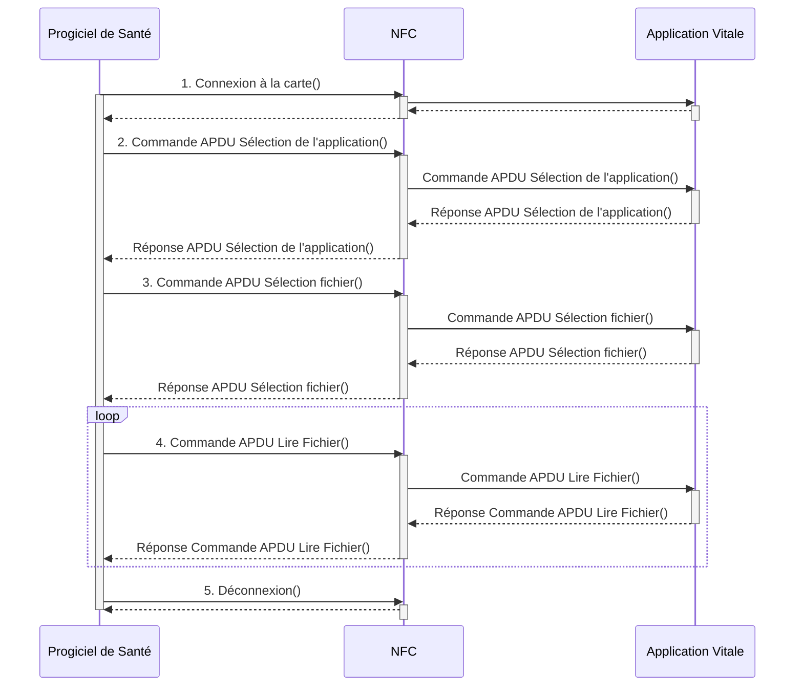

# **Spécifications des échanges de proximité avec l'appli carte Vitale**

Référence : **APCV-NT-001** / Version : **1.6** / Date : **21/02/2024**
Rédigé par : **GIE SV** / Approuvé par :
Sécurité : **DIFFUSION RESTREINTE**

**GIE SESAM-Vitale**
5, boulevard Marie et Alexandre Oyon – 72019 LE MANS Cedex 2
<u>www.sesam-vitale.fr</u>

*APCV-NT-001* *Spécifications des échanges de proximité avec l'appli carte Vitale* *Version : 1.6*

Ce document a été élaboré par le GIE SESAM-Vitale. Conformément à l’article L.122-4 du Code de la Propriété Intellectuelle, toute représentation ou reproduction (intégrale ou partielle) du présent ouvrage, quel que soit le support utilisé, doit être soumise à l’accord préalable écrit de son auteur.

Il en est de même pour sa traduction, sa transformation, son adaptation ou son arrangement quel que soit le procédé utilisé.

Tout manquement à ces obligations constituerait un délit de contrefaçon, au sens des articles L 335-2 et suivants du code de la propriété intellectuelle, susceptible d’entraîner des sanctions pour l’auteur du délit.

### *Contacts*


Pour toute question technique ou fonctionnelle durant vos développements, contactez l’assistance technique du GIE SESAM-Vitale :

− par courriel : centre-de-service@sesam-vitale.fr

2
*21/02/2024* *GIE SESAM-Vitale*  *2 / 16*

*Ce document à diffusion restreinte ne peut être diffusé sans l'autorisation d'une personne habilitée au GIE SESAM-Vitale*

*APCV-NT-001* *Spécifications des échanges de proximité avec l'appli carte Vitale* *Version : 1.6*

<table>
  <thead>
    <tr>
      <th>Date</th>
      <th>Version</th>
      <th><b>Évolution du document</b></th>
    </tr>
  </thead>
  <tbody>
    <tr>
      <td>15/12/2017</td>
      <td>0.1</td>
      <td>Création du document</td>
    </tr>
    <tr>
      <td>29/12/2017</td>
      <td>0.2</td>
      <td>Ajout du BLE</td>
    </tr>
    <tr>
      <td>08/01/2017</td>
      <td>0.3</td>
      <td>Mise à jour de l’AID</td>
    </tr>
    <tr>
      <td>31/01/2018</td>
      <td>0.4</td>
      <td>Précision sur le NFC HCE (incompatibilité iPhone)</td>
    </tr>
    <tr>
      <td>31/01/2018</td>
      <td>0.5</td>
      <td>Ajout d’un Glossaire</td>
    </tr>
    <tr>
      <td>06/02/2018</td>
      <td>0.6</td>
      <td>Mise à jour addendum 8</td>
    </tr>
    <tr>
      <td>16/07/2020</td>
      <td>0.7</td>
      <td>Mise à jour de la référence du document en ApCV-NT-001</td>
    </tr>
    <tr>
      <td>05/10/2020</td>
      <td>1.0</td>
      <td>Version de référence avec mise à jour des titres du document</td>
    </tr>
    <tr>
      <td>18/11/2020</td>
      <td>1.1</td>
      <td>Ajout des normes NFC et QRCode. Corrections sur des concepts restants de<br />l’expérimentation.</td>
    </tr>
    <tr>
      <td>03/12/2020</td>
      <td>1.2</td>
      <td>Correction mineure trame d’échange (AID)</td>
    </tr>
    <tr>
      <td>05/07/2021</td>
      <td>1.3</td>
      <td>Suppression de l’ATR</td>
    </tr>
    <tr>
      <td>02/11/2021</td>
      <td>1.4</td>
      <td>Ajout paragraphe 6 sur les recommandations de sécurité</td>
    </tr>
    <tr>
      <td>23/02/2022</td>
      <td>1.5</td>
      <td>Mise à jour du message de proximité pour identifier un QR Code APCV</td>
    </tr>
    <tr>
      <td><mark>21/02/2024</mark></td>
      <td><mark>1.6</mark></td>
      <td>Exemple de code de lecture d’un QR Code avec un lecteur en mode USB<br />Com</td>
    </tr>
  </tbody>
</table>

## **Tables des matières**

<table>
    <tr>
      <td><strong>1</strong></td>
      <td><strong>CONTEXTE.................................................................................................................................................5</strong></td>
    </tr>
    <tr>
      <td><strong>2</strong></td>
      <td><strong>Objectif du document ...............................................................................................................................5</strong></td>
    </tr>
    <tr>
      <td><strong>3</strong></td>
      <td><strong>Choix des modes d’échange ...................................................................................................................5</strong></td>
    </tr>
    <tr>
      <td><strong>4</strong></td>
      <td><strong>Lecture d’une appli Carte Vitale en NFC ................................................................................................6</strong></td>
    </tr>
    <tr>
      <td>4.1</td>
      <td>Introduction..........................................................................................................................................6</td>
    </tr>
    <tr>
      <td>4.2</td>
      <td>Norme ISO 14443 et AID ....................................................................................................................6</td>
    </tr>
    <tr>
      <td>4.3</td>
      <td>Architecture .........................................................................................................................................7</td>
    </tr>
    <tr>
      <td>4.4</td>
      <td>Spécifications des échanges PC/SC...................................................................................................8</td>
    </tr>
    <tr>
      <td>4.5</td>
      <td>Exemple de lecture d’une appli carte Vitale ......................................................................................10</td>
    </tr>
    <tr>
      <td>4.6</td>
      <td>Exemple de lecture d’une appli carte Vitale en code en Java ..........................................................12</td>
    </tr>
    <tr>
      <td><strong>5</strong></td>
      <td><strong>Lecture d’une appli Carte Vitale en Code 2D .......................................................................................14</strong></td>
    </tr>
    <tr>
      <td>5.1</td>
      <td>Norme utilisée et lecture....................................................................................................................14</td>
    </tr>
    <tr>
      <td>5.2</td>
      <td>Lecteurs de QR Code........................................................................................................................14</td>
    </tr>
    <tr>
      <td>5.3</td>
      <td>Identifier un QR Code ApCV .............................................................................................................14</td>
    </tr>
    <tr>
      <td><mark>5.4</mark></td>
      <td><mark>Configurer un lecteur de QR Code en mode USB COM...................................................................14</mark></td>
    </tr>
    <tr>
      <td><mark>5.5</mark></td>
      <td><mark><u>Exemple de lecture d’une appli carte Vitale en code en Java sur le port COM</u> ................................14</mark></td>
    </tr>
    <tr>
      <td><strong>6</strong></td>
      <td><strong>Recommandation sécurité .....................................................................................................................16</strong></td>
    </tr>
    <tr>
      <td>6.1</td>
      <td>Gestion des correctifs de sécurité .....................................................................................................16</td>
    </tr>
    <tr>
      <td>6.2</td>
      <td>Supervision et gestion des incidents de sécurité ..............................................................................16</td>
    </tr>
    <tr>
      <td>6.3</td>
      <td>Guide d’installation et conditions d’utilisation ....................................................................................16</td>
    </tr>
    <tr>
      <td>6.4</td>
      <td>Formation et sensibilisation du personnel.........................................................................................16</td>
    </tr>
</table>

*21/02/2024* *GIE SESAM-Vitale* 
  3 / 16
*Ce document à diffusion restreinte ne peut être diffusé sans l'autorisation d'une personne habilitée au GIE SESAM-Vitale*

*APCV-NT-001* *Spécifications des échanges de proximité avec l'appli carte Vitale* *Version : 1.6*

## **Tables des illustrations**

<table>
    <tr>
      <td>FIGURE 1 : APCV MODE HOST CARD EMULATION ...................................................................................................</td>
      <td>7</td>
    </tr>
    <tr>
      <td>FIGURE 2 : VUE DYNAMIQUE : LECTURE DE L’APPLI CARTE VITALE EN NFC...............................................................</td>
      <td>8</td>
    </tr>
</table>

## **GLOSSAIRE**

<table>
    <tr>
      <td>QRCode </td>
      <td>Type de code-barres en deux dimensions constitué de modules noirs disposés dans un carré à fond blanc. L'agencement de ces points définit l'information que contient le code.</td>
    </tr>
    <tr>
      <td>NFC </td>
      <td><i>Near Field Communication</i> : technologie de communication sans fil à courte portée et à haute fréquence, permettant l'échange d'informations entre des périphériques jusqu'à une distance d'environ 10 cm dans le cas général</td>
    </tr>
</table>

*21/02/2024* *GIE SESAM-Vitale*  *4 / 16*

*Ce document à diffusion restreinte ne peut être diffusé sans l'autorisation d'une personne habilitée au GIE SESAM-Vitale*

*APCV-NT-001* *Spécifications des échanges de proximité avec l'appli carte Vitale* *Version : 1.6*

# **1 CONTEXTE**

Dans le cadre du projet appli carte Vitale, les solutions logicielles des industriels doivent « lire » l’appli carte Vitale présentée par un utilisateur (assuré).

Cette lecture est une « authentification de proximité » : au-delà de récupérer les données des bénéficiaires, l’utilisateur de l’appli carte Vitale est authentifié en ligne.

Cette authentification est réalisée en 2 étapes :

**1.  **La solution logicielle récupère les données chiffrées de l’appli carte Vitale (NFC,** QRCode)**
2.  La solution logicielle authentifie en ligne l’utilisateur et récupère les données de l’appli carte Vitale

Ce document a pour objet de décrire comment réaliser l’étape 1 du processus.

# **2 OBJECTIF DU DOCUMENT**

L’objectif de ce document est de spécifier les échanges de proximité entre une appli carte Vitale et une solution logicielle (un équipement homologué ou un logiciel agréé ou autorisé TLSi AMO)

-   Récupérer les données en NFC « HCE » ou émulation de carte
-   Récupérer les données via la lecture d’un QRCode

# **3 CHOIX DES MODES D’ECHANGE**

L’appli carte Vitale sera disponible pour les assurés dans les systèmes d’exploitation Apple iOS et Google Android.

Du fait des limitations de l’iPhone d’Apple, l’appli carte Vitale sur iOS n’implémentera pas le mode NFC HCE (host card emulation).

⮱ **Les solutions logicielles doivent implémenter obligatoirement les 2 modes d’échanges.**

Le choix du dispositif de lecture est à la charge de l’industriel et dépend de l’environnement de travail de l’utilisateur :

-   Dispositif orienté vers l’utilisateur de l’appli carte Vitale (lecteur de QRCode sur pied, lecteur NFC type bancaire, ..)
-   Dispositif à la main de l’utilisateur de la solution logicielle (par exemple douchette à la main du professionnel de santé, …)

Enfin le dispositif de lecture peut être bi mode : assurer à la fois le NFC et la lecture du QRCode.

*21/02/2024* *GIE SESAM-Vitale* 
  5 / 16
*Ce document à diffusion restreinte ne peut être diffusé sans l'autorisation d'une personne habilitée au GIE SESAM-Vitale*

*APCV-NT-001* *Spécifications des échanges de proximité avec l'appli carte Vitale* *Version : 1.6*

# **4 LECTURE D’UNE APPLI CARTE VITALE EN NFC**

## **4.1 Introduction**

Avec Android, il est possible d’échanger des données en PC/SC avec un smartphone Android : Host-based Card Emulation (HCE).

Le smartphone se comporte alors comme une carte à puce sans contact.

## **4.2 Norme ISO 14443 et AID**

La norme ISO 14443 définit le fonctionnement des cartes à puce sans contact, ou cartes de proximité, c’est-à-dire des cartes dans lesquelles est intégrée une antenne de radiofréquence (RF).

La norme décrit le protocole de communication sans fil utilisé au niveau de la couche de liaison entre une carte et un lecteur de carte qui fonctionne à 13,56 MHz (RFID HF).

Ici, le smartphone émule une carte à puce (« HCE », host emulation card »).

L’identifiant de l’application est l’AID.

L’AID de l’appli carte Vitale est : **D2 50 00 00 02 41 50 43 56**

*21/02/2024* *GIE SESAM-Vitale*  6 / 16

*Ce document à diffusion restreinte ne peut être diffusé sans l'autorisation d'une personne habilitée au GIE SESAM-Vitale*

*APCV-NT-001* *Spécifications des échanges de proximité avec l'appli carte Vitale* *Version : 1.6*

## **4.3 Architecture**

La solution logicielle a besoin d’un dispositif pour échanger en NFC.

Ce dispositif de **lecture NFC doit être compatible avec l’ISO 14443**.

```mermaid
componentDiagram
    node "cmp Components" {
        component "Progiciel de Santé" as PS
        component "Lecteur NFC" as LNFC
        
        node "Smartphone Android" {
            component "NFC" as NFC
            component "Application Vitale" as AV
        }
    }

    PS <--> LNFC
    LNFC <--> NFC
    NFC <--> AV
```

**Figure 1 : ApCV mode Host Card Emulation**

*21/02/2024* *GIE SESAM-Vitale* 
  *7 / 16*
*Ce document à diffusion restreinte ne peut être diffusé sans l'autorisation d'une personne habilitée au GIE SESAM-Vitale*

*APCV-NT-001* *Spécifications des échanges de proximité avec l'appli carte Vitale* *Version : 1.6*

## **4.4 Spécifications des échanges PC/SC**



**Figure 2 : Vue dynamique : Lecture de l’appli carte vitale en NFC**

*21/02/2024* *GIE SESAM-Vitale* 
  *8 / 16*
*Ce document à diffusion restreinte ne peut être diffusé sans l'autorisation d'une personne habilitée au GIE SESAM-Vitale*

*APCV-NT-001*
*Spécifications des échanges de proximité avec l'appli carte Vitale*
*Version : 1.6*

Pour lire une appli carte vitale en NFC, il faut enchainer les étapes suivantes :

## 1. <u>Connexion à la carte</u>

*   Pour se connecter à la carte, il faut utiliser le protocole `[SCardConnect](https://pcsclite.alioth.debian.org/api/group__API.html#ga4e515829752e0a8dbc4d630696a8d6a5) T= *`
*   Une fois la « carte » connectée, il faut ouvrir une exclusivité sur la « carte » `[SCardBeginTransaction](https://pcsclite.alioth.debian.org/api/group__API.html#gaddb835dce01a0da1d6ca02d33ee7d861)`.

    L’ATR n’est pas exposé par HCE. Une valeur peut être restituée mais sa valeur ne doit pas être analysée.

## 2. <u>Commande APDU Sélection de l’application</u>

<table>
  <thead>
    <tr>
      <th colspan="2"><b>Commande APDU</b></th>
    </tr>
    <tr>
      <th>Champ</th>
      <th>Valeur</th>
    </tr>
  </thead>
  <tbody>
    <tr>
      <td>CLA</td>
      <td>0</td>
    </tr>
    <tr>
      <td>INS</td>
      <td>A4</td>
    </tr>
    <tr>
      <td>P1</td>
      <td>04</td>
    </tr>
    <tr>
      <td>P2</td>
      <td>0C</td>
    </tr>
    <tr>
      <td>L<sub>c</sub></td>
      <td>09</td>
    </tr>
    <tr>
      <td>Données envoyées</td>
      <td>D2 50 00 00 02 41 50 43 56</td>
    </tr>
    <tr>
      <th colspan="2"><b>Réponse APDU</b></th>
    </tr>
    <tr>
      <td>SW1-SW2</td>
      <td>90 00</td>
    </tr>
  </tbody>
</table>

La donnée D2 50 00 00 02 41 50 43 56 correspond à l’AID de l’appli carte Vitale.

## 3. <u>Commande Sélection fichier</u>

<table>
  <thead>
    <tr>
      <th colspan="2"><b>Commande APDU</b></th>
    </tr>
    <tr>
      <th>Champ</th>
      <th>Valeur</th>
    </tr>
  </thead>
  <tbody>
    <tr>
      <td>CLA</td>
      <td>00</td>
    </tr>
    <tr>
      <td>INS</td>
      <td>A4</td>
    </tr>
    <tr>
      <td>P1</td>
      <td>02</td>
    </tr>
    <tr>
      <td>P2</td>
      <td>00</td>
    </tr>
    <tr>
      <td>Ne</td>
      <td>EF</td>
    </tr>
    <tr>
      <th colspan="2"><b>Réponse APDU</b></th>
    </tr>
    <tr>
      <td>SW1-SW2</td>
      <td>90 00</td>
    </tr>
  </tbody>
</table>

## 4. <u>Commande lecture</u>

La « carte » est lue par bloc de 255 octets.

*   P1 se calcule comme suit : `(P1 = ((longueurLue >> 8) & 255)`
*   P2 se calcule comme suit : `(P2 = ((longueurLue & 255)`

<table>
  <thead>
    <tr>
      <th colspan="2"><b>Commande APDU</b></th>
    </tr>
    <tr>
      <th>Champ</th>
      <th>Valeur</th>
    </tr>
  </thead>
  <tbody>
    <tr>
      <td>CLA</td>
      <td>00</td>
    </tr>
  </tbody>
</table>

*21/02/2024*
*GIE SESAM-Vitale* 
  *9 / 16*
*Ce document à diffusion restreinte ne peut être diffusé sans l'autorisation d'une personne habilitée au GIE SESAM-Vitale*

*APCV-NT-001*
*Spécifications des échanges de proximité avec l'appli carte Vitale*
*Version : 1.6*

<table>
<tr>
<td>INS</td>
<td>B0</td>
</tr>
<tr>
<td>P1</td>
<td>00</td>
</tr>
<tr>
<td>P2</td>
<td>00</td>
</tr>
<tr>
<td>Ne</td>
<td>FF</td>
</tr>
</table>

*   Si 255 octets ont été lus la réponse est la suivante :

<table>
  <thead>
    <tr>
      <th colspan="2"><b>Réponse avec SW1=90 SW2=00 → 255 octets ont été lues</b></th>
    </tr>
  </thead>
  <tbody>
    <tr>
      <td>SW1</td>
      <td>90</td>
    </tr>
    <tr>
      <td>SW2</td>
      <td>00</td>
    </tr>
    <tr>
      <td>Réponse</td>
      <td>255 octets</td>
    </tr>
  </tbody>
</table>

*   Si la longueur à lire est inférieure à 255 octets la réponse est la suivante :

<table>
  <thead>
    <tr>
      <th colspan="2"><strong>Réponse avec SW1=90 SW2=00 ➔ 255 octets ont été lues</strong></th>
    </tr>
  </thead>
  <tbody>
    <tr>
      <td>SW1</td>
      <td>6C</td>
    </tr>
    <tr>
      <td>SW2</td>
      <td>Ne octets restant à lire</td>
    </tr>
  </tbody>
</table>

Dans ce cas il convient, de passer la dernière commande pour lire les Ne derniers octets :

<table>
  <thead>
    <tr>
      <th colspan="2"><b>Commande APDU</b></th>
    </tr>
    <tr>
      <th>Champ</th>
      <th>Valeur</th>
    </tr>
  </thead>
  <tbody>
    <tr>
      <td>CLA</td>
      <td>00</td>
    </tr>
    <tr>
      <td>INS</td>
      <td>B0</td>
    </tr>
    <tr>
      <td>P1</td>
      <td></td>
    </tr>
    <tr>
      <td>P2</td>
      <td></td>
    </tr>
    <tr>
      <td>Ne</td>
      <td>Ne octets de la commande précédente</td>
    </tr>
    <tr>
      <th colspan="2"><b><b>Reponse APDU</b></b></th>
    </tr>
    <tr>
      <td>SW1</td>
      <td>90</td>
    </tr>
    <tr>
      <td>SW</td>
      <td>00</td>
    </tr>
    <tr>
      <td>Ne</td>
      <td>Ne octets</td>
    </tr>
  </tbody>
</table>

## 5. Déconnexion

*   Fermeture de l’exclusivité avec la « carte »
*   Déconnexion.

## **4.5 Exemple de lecture d’une appli carte Vitale**

L’appli carte Vitale lue comporte 440 octets.

<table>
  <thead>
    <tr>
      <th><strong>Commande</strong></th>
      <th><strong>Commande APDU</strong></th>
      <th><strong>Réponse APDU</strong></th>
    </tr>
  </thead>
  <tbody>
    <tr>
      <td>Sélection de l’application</td>
      <td>00 A4 04 0C 09 D2 50 00 00 02 41 50 43 56</td>
      <td>90 00</td>
    </tr>
    <tr>
      <td>Sélection du fichier Vitale1</td>
      <td>00 A4 02 00 EF</td>
      <td>90 00</td>
    </tr>
    <tr>
      <td>Lecture</td>
      <td>00 B0 00 00 FF</td>
      <td>90 00 et 255 octets lues</td>
    </tr>
  </tbody>
</table>

*21/02/2024*
*GIE SESAM-Vitale* 
 
10 / 16
*Ce document à diffusion restreinte ne peut être diffusé sans l'autorisation d'une personne habilitée au GIE SESAM-Vitale*

APCV-NT-001
Spécifications des échanges de proximité avec l'appli carte Vitale
Version : 1.6

<table>
    <tr>
      <td rowspan="2"></td>
      <td>00 B0 00 FF FF</td>
      <td>6C <b>B9</b></td>
    </tr>
    <tr>
      <td>00 B0 00 FF <b>B9</b></td>
      <td>90 00 et 185 (0x<b>B9</b>) octets</td>
    </tr>
</table>

21/02/2024
GIE SESAM-Vitale 
 
11 / 16
Ce document à diffusion restreinte ne peut être diffusé sans l'autorisation d'une personne habilitée au GIE SESAM-Vitale

*APCV-NT-001* *Spécifications des échanges de proximité avec l'appli carte Vitale* *Version : 1.6*

## **4.6 Exemple de lecture d’une appli carte Vitale en code en Java**

## **4.6 Exemple de lecture d’une appli carte Vitale en code en Java**

```java
package fr.sesamvitale.poc.qrcode.pcom;

import java.io.ByteArrayOutputStream;
import java.nio.charset.StandardCharsets;
import java.util.List;

import javax.smartcardio.Card;
import javax.smartcardio.CardChannel;
import javax.smartcardio.CardException;
import javax.smartcardio.CardTerminal;
import javax.smartcardio.CommandAPDU;
import javax.smartcardio.ResponseAPDU;
import javax.smartcardio.TerminalFactory;

@SuppressWarnings("restriction")
public class App {
  private static final int *MAX_READ_SIZE* = 255;

  static {
    *// Définition des propriétés système du protocole de la carte*
    *// afin que "GET RESPONSE" soit appelé manuellement*
    System.*setProperty*("sun.security.smartcardio.t0GetResponse", "false");
    System.*setProperty*("sun.security.smartcardio.t1GetResponse", "false");
  }

  /**
   * * @param args*
   * * @throws CardException*
   */
  public static void main(String[] args) throws CardException {
    Card card = null;
    CardTerminal terminal = null;
    try {
      *// Récuperation de la liste des périphériques*
      TerminalFactory factory = TerminalFactory.*getDefault*();
      List<CardTerminal> terminals = factory.terminals().list();

      *// Sélection du périphérique (le premier de la liste dans cet exemple)*
      terminal = terminals.get(0);

      *// Attente de la présentation de la carte pendant 1 minute (60000 millisecondes)*
      if (terminal.waitForCardPresent(60000)) {
        *// Tentative de connexion à la carte*
        card = terminal.connect("*");
        card.beginExclusive();
      }
      else {
        *// Le timeout a expiré*
        System.*out*.println("Carte non présente.");
        System.exit(1);
      }

      CardChannel channel = card.getBasicChannel();

      CommandAPDU cmdAPDU = null;
      ResponseAPDU answer = null;

      *// Sélection de l'application ApCV D2 50 00 00 02 41 50 43 56*
      byte[] aid = { (byte) 0xD2, 0x50, 0x00, 0x00, 0x02, 0x41, 0x50, 0x43, 0x56 };
      cmdAPDU = new CommandAPDU(0x00, 0xA4, 0x04, 0x0C, aid);
      answer = channel.transmit(cmdAPDU);

      *// Sélection du fichier Vitale1*
      cmdAPDU = new CommandAPDU(0x00, 0xA4, 0x02, 0x00, 0xEF);
      answer = channel.transmit(cmdAPDU);

      ByteArrayOutputStream bos = new ByteArrayOutputStream();

      if (answer.getSW1() == 0x90) {
        int P1 = 0;
        int P2 = 0;
        int longueurAlire = *MAX_READ_SIZE*;
        int longueurLue = 0;
        boolean derniereLecture = false;
```

*21/02/2024* *GIE SESAM-Vitale* 
  *12 / 16*
*Ce document à diffusion restreinte ne peut être diffusé sans l'autorisation d'une personne habilitée au GIE SESAM-Vitale*

*APCV-NT-001* *Spécifications des échanges de proximité avec l'appli carte Vitale* *Version : 1.6*

```java
        while (**true**) {
          *// Lecture des données*
          cmdAPDU = **new** CommandAPDU(0x00, 0xB0, P1, P2, longueurAlire);
          answer = channel.transmit(cmdAPDU);

          **int** w1 = answer.getSW1();

          *// Si le code retour est 0x90, il reste encore des données à lire*
          **if** (w1 == 0x90) {
            **byte**[] data = answer.getData();
            bos.write(data, 0, data.**length**);

            longueurLue += data.**length**;

            **if** (derniereLecture)
              **break**;

            *// renseignement de l'offset pour la prochaine lecture*
            *// l'octet de poids fort de l'offset dans le paramètre P1*
            P1 = ((longueurLue >> 8) & 0xFF);
            *// l'octet de poids faible de l'offset dans le paramètre P2*
            P2 = (longueurLue & 0xFF);
          }
          **else if** (w1 == 0x6C) {
            *// Si le code retour est 0x6C, la longueur des données restant*
            *// à lire est inférieure à la longueur demandée,*
            *// on relance une dernière lecture avec la longueur restante*
            longueurAlire = answer.getSW2();

            **if** (longueurAlire == 0)
              **break**;

            derniereLecture = **true**;
          }
          **else** {
            **break**;
          }
        }
        **byte**[] bufRead = bos.toByteArray();
        System.*out*.println(bufRead.**length** + " **octets lues :** " +
                            **new** String(bufRead, StandardCharsets.*UTF_8*));
      }
    }
    **catch** (Exception e) {
      System.*out*.println(e.getMessage());
    }
    **finally** {
      **if** (card != **null**) {
        card.endExclusive();
        card.disconnect(**false**);
      }
    }
    System.*exit*(0);
  }
}
```

*21/02/2024* *GIE SESAM-Vitale*  13 / 16

*Ce document à diffusion restreinte ne peut être diffusé sans l'autorisation d'une personne habilitée au GIE SESAM-Vitale*

*APCV-NT-001* *Spécifications des échanges de proximité avec l'appli carte Vitale* *Version : 1.6*

# **5 LECTURE D’UNE APPLI CARTE VITALE EN CODE 2D**

## **5.1 Norme utilisée et lecture**

Le code 2D affiché sur l’appli carte Vitale est un QR Code.

Ce QRCode répond à la norme **ISO/IEC 18004:2015**

La lecture est standard et le bloc chiffré est lu en une fois.

## **5.2 Lecteurs de QR Code**

Le dispositif de lecture est un lecteur de codes **compatible 2D QRcode**.

*   Soit implémentant une technologie LASER (douchettes classiques)
*   Soit implémentant une lecture vidéo (caméra miniature HD) avec reconnaissance des codes 2D QRCode.

## **5.3 Identifier un QR Code ApCV**

Un QR Code APCV commence toujours par les caractères **PB83N8 en base 45.**

## <mark>**5.4 Configurer un lecteur de QR Code en mode USB COM**</mark>

<u>Par défaut, les lecteurs de codes **compatible 2D QRcode** sont configurés en mode HID Clavier. Le GIE SESAM-Vitale recommande la configuration des lecteurs en mode USB COM. Ce mode de configuration permet une lecture performante et s’affranchit du problème de verrouillage Majuscule du clavier (CAPS LOCK).</u>

<u>Pour se faire, il suffit de scanner le code 2D fournit pas le fabricant du lecteur permettant la configuration dans le mode choisi. Ce code est propre à chaque équipement et est disponible dans le manuel utilisateur ou sur le site du fabricant.</u>

<u>Une fois le lecteur configuré dans ce mode, la lecture des données se fait sur le port COM associé au lecteur. Il est possible de connaitre sa valeur depuis le gestionnaire de périphérique dans la catégorie Ports (COM et LPT).</u>

<u>**Note** : il est aussi possible d’utiliser le lecteur en mode HID clavier (mode par défaut). Cette hypothèse de configuration requiert de paramétrer le lecteur en clavier Français pour s’affranchir du problème de verrouillage Majuscule du clavier. Ce mode de configuration n’est pas préconisé par le GIE SESAM-Vitale car moins performant par rapport à un lecteur configuré en mode USB COM.</u>

## <mark>**5.5 Code exemple Java pour la lecture d’une appli carte Vitale sur le port COM**</mark>

```java
package fr.sesamvitale.poc.pcsc ;

import java.io.InputStream;
import java.io.UnsupportedEncodingException;
import com.fazecast.jSerialComm.SerialPort;
import com.fazecast.jSerialComm.SerialPortDataListener;
import com.fazecast.jSerialComm.SerialPortEvent;

public class LireQRCode {
    //fonction de lecture d'un qr code en port serie
    public void lireQRCodePcom2(String portCom){
        // recherche du nom de port com dans la chaine transmise
        SerialPort comPort = SerialPort.getCommPort(portCom);
```

*21/02/2024* *GIE SESAM-Vitale*  14 / 16

*Ce document à diffusion restreinte ne peut être diffusé sans l'autorisation d'une personne habilitée au GIE SESAM-Vitale*

*APCV-NT-001* *Spécifications des échanges de proximité avec l'appli carte Vitale* *Version : 1.6*

```java
           // ouverture du port
           boolean res = comPort.openPort();
           if (res == true) {
              // attente QRCode
               comPort.setComPortTimeouts(SerialPort.TIMEOUT_READ_BLOCKING, 1000, 0);
               int numRead = 0;
               byte[] readBuffer = new byte[5000]; // un QRCODe max 4296 caractères selon la norme

               // variables pour le timer
               long debutAttente = System.currentTimeMillis();
               long tempsAttente = 0;
               try {
                   // on attend 20 secondes le scan du QRCode
                   while (numRead == 0 && tempsAttente < 20000)
                   {
                       long suiteAttente = System.currentTimeMillis();
                       tempsAttente = suiteAttente - debutAttente;

                       numRead = comPort.readBytes(readBuffer, readBuffer.length);
                   }
                   if (numRead != 0)
                   {
                       String chaineLu = new String(readBuffer, "UTF8");
                       // test sur la chaine PB83N8
                       if (chaineLu.startsWith("PB83N8"))
                       {
                           // "Le QR Code correspond à l'application carte Vitale."
                           // vous pouvez utiliser le QR Code obtenu dans chaineLu
                       }
                       else {
                           // "le QR Code ne correspond pas à l'application carte Vitale."
                       }
                   }
                   else {
                       // "Aucun QR Code lu dans le délai de 20 secondes. Relancez la lecture."
                   }
               } catch (Exception e) {
                   // gerer l’exception obtenue e.getMessage()
               }
               finally {
                   comPort.flushIOBuffers();
                   comPort.closePort();
               }
           }
           else {
               // " ouverture du port com n'a pas abouti "
           }
       }
 }
```

*21/02/2024* *GIE SESAM-Vitale* 
  *15 / 16*
*Ce document à diffusion restreinte ne peut être diffusé sans l'autorisation d'une personne habilitée au GIE SESAM-Vitale*

*APCV-NT-001* *Spécifications des échanges de proximité avec l'appli carte Vitale* *Version : 1.6*

# 6 **RECOMMANDATION SECURITE**

## 6.1 **Gestion des correctifs de sécurité**

Il est recommandé de mettre en place un processus de gestion des correctifs de sécurité : il s’agit mettre en œuvre des mesures organisationnelles et techniques permettant de garantir le maintien de la sécurité de la solution, incluant à minima :

*   Une veille relative aux vulnérabilités de l’ensemble des composants logiciels et matériels de la solution, notamment des drivers permettant l’acquisition des données de l’ApCV (lecteur de QR-Code, lecteur NFC).
*   La mise en œuvre des correctifs de sécurité (développement des correctifs, déploiement, assistance aux utilisateurs).

## 6.2 **Supervision et gestion des incidents de sécurité**

Il est recommandé de mettre en place l’organisation et les outils permettant de réaliser une supervision des anomalies et événements de sécurité liés à la solution et à son système d’information.

Cette supervision peut s’appuyer sur les journaux des systèmes (pare-feu, OS, outils de détection d’intrusions, contrôle d’intégrité, etc.) et des services liés à la solution.

## 6.3 **Guide d’installation et conditions d’utilisation**

Il est recommandé de mettre à disposition des guides et conditions d’utilisation afin de permettre une bonne intégration et un usage dans de bonnes conditions de sécurité de sa solution au sein du système d’information du professionnel de santé.

Le guide doit rappeler les bonnes pratiques et besoins de sécurité ainsi que les conditions d’utilisation de la solution au niveau du SI PS (mises à jour de sécurité du système, présence d’un anti-virus, etc.). Il doit également indiquer la responsabilité de l’utilisateur vis-à-vis de la sécurisation de son système d’information et notamment de son réseau local (filaire, wifi…), dans le cas où celui-ci est partagé avec l’équipement.

Ces éléments doivent figurer dans le contrat de mise à disposition de la solution aux clients / utilisateurs ou dans une de ces annexes (CGU…).

## 6.4 **Formation et sensibilisation du personnel**

Le personnel intervenant dans les phases de conception, développement, déploiement, maintenance doit être formé et sensibilisé à la sécurité de l’information et aux bonnes pratiques de sécurité.

*21/02/2024* *GIE SESAM-Vitale* 
  *16 / 16*
*Ce document à diffusion restreinte ne peut être diffusé sans l'autorisation d'une personne habilitée au GIE SESAM-Vitale*