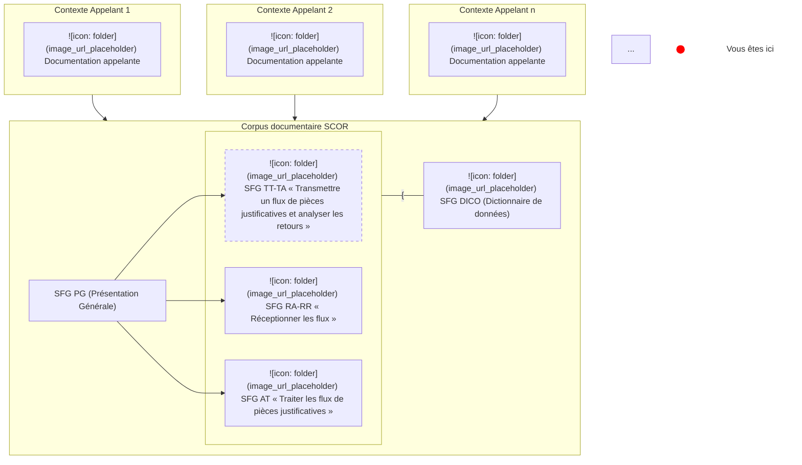
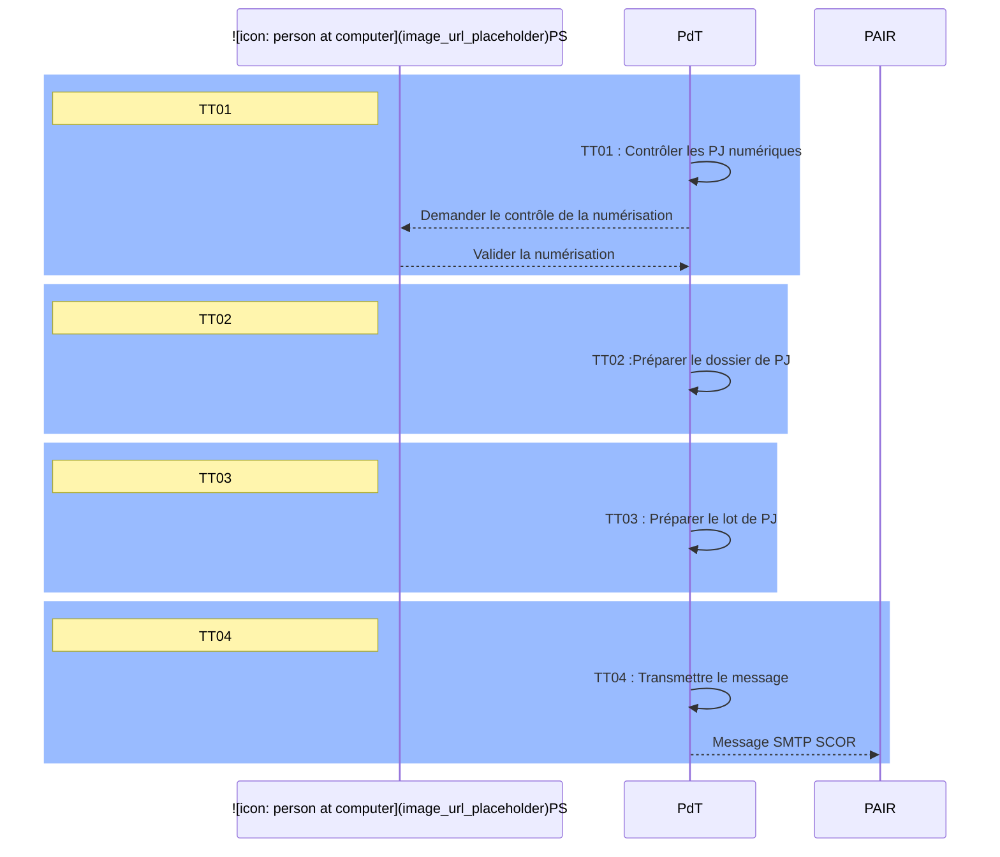
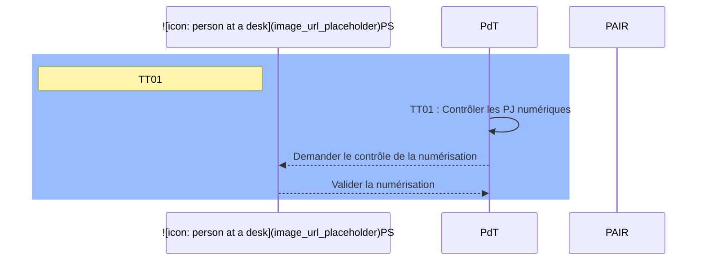

**SCOR**
SPECIFICATIONS FONCTIONNELLES GENERALES

# **SCOR - Télétransmission des pièces justificatives**

## **TT : Transmettre un flux de pièces justificatives, TA : Analyser les retours**

Référence : SCOR-SFG-003 / Version : 1.26 / Date : 03/11/2021
Sécurité : LIBRE / Etat : PROVISOIRE

**GIE SESAM-Vitale**
5, boulevard Marie et Alexandre Oyon – 72 019 LE MANS Cedex 2
<u>www.sesam-vitale.fr</u>

Ce document a été élaboré par le GIE SESAM-Vitale.

Conformément à l’article L.122-4 du Code de la Propriété Intellectuelle, toute représentation ou reproduction (intégrale ou partielle) du présent ouvrage, quel que soit le support utilisé, doit être soumise à l’accord préalable écrit de son auteur.

Il en est de même pour sa traduction, sa transformation, son adaptation ou son arrangement, quel que soit le procédé utilisé.

**Tout manquement à ces obligations constituerait un délit de contrefaçon, au sens **des articles L 335-2 et suivants du code de la propriété intellectuelle, susceptible** d’entraîner des sanctions pour l’auteur du délit.**

*03/11/2021* *GIE SESAM-Vitale* 
  *2 / 74*
*Ce document à diffusion restreinte ne peut être diffusé sans l'autorisation d'une personne habilitée au GIE SESAM-Vitale*

*SFG SCOR - Télétransmission des pièces justificatives*
*SCOR-SFG-003 *TT : Transmettre un flux de pièces justificatives, TA : Analyser les retours* Version : 1.26*

## **SOMMAIRE**

**(Une table des matières est disponible page 70.)**

<table>
    <tr>
      <td><strong>1</strong></td>
      <td><strong>INTRODUCTION DOCUMENTAIRE..........................................................................................................5</strong></td>
    </tr>
    <tr>
      <td>1.1</td>
      <td>OBJECTIF DU DOCUMENT .....................................................................................................................5</td>
    </tr>
    <tr>
      <td>1.2</td>
      <td>POSITIONNEMENT DU DOCUMENT DANS LE DOSSIER DE SFG.................................................................5</td>
    </tr>
    <tr>
      <td>1.3</td>
      <td>DOCUMENTS DE REFERENCE, ABREVIATIONS, DEFINITIONS....................................................................5</td>
    </tr>
    <tr>
      <td>1.4</td>
      <td>GUIDE DE LECTURE .............................................................................................................................5</td>
    </tr>
    <tr>
      <td><strong>2</strong></td>
      <td><strong>DESCRIPTION DETAILLEE DE LA FONCTIONNALITE TT « TRANSMETTRE UN FLUX DE PJ NUMERIQUES» ..........................................................................................................................................6</strong></td>
    </tr>
    <tr>
      <td>2.1</td>
      <td>TT01 : CONTROLER LES PJ NUMERIQUES ............................................................................................8</td>
    </tr>
    <tr>
      <td>2.2</td>
      <td>TT02 : PREPARER LE DOSSIER DE PJ ................................................................................................11</td>
    </tr>
    <tr>
      <td>2.3</td>
      <td>TT03 : PREPARER LE LOT DE PJ........................................................................................................17</td>
    </tr>
    <tr>
      <td>2.4</td>
      <td>TT04 : TRANSMETTRE LE MESSAGE ...................................................................................................27</td>
    </tr>
    <tr>
      <td>2.5</td>
      <td>TT05 : SAUVEGARDER LE LOT POUR GRAVAGE SUR CDROM..............................................................31</td>
    </tr>
    <tr>
      <td><strong>3</strong></td>
      <td><strong>DESCRIPTION DETAILLEE DE LA FONCTIONNALITE TA « ANALYSER LES RETOURS » ............33</strong></td>
    </tr>
    <tr>
      <td>3.1</td>
      <td>TA01 : ANALYSER LE MESSAGE REÇU ................................................................................................34</td>
    </tr>
    <tr>
      <td>3.2</td>
      <td>TA02 : TRAITER LES MESSAGES REÇUS .............................................................................................38</td>
    </tr>
    <tr>
      <td><strong>4</strong></td>
      <td><strong>ADMINISTRATION DU PDT DU PS ........................................................................................................56</strong></td>
    </tr>
    <tr>
      <td>4.1</td>
      <td>AP000 : PARAMETRER LE SYSTEME...................................................................................................56</td>
    </tr>
    <tr>
      <td>4.2</td>
      <td>AP005 : GERER LES MESSAGES DE SERVICE « CHIFFREMENT »..........................................................57</td>
    </tr>
    <tr>
      <td>4.3</td>
      <td>AP012 : DETECTER LES LOTS TRANSMIS DEPUIS PLUS DE 48H ............................................................58</td>
    </tr>
    <tr>
      <td>4.4</td>
      <td>AP008 : TRAITER LES LOTS EN ATTENTE DEPUIS PLUS DE 15 JOURS....................................................59</td>
    </tr>
    <tr>
      <td>4.5</td>
      <td>AC008 : ARCHIVER LES LOTS DE PJ SUR CDROM .............................................................................60</td>
    </tr>
    <tr>
      <td><strong>5</strong></td>
      <td><strong>SITUATION PARTICULIERE SP12 : IMPACTS......................................................................................66</strong></td>
    </tr>
    <tr>
      <td>5.1</td>
      <td>IMPACT SUR LA FONCTIONNALITE TT ET LES FONCTIONS D’ADMINISTRATION ASSOCIEES........................66</td>
    </tr>
    <tr>
      <td>5.2</td>
      <td>IMPACT SUR LA FONCTIONNALITE TA ..................................................................................................67</td>
    </tr>
</table>

<table>
  <caption><strong>**TABLE DES ILLUSTRATIONS**</strong></caption>
    <tr>
      <td>FIGURE 1 : CORPUS DOCUMENTAIRE SCOR...........................................................................................................5</td>
    </tr>
    <tr>
      <td>FIGURE 2 : INTERACTIONS DE TT AVEC L’EXTERIEUR EN MODE NOMINAL ..................................................................7</td>
    </tr>
    <tr>
      <td>FIGURE 3 : DIAGRAMME D'ACTIVITE DE TT...............................................................................................................8</td>
    </tr>
    <tr>
      <td>FIGURE 4 : DIAGRAMME DE SEQUENCE DE TT01 .....................................................................................................9</td>
    </tr>
    <tr>
      <td>FIGURE 5 : ENCHAINEMENT DE "TT02 : PREPARER UN DOSSIER DE PJ" .................................................................11</td>
    </tr>
    <tr>
      <td>FIGURE 6 : ENCHAINEMENT DE "TT03 : PREPARER UN LOT DE PJ" ........................................................................17</td>
    </tr>
    <tr>
      <td>FIGURE 7 : ENCHAINEMENT DE "TA01 : ANALYSER LE MESSAGE REÇU"..................................................................35</td>
    </tr>
    <tr>
      <td>FIGURE 8 : ENCHAINEMENT DE "TA02 : TRAITER LES MESSAGES REÇUS"...............................................................38</td>
    </tr>
    <tr>
      <td>FIGURE 9 : ENCHAINEMENT DE TA02.03 "TRAITER UN MESSAGE CONTENANT DES DIAGNOSTICS" ...........................41</td>
    </tr>
    <tr>
      <td>FIGURE 10 : ENCHAINEMENT DE TA02.03.03 " ANALYSER LE DIAGNOSTIC DE L’ENTETE ENTSCANORDO " ..........44</td>
    </tr>
    <tr>
      <td>FIGURE 11 : ENCHAINEMENT DE TA02.03.04 " TRAITER LE DIAGNOSTIC DU DOSSIER DE PJ ".................................49</td>
    </tr>
</table>

*03/11/2021* *GIE SESAM-Vitale* 
  *3 / 74*
*Ce document à diffusion restreinte ne peut être diffusé sans l'autorisation d'une personne habilitée au GIE SESAM-Vitale*

*SFG SCOR - Télétransmission des pièces justificatives*
*SCOR-SFG-003 TT : Transmettre un flux de pièces justificatives, TA : Analyser les retours Version : 1.26*

## **TABLE DES ANNEXES**

<table>
    <tr>
      <td><strong><b>ANNEXE 1</b></strong></td>
      <td><strong><b>TABLES DES MATIERES ..............................................................................................70</b></strong></td>
    </tr>
    <tr>
      <td><strong><b>ANNEXE 2</b></strong></td>
      <td><strong><b>CONSTITUTION DU LOT DE PJ POUR LA TELETRANSMISSION ............................72</b></strong></td>
    </tr>
    <tr>
      <td>    A2-1</td>
      <td>CONTRAINTES POUR LA PJ NUMERIQUE..............................................................................................72</td>
    </tr>
    <tr>
      <td>    A2-2</td>
      <td>CONTRAINTES POUR LE FICHIER D’INDEX ............................................................................................73</td>
    </tr>
    <tr>
      <td>    A2-3</td>
      <td>CONTRAINTES POUR LE FICHIER D’ENTETE ENTSCANORDO <sub>DU LOT DE</sub> PJ .......................................73</td>
    </tr>
    <tr>
      <td><strong><b>ANNEXE 3</b></strong></td>
      <td><strong><b>LIEN ENTRE LES RETOURS SUR UN LOT DE FE ET LE LOT DE PJ ASSOCIE .....74</b></strong></td>
    </tr>
</table>

*03/11/2021* 
  *GIE SESAM-Vitale* 4 / 74
*Ce document à diffusion restreinte ne peut être diffusé sans l'autorisation d'une personne habilitée au GIE SESAM-Vitale*

SFG *SCOR - Télétransmission des pièces justificatives*
*SCOR-SFG-003 *TT : Transmettre *un flux de pièces* justificatives, TA : Analyser les retours* Version : 1.26*

# 1 **INTRODUCTION DOCUMENTAIRE**

## 1.1 **Objectif du document**

Ce document a pour but de décrire dans le détail les fonctionnalités du LPS du PS qui composent le processus général « Traiter les flux de PJ » :

*   TT « Transmettre un flux de PJ numériques » et
*   TA « Analyser les retours ».

## 1.2 **Positionnement du document dans le dossier de SFG**

Ce document se positionne comme suit dans l’architecture documentaire de ces Spécifications Fonctionnelles Générales (SFG) :



**Figure 1 : Corpus documentaire SCOR**

## 1.3 **Documents de référence, abréviations, définitions**

<table>
  <thead>
    <tr>
      <th><b>Document</b></th>
      <th><b>Type et titre</b></th>
      <th><b>Référence</b></th>
    </tr>
  </thead>
  <tbody>
    <tr>
      <td>PG</td>
      <td>SCOR - PG (Présentation Générale)</td>
      <td>SCOR-SFG-<br />002</td>
    </tr>
  </tbody>
</table>

**Se reporter à [PG].**

## 1.4 **Guide de lecture**

**Se reporter à [PG].**

***

**Précision de lecture**

<u>Vue générale des fonctionnalités et fonctions</u> :

Dans la description des entrées-sorties, ne sont citées que les Entités Fonctionnelles de premier niveau, les EF qui leurs sont rattachées n’apparaissent pas.

*03/11/2021* *GIE SESAM-Vitale* 
  *5 / 74*
*Ce document à diffusion restreinte ne peut être diffusé sans l'autorisation d'une personne habilitée au GIE SESAM-Vitale*

*SFG SCOR - Télétransmission des pièces justificatives*
SCOR-SFG-003 *TT : Transmettre un flux de pièces justificatives, TA : Analyser les retours Version : 1.26*

# 2 **DESCRIPTION DETAILLEE DE LA FONCTIONNALITE TT**
# **« TRANSMETTRE UN FLUX DE PJ NUMERIQUES »**

## **Vue générale**

**_Préambule_** La fonctionnalité TT doit être initialisée par une étape préalable décrite dans la documentation appelante. (cf.[PG])

**_Description_** L’objet de cette fonctionnalité est de transmettre à l’AMO, via le PAIR, les PJ numériques (ou les informations d’identifications des PJ numériques déjà transmises) justifiant l’exécution d’une prestation pour un bénéficiaire des soins.

Pour ce faire, le LPS du PS réalise plusieurs opérations :

*   **_Contrôler les PJ numériques_**
*   **_Préparer le dossier de PJ (de la FE)_** contenant le fichier d’index des PJ et les PJ numériques.
*   **_Préparer le lot de PJ_** suite à la mise en lot des FE associées aux PJ (regroupement et sécurisation des dossiers de PJ) et stockage du lot de PJ jusqu’à réception d’un accusé de réception pour ce lot de PJ.
*   **_Transmettre le message du lot de PJ_** après la télétransmission du lot de FE associées aux PJ.

<u>Note : la transmission doit se faire au plus tôt et dans la limite de 30 jours suivant l’émission de la facture.</u>

<u>Nota : Les délais de mise en forme d’un lot de PJ et/ou de transmission du lot doivent respecter ceux spécifiés dans le document appelant du système souhaitant transmettre les PJ (exemple : SCOR-SFG-007 pour la facturation ville SESAM Vitale …).</u>

<u>Note</u> : cette étape peut être remplacée par Sauvegarder le lot et le graver sur CDROM dans le cas où le LPS n’est pas configuré pour la télétransmission.

**<u>Pour rappel :</u>** la constitution des flux SCOR doit respecter les contraintes prévues par le protocole d’échange SEH SCOR (voir [PG]), en particulier sur la limite maximale de lot de PJ associés à un même lot de FE.

**_Entrées_** PJ numériques
**_Sorties_** Message (EF_MA_001)
**_Situations spécifiques_** PS utilisant les services d’un OCT (SP12) (cf. <u>§5.1)</u>

*03/11/2021* *GIE SESAM-Vitale* 
  6 / 74
*Ce document à diffusion restreinte ne peut être diffusé sans l'autorisation d'une personne habilitée au GIE SESAM-Vitale*

SFG *SCOR - Télétransmission des pièces justificatives*
SCOR-SFG-003 *TT : Transmettre un flux de pièces justificatives, TA : Analyser les retours Version : 1.26*

## **Diagramme de séquence**



**Figure 2 : Interactions de TT avec l’extérieur en mode nominal**

<u>Note</u> : selon les catégories de PS, ce diagramme de séquence peut être adapté.

## **Diagramme d’activité**

*03/11/2021 GIE SESAM-Vitale* 
  *7 / 74*
*Ce document à diffusion restreinte ne peut être diffusé sans l'autorisation d'une personne habilitée au GIE SESAM-Vitale*

SFG *SCOR - Télétransmission des pièces justificatives*
SCOR-SFG-003 *TT : Transmettre un flux de pièces justificatives, TA : Analyser les retours Version : 1.26*

```mermaid
graph TD
    Start(( )) -->|Début de TT| TT01[TT01 : Contrôler les PJ numériques]
    TT01 --> TT02[TT02 : Préparer le dossier de PJ]
    TT02 --> TT03[TT03 : Préparer le lot de PJ]
    TT03 --> Decision{ }
    
    Decision -- Non --> TT04[TT04 : Transmettre le message]
    Decision -- Oui --> TT05[TT05 : Sauvegarder le lot pour le gravage sur CDROM]
    
    TT04 --> End((( )))
    TT05 --> End
    
    subgraph Legend
    DecisionLabel[Choix de la solutionde repli CDROM (sile poste le permet)]
    EndText[Fin de TT]
    end
    
    style Legend fill:none,stroke:none
    style Start fill:#000
    style TT01 fill:#EEDDC5,stroke:#000
    style TT02 fill:#EEDDC5,stroke:#000
    style TT03 fill:#EEDDC5,stroke:#000
    style TT04 fill:#EEDDC5,stroke:#000
    style TT05 fill:#EEDDC5,stroke:#000
    style Decision fill:#FFF,stroke:#000
```

**Figure 3 : diagramme d'activité de TT**

## **2.1** **TT01 : Contrôler les PJ numériques**

### **Vue générale**

***Description*** L’objet de cette fonction est le contrôle des PJ numériques par le PS.

Les PJ numériques peuvent être obtenues soit par numérisation d’une PJ papier, soit par création via le LPS.

Lorsque les PJ numériques sont obtenues par numérisation d’une PJ papier, celles-ci doivent respecter les contraintes citées dans l’Annexe 2. Le logiciel propose un paramétrage de base pour la numérisation, mais avec la possibilité pour le PS de modifier manuellement ces paramètres.

Lorsque les PJ sont obtenues par création via le LPS, celles-ci doivent respecter les contraintes de taille citées dans l’annexe A2-1.3.

***Entrées*** PJ numériques (EF_MA_019)

Données entrées SCOR (EF_PA_001)

Paramètres SCOR (EF_PA_002)

***Sorties***

*03/11/2021* *GIE SESAM-Vitale* 
  *8 / 74*
*Ce document à diffusion restreinte ne peut être diffusé sans l'autorisation d'une personne habilitée au GIE SESAM-Vitale*

*SFG SCOR - Télétransmission des pièces justificatives*
SCOR-SFG-003 *TT : Transmettre un flux de pièces justificatives, TA : Analyser les retours* *Version : 1.26*

## **Illustration**



**Figure 4 : diagramme de séquence de TT01**

## **Préambule**

### **Acquisition des PJ numériques**

Une liste des PJ par catégorie de **PS** et la liste des PJ à numériser en fonction du type de FE est présentée dans les documents d’appel.

Si le PS est dans l’incapacité de numériser l’une des PJ de la prestation (ou le LPS est incapable de générer une des PJ numériques dans le délai prévu par l’accord conventionnel :

*   les PJ de la prestation numérisées par le PS ou créés par le LPS suivent la procédure de télétransmission,
*   la PJ de la prestation non numérisée par le PS (ou non créée par le LPS) suit la procédure papier définie entre les régimes d’AMO et les PS. Une information dans l’entête ENTSCANORDO sera renseignée via un lien externe du dossier. L’’information du mode d’envoi du document externe sera « **PAPIER** » (EF_MA_013_04). Le LPS du PS positionne le statut de transmission de la PJ numérique (EF_MA_019_01) comme suit : « **Collecte papier** ».

**Règles de**
**gestion**

### **CONTRÔLER LES PJ NUMERIQUES DE LA PRESTATION**

***[RG_TT003] Contrôler la taille de la PJ numérique***

Un contrôle est effectué pour s’assurer que le volume du fichier généré ne dépasse pas la « *Taille maximale du fichier numérique* » fixée par paramétrage (EF_PA_002_01).

***[CE1] Cas d’erreur 1 : taille de la PJ numérique important***

Si la taille maximale est dépassée, les paramètres de numérisation sont modifiés pour diminuer la taille du fichier généré.

La PJ de la prestation est de nouveau numérisée par le PS ou générée par le LPS.

***[CE2] Cas d’erreur 2 : réduction de la taille de la PJ numérique impossible***

Si le PS est dans l’incapacité de réduire la taille de la PJ numérique :

*   les PJ de la prestation numérisées par le PS ou créés par le LPS suivent la procédure de télétransmission,

*03/11/2021* *GIE SESAM-Vitale* 
  *9 / 74*
*Ce document à diffusion restreinte ne peut être diffusé sans l'autorisation d'une personne habilitée au GIE SESAM-Vitale*

*SFG SCOR - Télétransmission des pièces justificatives*
SCOR-SFG-003 *TT : Transmettre un flux de pièces justificatives, TA : Analyser les retours Version : 1.26*

*   la PJ de la prestation non numérisée par le PS (ou non créée par le LPS) suit la procédure papier définie entre les régimes d’AMO et les PS. Une information dans l’entête ENTSCANORDO sera renseignée via un lien externe du dossier de PJ : l’information du mode d’envoi du document externe sera « **PAPIER** » (EF_MA_013_04). Le LPS du PS positionne le statut de transmission de la PJ numérique (EF_MA_019_01) comme suit : « **Collecte papier** ».

### *[RG_TT047] **Contrôler la qualité de la numérisation des PJ***

Le PS effectue un contrôle visuel afin de vérifier la qualité numérique de chaque PJ de la prestation afin d’atteindre l’indicateur prévu par l’accord conventionnel.

Le PS vérifie notamment les points suivants :
*   la page doit être lisible,
*   la page n’est pas vide (toute blanche),
*   la page n’est pas excessivement de travers,
*   la page n’est pas excessivement noire (exemple de cerfa en couleur mal scanné),
*   la page n’est pas identique à la page précédente (doublon).

### *[CE1] **Cas d’erreur 1 : PJ numérique non correcte***

Si la PJ numérique n’est pas correcte, le PS doit avoir la possibilité de créer à nouveau, et de façon automatique :
*   soit la numérisation de la PJ papier,
*   soit le LPS doit être en capacité de générer une PJ numérique correcte.

---
**Règles de gestion**

## **PREPARER LA PJ NUMERISEE**

### *[RG_TT056] **Lier la nature de la PJ***

À chaque fichier numérique est liée la nature de la PJ (Nature de la PJ - EF_MA_019_03) selon la liste des codes « Nature de PJ » présentée dans [DICO].

Dans le cas où la numérisation n’est pas possible, le PS renseigne manuellement la nature de la PJ (EF_MA_019_03) associée au statut « **Collecte papier** » (EF_MA_019_01).

### *[RG_TT058] **Positionner le statut de transmission de la PJ numérique***

Le LPS du PS positionne le statut de transmission de la PJ numérique (EF_MA_019_01) comme suit : « **A finaliser** ».

*03/11/2021 GIE SESAM-Vitale* 
  *10 / 74*
*Ce document à diffusion restreinte ne peut être diffusé sans l'autorisation d'une personne habilitée au GIE SESAM-Vitale*

*SFG SCOR - Télétransmission des pièces justificatives*
*SCOR-SFG-003 TT : Transmettre un flux de pièces justificatives, TA : Analyser les retours Version : 1.26*

## **2.2** **TT02 : Préparer le dossier de PJ**

---
**Vue générale**

***Description*** Suite à la disponibilité des PJ numériques, le LPS du PS peut préparer le dossier de PJ d’une FE à partir des données constitutives de la FE.

Un dossier de PJ contient :
* Un seul et unique index,
* éventuellement une ou plusieurs PJ numériques chiffrées,
* éventuellement un ou plusieurs identifiants de PJ transmis précédemment dans un autre lot de PJ.

Pour la préparation des dossiers de PJ, il est nécessaire d’avoir le numéro de FE associée à chaque PJ du dossier, ainsi que son CRL.

***Entrée(s)*** PJ numérique (EF_MA_019)
Données entrées SCOR (EF_PA_001)

***Sortie(s)*** Dossier (EF_MA_014)

---
**Schéma**



```mermaid
graph TD
    Start(( )) -->|Début de TT02| Fork[ ]
    
    Fork --- Path1
    Fork --- Path2
    Fork --- Path3
    
    subgraph Path1
        TT02.01[TT02.01 : Préparer lefichier d'indexSCANORDO]
    end
    
    subgraph Path2
        TT02.05[TT02.05 : Finaliser les PJ] --> TT02.02[TT02.02 : Regrouper lesPJ numériques àtransmettre]
    end
    
    subgraph Path3
        TT02.03[TT02.03 : Identifier les PJnumériques déjàtransmises]
    end
    
    TT02.01 --- Join[ ]
    TT02.02 --- Join
    TT02.03 --- Join
    
    Join --> TT02.04[TT02.04 : Finaliser ledossier de PJ]
    TT02.04 -->|Fin de TT02| End((( )))

    style Fork fill:#333,stroke:#333,stroke-width:4px
    style Join fill:#333,stroke:#333,stroke-width:4px
    style Start fill:#000
    style End fill:#fff,stroke:#000
```

**Figure 5 : Enchaînement de "TT02 : Préparer un dossier de PJ"**

*03/11/2021 GIE SESAM-Vitale* 
  11 / 74
*Ce document à diffusion restreinte ne peut être diffusé sans l'autorisation d'une personne habilitée au GIE SESAM-Vitale*

SCOR-SFG-003
SFG *SCOR - Télétransmission des pièces justificatives*
*TT : Transmettre un flux de pièces justificatives, TA : Analyser les retours*
*Version : 1.26*

## **2.2.1 TT02.01 : Préparer le fichier d’index SCANORDO**

### **Vue générale**

**Description** Cette fonction a pour but de préparer l’unique fichier d’index SCANORDO du dossier de PJ. Le LPS du PS prépare le fichier d’index SCANORDO à partir des données constitutives de la FE.

Ce dernier sera ultérieurement chiffré et mis dans un dossier de PJ compressé.

L’élaboration du fichier d’index SCANORDO doit respecter les contraintes de la norme SEH citées dans l’Annexe 2.

***Entrée(s)*** Données entrées SCOR (EF_PA_001)
***Sortie(s)*** Index SCANORDO (EF_MA_015)

**Règles de gestion**

***[RG_TT007] Préparer l’entité « Index SCANORDO »***

Les valeurs des champs de l’entité « Index SCANORDO » (EF_MA_015) sont renseignées suivant le tableau ci-dessous :

<table>
  <thead>
    <tr>
      <th colspan="2">Données renseignées</th>
      <th>←</th>
      <th>Avec</th>
    </tr>
  </thead>
  <tbody>
    <tr>
      <td>Identifiant du dossier</td>
      <td>EF_MA_015_01</td>
      <td>←</td>
      <td><strong><i>Valeur à blanc</i></strong><br /><br />Ce champ sera renseigné lors de la mise en lot de PJ (cf. RG_TT019).</td>
    </tr>
    <tr>
      <td>Horodatage du dossier</td>
      <td>EF_MA_015_02</td>
      <td>←</td>
      <td>Le LPS du PS renseigne ce champ suivant le format suivant :<br /><strong><i>AAAA-MM-JJTHH:MM:SS</i></strong><br />où AAAA-MM-JJ représente la date d’élaboration de l’index, « T » est un séparateur et HH:MM:SS représente l’heure d’élaboration de l’index.</td>
    </tr>
    <tr>
      <td>Nature</td>
      <td>EF_MA_015_03</td>
      <td>←</td>
      <td>« <strong>SCANORDO</strong> »</td>
    </tr>
    <tr>
      <td>Version index</td>
      <td>EF_MA_015_04</td>
      <td>←</td>
      <td><strong><i>EF_PA_002_07</i></strong></td>
    </tr>
  </tbody>
</table>

***[RG_TT009] Préparer l’entité « Facture » de l’index SCANORDO***

Les valeurs des champs de l’entité « Facture » (EF_MA_016) sont renseignées suivant le tableau ci-dessous :

Remarque : les montants doivent être de la forme « xxxxxx.nn ».

<table>
  <thead>
    <tr>
      <th colspan="2">Données renseignées</th>
      <th>←</th>
      <th>Avec</th>
    </tr>
  </thead>
  <tbody>
    <tr>
      <td>Identifiant facture</td>
      <td>EF_MA_016_01</td>
      <td>←</td>
      <td><strong><em>EF_PA_001_01</em></strong></td>
    </tr>
  </tbody>
</table>

*03/11/2021*
*GIE SESAM-Vitale* 
  *12 / 74*
*Ce document à diffusion restreinte ne peut être diffusé sans l'autorisation d'une personne habilitée au GIE SESAM-Vitale*

*SFG SCOR - Télétransmission des pièces justificatives*
*SCOR-SFG-003 *TT : Transmettre un flux de pièces justificatives, TA : Analyser les retours* Version : 1.26*

<table>
    <tr>
      <td>Renouvellement<br />facture</td>
      <td>EF_MA_016_02</td>
      <td>←</td>
      <td>Si la valeur du « code renouvellement » dans la facture est renseignée (EF_PA_001_08) avec une valeur supérieure ou égale à ‘1’ la facture est un renouvellement. Dans ce cas le code est égal à « <b>1</b> ».<br /><br />Si la valeur du « code renouvellement » dans la facture est non renseignée, la facture est une facture initiale, le code est égal à « <b>0</b> ».</td>
    </tr>
    <tr>
      <td>Montant total<br />facture</td>
      <td>EF_MA_016_03</td>
      <td>←</td>
      <td><b><i>EF_PA_001_09</i></b></td>
    </tr>
    <tr>
      <td>Montant<br />remboursable<br />AMO</td>
      <td>EF_MA_016_04</td>
      <td>←</td>
      <td><b><i>EF_PA_001_10</i></b></td>
    </tr>
    <tr>
      <td>Montant<br />remboursable<br />AMC</td>
      <td>EF_MA_016_05</td>
      <td></td>
      <td>« <b><b>000000.00</b></b> »</td>
    </tr>
</table>

### **[RG_TT010] *Préparer l’entité « Bénéficiaire facture » de l’index SCANORDO***

Les valeurs des champs de l’entité « Bénéficiaire facture » (EF_MA_017) sont renseignées suivant le tableau ci-dessous :

<table>
  <thead>
    <tr>
      <th colspan="2">Données renseignées</th>
      <th>←</th>
      <th>Avec</th>
    </tr>
  </thead>
  <tbody>
    <tr>
      <td>NIR Bénéficiaire</td>
      <td>EF_MA_017_01</td>
      <td>←</td>
      <td><strong><em>EF_PA_001_14</em></strong></td>
    </tr>
    <tr>
      <td>NIR assuré</td>
      <td>EF_MA_017_02</td>
      <td>←</td>
      <td><strong><em>EF_PA_001_11</em></strong></td>
    </tr>
    <tr>
      <td>Date de<br />naissance<br />bénéficiaire</td>
      <td>EF_MA_017_03</td>
      <td>←</td>
      <td><strong><em>EF_PA_001_12</em></strong></td>
    </tr>
    <tr>
      <td>Rang de<br />naissance<br />bénéficiaire</td>
      <td>EF_MA_017_04</td>
      <td>←</td>
      <td><strong><em>EF_PA_001_13</em></strong></td>
    </tr>
  </tbody>
</table>

### **[RG_TT053] *Préparer l’entité « Organisme gestionnaire » de l’index SCANORDO***

Les valeurs du champ de l’entité « Organisme gestionnaire » (EF_MA_018) est renseignée suivant le tableau ci-dessous :

<table>
  <thead>
    <tr>
      <th colspan="2">Données renseignées</th>
      <th>←</th>
      <th>Avec</th>
    </tr>
  </thead>
  <tbody>
    <tr>
      <td>Identité</td>
      <td>EF_MA_018_01</td>
      <td>←</td>
      <td>Code de 9 caractères constitué par la concaténation sans séparateur du code grand régime (<b><i>EF_PA_001_04</i></b> ; 2 caractères), du code caisse gestionnaire (<b><i>EF_PA_001_05</i></b> ; 3 caractères) et du code centre gestionnaire (<b><i>EF_PA_001_06</i></b> ; 4 caractères)</td>
    </tr>
  </tbody>
</table>

*03/11/2021* *GIE SESAM-Vitale* 
  *13 / 74*
*Ce document à diffusion restreinte ne peut être diffusé sans l'autorisation d'une personne habilitée au GIE SESAM-Vitale*

*SFG SCOR - Télétransmission des pièces justificatives*
*SCOR-SFG-003 TT : Transmettre un flux de pièces justificatives, TA : Analyser les retours Version : 1.26*

## **2.2.2 TT02.05 : Finaliser les PJ**

**Vue générale**

**_Description_** L’objet de cette fonction est de créer et d’associer un identifiant unique à chaque PJ du dossier de PJ.

**_Entrée(s)_** Données entrées SCOR (EF_PA_001)
PJ numérique (EF_MA_019)

**_Sortie(s)_** Identifiant PJ numérique (EF_MA_020)

**Règles de gestion**

**_[RG_TT057] Constituer l’identifiant de la PJ_**

À chaque PJ numérique est liée un identifiant (EF_MA_020_01) structuré de la façon suivante (avec comme séparateur « . ») :

**N°_facturation_PS_responsable_PJ.Nature_PJ.N°_facturation_PS_émetteur_PJ.Code régime_code caisse_code centre.Date_constitution PJ.Compteur** où :

*   **N°_facturation_PS_responsable_PJ** (Numéro de facturation du PS responsable de la PJ) correspond à l’identifiant de facturation du PS qui est l’auteur de la PJ de référence pour le paiement des prestations effectuées par le PS prescrit.
    *Exemple :*
    *   *pour une ordonnance : le numéro de facturation du PS prescripteur (pris sur l’ordonnance),*
    *   *pour une feuille de soins papier Cerfa : le numéro de facturation du PS prescrit (n° de facturation utilisé lors de la création de la facture associée à la PJ),*
*   **Nature_PJ** correspond au code nature de la PJ (Nature de la PJ - EF_ MA_019_03),
*   **N°_facturation_PS_émetteur_PJ** (Numéro de facturation du PS émetteur de la PJ) correspond à l’identifiant de facturation du PS prescrit qui est l’émetteur de la PJ vers l’AMO (numéro de facturation utilisé lors de la création de la facture associée à la PJ - EF_PA_001_03),
*   **Code régime_Code caisse_code_centre** de l’AMO destinatrice de la FE associée à la PJ :
    *   Code régime : (2 caractères - EF_PA_001_04)
    *   Code caisse gestionnaire (3 caractères - EF_PA_001_05)
    *   Code centre gestionnaire (4 caractères - EF_PA_001_06)
*   **Date_constitution PJ** correspond à la date de numérisation de la PJ, suivant le format « AAAAMMJJHHMMSS ».
*   **Compteur** permet d’identifier de façon unique l’identifiant de la PJ sur le LPS du PS et est incrémenté par le LPS (compteur sur 9 caractères numériques).

## **2.2.3 TT02.02 : Regrouper les PJ numériques à transmettre**

**Vue générale**

**_Description_** Pour un dossier de PJ, le LPS du PS doit regrouper les PJ numériques par :
*   Critère de regroupement en lot de FE (CRL FE),
*   Numéro de facture.

**_Entrée(s)_** Données entrées SCOR (EF_PA_001)

*03/11/2021 GIE SESAM-Vitale* 
  14 / 74
*Ce document à diffusion restreinte ne peut être diffusé sans l'autorisation d'une personne habilitée au GIE SESAM-Vitale*

*SFG SCOR - Télétransmission des pièces justificatives*
*SCOR-SFG-003 *TT : Transmettre un flux de pièces justificatives, TA : Analyser les retours* Version : 1.26*

**Sortie(s)** PJ numérique (EF_MA_019)
PJ numérique (EF_MA_019)

---
**Règles de gestion**

### ***[RG_TT059] Regrouper les PJ numériques à transmettre***
Pour la constitution du dossier de PJ d’une FE, le LPS du PS regroupe les PJ numériques suivant le même numéro de FE (EF_PA_001_01) et le même critère de regroupement en lot des FE (EF_PA_001_02).

### ***[RG_TT060] Classer les PJ numériques***
Pour chaque dossier de PJ, le LPS du PS doit trier les PJ numériques par ordre croissant de « Date de constitution de la PJ numérique » (EF_MA_019_02).

### ***[RG_TT061] Attribuer un numéro d’indice aux PJ numériques***
Pour chaque PJ numérique du dossier de PJ, le LPS du PS doit attribuer un numéro d’indice (indice de la PJ numérique dans le dossier de PJ - EF_MA_019_04). Ce numéro est attribué par le LPS et doit évoluer de 001 à 999 au sein d’un même dossier de PJ.

### ***[RG_TT063] Positionner le statut de transmission de la PJ numérique***
Les valeurs des champs de l’entité « PJ numérique » (EF_MA_019) sont renseignées suivant le tableau ci-dessous :

<table>
  <thead>
    <tr>
      <th colspan="2"><b>Données renseignées</b></th>
      <th>🡨</th>
      <th><b>Avec</b></th>
    </tr>
  </thead>
  <tbody>
    <tr>
      <td>Statut de la PJ</td>
      <td>EF_MA_019_01</td>
      <td>🡨</td>
      <td>« <b>A transmettre</b> »</td>
    </tr>
  </tbody>
</table>

## **2.2.4 TT02.03 : Identifier les PJ numériques déjà transmises**

---
**Vue générale**

***Description*** Si le PS a déjà télétransmis une ou plusieurs PJ numériques et si ces PJ numériques et la FE initiale ont fait l’objet d’un acquittement positif de la part de l’AMO, le PS peut transmettre dans ce nouveau dossier de PJ uniquement l’identifiant de ces PJ.

Ainsi, l’identifiant d’une PJ qui a fait l’objet d’une gravure sur CDROM ne peut être transmis.

La recherche de l’identifiant de la PJ est effectuée par le PS soit de façon manuelle, soit par l’intermédiaire du LPS.

***Entrée(s)*** PJ numérique (EF_MA_019)
**Sortie(s)** Identifiant PJ numérique (EF_MA_020)

---
**Règles de gestion**

### ***[RG_TT064] Trouver l’identifiant de la PJ numérique déjà transmise à l’AMO***
Le LPS du PS permet la sélection par le PS des PJ transmises pour cette FE et ayant fait l’objet d’un acquittement positif.

*03/11/2021 GIE SESAM-Vitale* 
  15 / 74
*Ce document à diffusion restreinte ne peut être diffusé sans l'autorisation d'une personne habilitée au GIE SESAM-Vitale*

SFG *SCOR - Télétransmission des pièces justificatives*
SCOR-SFG-003 *TT : Transmettre un flux de pièces justificatives, TA : Analyser les retours Version : 1.26*

### **[RG_TT083] Trouver le mode d’envoi de la PJ numérique déjà transmise à l’AMO**

Le LPS du PS identifie le mode d’envoi de la PJ numérique à partir de la donnée « Information mode d’envoi du document externe » (EF_MA_019_05).

## **2.2.5 TT02.04 : Finaliser le dossier de PJ**

### **Vue générale**

#### ***Description***
Suite à la création du fichier d’index SCANORDO, au regroupement des PJ numériques à transmettre et à la sélection des identifiants des PJ numériques déjà transmises, le LPS du PS peut préparer le dossier de PJ d’une FE à partir des données constitutives de la FE.

Cette fonction a pour objet d’associer le critère de regroupement en lot et le numéro de la FE associée au dossier de PJ.

#### ***Entrée(s)***
Données entrées SCOR (EF_PA_001)
Index SCANORDO (EF_MA_015)
PJ numérique (EF_MA_019)

#### ***Sortie(s)***
Dossier (EF_MA_014)

### **Règles de gestion**

### ***[RG_TT090] Constituer l’entité Dossier***

Les valeurs des champs de l’entité « Dossier » (EF_MA_014) sont renseignées suivant le tableau ci-dessous :

<table>
  <thead>
    <tr>
      <th colspan="2"><b>Données renseignées</b></th>
      <th>←</th>
      <th><b>Avec</b></th>
    </tr>
  </thead>
  <tbody>
    <tr>
      <td>Critère de regroupement</td>
      <td>EF_MA_014_05</td>
      <td>←</td>
      <td><strong>EF_PA_001_02</strong></td>
    </tr>
    <tr>
      <td>Numéro de la FE associée</td>
      <td>EF_MA_014_06</td>
      <td>←</td>
      <td><strong>EF_PA_001_01</strong></td>
    </tr>
    <tr>
      <td>Mode de sécurisation de la FE</td>
      <td>EF_MA_014_07</td>
      <td>←</td>
      <td>« <strong>1</strong> » si le mode de sécurisation (EF_PA_001_07) est égal à « <strong>Sécurisé <b>SESAM Vitale</b></strong> » ou « <strong><b>Sécurisé SESAM sans</b> Vitale</strong> ».<br /><br />« <strong>2</strong> » sinon.</td>
    </tr>
    <tr>
      <td>Nombre de PJ numériques et d’index</td>
      <td>EF_MA_014_08</td>
      <td>←</td>
      <td><strong><b>valeur obtenue</b></strong> en comptant les fichiers constituant le dossier (les PJ numériques EF_MA_019 et l’index SCANORDO EF_MA_015)</td>
    </tr>
    <tr>
      <td>Statut du dossier de PJ</td>
      <td>EF_MA_014_09</td>
      <td>←</td>
      <td>« <strong>A finaliser</strong> »</td>
    </tr>
  </tbody>
</table>

*03/11/2021* *GIE SESAM-Vitale* 
  *16 / 74*
*Ce document à diffusion restreinte ne peut être diffusé sans l'autorisation d'une personne habilitée au GIE SESAM-Vitale*

*SFG SCOR - Télétransmission des pièces justificatives*
SCOR-SFG-003 *TT : Transmettre un flux de pièces justificatives, TA : Analyser les retours Version : 1.26*

## 2.3 **TT03 : Préparer le lot de PJ**

**Vue générale**

    ***Description*** Suite à la préparation des dossiers de PJ, le LPS du PS peut préparer le lot de PJ.
    Le lot de PJ est constitué :
*   d’un entête ENTSCANORDO non chiffré,
*   d’un ou plusieurs dossiers de PJ.

    Le LPS du PS doit finaliser les dossiers de PJ et constituer l’entête ENTSCANORDO, puis regrouper ces éléments pour constituer le lot et le fichier à transmettre.

    ***Entrée(s)*** Dossier (EF_MA_014)
    Données entrées SCOR (EF_PA_001)
    Paramètres SCOR (EF_PA_002)

    ***Sortie(s)*** Lot (EF_MA_003)

    ***Situations spécifiques*** PS utilisant les services d’un OCT (SP12)

**Schéma**

```mermaid
graph TD
    Start(( )) -->|Début de TT03| Step1(TT03.01 : Préparer les dossiers de PJ)
    Step1 --> Step2(TT03.02 : Préparer l'entête ENTSCANORDO du lot de PJ)
    Step2 --> Decision{ }
    Decision --> Step3(TT03.03 : Préparer le fichier du lot de PJ)
    Decision -->|Choix de la solution de repli CDROM  (si le poste le permet)| End
    Step3 --> End((( )))
    
    style Start fill:#000
    style Step1 fill:#f0e0d0,stroke:#000
    style Step2 fill:#f0e0d0,stroke:#000
    style Step3 fill:#f0e0d0,stroke:#000
    style Decision fill:#fffef0,stroke:#000
    style End fill:#fff,stroke:#000
    
    subgraph Labels
    direction LR
    L1[Fin de TT03]
    end
    
    End --- L1
    style L1 fill:none,stroke:none
```

**Figure 6 : Enchaînement de "TT03 : Préparer un lot de PJ"**

*03/11/2021 GIE SESAM-Vitale* 
  *17 / 74*
*Ce document à diffusion restreinte ne peut être diffusé sans l'autorisation d'une personne habilitée au GIE SESAM-Vitale*

*SFG SCOR - Télétransmission des pièces justificatives*
*SCOR-SFG-003 TT : Transmettre un flux de pièces justificatives, TA : Analyser les retours Version : 1.26*

### **2.3.1 TT03.01 : Préparer les dossiers de PJ**

**Vue générale**

***Description*** Pour préparer chaque dossier de PJ et leur mise en lot, le LPS du PS doit :
* Identifier les dossiers de PJ d’un lot de FE,
* Regrouper et classer les dossiers de PJ,
* Finaliser les dossiers de PJ.

Dans les échanges entre le LPS et le PAIR, il est nécessaire d’optimiser au maximum le remplissage d’un lot de PJ pour approcher la valeur maximale que peut atteindre la taille de ce lot (« Taille maximale du lot » (EF_PA_002_02) sans toutefois dépasser cette valeur maximale.

***Entrée(s)*** Dossier (EF_MA_014)
Données entrées SCOR (EF_PA_001)
Paramètres SCOR (EF_PA_002)

***Sortie(s)*** Dossier (EF_MA_014)

---

**Règles de gestion**

**IDENTIFIER LES DOSSIERS DE PJ DU LOT DE FE**

***[RG_TT012] Récupérer les numéros de FE***
Le LPS du PS récupère les numéros des FE (EF_PA_001_01) constituant le lot de FE.

***[RG_TT013] Récupérer les dossiers de PJ liés aux FE du lot***
À partir des numéros de FE, le LPS du PS récupère les dossiers de PJ (EF_MA_014) et les CRL (EF_PA_001_02) des FE du lot.

---

**Règles de gestion**

**REGROUPER LES DOSSIERS DE PJ PAR CRL FE**

***[RG_TT014] Regrouper les dossiers de PJ***
Le LPS du PS regroupe les dossiers de PJ suivant le même critère de regroupement en lot des FE (EF_MA_014_05).

***[RG_TT016] Classer les dossiers de PJ***
Pour chaque lot de PJ, le LPS du PS doit trier les dossiers de PJ par ordre croissant de numéro de facture (EF_MA_014_06).

***[RG_TT017] Attribuer un numéro d’ordre du dossier de PJ dans le lot***
Pour chaque dossier de PJ, le LPS du PS doit attribuer un numéro d’ordre à chaque dossier constituant le lot (Identification dossier du lot - EF_MA_014_02).

Le numéro d’ordre de chaque dossier de PJ doit être unique <u>par lot de FE.</u>

***[RG_TT015] Calculer le nombre total de fichiers physiquement présents dans le lot de PJ***
Les valeurs des champs de l’entité « Lot » (EF_MA_003) sont renseignées suivant le tableau ci-dessous :

*03/11/2021 GIE SESAM-Vitale* 
  *18 / 74*
*Ce document à diffusion restreinte ne peut être diffusé sans l'autorisation d'une personne habilitée au GIE SESAM-Vitale*

*SFG SCOR - Télétransmission des pièces justificatives*
*SCOR-SFG-003 *TT : Transmettre un flux de pièces justificatives, TA : Analyser les retours* Version : 1.26*

<table>
  <thead>
    <tr>
      <th colspan="2">Données renseignées</th>
      <th>←</th>
      <th>Avec</th>
    </tr>
  </thead>
  <tbody>
    <tr>
      <td>Nombre de fichiers du lot</td>
      <td>EF_MA_003_02</td>
      <td>←</td>
      <td><strong><b>valeur obtenue</b></strong> en comptant les fichiers constituant le lot (les PJ numériques EF_MA_019 et les index SCANORDO EF_MA_015)</td>
    </tr>
  </tbody>
</table>

### *[RG_TT068] Calculer la taille maximale du lot*

Le LPS du PS calcule la taille du lot à partir de la taille des dossiers de PJ qui constitueront ce lot.

#### *[CP1] Cas particulier 1 : taille maximale du lot est dépassée*

Un lot de PJ ne doit pas dépasser la valeur de la « Taille maximale du lot » (EF_PA_002_02). Lorsque la taille du nombre de dossiers de PJ dépasse la « Taille maximale du lot », le LPS du PS doit créer autant de lots de PJ que nécessaire.

---
**Règles de gestion**

## **FINALISER LES DOSSIERS DE PJ**

### *[RG_TT018] Finaliser le nom physique de la PJ numérique*

Le nom physique de la PJ numérique doit respecter les consignes suivantes :

**P-n° du dossier-indice.pkcs7** où

*   Le numéro du dossier de PJ doit être le numéro d’ordre du dossier de PJ dans le lot (EF_MA_014_02).
*   L’indice correspond au numéro d’ordre de la PJ dans le dossier de PJ (EF_MA_019_04).

### *[RG_TT019] Finaliser l’entité « index SCANORDO »*

Les valeurs des champs de l’entité « Index SCANORDO » (EF_MA_015) sont renseignées suivant le tableau ci-dessous :

<table>
  <thead>
    <tr>
      <th colspan="2">Données renseignées</th>
      <th>←</th>
      <th>Avec</th>
    </tr>
  </thead>
  <tbody>
    <tr>
      <td>Identifiant du<br />dossier</td>
      <td>EF_MA_015_01</td>
      <td>←</td>
      <td><strong><em>EF_MA_014_02</em></strong></td>
    </tr>
  </tbody>
</table>

### *[RG_TT020] Finaliser le nom physique du fichier d’index SCANORDO*

Le nom physique du fichier d’index SCANORDO doit respecter les consignes suivantes :

**D-n° du dossier de PJ. pkcs7** où

*   Le numéro du dossier de PJ doit être le numéro d’ordre du dossier de PJ dans le lot (**EF_MA_014_02**).

### *[RG_TT054] Sauvegarder les dossiers de PJ*

Pour le bon déroulement des processus dégradés (reprise des dossiers de PJ suite à une problématique de télétransmission, ARL négatif, etc.), le LPS du PS doit sauvegarder les dossiers de PJ non chiffrés sur le LPS du PS.

### *[RG_TT021] Chiffrer les documents des dossiers de PJ*

Dans le cas où les accords conventionnels prévoient une solution d’envoi des PJ sur CDROM, alors les documents de PJ et son index ne sont pas chiffrés.

*03/11/2021* *GIE SESAM-Vitale* 
  *19 / 74*
*Ce document à diffusion restreinte ne peut être diffusé sans l'autorisation d'une personne habilitée au GIE SESAM-Vitale*

*SFG SCOR - Télétransmission des pièces justificatives*
SCOR-SFG-003 *TT : Transmettre un flux de pièces justificatives, TA : Analyser les retours Version : 1.26*

Dans le cas contraire, le LPS du PS chiffre chacun des documents de chaque dossier de PJ (fichier PJ numérique et son index suivant les consignes décrites en annexe de [PG].

### *[RG_TT022] Positionner le statut de transmission du dossier de PJ*

Les valeurs des champs de l’entité « Dossier » (EF_MA_014) sont renseignées suivant le tableau ci-dessous :

<table>
  <thead>
    <tr>
      <th colspan="2"><b>Données renseignées</b></th>
      <th>←</th>
      <th><b>Avec</b></th>
    </tr>
  </thead>
  <tbody>
    <tr>
      <td>Statut du<br />dossier de PJ</td>
      <td>EF_MA_014_09</td>
      <td>←</td>
      <td>« <b>A transmettre</b> »</td>
    </tr>
  </tbody>
</table>

## 2.3.2 **TT03.02 : Préparer l’entête ENTSCANORDO du lot de PJ**

**Vue générale**

*   ***Description*** Cette fonction consiste à préparer l’entête ENTSCANORDO du lot de PJ.
    Le LPS du PS doit créer l’entête ENTSCANORDO pour le lot de PJ qui sera transmis ultérieurement à l’AMO.
    L’élaboration de l’entête ENTSCANORDO doit respecter les contraintes citées dans le document [Protocole d’échange SEH SCOR].
*   ***Entrée(s)*** Données entrées SCOR (EF_PA_001)
    Paramètres SCOR (EF_PA_002)
    Lot (EF_MA_003)
*   ***Sortie(s)*** Entête ENTSCANORDO (EF_MA_004)
*   ***Situations spécifiques*** PS utilisant les services d’un OCT (SP12)

**Règles de gestion**

### **CONSTITUER L’ENTITE « ENTETE ENTCANORDO » ET SES ENTITES FONCTIONNELLES RATTACHEES**

### *[RG_TT026] Constituer l’entité « Entête ENTSCANORDO »*

Les valeurs des champs de l’entité « Entête ENTSCANORDO » (EF_MA_004) sont renseignées suivant le tableau ci-dessous :

<table>
  <thead>
    <tr>
      <th colspan="2">Données renseignées</th>
      <th>←</th>
      <th>Avec</th>
    </tr>
  </thead>
  <tbody>
    <tr>
      <td>PGMD_Profil du<br />lot</td>
      <td>EF_MA_004_01</td>
      <td>←</td>
      <td>« <b>ENTSCANORDO</b> »</td>
    </tr>
    <tr>
      <td>Version norme<br />entête SEH</td>
      <td>EF_MA_004_02</td>
      <td>←</td>
      <td><i><b>EF_PA_002_08</b></i></td>
    </tr>
    <tr>
      <td>Nom du lot</td>
      <td>EF_MA_004_03</td>
      <td>←</td>
      <td>La structure du champ doit être de la forme<br />:<br /><b><b>Exercice-compostage du lot</b></b><br />Où</td>
    </tr>
  </tbody>
</table>

*03/11/2021* *GIE SESAM-Vitale* 
  *20 / 74*
*Ce document à diffusion restreinte ne peut être diffusé sans l'autorisation d'une personne habilitée au GIE SESAM-Vitale*

*SFG SCOR - Télétransmission des pièces justificatives*
*SCOR-SFG-003 TT : Transmettre un flux de pièces justificatives, TA : Analyser les retours Version : 1.26*

<table>
    <tr>
      <td></td>
      <td></td>
      <td></td>
      <td>
        <ul>
          <li><strong>**Exercice**</strong> correspond à l’identifiant de facturation du PS (N° Partenaire de Santé + Clé - EF_PA_001_03)</li>
          <li><strong>**Compostage**</strong> est de la forme AAAAMMJJHHMMSSnnnnn permettant d’identifier de façon unique le lot de PJ.<br /><br />où<br />– AAAAMMJJ représente la date d’élaboration du lot<br />– HHMMSS représente l’heure d’élaboration du lot.<br />– nnnnn représente un compteur sur 5 caractères.</li>
        </ul>
      </td>
    </tr>
    <tr>
      <td>Horodatage du lot</td>
      <td>EF_MA_004_04</td>
      <td>←</td>
      <td>
        <strong><em>Le LPS du PS doit renseigner ce champ suivant : AAAA-MM-JJTHH:MM:SS où :</em></strong>
        <ul>
          <li><strong>**AAAA-MM-JJ**</strong> représente la date d’élaboration de l’entête</li>
          <li>Le séparateur « <strong>T</strong> »</li>
          <li><strong>**HH:MM:SS**</strong> représente l’heure d’élaboration de l’entête</li>
        </ul>
      </td>
    </tr>
    <tr>
      <td>Fonction du lot</td>
      <td>EF_MA_004_05</td>
      <td>←</td>
      <td>
        « <strong>9</strong> » si le lot de PJ est constitué de PJ réelles.<br />
        « <strong>53</strong> » si le lot de PJ est constitué de PJ de test.<br /><br />
        Note : en cas d’absence de ce champ, le lot sera considéré comme un lot réel
      </td>
    </tr>
    <tr>
      <td>Nombre de fichiers du lot</td>
      <td>EF_MA_004_06</td>
      <td>←</td>
      <td><strong><em>EF_MA_003_02</em></strong></td>
    </tr>
    <tr>
      <td>Indice du lot pour un lot de FE</td>
      <td>EF_MA_004_07</td>
      <td>←</td>
      <td>Le LPS du PS renseigne l’index du lot de PJ pour un lot de FE.</td>
    </tr>
    <tr>
      <td>Nombre de lots pour un lot de FE</td>
      <td>EF_MA_004_08</td>
      <td>←</td>
      <td>Le LPS du PS renseigne le nombre de lot de PJ pour un lot de FE.</td>
    </tr>
    <tr>
      <td>Mode d’envoi du lot</td>
      <td>EF_MA_004_09</td>
      <td>←</td>
      <td>
        « <strong>**TELETRANS**</strong> »<br /><br />
        ou<br /><br />
        « <strong>CDROM</strong> » si les accords conventionnels prévoient une solution de repli sur CDROM.
      </td>
    </tr>
</table>

## *[RG_TT027] **Constituer l’entité « Emetteur du lot »***

Les valeurs des champs de l’entité « Emetteur du lot » (EF_MA_005) sont renseignées suivant le tableau ci-dessous :

*03/11/2021* 
  *GIE SESAM-Vitale 21 / 74*
*Ce document à diffusion restreinte ne peut être diffusé sans l'autorisation d'une personne habilitée au GIE SESAM-Vitale*

*SFG SCOR - Télétransmission des pièces justificatives*
*SCOR-SFG-003 *TT : Transmettre un flux de pièces justificatives, TA : Analyser les retours* Version : 1.26*

<table>
  <thead>
    <tr>
      <th colspan="2">Données renseignées</th>
      <th>←</th>
      <th>Avec</th>
    </tr>
  </thead>
  <tbody>
    <tr>
      <td>Identité émetteur lot de PJ</td>
      <td>EF_MA_005_01</td>
      <td>←</td>
      <td><strong><em>EF_PA_001_03</em></strong></td>
    </tr>
    <tr>
      <td>Qualité émetteur lot de PJ</td>
      <td>EF_MA_005_02</td>
      <td>←</td>
      <td>« <strong><b>OPORDO</b></strong> »</td>
    </tr>
    <tr>
      <td>Nom commercial de l’émetteur lot de PJ</td>
      <td>EF_MA_005_03</td>
      <td>←</td>
      <td><strong><em>EF_PA_001_20</em></strong></td>
    </tr>
    <tr>
      <td>Numéro RPPS</td>
      <td>EF_MA_005_04</td>
      <td>←</td>
      <td><strong><em>EF_PA_001_21</em></strong></td>
    </tr>
    <tr>
      <td>Code région</td>
      <td>EF_MA_005_05</td>
      <td>←</td>
      <td><strong><em>EF_PA_002_06</em></strong></td>
    </tr>
    <tr>
      <td>Code spécialité du PS</td>
      <td>EF_MA_005_06</td>
      <td>←</td>
      <td><strong><em>EF_PA_001_22</em></strong></td>
    </tr>
  </tbody>
</table>

## *[RG_TT028] Constituer l’entité « Informations Télécommunication »*

Les valeurs des champs de l’entité « Informations Télécommunication » (EF_MA_006) sont renseignées suivant le tableau ci-dessous :

<table>
  <thead>
    <tr>
      <th colspan="2">Données renseignées</th>
      <th>←</th>
      <th>Avec</th>
    </tr>
  </thead>
  <tbody>
    <tr>
      <td>Type Télécom</td>
      <td>EF_MA_006_01</td>
      <td>←</td>
      <td>« <b>EM</b> »</td>
    </tr>
    <tr>
      <td>Adresse PR</td>
      <td>EF_MA_006_02</td>
      <td>←</td>
      <td><i><b>EF_PA_002_03</b></i></td>
    </tr>
  </tbody>
</table>

## *[RG_TT030] Constituer l’entité « Destinataire du lot »*

Les valeurs des champs de l’entité « Destinataire du lot » (EF_MA_008) sont renseignées suivant le tableau ci-dessous :

<table>
  <thead>
    <tr>
      <th colspan="2">Données renseignées</th>
      <th>←</th>
      <th>Avec</th>
    </tr>
  </thead>
  <tbody>
    <tr>
      <td>Identité<br />destinataire lot<br />de PJ</td>
      <td>EF_MA_008_01</td>
      <td>←</td>
      <td>
        <strong>**RROOO**</strong> où
        <ul>
          <li><strong>RR</strong> représente le code régime de l’AMO destinataire du lot de PJ (<strong><i>EF_PA_001_04</i></strong>)</li>
          <li><strong>**OOO**</strong> représente le code organisme destinataire du lot de PJ (<strong><i>EF_PA_001_17</i></strong>)</li>
        </ul>
      </td>
    </tr>
    <tr>
      <td>Qualité<br />destinataire lot<br />de PJ</td>
      <td>EF_MA_008_02</td>
      <td>←</td>
      <td>« <strong>OPAMO</strong> »</td>
    </tr>
  </tbody>
</table>

## *[RG_TT032] Constituer l’entité « Identification lot FE »*

Les valeurs des champs de l’entité « Identification lot FE » (EF_MA_009) sont renseignées suivant le tableau ci-dessous :

*03/11/2021* GIE SESAM-Vitale 
  *22 / 74*
*Ce document à diffusion restreinte ne peut être diffusé sans l'autorisation d'une personne habilitée au GIE SESAM-Vitale*

*SFG SCOR - Télétransmission des pièces justificatives*
*SCOR-SFG-003 *TT : Transmettre un flux de pièces justificatives, TA : Analyser les retours* Version : 1.26*

<table>
  <thead>
    <tr>
      <th colspan="2">Données renseignées</th>
      <th>←</th>
      <th>Avec</th>
    </tr>
  </thead>
  <tbody>
    <tr>
      <td>Activité lot FE</td>
      <td>EF_MA_009_01</td>
      <td>←</td>
      <td>« <b><b>LOTFSE</b></b> »</td>
    </tr>
    <tr>
      <td>Horodatage lot FE</td>
      <td>EF_MA_009_02</td>
      <td>←</td>
      <td>Le LPS du PS doit renseigner ce champ suivant le format suivant :<br /><br /><b><b>AAAA-MM-JJT00:00:00</b></b><br /><br />Où<br /><ul><li><b><b>AAAA-MM-JJ</b></b> est construit à partir de la date d’élaboration du lot de FE (<b>EF_PA_001_18</b>)</li></ul></td>
    </tr>
    <tr>
      <td>Numéro lot FE</td>
      <td>EF_MA_009_03</td>
      <td>←</td>
      <td><i><b>EF_PA_001_16</b></i></td>
    </tr>
    <tr>
      <td>Type de lot FE</td>
      <td>EF_MA_009_04</td>
      <td>←</td>
      <td><i><b>EF_MA_014_07</b></i></td>
    </tr>
    <tr>
      <td>Nombre de FE dans le lot de FE</td>
      <td>EF_MA_009_05</td>
      <td>←</td>
      <td><i><b>EF_PA_001_19</b></i></td>
    </tr>
  </tbody>
</table>

## **[RG_TT033] *Constituer l’entité « Labellisation SCOR »***

Les valeurs des champs de l’entité « Labellisation SCOR » (EF_MA_007) sont renseignées suivant le tableau ci-dessous :

<table>
  <thead>
    <tr>
      <th colspan="2">Données renseignées</th>
      <th>←</th>
      <th>Avec</th>
    </tr>
  </thead>
  <tbody>
    <tr>
      <td>Identifiant du<br />logiciel SCOR</td>
      <td>EF_MA_007_01</td>
      <td>←</td>
      <td>8 premiers caractères du numéro de<br />labellisation SCOR (EF_PA_002_04)</td>
    </tr>
    <tr>
      <td>Version du<br />logiciel SCOR</td>
      <td>EF_MA_007_02</td>
      <td>←</td>
      <td>4 derniers caractères du numéro de<br />labellisation SCOR (EF_PA_002_04)</td>
    </tr>
  </tbody>
</table>

## **[RG_TT034] *Constituer l’entité « Lien interne PJ numérique »***

Les valeurs des champs de l’entité « Lien interne PJ numérique» (EF_MA_012) sont renseignées suivant le tableau ci-dessous :

<table>
  <thead>
    <tr>
      <th colspan="2">Données renseignées</th>
      <th>←</th>
      <th>Avec</th>
    </tr>
  </thead>
  <tbody>
    <tr>
      <td>Adresse document de la PJ présente</td>
      <td>EF_MA_012_01</td>
      <td>←</td>
      <td>Nom physique du fichier d’index SCANORDO (EF_MR_015) ou de la PJ numérique (EF_MR_019) du dossier de PJ.</td>
    </tr>
    <tr>
      <td>Type document de la PJ présente</td>
      <td>EF_MA_012_02</td>
      <td>←</td>
      <td>Code permettant de déterminer la structure du document physique.<br /><br />Exemples de valeurs possibles : « <b><b>PKCS7</b></b> » s’il s’agit d’un document XML ou PDF chiffré, « <b>XML</b> » pour le fichier d’index non chiffré, « <b>PDF</b> » pour l’image scannée non chiffrée.</td>
    </tr>
    <tr>
      <td>Version de la PJ présente</td>
      <td>EF_MA_012_03</td>
      <td>←</td>
      <td>Non renseigné</td>
    </tr>
  </tbody>
</table>

*03/11/2021* *GIE SESAM-Vitale* 
  *23 / 74*
*Ce document à diffusion restreinte ne peut être diffusé sans l'autorisation d'une personne habilitée au GIE SESAM-Vitale*

SCOR-SFG-003 *SFG SCOR - Télétransmission des pièces justificatives* *Version : 1.26*
*TT : Transmettre un flux de pièces justificatives, TA : Analyser les retours*

<table>
    <tr>
      <td>Nature de la PJ<br />présente</td>
      <td>EF_MA_012_04</td>
      <td>←</td>
      <td><strong><em>EF_MA_019_03</em></strong></td>
    </tr>
    <tr>
      <td>Identifiant<br />unique de la PJ<br />présente</td>
      <td>EF_MA_012_05</td>
      <td>←</td>
      <td><strong><em>EF_MA_020_01</em></strong></td>
    </tr>
</table>

## **[RG_TT081] Constituer l’entité « Lien externe PJ numérique »**

Les valeurs des champs de l’entité « Lien externe PJ numérique» (EF_MA_013) sont renseignées suivant le tableau ci-dessous :

<table>
  <thead>
    <tr>
      <th colspan="2">Données renseignées</th>
      <th>←</th>
      <th>Avec</th>
    </tr>
  </thead>
  <tbody>
    <tr>
      <td>Type document<br />PJ externe</td>
      <td>EF_MA_013_01</td>
      <td>←</td>
      <td>Code permettant de déterminer la structure du document physique.<br /><br />Exemples de valeurs possibles : « <b><b>PKCS7</b></b> » s’il s’agit d’un document PDF chiffré, « <b>PDF</b> » pour l’image scannée non chiffrée, « <b><b>PAPIER</b></b> » pour un envoi initial du document papier.</td>
    </tr>
    <tr>
      <td>Nature du<br />document<br />externe</td>
      <td>EF_MA_013_02</td>
      <td>←</td>
      <td><i><b>EF_MA_019_03</b></i></td>
    </tr>
    <tr>
      <td>Identifiant<br />unique du<br />document<br />externe</td>
      <td>EF_MA_013_03</td>
      <td>←</td>
      <td><i><b>EF_MA_020_01</b></i></td>
    </tr>
    <tr>
      <td>Information<br />mode d’envoi</td>
      <td>EF_MA_013_04</td>
      <td>←</td>
      <td><i><b>EF_MA_019_05</b></i></td>
    </tr>
  </tbody>
</table>

## **[RG_TT086] Constituer l’entité « Lien index SCANORDO »**

Les valeurs des champs de l’entité « Lien index SCANORDO » (EF_MA_011) sont renseignées suivant le tableau ci-dessous :

<table>
  <thead>
    <tr>
      <th colspan="2">Données renseignées</th>
      <th>←</th>
      <th>Avec</th>
    </tr>
  </thead>
  <tbody>
    <tr>
      <td>Profil</td>
      <td>EF_MA_011_01</td>
      <td>←</td>
      <td>« <b>SCANORDO</b> »</td>
    </tr>
    <tr>
      <td>Identification</td>
      <td>EF_MA_011_02</td>
      <td>←</td>
      <td><i><b>EF_MA_015_01</b></i></td>
    </tr>
    <tr>
      <td>Horodatage</td>
      <td>EF_MA_011_03</td>
      <td>←</td>
      <td><i><b>EF_MA_015_02</b></i></td>
    </tr>
    <tr>
      <td>Description<br />d’envoi</td>
      <td>EF_MA_011_04</td>
      <td>←</td>
      <td>Information complémentaire décrivant une particularité du dossier de PJ :<br /><br />« <b>1</b> » pour envoi initial d’un dossier de PJ d’une facture (valeur par défaut).<br /><br />« <b>2</b> » pour un deuxième envoi d’un dossier de PJ d’une facture (en cas de problème sur un lot initial).</td>
    </tr>
    <tr>
      <td>Archive FE</td>
      <td>EF_MA_011_05</td>
      <td>←</td>
      <td><i><b>EF_PA_001_01</b></i></td>
    </tr>
  </tbody>
</table>

*03/11/2021* GIE SESAM-Vitale 
  *24 / 74*
*Ce document à diffusion restreinte ne peut être diffusé sans l'autorisation d'une personne habilitée au GIE SESAM-Vitale*

*SFG SCOR - Télétransmission des pièces justificatives*
SCOR-SFG-003 *TT : Transmettre un flux de pièces justificatives, TA : Analyser les retours Version : 1.26*

### *[RG_TT036] Nommer le fichier d’entête ENTSCANORDO*

Le nom physique de l’entête du lot doit être constitué suivant la structure :

**E-Exercice-ENTSCANORDO-Compostage.xml o**ù :

*   **Exercice** représente le numéro de facturation du PS (EF_PA_001_03),
*   **Compostage** représente un horodatage de la forme « AAAAMMJJHHMMSSmmmmm » du lot de PJ. Ce champ est renseigné avec l’horodatage du lot (EF_MA_004_04).

# 2.3.3 **TT03.03 : Préparer le fichier du lot de PJ**

**Vue générale**

**Description** | Le LPS du PS réalise le fichier compressé du lot à partir de l’entête ENTSCANORO et les dossiers de PJ.
--- | ---
| <u>Rappel</u> : un fichier de PJ contient un seul et unique lot de PJ. Ce fichier constituera la pièce jointe du message qui sera transmis à l’AMO ultérieurement.
**Entrée(s)** | Données entrées SCOR (EF_PA_001)
| Dossier (EF_MA_014)
| Entête ENTSCANORDO (EF_MA_004)
**Sortie(s)** | Lot (EF_MA_003)

**Règles de gestion**

### *[RG_TT037] Préparer le fichier du lot compressé*

Le LPS du PS constitue un fichier compressé avec l’ensemble des PJ numériques (EF_MA_019), des index SCANORDO (EF_MA_015) et de l’entête ENTSCANARDO (EF_MA_004).

Les fichiers doivent être compressés dans une archive ZIP dont les spécifications sont fournies par PKWARE : [http://www.pkware.com/support/zip-app-note](http://www.pkware.com/support/zip-app-note)

### *[RG_TT038] Modifier le statut de transmission du lot de PJ*

Les valeurs des champs de l’entité « Lot » (EF_MA_003) sont renseignées suivant le tableau ci-dessous :

<table>
  <thead>
    <tr>
      <th colspan="2"><b><b>Données renseignées</b></b></th>
      <th>🡨</th>
      <th><b><b>Avec</b></b></th>
    </tr>
  </thead>
  <tbody>
    <tr>
      <td>Statut du lot</td>
      <td>EF_MA_003_01</td>
      <td>🡨</td>
      <td>« <b>A transmettre</b> »</td>
    </tr>
  </tbody>
</table>

### *[RG_TT039] Nommer le fichier de lot de PJ*

Le nom physique de la pièce jointe au message doit être constitué suivant la structure :

**Exercice-ENTSCANORDO-Compostage.zip**

Où :

*   Exercice représente le numéro de facturation du PS (EF_PA_001_03),

*03/11/2021 GIE SESAM-Vitale* 
  *25 / 74*
*Ce document à diffusion restreinte ne peut être diffusé sans l'autorisation d'une personne habilitée au GIE SESAM-Vitale*

*SFG SCOR - Télétransmission des pièces justificatives*
*SCOR-SFG-003 TT : Transmettre un flux de pièces justificatives, TA : Analyser les retours Version : 1.26*

* Compostage représente l’horodatage de la forme « AAAAMMJJHHMMSSmmmmm » utilisé dans la constitution du nom du fichier d’entête du lot de PJ. Ce champ est renseigné avec l’horodatage du lot (EF_MA_004_04).

## **[RG_TT040] Sauvegarder le fichier**

Le fichier du lot de PJ est conservé par le LPS du PS afin de prévoir les cas possibles de réémission.

**Exigence non fonctionnelle** : Les fichiers sont conservés sur le PdT du PS jusqu’à la réception du 1er ARL (positif ou négatif).

*03/11/2021 GIE SESAM-Vitale* 
  26 / 74
*Ce document à diffusion restreinte ne peut être diffusé sans l'autorisation d'une personne habilitée au GIE SESAM-Vitale*

*SFG SCOR - Télétransmission des pièces justificatives*
*SCOR-SFG-003 *TT : Transmettre un flux de pièces justificatives, TA : Analyser les retours* Version : 1.26*

## **2.4** **TT04 : Transmettre le message**

**Vue générale**

<table>
  <caption>Vue générale</caption>
    <tr>
      <td><i><b>Description</b></i></td>
      <td>L’objet de cette fonction est la transmission à l’AMO, via le PAIR, du lot de PJ élaboré<br />par le LPS du PS et la mise à jour des différents statuts sur le PdT du PS .</td>
    </tr>
    <tr>
      <td rowspan="3"><i><b>Entrée(s)</b></i></td>
      <td>Données entrées SCOR (EF_PA_001)</td>
    </tr>
    <tr>
      <td>Paramètres SCOR (EF_PA_002)</td>
    </tr>
    <tr>
      <td>Lot (EF_MA_003)</td>
    </tr>
    <tr>
      <td><i><b>Sortie(s)</b></i></td>
      <td>Message (EF_MA_001)</td>
    </tr>
    <tr>
      <td><i><b>Situations<br />spécifiques</b></i></td>
      <td>PS utilisant les services d’un OCT (SP12)</td>
    </tr>
</table>

### **2.4.1** **TT04.01 : Constituer et transmettre le message**

**Vue générale**

<table>
  <thead>
    <tr>
      <th colspan="2">Vue générale</th>
    </tr>
  </thead>
  <tbody>
    <tr>
      <td rowspan="2"><i>Description</i></td>
      <td>L’objet de cette fonction est la transmission à l’AMO, via le PAIR, du lot de PJ élaboré par le LPS du PS.</td>
    </tr>
    <tr>
      <td>L’élaboration du message doit respecter les contraintes citées dans l’Annexe 4 de [PG].</td>
    </tr>
    <tr>
      <td rowspan="3"><i>Entrée(s)</i></td>
      <td>Données entrées SCOR (EF_PA_001)</td>
    </tr>
    <tr>
      <td>Paramètres SCOR (EF_PA_002)</td>
    </tr>
    <tr>
      <td>Lot (EF_MA_003)</td>
    </tr>
    <tr>
      <td><i>Sortie(s)</i></td>
      <td>Message (EF_MA_001)</td>
    </tr>
    <tr>
      <td><i>Situations spécifiques</i></td>
      <td>PS utilisant les services d’un OCT (SP12)</td>
    </tr>
  </tbody>
</table>

**Règles de gestion**

#### **[RG_TT042] Constituer le message du lot de PJ**

Les valeurs des champs de l’entité « Entête du message » (EF_MA_002) sont renseignées suivant le tableau ci-dessous :

<table>
  <thead>
    <tr>
      <th colspan="2"><b>Données renseignées</b></th>
      <th>←</th>
      <th><b>Avec</b></th>
    </tr>
  </thead>
  <tbody>
    <tr>
      <td>Adresse de l’expéditeur</td>
      <td>EF_MA_002_01</td>
      <td>←</td>
      <td><i><b>EF_PA_002_05</b></i></td>
    </tr>
    <tr>
      <td>Sujet du mail</td>
      <td>EF_MA_002_02</td>
      <td>←</td>
      <td>Concaténation de (séparateur « / ») :<br />
        <ul>
          <li><mark><u>Le numéro de version du cahier des</u> charges éditeurs <b>**(Cf. Annexe 4 de** <u>[PG])</u></b></mark></li>
          <li><s><mark>« SO213000 »</mark></s></li>
          <li>Exercice (<i><b>EF_PA_001_03</b></i>)</li>
          <li>Compostage (Horodatage du lot - <i><b>EF_MA_004_04</b></i>)</li>
        </ul>
      </td>
    </tr>
  </tbody>
</table>

*03/11/2021* *GIE SESAM-Vitale* 
  *27 / 74*
*Ce document à diffusion restreinte ne peut être diffusé sans l'autorisation d'une personne habilitée au GIE SESAM-Vitale*

SCOR-SFG-003 *SFG SCOR - Télétransmission des pièces justificatives* *Version : 1.26*
*TT : Transmettre un flux de pièces justificatives, TA : Analyser les retours*

<table>
    <tr>
      <td>Adresse du<br />destinataire</td>
      <td>EF_MA_002_05</td>
      <td>←</td>
      <td>Pour l’adressage des flux de PJ, la constitution de l’adresse électronique (EF_MA_002_05) est donnée en annexe de [PG].</td>
    </tr>
</table>

***[RG_TT043] Transmettre le message***

Le LPS du PS transmet à l’AMO son message.

***[CE1] Cas d’erreur 1 : Transmission impossible du lot de PJ***

En cas d’impossibilité de transmettre les PJ dans le délai prévu par l’accord conventionnel, l’ensemble des PJ de la prestation devra être transmis suivant le support prévu par la convention et les possibilités de son logiciel (CDROM ou papier).

*03/11/2021* 
 *GIE SESAM-Vitale*  *28 / 74*
*Ce document à diffusion restreinte ne peut être diffusé sans l'autorisation d'une personne habilitée au GIE SESAM-Vitale*

SFG *SCOR - Télétransmission des pièces justificatives*
SCOR-SFG-003 *TT : Transmettre un flux de pièces justificatives, TA : Analyser les retours Version : 1.26*

## **2.4.2 TT04.02 : Mettre à jour les statuts sur le PdT du PS**

**Vue générale**

    ***Description*** L’objet de cette fonction est la mise à jour des différents statuts sur le PdT du PS.
    ***Entrée(s)*** Lot (EF_MA_003)
                    Dossier (EF_MA_014)
                    PJ (EF_MA_019)
    ***Sortie(s)*** Message (EF_MA_001)
    ***Situations spécifiques*** PS utilisant les services d’un OCT (SP12)

***[RG_TT091] Mettre à jour les statuts si la transmission du message a échouée***

Les valeurs des champs de l’entité « Lot » (EF_MA_003) sont renseignées suivant le tableau ci-dessous :

<table>
  <thead>
    <tr>
      <th colspan="2">Données renseignées</th>
      <th>←</th>
      <th>Avec</th>
    </tr>
  </thead>
  <tbody>
    <tr>
      <td>Statut du lot</td>
      <td>EF_MA_003_01</td>
      <td>←</td>
      <td>« <b>à traiter manuellement par le PS</b> »</td>
    </tr>
  </tbody>
</table>

Les valeurs des champs de l’entité « Dossier » (EF_MA_014) sont renseignées suivant le tableau ci-dessous :

<table>
  <thead>
    <tr>
      <th colspan="2">Données renseignées</th>
      <th>←</th>
      <th>Avec</th>
    </tr>
  </thead>
  <tbody>
    <tr>
      <td>Statut du<br />dossier de PJ</td>
      <td>EF_MA_014_09</td>
      <td>←</td>
      <td>« <b>à traiter manuellement par le PS</b> »</td>
    </tr>
  </tbody>
</table>

Les valeurs des champs de l’entité « PJ numérique» (EF_MA_019) sont renseignées suivant le tableau ci-dessous :

<table>
  <thead>
    <tr>
      <th colspan="2">Données renseignées</th>
      <th>←</th>
      <th>Avec</th>
    </tr>
  </thead>
  <tbody>
    <tr>
      <td>Statut de la PJ</td>
      <td>EF_MA_019_01</td>
      <td>←</td>
      <td>« <b>à traiter manuellement par le PS</b> »</td>
    </tr>
  </tbody>
</table>

Dès l’acceptation par le PS :

Les valeurs des champs de l’entité « Lot » (EF_MA_003) sont renseignées suivant le tableau ci-dessous :

<table>
  <thead>
    <tr>
      <th colspan="2">Données renseignées</th>
      <th>←</th>
      <th>Avec</th>
    </tr>
  </thead>
  <tbody>
    <tr>
      <td>Statut du lot</td>
      <td>EF_MA_003_01</td>
      <td>←</td>
      <td>« <strong><b>Sauvegarde pour CDROM</b></strong> » ou « <strong><b>collecte papier</b></strong> »</td>
    </tr>
  </tbody>
</table>

Les valeurs des champs de l’entité « Dossier » (EF_MA_014) sont renseignées suivant le tableau ci-dessous :

*03/11/2021 GIE SESAM-Vitale* 
  29 / 74
*Ce document à diffusion restreinte ne peut être diffusé sans l'autorisation d'une personne habilitée au GIE SESAM-Vitale*

SCOR-SFG-003 *SFG SCOR - Télétransmission des pièces justificatives* *Version : 1.26*
*TT : Transmettre un flux de pièces justificatives, TA : Analyser les retours*

<table>
  <thead>
    <tr>
      <th colspan="2">Données renseignées</th>
      <th>←</th>
      <th>Avec</th>
    </tr>
  </thead>
  <tbody>
    <tr>
      <td>Statut du<br />dossier de PJ</td>
      <td>EF_MA_014_09</td>
      <td>←</td>
      <td>« <b>Sauvegarde pour CDROM</b> » ou « <b>collecte papier</b> »</td>
    </tr>
  </tbody>
</table>

Les valeurs des champs de l’entité « PJ numérique» (EF_MA_019) sont renseignées suivant le tableau ci-dessous :

<table>
  <thead>
    <tr>
      <th colspan="2">Données renseignées</th>
      <th>🡨</th>
      <th>Avec</th>
    </tr>
  </thead>
  <tbody>
    <tr>
      <td>Statut de la PJ</td>
      <td>EF_MA_019_01</td>
      <td>🡨</td>
      <td>« <b>Sauvegarde pour CDROM</b> » ou « <b>collecte papier</b> »</td>
    </tr>
  </tbody>
</table>

### *[RG_TT044] **Sauvegarder l’entête du message transmis***

La cinématique de traitement de chaque lot de PJ et son rapprochement avec un ARL, impose que soient mémorisées pour chaque lot la date et l’heure de sa transmission. La date et l’heure de transmission sont reprises du champ « compostage » de l’entête du message transmis (3<sup>ème</sup> sous-champ de EF_MA_002_02, cf. RG_TT042).

### *[RG_TT045] **Modifier le statut transmission lot de PJ***

Les valeurs des champs de l’entité « Lot » (EF_MA_003) sont renseignées suivant le tableau ci-dessous :

<table>
  <thead>
    <tr>
      <th colspan="2">Données renseignées</th>
      <th>←</th>
      <th>Avec</th>
    </tr>
  </thead>
  <tbody>
    <tr>
      <td>Statut du lot</td>
      <td>EF_MA_003_01</td>
      <td>←</td>
      <td>Si le statut est renseigné à « <b>A transmettre</b> », le LPS du PS doit modifier le statut à « <b>émis</b> ».</td>
    </tr>
  </tbody>
</table>

### *[RG_TT046] **Modifier le statut transmission du dossier de PJ***

Les valeurs des champs de l’entité « Dossier » (EF_MA_014) sont renseignées suivant le tableau ci-dessous :

<table>
  <thead>
    <tr>
      <th colspan="2">Données renseignées</th>
      <th>←</th>
      <th>Avec</th>
    </tr>
  </thead>
  <tbody>
    <tr>
      <td>Statut du<br />dossier de PJ</td>
      <td>EF_MA_014_09</td>
      <td>←</td>
      <td>Si le statut est renseigné à « <b>A transmettre</b> », le LPS du PS doit modifier le statut à « <b>émis</b> ».</td>
    </tr>
  </tbody>
</table>

### *[RG_TT084] **Modifier le statut transmission de la PJ numérique***

Les valeurs des champs de l’entité « PJ numérique» (EF_MA_019) sont renseignées suivant le tableau ci-dessous :

*03/11/2021* GIE SESAM-Vitale 
  *30 / 74*
*Ce document à diffusion restreinte ne peut être diffusé sans l'autorisation d'une personne habilitée au GIE SESAM-Vitale*

SFG *SCOR - Télétransmission des pièces justificatives*
SCOR-SFG-003 *TT : Transmettre un flux de pièces justificatives, TA : Analyser les retours Version : 1.26*

<table>
  <thead>
    <tr>
      <th colspan="2">Données renseignées</th>
      <th>←</th>
      <th>Avec</th>
    </tr>
  </thead>
  <tbody>
    <tr>
      <td>Statut de la PJ</td>
      <td>EF_MA_019_01</td>
      <td>←</td>
      <td>Le LPS du PS positionne le statut à « <b><b>émis</b></b> » .</td>
    </tr>
  </tbody>
</table>

## **2.5** **TT05 : Sauvegarder le lot pour gravage sur CDROM**

**Vue générale**

***Description*** L’objet de cette fonction est d’archiver les lots de PJ sur un support CDROM.

Si les accords conventionnels prévoient une solution de repli sur CDROM, le PS s'engage à les reproduire uniquement sur un CDROM non réinscriptible.

***Entrée(s)*** Lot (EF_MA_003)
***Sortie(s)*** Lot (EF_MA_003)

**Règles de gestion**

### *[RG_TT050] Sauvegarder le lot de PJ*

Le lot de PJ est conservé par le LPS du PS afin de prévoir l’archivage sur CDROM (Cf. <u>paragraphe 4.5</u>).

### *[RG_TT051] Modifier le statut transmission lot de PJ*

Les valeurs des champs de l’entité « Lot » (EF_MA_003) sont renseignées suivant le tableau ci-dessous :

<table>
  <thead>
    <tr>
      <th colspan="2">Données renseignées</th>
      <th>←</th>
      <th>Avec</th>
    </tr>
  </thead>
  <tbody>
    <tr>
      <td>Statut du lot</td>
      <td>EF_MA_003_01</td>
      <td>←</td>
      <td>« <b>Sauvegarde pour CDROM</b> »</td>
    </tr>
  </tbody>
</table>

### *[RG_TT052] Modifier le statut transmission dossier de PJ*

Les valeurs des champs de l’entité « Dossier » (EF_MA_014) sont renseignées suivant le tableau ci-dessous :

<table>
  <thead>
    <tr>
      <th colspan="2">Données renseignées</th>
      <th>←</th>
      <th>Avec</th>
    </tr>
  </thead>
  <tbody>
    <tr>
      <td>Statut du<br />dossier de PJ</td>
      <td>EF_MA_014_09</td>
      <td>←</td>
      <td>« <b>Sauvegarde pour CDROM</b> »</td>
    </tr>
  </tbody>
</table>

### *[RG_TT052bis] Modifier le statut transmission PJ Numérique*

Les valeurs des champs de l’entité « PJ numérique» (EF_MA_019) sont renseignées suivant le tableau ci-dessous :

<table>
  <thead>
    <tr>
      <th colspan="2">Données renseignées</th>
      <th>←</th>
      <th>Avec</th>
    </tr>
  </thead>
  <tbody>
    <tr>
      <td>Statut de la PJ</td>
      <td>EF_MA_019_01</td>
      <td>←</td>
      <td>« <strong>Sauvegarde pour CDROM</strong> »</td>
    </tr>
  </tbody>
</table>

*03/11/2021* *GIE SESAM-Vitale* 
  *31 / 74*
*Ce document à diffusion restreinte ne peut être diffusé sans l'autorisation d'une personne habilitée au GIE SESAM-Vitale*

SFG SCOR - Télétransmission des pièces justificatives
SCOR-SFG-003 TT : Transmettre un flux de pièces justificatives, TA : Analyser les retours Version : 1.26

## **[RG_TT055] Modifier le mode d’envoi du lot de PJ**

Les valeurs des champs de l’entité « Entête ENTSCANORDO » (EF_MA_004) sont renseignées suivant le tableau ci-dessous :

<table>
  <thead>
    <tr>
      <th colspan="2"><b>Données renseignées</b></th>
      <th>←</th>
      <th><b>Avec</b></th>
    </tr>
  </thead>
  <tbody>
    <tr>
      <td>Mode d’envoi du<br />lot</td>
      <td>EF_MA_004_09</td>
      <td>←</td>
      <td>« <b><b>CDROM</b></b> »</td>
    </tr>
  </tbody>
</table>

03/11/2021 GIE SESAM-Vitale 
  32 / 74
Ce document à diffusion restreinte ne peut être diffusé sans l'autorisation d'une personne habilitée au GIE SESAM-Vitale

*SFG SCOR - Télétransmission des pièces justificatives*
*SCOR-SFG-003 *TT : Transmettre un flux de pièces justificatives, TA : Analyser les retours* Version : 1.26*

# 3 **DESCRIPTION DETAILLEE DE LA FONCTIONNALITE TA « ANALYSER LES RETOURS »**

## **Vue générale**

**_Description_** Après transmission des messages contenant les lots de PJ, le PS reçoit dans sa boîte aux lettres des messages SMTP émis par le PAIR ou par le réseau de messagerie.

Ces messages peuvent être :
* soit des messages de service indiquant un rejet du message,
* soit un message de service du réseau,
* soit des messages contenant des Accusés de Réceptions Logiques (ARL) positifs ou négatifs indiquant une acceptation ou un rejet du lot par PAIR.

L’objet de cette fonctionnalité est d’analyser sur le PdT du PS les messages transmis par le PAIR.

Pour ce faire, le LPS du PS réalise plusieurs opérations :
* analyser les messages reçus,
* traiter chaque message reçu.

<u>Note</u> : un lot de PJ ne peut être retransmis qu’une seule fois quel que soit le rejet reçu par le PS (Message de service rejet ou ARL sur l’entête ENTSCANORDO ou un ou des ARL sur un ou plusieurs dossiers du lot de PJ).

**_Entrées_** Message retour PR (EF_MR_001)

**_Sorties_** Lot (EF_MA_003)

**_Situations spécifiques_** PS utilisant les services d’un OCT (SP12) (cf. <u>§5.2</u>)

*03/11/2021* *GIE SESAM-Vitale* 
  *33 / 74*
*Ce document à diffusion restreinte ne peut être diffusé sans l'autorisation d'une personne habilitée au GIE SESAM-Vitale*

SFG *SCOR - Télétransmission des pièces justificatives*
SCOR-SFG-003 *TT : Transmettre un flux de pièces justificatives, TA : Analyser les retours Version : 1.26*

# **3.1** **TA01 : Analyser le message reçu**

## **Vue générale**

**_Description_** L’objet de cette fonction est d’analyser les messages reçus afin de déterminer si le message est :
* un message de service ou,
* un message contenant un ARL.

L’analyse des messages reçus consiste à :
* récupérer les messages de la boite aux lettres du PS et à ne garder que les messages de service ou les messages contenant un ARL,
* déterminer le type du message (message de service ou message contenant un ARL),
* décompresser la pièce jointe du message de l’ARL.

<u>Note</u> : les retours reçus par le PdT du PS ne sont pas chiffrés.

**_Entrées_** Message retour PR (EF_MR_001)

**_Sorties_** Message retour PR service (EF_MR_002)
Fichier ARL (EF_MR_006)

**_Situations spécifiques_** PS utilisant les services d’un OCT (SP12)

*03/11/2021* *GIE SESAM-Vitale* 
  34 / 74
*Ce document à diffusion restreinte ne peut être diffusé sans l'autorisation d'une personne habilitée au GIE SESAM-Vitale*

SFG *SCOR - Télétransmission des pièces justificatives*
SCOR-SFG-003 *TT : Transmettre un flux de pièces justificatives, TA : Analyser les retours Version : 1.26*

**Schéma**



```mermaid
graph TD
    Start(( )) -->|Début de TA01| TA01.01
    TA01.01[TA01.01 : Récupérer le message à traiter] --> TA01.02
    TA01.02[TA01.02 : Déterminer le type de chaque message reçu] --> Decision1{ }
    
    Decision1 -- Message de type ARL ? Oui --> TA01.03[TA01.03 : Décompresser la pièce jointe ARLSCANORDO]
    Decision1 -- Non --> Decision2{ }
    
    TA01.03 --> Decision2
    
    Decision2 -- Autre message ? Oui --> TA01.01
    Decision2 -- Non --> End((( )))
    
    style Start fill:#000
    style End fill:#000,stroke:#000,stroke-width:4px
    
    subgraph Legend
    direction TB
    L1[Fin de TA01]
    end
    
    End --- L1
    style L1 fill:none,stroke:none
```

**Figure 7 : Enchaînement de "TA01 : Analyser le message reçu"**

### **3.1.1 TA01.01 : Récupérer le message à traiter**

#### **Vue générale**

**Description** *Description* L’objet de cette fonction est de récupérer le message uniquement s’il s’agit d’un message de l’AMO.
**Entrées** *Entrées* Message reçu sur le PdT
**Sorties** *Sorties* Message retour PR (EF_MR_001)
**Situations spécifiques** *Situations spécifiques* PS utilisant les services d’un OCT (SP12)

*03/11/2021* *GIE SESAM-Vitale* 
  *35 / 74*
*Ce document à diffusion restreinte ne peut être diffusé sans l'autorisation d'une personne habilitée au GIE SESAM-Vitale*

*SFG SCOR - Télétransmission des pièces justificatives*
SCOR-SFG-003 *TT : Transmettre un flux de pièces justificatives, TA : Analyser les retours Version : 1.26*

---
**Règles de**
**gestion**

**[RG_TA001] *Récupérer le message à traiter***

Le LPS du PS récupère le champ Content-Description dans l’entête du message reçu.
Le message est récupéré pour être traité, si le champ Content-Description contient :
* « SERVICE/REJET_SMTP »,
* « SERVICE/REJET_FICHIER »,
* « SERVICE/CHIFFREMENT »,
* « SERVICE/AR_PROVISOIRE »
* « ARL/SEH » ou « ARLTEST/ SEH ».

Sinon, le message n’est pas récupéré.

---
### **3.1.2 TA01.02 : Déterminer le type de chaque message reçu**

**Vue générale**

***Description*** L’objet de cette fonction est de déterminer le type de message :
* message de service ou,
* message contenant des ARL.

***Entrées*** Message retour PR (EF_MR_001)
***Sorties*** Message retour PR service (EF_MR_002)
Message retour PR ARL (EF_MR_004)
***Situations spécifiques*** PS utilisant les services d’un OCT (SP12)

---
**Règles de**
**gestion**

**[RG_TA002] *Déterminer le type de chaque message reçu***

Les différents types possibles de messages reçus sont les suivants
* message de service rejet : le champ Content-Description est soit
    * ○ « SERVICE/REJET_SMTP » (message de service rejet SMTP)
    * ○ « SERVICE/REJET_FICHIER » (message de service rejet fichier)
* message de service chiffrement : le champ Content-Description est « SERVICE/CHIFFREMENT ».
* message de service réseau : le champ Content-Description est « SERVICE/AR_PROVISOIRE »
* message ARL : le champ Content-Description est soit
    * ○ « ARL/SEH » (ARL)
    * ○ « ARLTEST/SEH » (ARL de test).

*03/11/2021 GIE SESAM-Vitale* 
  36 / 74
*Ce document à diffusion restreinte ne peut être diffusé sans l'autorisation d'une personne habilitée au GIE SESAM-Vitale*

SFG *SCOR - Télétransmission des pièces justificatives*
SCOR-SFG-003 *TT : Transmettre un flux de pièces justificatives, TA : Analyser les retours Version : 1.26*

# 3.1.3 **TA01.03 : Décompresser la pièce jointe ARLSCANORDO**

## **Vue générale**

***Description*** Le PAIR transmet un message de réponse au PR comportant un fichier d’ARL systématiquement compressé.

***Entrées*** Message retour PR ARL (EF_MR_004)
***Sorties*** Fichier ARL (EF_MR_006)

## **Règles de gestion**

### *[RG_TA040] Extraire l’ARL*

<u>Remarques préalables</u> :

Un message « ARL » ou « ARLTEST » fait toujours référence à un seul lot de PJ émis.

Les traitements fonctionnels suivants sont réalisés sur le PdT du PS :

*   Consultation de la Boîte Aux Lettre Électronique du PS (pré-requis : messagerie connectée à Internet et fonctionnelle)
*   Pour chaque **message SMTP reçu dans la BAL du PS**
    *   Extraction du message SMTP
        *   Si le champ « Content-Description » (EF_MR_005_03) de l’entête est de type « ARL/SEH » ou « ARLTEST/SEH » alors
            *   Extraction de la pièce jointe
            *   Récupération de l’ARL reçu et mémorisation du code traitement
            *   Suppression dans la BAL du message SMTP contenant les ARL

### *[RG_TA003] Décompresser la pièce jointe*

Le message contenant des ARL envoyé à destination du PS contient une pièce jointe compressée. La compression est réalisée sur la totalité de la pièce jointe.

Les fichiers doivent être compressés dans une archive ZIP dont les spécifications sont fournies par PKWARE : [http://www.pkware.com/support/zip-app-note](http://www.pkware.com/support/zip-app-note).

*03/11/2021* *GIE SESAM-Vitale* 
  *37 / 74*
*Ce document à diffusion restreinte ne peut être diffusé sans l'autorisation d'une personne habilitée au GIE SESAM-Vitale*

*SFG SCOR - Télétransmission des pièces justificatives*
*SCOR-SFG-003 TT : Transmettre un flux de pièces justificatives, TA : Analyser les retours Version : 1.26*

## **3.2** **TA02 : Traiter les messages reçus**

**Vue générale**

***Description*** L’objet de cette fonction est de traiter le message reçu en fonction de son type :
* message de service rejet ou,
* message de service chiffrement ou,
* message de service réseau ou,
* message contenant des ARL (fichier des diagnostics).

***Entrées*** Message retour PR service (EF_MR_002)
Message retour PR ARL (EF_MR_004)

***Sorties*** Lot (EF_MA_003)
Diagnostic (EF_MR_018)

**Schéma**



```mermaid
graph TD
    Start(( )) -->|Début de TA02| Decision{ }
    Decision -->|Type de message| TA02_01[TA02.01 : Traiter un message de service Chiffrement]
    Decision --> TA02_02[TA02.02 : Traiter un message de service Rejet]
    Decision --> TA02_03[TA02.03 : Traiter un message contenant des diagnostics]
    Decision --> TA02_04[TA02.04 : Traiter un message de service réseau]

    TA02_01 --> Join[ ]
    TA02_02 --> Join
    TA02_03 --> Join
    TA02_04 --> Join

    Join --- Bar[ ]
    style Bar fill:#333,stroke:#333,stroke-width:8px
    
    Bar --> End((( )))
    End --- EndLabel[Fin de TA02]
    style EndLabel fill:none,stroke:none
```

**Figure 8 : Enchaînement de "TA02 : Traiter les messages reçus"**

### **3.2.1** **TA02.01 : Traiter un message de service « Chiffrement »**

**Vue générale**

***Description*** Suite à la télétransmission par le PS d’un message contenant un lot de PJ, le PdT du PS a reçu un message de service chiffrement indiquant la mise à disposition d’un nouveau certificat pour un AMO.

***Entrées*** Message retour PR service (EF_MR_002)

***Sorties*** Aucune

*03/11/2021 GIE SESAM-Vitale* 
  *38 / 74*
*Ce document à diffusion restreinte ne peut être diffusé sans l'autorisation d'une personne habilitée au GIE SESAM-Vitale*

SCOR-SFG-003 *SFG SCOR - Télétransmission des pièces justificatives*
*TT : Transmettre un flux de pièces justificatives, TA : Analyser les retours* *Version : 1.26*

**Règles de gestion**
<u>Cf. paragraphe 4.2.</u>

## **3.2.2 TA02.02 : Traiter un message de service « Rejet »**

**Vue générale**
***Description*** Suite à la télétransmission par le PS d’un message contenant un lot de PJ, le PdT du PS a reçu un message de service « Rejet ».

L’objet de cette fonction est :
* de contrôler l’existence d’un message d’origine et
* de traiter ce message de service rejet AMO.

***Entrées*** Entête message de service (EF_MR_003)
Message (EF_MA_001)

***Sorties*** Aucune

---

**Règles de gestion**
***[RG_TA004] Contrôler l’existence d’un message d’origine***
Le LPS du PS contrôle l’existence d’un message d’origine en comparant :
* la référence du message d’origine (champ In-Reply-to ou « Identifiant du message initial » de l’entête du message de service reçu) (EF_MR_003_06)

avec

* la référence des messages transmis (champ Subject de chaque message des lots « **émis** » ou « **retransmis** ») (EF_MA_002_02).

***[CE1] Cas d’erreur 1 : Message d’origine non-identifié***
Si le LPS du PS ne parvient pas à identifier le message d’origine, le message de service est ignoré.

---

**Règles de gestion**
### **TRAITER LE MESSAGE DE SERVICE « REJET »**

***[RG_TA005] Récupérer le Code Rejet du message de service***
Le LPS du PS récupère le code rejet à partir du 4ème sous-champ du champ Subject (EF_MR_003_02) de l’entête du message de service (cf. annexe de [PG] décrivant la structure du message SMTP).

***[RG_TA006] Traiter le Code Rejet du message de service***
**Pour les lots « émis »**, le LPS du PS :
* soit pour un message de service rejet fichier, reconstitue à nouveau le lot de PJ conformément au <u>paragraphe 2.3</u> et transmettra ce nouveau lot conformément au <u>paragraphe 2.4.</u>
* soit pour un message de service rejet, reconstitue un nouvel entête conformément au <u>paragraphe 2.4</u> en utilisant le même Lot (EF_MA_003) que le message initial.

*03/11/2021 GIE SESAM-Vitale* 
  39 / 74
*Ce document à diffusion restreinte ne peut être diffusé sans l'autorisation d'une personne habilitée au GIE SESAM-Vitale*

*SFG SCOR - Télétransmission des pièces justificatives*
*SCOR-SFG-003 *TT : Transmettre un flux de pièces justificatives, TA : Analyser les retours* Version : 1.26*

Les valeurs des champs de l’entité « Lot » (EF_MA_003) sont renseignées suivant le tableau ci-dessous :

<table>
  <thead>
    <tr>
      <th colspan="2">Données renseignées</th>
      <th>←</th>
      <th>Avec</th>
    </tr>
  </thead>
  <tbody>
    <tr>
      <td>Statut du lot</td>
      <td>EF_MA_003_01</td>
      <td>←</td>
      <td>« <b>retransmis</b> »</td>
    </tr>
  </tbody>
</table>

Les valeurs des champs de l’entité « Dossier » (EF_MA_014) sont renseignées suivant le tableau ci-dessous :

<table>
  <thead>
    <tr>
      <th colspan="2">Données renseignées</th>
      <th>←</th>
      <th>Avec</th>
    </tr>
  </thead>
  <tbody>
    <tr>
      <td>Statut du<br />dossier de PJ</td>
      <td>EF_MA_014_09</td>
      <td>←</td>
      <td>« <strong>retransmis</strong> »</td>
    </tr>
  </tbody>
</table>

### **Pour les lots déjà « retransmis » :**

Les valeurs des champs de l’entité « Lot » (EF_MA_003) sont renseignées suivant le tableau ci-dessous :

<table>
  <thead>
    <tr>
      <th colspan="2">Données renseignées</th>
      <th>←</th>
      <th>Avec</th>
    </tr>
  </thead>
  <tbody>
    <tr>
      <td>Statut du lot</td>
      <td>EF_MA_003_01</td>
      <td>←</td>
      <td>« <strong>A traiter manuellement par le PS</strong> »</td>
    </tr>
  </tbody>
</table>

Les valeurs des champs de l’entité « Dossier » (EF_MA_014) sont renseignées suivant le tableau ci-dessous :

<table>
  <thead>
    <tr>
      <th colspan="2">Données renseignées</th>
      <th>←</th>
      <th>Avec</th>
    </tr>
  </thead>
  <tbody>
    <tr>
      <td>Statut du<br />dossier de PJ</td>
      <td>EF_MA_014_09</td>
      <td>←</td>
      <td>« <b>A traiter manuellement par le PS</b> »</td>
    </tr>
  </tbody>
</table>

### **Pour les lots à traiter manuellement :**

Le PS doit traiter l’ensemble des PJ suivant la procédure papier définie entre les régimes d’AMO et les PS.

Dès l’acceptation par le PS, les valeurs des champs de l’entité « Lot » (EF_MA_003) sont renseignées suivant le tableau ci-dessous :

<table>
  <thead>
    <tr>
      <th colspan="2">Données renseignées</th>
      <th>←</th>
      <th>Avec</th>
    </tr>
  </thead>
  <tbody>
    <tr>
      <td>Statut du lot</td>
      <td>EF_MA_003_01</td>
      <td>←</td>
      <td>« <b>collecte papier</b> »</td>
    </tr>
  </tbody>
</table>

Les valeurs des champs de l’entité « Dossier » (EF_MA_014) sont renseignées suivant le tableau ci-dessous :

<table>
  <thead>
    <tr>
      <th colspan="2">Données renseignées</th>
      <th>←</th>
      <th>Avec</th>
    </tr>
  </thead>
  <tbody>
    <tr>
      <td>Statut du<br />dossier de PJ</td>
      <td>EF_MA_014_09</td>
      <td>←</td>
      <td>« <b>collecte papier</b> »</td>
    </tr>
  </tbody>
</table>

*03/11/2021* *GIE SESAM-Vitale* 
  40 / 74
*Ce document à diffusion restreinte ne peut être diffusé sans l'autorisation d'une personne habilitée au GIE SESAM-Vitale*

*SFG SCOR - Télétransmission des pièces justificatives*
*SCOR-SFG-003 TT : Transmettre un flux de pièces justificatives, TA : Analyser les retours Version : 1.26*

### **3.2.3 TA02.03 : Traiter un message contenant des diagnostics**

#### **Vue générale**

***Description*** L’objet de cette fonction est de :
*   prendre en compte le fichier d’ARL,
*   rapprocher le fichier des diagnostics ARLSCANORDO avec un lot transmis,
*   analyser le diagnostic de l’entête ENTSCANORDO,
*   traiter le diagnostic du dossier de PJ,
*   archiver les fichiers de PJ.

***Entrées*** Fichier ARL (EF_MR_006)
Message (EF_MA_001)

***Sorties*** Fichier ARL (EF_MR_006)
Message (EF_MA_001)

**Schéma**



```mermaid
graph TD
    Start(( )) --> TA01[TA02.03.01 : Identifier le fichier de diagnosticARLSCANORDO]
    TA01 --> TA02[TA02.03.02 : Rapprocher le fichier desdiagnostics ARLSCANORDO avec un lottransmis]
    TA02 --> TA03[TA02.03.03 : Analyser le diagnostic de l'entêteENTSCANORDO]
    TA03 --> Decision{ARL SEH positif ?}
    
    Decision -- Non --> TA04[TA02.03.04 : Traiter le diagnostic du dossier dePJ]
    Decision -- Oui --> TA05[TA02.03.05 : Archiver les PJ]
    
    TA04 --> End((( )))
    TA05 --> End
    
    style Start fill:#000
    style End fill:#fff,stroke:#000
    
    linkStyle 0,1,2,3,4,5,6 stroke-width:1px;
    
    subgraph Labels
    direction LR
    L1[Début deTA02.03] --- Start
    L2[Fin deTA02.03] --- End
    end
    
    style Labels fill:none,stroke:none
    style L1 fill:none,stroke:none
    style L2 fill:none,stroke:none
```

**Figure 9 : Enchaînement de TA02.03 "Traiter un message contenant des diagnostics"**

*03/11/2021 GIE SESAM-Vitale* 
  *41 / 74*
*Ce document à diffusion restreinte ne peut être diffusé sans l'autorisation d'une personne habilitée au GIE SESAM-Vitale*

*SFG SCOR - Télétransmission des pièces justificatives*
SCOR-SFG-003 *TT : Transmettre un flux de pièces justificatives, TA : Analyser les retours* *Version : 1.26*

## **3.2.3.1** **TA02.03.01 : Identifier le fichier diagnostic ARLSCANORDO**

### **Vue générale**

**Description** Le message d’ARL transmis par le PAIR comporte une pièce jointe.
Cette pièce jointe est constituée de deux fichiers :
* Le fichier d’entête ENTARLSCANORDO (EF_MR_007).
* Le fichier diagnostic ARLSCANORDO (EF_MR_014).

L’objet de cette fonction est d’identifier le fichier diagnostic ARLSCANORDO (EF_MR_014).

***Entrées*** Fichier ARL (EF_MR_006)
***Sorties*** Diagnostic ARLSCANORDO (EF_MR_014)

### **Règles de gestion**

***[RG_TA008] Identifier le fichier diagnostic ARLSCANORDO***

Le LPS du PS identifie le fichier contenant les diagnostics ARL (ARLSCANORDO) (EF_MR_014) par le nom physique du fichier qui doit commencer par ‘***D-ARLSCANORDO***‘ et son extension qui doit être « ***xml*** ».

***[CE1] Cas d’erreur 1 : Le fichier diagnostic ARL n’est pas identifié***

Si aucun fichier ne commence par « **D-ARLSCANORDO** » et avec l’extension « **xml** » le message est ignoré.

## **3.2.3.2** **TA02.03.02 : Rapprocher le fichier des diagnostics ARLSCANORDO avec un lot transmis**

### **Vue générale**

**Description** L’objet de cette fonction est de :
* récupérer le numéro du lot de PJ associé à l’ARL reçu,
* le rapprocher à un lot de PJ déjà (ré) émis.

***Entrées*** Diagnostic ARLSCANORDO (EF_MR_014)
Message (EF_MA_001)

***Sorties*** Fichier ARL (EF_MR_006)

### **Règles de gestion**

***[RG_TA009] Rapprocher l’ARL au lot de PJ transmis***

Le LPS du PS récupère, tout d’abord, le numéro du lot de PJ dans l’ARL à partir du champ « Identification lot de PJ » (EF_MR_015_01) de l’ARL.

*03/11/2021* *GIE SESAM-Vitale* 
  *42 / 74*
*Ce document à diffusion restreinte ne peut être diffusé sans l'autorisation d'une personne habilitée au GIE SESAM-Vitale*

*SFG SCOR - Télétransmission des pièces justificatives*
*SCOR-SFG-003 TT : Transmettre un flux de pièces justificatives, TA : Analyser les retours Version : 1.26*

Il recherche ce numéro du lot de PJ dans les numéros des lots de PJ dont le statut transmission du lot de PJ (EF_MA_003_01) est positionné à « **émis** » ou « **retransmis** » et en les comparant au numéro du lot associé à l’ARL.

Si le numéro du lot de PJ associé est trouvé alors le statut transmission Fichier ARL (EF_MR_006_01) est positionné à « **rapproché** ».

***[CE1] Cas d’erreur 1 : Le numéro du lot de PJ correspondant n’a pas été trouvé***

Si aucune correspondance n’a été trouvée ceci signifie que l’ARL n’a pu être rapproché à un lot de PJ correspondant (lot en attente d’acquittement).

Le LPS du PS doit archiver l’ARL comme non rapproché (le statut transmission Fichier ARL (EF_MR_006_01) devient « **non rapproché** ») à des fins d’analyse technique a postériori.

L’entête message ARL (EF_MR_005) du message contenant le fichier retour de cet ARL doit être lui aussi archivé.

---

### **3.2.3.3** **TA02.03.03 : Analyser le diagnostic de l’entête ENTSCANORDO**

#### **Vue générale**

***Description*** L’objet de cette fonction est de vérifier l’acceptation par l’AMO du lot de PJ et de son entête ENTSCANORDO. Cette fonction permet également de mettre à jour son statut de transmission.

<table>
    <tr>
      <td rowspan="2"><strong><em>Entrées</em></strong></td>
      <td>Diagnostic (EF_MR_018)</td>
    </tr>
    <tr>
      <td>Lot (EF_MA_003)</td>
    </tr>
    <tr>
      <td><strong><em>Sorties</em></strong></td>
      <td>Lot (EF_MA_003)</td>
    </tr>
</table>

*03/11/2021* *GIE SESAM-Vitale* 
  43 / 74
*Ce document à diffusion restreinte ne peut être diffusé sans l'autorisation d'une personne habilitée au GIE SESAM-Vitale*

SCOR-SFG-003
SFG *SCOR - Télétransmission des pièces justificatives*
*TT : Transmettre un flux de pièces justificatives, TA : Analyser les retours*
*Version : 1.26*

**Schéma**

```mermaid
graph TD
    Start(( )) --> Step1(Déterminer l'acceptation parl'AMO du lot transmis)
    Step1 --> Step2(Traiter le diagnostic de l'entête**ENTSCANORDO**)
    Step2 --> Decision1{ }
    
    Decision1 -- Oui --> End(( ))
    Decision1 -- Non --> Decision2{ }
    
    subgraph Labels1 [ ]
    direction LR
    L1[Début deTA02.03.03]
    L2[ARL positif ?]
    end
    
    Decision2 -- Oui --> Step3(Identifier le niveau du rejet dudiagnostic **ARLSCANORDO**)
    Decision2 -- Non --> Step4(Traiter manuellement le lot dePJ)
    
    subgraph Labels2 [ ]
    direction LR
    L3[Statut transmission lot"A reconstituer"]
    end
    
    Step3 --> Decision3{ }
    
    subgraph Labels3 [ ]
    direction LR
    L4[Rejet de l'entête SEH ?]
    end
    
    Decision3 -- Oui --> Step5(Reconstituer l'entête**ENTSCANORDO** du lot de PJ)
    Decision3 -- Non --> End
    
    Step5 --> End
    Step4 --> End
    
    subgraph Labels4 [ ]
    direction LR
    L5[Fin deTA02.03.03]
    end

    %% Positioning labels near nodes
    Start -.-> L1
    Decision1 -.-> L2
    Decision2 -.-> L3
    Decision3 -.-> L4
    End -.-> L5

    style Start fill:#000
    style End fill:#000, stroke:#000, stroke-width:4px
```

**Figure 10 : Enchaînement de TA02.03.03 " Analyser le diagnostic de l’entête ENTSCANORDO "**

**Description**
**fonctionnelle**

L’objet de la fonction « **Déterminer l’acceptation par l’AMO du lot transmis** » est de déterminer si l’entête ENTSCANORDO du lot de PJ est accepté.

Cette fonction a donc pour objectif la récupération du diagnostic (Etat acceptation du document - EF_MR_018_02) lié à l’entête ENTSCANORDO du lot de PJ.

Rappel :

*03/11/2021*
*GIE SESAM-Vitale* 
  44 / 74
*Ce document à diffusion restreinte ne peut être diffusé sans l'autorisation d'une personne habilitée au GIE SESAM-Vitale*

*SFG SCOR - Télétransmission des pièces justificatives*
*SCOR-SFG-003 *TT : Transmettre un flux de pièces justificatives, TA : Analyser les retours* Version : 1.26*

*   Si le code de « Etat acceptation du document » indique un rejet, ceci implique soit le rejet de l’entête ENTSCANORDO soit le rejet d’un ou plusieurs dossiers du lot de PJ. Dans les deux cas, la totalité du lot transmis est rejeté et n’a pas été transmis à l’AMO.
*   A l’inverse si le code de « Etat acceptation du document » indique l’acceptation de l’entête ENTSCANORDO, ceci implique l’acceptation de l’ensemble du lot et que celui-ci a été transmis à l’AMO.

L’objet de la fonction « **Traiter le diagnostic de l’entête ENTSCANORDO** » est de mettre à jour le statut de transmission du lot de PJ associé à l’ARL reçu.

Dans le cas où, suite au traitement du diagnostic de l’entête ENTSCANORDO, le LPS du PS a identifié le rejet du lot de PJ (« Code d’état d’acceptation de l’entête ENTSCANORDO » à ‘R’) et dans le cas où le statut de transmission du lot est à « **A reconstituer** », alors la fonction « **Identifier le niveau du rejet du diagnostic de l’entête ENTSCANORDO** » permet de déterminer si le rejet indique un rejet de niveau entête ENTSCANORDO ou de niveau dossier de PJ. Ensuite, l’objet de la fonction « **Reconstituer l’entête ENTSCANORDO du lot de PJ** » est de reconstituer l’entête ENTSCANORDO du lot de PJ suite à la réception d’un ARL négatif et un diagnostic rejet sur l’entête ENTSCANORDO du lot de PJ émis initialement.

L’objet de la fonction « **Traiter manuellement le lot de PJ** » est de permettre au PS de traiter manuellement la totalité des dossiers de PJ du lot de PJ suite à la réception d’un ARL dossier négatif sur l’entête ENTSCANORDO du lot de PJ émis initialement (et dans le cas où le statut de transmission du lot n’est pas à « **A reconstituer** »).

---
**Règles de gestion**

## **DETERMINER L’ACCEPTATION PAR L’AMO DU LOT TRANSMIS**

### *[RG_TA010] Récupérer les informations du diagnostic de l’entête ENTSCANORDO du lot de PJ*

Le niveau de diagnostic de l’entête ENTSCANORDO du lot de PJ (EF_MR_018_01) est égal à ‘CTRENV’.

### *[RG_TA011] Déterminer le code d’état d’acceptation de l’entête ENTSCANORDO du lot de PJ*

Le code d’état d’acceptation de l’entête ENTSCANORDO du lot de PJ (EF_MR_018_02) doit être égal à ‘A’ (Acceptation) ou ‘R’ (Rejet).

Si le code d’état d’acceptation de l’entête ENTSCANORDO est égal à ‘A’ (respectivement R), ceci implique l’acceptation (respectivement le rejet) du lot de PJ.

### *[CP1] Cas particulier 1 : Code d’état d’acceptation différent de ‘A’ ou ‘R’*

Si le code d’état d’acceptation de l’entête ENTSCANORDO du lot de PJ (EF_MR_018_02) est différent de ‘A’ ou ‘R’, le LPS du PS considère le code d’état d’acceptation du document à ‘A’ (En cas de création d’une nouvelle valeur du code d’état d’acceptation du document et de façon à ne pas perturber le comportement des LPS qui ne gère pas cette nouvelle valeur, on positionne le nouveau code traitement à ‘A’ qui correspond à la valeur « par défaut »). Un message d’information est affiché au PS en lui indiquant la réception d’un code d’acceptation inconnu, suivi de la valeur du « code d’acception ».

### *[RG_TA012] Déterminer le type d’ARL*

Le type d’ARL est « positif » si pour les informations du diagnostic de l’entête ENTSCANORDO du lot de PJ le code d’état d’acceptation (EF_MR_018_02) est renseigné à « **A** ».

*03/11/2021 GIE SESAM-Vitale* 
  *45 / 74*
*Ce document à diffusion restreinte ne peut être diffusé sans l'autorisation d'une personne habilitée au GIE SESAM-Vitale*

*SFG SCOR - Télétransmission des pièces justificatives*
*SCOR-SFG-003 *TT : Transmettre un flux de pièces justificatives, TA : Analyser les retours* Version : 1.26*

Le type d’ARL est « négatif » si pour les informations du diagnostic de l’entête ENTSCANORDO du lot de PJ le code d’état d’acceptation (EF_MR_018_02) est renseigné à « **R** ».

---
**Règles de gestion**
### **TRAITER LE DIAGNOSTIC DE L’ENTETE ENTSCANORDO DU LOT**

*[RG_TA013] Mettre à jour le statut de transmission du lot et le statut de transmission de la PJ numérique pour un type d’ARL positif*

Si le statut de transmission du lot correspondant et le statut transmission dossier de PJ étaient à « **émis** » ou « **retransmis** » alors :

Les valeurs des champs de l’entité « Lot » (EF_MA_003) sont renseignées suivant le tableau ci-dessous :

<table>
  <thead>
    <tr>
      <th colspan="2"><b>Données renseignées</b></th>
      <th>←</th>
      <th><b>Avec</b></th>
    </tr>
  </thead>
  <tbody>
    <tr>
      <td>Statut du lot</td>
      <td>EF_MA_003_01</td>
      <td>←</td>
      <td>« <b>émis AM</b> »</td>
    </tr>
  </tbody>
</table>

Les valeurs des champs de l’entité « PJ numérique» (EF_MA_019) sont renseignées suivant le tableau ci-dessous :

<table>
  <thead>
    <tr>
      <th colspan="2"><b>Données renseignées</b></th>
      <th>←</th>
      <th><b>Avec</b></th>
    </tr>
  </thead>
  <tbody>
    <tr>
      <td>Statut de la PJ</td>
      <td>EF_MA_019_01</td>
      <td>←</td>
      <td>« <b>émis AM</b> »</td>
    </tr>
  </tbody>
</table>

*[RG_TA014] Mettre à jour le statut du lot et le statut de transmission de la PJ numérique pour un type d’ARL négatif*

<u>Pour un lot émis</u> :

Si le statut de transmission du lot correspondant était à « **émis** » alors les valeurs des champs de l’entité « Lot » (EF_MA_003) sont renseignées suivant le tableau ci-dessous :

<table>
  <thead>
    <tr>
      <th colspan="2"><b>Données renseignées</b></th>
      <th><b>←</b></th>
      <th><b>Avec</b></th>
    </tr>
  </thead>
  <tbody>
    <tr>
      <td>Statut du lot</td>
      <td>EF_MA_003_01</td>
      <td>←</td>
      <td>« <b><b>A reconstituer</b></b> »</td>
    </tr>
  </tbody>
</table>

Seuls les lots ayant été émis qu’une seule fois peuvent être reconstitués.

Si le statut de transmission du dossier de PJ du lot correspondant était à « **émis** » alors les valeurs des champs de l’entité « Dossier » (EF_MA_014) sont renseignées suivant le tableau ci-dessous :

<table>
  <thead>
    <tr>
      <th colspan="2"><b>Données renseignées</b></th>
      <th>←</th>
      <th><b>Avec</b></th>
    </tr>
  </thead>
  <tbody>
    <tr>
      <td>Statut du<br />dossier de PJ</td>
      <td>EF_MA_014_09</td>
      <td>←</td>
      <td>« <b><b>A retransmettre</b></b> »</td>
    </tr>
  </tbody>
</table>

Seuls les dossiers ayant été émis qu’une seule fois peuvent être retransmis.

Les valeurs des champs de l’entité « PJ numérique» (EF_MA_019) sont renseignées suivant le tableau ci-dessous :

<table>
  <thead>
    <tr>
      <th colspan="2"><b>Données renseignées</b></th>
      <th><b>🡨</b></th>
      <th><b>Avec</b></th>
    </tr>
  </thead>
  <tbody>
    <tr>
      <td>Statut de la PJ</td>
      <td>EF_MA_019_01</td>
      <td>🡨</td>
      <td>« <b><b>A transmettre</b></b> »</td>
    </tr>
  </tbody>
</table>

<u>Pour un lot retransmis</u> :

Si le statut de transmission du lot correspondant et le statut transmission dossier de PJ étaient à « **retransmis** » alors les valeurs des champs des entités « Lot » (EF_MA_003) et « Dossier » (EF_MA_014) sont renseignées suivant les tableaux ci-dessous :

*03/11/2021* *GIE SESAM-Vitale* 
  *46 / 74*
*Ce document à diffusion restreinte ne peut être diffusé sans l'autorisation d'une personne habilitée au GIE SESAM-Vitale*

*SFG SCOR - Télétransmission des pièces justificatives*
SCOR-SFG-003 *TT : Transmettre un flux de pièces justificatives, TA : Analyser les retours Version : 1.26*

<table>
  <thead>
    <tr>
      <th colspan="2">Données renseignées</th>
      <th>←</th>
      <th>Avec</th>
    </tr>
  </thead>
  <tbody>
    <tr>
      <td>Statut du lot</td>
      <td>EF_MA_003_01</td>
      <td>←</td>
      <td>« <b>A traiter manuellement par PS</b> »<br />(il ne sera pas renvoyé)</td>
    </tr>
  </tbody>
</table>

<table>
  <thead>
    <tr>
      <th colspan="2">Données renseignées</th>
      <th>←</th>
      <th>Avec</th>
    </tr>
  </thead>
  <tbody>
    <tr>
      <td>Statut du<br />dossier de PJ</td>
      <td>EF_MA_014_09</td>
      <td>←</td>
      <td>« <b>A traiter manuellement par PS</b> »<br />(il ne sera pas renvoyé)</td>
    </tr>
  </tbody>
</table>

Les valeurs des champs de l’entité « PJ numérique» (EF_MA_019) sont renseignées suivant le tableau ci-dessous :

<table>
  <thead>
    <tr>
      <th colspan="2">Données renseignées</th>
      <th>←</th>
      <th>Avec</th>
    </tr>
  </thead>
  <tbody>
    <tr>
      <td>Statut de la PJ</td>
      <td>EF_MA_019_01</td>
      <td>←</td>
      <td>« <b><b>non émis AM</b></b> »</td>
    </tr>
  </tbody>
</table>

**Règles de**
**gestion**

## *[RG_TA032] Déterminer le niveau du rejet du diagnostic ARLSCANORDO*

Le « Niveau du rejet de l’ARL » est de type « Entête ENTSCANORDO » si le code diagnostic (EF_MR_018_03) est différent de « **5999** ». Le LPS doit retransmettre le lot avec un nouvel entête ENTSCANORDO.

Le « Niveau du rejet de l’ARL » est de type « Dossier » si le code diagnostic (EF_MR_018_03) est égal à « **5999** ». Le LPS du PS doit analyser chaque diagnostic de niveau dossier pour identifier le ou les dossiers à reconstituer.

## *[RG_TA015] Reconstituer l’entête ENTSCANORDO du lot de PJ*

L’entête ENTSCANORDO du lot de PJ a fait l’objet d’un diagnostic rejet et ce lot a été marqué comme « **A reconstituer** ».

Le LPS du PS doit reconstruire l’entête ENTSCANORDO suivant les directives spécifiées dans l’ Annexe 2 et **reconstituer** un nouveau lot avec ce nouvel entête ENTSCANORDO et les dossiers de PJ du lot rejeté.

Il n’y a pas d’enrichissement du nouveau lot avec un nouveau dossier de PJ (couple index/PJ numérique).

Le LPS du PS doit retransmettre le nouveau lot suivant le <u>paragraphe 2.4.</u>

Les valeurs des champs de l’entité « Lot » (EF_MA_003) sont renseignées suivant le tableau ci-dessous :

<table>
  <thead>
    <tr>
      <th colspan="2">Données renseignées</th>
      <th>←</th>
      <th>Avec</th>
    </tr>
  </thead>
  <tbody>
    <tr>
      <td>Statut du lot</td>
      <td>EF_MA_003_01</td>
      <td>←</td>
      <td>Le statut du lot de PJ passe de « <b>A reconstituer</b> » à « <b>Retransmis</b> »</td>
    </tr>
  </tbody>
</table>

Les valeurs des champs de l’entité « Dossier » (EF_MA_014) sont renseignées suivant le tableau ci-dessous :

<table>
  <thead>
    <tr>
      <th colspan="2">Données renseignées</th>
      <th>←</th>
      <th>Avec</th>
    </tr>
  </thead>
  <tbody>
    <tr>
      <td>Statut du<br />dossier de PJ</td>
      <td>EF_MA_014_09</td>
      <td>←</td>
      <td>Les statuts des dossiers de PJ passent de<br />« <b><b>Emis</b></b> » à « <b>Retransmis</b> »</td>
    </tr>
  </tbody>
</table>

Les valeurs des champs de l’entité « PJ numérique» (EF_MA_019) sont renseignées suivant le tableau ci-dessous :

*03/11/2021* *GIE SESAM-Vitale* 
  *47 / 74*
*Ce document à diffusion restreinte ne peut être diffusé sans l'autorisation d'une personne habilitée au GIE SESAM-Vitale*

*SFG SCOR - Télétransmission des pièces justificatives*
SCOR-SFG-003 *TT : Transmettre un flux de pièces justificatives, TA : Analyser les retours Version : 1.26*

<table>
  <thead>
    <tr>
      <th colspan="2"><strong><b>Données renseignées</b></strong></th>
      <th>←</th>
      <th><strong><b>Avec</b></strong></th>
    </tr>
  </thead>
  <tbody>
    <tr>
      <td>Statut de la PJ</td>
      <td>EF_MA_019_01</td>
      <td>←</td>
      <td>Les statuts des PJ numériques passent<br />de « <strong><b>Emis</b></strong> » à « <strong><b>Retransmis</b></strong> »</td>
    </tr>
  </tbody>
</table>

## **[RG_TA016] *Traiter manuellement le lot de PJ***

L’entête ENTSCANORDO du lot de PJ a fait l’objet d’un diagnostic rejet et le statut de transmission du lot a été marqué comme « **A traiter manuellement par PS** ».

Le PS doit traiter l’ensemble des PJ suivant la procédure papier définie entre les régimes d’AMO et les PS.

Dès l’acceptation par le PS, le statut de transmission du lot (EF_MA_003_01) et les statuts transmission du dossier de PJ (EF_MA_014_09) passent de « **A traiter manuellement par PS** » à « **collecte papier** ».

### **3.2.3.4** **TA02.03.04 : Traiter le diagnostic du dossier de PJ**

**Vue générale**

***Description*** L’objet de cette fonction est de traiter un diagnostic de l’un des dossiers de PJ (index/PJ numérique) du lot de PJ considéré comme rejeté et dont le code diagnostic de l’entête ENTSCANORDO est égal à « **5999** ».

***Entrées*** Diagnostic (EF_MR_018)
Lot (EF_MA_003)

***Sorties*** Lot (EF_MA_003)

*03/11/2021* GIE SESAM-Vitale 
  *48 / 74*
*Ce document à diffusion restreinte ne peut être diffusé sans l'autorisation d'une personne habilitée au GIE SESAM-Vitale*

SCOR-SFG-003
SFG *SCOR - Télétransmission des pièces justificatives*
*TT : Transmettre un flux de pièces justificatives, TA : Analyser les retours*
*Version : 1.26*

**Schéma**

```mermaid
graph TD
    Start(( )) -->|Début de TA02.03.04| Step1[Déterminer l'état d'acceptation d'un dossier de PJ]
    Step1 --> Step2[Traiter le diagnostic ARLSCANORDO du dossier de PJ]
    Step2 --> Decision1{Dossier transmis AM ?}
    
    Decision1 -->|Non| Decision2{Statut dossier "A traiter manuellement"}
    Decision1 -->| | Decision3
    
    Decision2 --> Step3[Reprendre le dossier en erreur]
    Decision2 --> Step4[Traiter manuellement le dossier de PJ]
    
    Step3 --> Decision3{Autre ARL document ?}
    Step4 --> Decision3
    
    Decision3 -->|Oui| Step1
    Decision3 -->|Non| Step5[Reconstituer le lot de PJ]
    
    Step5 --> End((( )))
    
    style Start fill:#000
    style End fill:#fff,stroke:#000,stroke-width:2px
    style Step1 fill:#f5e6cc,stroke:#000
    style Step2 fill:#f5e6cc,stroke:#000
    style Step3 fill:#f5e6cc,stroke:#000
    style Step4 fill:#f5e6cc,stroke:#000
    style Step5 fill:#f5e6cc,stroke:#000
    style Decision1 fill:#fff,stroke:#000
    style Decision2 fill:#fff,stroke:#000
    style Decision3 fill:#fff,stroke:#000

    subgraph Labels
    direction TB
    L1[Fin de TA02.03.04]
    end
    
    End --- L1
    style L1 fill:none,stroke:none
```

**Figure 11 : Enchaînement de TA02.03.04 " Traiter le diagnostic du dossier de PJ "**

**Description**
**fonctionnelle**

L’objet de la fonction « **Déterminer l’état d’acceptation d’un dossier de PJ** » est de déterminer si un dossier de PJ du lot de PJ est accepté ou non.

<u>Rappel</u> : Un dossier de PJ est constitué d’une ou plusieurs PJ numériques et d’un index SCANORDO (fichier XML). Un diagnostic ARLSCANORDO est donc valable pour l’ensemble du dossier de PJ (y compris son index XML).

Cette fonction a donc pour objectif la récupération du diagnostic ARLSCANORDO lié au dossier de PJ.

L’objet de la fonction « **Traiter le diagnostic du dossier de PJ** » est de mettre à jour le statut de transmission du dossier de PJ associé à l’ARL reçu.

La procédure « **Reprendre le dossier en erreur** » permet au LPS du PS de reconstituer le dossier de PJ en erreur en fonction du code du diagnostic ARLSCANORDO.

L’objet de la fonction « **Traiter manuellement le dossier en erreur** » est de permettre au PS de traiter manuellement la totalité d’un dossier de PJ suite à la réception d’un diagnostic ARLSCANORDO rejet sur ce dossier.

*03/11/2021*
*GIE SESAM-Vitale* 
  *49 / 74*
*Ce document à diffusion restreinte ne peut être diffusé sans l'autorisation d'une personne habilitée au GIE SESAM-Vitale*

SFG *SCOR - Télétransmission des pièces justificatives*
SCOR-SFG-003 *TT : Transmettre un flux de pièces justificatives, TA : Analyser les retours Version : 1.26*

L’objet de la fonction « **Reconstituer le lot de PJ** » est de reconstituer le lot de PJ suite au traitement des diagnostics ARLSCANORDO sur le ou les dossiers de PJ du lot de PJ émis initialement et rejeté.

---
**Règles de gestion**
## DETERMINER L’ETAT D’ACCEPTATION D’UN DOSSIER DE PJ

### *[RG_TA017] Récupérer les informations du diagnostic du dossier de PJ*

Le niveau de diagnostic (EF_MR_018_01) du dossier de PJ (EF_MR_019_02) est égal à ‘CTRDOC’.

### *[RG_TA018] Déterminer le code d’état d’acceptation du dossier de PJ*

Le code d’état d’acceptation (EF_MR_018_02) du dossier de PJ (EF_MR_019_02) doit être égal à ‘A’ ou ‘R’.

Un code d’état d’acceptation (EF_MR_018_02) du dossier de PJ à ‘A’ (respectivement R) indique l’acceptation (respectivement le rejet) du dossier de PJ.

Un code d’état d’acceptation (EF_MR_018_02) du dossier de PJ à ‘R’ indique le rejet du dossier de PJ.

**[CP1] Cas particulier 1 : Code d’état d’acceptation différent de ‘A’ ou ‘R’**

Si le code d’état d’acceptation du document (EF_MR_018_02) est différent de ‘A’ ou ‘R’, le LPS du PS considère le code d’état d’acceptation du document à ‘A’ (En cas de création d’une nouvelle valeur du code d’état d’acceptation du document et de façon à ne pas perturber le comportement des LPS qui ne gère pas cette nouvelle valeur, on positionne le nouveau code traitement à ‘A’ qui correspond à la valeur « par défaut »). Un message d’information est affiché au PS en lui indiquant la réception d’un code d’acceptation inconnu, suivi de la valeur du « code d’acception ».

### *[RG_TA020] Identifier le dossier de PJ du lot*

Le LPS du PS identifie le dossier de PJ concerné par le diagnostic ARLSCANORDO en prenant en compte son identifiant renseigné dans le champ « Identification dossier du lot » (EF_MR_019_02) de l’ARL.

---
**Règles de gestion**
## TRAITER LE DIAGNOSTIC ARLSCANORDO DU DOSSIER DE PJ

### *[RG_TA023] Mettre à jour le statut de transmission du dossier de PJ pour un ARL dossier positif*

Si le statut de transmission du dossier de PJ était « **émis** » ou « **réémis** » alors les valeurs des champs de l’entité « Dossier » (EF_MA_014) sont renseignées suivant le tableau ci-dessous :

<table>
  <thead>
    <tr>
      <th colspan="2"><b>Données renseignées</b></th>
      <th>←</th>
      <th><b>Avec</b></th>
    </tr>
  </thead>
  <tbody>
    <tr>
      <td>Statut du<br />dossier de PJ</td>
      <td>EF_MA_014_09</td>
      <td>←</td>
      <td>« <b><b>émis AM</b></b> »</td>
    </tr>
  </tbody>
</table>

### *[RG_TA024] Mettre à jour le statut de transmission du dossier de PJ pour un ARL dossier négatif*

Si le statut de transmission du dossier de PJ était « **émis** » alors les valeurs des champs de l’entité « Dossier » (EF_MA_014) sont renseignées suivant le tableau ci-dessous :

*03/11/2021 GIE SESAM-Vitale* 
  50 / 74
*Ce document à diffusion restreinte ne peut être diffusé sans l'autorisation d'une personne habilitée au GIE SESAM-Vitale*

*SFG SCOR - Télétransmission des pièces justificatives*
SCOR-SFG-003 *TT : Transmettre un flux de pièces justificatives, TA : Analyser les retours Version : 1.26*

<table>
  <thead>
    <tr>
      <th colspan="2"><b>Données renseignées</b></th>
      <th>←</th>
      <th><b>Avec</b></th>
    </tr>
  </thead>
  <tbody>
    <tr>
      <td>Statut du<br />dossier de PJ</td>
      <td>EF_MA_014_09</td>
      <td>←</td>
      <td>« <b><b>A reconstituer</b></b> »<br />(il sera éventuellement renvoyé)</td>
    </tr>
  </tbody>
</table>

Seuls les dossiers de PJ ayant été émis qu’une seule fois peuvent être reconstitués.

Si le statut de transmission du dossier de PJ était « **retransmis** » alors les valeurs des champs de l’entité « Dossier » (EF_MA_014) sont renseignées suivant le tableau ci-dessous :

<table>
  <thead>
    <tr>
      <th colspan="2"><strong>Données renseignées</strong></th>
      <th>←</th>
      <th><strong>Renseigné Avec</strong></th>
    </tr>
  </thead>
  <tbody>
    <tr>
      <td>Statut du<br />dossier de PJ</td>
      <td>EF_MA_014_09</td>
      <td>←</td>
      <td>« <strong><b>A traiter manuellement par PS</b></strong> »<br />(la PJ numérique ne sera pas renvoyée)</td>
    </tr>
  </tbody>
</table>

---
**Règles de gestion**

## **REPRENDRE LE DOSSIER EN ERREUR**

### *[RG_TA025] Reconstituer le dossier en fonction du code de l’ARL*

Le LPS du PS du PS identifie le document et le traitement à effectuer sur ce document en fonction de la valeur du code erreur :

<table>
  <thead>
    <tr>
      <th><b>Code ARL</b></th>
      <th><b>Document impacté</b></th>
      <th><b><b>Traitement à effectuer</b></b></th>
    </tr>
  </thead>
  <tbody>
    <tr>
      <td><b><b>5230 à 5234</b></b><br /><b><b>5330 à 5334</b></b></td>
      <td>Index SCANORDO<br />PJ numérique</td>
      <td>Le PS a reçu un message de service « Chiffrement » avec le certificat de l’AMO à utiliser pour tous ses échanges avec l’AMO.</td>
    </tr>
    <tr>
      <td><b><b>524x et 5252</b></b><br /><b><b>534x</b></b></td>
      <td>Index SCANORDO<br />Ou PJ numérique</td>
      <td>Revoir le nom du fichier physique</td>
    </tr>
    <tr>
      <td><b>5270</b></td>
      <td>Index SCANORDO</td>
      <td>Revoir la structure des données du fichier suivant la norme SEH</td>
    </tr>
    <tr>
      <td><b>5260</b></td>
      <td>Index SCANORDO<br />Ou PJ numérique</td>
      <td>Revoir l’identification du document dans l’entête ENTSCANORDO</td>
    </tr>
    <tr>
      <td><b><b>5370 et 5380</b></b></td>
      <td>Fichier PJ numérique</td>
      <td>Revoir les paramètres de numérisation des PJ</td>
    </tr>
  </tbody>
</table>

### *[RG_TA026] Mettre à jour le statut de transmission du dossier de PJ*

Les valeurs des champs de l’entité « Dossier » (EF_MA_014) sont renseignées suivant le tableau ci-dessous :

<table>
  <thead>
    <tr>
      <th colspan="2"><b>Données renseignées</b></th>
      <th><b>←</b></th>
      <th><b>Renseigné Avec</b></th>
    </tr>
  </thead>
  <tbody>
    <tr>
      <td>Statut du<br />dossier de PJ</td>
      <td>EF_MA_014_09</td>
      <td>←</td>
      <td>« <b><b>A retransmettre</b></b> »</td>
    </tr>
  </tbody>
</table>

*03/11/2021*
*GIE SESAM-Vitale* 
  51 / 74
*Ce document à diffusion restreinte ne peut être diffusé sans l'autorisation d'une personne habilitée au GIE SESAM-Vitale*

*SFG SCOR - Télétransmission des pièces justificatives*
*SCOR-SFG-003 TT : Transmettre un flux de pièces justificatives, TA : Analyser les retours Version : 1.26*

# **Règles de gestion**

## *[RG_TA027] Traiter manuellement le dossier de PJ*

Le dossier de PJ a fait l’objet d’un diagnostic ARLSCANORDO rejet et le statut de transmission du dossier de PJ a été marqué comme « **A traiter manuellement par PS** ».

Le PS doit traiter l’ensemble des PJ suivant la procédure papier définie entre les régimes d’AMO et les PS.

Dès l’acceptation par le PS, les valeurs des champs de l’entité « Dossier » (EF_MA_014) sont renseignées suivant le tableau ci-dessous :

<table>
  <thead>
    <tr>
      <th colspan="2">Données renseignées</th>
      <th>←</th>
      <th>Avec</th>
    </tr>
  </thead>
  <tbody>
    <tr>
      <td>Statut du<br />dossier de PJ</td>
      <td>EF_MA_014_09</td>
      <td>←</td>
      <td>« <b>collecte papier</b> »</td>
    </tr>
  </tbody>
</table>

## *[RG_TA029] Reconstituer le lot de PJ*

Les dossiers de PJ du lot ont fait l’objet d’un traitement suite à la réception d’un diagnostic ARLSCANORDO rejet sur ces dossiers de PJ.

À partir du lot de PJ initial, le LPS du PS doit reconstituer un nouveau lot de PJ comportant ces nouveaux dossiers de PJ (« **A retransmettre** ») ainsi que les dossiers de PJ qui ont fait l’objet d’un diagnostic ARLSCANORDO positif (« **émis AM** »).

Le LPS du PS doit constituer ce nouveau lot à partir des directives spécifiées dans le <u>paragraphe 2.3.</u>

Le LPS du PS doit retransmettre le nouveau lot conformément au <u>paragraphe 2.4.</u>

Les valeurs des champs de l’entité « Dossier » (EF_MA_014) sont donc renseignées suivant le tableau ci-dessous :

<table>
  <thead>
    <tr>
      <th colspan="2">Données renseignées</th>
      <th>←</th>
      <th>Avec</th>
    </tr>
  </thead>
  <tbody>
    <tr>
      <td>Statut du<br />dossier de PJ</td>
      <td>EF_MA_014_09</td>
      <td>←</td>
      <td>Les statuts des dossiers de PJ passent de<br />« <b>émis AM</b> » à « <b><b>Retransmis</b></b> »</td>
    </tr>
  </tbody>
</table>

Les valeurs des champs de l’entité « Dossier » (EF_MA_014) sont renseignées suivant le tableau ci-dessous :

<table>
  <thead>
    <tr>
      <th colspan="2">Données renseignées</th>
      <th>←</th>
      <th>Avec</th>
    </tr>
  </thead>
  <tbody>
    <tr>
      <td>Statut du<br />dossier de PJ</td>
      <td>EF_MA_014_09</td>
      <td>←</td>
      <td>« <strong><b>Reconstitué</b></strong> »</td>
    </tr>
  </tbody>
</table>

<u>Note</u> : si l’ensemble des dossiers de PJ fait l’objet :

*   d’une collecte papier, le statut de transmission du nouveau lot est à « **Collecte papier** ».

<table>
  <thead>
    <tr>
      <th colspan="2">Données renseignées</th>
      <th>←</th>
      <th>Avec</th>
    </tr>
  </thead>
  <tbody>
    <tr>
      <td>Statut du lot</td>
      <td>EF_MA_003_01</td>
      <td>←</td>
      <td>« <b>Collecte papier</b> »</td>
    </tr>
  </tbody>
</table>

*   d’une gravure sur CDROM, le statut de transmission du nouveau lot est à « **Sauvegarde pour CDROM** ».

*03/11/2021* *GIE SESAM-Vitale* 
  *52 / 74*
*Ce document à diffusion restreinte ne peut être diffusé sans l'autorisation d'une personne habilitée au GIE SESAM-Vitale*

*SFG SCOR - Télétransmission des pièces justificatives*
*SCOR-SFG-003 TT : Transmettre un flux de pièces justificatives, TA : Analyser les retours Version : 1.26*

<table>
  <thead>
    <tr>
      <th colspan="2">Données renseignées</th>
      <th>←</th>
      <th>Avec</th>
    </tr>
  </thead>
  <tbody>
    <tr>
      <td>Statut du lot</td>
      <td>EF_MA_003_01</td>
      <td>←</td>
      <td>« <b><b>Sauvegarde pour CDROM</b></b> »</td>
    </tr>
  </tbody>
</table>

## **3.2.3.5** **TA02.03.05 : Archiver les PJ**

**Vue générale**
:   ***Description*** : L’objet de cette fonction est l’archivage par le LPS du PS des dossiers du lot de PJ pendant une période de 90 jours suite à la réception d’un message d’ARL indiquant la bonne réception par l’AMO.
    Cette fonction a pour rôle également d’indiquer la procédure à suivre par le PS pour les PJ papier.
:   ***Entrées*** : Diagnostic ARLSCANORDO (EF_MR_014)
    Lot (EF_MA_003)
:   ***Sorties*** : Lot (EF_MA_003)

**Règles de gestion**

### ***[RG_TA030] Sauvegarder les dossiers de PJ***

Si le lot de PJ a fait l’objet d’un ARL positif, le LPS du PS doit archiver le lot avec son entête ENTSCANORDO chiffré ainsi que l’ensemble des dossiers chiffrés pendant une période de 90 jours minimum.

L’entête du message contenant le ficher de retour de l’ARL du lot doit être aussi archivé.

Les valeurs des champs de l’entité « Lot » (EF_MA_003) sont renseignées suivant le tableau ci-dessous :

<table>
  <thead>
    <tr>
      <th colspan="2">Données renseignées</th>
      <th>🡨</th>
      <th>Avec</th>
    </tr>
  </thead>
  <tbody>
    <tr>
      <td>Statut du lot</td>
      <td>EF_MA_003_01</td>
      <td>🡨</td>
      <td>« <b>Archivé</b> »</td>
    </tr>
  </tbody>
</table>

Seuls les lots ayant été émis qu’une seule fois peuvent être reconstitués.

Les valeurs des champs de l’entité « Dossier » (EF_MA_014) sont renseignées suivant le tableau ci-dessous :

<table>
  <thead>
    <tr>
      <th colspan="2">Données renseignées</th>
      <th>←</th>
      <th>Avec</th>
    </tr>
  </thead>
  <tbody>
    <tr>
      <td>Statut du<br />dossier de PJ</td>
      <td>EF_MA_014_09</td>
      <td>←</td>
      <td>« <b>Archivé</b> »</td>
    </tr>
  </tbody>
</table>

### ***[RG_TA031] Traitement des PJ papiers***

Si le lot de PJ a fait l’objet d’un ARL positif, le PS peut détruire les PJ papiers après un délai de conservation de 90 jours. Le LPS doit alors demander la confirmation au PS. Cette confirmation doit s’appliquer de manière générale à toute demande de suppression de PJ.

## **3.2.4** **TA02.04 : Traiter un message de service réseau (AR_P)**

**Vue générale**

*03/11/2021* *GIE SESAM-Vitale* 
  53 / 74
*Ce document à diffusion restreinte ne peut être diffusé sans l'autorisation d'une personne habilitée au GIE SESAM-Vitale*

*SFG SCOR - Télétransmission des pièces justificatives*
*SCOR-SFG-003 TT : Transmettre un flux de pièces justificatives, TA : Analyser les retours Version : 1.26*

**Description** Les PS peuvent recevoir par l’opérateur de messagerie, suite à la transmission de fichier vers les organismes d’Assurance Maladie un message de service d’accusé réception provisoire (AR_P), sur demande de l’assurance maladie en cas d’indisponibilité temporaire d’un site d’exploitation (serveur) de l’assurance maladie (cas de blocages exceptionnels). **Ces messages de service AR_P ne remplacent pas les ARL.**

En cas de dysfonctionnement majeur d’un système d’assurance maladie rendant impossible la prise en charge des messages de PJ émis par le PS, le système de messagerie de l’opérateur du réseau SESAM-Vitale dispose d’un mécanisme de sauvegarde qui permet de sauvegarder les messages destinés à l’assurance maladie pendant une durée de 8 jours.

Dans ce cas l’opérateur de messagerie (l’opérateur du Réseau SESAM-Vitale) envoie aux professionnels de santé un AR_P.

Cet AR_P doit permettre au système de facturation de bloquer la réémission automatique des lots en attente d’ARL depuis plus de 48 heures (cf. <u>paragraphe 4.4</u>).

L’objet de cette fonction est de mettre en attente les lots concernés par le message de service et identifiés dans le message d’origine.

***Entrées*** Message retour PR service (EF_MR_002)
Lot (EF_MA_003)

***Sorties*** Lot (EF_MA_003)

---

**Règles de gestion**

### *[RG_TA127] Mettre en attente les lots concernés*

Le système de facturation parcourt la pièce jointe au message d’origine pour mettre à jour le statut de chaque lot la constituant.

#### **Pour les lots déjà « émis » :**

Les valeurs des champs de l’entité « Lot » (EF_MA_003) sont renseignées suivant le tableau ci-dessous :

<table>
  <thead>
    <tr>
      <th colspan="2">Données renseignées</th>
      <th>←</th>
      <th>Avec</th>
    </tr>
  </thead>
  <tbody>
    <tr>
      <td>Statut du lot</td>
      <td>EF_MA_003_01</td>
      <td>←</td>
      <td>« <b>émis-en attente</b> »</td>
    </tr>
  </tbody>
</table>

#### **Pour les lots déjà « réémis » :**

Les valeurs des champs de l’entité « Lot » (EF_MA_003) sont renseignées suivant le tableau ci-dessous :

<table>
  <thead>
    <tr>
      <th colspan="2">Données renseignées</th>
      <th>←</th>
      <th>Avec</th>
    </tr>
  </thead>
  <tbody>
    <tr>
      <td>Statut du lot</td>
      <td>EF_MA_003</td>
      <td>←</td>
      <td>« <b>réémis-en attente</b> »</td>
    </tr>
  </tbody>
</table>

<u>Remarque</u> :

Les lots mis dans le statut « **émis-en attente** » ou « **réémis-en attente** » pourront, lorsque le système d’exploitation de l’assurance maladie sera remis en fonctionnement :

*   être acquittés lors de la réception de l’ARL positif ou
*   être non acquittés par la réception d’un ARL négatif ou d’un message de service rejet).

*03/11/2021 GIE SESAM-Vitale* 
  *54 / 74*
*Ce document à diffusion restreinte ne peut être diffusé sans l'autorisation d'une personne habilitée au GIE SESAM-Vitale*

SFG SCOR - Télétransmission des pièces justificatives

SCOR-SFG-003 TT : Transmettre un flux de pièces justificatives, TA : Version : 1.26
Analyser les retours

03/11/2021 GIE SESAM-Vitale 
  55 / 74
Ce document à diffusion restreinte ne peut être diffusé sans l'autorisation d'une personne habilitée au GIE SESAM-Vitale

*SFG SCOR - Télétransmission des pièces justificatives*
SCOR-SFG-003 *TT : Transmettre un flux de pièces justificatives, TA : Analyser les retours Version : 1.26*

# **4 ADMINISTRATION DU PDT DU PS**

Cette spécification n’impose pas de contraintes sur les acteurs responsables de l’administration du PdT du PS.

Les fonctions d’administration sont indépendantes entre elles et sans prérequis particulier.

## **4.1 AP000 : Paramétrer le système**

**Vue générale**
**_Description_** Les règles de gestion décrites dans ce paragraphe permettent au PS via son LPS de positionner les Paramètres SCOR nécessaires au fonctionnement du processus et de ses fonctionnalités.
**_Entrées_** Données propres au PS
**_Sorties_** Paramètres SCOR (EF_PA_002)
**_Situations spécifiques_** PS utilisant les services d’un OCT (SP12) (cf. <u>§5.1</u>)

**Règles de gestion**

### ***[RG_AP001] Paramétrer la Taille maximale du lot***

La taille maximale du lot de PJ est spécifiée en annexe de [DICO]. Note : Cette valeur est une limite maximum que l’éditeur doit pouvoir réduire lors de l’installation du LPS du PS en fonction de l’offre de service au réseau internet du PS.

Le LPS du PS doit permettre la modification de ce paramètre par le PS (EF_PA_002_02).

### ***[RG_AP002] Paramétrer l’adresse électronique du PS***

Le LPS du PS renseigne l’adresse électronique du PS.

Le LPS du PS doit permettre la modification de ce paramètre par le PS (EF_PA_002_05).

### ***[RG_AP003] Paramétrer le code région du PS***

Le LPS du PS renseigne le code région du PS en fonction de la région d’implantation du PS (cf. [DICO])

Le LPS du PS doit permettre la modification de ce paramètre par le PS (EF_PA_002_06).

### ***[RG_AP004] Paramétrer le volume maximal de la PJ numérique***

Le LPS du PS renseigne la taille maximale de la PJ numérique par défaut à la valeur spécifiée en annexe de [DICO].

Le LPS du PS doit permettre la modification de ce paramètre par le PS (EF_PA_002_01).

### ***[RG_AP008] Paramétrer l’adresse du destinataire des ARL***

Le LPS du PS renseigne la donnée EF_PA_002_03 avec l’adresse électronique du PS (EF_PA_002_05) précédée du préfixe « PS: ». Exemple : *« PS:adressePS@domaine »*

Le LPS du PS doit permettre la modification de ce paramètre par le PS (EF_PA_002_03).
<u>Note</u> : la donnée EF_PA_002_03 ne doit pas comporter de caractère Espace.

### ***[RG_AP009] Paramétrer la fréquence de transmission des CDROM***

Le PS a opté pour la solution de repli :

*03/11/2021 GIE SESAM-Vitale* 
  *56 / 74*
*Ce document à diffusion restreinte ne peut être diffusé sans l'autorisation d'une personne habilitée au GIE SESAM-Vitale*

*SFG SCOR - Télétransmission des pièces justificatives*
*SCOR-SFG-003 TT : Transmettre un flux de pièces justificatives, TA : Analyser les retours Version : 1.26*

*   Le LPS du PS renseigne la fréquence de transmission des CDROM à la valeur spécifiée en annexe de [DICO].
*   Le LPS du PS doit permettre la modification de ce paramètre par le PS (EF_PA_002_09).

Le PS doit graver des lots suite à une procédure dégradée lors de la non réception de retour de la part du PAIR dans un délai de 2 fois 48 heures ou dans le cas où le PS est dans l’impossibilité de transmettre ses lots de PJ :

*   Lorsque le dysfonctionnement du LPS prend fin, les CDROM sont envoyés immédiatement, sans tenir compte de la fréquence de transmission.

**[RG_AP011] *Paramétrer le numéro de labellisation SCOR***

Le LPS du PS renseigne la donnée EF_PA_002_04 avec le numéro de labellisation SCOR du PS.

**[RG_AP012] *Paramétrer le code caisse de rattachement du PS***

Le LPS du PS renseigne la donnée EF_PA_002_10 avec le code caisse de rattachement du PS. Le LPS du PS doit permettre la modification de ce paramètre par le PS.

<table>
    <thead>
        <tr>
            <th colspan="2"><b>Vue générale</b></th>
        </tr>
    </thead>
    <tbody>
        <tr>
            <td><strong><em>Description</em></strong></td>
            <td>La règle de gestion décrite dans ce paragraphe permet au PS via son LPS de prendre en compte un nouveau certificat de chiffrement de transport.</td>
        </tr>
        <tr>
            <td><strong><em>Entrées</em></strong></td>
            <td>Message retour PR service (EF_MR_002)</td>
        </tr>
        <tr>
            <td><strong><em>Sorties</em></strong></td>
            <td></td>
        </tr>
        <tr>
            <td><strong><em>Situations spécifiques</em></strong></td>
            <td>PS utilisant les services d’un OCT (SP12) (cf. <u>§5.1</u>)</td>
        </tr>
    </tbody>
</table>

**Règles de gestion**

**[RG_AP005] *Prendre en compte le nouveau certificat de chiffrement de transport***

Le LPS du PS doit prendre en compte dès réception du message de service « Chiffrement » le nouveau certificat inclus dans le message de service « Chiffrement » pour tous ses échanges avec l’AMO.

<u>Note</u> : pour les messages de service Chiffrement (« Content-Description » renseigné à « SERVICE/CHIFFREMENT »), le champ « In-Reply-To » ou « Identifiant du message initial » (EF_MR_003_06) n’est pas renseigné.

*03/11/2021 GIE SESAM-Vitale* 
  57 / 74
*Ce document à diffusion restreinte ne peut être diffusé sans l'autorisation d'une personne habilitée au GIE SESAM-Vitale*

*SFG SCOR - Télétransmission des pièces justificatives*
*SCOR-SFG-003 *TT : Transmettre un flux de pièces justificatives, TA : Analyser les retours* Version : 1.26*

# **4.3 AP012 : Détecter les lots transmis depuis plus de 48h**

## **Vue générale**

<table>
  <thead>
    <tr>
      <th colspan="2">Vue générale</th>
    </tr>
  </thead>
  <tbody>
    <tr>
      <td><i><b>Description</b></i></td>
      <td>Les règles de gestion décrites dans ce paragraphe permettent au PS de déterminer l’action à mener pour les lots dont aucun acquittement n’a été reçu par le PS.</td>
    </tr>
    <tr>
      <td><i><b>Entrées</b></i></td>
      <td>Lot (EF_MA_003)</td>
    </tr>
    <tr>
      <td><i><b>Sorties</b></i></td>
      <td></td>
    </tr>
    <tr>
      <td><i><b>Situations spécifiques</b></i></td>
      <td>PS utilisant les services d’un OCT (SP12) (cf. <u>§5.1</u>)</td>
    </tr>
  </tbody>
</table>

## **Préambule**

Les éléments qui suivent ne sont pas définis réglementairement pour la transmission des PJ.

Si un lot de PJ n’a pas reçu d’ARL, un message de service ou un avis de non remise au bout de 48 heures suite à son envoi, celui-ci ne doit être retransmis qu’une seule fois à l’organisme destinataire du flux.

Le PS dispose de 2 jours ouvrés pour les réémettre et prévenir l’organisme destinataire, ou, au plus tard, jusqu’à la transmission d’un nouveau lot de PJ. Ce délai ne court pas durant les périodes d’absence du PS d’une durée supérieure à deux jours ouvrés.

Les lots transmis une première fois et qui n’ont pas reçu d’ARL, de message de service ou d’avis de non remise dans un délai de 48h doivent faire l’objet d’un nouvel envoi sans modification du message et sans modification du contenu, pour préserver leur intégrité, et sans modification de la référence du lot.

Les lots transmis une seconde fois et qui n’ont pas reçu d’ARL, de message de service ou d’avis de non remis dans un délai de 48h ne doivent pas être retransmis mais les PJ constituant ce lot doivent suivre, en fonction de la convention du PS, soit les procédures papier, soit la procédure CDROM définis entre les régimes d’AMO et les PS.

Le LPS doit indiquer au PS la nécessité de consulter la liste des lots de PJ, retransmis depuis plus de 48 heures et pour lesquels il n’a pas reçu de retour de la part de l’AMO, afin de permettre la sélection des lots pour lesquels les PJ doivent suivre la procédure de ramassage prévue entre les organismes d’AMO et les PS.

Pour éviter les retransmissions inutiles de lots en attente d’un retour de l’AMO, il convient de vérifier si le retour de l’AMO associé n’est pas présent dans la boîte aux lettres du PS avant toute tentative de retransmission.

## **Règles de gestion**

***[RG_AP006] Traiter les lots émis depuis plus de 48h***

Le LPS du PS parcourt la liste des lots « **émis** ».

Pour chaque lot « **émis** », si la date du dernier relevé de la BAL est supérieure à la date d’émission du lot + 48h alors celui-ci devient un lot « **A réémettre** » (EF_MA_003_01) et le LPS du PS transmettra le lot suivant à partir de <u>TT04.</u>

Le LPS du PS met à jour le statut de transmission du lot initial et les statuts transmission dossier de PJ selon la règle suivante : un lot et ses dossiers initialement « **émis** » deviennent « **retransmis** » (EF_MA_003_01 et EF_MA_014_09).

*03/11/2021 GIE SESAM-Vitale* 
  *58 / 74*
*Ce document à diffusion restreinte ne peut être diffusé sans l'autorisation d'une personne habilitée au GIE SESAM-Vitale*

*SFG SCOR - Télétransmission des pièces justificatives*
*SCOR-SFG-003* *TT : Transmettre un flux de pièces justificatives, TA : Analyser les retours* *Version : 1.26*

***[RG_AP007] Traiter les lots réémis depuis plus de 48h***

Le système de facturation parcourt la liste des lots « **retransmis** ».

Pour chaque lot « **retransmis** », si la date du dernier relevé de la BAL est supérieure à la date d’émission du lot + 48h alors celui-ci devient un lot « **A traiter manuellement par PS** » (EF_MA_003_01).

Le PS doit traiter l’ensemble des PJ suivant la procédure (**CDROM** ou papier) définie par les accords conventionnels entre les régimes d’AMO et les PS.

Dès l’acceptation par le PS, le statut de transmission du lot et les statuts transmission dossier de PJ passent de « **A traiter manuellement par PS** » à « **Sauvegarde pour CDROM** » ou « **collecte papier** » (EF_MA_003_01 et EF_MA_014_09), suivant les accords conventionnels.

## **4.4** **AP008 : Traiter les lots en attente depuis plus de 15 jours**

<table>
  <caption>**Vue générale**</caption>
    <tr>
      <td><strong><em>Description</em></strong></td>
      <td>La règle de gestion décrite dans ce paragraphe permet au PS de déterminer l’action à mener pour les lots pour lesquels aucun traitement n’a été effectué par le PS.</td>
    </tr>
    <tr>
      <td><strong><em>Entrées</em></strong></td>
      <td>Lot (EF_MA_003)</td>
    </tr>
    <tr>
      <td><strong><em>Sorties</em></strong></td>
      <td>Lot (EF_MA_003)</td>
    </tr>
    <tr>
      <td><strong><em>Situations spécifiques</em></strong></td>
      <td>PS utilisant les services d’un OCT (SP12) (cf. <u>§5.1</u>)</td>
    </tr>
</table>

**Règles de gestion**

***[RG_AP010] Traiter les lots « en attente » depuis plus de 15 jours***

Le système de facturation parcourt la liste des lots « **émis-en attente** » ou « **réémis-en attente** ». Les lots « **émis-en attente** » ou « **réémis-en attente** » depuis plus de 15 jours deviennent automatiquement des lots « **A traiter manuellement par PS** ».

*03/11/2021* *GIE SESAM-Vitale* 
  59 / 74
*Ce document à diffusion restreinte ne peut être diffusé sans l'autorisation d'une personne habilitée au GIE SESAM-Vitale*

*SFG SCOR - Télétransmission des pièces justificatives*
SCOR-SFG-003 *TT : Transmettre un flux de pièces justificatives, TA : Analyser les retours Version : 1.26*

## **4.5** **AC008 : Archiver les lots de PJ sur CDROM**

### **Vue générale**

#### ***Description***
Dans le cas où le PS ne peut pas télétransmettre ses lots de PJ ou que le PS n’a pas reçu de retour de la part du PAIR dans un délai de 2 fois 48 heures ou que le PS a opté pour la gravure sur CDROM de la totalité de ses PJ (dans le cas où la gravure sur CDROM est prévue par les accords conventionnels du PS), celui-ci s’engage à les reproduire uniquement sur un CDROM non réinscriptible et à les transmettre selon les modalités fixées dans sa convention.

Le CDROM reprend l'ensemble des PJ originales pour lesquelles les FE associées ont fait l’objet d’une télétransmission vers les régimes concernés.

La qualité du support doit permettre une conservation optimum, en terme de durée, pour permettre une parfaite lisibilité des données. Il conviendra de prendre, dans la mesure du possible, des CDROM résistants pouvant garantir une certaine longévité.

Dans le cas ou plusieurs CDROM doivent être réalisés pour une même quinzaine, il conviendra de préciser le nombre de suites lors de leur constitution (cf. RG_AC002). La date de démarrage de la quinzaine doit être définie en accord avec la caisse de rattachement du PS.

Le PS doit garantir la lisibilité du CDROM gravé.

### **Préambule**

Nom de Label du
CDROM :

Le nom du CDROM doit être renseigné avec le numéro de facturation du PS.

### ***Arborescence retenue***

Celle-ci reprend les besoins exprimés par les AMO et comprend :

*   Un répertoire par grand régime pour lequel est présente une page HTML récapitulant les organismes destinataires de régime et permettant d'accéder à chacune des pages HTML des organismes destinataires, où le nom du répertoire est égal au code régime,
*   un sous répertoire par organisme destinataire pour lequel est présente une page HTML récapitulant les lots de FE de cet organisme destinataire et permettant d'accéder à chacune des pages HTML des répertoires des lots de FE, où le nom du répertoire est structuré de la façon suivante :
    – code organisme destinataire,
    – nombre de répertoire lot de FE présent (sur 3 caractères).
*   un sous répertoire par lot FE dont le nom est structuré de la façon suivante :
    – Numéro de facturation du PS (sur 9 caractères),
    – numéro du lot de FE (sur 3 caractères),
    – date de création du lot de FE (au format AAAAMMJJ),
    – nombre de fichier d’index XML présent (sur 3 caractères).

Contenant :
– un bordereau récapitulatif au format HTML permettant d'accéder aux images numériques (fichier PDF),
– les fichiers d’entête SCANORDO des lots de PJ
– Les fichiers PDF des lots de PJ
– Les index SCANORDO des lots de PJ

La structure des noms des dossiers composant le CDROM et la constitution des sous répertoires sont indiquées dans le tableau ci - dessous :

*03/11/2021* *GIE SESAM-Vitale* 
  *60 / 74*
*Ce document à diffusion restreinte ne peut être diffusé sans l'autorisation d'une personne habilitée au GIE SESAM-Vitale*

SFG *SCOR - Télétransmission des pièces justificatives*
SCOR-SFG-003 *TT : Transmettre un flux de pièces justificatives, TA : Analyser les retours Version : 1.26*

<table>
  <thead>
    <tr>
      <th>Répertoire</th>
      <th>Sous-répertoire</th>
      <th colspan="2">Sous-répertoire</th>
    </tr>
    <tr>
      <th>Code Régime</th>
      <th>Code Organisme destinataire</th>
      <th>LOTS de FE</th>
      <th>Bordereau et Pièces Numériques</th>
    </tr>
    <tr>
      <th>Code du régime</th>
      <th>Code organisme destinataire<br />Nombre de lots</th>
      <th>- Numéro de facturation du PS<br />- numéro de lot de FE<br />- Date du lot de FE<br />- Nombre d’index XML</th>
      <th></th>
    </tr>
  </thead>
  <tbody>
    <tr>
      <td rowspan="3">01<br />592051015_01_20110329.htm</td>
      <td rowspan="2">595_Nb_002<br />592051015_01_595_20110329.htm</td>
      <td>592051015_lot_001_du_20110329_Nb_003</td>
      <td>Bordereau_592051015_01_595_001_20110329.htm<br />E-592051015-ENTSCANORDO-20110325000001.xml<br />P-001-001.pdf<br />D-001.xml<br />P-002-001.pdf<br />D-002.xml<br />E-592051015-ENTSCANORDO-20110325000002.xml<br />P-003-001.pdf<br />P-003-002.pdf<br />P-003-003.pdf<br />D-003.xml</td>
    </tr>
    <tr>
      <td>592051015_lot_005_du_20110329_Nb_001</td>
      <td>Bordereau_592051015_01_595_005_20110329.htm<br />E-592051015-ENTSCANORDO-20110325000002.xml<br />P-001-001.pdf<br />D-001.xml</td>
    </tr>
    <tr>
      <td>751_ Nb_001<br />592051015_01_751_20110329.htm</td>
      <td>592051015_lot_002_du_20110329_Nb_002</td>
      <td>Bordereau_592051015_01_751_002_20110329.htm<br />E-592051015-ENTSCANORDO-20110325000001.xml<br />P-001-001.pdf<br />D-001.xml<br />P-002-001.pdf<br />D-002.xml</td>
    </tr>
  </tbody>
</table>

Les séparateurs utilisés concernant l'arborescence proposée sont des tirets bas "_" et les inscriptions "_lot_" "_du_" et "_Nb_" doivent figurer en clair.

***[RG_AC001] Créer la page HTML pour le répertoire « régime »***

Le LPS du PS parcourt la liste des lots « **émis** ».

Pour chaque lot « **émis** », si la date du dernier relevé de la BAL est supérieure à la date

***Nom du fichier HTML***

La structure du fichier HTML doit être de la forme :

« **N° facturation-PS_code régime_Date du fichier HTML.htm** »

***Informations du Bordereau***

Les informations composant chacun des bordereaux sont les suivantes :

<u>Un en-tête</u> :

*   **un titre : « Page récapitulative des organismes pour le régime XXX »,**

*03/11/2021 GIE SESAM-Vitale* 
  *61 / 74*
*Ce document à diffusion restreinte ne peut être diffusé sans l'autorisation d'une personne habilitée au GIE SESAM-Vitale*

*SFG SCOR - Télétransmission des pièces justificatives*
SCOR-SFG-003 *TT : Transmettre un flux de pièces justificatives, TA : Analyser les retours Version : 1.26*

<u>Une ligne par Organisme destinataire par ordre croissant</u> :

*   **Codes des organismes destinataires présent pour ce régime,**

Note : un "lien" permet, depuis la page HTML sur un organisme destinataire permet d'accéder directement la page HTML présente dans le répertoire des organismes destinataires.

Exemple :

<table>
  <thead>
    <tr>
      <th rowspan="1"><i>Page récapitulative des organismes pour le régime 001</i></th>
      <th><i>Organisme destinataire</i></th>
    </tr>
  </thead>
  <tbody>
    <tr>
      <td rowspan="2"></td>
      <td>595</td>
    </tr>
    <tr>
      <td>751</td>
    </tr>
  </tbody>
</table>

**[RG_AC002] Créer la page HTML pour le répertoire « Organisme destinataire »**

### **Nom du fichier HTML**

La structure du nom du fichier HTML doit être de la forme :

« **N° facturation-PS_code régime_Code organisme destinataire_Date du fichier HTML.htm** »

### **Informations du Bordereau**

Les informations composant chacun des bordereaux sont les suivantes :

<u>Un en-tête</u> :

*   **un titre : « Page récapitulative des lots de justificatifs pour l’organisme YYY du régime XXX »,**

<u>Une ligne par bordereau récapitulatif du lot</u> :

*   **Liste des fichiers .htm des bordereaux de lots de justificatifs correspondant au code de l’organisme destinataire YYY du régime XXX.**

Note : Un "lien" permet, depuis la page HTML sur un bordereau permet d'accéder directement la page HTML présente dans le répertoire des lots de PJ.

Exemple de contenu de ce répertoire :

Page récapitulative des lots de PJ pour l’organisme 595 du régime 01

Bordereau_592051015_01_595_001_20110329.htm
Bordereau_592051015_01_595_005_20110329.htm

Exemple de page :

<table>
    <tr>
      <td rowspan="3"><i>Page récapitulative des lots de justificatifs<br /><br />pour l’organisme 595 du régime 001</i></td>
      <td><i>Bordereau récapitulatif de lot</i></td>
    </tr>
    <tr>
      <td>592051015_01_595_20110329.htm</td>
    </tr>
    <tr>
      <td>592051015_01_751_20110329.htm</td>
    </tr>
</table>

*03/11/2021 GIE SESAM-Vitale* 
  62 / 74
*Ce document à diffusion restreinte ne peut être diffusé sans l'autorisation d'une personne habilitée au GIE SESAM-Vitale*

*SFG SCOR - Télétransmission des pièces justificatives*
*SCOR-SFG-003* *TT : Transmettre un flux de pièces justificatives, TA : Analyser les retours* *Version : 1.26*

# *[RG_AC003] Créer le bordereau*

## *Nom du fichier HTML*

La structure du nom du fichier HTML doit être de la forme :

« Bordereau_ N° facturation-PS_code régime_code organisme_destinataire _numéro du lot de FE_Date de création du lot de FE.htm »

## *Informations du Bordereau*

Les informations composant chacun des bordereaux sont les suivantes :

<u>Un en-tête</u> :
* un titre : « Bordereau récapitulatif des ordonnances pour le régime XXX »,
* identification du partenaire de santé (Numéro de facturation et raison sociale),
* date de création de chaque lot de PJ constituant le bordereau,
* numéro de chaque lot de PJ constituant le bordereau,

<u>Une ligne par facture par ordre croissant des numéros de facture</u> :
* renouvellement d’ordonnances (en cas de renouvellement, la mention «R» sera indiquée),
* n° de lot de FE,
* n° de facture (=n° FE),
* n° d’immatriculation de l’assuré (NIR),
* date de naissance du bénéficiaire,
* rang du bénéficiaire,
* montant total de la facture, montant caisse
* n° de l’organisme d’Assurance Maladie destinataire.

<u>Une ligne «total général»</u> :
* nombre total des FE correspondant au bordereau,
* nombre total des PJ correspondant au bordereau (Somme des documents PDF et des identifiants de PDF déjà transmis).

L'entrée dans le fichier bordereau aux formats XML et HTML provoque l'affichage de l'écran suivant :

<table>
  <caption>
    <b>*Bordereau récapitulatif des ordonnances pour le régime 001*</b><br />
    <br />
    <b>PRATICIEN : 592051005 Fournier - Dewavrin</b><br />
    <br />
    <b>Lot sécurisé 001 du 10 04 08</b>
  </caption>
  <thead>
    <tr>
      <th></th>
      <th>Lot</th>
      <th>N° Facture</th>
      <th>Matricule</th>
      <th>Clé</th>
      <th>Date de<br />naissance<br />Bénéficiaire</th>
      <th>Rang</th>
      <th>Mt Caisse</th>
      <th>Mt Total<br />Facture</th>
      <th>Caisse</th>
    </tr>
  </thead>
  <tbody>
    <tr>
      <td></td>
      <td>001</td>
      <td>000000001</td>
      <td>2630254125112</td>
      <td>Xx</td>
      <td>230601</td>
      <td>1</td>
      <td>10,22</td>
      <td>15,20</td>
      <td>5955080</td>
    </tr>
    <tr>
      <td></td>
      <td>001</td>
      <td>000000006</td>
      <td>174039245205</td>
      <td>Xx</td>
      <td>040374</td>
      <td>1</td>
      <td>17,65</td>
      <td>21,56</td>
      <td>5955010</td>
    </tr>
    <tr>
      <td>R</td>
      <td>001</td>
      <td>000000007</td>
      <td>2210575125347</td>
      <td>Xx</td>
      <td>060521</td>
      <td>1</td>
      <td>25,40</td>
      <td>30,50</td>
      <td>5955070</td>
    </tr>
  </tbody>
</table>

*03/11/2021* *GIE SESAM-Vitale* 
  63 / 74
*Ce document à diffusion restreinte ne peut être diffusé sans l'autorisation d'une personne habilitée au GIE SESAM-Vitale*

*SFG SCOR - Télétransmission des pièces justificatives*
*SCOR-SFG-003 TT : Transmettre un flux de pièces justificatives, TA : Analyser les retours Version : 1.26*

**TOTAL GENERAL DU BORDEREAU : Nombre de** FE **3** **Nombre pièces justificatives 6**

**R= Renouvellement**
**N° facture=** FE
**CAISSE = Organisme de rattachement**

La mention R qui figure dans le bordereau récapitulatif précise qu'il s'agit d'un renouvellement.

*Dans le cas de SESAM Vitale "dégradé" (FE accompagnée en parallèle d’un flux papier), une image comportant la feuille de soins Cerfa signée de l'assuré et les données de facturation télétransmises sera jointe.*

Note : à partir du N° de FE, un lien permet d’accéder à un fichier HTML permettant d’accéder à chacune des PJ (format PDF) de la facture.

## *[RG_AC004] Étiqueter les CDROMs*

Le PS s'engage à étiqueter chaque CD ROM des éléments suivants :

*   Numéro de facturation du PS
*   La séquence des lots enregistrés. Cas où :
    *   le PS a opté pour la solution de repli :
    *   Quinzaine de facturation : jj-mm-aaaa à jj-mm-aaaa
    *   « n° lot XXX à n° lot YYY ».
    *   Le PS doit graver des lots suite à une procédure dégradée (problématique de messagerie ou suite à un ARL négatif) : « Lot du jjmmaaaa au jjmmaaaa ; n° du 1er lot : XXX ».
*   Si plusieurs CD ROM sont effectués par le PS pour un même envoi, ajouter le n° d'ordre sous la forme :
    *   Numéro du CD ROM/total des CR ROM produits (Ex : 1/3; 2/3; 3/3)

## *[RG_AC005] Archivage des lots de PJ*

Les lots de PJ sont archivés sur le LPS du PS avec les informations de l’étiquette du CDROM pendant une période de 90 jours minimum. La date de départ du délai d’archivage est égale à la date de transmission du CDROM.

L’entête du message contenant le ficher de retour de l’ARL du lot doit être aussi archivé.

## *[RG_AC006] Modifier le statut transmission lot de PJ*

Les valeurs des champs de l’entité « Lot » (EF_MA_003) sont renseignées suivant le tableau ci-dessous :

<table>
  <thead>
    <tr>
      <th colspan="2"><b>Données renseignées</b></th>
      <th>←</th>
      <th><b>Avec</b></th>
    </tr>
  </thead>
  <tbody>
    <tr>
      <td>Statut du lot</td>
      <td>EF_MA_003_01</td>
      <td>←</td>
      <td>« <b><b>Archivé sur CDROM</b></b> »</td>
    </tr>
  </tbody>
</table>

## *[RG_AC007] Modifier le statut transmission dossier de PJ*

Les valeurs des champs de l’entité « Dossier » (EF_MA_014) sont renseignées suivant le tableau ci-dessous :

*03/11/2021* *GIE SESAM-Vitale* 
  *64 / 74*
*Ce document à diffusion restreinte ne peut être diffusé sans l'autorisation d'une personne habilitée au GIE SESAM-Vitale*

SCOR-SFG-003
SFG SCOR - Télétransmission des pièces justificatives
TT : Transmettre un flux de pièces justificatives, TA : Analyser les retours
Version : 1.26

<table>
  <thead>
    <tr>
      <th colspan="2"><b><b>Données renseignées</b></b></th>
      <th>←</th>
      <th><b><b>Avec</b></b></th>
    </tr>
  </thead>
  <tbody>
    <tr>
      <td>Statut du<br />dossier de PJ</td>
      <td>EF_MA_014_09</td>
      <td>←</td>
      <td>« <b><b>Archivé sur CDROM</b></b> »</td>
    </tr>
  </tbody>
</table>

03/11/2021
GIE SESAM-Vitale 
  65 / 74
Ce document à diffusion restreinte ne peut être diffusé sans l'autorisation d'une personne habilitée au GIE SESAM-Vitale

*SFG SCOR - Télétransmission des pièces justificatives*
*SCOR-SFG-003 TT : Transmettre un flux de pièces justificatives, TA : Analyser les retours Version : 1.26*

# 5 **SITUATION PARTICULIERE SP12 : IMPACTS**

## 5.1 **Impact sur la fonctionnalité TT et les fonctions d’administration associées**

**Préambule**

La transmission des fichiers de lots de PJ peut se réaliser :
* soit directement entre le LPS du PS et les organismes d’Assurance Maladie via un réseau de messagerie,
* soit entre le système de facturation et les organismes d’Assurance Maladie via un OCT (Routeur ou dépositaire d’ARL).

Lorsque le professionnel de santé utilise les services d’un OCT, la fonctionnalité « TT : Transmettre un flux de PJ numériques» est impactée de la façon suivante :

<table>
  <thead>
    <tr>
      <th><b>Opérations/Tâches modifiées</b></th>
      <th><b>Impact de la</b> <b>modification</b></th>
    </tr>
  </thead>
  <tbody>
    <tr>
      <td>TT04.01 : Constituer et transmettre le message</td>
      <td>Règle RG_TT042<br />modifiée</td>
    </tr>
    <tr>
      <td>AP08 : Paramétrer l’adresse du destinataire des<br />ARLSCANORDO</td>
      <td>Règle RG_AP008<br />modifiée</td>
    </tr>
  </tbody>
</table>

### 5.1.1 **Impact TT04.01 Constituer et transmettre le message**

**Description**

Lorsque le PS utilise les services d’un **OCT Routeur** : la règle RG_TT042 (Constituer le message du lot de PJ) est appliquée avec des données spécifiques pour l’adresse de l’OCT.

**Règles de gestion**

*[RG_TT042] Constituer le message du lot de PJ*

Lorsque le professionnel de santé utilise les services d’un OCT Routeur, le système de facturation modifie le champ destinataire "To" (EF_MA_002_05) pour renseigner l’adresse de l’organisme concentrateur technique récepteur du message.

### 5.1.2 **Impact AP00 : Paramétrer le système**

**Préambule**

Le PS en accord avec son OCT peut décider du ou des destinataires des messages contenant les ARL.

Si le PS a recours aux services d’un OCT, il pourra alors renseigner l’adresse de l’OCT et/ou son adresse. La détermination du destinataire des ARL SCOR est effectuée en renseignant dans les flux de lots de PJ, l’adresse du PS et/ou de l’OCT.

Ce choix peut être effectué par le PS lorsqu’il souhaite utiliser les services d’un OCT routeur ou dépositaire d’ARL.

Par défaut, l’adresse du destinataire des ARL est l’adresse du PS.

*03/11/2021*
*GIE SESAM-Vitale* 
  *66 / 74*
*Ce document à diffusion restreinte ne peut être diffusé sans l'autorisation d'une personne habilitée au GIE SESAM-Vitale*

SFG *SCOR - Télétransmission des pièces justificatives*
SCOR-SFG-003 *TT : Transmettre un flux de pièces justificatives, TA : Analyser les retours Version : 1.26*

La substitution de l’adresse du PS ou l’ajout de l’adresse de l’OCT est effectué en accord avec l’OCT.

La règle RG_AP008 est appliquée avec des données spécifiques pour l’adresse de l’OCT.

---
**Règle de gestion**

**[RG_AP008] *Paramétrer l’adresse du destinataire des ARLSCANORDO et l’adresse du PAIR***

Si le destinataire est le PS, le préfixe « PS:» est placé devant l’adresse du PS
Si le destinataire est un OCT, le préfixe « PRT:» est placé devant l’adresse du PS
En présence de plusieurs adresses, celles-ci sont séparées par un ‘ ;’
Dans le cas d’un OCT, l’adresse du PAIR doit être fournie à l’OCT, le préfixe « PAIR » est placé devant l’adresse du PAIR.

<table>
  <thead>
    <tr>
      <th><b>Destinataire des ARL</b></th>
      <th>Valeur de EF_PA_002_03</th>
    </tr>
  </thead>
  <tbody>
    <tr>
      <td>Uniquement PS</td>
      <td>« <i>PS:adressePS@domaine</i> »</td>
    </tr>
    <tr>
      <td>Uniquement OCT</td>
      <td>« <i>PRT:adresseOCT@domaine ; PAIR :<br />adressePAIR@domaine</i> »</td>
    </tr>
    <tr>
      <td>PS et OCT</td>
      <td>« <i>PS:adressePS@domaine;PRT:adresseOCT@domaine ;<br />PAIR : adressePAIR@domaine</i> »</td>
    </tr>
  </tbody>
</table>

Le LPS du PS doit permettre la modification de ce paramètre par le PS (EF_PA_002_03).

<u>Note</u> : la donnée EF_PA_002_03 ne doit pas comporter de caractère Espace.

# **5.2 Impact sur la fonctionnalité TA**

---
**Préambule**

Suivant l’option choisie par le PS, la réception des retours émis par le PAIR peut se réaliser :

*   soit directement entre le PdT du PS et les organismes d’Assurance Maladie via un réseau de messagerie,
*   soit entre le système de facturation et les organismes d’Assurance Maladie via un OCT (Routeur ou dépositaire d’ARL).

Lorsque le PS utilise les services d’un OCT, la fonctionnalité « TA : Analyser les retours » est impactée de la façon suivante :

<table>
  <thead>
    <tr>
      <th><b>Opérations/Tâches modifiées</b></th>
      <th><b>Impact de la</b> modification</th>
    </tr>
  </thead>
  <tbody>
    <tr>
      <td>TA01.01 : Prendre en compte le type du message</td>
      <td>Description de la fonction<br />modifiée</td>
    </tr>
  </tbody>
</table>

*03/11/2021* *GIE SESAM-Vitale* 
  *67 / 74*
*Ce document à diffusion restreinte ne peut être diffusé sans l'autorisation d'une personne habilitée au GIE SESAM-Vitale*

*SFG SCOR - Télétransmission des pièces justificatives*
*SCOR-SFG-003 TT : Transmettre un flux de pièces justificatives, TA : Analyser les retours Version : 1.26*

### **5.2.1 Impact TA01 : Analyser le message SMTP reçu**

**Description**

Les messages de service rejet ou les messages de service chiffrement sont transmis systématiquement à l’émetteur final du flux à destination du PAIR.

Exemple : si le PS transmet ses flux via un OCT Routeur, les messages de services rejet et chiffrement seront transmis à l’OCT.

Le message de service transportant les ARL est transmis au (aux) destinataire(s) indiqué(s) par le PS dans le champ « Adresse PR » (EF_MA_006_02) de l’entête SEH des flux de lot de PJ émis par le PS.

*03/11/2021 GIE SESAM-Vitale* 
  *68 / 74*
*Ce document à diffusion restreinte ne peut être diffusé sans l'autorisation d'une personne habilitée au GIE SESAM-Vitale*

SCOR-SFG-003
SFG SCOR - Télétransmission des pièces justificatives
TT : Transmettre un flux de pièces justificatives, TA : Analyser les retours
Version : 1.26

# ANNEXES

03/11/2021
GIE SESAM-Vitale 
  69 / 74
Ce document à diffusion restreinte ne peut être diffusé sans l'autorisation d'une personne habilitée au GIE SESAM-Vitale

*SFG SCOR - Télétransmission des pièces justificatives*
*SCOR-SFG-003* *TT : Transmettre un flux de pièces justificatives, TA : Analyser les retours* *Version : 1.26*

<table>
    <caption>**ANNEXE 1 TABLES DES MATIERES**</caption>
        <tr>
            <td><strong>1</strong></td>
            <td><strong>INTRODUCTION DOCUMENTAIRE ..........................................................................................................5</strong></td>
        </tr>
        <tr>
            <td>1.1</td>
            <td>OBJECTIF DU DOCUMENT .....................................................................................................................5</td>
        </tr>
        <tr>
            <td>1.2</td>
            <td>POSITIONNEMENT DU DOCUMENT DANS LE DOSSIER DE SFG .................................................................5</td>
        </tr>
        <tr>
            <td>1.3</td>
            <td>DOCUMENTS DE REFERENCE, ABREVIATIONS, DEFINITIONS ....................................................................5</td>
        </tr>
        <tr>
            <td>1.4</td>
            <td>GUIDE DE LECTURE .............................................................................................................................5</td>
        </tr>
        <tr>
            <td><strong>2</strong></td>
            <td><strong>DESCRIPTION DETAILLEE DE LA FONCTIONNALITE TT « TRANSMETTRE UN FLUX DE PJ NUMERIQUES» ..........................................................................................................................................6</strong></td>
        </tr>
        <tr>
            <td>2.1</td>
            <td>TT01 : CONTROLER LES PJ NUMERIQUES ............................................................................................8</td>
        </tr>
        <tr>
            <td>2.2</td>
            <td>TT02 : PREPARER LE DOSSIER DE PJ ................................................................................................11</td>
        </tr>
        <tr>
            <td></td>
            <td>
                2.2.1 <i>TT02.01 : Préparer le fichier d’index SCANORDO .........................................................12</i><br />
                2.2.2 <i>TT02.05 : Finaliser les PJ................................................................................................14</i><br />
                2.2.3 <i>TT02.02 : Regrouper les PJ numériques à transmettre..................................................14</i><br />
                2.2.4 <i>TT02.03 : Identifier les PJ numériques déjà transmises .................................................15</i><br />
                2.2.5 <i>TT02.04 : Finaliser le dossier de PJ................................................................................16</i>
            </td>
        </tr>
        <tr>
            <td>2.3</td>
            <td>TT03 : PREPARER LE LOT DE PJ........................................................................................................17</td>
        </tr>
        <tr>
            <td></td>
            <td>
                2.3.1 <i>TT03.01 : Préparer les dossiers de PJ............................................................................18</i><br />
                2.3.2 <i>TT03.02 : Préparer l’entête ENTSCANORDO du lot de PJ............................................20</i><br />
                2.3.3 <i>TT03.03 : Préparer le fichier du lot de PJ .......................................................................25</i>
            </td>
        </tr>
        <tr>
            <td>2.4</td>
            <td>TT04 : TRANSMETTRE LE MESSAGE ...................................................................................................27</td>
        </tr>
        <tr>
            <td></td>
            <td>
                2.4.1 <i>TT04.01 : Constituer et transmettre le message.............................................................27</i><br />
                2.4.2 <i>TT04.02 : Mettre à jour les statuts sur le PdT du PS ......................................................29</i>
            </td>
        </tr>
        <tr>
            <td>2.5</td>
            <td>TT05 : SAUVEGARDER LE LOT POUR GRAVAGE SUR CDROM..............................................................31</td>
        </tr>
        <tr>
            <td><strong>3</strong></td>
            <td><strong>DESCRIPTION DETAILLEE DE LA FONCTIONNALITE TA « ANALYSER LES RETOURS » ............33</strong></td>
        </tr>
        <tr>
            <td>3.1</td>
            <td>TA01 : ANALYSER LE MESSAGE REÇU ................................................................................................34</td>
        </tr>
        <tr>
            <td></td>
            <td>
                3.1.1 <i>TA01.01 : Récupérer le message à traiter......................................................................35</i><br />
                3.1.2 <i>TA01.02 : Déterminer le type de chaque message reçu.................................................36</i><br />
                3.1.3 <i>TA01.03 : Décompresser la pièce jointe ARLSCANORDO ............................................37</i>
            </td>
        </tr>
        <tr>
            <td>3.2</td>
            <td>TA02 : TRAITER LES MESSAGES REÇUS .............................................................................................38</td>
        </tr>
        <tr>
            <td></td>
            <td>
                3.2.1 <i>TA02.01 : Traiter un message de service « Chiffrement » .............................................38</i><br />
                3.2.2 <i>TA02.02 : Traiter un message de service « Rejet »........................................................39</i><br />
                3.2.3 <i>TA02.03 : Traiter un message contenant des diagnostics..............................................41</i>
            </td>
        </tr>
        <tr>
            <td></td>
            <td>
                3.2.3.1 <i>TA02.03.01 : Identifier le fichier diagnostic ARLSCANORDO ...................................................... 42</i><br />
                3.2.3.2 <i>TA02.03.02 : Rapprocher le fichier des diagnostics ARLSCANORDO avec un lot transmis ........ 42</i><br />
                3.2.3.3 <i>TA02.03.03 : Analyser le diagnostic de l’entête ENTSCANORDO ............................................... 43</i><br />
                3.2.3.4 <i>TA02.03.04 : Traiter le diagnostic du dossier de PJ ..................................................................... 48</i><br />
                3.2.3.5 <i>TA02.03.05 : Archiver les PJ ........................................................................................................ 53</i>
            </td>
        </tr>
        <tr>
            <td></td>
            <td>3.2.4 <i>TA02.04 : Traiter un message de service réseau (AR_P) ..............................................53</i></td>
        </tr>
        <tr>
            <td><strong>4</strong></td>
            <td><strong>ADMINISTRATION DU PDT DU PS ........................................................................................................56</strong></td>
        </tr>
</table>

*03/11/2021* *GIE SESAM-Vitale* 
  *70 / 74*
*Ce document à diffusion restreinte ne peut être diffusé sans l'autorisation d'une personne habilitée au GIE SESAM-Vitale*

SCOR-SFG-003
*SFG SCOR - Télétransmission des pièces justificatives*
*TT : Transmettre un flux de pièces justificatives, TA : Analyser les retours*
*Version : 1.26*

<table>
    <tr>
      <td>4.1</td>
      <td>AP000 : PARAMETRER LE SYSTEME...................................................................................................</td>
      <td>56</td>
    </tr>
    <tr>
      <td>4.2</td>
      <td>AP005 : GERER LES MESSAGES DE SERVICE « CHIFFREMENT »..........................................................</td>
      <td>57</td>
    </tr>
    <tr>
      <td>4.3</td>
      <td>AP012 : DETECTER LES LOTS TRANSMIS DEPUIS PLUS DE 48H ............................................................</td>
      <td>58</td>
    </tr>
    <tr>
      <td>4.4</td>
      <td>AP008 : TRAITER LES LOTS EN ATTENTE DEPUIS PLUS DE 15 JOURS....................................................</td>
      <td>59</td>
    </tr>
    <tr>
      <td>4.5</td>
      <td>AC008 : ARCHIVER LES LOTS DE PJ SUR CDROM .............................................................................</td>
      <td>60</td>
    </tr>
    <tr>
      <td><strong>5</strong></td>
      <td><strong>SITUATION PARTICULIERE SP12 : IMPACTS......................................................................................</strong></td>
      <td><strong>66</strong></td>
    </tr>
    <tr>
      <td>5.1</td>
      <td>IMPACT SUR LA FONCTIONNALITE TT ET LES FONCTIONS D’ADMINISTRATION ASSOCIEES........................</td>
      <td>66</td>
    </tr>
    <tr>
      <td></td>
      <td>    5.1.1    <i>Impact TT04.01 Constituer et transmettre le message</i>...................................................</td>
      <td><i>66</i></td>
    </tr>
    <tr>
      <td></td>
      <td>    5.1.2    <i>Impact AP00 : Paramétrer le système</i> ............................................................................</td>
      <td><i>66</i></td>
    </tr>
    <tr>
      <td>5.2</td>
      <td>IMPACT SUR LA FONCTIONNALITE TA ..................................................................................................</td>
      <td>67</td>
    </tr>
    <tr>
      <td></td>
      <td>    5.2.1    <i>Impact TA01 : Analyser le message SMTP reçu</i> ............................................................</td>
      <td><i>68</i></td>
    </tr>
</table>

03/11/2021
GIE SESAM-Vitale 
  71 / 74
*Ce document à diffusion restreinte ne peut être diffusé sans l'autorisation d'une personne habilitée au GIE SESAM-Vitale*

*SFG SCOR - Télétransmission des pièces justificatives*
*SCOR-SFG-003* *TT : Transmettre un flux de pièces justificatives, TA : Analyser les retours* *Version : 1.26*

# **ANNEXE 2 CONSTITUTION DU LOT DE PJ POUR LA TELETRANSMISSION**

L’ensemble des contraintes présentées ci-dessous est susceptible d’évoluer dans le temps.

Le logiciel propose un paramétrage de base pour la numérisation, mais avec la possibilité pour le PS de modifier manuellement ces paramètres.

## **A2-1 Contraintes pour la PJ numérique**

### **A2-1.1 Contraintes de la Norme SEH**

Les contraintes et la structure du fichier d’index de PJ sont présentées dans [Protocole d’échange SEH SCOR].

### **A2-1.2 Contraintes et préconisations sur la numérisation**

**Contraintes**

*   Format Adobe PDF/A-1b conformément à la norme ISO 19005-1 :2005
*   Taille réelle (pas de réduction ou d’agrandissement)
*   L’affichage par défaut à l’ouverture du fichier PDF doit être la 1ière page affichée en mode « page entière »

**Préconisations**

*   Définition 200 DPI (ne doit pas être inférieure à 150 DPI)
*   Noir&Blanc (et non pas de niveau de gris)

### **A2-1.3 Contraintes sur la taille de la PJ numérique**

Le volume du fichier généré lors de la numérisation des PJ ne doit pas dépasser 250Ko.
Les volumes des images générés doivent être dans les ordres de grandeur suivant :

*   Ordonnance (1 page) + ticket Vitale : environ 50 à 70Ko
*   Ordonnance (1page) + Cerfa (1 page) : Environ 80 à 100Ko
*   Cerfa (1 page) : Environ 50Ko

### **A2-1.4 Contraintes sur le choix du logiciel de numérisation**

Les éditeurs ont liberté sur les algorithmes de création de la PJ numérique utilisés à condition :

*   Qu’ils n’imposent pas un surcoût au PS (achat de licence, par exemple)
*   Qu’ils permettent d’obtenir une qualité suffisante en termes de lisibilité.
*   Que les volumes des fichiers générés soient inférieurs ou égaux aux recommandations énoncées ci-dessus
*   Que les fichiers PDF générés sont compatibles avec les versions standards des outils de lecture de fichier PDF (pas de module complémentaire à installer, par exemple) à la date du 1er janvier 2010.

Le format par défaut de la PJ numérique est PDF.

*03/11/2021* *GIE SESAM-Vitale* 
  *72 / 74*
*Ce document à diffusion restreinte ne peut être diffusé sans l'autorisation d'une personne habilitée au GIE SESAM-Vitale*

*SFG SCOR - Télétransmission des pièces justificatives*
*SCOR-SFG-003 TT : Transmettre un flux de pièces justificatives, TA : Analyser les retours Version : 1.26*

## **A2-2 Contraintes pour le fichier d’index**

Les contraintes et la structure du fichier d’index sont présentées dans [Protocole d’échange SEH SCOR].

## **A2-3 Contraintes pour le fichier d’entête ENTSCANORDO du lot de PJ**

Les contraintes et la structure du fichier d’entête du lot de PJ sont présentées dans [Protocole d’échange SEH SCOR].

*03/11/2021*
*GIE SESAM-Vitale* 
  *73 / 74*
*Ce document à diffusion restreinte ne peut être diffusé sans l'autorisation d'une personne habilitée au GIE SESAM-Vitale*

*SFG SCOR - Télétransmission des pièces justificatives*
*SCOR-SFG-003 TT : Transmettre un flux de pièces justificatives, TA : Analyser les retours Version : 1.26*

# **ANNEXE 3 LIEN ENTRE LES RETOURS SUR UN LOT DE FE ET LE LOT DE PJ ASSOCIE**

Le tableau ci-dessous présente les actions à mener sur un lot de PJ en fonction de l’état du lot de FE et des retours sur le lot de FE et du lot de PJ.

<table>
  <thead>
    <tr>
      <th>Etat du lot de FE</th>
      <th>Retour sur lot FE</th>
      <th>Etat du Lot de PJ constitué</th>
      <th>Remarque</th>
    </tr>
  </thead>
  <tbody>
    <tr>
      <td>Non Transmis</td>
      <td>Sans Objet</td>
      <td>En attente</td>
      <td>TT03 : <mark>Les délais de mise en forme d’un lot de PJ et/ou de transmission du lot doivent respecter ceux <u>spécifiés dans le document appelant du système</u> souhaitant transmettre les PJ (exemple : : SCOR-<u>SFG-007 pour la facturation ville SESAM Vitale …).</u></mark><br /><br /><mark><s>Les procédures de mise en forme d’un lot de PJ et/ou de transmission du lot peuvent être réalisées au plus tôt après la télétransmission du lot de FE associées aux PJ et au plus tard 30 jours après l’émission de la facture.</s></mark></td>
    </tr>
    <tr>
      <td rowspan="4">Transmis</td>
      <td>Pas de retour</td>
      <td>Transmission possible</td>
      <td></td>
    </tr>
    <tr>
      <td>Positif</td>
      <td>Transmission possible</td>
      <td></td>
    </tr>
    <tr>
      <td rowspan="2">Négatif (reconstitution nouveau lot FE)</td>
      <td>Non transmis</td>
      <td>Le lot de PJ ne doit pas être transmis et un nouveau lot de PJ sera créé en cohérence avec le nouveau lot de FE.</td>
    </tr>
    <tr>
      <td>Transmis</td>
      <td>Un nouveau lot de PJ sera créé en cohérence avec le nouveau lot de FE et ce nouveau lot de PJ comportera le même niveau d’information que lot de PJ initial (fichier PDF et/ou lien externe).</td>
    </tr>
  </tbody>
</table>

*03/11/2021 GIE SESAM-Vitale* 
  *74 / 74*
*Ce document à diffusion restreinte ne peut être diffusé sans l'autorisation d'une personne habilitée au GIE SESAM-Vitale*