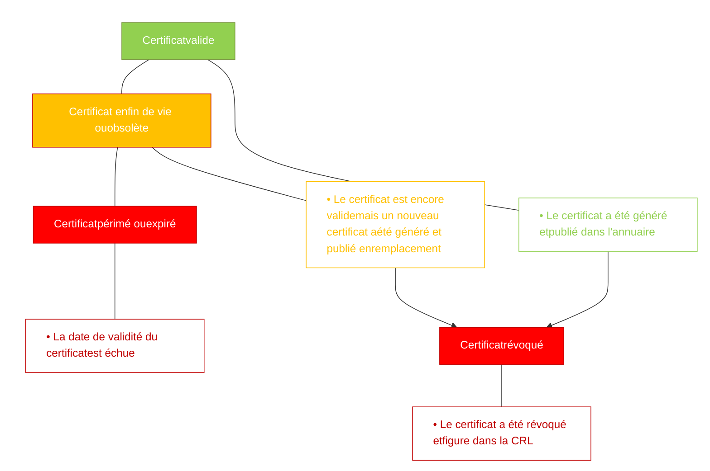

*Vérifications des certificats de l’IGC Santé*

## **1 RAPPELS CONCERNANT L’USAGE DES CERTIFICATS ÉLECTRONIQUES**

L’utilisation de certificats électroniques pour l’authentification ou la signature nécessite de **vérifier** que :

1) Le certificat provient d’une autorité de certification de confiance, c’est-à-dire que le certificat a été signé par une autorité de certification (autorité finale) dépendant directement de l’autorité de confiance (autorité racine).
   Ces autorités de certification doivent, au préalable, être insérées dans le magasin local de certificats de l’application (coffre-fort) – l’introduction doit être faite après vérification de leur authenticité (intégrité et origine).

2) L’utilisation du certificat est bien conforme aux usages de clé autorisés précisés dans les extensions keyUsage et extendedKeyUsage.

3) Le certificat est encore valide, c’est-à-dire que la date de validité n’est pas dépassée.

4) Le certificat n’a pas fait l’objet d’une révocation (par exemple, pour perte ou suspicion de compromission).

 La vérification de la non révocation nécessite de faire référence à une liste à jour des certificats révoqués (CRL, OCSP).

## **2 BONNES PRATIQUES DE GESTION DES CERTIFICATS SUR LE POSTE DE TRAVAIL**

### **2.1 Stockage des certificats sur le poste**

Les certificats sont stockés dans un magasin local de certificats sur le poste de travail. Le rôle de ce magasin est d’assurer l’intégrité de son contenu afin d’assurer un bon niveau de confiance dans les certificats utilisés en offrant des services de gestion contrôlés d’ajout, modification et suppression de certificats et d’autorité de certification dans le magasin. Il est possible d’utiliser les magasins offerts par le système d’exploitation du poste (exemple : magasin de certificats Microsoft Windows) ou des magasins spécifiques gérés directement par la solution proposée par l’Industriel au Professionnel de Santé ou à l’Établissement de Santé.

Référence : **OSI-TUTO-004** / Version : **1.1** / Date : **22/03/24**


**GIE SESAM-Vitale**
5, boulevard Marie et Alexandre Oyon – 72019 LE MANS Cedex 2
<u>www.sesam-vitale.fr</u>

*OSI-TUTO-004* *Vérifications des certificats de l’IGC Santé* *Version : 1.1*

## 2.2 **Mise à jour des Certificats d’Autorités de Certification (AC)**

Les autorités de certification permettent de vérifier la validité des certificats de chiffrement utilisés sur le poste de travail. Ces autorités doivent donc être obligatoirement installées et mises à jour sur le poste. Cette opération d’installation ou de mise à jour doit être réalisée par une « personne de confiance » sous le contrôle de l’utilisateur final du poste de travail.

Le système d’exploitation du poste de travail ou les navigateurs Internet mettent à jour automatiquement les « autorités commerciales reconnues » sur le marché. Pour les autorités spécifiques, comme celle de l’IGC-Santé de l’ANS, celles-ci doivent être installées par l’Industriel, le Professionnel de Santé ou l’Établissement de Santé :

*   Cette installation peut être prise en charge automatiquement par la solution de l’Industriel qui récupérera l’AC auprès de l’ANS et pourra mettre à jour son parc de clients en même temps que son offre logicielle ;
*   Une procédure manuelle doit également être mise à disposition du Professionnel de Santé ou de l’Établissement de Santé pour que celui-ci puisse réaliser cette opération sans passer par l’Industriel.

## 2.3 **Mise à jour des certificats**

Les certificats ont une durée de vie limitée et suivent un cycle de vie illustré par le schéma suivant :



N.B. Les certificats obsolètes sont valides au sens cryptographique (cf. § *vérification de la validité d’un certificat*) tandis que les certificats périmés ou révoqués sont invalides au sens cryptographique.<sup>1</sup>

<sup>1</sup> Il n’existe pas de moyen permettant de déterminer localement sur le poste de travail si un certificat est obsolète ou non. Seule l’infrastructure de gestion de clé a connaissance de cet état car elle a publié un nouveau certificat en remplacement du précédent.

*22/03/24* *GIE SESAM-Vitale* 
  *2 / 5*
*Ce document à diffusion restreinte ne peut être diffusé sans l'autorisation d'une personne habilitée au GIE SESAM-Vitale*

*OSI-TUTO-004* *Vérifications des certificats de l’IGC Santé* *Version : 1.1*

# **3 BONNES PRATIQUES DE VERIFICATION D’UN CERTIFICAT UTILISATEUR**

L’utilisateur d’un certificat est tenu de vérifier, avant son utilisation, l’état des certificats de l’ensemble de la chaîne de certification. Les méthodes existantes permettant la vérification sont listées ci-dessous par ordre de recommandation :

## **3.1 Le service OCSP**

L’IGC Santé met à la disposition des utilisateurs de certificat un service de vérification en ligne du statut du certificat via le protocole OCSP. Ce service est disponible en http à l’adresse : [http://ocsp.esante.gouv.fr](http://ocsp.esante.gouv.fr/).

### **3.1.1 Description de la requête OCSP à envoyer**

Ce paragraphe décrit la commande via OpenSSL pour interroger le répondeur OCSP. Il s’exécute en ligne de commande dans une console DOS (ou invite de commande).

La requête est de la forme suivante :

```text
openssl ocsp -text -issuer <Certificat Emetteur> -CAfile <Chaine de confiance> -url <adresse du répondeur OCSP> -serial <numéro de série en hexadécimal>
```

Les arguments de la requête sont :

*   **text** : augmente la verbosité de la réponse
*   **issuer** : c’est le certificat de l’émetteur (ACI intermédiaire qui a signé le certificat) au format PEM.
*   **CAfile** : c’est la chaine d’autorité de confiance (ensemble ACR et ACI) au format PEM. Il faut indiquer le chemin du fichier bundle, si celui-ci n’est pas dans le répertoire courant où s’exécute la commande.
*   **url** : c’est l’adresse du répondeur OCSP indiquée dans le certificat à vérifier. Dans le cas présent : http://ocsp.esante.gouv.fr
*   **serial** : c’est un identifiant unique au format hexadécimal. Il se trouve dans l’attribut numéro de série du certificat. Le numéro de série doit être préfixé avec 0x ; la taille est de 32 caractères alphanumériques. Pour la gamme Standard, il faut ajouter un zéro non-significatif pour compléter la taille à 32 caractères.

Il est possible de remplacer l’argument serial par **cert** en indiquant le chemin et le nom fichier du certificat à vérifier.

### **3.1.2 Description de la réponse OCSP reçue**

L’appel sans le paramètre text, la réponse OCSP est plus concise comme indiqué ci-dessous :

**Cas passant**

```text
Response verify OK
0x5e31fbd7a48c015e899618c0bbcf4484: good
        This Update: Mar 25 13:13:14 2024 GMT
        Next Update: Mar 26 13:43:14 2024 GMT
```

**Cas non passant**

```text
Response verify OK
0x7c84f678d98eacd91ba8a1c51259b371: revoked
        This Update: Mar 25 15:45:09 2024 GMT
        Next Update: Mar 26 13:56:57 2024 GMT
        Revocation Time: Nov 30 20:45:07 2023 GMT
```

*22/03/24* *GIE SESAM-Vitale* 
  *3 / 5*
*Ce document à diffusion restreinte ne peut être diffusé sans l'autorisation d'une personne habilitée au GIE SESAM-Vitale*

*OSI-TUTO-004* *Vérifications des certificats de l’IGC Santé* *Version : 1.1*

Le service OCSP permet un statut temps réel de l’état de révocation des certificats et une confirmation de son existence au sein de l’IGC en une seule opération. En comparaison, la CRL ne fournit que l’information de son état de révocation si le numéro de série du certificat est présent dans la CRL.

## **3.2 La liste de révocation CRL si l’OCSP ne répond pas**

### **3.2.1 Mise à jour de la CRL**

La liste de révocation des certificats (CRL, « Certificate Revocation List ») permet de contrôler la validité des certificats de chiffrement utilisés en vérifiant que ceux-ci n’ont pas fait l’objet d’une révocation. La CRL est publiée tous les jours dans l’annuaire de l’IGC-Santé et il est recommandé que le Logiciel du Professionnel de Santé (LPS) ou de l’Établissement de Santé télécharge et stocke localement cette CRL.

Les bonnes pratiques de récupération de la CRL reposent sur les **principes** suivants :

1) Fréquence de téléchargement de la CRL : 1 fois par jour
2) Variabilité des horaires de téléchargement de la CRL
3) Limitation des durées de connexion au temps nécessaire de téléchargement
4) Stockage de la CRL en local

Les **règles d’implémentation** préconisées sont les suivantes :

1) Lors de chaque téléchargement de la CRL, les dates et heures d’expiration sont mémorisées.
2) Un chargement quotidien est mis en place. La requête est planifiée aléatoirement sur la journée (algorithme intégré dans la solution de l’éditeur garantissant une répartition de charge chez ses clients).
3) La CRL téléchargée est stockée dans un magasin local de CRLs.

 Si un problème de téléchargement survient :

* faire 2 ou 3 autres tentatives espacées chacune d’une demi-heure
* si le problème persiste, relancer le téléchargement le jour suivant

### **3.2.2 Précisions sur les modalités d'accès à l'annuaire LDAP de l'ANS**

L'annuaire LDAP de l'ANS permet de récupérer les autorités de certification et les CRL associés ayant pour but de vérifier la validité des certificats du SIR (DESIR) lors de l'accès aux TLSi

Il est accessible via le protocole LDAP à l’URL **annuaire-igc.esante.gouv.fr** sur le port **389** (port standard LDAP) en mode anonyme.

Les "DN" de téléchargement des AC intermédiaire et racine du SIR à interroger sont :

* AC intermédiaire :
  DN:cn=AC IGC-SANTE ELEMENTAIRE ORGANISATIONS,ou=AC RACINE IGC-SANTE ELEMENTAIRE,ou=IGC-SANTE,ou=0002 187512751,o=ASIP-SANTE,c=fr
* AC ROOT :

*22/03/24* *GIE SESAM-Vitale*  4 / 5

*Ce document à diffusion restreinte ne peut être diffusé sans l'autorisation d'une personne habilitée au GIE SESAM-Vitale*

*OSI-TUTO-004* *Vérifications des certificats de l’IGC Santé* *Version : 1.1*

DN:cn=AC RACINE IGC-SANTE ELEMENTAIRE,ou=IGC-SANTE,ou=0002 187512751,o=ASIP SANTE,c=fr

Les certificats sont dans l'objet cACertificate et la liste de révocation sous certificateRevocationList

Exemple de récupération de la CRL de l'AC intermédiaire ELEMENTAIRE ORGANISATION avec l'outil ldapsearch :

```text
ldapsearch -H  ldap://annuaire-igc.esante.gouv.fr -x -b "cn=AC IGC-SANTE ELEMENTAIRE
ORGANISATIONS,ou=AC       RACINE    IGC-SANTE    ELEMENTAIRE,ou=IGC-SANTE,ou=0002
187512751,o=ASIP-SANTE,c=fr" certificateRevocationList
```

*22/03/24* *GIE SESAM-Vitale* 
 *5 / 5*
*Ce document à diffusion restreinte ne peut être diffusé sans l'autorisation d'une personne habilitée au GIE SESAM-Vitale*