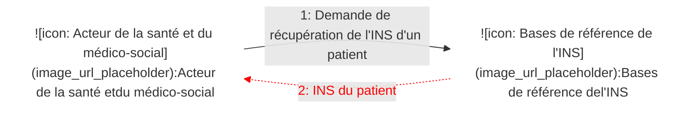
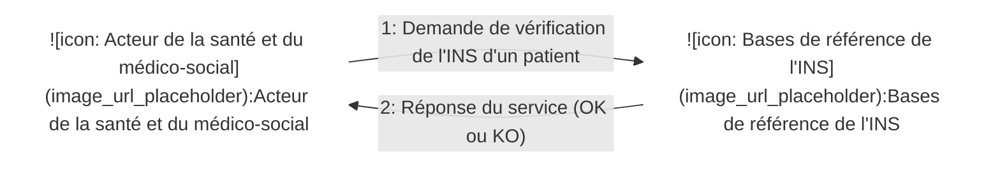
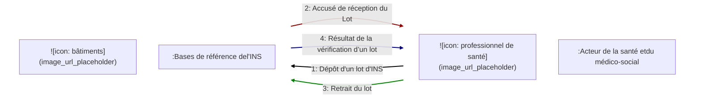
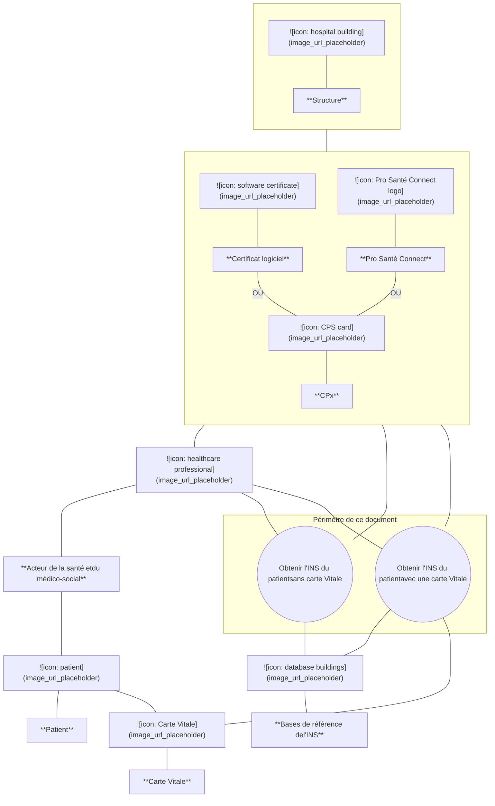
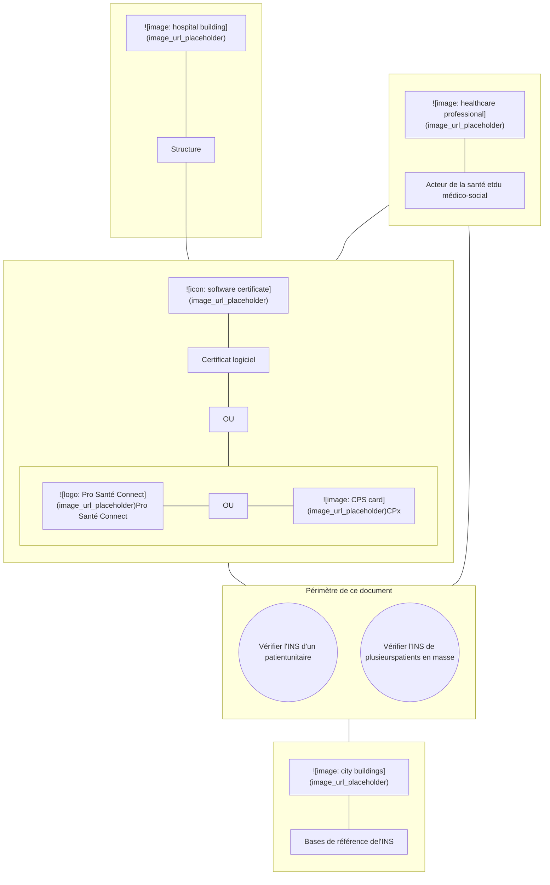

**Téléservice intégré**
***
*GUIDE D'INTÉGRATION*

# **Téléservice Identité Nationale de Santé (INS) intégré aux LPS**

Référence : SEL-MP-043 / Version : 05.00.01 / Date : 19/12/2025
Diffusion : LIBRE
État : REFERENCE

***
**GIE SESAM-Vitale**
5, boulevard Marie et Alexandre Oyon – 72 019 LE MANS CEDEX 2
<u>www.sesam-vitale.fr</u>

Ce document a été élaboré par le GIE SESAM-Vitale.

Conformément à l’article L.122-4 du Code de la Propriété Intellectuelle, toute représentation ou reproduction (intégrale ou partielle) du présent ouvrage, quel que soit le support utilisé, doit être soumise à l’accord préalable écrit de son auteur.

Il en est de même pour sa traduction, sa transformation, son adaptation ou son arrangement, quel que soit le procédé utilisé.

**Tout manquement à ces obligations constituerait un délit de contrefaçon, au sens **des articles L 335-2 et suivants du code de la propriété intellectuelle, susceptible** d’entraîner des sanctions pour l’auteur du délit.**

# **CONTACTS**

Pour toute demande d'évolution, comme pour toute question technique ou fonctionnelle, contactez le Centre de services :

*   portail IRIS : [https://portail-support.sesam-vitale.fr/](https://portail-support.sesam-vitale.fr/)
*   téléphone : 02 43 57 42 88

*SEL-MP-043* *Téléservice Identité Nationale de Santé (INS) intégré aux LPS* *Version : 05.00.01*

# **SOMMAIRE**

<table>
        <tr>
            <td><strong>1</strong></td>
            <td><strong>INTRODUCTION.........................................................................................................................................4</strong></td>
        </tr>
        <tr>
            <td>1.1</td>
            <td>DOCUMENTS DE RÉFÉRENCE ...............................................................................................................4</td>
        </tr>
        <tr>
            <td>1.2</td>
            <td>ABRÉVIATIONS ....................................................................................................................................5</td>
        </tr>
        <tr>
            <td>1.3</td>
            <td>GUIDE DE LECTURE .............................................................................................................................5</td>
        </tr>
        <tr>
            <td><strong>2</strong></td>
            <td><strong>DESCRIPTION FONCTIONNELLE............................................................................................................6</strong></td>
        </tr>
        <tr>
            <td>2.1</td>
            <td>INTRODUCTION....................................................................................................................................6</td>
        </tr>
        <tr>
            <td>2.2</td>
            <td>ACTEURS ET OBJECTIFS D'UTILISATION DU SYSTÈME .............................................................................9</td>
        </tr>
        <tr>
            <td>2.3</td>
            <td>DESCRIPTION DU PROCESSUS « OBTENIR L’INS DU PATIENT AVEC UNE CARTE VITALE ».......................11</td>
        </tr>
        <tr>
            <td>2.4</td>
            <td>DESCRIPTION DU PROCESSUS « OBTENIR L’INS DU PATIENT SANS CARTE VITALE » .............................14</td>
        </tr>
        <tr>
            <td>2.5</td>
            <td>DESCRIPTION DU PROCESSUS « VÉRIFIER L'INS D'UN PATIENT (VÉRIFICATION UNITAIRE) » ...................16</td>
        </tr>
        <tr>
            <td>2.6</td>
            <td>DESCRIPTION DU PROCESSUS « VÉRIFIER L'INS DE PLUSIEURS PATIENTS (VÉRIFICATION EN MASSE) » .18</td>
        </tr>
        <tr>
            <td><strong>3</strong></td>
            <td><strong>ÉLÉMENTS TECHNIQUES SPÉCIFIQUES AU SERVICE .....................................................................20</strong></td>
        </tr>
        <tr>
            <td>3.1</td>
            <td>LES COMPOSANTS DU POSTE DE TRAVAIL ...........................................................................................20</td>
        </tr>
        <tr>
            <td>3.2</td>
            <td>DESCRIPTION TECHNIQUE ..................................................................................................................20</td>
        </tr>
        <tr>
            <td>3.3</td>
            <td>ENVIRONNEMENTS DE TRAVAIL ..........................................................................................................23</td>
        </tr>
        <tr>
            <td></td>
            <td>
                3.3.1      <i>Environnement de test</i> ....................................................................................................23 
                3.3.2      <i>Environnement de production</i> .........................................................................................23
            </td>
        </tr>
        <tr>
            <td>3.4</td>
            <td>DESCRIPTION DES SERVICES .............................................................................................................23</td>
        </tr>
        <tr>
            <td></td>
            <td>
                3.4.1      <i>Description fonctionnelle des données</i> ...........................................................................23 
                3.4.2      <i>WS_INS1 : Récupérer INS avec carte Vitale</i> ..................................................................31 
                3.4.3      <i>WS_INS2 : Récupérer INS sans carte Vitale</i> ..................................................................33 
                3.4.4      <i>WS_INS3 : Vérifier INS (vérification unitaire)</i>..................................................................34 
                3.4.5      <i>WS_INS4 : Déposer un lot à vérifier (vérification en masse)</i>..........................................36 
                3.4.6      <i>WS_INS5 : Récupérer le résultat de la vérification d’un lot (vérification en masse)</i> .......37
            </td>
        </tr>
</table>

## **TABLE DES ILLUSTRATIONS**

<table>
    <tr>
      <td>FIGURE 1 : PRÉSENTATION GÉNÉRALE DE LA RECHERCHE DE L’INS D’UN PATIENT ....................................................</td>
      <td>6</td>
    </tr>
    <tr>
      <td>FIGURE 2 : PRÉSENTATION GÉNÉRALE DE LA VÉRIFICATION UNITAIRE D’INS .............................................................</td>
      <td>6</td>
    </tr>
    <tr>
      <td>FIGURE 3 : PRÉSENTATION GÉNÉRALE DE LA VÉRIFICATION EN MASSE D’INS ............................................................</td>
      <td>6</td>
    </tr>
    <tr>
      <td>FIGURE 4 : ACTEURS ET OBJECTIFS D’UTILISATION DU SYSTÈME POUR LA RECHERCHE DE L’INS D’UN PATIENT ..........</td>
      <td>9</td>
    </tr>
    <tr>
      <td>FIGURE 5 : ACTEURS ET OBJECTIFS D’UTILISATION DU SYSTÈME POUR LA VÉRIFICATION D’INS (UNITAIRE OU EN MASSE) .............................................................................................................................................</td>
      <td>10</td>
    </tr>
</table>

## **TABLE DES ANNEXES**

<table>
  <thead>
    <tr>
      <th colspan="2"><b>TABLE DES ANNEXES</b></th>
    </tr>
  </thead>
  <tbody>
    <tr>
      <td><b><b>ANNEXE 1</b></b></td>
      <td><b><b>LISTE DES ERREURS ...................................................................................................39</b></b></td>
    </tr>
    <tr>
      <td><b><b>ANNEXE 2</b></b></td>
      <td><b><b>GUIDE DE LECTURE .....................................................................................................42</b></b></td>
    </tr>
    <tr>
      <td><b><b>ANNEXE 3</b></b></td>
      <td><b><b>AUTHENTIFICATION TLS MUTUELLE PAR CERTIFICAT LOGICIEL .......................43</b></b></td>
    </tr>
  </tbody>
</table>

*19/12/2025* *3 / 44*

*SEL-MP-043 Téléservice Identité Nationale de Santé (INS) intégré aux LPS Version : 05.00.01*

# 1 **INTRODUCTION**

L’article L. 1111-8-1 du code de la santé publique prévoit que le numéro d'inscription (NIR) au répertoire national d'identification des personnes physiques (RNIPP/SNGI) doit être utilisé comme identifiant de santé (matricule INS) des personnes pour leur prise en charge à des fins sanitaires et médico-sociales dans les conditions prévues à l’article L. 1110-4 du code de la santé publique.

Les modalités d’utilisation de l’identité nationale de santé (INS) et plus particulièrement la finalité de son usage et les personnes habilitées à opérer le référencement des données sur sa base sont prévues aux articles R. 1111-1 et suivants du code de la santé publique.

Ces modalités sont complétées au moyen d’un référentiel opposable publié par arrêté et des documents qui lui sont associés (guide d’implémentation, référentiel national d’identitovigilance (RNIV), Foire aux questions, …) [REF-INS].

Il est précisé que la mise en œuvre de l’INS et l’usage du téléservice objet du présent guide :

*   ne peuvent en aucun cas empêcher la prise en charge d’un patient comme cela est prévu par le code de la santé publique ;
*   nécessitent que le traitement de données personnelles dans lequel le téléservice s’inscrit doit être conforme au règlement général sur la protection des données et à la loi dite informatique et libertés modifiée et aux exigences du référentiel [REF-INS] pour ce qui le concerne.

<mark>**<u>Évolutions</u>**</mark>
<mark>**<u>v05.00.01</u>**</mark>

<mark><u>Externalisation de la liste des erreurs dans un fichier dédié. Cf. [Erreurs INSi] ci-dessous.</u></mark>

## 1.1 **Documents de référence**

<table>
  <thead>
    <tr>
      <th><b>Appellation</b></th>
      <th><b>Type et titre</b></th>
      <th><b>Référence</b></th>
    </tr>
  </thead>
  <tbody>
    <tr>
      <td>REF-INS</td>
      <td>Référentiel Identifiant National de Santé et les documents associés : guide d’implémentation, RNIV, Foire aux questions, …</td>
      <td>Cf. site de l’ANS</td>
    </tr>
    <tr>
      <td>OID-INS</td>
      <td>Liste des OID des autorités d'affectation des matricules INS</td>
      <td>asip_referentiel_identifiant_national_sante-liste-des-oid-des-autorites-d-affectation-des-ins_v0.1.pdf</td>
    </tr>
    <tr>
      <td>CI</td>
      <td>Cadre d’interopérabilité des TLSi AMO</td>
      <td>CI_TLSI_AMO</td>
    </tr>
    <tr>
      <td>Accès cartes</td>
      <td>Modalité d'accès aux données présentes dans les cartes Vitale, ApCV, CPS, dans ProSanté Connect et dans les certificats</td>
      <td>SEL-INF-031</td>
    </tr>
    <tr>
      <td>Erreurs SIR</td>
      <td>Table des erreurs du SIR</td>
      <td>SEL-INF-032</td>
    </tr>
    <tr>
      <td><mark>Erreurs INSi</mark></td>
      <td><mark>Table des erreurs du service INSi</mark></td>
      <td><mark>ANNEXE 1 LISTE DES ERREURS INSi &#x3C;version>.xlsx</mark></td>
    </tr>
    <tr>
      <td>INSEE</td>
      <td>Liste des communes et historique</td>
      <td>Cf. site de l’INSEE / Définitions, méthodes et qualité / Géographie administrative et d'étude / Téléchargement / Code officiel géographique (COG)</td>
    </tr>
  </tbody>
</table>

*19/12/2025* 4 / 44

*SEL-MP-043* *Téléservice Identité Nationale de Santé (INS) intégré aux LPS* *Version : 05.00.01*

## **1.2** **Abréviations**

<table>
  <thead>
    <tr>
      <th colspan="2"><b>Abréviations</b></th>
    </tr>
  </thead>
  <tbody>
    <tr>
      <td>ANS</td>
      <td>Agence du Numérique en Santé</td>
    </tr>
    <tr>
      <td>ApCV</td>
      <td>Application Carte Vitale</td>
    </tr>
    <tr>
      <td>CPS / CPx</td>
      <td>Carte de Professionnel de Santé</td>
    </tr>
    <tr>
      <td>EF</td>
      <td>Entité Fonctionnelle (cf. §1.3)</td>
    </tr>
    <tr>
      <td>INS</td>
      <td>Identité Nationale de Santé</td>
    </tr>
    <tr>
      <td>LPS</td>
      <td>Logiciel de Professionnel de Santé</td>
    </tr>
    <tr>
      <td>NIA</td>
      <td>Numéro d’Immatriculation d’Attente</td>
    </tr>
    <tr>
      <td>NIR</td>
      <td>Numéro d'Inscription au Répertoire national d'identification des personnes physiques</td>
    </tr>
    <tr>
      <td>OID</td>
      <td><i>Object IDentifier</i>, identifiant d’objets</td>
    </tr>
    <tr>
      <td>PSC</td>
      <td>Pro Santé Connect</td>
    </tr>
    <tr>
      <td>RG</td>
      <td>Règle de Gestion (cf. §1.3)</td>
    </tr>
    <tr>
      <td>RNIPP</td>
      <td>Répertoire National d’Identification des Personnes Physiques</td>
    </tr>
    <tr>
      <td>RNIV</td>
      <td>Référentiel national d’identitovigilance</td>
    </tr>
    <tr>
      <td>SIR</td>
      <td>Système Inter-régime</td>
    </tr>
    <tr>
      <td>SNGI</td>
      <td>Système National de Gestion des Identités</td>
    </tr>
    <tr>
      <td>XSD</td>
      <td>XML Schema Definition</td>
    </tr>
    <tr>
      <td>WS</td>
      <td>Web service</td>
    </tr>
  </tbody>
</table>

## **1.3** **Guide de lecture**

Le guide de lecture est disponible dans l’annexe 2 à la fin de ce document.

Certaines données facultatives dans les XSD (cf. occurrence XSD = 0..1) doivent obligatoirement être alimentées lors de l’appel du service. Se référer au chapitre 2 pour connaître les données obligatoires. Cf. « O » (obligatoire) et « F » (facultatif) dans la colonne « O/F » dans tableaux décrivant les données.

### **Références**

Les références spécifiques à ce document sont les suivantes :

***[RG_INS…] Les règles de gestion sont référencées sous la forme RG_INS… et constituent les exigences fonctionnelles vis-à-vis du LPS et des interfaces entre le LPS et l’Assurance Maladie (en tant que fournisseur des téléservices).***

NB : les recommandations ne font pas partie des exigences LPS.

***EF_INSxx Les entités fonctionnelles sont référencées sous la forme EF_INSxx et représentent des blocs de données. Elles apparaissent dans les diagrammes décrivant la structure des données en entrée et en sortie des services.***

***EF_INSxx_yy Les données fonctionnelles reprennent la référence de l’entité à laquelle elles sont rattachées. Un indice (yy) permet de les distinguer au sein de l’entité.***

***WS_INSx (Point d’accès fonctionnel à un) Web Service.***

*19/12/2025* 5 / 44

*SEL-MP-043* *Téléservice Identité Nationale de Santé (INS) intégré aux LPS* *Version : 05.00.01*

# **2 DESCRIPTION FONCTIONNELLE**

Ce chapitre décrit tous les aspects fonctionnels du téléservice INSi.

Le cas échéant, la description d’une fonction peut conduire à un renvoi aux éléments techniques correspondants (valeurs des champs et formats notamment), nécessaires à la mise en œuvre du téléservice à proprement parler. Ces éléments figurent dans le chapitre « Éléments techniques spécifiques au service », page 20.

## **2.1 Introduction**

Le téléservice Identité Nationale de Santé intégré au LPS (INSi) permet aux seuls acteurs de la santé et **du médico-social** respectant les conditions de sécurité rappelées par le référentiel [REF-INS] d’acquérir l’identité nationale de santé (INS constituée du matricule INS et des traits d’identité de référence) d’un patient pour répondre aux finalités prévues par les textes encadrant l’usage de l’INS.

**Figure 1 : présentation générale de la recherche de l’INS d’un patient**

**Figure 2 : présentation générale de la vérification unitaire d’INS**

**Figure 3 : présentation générale de la vérification en masse d’INS**

Ce téléservice s’inscrit dans le cadre d’interopérabilité des TLSi AMO [CI].

L’accès au téléservice INSi nécessite l’utilisation :

*   de la CPS, CPF, CDE ou CPE nominative. Dans la suite du document, ces cartes sont désignées par le terme CPx,
*   ou de Pro Santé Connect (PSC),
*   ou d’une authentification TLS mutuelle par certificat logiciel (cf. description dans l’annexe 3).

L’usage de la carte Vitale du patient est à privilégier mais non imposé.

*19/12/2025* *6 / 44*

*SEL-MP-043* *Téléservice Identité Nationale de Santé (INS) intégré aux LPS* *Version : 05.00.01*

# **Périmètre**

## ***Acteurs de la santé et du médico-social***

Le cercle de ces acteurs est posé par les articles L. 1111-8-1, L. 1110-4 et R. 1111-8-1 et suivants du code de la santé publique.

Les contraintes portant sur ces acteurs sont définies dans le référentiel [REF-INS].

Certains acteurs ne peuvent pas utiliser le téléservice INSi. Ce contrôle est effectué par le service. Pour information, il s’agit notamment des acteurs des assurances privées (secteur d’activité SA23).

Seuls les acteurs disposant d'un ordre professionnel et éligibles à une carte CPS sont autorisés à utiliser le mode d’authentification Pro Santé Connect.

## ***Patients / usagers***

Toutes les personnes possédant un NIR ou un NIA.

L’intégration de l’INS et l’usage du téléservice INSi ne modifie pas les conditions de prise en charge sanitaire et médico-sociale (notamment pour les personnes ne bénéficiant pas d’INS qui sont tout de même prises en charge cf. art. R.1111-8-1 II).

# **Principes**

Le répertoire national d'identification des personnes physiques (RNIPP/SNGI) contient les INS (matricule INS et les traits d’identité de référence) des personnes physiques en France.

Le téléservice INSi utilise :

*   une base RFI contenant une copie des informations concernant les bénéficiaires du régime général et des régimes hébergés,
*   le SNGI pour les bénéficiaires des autres régimes (= hors régime général et hors régimes hébergés).

Les INS obtenues par le téléservice INSi comportent les données suivantes.

*   Le matricule INS :
    *   un NIR (avec clé) ou un NIA (avec clé),
    *   et un OID (cf. valeurs dans le document [OID-INS]).
*   Les traits d’identité de référence : nom de famille (également appelé nom de naissance), liste des prénoms, sexe, date de naissance, code officiel géographique du lieu de naissance.
*   Et, le cas échéant, l’historique des matricules INS.

Les contraintes concernant l’usage de l’INS (matricules INS et des traits d’identité) sont définies dans le référentiel [REF-INS].

*19/12/2025* 
  *7 / 44*

*SEL-MP-043* *Téléservice Identité Nationale de Santé (INS) intégré aux LPS* *Version : 05.00.01*

# **Intégration des services**

Le tableau ci-dessous indique les web-services à implémenter en fonction du profil choisi.

<table>
  <thead>
    <tr>
      <th></th>
      <th><b>Profils</b> <b><b>Fonctionnalité INSi</b></b></th>
      <th>Recherche seule</th>
      <th><b>Recherche et</b> vérification</th>
      <th>Vérification seule</th>
    </tr>
  </thead>
  <tbody>
    <tr>
      <td><i>WS_INS1</i></td>
      <td>Obtenir l’INS du patient avec une carte Vitale</td>
      <td>Implémentation obligatoire si la lecture de la carte Vitale est implémentée dans le LPS</td>
      <td>Implémentation obligatoire si la lecture de la carte Vitale est implémentée dans le LPS</td>
      <td>-</td>
    </tr>
    <tr>
      <td><i>WS_INS2</i></td>
      <td>Obtenir l’INS du patient sans carte Vitale</td>
      <td>Implémentation obligatoire</td>
      <td>Implémentation obligatoire</td>
      <td>-</td>
    </tr>
    <tr>
      <td><i>WS_INS3</i></td>
      <td>Vérifier l'INS d'un patient (vérification unitaire)</td>
      <td>-</td>
      <td>Choix A(*)</td>
      <td>Choix A(*)</td>
    </tr>
    <tr>
      <td></td>
      <td></td>
      <td></td>
      <td>et/ou</td>
      <td>et/ou</td>
    </tr>
    <tr>
      <td><i>WS_INS4</i> <i>WS_INS5</i></td>
      <td>Vérifier l'INS de plusieurs patients (vérification en masse)</td>
      <td>-</td>
      <td>Choix B(*)</td>
      <td>Choix B(*)</td>
    </tr>
  </tbody>
</table>

(*) Implémentation obligatoire parmi les choix suivants :

*   Vérification unitaire seule (Choix A),
*   Vérification en masse seule (Choix B),
*   Vérification unitaire et vérification en masse (Choix A et Choix B).

# **Limitations du téléservice**

### ***Concernant tous les bénéficiaires***

Les données alphanumériques (nom et prénom) en entrée du service ne doivent pas comporter de minuscule, de signe diacritique (accent, tréma, cédille, …) ni de ligature (Æ, Œ, …). Cf. la description des données page 25 pour plus de détails. Les données alphanumériques en sortie du service suivent les mêmes règles.

### ***Concernant les bénéficiaires du régime général (ou d’un régime hébergé)***

L’historique des matricules INS d’un patient est limité à 10 changements de matricule INS effectués après 2006 dans le cadre du régime général ou d’un régime hébergé.

Pour obtenir une INS sans carte Vitale, plusieurs prénoms peuvent être saisis dans le LPS. Un seul prénom étant exploité par le service dans ce cas, le LPS doit appeler le service pour chaque prénom saisi. Chaque prénom saisi peut être un prénom composé avec espace ou tiret. Par exemple : « Jean Claude » ou « Jean-Claude ».

### ***Concernant les bénéficiaires des autres régimes (= hors régime général et hors régimes hébergés)***

L’historique des matricules INS d’un patient n’est pas remonté par le service « Obtenir l’INS du patient sans carte Vitale » (WS_INS2).

Le téléservice INSi ne permet pas d’obtenir l’INS des bénéficiaires de ces régimes à partir de la carte Vitale si celle-ci ne contient pas le nom de naissance du patient (nom de naissance non renseigné en carte ou différent du nom de naissance du patient).

*19/12/2025* *8 / 44*

*SEL-MP-043 Téléservice Identité Nationale de Santé (INS) intégré aux LPS Version : 05.00.01*

## **2.2 Acteurs et objectifs d'utilisation du système**

### **Recherche d’INS**

Le téléservice INSi permet d’obtenir l’INS (matricule INS et les traits d’identité de référence) d’un patient. Le téléservice INSi offre deux modes de fonctionnement : avec ou **sans carte Vitale**.

**Figure 4 : acteurs et objectifs d’utilisation du système pour la recherche de l’INS d’un patient**

*19/12/2025* 9 / 44

*SEL-MP-043* *Téléservice Identité Nationale de Santé (INS) intégré aux LPS* *Version : 05.00.01*

# **Vérification d’INS**

Le téléservice INSi permet de vérifier l’INS des patients.

**Figure 5 : acteurs et objectifs d’utilisation du système pour la vérification d’INS (unitaire ou en masse)**

## **Acteurs**

<table>
  <thead>
    <tr>
      <th></th>
      <th><strong><b>Définition du rôle</b></strong></th>
    </tr>
  </thead>
  <tbody>
    <tr>
      <td><strong><i>Acteur de la santé et du médico-social (également appelé l’utilisateur du service)</i></strong></td>
      <td>Acteur participant à la prise en charge sanitaire ou au suivi médico-social d’un patient.  Les contraintes portant sur cet acteur sont définies dans le référentiel [REF-INS].</td>
    </tr>
    <tr>
      <td><strong><i>CPx</i></strong></td>
      <td>La carte CPx de l’acteur de la santé ou du médico-social est un des moyens d’authentification possibles pour l’utilisation du service INSi.</td>
    </tr>
    <tr>
      <td><strong><i>Pro Santé Connect</i></strong></td>
      <td>Pro Santé Connect est un des moyens d’authentification possibles pour l’utilisation du téléservice INSi.</td>
    </tr>
    <tr>
      <td><strong><i>Certificat logiciel</i></strong></td>
      <td>L’authentification TLS mutuelle (certificat logiciel de personne morale), est un des moyens d’authentification possibles pour l’utilisation du téléservice INSi.</td>
    </tr>
    <tr>
      <td><strong><i>Patient</i></strong></td>
      <td>Usager du système de santé français.  Cf. le référentiel [REF-INS] pour plus d’informations.</td>
    </tr>
    <tr>
      <td><strong><i>Carte Vitale</i></strong></td>
      <td>Dans le cas d’usage de la recherche d’INS avec une carte Vitale, les données à transmettre au téléservice sont acquises à partir de la carte Vitale.</td>
    </tr>
    <tr>
      <td><strong><i>Bases de référence de l’INS</i></strong></td>
      <td>Ces bases contiennent l’INS (le matricule INS et les traits d’identité de référence) de chaque patient.</td>
    </tr>
  </tbody>
</table>

*19/12/2025* 10 / 44

*SEL-MP-043* *Téléservice Identité Nationale de Santé (INS) intégré aux LPS* *Version : 05.00.01*

## **2.3** **Description du processus « Obtenir l’INS du patient avec une carte Vitale »**

### **Prérequis**
La carte Vitale est présente dans lecteur de cartes et le patient est sélectionné parmi les bénéficiaires en carte Vitale.

### **Événement déclencheur**
L’acteur de la santé et du médico-social souhaite obtenir l’INS du patient.

### **Description**
Le LPS acquiert les données d’appel du web service « Récupérer INS avec carte Vitale » (WS_INS1).

Le LPS appelle le web service « Récupérer INS avec carte Vitale » (WS_INS1).

Deux appels du web service peuvent être nécessaires.

*   Lors du premier appel, la donnée « nom de naissance » est alimentée avec le nom de famille (également appelé nom patronymique dans certains documents) du porteur de la carte Vitale ;
*   Si le service ne trouve pas un résultat unique, le LPS appelle une deuxième fois le web service. Pour cet appel, la donnée « nom de naissance » est alimentée avec le nom d’usage (également appelé nom usuel dans certains documents) du patient sélectionné en carte Vitale.

Nota bene.

*   Des contraintes supplémentaires concernant les appels du web service sont décrites dans la suite du document. Cf. les règles de gestion dans la suite du document.
*   Les contraintes concernant l’usage de l’INS sont décrites dans le référentiel [REF-INS].

### **Données en entrée**
(Les données concernant le patient sont acquises pendant le déroulement du processus.)

### **Données en sortie**
Matricule INS de référence, traits d’identité de référence et historique des matricules INS du patient.

### **Règles de gestion**
*[RG_INS120] Acquérir les données d’appel du web service « Récupérer INS avec carte Vitale » (WS_INS1)*

Le LPS acquiert les données suivantes à partir de la carte Vitale. Dans le tableau suivant :

*   la première colonne indique la référence et le nom des données à alimenter (ces données sont référencées EF_INSxx_yy et sont décrites dans le chapitre 3.4.1),
*   la deuxième colonne indique les références des données (groupe - donnée) mentionnées dans le cahier des charges éditeurs SESAM-Vitale 1.40 pour la fonctionnalité « SSV – Lecture droits Vitale » et dans le référentiel DI,
*   la troisième colonne indique les références des données dans le référentiel API de lecture sous la forme de balises XML,
*   la dernière colonne indique si la donnée est obligatoire (O) ou facultative (F).

*19/12/2025* 11 / 44

*SEL-MP-043* *Téléservice Identité Nationale de Santé (INS) intégré aux LPS* *Version : 05.00.01*

<table>
  <thead>
    <tr>
      <th colspan="2"><b>Données INSi à alimenter</b></th>
      <th><b>SSV</b></th>
      <th>API de lecture</th>
      <th><b>O/F</b></th>
    </tr>
  </thead>
  <tbody>
    <tr>
      <td><strong>EF_INS01</strong></td>
      <td><strong>RÉCUPÉRER (INS AVEC CARTE) <b>VITALE</b></strong></td>
      <td></td>
      <td></td>
      <td></td>
    </tr>
    <tr>
      <td>EF_INS01_01</td>
      <td>Date de naissance</td>
      <td>(104-12)</td>
      <td>&#x3C;ident> &#x3C;naissance></td>
      <td>O</td>
    </tr>
    <tr>
      <td>EF_INS01_02</td>
      <td>Rang</td>
      <td>(104-13)</td>
      <td>&#x3C;ident> &#x3C;rangDeNaissance></td>
      <td>O</td>
    </tr>
    <tr>
      <td>EF_INS01_03</td>
      <td>Nom de naissance</td>
      <td>(104-2)</td>
      <td>&#x3C;ident> &#x3C;nomPatronymique></td>
      <td>F(1)</td>
    </tr>
    <tr>
      <td><strong>EF_INS02</strong></td>
      <td><strong>Matricule Individu</strong></td>
      <td></td>
      <td></td>
      <td></td>
    </tr>
    <tr>
      <td>EF_INS02_01</td>
      <td>Numéro identifiant</td>
      <td>(104-9)</td>
      <td>&#x3C;ident> &#x3C;nirCertifie>(3)</td>
      <td>F(2)</td>
    </tr>
    <tr>
      <td><strong>EF_INS03</strong></td>
      <td><strong>Matricule Ouvrant-Droit</strong></td>
      <td></td>
      <td></td>
      <td></td>
    </tr>
    <tr>
      <td>EF_INS03_01</td>
      <td>Numéro identifiant</td>
      <td>(101-8)</td>
      <td>&#x3C;ident> &#x3C;nir>(3)</td>
      <td>O</td>
    </tr>
  </tbody>
</table>

(1) Le nom de naissance doit être alimenté par le nom de famille du porteur de la carte Vitale même si le patient n’est pas le porteur de la carte Vitale. Les caractères du nom de famille doivent être convertis en caractères acceptés par le service. Cf. définition de la donnée « nom de naissance » page 25. Cette donnée peut ne pas être alimentée si le nom de famille du porteur de la carte Vitale n’est pas renseigné en carte.

(2) Le LPS doit acquérir cette donnée si celle-ci est disponible en carte.

(3) Les balises `<nir>` et `<nirCertifie>` fournies par l’API de lecture contiennent les données suivantes concaténées : NIR, un espace et clé du NIR. Le LPS ne doit acquérir que le NIR. L’espace et la clé du NIR ne doivent pas être utilisés pour l’appel du service.

## *[RG_INS140] **Appeler le web service « Récupérer INS avec carte Vitale » (WS_INS1) avec le nom de famille du porteur de la carte Vitale***

Le LPS appelle le web service en passant en entrée les données acquises précédemment.

La description technique des données en entrée et en sortie du web service est disponible dans le chapitre 3.4.2.

En cas de succès, le service retourne le matricule INS, les traits d’identité de référence et l’historique des matricules INS du patient ainsi qu’un code de compte rendu égal à « 00 » (double zéro) signifiant qu’un résultat unique a été trouvé.

Le LPS doit signifier le caractère non définitif du matricule INS, si celui-ci est de type NIA. Cf. valeur de l’OID correspondant dans le document [OID-INS].

Le processus s’arrête. Les règles de gestion suivantes ne sont pas mises en œuvre.

### *4 **Cas particulier n°1***

Le service retourne un code de compte rendu différent de « 00 » (double zéro) signifiant que le service n’a pas trouvé un résultat unique.

Les codes de compte rendu possibles ainsi que leur signification sont décrits page 30.

Le processus continue. Cf. les règles de gestion ci-dessous.

*19/12/2025* *12 / 44*

*SEL-MP-043* *Téléservice Identité Nationale de Santé (INS) intégré aux LPS* *Version : 05.00.01*

## **[RG_INS160] *Acquérir le nom de naissance en utilisant le nom d’usage du patient***

Condition : le service a retourné (cf. RG_INS140) un code de compte rendu différent de « 00 » (double zéro).

Le LPS acquiert la donnée suivante à partir de la carte Vitale. Les autres données acquises précédemment sont conservées à l’identique.

<table>
  <thead>
    <tr>
      <th colspan="2"><b>Données INSi à alimenter</b></th>
      <th rowspan="1"><b>SSV</b></th>
      <th rowspan="1"><b>API de lecture</b></th>
      <th rowspan="1"><b>O/F</b></th>
    </tr>
  </thead>
  <tbody>
    <tr>
      <td>EF_INS01</td>
      <td>RÉCUPÉRER (INS AVEC CARTE) VITALE</td>
      <td></td>
      <td></td>
      <td></td>
    </tr>
    <tr>
      <td>EF_INS01_03</td>
      <td>Nom de naissance</td>
      <td>(104-1)</td>
      <td>&#x3C;ident> &#x3C;nomUsuel></td>
      <td>O(1)</td>
    </tr>
  </tbody>
</table>
(1) Le nom de naissance doit être alimenté par le nom d’usage du patient sélectionné en carte Vitale. Les caractères du nom d’usage doivent être convertis en caractères acceptés par le service. Cf. définition de la donnée « nom de naissance » page 25.

###  ***Cas d’erreur n°1***

Le nom d’usage du patient n’est pas renseigné en carte Vitale.

Le processus s’arrête. Les règles de gestion suivantes ne sont pas mises en œuvre.

###  ***Cas d’erreur n°2***

Le nom d’usage du patient (après conversion des caractères) est identique au nom de famille du porteur de la carte Vitale (après conversion des caractères).

Le processus s’arrête. Les règles de gestion suivantes ne sont pas mises en œuvre.

## **[RG_INS180] *Appeler le web service « Récupérer INS avec carte Vitale » (WS_INS1) avec le nom d’usage du patient***

Conditions :

*   le service a retourné (cf. RG_INS140) un code de compte rendu différent de « 00 » (double zéro),
*   le nom d’usage du patient est renseigné en carte Vitale,
*   le nom d’usage du patient (après conversion des caractères) est différent du nom de famille du porteur de la carte Vitale (après conversion des caractères).

Le LPS appelle le web service en passant en entrée les données acquises précédemment.

La description technique des données en entrée et en sortie du web service est disponible dans le chapitre 3.4.2.

En cas de succès, le service retourne le matricule INS, les traits d’identité de référence et l’historique des matricules INS du patient ainsi qu’un code de compte rendu égal à « 00 » (double zéro) signifiant qu’un résultat unique a été trouvé.

Le LPS doit signifier le caractère non définitif du matricule INS, si celui-ci est de type NIA. Cf. valeur de l’OID correspondant dans le document [OID-INS].

###  ***Cas d’erreur***

Si le service retourne un code de compte rendu (EF_INS99_01) différent de « 00 » (double zéro), le LPS doit afficher un message à l’utilisateur. Il peut s’agir du libellé retourné par le service (EF_INS99_02) ou d’un message adapté par le LPS respectant le sens du libellé retourné par le service (EF_INS99_02).

*19/12/2025* *13 / 44*

*SEL-MP-043* *Téléservice Identité Nationale de Santé (INS) intégré aux LPS* *Version : 05.00.01*

## **2.4** **Description du processus « Obtenir l’INS du patient sans carte Vitale »**

### **Événement déclencheur**

L’acteur de la santé et du médico-social souhaite obtenir l’INS du patient sans utiliser la carte Vitale.

### **Description**

Le LPS acquiert les données d’appel du web service « Récupérer INS sans carte Vitale » (WS_INS2).

Il est recommandé de positionner le premier prénom d’usage au début de la liste des prénoms afin qu’il puisse être utilisé en premier par le web service.

Le LPS appelle le web service « Récupérer INS sans carte Vitale » (WS_INS2) pour chaque prénom saisi jusqu’à trouver un résultat unique.

Chaque prénom saisi peut être un prénom composé avec espace ou tiret.
Par exemple : « Jean Claude » ou « Jean-Claude ».

Si aucun résultat unique n’a été trouvé, le LPS appelle le web service « Récupérer INS sans carte Vitale » (WS_INS2) avec l’ensemble des prénoms saisis.

**Nota bene.**

*   Des contraintes supplémentaires concernant les appels du web service sont décrites dans la suite du document. Cf. les règles de gestion dans la suite du document.
*   Les contraintes concernant l’usage de l’INS sont décrites dans le référentiel [REF-INS].

### **Données en entrée**

(Les données concernant le patient sont acquises pendant le déroulement du processus.)

### **Données en sortie**

Matricule INS de référence, traits d’identité de référence et historique des matricules INS du patient.

### **Règles de gestion**

#### *[RG_INS210] Acquérir les données d’appel du web service « Récupérer INS sans carte Vitale » (WS_INS2)*

L’utilisateur saisit les données ci-dessous. Les champs de saisie peuvent être prérenseignés par le LPS. L’utilisateur doit vérifier les données avant l’appel du web-service.

<table>
  <thead>
    <tr>
      <th>EF_INS10</th>
      <th>RÉCUPÉRER (INS) SANS (CARTE) VITALE</th>
      <th><b>O/F</b></th>
    </tr>
  </thead>
  <tbody>
    <tr>
      <td>EF_INS10_01</td>
      <td>Nom de naissance</td>
      <td>O</td>
    </tr>
    <tr>
      <td>EF_INS10_03</td>
      <td>Sexe</td>
      <td>O</td>
    </tr>
    <tr>
      <td>EF_INS10_04</td>
      <td>Date de naissance</td>
      <td>O</td>
    </tr>
    <tr>
      <td>EF_INS10_05</td>
      <td>Code INSEE du lieu de naissance</td>
      <td>F(*)</td>
    </tr>
  </tbody>
</table>
(*) Le code INSEE du lieu de naissance ne doit pas être alimenté en première intention lors de l’appel au téléservice INSi.

*19/12/2025* 14 / 44

*SEL-MP-043* *Téléservice Identité Nationale de Santé (INS) intégré aux LPS* *Version : 05.00.01*

## *[RG_INS220] **Acquérir les prénoms du patient***

L’utilisateur saisit la donnée ci-dessous. Les champs de saisie peuvent être prérenseignés par le LPS. L’utilisateur doit vérifier les données avant l’appel du web-service.

<table>
  <thead>
    <tr>
      <th>EF_INS110</th>
      <th>Liste des prénoms</th>
      <th>O/F</th>
    </tr>
  </thead>
  <tbody>
    <tr>
      <td>EF_INS110_02</td>
      <td>Prénom Cette donnée, à occurrences multiples, est locale au LPS. Chaque occurrence de cette donnée ne doit contenir qu’un seul prénom. Chaque prénom peut être un prénom composé avec espace ou tiret. Par exemple : « Jean Claude » ou « Jean-Claude ». Il est recommandé de positionner le premier prénom d’usage au début de la liste des prénoms afin qu’il puisse être utilisé en premier par le web service.</td>
      <td>O</td>
    </tr>
  </tbody>
</table>

La description fonctionnelle des données est disponible dans le chapitre 3.4.1.

## *[RG_INS230] **Acquérir la donnée « prénom » pour l’appel du web service « Récupérer INS sans carte Vitale » (WS_INS2)***

Le LPS acquiert la donnée « prénom » avant chaque appel du web service « Récupérer INS sans carte Vitale » (WS_INS2).

<table>
  <thead>
    <tr>
      <th>EF_INS10</th>
      <th>RÉCUPÉRER (INS) SANS (CARTE) VITALE</th>
      <th>O/F</th>
    </tr>
  </thead>
  <tbody>
    <tr>
      <td>EF_INS10_02</td>
      <td>Prénom(*)</td>
      <td>O</td>
    </tr>
  </tbody>
</table>

(*) Avant le nième appel du web service, le LPS alimente cette donnée avec le nième prénom saisi dans la liste des prénoms (EF_INS110_02).

*   Avant le premier appel, cette donnée est alimentée avec le premier prénom,
*   Avant le deuxième appel, cette donnée est alimentée avec le deuxième prénom, …

Chaque prénom peut être un prénom composé avec espace ou tiret.
Par exemple : « Jean Claude » ou « Jean-Claude ».

## *[RG_INS240] **Appeler le web service « Récupérer INS sans carte Vitale » (WS_INS2) avec un prénom du patient***

Le LPS appelle le web service en passant en entrée les données acquises dans les règles de gestion précédentes sauf la liste des prénoms saisis (EF_INS110_02) qui est une donnée locale au LPS. Un seul prénom est passé en entrée du service à chaque appel.

Chaque prénom peut être un prénom composé avec espace ou tiret.
Par exemple : « Jean Claude » ou « Jean-Claude ».

La description technique des données en entrée et en sortie du web service est disponible dans le chapitre 3.4.3.

En cas de succès, le service retourne le matricule INS, les traits d’identité de référence et l’historique des matricules INS du patient ainsi qu’un code de compte rendu égal à « 00 » (double zéro) signifiant qu’un résultat unique a été trouvé.

Le LPS doit signifier le caractère non définitif du matricule INS, si celui-ci est de type NIA. Cf. valeur de l’OID correspondant dans le document [OID-INS].

Le processus s’arrête. Les règles de gestion suivantes ne sont pas mises en œuvre.

### 4 ***Cas particulier n°1***

Le service retourne un code de compte rendu différent de « 00 » (double zéro) signifiant que le service n’a pas trouvé un résultat unique et il reste d’autres prénoms à traiter dans la liste des prénoms (EF_INS110_02).

Dans ces conditions, le LPS acquiert le prénom suivant (cf. RG_INS230) et appelle une nouvelle fois le service « Récupérer INS sans carte Vitale » (WS_INS2) (cf. RG_INS240).

*19/12/2025* 15 / 44

*SEL-MP-043* *Téléservice Identité Nationale de Santé (INS) intégré aux LPS* *Version : 05.00.01*

###  ***Cas particulier n°2***

Le service retourne un code de compte rendu différent de « 00 » (double zéro) signifiant que le service n’a pas trouvé un résultat unique et tous les prénoms de la liste des prénoms (EF_INS110_02) ont été traités.

Dans ces conditions, le processus continue. Cf. les règles de gestion ci-dessous.

**[RG_INS250] *Acquérir tous les prénoms du patient pour l’appel du web service « Récupérer INS sans carte Vitale » (WS_INS2)***

Le LPS alimente la donnée « prénom » avec tous les prénoms saisis.

<table>
  <thead>
    <tr>
      <th>EF_INS10</th>
      <th>RÉCUPÉRER (INS) SANS (CARTE) VITALE</th>
      <th><b>O/F</b></th>
    </tr>
  </thead>
  <tbody>
    <tr>
      <td>EF_INS10_02</td>
      <td>Prénom(*)</td>
      <td>O</td>
    </tr>
  </tbody>
</table>

(*) Cette donnée est alimentée à partir de la liste des prénoms saisis (EF_INS110_02) en respectant l’ordre de la liste et en séparant les prénoms avec un espace.

**[RG_INS260] *Appeler le web service « Récupérer INS sans carte Vitale » (WS_INS2) avec tous les prénoms du patient***

Le LPS appelle le web service en passant en entrée les données acquises dans les règles de gestion précédentes sauf la liste des prénoms saisis (EF_INS110_02) qui est une donnée locale au LPS. La donnée « prénom » (EF_INS10_02) est alimentée avec tous les prénoms saisis (cf. règle de gestion RG_INS250).

La description technique des données en entrée et en sortie du web service est disponible dans le chapitre 3.4.3.

En cas de succès, le service retourne le matricule INS, les traits d’identité de référence et l’historique des matricules INS du patient ainsi qu’un code de compte rendu égal à « 00 » (double zéro) signifiant qu’un résultat unique a été trouvé.

Le LPS doit signifier le caractère non définitif du matricule INS, si celui-ci est de type NIA. Cf. valeur de l’OID correspondant dans le document [OID-INS].

###  ***Cas d’erreur***

Le service retourne un code de compte rendu différent de « 00 » (double zéro) signifiant que le service n’a pas trouvé un résultat unique.

Dans ces conditions, le LPS doit afficher un message à l’utilisateur indiquant qu’aucun résultat unique n’a été trouvé. Optionnel : le LPS peut afficher le message retourné à chaque appel du service (EF_INS99_02, dans cette règle et dans RG_INS240) ou d’un message adapté par le LPS respectant le sens du libellé retourné par le service.

Si le code INSEE du lieu de naissance (EF_INS10_05) n’a été saisi, le LPS permet de saisir cette donnée en recommençant le processus décrit dans ce chapitre. Cf. [INSEE].

---

## **2.5 Description du processus « Vérifier l'INS d'un patient (vérification unitaire) »**

| | |
| --- | --- |
| **Événement déclencheur** | L’acteur de la santé et du médico-social souhaite vérifier l’INS d’un patient. |
| **Description** | Le LPS acquiert les données d’appel du web service « Vérifier INS (vérification unitaire) » (WS_INS3). |
| | Le LPS appelle le web service « Vérifier INS (vérification unitaire) » (WS_INS3). |

 Ce service ne doit pas être utilisé pour effectuer des vérifications de masse.

*19/12/2025* 
 *16 / 44*

*SEL-MP-043* *Téléservice Identité Nationale de Santé (INS) intégré aux LPS* *Version : 05.00.01*

**Données en**
**entrée**
(Les données sont acquises pendant le déroulement du processus.)

**Données en**
**sortie**
Réponse du web service.

**Règles de**
**gestion**

*[RG_INS310] **Acquérir les données d’appel du web service « Vérifier INS (vérification unitaire) »** (WS_INS3)*

Le LPS acquiert les données ci-dessous.

<table>
    <tr>
      <td><b>EF_INS32</b></td>
      <td><b>Matricule INS</b></td>
      <td><b>O/F</b></td>
    </tr>
    <tr>
      <td>EF_INS32_01</td>
      <td>OID</td>
      <td>O</td>
    </tr>
    <tr>
      <td><b>EF_INS33</b></td>
      <td><b>Identifiant individu du matricule INS</b></td>
      <td><b>O/F</b></td>
    </tr>
    <tr>
      <td>EF_INS33_01</td>
      <td>Numéro identifiant</td>
      <td>O</td>
    </tr>
    <tr>
      <td>EF_INS33_02</td>
      <td>Clé</td>
      <td>O</td>
    </tr>
    <tr>
      <td><b>EF_INS35</b></td>
      <td><b>Traits d’identité de l’individu</b></td>
      <td><b>O/F</b></td>
    </tr>
    <tr>
      <td>EF_INS35_01</td>
      <td>Nom de naissance</td>
      <td>O</td>
    </tr>
    <tr>
      <td>EF_INS35_03</td>
      <td>Liste des prénoms de naissance (au moins un prénom)</td>
      <td>O</td>
    </tr>
    <tr>
      <td>EF_INS35_04</td>
      <td>Sexe</td>
      <td>O</td>
    </tr>
    <tr>
      <td>EF_INS35_05</td>
      <td>Date de naissance</td>
      <td>O</td>
    </tr>
    <tr>
      <td>EF_INS35_06</td>
      <td>Code INSEE du lieu de naissance</td>
      <td>F</td>
    </tr>
</table>

La description fonctionnelle des données est disponible dans le chapitre 3.4.1.

*[RG_INS320] **Appeler le web service « Vérifier INS (vérification unitaire) » (WS_INS3)** *

Le LPS appelle le web service en passant en entrée les données acquises dans la règle de gestion précédente.

La description technique des données en entrée et en sortie du web service est disponible dans le chapitre 3.4.4.

En cas de succès, le service retourne un code de compte rendu (EF_INS99_01) égal à « 00 » (double zéro) signifiant que la vérification de l’INS a été effectuée **avec** succès.

###  *Cas d’erreur*

Le service retourne un code de compte rendu « 01 » (zéro, un) signifiant que la vérification de l’INS a été effectuée **sans** succès.

*19/12/2025* 17 / 44

*SEL-MP-043* *Téléservice Identité Nationale de Santé (INS) intégré aux LPS* *Version : 05.00.01*

## **2.6** **Description du processus « Vérifier l'INS de plusieurs patients (vérification en masse) »**

**Événement déclencheur**
L’acteur de la santé et du médico-social souhaite vérifier l’INS de référence d’un lot de patients.

**Description**
Le LPS acquiert les données du lot de patients dont l’INS est à vérifier.
Le LPS appelle le web service « Déposer un lot à vérifier » (WS_INS4).
Le web service retourne un délai estimé du traitement du lot.
Après ce délai, le LPS appelle le web service « Récupérer le résultat de la vérification d’un lot » (WS_INS5).

**Données en entrée**
(Les données sont acquises pendant le déroulement du processus.)

**Données en sortie**
Réponse des web services.

**Règles de gestion**

***[RG_INS410] Acquérir les données du lot de patients dont l’INS est à vérifier***
Le LPS acquiert les données ci-dessous pour chaque patient du lot.

Au démarrage du service, un lot peut concerner de 1 à 100 patients. Le nombre minimal et le nombre maximal de patients dans un lot peut évoluer à terme. Il est donc obligatoire de gérer le nombre minimal et le nombre maximal de patients dans un lot par paramétrage accessible uniquement à l’éditeur. Si le LPS soumet un lot ne respectant pas ces bornes, le service retournera une erreur insi_42 (La taille du lot est supérieure au maximum autorisé) ou insi_43 (La taille du lot est inférieure au minimum autorisé).

<table>
    <tr>
      <td><strong>EF_INS32</strong></td>
      <td><strong>Matricule INS</strong></td>
      <td><strong>O/F</strong></td>
    </tr>
    <tr>
      <td>EF_INS32_01</td>
      <td>OID</td>
      <td>O</td>
    </tr>
    <tr>
      <td><strong>EF_INS33</strong></td>
      <td><strong>Identifiant individu du matricule INS</strong></td>
      <td><strong>O/F</strong></td>
    </tr>
    <tr>
      <td>EF_INS33_01</td>
      <td>Numéro identifiant</td>
      <td>O</td>
    </tr>
    <tr>
      <td>EF_INS33_02</td>
      <td>Clé</td>
      <td>O</td>
    </tr>
    <tr>
      <td><strong>EF_INS35</strong></td>
      <td><strong>Traits d’identité de référence de l’individu</strong></td>
      <td><strong>O/F</strong></td>
    </tr>
    <tr>
      <td>EF_INS35_01</td>
      <td>Nom de naissance</td>
      <td>O</td>
    </tr>
    <tr>
      <td>EF_INS35_03</td>
      <td>Liste des prénoms de naissance (au moins un prénom)</td>
      <td>O</td>
    </tr>
    <tr>
      <td>EF_INS35_04</td>
      <td>Sexe</td>
      <td>O</td>
    </tr>
    <tr>
      <td>EF_INS35_05</td>
      <td>Date de naissance</td>
      <td>O</td>
    </tr>
    <tr>
      <td>EF_INS35_06</td>
      <td>Code INSEE du lieu de naissance</td>
      <td>F</td>
    </tr>
</table>

La description fonctionnelle des données est disponible dans le chapitre 3.4.1.

*19/12/2025* 18 / 44

*SEL-MP-043* *Téléservice Identité Nationale de Santé (INS) intégré aux LPS* *Version : 05.00.01*

## **[RG_INS420] Appeler le web service « Déposer un lot à vérifier » (WS_INS4)**

Le LPS appelle le web service en passant en entrée les données acquises dans la règle de gestion précédente.

La description technique des données en entrée et en sortie du web service est disponible dans le chapitre 3.4.5.

Le service retourne un identifiant unique de lot (EF_INS60_01) et un délai estimé du traitement (EF_INS60_05).

### ***Cas d’erreur***

Le service retourne une erreur SOAP. Cf. Annexe 1.

## **[RG_INS430] Appeler le web service « Récupérer le résultat de la vérification d’un lot » (WS_INS5)**

Il est obligatoire d’attendre que le délai estimé de traitement (EF_INS60_05) soit passé.

Le LPS appelle le web service en passant en entrée l’identifiant unique du lot (EF_INS60_01) fourni dans la réponse du web service « Déposer un lot à vérifier » (WS_INS4).

La description technique des données en entrée et en sortie du web service est disponible dans le chapitre 3.4.6.

NB : l'ordre des données dans les données en sortie du service est identique à l'ordre des données en entrée du service.

Si le lot a été traité complétement, le service retourne les éléments suivants.

*   Un compte rendu global dont le code (EF_INS82_01) est égal à :
    *   « 00 » (double zéro) signifiant que la vérification du lot est terminée et qu’elle a été effectuée **avec** succès pour toutes les INS du lot ;
    *   « 01 » (zéro, un) signifiant que la vérification du lot est terminée et qu’elle a été effectuée **sans** succès pour au moins une INS du lot ;
*   Une liste avec, pour chaque résultat unitaire (EF_INS83) :
    *   Le matricule INS du patient concerné (EF_INS84 et EF_INS85),
    *   et un code de compte rendu unitaire (EF_INS99_01) égal à :
        *   « 00 » (double zéro) signifiant que la vérification de l’INS a été effectuée **avec** succès pour ce patient.
        *   ou « 01 » (zéro, un) signifiant que la vérification de l’INS a été effectuée **sans** succès pour ce patient.

Sinon, cf. cas particulier ci-dessous.

### ***Cas particulier***

Si le lot n’a pas été traité complétement, le service retourne les éléments suivants.

*   Un compte rendu global dont le code (EF_INS82_01) vaut « 02 » signifiant que la vérification du lot n’est pas terminée.
*   Un nouveau délai estimé du traitement (EF_INS82_03).

Le LPS devra rappeler le web service « Récupérer le résultat de la vérification d’un lot » (WS_INS5) en appliquant une nouvelle fois la présente règle de gestion.

*19/12/2025* 
  *19 / 44*

*SEL-MP-043 Téléservice Identité Nationale de Santé (INS) intégré aux LPS Version : 05.00.01*

# 3 **ÉLÉMENTS TECHNIQUES SPÉCIFIQUES AU SERVICE**

Les mécanismes techniques mis en œuvre sont décrits dans le cadre d'interopérabilité [CI]. Ce chapitre traite uniquement des spécificités de ce téléservice.

Le cadre d’interopérabilité contient toutes les informations techniques qu’il est nécessaire de prendre en compte pour l’intégration d’un téléservice à un logiciel de santé.

La section présente décrit quant à elle tous les éléments **spécifiques au service**, et rien que ces éléments.

Vous devez donc vous appuyer sur les deux documents pour avoir la totalité des informations nécessaires.

Les formats, plages de valeurs et types des données spécifiés dans le présent document sont présentés à titre indicatif. Ils peuvent être amenés à évoluer. Seuls les schémas XSD constituent la référence des échanges.

 Les formats des données sont décrits dans le cadre d’interopérabilité [CI].

Concernant l’alimentation des données, une donnée facultative dans les schémas XSD peut être obligatoire pour le bon fonctionnement du téléservice. Les données obligatoires au niveau fonctionnel sont précisées dans le chapitre 2.

## **3.1** **Les composants du poste de travail**

Le poste de travail doit disposer de composants permettant au logiciel d'accéder aux cartes à puces en cas de mise en œuvre de celles-ci.

Les composants d'accès liés à la carte CPx peuvent être :

*   les librairies cryptographiques (CryptoLib) de l'ANS,
*   et pour certaines données de la carte CPx, les API SSV.

Les composants utilisés pour l’accès à la carte VITALE sont :

*   les Fournitures SESAM-Vitale (FSV),
*   ou les API de lecture,
*   ou une solution homologuée (Dispositif Intégré ou DI) SESAM-Vitale.

Grâce aux données obtenues des cartes, le logiciel formate ses requêtes et les envoie sur une liaison sécurisée préalablement établie.

 Toutes les documentations des produits cités ci-dessus sont disponibles sur la plate-forme de diffusion du GIE SESAM-Vitale ou le site de l’ANS.

 Pour davantage d’informations concernant les composants d’accès aux cartes, veuillez vous référer au document [Accès cartes].

## **3.2** **Description technique**

Le téléservice INSi est intégré au LPS et s’inscrit dans le cadre d’interopérabilité des TLSi AMO [CI]. Pour l’intégration du téléservice INSi, le poste de travail doit prendre en compte les exigences décrites ci-dessous.

*19/12/2025* 20 / 44

*SEL-MP-043* *Téléservice Identité Nationale de Santé (INS) intégré aux LPS* *Version : 05.00.01*

## **Occurrences des données**

Dans le contexte de INSi :

*   L’authentification du PS (identification forte) prend la forme d’une assertion PS (signée par la carte CPx ou non signée en cas d’authentification par Pro Santé Connect) sauf en cas d’authentification TLS mutuelle par certificat logiciel,
*   L’identification du LPS prend la forme d’un contexte LPS,
*   Lorsqu’une carte Vitale est utilisée, son identification prend la forme d’une assertion Vitale non signée,
*   L’identification du bénéficiaire prend la forme d’un contexte BAM.

Les assertions et les contextes sont décrits dans le cadre d’interopérabilité [CI].
INSi utilise les assertions et contextes suivants :

<table>
  <thead>
    <tr>
      <th></th>
      <th><strong>Opérations</strong></th>
      <th><strong>Assertion PS</strong></th>
      <th><strong>Assertion Vitale</strong></th>
      <th><strong>Contexte BAM</strong></th>
      <th><strong>Contexte LPS</strong></th>
    </tr>
  </thead>
  <tbody>
    <tr>
      <td><i>WS_INS1</i></td>
      <td>Récupérer INS avec carte Vitale</td>
      <td>obligatoire(*)</td>
      <td>obligatoire</td>
      <td>obligatoire</td>
      <td>obligatoire</td>
    </tr>
    <tr>
      <td><i>WS_INS2</i></td>
      <td>Récupérer INS sans carte Vitale</td>
      <td>obligatoire(*)</td>
      <td>-</td>
      <td>obligatoire</td>
      <td>obligatoire</td>
    </tr>
    <tr>
      <td><i>WS_INS3</i></td>
      <td>Vérifier INS (vérification unitaire)</td>
      <td>obligatoire(*)</td>
      <td>-</td>
      <td>obligatoire</td>
      <td>obligatoire</td>
    </tr>
    <tr>
      <td><i>WS_INS4</i></td>
      <td>Déposer un lot à vérifier</td>
      <td>obligatoire(*)</td>
      <td>-</td>
      <td>-</td>
      <td>obligatoire</td>
    </tr>
    <tr>
      <td><i>WS_INS5</i></td>
      <td>Récupérer le résultat de la vérification d’un lot</td>
      <td>obligatoire(*)</td>
      <td>-</td>
      <td>-</td>
      <td>obligatoire</td>
    </tr>
  </tbody>
</table>
(*) Y compris en cas d’authentification par Pro Santé Connect.
Pas d’assertion PS en cas d’authentification TLS mutuelle par certificat logiciel.

## **Niveaux de contrôle des assertions**

Un contrôle est effectué sur les niveaux des assertions, en référence au Cadre d’Interopérabilité [CI].

<table>
  <thead>
    <tr>
      <th></th>
      <th>Opérations</th>
      <th>Assertion PS(*)</th>
      <th>Assertion Vitale</th>
    </tr>
  </thead>
  <tbody>
    <tr>
      <td><i>WS_INS1</i></td>
      <td>Récupérer INS avec carte Vitale</td>
      <td>Niveau 2</td>
      <td>Niveau 2</td>
    </tr>
    <tr>
      <td><i>WS_INS2</i></td>
      <td>Récupérer INS sans carte Vitale</td>
      <td>Niveau 2</td>
      <td>-</td>
    </tr>
    <tr>
      <td><i>WS_INS3</i></td>
      <td>Vérifier INS (vérification unitaire)</td>
      <td>Niveau 2</td>
      <td>-</td>
    </tr>
    <tr>
      <td><i>WS_INS4</i></td>
      <td>Déposer un lot à vérifier</td>
      <td>Niveau 2</td>
      <td>-</td>
    </tr>
    <tr>
      <td><i>WS_INS5</i></td>
      <td>Récupérer le résultat de la vérification d’un lot</td>
      <td>Niveau 2</td>
      <td>-</td>
    </tr>
  </tbody>
</table>
(*) Les niveaux d’assertion PS ne s’appliquent pas en cas d’authentification par Pro Santé Connect.

*19/12/2025*
21 / 44

*SEL-MP-043* *Téléservice Identité Nationale de Santé (INS) intégré aux LPS* *Version : 05.00.01*

# **Renseignement des Assertions et Contextes**

Le tableau ci-dessous présente pour chaque opération, les champs à renseigner dans les en-têtes **en plus** des champs obligatoires décrits dans le cadre d’interopérabilité :

<table>
  <thead>
    <tr>
      <th><b>Assertion /</b> Contexte</th>
      <th colspan="4"><b>Champs</b></th>
      <th>Renseignement</th>
      <th>WS_INS1</th>
      <th>WS_INS2</th>
      <th>WS_INS3</th>
      <th>WS_INS4</th>
      <th>WS_INS5</th>
    </tr>
  </thead>
  <tbody>
    <tr>
      <td rowspan="6"><strong>Assertion PS(3)</strong></td>
      <td colspan="4"></td>
      <td></td>
      <td>X</td>
      <td>X</td>
      <td>X</td>
      <td>X</td>
      <td>X</td>
    </tr>
    <tr>
      <td colspan="4">AttributeStatement</td>
      <td></td>
      <td>X</td>
      <td>X</td>
      <td>X</td>
      <td>X</td>
      <td>X</td>
    </tr>
    <tr>
      <td></td>
      <td colspan="3">identifiantFacturation</td>
      <td>Pour les établissements, numéro FINESS géographique si connu sinon numéro SIRET.  Pour les autres, identifiant AM de facturation.  Il est recommandé de rendre cette donnée paramétrable dans le LPS.</td>
      <td>X</td>
      <td>X</td>
      <td>X</td>
      <td>X</td>
      <td>X</td>
    </tr>
    <tr>
      <td></td>
      <td colspan="3">gipProfessionCode</td>
      <td>Cf. définition dans le cadre d’interopérabilité.</td>
      <td>(4)</td>
      <td>(4)</td>
      <td>(4)</td>
      <td>(4)</td>
      <td>(4)</td>
    </tr>
    <tr>
      <td></td>
      <td colspan="3">codeSpecialite</td>
      <td>Cf. définition dans le cadre d’interopérabilité.</td>
      <td>(1)</td>
      <td>(1)</td>
      <td>(1)</td>
      <td>(1)</td>
      <td>(1)</td>
    </tr>
    <tr>
      <td></td>
      <td colspan="3">secteurActivite</td>
      <td>Cf. définition dans le cadre d’interopérabilité.</td>
      <td>X</td>
      <td>X</td>
      <td>X</td>
      <td>X</td>
      <td>X</td>
    </tr>
    <tr>
      <td rowspan="9"><strong><b>Contexte BAM</b></strong></td>
      <td colspan="4">COUVERTURE</td>
      <td></td>
      <td>X</td>
      <td>X(2)</td>
      <td>X(2)</td>
      <td>-</td>
      <td>-</td>
    </tr>
    <tr>
      <td></td>
      <td colspan="3">ASSURE</td>
      <td></td>
      <td>X</td>
      <td>-</td>
      <td>-</td>
      <td>-</td>
      <td>-</td>
    </tr>
    <tr>
      <td></td>
      <td></td>
      <td colspan="2">Id</td>
      <td></td>
      <td>X</td>
      <td>-</td>
      <td>-</td>
      <td>-</td>
      <td>-</td>
    </tr>
    <tr>
      <td></td>
      <td></td>
      <td></td>
      <td>Num</td>
      <td>EF_INS03_01</td>
      <td>X</td>
      <td>-</td>
      <td>-</td>
      <td>-</td>
      <td>-</td>
    </tr>
    <tr>
      <td></td>
      <td colspan="3">BENEFICIAIRE</td>
      <td></td>
      <td>X</td>
      <td>-</td>
      <td>-</td>
      <td>-</td>
      <td>-</td>
    </tr>
    <tr>
      <td></td>
      <td></td>
      <td colspan="2">Nir</td>
      <td></td>
      <td>X</td>
      <td>-</td>
      <td>-</td>
      <td>-</td>
      <td>-</td>
    </tr>
    <tr>
      <td></td>
      <td></td>
      <td></td>
      <td>Num</td>
      <td>EF_INS02_01</td>
      <td>X</td>
      <td>-</td>
      <td>-</td>
      <td>-</td>
      <td>-</td>
    </tr>
    <tr>
      <td></td>
      <td></td>
      <td colspan="2">DateNai</td>
      <td>EF_INS01_01</td>
      <td>X</td>
      <td>-</td>
      <td>-</td>
      <td>-</td>
      <td>-</td>
    </tr>
    <tr>
      <td></td>
      <td></td>
      <td colspan="2">Rang</td>
      <td>EF_INS01_02</td>
      <td>X</td>
      <td>-</td>
      <td>-</td>
      <td>-</td>
      <td>-</td>
    </tr>
  </tbody>
</table>

(1) le champ codeSpecialite doit être fourni pour les médecins et les médecins en formation.

(2) Dans le mode recherche sans carte Vitale (WS_INS2) et pour la vérification unitaire (WS_INS3), le contexte BAM doit être présent et ne doit contenir que les données obligatoires définies dans le cadre d’interopérabilité et une balise COUVERTURE vide (<COUVERTURE />).

(3) Y compris en cas d’authentification par Pro Santé Connect.
Pas d’assertion PS en cas d’authentification TLS mutuelle par certificat logiciel.

(4) Uniquement dans le cadre d’une authentification du PS par Pro Santé Connect, cet élément doit être fourni si l’utilisateur possède plusieurs professions. Cet élément doit contenir une des professions exercées par l’utilisateur lors de l’appel du service. Si la valeur de ce code est vide, cet élément n’est pas à ajouter à l’assertion PS.

*19/12/2025* *22 / 44*

*SEL-MP-043* *Téléservice Identité Nationale de Santé (INS) intégré aux LPS* *Version : 05.00.01*

## **3.3** **Environnements de travail**

Deux environnements sont disponibles : un environnement de test et un environnement de production. Le passage de l’un à l’autre implique des changements de configuration qui ont un impact sur les flux XML échangés au sein de l’infrastructure.

### **3.3.1** **Environnement de test**

**URL d’appel**

L’URL d’appel est : [https://qualiflps.services-ps.ameli.fr/lps](https://qualiflps.services-ps.ameli.fr/lps) en cas d’authentification par carte CPS.

L’URL d’appel est : [https://qualiflps-services-ps-tlsm.ameli.fr/lps](https://qualiflps-services-ps-tlsm.ameli.fr/lps) en cas d’authentification TLS mutuelle par certificat logiciel ou Pro Santé Connect.

En cas d’authentification par Pro Santé Connect, l’URL d’appel pour le service d’autorisation AMO est : [https://qualiflps-auth-services-ps-tlsm.ameli.fr/token-exchange.](https://qualiflps-auth-services-ps-tlsm.ameli.fr/token-exchange) Pour plus de détails sur l’enchainement des services, cf. le cadre d’interopérabilité des TLSi AMO [CI].

**Numéro d’autorisation**

Vous devez utiliser le numéro d’autorisation de test fourni par le CNDA lors de la signature des conditions particulières de la convention.

Pour plus d'informations, voir le guide de tests de conformité du CNDA, chapitre « Pré-requis ».

### **3.3.2** **Environnement de production**

**URL d’appel**

L’URL d’appel est : [https://services-ps.ameli.fr/lps](https://services-ps.ameli.fr/lps) en cas d’authentification par carte CPS.

L’URL d’appel est : [https://services-ps-tlsm.ameli.fr/lps](https://services-ps-tlsm.ameli.fr/lps) en cas d’authentification TLS mutuelle par certificat logiciel ou Pro Santé Connect.

En cas d’authentification par Pro Santé Connect, l’URL d’appel pour le service d’autorisation AMO est : [https://auth-services-ps-tlsm.ameli.fr/token-exchange.](https://auth-services-ps-tlsm.ameli.fr/token-exchange) Pour plus de détails sur l’enchainement des services, cf. le cadre d’interopérabilité des TLSi AMO [CI].

**Numéro d’autorisation**

Vous devez utiliser le numéro d’autorisation définitif obtenu auprès du CNDA à l’issue de la procédure d’autorisation.

## **3.4** **Description des services**

### **3.4.1** **Description fonctionnelle des données**

Ce chapitre décrit chaque donnée échangée entre le LPS et l’Assurance Maladie d’un point de vue fonctionnel.

**Description des données**

Les occurrences des données ne sont pas indiquées dans les tableaux ci-dessous car elles sont spécifiques à chaque message (requête ou réponse) de chaque service.

Les listes de valeurs sont présentées sous la forme suivante :

*   <une valeur> : <signification de cette valeur>,
*   <une autre valeur> : …

*19/12/2025* 23 / 44

*SEL-MP-043* *Téléservice Identité Nationale de Santé (INS) intégré aux LPS* *Version : 05.00.01*

Les relations entre les entités et le format des données sont décrites dans les schémas de présentation des données dans les chapitres suivants.

## **Nom technique vs. nom fonctionnel**

Les noms fonctionnels comportent des espaces, des accents, parfois des mots de liaison ou des mots complémentaires afin de faciliter la lecture et la compréhension.

Les chapitres suivants présentent les données XML en indiquant les noms des balises telles qu’elles apparaissent dans les WSDL.

<table>
  <thead>
    <tr>
      <th><strong>Exemples de noms fonctionnels (§3.4.1)</strong></th>
      <th><strong>Exemples de noms techniques (§3.4.2)</strong></th>
    </tr>
  </thead>
  <tbody>
    <tr>
      <td>Date de naissance</td>
      <td>DateNaissance</td>
    </tr>
  </tbody>
</table>

## **Synthèse**

Le tableau ci-dessous présente les entités fonctionnelles triées par référence.

*   Un « L » indique les données locales au LPS.
*   Un « E » indique les données en entrée d’un web service.
*   Un « S » indique les données en sortie d’un web service.

<table>
  <thead>
    <tr>
      <th><b>Référence</b></th>
      <th><b>Entités</b></th>
      <th>LPS</th>
      <th>WS_INS1</th>
      <th>WS_INS2</th>
      <th>WS_INS3</th>
      <th>WS_INS4</th>
      <th>WS_INS5</th>
    </tr>
  </thead>
  <tbody>
    <tr>
      <td>EF_INS01</td>
      <td>Récupérer (INS avec carte) vitale</td>
      <td>-</td>
      <td>E</td>
      <td>-</td>
      <td>-</td>
      <td>-</td>
      <td>-</td>
    </tr>
    <tr>
      <td>EF_INS02</td>
      <td>Matricule Individu</td>
      <td>-</td>
      <td>E</td>
      <td>-</td>
      <td>-</td>
      <td>-</td>
      <td>-</td>
    </tr>
    <tr>
      <td>EF_INS03</td>
      <td>Matricule Ouvrant-Droit</td>
      <td>-</td>
      <td>E</td>
      <td>-</td>
      <td>-</td>
      <td>-</td>
      <td>-</td>
    </tr>
    <tr>
      <td>EF_INS10</td>
      <td>Récupérer (INS) sans (carte) vitale</td>
      <td>-</td>
      <td>-</td>
      <td>E</td>
      <td>-</td>
      <td>-</td>
      <td>-</td>
    </tr>
    <tr>
      <td>EF_INS20</td>
      <td>Résultat</td>
      <td>-</td>
      <td>S</td>
      <td>S</td>
      <td>-</td>
      <td>-</td>
      <td>-</td>
    </tr>
    <tr>
      <td>EF_INS21</td>
      <td>Individu</td>
      <td>-</td>
      <td>S</td>
      <td>S</td>
      <td>-</td>
      <td>-</td>
      <td>-</td>
    </tr>
    <tr>
      <td>EF_INS22</td>
      <td>Matricule INS actif</td>
      <td>-</td>
      <td>S</td>
      <td>S</td>
      <td>-</td>
      <td>-</td>
      <td>-</td>
    </tr>
    <tr>
      <td>EF_INS23</td>
      <td>Identifiant individu du matricule INS</td>
      <td>-</td>
      <td>S</td>
      <td>S</td>
      <td>-</td>
      <td>-</td>
      <td>-</td>
    </tr>
    <tr>
      <td>EF_INS24</td>
      <td>Matricule INS historisés</td>
      <td>-</td>
      <td>S</td>
      <td>S</td>
      <td>-</td>
      <td>-</td>
      <td>-</td>
    </tr>
    <tr>
      <td>EF_INS25</td>
      <td>Traits d’identité de référence</td>
      <td>-</td>
      <td>S</td>
      <td>S</td>
      <td>-</td>
      <td>-</td>
      <td>-</td>
    </tr>
    <tr>
      <td>EF_INS30</td>
      <td>Vérifier une INS</td>
      <td>-</td>
      <td>-</td>
      <td>-</td>
      <td>E</td>
      <td>-</td>
      <td>-</td>
    </tr>
    <tr>
      <td>EF_INS32</td>
      <td>Matricule INS</td>
      <td>-</td>
      <td>-</td>
      <td>-</td>
      <td>E</td>
      <td>E</td>
      <td>-</td>
    </tr>
    <tr>
      <td>EF_INS33</td>
      <td>Identifiant individu du matricule INS</td>
      <td>-</td>
      <td>-</td>
      <td>-</td>
      <td>E</td>
      <td>E</td>
      <td>-</td>
    </tr>
    <tr>
      <td>EF_INS35</td>
      <td>Traits d’identité de l’individu</td>
      <td>-</td>
      <td>-</td>
      <td>-</td>
      <td>E</td>
      <td>E</td>
      <td>-</td>
    </tr>
    <tr>
      <td>EF_INS40</td>
      <td>Résultat de la vérification unitaire</td>
      <td>-</td>
      <td>-</td>
      <td>-</td>
      <td>S</td>
      <td>-</td>
      <td>-</td>
    </tr>
    <tr>
      <td>EF_INS50</td>
      <td>Déposer un lot à vérifier</td>
      <td>-</td>
      <td>-</td>
      <td>-</td>
      <td>-</td>
      <td>E</td>
      <td>-</td>
    </tr>
    <tr>
      <td>EF_INS51</td>
      <td>Élément du lot</td>
      <td>-</td>
      <td>-</td>
      <td>-</td>
      <td>-</td>
      <td>E</td>
      <td>-</td>
    </tr>
    <tr>
      <td>EF_INS60</td>
      <td>Résultat du dépôt d’un lot</td>
      <td>-</td>
      <td>-</td>
      <td>-</td>
      <td>-</td>
      <td>S</td>
      <td>-</td>
    </tr>
    <tr>
      <td>EF_INS70</td>
      <td>Récupérer le résultat de la vérification d’un lot</td>
      <td>-</td>
      <td>-</td>
      <td>-</td>
      <td>-</td>
      <td>-</td>
      <td>E</td>
    </tr>
    <tr>
      <td>EF_INS80</td>
      <td>Résultat de la vérification d’un lot</td>
      <td>-</td>
      <td>-</td>
      <td>-</td>
      <td>-</td>
      <td>-</td>
      <td>S</td>
    </tr>
    <tr>
      <td>EF_INS81</td>
      <td>Lot</td>
      <td>-</td>
      <td>-</td>
      <td>-</td>
      <td>-</td>
      <td>-</td>
      <td>S</td>
    </tr>
    <tr>
      <td>EF_INS82</td>
      <td>Compte rendu global</td>
      <td>-</td>
      <td>-</td>
      <td>-</td>
      <td>-</td>
      <td>-</td>
      <td>S</td>
    </tr>
    <tr>
      <td>EF_INS83</td>
      <td>Chaque Résultat Unitaire</td>
      <td>-</td>
      <td>-</td>
      <td>-</td>
      <td>-</td>
      <td>-</td>
      <td>S</td>
    </tr>
    <tr>
      <td>EF_INS84</td>
      <td>Identifiant individu du matricule INS</td>
      <td>-</td>
      <td>-</td>
      <td>-</td>
      <td>-</td>
      <td>-</td>
      <td>S</td>
    </tr>
    <tr>
      <td>EF_INS85</td>
      <td>Matricule INS</td>
      <td>-</td>
      <td>-</td>
      <td>-</td>
      <td>-</td>
      <td>-</td>
      <td>S</td>
    </tr>
    <tr>
      <td>EF_INS99</td>
      <td>Compte rendu</td>
      <td>-</td>
      <td>S</td>
      <td>S</td>
      <td>S</td>
      <td>-</td>
      <td>S</td>
    </tr>
    <tr>
      <td>EF_INS110</td>
      <td>Liste des prénoms</td>
      <td>L</td>
      <td>-</td>
      <td>-</td>
      <td>-</td>
      <td>-</td>
      <td>-</td>
    </tr>
  </tbody>
</table>

*19/12/2025*
24 / 44

*SEL-MP-043* *Téléservice Identité Nationale de Santé (INS) intégré aux LPS* *Version : 05.00.01*

# **Données**
# **fonctionnelles**

## ***Recherche d’INS avec carte Vitale (WS_INS1)***

Le tableau ci-dessous concerne les données transmises à l’Assurance Maladie.

<table>
    <tr>
      <td><strong>EF_INS01</strong></td>
      <td><strong><b>Récupérer (INS avec carte) vitale</b></strong></td>
      <td></td>
    </tr>
    <tr>
      <td>EF_INS01_01</td>
      <td>Date de naissance</td>
      <td>Date de naissance du patient au format SSAA-MM-JJ.  La date peut être lunaire.</td>
    </tr>
    <tr>
      <td>EF_INS01_02</td>
      <td>Rang</td>
      <td>Rang (de naissance ou autre) du patient sur 1 caractère numérique.</td>
    </tr>
    <tr>
      <td>EF_INS01_03</td>
      <td>Nom de naissance</td>
      <td>Lettres majuscules non accentuées (A à Z), espace, et caractères spéciaux apostrophe « ' » (code ASCII 39), tiret « - » (code ASCII 45), double tiret « -- » (deux codes ASCII 45).  Des règles syntaxiques s'appliquent.  Le 1er caractère doit être différent de blanc (espace) et de tiret,  Le 1er caractère peut être égal à l'apostrophe,  Blanc (espace) et apostrophe ne peuvent être doublés ou combinés.</td>
    </tr>
    <tr>
      <td><strong>EF_INS02</strong></td>
      <td><strong><b>Matricule Individu</b></strong></td>
      <td></td>
    </tr>
    <tr>
      <td>EF_INS02_01</td>
      <td>Numéro identifiant</td>
      <td>NIR du bénéficiaire (sans clé) sur 13 caractères</td>
    </tr>
    <tr>
      <td><strong>EF_INS03</strong></td>
      <td><strong><b>Matricule Ouvrant-Droit</b></strong></td>
      <td></td>
    </tr>
    <tr>
      <td>EF_INS03_01</td>
      <td>Numéro identifiant</td>
      <td>NIR de l’ouvrant-droit (sans clé) sur 13 caractères</td>
    </tr>
</table>

## ***Recherche d’INS sans carte Vitale (WS_INS2)***

Le tableau ci-dessous décrit une donnée locale au LPS nécessitant un traitement avant envoi à l’Assurance Maladie.

<table>
  <thead>
    <tr>
      <th><b>EF_INS110</b></th>
      <th><b>Liste des prénoms</b></th>
      <th><b><b>Liste des prénoms dans l’ordre de l’état</b> <b>civil</b></b></th>
    </tr>
  </thead>
  <tbody>
    <tr>
      <td>EF_INS110_02</td>
      <td>Prénom</td>
      <td>Donnée à occurrences multiples.  Chaque occurrence contient un des prénoms du patient.  Pour le format de donnée de chaque prénom, cf. EF_INS10_02.</td>
    </tr>
  </tbody>
</table>

*19/12/2025* *25 / 44*

*SEL-MP-043* *Téléservice Identité Nationale de Santé (INS) intégré aux LPS* *Version : 05.00.01*

Le tableau ci-dessous concerne les données transmises à l’Assurance Maladie.

<table>
  <thead>
    <tr>
      <th><strong>EF_INS10</strong></th>
      <th><strong>Récupérer (INS) sans (carte) vitale</strong></th>
      <th><strong>(Les données concernent le patient.)</strong></th>
    </tr>
  </thead>
  <tbody>
    <tr>
      <td>EF_INS10_01</td>
      <td>Nom de naissance</td>
      <td>Lettres majuscules non accentuées (A à Z), espace, et caractères spéciaux apostrophe « ' » (code ASCII 39), tiret « - » (code ASCII 45), double tiret « -- » (deux codes ASCII 45)  Des règles syntaxiques s'appliquent.  ● Le 1er caractère doit être différent de blanc (espace) et de tiret, ● Le 1er caractère peut être égal à l'apostrophe, ● Blanc (espace) et apostrophe ne peuvent être doublés ou combinés.</td>
    </tr>
    <tr>
      <td>EF_INS10_02</td>
      <td>Prénom</td>
      <td>Lettres majuscules non accentuées (A à Z), espace, et caractères spéciaux apostrophe « ' » (code ASCII 39), tiret « - » (code ASCII 45).  Des règles syntaxiques s'appliquent à chaque prénom.  ● Le 1er caractère doit être différent de blanc (espace) et du tiret, ● Le dernier caractère doit être différent du tiret et de l’apostrophe, ● Blanc (espace) et apostrophe ne peuvent être doublés.</td>
    </tr>
    <tr>
      <td>EF_INS10_03</td>
      <td>Sexe</td>
      <td>Valeur « M » : masculin, Valeur « F » : féminin.</td>
    </tr>
    <tr>
      <td>EF_INS10_04</td>
      <td>Date de naissance</td>
      <td>Date au format SSAA-MM-JJ.</td>
    </tr>
    <tr>
      <td>EF_INS10_05</td>
      <td>Code INSEE du lieu de naissance</td>
      <td>Le code INSEE du lieu de naissance ne doit pas être alimenté en première intention lors de l’appel au téléservice INSi.  Code sur 5 caractères de la commune ou du pays de naissance du patient. Ce code doit être issu du Code Officiel Géographique (COG) de l’INSEE. Cf. [INSEE].  Il ne s’agit pas du code postal de la commune de naissance du patient.</td>
    </tr>
  </tbody>
</table>

*19/12/2025* 26 / 44

*SEL-MP-043* *Téléservice Identité Nationale de Santé (INS) intégré aux LPS* *Version : 05.00.01*

## ***Recherche d’INS avec ou sans carte Vitale (WS_INS1 ou WS_INS2)***

Le tableau ci-dessous concerne les données fournies par l’Assurance Maladie.

<table>
    <tr>
      <td><strong>EF_INS20</strong></td>
      <td><strong><b>Résultat</b></strong></td>
      <td><strong><b>Racine du message de réponse</b></strong></td>
    </tr>
    <tr>
      <td></td>
      <td colspan="2">(Cf. EF_INS21 et suivantes.)</td>
    </tr>
    <tr>
      <td><strong>EF_INS21</strong></td>
      <td><strong><b>Individu</b></strong></td>
      <td></td>
    </tr>
    <tr>
      <td></td>
      <td colspan="2">(Cf. EF_INS22 et suivantes.)</td>
    </tr>
    <tr>
      <td><strong>EF_INS22</strong></td>
      <td><strong><b>Matricule INS actif</b></strong></td>
      <td></td>
    </tr>
    <tr>
      <td>EF_INS22_01</td>
      <td>OID</td>
      <td>Identifiant de l’organisme qui a affecté le matricule INS.  Cf. valeurs dans le document [OID-INS].</td>
    </tr>
    <tr>
      <td>EF_INS22_02</td>
      <td>Date de début</td>
      <td>Date d’entrée en vigueur du matricule INS au format SSAA-MM-JJ.  Cette donnée peut ne pas être alimentée.</td>
    </tr>
    <tr>
      <td>EF_INS22_03</td>
      <td>Date de fin</td>
      <td>Date de fin de validité du matricule INS au format SSAA-MM-JJ.  Cette donnée peut ne pas être alimentée.</td>
    </tr>
    <tr>
      <td><strong>EF_INS23</strong></td>
      <td><strong>Identifiant individu du matricule INS</strong></td>
      <td><strong>Cet identifiant peut être actif ou historisé.</strong></td>
    </tr>
    <tr>
      <td>EF_INS23_01</td>
      <td>Numéro identifiant</td>
      <td>NIR/NIA du patient (sans clé) sur 13 caractères</td>
    </tr>
    <tr>
      <td>EF_INS23_02</td>
      <td>Clé</td>
      <td>Clé du NIR/NIA du patient sur 2 caractères</td>
    </tr>
    <tr>
      <td><strong>EF_INS24</strong></td>
      <td><strong><b>Matricule INS historisés</b></strong></td>
      <td></td>
    </tr>
    <tr>
      <td>EF_INS24_01</td>
      <td>OID</td>
      <td>Identifiant de l’organisme qui a affecté le matricule INS</td>
    </tr>
    <tr>
      <td>EF_INS24_02</td>
      <td>Date de début</td>
      <td>Date d’entrée en vigueur du matricule INS au format SSAA-MM-JJ.  Cette donnée peut ne pas être alimentée.</td>
    </tr>
    <tr>
      <td>EF_INS24_03</td>
      <td>Date de fin</td>
      <td>Date de fin de validité du matricule INS au format SSAA-MM-JJ.  Cette donnée peut ne pas être alimentée.</td>
    </tr>
    <tr>
      <td><strong>EF_INS25</strong></td>
      <td><strong><b>Traits d’identité de référence</b> <b>(balise « TIQ » au niveau technique)</b></strong></td>
      <td><strong><b>(Les données concernent le patient.)</b></strong></td>
    </tr>
    <tr>
      <td>EF_INS25_01</td>
      <td>Nom de naissance</td>
      <td>Cette donnée peut ne pas être renseignée.</td>
    </tr>
    <tr>
      <td>EF_INS25_03</td>
      <td>Liste des prénoms de naissance (ListePrenom au niveau technique)</td>
      <td>Liste de prénoms séparés par un espace.  Cette donnée peut ne pas être renseignée.</td>
    </tr>
    <tr>
      <td>EF_INS25_04</td>
      <td>Sexe</td>
      <td>Valeur « M » : masculin,  Valeur « F » : féminin.  Cette donnée peut ne pas être renseignée.</td>
    </tr>
    <tr>
      <td>EF_INS25_05</td>
      <td>Date de naissance</td>
      <td>Date au format SSAA-MM-JJ.  Cette donnée peut ne pas être renseignée.</td>
    </tr>
</table>

*19/12/2025* *27 / 44*

*SEL-MP-043* *Téléservice Identité Nationale de Santé (INS) intégré aux LPS* *Version : 05.00.01*

<table>
    <tr>
      <td>EF_INS25_06</td>
      <td>Code INSEE du lieu de naissance</td>
      <td>Code sur 5 caractères de la commune ou du pays de naissance du patient. Ce code est issu du Code Officiel Géographique (COG) de l’INSEE. Cf. [INSEE].  Il ne s’agit pas du code postal de la commune de naissance du patient.  Cette donnée peut ne pas être renseignée.</td>
    </tr>
</table>

La description du compte rendu est mutualisé pour les réponses de tous les services.
Cf. page 30.

### *Vérification unitaire d’INS (WS_INS3)*

Le tableau ci-dessous concerne les données transmises à l’Assurance Maladie.

<table>
    <tr>
      <td><strong>EF_INS30</strong></td>
      <td><strong><b>Vérifier une INS</b></strong></td>
      <td><strong><b>Racine du message de requête</b></strong></td>
    </tr>
    <tr>
      <td></td>
      <td colspan="2">(Pour les données transportées, cf. EF_INS32, EF_INS33 et EF_INS35 ci-dessous.)</td>
    </tr>
    <tr>
      <td><strong>EF_INS32</strong></td>
      <td><strong><b>Matricule INS</b></strong></td>
      <td></td>
    </tr>
    <tr>
      <td>EF_INS32_01</td>
      <td>OID</td>
      <td>Identifiant de l’organisme qui a affecté le matricule INS. Cf. valeurs dans le document [OID-INS].</td>
    </tr>
    <tr>
      <td><strong>EF_INS33</strong></td>
      <td><strong><b>Identifiant individu du matricule INS</b></strong></td>
      <td></td>
    </tr>
    <tr>
      <td>EF_INS33_01</td>
      <td>Numéro identifiant</td>
      <td>NIR/NIA du patient (sans clé) sur 13 caractères</td>
    </tr>
    <tr>
      <td>EF_INS33_02</td>
      <td>Clé</td>
      <td>Clé du NIR/NIA du patient sur 2 caractères</td>
    </tr>
    <tr>
      <td><strong>EF_INS35</strong></td>
      <td><strong><b>Traits d’identité de l’individu</b></strong></td>
      <td><strong><b>(Les données concernent le patient.)</b></strong></td>
    </tr>
    <tr>
      <td>EF_INS35_01</td>
      <td>Nom de naissance</td>
      <td>Cette donnée peut ne pas être renseignée.</td>
    </tr>
    <tr>
      <td>EF_INS35_03</td>
      <td>Liste des prénoms de naissance (ListePrenom au niveau technique)</td>
      <td>Liste de prénoms séparés par un espace.</td>
    </tr>
    <tr>
      <td>EF_INS35_04</td>
      <td>Sexe</td>
      <td>Valeur « M » : masculin, Valeur « F » : féminin.</td>
    </tr>
    <tr>
      <td>EF_INS35_05</td>
      <td>Date de naissance</td>
      <td>Date au format SSAA-MM-JJ. Cette donnée peut ne pas être renseignée.</td>
    </tr>
    <tr>
      <td>EF_INS35_06</td>
      <td>Code INSEE du lieu de naissance</td>
      <td>Code sur 5 caractères de la commune ou du pays de naissance du patient. Ce code est issu du Code Officiel Géographique (COG) de l’INSEE. Cf. [INSEE]. Il ne s’agit pas du code postal de la commune de naissance du patient. Cette donnée peut ne pas être renseignée.</td>
    </tr>
</table>

Le tableau ci-dessous concerne les données fournies par l’Assurance Maladie.

<table>
  <thead>
    <tr>
      <th>EF_INS40</th>
      <th>Réponse de la vérification unitaire</th>
      <th>Racine du message de réponse</th>
    </tr>
  </thead>
  <tbody>
    <tr>
      <td>EF_INS40_01</td>
      <td>Horodatage de la réponse</td>
      <td></td>
    </tr>
  </tbody>
</table>

La description du compte rendu est mutualisé pour les réponses de tous les services.
Cf. page 30.

*19/12/2025*

*28 / 44*

*SEL-MP-043* *Téléservice Identité Nationale de Santé (INS) intégré aux LPS* *Version : 05.00.01*

## ***Vérification d’INS en masse – dépôt du lot (WS_INS4)***

Le tableau ci-dessous concerne les données transmises à l’Assurance Maladie.

<table>
    <tr>
      <td><strong>EF_INS50</strong></td>
      <td><strong><b>Déposer un lot à vérifier</b></strong></td>
      <td><strong>Racine du message de requête</strong></td>
    </tr>
    <tr>
      <td></td>
      <td colspan="2">(Contient les éléments du lot. Cf. EF_INS51 ci-dessous.)</td>
    </tr>
    <tr>
      <td><strong>EF_INS51</strong></td>
      <td><strong>Élément du lot</strong></td>
      <td></td>
    </tr>
    <tr>
      <td></td>
      <td colspan="2">(Pour les données transportées, cf. EF_INS32, EF_INS33 et EF_INS35 définies dans la partie concernant la vérification unitaire, page 28.)</td>
    </tr>
</table>

Le tableau ci-dessous concerne les données fournies par l’Assurance Maladie.

<table>
  <thead>
    <tr>
      <th>EF_INS60</th>
      <th><b>Résultat du dépôt d’un lot</b></th>
      <th>Racine du message de réponse</th>
    </tr>
  </thead>
  <tbody>
    <tr>
      <td>EF_INS60_01</td>
      <td>Identifiant unique du lot</td>
      <td>Cette donnée fournie par l’Assurance Maladie dans la réponse du web service WS_INS4 doit être transmise à l’Assurance Maladie lors de l’appel du web service WS_INS5.</td>
    </tr>
    <tr>
      <td>EF_INS60_02</td>
      <td>Date de la demande de dépôt</td>
      <td></td>
    </tr>
    <tr>
      <td>EF_INS60_03</td>
      <td>Nombre d’éléments soumis dans le lot</td>
      <td></td>
    </tr>
    <tr>
      <td>EF_INS60_04</td>
      <td>Date de retour de la prise en compte du dépôt</td>
      <td></td>
    </tr>
    <tr>
      <td>EF_INS60_05</td>
      <td>Délai estimé de traitement du lot</td>
      <td>Ce délai est estimé par le web service.</td>
    </tr>
  </tbody>
</table>

## ***Vérification d’INS en masse – récupération du résultat de la vérification d’un lot (WS_INS5)***

Le tableau ci-dessous concerne les données fournies à l’Assurance Maladie.

<table>
  <thead>
    <tr>
      <th><b>EF_INS70</b></th>
      <th><b><b>Récupérer le résultat de la</b> vérification d’un lot</b></th>
      <th><b>Racine du message de requête</b></th>
    </tr>
  </thead>
  <tbody>
    <tr>
      <td>EF_INS70_01</td>
      <td>Identifiant unique du lot</td>
      <td>Cette donnée doit correspondre à l’identifiant unique du lot fourni par l’Assurance Maladie (EF_INS60_01).</td>
    </tr>
  </tbody>
</table>

Le tableau ci-dessous concerne les données fournies par l’Assurance Maladie.

<table>
    <tr>
      <td><strong>EF_INS80</strong></td>
      <td><strong>Résultat de la vérification d’un lot</strong></td>
      <td><strong>Racine du message de réponse</strong></td>
    </tr>
    <tr>
      <td></td>
      <td colspan="2">(Contient un lot et un compte rendu global. Cf. EF_INS81 et EF_INS82 ci-dessous.)</td>
    </tr>
    <tr>
      <td><strong>EF_INS81</strong></td>
      <td><strong><b>Lot</b></strong></td>
      <td></td>
    </tr>
    <tr>
      <td>EF_INS81_01</td>
      <td>Identifiant unique du lot</td>
      <td>Cette donnée correspond à l’identifiant unique du lot fourni en entrée du service WS_INS5.</td>
    </tr>
    <tr>
      <td></td>
      <td colspan="2">Le lot contient plusieurs éléments. Pour le résultat concernant chaque élément, cf. Chaque Résultat Unitaire (EF_INS83) ci-dessous.</td>
    </tr>
    <tr>
      <td><strong>EF_INS82</strong></td>
      <td><strong><b>Compte rendu global</b></strong></td>
      <td><strong><b>Ce compte rendu concerne le lot dans son</b> <b>ensemble.</b></strong></td>
    </tr>
    <tr>
      <td>EF_INS82_01</td>
      <td>Code</td>
      <td>Code du compte rendu global(*).</td>
    </tr>
    <tr>
      <td>EF_INS82_02</td>
      <td>Libellé</td>
      <td>Libellé du compte rendu global(**)</td>
    </tr>
    <tr>
      <td>EF_INS82_03</td>
      <td>Délai estimé de traitement du lot</td>
      <td>Présent si le lot n’a pas encore été traité dans sa totalité. Nouveau délai estimé par le service.</td>
    </tr>
</table>

*19/12/2025*

*29 / 44*

*SEL-MP-043 Téléservice Identité Nationale de Santé (INS) intégré aux LPS Version : 05.00.01*

<table>
    <tr>
      <td><strong>EF_INS83</strong></td>
      <td><strong><b>Chaque Résultat Unitaire</b></strong></td>
      <td><strong><b>Cette entité représente un élément d’un lot</b> <b>traité dans sa totalité.</b></strong></td>
    </tr>
    <tr>
      <td></td>
      <td colspan="2">Le matricule INS de l’élément vérifié est contenu dans les entités Identifiant individu du matricule INS (EF_INS84) et Matricule INS (EF_INS85) ci-dessous.  La description du compte rendu unitaire est mutualisé pour les réponses de tous les services de recherche et de vérification unitaire. Cf. l’entité Compte rendu (EF_INS99) ci-dessous.</td>
    </tr>
    <tr>
      <td><strong>EF_INS84</strong></td>
      <td><strong>Identifiant individu du matricule INS</strong></td>
      <td></td>
    </tr>
    <tr>
      <td>EF_INS84_01</td>
      <td>Numéro identifiant</td>
      <td>NIR/NIA du patient (sans clé) sur 13 caractères</td>
    </tr>
    <tr>
      <td>EF_INS84_02</td>
      <td>Clé</td>
      <td>Clé du NIR/NIA du patient sur 2 caractères</td>
    </tr>
    <tr>
      <td><strong>EF_INS85</strong></td>
      <td><strong>Matricule INS</strong></td>
      <td></td>
    </tr>
    <tr>
      <td>EF_INS85_01</td>
      <td>OID</td>
      <td>Identifiant de l’organisme qui a affecté le matricule INS.  Cf. valeurs dans le document [OID-INS].</td>
    </tr>
</table>

(*) Les valeurs possibles des codes (EF_INS82_01) sont les suivantes.

*   « 00 » (double zéro) signifie que la vérification du lot est terminée et qu’elle a été effectuée **avec** succès pour toutes les INS du lot ;
*   « 01 » (zéro, un) signifie que la vérification du lot est terminée et qu’elle a été effectuée **sans** succès pour au moins une INS du lot ;
*   « 02 » signifiant que la vérification du lot **n’est pas terminée**.

Pour le compte rendu de vérification de l’INS de chaque patient, cf. EF_INS99 ci-dessous.
(**) Le libellé du compte rendu ne doit pas être utilisé pour interpréter le retour du service.

### *Comptes rendus en retour d’une recherche d’INS (WS_INS1 ou WS_INS2) ou d’une vérification d’INS (WS_INS3 ou WS_INS5)*

Le tableau ci-dessous concerne les données fournies par l’Assurance Maladie.

<table>
  <thead>
    <tr>
      <th><strong>EF_INS99</strong></th>
      <th><strong>Compte rendu</strong></th>
      <th></th>
    </tr>
  </thead>
  <tbody>
    <tr>
      <td>EF_INS99_01</td>
      <td>Code</td>
      <td>Code du compte rendu(*)</td>
    </tr>
    <tr>
      <td>EF_INS99_02</td>
      <td>Libellé</td>
      <td>Libellé du compte rendu(**)</td>
    </tr>
  </tbody>
</table>

(*) Les valeurs possibles des codes sont les suivantes.

*   En réponse d’une recherche d’INS (WS_INS1, WS_INS2).
    *   « 00 » (double zéro) signifie qu’une INS unique a été trouvée ;
    *   « 01 » (zéro, un) signifie qu’aucune INS n’a été trouvée ;
    *   « 02 » (zéro, deux) signifie que plusieurs INS ont été trouvées.
*   En réponse d’une vérification d’une ou plusieurs INS (WS_INS3, WS_INS5).
    *   « 00 » (double zéro) signifie que la vérification de l’INS a été effectuée avec succès pour le patient concerné ;
    *   « 01 » (zéro, un) signifie que la vérification de l’INS a été effectuée sans succès pour le patient concerné.

(**) Le libellé du compte rendu ne doit pas être utilisé pour interpréter le retour du service.

*19/12/2025*

30 / 44

*SEL-MP-043* *Téléservice Identité Nationale de Santé (INS) intégré aux LPS* *Version : 05.00.01*

## **3.4.2** **WS_INS1 : Récupérer INS avec carte Vitale**

Le contexte d’appel de ce service et les données à renseigner par le LPS sont décrits dans le chapitre 2.3.

**Références techniques**

***WSDL***

<table>
    <tr>
      <td></td>
      <td>DESIR_ICIR_EXP_1.5.0.wsdl du 06/11/2020</td>
    </tr>
</table>

***Action***

<table>
    <tr>
      <td>WS_INS1</td>
      <td>rechercherInsAvecCarteVitale v1.0.0</td>
    </tr>
</table>

***Messages***

<table>
    <tr>
      <td>REQ_INS1</td>
      <td>rechercherInsAvecCarteVitale (INSi_RECVITALE_INS.xsd du 10/09/2018)</td>
    </tr>
    <tr>
      <td>REP_INS1</td>
      <td>rechercherInsAvecCarteVitaleResponse (INSi_RESULTAT_INS.xsd du 05/02/2019)</td>
    </tr>
</table>

**Données en entrée**

<table>
  <thead>
    <tr>
      <th><b><b>Balises XML</b></b> <b><b>Gras : élément vide</b></b> <i>Italique : élément avec contenu</i> Rouge foncé : attribut</th>
      <th>Occur- <b>rence</b> <b>XSD</b></th>
      <th><b>Format</b></th>
      <th><b>Alimentation données</b></th>
    </tr>
  </thead>
  <tbody>
    <tr>
      <td><b>RECVITALE</b></td>
      <td>1</td>
      <td></td>
      <td>EF_INS01</td>
    </tr>
    <tr>
      <td>    <b><b>MatriculeIndividu</b></b></td>
      <td>0..1</td>
      <td></td>
      <td>EF_INS02</td>
    </tr>
    <tr>
      <td>        <i>NumIdentifiant</i></td>
      <td>0..1</td>
      <td>AN</td>
      <td>EF_INS02_01</td>
    </tr>
    <tr>
      <td>        <i>Cle</i></td>
      <td>0..1</td>
      <td>AN</td>
      <td>(Balise non utilisée.)</td>
    </tr>
    <tr>
      <td>        <i>TypeMatricule</i></td>
      <td>0..1</td>
      <td>AN</td>
      <td>(Balise non utilisée.)</td>
    </tr>
    <tr>
      <td>    <b><b>MatriculeOD</b></b></td>
      <td>0..1</td>
      <td></td>
      <td>EF_INS03</td>
    </tr>
    <tr>
      <td>        <i>NumIdentifiant</i></td>
      <td>0..1</td>
      <td>AN</td>
      <td>EF_INS03_01</td>
    </tr>
    <tr>
      <td>        <i>Cle</i></td>
      <td>0..1</td>
      <td>AN</td>
      <td>(Balise non utilisée.)</td>
    </tr>
    <tr>
      <td>        <i>TypeMatricule</i></td>
      <td>0..1</td>
      <td>AN</td>
      <td>(Balise non utilisée.)</td>
    </tr>
    <tr>
      <td>    <i>NomNaissance</i></td>
      <td>0..1</td>
      <td>AN</td>
      <td>EF_INS01_03</td>
    </tr>
    <tr>
      <td>    <i>DateNaissance</i></td>
      <td>0..1</td>
      <td>DL</td>
      <td>EF_INS01_01</td>
    </tr>
    <tr>
      <td>    <i>RangNaissance</i></td>
      <td>0..1</td>
      <td>AN</td>
      <td>EF_INS01_02</td>
    </tr>
  </tbody>
</table>

*19/12/2025* 
  *31 / 44*

SEL-MP-043 Téléservice Identité Nationale de Santé (INS) intégré aux LPS Version : 05.00.01

## Réponse

<table>
<thead>
<tr>
<th><b>Balises XML</b> <b>Gras : élément vide</b> <i>Italique : élément avec contenu</i> Rouge foncé : attribut</th>
<th>Occur- rence XSD</th>
<th>Format</th>
<th>Alimentation données</th>
</tr>
</thead>
<tbody>
<tr>
<td><b>RESULTAT</b></td>
<td>1</td>
<td></td>
<td>EF_INS20</td>
</tr>
<tr>
<td>    <b>CR</b></td>
<td>1</td>
<td></td>
<td>EF_INS99</td>
</tr>
<tr>
<td>        <i>CodeCR</i></td>
<td>1</td>
<td>AN</td>
<td>EF_INS99_01</td>
</tr>
<tr>
<td>        <i>LibelleCR</i></td>
<td>1</td>
<td>AN</td>
<td>EF_INS99_02</td>
</tr>
<tr>
<td>    <b>INDIVIDU</b></td>
<td>0..1</td>
<td></td>
<td>EF_INS21</td>
</tr>
<tr>
<td>        <b>INSACTIF</b></td>
<td>1</td>
<td></td>
<td>EF_INS22</td>
</tr>
<tr>
<td>            <b>IdIndividu</b></td>
<td>1</td>
<td></td>
<td>EF_INS23</td>
</tr>
<tr>
<td>                <i>NumIdentifiant</i></td>
<td>1</td>
<td>AN</td>
<td>EF_INS23_01</td>
</tr>
<tr>
<td>                <i>Cle</i></td>
<td>0..1</td>
<td>AN</td>
<td>EF_INS23_02</td>
</tr>
<tr>
<td>                <i>TypeMatricule</i></td>
<td>0..1</td>
<td>AN</td>
<td>(Balise non utilisée.)</td>
</tr>
<tr>
<td>            <i>OID</i></td>
<td>1</td>
<td>AN</td>
<td>EF_INS22_01</td>
</tr>
<tr>
<td>            <i>DateDeb</i></td>
<td>0..1</td>
<td>D</td>
<td>EF_INS22_02</td>
</tr>
<tr>
<td>            <i>DateFin</i></td>
<td>0..1</td>
<td>D</td>
<td>EF_INS22_03</td>
</tr>
<tr>
<td>        <b>INSHISTO</b></td>
<td>0..n</td>
<td></td>
<td>EF_INS24</td>
</tr>
<tr>
<td>            <b>IdIndividu</b></td>
<td>1</td>
<td></td>
<td>EF_INS23</td>
</tr>
<tr>
<td>                <i>NumIdentifiant</i></td>
<td>1</td>
<td>AN</td>
<td>EF_INS23_01</td>
</tr>
<tr>
<td>                <i>Cle</i></td>
<td>0..1</td>
<td>AN</td>
<td>EF_INS23_02</td>
</tr>
<tr>
<td>                <i>TypeMatricule</i></td>
<td>0..1</td>
<td>AN</td>
<td>(Balise non utilisée.)</td>
</tr>
<tr>
<td>            <i>OID</i></td>
<td>1</td>
<td>AN</td>
<td>EF_INS24_01</td>
</tr>
<tr>
<td>            <i>DateDeb</i></td>
<td>0..1</td>
<td>D</td>
<td>EF_INS24_02</td>
</tr>
<tr>
<td>            <i>DateFin</i></td>
<td>0..1</td>
<td>D</td>
<td>EF_INS24_03</td>
</tr>
<tr>
<td>        <b>TIQ</b></td>
<td>1</td>
<td></td>
<td>EF_INS25</td>
</tr>
<tr>
<td>            <i>NomNaissance</i></td>
<td>0..1</td>
<td>AN</td>
<td>EF_INS25_01</td>
</tr>
<tr>
<td>            <i>Prenom</i></td>
<td>0..1</td>
<td>AN</td>
<td>(Balise non utilisée)</td>
</tr>
<tr>
<td>            <i>ListePrenom</i></td>
<td>0..1</td>
<td>AN</td>
<td>EF_INS25_03</td>
</tr>
<tr>
<td>            <i>Sexe</i></td>
<td>0..1</td>
<td>AN</td>
<td>EF_INS25_04</td>
</tr>
<tr>
<td>            <i>DateNaissance</i></td>
<td>0..1</td>
<td>DL</td>
<td>EF_INS25_05</td>
</tr>
<tr>
<td>            <i>LieuNaissance</i></td>
<td>0..1</td>
<td>AN</td>
<td>EF_INS25_06</td>
</tr>
</tbody>
</table>

19/12/2025 32 / 44

*SEL-MP-043* *Téléservice Identité Nationale de Santé (INS) intégré aux LPS* *Version : 05.00.01*

### **3.4.3** **WS_INS2 : Récupérer INS sans carte Vitale**

Le contexte d’appel de ce service et les données à renseigner par le LPS sont décrits dans le chapitre 2.4.

<table>
    <caption><b>**Références** **techniques**</b></caption>
        <tr>
            <td colspan="3"><i>WSDL</i></td>
        </tr>
        <tr>
            <td></td>
            <td></td>
            <td>DESIR_ICIR_EXP_1.5.0.wsdl du 06/11/2020</td>
        </tr>
        <tr>
            <td colspan="3"><i>Action</i></td>
        </tr>
        <tr>
            <td></td>
            <td>WS_INS2</td>
            <td>rechercherInsAvecTraitsIdentite v1.0.0</td>
        </tr>
        <tr>
            <td colspan="3"><i>Messages</i></td>
        </tr>
        <tr>
            <td></td>
            <td>REQ_INS2</td>
            <td>rechercherInsAvecTraitsIdentite (INSi_RECSANS_INS.xsd du 24/04/2018)</td>
        </tr>
        <tr>
            <td></td>
            <td>REP_INS2</td>
            <td>rechercherInsAvecTraitsIdentiteResponse (INSi_RESULTAT_INS.xsd du 05/02/2019)</td>
        </tr>
</table>

**Requête**

<table>
  <thead>
    <tr>
      <th><b><b>Balises XML</b></b> <b><b>Gras : élément vide</b></b> <i>Italique : élément avec contenu</i> Rouge foncé : attribut</th>
      <th>Occur- <b>rence</b> <b>XSD</b></th>
      <th>Format</th>
      <th>Alimentation données</th>
    </tr>
  </thead>
  <tbody>
    <tr>
      <td><b><b>RECSANSVITALE</b></b></td>
      <td>1</td>
      <td></td>
      <td>EF_INS10</td>
    </tr>
    <tr>
      <td>    <i>NomNaissance</i></td>
      <td>0..1</td>
      <td>AN</td>
      <td>EF_INS10_01</td>
    </tr>
    <tr>
      <td>    <i>Prenom</i></td>
      <td>0..n(*)</td>
      <td>AN</td>
      <td>EF_INS10_02</td>
    </tr>
    <tr>
      <td>    <i>Sexe</i></td>
      <td>0..1</td>
      <td>AN</td>
      <td>EF_INS10_03</td>
    </tr>
    <tr>
      <td>    <i>DateNaissance</i></td>
      <td>0..1</td>
      <td>DL</td>
      <td>EF_INS10_04</td>
    </tr>
    <tr>
      <td>    <i>LieuNaissance</i></td>
      <td>0..1</td>
      <td>AN</td>
      <td>EF_INS10_05</td>
    </tr>
  </tbody>
</table>
(*) Le service n’accepte qu’une seule occurrence de cette donnée.

**Réponse**

La structure de la réponse est identique à celle de WS_INS1. Cf. chapitre 3.4.2.

*19/12/2025* 
  *33 / 44*

*SEL-MP-043* *Téléservice Identité Nationale de Santé (INS) intégré aux LPS* *Version : 05.00.01*

## **3.4.4** **WS_INS3 : Vérifier INS (vérification unitaire)**

Le contexte d’appel de ce service et les données à renseigner par le LPS sont décrits dans le chapitre 2.5.

### **Références techniques**

<table>
    <tr>
      <td colspan="2"><i><b>WSDL</b></i></td>
    </tr>
    <tr>
      <td></td>
      <td>DESIR_IDIR_EXP_1.0.1.wsdl du 06/11/2020</td>
    </tr>
    <tr>
      <td colspan="2"><i><b>Action</b></i></td>
    </tr>
    <tr>
      <td>WS_INS3</td>
      <td>verifierInsAvecTraitsIdentite v1.0.0</td>
    </tr>
    <tr>
      <td colspan="2"><i><b>Messages</b></i></td>
    </tr>
    <tr>
      <td>REQ_INS3</td>
      <td>verifierInsAvecTraitsIdentite (INSiLot2_REQUETE_UNITAIRE_V00.01.xsd du 06/01/2020)</td>
    </tr>
    <tr>
      <td>REP_INS3</td>
      <td>verifierInsAvecTraitsIdentiteResponse (INSiLot2_RESULTAT_UNITAIRE_V00.01.xsd du 06/01/2020)</td>
    </tr>
</table>

### **Requête**

<table>
    <thead>
        <tr>
            <th colspan="4">
                <b>**Balises XML**</b> 
                <b>**Gras : élément vide**</b> 
                <i>Italique : élément avec contenu</i> 
                Rouge foncé : attribut
            </th>
            <th><b>Occurrence</b> <b>XSD</b></th>
            <th><b>Format</b></th>
            <th><b>Valeurs</b></th>
        </tr>
    </thead>
    <tbody>
        <tr>
            <td colspan="4"><b><b>RequeteUnitaire</b></b></td>
            <td>1</td>
            <td></td>
            <td></td>
        </tr>
        <tr>
            <td></td>
            <td colspan="3"><b><b>IndividuVerifie</b></b></td>
            <td>1</td>
            <td></td>
            <td></td>
        </tr>
        <tr>
            <td></td>
            <td></td>
            <td colspan="2"><b><b>INSFourni</b></b></td>
            <td>1</td>
            <td></td>
            <td></td>
        </tr>
        <tr>
            <td></td>
            <td></td>
            <td></td>
            <td><b><b>IdIndividu</b></b></td>
            <td>1</td>
            <td></td>
            <td></td>
        </tr>
        <tr>
            <td></td>
            <td></td>
            <td></td>
            <td>    <i>NumIdentifiant</i></td>
            <td>0..1</td>
            <td>AN</td>
            <td>EF_INS33_01</td>
        </tr>
        <tr>
            <td></td>
            <td></td>
            <td></td>
            <td>    <i>Cle</i></td>
            <td>0..1</td>
            <td>AN</td>
            <td>EF_INS33_02</td>
        </tr>
        <tr>
            <td></td>
            <td></td>
            <td></td>
            <td>    <i>TypeMatricule</i></td>
            <td>0..1</td>
            <td>AN</td>
            <td>(Balise non utilisée.)</td>
        </tr>
        <tr>
            <td></td>
            <td></td>
            <td></td>
            <td><i>OID</i></td>
            <td>0..1</td>
            <td>AN</td>
            <td>EF_INS32_01</td>
        </tr>
        <tr>
            <td></td>
            <td colspan="3"><b><b>TraitsIdentiteIndividu</b></b></td>
            <td>1</td>
            <td></td>
            <td></td>
        </tr>
        <tr>
            <td></td>
            <td></td>
            <td colspan="2"><i>NomNaissance</i></td>
            <td>0..1</td>
            <td>AN</td>
            <td>EF_INS35_01</td>
        </tr>
        <tr>
            <td></td>
            <td></td>
            <td colspan="2"><i>Prenom</i></td>
            <td>0..1</td>
            <td>AN</td>
            <td>(Balise non utilisée.)</td>
        </tr>
        <tr>
            <td></td>
            <td></td>
            <td colspan="2"><i>ListePrenom</i></td>
            <td>0..1</td>
            <td>AN</td>
            <td>EF_INS35_03</td>
        </tr>
        <tr>
            <td></td>
            <td></td>
            <td colspan="2"><i>Sexe</i></td>
            <td>0..1</td>
            <td>AN</td>
            <td>EF_INS35_04</td>
        </tr>
        <tr>
            <td></td>
            <td></td>
            <td colspan="2"><i>DateNaissance</i></td>
            <td>0..1</td>
            <td>DL</td>
            <td>EF_INS35_05</td>
        </tr>
        <tr>
            <td></td>
            <td></td>
            <td colspan="2"><i>LieuNaissance</i></td>
            <td>0..1</td>
            <td>AN</td>
            <td>EF_INS35_06</td>
        </tr>
    </tbody>
</table>

*19/12/2025* 
  *34 / 44*

*SEL-MP-043* *Téléservice Identité Nationale de Santé (INS) intégré aux LPS* *Version : 05.00.01*

## **Réponse**

<table>
  <thead>
    <tr>
      <th><b><b>Balises XML</b></b> <b><b>Gras : élément vide</b></b> <i>Italique : élément avec contenu</i> Rouge foncé : attribut</th>
      <th><b>Occurrence</b> <b>XSD</b></th>
      <th><b>Format</b></th>
      <th><b>Valeurs</b></th>
    </tr>
  </thead>
  <tbody>
    <tr>
      <td><b><b>ResultatUnitaire</b></b></td>
      <td>1</td>
      <td></td>
      <td></td>
    </tr>
    <tr>
      <td>    <i>HorodatageRep</i></td>
      <td>0..1</td>
      <td>DT</td>
      <td>EF_INS40_01</td>
    </tr>
    <tr>
      <td>    <b><b>CrUnitaire</b></b></td>
      <td>1</td>
      <td></td>
      <td></td>
    </tr>
    <tr>
      <td>        <i>TypeCR</i></td>
      <td>0..1</td>
      <td></td>
      <td>(Balise non utilisée.)</td>
    </tr>
    <tr>
      <td>        <b>CR</b></td>
      <td>1</td>
      <td></td>
      <td></td>
    </tr>
    <tr>
      <td>            <i>Code</i></td>
      <td>1</td>
      <td>AN</td>
      <td>EF_INS99_01</td>
    </tr>
    <tr>
      <td>            <i>Libelle</i></td>
      <td>0..1</td>
      <td>AN</td>
      <td>EF_INS99_02</td>
    </tr>
    <tr>
      <td>            <i>Severite</i></td>
      <td>0..1</td>
      <td></td>
      <td>(Balise non utilisée.)</td>
    </tr>
    <tr>
      <td>        <i>EstimDelai</i></td>
      <td>0..1</td>
      <td></td>
      <td>(Balise non utilisée.)</td>
    </tr>
    <tr>
      <td>    <b><b>SiSoapFaultUnitaire</b></b></td>
      <td>0..1</td>
      <td></td>
      <td>(Balise non utilisée.)</td>
    </tr>
    <tr>
      <td>        <b>Code</b></td>
      <td>1</td>
      <td></td>
      <td>(Balise non utilisée.)</td>
    </tr>
    <tr>
      <td>            <i>Value</i></td>
      <td>1</td>
      <td></td>
      <td>(Balise non utilisée.)</td>
    </tr>
    <tr>
      <td>            <b>Subcode</b></td>
      <td>0..1</td>
      <td></td>
      <td>(Balise non utilisée.)</td>
    </tr>
    <tr>
      <td>                <i>Value</i></td>
      <td>1</td>
      <td></td>
      <td>(Balise non utilisée.)</td>
    </tr>
    <tr>
      <td>                <b>Subcode</b></td>
      <td>0..1</td>
      <td></td>
      <td>(Balise non utilisée.)</td>
    </tr>
    <tr>
      <td>        <b><b>Reason</b></b></td>
      <td>1</td>
      <td></td>
      <td>(Balise non utilisée.)</td>
    </tr>
    <tr>
      <td>            <i>Text</i></td>
      <td>1..n</td>
      <td></td>
      <td>(Balise non utilisée.)</td>
    </tr>
    <tr>
      <td>                lang</td>
      <td></td>
      <td></td>
      <td>(Balise non utilisée.)</td>
    </tr>
    <tr>
      <td>        <i>Node</i></td>
      <td>0..1</td>
      <td></td>
      <td>(Balise non utilisée.)</td>
    </tr>
    <tr>
      <td>        <i>Role</i></td>
      <td>0..1</td>
      <td></td>
      <td>(Balise non utilisée.)</td>
    </tr>
    <tr>
      <td>        <b><b>Detail</b></b></td>
      <td>0..1</td>
      <td></td>
      <td>(Balise non utilisée.)</td>
    </tr>
    <tr>
      <td>    <b><b>IndividuReq</b></b></td>
      <td>0..1</td>
      <td></td>
      <td>(Balise non utilisée.)</td>
    </tr>
    <tr>
      <td>        <b><b>IdIndividu</b></b></td>
      <td>1</td>
      <td></td>
      <td>(Balise non utilisée.)</td>
    </tr>
    <tr>
      <td>            <i>NumIdentifiant</i></td>
      <td>0..1</td>
      <td></td>
      <td>(Balise non utilisée.)</td>
    </tr>
    <tr>
      <td>            <i>Cle</i></td>
      <td>0..1</td>
      <td></td>
      <td>(Balise non utilisée.)</td>
    </tr>
    <tr>
      <td>            <i>TypeMatricule</i></td>
      <td>0..1</td>
      <td></td>
      <td>(Balise non utilisée.)</td>
    </tr>
    <tr>
      <td>        <i>OID</i></td>
      <td>0..1</td>
      <td></td>
      <td>(Balise non utilisée.)</td>
    </tr>
  </tbody>
</table>

*19/12/2025* 35 / 44

*SEL-MP-043* *Téléservice Identité Nationale de Santé (INS) intégré aux LPS* *Version : 05.00.01*

# **3.4.5** **WS_INS4 : Déposer un lot à vérifier (vérification en masse)**

Le contexte d’appel de ce service et les données à renseigner par le LPS sont décrits dans le chapitre 2.6.

### **Références techniques**

***WSDL***

<table>
    <tr>
      <td></td>
      <td>DESIR_IVIR_EXP_1.0.1.wsdl du 25/11/2020</td>
    </tr>
</table>

***Action***

<table>
    <tr>
      <td>WS_INS4</td>
      <td>verifierInsLotDepot v1.0.0</td>
    </tr>
</table>

***Messages***

<table>
    <tr>
      <td>REQ_INS4</td>
      <td>verifierInsLotDepot (INSiLot2_REQUETE_LOT_V00.01.xsd du 06/01/2020)</td>
    </tr>
    <tr>
      <td>REP_INS4</td>
      <td>verifierInsLotArl (INSiLot2_ARL_V00.01.xsd du 06/01/2020)</td>
    </tr>
</table>

### **Requête**

<table>
    <thead>
        <tr>
            <th><b><b>Balises XML</b></b> <b><b>Gras : élément vide</b></b> <i>Italique : élément avec contenu</i> Rouge foncé : attribut</th>
            <th><b>Occurrence</b> <b>XSD</b></th>
            <th><b>Format</b></th>
            <th><b>Valeurs</b></th>
        </tr>
    </thead>
    <tbody>
        <tr>
            <td><b><b>LotDeRequetes</b></b></td>
            <td>1</td>
            <td></td>
            <td>Entité EF_INS50</td>
        </tr>
        <tr>
            <td>    <i>HorodatageLotReq</i></td>
            <td>0..1</td>
            <td>DT</td>
            <td>(Balise non utilisée.)</td>
        </tr>
        <tr>
            <td>    <i>NbDocReq</i></td>
            <td>0..1</td>
            <td>N</td>
            <td>(Balise non utilisée.)</td>
        </tr>
        <tr>
            <td>    <b><b>ReqUnitaire</b></b></td>
            <td>1..n</td>
            <td></td>
            <td>Entité EF_INS51</td>
        </tr>
        <tr>
            <td>        <b><b>IndividuVerifie</b></b></td>
            <td>1</td>
            <td></td>
            <td></td>
        </tr>
        <tr>
            <td>            <b><b>INSFourni</b></b></td>
            <td>1</td>
            <td></td>
            <td></td>
        </tr>
        <tr>
            <td>                <b><b>IdIndividu</b></b></td>
            <td>1</td>
            <td></td>
            <td></td>
        </tr>
        <tr>
            <td>                    <i>NumIdentifiant</i></td>
            <td>0..1</td>
            <td>AN</td>
            <td>EF_INS33_01</td>
        </tr>
        <tr>
            <td>                    <i>Cle</i></td>
            <td>0..1</td>
            <td>AN</td>
            <td>EF_INS33_02</td>
        </tr>
        <tr>
            <td>                    <i>TypeMatricule</i></td>
            <td>0..1</td>
            <td>AN</td>
            <td>(Balise non utilisée.)</td>
        </tr>
        <tr>
            <td>                <i>OID</i></td>
            <td>0..1</td>
            <td>AN</td>
            <td>EF_INS32_01</td>
        </tr>
        <tr>
            <td>            <b><b>TraitsIdentiteIndividu</b></b></td>
            <td>1</td>
            <td></td>
            <td></td>
        </tr>
        <tr>
            <td>                <i>NomNaissance</i></td>
            <td>0..1</td>
            <td>AN</td>
            <td>EF_INS35_01</td>
        </tr>
        <tr>
            <td>                <i>Prenom</i></td>
            <td>0..1</td>
            <td>AN</td>
            <td>(Balise non utilisée.)</td>
        </tr>
        <tr>
            <td>                <i>ListePrenom</i></td>
            <td>0..1</td>
            <td>AN</td>
            <td>EF_INS35_03</td>
        </tr>
        <tr>
            <td>                <i>Sexe</i></td>
            <td>0..1</td>
            <td>AN</td>
            <td>EF_INS35_04</td>
        </tr>
        <tr>
            <td>                <i>DateNaissance</i></td>
            <td>0..1</td>
            <td>DL</td>
            <td>EF_INS35_05</td>
        </tr>
        <tr>
            <td>                <i>LieuNaissance</i></td>
            <td>0..1</td>
            <td>AN</td>
            <td>EF_INS35_06</td>
        </tr>
    </tbody>
</table>

*19/12/2025* 
  *36 / 44*

*SEL-MP-043* *Téléservice Identité Nationale de Santé (INS) intégré aux LPS* *Version : 05.00.01*

## **Réponse**

<table>
  <thead>
    <tr>
      <th><b><b>Balises XML</b></b> <b><b>Gras : élément vide</b></b> <i>Italique : élément avec contenu</i> Rouge foncé : attribut</th>
      <th><b>Occurrence</b> <b>XSD</b></th>
      <th><b>Format</b></th>
      <th><b>Valeurs</b></th>
    </tr>
  </thead>
  <tbody>
    <tr>
      <td><b><b>ArlDuLotDemandes</b></b></td>
      <td>1</td>
      <td></td>
      <td></td>
    </tr>
    <tr>
      <td>    <b><b>RappelIdLot</b></b></td>
      <td>1</td>
      <td></td>
      <td></td>
    </tr>
    <tr>
      <td>        <i>IdLot</i></td>
      <td>0..1</td>
      <td>AN</td>
      <td>EF_INS60_01</td>
    </tr>
    <tr>
      <td>        <i>HorodatageLotReq</i></td>
      <td>0..1</td>
      <td>DT</td>
      <td>EF_INS60_02</td>
    </tr>
    <tr>
      <td>        <i>NbDocReq</i></td>
      <td>0..1</td>
      <td>N</td>
      <td>EF_INS60_03</td>
    </tr>
    <tr>
      <td>        <i>HorodatageLotRep</i></td>
      <td>0..1</td>
      <td>DT</td>
      <td>EF_INS60_04</td>
    </tr>
    <tr>
      <td>        <i>NbDocRep</i></td>
      <td>0..1</td>
      <td>N</td>
      <td>(Balise non utilisée.)</td>
    </tr>
    <tr>
      <td>    <b><b>CrPourArl</b></b></td>
      <td>1</td>
      <td></td>
      <td></td>
    </tr>
    <tr>
      <td>        <i>TypeCR</i></td>
      <td>0..1</td>
      <td>AN</td>
      <td>(Balise non utilisée.)</td>
    </tr>
    <tr>
      <td>        <b>CR</b></td>
      <td>1</td>
      <td></td>
      <td></td>
    </tr>
    <tr>
      <td>            <i>Code</i></td>
      <td>1</td>
      <td>AN</td>
      <td>NB : pas de traitement LPS sur cette donnée.</td>
    </tr>
    <tr>
      <td>            <i>Libelle</i></td>
      <td>0..1</td>
      <td>AN</td>
      <td>(Balise non utilisée.)</td>
    </tr>
    <tr>
      <td>            <i>Severite</i></td>
      <td>0..1</td>
      <td>AN</td>
      <td>(Balise non utilisée.)</td>
    </tr>
    <tr>
      <td>        <i>EstimDelai</i></td>
      <td>0..1</td>
      <td>T</td>
      <td>EF_INS60_05</td>
    </tr>
  </tbody>
</table>

---

## **3.4.6** **WS_INS5 : Récupérer le résultat de la vérification d’un lot (vérification en masse)**

Le contexte d’appel de ce service et les données à renseigner par le LPS sont décrits dans le chapitre 2.6.

## **Références techniques**

### ***WSDL***

<table>
    <tr>
      <td></td>
      <td>DESIR_IVIR_EXP_1.0.1.wsdl du 25/11/2020</td>
    </tr>
</table>

### ***Action***

<table>
    <tr>
      <td>WS_INS5</td>
      <td>verifierInsLotRetrait v1.0.0</td>
    </tr>
</table>

### ***Messages***

<table>
    <tr>
      <td>REQ_INS5</td>
      <td>verifierInsLotRetrait (INSiLot2_RETRAIT_V00.01.xsd du 06/01/2020)</td>
    </tr>
    <tr>
      <td>REP_INS5</td>
      <td>verifierInsLotResponse (INSiLot2_RESULTAT_LOT_V00.01.xsd du 06/01/2020)</td>
    </tr>
</table>

*19/12/2025* *37 / 44*

*SEL-MP-043* *Téléservice Identité Nationale de Santé (INS) intégré aux LPS* *Version : 05.00.01*

## **Requête**

<table>
  <thead>
    <tr>
      <th><b>Balises XML</b> <b>Gras : élément vide</b> <i>Italique : élément avec contenu</i> Rouge foncé : attribut</th>
      <th>Occurrence XSD</th>
      <th>Format</th>
      <th>Valeurs</th>
    </tr>
  </thead>
  <tbody>
    <tr>
      <td><b><b>RappelIdLot</b></b></td>
      <td>1</td>
      <td></td>
      <td></td>
    </tr>
    <tr>
      <td>    <i>IdLot</i></td>
      <td>0..1</td>
      <td>AN</td>
      <td>EF_INS70_01</td>
    </tr>
    <tr>
      <td>    <i>HorodatageLotReq</i></td>
      <td>0..1</td>
      <td>DT</td>
      <td>(Balise non utilisée.)</td>
    </tr>
    <tr>
      <td>    <i>NbDocReq</i></td>
      <td>0..1</td>
      <td>N</td>
      <td>(Balise non utilisée.)</td>
    </tr>
    <tr>
      <td>    <i>HorodatageLotRep</i></td>
      <td>0..1</td>
      <td>DT</td>
      <td>(Balise non utilisée.)</td>
    </tr>
    <tr>
      <td>    <i>NbDocRep</i></td>
      <td>0..1</td>
      <td>N</td>
      <td>(Balise non utilisée.)</td>
    </tr>
  </tbody>
</table>

## **Réponse**

<table>
  <thead>
    <tr>
      <th><b>Balises XML</b> <b>Gras : élément vide</b> <i>Italique : élément avec contenu</i> Rouge foncé : attribut</th>
      <th>Occurrence XSD</th>
      <th>Format</th>
      <th>Valeurs</th>
    </tr>
  </thead>
  <tbody>
    <tr>
      <td><b><b>LeResultatDuLot</b></b></td>
      <td>1</td>
      <td></td>
      <td>Entité EF_INS80</td>
    </tr>
    <tr>
      <td>    <b><b>LotReqConcerne</b></b></td>
      <td>1</td>
      <td></td>
      <td></td>
    </tr>
    <tr>
      <td>        <i>IdLot</i></td>
      <td>0..1</td>
      <td>AN</td>
      <td>EF_INS81_01</td>
    </tr>
    <tr>
      <td>        <i>HorodatageLotReq</i></td>
      <td>0..1</td>
      <td>DT</td>
      <td>(Balise non utilisée.)</td>
    </tr>
    <tr>
      <td>        <i>NbDocReq</i></td>
      <td>0..1</td>
      <td>N</td>
      <td>(Balise non utilisée.)</td>
    </tr>
    <tr>
      <td>        <i>HorodatageLotRep</i></td>
      <td>0..1</td>
      <td>DT</td>
      <td>(Balise non utilisée.)</td>
    </tr>
    <tr>
      <td>        <i>NbDocRep</i></td>
      <td>0..1</td>
      <td>N</td>
      <td>(Balise non utilisée.)</td>
    </tr>
    <tr>
      <td>    <b><b>CrGlobal</b></b></td>
      <td>1</td>
      <td></td>
      <td></td>
    </tr>
    <tr>
      <td>        <i>TypeCR</i></td>
      <td>0..1</td>
      <td>AN</td>
      <td>(Balise non utilisée.)</td>
    </tr>
    <tr>
      <td>        <b>CR</b></td>
      <td>1</td>
      <td></td>
      <td></td>
    </tr>
    <tr>
      <td>            <i>Code</i></td>
      <td>1</td>
      <td>AN</td>
      <td>EF_INS82_01</td>
    </tr>
    <tr>
      <td>            <i>Libelle</i></td>
      <td>0..1</td>
      <td>AN</td>
      <td>EF_INS82_02</td>
    </tr>
    <tr>
      <td>            <i>Severite</i></td>
      <td>0..1</td>
      <td>AN</td>
      <td>(Balise non utilisée.)</td>
    </tr>
    <tr>
      <td>        <i>EstimDelai</i></td>
      <td>0..1</td>
      <td>T</td>
      <td>EF_INS82_03</td>
    </tr>
    <tr>
      <td>    <b><b>ChaqueResultatUnitaire</b></b></td>
      <td>0..n</td>
      <td></td>
      <td>Entité EF_INS83</td>
    </tr>
    <tr>
      <td>        <i>HorodatageRep</i></td>
      <td>0..1</td>
      <td>DT</td>
      <td>(Balise non utilisée.)</td>
    </tr>
    <tr>
      <td>        <b><b>CrUnitaire</b></b></td>
      <td>1</td>
      <td></td>
      <td></td>
    </tr>
    <tr>
      <td>            <i>TypeCR</i></td>
      <td>0..1</td>
      <td>AN</td>
      <td>(Balise non utilisée.)</td>
    </tr>
    <tr>
      <td>            <b>CR</b></td>
      <td>1</td>
      <td></td>
      <td></td>
    </tr>
    <tr>
      <td>                <i>Code</i></td>
      <td>1</td>
      <td>AN</td>
      <td>EF_INS99_01</td>
    </tr>
    <tr>
      <td>                <i>Libelle</i></td>
      <td>0..1</td>
      <td>AN</td>
      <td>EF_INS99_02</td>
    </tr>
    <tr>
      <td>                <i>Severite</i></td>
      <td>0..1</td>
      <td>AN</td>
      <td>(Balise non utilisée.)</td>
    </tr>
    <tr>
      <td>        <i>EstimDelai</i></td>
      <td>0..1</td>
      <td>T</td>
      <td>(Balise non utilisée.)</td>
    </tr>
    <tr>
      <td>    <b><b>SiSoapFaultUnitaire</b></b></td>
      <td>0..1</td>
      <td></td>
      <td>(Balise non utilisée.)</td>
    </tr>
    <tr>
      <td>        <b>Code</b></td>
      <td>1</td>
      <td></td>
      <td>(Balise non utilisée.)</td>
    </tr>
    <tr>
      <td>            <i>Value</i></td>
      <td>1</td>
      <td></td>
      <td>(Balise non utilisée.)</td>
    </tr>
  </tbody>
</table>

*19/12/2025* 
  38 / 44

*SEL-MP-043* *Téléservice Identité Nationale de Santé (INS) intégré aux LPS* *Version : 05.00.01*

<table>
    <tr>
      <td></td>
      <td></td>
      <td></td>
      <td><b>Subcode</b></td>
      <td>0..1</td>
      <td></td>
      <td>(Balise non utilisée.)</td>
    </tr>
    <tr>
      <td></td>
      <td></td>
      <td></td>
      <td></td>
      <td><i>Value</i></td>
      <td>1</td>
      <td></td>
      <td>(Balise non utilisée.)</td>
    </tr>
    <tr>
      <td></td>
      <td></td>
      <td><b>Reason</b></td>
      <td></td>
      <td>1</td>
      <td></td>
      <td>(Balise non utilisée.)</td>
    </tr>
    <tr>
      <td></td>
      <td></td>
      <td></td>
      <td><i>Text</i></td>
      <td>1..n</td>
      <td></td>
      <td>(Balise non utilisée.)</td>
    </tr>
    <tr>
      <td></td>
      <td></td>
      <td></td>
      <td></td>
      <td>lang</td>
      <td></td>
      <td></td>
      <td>(Balise non utilisée.)</td>
    </tr>
    <tr>
      <td></td>
      <td></td>
      <td><i>Node</i></td>
      <td></td>
      <td>0..1</td>
      <td></td>
      <td>(Balise non utilisée.)</td>
    </tr>
    <tr>
      <td></td>
      <td></td>
      <td><i>Role</i></td>
      <td></td>
      <td>0..1</td>
      <td></td>
      <td>(Balise non utilisée.)</td>
    </tr>
    <tr>
      <td></td>
      <td></td>
      <td><i>Detail</i></td>
      <td></td>
      <td>0..1</td>
      <td></td>
      <td>(Balise non utilisée.)</td>
    </tr>
    <tr>
      <td></td>
      <td><b><b>IndividuReq</b></b></td>
      <td></td>
      <td></td>
      <td>0..1</td>
      <td></td>
      <td></td>
    </tr>
    <tr>
      <td></td>
      <td></td>
      <td><b><b>IdIndividu</b></b></td>
      <td></td>
      <td>1</td>
      <td></td>
      <td></td>
    </tr>
    <tr>
      <td></td>
      <td></td>
      <td></td>
      <td><i>NumIdentifiant</i></td>
      <td>0..1</td>
      <td>AN</td>
      <td>EF_INS84_01</td>
    </tr>
    <tr>
      <td></td>
      <td></td>
      <td></td>
      <td><i>Cle</i></td>
      <td>0..1</td>
      <td>AN</td>
      <td>EF_INS84_02</td>
    </tr>
    <tr>
      <td></td>
      <td></td>
      <td></td>
      <td><i>TypeMatricule</i></td>
      <td>0..1</td>
      <td>AN</td>
      <td>(Balise non utilisée.)</td>
    </tr>
    <tr>
      <td></td>
      <td></td>
      <td><i>OID</i></td>
      <td></td>
      <td>0..1</td>
      <td>AN</td>
      <td>EF_INS85_01</td>
    </tr>
</table>

## **ANNEXE 1 LISTE DES ERREURS**

Le tableau <u>suivant des erreurs du service INSi [Erreurs INSi] complète la liste des erreurs </u>
<u>du SIR documentées dans le document [Erreurs SIR]. ~~Ce tableau est trié par code~~ </u>
<u>~~« insi_xxx » croissant dans la colonne « Détail / Code ». Les dernières colonnes indiquent~~ </u>
<u>~~par un « X » l’usage de chaque erreur dans les différentes opérations (WS_INS1,~~ </u>
<u>~~WS_INS2, WS_INS3, WS_INS4 et WS_INS5).~~</u>

Ces erreurs sont propres au service INSi et la liste des messages d’erreur décrits
<u>ci-dessous</u> est évolutive.

En cas d’erreur remontée par le service, le logiciel affiche, sans traitement, le libellé de
l’erreur (fault SOAP/Reason), suivi du code entre parenthèses (colonne fault
SOAP/SubCode).

Le libellé de l’erreur (fault SOAP/Reason) peut prendre les valeurs suivantes.
Chaque libellé correspond à un code d’erreur (fault SOAP/SubCode) :

*   Si fault SOAP/Subcode = siram_10 :
    Une erreur technique survenue sur votre poste de travail empêche le traitement de
    votre demande. Vous pouvez renouveler votre demande. Si le problème persiste,
    contactez l’éditeur du progiciel ou votre responsable informatique.

*   Si fault SOAP/Subcode = siram_20
    Vous ne disposez pas des droits suffisants pour accéder à ce service.

*   Si fault SOAP/Subcode = siram_40 :
    Le service est temporairement inaccessible. Veuillez renouveler votre demande
    ultérieurement. Si le problème persiste, contactez l'éditeur de progiciel ou votre
    responsable informatique.

Le logiciel doit donner accès au détail de l’erreur (colonne Detail) au PS qui souhaite
obtenir un complément d’information.

*19/12/2025* *39 / 44*

*SEL-MP-043* *Téléservice Identité Nationale de Santé (INS) intégré aux LPS* *Version : 05.00.01*

<table>
  <thead>
    <tr>
      <th colspan="2"><b>SOAP Fault</b></th>
      <th colspan="3">Detail</th>
      <th rowspan="2">WS_INS1</th>
      <th rowspan="2">WS_INS2</th>
      <th rowspan="2">WS_INS3</th>
      <th rowspan="2">WS_INS4</th>
      <th rowspan="2">WS_INS5</th>
    </tr>
    <tr>
      <th>Code</th>
      <th>Subcode</th>
      <th>Code</th>
      <th>Severite</th>
      <th><b>Descriptif</b></th>
    </tr>
  </thead>
  <tbody>
    <tr>
      <td><s>Sender</s></td>
      <td><s>siram_10</s></td>
      <td><s>insi_10</s></td>
      <td><s>erreur</s></td>
      <td><s>Soit le champ Matricule Individu doit être rempli, soit les champs Matricule OD, date de naissance et rang de naissance doivent être remplis.</s></td>
      <td><s>X</s></td>
      <td><s>X</s></td>
      <td><s>-</s></td>
      <td><s>-</s></td>
      <td><s>-</s></td>
    </tr>
    <tr>
      <td><s>Sender</s></td>
      <td><s>siram_10</s></td>
      <td><s>insi_11</s></td>
      <td><s>erreur</s></td>
      <td><s>Le champ date de naissance est obligatoire</s></td>
      <td><s>X</s></td>
      <td><s>X</s></td>
      <td><s>-</s></td>
      <td><s>-</s></td>
      <td><s>-</s></td>
    </tr>
    <tr>
      <td><s>Sender</s></td>
      <td><s>siram_10</s></td>
      <td><s>insi_12</s></td>
      <td><s>erreur</s></td>
      <td><s>Le champ rang de naissance est obligatoire</s></td>
      <td><s>X</s></td>
      <td><s>X</s></td>
      <td><s>-</s></td>
      <td><s>-</s></td>
      <td><s>-</s></td>
    </tr>
    <tr>
      <td><s>Sender</s></td>
      <td><s>siram_10</s></td>
      <td><s>insi_13</s></td>
      <td><s>erreur</s></td>
      <td><s>Le champ Matricule OD est obligatoire</s></td>
      <td><s>X</s></td>
      <td><s>X</s></td>
      <td><s>-</s></td>
      <td><s>-</s></td>
      <td><s>-</s></td>
    </tr>
    <tr>
      <td><s>Sender</s></td>
      <td><s>siram_10</s></td>
      <td><s>insi_14</s></td>
      <td><s>erreur</s></td>
      <td><s>Le format du champ Matricule Individu est incorrect</s></td>
      <td><s>X</s></td>
      <td><s>X</s></td>
      <td><s>-</s></td>
      <td><s>-</s></td>
      <td><s>-</s></td>
    </tr>
    <tr>
      <td><s>Sender</s></td>
      <td><s>siram_10</s></td>
      <td><s>insi_15</s></td>
      <td><s>erreur</s></td>
      <td><s>Le format du champ Matricule OD est incorrect</s></td>
      <td><s>X</s></td>
      <td><s>X</s></td>
      <td><s>-</s></td>
      <td><s>-</s></td>
      <td><s>-</s></td>
    </tr>
    <tr>
      <td><s>Sender</s></td>
      <td><s>siram_10</s></td>
      <td><s>insi_16</s></td>
      <td><s>erreur</s></td>
      <td><s>Le format du champ date de naissance est incorrect</s></td>
      <td><s>X</s></td>
      <td><s>X</s></td>
      <td><s>-</s></td>
      <td><s>-</s></td>
      <td><s>-</s></td>
    </tr>
    <tr>
      <td><s>Sender</s></td>
      <td><s>siram_10</s></td>
      <td><s>insi_17</s></td>
      <td><s>erreur</s></td>
      <td><s>Le format du champ rang de naissance est incorrect</s></td>
      <td><s>X</s></td>
      <td><s>X</s></td>
      <td><s>-</s></td>
      <td><s>-</s></td>
      <td><s>-</s></td>
    </tr>
    <tr>
      <td><s>Sender</s></td>
      <td><s>siram_10</s></td>
      <td><s>insi_18</s></td>
      <td><s>erreur</s></td>
      <td><s>Le champ Matricule Individu en sortie de l’appel est vide</s></td>
      <td><s>X</s></td>
      <td><s>X</s></td>
      <td><s>-</s></td>
      <td><s>-</s></td>
      <td><s>-</s></td>
    </tr>
    <tr>
      <td><s>Sender</s></td>
      <td><s>siram_10</s></td>
      <td><s>insi_19</s></td>
      <td><s>erreur</s></td>
      <td><s>Le champ nom de naissance est obligatoire</s></td>
      <td><s>X</s></td>
      <td><s>X</s></td>
      <td><s>X</s></td>
      <td><s>X</s></td>
      <td><s>-</s></td>
    </tr>
    <tr>
      <td><s>Sender</s></td>
      <td><s>siram_10</s></td>
      <td><s>insi_20</s></td>
      <td><s>erreur</s></td>
      <td><s>Le champ sexe est obligatoire</s></td>
      <td><s>X</s></td>
      <td><s>X</s></td>
      <td><s>X</s></td>
      <td><s>X</s></td>
      <td><s>-</s></td>
    </tr>
    <tr>
      <td><s>Sender</s></td>
      <td><s>siram_10</s></td>
      <td><s>insi_21</s></td>
      <td><s>erreur</s></td>
      <td><s>Le champ date de naissance est obligatoire</s></td>
      <td><s>X</s></td>
      <td><s>X</s></td>
      <td><s>X</s></td>
      <td><s>X</s></td>
      <td><s>-</s></td>
    </tr>
    <tr>
      <td><s>Sender</s></td>
      <td><s>siram_10</s></td>
      <td><s>insi_22</s></td>
      <td><s>erreur</s></td>
      <td><s>Le champ prénoms est obligatoire</s></td>
      <td><s>X</s></td>
      <td><s>X</s></td>
      <td><s>X</s></td>
      <td><s>X</s></td>
      <td><s>-</s></td>
    </tr>
    <tr>
      <td><s>Sender</s></td>
      <td><s>siram_10</s></td>
      <td><s>insi_23</s></td>
      <td><s>erreur</s></td>
      <td><s>Le format du champ nom de naissance est incorrect</s></td>
      <td><s>X</s></td>
      <td><s>X</s></td>
      <td><s>X</s></td>
      <td><s>X</s></td>
      <td><s>-</s></td>
    </tr>
    <tr>
      <td><s>Sender</s></td>
      <td><s>siram_10</s></td>
      <td><s>insi_24</s></td>
      <td><s>erreur</s></td>
      <td><s>Le format du champ sexe est incorrect</s></td>
      <td><s>X</s></td>
      <td><s>X</s></td>
      <td><s>X</s></td>
      <td><s>X</s></td>
      <td><s>-</s></td>
    </tr>
    <tr>
      <td><s>Sender</s></td>
      <td><s>siram_10</s></td>
      <td><s>insi_25</s></td>
      <td><s>erreur</s></td>
      <td><s>Le format du champ date de naissance est incorrect</s></td>
      <td><s>X</s></td>
      <td><s>X</s></td>
      <td><s>X</s></td>
      <td><s>X</s></td>
      <td><s>-</s></td>
    </tr>
    <tr>
      <td><s>Sender</s></td>
      <td><s>siram_10</s></td>
      <td><s>insi_26</s></td>
      <td><s>erreur</s></td>
      <td><s>Le format du champ lieu de naissance est incorrect</s></td>
      <td><s>X</s></td>
      <td><s>X</s></td>
      <td><s>X</s></td>
      <td><s>X</s></td>
      <td><s>-</s></td>
    </tr>
    <tr>
      <td><s>Sender</s></td>
      <td><s>siram_10</s></td>
      <td><s>insi_27</s></td>
      <td><s>erreur</s></td>
      <td><s>Le format du champ prénoms est incorrect</s></td>
      <td><s>X</s></td>
      <td><s>X</s></td>
      <td><s>X</s></td>
      <td><s>X</s></td>
      <td><s>-</s></td>
    </tr>
    <tr>
      <td><s>Sender</s></td>
      <td><s>siram_10</s></td>
      <td><s>insi_28</s></td>
      <td><s>erreur</s></td>
      <td><s>Pas de matricule individu trouvé à partir du triplet Matricule OD / Date de naissance et Rang.</s></td>
      <td><s>X</s></td>
      <td><s>X</s></td>
      <td><s>-</s></td>
      <td><s>-</s></td>
      <td><s>-</s></td>
    </tr>
    <tr>
      <td><s>Sender</s></td>
      <td><s>siram_10</s></td>
      <td><s>insi_29</s></td>
      <td><s>erreur</s></td>
      <td><s>Le format de la clé du Matricule Individu est incorrect</s></td>
      <td><s>X</s></td>
      <td><s>X</s></td>
      <td><s>X</s></td>
      <td><s>X</s></td>
      <td><s>-</s></td>
    </tr>
    <tr>
      <td><s>Receiver</s></td>
      <td><s>siram_40</s></td>
      <td><s>insi_30</s></td>
      <td><s>fatale</s></td>
      <td><s>Pas de rattachement AMO trouvé pour le matricule individu recherché.</s></td>
      <td><s>X</s></td>
      <td><s>X</s></td>
      <td><s>-</s></td>
      <td><s>-</s></td>
      <td><s>-</s></td>
    </tr>
    <tr>
      <td><s>Sender</s></td>
      <td><s>siram_10</s></td>
      <td><s>insi_31</s></td>
      <td><s>erreur</s></td>
      <td><s>Le champ Matricule Individu en sortie de l’appel est vide</s></td>
      <td><s>X</s></td>
      <td><s>X</s></td>
      <td><s>-</s></td>
      <td><s>-</s></td>
      <td><s>-</s></td>
    </tr>
  </tbody>
</table>

*19/12/2025* 40 / 44

*SEL-MP-043* *Téléservice Identité Nationale de Santé (INS) intégré aux LPS* *Version : 05.00.01*

<table>
  <thead>
    <tr>
      <th colspan="2"><b>SOAP Fault</b></th>
      <th colspan="3">Detail</th>
      <th rowspan="2">WS_INS1</th>
      <th rowspan="2">WS_INS2</th>
      <th rowspan="2">WS_INS3</th>
      <th rowspan="2">WS_INS4</th>
      <th rowspan="2">WS_INS5</th>
    </tr>
    <tr>
      <th>Code</th>
      <th>Subcode</th>
      <th>Code</th>
      <th>Severite</th>
      <th><b>Descriptif</b></th>
    </tr>
  </thead>
  <tbody>
    <tr>
      <td>Sender</td>
      <td>siram_10</td>
      <td>insi_32</td>
      <td>erreur</td>
      <td>Le champ numIdentifiant est obligatoire</td>
      <td>-</td>
      <td>-</td>
      <td>X</td>
      <td>X</td>
      <td>-</td>
    </tr>
    <tr>
      <td>Sender</td>
      <td>siram_10</td>
      <td>insi_33</td>
      <td>erreur</td>
      <td>Le champ cle est obligatoire</td>
      <td>-</td>
      <td>-</td>
      <td>X</td>
      <td>X</td>
      <td>-</td>
    </tr>
    <tr>
      <td>Sender</td>
      <td>siram_10</td>
      <td>insi_34</td>
      <td>erreur</td>
      <td>Le champ oid est obligatoire</td>
      <td>-</td>
      <td>-</td>
      <td>X</td>
      <td>X</td>
      <td>-</td>
    </tr>
    <tr>
      <td>Sender</td>
      <td>siram_10</td>
      <td>insi_35</td>
      <td>erreur</td>
      <td>Le format du champ numIdentifiant est incorrect</td>
      <td>-</td>
      <td>-</td>
      <td>X</td>
      <td>X</td>
      <td>-</td>
    </tr>
    <tr>
      <td>Sender</td>
      <td>siram_10</td>
      <td>insi_36</td>
      <td>erreur</td>
      <td>Le format du champ OID est incorrect</td>
      <td>-</td>
      <td>-</td>
      <td>X</td>
      <td>X</td>
      <td>-</td>
    </tr>
    <tr>
      <td>Sender</td>
      <td>siram_10</td>
      <td>insi_37</td>
      <td>erreur</td>
      <td>Les champs Date de naissance en sortie de l’appel sont incomplets.</td>
      <td>X</td>
      <td>X</td>
      <td>-</td>
      <td>-</td>
      <td>-</td>
    </tr>
    <tr>
      <td>Sender</td>
      <td>siram_10</td>
      <td>insi_38</td>
      <td>erreur</td>
      <td>La donnée identifiant de lot est manquante</td>
      <td>-</td>
      <td>-</td>
      <td>-</td>
      <td>-</td>
      <td>X</td>
    </tr>
    <tr>
      <td>Sender</td>
      <td>siram_10</td>
      <td>insi_39</td>
      <td>erreur</td>
      <td>Le format de la donnée identifiant de lot est incorrect</td>
      <td>-</td>
      <td>-</td>
      <td>-</td>
      <td>-</td>
      <td>X</td>
    </tr>
    <tr>
      <td>Sender</td>
      <td>siram_10</td>
      <td>insi_40</td>
      <td>fatale</td>
      <td>Le lot n’existe pas</td>
      <td>-</td>
      <td>-</td>
      <td>-</td>
      <td>-</td>
      <td>X</td>
    </tr>
    <tr>
      <td>Sender</td>
      <td>siram_20</td>
      <td>insi_41</td>
      <td>erreur</td>
      <td>Contrôle d’autorisation en échec</td>
      <td>-</td>
      <td>-</td>
      <td>-</td>
      <td>-</td>
      <td>X</td>
    </tr>
    <tr>
      <td>Sender</td>
      <td>siram_10</td>
      <td>insi_42</td>
      <td>erreur</td>
      <td>La taille du lot est supérieure au maximum autorisé</td>
      <td>-</td>
      <td>-</td>
      <td>-</td>
      <td>X</td>
      <td>-</td>
    </tr>
    <tr>
      <td>Sender</td>
      <td>siram_10</td>
      <td>insi_43</td>
      <td>erreur</td>
      <td>La taille du lot est inférieure au minimum autorisé</td>
      <td>-</td>
      <td>-</td>
      <td>-</td>
      <td>X</td>
      <td>-</td>
    </tr>
    <tr>
      <td>Sender</td>
      <td>siram_10</td>
      <td>insi_44</td>
      <td>erreur</td>
      <td>L’identifiant de l’établissement est obligatoire.</td>
      <td>-</td>
      <td>-</td>
      <td>-</td>
      <td>X</td>
      <td>-</td>
    </tr>
    <tr>
      <td>Receiver</td>
      <td>siram_40</td>
      <td>insi_101</td>
      <td>fatale</td>
      <td>L’appel au service de localisation individu renvoie une erreur technique.</td>
      <td>X</td>
      <td>X</td>
      <td>-</td>
      <td>-</td>
      <td>-</td>
    </tr>
    <tr>
      <td>Receiver</td>
      <td>siram_40</td>
      <td>insi_102</td>
      <td>fatale</td>
      <td>L’appel au service de recherche avec les traits d'identité renvoie une erreur technique.</td>
      <td>X</td>
      <td>X</td>
      <td>-</td>
      <td>-</td>
      <td>-</td>
    </tr>
    <tr>
      <td>Receiver</td>
      <td>siram_40</td>
      <td>insi_103</td>
      <td>fatale</td>
      <td>L’appel au service de recherche avec le matricule individu renvoie une erreur technique.</td>
      <td>X</td>
      <td>X</td>
      <td>-</td>
      <td>-</td>
      <td>-</td>
    </tr>
    <tr>
      <td>Receiver</td>
      <td>siram_40</td>
      <td>insi_104</td>
      <td>fatale</td>
      <td>L’appel au service de recherche avec le matricule individu renvoie une erreur technique</td>
      <td>X</td>
      <td>X</td>
      <td>-</td>
      <td>-</td>
      <td>-</td>
    </tr>
    <tr>
      <td>Receiver</td>
      <td>siram_40</td>
      <td>insi_105</td>
      <td>fatale</td>
      <td>L’appel au service de recherche renvoie une erreur.</td>
      <td>-</td>
      <td>-</td>
      <td>X</td>
      <td>-</td>
      <td>-</td>
    </tr>
    <tr>
      <td>Receiver</td>
      <td>siram_40</td>
      <td>insi_106</td>
      <td>fatale</td>
      <td>L’appel au service de Gestion de lot renvoie une erreur technique.</td>
      <td>-</td>
      <td>-</td>
      <td>-</td>
      <td>X</td>
      <td>X</td>
    </tr>
    <tr>
      <td>Receiver</td>
      <td>siram_40</td>
      <td>insi_107</td>
      <td>fatale</td>
      <td>L’appel au service de Dépôt de lot renvoie une erreur technique.</td>
      <td>-</td>
      <td>-</td>
      <td>-</td>
      <td>X</td>
      <td>-</td>
    </tr>
  </tbody>
</table>

*19/12/2025* 41 / 44

*SEL-MP-043*       *Téléservice Identité Nationale de Santé (INS) intégré aux LPS*       *Version : 05.00.01*

<table>
  <thead>
    <tr>
      <th colspan="2"><s>SOAP Fault</s></th>
      <th colspan="3"><s>Detail</s></th>
      <th rowspan="2"><s>WS_INS1</s></th>
      <th rowspan="2"><s>WS_INS2</s></th>
      <th rowspan="2"><s>WS_INS3</s></th>
      <th rowspan="2"><s>WS_INS4</s></th>
      <th rowspan="2"><s>WS_INS5</s></th>
    </tr>
    <tr>
      <th><s>Code</s></th>
      <th><s>Subcode</s></th>
      <th><s>Code</s></th>
      <th><s>Severite</s></th>
      <th><s>Descriptif</s></th>
    </tr>
  </thead>
  <tbody>
    <tr>
      <td><s>Receiver</s></td>
      <td><s>siram_40</s></td>
      <td><s>insi_109</s></td>
      <td><s>fatale</s></td>
      <td><s>Erreur d’enregistrement dans la file JMS</s></td>
      <td><s>-</s></td>
      <td><s>-</s></td>
      <td><s>-</s></td>
      <td><s>X</s></td>
      <td><s>-</s></td>
    </tr>
  </tbody>
</table>

ANNEXE 2 GUIDE DE LECTURE

Indications dans

## **ANNEXE 2 GUIDE DE LECTURE**

### **Indications dans la marge**

 Les éléments importants et les remarques sont indiqués par une flèche dans la marge.

 Les questions importantes sont indiquées par un point d'interrogation dans la marge.

 Les alertes importantes sont indiquées par ce pictogramme dans la marge.

 Les références documentaires sont indiquées par ce pictogramme dans la marge.

### **Codes couleur**

Les codes couleur suivants sont utilisés dans ce document :

- <mark><u>Texte surligné jaune</u></mark> = texte ajouté par rapport à la version \<indiquer la version d'origine>
- ~~Texte barré~~ ou ~~<mark><u>barré surligné jaune</u></mark>~~ = texte supprimé
- <mark><u>Texte surligné vert</u></mark> = texte à revoir
- Texte de couleur bleu <mark><u>ou surligné en bleu</u></mark> = texte à revoir avec les membres

Pour les diagrammes les codes couleur sont les suivants :

Ces 3 styles sont distinguables par leur fond :
|                      gris clair                     |             gris foncé            |              blanc              |
| :-------------------------------------------------: | :-------------------------------: | :-----------------------------: |
|  |  |  |
|       **Elément normal (couleur par défaut)**       |       **Elément important**       |       **Elément externe**       |

Ces 3 styles sont distinguables par leur contour :
|         noir épaisseur 2        |              (aucun)             |             blanc épaisseur 2             |
| :-----------------------------: | :------------------------------: | :---------------------------------------: |
|  |  |  |
|       **Elément modifié**       |       **Elément à revoir**       |       **Elément à revoir avec MOA**       |

Ces éléments sont temporaires. Ils n'apparaissent pas dans les versions finalisées.

*19/12/2025* 42 / 44

*SEL-MP-043 Téléservice Identité Nationale de Santé (INS) intégré aux LPS Version : 05.00.01*

## **Exigences fonctionnelles**

Par défaut, la totalité de ce document est constituée d’exigences fonctionnelles.

Cinq exceptions sont à noter :

*   Dans les processus, il est possible de citer des étapes sans utilisation du système (fonctionnalités typées « métier »),
*   Les règles de gestion de type « métier », « consigne utilisateur » ou « convention » ne font pas partie des exigences fonctionnelles (elles ne sont pas prises en charge par le système),
*   Les illustrations et les exemples ne font également pas partie des exigences fonctionnelles. Ils sont précédés par la mention « Illustration » en marge. Il est également possible d’utiliser une étiquette « Préambule ».
*   Les recommandations pour les développeurs et les éditeurs.

## **Références**

Certains éléments dans ce document sont référencés à l’aide d’un identifiant unique au sein de ce document. Les références suivantes sont utilisées :

*   RG_... pour les règles de gestion,
*   EF_... pour les entités fonctionnelles,
*   CE_... pour les cas d’erreur (arrêt du fonctionnement du système),
*   CP_… pour les cas particuliers (pas d’arrêt du fonctionnement du système),
*   …

Ces références sont utilisées pour faire des renvois explicites vers les éléments concernés.

N. B. pour une donnée unitaire, on ajoute l’indice de cette donnée à la référence de l’entité fonctionnelle. Par exemple : EF_01_01 est un renvoi vers la première donnée unitaire de l’entité EF_01.

# **ANNEXE 3 AUTHENTIFICATION TLS MUTUELLE PAR CERTIFICAT LOGICIEL**

Cette annexe décrit un mode d’authentification dont l’usage est limité au service INSi.

Avant d’envoyer une requête, si cela n’a pas déjà été réalisé, le LPS négocie une liaison sécurisée TLS 1.2 avec authentification mutuelle.

## **Déroulement de la négociation**

Le SIR transmet un certificat X.509 serveur issu d’une autorité de certification de l'ANS.

Le LPS valide le certificat X.509 serveur présenté pour s’assurer de communiquer avec le SIR.

*   Le LPS doit vérifier la signature du certificat X.509 du SIR, sa parenté (l’autorité) et les dates de début et de fin de validité.
*   Il est recommandé que le LPS effectue un contrôle de révocation du certificat X.509 du SIR.

Le LPS transmet un certificat X.509 logiciel issu d’une autorité de certification de l'ANS.
Le CN du Certificat doit être égal à « INSI-AUTO » ou « INSI-MANU » (9 caractères).

Le SIR valide le certificat X.509 logiciel présenté pour s’assurer de communiquer avec le LPS.

Le service vérifie que le CN du Certificat est égal à « INSI-AUTO » ou « INSI-MANU ».

*19/12/2025*

*43 / 44*

*SEL-MP-043* *Téléservice Identité Nationale de Santé (INS) intégré aux LPS* *Version : 05.00.01*

Lorsque la liaison sécurisée est établie, le LPS transmet la requête au service.

NB : chaque certificat (« INSI-AUTO » ou « INSI-MANU ») permet d’avoir accès à l’ensemble des opérations du TLS INSi.

---

## **Durée de vie des certificats**

Le certificat X.509 du SIR et la chaîne de certificats X.509 de l’autorité de certification ont une durée de vie limitée. Il faut donc prévoir leurs renouvellements. Pour faciliter cette opération, la structure de santé doit savoir gérer au moins deux chaînes de certificats d’autorités du certificat X.509 serveur du SIR : une chaine de certificats d’autorités en fin de vie et la nouvelle.

Le certificat X.509 du LPS et la chaîne de certificats X.509 de l’autorité de certification ont une durée de vie limitée. Il faut donc prévoir leurs renouvellements. Il est recommandé de renouveler le certificat trois mois avant sa date de fin de validité.

*19/12/2025* 44 / 44