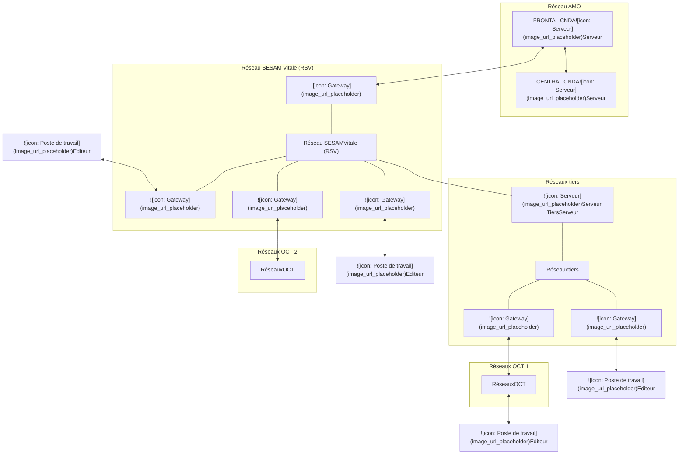

<table>
    <tr>
      <td rowspan="3"><strong>CNDA</strong></td>
      <td><em>Agrément des logiciels de facturation</em></td>
      <td>Page : 1</td>
    </tr>
    <tr>
      <td>VOLET TECHNIQUE DES PROCESSUS DE TESTS A DISTANCE ET DE DEPOT</td>
      <td>Ref : VOL_TEC_TA-rev2.doc</td>
    </tr>
    <tr>
      <td>Facturation des Taxiteurs</td>
      <td>Date: 20/11/2025</td>
    </tr>
</table>

# **<u>CNDA</u>**

# **Volet technique des processus de tests**
# **à distance des logiciels Taxis**

<table>
    <tr>
      <td rowspan="3"><strong><b>CNDA</b></strong></td>
      <td><em><strong>Agrément des logiciels de facturation</strong></em></td>
      <td>Page : 2</td>
    </tr>
    <tr>
      <td>VOLET TECHNIQUE DES PROCESSUS DE TESTS A DISTANCE ET DE DEPOT</td>
      <td>Ref : VOL_TEC_TA-rev2.doc</td>
    </tr>
    <tr>
      <td>Facturation des Taxiteurs</td>
      <td>Date: 20/11/2025</td>
    </tr>
</table>

# **SOMMAIRE**

<table>
    <tr>
      <td><strong><b>INTRODUCTION ............................................................................................................................................................................ 4</b></strong></td>
    </tr>
    <tr>
      <td><strong><b>1. DESCRIPTION DE L'ENVIRONNEMENT. ............................................................................................................................ 5</b></strong></td>
    </tr>
    <tr>
      <td>    1.1. SCHEMA GENERAL. ................................................................................................................................................................... 5</td>
    </tr>
    <tr>
      <td>    1.2. ORGANISATION DES ECHANGES. ............................................................................................................................................... 6</td>
    </tr>
    <tr>
      <td>        <u><em>1.2.1 Réseau de transport ...................................................................................................................................................... 6</em></u></td>
    </tr>
    <tr>
      <td>        <u><em>1.2.2 Systèmes utilisés............................................................................................................................................................ 6</em></u></td>
    </tr>
    <tr>
      <td>        <u><em>1.2.3 Coordonnées du serveur Frontal (FFSE) ................................................................................................................... 6</em></u></td>
    </tr>
    <tr>
      <td>        <u><em>1.2.4 Informations à renseigner dans les fichiers B2.......................................................................................................... 7</em></u></td>
    </tr>
    <tr>
      <td>        <u><em>1.2.5 Chiffrement...................................................................................................................................................................... 7</em></u></td>
    </tr>
    <tr>
      <td>        <u><em>1.2.6 Compression ................................................................................................................................................................... 7</em></u></td>
    </tr>
    <tr>
      <td>    1.3. FICHIERS RETOURS.................................................................................................................................................................... 8</td>
    </tr>
    <tr>
      <td><strong><b>2. TESTS A DISTANCE................................................................................................................................................................... 9</b></strong></td>
    </tr>
    <tr>
      <td>    2.1 PRINCIPES GENERAUX ................................................................................................................................................................ 9</td>
    </tr>
    <tr>
      <td>    2.2 ORGANISATION DU SUPPORT ...................................................................................................................................................... 9</td>
    </tr>
    <tr>
      <td>    2.3 CONSTITUTION DU DOSSIER DE DEMANDE DE CONFORMITE ..................................................................................................... 10</td>
    </tr>
    <tr>
      <td>    2.4 TRAITEMENT DU DOSSIER DE DEMANDE DE PRE EXAMEN ET D’EXAMEN DE CONFORMITE........................................................ 10</td>
    </tr>
</table>

<table>
    <tr>
      <td rowspan="3"><strong><b>CNDA</b></strong></td>
      <td><strong><em>Agrément des logiciels de facturation</em></strong></td>
      <td>Page : 3</td>
    </tr>
    <tr>
      <td>VOLET TECHNIQUE DES PROCESSUS DE TESTS A DISTANCE ET DE DEPOT</td>
      <td>Ref : VOL_TEC_TA-rev2.doc</td>
    </tr>
    <tr>
      <td>Facturation des Taxiteurs</td>
      <td>Date: 20/11/2025</td>
    </tr>
</table>

## **Index des révisions**

<table>
  <thead>
    <tr>
      <th><strong>Index</strong></th>
      <th><strong>Date</strong></th>
      <th><strong><b>Description</b></strong></th>
    </tr>
  </thead>
  <tbody>
    <tr>
      <td></td>
      <td></td>
      <td></td>
    </tr>
    <tr>
      <td>Rev 1</td>
      <td>29/08/2025</td>
      <td>Création du document</td>
    </tr>
    <tr>
      <td>Rev2</td>
      <td>20/11/2025</td>
      <td>Précision dans les informations à renseigner dans les flux B2 dans le type 6 (test/prod) et précision sur le chiffrement de transport.</td>
    </tr>
    <tr>
      <td></td>
      <td></td>
      <td></td>
    </tr>
    <tr>
      <td></td>
      <td></td>
      <td></td>
    </tr>
    <tr>
      <td></td>
      <td></td>
      <td></td>
    </tr>
    <tr>
      <td></td>
      <td></td>
      <td></td>
    </tr>
    <tr>
      <td></td>
      <td></td>
      <td></td>
    </tr>
    <tr>
      <td></td>
      <td></td>
      <td></td>
    </tr>
    <tr>
      <td></td>
      <td></td>
      <td></td>
    </tr>
    <tr>
      <td></td>
      <td></td>
      <td></td>
    </tr>
    <tr>
      <td></td>
      <td></td>
      <td></td>
    </tr>
    <tr>
      <td></td>
      <td></td>
      <td></td>
    </tr>
    <tr>
      <td></td>
      <td></td>
      <td></td>
    </tr>
    <tr>
      <td></td>
      <td></td>
      <td></td>
    </tr>
    <tr>
      <td></td>
      <td></td>
      <td></td>
    </tr>
    <tr>
      <td></td>
      <td></td>
      <td></td>
    </tr>
    <tr>
      <td></td>
      <td></td>
      <td></td>
    </tr>
  </tbody>
</table>

<table>
    <tr>
      <td rowspan="3"><b>CNDA</b></td>
      <td><i><b>Agrément des logiciels de facturation</b></i></td>
      <td>Page : 4</td>
    </tr>
    <tr>
      <td>VOLET TECHNIQUE DES PROCESSUS DE TESTS A DISTANCE ET DE DEPOT</td>
      <td>Ref : VOL_TEC_TA-rev2.doc</td>
    </tr>
    <tr>
      <td>Facturation des Taxiteurs</td>
      <td>Date: 20/11/2025</td>
    </tr>
</table>

# **Introduction**

L'objectif de ce document est de présenter les processus de tests à distance et de dépôt des logiciels aux éditeurs de logiciels ayant signé les conditions contractuelles.

Les packages de tests fournis par le CNDA visent à vérifier la qualité des flux émis par un logiciel destiné à équiper les Sociétés de Taxis.
Ce logiciel s'appuie sur une plateforme de tests à distance disponible 7j/7 permettant à l'éditeur de réaliser sa mise au point.

Au cours de ce processus de test, sont vérifiés :

- L’envoi correct des flux de facturation sur le Frontal éditeur,
- La conformité du logiciel à la norme d'échange B2 par vérification du contenu des flux de facturation transmis (jeu d'essai de facturation) en fonction du périmètre de tests demandé par la CNAMTS.

**NB : Le présent document ainsi que les différents packages de tests sont disponibles en téléchargement sur le site web :** <u>***[https://cnda.ameli.fr](https://cnda.ameli.fr/)***</u> **dans votre espace personnel.**

<table>
    <tr>
      <td rowspan="3"><strong>CNDA</strong></td>
      <td><strong><i>Agrément des logiciels de facturation</i></strong></td>
      <td>Page : 5</td>
    </tr>
    <tr>
      <td>VOLET TECHNIQUE DES PROCESSUS DE TESTS A DISTANCE ET DE DEPOT</td>
      <td>Ref : VOL_TEC_TA-rev2.doc</td>
    </tr>
    <tr>
      <td>Facturation des Taxiteurs</td>
      <td>Date: 20/11/2025</td>
    </tr>
</table>

# **1. Description de l'environnement.**

Les tests à distance ont pour objet de faciliter la mise au point des logiciels "Sociétés de Taxis" dans le cadre de la mise en place de la télétransmission des flux par messagerie SMTP avec chiffrement de transport.

Pour cela un environnement de tests, reproduisant le système de production opérationnel, est mis en place par le **CNDA** afin de traiter les fichiers issus du passage des packages de tests.
Cet environnement se compose de deux serveurs respectivement dénommés "Frontal" et "Central". Le Frontal est directement connecté sur le *Réseau SESAM-Vitale (RSV)* et est accessible depuis tout type de réseau interconnecté avec le RSV.

## *1.1. Schéma général.*

L'organisation mise en place par le CNDA est la suivante :

<table>
    <tr>
      <td rowspan="3"><b>CNDA</b></td>
      <td><i><b>Agrément des logiciels de facturation</b></i></td>
      <td>Page : 6</td>
    </tr>
    <tr>
      <td>VOLET TECHNIQUE DES PROCESSUS DE TESTS A DISTANCE ET DE DEPOT</td>
      <td>Ref : VOL_TEC_TA-rev2.doc</td>
    </tr>
    <tr>
      <td>Facturation des Taxiteurs</td>
      <td>Date: 20/11/2025</td>
    </tr>
</table>

## ***1.2. Organisation des échanges.***

### <u>**1.2.1 Réseau de transport**</u>

Les échanges de fichiers entre les éditeurs de logiciels et le CNDA s'effectuent via le Réseau SESAM Vitale (RSV) qui est un réseau IP privé basé sur les standards protocoles TCP/IP, ESMTP et POP3.
Chaque envoi de fichier constitue un message SMTP qui transite par des serveurs de messagerie sur lesquels sont situées les boîtes aux lettres des différents émetteurs.

Ces échanges sont de 2 types :

**Sens Aller (Editeur -> CNDA) :** Fichiers norme B2 contenant les lots de factures créés à l'aide des packages de tests.

**Sens Retour (CNDA -> Editeur) :** Les messages de service et fichiers norme NOEMIE contenant les références rejets/signalements/paiements **(RSP)**.

### <u>**1.2.2 Systèmes utilisés**</u>

**Le Serveur Frontal (FFSE)** est le pivot de ces échanges. Il assure la réception des fichiers B2, ainsi que le postage des fichiers retours vers les différentes boîtes aux lettres (BAL) de chaque émetteur.

Les messages de service sont générés par le FFSE au fur et à mesure de la réception des fichiers B2, après un premier contrôle de structure et d'intégrité des données reçues. Le postage des messages de service vers les boîtes aux lettres est immédiat.

**Le Serveur Central** du régime général héberge les applications de liquidation de l'Assurance Maladie. Il assure le traitement des fichiers transmis par le FFSE. Le paiement intervient ensuite après contrôle de la cohérence entre les données factures et la base de données centrale (situations PS, assurés, tarifs ...).
Les fichiers retours sont récupérés par le Frontal en fin de matinée (vers 12h30), pour mise à disposition dans les boîtes aux lettres correspondantes.

**L'environnement de test génère des retours RSP uniquement pour les fichiers du régime général (réf. NOEMIE 531-900).**

Les échanges FFSE vers Système Central ont lieu chaque jour au cours d'une session unique à 7h30.
Les fichiers de factures émis le jour J avant 7h00 auront des retours NOEMIE postés à J+2 vers 13h00.

### <u>**1.2.3 Coordonnées du serveur Frontal (FFSE)**</u>

**Adresse des flux de Factures B2 :**

Afin de reproduire le principe d’un interlocuteur unique pour chaque établissement de santé, tous les flux de test de factures sont à adresser à un seul destinataire : **[01348@348.01.rss.fr](mailto:01348@348.01.rss.fr)**

<table>
    <tr>
      <td rowspan="3"><strong>CNDA</strong></td>
      <td><em>Agrément des logiciels de facturation</em></td>
      <td>Page : 7</td>
    </tr>
    <tr>
      <td>VOLET TECHNIQUE DES PROCESSUS DE TESTS A DISTANCE ET DE DEPOT</td>
      <td>Ref : VOL_TEC_TA-rev2.doc</td>
    </tr>
    <tr>
      <td>Facturation des Taxiteurs</td>
      <td>Date: 20/11/2025</td>
    </tr>
</table>

## **<u>1.2.4 Informations à renseigner dans les fichiers B2</u>**

Afin de permettre une identification aisée des fichiers transmis, les champs suivants devront faire l’objet d’un renseignement particulier :

- **Type 000 Champ « Zone de message » (pos 92-128) : Nom du logiciel et N° de version <u>complet</u>**

- **Type 6 Champ « Numéro agrément » (pos 61-72) : lors des phases de tests à distance un numéro de certification générique sera utilisé par l’ensemble des éditeurs : TESTCNDA0100**
**Ce numéro générique devra être remplacé par le numéro de certificat délivré par le CNDA au terme de la procédure de certification.**
<mark>**Pendant la période « transitoire » du 01/11/2025 au 31/05/2026 :**</mark>
<mark>**En production si vous n’avez pas encore obtenu l’agrément auprès du CNDA, vous devez renseigner la raison sociale dans le type 6 position 61-72**</mark>
<mark>**Le numéro TESTCNDA0100 ne doit surtout pas être utilisé dans les flux de production.**</mark>

## **<u>1.2.5 Chiffrement</u>**

Sauf indication contraire du CNDA, tous les messages doivent faire l’objet d’un chiffrement de transport lors de leur transmission lors de cette phase de tests à distance (<mark><u>cette obligation n’est pas à mettre œuvre pour l’instant pour les Flux taxis en Iris B2).</u></mark>

## **<u>1.2.6 Compression</u>**

La plateforme de tests gère la réception des messages compressés. La compression des messages est un service optionnel, utilisable à l’initiative de l’éditeur.

<table>
    <tr>
      <td rowspan="3"><strong><b>CNDA</b></strong></td>
      <td><strong><i>Agrément des logiciels de facturation</i></strong></td>
      <td>Page : 8</td>
    </tr>
    <tr>
      <td>VOLET TECHNIQUE DES PROCESSUS DE TESTS A DISTANCE ET DE DEPOT</td>
      <td>Ref : VOL_TEC_TA-rev2.doc</td>
    </tr>
    <tr>
      <td>Facturation des Taxiteurs</td>
      <td>Date: 20/11/2025</td>
    </tr>
</table>

## ***1.3. Fichiers retours***

Les fichiers retours permettent d'obtenir directement les résultats des contrôles et traitements effectués par les serveurs de la plateforme de test.

Les retours sont postés sur le RSV par le serveur FFSE et mis à disposition dans les boîtes aux lettres respectives de chaque émetteur. Les flux retours ne sont pas chiffrés.

Les retours se décomposent en 2 catégories distinctes :

### **- 1ère catégorie : les Messages de Service**
Les messages de service ont pour objet d’indiquer un rejet global du message (ex : erreur de chiffrement, détection de virus, incohérence en-tête SMTP, contenu incorrect au niveau des types B2 000 et 999). La génération de ce type de message est activée pour l'ensemble des différents régimes d’Assurance maladie contenus dans les packages de tests.

### **- 2ème catégorie : les Rejets Signalements Paiements (RSP Références NOEMIE 531 et 900)**
L'environnement de test génère des RSP uniquement pour les fichiers du régime général (code régime 01).
Ces fichiers contiennent les informations relatives aux :
o Paiements des prestations liquidées par les organismes d'Assurance Maladie (Réf. 531),
o Rejets ou signalements éventuels de certaines prestations (Réf. 900).

<table>
    <tr>
      <td rowspan="3"><b>CNDA</b></td>
      <td><i><b>Agrément des logiciels de facturation</b></i></td>
      <td>Page : 9</td>
    </tr>
    <tr>
      <td>VOLET TECHNIQUE DES PROCESSUS DE TESTS A DISTANCE ET DE DEPOT</td>
      <td>Ref : VOL_TEC_TA-rev2.doc</td>
    </tr>
    <tr>
      <td>Facturation des Taxiteurs</td>
      <td>Date: 20/11/2025</td>
    </tr>
</table>

# **2. Tests à distance**

## ***2.1 Principes généraux***

Pendant la phase de tests, les éditeurs transmettent tout ou partie des flux de tests, en fonction notamment des corrections successives apportées au logiciel.
Ils sont libres d’utiliser cette plateforme selon leurs propres besoins, dès inscription à une demande de conformité sur le site du CNDA et réception/confirmation de leur numéro de facturation de test.

**Il est toutefois nécessaire de prendre en considération les points suivants :**

- Les bases de traitement du serveur Central sont réinitialisées après chaque traitement quotidien. Il n’y a donc pas d’historique des numéros de factures traitées, ce qui permet de rejouer plusieurs fois un même cas de test.

- Le serveur Frontal archive les lots reçus sur une période de 160 jours. Pendant toute cette période de rétention, il convient de faire évoluer le n° de lot à chaque transmission.

- Le serveur Frontal n’accepte pas les lots dont la date de création est antérieure à plus de 90 jours par rapport à leur date de transmission.

**L'exploitation des résultats obtenus est de la responsabilité des éditeurs, qui déterminent eux-mêmes le moment où les tests sont terminés et conformes aux résultats attendus.**

**<u>Il est de la responsabilité de l’éditeur de s’assurer préalablement à l’envoi de sa demande, de l’absence de messages de service et de la réception des RSP pour l’ensemble des factures transmises.</u>**

## ***2.2 Organisation du support***

Afin d’assurer le meilleur niveau de service, le CNDA offre aux éditeurs un support via la BAL de messagerie électronique dédiée [support.cnda@assurance-maladie.fr](mailto:support.cnda@assurance-maladie.fr) pour toute question concernant le contenu des packages de tests, la conformité de la structure des fichiers B2, la conformité de la structure des messages SMTP.

<table>
    <tr>
      <td rowspan="3"><strong>CNDA</strong></td>
      <td><strong><i>Agrément des logiciels de facturation</i></strong></td>
      <td>Page : 10</td>
    </tr>
    <tr>
      <td>VOLET TECHNIQUE DES PROCESSUS DE TESTS A DISTANCE ET DE DEPOT</td>
      <td>Ref : VOL_TEC_TA-rev2.doc</td>
    </tr>
    <tr>
      <td>Facturation des Taxiteurs</td>
      <td>Date: 20/11/2025</td>
    </tr>
</table>

## ***2.3 Constitution du dossier de demande de conformité***

Le dossier de demande de conformité doit être constitué par l’éditeur pour chaque logiciel présenté au CNDA. Il doit être transmis au CNDA à partir de son espace personnel sur le site Web du CNDA à l’URL suivante :
<u>***[https://cnda.ameli.fr](https://cnda.ameli.fr/)***</u>

Ce dossier doit obligatoirement contenir les éléments suivants :

- **Les preuves de tests** demandées par le CNDA pour chaque cas de tests,
- **Le plan de tests** personnalisé fourni par le CNDA. Ce tableau donnera la correspondance entre les numéros de factures transmises sur le FFSE du CNDA dans le cadre de cette demande, et les cas de facturation.

La date de transmission des flux doit se situer dans la période de rétention (160 jours) pour pouvoir être exploitables par le CNDA lors de la réception du dossier de demande.

## ***2.4 Traitement du dossier de demande de pré examen et d’examen de conformité***

Dès réception du dossier, le CNDA étudie la demande.

Le CNDA procède alors aux vérifications des résultats contenus dans le dossier de recette et des flux effectivement transmis sur l’environnement de tests à distance dans un délai de 15 jours ouvrés ou informe dans les 3 jours ouvrés de la date à laquelle il pourra procéder aux vérifications. Cette information est communiquée via votre Espace Personnel sur le site du CNDA.

▪ Soit les résultats fournis ne sont pas conformes aux documents de référence et le CNDA envoie à l’éditeur un compte rendu spécifiant les corrections à effectuer,

▪ Soit les résultats fournis sont conformes et l’éditeur est autorisé à passer à l’étape suivante de la procédure :

- Le CNDA propose une date d’examen de conformité
- L’éditeur met à disposition du CNDA un interlocuteur pendant cette phase de tests.
A l’issue de cette phase de tests :
    o Soit le logiciel n’est pas conforme aux documents de référence et le CNDA envoie par courriel à l’éditeur un compte rendu spécifiant les corrections à effectuer,
    o Soit le logiciel est conforme et le CNDA délivre la certification qualité accompagnée du certificat qualité de production du logiciel puis il saisit les informations dans sa base de données et met à jour son site web en conséquence.