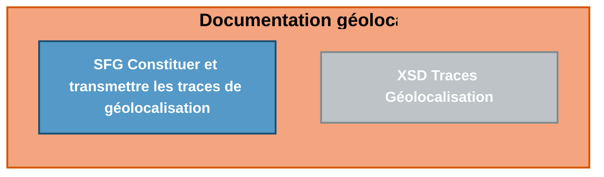

# <u>Fiche d’information.</u>

---

**Référence** **PDT-INF-937**  **Date** **30/07/2026**
**Objet** **Diffusion package Géolocalisation Taxi DRAFT**

<table>
  <tr>
    <td><u>Type</u></td>
    <td>[ ] Technique</td>
    <td>[ ] Pratique</td>
    <td>[ ] Communication</td>
    <td>[x] Livraison</td>
  </tr>
  <tr>
    <td><u>Destinataires</u></td>
    <td>[x] Éditeurs</td>
    <td>[ ] Équipementiers</td>
    <td>[ ] OCT</td>
    <td>[ ] DNS (ex-CIS)</td>
  </tr>
  <tr>
    <td><u>Produits</u></td>
    <td>
      Facturation 
      [x] CDC Éditeurs 
      [ ] CDC OCT 
      [ ] FSV agrément 
      [ ] FSV exploitation 
      [ ] SCOR 
       
      Services AMC 
      [ ] ROC
    </td>
    <td>
      Référentiels 
      [x] Dispositif Intégré 
      [ ] Terminal lecteur 
      [ ] TLA 
      [ ] Lecture Vitale 
      [ ] Télémise à jour
    </td>
    <td>
      Produits d’infrastructure 
      [ ] ATSAM 
      [ ] SrvSVCNAM 
      [ ] GALSS 
       
      Services en Ligne 
      [ ] CDR 
      [ ] amelipro
    </td>
    <td>
      Téléservices intégrés 
      [ ] AATi 
      [ ] ADRi 
      [ ] ALDi 
      [ ] DMTi 
      [ ] HRi 
      [ ] IMTi 
      [ ] PEC + 
      [ ] PEM 2D 
      [ ] SEFi 
       
      Acquisition des droits 
      [ ] API de Lecture Vitale
    </td>
  </tr>
  <tr>
    <td><u>Secteur</u></td>
    <td>[x] Libéral</td>
    <td>[ ] Hospitalier</td>
    <td></td>
    <td></td>
  </tr>
  <tr>
    <td><u>Professionnels de Santé concernés</u></td>
    <td>
      [ ] Médecins 
      [ ] Sages-femmes 
      [ ] Chirurgiens-dentistes 
      [ ] Pharmaciens 
      [ ] Laboratoires
    </td>
    <td>
      [ ] Auxiliaires médicaux 
      [ ] Centres de Santé 
      [ ] Fournisseurs 
      [ ] Transporteurs sanitaires 
      [x] Taxis
    </td>
    <td>
      [ ] Établissements publics 
      [ ] Cliniques privées 
      [ ] ESPIC
    </td>
    <td></td>
  </tr>
  <tr>
    <td>Prise en compte</td>
    <td>[ ] Facultative</td>
    <td>[x] Obligatoire</td>
    <td>[ ] Pour information</td>
    <td></td>
  </tr>
</table>

---

### **Contexte**

La nouvelle convention-cadre des taxis conventionnés entrée en vigueur le 1er novembre 2025 impose l'obligation de géolocalisation des taxis conventionnés au 1er janvier 2027

N.B. Les trajets réalisés pour les assurés de la MSA et de ses régimes hébergés seront concernés par ce dispositif et que des précisions seront apportées ultérieurement.

---

### **Corpus Documentaire**

L’architecture des documents de la géolocalisation est représentée ci‐dessous.

*PDT-INF-937*
**GIE SESAM-Vitale**
**5, boulevard Marie et Alexandre Oyon – 72019 LE MANS Cedex 2**
**www.sesam-vitale.fr**

*1 / 2*

# <u>Fiche d’information.</u>

## **Contenu de la livraison**

La diffusion de la version DRAFT de Géolocalisation Taxi concerne les documents listés ci-dessous :

<table>
  <thead>
    <tr>
      <th>Référence document</th>
      <th>Titre</th>
      <th><b>Version diffusée</b></th>
    </tr>
  </thead>
  <tbody>
    <tr>
      <td><strong><b>FACT-SFG-039</b></strong></td>
      <td>Facturation Taxi - Constituer et transmettre les traces de géolocalisation</td>
      <td>1.08 - DRAFT</td>
    </tr>
    <tr>
      <td><strong><b>TraceGeolocalisation</b></strong></td>
      <td>Fichier XSD</td>
      <td>V1</td>
    </tr>
  </tbody>
</table>

## **Support du GIE**

Le support relatif à cette information s’effectue via le [portail Iris](https://portail-support.sesam-vitale.fr/gsvextranet/#/signin)

*PDT-INF-937*

**GIE SESAM-Vitale**
**5, boulevard Marie et Alexandre Oyon – 72019 LE MANS Cedex 2**
**www.sesam-vitale.fr**

*2 / 2*