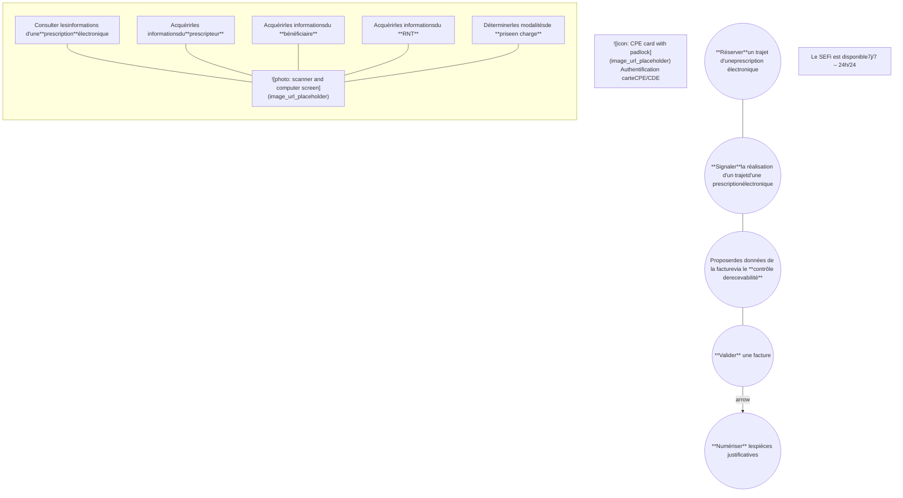
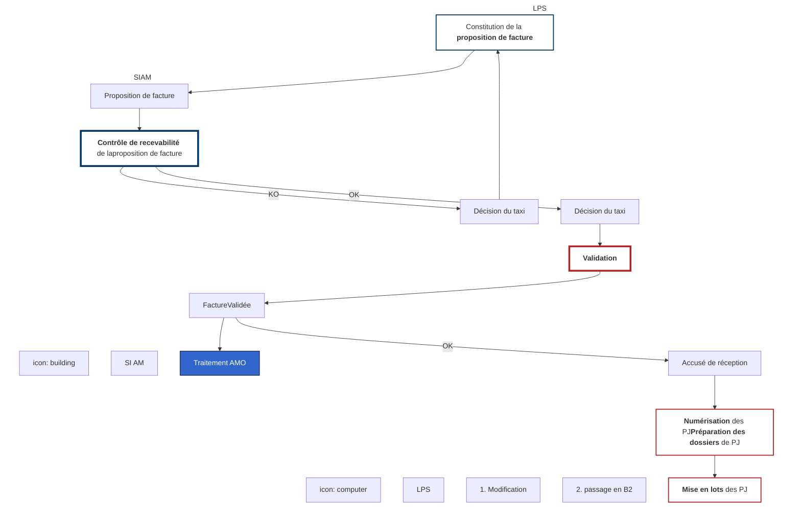
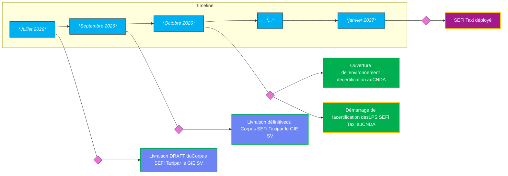
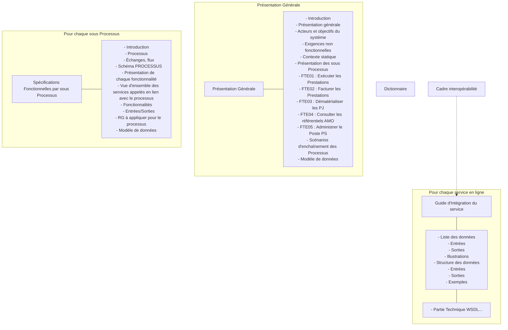

# **Corpus documentaire**
# **SEFi taxis**

**02 juillet 2026**


# Présentation de l’offre
## SEFi taxi

2


# **L’offre SEFi : Service Electronique de Facturation intégré**

*   Le **SEFi** une **simplification** du processus de facturation


*   ✓ **Bouquet de services** qui permet de **dématérialiser** et de **fiabiliser** la facturation des trajets réalisés en taxi.
*   ✓ Le SEFi intègre la numérisation des pièces justificatives en s’appuyant sur **SCOR**

3


# Les services de l’offre SEFi Taxi




4

# Cinématique des échanges - 1/2


# LPS | SI AM

 | 
---|---

**Authentification carte CDE/CPE**

| **Saisir** les éléments de la **prescription papier** | **Acquérir** les informations d'une **prescription électronique** | <---> | **Bases assurance maladie** |
| :--- | :--- | :---: | :--- |
| | | | Prescriptions électroniques | Bénéficiaires |
| | | | Transporteurs | Prescripteurs |

| **Consulter** les modalités de **prise en charge (PEC+)** | **Saisir** les éléments de **réalisation des prestations** | <---> |
| :--- | :--- | :---: |

---

Constitution de la **proposition de facture** --->  **Proposition de facture** ---> **Contrôle de recevabilité** de la proposition de facture

^ | |
| | V
| **Décision du taxi** | **KO** <---
| 1. Modification | |
| 2. Passage en B2 | |

|  | **Les services d'acquisition des informations** des bases de l'assurance maladie obligatoire sont accessibles **n'importe quand et quelque soit le type de prescription** |
| :---: | :--- |

**Zooms de la suite du processus dans les diapositives suivantes**

5

5

# Cinématique des échanges - 2/2




# Dématérialisation
## des PJ

6

# Zoom sur la cinématique de validation de la facture en ligne


# facture en ligne


| LPS  | SI AM  |
| :--- | :--- |
| [ Proposition de facture (contenu) ] | |
| | $\downarrow$ |
| | [ Contrôle de recevabilité de la *proposition de facture* ] |
| | $\downarrow$ |
| [  Certificat intégrité portant sur le contenu de la facture ] | $\leftarrow$ **OK** |
| | |
| **Identification de la facture (numéro de facture + date de validation + N° de lot)** | |
| [ Contenu la facture  ] | **Validation** $\rightarrow$ [ Informations administratives de la facture  ] |
| **clause** | **Clause** |
| | $\downarrow$ |
| $\leftarrow$ [ **Accusé de réception** ] | **OK** $\rightarrow$  **Base des factures en ligne** |
| $\leftarrow$ [ **KO** ] | |

**Contrôle d’intégrité et validation AM des informations supplémentaires administratives de la facture** 

7

# Le périmètre de SEFi
## Taxi au 01/01/2027

8


# **Présentation du Corpus SEFI Taxi**

La convention-cadre, publiée le 8 août 2025, prévoit l’utilisation de SEFi Taxi au **01/01/2027**.

Parmi l’ensemble des opérations du bouquet de services « *historique* » de SEFi, **seules les **opérations suivantes doivent a minima être intégrées dans les logiciels SEFi Taxis pour cette** échéance :**

*   **Les 3 opérations de fiabilisation des données bénéficiaires et de taux de remboursement :**
    *   Acquérir les bénéficiaires d’un ouvrant droit
    *   Acquérir les informations d’un bénéficiaire
    *   Acquérir la prise en charge d’une prestation d’une prescription (PEC)
*   **Les 2 opérations de facturation des trajets en taxis :**
    *   Contrôler recevabilité
    *   Valider facture
*   **L’envoi dématérialisé des PJ via SCOR.**

9

# **Présentation du Corpus SEFI Taxi**


L’implémentation dans les logiciels Taxis des autres opérations du bouquet de service SEFi listées ci-après est facultative pour l’échéance du 01/01/2027 :

*   **Les 3 opérations de fiabilisation des données PS / Etablissement**
    *   Acquérir les informations d’un PS individu
    *   Acquérir les informations d’un établissement de soins
    *   Acquérir les informations du RNT

*   **Les 3 opérations d’acquisition et de « consommation » des trajets d’une PEL**
    *   Acquérir une prescription du référentiel A.M.
    *   Réserver Trajet d’une PEL
    *   Exécuter Trajet d’une PEL

10


# Récapitulatif des services

✓ **Opérations dont les développements sont attendus au 01/01/2027**

<table>
  <thead>
    <tr>
      <th>Processus</th>
      <th>Téléservices associés</th>
    </tr>
  </thead>
  <tbody>
    <tr>
      <td>Exécuter des Prestations</td>
      <td>
        ✓ <b>Acquérir</b> les informations d’une <b>prescription électronique</b><br />
        ✓ <b>Réserver</b> un trajet<br />
        ✓ <b>Signaler</b> la réalisation d’un trajet
      </td>
    </tr>
    <tr>
      <td>Facturer des Prestations</td>
      <td>
        ✓ Acquérir les informations du <b>prescripteur</b><br />
        ✓ Acquérir les informations du <b>RNT</b><br />
        ✓ Acquérir les informations du bénéficiaire<br />
        ✓ Consulter les modalités de prise en charge (PEC+)<br />
        ✓ Contrôler la recevabilité de la proposition de facture<br />
        ✓ Valider une facture en ligne
      </td>
    </tr>
    <tr>
      <td>Dématérialiser les Pièces Justificatives</td>
      <td>✓ La transmission des fichiers via SCOR contenant les Pièces Justificatives est réalisée par messagerie sécurisée (chiffrement de transport) sur le protocole SMTP</td>
    </tr>
  </tbody>
</table>

11

# Planning macro

12


# Planning SEFi Taxi



13

# **Présentation des évolutions du corpus documentaire**

14


# **Présentation générale**

*   Corpus SEFi dédié aux Taxis avec un cycle de vie indépendant du corpus SEFi TS
*   WSDL et XSD dédiés aux Taxis pour les controlerRecevabilite et valider
*   Mêmes formulaires 606b-09/2025 (facture et annexe) que pour la facturation B2
    *   possibilité d’imprimer du papier et/ou de produire des PDF pour envoi SCOR
    *   envoi SCOR obligatoire du volet destiné à l'organisme de paiement en cas de dispense d’avance de frais totale ou partielle

**15**


# **Corpus SEFi dédié aux Taxis**

* Même architecture documentaire que l’ancien corpus




**FTE**
*Spécifications Fonctionnelles Générales*

# **Facturation Transporteur Etendue**
# ***Taxi***

## **PG - Présentation Générale**

Référence : FACT-SFG-030 / Version : 05.45 / Date : 18/06/2026
Diffusion : RESTREINTE
État : PROVISOIRE

***

**GIE SESAM-Vitale**
5, boulevard Marie et Alexandre Oyon – 72 019 LE MANS Cedex 2
www.sesam-vitale.fr

* Avec indication « Taxi » en page de garde et dans l’en-tête de chaque page

SFG - Facturation Transporteur Etendue - Taxi

FACT-SFG-030
PG - Présentation Générale
Version : 05.45

---

# **1 Introduction**

* Parties spécifiques aux Transporteurs sanitaires supprimées

**16**


# **Corpus SEFi dédié aux Taxis**

* Modalités de facturation (convention Taxis 2025-2029)
    * reprise des règles de facturation du CDC B2 Taxis
    * avec quelques adaptations, par exemple 0 à n suppléments locaux pour un trajet

* À noter
    * géolocalisation non intégrée à ce stade
        * dans l’attente d’une finalisation des travaux en cours au niveau Cnam
    * correspondance SEFi - B2 en cours de rédaction
    * fiche périmètre d’élaboration d’une FEL (PDT-INF-293)
        * dédiée aux Taxis
        * hors corpus (zip)

**17**

# **Illustration**
# **SFG FTE02**

• Référence des règles du CDC B2 TX

• Textes repris du CDC B2 TX

• Illustrations reprises du CDC B2 TX


## [RG_FTE710] Déterminer la partie « Forfait » de la prestation

 **Données déterminées**

<table>
    <caption> <b>Données déterminées</b></caption>
    <thead>
        <tr>
            <th>Référence</th>
            <th colspan="2">Libellé</th>
            <th>O/F</th>
        </tr>
    </thead>
    <tbody>
        <tr>
            <td><i>EF_FTE69_02</i></td>
            <td>Montant du forfait</td>
            <td>Cf. partie [69.02] ci-dessous</td>
            <td>O</td>
        </tr>
    </tbody>
</table>

. . .

### [69.02] Montant du forfait

 CDC B2 TX : FORFAIT - 001, FORFAIT – 002, FORFAIT – 003

Une facture vers un organisme d’assurance maladie de plusieurs trajets ne peut comporter qu’un seul type de forfait (EF_FTE69_01) :

*   Valeur « BASE » signifiant « Prise en charge et accompagnement »,
*   Valeur « GV » signifiant « Prise en charge et accompagnement et grande ville ».

La facture comporte autant de forfaits que de trajets facturés.

Par trajet, on définit une valeur de base (c’est-à-dire hors contexte de majoration nuit ou dimanche / jour férié et hors abattement transport partagé) du montant du forfait pour le trajet de base à partir des valeurs de tarif de forfait établies au niveau national, en fonction du type de forfait.

**Illustration**

<table>
  <thead>
    <tr>
      <th></th>
      <th colspan="2">[TYPE] Forfait</th>
    </tr>
    <tr>
      <th></th>
      <th>"PRISE EN CHARGE ET<br />ACCOMPAGNEMENT"</th>
      <th>"PRISE EN CHARGE ET<br />ACCOMPAGNEMENT ET GRANDE VILLE"</th>
    </tr>
  </thead>
  <tbody>
    <tr>
      <th>[TARIF] Forfait</th>
      <td>13,00 €</td>
      <td>28,00 €</td>
    </tr>
  </tbody>
</table>

Le tarif du forfait du trajet de base couvre une distance minimale couverte par le forfait qui est fonction du type forfait.

**18**


# **Résumé des cinq parties d’une prestation**
# **(EFT au niveau XML)**

*   1 forfait (majo) (abat)
    *   *Prise en charge et accompagnement, 2 types = « grandes villes + établissements en périphérie » ou pas*
*   0 ou 1 partie KM (majo) (abat)
    *   Distance facturée = distance parcourue - kilomètres couverts par le forfait
    *   Tarif KM départemental (ADS)
    *   Pondération tarif KM si trajet en lien avec une hospitalisation et trajet en sens inverse à vide
*   0 à n suppléments locaux (par département d’ADS, dont DROM) (abat)
*   0 ou 1 supplément péage (sans majoration ni abattement)
*   0 ou 1 supplément TPMR (sans majoration ni abattement)

(majo) Majoration forfait si nuit ou dimanche/jour férié (« ou » exclusif avec priorité nuit) (ADS)

(abat) avec abattement pour transport partagé (en fonction du nombre de personnes transportées + seuil distance seul)

**19**


# **Autres évolutions intégrées**

* Historisation sur 27 mois
    * des mises à jour des données unitaires de référence (tarifs, taux, seuils, …)
    * des requêtes et des réponses pour les opérations controlerRecevabilite et valider

* Rupture de facture
    * par type de forfait (BASE ou GV)
    * par rapport au refus de transport partagé

* NB : le service SEFi ne traitera pas les factures antérieures à la date de bascule définie conventionnellement
    * Pas de bascule à gérer pour intégrer SEFi
    * Les factures antérieures à la date de bascule doivent être envoyées en B2

**20**


# **Principaux impacts documentaires**

<table>
  <thead>
    <tr>
      <th colspan="3">surlignage jaune = principales modifications par rapport au corpus TS+TX 2025</th>
      <th colspan="13"><b><b>Guides d'intégration et web services (WS)</b></b></th>
    </tr>
    <tr>
      <th colspan="3">surlignage gris = parties spécifiques TS supprimées</th>
      <th colspan="3"><b><b>SEL-MP-012</b></b></th>
      <th colspan="2"><b><b>SEL-MP-013</b></b></th>
      <th colspan="3"><b><b>SEL-MP-014</b></b></th>
      <th><b><b>SEL-MP-016</b></b></th>
      <th colspan="4"><b><b>SEL-MP-015</b></b></th>
    </tr>
    <tr>
      <th></th>
      <th></th>
      <th>X = appel systématique du service<br />PEL = appel du service si scénario PEL (prescription électronique)<br />C = appel du service conditionné par activation du Transporteur</th>
      <th>WS_PS1<br />rechercher<br />PS</th>
      <th>WS_PS3<br />rechercher<br />ETS</th>
      <th>WS_PS4<br />rechercher<br />TS</th>
      <th>WS_BS1<br />lister<br />bénéf.</th>
      <th>WS_BS2<br />rechercher<br />1 bénéf.</th>
      <th>WS_PL1<br />acquérir<br />PEL</th>
      <th>WS_PL2<br />réserver<br />prestation</th>
      <th>WS_PL3<br />réaliser<br />prestation</th>
      <th>WS_PEC1<br />calculer<br />PEC</th>
      <th><s>WS_FT1</s><br /><s>consulter</s><br /><s>facture</s></th>
      <th>WS_FT2<br />contrôler<br />facture</th>
      <th>WS_FT3<br />valider<br />facture</th>
      <th><s>WS_FT4</s><br /><s>calculer</s><br /><s>montants</s></th>
    </tr>
  </thead>
  <tbody>
    <tr>
      <th colspan="3"><b><b>FACT-SFG-… SEFi TX 2026</b></b></th>
      <td></td>
      <td></td>
      <td></td>
      <td></td>
      <td></td>
      <td></td>
      <td></td>
      <td></td>
      <td></td>
      <td></td>
      <td></td>
      <td></td>
      <td></td>
    </tr>
    <tr>
      <td>030</td>
      <td>PG</td>
      <td>Présentation Générale</td>
      <td>-</td>
      <td>-</td>
      <td>-</td>
      <td>-</td>
      <td>-</td>
      <td>-</td>
      <td>-</td>
      <td>-</td>
      <td>-</td>
      <td>-</td>
      <td>-</td>
      <td>-</td>
      <td>-</td>
    </tr>
    <tr>
      <td>029</td>
      <td>DICO</td>
      <td>Dictionnaire</td>
      <td>-</td>
      <td>-</td>
      <td>-</td>
      <td>-</td>
      <td>-</td>
      <td>-</td>
      <td>-</td>
      <td>-</td>
      <td>-</td>
      <td>-</td>
      <td>-</td>
      <td>-</td>
      <td>-</td>
    </tr>
    <tr>
      <td>031</td>
      <td>FTE01</td>
      <td>Réaliser prestations</td>
      <td>-</td>
      <td>-</td>
      <td>-</td>
      <td>-</td>
      <td>-</td>
      <td>-</td>
      <td>PEL</td>
      <td>PEL</td>
      <td>-</td>
      <td>-</td>
      <td>-</td>
      <td>-</td>
      <td>-</td>
    </tr>
    <tr>
      <td rowspan="12">032</td>
      <td>FTE02</td>
      <td>Facturer prestations (détail ci-dessous)</td>
      <td></td>
      <td></td>
      <td></td>
      <td></td>
      <td></td>
      <td></td>
      <td></td>
      <td></td>
      <td></td>
      <td></td>
      <td></td>
      <td></td>
      <td></td>
    </tr>
    <tr>
      <td>FTE02.01</td>
      <td>Acquérir les informations préalables à la facturation</td>
      <td>C</td>
      <td>C</td>
      <td>C</td>
      <td>C</td>
      <td>C</td>
      <td>PEL</td>
      <td>-</td>
      <td>-</td>
      <td>C</td>
      <td>-</td>
      <td>-</td>
      <td>-</td>
      <td>-</td>
    </tr>
    <tr>
      <td>FTE02.02</td>
      <td>Elaborer la FEL (détail ci-dessous)</td>
      <td></td>
      <td></td>
      <td></td>
      <td></td>
      <td></td>
      <td></td>
      <td></td>
      <td></td>
      <td></td>
      <td></td>
      <td></td>
      <td></td>
      <td></td>
    </tr>
    <tr>
      <td>FTE02.02.01</td>
      <td>Déterminer les informations relatives aux Partenaires de santé (PS)</td>
      <td>-</td>
      <td>-</td>
      <td>-</td>
      <td>-</td>
      <td>-</td>
      <td>-</td>
      <td>-</td>
      <td>-</td>
      <td>-</td>
      <td>-</td>
      <td>-</td>
      <td>-</td>
      <td>-</td>
    </tr>
    <tr>
      <td>FTE02.02.02</td>
      <td>Déterminer les informations relatives au bénéficiaire des soins (BS)</td>
      <td>-</td>
      <td>-</td>
      <td>-</td>
      <td>-</td>
      <td>-</td>
      <td>-</td>
      <td>-</td>
      <td>-</td>
      <td>-</td>
      <td>-</td>
      <td>-</td>
      <td>-</td>
      <td>-</td>
    </tr>
    <tr>
      <td>FTE02.02.03</td>
      <td>Déterminer les informations relatives à la Prescription (PC)</td>
      <td>-</td>
      <td>-</td>
      <td>-</td>
      <td>-</td>
      <td>-</td>
      <td>-</td>
      <td>-</td>
      <td>-</td>
      <td>-</td>
      <td>-</td>
      <td>-</td>
      <td>-</td>
      <td>-</td>
    </tr>
    <tr>
      <td>FTE02.02.04</td>
      <td>Déterminer les informations relatives aux Prestations (IP)</td>
      <td>-</td>
      <td>-</td>
      <td>-</td>
      <td>-</td>
      <td>-</td>
      <td>-</td>
      <td>-</td>
      <td>-</td>
      <td>-</td>
      <td>-</td>
      <td>-</td>
      <td>-</td>
      <td>-</td>
    </tr>
    <tr>
      <td>FTE02.02.05</td>
      <td>Déterminer les informations relatives aux Contextes de Fact... (CF)</td>
      <td>-</td>
      <td>-</td>
      <td>-</td>
      <td>-</td>
      <td>-</td>
      <td>-</td>
      <td>-</td>
      <td>-</td>
      <td>-</td>
      <td>-</td>
      <td>-</td>
      <td>-</td>
      <td>-</td>
    </tr>
    <tr>
      <td>FTE02.02.06</td>
      <td>Valoriser les montants de la facture (VF)</td>
      <td>-</td>
      <td>-</td>
      <td>-</td>
      <td>-</td>
      <td>-</td>
      <td>-</td>
      <td>-</td>
      <td>-</td>
      <td>-</td>
      <td>-</td>
      <td>-</td>
      <td>-</td>
      <td>X</td>
    </tr>
    <tr>
      <td>FTE02.03</td>
      <td>Vérifier la FEL</td>
      <td>-</td>
      <td>-</td>
      <td>-</td>
      <td>-</td>
      <td>-</td>
      <td>-</td>
      <td>-</td>
      <td>-</td>
      <td>-</td>
      <td>-</td>
      <td>X</td>
      <td>-</td>
      <td>-</td>
    </tr>
    <tr>
      <td>FTE02.04</td>
      <td>Valider la FEL</td>
      <td>-</td>
      <td>-</td>
      <td>-</td>
      <td>-</td>
      <td>-</td>
      <td>-</td>
      <td>-</td>
      <td>-</td>
      <td>-</td>
      <td>-</td>
      <td>-</td>
      <td>X</td>
      <td>-</td>
    </tr>
    <tr>
      <td></td>
      <td>+ Générer une image (papier ou PDF) de la FEL validée</td>
      <td>-</td>
      <td>-</td>
      <td>-</td>
      <td>-</td>
      <td>-</td>
      <td>-</td>
      <td>-</td>
      <td>-</td>
      <td>-</td>
      <td>-</td>
      <td>-</td>
      <td>-</td>
      <td>-</td>
    </tr>
    <tr>
      <td>033</td>
      <td>FTE03</td>
      <td>Transmettre PJ</td>
      <td>-</td>
      <td>-</td>
      <td>-</td>
      <td>-</td>
      <td>-</td>
      <td>-</td>
      <td>-</td>
      <td>-</td>
      <td>-</td>
      <td>-</td>
      <td>-</td>
      <td>-</td>
      <td>-</td>
    </tr>
    <tr>
      <td>034</td>
      <td>FTE04</td>
      <td>Consulter référentiels</td>
      <td>C</td>
      <td>C</td>
      <td>C</td>
      <td>C</td>
      <td>C</td>
      <td>PEL</td>
      <td>-</td>
      <td>-</td>
      <td>C</td>
      <td>X</td>
      <td>-</td>
      <td>-</td>
      <td>-</td>
    </tr>
    <tr>
      <td>035</td>
      <td>FTE05</td>
      <td>Administrer</td>
      <td>-</td>
      <td>-</td>
      <td>-</td>
      <td>-</td>
      <td>-</td>
      <td>-</td>
      <td>-</td>
      <td>-</td>
      <td>-</td>
      <td>-</td>
      <td>-</td>
      <td>-</td>
      <td>-</td>
    </tr>
    <tr>
      <td>060</td>
      <td>FTE06</td>
      <td>Superviser</td>
      <td>-</td>
      <td>-</td>
      <td>-</td>
      <td>-</td>
      <td>-</td>
      <td>-</td>
      <td>-</td>
      <td>-</td>
      <td>-</td>
      <td>-</td>
      <td>-</td>
      <td>-</td>
      <td>-</td>
    </tr>
  </tbody>
</table>

**21**


# **Évolution du bloc XML EFT**
# **requêtes controlerRecevabilite et valider**

| Line | Old Structure (Left) | New Structure (Right) |
| :--- | :--- | :--- |
| 171 | `<facturation:TRSP>` | `<facturation:TRSP>` |
| 172 |   `<facturation:EFT>` |   `<facturation:EFT>` |
| 173 |     `<facturation:TypFac>String</facturation:TypFac>` |     `<facturation:TypFac>String</facturation:TypFac>` |
| 174 |     `<facturation:EltFac>String</facturation:EltFac>` |     `<facturation:EltFac>String</facturation:EltFac>` |
| | <span style="background-color: #ffcccc;">    `<facturation:Majo>String</facturation:Majo>`</span> | |
| | <span style="background-color: #ffcccc;">    `<facturation:TypMajo>String</facturation:TypMajo>`</span> | |
| | <span style="background-color: #ffcccc;">    `<facturation:TauxMajo>0</facturation:TauxMajo>`</span> | |
| 175 |     `<facturation:Qte>0</facturation:Qte>` |     `<facturation:Qte>0</facturation:Qte>` |
| 176 |     `<facturation:Pu>0</facturation:Pu>` |     `<facturation:Pu>0</facturation:Pu>` |
| 177 |     `<facturation:Mnt>0</facturation:Mnt>` |     `<facturation:Mnt>0</facturation:Mnt>` |
| 178 |     `<facturation:Info>String</facturation:Info>` |     `<facturation:Info>String</facturation:Info>` |
| 179 | | <span style="background-color: #ccffcc;">    `<facturation:CoefARvide>0</facturation:CoefARvide>`</span> |
| 180 | | <span style="background-color: #ccffcc;">    `<facturation:PUMajoreARvide>0`</span> |
| | | <span style="background-color: #ccffcc;">    `</facturation:PUMajoreARvide>`</span> |
| 181 | | <span style="background-color: #ccffcc;">    `<facturation:MntFinal>0</facturation:MntFinal>`</span> |
| 182 | | <span style="background-color: #ccffcc;">    `<facturation:Majoration>`</span> |
| 183 | | <span style="background-color: #ccffcc;">      `<facturation:MntMajo>0</facturation:MntMajo>`</span> |
| 184 | | <span style="background-color: #ccffcc;">      `<facturation:TypeMajo>String`</span> |
| | | <span style="background-color: #ccffcc;">      `</facturation:TypeMajo>`</span> |
| 185 | | <span style="background-color: #ccffcc;">      `<facturation:TauxMajo>0</facturation:TauxMajo>`</span> |
| 186 | | <span style="background-color: #ccffcc;">    `</facturation:Majoration>`</span> |
| 187 | | <span style="background-color: #ccffcc;">    `<facturation:ABT>`</span> |
| 188 | | <span style="background-color: #ccffcc;">      `<facturation:TauxAbattement>0`</span> |
| | | <span style="background-color: #ccffcc;">      `</facturation:TauxAbattement>`</span> |
| 189 | | <span style="background-color: #ccffcc;">    `</facturation:ABT>`</span> |
| 190 |   `</facturation:EFT>` |   `</facturation:EFT>` |

*Note: Blue arrows indicate that the data from the removed fields `Majo`, `TypMajo`, and `TauxMajo` (lines 174 area) are moved into the new `Majoration` block (lines 182-186).*

*   Nouvelles données
*   Déplacement des données Majo
*   Déplacement du taux d’abattement dans le bloc EFT (cf. ancien position page suivante)

**22**

# **Autres évolutions XML**
# **requêtes controlerRecevabilite et valider**


**23**

**Autres évolutions XML**
**requêtes controlerRecevabilite et valider**

| Diff | Version Précédente | Ligne | Diff | Version Nouvelle | Annotations |
| :--- | :--- | :--- | :--- | :--- | :--- |
| − | `<facturation:NomAccompagnateur>`**String**`</facturation:NomAccompagnateur>` | | | | |
| − | `<facturation:PrenomAccompagnateur>`**String**`</facturation:PrenomAccompagnateur>` | | | | |
| | `<facturation:DistanceParcourue>0</facturation:DistanceParcourue>` | 381 | | `<facturation:DistanceParcourue>0</facturation:DistanceParcourue>` | |
| | `<facturation:DistanceReferentiel>`**String**`</facturation:DistanceReferentiel>` | 382 | | `<facturation:DistanceReferentiel>`**String**`</facturation:DistanceReferentiel>` | |
| | `<facturation:DistanceGPS>0</facturation:DistanceGPS>` | 383 | | `<facturation:DistanceGPS>0</facturation:DistanceGPS>` | |
| | `<facturation:NbPersonnesTransportees>0</facturation:NbPersonnesTransportees>` | 384 | | `<facturation:NbPersonnesTransportees>0</facturation:NbPersonnesTransportees>` | |
| | `<facturation:NiveauCertification>`**String**`</facturation:NiveauCertification>` | 385 | | `<facturation:NiveauCertification>`**String**`</facturation:NiveauCertification>` | |
| | | 386 | + | `<facturation:NumeroAutorisation>`**String**`</facturation:NumeroAutorisation>` | |
| ≠ | `<facturation:`<mark>CadreTransport</mark>`>`**String**`</facturation:`<mark>CadreTransport</mark>`>` | 387 | ≠ | `<facturation:`<mark>RefusTP</mark>`>`**String**`</facturation:`<mark>RefusTP</mark>`>` | *Renommage* |
| | | 388 | + | `<facturation:ADS>` | *Nouvelles données* |
| | | 389 | + | `  <facturation:NumeroADS>`**String**`</facturation:NumeroADS>` | |
| | | 390 | + | `  <facturation:CodeCPAMADS>`**String**`</facturation:CodeCPAMADS>` | |
| | | 391 | + | `  <facturation:DepartementADS>`**String**`</facturation:DepartementADS>` | |
| | | 392 | + | `</facturation:ADS>` | |
| | | 393 | + | `<facturation:IndicateurARVide>`**true**`</facturation:IndicateurARVide>` | |
| | | 394 | + | `<facturation:PatientSeulSurXkms>`**true**`</facturation:PatientSeulSurXkms>` | |
| | `</facturation:TRJ>` | 395 | | `</facturation:TRJ>` | |
| − | `<facturation:ABT>` | | | | |
| − | `  <facturation:Tux>0</facturation:Tux>` | | | ➔ | *Le taux est déplacé dans le bloc EFT* |
| − | `  <facturation:Mnt>0</facturation:Mnt>` | | | | |
| − | `</facturation:ABT>` | | | | |
| | | | | | |
| | `<facturation:Cmn/>` | 373 | | `<facturation:Cmn/>` | |
| | | 374 | + | `  <facturation:CodeCommune>`**String**`</facturation:CodeCommune>` | |
| | `</facturation:Adresse>` | 375 | | `</facturation:Adresse>` | |
| ≠ | `<facturation:`<mark>CodeCommune</mark>`>`**String**`</facturation:`<mark>CodeCommune</mark>`>` | 376 | ≠ | `<facturation:`<mark>CodeFINESS</mark>`>`**String**`</facturation:`<mark>CodeFINESS</mark>`>` | *Ajout* |
| | `</facturation:ARRIVEE>` | 377 | | `</facturation:ARRIVEE>` | |

*(Note: Arrows in the image indicate movement of data or specific additions)*

**23**

# Où trouver toutes les informations ?

24


# **Sur votre compte « Espace Industriels »**

➔ Si vous n’avez pas de compte : [Je m’inscris](https://industriels.sesam-vitale.fr/premiere-connexion?p_p_id=58&p_p_lifecycle=0&p_p_state=normal&p_p_mode=view&p_p_col_id=column-1&p_p_col_count=1&_58_struts_action=%2Flogin%2Fforgot_password)

> ➔ Envoyer un lien à [relations-industriels@sesam-vitale.fr](mailto:relations-industriels@sesam-vitale.fr) si vous ne retrouvez pas le lien

➔ Aller dans la rubrique **Projet > SEFi**

➔ Voir les livrables suivants :

# Vos livrables

*   ▼ **SEFi** 📂
    *   📂 Avenant 11 (SEFi TS)
    *   📂 Conditions de présérie (SEFi TS et SEFi TX)
    *   📂 Expérimentation SEFi TX
    *   ▶ 📂 Kit d'accompagnement
    *   ▶ 📂 Package SEFi TS
    *   📂 Package SEFi TX
    *   📂 SCOR

**25**


# **Suite de la diffusion du package <u>SEFi TX DRAFT</u>**

→ Vous avez des questions et/ou des remarques relatives au package :

> écrire à [relations-industriels@sesam-vitale.fr](mailto:relations-industriels@sesam-vitale.fr) sous la forme :
>
> * Objet du mail : **[SEFi TX][nom éditeur] retour sur le package SEFi TX DRAFT**
> * Corps du mail :
>     * **Nom opération concernée(s) :** ex : valider
>     * **Objet :** question ou remarque
>     * **Description de l’objet**

> [!CAUTION]
>  Les questions en lien avec la documentation SEFi taxi sont à adresser à la BAL relations-industriels et non pas à la BAL équipe SEFi CNAM réservée aux questions éditeurs B2

**26**


# **Contacts utiles GIE Sesam-Vitale**

---

 **Accédez à votre espace personnel :** [https://industriels.sesam-vitale.fr/](https://industriels.sesam-vitale.fr/)

---

 **Contact Relations Industriel :** [relations-industriels@sesam-vitale.fr](mailto:relations-industriels@sesam-vitale.fr)

---

 **Support technique :** [https://portail-support.sesam-vitale.fr/gsvextranet/#/signin](https://portail-support.sesam-vitale.fr/gsvextranet/#/signin)

**27**

# Présentation de l’autorisation SEFi taxi

28


# **Procédure d’autorisation**

1. Les 4 grandes étapes du processus de conformité au CNDA:

2. Initialisation qui comprend le dépôt de votre demande et la signature des conditions contractuelles

3. Pré-examen correspond à l’étape ou vous transmettez vos dépôts de preuves

4. Examen de conformité réalisé avec prise en main à distance

```mermaid
graph LR
    subgraph Steps
        direction LR
        S1(( )):::check --- T1[Initialisation]:::purple
        S2((2)):::blue_circle --- T2[Pré-examen]:::blue
        S3((3)):::grey_circle --- T3[Examen de conformité]:::grey
        S4((4)):::grey_circle --- T4[Finalisation]:::grey
    end

    subgraph Editeur_Lane [ ]
        direction LR
        E_Icon[**Editeur**]
        E1["- Saisie formulaire- Validation en ligne desconditionscontractuelles"]
        E2["Dépôt des preuvesde tests"]
        E4["Enquête de satisfaction"]
    end

    subgraph CNDA_Lane [ ]
        direction LR
        C_Icon[**CNDA**]
        C1["Mise à disposition :- Accès environnementtests- Cartes CPS- Plan de tests personnalisé- Date d'opposabilité"]
        C2["Analyse des preuves detests"]
        C4["- Transmission dunuméro de conformité- Activation du service"]
    end

    Mid["Examen réalisé enpartage d'écran àdistance"]

    %% Connections
    E1 --> E2
    C1 --> C2
    E2 --> Mid
    C2 --> Mid
    Mid --> E4
    Mid --> C4

    %% Labels below boxes
    L2[CR Pré-examen]:::blue_label
    L3[CR Examen]:::blue_label
    L4[Attestation]:::blue_label

    %% Positioning labels (conceptual)
    E2 --- L2
    Mid --- L3
    C4 --- L4

    classDef purple color:#a67db8,fill:none,stroke:none;
    classDef blue color:#003399,fill:none,stroke:none;
    classDef grey color:#808080,fill:none,stroke:none;
    classDef check fill:#a67db8,stroke:#a67db8,color:white;
    classDef blue_circle fill:#003399,stroke:#003399,color:white;
    classDef grey_circle fill:#808080,stroke:#808080,color:white;
    classDef blue_label fill:#b8d1f3,stroke:#7fa9e0,stroke-dasharray: 5 5;
```

5. Finalisation qui aboutit à la délivrance de l’attestation de conformité

**29**


# **Contacts utiles CNDA**

 **Accédez à votre espace personnel CNDA :** [lien vers votre espace personnel](https://sicnda.ameli.fr/)

---

 **Contact administratif :** [contact.cnda@assurance-maladie.fr](mailto:contact.cnda@assurance-maladie.fr)

---

 **Support technique :** [lien vers votre espace personnel](https://sicnda.ameli.fr/)

**30**


31