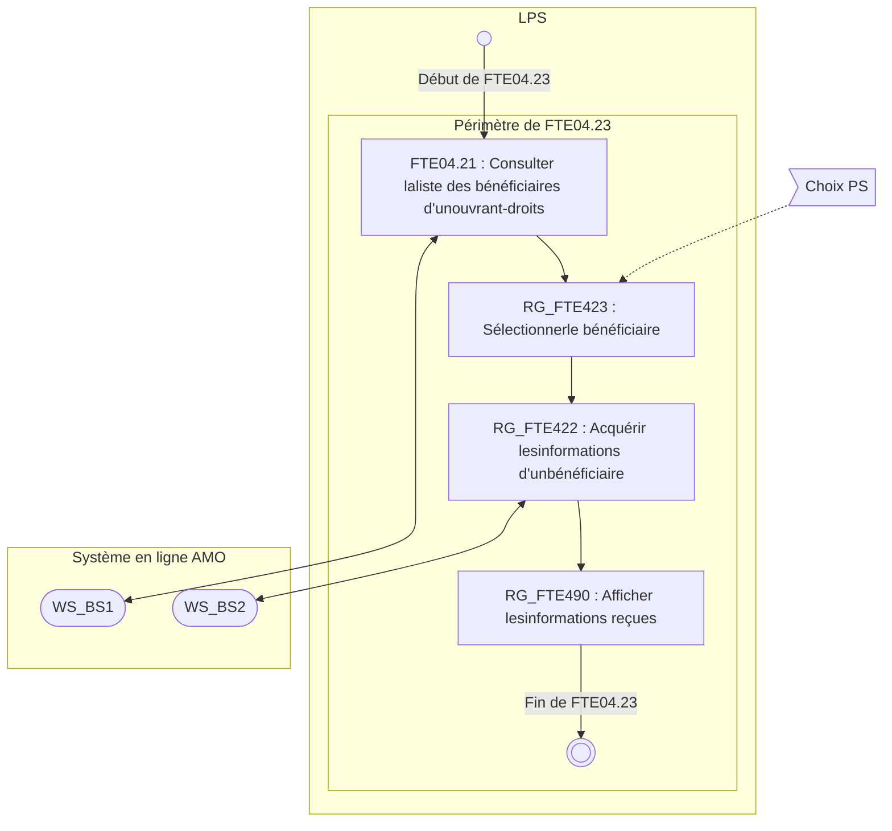
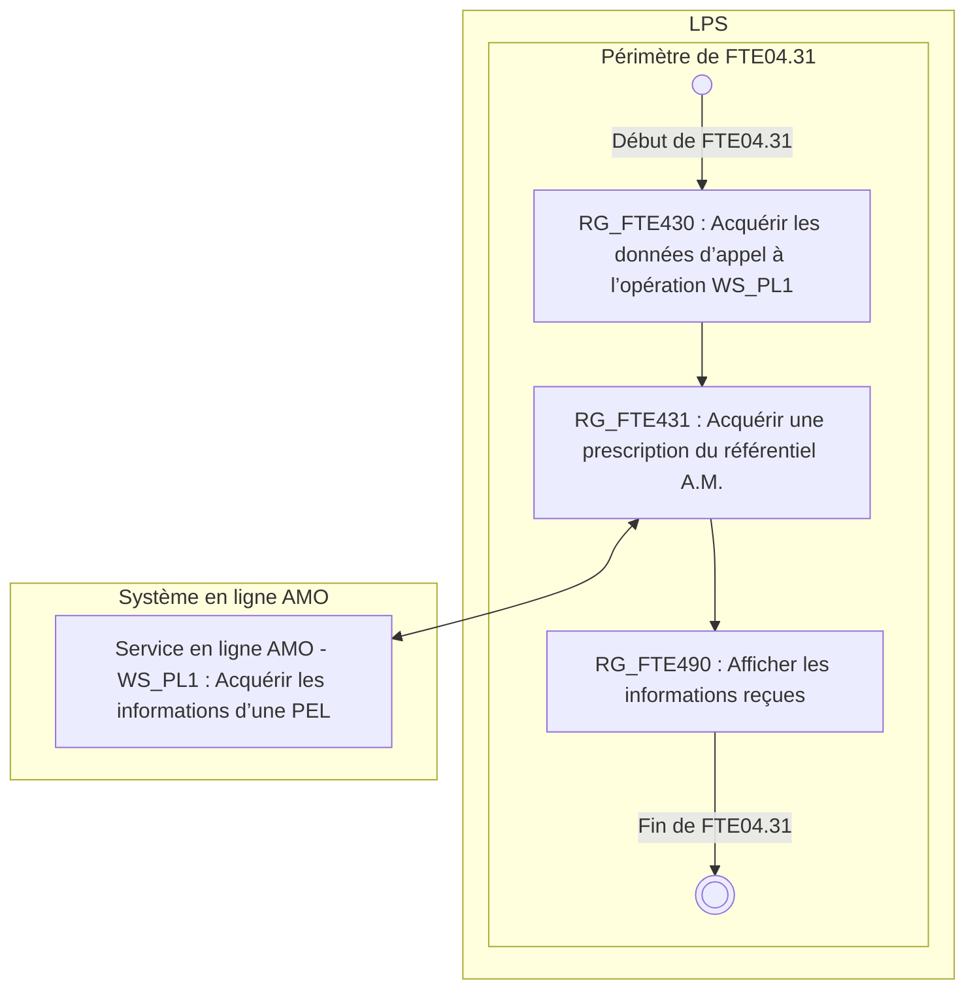

*Spécifications Fonctionnelles Générales*

# **Facturation Transporteur Etendue**
# ***Taxi***

## **FTE04 - Consulter les référentiels de**
## **l'AMO**

Référence : FACT-SFG-034 / Version : 03.17 / Date : 18/06/2026
Diffusion : RESTREINTE
État : PROVISOIRE

VERSION DE TRAVAIL

**GIE SESAM-Vitale**

5, boulevard Marie et Alexandre Oyon – 72 019 LE MANS Cedex 2
<u>www.sesam-vitale.fr</u>

Ce document a été élaboré par le GIE SESAM-Vitale.

Conformément à l’article L.122-4 du Code de la Propriété Intellectuelle, toute représentation ou reproduction (intégrale ou partielle) du présent ouvrage, quel que soit le support utilisé, doit être soumise à l’accord préalable écrit de son auteur.

Il en est de même pour sa traduction, sa transformation, son adaptation ou son arrangement, quel que soit le procédé utilisé.

**Tout manquement à ces obligations constituerait un délit de contrefaçon, au sens des articles **L 335-2 et suivants du code de la propriété intellectuelle, susceptible d’entraîner des** sanctions pour l’auteur du délit.**

## **CONTACTS**

Pour toute demande d'évolution, comme pour toute question technique ou fonctionnelle, contactez le Centre de services :

*   portail IRIS : [https://portail-support.sesam-vitale.fr/](https://portail-support.sesam-vitale.fr/)
*   téléphone : 02 43 57 42 88

VERSION DE TRAVAIL

*SFG - Facturation Transporteur Etendue - Taxi*
FACT-SFG-034 *FTE04 - Consulter les référentiels de l'AMO Version : 03.17*

## **TABLES DES MATIERES**

<table>
    <tr>
      <td><strong>1</strong></td>
      <td><strong>INTRODUCTION.........................................................................................................................................4</strong></td>
    </tr>
    <tr>
      <td>1.1</td>
      <td>OBJECTIF DU DOCUMENT .......................................................................................................................4</td>
    </tr>
    <tr>
      <td>1.2</td>
      <td>STATUT DU DOCUMENT ..........................................................................................................................4</td>
    </tr>
    <tr>
      <td>1.3</td>
      <td>POSITIONNEMENT DU DOCUMENT............................................................................................................4</td>
    </tr>
    <tr>
      <td>1.4</td>
      <td>CONTENU DU DOCUMENT .......................................................................................................................4</td>
    </tr>
    <tr>
      <td>1.5</td>
      <td>DOCUMENTS DE RÉFÉRENCE ..................................................................................................................4</td>
    </tr>
    <tr>
      <td>1.6</td>
      <td>ABRÉVIATIONS.......................................................................................................................................4</td>
    </tr>
    <tr>
      <td>1.7</td>
      <td>DÉFINITIONS..........................................................................................................................................4</td>
    </tr>
    <tr>
      <td>1.8</td>
      <td>GUIDE DE LECTURE................................................................................................................................4</td>
    </tr>
    <tr>
      <td><strong>2</strong></td>
      <td><strong>PRÉSENTATION DU SOUS-PROCESSUS FTE04...................................................................................5</strong></td>
    </tr>
    <tr>
      <td>2.1</td>
      <td>POSITIONNEMENT DU SOUS-PROCESSUS FTE04 .....................................................................................5</td>
    </tr>
    <tr>
      <td>2.2</td>
      <td>PRÉSENTATION GÉNÉRALE DU SOUS-PROCESSUS FTE04 : CONSULTER LES RÉFÉRENTIELS DE L’AMO .....5</td>
    </tr>
    <tr>
      <td>2.3</td>
      <td>DESCRIPTION DÉTAILLÉE DES FONCTIONS DU SOUS-PROCESSUS FTE04 : CONSULTER LES RÉFÉRENTIELS DE L’AMO .............................................................................................................................................6</td>
    </tr>
    <tr>
      <td></td>
      <td>2.3.1 <i>Opérations de consultation liées au référentiel PS</i> ................................................................6</td>
    </tr>
    <tr>
      <td></td>
      <td>    2.3.1.1 FTE04.11 : Consulter les informations d’un PS individu......................................................... 6</td>
    </tr>
    <tr>
      <td></td>
      <td>    2.3.1.2 FTE04.13 : Consulter les informations d’un établissement de soins ...................................... 7</td>
    </tr>
    <tr>
      <td></td>
      <td>    2.3.1.3 FTE04.14 : Consulter les informations RNT........................................................................... 8</td>
    </tr>
    <tr>
      <td></td>
      <td>2.3.2 <i>Opérations de consultation liées au référentiel BS</i> ..............................................................10</td>
    </tr>
    <tr>
      <td></td>
      <td>    2.3.2.1 FTE04.21 : Consulter la liste des bénéficiaires d’un Ouvrant Droit ...................................... 10</td>
    </tr>
    <tr>
      <td></td>
      <td>    2.3.2.2 FTE04.22 : Consulter les informations d’un bénéficiaire ...................................................... 11</td>
    </tr>
    <tr>
      <td></td>
      <td>    2.3.2.3 FTE04.23 : Consulter le référentiel BS................................................................................. 13</td>
    </tr>
    <tr>
      <td></td>
      <td>    2.3.2.4 FTE04.29 : Consulter la prise en charge d’une prestation d’une prescription ...................... 14</td>
    </tr>
    <tr>
      <td></td>
      <td>2.3.3 <i>Opérations de consultation liées au référentiel PL</i>...............................................................17</td>
    </tr>
    <tr>
      <td></td>
      <td>    2.3.3.1 FTE04.31 : Consulter une prescription................................................................................. 17</td>
    </tr>
    <tr>
      <td></td>
      <td>2.3.4 <i>Règles communes à plusieurs opérations</i> ...........................................................................19</td>
    </tr>
</table>

VERSION DE TRAVAIL

*18/06/2026* 3 / 19
*Ce document ne peut être diffusé sans l'autorisation d'une personne habilitée au GIE SESAM-Vitale*

*FACT-SFG-034* *SFG - Facturation Transporteur Etendue - Taxi* *Version : 03.17*
*FTE04 - Consulter les référentiels de l'AMO*

# **1** **Introduction**

## **1.1** **Objectif du document**

Ce document a pour but de spécifier la fonctionnalité « FTE04 : Consulter les référentiels de l’AMO ».

## **1.2** **Statut du document**

Ces SFG sont en version provisoire et référencée.

## **1.3** **Positionnement du document**

Ce document fait partie du corpus documentaire des SFG du système de Facturation Transporteur Etendue **(FTE)**.

## **1.4** **Contenu du document**

Outre ce chapitre introductif, ce document de spécifications fonctionnelles générales présente les opérations de consultation des référentiels AMO.

## **1.5** **Documents de référence**

Les services utilisés sont décrits dans les guides d’intégration suivants. Ils sont disponibles dans le package SEFi.

<table>
  <thead>
    <tr>
      <th><b>Appellation</b></th>
      <th><b>Type et titre</b></th>
      <th><b>Référence</b></th>
    </tr>
  </thead>
  <tbody>
    <tr>
      <td>[WS_PS]</td>
      <td>WP_PS - Services en Ligne "Partenaire de Santé"</td>
      <td>SEL-MP-012</td>
    </tr>
    <tr>
      <td>[WS_BS]</td>
      <td>WP_BS - Services en Ligne "Bénéficiaire de Soins"</td>
      <td>SEL-MP-013</td>
    </tr>
    <tr>
      <td>[WS_PL]</td>
      <td>WP_PL - Services en Ligne "Prescription en Ligne"</td>
      <td>SEL-MP-014</td>
    </tr>
  </tbody>
</table>

## **1.6** **Abréviations**

Cf. Document FACT-SFG-029 : **Dictionnaire**.

## **1.7** **Définitions**

Cf. Document FACT-SFG-029 : **Dictionnaire**.

## **1.8** **Guide de lecture**

Cf. Document FACT-SFG-030 : PG-Annexe 1 : **Guide de lecture**.

VERSION DE TRAVAIL

*18/06/2026* 4 / 19
*Ce document ne peut être diffusé sans l'autorisation d'une personne habilitée au GIE SESAM-Vitale*

*SFG - Facturation Transporteur Etendue - Taxi*
*FACT-SFG-034 *FTE04 - Consulter les référentiels de l'AMO* Version : 03.17*

# **2 Présentation du sous-processus FTE04**

## **2.1 Positionnement du sous-processus FTE04**

Le sous-processus FTE04 : CONSULTER ne fait pas partie à part entière du processus principal de facturation mais constitue plutôt une « boîte à outils » de fonctionnalités de consultation.

## **2.2 Présentation générale du sous-processus FTE04 : Consulter les référentiels de l’AMO**

**Vue générale**

***Description*** Le système FTE s’appuie sur plusieurs référentiels de l’AMO :

* le référentiel des Partenaires de Santé (FNPS, RNT, etc.),
* le référentiel des Bénéficiaires,
* le référentiel des Prescriptions en ligne (PEL),

vers lesquels différentes opérations de consultation sont possibles.

Les opérations de consultations (FTE04.xx) des différents référentiels par le Transporteur sont réalisées indépendamment du processus de facturation à des fins de consultation uniquement.

Ces opérations consistent en :

* la saisie par le PS des données nécessaires à l’appel au service en ligne AMO,
* l’appel au service en ligne de l’AMO ad hoc,
* l’affichage en retour des données reçues.

***Entrées*** Aucune
***Sorties*** Aucune
***Situations spécifiques*** Aucune

VERSION DE TRAVAIL

*18/06/2026* 5 / 19
*Ce document ne peut être diffusé sans l'autorisation d'une personne habilitée au GIE SESAM-Vitale*

*FACT-SFG-034*
*SFG - Facturation Transporteur Etendue - Taxi*
*FTE04 - Consulter les référentiels de l'AMO*
*Version : 03.17*

# **2.3 Description détaillée des fonctions du sous-processus FTE04 : Consulter les référentiels de l’AMO**

## **2.3.1 Opérations de consultation liées au référentiel PS**

### **2.3.1.1 FTE04.11 : Consulter les informations d’un PS individu**

**Vue générale**

***Description*** Cette fonction a pour objet de fournir certaines informations concernant un PS individu identifié par son n° A.M.

 Remarque : Le terme PS « individu » est utilisé par opposition à PS établissement (identifié par un n° FINESS).

Ces informations sont valables à une date d’évaluation donnée.

Cette fonction FTE04.11 utilise l’opération WS_PS1 décrite dans le guide d’intégration [*WS_PS*].

***Entrées*** Aucune
***Sorties*** Aucune
***Situations spécifiques*** Aucune

**Règles de gestion**

#### **[RG_FTE401] Acquérir les données d’appel à l’opération WS_PS1**

Le LPS demande au Transporteur le renseignement des données suivantes :
* l’identifiant A.M. du PS pour lequel les informations sont recherchées (EF_FTE10_01),
* la date d’évaluation à laquelle les informations doivent être consultées (EF_FTE98_03).
Cette date d’évaluation ne peut être supérieure à la date du jour.

#### **[RG_FTE411] Acquérir les informations d’un PS individu**

Les informations recherchées sont obtenues par l’appel au service WS_PS1 comme suit :

***Données transmises***

<table>
  <caption>Données transmises</caption>
  <thead>
    <tr>
      <th colspan="2"></th>
      <th colspan="2">➔ Opération WS_PS1</th>
    </tr>
  </thead>
  <tbody>
    <tr>
      <td>Identifiant A.M. du PS</td>
      <td>EF_FTE10_01</td>
      <td>➔</td>
      <td>DE_PS1_01</td>
    </tr>
    <tr>
      <td>Date d’évaluation des informations recherchées</td>
      <td>EF_FTE98_03</td>
      <td>➔</td>
      <td>DE_PS1_02</td>
    </tr>
  </tbody>
</table>

***Données reçues***

<table>
  <caption>Données reçues</caption>
  <thead>
    <tr>
      <th colspan="2"></th>
      <th colspan="2">🡨 Opération WS_PS1</th>
    </tr>
  </thead>
  <tbody>
    <tr>
      <td>Code spécialité du PS</td>
      <td>EF_FTE10_05</td>
      <td>🡨</td>
      <td>DS_PS1_E10.05</td>
    </tr>
    <tr>
      <td>Identifiant RPPS du PS</td>
      <td>EF_FTE10_02</td>
      <td>🡨</td>
      <td>DS_PS1_E10.02</td>
    </tr>
    <tr>
      <td>Nom de famille du PS</td>
      <td>EF_FTE10_03</td>
      <td>🡨</td>
      <td>DS_PS1_E10.03</td>
    </tr>
    <tr>
      <td>Prénom du PS</td>
      <td>EF_FTE10_04</td>
      <td>🡨</td>
      <td>DS_PS1_E10.04</td>
    </tr>
  </tbody>
</table>

VERSION DE TRAVAIL

*18/06/2026* 6 / 19
*Ce document ne peut être diffusé sans l'autorisation d'une personne habilitée au GIE SESAM-Vitale*

*SFG - Facturation Transporteur Etendue - Taxi*
FACT-SFG-034 *FTE04 - Consulter les référentiels de l'AMO Version : 03.17*

# **4 *CAS D’ERREUR***

## **[CE1] *Erreur fonctionnelle reçue***

Ce cas d’erreur correspond à la consigne générale CG_PG001.

### **[RG_FTE490] *Afficher les informations reçues***

 Cf. § 2.3.4 Règles communes à plusieurs opérations.

---

## **2.3.1.2 FTE04.13 : Consulter les informations d’un établissement de soins**

**Vue générale**

    **Description** Cette fonction a pour objet de fournir certaines informations concernant un établissement de soins identifié par son n° FINESS.

    Ces informations sont valables à une date d’évaluation donnée.

    Cette fonction FTE04.13 utilise l’opération WS_PS3 décrite dans le guide d’intégration [*WS_PS*].

    **Entrées** Aucune

    **Sorties** Aucune

    **Situations spécifiques** Aucune

**Règles de gestion**

### **[RG_FTE403] *Acquérir les données d’appel à l’opération WS_PS3***

Le LPS demande au Transporteur le renseignement des données suivantes :

*   l’identifiant de l’établissement de soins pour lequel les informations sont recherchées (EF_FTE12_01),
*   la date d’évaluation à laquelle les informations doivent être consultées (EF_FTE98_03).

Cette date d’évaluation ne peut être supérieure à la date du jour.

### **[RG_FTE413] *Acquérir les informations d’un établissement de soins***

Les informations recherchées sont obtenues par l’appel au service WS_PS3 comme suit :

#### ***Données transmises***

<table>
  <thead>
    <tr>
      <th colspan="2"></th>
      <th colspan="2">➔ Opération WS_PS3</th>
    </tr>
  </thead>
  <tbody>
    <tr>
      <td>Identifiant de l’établissement de soins</td>
      <td>EF_FTE12_01</td>
      <td>➔</td>
      <td>DE_PS3_01</td>
    </tr>
    <tr>
      <td>Date d’évaluation des informations recherchées</td>
      <td>EF_FTE98_03</td>
      <td>➔</td>
      <td>DE_PS3_02</td>
    </tr>
  </tbody>
</table>

VERSION DE TRAVAIL

*18/06/2026* 7 / 19
*Ce document ne peut être diffusé sans l'autorisation d'une personne habilitée au GIE SESAM-Vitale*

*SFG - Facturation Transporteur Etendue - Taxi*
FACT-SFG-034 *FTE04 - Consulter les référentiels de l'AMO Version : 03.17*

### ***Données reçues***

<table>
  <thead>
    <tr>
      <th colspan="2"></th>
      <th>🡨 Opération WS_PS3</th>
    </tr>
  </thead>
  <tbody>
    <tr>
      <td>Code spécialité PS exerçant dans l’établissement de soins</td>
      <td>EF_FTE12_02</td>
      <td>🡨 DS_PS3_E12.02</td>
    </tr>
    <tr>
      <td>Raison sociale de l’établissement de soins</td>
      <td>EF_FTE12_03</td>
      <td>🡨 DS_PS3_E12.03</td>
    </tr>
    <tr>
      <td>Adresse de l’établissement de soins</td>
      <td>EF_FTE12_04</td>
      <td>🡨 DS_PS3_E12.E80</td>
    </tr>
  </tbody>
</table>

 ***CAS D’ERREUR***

#### ***[CE1] Erreur fonctionnelle reçue***

Ce cas d’erreur correspond à la consigne générale CG_PG001.

#### **[RG_FTE490] Afficher les informations reçues**

 Cf. § 2.3.4 Règles communes à plusieurs opérations.

---

## **2.3.1.3** **FTE04.14 : Consulter les informations RNT**

### **Vue générale**

**Description** Cette fonction a pour objet de fournir les informations inscrites au RNT concernant le Transporteur identifié par la carte CPE ou CDE utilisée dans le système.
Ces informations sont valables sur une période donnée.
Cette fonction FTE04.14 utilise l’opération WS_PS4 décrite dans le guide d’intégration [*WS_PS*].

**Entrées** Aucune
**Sorties** Aucune
**Situations spécifiques** Aucune

---

### **Règles de gestion**

#### **[RG_FTE404] Acquérir les données d’appel à l’opération WS_PS4**

Le LPS demande au Transporteur le renseignement des données suivantes :

*   La date de début de période à laquelle les informations doivent être consultées (EF_FTE98_04).
    Cette date de début de période ne peut être supérieure à la date du jour.

*   La date de fin de période à laquelle les informations doivent être consultées (EF_FTE98_05).
    Cette date de fin de période ne peut être supérieure à la date du jour.
    Cette date de fin de période ne peut être antérieure à la date de début de période.

 Le renseignement de la date de fin de période n’est pas obligatoire. En cas d’absence de cette information en entrée, l’opération WS_PS4 considère la date du jour comme fin de période de consultation (cf. [*WS_PS*]).

VERSION DE TRAVAIL

*18/06/2026* 8 / 19
*Ce document ne peut être diffusé sans l'autorisation d'une personne habilitée au GIE SESAM-Vitale*

*SFG - Facturation Transporteur Etendue - Taxi*
*FACT-SFG-034 *FTE04 - Consulter les référentiels de l'AMO* Version : 03.17*

## *[RG_FTE414] Acquérir les informations du RNT*

Les informations recherchées sont obtenues par l’appel au service WS_PS4 comme suit :

### *Données transmises*

<table>
  <thead>
    <tr>
      <th colspan="2"></th>
      <th colspan="2">➔ Opération WS_PS4</th>
    </tr>
  </thead>
  <tbody>
    <tr>
      <td>Date de début de période recherchée</td>
      <td>EF_FTE98_04</td>
      <td>➔</td>
      <td>DE_PS4_01</td>
    </tr>
    <tr>
      <td>Date de fin de période recherchée</td>
      <td>EF_FTE98_05</td>
      <td>➔</td>
      <td>DE_PS4_02</td>
    </tr>
  </tbody>
</table>

### *Données reçues*

<table>
  <thead>
    <tr>
      <th colspan="2"></th>
      <th colspan="2">← Opération WS_PS4</th>
    </tr>
  </thead>
  <tbody>
    <tr>
      <td colspan="4">Pour chaque employé du Transporteur</td>
    </tr>
    <tr>
      <td>    Identité de l’employé</td>
      <td>EF_FTE14</td>
      <td>←</td>
      <td>DS_PS4_E14</td>
    </tr>
    <tr>
      <td>    Nom de famille de l’employé</td>
      <td>EF_FTE14.01</td>
      <td>←</td>
      <td>DS_PS4_E14.01</td>
    </tr>
    <tr>
      <td>    Prénom de l’employé</td>
      <td>EF_FTE14.02</td>
      <td>←</td>
      <td>DS_PS4_E14.02</td>
    </tr>
    <tr>
      <td>    Date d’entrée de l’employé</td>
      <td>EF_FTE14.03</td>
      <td>←</td>
      <td>DS_PS4_E14.03</td>
    </tr>
    <tr>
      <td>    Date de sortie de l’employé</td>
      <td>EF_FTE14.04</td>
      <td>←</td>
      <td>DS_PS4_E14.04</td>
    </tr>
    <tr>
      <td colspan="4">Pour chaque employé du Transporteur</td>
    </tr>
    <tr>
      <td>    Diplôme de l’employé</td>
      <td>EF_FTE15</td>
      <td>←</td>
      <td>DS_PS4_E15</td>
    </tr>
    <tr>
      <td>    Nature du diplôme</td>
      <td>EF_FTE15.01</td>
      <td>←</td>
      <td>DS_PS4_E15.01</td>
    </tr>
    <tr>
      <td>    Date d’obtention du diplôme</td>
      <td>EF_FTE15.02</td>
      <td>←</td>
      <td>DS_PS4_E15.02</td>
    </tr>
    <tr>
      <td colspan="4">Pour chaque véhicule du Transporteur</td>
    </tr>
    <tr>
      <td>    Informations Véhicule</td>
      <td>EF_FTE16</td>
      <td>←</td>
      <td>DS_PS4_E16</td>
    </tr>
    <tr>
      <td>    N° d’immatriculation du véhicule</td>
      <td>EF_FTE16.01</td>
      <td>←</td>
      <td>DS_PS4_E16.01</td>
    </tr>
    <tr>
      <td>    Date d’autorisation du véhicule</td>
      <td>EF_FTE16.02</td>
      <td>←</td>
      <td>DS_PS4_E16.02</td>
    </tr>
    <tr>
      <td>    Date de sortie du parc du véhicule</td>
      <td>EF_FTE16.03</td>
      <td>←</td>
      <td>DS_PS4_E16.03</td>
    </tr>
  </tbody>
</table>

### *[CE1] Erreur fonctionnelle reçue*

Ce cas d’erreur correspond à la consigne générale CG_PG001.

## *[RG_FTE490] Afficher les informations reçues*

 Cf. § 2.3.4 Règles communes à plusieurs opérations.

VERSION DE TRAVAIL

*18/06/2026* 9 / 19
*Ce document ne peut être diffusé sans l'autorisation d'une personne habilitée au GIE SESAM-Vitale*

*SFG - Facturation Transporteur Etendue - Taxi*
FACT-SFG-034 *FTE04 - Consulter les référentiels de l'AMO Version : 03.17*

## **2.3.2** **Opérations de consultation liées au référentiel BS**

### **2.3.2.1** **FTE04.21 : Consulter la liste des bénéficiaires d’un Ouvrant Droit**

#### **Vue générale**

**Description** Cette fonction a pour objet de fournir la liste des bénéficiaires rattachés à un ouvrant droit.
Ces informations sont valables à la date du jour.
Cette fonction FTE04.21 utilise l’opération WS_BS1 décrite dans le guide d’intégration [*WS_BS*].

**Entrées** Aucune
**Sorties** Aucune
**Situations spécifiques** Aucune

#### **Règles de Gestion**

**[RG_FTE405] Acquérir les données d’appel à l’opération WS_BS1**

Le LPS demande au Transporteur le renseignement des données suivantes :
* Le NIR de l’ouvrant droit dont les bénéficiaires sont recherchés (EF_FTE21_01).
* La clé du NIR de l’ouvrant droit (EF_FTE21_02).

**[RG_FTE421] Acquérir les bénéficiaires d’un ouvrant droit**

Les informations recherchées sont obtenues par l’appel au service WS_BS1 comme suit :

***Données transmises***

<table>
  <thead>
    <tr>
      <th colspan="2"></th>
      <th colspan="2">➔ Opération WS_BS1</th>
    </tr>
  </thead>
  <tbody>
    <tr>
      <td>NIR de l’ouvrant droit</td>
      <td>EF_FTE21_01</td>
      <td>➔</td>
      <td>DE_BS1_01</td>
    </tr>
    <tr>
      <td>Clé du NIR de l’ouvrant droit</td>
      <td>EF_FTE21_02</td>
      <td>➔</td>
      <td>DE_BS1_02</td>
    </tr>
  </tbody>
</table>

VERSION DE TRAVAIL

*18/06/2026* 10 / 19
*Ce document ne peut être diffusé sans l'autorisation d'une personne habilitée au GIE SESAM-Vitale*

FACT-SFG-034
*SFG - Facturation Transporteur Etendue - Taxi*
*FTE04 - Consulter les référentiels de l'AMO*
Version : 03.17

### ***Données reçues***

<table>
  <thead>
    <tr>
      <th colspan="2"></th>
      <th colspan="2">← Opération WS_BS1</th>
    </tr>
  </thead>
  <tbody>
    <tr>
      <td colspan="4">Pour chaque bénéficiaire de l’ouvrant droit :</td>
    </tr>
    <tr>
      <td>Prénom du bénéficiaire</td>
      <td>EF_FTE20_03</td>
      <td>←</td>
      <td>DS_BS1_E20.03</td>
    </tr>
    <tr>
      <td>Date de naissance du bénéficiaire</td>
      <td>EF_FTE20_04</td>
      <td>←</td>
      <td>DS_BS1_E20.04</td>
    </tr>
    <tr>
      <td>Rang du bénéficiaire</td>
      <td>EF_FTE20_05</td>
      <td>←</td>
      <td>DS_BS1_E20.05</td>
    </tr>
  </tbody>
</table>

##  **4 *CAS D’ERREUR***

### **[CE1] *Erreur fonctionnelle reçue***

Ce cas d’erreur correspond à la consigne générale CG_PG001.

### **[RG_FTE490] *Afficher les informations reçues***

 Cf. § 2.3.4 Règles communes à plusieurs opérations.

## **2.3.2.2** **FTE04.22 : Consulter les informations d’un bénéficiaire**

### **Vue générale**

**Description** Cette fonction a pour objet de fournir les noms, prénom et l’organisme A.M.O. d’affiliation d’un bénéficiaire identifié par sa date de naissance et son rang.

Ces informations sont valables à une date d’évaluation donnée.

Cette fonction FTE04.21 utilise l’opération WS_BS2 décrite dans le guide d’intégration [*WS_BS*].

**Entrées** Aucune

**Sorties** Aucune

**Situations spécifiques** Aucune

## **Règles de Gestion**

### **[RG_FTE406] *Acquérir les données d’appel à l’opération WS_BS2***

Le LPS demande au Transporteur le renseignement des données suivantes :

*   Le NIR de l’ouvrant droit dont les bénéficiaires sont recherchés (EF_FTE21_01).
*   La clé du NIR de l’ouvrant droit (EF_FTE21_02).
*   La date de naissance du bénéficiaire recherché (EF_FTE20_04).
*   Le rang du bénéficiaire recherché (EF_FTE20_05).
*   La date d’évaluation à laquelle les informations doivent être consultées (EF_FTE98_03).
    Cette date d’évaluation ne peut être supérieure à la date du jour.

VERSION DE TRAVAIL

*18/06/2026*
*Ce document ne peut être diffusé sans l'autorisation d'une personne habilitée au GIE SESAM-Vitale*
11 / 19

*FACT-SFG-034*
*SFG - Facturation Transporteur Etendue - Taxi*
*FTE04 - Consulter les référentiels de l'AMO*
*Version : 03.17*

# ***[RG_FTE422] Acquérir les informations d’un bénéficiaire***

Les informations recherchées sont obtenues par l’appel au service WS_BS2 comme suit :

## ***Données transmises***

<table>
  <thead>
    <tr>
      <th colspan="2"></th>
      <th>→ Opération WS_BS2</th>
    </tr>
  </thead>
  <tbody>
    <tr>
      <td>NIR de l’ouvrant droit</td>
      <td>EF_FTE21_01</td>
      <td>→ DE_BS2_01</td>
    </tr>
    <tr>
      <td>Clé du NIR de l’ouvrant droit</td>
      <td>EF_FTE21_02</td>
      <td>→ DE_BS2_02</td>
    </tr>
    <tr>
      <td>Date de naissance du bénéficiaire</td>
      <td>EF_FTE20_04</td>
      <td>→ DE_BS2_03</td>
    </tr>
    <tr>
      <td>Rang du bénéficiaire</td>
      <td>EF_FTE20_05</td>
      <td>→ DE_BS2_04</td>
    </tr>
    <tr>
      <td>Date d’évaluation des informations recherchées</td>
      <td>EF_FTE98_03</td>
      <td>→ DE_BS2_05</td>
    </tr>
  </tbody>
</table>

## ***Données reçues***

<table>
  <thead>
    <tr>
      <th colspan="2"></th>
      <th colspan="2">🡨 Opération WS_BS2</th>
    </tr>
  </thead>
  <tbody>
    <tr>
      <td>Nom de famille du bénéficiaire</td>
      <td>EF_FTE20_01</td>
      <td>🡨</td>
      <td>DS_BS2_E20.01</td>
    </tr>
    <tr>
      <td>Nom d’usage du bénéficiaire</td>
      <td>EF_FTE20_02</td>
      <td>🡨</td>
      <td>DS_BS2_E20.02</td>
    </tr>
    <tr>
      <td>Prénom du bénéficiaire</td>
      <td>EF_FTE20_03</td>
      <td>🡨</td>
      <td>DS_BS2_E20.03</td>
    </tr>
    <tr>
      <td>Code régime</td>
      <td>EF_FTE22_01</td>
      <td>🡨</td>
      <td>DS_BS2_E22.01</td>
    </tr>
    <tr>
      <td>Code caisse gestionnaire</td>
      <td>EF_FTE22_02</td>
      <td>🡨</td>
      <td>DS_BS2_E22.02</td>
    </tr>
    <tr>
      <td>Code centre gestionnaire</td>
      <td>EF_FTE22_03</td>
      <td>🡨</td>
      <td>DS_BS2_E22.03</td>
    </tr>
  </tbody>
</table>

## ***4 CAS D’ERREUR***

### ***[CE1] Erreur fonctionnelle reçue***

Ce cas d’erreur correspond à la consigne générale CG_PG001.

# ***[RG_FTE490] Afficher les informations reçues***

 Cf. § 2.3.4 Règles communes à plusieurs opérations.

VERSION DE TRAVAIL

*18/06/2026*
12 / 19
*Ce document ne peut être diffusé sans l'autorisation d'une personne habilitée au GIE SESAM-Vitale*

*SFG - Facturation Transporteur Etendue - Taxi*
FACT-SFG-034 *FTE04 - Consulter les référentiels de l'AMO Version : 03.17*

# **2.3.2.3** **FTE04.23 : Consulter le référentiel BS**

## **Vue générale**

***Description*** Cette opération a pour objet de fournir les noms, prénom et organisme A.M.O. d’affiliation d’un des bénéficiaires rattaché à un ouvrant droit donné.

Ces informations sont valables à une date d’évaluation donnée.

Cette opération FTE04.23 utilise successivement l’opération FTE04.21 et la règle RG_FTE422 FTE04.22 faisant appel à des opérations du service en ligne WS_BS.

Cette fonctionnalité est présentée ici à titre d’illustration.

Sa mise en œuvre est facultative.

***Entrées*** Aucune
***Sorties*** Aucune
***Situations spécifiques*** Aucune

## **Schéma**

Cette opération FTE04.23 utilise successivement l’opération FTE04.21 et la règle RG_FTE422 FTE04.22 faisant appel à des opérations du service en ligne WS_BS.

Cette fonctionnalité est présentée ici à titre d’illustration.

Sa mise en œuvre est facultative.

Aucune

Aucune

Aucune

*18/06/2026 13 / 19*
*Ce document ne peut être diffusé sans l'autorisation d'une personne habilitée au GIE SESAM-Vitale*

*SFG - Facturation Transporteur Etendue - Taxi*
FACT-SFG-034 *FTE04 - Consulter les référentiels de l'AMO Version : 03.17*

**Règles de**
**Gestion**

### **[RG_FTE423] *Sélectionner le bénéficiaire***

Le Transporteur sélectionne un bénéficiaire parmi ceux affichés par la fonction FTE04.21.

### **[RG_FTE422] *Acquérir les informations d’un bénéficiaire***

 Cf. § 2.3.2.2 FTE04.22 : Consulter les informations d’un bénéficiaire.

## **2.3.2.4** **FTE04.29 : Consulter la prise en charge d’une prestation d’une prescription**

**Vue générale**

<table>
    <tr>
      <td><i>Description</i></td>
      <td>Cette fonction a pour objet de déterminer, pour une prestation d’une prescription donnée, les informations de prise en charge AMO nécessaires au Transporteur dans le cadre de son processus de facturation.  La prescription peut être soit une Prescription en Ligne (PEL), soit une prescription papier (PP).  Ces informations sont valables à la date d’interrogation du service en ligne.  Cette fonction FTE04.29 utilise l’opération WS_PEC1 décrite dans le guide d’intégration [<i>WS_PEC</i>].</td>
      <td></td>
    </tr>
    <tr>
      <td rowspan="2"><i>Entrées</i></td>
      <td>PEL <b><i>[Scénario PEL]</i></b></td>
      <td>DF_FTE_PEL</td>
    </tr>
    <tr>
      <td>Prescription papier <b><i>[Scénario PP]</i></b></td>
      <td></td>
    </tr>
    <tr>
      <td rowspan="3"><i>Sorties</i></td>
      <td>Contexte de prise en charge d’une prescription</td>
      <td>EF_FTE28</td>
    </tr>
    <tr>
      <td><i>Pour chaque prestation de la prescription</i></td>
      <td></td>
    </tr>
    <tr>
      <td>    Prise en charge d’une prestation de la prescription</td>
      <td>EF_FTE29</td>
    </tr>
    <tr>
      <td><i>Situations spécifiques</i></td>
      <td>Aucune</td>
      <td></td>
    </tr>
</table>

**Règles de**
**Gestion**

### **[RG_FTE428] *Acquérir les données d’appel à l’opération WS_PEC1***

**Tout Scénario**

Le LPS demande au Transporteur le renseignement des données non présentes sur la prescription à savoir :

*   L’indicateur « soins en rapport avec l’article L115 » (EF_FTE98_06), renseigné à partir de la fiche descriptive des infirmités si présentée,
*   L’identifiant AT/MP (EF_FTE98_08), renseigné à partir du feuillet AT, si présenté.
*   La date d’évaluation à laquelle les informations doivent être consultées (EF_FTE98_03).
    Cette date d’évaluation correspond à la date de réalisation de la prestation.
    Cette date d’évaluation ne peut être supérieure à la date du jour.

Par ailleurs, si L’identifiant ATMP est renseigné, le LPS positionne à « VRAI » l’’indicateur « soins en rapport avec AT/MP » (EF_FTE98_07).

VERSION DE TRAVAIL

*18/06/2026* 14 / 19
*Ce document ne peut être diffusé sans l'autorisation d'une personne habilitée au GIE SESAM-Vitale*

*SFG - Facturation Transporteur Etendue - Taxi*
FACT-SFG-034 *FTE04 - Consulter les référentiels de l'AMO* *Version : 03.17*

## ***Scénario PEL***

Si la date ATMP est renseignée dans la PEL (EF_FTE45_02), le LPS positionne à « VRAI » l’ indicateur « soins en rapport avec AT/MP » (EF_FTE98_07).

## ***Scénario PP***

Le Transporteur renseigne partie des données d’appel du service à partir de la prescription papier :

<table>
<tr>
<td>NIR de l’ouvrant droit</td>
<td>EF_FTE21_01</td>
</tr>
<tr>
<td>Clé du NIR de l’ouvrant droit</td>
<td>EF_FTE21_02</td>
</tr>
<tr>
<td>Date de naissance du bénéficiaire</td>
<td>EF_FTE20_04</td>
</tr>
<tr>
<td>Rang du bénéficiaire</td>
<td>EF_FTE20_05</td>
</tr>
</table>

La date de naissance et le rang du bénéficiaire sont initialisés par le LPS à partir du NIR de l’ouvrant droit par l’appel au service en ligne WS_BS1 (cf. FTE04.21).

Si la date ATMP est renseignée sur la prescription papier, le LPS positionne à « VRAI » l’’indicateur « soins en rapport avec AT/MP » (EF_FTE98_07).

# ***[RG_FTE429] Acquérir la prise en charge d’une prestation d’une prescription***

Les informations recherchées sont obtenues par l’appel au service WS_PEC1 à partir des données de la prescription comme suit :

## ***Données transmises***

<table>
  <thead>
    <tr>
      <th></th>
      <th>Scénario PEL</th>
      <th>Scénario PP</th>
      <th colspan="2">→ <b>Opération</b> WS_PEC1</th>
    </tr>
  </thead>
  <tbody>
    <tr>
      <td>NIR de l’ouvrant droit</td>
      <td>EF_FTE31_01</td>
      <td>EF_FTE21_01</td>
      <td>→</td>
      <td>DE_PEC1_01</td>
    </tr>
    <tr>
      <td>Clé du NIR de l’ouvrant droit</td>
      <td>EF_FTE31_02</td>
      <td>EF_FTE21_02</td>
      <td>→</td>
      <td>DE_PEC1_02</td>
    </tr>
    <tr>
      <td>Date de naissance du bénéficiaire</td>
      <td>EF_FTE31_06</td>
      <td>EF_FTE20_04</td>
      <td>→</td>
      <td>DE_PEC1_03</td>
    </tr>
    <tr>
      <td>Rang du bénéficiaire</td>
      <td>EF_FTE31_07</td>
      <td>EF_FTE20_05</td>
      <td>→</td>
      <td>DE_PEC1_04</td>
    </tr>
    <tr>
      <td>Date de prescription</td>
      <td>EF_FTE30_02</td>
      <td rowspan="3">Renseigné par le TR à partir de la PP</td>
      <td>→</td>
      <td>DE_PEC1_05</td>
    </tr>
    <tr>
      <td>Mode de transport</td>
      <td>EF_FTE42_03</td>
      <td>→</td>
      <td>DE_PEC1_06</td>
    </tr>
    <tr>
      <td>Indicateur « soins en rapport avec ALD exonérante »</td>
      <td>EF_FTE45_06</td>
      <td>→</td>
      <td>DE_PEC1_07</td>
    </tr>
    <tr>
      <td>Indicateur « soins en rapport avec l’article L115 »</td>
      <td colspan="2">EF_FTE98_06</td>
      <td>→</td>
      <td>DE_PEC1_08</td>
    </tr>
    <tr>
      <td>Indicateur « prise en charge à 100% »</td>
      <td>EF_FTE45_03</td>
      <td>Renseigné par le TR à partir de la PP</td>
      <td>→</td>
      <td>DE_PEC1_09</td>
    </tr>
    <tr>
      <td>Indicateur « soins en rapport avec AT/MP »</td>
      <td colspan="2">EF_FTE98_07</td>
      <td>→</td>
      <td>DE_PEC1_10</td>
    </tr>
    <tr>
      <td>Date AT/MP</td>
      <td>EF_FTE45_02</td>
      <td>Renseigné par le TR à partir de la PP</td>
      <td>→</td>
      <td>DE_PEC1_11</td>
    </tr>
    <tr>
      <td>Identifiant AT/MP</td>
      <td colspan="2">EF_FTE98_08</td>
      <td>→</td>
      <td>DE_PEC1_12</td>
    </tr>
    <tr>
      <td>Date d’évaluation</td>
      <td colspan="2">EF_FTE98_03</td>
      <td>→</td>
      <td>DE_PEC1_13</td>
    </tr>
  </tbody>
</table>

VERSION DE TRAVAIL

*18/06/2026* 15 / 19
*Ce document ne peut être diffusé sans l'autorisation d'une personne habilitée au GIE SESAM-Vitale*

*SFG - Facturation Transporteur Etendue - Taxi*
FACT-SFG-034 *FTE04 - Consulter les référentiels de l'AMO* *Version : 03.17*

### ***Données reçues***

<table>
  <thead>
    <tr>
      <th colspan="2"></th>
      <th>←</th>
      <th><b>Opération</b> WS_PEC</th>
    </tr>
  </thead>
  <tbody>
    <tr>
      <td>Code régime de prise en charge</td>
      <td>EF_FTE28_01</td>
      <td>←</td>
      <td>DS_PEC1_01</td>
    </tr>
    <tr>
      <td>Code caisse gestionnaire de prise en charge</td>
      <td>EF_FTE28_02</td>
      <td>←</td>
      <td>DS_PEC1_02</td>
    </tr>
    <tr>
      <td>Code centre gestionnaire de prise en charge</td>
      <td>EF_FTE28_03</td>
      <td>←</td>
      <td>DS_PEC1_03</td>
    </tr>
    <tr>
      <td>Nature d’assurance</td>
      <td>EF_FTE28_04</td>
      <td>←</td>
      <td>DS_PEC1_04</td>
    </tr>
    <tr>
      <td>Date de maternité</td>
      <td>EF_FTE28_05</td>
      <td>←</td>
      <td>DS_PEC1_05</td>
    </tr>
    <tr>
      <td>Rang du bénéficiaire</td>
      <td>EF_FTE28_06</td>
      <td>←</td>
      <td>DS_PEC1_06</td>
    </tr>
    <tr>
      <td>Contrat AMO particulier</td>
      <td>EF_FTE28_07</td>
      <td>←</td>
      <td>DS_PEC1_07</td>
    </tr>
    <tr>
      <td>Indicateur de situation particulière</td>
      <td>EF_FTE28_08</td>
      <td>←</td>
      <td>DS_PEC1_08</td>
    </tr>
    <tr>
      <td>TP réglementaire</td>
      <td>EF_FTE28_09</td>
      <td>←</td>
      <td>DS_PEC1_09</td>
    </tr>
    <tr>
      <td>Justificatif d’exonération</td>
      <td>EF_FTE29_02</td>
      <td>←</td>
      <td>DS_PEC1_10</td>
    </tr>
    <tr>
      <td>Taux applicable à la prestation</td>
      <td>EF_FTE29_03</td>
      <td>←</td>
      <td>DS_PEC1_11</td>
    </tr>
  </tbody>
</table>

 ***CAS D’ERREUR***

### ***[CE1] Erreur fonctionnelle reçue***

Ce cas d’erreur correspond à la consigne générale CG_PG001.

## ***[RG_FTE490] Afficher les informations reçues***

 Cf. § 2.3.4 Règles communes à plusieurs opérations

*18/06/2026* 16 / 19
*Ce document ne peut être diffusé sans l'autorisation d'une personne habilitée au GIE SESAM-Vitale*

*SFG - Facturation Transporteur Etendue - Taxi*
*FACT-SFG-034 *FTE04 - Consulter les référentiels de l'AMO* Version : 03.17*

## **2.3.3** **Opérations de consultation liées au référentiel PL**

### **2.3.3.1** **FTE04.31 : Consulter une prescription**

#### **Vue générale**

***Description*** L’objectif de cette fonctionnalité est de fournir aux Transporteurs des informations d’une prescription en ligne, à l’aide du référentiel de prescriptions en ligne de l’Assurance Maladie.

Ces informations seront, par exemple, nécessaires à la réservation d’une prestation ou pour signaler la réalisation d’une prestation de prescription.

Le Transporteur peut aussi utiliser cette fonctionnalité de consultation afin d’acquérir des informations issues d’une PEL en amont du processus de facturation :

*   lors de réservation du transport (prise de commande),
*   et lors de sa réalisation (prise en charge de l’assuré).

 Les informations retournées par le service WS_PL1 « Acquérir les informations d’une PEL » ne constituent aucunement une copie de la PEL.

 **L’utilisation de cette fonctionnalité à des fins de consultation uniquement, i.e. **en dehors du processus « FACTURER en LIGNE », interdit le stockage des** données de la PEL.**

Le taux de prise en charge remonté parmi les informations de la PEL est estimé à la date de la prescription. Il est restitué à titre d’information au Transporteur.

 Le Transporteur doit faire appel au service d’aide à la prise en charge pour récupérer un taux de prise en charge actualisé à la date d’acquisition de la PEL.

Pour chacune des prestations d’une prescription, le Transporteur sait si elle est réservée, réalisée ou facturée par lui-même ou par un autre Transporteur.
Aucun élément permettant l’identification de l’autre Transporteur n’est fourni.

Une prestation non réservée, réalisée ou facturée par un Transporteur est à l’état « prescrit ».

La consultation du référentiel de prescriptions en ligne de l’Assurance Maladie utilise l’opération WS_PL1 décrite dans le guide d’intégration [*WS_PL*].

Le Transporteur dispose des données identifiant une prescription (Id prescription et nom de famille du bénéficiaire (ancienne terminologie : nom patronymique)).

***Entrées*** Aucune
***Sorties*** Aucune
***Situations spécifiques*** Aucune

VERSION DE TRAVAIL

*18/06/2026* *17 / 19*
*Ce document ne peut être diffusé sans l'autorisation d'une personne habilitée au GIE SESAM-Vitale*

FACT-SFG-034
*SFG - Facturation Transporteur Etendue - Taxi*
*FTE04 - Consulter les référentiels de l'AMO*
*Version : 03.17*

**Schéma**

**Règles de**
**gestion**

### *[RG_FTE430] Acquérir les données d’appel à l’opération WS_PL1*

Le LPS demande au Transporteur le renseignement des données suivantes :

*   L’identifiant de la prescription à consulter (EF_FTE30_01).
*   Nom de famille du bénéficiaire de la prescription (EF_FTE20_01).

### *[RG_FTE431] Acquérir une prescription du référentiel A.M.*

Le LPS du Transporteur consulte le référentiel en ligne de l’Assurance Maladie pour obtenir les informations d’une prescription en fournissant le nom du bénéficiaire de la prescription et l’identifiant de la prescription en ligne.

Les informations recherchées sont obtenues par l’appel au service WS_PL1 comme suit :

*18/06/2026*
*18 / 19*
*Ce document ne peut être diffusé sans l'autorisation d'une personne habilitée au GIE SESAM-Vitale*

FACT-SFG-034
*SFG - Facturation Transporteur Etendue - Taxi*
*FTE04 - Consulter les référentiels de l'AMO*
*Version : 03.17*

### ***Données transmises***

<table>
  <thead>
    <tr>
      <th colspan="2"></th>
      <th>→</th>
      <th>Opération WS_PL1</th>
    </tr>
  </thead>
  <tbody>
    <tr>
      <td>Identifiant de la PEL</td>
      <td>EF_FTE30_01</td>
      <td>→</td>
      <td>DE_PL1_01</td>
    </tr>
    <tr>
      <td>Nom de famille du bénéficiaire</td>
      <td>EF_FTE20_01</td>
      <td rowspan="3">→</td>
      <td rowspan="3">DE_PL1_02</td>
    </tr>
    <tr>
      <td>ou</td>
      <td>ou</td>
    </tr>
    <tr>
      <td>Nom d’usage du bénéficiaire</td>
      <td>EF_FTE20_02</td>
    </tr>
  </tbody>
</table>

### ***Données reçues***

<table>
  <thead>
    <tr>
      <th colspan="2"></th>
      <th>🡨</th>
      <th>Opération WS_PL1</th>
    </tr>
  </thead>
  <tbody>
    <tr>
      <td>Prescription en Ligne</td>
      <td>DF_FTE_PEL</td>
      <td>🡨</td>
      <td>DS_PL1_Exx*</td>
    </tr>
  </tbody>
</table>

* Cf. Guide d’intégration [WS_PL].

# 4 **CAS D’ERREUR**

## **[CE1]** ***Erreur fonctionnelle reçue***

Ce cas d’erreur correspond à la consigne générale CG_PG001.

## ***[RG_FTE490] Afficher les informations reçues***

 Cf. § 2.3.4 Règles communes à plusieurs opérations.

## **2.3.4** **Règles communes à plusieurs opérations**

## ***[RG_FTE490] Afficher les informations reçues***

Le LPS doit afficher à l’écran la totalité des données reçues du service en ligne sollicité.

VERSION DE TRAVAIL

*18/06/2026*
*Ce document ne peut être diffusé sans l'autorisation d'une personne habilitée au GIE SESAM-Vitale*
*19 / 19*

