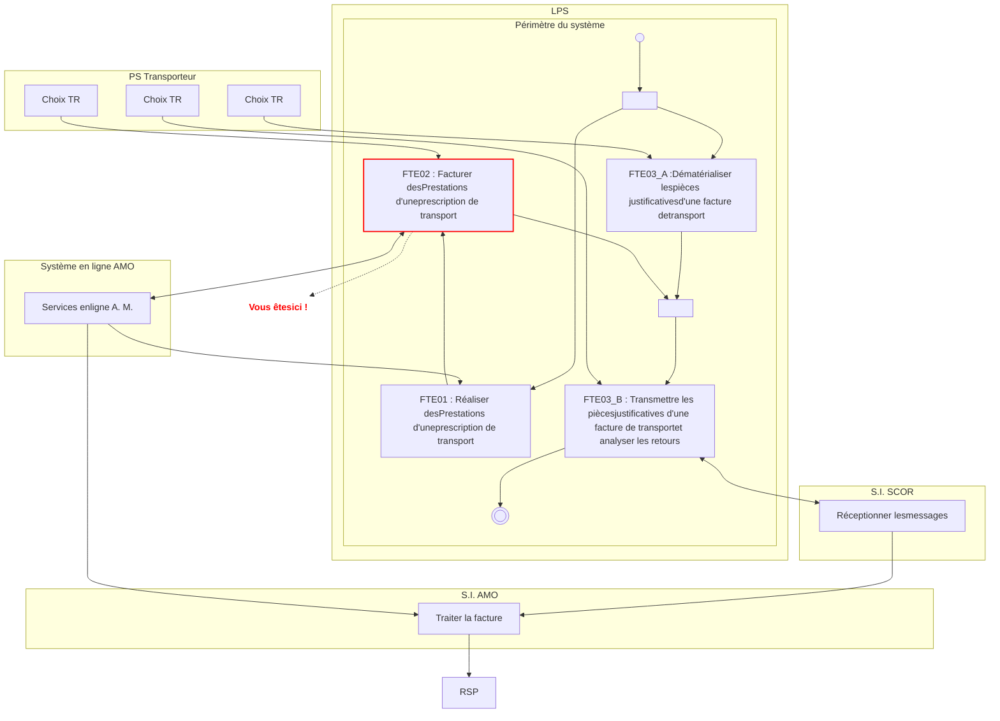
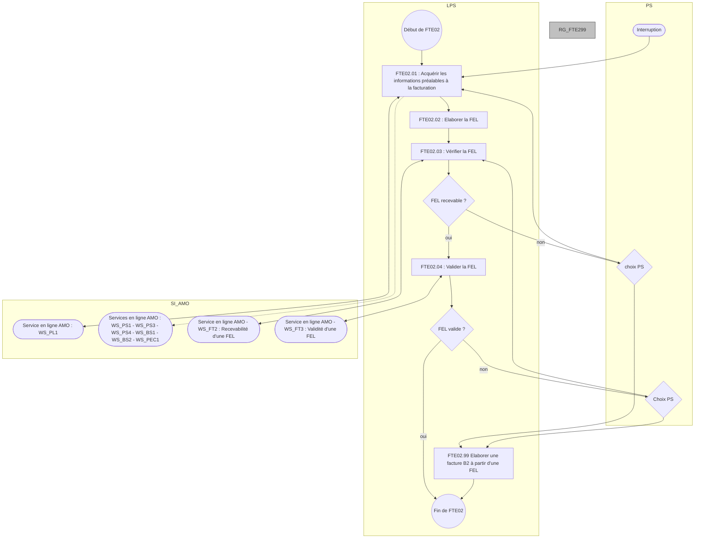
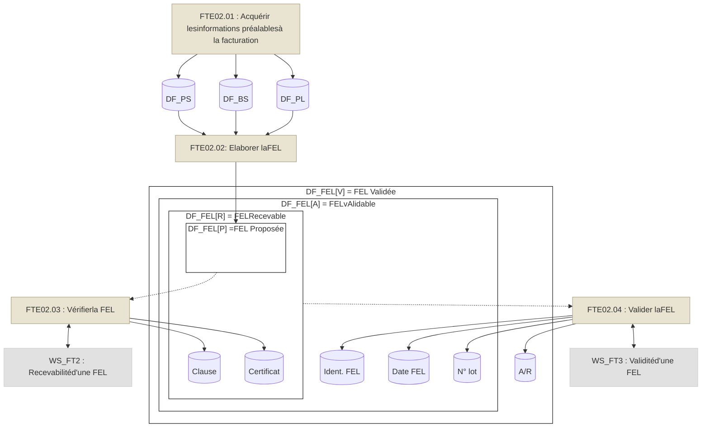
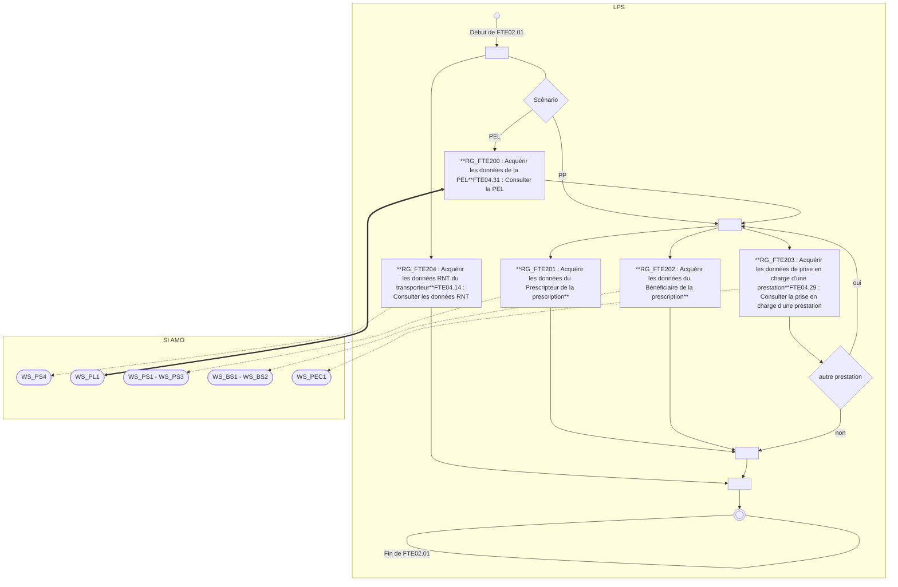
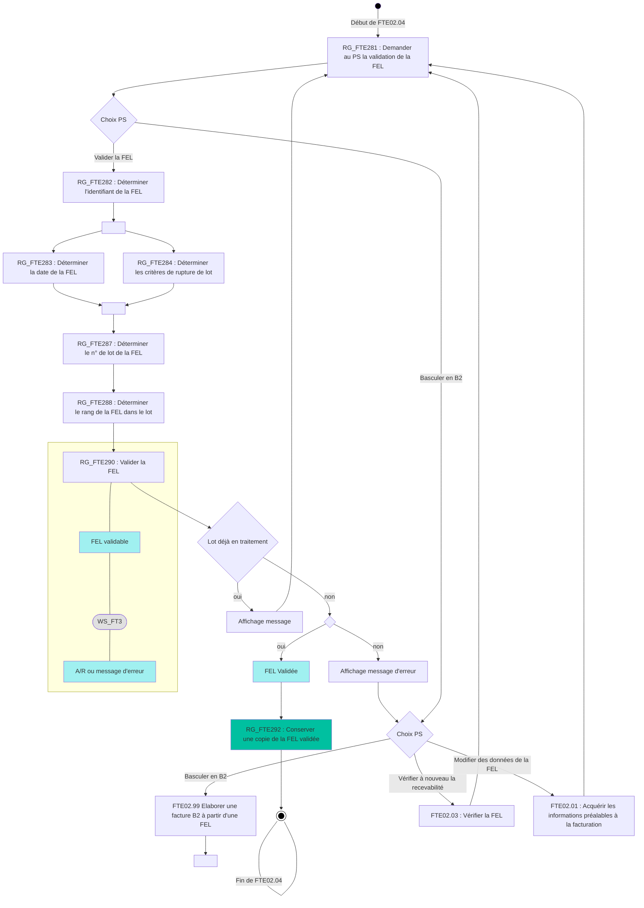

*Spécifications Fonctionnelles Générales*

# **Système de Facturation Transporteur**
# ***Taxi***

## **FTE02 - Facturer des Prestations**

Référence : FACT-SFG-032 / Version : 03.57 / Date : 10/07/2026
Diffusion : RESTREINTE
État : PROVISOIRE


VERSION DE TRAVAIL

**GIE SESAM-Vitale**

5, boulevard Marie et Alexandre Oyon – 72 019 LE MANS Cedex 2
<u>www.sesam-vitale.fr</u>

Ce document a été élaboré par le GIE SESAM-Vitale.

Conformément à l’article L.122-4 du Code de la Propriété Intellectuelle, toute représentation ou reproduction (intégrale ou partielle) du présent ouvrage, quel que soit le support utilisé, doit être soumise à l’accord préalable écrit de son auteur.

Il en est de même pour sa traduction, sa transformation, son adaptation ou son arrangement, quel que soit le procédé utilisé.

**Tout manquement à ces obligations constituerait un délit de contrefaçon, au sens **des articles L 335-2 et suivants du code de la propriété intellectuelle, susceptible** d’entraîner des sanctions pour l’auteur du délit.**

## **CONTACTS**


Pour toute demande d'évolution, comme pour toute question technique ou fonctionnelle, contactez le Centre de services :

*   portail IRIS : [https://portail-support.sesam-vitale.fr/](https://portail-support.sesam-vitale.fr/)
*   téléphone : 02 43 57 42 88

VERSION DE TRAVAIL

*SFG - Système de Facturation Transporteur - Taxi*
*FACT-SFG-032 FTE02 - Facturer des Prestations Version : 03.57*

# **TABLES DES MATIERES**

<table>
    <tr>
      <td><strong>1</strong></td>
      <td><strong>INTRODUCTION ......................................................................................................................</strong></td>
      <td><strong>4</strong></td>
    </tr>
    <tr>
      <td></td>
      <td>1.1 OBJECTIF DU DOCUMENT .....................................................................................................</td>
      <td>4</td>
    </tr>
    <tr>
      <td></td>
      <td>1.2 STATUT DU DOCUMENT........................................................................................................</td>
      <td>4</td>
    </tr>
    <tr>
      <td></td>
      <td>1.3 POSITIONNEMENT DU DOCUMENT .........................................................................................</td>
      <td>4</td>
    </tr>
    <tr>
      <td></td>
      <td>1.4 CONTENU DU DOCUMENT.....................................................................................................</td>
      <td>4</td>
    </tr>
    <tr>
      <td></td>
      <td>1.5 DOCUMENTS DE RÉFÉRENCE ...............................................................................................</td>
      <td>4</td>
    </tr>
    <tr>
      <td></td>
      <td>1.6 ABRÉVIATIONS ....................................................................................................................</td>
      <td>4</td>
    </tr>
    <tr>
      <td></td>
      <td>1.7 DÉFINITIONS .......................................................................................................................</td>
      <td>5</td>
    </tr>
    <tr>
      <td></td>
      <td>1.8 GUIDE DE LECTURE .............................................................................................................</td>
      <td>5</td>
    </tr>
    <tr>
      <td><strong>2</strong></td>
      <td><strong>PRÉSENTATION DU SOUS-PROCESSUS FTE02 .................................................................</strong></td>
      <td><strong>5</strong></td>
    </tr>
    <tr>
      <td></td>
      <td>2.1 POSITIONNEMENT DU SOUS-PROCESSUS FTE02...................................................................</td>
      <td>5</td>
    </tr>
    <tr>
      <td></td>
      <td>2.2 DESCRIPTION GÉNÉRALE DU SOUS-PROCESSUS FTE02 : FACTURER DES PRESTATIONS .........</td>
      <td>5</td>
    </tr>
    <tr>
      <td></td>
      <td>2.3 DESCRIPTION DÉTAILLÉE DU SOUS-PROCESSUS FTE02 : FACTURER DES PRESTATIONS .......</td>
      <td>11</td>
    </tr>
    <tr>
      <td></td>
      <td>    <i>2.3.1 FTE02.01 : Acquérir les informations préalables à la facturation ..........................</i></td>
      <td><i>11</i></td>
    </tr>
    <tr>
      <td></td>
      <td>    <i>2.3.2 FTE02.02 : Elaborer la FEL .................................................................................</i></td>
      <td><i>18</i></td>
    </tr>
    <tr>
      <td></td>
      <td>        2.3.2.1 FTE02.02.01 : Déterminer les informations relatives aux Partenaires de santé (PS)...........</td>
      <td>25</td>
    </tr>
    <tr>
      <td></td>
      <td>        2.3.2.2 FTE02.02.02 : Déterminer les informations relatives au bénéficiaire des soins (BS) ...........</td>
      <td>28</td>
    </tr>
    <tr>
      <td></td>
      <td>        2.3.2.3 FTE02.02.03 : Déterminer les informations relatives à la Prescription (PC).........................</td>
      <td>30</td>
    </tr>
    <tr>
      <td></td>
      <td>        2.3.2.4 FTE02.02.04 : Déterminer les informations relatives aux Prestations (IP) ...........................</td>
      <td>33</td>
    </tr>
    <tr>
      <td></td>
      <td>        2.3.2.5 FTE02.02.05 : Déterminer les informations relatives aux Contextes de Facturation de la<br />facture (CF) ..........................................................................................................................</td>
      <td>42</td>
    </tr>
    <tr>
      <td></td>
      <td>        2.3.2.6 FTE02.02.06 : Valoriser les montants de la facture (VF)......................................................</td>
      <td>50</td>
    </tr>
    <tr>
      <td></td>
      <td>    <i>2.3.3 FTE02.03 : Vérifier la FEL....................................................................................</i></td>
      <td><i>89</i></td>
    </tr>
    <tr>
      <td></td>
      <td>    <i>2.3.4 FTE02.04 : Valider la FEL....................................................................................</i></td>
      <td><i>91</i></td>
    </tr>
    <tr>
      <td></td>
      <td>    <i>2.3.5 FTE02.99 : Elaborer une Facture B2....................................................................</i></td>
      <td><i>98</i></td>
    </tr>
</table>

<table>
  <caption><strong>**TABLE DES ILLUSTRATIONS**</strong></caption>
    <tr>
      <td>FIGURE 1 : PROCESSUS D’UTILISATION DU SYSTÈME EN MODE NOMINAL...............................................</td>
      <td>5</td>
    </tr>
    <tr>
      <td>FIGURE 2 : PROCESSUS FTE02 : FACTURER DES PRESTATIONS .........................................................</td>
      <td>9</td>
    </tr>
    <tr>
      <td>FIGURE 3 : CONSTITUTION D’UNE FEL .............................................................................................</td>
      <td>10</td>
    </tr>
    <tr>
      <td>FIGURE 4 : PROCESSUS FTE02.01 : ACQUÉRIR LES INFORMATIONS PRÉALABLES À LA FACTURATION ..</td>
      <td>12</td>
    </tr>
    <tr>
      <td>FIGURE 5 : PROCESSUS FTE02.02 : ELABORER LA FEL ...................................................................</td>
      <td>24</td>
    </tr>
    <tr>
      <td>FIGURE 6 : PROCESSUS FTE02.02.01 : DÉTERMINER LES INFORMATIONS RELATIVES AUX PARTENAIRES<br />DE SANTÉ (PS) ........................................................................................................................</td>
      <td>25</td>
    </tr>
    <tr>
      <td>FIGURE 7 : PROCESSUS FTE02.02.04 : DÉTERMINER LES INFORMATIONS RELATIVES AUX PRESTATIONS<br />(IP).........................................................................................................................................</td>
      <td>34</td>
    </tr>
    <tr>
      <td>FIGURE 8 : PROCESSUS FTE02.02.05 : DÉTERMINER LES INFORMATIONS RELATIVES AUX CONTEXTES<br />DE FACTURATION DE LA FACTURE (CF) .....................................................................................</td>
      <td>42</td>
    </tr>
    <tr>
      <td>FIGURE 9 : PROCESSUS FTE02.03 : VÉRIFIER LA FEL......................................................................</td>
      <td>89</td>
    </tr>
    <tr>
      <td>FIGURE 10 : PROCESSUS FTE02.04 : VALIDER LA FEL.....................................................................</td>
      <td>92</td>
    </tr>
</table>


VERSION DE TRAVAIL

10/07/2026 3 / 126
*Ce document ne peut être diffusé sans l'autorisation d'une personne habilitée au GIE SESAM-Vitale*


*SFG - Système de Facturation Transporteur - Taxi*
FACT-SFG-032 *FTE02 - Facturer des Prestations Version : 03.57*

# 1 **Introduction**

## 1.1 **Objectif du document**

Ce document a pour but de spécifier la fonctionnalité « FTE02 : Facturer des Prestations ».

## 1.2 **Statut du document**

Ces SFG sont en version provisoire et référencée.

## 1.3 **Positionnement du document**

Ce document fait partie du corpus documentaire des SFG du système de Facturation Transporteur Etendue **(FTE).**

## 1.4 **Contenu du document**

Outre ce chapitre introductif, ce document de spécifications fonctionnelles générales comporte le chapitre 2 qui présente le périmètre du sous-processus FTE02.

## 1.5 **Documents de référence**

<table>
  <thead>
    <tr>
      <th><b>Appellation</b></th>
      <th><b>Type et titre</b></th>
      <th><b>Référence</b></th>
    </tr>
  </thead>
  <tbody>
    <tr>
      <td>[DICO]</td>
      <td>Dictionnaire du système FTE</td>
      <td>FACT-SFG-029</td>
    </tr>
    <tr>
      <td>[FTE03]</td>
      <td>FTE03-Contrôler et transmettre les pièces justificatives d’une facture de transport</td>
      <td>FACT-SFG-033</td>
    </tr>
    <tr>
      <td>[FTE04]</td>
      <td>FTE04-Consulter les référentiels de l'AMO</td>
      <td>FACT-SFG-034</td>
    </tr>
    <tr>
      <td>[FTE05]</td>
      <td>FTE05-Administrer le poste PS</td>
      <td>FACT-SFG-035</td>
    </tr>
    <tr>
      <td>[PG]</td>
      <td>Présentation Générale du système FTE</td>
      <td>FACT-SFG-030</td>
    </tr>
    <tr>
      <td>[WS_FT]</td>
      <td>WP_FT - Services en Ligne "Facture"</td>
      <td>SEL-MP-015</td>
    </tr>
    <tr>
      <td>[B2]</td>
      <td>Norme B2</td>
      <td>• version juin 2007-AddendumB<br />• version juin 2005<br />• Annexe à la norme B2 TA (taxi)</td>
    </tr>
    <tr>
      <td><mark>CDC B2 TX</mark></td>
      <td><mark>Cahier des charges à l’attention des éditeurs de logiciels de facturation B2 taxis</mark></td>
      <td><mark>Cahier des charges à l’attention des éditeurs de logiciels de facturation B2 « Taxi »</mark></td>
    </tr>
    <tr>
      <td><mark>[Formulaire facture]</mark></td>
      <td><mark>Facture de transport en taxi conventionné</mark></td>
      <td><mark>CNAM 606b-09/2025</mark></td>
    </tr>
    <tr>
      <td><mark>[Formulaire annexe facture]</mark></td>
      <td><mark>Annexe à la facture transport(s) par taxi conventionné</mark></td>
      <td><mark>CNAM 606b-09/2025 annexe</mark></td>
    </tr>
  </tbody>
</table>

## 1.6 **Abréviations**

Cf. Document FACT-SFG-029 : Dictionnaire.


VERSION DE TRAVAIL

*10/07/2026* 4 / 126
*Ce document ne peut être diffusé sans l'autorisation d'une personne habilitée au GIE SESAM-Vitale*


*SFG - Système de Facturation Transporteur - Taxi*
*FACT-SFG-032 *FTE02 - Facturer des Prestations* Version : 03.57*

## 1.7 **Définitions**

Cf. Document FACT-SFG-029 : Dictionnaire.

## 1.8 **Guide de lecture**

Cf. Document FACT-SFG-030 : PG-Annexe 1 : Guide de lecture.

# 2 **Présentation du sous-processus FTE02**

## 2.1 **Positionnement du sous-processus FTE02**



**Figure 1 : Processus d’utilisation du système en mode nominal**

## 2.2 **Description générale du sous-processus FTE02 : Facturer des Prestations**

**Vue générale**

*Description* L’objet du sous-processus FTE02 est de :

*   réunir l’ensemble des informations pour constituer une facture.


VERSION DE TRAVAIL

*10/07/2026* *5 / 126*
*Ce document ne peut être diffusé sans l'autorisation d'une personne habilitée au GIE SESAM-Vitale*


*SFG - Système de Facturation Transporteur - Taxi*
*FACT-SFG-032* *FTE02 - Facturer des Prestations* *Version : 03.57*

*   faire vérifier la FEL par l’Assurance Maladie, puis transmettre cette facture à des fins de remboursement.

Les informations constituant la FEL sont :

*   soit déjà connues du système, suite au déroulement du sous-processus FTE01 réalisé au préalable,
*   soit renseignées par le Professionnel de Santé,
*   soit obtenues par le système en interrogeant un service en ligne AMO (cf. FTE02.01).

 La présente description du sous-processus FTE02 correspond à un enchaînement fonctionnel cohérent des traitements et des données.
Pour autant, elle n’impose aucune cinématique d’implémentation.
De façon générale, l’acquisition ou la détermination d’une donnée est à réaliser, au plus tard, au moment où la donnée est utilisée par une règle de gestion.

Ce processus est décrit dans les 2 scénarii parallèles suivants :

*   PEL (Prescription En Ligne)
*   PP (Prescription Papier)

Pour chaque règle décrite dans le présent document, les différences de traitement entre le scénario PEL et le scénario PP sont mises en évidence dans 2 rubriques distinctes. En l’absence de précision, le traitement spécifié est commun aux 2 scénarii.

Le processus de FTE02 est présenté dans le schéma ci-après (Figure 2).


VERSION DE TRAVAIL

*10/07/2026* 6 / 126
*Ce document ne peut être diffusé sans l'autorisation d'une personne habilitée au GIE SESAM-Vitale*


FACT-SFG-032
*SFG - Système de Facturation Transporteur - Taxi*
*FTE02 - Facturer des Prestations*
*Version : 03.57*

## *Principes*

### *P1* ***Modification des informations issues de l’Assurance Maladie***

Les informations de la FEL acquises à partir des référentiels de l’Assurance Maladie n’ont, a priori, pas à être modifiées par le Transporteur.

Toutefois, dans le cas où cela s’avèrerait nécessaire, le LPS doit permettre au Transporteur de modifier ces informations.

### *P2.1* ***Rupture de facture** par contexte de prise en charge*

Pour une même prescription, il convient d’élaborer autant de FEL que de contextes différents de prise en charge de la prescription.

Ce contexte de prise en charge de la prescription est obtenu pour chaque prestation par consultation du service en ligne PEC.

La FEL en cours d’élaboration par le processus FTE02 ne doit concerner que des prestations relevant du même contexte de prise en charge.

L’ensemble du processus FTE02 est à reprendre pour les autres prestations de la prescription.

### <u>*P2.2* ***Rupture de facture** par type de forfait*</u>

<mark><u>Une même facture contient uniquement des prestations de même type de forfait.</u></mark>

<mark><u>Donc, pour une même prescription, il convient d’élaborer autant de facture que de type forfait différent.</u></mark>

### *P2.3* ***Rupture de facture** par justificatif d’exonération du TM*

Une même facture contient uniquement des prestations de même justificatif d’exonération du TM.

Donc, pour une même prescription, il convient d’élaborer autant de facture que de justificatif d’exonération du TM différent.

### *P2.4* ***Rupture de facture** par taux de remboursement*

Une même facture contient uniquement des prestations de même taux de remboursement.

Donc, pour une même prescription, il convient d’élaborer autant de facture que de taux de remboursement différent.

### *P2.6* ***Rupture de facture** par code prestation*

Une même facture contient uniquement des prestations de même nature de prestation.

Donc, pour une même prescription, il convient d’élaborer autant de facture que de nature de prestation différentes.

### <u>*P2.7* ***Rupture de facture** par rapport au refus de transport partagé*</u>

<mark><u>Une même facture contient uniquement des transports sans refus de transport partagé ou uniquement des transports avec refus de transport partagé.</u></mark>

### *P3* ***Principe des arrondis***

Pour toute opération réalisée, le résultat :

*   est arrondi par excès (centime supérieur) dès lors que la troisième décimale est supérieure ou égale à 5,
*   est arrondi par défaut (centime inférieur) dès lors que la troisième décimale est inférieure ou égale à 4.

Quand le calcul comporte plusieurs opérations, cette règle d’arrondi s’applique à chaque étape du calcul.

<mark><u>Dans les formules de calcul, l’arrondi est présenté sous la forme ARRONDI (… ; 2).</u></mark>


VERSION DE TRAVAIL

*10/07/2026* 7 / 126
*Ce document ne peut être diffusé sans l'autorisation d'une personne habilitée au GIE SESAM-Vitale*


*SFG - Système de Facturation Transporteur - Taxi*
*FACT-SFG-032 FTE02 - Facturer des Prestations Version : 03.57*

## **P4 Ordre des trajets**

Lorsque la facture concerne plusieurs trajets, ceux-ci doivent être placés dans les messages XML en respectant l’ordre chronologique (date et heure de départ).

<mark><u>**P7** Lorsqu’un trajet est réalisé avec plusieurs patients (dans la limite de 8) dans le véhicule,</u> <u>une facture est établie pour chaque patient.</u></mark>

<mark><u>La facture comporte le détail de la tarification du trajet</u> <sup>(*)</sup> <u>(forfait, lieux et horaires de</u> <u>départ et d’arrivée, distance réellement parcourue etc.) pour le patient considéré.</u></mark>

<mark><sup>(*)</sup> Dans le présent document, le terme trajet désigne « le transport individuel entre un lieu <u>de départ (prise en charge du patient) et un lieu d’arrivée (dépose du patient) d’un</u> <u>bénéficiaire de soins ».</u></mark>

***Entrées*** PEL EF_FTE_PEL
Prescription papier

***Sorties*** FEL EF_FTE_FEL
ou Facture B2


VERSION DE TRAVAIL

*10/07/2026* 8 / 126
*Ce document ne peut être diffusé sans l'autorisation d'une personne habilitée au GIE SESAM-Vitale*


*SFG - Système de Facturation Transporteur - Taxi*
FACT-SFG-032 *FTE02 - Facturer des Prestations* *Version : 03.57*

## **Schéma processus**



Figure 2 : Processus FTE02 : Facturer des Prestations

### **<u>Légende :</u>**

<-- -- -- -- -- ->
<-- -- -- -- -- -- *Appel conditionné par l’activation/désactivation préalable par le Transporteur*

*10/07/2026* 9 / 126
*Ce document ne peut être diffusé sans l'autorisation d'une personne habilitée au GIE SESAM-Vitale*


*FACT-SFG-032*
*SFG - Système de Facturation Transporteur - Taxi*
*FTE02 - Facturer des Prestations*
*Version : 03.57*

## **Constitution de la FEL**

la FEL



**Figure 3 : Constitution d’une FEL**

Le schéma ci-dessus présente l’évolution de la FEL dans l’enchaînement des traitements du processus FTE02.

 Remarque : les informations de prise en charge sont dans le domaine fonctionnel DF_BS.

## **Règles de gestion**

### ***[RG_FTE299] Basculer en facturation B2***

À tout moment le Transporteur peut arrêter l'élaboration de la FEL pour basculer en facturation B2.


VERSION DE TRAVAIL

*10/07/2026*
*Ce document ne peut être diffusé sans l'autorisation d'une personne habilitée au GIE SESAM-Vitale*


10 / 126

*SFG - Système de Facturation Transporteur - Taxi*
*FACT-SFG-032 FTE02 - Facturer des Prestations Version : 03.57*

# **2.3 Description détaillée du sous-processus FTE02 : Facturer des Prestations**

## **2.3.1 FTE02.01 : Acquérir les informations préalables à la facturation**

### **Vue générale**

***Description*** Cette opération a pour objet de réunir les informations des référentiels de l’Assurance Maladie pour l’élaboration de la facture.

Cette opération constitue un préalable à l’élaboration de la FEL.

La mise en œuvre de chaque règle de cette opération est liée à l’activation préalable par le Transporteur du service en ligne appelé par cette règle.

Le processus de cette opération est présenté dans le schéma ci-après (Figure 4)

***Scénario PEL***

L’utilisation du service en ligne AMO de consultation de la PEL (WS_PL1) se fait uniquement dans le cas d’une Prescription en Ligne (PEL).

***Scénario PP***

En cas d’utilisation d’une prescription papier, la possibilité est donnée au Transporteur de fiabiliser certaines données de la prescription en consultant les référentiels de l’A.M.

<table>
    <tr>
      <td rowspan="7"><i>Entrées</i></td>
      <td>Prescription papier <b><i>[Scénario PP]</i></b></td>
      <td></td>
    </tr>
    <tr>
      <td>Activation WS_PS1</td>
      <td>EF_FTE90_11</td>
    </tr>
    <tr>
      <td>Activation WS_PS3</td>
      <td>EF_FTE90_13</td>
    </tr>
    <tr>
      <td>Activation WS_PS4</td>
      <td>EF_FTE90_14</td>
    </tr>
    <tr>
      <td>Activation WS_BS1</td>
      <td>EF_FTE90_21</td>
    </tr>
    <tr>
      <td>Activation WS_BS2</td>
      <td>EF_FTE90_22</td>
    </tr>
    <tr>
      <td>Activation WS_PEC1</td>
      <td>EF_FTE90_29</td>
    </tr>
    <tr>
      <td rowspan="10"><i>Sorties</i></td>
      <td>Prescription en Ligne <b><i>[Scénario PEL]</i></b></td>
      <td>DF_FTE_PEL</td>
    </tr>
    <tr>
      <td>Partenaire de Santé Individu <sub>[prescripteur]</sub></td>
      <td>EF_FTE10<sub>[prescripteur]</sub></td>
    </tr>
    <tr>
      <td>Liste des Personnels</td>
      <td>EF_FTE14</td>
    </tr>
    <tr>
      <td>Liste des Véhicules</td>
      <td>EF_FTE16</td>
    </tr>
    <tr>
      <td>Bénéficiaire</td>
      <td>EF_FTE20</td>
    </tr>
    <tr>
      <td>Assuré</td>
      <td>EF_FTE21</td>
    </tr>
    <tr>
      <td>Couverture</td>
      <td>EF_FTE22</td>
    </tr>
    <tr>
      <td>Contexte de prise en charge d’une prescription</td>
      <td>EF_FTE28</td>
    </tr>
    <tr>
      <td><i>Pour chaque prestation de la prescription</i></td>
      <td></td>
    </tr>
    <tr>
      <td>    Prise en charge d’une prestation d’une prescription</td>
      <td>EF_FTE29</td>
    </tr>
    <tr>
      <td><i>Situations spécifiques</i></td>
      <td></td>
      <td></td>
    </tr>
</table>


VERSION DE TRAVAIL

10/07/2026 11 / 126
*Ce document ne peut être diffusé sans l'autorisation d'une personne habilitée au GIE SESAM-Vitale*


*SFG - Système de Facturation Transporteur - Taxi*
*FACT-SFG-032 FTE02 - Facturer des Prestations Version : 03.57*

## **Schéma**



**Figure 4 : Processus FTE02.01 : Acquérir les informations préalables à la facturation**

### **<u>Légende :</u>**

− − − − − − − − −>
<− − − − − − − − − *Appel conditionné par l’activation/désactivation préalable par le Transporteur*


VERSION DE TRAVAIL

*10/07/2026 12 / 126*
*Ce document ne peut être diffusé sans l'autorisation d'une personne habilitée au GIE SESAM-Vitale*


*SFG - Système de Facturation Transporteur - Taxi*
FACT-SFG-032 *FTE02 - Facturer des Prestations Version : 03.57*

**Règles de**
**gestion**

### **[RG_FTE200] *Acquérir les données de la PEL***

Le LPS effectue l’acquisition des données de la PEL par appel de la fonction FTE04.31 : « Consulter la PEL ». Cf. [FTE04].

 L’appel de cette règle est optionnel, cette acquisition pouvant avoir été faite au préalable, au cours du sous-processus FTE01.

 Cette règle est utilisée uniquement dans le cadre de l’existence d’une PEL (scénario PEL)


### **[RG_FTE201] *Acquérir les données du Prescripteur de la prescription***

#### **1. Détermination du lieu d’exercice du prescripteur (EF_FTE71_06)**

**_Scénario PEL_**
Si le prescripteur exerce en libéral, l’identifiant du prescripteur dans la PEL est un numéro de type A.M (EF_FTE32 renseignée dans la PEL), éventuellement complété de son n° RPPS (EF_FTE33 renseignée).

Dans le cas contraire, le prescripteur exerce en établissement : l’identifiant du prescripteur dans la PEL est un numéro de type FINESS (EF_FTE35 renseignée dans la PEL), éventuellement complété de son n° RPPS (EF_FTE33 renseignée).

**_Scénario PP_**
Le lieu d’exercice du prescripteur est renseigné par le Transporteur à partir de la PP.

#### **2. Acquisition des données du prescripteur**

Si le prescripteur exerce en libéral, les données du prescripteur (EF_FTE10<sub>[Prescripteur]</sub>) sont acquises comme suit :

*   L’identifiant A.M. du PS (EF_FTE10_01) est renseigné à partir de l’identifiant A.M. du prescripteur de la prescription :

    **_Scénario PEL_**
    Renseigné par le LPS à partir de la PEL (EF_FTE32_01).

    **_Scénario PP_**
    Renseigné par le Transporteur à partir de la PP

*   Les autres informations sont obtenues par l’appel à la règle RG_FTE411 : Acquérir les informations d’un PS individu :

<table>
  <thead>
    <tr>
      <th colspan="2"><b>Données PS</b></th>
      <th></th>
      <th>Opération WS_PS1</th>
    </tr>
  </thead>
  <tbody>
    <tr>
      <td>Code spécialité du PS</td>
      <td>EF_FTE10_05</td>
      <td>🡨</td>
      <td>DS_PS1_E10.05</td>
    </tr>
    <tr>
      <td>Identifiant RPPS du PS</td>
      <td>EF_FTE10_02</td>
      <td>🡨</td>
      <td>DS_PS1_E10.02</td>
    </tr>
  </tbody>
</table>


VERSION DE TRAVAIL

*10/07/2026* *13 / 126*
*Ce document ne peut être diffusé sans l'autorisation d'une personne habilitée au GIE SESAM-Vitale*


FACT-SFG-032
*SFG - Système de Facturation Transporteur - Taxi*
**FTE02 - Facturer des Prestations**
Version : 03.57

 Le LPS effectue cette acquisition uniquement si le service WS_PS1 est activé pour la facturation (EF_FTE90_11 positionné).

• Les informations de structure (EF_FTE12) sont non renseignées.

Dans le cas contraire, le prescripteur exerce en établissement, les données de l’établissement du prescripteur (EF_FTE12) sont renseignées comme suit :

• L’identifiant de la structure (EF_FTE12_01) est renseigné à partir de l’identifiant A.M. du prescripteur de la prescription :

***Scénario PEL***
Renseigné par le LPS à partir de la PEL (EF_FTE35_01).

***Scénario PP***
Renseigné par le Transporteur à partir de la PP

• Les autres informations sont obtenues par l’appel à la règle RG_FTE413 : Acquérir les informations d’une structure de soins :

<table>
  <thead>
    <tr>
      <th colspan="2"><b>Données PS</b></th>
      <th></th>
      <th>Opération WS_PS3</th>
    </tr>
  </thead>
  <tbody>
    <tr>
      <td>Code spécialité PS exerçant<br />dans l’établissement de soins</td>
      <td>EF_FTE12_02</td>
      <td>🡨</td>
      <td>DS_PS3_E12.02</td>
    </tr>
  </tbody>
</table>

 Le LPS effectue cette acquisition uniquement si le service WS_PS3 est activé pour la facturation (EF_FTE90_13 positionné).

• Les données du prescripteur individu (EF_FTE10<sub>[Prescripteur]</sub>) sont non renseignées.

###  ***Cas d’erreur***

**[CE1] Erreur fonctionnelle reçue**

 Ce cas d’erreur correspond à la consigne générale CG_PG001.

**[RG_FTE202] *Acquérir les données du bénéficiaire de la prescription***

***Scénario PEL***

Les données du bénéficiaire (DF_FTE_BS) sont issues de la PEL préalablement consultée :

<table>
  <thead>
    <tr>
      <th colspan="2"><b>Données BS</b></th>
      <th></th>
      <th><b>Donnée de la PEL</b></th>
    </tr>
  </thead>
  <tbody>
    <tr>
      <td>Nom de famille</td>
      <td>EF_FTE20_01</td>
      <td>&#x3C;</td>
      <td>EF_FTE31_03</td>
    </tr>
    <tr>
      <td>Nom d’usage</td>
      <td>EF_FTE20_02</td>
      <td>&#x3C;</td>
      <td>EF_FTE31_04</td>
    </tr>
    <tr>
      <td>Prénom</td>
      <td>EF_FTE20_03</td>
      <td>&#x3C;</td>
      <td>EF_FTE31_05</td>
    </tr>
    <tr>
      <td>Date de naissance</td>
      <td>EF_FTE20_04</td>
      <td>&#x3C;</td>
      <td>EF_FTE31_06</td>
    </tr>
    <tr>
      <td>Rang du bénéficiaire</td>
      <td>EF_FTE20_05</td>
      <td>&#x3C;</td>
      <td>EF_FTE31_07</td>
    </tr>
    <tr>
      <td>NIR de l’ouvrant droit</td>
      <td>EF_FTE21_01</td>
      <td>&#x3C;</td>
      <td>EF_FTE31_01</td>
    </tr>
    <tr>
      <td>Clé du NIR de l’ouvrant droit</td>
      <td>EF_FTE21_02</td>
      <td>&#x3C;</td>
      <td>EF_FTE31_02</td>
    </tr>
  </tbody>
</table>

*10/07/2026*
*14 / 126*
*Ce document ne peut être diffusé sans l'autorisation d'une personne habilitée au GIE SESAM-Vitale*


*SFG - Système de Facturation Transporteur - Taxi*
FACT-SFG-032 *FTE02 - Facturer des Prestations* *Version : 03.57*

Ces données sont complétées par l’appel à la règle RG_FTE422 pour l’acquisition des données suivantes :

<table>
  <thead>
    <tr>
      <th colspan="2"><b>Données BS</b></th>
      <th></th>
      <th>Opération WS_BS2</th>
    </tr>
  </thead>
  <tbody>
    <tr>
      <td>Code régime</td>
      <td>EF_FTE22_01</td>
      <td>🡨</td>
      <td>DS_BS2_E22.01</td>
    </tr>
    <tr>
      <td>Code caisse gestionnaire</td>
      <td>EF_FTE22_02</td>
      <td>🡨</td>
      <td>DS_BS2_E22.02</td>
    </tr>
    <tr>
      <td>Code centre gestionnaire</td>
      <td>EF_FTE22_03</td>
      <td>🡨</td>
      <td>DS_BS2_E22.03</td>
    </tr>
  </tbody>
</table>

 Le LPS effectue cette acquisition uniquement si le service WS_BS2 est activé pour la facturation (EF_FTE90_22 positionné).

### ***Scénario PP***

Les données du bénéficiaire (DF_FTE_BS) sont issues de l’appel à la règle RG_FTE423 (cf. [FTE04]), le Transporteur renseignant les informations d’appel aux services à partir de la Prescription Papier.

 Le LPS effectue cette acquisition uniquement si les services WS_BS1 et WS_BS2 sont activés pour la facturation (EF_FTE90_21 et EF_FTE90_22 positionnés).

###  ***Cas d’erreur***

**[CE1] Erreur fonctionnelle reçue**

 Ce cas d’erreur correspond à la consigne générale CG_PG001.

## **[RG_FTE203] *Acquérir les données de prise en charge d’une prestation de la prescription***

L’acquisition des données de prise en charge d’une prestation de la prescription s’effectue par l’appel de la règle RG_FTE429 : « Acquérir la prise en charge d’une prestation d’une prescription ». Cf. [FTE04].

Les données acquises sont réparties comme suit :

*   D’une part, les données communes à l’ensemble des prestations (EF_FTE28 : « Contexte de prise en charge d’une prescription »).
*   D’autre part, les données spécifiques à la prestation (EF_FTE29 : « Prise en charge d’une prestation d’une prescription »).

 La date de réalisation de la prestation correspond à la date de départ du trajet (EF_FTE63_01).

 Le LPS effectue cette acquisition uniquement si le service WS_PEC1 est activé pour la facturation (EF_FTE90_29 positionné).


VERSION DE TRAVAIL

*10/07/2026* 15 / 126
*Ce document ne peut être diffusé sans l'autorisation d'une personne habilitée au GIE SESAM-Vitale*


FACT-SFG-032
*SFG - Système de Facturation Transporteur - Taxi*
*FTE02 - Facturer des Prestations*
Version : 03.57

#  **Cas particulier et cas d’erreur**

## **[CE01] Rupture de facture**

Si les données de contexte de prise en charge de la prescription (EF_FTE28) reçues sont différentes de celles obtenues pour les prestations précédentes relatives à la prescription traitée, cela signifie que la situation du bénéficiaire a évolué entre la date de réalisation de la prestation considérée et la date de réalisation de la prestation précédente. Dans ce cas, il convient d’effectuer une rupture de facture (cf. Description du sous-processus FTE02, §2.2).

## *[RG_FTE204] Acquérir les données du RNT*

L’acquisition des données du RNT relatives au Transporteur s’effectue par la fonction FTE04.14 : « Consulter les informations RNT ». Cf. [FTE04].

 Le LPS effectue cette acquisition uniquement si le service WS_PS4 est activé pour la facturation (EF_FTE90_14 positionné).

### **Utilisation des données acquises**

Le tableau ci-après présente pour chaque opération à appeler au préalable, les données utilisées pour l’élaboration de la FEL :

<table>
  <thead>
    <tr>
      <th colspan="2"></th>
      <th colspan="2">Données d’entrée utilisées</th>
      <th colspan="2">Données de sortie utilisées</th>
      <th>Utilisation <b>pour la FEL</b> <b>(FTE02.02)</b></th>
    </tr>
    <tr>
      <th><b>Opération</b></th>
      <th>WS</th>
      <th>Scénario PEL</th>
      <th>Scénario PP</th>
      <th>Scénario PEL</th>
      <th>Scénario PP</th>
      <th></th>
    </tr>
  </thead>
  <tbody>
    <tr>
      <td><i>RG_FTE204<br />Acquérir les données RNT du TR</i></td>
      <td>WS_PS4</td>
      <td colspan="2"><i>aucune</i></td>
      <td colspan="2">Véhicules (EF_FTE16)<br /><br />Personnel (EF_FTE14)</td>
      <td>RG_FTE221</td>
    </tr>
    <tr>
      <td><i>RG_FTE200<br />Acquérir les données de la PEL</i></td>
      <td>WS_PL1</td>
      <td>Identifiant de la prescription (EF_FTE30_01)<br /><br />Nom de famille du bénéficiaire (EF_FTE20_01)</td>
      <td><i>Sans objet</i></td>
      <td>DF_FTE_PEL</td>
      <td><i>Sans objet</i></td>
      <td>RG_FTE214<br />RG_FTE215<br />RG_FTE219<br />RG_FTE224</td>
    </tr>
    <tr>
      <td rowspan="3"><i>RG_FTE201<br />Acquérir les données du prescripteur de la prescription</i></td>
      <td>WS_PS1</td>
      <td>Identifiant A.M. du prescripteur<br />EF_FTE32_01<br />EF_FTE35_01</td>
      <td><br />Lu sur la PP</td>
      <td colspan="2">Code spécialité prescripteur (EF_FTE10_05<sub>[prescripteur]</sub>)<br />Identifiant RPPS du PS (EF_FTE10_02<sub>[prescripteur]</sub>)</td>
      <td rowspan="3">RG_FTE215</td>
    </tr>
    <tr>
      <td>OU</td>
      <td></td>
      <td></td>
      <td colspan="2"></td>
    </tr>
    <tr>
      <td>WS_PS3</td>
      <td>Identifiant A.M. de l’établissement de soins<br />EF_FTE32_01</td>
      <td><br />Lu sur la PP</td>
      <td colspan="2">Code spécialité d’un PS exerçant en établissement de soins (EF_FTE12_02)</td>
    </tr>
  </tbody>
</table>

*10/07/2026*
16 / 126
*Ce document ne peut être diffusé sans l'autorisation d'une personne habilitée au GIE SESAM-Vitale*


FACT-SFG-032
*SFG - Système de Facturation Transporteur - Taxi*
*FTE02 - Facturer des Prestations*
Version : 03.57

<table>
  <thead>
    <tr>
      <th></th>
      <th></th>
      <th colspan="2">Données d’entrée utilisées</th>
      <th>Données de sortie utilisées</th>
      <th><b>Utilisation</b> <b>pour la FEL</b> <b>(FTE02.02)</b></th>
    </tr>
  </thead>
  <tbody>
    <tr>
      <td rowspan="1"><i>RG_FTE202<br />Acquérir les données du bénéficiaire de la <sup>prescription</sup></i></td>
      <td>WS_BS2</td>
      <td>PEL_Données bénéficiaire (EF_FTE31)</td>
      <td>Sans objet</td>
      <td>Code régime affiliation maladie (EF_FTE22_01)</td>
      <td>RG_FTE203</td>
    </tr>
    <tr>
      <td>WS_BS1</td>
      <td rowspan="2" colspan="2">Sans objet</td>
      <td>NIR assuré lu sur la PP</td>
      <td rowspan="2">Date et rang de naissance du bénéficiaire (EF_FTE20_04 / EF_FTE20_05)</td>
      <td rowspan="2">RG_FTE214</td>
    </tr>
    <tr>
      <td>puis<br />WS_BS2</td>
      <td>Sans objet</td>
    </tr>
    <tr>
      <td></td>
      <td></td>
      <td></td>
      <td></td>
      <td>Nom de famille / nom d’usage / prénom du bénéficiaire (EF_FTE20_01/ EF_FTE20_02 / EF_FTE20_03)</td>
      <td></td>
    </tr>
    <tr>
      <td rowspan="9"><i>RG_FTE203<br />Acquérir les données de prise en charge d’une prestation</i></td>
      <td rowspan="9">WS_PEC1</td>
      <td>PEL (DF_FTE_PEL)</td>
      <td>PP</td>
      <td>Nature d’assurance (EF_FTE28_04)</td>
      <td>RG_FTE224<br />EF_FTE56_04</td>
    </tr>
    <tr>
      <td rowspan="8" colspan="2">Code régime affiliation maladie (EF_FTE22_01)</td>
      <td>Date maternité (EF_FTE28_05)</td>
      <td>RG_FTE224<br />EF_FTE57_08<sub>[AMO]</sub></td>
    </tr>
    <tr>
      <td>TP réglementaire (EF_FTE28_09)</td>
      <td rowspan="2">RG_FTE222<br />EF_FTE57_03<sub>[AMO]</sub></td>
    </tr>
    <tr>
      <td>Contrat AMO particulier (EF_FTE28_07)</td>
    </tr>
    <tr>
      <td>Justificatif d’exonération (EF_FTE29_02)</td>
      <td>RG_FTE241<br /><sup>EF_FTE64_07</sup></td>
    </tr>
    <tr>
      <td>Taux (EF_FTE29_03)</td>
      <td>RG_FTE241<br />EF_FTE64_08</td>
    </tr>
    <tr>
      <td>Régime/caisse/centre de prise en charge (EF_FTE28_01 / EF_FTE28_02 / EF_FTE28_03)</td>
      <td>RG_FTE222<br />EF_FTE57_04<br /><sup>EF_FTE57_05</sup><br /><sub>EF_FTE57_06</sub></td>
    </tr>
    <tr>
      <td>Contrat AMO particulier (EF_FTE28_07)</td>
      <td>RG_FTE222<br />EF_FTE56_01<sub>[AMO]</sub></td>
    </tr>
    <tr>
      <td>Indicateur de situation particulière (EF_FTE28_08)</td>
      <td>RG_FTE223<br />EF_FTE56_01<sub>[AMC]</sub></td>
    </tr>
    <tr>
      <td></td>
      <td></td>
      <td colspan="2"></td>
      <td>TP réglementaire (EF_FTE28_09) :<br />• si Contrat AMO particulier (EF_FTE28_07)<br /><br />• si Indicateur de situation particulière (EF_FTE28_08)</td>
      <td><br />RG_FTE222<br />EF_FTE57_03<sub>[AMO]</sub><br /><br />RG_FTE223<br />EF_FTE57_03<sub>[AMC]</sub></td>
    </tr>
  </tbody>
</table>


VERSION DE TRAVAIL

*10/07/2026*
17 / 126
*Ce document ne peut être diffusé sans l'autorisation d'une personne habilitée au GIE SESAM-Vitale*


*SFG - Système de Facturation Transporteur - Taxi*
*FACT-SFG-032 *FTE02 - Facturer des Prestations* Version : 03.57*

# **2.3.2** **FTE02.02 : Elaborer la FEL**

## **Vue générale**

***Description*** L’élaboration de la FEL est présentée selon un découpage fonctionnel des données :

*   **PS** : Informations relatives aux **P**artenaires de **S**anté
*   **BS** : Informations relatives au **B**énéficiaire des **S**oins
*   **PC** : Informations relatives à la **P**res**C**ription
*   **IP** : Informations relatives aux **P**restations
*   **CF** : Informations relatives aux **C**ontextes de **F**acturation
*   **VF** : Informations relatives à la **V**alorisation des montants de la **F**acture

Pour chaque regroupement fonctionnel, les données sont :

*   soit de niveau global facture,
*   soit de niveau prestation (trajet <mark>~~ou prestation secondaire TMR~~</mark>).

Le processus de cette opération est présenté dans le schéma ci-après (Figure 5)

<table>
    <tr>
      <td rowspan="15"><i>Entrées</i></td>
      <td>Identifiant émetteur paramétré</td>
      <td>EF_FTE91_01</td>
    </tr>
    <tr>
      <td>Adresse mail émetteur paramétrée</td>
      <td>EF_FTE91_02</td>
    </tr>
    <tr>
      <td>Identifiant PS facturant paramétré</td>
      <td>EF_FTE91_03</td>
    </tr>
    <tr>
      <td>Raison sociale PS facturant paramétrée</td>
      <td>EF_FTE91_04</td>
    </tr>
    <tr>
      <td>Prescription en ligne</td>
      <td>DF_FTE_PEL</td>
    </tr>
    <tr>
      <td>Prescription papier</td>
      <td></td>
    </tr>
    <tr>
      <td>Contexte de prise en charge d’une prescription</td>
      <td>EF_FTE28</td>
    </tr>
    <tr>
      <td><i>Pour chaque prestation de la prescription</i></td>
      <td></td>
    </tr>
    <tr>
      <td>    Prise en charge d’une prestation d’une prescription</td>
      <td>EF_FTE29</td>
    </tr>
    <tr>
      <td>Table des Conditions d'exercice du PS prescripteur</td>
      <td>TB53-03</td>
    </tr>
    <tr>
      <td>Table des Descriptifs du transport</td>
      <td>TB54-04</td>
    </tr>
    <tr>
      <td>Table des Natures de pièces justificatives Ouverture des droits</td>
      <td>TB57-02</td>
    </tr>
    <tr>
      <td>Table des Natures de Prestation</td>
      <td>TB62-02</td>
    </tr>
    <tr>
      <td>Table des Types de suppléments forfaitaires</td>
      <td>TB66-01</td>
    </tr>
    <tr>
      <td>Table des Types de suppléments remboursables</td>
      <td>TB67-01</td>
    </tr>
    <tr>
      <td rowspan="2"><i>Sorties</i></td>
      <td><strong>FEL proposée : cf. tableau des sorties ci-après</strong></td>
      <td><strong>DF_FTE_FEL<sub>[P]</sub></strong></td>
    </tr>
    <tr>
      <td>Voir également le [DICO] qui présente le modèle métier de la FEL et l’ensemble des données regroupées par entité fonctionnelle.</td>
      <td></td>
    </tr>
    <tr>
      <td><i>Situations spécifiques</i></td>
      <td>Aucune</td>
      <td></td>
    </tr>
</table>

## **Tableau des sorties**

Le tableau ci-après présente l’ensemble des données de la FEL réparties selon leur regroupement fonctionnel (présenté en lignes), et selon leur niveau (présenté en colonnes) :

Ce tableau synthétise la répartition des opérations et règles de détermination des données de la FEL pour son élaboration.


VERSION DE TRAVAIL

*10/07/2026* 18 / 126
*Ce document ne peut être diffusé sans l'autorisation d'une personne habilitée au GIE SESAM-Vitale*


*FACT-SFG-032*
*SFG - Système de Facturation Transporteur - Taxi*
*FTE02 - Facturer des Prestations*
*Version : 03.57*


Une fois cette opération terminée, la FEL est une FEL proposée (DF-FTE_FEL<sub>[P]</sub>).
Les informations manquantes pour obtenir une FEL recevable puis validée seront ajoutées lors des opérations FTE02.03 : « Vérifier la recevabilité de la FEL » et FTE02.04 : « Valider la FEL ».

<table>
  <caption>**FTE02.02 Elaborer la FEL**</caption>
  <thead>
    <tr>
      <th></th>
      <th colspan="2"><b>Niveau global facture</b></th>
      <th colspan="2"><b>Niveau Prestation</b><br />(trajet <u><s>ou prestation secondaire TMR</s></u>)</th>
    </tr>
  </thead>
  <tbody>
    <tr>
      <td><i><b>FTE02.02.01</b></i></td>
      <td colspan="2"><b>[RG_FTE211] Données PS émetteur</b></td>
      <td colspan="2"><b>[RG_FTE213] Données PS exécutant</b></td>
    </tr>
    <tr>
      <td rowspan="2"><i><b>(PS)</b></i></td>
      <td>FEL- PS Emetteur</td>
      <td>EF_FTE51</td>
      <td>Identifiant AM du PS exécutant</td>
      <td>EF_FTE61_01</td>
    </tr>
    <tr>
      <td colspan="2"><b>[RG_FTE212] Données PS facturant</b></td>
      <td>Identifiant RPPS du PS exécutant</td>
      <td>EF_FTE61_02</td>
    </tr>
    <tr>
      <td></td>
      <td>FEL- PS facturant</td>
      <td>EF_FTE52</td>
      <td>Spécialité du PS exécutant</td>
      <td>EF_FTE61_03</td>
    </tr>
    <tr>
      <td><i><b>FTE02.02.02</b></i></td>
      <td colspan="2"><b>[RG_FTE214] Données BS</b></td>
      <td colspan="2" rowspan="5"></td>
    </tr>
    <tr>
      <td><i><b>(BS)</b></i></td>
      <td>FEL-Bénéficiaire</td>
      <td>EF_FTE55</td>
    </tr>
    <tr>
      <td><i><b>FTE02.02.03</b></i></td>
      <td colspan="2"><b>[RG_FTE215] Données Prescription</b></td>
    </tr>
    <tr>
      <td rowspan="2"><i><b>(PC)</b></i></td>
      <td>FEL-PS Prescripteur</td>
      <td>EF_FTE53</td>
    </tr>
    <tr>
      <td>FEL-Prescription</td>
      <td>EF_FTE54</td>
    </tr>
    <tr>
      <td><i><b>FTE02.02.04</b></i></td>
      <td colspan="2" rowspan="23"></td>
      <td colspan="2"><b>[RG_FTE217] Informations générales de la prestation</b></td>
    </tr>
    <tr>
      <td rowspan="22"><i><b>(IP)</b></i></td>
      <td>Id prestation</td>
      <td>EF_FTE62_01</td>
    </tr>
    <tr>
      <td>Nature de prestation</td>
      <td>EF_FTE62_02</td>
    </tr>
    <tr>
      <td colspan="2"><b>[RG_FTE218] <i>Caractéristiques du trajet</i></b></td>
    </tr>
    <tr>
      <td><s>Cadre du transport</s></td>
      <td>EF_FTE62_10</td>
    </tr>
    <tr>
      <td colspan="2"><u>Refus du transport partagé</u></td>
    </tr>
    <tr>
      <td>Type de Forfait</td>
      <td><u>EF_FTE62_11</u><br /><u>EF_FTE69_01</u></td>
    </tr>
    <tr>
      <td>Nombre de malades transportés</td>
      <td>EF_FTE63_21</td>
    </tr>
    <tr>
      <td><u>Indicateur aller ou retour à vide</u></td>
      <td><u>EF_FTE63_26</u></td>
    </tr>
    <tr>
      <td><u>Patient seul durant transport partagé</u></td>
      <td><u>EF_FTE63_27</u></td>
    </tr>
    <tr>
      <td>Distance parcourue</td>
      <td>EF_FTE62_04</td>
    </tr>
    <tr>
      <td colspan="2"><b>[RG_FTE219] <i>Départ et arrivée</i></b></td>
    </tr>
    <tr>
      <td>Date et heure de départ</td>
      <td>EF_FTE63_01<br />EF_FTE63_02</td>
    </tr>
    <tr>
      <td><u>Code FINESS établissement départ</u></td>
      <td><u>EF_FTE63_09</u></td>
    </tr>
    <tr>
      <td>Adresse de départ</td>
      <td>EF_FTE63_81<sub>[Départ]</sub></td>
    </tr>
    <tr>
      <td>Code INSEE lieu départ</td>
      <td>EF_FTE63_10</td>
    </tr>
    <tr>
      <td>Date et heure d’arrivée</td>
      <td>EF_FTE63_11<br />EF_FTE63_12</td>
    </tr>
    <tr>
      <td><u>Code FINESS établissement d’arrivée</u></td>
      <td><u>EF_FTE63_19</u></td>
    </tr>
    <tr>
      <td>Adresse d’arrivée</td>
      <td>EF_FTE63_81<sub>[Arrivée]</sub></td>
    </tr>
    <tr>
      <td>Code INSEE lieu d'arrivée</td>
      <td>EF_FTE63_20</td>
    </tr>
    <tr>
      <td colspan="2"><b><u>[RG_FTE220] <i>Informations GPS</i></u></b></td>
    </tr>
    <tr>
      <td><u>Distance GPS</u></td>
      <td><u>EF_FTE63_22</u></td>
    </tr>
    <tr>
      <td><s>Indicateur utilisation du distancier</s></td>
      <td><s>EF_FTE63_23</s></td>
    </tr>
  </tbody>
</table>


VERSION

*10/07/2026*
*Ce document ne peut être diffusé sans l'autorisation d'une personne habilitée au GIE SESAM-Vitale*


19 / 126

*SFG - Système de Facturation Transporteur - Taxi*
FACT-SFG-032 FTE02 - Facturer des Prestations *Version : 03.57*

<mark>Niveau de certification</mark> <mark>EF_FTE63_24</mark>
<mark>Numéro d’autorisation</mark> <mark>EF_FTE63_25</mark>

### **[RG_FTE221] *Informations véhicule et équipage***
N° d’immatriculation du EF_FTE64_01
véhicule
Nom du conducteur EF_FTE64_02
Prénom du conducteur EF_FTE64_03
<mark>Département de l’ADS du</mark> <mark>EF_FTE64_14</mark>
véhicule
<mark>Numéro ADS</mark> <mark>EF_FTE64_15</mark>
<mark>Code caisse de l’ADS</mark> <mark>EF_FTE64_16</mark>

### **FTE02.02.05 [RG_FTE222] Couverture AMO**
**(CF)**

FEL-Couverture EF_FTE57
[AMO]
FEL-Contrat EF_FTE56

### **[RG_FTE223] Couverture AMC**

FEL-Couverture EF_FTE57
[AMC]
FEL-Contrat EF_FTE56

### **[RG_FTE224] Contexte de prise en charge**

Nature d’assurance EF_FTE56_04
Date maternité EF_FTE57_08
Date ATMP EF_FTE57_09
Identifiant de l’AT EF_FTE57_10
Accident causé par un EF_FTE57_11
tiers
Date accident causé EF_FTE57_12
par tiers
Code demande EF_FTE50_06
accord préalable
Code accord EF_FTE50_07
préalable
Date de l'accord EF_FTE50_08
préalable
Numéro d'accord EF_FTE50_09
préalable

### **FTE02.02.06**
**(VF)**

### **[RG_FTE249] *Montants totaux***

<mark>Total des montants facturés</mark> <mark>EF_FTE50_11</mark>
<mark>Montant total remboursable AMO</mark> <mark>EF_FTE50_12</mark>
<mark>Montant Total part AMC</mark> <mark>EF_FTE50_13</mark>
<mark>Total reste à charge</mark> <mark>EF_FTE50_14</mark>
<mark>Montant total des suppléments</mark> <mark>EF_FTE50_15</mark>
<mark>Montant total des suppléments non remboursable</mark> <mark>EF_FTE50_16</mark>

### **[RG_FTE225] *Distance facturée***

Distance facturée* EF_FTE62_12
EF_FTE68_02


VERSION D'ESSAI

*10/07/2026* *20 / 126*
*Ce document ne peut être diffusé sans l'autorisation d'une personne habilitée au GIE SESAM-Vitale*


*SFG - Système de Facturation Transporteur - Taxi*
*FACT-SFG-032 FTE02 - Facturer des Prestations Version : 03.57*

## **[RG_FTE226] Type de majoration**

Type majoration EF_FTE65_01
EF_FTE68_04
EF_FTE69_07

## **[RG_FTE227] *Partie « Forfait »***

~~Montant du forfait*~~ ~~EF_FTE62_03~~

## **[RG_FTE600] *Partie « Tarif Kilométrique »***

~~Type de tarif kilométrique~~ ~~EF_FTE68_01~~

~~Nombre de km pour un tarif~~ ~~EF_FTE68_02~~
~~km donné~~

~~PU Km pour un type de tarif~~ ~~EF_FTE68_03~~
~~km donné~~

~~Montant Kilométrique pour~~ ~~EF_FTE68_04~~
~~un type de tarif km donné~~

## **[RG_FTE601] *Partie « Tarif Horaire »***

~~Type de tarif horaire~~ ~~EF_FTE69_01~~

~~Temps du trajet pour un~~ ~~EF_FTE69_02~~
~~type de tarif horaire donné~~

~~Prix unitaire horaire pour un~~ ~~EF_FTE69_03~~
~~type de tarif horaire donné~~

~~Montant horaire pour un~~ ~~EF_FTE69_04~~
~~type de tarif horaire donné~~

## **[RG_FTE602] *Partie « Tarif Kilomètre/Horaire »***

~~Type de tarif~~ ~~EF_FTE62_13~~
~~kilomètre/horaire~~

~~Cumul des montants~~ ~~EF_FTE62_14~~
~~horaires et kilométriques~~

## **[RG_FTE230] *Suppléments forfaitaires remboursables***

~~Type supplément forfaitaire~~ ~~EF_FTE66_01~~

~~Montant du supplément~~ ~~EF_FTE66_02~~
~~forfaitaire~~

## **[RG_FTE231] *Abattement***

~~Indicateur trajet seul~~ ~~EF_FTE62_18~~
~~supérieur au seuil KM~~

% Abattement EF_FTE62_08
EF_FTE66_08
EF_FTE68_03
EF_FTE69_08

~~Montant abattement*~~ ~~EF_FTE62_09~~

## **[RG_FTE232] *Suppléments remboursables autres***

~~Type supplément~~ ~~EF_FTE67_01~~
~~remboursable~~

~~Montant suppléments~~ ~~EF_FTE67_02~~
~~remboursables~~

## **[RG_FTE238] Base de Remboursement**

~~Base de remboursement~~ ~~EF_FTE64_09~~

~~Type de supplément non~~ ~~EF_FTE66_08~~
~~remboursable~~

~~Montant du supplément non~~ ~~EF_FTE66_09~~
~~remboursable~~

## **[RG_FTE604] *Déterminer le montant de la remise***

*10/07/2026 21 / 126*
*Ce document ne peut être diffusé sans l'autorisation d'une personne habilitée au GIE SESAM-Vitale*


*SFG - Système de Facturation Transporteur - Taxi*
*FACT-SFG-032 FTE02 - Facturer des Prestations Version : 03.57*

<table>
    <tr>
      <td></td>
      <td></td>
      <td></td>
      <td>Taux de la remise</td>
      <td>EF_FTE79_01</td>
    </tr>
    <tr>
      <td></td>
      <td></td>
      <td></td>
      <td>Montant de la remise</td>
      <td>EF_FTE79_02</td>
    </tr>
    <tr>
      <td></td>
      <td></td>
      <td></td>
      <td colspan="2"><strong>[RG_FTE239] Montant de la prestation</strong></td>
    </tr>
    <tr>
      <td></td>
      <td></td>
      <td></td>
      <td>Montant prestation</td>
      <td>EF_FTE64_06</td>
    </tr>
    <tr>
      <td></td>
      <td></td>
      <td></td>
      <td colspan="2"><strong>[RG_FTE241] <i>Prise en charge</i></strong></td>
    </tr>
    <tr>
      <td></td>
      <td></td>
      <td></td>
      <td>Taux de remboursement</td>
      <td>EF_FTE64_08</td>
    </tr>
    <tr>
      <td></td>
      <td></td>
      <td></td>
      <td>Justificatif de l'exonération<br />du TM</td>
      <td>EF_FTE64_07</td>
    </tr>
    <tr>
      <td></td>
      <td></td>
      <td></td>
      <td colspan="2"><strong>[RG_FTE242] Montants de remboursement</strong></td>
    </tr>
    <tr>
      <td></td>
      <td></td>
      <td></td>
      <td>Montant remboursable AMO<br />de la prestation*</td>
      <td>EF_FTE64_11</td>
    </tr>
    <tr>
      <td></td>
      <td></td>
      <td></td>
      <td>Montant remboursable AMC<br />de la prestation*</td>
      <td>EF_FTE64_12</td>
    </tr>
    <tr>
      <td></td>
      <td></td>
      <td></td>
      <td>Reste à charge de l’assuré<br />de la prestation*</td>
      <td>EF_FTE64_13</td>
    </tr>
    <tr>
      <td rowspan="6"><strong>[RG_FTE760] Déterminer les<br /><b>montants des forfaits au niveau</b><br />facture</strong></td>
      <td></td>
      <td></td>
      <td colspan="2"><strong>[RG_FTE710] Déterminer la partie « Forfait » de la<br />prestation</strong></td>
    </tr>
    <tr>
      <td>Montant total des<br />forfaits</td>
      <td>EF_FTE50_30</td>
      <td>Montant du forfait</td>
      <td>EF_FTE69_02</td>
    </tr>
    <tr>
      <td>Montant<br />remboursable AMO<br />des forfaits</td>
      <td>EF_FTE50_31</td>
      <td>% Majoration forfait</td>
      <td>EF_FTE69_03</td>
    </tr>
    <tr>
      <td>Montant RAC assuré<br />avant éventuel TP sur<br />la part AMC des<br />forfaits</td>
      <td>EF_FTE50_32</td>
      <td>Majoration montant forfait</td>
      <td>EF_FTE69_04</td>
    </tr>
    <tr>
      <td>Montant<br />remboursable AMC<br />des forfaits</td>
      <td>EF_FTE50_33</td>
      <td>Montant du forfait majoré</td>
      <td>EF_FTE69_05</td>
    </tr>
    <tr>
      <td>Montant RAC assuré<br />après éventuel TP sur<br />la part AMC des<br />forfaits</td>
      <td>EF_FTE50_34</td>
      <td>Montant final du forfait</td>
      <td>EF_FTE69_06</td>
    </tr>
    <tr>
      <td rowspan="10"><strong>[RG_FTE761] Déterminer les<br /><b>montants des KM au niveau facture</b></strong></td>
      <td></td>
      <td></td>
      <td colspan="2"><strong>[RG_FTE720] Déterminer la partie « Montant KM »<br />de la prestation</strong></td>
    </tr>
    <tr>
      <td>Montant total<br />kilométrique</td>
      <td>EF_FTE50_40</td>
      <td>Tarif KM du trajet de base</td>
      <td>EF_FTE68_05</td>
    </tr>
    <tr>
      <td>Montant<br />remboursable AMO<br />kilométrique</td>
      <td>EF_FTE50_41</td>
      <td>% d’aller ou de retour à vide</td>
      <td>EF_FTE68_06</td>
    </tr>
    <tr>
      <td>Montant RAC assuré<br />avant éventuel TP sur<br />la part AMC<br />kilométrique</td>
      <td>EF_FTE50_42</td>
      <td>Tarif KM du trajet appliqué<br />en facturation</td>
      <td>EF_FTE68_07</td>
    </tr>
    <tr>
      <td>Montant<br />remboursable AMC<br />kilométrique</td>
      <td>EF_FTE50_43</td>
      <td>Montant Kilométrique</td>
      <td>EF_FTE68_08</td>
    </tr>
    <tr>
      <td rowspan="5">Montant RAC assuré<br />après éventuel TP sur<br />la part AMC<br />kilométrique</td>
      <td rowspan="5">EF_FTE50_44</td>
      <td>% majoration du montant<br />kilométrique</td>
      <td>EF_FTE68_09</td>
    </tr>
    <tr>
      <td>Majoration PU kilométrique</td>
      <td>EF_FTE68_10</td>
    </tr>
    <tr>
      <td>Majoration montant<br />kilométrique</td>
      <td>EF_FTE68_11</td>
    </tr>
    <tr>
      <td>Montant kilométrique<br />majoré</td>
      <td>EF_FTE68_12</td>
    </tr>
    <tr>
      <td>Montant final kilométrique</td>
      <td>EF_FTE68_13</td>
    </tr>
</table>

*10/07/2026 22 / 126*
*Ce document ne peut être diffusé sans l'autorisation d'une personne habilitée au GIE SESAM-Vitale*


*SFG - Système de Facturation Transporteur - Taxi*
*FACT-SFG-032 FTE02 - Facturer des Prestations Version : 03.57*
*SFG - Système de Facturation Transporteur - Taxi*
*FACT-SFG-032 FTE02 - Facturer des Prestations Version : 03.57*

**[RG_FTE762] Déterminer les montants des suppléments forfaitaires au niveau facture**
Montant total des suppléments forfaitaires EF_FTE50_50
Montant remboursable AMO des suppléments forfaitaires EF_FTE50_51
Montant RAC assuré avant éventuel TP sur la part AMC des suppléments forfaitaires EF_FTE50_52
Montant remboursable AMC des suppléments forfaitaires EF_FTE50_53
Montant RAC assuré après éventuel TP sur la part AMC des suppléments forfaitaires EF_FTE50_54

**[RG_FTE730] Déterminer les suppléments forfaitaires**
Type supplément forfaitaire EF_FTE66_01
Montant du supplément forfaitaire EF_FTE66_02
Montant final du supplément forfaitaire EF_FTE66_04

**[RG_FTE763] Déterminer les **montants des suppléments PEAGE** au niveau facture**
Montant total des suppléments péage EF_FTE50_60
Montant remboursable AMO des suppléments péage EF_FTE50_61
Montant RAC assuré avant éventuel TP sur la part AMC des suppléments péage EF_FTE50_62
Montant remboursable AMC des suppléments péage EF_FTE50_63
Montant RAC assuré après éventuel TP sur la part AMC des suppléments péage EF_FTE50_64

**[RG_FTE740] Déterminer les suppléments péage et TMPR**
Type du supplément remboursable EF_FTE67_01
Montant du supplément remboursable EF_FTE67_02

**[RG_FTE764] Déterminer les **montants des suppléments TPMR au** niveau facture**
Montant total des suppléments TPMR EF_FTE50_70
Montant remboursable AMO des suppléments TPMR EF_FTE50_71
Montant RAC assuré avant éventuel TP sur la part AMC des suppléments TPMR EF_FTE50_72
Montant remboursable AMC des suppléments TPMR EF_FTE50_73
Montant RAC assuré après éventuel TP sur la part AMC des suppléments TPMR EF_FTE50_74

**[RG_FTE770] Déterminer les montants totaux au niveau facture**

**[RG_FTE750] Déterminer le montant final de la prestation**

*10/07/2026 23 / 126*
*Ce document ne peut être diffusé sans l'autorisation d'une personne habilitée au GIE SESAM-Vitale*
*10/07/2026* 23 / 126
*Ce document ne peut être diffusé sans l'autorisation d'une personne habilitée au GIE SESAM-Vitale*


*SFG - Système de Facturation Transporteur - Taxi*
*FACT-SFG-032 FTE02 - Facturer des Prestations Version : 03.57*

<table>
    <tr>
      <td>Total des montants facturés</td>
      <td>EF_FTE50_11</td>
      <td>Montant prestation</td>
      <td>EF_FTE64_06</td>
    </tr>
    <tr>
      <td>Montant total remboursable AMO</td>
      <td>EF_FTE50_12</td>
      <td></td>
      <td></td>
    </tr>
    <tr>
      <td>Total des montants RAC assuré avant éventuel TP sur la part AMC</td>
      <td>EF_FTE50_82</td>
      <td></td>
      <td></td>
    </tr>
    <tr>
      <td>Montant total remboursable AMC</td>
      <td>EF_FTE50_13</td>
      <td></td>
      <td></td>
    </tr>
    <tr>
      <td>Total reste à charge (après éventuel TP sur la part AMC)</td>
      <td>EF_FTE50_14</td>
      <td></td>
      <td></td>
    </tr>
</table>

La donnée « distance facturée » est une donnée intermédiaire déterminée à partir de la donnée distance parcourue saisie par le transporteur (cf. RG_FTE225)

### Schéma

```mermaid
graph LR
    Start(( )) -- "Début deFTE02.02" --> Fork[ ]
    
    subgraph Parallel_Processes [ ]
        direction TB
        P1[FTE 02.02.01 : Déterminer lesinformations relatives auxPartenaires de Santé (PS)]
        P2[FTE02.02.02 : Déterminer lesinformations relatives auBénéficiaire des soins (BS)]
        P3[FTE02.02.03 : Déterminer lesinformations liées à laPrescription (PC)]
        P4[FTE02.02.04 Déterminer lesinformations relatives auxprestations (IP)]
        P5[FTE02.02.05 : Déterminer lesinformations relatives auxContextes de Facturation de lafacture (CF)]
    end

    Fork --> P1
    Fork --> P2
    Fork --> P3
    Fork --> P4
    Fork --> P5

    P1 --> Join[ ]
    P2 --> Join
    P3 --> Join
    P4 --> Join
    P5 --> Join

    Join --> P6[FTE02.02.06 : Valoriser lesmontants de la Facture (VF)]
    P6 --> End((( )))
    
    style Start fill:#8e7e7e,stroke:none
    style End fill:#8e7e7e,stroke:#70ad47,stroke-width:4px
    style Fork fill:#8e7e7e,stroke:none,width:10px,height:600px
    style Join fill:#8e7e7e,stroke:none,width:10px,height:600px
    style P1 fill:#fff2cc,stroke:#d6b656
    style P2 fill:#fff2cc,stroke:#d6b656
    style P3 fill:#fff2cc,stroke:#d6b656
    style P4 fill:#fff2cc,stroke:#d6b656
    style P5 fill:#fff2cc,stroke:#d6b656
    style P6 fill:#fff2cc,stroke:#d6b656
    style Parallel_Processes fill:none,stroke:none
```
Fin de FTE02.02

**Figure 5 : Processus FTE02.02 : Elaborer la FEL**

*10/07/2026 24 / 126*
*Ce document ne peut être diffusé sans l'autorisation d'une personne habilitée au GIE SESAM-Vitale*

*SFG - Système de Facturation Transporteur - Taxi*
FACT-SFG-032 *FTE02 - Facturer des Prestations Version : 03.57*

## **2.3.2.1** **FTE02.02.01 : Déterminer les informations relatives aux Partenaires de santé (PS)**

### **Vue générale**

***Description*** Cette opération a pour objet de renseigner **les informations de la** FEL relatives aux différents Partenaires de Santé concernés (PS).

Le processus de cette opération est présenté dans le schéma ci-après (Figure 6)

<table>
    <tr>
      <td><i>Entrées</i></td>
      <td>Identifiant émetteur paramétré</td>
      <td>EF_FTE91_01</td>
    </tr>
    <tr>
      <td></td>
      <td>Adresse mail émetteur paramétrée</td>
      <td>EF_FTE91_02</td>
    </tr>
    <tr>
      <td></td>
      <td>Identifiant PS facturant paramétré</td>
      <td>EF_FTE91_03</td>
    </tr>
    <tr>
      <td></td>
      <td>Raison sociale PS facturant paramétrée</td>
      <td>EF_FTE91_04</td>
    </tr>
    <tr>
      <td><i>Sorties</i></td>
      <td>FEL- PS Emetteur</td>
      <td><strong>EF_FTE51</strong></td>
    </tr>
    <tr>
      <td></td>
      <td>FEL- PS facturant</td>
      <td><strong>EF_FTE52</strong></td>
    </tr>
    <tr>
      <td></td>
      <td><i>Pour chaque prestation</i></td>
      <td></td>
    </tr>
    <tr>
      <td></td>
      <td>    FEL- PS Exécutant</td>
      <td><strong>EF_FTE61</strong></td>
    </tr>
</table>

***Situations spécifiques***

### **Schéma**

```mermaid
graph TD
    Start(( )) -->|Debut deFTE02.02.01| Fork[ ]
    
    Fork --- Path1
    Fork --- Path2
    Fork --- Path3
    
    subgraph Parallel_Processes [ ]
        direction LR
        Path1[ ] --> Node1("RG_FTE211 : Déterminerles informations de lafacture relatives au PSémetteur")
        Path2[ ] --> Node2("RG_FTE212 : Déterminerles informations de lafacture relatives au PSfacturant")
        Path3[ ] --> Node3("RG_FTE213 : Déterminerles informations de laprestation relatives au PSexécutant")
    end

    Node1 --> Join[ ]
    Node2 --> Join
    Node3 --> Decision{ }
    
    Decision -->|autre prestation| Node3
    Decision --> Join
    
    Join -->|Fin deFTE02.02.01| End((( )))

    style Fork fill:#333,stroke:#333,stroke-width:4px
    style Join fill:#333,stroke:#333,stroke-width:4px
    style Node1 fill:#f2e4cc,stroke:#000
    style Node2 fill:#f2e4cc,stroke:#000
    style Node3 fill:#f2e4cc,stroke:#000
    style Decision fill:#f2e4cc,stroke:#000
    style Start fill:#000
```



**Figure 6 : Processus FTE02.02.01 : Déterminer les informations relatives** aux Partenaires de santé (PS)


VERSION DE TRAVAIL

*10/07/2026* 
  *25 / 126*
*Ce document ne peut être diffusé sans l'autorisation d'une personne habilitée au GIE SESAM-Vitale*

*SFG - Système de Facturation Transporteur - Taxi*
*FACT-SFG-032 FTE02 - Facturer des Prestations Version : 03.57*

**Règles de gestion** **NIVEAU GLOBAL FACTURE**

# **[RG_FTE211] Déterminer les informations de la facture relatives au PS émetteur**

 **Données déterminées**

<table>
  <thead>
    <tr>
      <th><b>Référence</b></th>
      <th><b>Libellé</b></th>
      <th><b>Règle</b></th>
      <th><b>O/F</b></th>
    </tr>
  </thead>
  <tbody>
    <tr>
      <td><i>EF_FTE51_01</i></td>
      <td>Identifiant émetteur</td>
      <td>renseigné par le Transporteur<br /><i>Cf. partie [51.01] ci-dessous</i></td>
      <td>O</td>
    </tr>
    <tr>
      <td><i>EF_FTE51_02</i></td>
      <td>Adresse mail</td>
      <td>renseigné par le Transporteur<br /><i>Cf. partie [51.02] ci-dessous</i></td>
      <td>O</td>
    </tr>
  </tbody>
</table>

 **Parties spécifiques de la règle**

### **[51.01] Identifiant émetteur**

L’émetteur correspond au partenaire de santé utilisant les services en ligne de l’Assurance Maladie pour l’élaboration et la validation de la FEL.

L’identifiant de l’émetteur doit être identique à celui utilisé dans les assertions PS des messages de requête.

Il s’agit :

*   soit de l’identifiant A.M. du Transporteur, dans le cas où le Transporteur est l’émetteur de la FEL,
*   soit du n° SIRET de l’OCT, dans le cas où les FEL sont transmises par un OCT.

 Rappel : les OCT sont hors du périmètre de cette version du système FTE.

 Eventuellement, cet identifiant peut être paramétré au préalable sur le poste par le Transporteur. (cf. [FTE05] : EF_FTE91_01).

### **[51.01][CP1] Identifiant émetteur : utilisation en multi-sociétés**

Dans le cas d’une utilisation en multi-sociétés, l’identifiant de l’émetteur doit correspondre au n° de facturation de la société émettant les factures, i.e. la société appelée **« société mandataire »**

### **[51.02] Adresse mail**

L’adresse mail correspond à l’adresse mail de l’émetteur de la FEL. Elle est renseignée par le Transporteur.

Cette information est réservée à une utilisation future. Elle sera utilisée pour les RSP.

 Eventuellement, elle peut être paramétrée au préalable sur le poste par le Transporteur. (cf. [FTE05] : EF_FTE91_02).

*10/07/2026* 26 / 126
*Ce document ne peut être diffusé sans l'autorisation d'une personne habilitée au GIE SESAM-Vitale*


*SFG - Système de Facturation Transporteur - Taxi*
*FACT-SFG-032 *FTE02 - Facturer des Prestations* Version : 03.57*

# *[RG_FTE212] Déterminer les informations de la facture relatives au PS facturant*

###  ***Données déterminées***

<table>
  <thead>
    <tr>
      <th><b>Référence</b></th>
      <th><b>Libellé</b></th>
      <th><b>Règle</b></th>
      <th><b>O/F</b></th>
    </tr>
  </thead>
  <tbody>
    <tr>
      <td><i>EF_FTE52_01</i></td>
      <td>Numéro AM du PS<br />Origine</td>
      <td>renseigné par le Transporteur<br />Cf. partie [52.01] ci-dessous</td>
      <td>O</td>
    </tr>
    <tr>
      <td><i>EF_FTE52_02</i></td>
      <td>Raison sociale</td>
      <td>renseigné par le Transporteur<br />Cf. partie [52.02] ci-dessous</td>
      <td>O</td>
    </tr>
    <tr>
      <td><i>EF_FTE52_03</i></td>
      <td>Numéro de la carte<br />PS CPx</td>
      <td>Cf. partie [52.03] ci-dessous</td>
      <td>O</td>
    </tr>
  </tbody>
</table>

### ***Parties spécifiques de la règle***

#### **[52.01] Numéro AM du PS Origine**

Cette information correspond à l’identifiant AM du PS facturant, i.e. du Transporteur élaborant la FEL. Elle est renseignée par le Transporteur.

Elle doit être identique à l’identifiant PS utilisé dans les assertions PS des requêtes.

<mark>option</mark> Eventuellement, elle peut être paramétrée au préalable sur le poste par le Transporteur. (cf. [FTE05] : EF_FTE91_03).

#### **[52.02] Raison sociale**

<mark>~~Dans cette version, indiquer le numéro d’autorisation de stationnement du taxi .~~</mark>
<mark>~~En présence de plusieurs numéros d’autorisation, ceux-ci doivent être séparés~~</mark>
<mark>~~par des « ; ».~~</mark>

<mark><u>Cette information correspond à la raison sociale du PS facturant, i.e. du</u></mark>
<mark>Transporteur élaborant la FEL. Elle est renseignée par le Transporteur.</mark>

<mark>option</mark> Eventuellement, elle peut être paramétrée au préalable sur le poste par le Transporteur. (cf. [FTE05] : EF_FTE91_04).

#### **[52.03] Numéro de la carte PS CPx**

Cette information correspond au numéro de la carte PS.

#### **[52.03][CP1] Numéro de la carte PS CPx : Utilisation en multi-sociétés**

Dans le cas d’une utilisation en multi-sociétés, le numéro de la carte doit être celui de la carte utilisée pour émettre les factures, i.e. celle de la société **mandataire**.


VERSION DE TRAVAIL

*10/07/2026* 27 / 126
*Ce document ne peut être diffusé sans l'autorisation d'une personne habilitée au GIE SESAM-Vitale*


*SFG - Système de Facturation Transporteur - Taxi*
FACT-SFG-032 *FTE02 - Facturer des Prestations Version : 03.57*

---

**Règles de gestion**

**NIVEAU PRESTATION**

## *[RG_FTE213] Déterminer les informations de la prestation relatives au PS exécutant*

###  *Données déterminées*

<table>
  <thead>
    <tr>
      <th>Référence</th>
      <th>Libellé</th>
      <th><b>Règle</b></th>
      <th>O/F</th>
    </tr>
  </thead>
  <tbody>
    <tr>
      <td><i>EF_FTE61_01</i></td>
      <td>Identifiant AM du PS<br />exécutant</td>
      <td>renseigné par le Transporteur</td>
      <td>O</td>
    </tr>
    <tr>
      <td><i>EF_FTE61_02</i></td>
      <td>Identifiant RPPS du<br />PS exécutant</td>
      <td>renseigné par le Transporteur</td>
      <td>F</td>
    </tr>
    <tr>
      <td><i>EF_FTE61_03</i></td>
      <td>Spécialité du PS<br />exécutant</td>
      <td>renseigné par le Transporteur</td>
      <td>O</td>
    </tr>
  </tbody>
</table>

###  **Partie générale de la règle**

Le PS exécutant correspond au Transporteur qui a réalisé la prestation.

---

### **2.3.2.2** **FTE02.02.02 : Déterminer les informations relatives au bénéficiaire des soins (BS)**

**Vue générale**

**Description** Cette opération a pour objet de renseigner les informations de la FEL relatives au Bénéficiaire des Soins (BS).

**Entrées** Prescription en ligne **[Scénario PEL]** DF_FTE_PEL
Prescription papier **[Scénario PP]**

**Sorties** FEL-Bénéficiaire EF_FTE55

**Situations spécifiques**

---

**Règles de gestion**

**NIVEAU GLOBAL FACTURE**

## *[RG_FTE214] Déterminer les informations de la facture relatives au BS*

###  *Données déterminées*

<table>
  <thead>
    <tr>
      <th>Référence</th>
      <th>Libellé</th>
      <th>Scénario PEL</th>
      <th>Scénario PP</th>
      <th>O/F</th>
    </tr>
  </thead>
  <tbody>
    <tr>
      <td><i>EF_FTE55_01</i></td>
      <td>N° immatriculation assuré</td>
      <td>EF_FTE31_01 :<br />NIR de l’ouvrant droit</td>
      <td>EF_FTE21_01 :<br />renseigné par le TR à partir de la PP</td>
      <td>O</td>
    </tr>
    <tr>
      <td><i>EF_FTE55_02</i></td>
      <td>Clé du N° immatriculation assuré</td>
      <td>EF_FTE31_02 :<br />Clé du NIR de l’ouvrant droit</td>
      <td>EF_FTE21_02 :<br />renseigné par le TR à partir de la PP</td>
      <td>O</td>
    </tr>
    <tr>
      <td><i>EF_FTE55_03</i></td>
      <td>Date de naissance du bénéficiaire</td>
      <td>EF_FTE31_06 :<br />Date naissance bénéficiaire</td>
      <td>EF_FTE20_04 :<br />renseigné par le TR<br /><br />ou par le LPS à partir des données acquises au préalable (cf. RG_FTE202)</td>
      <td>O</td>
    </tr>
  </tbody>
</table>


VERSION DE TRAVAIL

*10/07/2026* 28 / 126
*Ce document ne peut être diffusé sans l'autorisation d'une personne habilitée au GIE SESAM-Vitale*


*SFG - Système de Facturation Transporteur - Taxi*
FACT-SFG-032 *FTE02 - Facturer des Prestations* *Version : 03.57*

<table>
    <tr>
      <td><i>EF_FTE55_04</i></td>
      <td>Rang du bénéficiaire</td>
      <td>EF_FTE31_07 :<br />Rang de naissance<br />bénéficiaire</td>
      <td>EF_FTE20_05 :<br />renseigné par le TR<br /><br />ou par le LPS à partir des<br />données acquises au<br />préalable (cf.<br />RG_FTE202)</td>
      <td>O</td>
    </tr>
    <tr>
      <td><i>EF_FTE55_05</i></td>
      <td>Nom de famille du<br />bénéficiaire</td>
      <td>EF_FTE31_03 :<br />Nom de famille<br />bénéficiaire</td>
      <td>EF_FTE20_01 :<br />renseigné par le TR à<br />partir de la PP<br /><br />ou par le LPS à partir des<br />données acquises au<br />préalable (cf.<br />RG_FTE202)</td>
      <td>O</td>
    </tr>
    <tr>
      <td><i>EF_FTE55_06</i></td>
      <td>Nom d'usage du<br />bénéficiaire</td>
      <td>EF_FTE31_04 :<br />Nom d’usage<br />bénéficiaire</td>
      <td>EF_FTE20_02 :<br />renseigné par le TR à<br />partir de la PP<br /><br />ou par le LPS à partir des<br />données acquises au<br />préalable (cf.<br />RG_FTE202)</td>
      <td>F</td>
    </tr>
    <tr>
      <td><i>EF_FTE55_07</i></td>
      <td>Prénom du<br />bénéficiaire</td>
      <td>EF_FTE31_05 :<br />Prénom bénéficiaire</td>
      <td>EF_FTE20_03 :<br />renseigné par le TR à<br />partir de la PP<br /><br />ou par le LPS à partir des<br />données acquises au<br />préalable (cf.<br />RG_FTE202)</td>
      <td>O</td>
    </tr>
    <tr>
      <td><i>EF_FTE55_08</i></td>
      <td>N° immatriculation<br />individuel</td>
      <td>Renseignement TR</td>
      <td>renseigné par le TR</td>
      <td>F</td>
    </tr>
    <tr>
      <td><i>EF_FTE55_09</i></td>
      <td>Clé du N°<br />immatriculation<br />individuel</td>
      <td>Renseignement TR</td>
      <td>renseigné par le TR</td>
      <td>F</td>
    </tr>
</table>

###  ***Partie générale de la règle***

#### ***Scénario PEL***

Les informations de la FEL relatives au bénéficiaire des soins sont directement issues de la PEL (cf. tableau des données déterminées ci-dessus) ou sont renseignées par le Transporteur.

#### ***Scénario PP***

Les informations de la FEL relatives au bénéficiaire des soins sont renseignées par le Transporteur à partir :

*   soit de la prescription papier,
*   soit des données acquises au préalable (cf. RG_FTE202).


VERSION DE TRAVAIL

*10/07/2026* 29 / 126
*Ce document ne peut être diffusé sans l'autorisation d'une personne habilitée au GIE SESAM-Vitale*


*SFG - Système de Facturation Transporteur - Taxi*
FACT-SFG-032 *FTE02 - Facturer des Prestations Version : 03.57*

# **2.3.2.3** **FTE02.02.03 : Déterminer les informations relatives à la Prescription (PC)**

## **Vue générale**

**_Description_** Cette opération a pour objet de renseigner les informations de la FEL relatives à la prescription (PC).

**_Entrées_** Prescription en ligne **_[Scénario PEL]_** DF_FTE_PEL
Prescription papier **_[Scénario PP]_**
Table des Conditions d'exercice du PS prescripteur TB53-03
Table des Descriptifs du transport TB54-04

**_Sorties_** FEL-PS Prescripteur EF_FTE53
FEL-Prescription EF_FTE54

## **Règles de gestion**

### **NIVEAU GLOBAL FACTURE**

#### **[RG_FTE215] Déterminer les informations de la facture relatives à la prescription**

**Données déterminées**

<table>
  <thead>
    <tr>
      <th><b>Référence</b></th>
      <th><b>Libellé</b></th>
      <th>Scénario PEL</th>
      <th>Scénario PP</th>
      <th>O/F</th>
    </tr>
  </thead>
  <tbody>
    <tr>
      <td><i><b>EF_FTE53_01</b></i></td>
      <td>Identifiant du PS prescripteur</td>
      <td colspan="2">cf. partie [53.01] ci-dessous</td>
      <td>O</td>
    </tr>
    <tr>
      <td><i><b>EF_FTE53_02</b></i></td>
      <td>Code spécialité du PS prescripteur</td>
      <td colspan="2">cf. partie [53.02] ci-dessous</td>
      <td>F</td>
    </tr>
    <tr>
      <td><i><b>EF_FTE53_03</b></i></td>
      <td>Code condition d'exercice du PS prescripteur</td>
      <td colspan="2">cf. partie [53.03] ci-dessous</td>
      <td>F</td>
    </tr>
    <tr>
      <td><i><b>EF_FTE53_05</b></i></td>
      <td>Identifiant RPPS du PS prescripteur</td>
      <td colspan="2">cf. partie [53.05] ci-dessous</td>
      <td>F</td>
    </tr>
    <tr>
      <td><i><b>EF_FTE54_01</b></i></td>
      <td>Numéro de la prescription</td>
      <td>EF_FTE30_01 : Identifiant PEL</td>
      <td>Sans objet</td>
      <td>F</td>
    </tr>
    <tr>
      <td><i><b>EF_FTE54_02</b></i></td>
      <td>Type de prescription</td>
      <td colspan="2">cf. partie [54.02] ci-dessous</td>
      <td>O</td>
    </tr>
    <tr>
      <td><i><b>EF_FTE54_03</b></i></td>
      <td>Date de prescription</td>
      <td>EF_FTE30_02 : Date de la PEL</td>
      <td>renseigné par le TR à partir de la PP</td>
      <td>O</td>
    </tr>
    <tr>
      <td><i><b>EF_FTE54_04</b></i></td>
      <td>Descriptif du transport</td>
      <td colspan="2">cf. partie [54.04] ci-dessous</td>
      <td>F</td>
    </tr>
    <tr>
      <td><i><b>EF_FTE54_05</b></i></td>
      <td>Justificatif de prise en charge du transport</td>
      <td colspan="2">cf. partie [54.05] ci-dessous</td>
      <td>O</td>
    </tr>
    <tr>
      <td><i><b>EF_FTE54_06</b></i></td>
      <td>Indicateur prise en charge 100%</td>
      <td>EF_FTE45_03 : exonération</td>
      <td>renseigné par le TR à partir de la PP</td>
      <td><mark>O</mark></td>
    </tr>
    <tr>
      <td><i><b>EF_FTE54_07</b></i></td>
      <td>Indicateur soins en rapport avec article L115</td>
      <td colspan="2">cf. partie [54.07] ci-dessous</td>
      <td>F</td>
    </tr>
  </tbody>
</table>


VERSION DE TRAVAIL

*10/07/2026* 
  *30 / 126*
*Ce document ne peut être diffusé sans l'autorisation d'une personne habilitée au GIE SESAM-Vitale*

*SFG - Système de Facturation Transporteur - Taxi*
*FACT-SFG-032* *FTE02 - Facturer des Prestations* *Version : 03.57*

# *Parties spécifiques de la règle*

## **[53.01] Identifiant du PS prescripteur**

### ***Scénario PEL***

Identifiant prescripteur (EF_FTE32_01) si renseigné <mark><u>(obligatoire en exercice libéral).</u></mark>

Sinon Identifiant de la structure (EF_FTE35_01 ; <mark><u>obligatoire en exercice en établissement).</u></mark>

### ***Scénario PP***

Renseigné par le TR à partir de la PP.

*   <mark><u>Identifiant AM (obligatoire en exercice libéral)</u></mark>
*   <mark><u>Identifiant FINESS de la structure (obligatoire en exercice en établissement).</u></mark>

## **[53.02] Code spécialité du PS prescripteur**

Cette information est renseignée par le LPS à partir du code spécialité du prescripteur (EF_FTE10_05<sub>[prescripteur]</sub> ou EF_FTE12_02) obtenu par l’acquisition préalable des données du prescripteur, si celle-ci a été effectuée (cf. FTE02.01 : RG_FTE201).

Dans le cas contraire, cette information est renseignée par le Transporteur.

Le renseignement de la spécialité du prescripteur est obligatoire.

## **[53.03] Code condition d'exercice du PS prescripteur**

Cette information est renseignée par le Transporteur à partir de la table TB53-03.

## **[53.05] Identifiant RPPS du PS prescripteur**

<mark><u>Cette donnée est obligatoire si le prescripteur exerce en établissement.</u></mark>

### *Scénario PEL*

Numéro RPPS Prescripteur (EF_FTE33_01).

### **Scénario PP**

Cette information est renseignée par le LPS à partir de l’identifiant RPPS du prescripteur (EF_FTE10_05<sub>[prescripteur]</sub>) obtenu par l’acquisition préalable des données du prescripteur, si celle-ci a été effectuée (cf. FTE02.01 : RG_FTE201).

Dans le cas contraire, cette information est renseignée par le Transporteur.


VERSION DE TRAVAIL

*10/07/2026* 31 / 126
*Ce document ne peut être diffusé sans l'autorisation d'une personne habilitée au GIE SESAM-Vitale*


*SFG - Système de Facturation Transporteur - Taxi*
FACT-SFG-032 *FTE02 - Facturer des Prestations Version : 03.57*

## **[54.02] Type de prescription**

Cette information indique dans la FEL le type de prescription utilisée par le Transporteur.

***Scénario PEL***
Valeur PL : Prescription en Ligne.

***Scénario PP***
Valeur PP : Prescription Papier.

## **[54.04] Descriptif du transport**

Cette information est renseignée par le Transporteur à partir de la table TB54-04.

<u><mark>Dans l’attente d’une évolution technique, il est demandé de ne pas renseigner le descriptif de transport avec la valeur « TS » signifiant transport en série.</mark></u>

***Scénario PEL***
Cette information est renseignée par le Transporteur à partir de la PEL.

***Scénario PP***
Cette information est renseignée par le Transporteur à partir de la prescription papier.

## **[54.05] Descriptif du transport**

***Scénario PEL***
Motif du transport (EF_FTE45_01)

***Scénario PP***
Renseigné par le TR à partir de la PP

## **[54.07] Indicateur soins en rapport avec article L115**

L’indicateur « soins en rapport avec l’article L115 » est renseigné à partir de la fiche descriptive des infirmités si présentée.


VERSION DE TRAVAIL

*10/07/2026* 32 / 126
*Ce document ne peut être diffusé sans l'autorisation d'une personne habilitée au GIE SESAM-Vitale*


*SFG - Système de Facturation Transporteur - Taxi*
*FACT-SFG-032 *FTE02 - Facturer des Prestations* Version : 03.57*

# **2.3.2.4** **FTE02.02.04 : Déterminer les informations relatives aux Prestations** **(IP)**

## **Vue générale**

**Description** Cette opération a pour objet de renseigner les informations de la FEL relatives aux prestations (IP : Informations Prestation).
Une prestation correspond à un trajet.

<table>
    <tr>
      <td rowspan="8"><i>Entrées</i></td>
      <td colspan="2">Pour chaque prestation de la PEL : <b><b>[Scénario PEL]</b></b></td>
    </tr>
    <tr>
      <td>    Identifiant de la prestation de la PEL</td>
      <td>EF_FTE46_01</td>
    </tr>
    <tr>
      <td>    Mode de transport de la PEL</td>
      <td>EF_FTE42_03</td>
    </tr>
    <tr>
      <td>    PEL-Départ</td>
      <td>EF_FTE43</td>
    </tr>
    <tr>
      <td>    PEL-Arrivée</td>
      <td>EF_FTE44</td>
    </tr>
    <tr>
      <td colspan="2">Prescription papier <b><i>[Scénario PP]</i></b></td>
    </tr>
    <tr>
      <td>Liste du personnel du Transporteur</td>
      <td>EF_FTE14</td>
    </tr>
    <tr>
      <td>Liste des véhicules du Transporteur</td>
      <td>EF_FTE16</td>
    </tr>
    <tr>
      <td></td>
      <td>Table des Natures de Prestation</td>
      <td>TB62-02</td>
    </tr>
    <tr>
      <td rowspan="16"><i>Sorties</i></td>
      <td colspan="2"><i>Pour chaque prestation (trajet)</i></td>
    </tr>
    <tr>
      <td>    Id prestation</td>
      <td>EF_FTE62_01</td>
    </tr>
    <tr>
      <td>    Nature de prestation</td>
      <td>EF_FTE62_02</td>
    </tr>
    <tr>
      <td>    Distance parcourue</td>
      <td>EF_FTE62_04</td>
    </tr>
    <tr>
      <td>    <mark>Cadre du transport</mark></td>
      <td>EF_FTE62_10</td>
    </tr>
    <tr>
      <td>    <mark><u>Refus du transport partagé</u></mark></td>
      <td></td>
    </tr>
    <tr>
      <td rowspan="2">    Type de Forfait</td>
      <td><u><mark>EF_FTE62_11</mark></u></td>
    </tr>
    <tr>
      <td><u><mark>EF_FTE69_01</mark></u></td>
    </tr>
    <tr>
      <td>    FEL- Trajet</td>
      <td>EF_FTE63</td>
    </tr>
    <tr>
      <td>    N° d’immatriculation du véhicule</td>
      <td>EF_FTE64_01</td>
    </tr>
    <tr>
      <td>    Nom du conducteur</td>
      <td>EF_FTE64_02</td>
    </tr>
    <tr>
      <td>    Prénom du conducteur</td>
      <td>EF_FTE64_03</td>
    </tr>
    <tr>
      <td>    <mark><u>Département de l’ADS du véhicule</u></mark></td>
      <td><u><mark>EF_FTE64_14</mark></u></td>
    </tr>
    <tr>
      <td>    <mark><u>Numéro ADS</u></mark></td>
      <td><u><mark>EF_FTE64_15</mark></u></td>
    </tr>
    <tr>
      <td>    <mark><u>Code caisse de l’ADS</u></mark></td>
      <td><u><mark>EF_FTE64_16</mark></u></td>
    </tr>
    <tr>
      <td></td>
      <td></td>
    </tr>
    <tr>
      <td><i>Situations spécifiques</i></td>
      <td></td>
      <td></td>
    </tr>
</table>


VERSION DE TRAVAIL

*10/07/2026* 33 / 126
*Ce document ne peut être diffusé sans l'autorisation d'une personne habilitée au GIE SESAM-Vitale*


*FACT-SFG-032* *SFG - Système de Facturation Transporteur - Taxi* *Version : 03.57*
*FTE02 - Facturer des Prestations*

Schéma

```mermaid
graph TD
    Start(( )) -->|Début deFTE02.02.04| Fork1[ ]
    style Start fill:#000,stroke:#000
    style Fork1 fill:#333,stroke:#333,height:5px,width:300px

    Fork1 --> Fork2_Left[ ]
    style Fork2_Left fill:#333,stroke:#333,width:5px,height:250px
    style Fork2_Right fill:#333,stroke:#333,width:5px,height:250px

    Fork2_Left --> RG217(RG_FTE217 : Déterminerles informations généralesde la prestation) --> Fork2_Right[ ]
    Fork2_Left --> RG218(RG_FTE218 : Déterminerles informationscaractéristiques du trajet) --> Fork2_Right
    Fork2_Left --> RG219(RG_FTE219 : Déterminerles informations de départet d'arrivée du trajet) --> Fork2_Right
    Fork2_Left --> RG220(RG_FTE220 : Déterminerles informations GPS dutrajet) --> Fork2_Right
    Fork2_Left --> RG221(RG_FTE221 : Déterminerles informations véhiculeet équipage du trajet) --> Fork2_Right

    Fork2_Right --> RG250(RG_FTE250 : Contrôler lenombre de prestation de la FEL)
    
    RG250 --> Decision1{ }
    Decision1 -->|OK| Decision2{ }
    Decision1 -->|KO| Join1[ ]
    
    Decision2 --> Join1
    Decision2 -->|autre prestation| Fork2_Left

    Join1 --> End((( )))
    style End fill:#000,stroke:#000,stroke-width:4px
    style Join1 fill:#333,stroke:#333,height:5px,width:300px
    
    linkStyle 10 stroke-width:1px;
    linkStyle 11 stroke-width:1px;
    
    subgraph Legend [ ]
        direction TB
        style Legend fill:none,stroke:none
        text1[Fin deFTE02.02.04]
    end
    End --- text1
```



**Figure 7 : Processus FTE02.02.04 : Déterminer les informations relatives aux Prestations (IP)**


VERSION DE TRAVAIL

*10/07/2026* *34 / 126*
*Ce document ne peut être diffusé sans l'autorisation d'une personne habilitée au GIE SESAM-Vitale*


*SFG - Système de Facturation Transporteur - Taxi*
FACT-SFG-032 *FTE02 - Facturer des Prestations* *Version : 03.57*

**Règles de gestion**

## **NIVEAU PRESTATION**

### ***[RG_FTE217] Déterminer les informations générales de la prestation***

 ***Données déterminées***

<table>
  <thead>
    <tr>
      <th>Référence</th>
      <th colspan="2">Libellé</th>
      <th>O/F</th>
    </tr>
  </thead>
  <tbody>
    <tr>
      <td><i>EF_FTE62_01</i></td>
      <td>Id prestation</td>
      <td>cf. partie [62.01] <i>ci-dessous</i></td>
      <td>O</td>
    </tr>
    <tr>
      <td><i>EF_FTE62_02</i></td>
      <td>Nature de prestation</td>
      <td>cf. partie [62.02] <i>ci-dessous</i></td>
      <td>O</td>
    </tr>
  </tbody>
</table>

#### ***Parties spécifiques de la règle***

**[62.01] Id Prestation**

***Scénario PEL***
L’identifiant de la prestation dans la FEL est directement renseigné par l’identifiant de la prestation de la PEL (EF_FTE46_01).

***Scénario PP***
L’identifiant de la prestation dans la FEL est renseigné par le LPS. Au sein d'une même FEL, chaque prestation doit avoir un identifiant unique.

**[62.02] Nature de prestation**

***Scénario PEL***
La nature de prestation est renseignée par le Transporteur en cohérence avec le mode de transport de la PEL (EF_FTE42_03).

***Scénario PP***
La nature de prestation est renseignée par le Transporteur.

**option** Quel que soit le scénario, le LPS peut proposer au Transporteur la liste des natures de prestation à partir de la table TB62-02.

### ***[RG_FTE218] Déterminer les informations caractéristiques de la prestation (trajet ~~ou prestation secondaire TMR~~)***

 ***Données déterminées***

<table>
  <thead>
    <tr>
      <th>Référence</th>
      <th>Libellé</th>
      <th></th>
      <th>O/F</th>
    </tr>
  </thead>
  <tbody>
    <tr>
      <td><i>EF_FTE62_04</i></td>
      <td>Distance parcourue</td>
      <td>Cf. partie [62.04] ci-dessous</td>
      <td>O</td>
    </tr>
    <tr>
      <td><i>EF_FTE62_10</i></td>
      <td><mark><s>Cadre du transport</s></mark><br /><br /><mark>Refus du transport partagé</mark></td>
      <td><mark><s>Non renseignée. Réservée pour utilisation future.</s></mark></td>
      <td>F</td>
    </tr>
  </tbody>
</table>


VERSION DE TRAVAIL

*10/07/2026* 35 / 126
*Ce document ne peut être diffusé sans l'autorisation d'une personne habilitée au GIE SESAM-Vitale*


FACT-SFG-032 *SFG - Système de Facturation Transporteur - Taxi*
*FTE02 - Facturer des Prestations* *Version : 03.57*

<table>
<tr>
<td></td>
<td></td>
<td>renseigné par le TR<br />Cf. partie [62.10] ci-dessous</td>
<td></td>
</tr>
<tr>
<td><i><b>EF_FTE62_11</b></i><br /><i><b>EF_FTE69_01</b></i></td>
<td>Type de Forfait</td>
<td>renseigné par le TR<br />Cf. partie [62.11] [69.01] ci-dessous</td>
<td>O</td>
</tr>
<tr>
<td><i><b>EF_FTE63_21</b></i></td>
<td>Nombre de malades<br />transportés</td>
<td>renseigné par le TR<br />Cf. partie [63.21] ci-dessous</td>
<td>O </td>
</tr>
<tr>
<td><i><b>EF_FTE63_26</b></i></td>
<td>Indicateur aller ou<br />retour à vide</td>
<td>Cf. partie [63.26] ci-dessous</td>
<td>O </td>
</tr>
<tr>
<td><i><b>EF_FTE63_27</b></i></td>
<td>Patient seul durant<br />transport partagé</td>
<td>renseigné par le TR.<br />valeur « non » par défaut</td>
<td>O </td>
</tr>
</table>

### *4 **Parties spécifiques de la règle***

#### **[62.04] Distance parcourue**

~~<u>La distance parcourue correspond à la distance réellement parcourue, entre le lieu de départ et le lieu d’arrivée.</u>~~

~~<u>Exception : si la convention prévoit un cas particulier, il faut indiquer la distance prévue par la convention. Par exemple, utilisation d’un distancier.</u>~~

~~<u>Pour les taxis, la distance parcourue (EF_FTE62_04) et la distance facturée (EF_FTE62_12) sont égales.</u>~~

<mark><u>Pour les trajets présentant un niveau de certification (EF_FTE63_24) compris entre 3 et 5 (bornes incluses), la distance parcourue doit être alimentée avec une distance inférieure ou égale à la distance GPS (EF_FTE63_22).</u></mark>

<mark><u>Pour les autres trajets, la distance parcourue est renseignée par le LPS. Cette donnée correspond à la distance réellement parcourue, entre le lieu de départ et le lieu d’arrivée.</u></mark>

NB : la donnée doit être transmise sans décimale (format N).

#### **[62.10] Refus du transport partagé**

<mark><u>En cas de refus du transport partagé par le bénéficiaire, cette donnée doit être alimentée avec la valeur « TPR ». Sinon, cette donnée ne doit pas être renseignée.</u></mark>

<mark><u>NB : un bénéficiaire a la possibilité d’accepter le transport partagé sur un ou plusieurs trajets et de refuser le transport partagé sur un ou plusieurs trajets.</u></mark>

#### **[62.11] Type de forfait**

#### **[62.11][69.01] Type de forfait**

 CDC B2 TX : FORFAIT - 001

Le type de forfait est renseigné par le Transporteur <mark>en fonction des lieux de départ et d’arrivée.</mark> Cf. TB62-11 TB69-01 dans le DICO.

#### **[63.21] Nombre de malades transportés**

Le Nombre de malades transportés est renseigné par le Transporteur.

*10/07/2026* *36 / 126*
*Ce document ne peut être diffusé sans l'autorisation d'une personne habilitée au GIE SESAM-Vitale*


*FACT-SFG-032*
*SFG - Système de Facturation Transporteur - Taxi*
*FTE02 - Facturer des Prestations*
*Version : 03.57*

## <u>**[63.21] [CP2] Refus du transport partagé par le bénéficiaire**</u>

<u>Le nombre de malades transportés est renseigné avec la valeur « 1 ».</u>

## **[63.26] Indicateur aller ou retour à vide**

<u>Lorsque le trajet en charge est en lien avec une hospitalisation, cet indicateur est à</u> <u>positionner à « VRAI » dans les deux cas suivants :</u>

*   <u>« Aller à vide » : pour réaliser le trajet « en charge », le véhicule est venu à vide depuis</u> <u>sa zone de stationnement jusqu’à l’établissement de santé.</u>
*   <u>« Retour à vide » : à l’issue du trajet « en charge », le véhicule retourne à vide depuis</u> <u>le lieu de dépose du patient (un établissement de santé), jusqu’à sa zone de</u> <u>stationnement.</u>

<u>Dans les autres cas, l’indicateur doit être positionné à « FAUX ».</u>

# *[RG_FTE219] Déterminer les informations de départ et d’arrivée du trajet*

 ***Données déterminées***

<table>
  <thead>
    <tr>
      <th><b>Référence</b></th>
      <th>Libellé</th>
      <th>Scénario PEL</th>
      <th>Scénario PP</th>
      <th>O/F</th>
    </tr>
  </thead>
  <tbody>
    <tr>
      <td><i><b>EF_FTE63_01</b></i></td>
      <td>Date départ</td>
      <td colspan="2">renseigné par le TR</td>
      <td>O</td>
    </tr>
    <tr>
      <td><i><b>EF_FTE63_02</b></i></td>
      <td>Heure départ</td>
      <td colspan="2">renseigné par le TR</td>
      <td>O</td>
    </tr>
    <tr>
      <td><mark><i><b>EF_FTE63_09</b></i></mark></td>
      <td><mark>Code FINESS<br />établissement départ</mark></td>
      <td colspan="2"><mark>renseigné par le TR</mark></td>
      <td><mark>F</mark></td>
    </tr>
    <tr>
      <td><i><b>EF_FTE63_10</b></i></td>
      <td>Code INSEE lieu départ</td>
      <td>EF_FTE43_80.13</td>
      <td>renseigné par le TR</td>
      <td>O</td>
    </tr>
    <tr>
      <td><i><b>EF_FTE63_11</b></i></td>
      <td>Date arrivée</td>
      <td colspan="2">renseigné par le TR</td>
      <td>O</td>
    </tr>
    <tr>
      <td><i><b>EF_FTE63_12</b></i></td>
      <td>Heure arrivée</td>
      <td colspan="2">renseigné par le TR</td>
      <td>O</td>
    </tr>
    <tr>
      <td><mark><i><b>EF_FTE63_19</b></i></mark></td>
      <td><mark>Code FINESS<br />établissement d’arrivée</mark></td>
      <td colspan="2"><mark>renseigné par le TR</mark></td>
      <td><mark>F</mark></td>
    </tr>
    <tr>
      <td><i><b>EF_FTE63_20</b></i></td>
      <td>Code INSEE lieu d'arrivée</td>
      <td>EF_FTE44_80.13</td>
      <td>renseigné par le TR</td>
      <td>O</td>
    </tr>
    <tr>
      <td><i><b>EF_FTE63_81<br />_01[Départ]</b></i></td>
      <td>Libellé lieu de départ</td>
      <td>EF_FTE43_80.01</td>
      <td>renseigné par le TR</td>
      <td>F</td>
    </tr>
    <tr>
      <td><i><b>EF_FTE63_81<br />_02[Départ]</b></i></td>
      <td>Point de remise</td>
      <td colspan="2">Non renseigné</td>
      <td>F</td>
    </tr>
    <tr>
      <td><i><b>EF_FTE63_81<br />_03[Départ]</b></i></td>
      <td>Complément d'adresse<br />lieu départ</td>
      <td>EF_FTE43_80.03</td>
      <td>renseigné par le TR</td>
      <td>F</td>
    </tr>
    <tr>
      <td><i><b>EF_FTE63_81<br />_04[Départ]</b></i></td>
      <td>N° de voie lieu départ</td>
      <td>EF_FTE43_80.04</td>
      <td>renseigné par le TR</td>
      <td>F</td>
    </tr>
    <tr>
      <td><i><b>EF_FTE63_81<br />_05[Départ]</b></i></td>
      <td>Extension du numéro de<br />voie</td>
      <td colspan="2">Non renseigné</td>
      <td>F</td>
    </tr>
    <tr>
      <td><i><b>EF_FTE63_81<br />_06[Départ]</b></i></td>
      <td>Type de voie lieu départ</td>
      <td>EF_FTE43_80.06</td>
      <td>renseigné par le TR</td>
      <td>F</td>
    </tr>
    <tr>
      <td><i><b>EF_FTE63_81<br />_07[Départ]</b></i></td>
      <td>Nom de voie lieu départ</td>
      <td>EF_FTE43_80.07</td>
      <td>renseigné par le TR</td>
      <td>F</td>
    </tr>
    <tr>
      <td><i><b>EF_FTE63_81<br />_08[Départ]</b></i></td>
      <td>Mention de Distribution</td>
      <td colspan="2">blanc</td>
      <td>O</td>
    </tr>
    <tr>
      <td><i><b>EF_FTE63_81<br />_09[Départ]</b></i></td>
      <td>Code postal lieu départ</td>
      <td>EF_FTE43_80.09</td>
      <td>renseigné par le TR</td>
      <td>O</td>
    </tr>
    <tr>
      <td><i><b>EF_FTE63_81<br />_10[Départ]</b></i></td>
      <td>Ville lieu départ</td>
      <td>EF_FTE43_80.10</td>
      <td>renseigné par le TR</td>
      <td>O</td>
    </tr>
  </tbody>
</table>


VERSION DE TRAVAIL

*10/07/2026*
*37 / 126*
*Ce document ne peut être diffusé sans l'autorisation d'une personne habilitée au GIE SESAM-Vitale*


*SFG - Système de Facturation Transporteur - Taxi*
*FACT-SFG-032* *FTE02 - Facturer des Prestations* *Version : 03.57*

<table>
    <tr>
      <td><i><b>EF_FTE63_81<br />_01[Arrivée]</b></i></td>
      <td>Libellé lieu de départ</td>
      <td>EF_FTE43_80.01</td>
      <td>renseigné par le TR</td>
      <td>F</td>
    </tr>
    <tr>
      <td><i><b>EF_FTE63_81<br />_02[Arrivée]</b></i></td>
      <td>Point de remise</td>
      <td colspan="2">Non renseigné</td>
      <td>F</td>
    </tr>
    <tr>
      <td><i><b>EF_FTE63_81<br />_03[Arrivée]</b></i></td>
      <td>Complément d'adresse<br />lieu d'arrivée</td>
      <td>EF_FTE44_80.03</td>
      <td>renseigné par le TR</td>
      <td>F</td>
    </tr>
    <tr>
      <td><i><b>EF_FTE63_81<br />_04[Arrivée]</b></i></td>
      <td>N° de voie lieu d'arrivée</td>
      <td>EF_FTE44_80.04</td>
      <td>renseigné par le TR</td>
      <td>F</td>
    </tr>
    <tr>
      <td><i><b>EF_FTE63_81<br />_05[Arrivée]</b></i></td>
      <td>Extension du numéro de<br />voie</td>
      <td colspan="2">Non renseigné</td>
      <td>F</td>
    </tr>
    <tr>
      <td><i><b>EF_FTE63_81<br />_06[Arrivée]</b></i></td>
      <td>Type de voie lieu<br />d'arrivée</td>
      <td>EF_FTE44_80.06</td>
      <td>renseigné par le TR</td>
      <td>F</td>
    </tr>
    <tr>
      <td><i><b>EF_FTE63_81<br />_07[Arrivée]</b></i></td>
      <td>Nom de voie lieu<br />d'arrivée</td>
      <td>EF_FTE44_80.07</td>
      <td>renseigné par le TR</td>
      <td>F</td>
    </tr>
    <tr>
      <td><i><b>EF_FTE63_81<br />_08[Arrivée]</b></i></td>
      <td>Mention de Distribution</td>
      <td colspan="2">blanc</td>
      <td>O</td>
    </tr>
    <tr>
      <td><i><b>EF_FTE63_81<br />_09[Arrivée]</b></i></td>
      <td>Code postal lieu d'arrivée</td>
      <td>EF_FTE44_80.09</td>
      <td>renseigné par le TR</td>
      <td>O</td>
    </tr>
    <tr>
      <td><i><b>EF_FTE63_81<br />_10[Arrivée]</b></i></td>
      <td>Ville lieu d'arrivée</td>
      <td>EF_FTE44_80.10</td>
      <td>renseigné par le TR</td>
      <td>O</td>
    </tr>
</table>

##  ***Partie générale de la règle***

### **Scénario PEL**

Les informations de date et heure de départ et d’arrivée du trajet sont renseignées par le Transporteur.

Les informations relatives aux adresses de départ et d’arrivée du trajet sont renseignées par défaut par le LPS à partir de la PEL (cf. tableau ci-dessus).

 Aucune modification des données issues de la PEL n’est admise, que ce soit sur leur valeur ou sur leur format, et notamment concernant le respect de la casse.

### **Scénario PP**

Les informations de départ et d’arrivée du trajet sont renseignées par le Transporteur.

#### **[63.01] Date départ**

La date de départ ne doit pas être postérieure à la date du jour.

**option** Si le Transporteur a acquis au préalable les informations de prise en charge de la prestation (cf. FTE04.29 appelée par FTE02.01), la date d’évaluation (EF_FTE98_03) de cette prise en charge doit correspondre à cette date de départ du trajet.

*10/07/2026* 38 / 126
*Ce document ne peut être diffusé sans l'autorisation d'une personne habilitée au GIE SESAM-Vitale*


*SFG - Système de Facturation Transporteur - Taxi*

*FACT-SFG-032 *FTE02 - Facturer des Prestations* Version : 03.57*

# 4 *Cas particulier*

## **[CP1] Forfait « Grande Ville »**

CDC B2 TX chapitre 2.2.1 [Forfait] trajet de base]

<u>Le forfait est de type « Grande Ville » en fonction du lieu de départ et/ou du lieu d’arrivé du trajet :</u>

<u>•</u> <u>Code FINESS établissement départ (EF_FTE63_09),</u>

<u>•</u> <u>Code INSEE lieu départ (EF_FTE63_10),</u>

<u>•</u> <u>Code FINESS établissement d’arrivée (EF_FTE63_19),</u>

<u>•</u> <u>Code INSEE lieu d'arrivée (EF_FTE63_20).</u>

<u>La liste des villes et des départements justifiant le forfait « Grande Ville » est disponible dans la convention.</u>

<u>Une liste des établissements justifiant le forfait « Grande Ville » est mise en ligne par la Cnam sur ameli.fr.</u>

## **[CP2] localité de départ (EF_FTE43_80) ou d’arrivée (EF_FTE44_80) <u>dont le nom dépasse 33 caractères** (Ce cas particulier était documenté dans</u> <u>la fiche PDT-INF-388 et a été reporté ici.)</u>

<u>Dans SEFi Transport, la transmission d’une localité dont le nom dépasse 33 caractères entraine une erreur SOAP ERR_FT_069 (définie dans le guide d’intégration WS_FT - "Facture").</u>

<u>Ainsi, dans SEFi Transport, la taille de la donnée Localité (T80_10) ne doit pas dépasser 33 caractères dans les localités de départ (EF_FTE43_80) et d’arrivée (EF_FTE44_80).</u>

<u>Consigne : si une FEL contient une localité de départ et/ou une localité d’arrivée dont le nom dépasse 33 caractères, il faut tronquer ce nom à 33 caractères.</u>

<u>Exemple :</u> <u>une FEL avec une localité de départ (ou d’arrivée) nommée « ANGOUSTRINE VILLENEUVE DES ESCALDES » (35 caractères) sera enregistrée avec comme localité « ANGOUSTRINE VILLENEUVE DES ESCALD ».</u>


VERSION DE TRAVAIL

*10/07/2026* 39 / 126
*Ce document ne peut être diffusé sans l'autorisation d'une personne habilitée au GIE SESAM-Vitale*


*SFG - Système de Facturation Transporteur - Taxi*
*FACT-SFG-032 FTE02 - Facturer des Prestations Version : 03.57*

### **[CP3] Cas d’un transport transfrontalier**

Les transports transfrontaliers des assurés relevant du régime général et de ses <u>régimes partenaires, sont facturables avec le SEFi taxi. Pour la liste des codes régime et des codes caisses concernés, cf. critère C1.3 dans la fiche PDT-INF-293.</u>

Pour rappel, les transports transfrontaliers sont les transports réalisés par des taxis, <u>dont la société est implantée sur le territoire français (société bénéficiant d’un numéro AM) :</u>

*   <u>de la France vers un pays frontalier,</u>
*   <u>ou d’un pays frontalier vers la France.</u>

<u>Le code INSEE du pays frontalier de départ ou d’arrivée doit être utilisé pour renseigner les données :</u>

*   <u>code INSEE lieu de départ (EF_FTE63_10),</u>
*   <u>ou code INSEE lieu d’arrivée (EF_FTE63_20).</u>

<u>Cf. TB63-10 et TB63-20 pour la liste des codes INSEE des pays frontaliers [DICO].</u>

<u>Ces codes INSEE s’ajoutent à ceux déjà utilisés par les taxis. Les autres codes pays sont inutilisables dans le SEFi Taxi.</u>


## *<u>**[RG_FTE220] Déterminer les informations GPS du trajet**</u>*

 ***Données déterminées***

<table>
  <thead>
    <tr>
      <th><b>Référence</b></th>
      <th colspan="2"><b>Libellé</b></th>
      <th><b>O/F</b></th>
    </tr>
  </thead>
  <tbody>
    <tr>
      <td><i>EF_FTE63_22</i></td>
      <td>Distance GPS</td>
      <td>Cf. partie [63.22] ci-dessous</td>
      <td>O<sup>(*)</sup></td>
    </tr>
    <tr>
      <td><i>EF_FTE63_24</i></td>
      <td>Niveau de<br />certification GPS</td>
      <td>Cf. partie [63.24] ci-dessous</td>
      <td>O<sup>(*)</sup></td>
    </tr>
    <tr>
      <td><i>EF_FTE63_25</i></td>
      <td>Numéro d’autorisation</td>
      <td>Cf. partie [63.25] ci-dessous</td>
      <td>O<sup>(*)</sup></td>
    </tr>
  </tbody>
</table>
(*) Ces données ne peuvent faire l’objet d’aucune modification manuelle de la part du <u>Transporteur. Cf. la documentation [Géoloc] pour l’alimentation de ces données.</u>

***Parties spécifiques de la règle***

### **[63.22] Distance GPS**

<u>Cette information est alimentée avec la distance réelle parcourue (EF_GE02_05).</u>
NB : la donnée doit être transmise sans décimale (format N).

### **[63.24] Niveau de certification GPS**

Cette information est alimentée avec le niveau de certification du trajet (EF_GE02_06).
<u>Cf. liste des valeurs TB63-24.</u>

### **[63.25] Numéro d’autorisation**

<u>Cette information est alimentée avec le numéro d’autorisation de géolocalisation.</u>
Ce numéro est composé de 5 caractères alphanumériques.


VERSION DE TRAVAIL

*10/07/2026* 40 / 126
*Ce document ne peut être diffusé sans l'autorisation d'une personne habilitée au GIE SESAM-Vitale*


*SFG - Système de Facturation Transporteur - Taxi*
FACT-SFG-032 *FTE02 - Facturer des Prestations* *Version : 03.57*

# *[RG_FTE221] Déterminer les informations véhicule et équipage du trajet*

##  ***Données déterminées***

<table>
<thead>
<tr>
<th><b>Référence</b></th>
<th><b>Libellé</b></th>
<th></th>
<th><b>O/F</b></th>
</tr>
</thead>
<tbody>
<tr>
<td><i>EF_FTE64_01</i></td>
<td>N° d’immatriculation du véhicule</td>
<td>Initialisé par liste des (EF_FTE16.01)</td>
<td>O</td>
</tr>
<tr>
<td><i>EF_FTE64_02</i></td>
<td>Nom du conducteur</td>
<td>Initialisé par liste des (EF_FTE14.01)</td>
<td>O</td>
</tr>
<tr>
<td><i>EF_FTE64_03</i></td>
<td>Prénom du conducteur</td>
<td>Initialisé par liste des (EF_FTE14.02)</td>
<td>O</td>
</tr>
<tr>
<td><mark><i>EF_FTE64_14</i></mark></td>
<td><mark>Département de l’ADS du véhicule</mark></td>
<td> <mark>CDC B2 TX : MONTANT KM - 003</mark><br /><mark>Numéro INSEE du département.</mark><br /><mark><u>Si le numéro INSEE du département fait moins</u> de trois caractères, compléter ce numéro avec des zéros à gauche, exemple « 001 » (« 02A » ou « 02B » pour la Corse).</mark></td>
<td><mark>O</mark></td>
</tr>
<tr>
<td><mark><i>EF_FTE64_15</i></mark></td>
<td><mark>Numéro ADS</mark></td>
<td> <mark>CDC B2 TX : FACTURE PAPIER - 017</mark><br /><mark>Cette donnée est alimentée avec la concaténation des éléments suivants :</mark><br /><mark>● le code INSEE de la commune d’ADS,</mark><br /><mark>● <u>le caractère « A » si l’ADS a été délivrée par</u> <u>un aéroport,</u></mark><br /><mark>● le numéro d’autorisation de stationnement du véhicule.</mark><br /><mark>Exemples : 015031, 95527A380.</mark></td>
<td><mark>O</mark></td>
</tr>
<tr>
<td><mark><i>EF_FTE64_16</i></mark></td>
<td><mark>Code caisse de l’ADS</mark></td>
<td><mark>Code de la caisse dont dépend l’ADS</mark></td>
<td><mark>O</mark></td>
</tr>
</tbody>
</table>


##  ***Partie générale de la règle***

Les informations relatives au véhicule et à l’équipage ayant assuré le transport sont renseignées par le Transporteur.

**option** Si le RNT a été préalablement consulté (cf. FTE02.01 : RG_FTE204), le LPS peut proposer au Transporteur les listes de données préalablement acquises (cf. tableau ci-dessus).

## *[RG_FTE250] Contrôler le nombre de trajets de la FEL*

Le nombre de trajets de la FEL ne doit pas excéder le nombre maximum de trajets pouvant composer une FEL (EF_FTE92_10).

*10/07/2026* 41 / 126
*Ce document ne peut être diffusé sans l'autorisation d'une personne habilitée au GIE SESAM-Vitale*


*SFG - Système de Facturation Transporteur - Taxi*
*FACT-SFG-032 *FTE02 - Facturer des Prestations* Version : 03.57*

# **2.3.2.5** **FTE02.02.05 : Déterminer les informations relatives aux Contextes de Facturation de la facture (CF)**

## **Vue générale**

***Description*** Cette opération a pour objet de renseigner les informations de la FEL relatives aux contextes de prise en charge de la facture (cf. Contexte facturation).

Le processus de cette opération est présenté dans le schéma ci-après (Figure 8)

***Entrées*** Contexte de prise en charge d’une prescription EF_FTE28
*Pour chaque prestation*
Date ATMP de la PEL **[*Scénario PEL*]** EF_FTE45_02
Date ATMP issue de la PP **[*Scénario PP*]**
Prise en charge d’une prestation d’une prescription EF_FTE29
Table des Natures de pièces justificatives Ouverture des droits TB57-02

***Sorties*** FEL_Couverture<sub>[AMO]</sub> EF_FTE57<sub>[AMO]</sub>
FEL_Couverture<sub>[AMC]</sub> EF_FTE57<sub>[AMC]</sub>
*Pour chaque couverture*
FEL_Contrat EF_FTE56

***Situations spécifiques*** <mark>~~CMU-C~~ C2S</mark> SP03
AME SP06

## **Schéma**



```mermaid
graph TD
    Start(( )) --> Fork1[ ]
    style Start fill:#000,stroke:#000
    style Fork1 fill:#555,stroke:#555,height:5px,width:300px

    Fork1 --> Fork2[ ]
    style Fork2 fill:#555,stroke:#555,height:5px,width:200px

    Fork2 --> Step1["RG_FTE251 : Acquérirl'indicateur « soins de lafacture en rapport avecALD exonérante »"]
    Fork2 --> Step2["RG_FTE224 : Déterminerles informations facturerelatives au contexte deprise en charge"]

    Step1 --> Join1[ ]
    Step2 --> Join1[ ]
    style Join1 fill:#555,stroke:#555,height:5px,width:200px

    Join1 --> Step3["RG_FTE222 : Déterminerles informations de lafacture relatives a lacouverture AMO dubénéficiaire"]

    Fork1 --> Step4["RG_FTE223 : Déterminerles informations de lafacture relatives à lacouverture AMC dubénéficiaire"]

    Step3 --> Join2[ ]
    Step4 --> Join2[ ]
    style Join2 fill:#555,stroke:#555,height:5px,width:300px

    Join2 --> End((( )))
    style End fill:#000,stroke:#000,stroke-width:4px

    %% Labels
    StartLabel[Début deFTE02.02.05] --- Start
    EndLabel[Fin deFTE02.02.05] --- End

    style StartLabel fill:none,stroke:none
    style EndLabel fill:none,stroke:none
```

**Figure 8 : Processus FTE02.02.05 : Déterminer les informations relatives** aux Contextes de Facturation de la facture (CF)


VERSION DE TRAVAIL

*10/07/2026* *42 / 126*
*Ce document ne peut être diffusé sans l'autorisation d'une personne habilitée au GIE SESAM-Vitale*


*SFG - Système de Facturation Transporteur - Taxi*
FACT-SFG-032 *FTE02 - Facturer des Prestations Version : 03.57*

**Règles de gestion**

## **NIVEAU GLOBAL FACTURE**

### **[RG_FTE251] Acquérir l’indicateur « soins de la facture en rapport avec ALD exonérante » (EF_FTE71_07)**

---

***Scénario PEL***
Le LPS positionne automatiquement cet indicateur en fonction de celui renseigné sur la PEL (EF_FTE45_06).

---

***Scénario PP***
Le Transporteur renseigne cet indicateur à partir de la prescription papier.

### **[RG_FTE222] Déterminer les informations de la facture relatives à la couverture AMO du bénéficiaire**

 ***Partie générale de la règle***

Cette règle a pour objet de renseigner l’occurrence AMO de l’entité fonctionnelle COUVERTURE de la FEL (EF_FTE57<sub>[AMO]</sub>) et l’entité CONTRAT associée (EF_FTE56).

Une FEL comporte obligatoirement une et une seule occurrence AMO de l’entité fonctionnelle COUVERTURE. (cf. [DICO]).

 ***Données déterminées***

<table>
  <thead>
    <tr>
      <th><strong><b>Référence</b></strong></th>
      <th colspan="2"><strong><b>Libellé</b></strong></th>
      <th><strong><b>O/F</b></strong></th>
    </tr>
  </thead>
  <tbody>
    <tr>
      <td><i>EF_FTE57_01<br />[AMO]</i></td>
      <td>Nature de couverture</td>
      <td>Valeur « AMO »</td>
      <td>O</td>
    </tr>
    <tr>
      <td><i>EF_FTE57_02<br />[AMO]</i></td>
      <td>Nature pièces<br />justificatif ouverture<br />droits</td>
      <td>Cf. partie [57.02] ci-dessous</td>
      <td>O</td>
    </tr>
    <tr>
      <td><i>EF_FTE57_03<br />[AMO]</i></td>
      <td>Tiers Payant</td>
      <td>Cf. partie [57.03] ci-dessous</td>
      <td>O</td>
    </tr>
    <tr>
      <td><i>EF_FTE57_04<br />[AMO]</i></td>
      <td>Code régime</td>
      <td>Cf. partie [57.04] ci-dessous</td>
      <td>O</td>
    </tr>
    <tr>
      <td><i>EF_FTE57_05<br />[AMO]</i></td>
      <td>Code caisse<br />gestionnaire</td>
      <td>Cf. partie [57.05] ci-dessous</td>
      <td>O</td>
    </tr>
    <tr>
      <td><i>EF_FTE57_06<br />[AMO]</i></td>
      <td>Code centre<br />gestionnaire</td>
      <td>Cf. partie [57.06] ci-dessous</td>
      <td>O</td>
    </tr>
  </tbody>
</table>

***Pour la couverture [AMO]***

<table>
  <caption><i>Pour la couverture [AMO]</i></caption>
    <tr>
      <td><i><b>EF_FTE56_01</b></i></td>
      <td>Contrat</td>
      <td>Cf. partie [56.01] ci-dessous</td>
      <td>O</td>
    </tr>
    <tr>
      <td><i><b>EF_FTE56_02</b></i></td>
      <td>N° d’adhérent</td>
      <td>Non renseigné</td>
      <td>F</td>
    </tr>
    <tr>
      <td><i><b>EF_FTE56_03</b></i></td>
      <td>Numéro d'organisme<br />complémentaire</td>
      <td>Non renseigné</td>
      <td>F</td>
    </tr>
</table>


VERSION DE TRAVAIL

*10/07/2026* 43 / 126
*Ce document ne peut être diffusé sans l'autorisation d'une personne habilitée au GIE SESAM-Vitale*


*SFG - Système de Facturation Transporteur - Taxi*
FACT-SFG-032 *FTE02 - Facturer des Prestations* *Version : 03.57*

# *4 Parties spécifiques de la règle*

## **[57.02] Nature pièces justificatif ouverture droits [AMO]**

Cette information est renseignée par le Transporteur.

Elle correspond à la nature de pièce justificative des droits AMO.

 Le LPS peut proposer au Transporteur la liste des natures de pièces justificatives d’ouverture des droits à partir de la table TB57-02.

## **[57.03] Tiers Payant [AMO]**

Cet indicateur permet au Transporteur de préciser s’il a appliqué le tiers payant sur la part obligatoire.

Il peut être initialisé par le LPS à partir du tiers payant réglementaire (EF_FTE28_09) si le contrat AMO particulier (EF_FTE28_07) est renseigné (informations obtenues si le service PEC a été au préalable consulté (cf. FTE02.01 : RG_FTE203)).

---
### ***Positionnement par défaut par le LPS du TP AMO***

Si le top d’activation du positionnement par défaut du TP AMO (EF_FTE92_12) est à « OUI », le LPS doit positionner par défaut à « OUI » le Tiers Payant AMO de la facture si une des conditions de la table TB222 est vérifiée.

Le Transporteur peut toujours modifier le Tiers Payant AMO de la facture.

Ces conditions sont appréciées à la date du jour.

 A noter que la valeur du tiers payant réglementaire (EF_FTE28_09) reçue du service PEC consulté au préalable (cf. FTE02.01 : RG_FTE203) n’est pas prise en compte pour ce positionnement par défaut.

### **[57.03][SP06] TP AMO pour AME**

Pour un bénéficiaire de l'AME, TP AMO doit être valorisé à "Oui".

### <mark>**<u>[57.03][SP03]</u> <u>TP AMO pour C2S</u>**</mark>

<mark><u>Pour un bénéficiaire de la C2S, TP AMO doit être valorisé à "Oui".</u></mark>

### <mark>**[57.03][CP1] TP AMO en cas de refus du transport partagé (EF_FTE62_10 <u>= « TPR »)**</u></mark>

<mark><u>En cas de refus du transport partagé par le bénéficiaire, TP AMO doit être valorisé à « Non » sauf pour les bénéficiaires de l’AME (SP06), de la ~~CMU-C~~ C2S (SP03) pour lesquels le TP AMO est valorisé à « Oui ».</u></mark>

## **[57.04] Code régime**

Cette information est renseignée par le Transporteur.

Elle est initialisée par le LPS à partir du code régime de prise en charge, (EF_FTE28_01) si celui-ci a été acquis au préalable (cf. RG_FTE203).


VERSION DE TRAVAIL

*10/07/2026* 44 / 126
*Ce document ne peut être diffusé sans l'autorisation d'une personne habilitée au GIE SESAM-Vitale*


*SFG - Système de Facturation Transporteur - Taxi*
*FACT-SFG-032* *FTE02 - Facturer des Prestations* *Version : 03.57*

### **[57.05] Code caisse gestionnaire**

Cette information est renseignée par le Transporteur.

Elle est initialisée par le LPS à partir du code caisse gestionnaire de prise en charge, (EF_FTE28_02) si celui-ci a été acquis au préalable (cf. RG_FTE203).

### **[57.06] Code centre gestionnaire**

Cette information est renseignée par le Transporteur.

Elle est initialisée par le LPS à partir du code centre gestionnaire de prise en charge, (EF_FTE28_03) si celui-ci a été acquis au préalable (cf. RG_FTE203).

### **[56.01] Contrat [AMO]**

Cette information est renseignée par le Transporteur.

Elle est renseignée directement par le LPS à partir du contrat AMO particulier (EF_FTE28_07), si celui-ci a été acquis au préalable (cf. FTE02.01).

**option** Dans le cas contraire, le LPS peut proposer au Transporteur la liste des contrats AMO à partir de la table TB56-01_AMO.

---

# ***[RG_FTE223] Déterminer les informations de la facture relatives à la couverture AMC du bénéficiaire***

 **Partie générale de la règle**

Cette règle a pour objet de renseigner l’occurrence AMC de l’entité fonctionnelle COUVERTURE de la FEL (EF_FTE57<sub>[AMC]</sub>) et l’entité CONTRAT associée (EF_FTE56).

 **Données déterminées**

<table>
  <thead>
    <tr>
      <th><b>Référence</b></th>
      <th colspan="2"><b>Libellé</b></th>
      <th><b>O/F</b></th>
    </tr>
  </thead>
  <tbody>
    <tr>
      <td><i>EF_FTE57_01<br />[AMC]</i></td>
      <td>Nature de couverture</td>
      <td>Valeur « AMC »</td>
      <td>O</td>
    </tr>
    <tr>
      <td><i>EF_FTE57_02<br />[AMC]</i></td>
      <td>Nature pièces justificatif ouverture droits</td>
      <td>Cf. partie [57.02] ci-dessous</td>
      <td>O</td>
    </tr>
    <tr>
      <td><i>EF_FTE57_03<br />[AMC]</i></td>
      <td>Tiers Payant</td>
      <td>Cf. partie [57.03] ci-dessous</td>
      <td>O</td>
    </tr>
    <tr>
      <td><i>EF_FTE57_04<br />[AMC]</i></td>
      <td>Code régime</td>
      <td>Identique à la valeur de l’occurrence [AMO] : cf. RG_FTE222-[57.04]</td>
      <td>O</td>
    </tr>
    <tr>
      <td><i>EF_FTE57_05<br />[AMC]</i></td>
      <td>Code caisse gestionnaire</td>
      <td>Identique à la valeur de l’occurrence [AMO] : cf. RG_FTE222-[57.04]</td>
      <td>O</td>
    </tr>
    <tr>
      <td><i>EF_FTE57_06<br />[AMC]</i></td>
      <td>Code centre gestionnaire</td>
      <td>Identique à la valeur de l’occurrence [AMO] : cf. RG_FTE222-[57.04]</td>
      <td>O</td>
    </tr>
  </tbody>
</table>

**Pour la couverture [AMC]**

<table>
  <caption>Pour la couverture [AMC]</caption>
    <tr>
      <td><i>EF_FTE56_01</i></td>
      <td>Contrat</td>
      <td>Cf. partie [56.01] ci-dessous</td>
      <td>O</td>
    </tr>
    <tr>
      <td><i>EF_FTE56_02</i></td>
      <td>N° d’adhérent</td>
      <td>Cf. partie [56.02] ci-dessous</td>
      <td>F</td>
    </tr>
    <tr>
      <td><i>EF_FTE56_03</i></td>
      <td>Numéro d'organisme<br />complémentaire</td>
      <td>Cf. partie [56.03] ci-dessous</td>
      <td>F</td>
    </tr>
</table>

*10/07/2026* 45 / 126
*Ce document ne peut être diffusé sans l'autorisation d'une personne habilitée au GIE SESAM-Vitale*


*FACT-SFG-032* *SFG - Système de Facturation Transporteur - Taxi* *Version : 03.57*
*FTE02 - Facturer des Prestations*

# 4 *Parties spécifiques de la règle*

### **[57.02] Nature pièces justificatif ouverture droits [AMC]**

Cette information est renseignée par le Transporteur.

Elle correspond à la nature de pièce justificative des droits AMC.

**option** Le LPS peut proposer au Transporteur la liste des natures de pièces justificatives d’ouverture des droits à partir de la table TB57-02.

### **[57.03] Tiers Payant [AMC]**

Cet indicateur permet au Transporteur de préciser s’il a appliqué le tiers payant sur la part complémentaire.

Il peut être initialisé par le LPS à partir de l’information tiers payant réglementaire (**EF_FTE28_09**) si elle est renseignée et si l’indicateur de situation particulière (**EF_FTE28_08**) est renseigné (informations obtenues si le service PEC a été au préalable consulté (cf. FTE02.01 : RG_FTE203)).

### **[57.03][CP1] Éclatement à la source**

En cas d’éclatement à la source (TB56-01_AMC = « ECL »), le TP AMC est nécessairement non renseigné.

### **[56.01] Contrat [AMC]**

Cette information est renseignée par le Transporteur.

Elle est renseignée directement par le LPS à partir de l’indicateur de situation particulière (**EF_FTE28_08**), si celui-ci a été acquis au préalable (cf. FTE02.01).

**option** Dans le cas contraire, le LPS peut proposer au Transporteur la liste des contrats AMC à partir de la table TB56-01_AMC.


Les valeurs possibles de l’indicateur de situation particulière (**EF_FTE28_08**) sont différentes des valeurs à transmettre dans la FEL. Il convient de se référer à la table de transcodification ci-dessous :

<table>
  <thead>
    <tr>
      <th><b>Indicateur de situation particulière reçu</b><br /><b>du service PEC1</b><br />EF_FTE28_08</th>
      <th><b>Contrat AMC FEL</b><br /><b>EF_FTE56_01</b></th>
    </tr>
  </thead>
  <tbody>
    <tr>
      <td>AME</td>
      <td>AME</td>
    </tr>
    <tr>
      <td>CMU-C</td>
      <td>CMUC</td>
    </tr>
    <tr>
      <td><mark><s>ACS A</s></mark></td>
      <td><mark><s>ACS A</s></mark></td>
    </tr>
    <tr>
      <td><mark><s>ACS B</s></mark></td>
      <td><mark><s>ACS B</s></mark></td>
    </tr>
    <tr>
      <td><mark><s>ACS C</s></mark></td>
      <td><mark><s>ACS C</s></mark></td>
    </tr>
    <tr>
      <td>AMC</td>
      <td>AMC</td>
    </tr>
  </tbody>
</table>

### **[56.01][CP1] Tiers Payant AMC**

En cas de tiers-payant sur la part AMC (**EF_FTE57_03[AMC]** renseigné), cette information doit être renseignée.


VERSION DE TRAVAIL

*10/07/2026* *46 / 126*
*Ce document ne peut être diffusé sans l'autorisation d'une personne habilitée au GIE SESAM-Vitale*


*SFG - Système de Facturation Transporteur - Taxi*
*FACT-SFG-032* *FTE02 - Facturer des Prestations* *Version : 03.57*

## **[56.02] N° d’adhérent**

Cette information est renseignée par le Transporteur, à partir du support de droits AMC.

<mark>**[56.02][CP1] Numéros d’adhérent au format alpha numérique**</mark>
<mark><u>Le Numéro d’adhérent ne doit pas être renseigné dans la FEL.</u></mark>
<mark><u>(Ce cas particulier était documenté dans la fiche PDT-INF-388 et a été reporté ici.)</u></mark>

## **[56.03] Numéro d'organisme complémentaire**

Cette information est renseignée par le Transporteur.

### **[56.03][CP1] Situation particulière du bénéficiaire**

Dans un contexte de situation particulière du bénéficiaire (contrat AMC [EF_FTE56_01] différent de « AMC »), le Numéro d'organisme complémentaire ne doit pas être renseigné, la valeur du Contrat AMC (EF_FTE56_01) étant significative.

<mark>**[56.03][CP2] Numéro d'organisme complémentaire non renseigné par le**</mark>
<mark>**<u>transporteur hors situation particulière du bénéficiaire</u>**</mark>
<mark><u>Le LPS positionne le Numéro d'organisme complémentaire par défaut à la valeur </u></mark>
<mark><u>« 123456789 ».</u></mark>
<mark><u>(Ce cas particulier était documenté dans la fiche PDT-INF-388 et a été reporté </u></mark>
<mark><u>ici.)</u></mark>

# **[RG_FTE224] Déterminer les informations facture relatives au contexte de prise en charge**

 ***Données déterminées***

<table>
  <caption>Données déterminées</caption>
  <thead>
    <tr>
      <th><b>Référence</b></th>
      <th><b>Libellé</b></th>
      <th colspan="2"></th>
      <th><b>O/F</b></th>
    </tr>
  </thead>
  <tbody>
    <tr>
      <td><i>EF_FTE56_04</i></td>
      <td>Nature d'Assurance</td>
      <td colspan="2">Cf. partie [56.04] ci-dessous</td>
      <td>O</td>
    </tr>
    <tr>
      <td><i>EF_FTE57_08</i></td>
      <td>Date maternité</td>
      <td colspan="2">Cf. partie [57.08] ci-dessous</td>
      <td>F</td>
    </tr>
    <tr>
      <td><i>EF_FTE57_09</i></td>
      <td>Date ATMP</td>
      <td rowspan="2"><b>} <b>XOR</b></b></td>
      <td>Cf. partie [57.09] ci-dessous</td>
      <td>F</td>
    </tr>
    <tr>
      <td><i>EF_FTE57_10</i></td>
      <td>Identifiant de l'AT</td>
      <td>Cf. partie [57.10] ci-dessous</td>
      <td>F</td>
    </tr>
    <tr>
      <td><i>EF_FTE57_11</i></td>
      <td>Accident causé par<br />un tiers</td>
      <td colspan="2">Cf. partie [57.11] ci-dessous</td>
      <td>F</td>
    </tr>
    <tr>
      <td><i>EF_FTE57_12</i></td>
      <td>Date accident causé<br />par un tiers</td>
      <td colspan="2">Cf. partie [57.12] ci-dessous</td>
      <td>F</td>
    </tr>
    <tr>
      <td><i>EF_FTE50_06</i></td>
      <td>Code demande<br />accord préalable</td>
      <td colspan="2">Non renseignée. Réservée pour utilisation<br />future.</td>
      <td>F</td>
    </tr>
    <tr>
      <td><i>EF_FTE50_07</i></td>
      <td>Code accord<br />préalable</td>
      <td colspan="2">Cf. partie [50.07] ci-dessous</td>
      <td>F</td>
    </tr>
    <tr>
      <td><i>EF_FTE50_08</i></td>
      <td>Date de l'accord<br />préalable</td>
      <td colspan="2">Cf. partie [50.08] ci-dessous</td>
      <td>F</td>
    </tr>
    <tr>
      <td><i>EF_FTE50_09</i></td>
      <td>Numéro d'accord<br />préalable</td>
      <td colspan="2">Non renseignée. Réservée pour utilisation<br />future.</td>
      <td>F</td>
    </tr>
  </tbody>
</table>


VERSION DE TRAVAIL

*10/07/2026* 47 / 126
*Ce document ne peut être diffusé sans l'autorisation d'une personne habilitée au GIE SESAM-Vitale*


FACT-SFG-032
*SFG - Système de Facturation Transporteur - Taxi*
*FTE02 - Facturer des Prestations*
Version : 03.57

# *Parties spécifiques de la règle*

## **[56.04] Nature d'Assurance**

***Pour la couverture [AMO]***

La nature d’assurance de la FEL est renseignée par le Transporteur.

Elle est initialisée par le LPS à partir de la nature d’assurance (EF_FTE28_04) obtenue, si le service PEC a été au préalable consulté (cf. FTE02.01 : RG_FTE203).

**option** Dans le cas contraire, le LPS peut proposer au Transporteur la liste des natures d’assurance à partir de la table TB56-04.

***Pour la couverture [AMC]***

Identique à la valeur de l’occurrence [AMO]

## **[57.08] Date maternité**

***Pour la couverture [AMO]***

La date de maternité est obligatoire en cas de nature d’assurance maternité.

Elle est renseignée par le Transporteur.

Elle est initialisée par le LPS à partir de la date de maternité (EF_FTE28_05) obtenue, si le service PEC a été au préalable consulté (cf. FTE02.01 : RG_FTE203).

***Pour la couverture [AMC]***

Non renseigné.

## **[57.09] Date ATMP**

***Pour la couverture [AMO]***

La date de l’Accident de Travail est obligatoire en cas de nature d’assurance « ATMP » et si l’identifiant de l’AT (EF_FTE57_10) n’est pas renseigné.

A contrario, la date de l’Accident de Travail ne doit pas être renseignée si l’identifiant de l’AT (EF_FTE57_10) est renseigné. Ces deux informations sont exclusives l’une de l’autre.

### ***Scénario PEL***

Elle est renseignée par le LPS à partir de la date ATMP de la PEL (EF_FTE45_02).

### ***Scénario PP***

Elle est renseignée par le Transporteur à partir de la Prescription Papier.

***Pour la couverture [AMC]***

Non renseigné.


VERSION DE TRAVAIL

*10/07/2026*
*48 / 126*
*Ce document ne peut être diffusé sans l'autorisation d'une personne habilitée au GIE SESAM-Vitale*


*SFG - Système de Facturation Transporteur - Taxi*
FACT-SFG-032 *FTE02 - Facturer des Prestations* *Version : 03.57*

### **[57.10] Identifiant de l'AT**

***Pour la couverture [AMO]***

L’identifiant de l’Accident de Travail est renseigné par le Transporteur.

L’identifiant de l’Accident de Travail est obligatoire en cas de nature d’assurance ATMP et si la date de l’Accident de Travail (EF_FTE57_09) n’est pas renseignée.

A contrario, l’identifiant de l’AT ne doit pas être renseignée si la date de l’Accident de Travail (EF_FTE57_09) est renseignée. Ces deux informations sont exclusives l’une de l’autre.

***Pour la couverture [AMC]***

Non renseigné.

### **[57.11] Accident causé par un tiers**

***Pour la couverture [AMO]***

***Scénario PEL***

Cette information est renseignée par le Transporteur.

Elle peut être initialisée par le LPS à partir de l’indicateur d’accident DC de la PEL (EF_FTE45_04) si celui-ci est renseigné.

***Scénario PP***

Cette information est renseignée par le Transporteur.

***Pour la couverture [AMC]***

Non renseigné.

### **[57.12] Date accident causé par un tiers**

***Pour la couverture [AMO]***

***Scénario PEL***

Cette information est renseignée par le Transporteur.

Elle peut être initialisée par le LPS à partir de la date d’accident DC de la PEL (EF_FTE45_05) si celle-ci est renseignée.

***Scénario PP***

Cette information est renseignée par le Transporteur.

***Pour la couverture [AMC]***

Non renseigné.


VERSION DE TRAVAIL

*10/07/2026* *49 / 126*
*Ce document ne peut être diffusé sans l'autorisation d'une personne habilitée au GIE SESAM-Vitale*


*FACT-SFG-032*
*SFG - Système de Facturation Transporteur - Taxi*
*FTE02 - Facturer des Prestations*
*Version : 03.57*

### **[50.07] Code accord préalable**

Cette donnée est obligatoire en cas de transport soumis à accord préalable.

Elle est renseignée par le Transporteur.

Cf. liste des valeurs TB50-07.

En cas de transport non soumis à accord préalable, cette donnée ne doit pas être alimentée.

### **[50.08] Date de l'accord préalable**

Cette donnée est obligatoire en cas de transport soumis à accord préalable.

Elle est renseignée par le Transporteur.

En cas de transport non soumis à accord préalable, cette donnée ne doit pas être alimentée.

---

## **2.3.2.6** **FTE02.02.06 : Valoriser les montants de la facture (VF)**

### **Vue générale**

***Description*** Cette opération a pour objet de renseigner les informations de la FEL relatives aux montants de la facture (VF : Valorisation de la Facture).

Le montant d’une prestation de transport est composé de 2 parties principales cumulées :

1. Partie Forfait
2. Partie Kilométrique

auxquelles viennent éventuellement s’ajouter des suppléments <mark><u>locaux,</u></mark> et sur lesquelles s’applique éventuellement un abattement en fonction du nombre de personnes transportées.

<table>
    <tr>
      <td colspan="3"><u>S’ajoute éventuellement un supplément péage et un supplément TPMR (sans abattement).</u></td>
    </tr>
    <tr>
      <td rowspan="11"><i>Entrées</i></td>
      <td><s>Code régime</s></td>
      <td><s>EF_FTE57_04</s></td>
    </tr>
    <tr>
      <td><s>Code caisse gestionnaire</s></td>
      <td><s>EF_FTE57_05</s></td>
    </tr>
    <tr>
      <td><s>Code centre gestionnaire</s></td>
      <td><s>EF_FTE57_06</s></td>
    </tr>
    <tr>
      <td><s>Contrat [AMO]</s></td>
      <td><s>EF_FTE56_01<sub>[AMO]</sub></s></td>
    </tr>
    <tr>
      <td><s>Contrat [AMC]</s></td>
      <td><s>EF_FTE56_01<sub>[AMC]</sub></s></td>
    </tr>
    <tr>
      <td>Table des Types de suppléments forfaitaires</td>
      <td>TB66-01</td>
    </tr>
    <tr>
      <td>Table des Types de suppléments remboursables</td>
      <td>TB67-01</td>
    </tr>
    <tr>
      <td><i>Pour chaque prestation</i></td>
      <td></td>
    </tr>
    <tr>
      <td>    Justificatif d’exonération (issu des données de Prise en<br />charge d’une prestation de la prescription)</td>
      <td>EF_FTE29_02</td>
    </tr>
    <tr>
      <td>    Taux applicable à la prestation (issu des données de<br />Prise en charge d’une prestation de la prescription)</td>
      <td>EF_FTE29_03</td>
    </tr>
    <tr>
      <td><s>Nature de prestation</s></td>
      <td><s>EF_FTE62_02</s></td>
    </tr>
</table>


VERSION DE TRAVAIL

*10/07/2026*
*50 / 126*
*Ce document ne peut être diffusé sans l'autorisation d'une personne habilitée au GIE SESAM-Vitale*


*SFG - Système de Facturation Transporteur - Taxi*
*FACT-SFG-032 FTE02 - Facturer des Prestations Version : 03.57*

**Sorties**
<table>
    <tr>
      <td></td>
      <td>Distance parcourue</td>
      <td>EF_FTE62_04</td>
    </tr>
    <tr>
      <td></td>
      <td>Nombre de malades transportés</td>
      <td>EF_FTE63_21</td>
    </tr>
    <tr>
      <td></td>
      <td><u><mark>Date de départ</mark></u></td>
      <td><u><mark>EF_FTE63_01</mark></u></td>
    </tr>
    <tr>
      <td></td>
      <td><u><mark>Heure de départ</mark></u></td>
      <td><u><mark>EF_FTE63_02</mark></u></td>
    </tr>
    <tr>
      <td></td>
      <td><u><mark>Code INSEE lieu de départ</mark></u></td>
      <td><u><mark>EF_FTE63_10</mark></u></td>
    </tr>
    <tr>
      <td></td>
      <td><u><mark>Date arrivée</mark></u></td>
      <td><u><mark>EF_FTE63_11</mark></u></td>
    </tr>
    <tr>
      <td></td>
      <td><u><mark>Heure arrivée</mark></u></td>
      <td><u><mark>EF_FTE63_12</mark></u></td>
    </tr>
    <tr>
      <td></td>
      <td><u><mark>Code INSEE lieu d'arrivée</mark></u></td>
      <td><u><mark>EF_FTE63_20</mark></u></td>
    </tr>
    <tr>
      <td></td>
      <td>Type de Forfait</td>
      <td><u><mark>EF_FTE62_11</mark></u></td>
    </tr>
    <tr>
      <td></td>
      <td></td>
      <td><u><mark>EF_FTE69_01</mark></u></td>
    </tr>
    <tr>
      <td></td>
      <td><u><mark>Département de l’ADS du véhicule</mark></u></td>
      <td><u><mark>EF_FTE64_14</mark></u></td>
    </tr>
    <tr>
      <td></td>
      <td><u><mark>Indicateur aller ou retour à vide</mark></u></td>
      <td><u><mark>EF_FTE63_26</mark></u></td>
    </tr>
    <tr>
      <td><i>Sorties</i></td>
      <td>Total des montants facturés</td>
      <td>EF_FTE50_11</td>
    </tr>
    <tr>
      <td></td>
      <td>Montant total remboursable AMO</td>
      <td>EF_FTE50_12</td>
    </tr>
    <tr>
      <td></td>
      <td>Montant total remboursable AMC</td>
      <td>EF_FTE50_13</td>
    </tr>
    <tr>
      <td></td>
      <td>Total reste à charge</td>
      <td>EF_FTE50_14</td>
    </tr>
    <tr>
      <td></td>
      <td><mark>Total des montants RAC assuré avant éventuel TP sur la part AMC</mark></td>
      <td><mark>EF_FTE50_82</mark></td>
    </tr>
    <tr>
      <td></td>
      <td><u><mark>Montant total des forfaits</mark></u></td>
      <td><u><mark>EF_FTE50_30</mark></u></td>
    </tr>
    <tr>
      <td></td>
      <td><u><mark>Montant remboursable AMO des forfaits</mark></u></td>
      <td><u><mark>EF_FTE50_31</mark></u></td>
    </tr>
    <tr>
      <td></td>
      <td><u><mark>Montant RAC assuré avant éventuel TP sur la part AMC des forfaits</mark></u></td>
      <td><u><mark>EF_FTE50_32</mark></u></td>
    </tr>
    <tr>
      <td></td>
      <td><u><mark>Montant remboursable AMC des forfaits</mark></u></td>
      <td><u><mark>EF_FTE50_33</mark></u></td>
    </tr>
    <tr>
      <td></td>
      <td><mark>Montant RAC assuré après éventuel TP sur la part AMC des forfaits</mark></td>
      <td><mark>EF_FTE50_34</mark></td>
    </tr>
    <tr>
      <td></td>
      <td><u><mark>Montant total kilométrique</mark></u></td>
      <td><u><mark>EF_FTE50_40</mark></u></td>
    </tr>
    <tr>
      <td></td>
      <td><u><mark>Montant remboursable AMO kilométrique</mark></u></td>
      <td><u><mark>EF_FTE50_41</mark></u></td>
    </tr>
    <tr>
      <td></td>
      <td><mark>Montant RAC assuré avant éventuel TP sur la part AMC kilométrique</mark></td>
      <td><mark>EF_FTE50_42</mark></td>
    </tr>
    <tr>
      <td></td>
      <td><u><mark>Montant remboursable AMC kilométrique</mark></u></td>
      <td><u><mark>EF_FTE50_43</mark></u></td>
    </tr>
    <tr>
      <td></td>
      <td><mark>Montant RAC assuré après éventuel TP sur la part AMC kilométrique</mark></td>
      <td><mark>EF_FTE50_44</mark></td>
    </tr>
    <tr>
      <td></td>
      <td><u><mark>Montant total des suppléments forfaitaires</mark></u></td>
      <td><u><mark>EF_FTE50_50</mark></u></td>
    </tr>
    <tr>
      <td></td>
      <td><u><mark>Montant remboursable AMO des suppléments forfaitaires</mark></u></td>
      <td><u><mark>EF_FTE50_51</mark></u></td>
    </tr>
    <tr>
      <td></td>
      <td><u><mark>Montant RAC assuré avant éventuel TP sur la part AMC des suppléments forfaitaires</mark></u></td>
      <td><u><mark>EF_FTE50_52</mark></u></td>
    </tr>
    <tr>
      <td></td>
      <td><u><mark>Montant remboursable AMC des suppléments forfaitaires</mark></u></td>
      <td><u><mark>EF_FTE50_53</mark></u></td>
    </tr>
    <tr>
      <td></td>
      <td><mark>Montant RAC assuré après éventuel TP sur la part AMC des suppléments forfaitaires</mark></td>
      <td><mark>EF_FTE50_54</mark></td>
    </tr>
</table>


VERSION DE TRAVAIL

*10/07/2026* 51 / 126
*Ce document ne peut être diffusé sans l'autorisation d'une personne habilitée au GIE SESAM-Vitale*


*FACT-SFG-032* *FTE02 - Facturer des Prestations* *Version : 03.57*
*SFG - Système de Facturation Transporteur - Taxi*
FTE02 - Facturer des Prestations

<table>
    <tr>
      <td><mark><u>Montant total des suppléments péage</u></mark></td>
      <td><mark><u>EF_FTE50_60</u></mark></td>
    </tr>
    <tr>
      <td><mark><u>Montant remboursable AMO des suppléments péage</u></mark></td>
      <td><mark><u>EF_FTE50_61</u></mark></td>
    </tr>
    <tr>
      <td><mark>Montant RAC assuré avant éventuel TP sur la part AMC des suppléments péage</mark></td>
      <td><mark><u>EF_FTE50_62</u></mark></td>
    </tr>
    <tr>
      <td><mark><u>Montant remboursable AMC des suppléments péage</u></mark></td>
      <td><mark><u>EF_FTE50_63</u></mark></td>
    </tr>
    <tr>
      <td><mark>Montant RAC assuré après éventuel TP sur la part AMC des suppléments péage</mark></td>
      <td><mark>EF_FTE50_64</mark></td>
    </tr>
    <tr>
      <td><mark><u>Montant total des suppléments TPMR</u></mark></td>
      <td><mark><u>EF_FTE50_70</u></mark></td>
    </tr>
    <tr>
      <td><mark><u>Montant remboursable AMO des suppléments TPMR</u></mark></td>
      <td><mark><u>EF_FTE50_71</u></mark></td>
    </tr>
    <tr>
      <td><mark>Montant RAC assuré avant éventuel TP sur la part AMC des suppléments TPMR</mark></td>
      <td><mark><u>EF_FTE50_72</u></mark></td>
    </tr>
    <tr>
      <td><mark><u>Montant remboursable AMC des suppléments TPMR</u></mark></td>
      <td><mark><u>EF_FTE50_73</u></mark></td>
    </tr>
    <tr>
      <td><mark>Montant RAC assuré après éventuel TP sur la part AMC des suppléments TPMR</mark></td>
      <td><mark>EF_FTE50_74</mark></td>
    </tr>
    <tr>
      <td><i>Pour chaque prestation</i></td>
      <td></td>
    </tr>
    <tr>
      <td rowspan="2">    Distance facturée</td>
      <td><mark><u>EF_FTE62_12</u></mark></td>
    </tr>
    <tr>
      <td><mark><u>EF_FTE68_02</u></mark></td>
    </tr>
    <tr>
      <td rowspan="2">    % Abattement</td>
      <td><mark><u>EF_FTE62_08</u></mark></td>
    </tr>
    <tr>
      <td><mark><u>(ventilé dans chaque partie)</u></mark></td>
    </tr>
    <tr>
      <td rowspan="2">    <mark><s>Montant abattement</s></mark></td>
      <td><mark><u>EF_FTE62_09</u></mark></td>
    </tr>
    <tr>
      <td><mark><u>(ventilé dans chaque partie)</u></mark></td>
    </tr>
    <tr>
      <td>    <mark><u>FEL-Forfait</u></mark></td>
      <td><mark>EF_FTE69</mark></td>
    </tr>
    <tr>
      <td>    FEL-Tarif kilométrique</td>
      <td>EF_FTE68</td>
    </tr>
    <tr>
      <td>    <mark><u>Tarif Horaire</u></mark></td>
      <td><mark>EF_FTE69</mark></td>
    </tr>
    <tr>
      <td rowspan="2">    <mark><s>Tarif Kilomètre/Horaire</s></mark></td>
      <td><mark><u>EF_FTE62_13</u></mark></td>
    </tr>
    <tr>
      <td><mark><u>EF_FTE62_14</u></mark></td>
    </tr>
    <tr>
      <td>    FEL-Supplément forfaitaire <mark><s>et NR</s></mark></td>
      <td>EF_FTE66</td>
    </tr>
    <tr>
      <td>    FEL-Supplément remboursable</td>
      <td>EF_FTE67</td>
    </tr>
    <tr>
      <td>    <mark><s>Remise</s></mark></td>
      <td><mark>EF_FTE79</mark></td>
    </tr>
    <tr>
      <td>    Taux de remboursement</td>
      <td>EF_FTE64_08</td>
    </tr>
    <tr>
      <td>    Justificatif de l'exonération du TM</td>
      <td>EF_FTE64_07</td>
    </tr>
    <tr>
      <td>    <mark><u>Base de remboursement</u></mark></td>
      <td><mark><u>EF_FTE64_09</u></mark></td>
    </tr>
    <tr>
      <td>    Montant prestation</td>
      <td>EF_FTE64_06</td>
    </tr>
    <tr>
      <td>    <mark><s>Montant remboursable AMO de la prestation</s></mark></td>
      <td><mark><u>EF_FTE64_11</u></mark></td>
    </tr>
    <tr>
      <td>    <mark><s>Montant remboursable AMC de la prestation</s></mark></td>
      <td><mark><u>EF_FTE64_12</u></mark></td>
    </tr>
    <tr>
      <td>    <mark><u>Reste à charge de l’assuré de la prestation</u></mark></td>
      <td><mark><u>EF_FTE64_13</u></mark></td>
    </tr>
    <tr>
      <td>    <mark><u>Indicateur trajet seul supérieur au seuil KM</u></mark></td>
      <td><mark><u>EF_FTE62_18</u></mark></td>
    </tr>
    <tr>
      <td><mark><s>CMU-C</s> C2S</mark></td>
      <td>SP03</td>
    </tr>
    <tr>
      <td>AME</td>
      <td>SP06</td>
    </tr>
</table>

**Schéma de calcul**


VERSION DE TRAVAIL

*10/07/2026* 52 / 126
*Ce document ne peut être diffusé sans l'autorisation d'une personne habilitée au GIE SESAM-Vitale*


*SFG - Système de Facturation Transporteur - Taxi*
*FACT-SFG-032* *FTE02 - Facturer des Prestations* *Version : 03.57*

 Le schéma de calcul ci-dessous est présenté à titre informationnel.
Il reprend les étapes de calcul du montant total d’une prestation de transport et mentionne en première colonne la règle de gestion correspondante dans l’opération FTE02.02.06.
La collecte des informations saisies par le Transporteur apparaît au fur et à mesure des étapes de calcul.


VERSION DE TRAVAIL

*10/07/2026* 53 / 126
*Ce document ne peut être diffusé sans l'autorisation d'une personne habilitée au GIE SESAM-Vitale*


*SFG - Système de Facturation Transporteur - Taxi*
*FACT-SFG-032 FTE02 - Facturer des Prestations Version : 03.57*

# **Schéma de calcul**

<table>
  <thead>
    <tr>
      <th><u>RG_FTE</u></th>
      <th colspan="6"><u>EF_FTE</u></th>
      <th><u>EF_FTE</u></th>
      <th><u>EF_FTE</u></th>
    </tr>
  </thead>
  <tbody>
    <tr>
      <td><b><u>227</u></b></td>
      <td colspan="6"><b><u>1-Forfait</u></b></td>
      <td><u>Montant du forfait</u></td>
      <td><b><u>62_03</u></b></td>
    </tr>
    <tr>
      <td><b><u>600</u></b></td>
      <td rowspan="2"><b><u>2-Tarif kilométrique</u></b></td>
      <td>PU pour un type de tarif km donné</td>
      <td><u>68_03</u></td>
      <td><b><u>*</u></b></td>
      <td>Nombre de km pour un type de tarif km donné</td>
      <td><u>68_02</u></td>
      <td><b><u>=</u></b></td>
      <td>Montant pour un type de tarif km donné</td>
      <td><u>68_04</u></td>
    </tr>
    <tr>
      <td></td>
      <td></td>
      <td></td>
      <td></td>
      <td></td>
      <td></td>
      <td></td>
      <td></td>
      <td></td>
    </tr>
    <tr>
      <td><b><u>601</u></b></td>
      <td><b><u>3-Tarif Horaire</u></b></td>
      <td>Prix unitaire pour un type de tarif horaire donné</td>
      <td><u>69_03</u></td>
      <td><b><u>*</u></b></td>
      <td>Temps du trajet pour un type de tarif horaire donné</td>
      <td><u>69_02</u></td>
      <td><b><u>=</u></b></td>
      <td>Montant pour un type de tarif horaire donné</td>
      <td><u>69_04</u></td>
    </tr>
    <tr>
      <td><b><u>602</u></b></td>
      <td colspan="6"><b><u>4-Tarif Kilomètre/Horaire</u></b></td>
      <td><b><u>=</u></b></td>
      <td>Cumul des montants horaires et kilométriques</td>
      <td><b><u>62_14</u></b></td>
    </tr>
    <tr>
      <td><b><u>233</u></b></td>
      <td colspan="5" rowspan="6"><b><u>5-Prestation hors suppléments et abattements</u></b></td>
      <td rowspan="4"><b>XOR</b> <span style="font-size: 2em;">{</span></td>
      <td></td>
      <td><u>Montant du forfait</u></td>
      <td><b><u>62_03</u></b></td>
    </tr>
    <tr>
      <td></td>
      <td><b>+</b></td>
      <td>Montant Kilométrique pour un tarif donné</td>
      <td><u>Σ (68_04)</u></td>
    </tr>
    <tr>
      <td></td>
      <td><b>+</b></td>
      <td>Montant horaire pour un tarif donné</td>
      <td><u>Σ (69_04)</u></td>
    </tr>
    <tr>
      <td></td>
      <td><b>+</b></td>
      <td>Cumul des montants horaires et kilométriques</td>
      <td><b><u>62_14</u></b></td>
    </tr>
    <tr>
      <td></td>
      <td></td>
      <td><b>=</b></td>
      <td>montant prestation hors supp hors abt hors remise</td>
      <td><u>75_03</u><br /><i>non transmis dans la FEL</i></td>
    </tr>
    <tr>
      <td></td>
      <td></td>
      <td></td>
      <td></td>
      <td></td>
    </tr>
    <tr>
      <td><b><u>230</u></b></td>
      <td colspan="6"><b><u>6-Suppléments forfaitaires (remboursables)</u></b></td>
      <td><b>+</b></td>
      <td>montant du supplément forfaitaire</td>
      <td><b><u>66_02</u></b></td>
    </tr>
    <tr>
      <td><b><u>236</u></b></td>
      <td colspan="6"></td>
      <td><b>=</b></td>
      <td>BR avant abattement et remise</td>
      <td><u>75_04</u><br /><i>non transmis dans la FEL</i></td>
    </tr>
    <tr>
      <td><b><u>232</u></b></td>
      <td colspan="6"><b><u>7-Suppléments remboursables (autres)</u></b></td>
      <td><b>+</b></td>
      <td>Montant des Suppléments remboursables</td>
      <td><u>Σ (67_02)</u></td>
    </tr>
    <tr>
      <td><b><u>604</u></b></td>
      <td colspan="6"><b><u>8-Remise</u></b></td>
      <td><b>-</b></td>
      <td>Montant de la remise</td>
      <td><b><u>79_02</u></b></td>
    </tr>
    <tr>
      <td><b><u>231</u></b></td>
      <td colspan="6"><b><u>9-Abattements</u></b></td>
      <td><b>-</b></td>
      <td>Montant abattement</td>
      <td><b><u>62_09</u></b></td>
    </tr>
    <tr>
      <td><b><u>238</u></b></td>
      <td colspan="6"></td>
      <td><b>=</b></td>
      <td><b>Base de remboursement</b></td>
      <td><b><u>64_09</u></b></td>
    </tr>
    <tr>
      <td><b><u>234</u></b></td>
      <td colspan="6"><b><u>9-Suppléments non remboursables</u></b></td>
      <td><b>+</b></td>
      <td>Montant des Suppléments non remboursables</td>
      <td><u>Σ (66_09)</u></td>
    </tr>
    <tr>
      <td><b><u>239</u></b></td>
      <td colspan="6"></td>
      <td><b>=</b></td>
      <td><b>Montant prestation</b></td>
      <td><b><u>64_06</u></b></td>
    </tr>
  </tbody>
</table>


VERSION DE TRAVAIL

*10/07/2026 54 / 126*
*Ce document ne peut être diffusé sans l'autorisation d'une personne habilitée au GIE SESAM-Vitale*

*SFG - Système de Facturation Transporteur - Taxi*
*FACT-SFG-032 FTE02 - Facturer des Prestations Version : 03.57*

**Règles de gestion** **NIVEAU PRESTATION**

# **[RG_FTE225] Déterminer la distance facturée**

 **Données déterminées**

<table>
  <caption>Données déterminées</caption>
  <thead>
    <tr>
      <th>Référence</th>
      <th colspan="2">Libellé</th>
      <th>O/F</th>
    </tr>
  </thead>
  <tbody>
    <tr>
      <td>
        <mark><i>EF_FTE62_12</i></mark><br />
        <mark><i>EF_FTE68_02</i></mark>
      </td>
      <td>Distance facturée</td>
      <td>Cf. partie <mark><s>[62.12]</s> [68.02]</mark> ci-dessous</td>
      <td><mark>O</mark></td>
    </tr>
  </tbody>
</table>

 **Parties spécifiques de la règle**

### **<u>[62.12] [68.02]</u> Distance facturée**

~~Renseignée par le Transporteur. Correspond à la distance réellement parcourue entre~~
~~<u>le lieu de départ et le lieu d’arrivée.</u>~~

~~<u>Exception : si la convention prévoit un cas particulier, il faut indiquer la distance prévue </u>~~
~~par la convention. Par exemple, utilisation d’un distancier.~~

~~Pour les taxis, la distance parcourue (EF_FTE62_04) et la distance facturée~~
~~<u>(EF_FTE62_12) sont égales.</u>~~

 **CDC B2 TX : MONTANT KM - 002**

<u>Lorsque la distance réellement parcourue pour le trajet (EF_FTE62_04) est strictement </u>
<u>supérieure à la distance minimale couverte par le forfait, l’ Assurance Maladie prend en </u>
charge un montant kilométrique pour le trajet de base en fonction de la distance
<u>facturée pour ce trajet.</u>

<u>La distance facturée pour le trajet est égale à la distance réellement parcourue pour ce</u>
trajet (EF_FTE62_04) à laquelle on retire la distance minimale couverte par le forfait.

 **CDC B2 TX : FORFAIT – 003**

<u>NB : le tarif du forfait du trajet de base couvre une distance minimale couverte </u>
par le forfait qui est fonction du type de forfait.

**<u>illustration</u>**

<table>
  <thead>
    <tr>
      <th></th>
      <th colspan="2">[TYPE] Forfait</th>
    </tr>
    <tr>
      <th></th>
      <th>"PRISE EN CHARGE ET ACCOMPAGNEMENT"</th>
      <th>"PRISE EN CHARGE ET ACCOMPAGNEMENT ET GRANDE VILLE"</th>
    </tr>
  </thead>
  <tbody>
    <tr>
      <th>[DISTANCE MINIMALE COUVERTE] Forfait</th>
      <td>4</td>
      <td>4</td>
    </tr>
  </tbody>
</table>

NB : la donnée doit être transmise sans décimale (format N).

# **[RG_FTE226] Déterminer le type de majoration de la prestation**

 **Données déterminées**

<table>
  <thead>
    <tr>
      <th>Référence</th>
      <th colspan="2">Libellé</th>
      <th>O/F</th>
    </tr>
  </thead>
  <tbody>
    <tr>
      <td><mark><i>EF_FTE65_01</i></mark></td>
      <td rowspan="3">Type majoration</td>
      <td rowspan="3">Cf. partie <mark><s>[65.01]</s> [68.04] [69.07]</mark><br />ci-dessous</td>
      <td rowspan="3"><mark>O</mark></td>
    </tr>
    <tr>
      <td><mark><i>EF_FTE68_04</i></mark></td>
    </tr>
    <tr>
      <td><mark><i>EF_FTE69_07</i></mark></td>
    </tr>
  </tbody>
</table>

*10/07/2026* 55 / 126
*Ce document ne peut être diffusé sans l'autorisation d'une personne habilitée au GIE SESAM-Vitale*


*SFG - Système de Facturation Transporteur - Taxi*
FACT-SFG-032                            *FTE02 - Facturer des Prestations                            Version : 03.57*

## ***Parties spécifiques de la règle***

### **<u>[65.01] [68.04] [69.07]</u> Type majoration**

Le type de majoration correspond :

*   <mark>~~<u>•</u>~~</mark> <mark><u>soit à la majoration « neige verglas ».</u></mark>
*   <mark><u>•</u></mark> <mark><u>soit à la majoration « nuit »,</u></mark>
*   <mark><u>•</u></mark> <mark><u>soit à la majoration « dimanche et jour férié ».</u></mark>

Cette information est renseignée par le Transporteur.

<mark>CDC B2 TX : PERIODE DE REALISATION TRAJET – 001, PERIODE DE <u>REALISATION TRAJET – 002, PERIODE DE REALISATION TRAJET – 003, % </u> <u>MAJORATION NU OU DI/JF – 001, % MAJORATION NU OU DI/JF – 002, % </u> <u>MAJORATION NU OU DI/JF – 003</u></mark>

<mark><u>Le type majoration dépend de la période de réalisation.</u></mark>

<mark><u>Lorsque plus de la moitié du temps de trajet du bénéficiaire de soins est effectué entre 20h00 inclus et 8h00 exclus, la période de réalisation trajet du trajet est égale à « Nuit ».</u></mark>

<mark><u>Dans le futur, les dates et heures de départ et d’arrivée portées dans les factures pourront être directement issues d’un dispositif de type « géolocalisation ».</u></mark>

<mark><u>Lorsque le trajet est réalisé de jour, avec une prise en charge (= date / heure de départ) un samedi à compter de 12h00 inclus ou un dimanche ou un jour férié, la période de réalisation trajet du trajet est égale à « Dimanche ou Jour férié ».</u></mark>

<mark><u>Les jours fériés sont déterminés au regard du département de l’Autorisation De Stationnement (ADS) du véhicule qui réalise le trajet.</u></mark>

<mark><u>La majoration de « Nuit » n’est pas cumulable avec la majoration de « Dimanche ou Jour férié ».</u></mark>

<mark><u>Quand un trajet est réalisé un samedi ou un dimanche et lorsque plus de la moitié du temps de trajet du bénéficiaire de soins est effectué entre le samedi 20h00 inclus et le dimanche 8h00 exclus, la période de réalisation du trajet est égale à « Nuit » et non pas à « Dimanche ou Jour férié ». Ainsi :</u></mark>

*   <mark><u>• Pour un trajet réalisé un samedi, un dimanche ou un jour férié commencé avant 20h et dont plus de la moitié du temps a été réalisé après 20h, la période de réalisation du trajet est égale à « Nuit » et non pas à « Dimanche ou Jour férié ».</u></mark>
*   <mark>• <u>Pour un trajet réalisé un dimanche ou un jour férié commencé avant 8h et terminé après et dont plus de la moitié du temps a été réalisé avant 8h la période de réalisation du trajet est égale à « Nuit » et non pas à « Dimanche ou Jour férié ».</u></mark>

### **<u>[RG_FTE227] Déterminer la partie « Forfait » de la prestation</u>**

<table>
  <thead>
    <tr>
      <th colspan="4"> <i><b>Données déterminées</b></i></th>
    </tr>
    <tr>
      <th><b><u>Référence</u></b></th>
      <th><b><u>Libellé</u></b></th>
      <th></th>
      <th><b><u>O/F</u></b></th>
    </tr>
  </thead>
  <tbody>
    <tr>
      <td><i><u>EF_FTE62_03</u></i></td>
      <td><u>Montant du forfait</u></td>
      <td><u>Cf. partie [62.03] ci-dessous</u></td>
      <td><u>O</u></td>
    </tr>
  </tbody>
</table>

*10/07/2026* 56 / 126
*Ce document ne peut être diffusé sans l'autorisation d'une personne habilitée au GIE SESAM-Vitale*


FACT-SFG-032
*SFG - Système de Facturation Transporteur - Taxi*
*FTE02 - Facturer des Prestations*
Version : 03.57

### *4 Parties spécifiques de la règle*

**[62.03] Montant du forfait**

<u>Cette information correspond à la partie « Forfait ».</u>
<u>Il est renseigné par le LPS.</u>

## <u>[RG_FTE599] Déterminer le type de Taxi (Parisien / Provincial)</u>

### *4 Données déterminées*

<table>
  <thead>
    <tr>
      <th><strong>Référence</strong></th>
      <th colspan="2"><strong>Libellé</strong></th>
      <th><strong>O/F</strong></th>
    </tr>
  </thead>
  <tbody>
    <tr>
      <td><i>EF_FTE98_09</i></td>
      <td>Type de taxi</td>
      <td>Cf. partie [98.09] ci-dessous</td>
      <td></td>
    </tr>
  </tbody>
</table>

### *4 Parties spécifiques de la règle*

**[RG_FTE599] [98.09] Type de Taxi**

<u>Le Type de taxi prend la valeur :</u>

~~•~~ <u>« **TX1** » pour un taxi parisien</u>
> <u>o</u> <u>Un taxi parisien est identifiable grâce aux 2 premiers caractères</u>
> <u>du Numéro AM du PS Origine (EF_FTE52_01) = « 75 », « 92 » ou</u>
> <u>« 93 ».</u>

~~•~~ <u>« **TX2** » pour un taxi provincial</u>
> <u>o</u> <u>Tout taxi non parisien</u>

## **[RG_FTE600] Déterminer la partie « Tarif Kilométrique » de la prestation**

### *4 Données déterminées*

<table>
<thead>
<tr>
<th><b>Référence</b></th>
<th><b>Libellé</b></th>
<th></th>
<th><b>O/F</b></th>
</tr>
</thead>
<tbody>
<tr>
<td><i><b>EF_FTE68_01</b></i></td>
<td>Type de tarif<br />kilométrique</td>
<td>Cf. partie [68.01] ci-dessous</td>
<td>O</td>
</tr>
<tr>
<td><i><b>EF_FTE68_02</b></i></td>
<td>Nombre de km pour<br />un type tarif km<br />donné</td>
<td>Cf. partie [68.02] ci-dessous</td>
<td>O</td>
</tr>
<tr>
<td><i><b>EF_FTE68_03</b></i></td>
<td>PU Km pour un type<br />tarif km donné</td>
<td>Cf. partie [68.03] ci-dessous</td>
<td>O</td>
</tr>
<tr>
<td><i><b>EF_FTE68_04</b></i></td>
<td>Montant Kilométrique<br />pour un type tarif km<br />donné</td>
<td>Cf. partie [68.04] ci-dessous</td>
<td></td>
</tr>
</tbody>
</table>

### *4 Parties spécifiques de la règle*

**[RG_FTE600] [68.01] Type de tarif kilométrique**

<u>Les Types de tarif kilométrique possibles sont décrits dans la TB68-01, ils</u>
<u>dépendent du Type de taxi (parisien ou provincial) ; cf. EF_FTE98_09.</u>

<u>La donnée ne doit pas être vide.</u>

*10/07/2026*
*Ce document ne peut être diffusé sans l'autorisation d'une personne habilitée au GIE SESAM-Vitale*


57 / 126

*SFG - Système de Facturation Transporteur - Taxi*
*FACT-SFG-032* *FTE02 - Facturer des Prestations* *Version : 03.57*

### **[RG_FTE600] [68.02] Nombre de km pour un type de tarif km donné**

<u>Cette information correspond au nb de km pour le type de tarif kilométrique associé (EF_FTE68_01).</u>

<u>La donnée ne doit pas être vide. Elle doit être strictement supérieur à zéro.</u>

### **[RG_FTE600] [68.03] PU Km pour un type de tarif km donné Tarif kilométrique du trajet **<u>**de base**</u>

<u>Cette information correspond au prix unitaire défini conventionnellement pour le type de tarif kilométrique associé (EF_FTE68_01).</u>

<u>A noter qu’en cas de transport partagé ce montant prend en compte l’abattement.</u>

<u>La donnée ne doit pas être vide. Elle doit être strictement supérieur à zéro.</u>

### **[RG_FTE600] [68.04] Montant Kilométrique pour un type de tarif km donné**

<u>Pour chaque type de tarif kilométrique (EF_FTE68_01), le Montant Kilométrique pour un tarif donné est calculé à partir du Nombre de km (EF_FTE68_02) et du PU Km (EF_FTE68_03) correspondant à ce type de tarif :</u>

<u>EF_FTE68_04 = EF_FTE68_02 * EF_FTE68_03</u>

<u>La donnée ne doit pas être vide. Elle doit être strictement supérieur à zéro.</u>

## **[RG_FTE601] Déterminer la partie « Tarif Horaire » de la prestation**

 ***Données déterminées***

<table>
  <thead>
    <tr>
      <th><strong><b>Référence</b></strong></th>
      <th colspan="2"><strong><b>Libellé</b></strong></th>
      <th><strong><b>O/F</b></strong></th>
    </tr>
  </thead>
  <tbody>
    <tr>
      <td><em><u>EF_FTE69_01</u></em></td>
      <td>Type de tarif horaire</td>
      <td>Cf. partie [69.01] ci-dessous</td>
      <td></td>
    </tr>
    <tr>
      <td><em><u>EF_FTE69_02</u></em></td>
      <td>Temps du trajet pour un type tarif horaire donné</td>
      <td>Cf. partie [69.02] ci-dessous</td>
      <td></td>
    </tr>
    <tr>
      <td><em><u>EF_FTE69_03</u></em></td>
      <td>Prix unitaire horaire pour un type tarif horaire donné</td>
      <td>Cf. partie [69.03] ci-dessous</td>
      <td></td>
    </tr>
    <tr>
      <td><em><u>EF_FTE69_04</u></em></td>
      <td>Montant horaire pour un type tarif horaire donné</td>
      <td>Cf. partie [69.04] ci-dessous</td>
      <td></td>
    </tr>
  </tbody>
</table>

***Parties spécifiques de la règle***

### **[RG_FTE601] [69.01] Type de tarif horaire**

<u>Les Types de tarif horaire possibles sont décrits dans la TB69-01, ils dépendent du Type de taxi (parisien ou provincial), cf. EF_FTE98_09.</u>

<u>La donnée ne doit pas être vide.</u>

*10/07/2026* 58 / 126
*Ce document ne peut être diffusé sans l'autorisation d'une personne habilitée au GIE SESAM-Vitale*


*SFG - Système de Facturation Transporteur - Taxi*
FACT-SFG-032 *FTE02 - Facturer des Prestations Version : 03.57*

### ~~**[RG_FTE601] [69.02] Temps de trajet pour un type tarif horaire donné**~~

~~Le temps du trajet est exprimé en minutes, et correspond à la durée du trajet pour le type de tarif horaire (EF_FTE69_01) correspondant.~~

~~La donnée ne doit pas être vide. Elle doit être strictement supérieur à zéro.~~

### ~~**[RG_FTE601] [69.03] Prix unitaire horaire pour un type de tarif horaire donné**~~

~~Le PU horaire, défini conventionnellement, correspond au tarif de la minute, pour le type de tarif horaire (EF_FTE69_01) correspondant.~~

~~La donnée ne doit pas être vide. Elle doit être strictement supérieur à zéro.~~

~~A noter qu’en cas de transport partagé ce montant prend en compte l’abattement.~~

### ~~**[RG_FTE601] [69.04] Montant horaire pour un type de tarif horaire donné**~~

~~Pour le type de tarif horaire (EF_FTE69_01) correspondant, le Montant horaire est calculé à partir du temps du trajet (EF_FTE69_02) et du Prix unitaire horaire (EF_FTE68_03) :~~

~~EF_FTE69_04 = EF_FTE69_02 * EF_FTE69_03 / 60~~

 ~~*Remarque* : le Temps du trajet (EF_FTE69_02) étant exprimé en minutes, il est nécessaire de ramener le Prix unitaire horaire (EF_FTE68_03) à un Prix par minute, d’où la division par 60.~~

~~La donnée ne doit pas être vide. Elle doit être strictement supérieur à zéro.~~

## ~~**[RG_FTE602] Déterminer la prestation en « Tarif Kilomètre/Horaire »**~~


<table>
  <thead>
    <tr>
      <th><s>Référence</s></th>
      <th colspan="2"><s>Libellé</s></th>
      <th><s>O/F</s></th>
    </tr>
  </thead>
  <tbody>
    <tr>
      <td><s>EF_FTE62_13</s></td>
      <td><s>Type de tarif<br />kilomètre/horaire</s></td>
      <td><s>Cf. partie [62.13] ci-dessous</s></td>
      <td><s>F</s><br /><s>F O</s> </td>
    </tr>
    <tr>
      <td><s>EF_FTE62_14</s></td>
      <td><s>Cumul des montants horaires<br />et kilométriques</s></td>
      <td><s>Cf. partie [62.14] ci-dessous</s></td>
      <td><s>F</s><br /><s>F O</s> </td>
    </tr>
  </tbody>
</table>

 **Parties spécifiques de la règle**

### ~~**[RG_FTE602] [62.13] Type de tarif Kilomètre/horaire**~~

~~Le type de tarif kilométrique/horaire correspond à la combinaison des types de tarif pour un trajet donné.~~

~~Les combinaisons possibles sont décrites dans la TB62-13, elles dépendent du type de taxi (parisien ou provincial), cf. EF_FTE98_09.~~

~~La donnée ne doit pas être vide.~~


VERSION DE TRAVAIL

*10/07/2026* 59 / 126
*Ce document ne peut être diffusé sans l'autorisation d'une personne habilitée au GIE SESAM-Vitale*


*SFG - Système de Facturation Transporteur - Taxi*
*FACT-SFG-032 *FTE02 - Facturer des Prestations* Version : 03.57*

## **[RG_FTE602] [62.14] ~~Cumul des montants horaires et kilométriques~~**

<u>Ce montant est renseigné avec le cumul des montants horaires et/ou kilométriques facturés pour un trajet donné.</u>
<u>La donnée ne doit pas être vide. Elle doit être strictement supérieur à zéro.</u>

## **[RG_FTE603] ~~Contrôler la présence des tarifs de la prestation~~**

1.  Un tarif horaire ne peut être saisi sans la présence d’un tarif kilométrique
<u>2.</u> <u>La saisie d’un tarif kilométrique n’est pas cumulable avec la saisie d’un tarif kilomètre/horaire</u>
<u>➢</u> *<u>Le schéma ci-dessous illustre ces 2 règles :</u>*

```mermaid
graph TD
    Root(( )) --- Arc[Ou exclusif]
    Arc -.-> Node1
    Arc -.-> Node2

    subgraph Group1 [ ]
        direction TB
        Node1[ ] --- TK[Tarif Kilométrique(EF_FTE68)]
        Node1 --- TH[Tarif Horaire(EF_FTE69)]
    end

    Node2[TarifKilomètre/Horaire(EF_FTE62_14)]

    TK --- TK_List[ABCD]
    TH --- TH_Note["*Toujours associé àun tarif kilométrique*"]
    TH --- TH_List[ABCD]
    Node2 --- X[X]

    style Root fill:none,stroke:none
    style Arc fill:none,stroke:none
    style Node1 fill:none,stroke:none
    style Group1 fill:none,stroke:none
    style TK fill:#e6f9e6,stroke:#82c91e
    style TH fill:#e6f9e6,stroke:#82c91e
    style Node2 fill:#e6f9e6,stroke:#82c91e
    style TK_List fill:none,stroke:none
    style TH_Note fill:none,stroke:none
    style TH_List fill:none,stroke:none
    style X fill:none,stroke:none
```

<u>3.</u> <u>En l’absence d’un minimum de perception, la saisie d’au minimum un tarif suivant est obligatoire</u>
~~•~~ un tarif kilométrique **(EF_FTE68)** ou
~~<u>•</u>~~ <u>un tarif kilomètre/horaire **(EF_FTE62_14)** ou</u>
~~<u>•</u>~~ <u>« Montant du forfait » (EF_FTE62_03)</u>

## <u>**[RG_FTE230] Déterminer le supplément forfaitaire remboursable**</u>

 **~~Données déterminées~~**

<table>
<thead>
<tr>
<th><s>Référence</s></th>
<th><s>Libellé</s></th>
<th></th>
<th><s>O/F</s></th>
</tr>
</thead>
<tbody>
<tr>
<td><s><i>EF_FTE66_01</i></s></td>
<td><s>Type supplément<br />forfaitaire</s></td>
<td><s>Cf. partie [66.01] ci-dessous</s></td>
<td><s>F</s></td>
</tr>
<tr>
<td><s><i>EF_FTE66_02</i></s></td>
<td><s>Montant du<br />supplément forfaitaire</s></td>
<td><s>Cf. partie [66.02] ci-dessous</s></td>
<td><s>F</s></td>
</tr>
</tbody>
</table>

*10/07/2026* *60 / 126*
*Ce document ne peut être diffusé sans l'autorisation d'une personne habilitée au GIE SESAM-Vitale*


*SFG - Système de Facturation Transporteur - Taxi*
*FACT-SFG-032 FTE02 - Facturer des Prestations Version : 03.57*

## *4 **Parties spécifiques de la règle***

### **[66.01] ~~Type supplément forfaitaire~~**

<u>~~Le type de supplément forfaitaire caractérise le supplément forfaitaire applicable au trajet. Il correspond à l’une des valeurs présentes en table TB66-01~~</u>

<u>~~Il est renseigné par le Transporteur.~~</u>

<mark>option</mark> ~~- Le LPS peut proposer au Transporteur la liste des types de supplément forfaitaire à partir de la table TB66-01~~

### **[66.02] ~~Montant du supplément forfaitaire~~**

<u>~~Ce montant correspond au montant du supplément forfaitaire applicable au trajet.~~</u>
<u>~~Il est renseigné par le Transporteur.~~</u>

## **[*RG_FTE231*] Déterminer *le coefficient* d’abattement *~~de la prestation pour transport partagé~~***

### *4 **Données déterminées***

<table>
  <thead>
    <tr>
      <th><b>Référence</b></th>
      <th><b>Libellé</b></th>
      <th></th>
      <th><b>O/F</b></th>
    </tr>
  </thead>
  <tbody>
    <tr>
      <td><mark><i>EF_FTE62_18</i></mark></td>
      <td><mark>Indicateur trajet seul<br />supérieur au seuil KM</mark></td>
      <td><mark>Cf. partie [62.18] ci-dessous</mark></td>
      <td>Non<br />trans<br />mis</td>
    </tr>
    <tr>
      <td><mark><i>EF_FTE62_08</i></mark></td>
      <td rowspan="4">% Abattement</td>
      <td rowspan="4">Cf. partie <mark>[62.08]</mark> [66.08] [68.03] [69.08]<br />ci-dessous</td>
      <td rowspan="4">O </td>
    </tr>
    <tr>
      <td><mark><i><u>EF_FTE66_08</u></i></mark></td>
    </tr>
    <tr>
      <td><mark><i>EF_FTE68_03</i></mark></td>
    </tr>
    <tr>
      <td><mark><i>EF_FTE69_08</i></mark></td>
    </tr>
    <tr>
      <td><mark><i><s>EF_FTE62_09</s></i></mark></td>
      <td><mark><s>Montant abattement</s></mark></td>
      <td><mark><s>Cf. partie [62.09] ci-dessous</s></mark></td>
      <td><s>F</s> </td>
    </tr>
  </tbody>
</table>


VERSION DE TRAVAIL

*10/07/2026 61 / 126*
*Ce document ne peut être diffusé sans l'autorisation d'une personne habilitée au GIE SESAM-Vitale*


*SFG - Système de Facturation Transporteur - Taxi*
*FACT-SFG-032 FTE02 - Facturer des Prestations Version : 03.57*

# *4 Parties spécifiques de la règle*

## **[62.18] Indicateur trajet seul supérieur au seuil KM**

<u>Cette donnée indique que le bénéficiaire de soins considéré a été seul au cours de plus de X km (au total) avec X ≥ seuil kilométrique de trajet seul.</u>

<u>Le seuil kilométrique de trajet seul, à partir duquel l’application d’une valeur spécifique du coefficient d’abattement pour transport partagé, est défini entre la société de taxi et l’organisme local d’Assurance Maladie dont dépend l’ADS du véhicule qui réalise le trajet.</u>

<u>*illustration*</u>

<table>
  <thead>
    <tr>
      <th>CODE CAISSE DE<br />RATTACHEMENT</th>
      <th>SEUIL<br />KILOMETRIQUE<br />DE TRAJET SEUL</th>
    </tr>
  </thead>
  <tbody>
    <tr>
      <td>011</td>
      <td>30</td>
    </tr>
    <tr>
      <td>021</td>
      <td>30</td>
    </tr>
    <tr>
      <td>022</td>
      <td>45</td>
    </tr>
    <tr>
      <td>031</td>
      <td>30</td>
    </tr>
    <tr>
      <td>041</td>
      <td>32</td>
    </tr>
    <tr>
      <td>051</td>
      <td>31</td>
    </tr>
    <tr>
      <td>061</td>
      <td>30</td>
    </tr>
    <tr>
      <td>072</td>
      <td>20</td>
    </tr>
  </tbody>
</table>

**~~[62.08]~~ [66.08] [68.03] [69.08] % Abattement**

~~<u>Cette information n’est pas utilisée.</u>~~

 CDC B2 TX : % ABATTEMENT T partagé – 002, SEUIL KILOMETRIQUE – 001

<u>Pour un trajet donné, lorsque plusieurs malades se trouvent dans le véhicule :</u>

*   <u>si le bénéficiaire de soins considéré a été seul au cours de plus de X km (au total) avec X ≥ seuil kilométrique de trajet seul (EF_FTE62_18 = Vrai), une valeur du coefficient d’abattement pour transport partagé (5% dans l’illustration ci-dessous) s’applique pour la facture de ce seul bénéficiaire, indépendamment du nombre de malades au total transportés.</u>
*   <u>sinon, la valeur du coefficient d’abattement pour transport partagé dépend du nombre de malades (EF_FTE63_21).</u>

<u>Cette information est exprimée sous la forme d’un nombre compris entre 0 et 100.</u>

<u>*illustration*</u>

<table>
  <caption><i>illustration</i></caption>
  <thead>
    <tr>
      <th></th>
      <th colspan="2">[COEFFICIENT D'ABATTEMENT]</th>
    </tr>
    <tr>
      <th>[NOMBRE DE MALADES] TRANSPORTES</th>
      <th><u>Hors cas</u> de trajet seul ≥ [SEUIL KILOMETRIQUE DE TRAJET SEUL]</th>
      <th><u>En cas</u> de trajet seul ≥ [SEUIL KILOMETRIQUE DE TRAJET SEUL]</th>
    </tr>
  </thead>
  <tbody>
    <tr>
      <td>2</td>
      <td>23,00%</td>
      <td>5,00%</td>
    </tr>
    <tr>
      <td>3</td>
      <td>35,00%</td>
      <td>5,00%</td>
    </tr>
    <tr>
      <td>4</td>
      <td>37,00%</td>
      <td>5,00%</td>
    </tr>
    <tr>
      <td>5</td>
      <td>37,00%</td>
      <td>5,00%</td>
    </tr>
    <tr>
      <td>6</td>
      <td>37,00%</td>
      <td>5,00%</td>
    </tr>
    <tr>
      <td>7</td>
      <td>37,00%</td>
      <td>5,00%</td>
    </tr>
    <tr>
      <td>8</td>
      <td>37,00%</td>
      <td>5,00%</td>
    </tr>
  </tbody>
</table>


VERSION DE TRAVAIL

*10/07/2026* *62 / 126*
*Ce document ne peut être diffusé sans l'autorisation d'une personne habilitée au GIE SESAM-Vitale*


*SFG - Système de Facturation Transporteur - Taxi*
*FACT-SFG-032* *FTE02 - Facturer des Prestations* *Version : 03.57*

## **<u>[62.08] [CP01] Refus du transport partagé par le bénéficiaire</u>**

<u>Le % Abattement est égal à zéro.</u>

## **<u>[62.09] ~~Montant abattement~~</u>**

<u>~~Cette information n’est pas utilisée.~~</u>

## **<u>~~[*RG_FTE232*] Déterminer les suppléments remboursables autres~~</u>**

### **~~*4 Données déterminées*~~**

<table>
    <thead>
        <tr>
            <th><b><b>Référence</b></b></th>
            <th><b><b>Libellé</b></b></th>
            <th></th>
            <th><b><b>O/F</b></b></th>
        </tr>
    </thead>
    <tbody>
        <tr>
            <td><i><u>EF_FTE67_01</u></i></td>
            <td><s>Type du supplément remboursable</s></td>
            <td><s>Cf. partie [67.01] ci-dessous</s></td>
            <td><s>F</s> </td>
        </tr>
        <tr>
            <td><i><u>EF_FTE67_02</u></i></td>
            <td><s>Montant du supplément remboursable</s></td>
            <td><s>Cf. partie [67.02] ci-dessous</s></td>
            <td><s>F</s> </td>
        </tr>
    </tbody>
</table>

<u>~~La prestation peut comporter jusqu’à 2 suppléments remboursables : il convient~~</u>
<u>~~alors de créer 2 occurrences de l’entité EF_FTE67.~~</u>

### **~~*4 Parties spécifiques de la règle*~~**

## **<u>[67.01] ~~Type du supplément remboursable~~</u>**

<u>~~Le type de supplément remboursable caractérise le ou les suppléments~~</u>
<u>~~remboursables applicables au trajet.~~</u>

<u>~~Il est renseigné par le Transporteur.~~</u>

 ~~Le LPS peut proposer au Transporteur la liste des types de supplément~~
~~<u>remboursable à partir de la table TB67-01</u>~~

## **<u>[67.02] ~~Montant du supplément remboursable~~</u>**

<u>~~Ce montant correspond au montant du supplément remboursable.~~</u>

<u>~~Il est renseigné par le Transporteur.~~</u>

 ~~Si la quantité du supplément remboursable est renseignée (EF_FTE67_03 non~~
~~<u>nulle), alors ce montant doit être obligatoirement renseigné.</u>~~

## **<u>~~[*RG_FTE233*] Déterminer le montant prestation hors abattement, hors supplément et hors~~</u>**
**<u>~~remise (EF_FTE75_03)~~</u>**

<u>~~Le montant prestation hors abattement, hors suppléments et hors remise~~</u>
~~correspond à la somme des composantes principales du trajet :~~

~~[Montant du forfait]~~ ~~EF_FTE62_03~~

*10/07/2026* 63 / 126
*Ce document ne peut être diffusé sans l'autorisation d'une personne habilitée au GIE SESAM-Vitale*

*FACT-SFG-032* *FTE02 - Facturer des Prestations* *Version : 03.57*

*SFG - Système de Facturation Transporteur - Taxi*

~~+~~

~~Montant horaires et kilométriques :~~

|                                                                          |                     |
| :----------------------------------------------------------------------- | :------------------ |
| ~~[ Somme des Montants Kilométriques pour un type de tarif KM donné :~~ | ~~∑ EF_FTE68_04~~ |
| ~~+~~                                                                    | ~~+~~               |
| ~~Somme des Montants Horaires pour un type de tarif horaire donné : ]~~  | ~~∑ EF_FTE69_04~~ |
| ~~OU~~                                                                   |                     |
| ~~[ Cumul des montants horaires et kilométriques : ]~~                  | ~~EF_FTE62_14~~   |

## *<u>**[RG_FTE234] Déterminer les suppléments non remboursables**</u>*

 *Données déterminées*

<table>
  <thead>
    <tr>
      <th><s><strong>Référence</strong></s></th>
      <th colspan="2"><s><strong>Libellé</strong></s></th>
      <th><s><strong>O/F</strong></s></th>
    </tr>
  </thead>
  <tbody>
    <tr>
      <td><s><i>EF_FTE66_08</i></s></td>
      <td><s>Type de supplément non remboursable</s></td>
      <td><s>Cf. partie [66.08] ci-dessous</s></td>
      <td><s>F</s></td>
    </tr>
    <tr>
      <td><s><i>EF_FTE66_09</i></s></td>
      <td><s>Montant du supplément non remboursable</s></td>
      <td><s>Cf. partie [66.09] ci-dessous</s></td>
      <td><s>F</s></td>
    </tr>
  </tbody>
</table>

### **Parties spécifiques de la règle**

#### **[66.08] Type de supplément non remboursable**

<u>Cette information est renseignée par le Transporteur à partir de la table TB66-08.</u>

#### **[66.09] Montant du supplément non remboursable**

<u>Ce montant correspond au montant du supplément non remboursable facturé, en fonction de son type (EF_FTE66_08).</u>

<u>Il est renseigné par le Transporteur.</u>

## *<u>**[RG_FTE604] Déterminer le montant de la remise**</u>*

 *Données déterminées*

<table>
  <thead>
    <tr>
      <th><s><strong>Référence</strong></s></th>
      <th colspan="2"><s><strong>Libellé</strong></s></th>
      <th><s><strong>O/F</strong></s></th>
    </tr>
  </thead>
  <tbody>
    <tr>
      <td><s><i>EF_FTE79_01</i></s></td>
      <td><s>Taux de la remise</s></td>
      <td><s>Cf. partie [79.01] ci-dessous</s></td>
      <td><s>F</s></td>
    </tr>
    <tr>
      <td><s><i>EF_FTE79_02</i></s></td>
      <td><s>Montant de la remise</s></td>
      <td><s>Cf. partie [79.02] ci-dessous</s></td>
      <td><s>F</s></td>
    </tr>
  </tbody>
</table>

**Parties spécifiques de la règle**

**[RG_FTE604] [79.01] Taux de la remise**

<u>Ce taux correspond au taux de remise effectuée par le Transporteur.</u>

*10/07/2026* *64 / 126*
*Ce document ne peut être diffusé sans l'autorisation d'une personne habilitée au GIE SESAM-Vitale*


*SFG - Système de Facturation Transporteur - Taxi*
*FACT-SFG-032 FTE02 - Facturer des Prestations Version : 03.57*

## **[RG_FTE604] [79.02] Montant de la remise**

<u>Le montant de la remise est renseigné par le Transporteur en fonction de la convention applicable.</u>

## <u>**[RG_FTE238] Déterminer la base de remboursement de la prestation**</u>

 **Données déterminées**

<table>
  <thead>
    <tr>
      <th><s>Référence</s></th>
      <th><s>Libellé</s></th>
      <th></th>
      <th><s>O/F</s></th>
    </tr>
  </thead>
  <tbody>
    <tr>
      <td><i><s>EF_FTE64_09</s></i></td>
      <td><s>Base de remboursement</s></td>
      <td><s>Cf. partie [64.09] ci-dessous</s></td>
      <td><s>O</s></td>
    </tr>
  </tbody>
</table>

 **Parties spécifiques de la règle**

### **[64.09] base de remboursement de la prestation**

<u>La base de remboursement (EF_FTE64_09) est calculée avec la formule ci-dessous (pour les éléments présents) :</u>

<table>
  <thead>
    <tr>
      <th><b>Base de Remboursement (EF_FTE64_09) =</b></th>
      <th><b>Entité</b></th>
    </tr>
  </thead>
  <tbody>
    <tr>
      <td>[ somme des montants Kilométriques pour un type de tarif<br />km donné</td>
      <td>∑<br />(EF_FTE68_04)</td>
    </tr>
    <tr>
      <td>+ somme des montants Horaires pour un type de tarif<br />horaire donné</td>
      <td>∑<br />(EF_FTE69_04)</td>
    </tr>
    <tr>
      <td>OU</td>
      <td></td>
    </tr>
    <tr>
      <td>+ cumul des montants horaires et kilométriques ]</td>
      <td>EF_FTE62_14</td>
    </tr>
    <tr>
      <td>+ somme des montants de Supplément Remboursable</td>
      <td>∑<br />(EF_FTE67_02)</td>
    </tr>
    <tr>
      <td>+ somme des montants de Supplément Forfaitaire</td>
      <td>∑<br />(EF_FTE66_02)</td>
    </tr>
    <tr>
      <td>+ montant du Forfait</td>
      <td>EF_FTE62_03</td>
    </tr>
    <tr>
      <td>- montant de l’abattement</td>
      <td>EF_FTE62_09</td>
    </tr>
    <tr>
      <td>- montant de la Remise</td>
      <td>EF_FTE79_02</td>
    </tr>
  </tbody>
</table>

## <u>**[RG_FTE239] Déterminer le montant de la prestation**</u>

 **Données déterminées**

<table>
  <thead>
    <tr>
      <th>Référence</th>
      <th colspan="2">Libellé</th>
      <th>O/F</th>
    </tr>
  </thead>
  <tbody>
    <tr>
      <td><i>EF_FTE64_06</i></td>
      <td>Montant prestation</td>
      <td>Cf. partie [64.06] ci-dessous</td>
      <td>O</td>
    </tr>
  </tbody>
</table>

*10/07/2026*
65 / 126
*Ce document ne peut être diffusé sans l'autorisation d'une personne habilitée au GIE SESAM-Vitale*


*SFG - Système de Facturation Transporteur - Taxi*
*FACT-SFG-032 FTE02 - Facturer des Prestations Version : 03.57*

# *4 **Parties spécifiques de la règle***

## **[64.06] montant total de la prestation**

Le montant total de la prestation correspond à la Base de remboursement augmentée de la somme des montants des suppléments non remboursables :

EF_FTE64_06 = EF_FTE64_09 + Σ EF_FTE66_09

## <u>***[RG_FTE240] Acquérir les montants de la prestation***</u>

<u>Le service WS_FT4 : « Déterminer les montants d’une prestation de transport » n’est pas mis en œuvre pour les taxis.</u>

***Données transmises***

<table>
  <thead>
    <tr>
      <th colspan="2"></th>
      <th>→</th>
      <th><b>Opération</b><br />WS_FT4</th>
    </tr>
  </thead>
  <tbody>
    <tr>
      <td>Code régime</td>
      <td>EF_FTE57_04</td>
      <td>→</td>
      <td>DE_FT4_01</td>
    </tr>
    <tr>
      <td>Code caisse gestionnaire</td>
      <td>EF_FTE57_05</td>
      <td>→</td>
      <td>DE_FT4_02</td>
    </tr>
    <tr>
      <td>Code centre gestionnaire</td>
      <td>EF_FTE57_06</td>
      <td>→</td>
      <td>DE_FT4_03</td>
    </tr>
    <tr>
      <td>Contrat AMO particulier (Contrat [<sub>AMO</sub>])</td>
      <td>EF_FTE56_01[<sub>AMO</sub>]</td>
      <td>→</td>
      <td>DE_FT4_05</td>
    </tr>
    <tr>
      <td>Indicateur de situation particulière<br />(i.e. Contrat [<sub>AMC</sub>])</td>
      <td>EF_FTE56_01[<sub>AMC</sub>]</td>
      <td>→</td>
      <td>DE_FT4_06</td>
    </tr>
    <tr>
      <td>Nature de prestation</td>
      <td>EF_FTE62_02</td>
      <td>→</td>
      <td>DE_FT4_07</td>
    </tr>
    <tr>
      <td>Date de départ</td>
      <td>EF_FTE63_01</td>
      <td>→</td>
      <td>DE_FT4_08</td>
    </tr>
    <tr>
      <td>Heure de départ</td>
      <td>EF_FTE63_02</td>
      <td>→</td>
      <td>DE_FT4_09</td>
    </tr>
    <tr>
      <td>Code INSEE lieu de départ</td>
      <td>EF_FTE63_10</td>
      <td>→</td>
      <td>DE_FT4_10</td>
    </tr>
    <tr>
      <td>Date arrivée</td>
      <td>EF_FTE63_11</td>
      <td>→</td>
      <td>DE_FT4_11</td>
    </tr>
    <tr>
      <td>Heure arrivée</td>
      <td>EF_FTE63_12</td>
      <td>→</td>
      <td>DE_FT4_12</td>
    </tr>
    <tr>
      <td>Code INSEE lieu d'arrivée</td>
      <td>EF_FTE63_20</td>
      <td>→</td>
      <td>DE_FT4_13</td>
    </tr>
    <tr>
      <td>Distance parcourue</td>
      <td>EF_FTE62_04</td>
      <td>→</td>
      <td>DE_FT4_14</td>
    </tr>
    <tr>
      <td>Nombre de malades transportées</td>
      <td>EF_FTE63_21</td>
      <td>→</td>
      <td>DE_FT4_15</td>
    </tr>
    <tr>
      <td>Type de Forfait</td>
      <td>EF_FTE62_11</td>
      <td>→</td>
      <td>DE_FT4_16</td>
    </tr>
    <tr>
      <td>Type supplément forfaitaire</td>
      <td>EF_FTE66_01</td>
      <td>→</td>
      <td>DE_FT4_17</td>
    </tr>
    <tr>
      <td>Montant total des péages<br />(i.e. Montant supplément remboursable<br />[PEAGE])</td>
      <td>EF_FTE67_02[<sub>PEAGE</sub>]</td>
      <td>→</td>
      <td>DE_FT4_19</td>
    </tr>
    <tr>
      <td>Montant total des voies d’eau<br />(i.e. Montant supplément remboursable<br />[VOIE EAU])</td>
      <td>EF_FTE67_02[<sub>VOIE EAU</sub>]</td>
      <td>→</td>
      <td>DE_FT4_20</td>
    </tr>
    <tr>
      <td>Montant des Suppléments non<br />remboursables</td>
      <td>EF_FTE66_07</td>
      <td>→</td>
      <td>DE_FT4_21</td>
    </tr>
    <tr>
      <td>Taux de remboursement</td>
      <td>EF_FTE64_08</td>
      <td>→</td>
      <td>DE_FT4_22</td>
    </tr>
  </tbody>
</table>


VERSION DE TRAVAIL

*10/07/2026* 66 / 126
*Ce document ne peut être diffusé sans l'autorisation d'une personne habilitée au GIE SESAM-Vitale*


*SFG - Système de Facturation Transporteur - Taxi*
*FACT-SFG-032 FTE02 - Facturer des Prestations Version : 03.57*

### ***Données reçues***

<table>
  <thead>
    <tr>
      <th colspan="2"></th>
      <th>🡨</th>
      <th><b>Opération</b><br />WS_FT4</th>
    </tr>
  </thead>
  <tbody>
    <tr>
      <td>Montant du forfait</td>
      <td>EF_FTE62_03</td>
      <td>🡨</td>
      <td>DS_FT4_01</td>
    </tr>
    <tr>
      <td>Majoration montant forfait</td>
      <td>EF_FTE65_03</td>
      <td>🡨</td>
      <td>DS_FT4_02</td>
    </tr>
    <tr>
      <td>Montant kilométrique</td>
      <td>EF_FTE62_06</td>
      <td>🡨</td>
      <td>DS_FT4_03</td>
    </tr>
    <tr>
      <td>Majoration montant kilométrique</td>
      <td>EF_FTE65_05</td>
      <td>🡨</td>
      <td>DS_FT4_04</td>
    </tr>
    <tr>
      <td>Montant majoration trajet court</td>
      <td>EF_FTE62_07</td>
      <td>🡨</td>
      <td>DS_FT4_05</td>
    </tr>
    <tr>
      <td>Montant des abattements</td>
      <td>EF_FTE62_09</td>
      <td>🡨</td>
      <td>DS_FT4_06</td>
    </tr>
    <tr>
      <td>Montant remboursable AMO de la<br />prestation</td>
      <td>EF_FTE64_11</td>
      <td>🡨</td>
      <td>DS_FT4_07</td>
    </tr>
    <tr>
      <td>Montant remboursable AMC de la<br />prestation</td>
      <td>EF_FTE64_12</td>
      <td>🡨</td>
      <td>DS_FT4_08</td>
    </tr>
    <tr>
      <td>Reste à charge de l’assuré de la<br />prestation</td>
      <td>EF_FTE64_13</td>
      <td>🡨</td>
      <td>DS_FT4_09</td>
    </tr>
    <tr>
      <td>Distance facturée</td>
      <td>EF_FTE62_12</td>
      <td>🡨</td>
      <td>DS_FT4_10</td>
    </tr>
    <tr>
      <td>Code régime</td>
      <td></td>
      <td></td>
      <td>DS_FT4_11</td>
    </tr>
    <tr>
      <td>Code caisse gestionnaire</td>
      <td></td>
      <td></td>
      <td>DS_FT4_12</td>
    </tr>
    <tr>
      <td>Code centre gestionnaire</td>
      <td></td>
      <td></td>
      <td>DS_FT4_13</td>
    </tr>
  </tbody>
</table>

## **4 CAS D’ERREUR**

<u>**[CE1] Erreur fonctionnelle reçue**</u>

<u>Ce cas d’erreur correspond à la consigne générale CG_PG001.</u>

# *[RG_FTE241] Déterminer la prise en charge de la prestation*

## **4 Données déterminées**

<table>
  <thead>
    <tr>
      <th><b>Référence</b></th>
      <th><b>Libellé</b></th>
      <th></th>
      <th><b>O/F</b></th>
    </tr>
  </thead>
  <tbody>
    <tr>
      <td><i>EF_FTE64_07</i></td>
      <td>Justificatif de<br />l'exonération du TM</td>
      <td>Cf. partie [64.07] ci-dessous</td>
      <td>F </td>
    </tr>
    <tr>
      <td><i>EF_FTE64_08</i></td>
      <td>Taux de<br />remboursement</td>
      <td>Cf. partie [64.08] ci-dessous</td>
      <td>O </td>
    </tr>
  </tbody>
</table>

## **4 Parties spécifiques de la règle**

### **[64.07] Justificatif de l'exonération du TM**

<u>Le justificatif d’exonération du TM est renseigné par le transporteur.</u>

<u>Il est initialisé par le LPS à partir du « justificatif d’exonération » (EF_FTE29_02)</u>
<u>obtenu si le service PEC a été consulté au préalable (cf. FTE02.01 : RG_FTE203).</u>

*10/07/2026 67 / 126*
*Ce document ne peut être diffusé sans l'autorisation d'une personne habilitée au GIE SESAM-Vitale*


*SFG - Système de Facturation Transporteur - Taxi*
FACT-SFG-032 *FTE02 - Facturer des Prestations* *Version : 03.57*

### **[64.08] Taux de remboursement**

<u>Le taux de remboursement de la prestation est renseigné par le transporteur.</u>

<u>Il est initialisé par le LPS à partir du « taux applicable à la prestation » (EF_FTE29_03) obtenu si le service PEC a été consulté au préalable (cf. FTE02.01 : RG_FTE203).</u>

## **[RG_FTE242] Déterminer les montants finaux de la prestation (trajet ou prestation <u>secondaire TMR)**</u>

 ### ***Données déterminées***

<table>
<caption> <i><b>Données déterminées</b></i></caption>
<thead>
<tr>
<th><b>Référence</b></th>
<th colspan="2"><b>Libellé</b></th>
<th><b>O/F</b></th>
</tr>
</thead>
<tbody>
<tr>
<td><i><s>EF_FTE64_11</s></i></td>
<td><s>Montant remboursable AMO de la prestation</s></td>
<td><s>Cf. partie [64.11] ci-dessous</s></td>
<td><s>O</s></td>
</tr>
<tr>
<td><i><s>EF_FTE64_12</s></i></td>
<td><s>Montant remboursable AMC de la prestation</s></td>
<td><s>Cf. partie [64.12] ci-dessous</s></td>
<td><s>O</s></td>
</tr>
<tr>
<td><i><s>EF_FTE64_13</s></i></td>
<td><s>Reste à charge de l’assuré de la prestation</s></td>
<td><s>Cf. partie [64.13] ci-dessous</s></td>
<td><s>O</s></td>
</tr>
</tbody>
</table>

 ### ***Parties spécifiques de la règle***

### **[64.11] montant remboursable AMO de la prestation**

<u>Le montant remboursable AMO de la prestation correspond à la base de remboursement (EF_FTE64_09) multipliée par le taux de remboursement de la prestation (EF_FTE64_08).</u>

### **[64.12] montant remboursable AMC de la prestation**

<u>Le montant remboursable AMC de la prestation est renseigné par le transporteur en fonction des garanties AMC connues en Tiers Payant.</u>

<u>Ce montant correspond en général à la base de remboursement (EF_FTE64_09) diminuée du montant remboursable AMO du trajet (EF_FTE64_11).</u>

#### **[64.12][CP1] Tiers payant AMC**

<u>En cas de tiers-payant sur la part AMC (EF_FTE57_03[AMC] renseigné), cette information doit être renseignée à une valeur non nulle.</u>

#### **[64.12][CP2] Eclatement à la source**

<u>En cas d’éclatement à la source (TB56-01_AMC = « ECL »), cette information est nécessairement non renseignée.</u>


VERSION DE TRAVAIL

*10/07/2026* *68 / 126*
*Ce document ne peut être diffusé sans l'autorisation d'une personne habilitée au GIE SESAM-Vitale*


*SFG - Système de Facturation Transporteur - Taxi*
*FACT-SFG-032                            FTE02 - Facturer des Prestations                            Version : 03.57*

### **~~[64.13]    reste à charge assuré de la prestation~~**

~~<u>Le reste à charge de la prestation correspond au montant total de la prestation </u>~~
~~<u>(EF_FTE64_06) diminué du montant remboursable AMO de la prestation </u>~~
~~<u>(EF_FTE64_11) </u> <u>et </u> <u>du </u> <u>montant </u> <u>remboursable </u> <u>AMC </u> <u>de </u> <u>la </u> <u>prestation </u>~~
~~<u>(EF_FTE64_12).</u>~~

**<u>Règles de gestion</u>**                                        **<u>NIVEAU GLOBAL FACTURE</u>**

### **<u>*[RG_FTE249] Déterminer les totaux facture*</u>**

 ***Données déterminées***

<table>
<caption>4 <s>Données déterminées</s></caption>
<thead>
<tr>
<th><b>Référence</b></th>
<th><b>Libellé</b></th>
<th></th>
<th><b>O/F</b></th>
</tr>
</thead>
<tbody>
<tr>
<td><s>EF_FTE50_11</s></td>
<td><s>Total des montants facturés</s></td>
<td>Σ <s>(EF_FTE64_06)</s><br /><s>cf. partie [50.11] ci-dessous</s></td>
<td><s>O</s></td>
</tr>
<tr>
<td><s>EF_FTE50_12</s></td>
<td><s>Montant total remboursable AMO</s></td>
<td>Σ <s>(EF_FTE64_11)</s><br /><s>cf. partie [50.12] ci-dessous</s></td>
<td><s>O</s></td>
</tr>
<tr>
<td><s>EF_FTE50_13</s></td>
<td><s>Montant Total remboursable AMC</s></td>
<td>Σ <s>(EF_FTE64_12)</s><br /><s>cf. partie [50.13] ci-dessous</s></td>
<td><s>O</s></td>
</tr>
<tr>
<td><s>EF_FTE50_14</s></td>
<td><s>Total reste à charge</s></td>
<td>Σ <s>(EF_FTE64_13)</s><br /><s>cf. partie [50.14] ci-dessous</s></td>
<td><s>O</s></td>
</tr>
<tr>
<td><s>EF_FTE50_15</s></td>
<td><s>Montant total des suppléments</s></td>
<td>Σ <s>(EF_FTE66_02) + Σ (EF_FTE67_02)</s><br /><s>cf. partie [50.15] ci-dessous</s></td>
<td><s>F</s></td>
</tr>
<tr>
<td><s>EF_FTE50_16</s></td>
<td><s>Montant total des suppléments non remboursables</s></td>
<td>Σ <s>(EF_FTE66_09)</s><br /><s>cf. partie [50.16] ci-dessous</s></td>
<td><s>F</s></td>
</tr>
</tbody>
</table>

 ***Parties spécifiques de la règle***

#### **[50.11]   Total des montants facturés**

~~<u>Le total des montants facturés correspond au cumul des montants prestation de </u>~~
~~<u>chaque prestation de la FEL (somme des EF_FTE64_06).</u>~~

#### **[50.12]  Montant total remboursable AMO**

~~<u>Le </u> <u>montant total remboursable AMO correspond au cumul des montants </u>~~
~~<u>remboursables AMO de chaque prestation de la FEL (somme des EF_FTE64_11).</u>~~

#### **[50.13]  Montant total remboursable AMC**

~~<u>Le </u> <u>montant total remboursable </u> <u>AMC correspond au cumul des montants </u>~~
~~<u>remboursables AMC de chaque prestation de la FEL (somme des EF_FTE64_12).</u>~~

*10/07/2026*                                                                                                    *69 / 126*
*Ce document ne peut être diffusé sans l'autorisation d'une personne habilitée au GIE SESAM-Vitale*


*SFG - Système de Facturation Transporteur - Taxi*
*FACT-SFG-032* *FTE02 - Facturer des Prestations* *Version : 03.57*

### **[50.14] ~~Total reste à charge~~**

~~<u>Le total reste à charge correspond au cumul des restes à charge de chaque prestation de la FEL (somme des EF_FTE64_13).</u>~~

### **[50.15] ~~Montant total des suppléments~~**

~~<u>Le montant total des suppléments correspond au cumul des montants des suppléments forfaitaires et des montants des suppléments remboursables de chaque prestation de la FEL (somme des EF_FTE66_02 et des EF_FTE67_02).</u>~~

### **[50.16] ~~Montant total des suppléments non remboursables~~**

~~<u>Le montant total des suppléments non remboursables correspond au cumul des montants du supplément non remboursable de chaque prestation de la FEL (somme des EF_FTE66_09).</u>~~

## **<u>*[RG_FTE710] Déterminer la partie « Forfait » de la prestation*</u>**

 **<u>*Données déterminées*</u>**

<table>
  <caption>Données déterminées</caption>
  <thead>
    <tr>
      <th><b>Référence</b></th>
      <th><b>Libellé</b></th>
      <th></th>
      <th><b>O/F</b></th>
    </tr>
  </thead>
  <tbody>
    <tr>
      <td><i><b>EF_FTE69_02</b></i></td>
      <td>Montant du forfait</td>
      <td>Cf. partie [69.02] ci-dessous</td>
      <td>O</td>
    </tr>
    <tr>
      <td><i><b>EF_FTE69_03</b></i></td>
      <td>% Majoration forfait</td>
      <td>Cf. partie [69.03] ci-dessous</td>
      <td>O</td>
    </tr>
    <tr>
      <td><i><b>EF_FTE69_04</b></i></td>
      <td>Majoration montant forfait</td>
      <td>Cf. partie [69.04] ci-dessous</td>
      <td>O</td>
    </tr>
    <tr>
      <td><i><b>EF_FTE69_05</b></i></td>
      <td>Montant du forfait majoré</td>
      <td>Cf. partie [69.05] ci-dessous</td>
      <td>Non<br />trans<br />mis</td>
    </tr>
    <tr>
      <td><i><b>EF_FTE69_06</b></i></td>
      <td>Montant final du forfait</td>
      <td>Cf. partie [69.06] ci-dessous</td>
      <td>O</td>
    </tr>
  </tbody>
</table>

 **<u>*Parties spécifiques de la règle*</u>**

### **[69.02] Montant du forfait**

 <u>CDC B2 TX : FORFAIT ₋ 001, FORFAIT – 002, FORFAIT – 003</u>

<u>Une facture vers un organisme d’assurance maladie de plusieurs trajets ne peut comporter qu’un seul type de forfait (EF_FTE69_01) :</u>

*   <u>Valeur « BASE » signifiant « Prise en charge et accompagnement »,</u>
*   <u>Valeur « GV » signifiant « Prise en charge et accompagnement et grande ville ».</u>

<u>La facture comporte autant de forfaits que de trajets facturés.</u>

<u>Par trajet, on définit une valeur de base (c’est-à-dire hors contexte de majoration nuit ou dimanche / jour férié et hors abattement transport partagé) du montant du forfait pour le trajet de base à partir des valeurs de tarif de forfait établies au niveau national, en fonction du type de forfait.</u>


VERSION DE TRAVAIL

*10/07/2026* *70 / 126*
*Ce document ne peut être diffusé sans l'autorisation d'une personne habilitée au GIE SESAM-Vitale*


*SFG - Système de Facturation Transporteur - Taxi*
*FACT-SFG-032 FTE02 - Facturer des Prestations Version : 03.57*

## <u>*Illustration*</u>

<table>
  <thead>
    <tr>
      <th></th>
      <th colspan="2"><b>[TYPE]</b> Forfait</th>
    </tr>
    <tr>
      <th></th>
      <th>"PRISE EN CHARGE ET<br />ACCOMPAGNEMENT"</th>
      <th>"PRISE EN CHARGE ET<br />ACCOMPAGNEMENT ET GRANDE VILLE"</th>
    </tr>
  </thead>
  <tbody>
    <tr>
      <th><b>[TARIF]</b> Forfait</th>
      <td>13,00 €</td>
      <td>28,00 €</td>
    </tr>
  </tbody>
</table>

<u>Le tarif du forfait du trajet de base couvre une distance minimale couverte par le forfait qui est fonction du type forfait.</u>

### <u>**[69.03] % Majoration forfait**</u>

 CDC B2 TX : % MAJORATION NU OU DI/JF – 001, % MAJORATION NU OU <u>DI/JF – 002, % MAJORATION NU OU DI/JF – 003</u>

<u>Cette donnée correspond au coefficient de majoration qui dépend de la période de réalisation du trajet (nuit ou dimanche/jour férié).</u>

<u>Cette information est exprimée sous la forme d’un nombre compris entre 0 et 100.</u>
<u>Elle est renseignée par le LPS en fonction du type de majoration (EF_FTE69_07).</u>

## <u>*Illustration*</u>

<table>
  <thead>
    <tr>
      <th></th>
      <th colspan="2">[PERIODE DE REALISATION] <sub>TRAJET</sub></th>
    </tr>
    <tr>
      <th></th>
      <th>"NUIT"</th>
      <th>"DIMANCHE / JOUR FERIE"</th>
    </tr>
  </thead>
  <tbody>
    <tr>
      <td>[COEFFICIENT DE MAJORATION] <sub>NU ou DI/JF</sub></td>
      <td>50,00%</td>
      <td>50,00%</td>
    </tr>
  </tbody>
</table>

### **[69.04] Majoration montant forfait**

 CDC B2 TX : % MAJORATION NU OU DI / JF – 002

<u>Lorsque le trajet donne lieu à l’application d’un coefficient de majoration pour un trajet de nuit ou lors d’un dimanche ou d’un jour férié, on définit alors pour le trajet considéré la majoration à partir du Montant du forfait (EF_FTE69_02) et du % Majoration forfait (EF_FTE69_03) comme suit :</u>

<u>EF_FTE69_04 = ARRONDI (EF_FTE69_02 x EF_FTE69_03 / 100 ; 2)</u>

<u>Cf. principe des arrondis (P3) au chapitre 2.2.</u>

<u>Lorsque le trajet ne donne pas lieu à l’application d’un coefficient de majoration pour un trajet de nuit ou lors d’un dimanche ou d’un jour férié : EF_FTE69_04 = 0 (zéro).</u>

### **[69.05] Montant du forfait majoré**

 CDC B2 TX : % ABATTEMENT T partagé – 003

<u>Ce montant correspond au montant du forfait augmenté de la majoration montant forfait :</u>

<u>EF_FTE69_05 = EF_FTE69_02 + EF_FTE69_04</u>


VERSION DE TRAVAIL

*10/07/2026* 71 / 126
*Ce document ne peut être diffusé sans l'autorisation d'une personne habilitée au GIE SESAM-Vitale*


*SFG - Système de Facturation Transporteur - Taxi*
*FACT-SFG-032 FTE02 - Facturer des Prestations Version : 03.57*

### **[69.06] Montant final du forfait**

 CDC B2 TX : % ABATTEMENT T partagé – 001, % ABATTEMENT T partagé – <u>003</u>

<u>Pour un trajet donné, lorsque le nombre de malades véhiculés au cours du trajet (EF_FTE63_21) est compris entre 2 et 8, un coefficient d’abattement pour transport partagé (EF_FTE69_08) vient minorer pour le trajet considéré le Montant du forfait éventuellement majoré (EF_FTE69_05).</u>

<u>Lorsque le trajet donne lieu à l’application d’un coefficient d’abattement pour transport partagé, on définit alors pour le trajet considéré un Montant forfait trajet après abattement égal à :</u>

<u>EF_FTE69_06 = ARRONDI (EF_FTE69_05 x (100 - EF_FTE69_08) ; 2)</u>

<u>Cf. principe des arrondis (P3) au chapitre 2.2.</u>

<u>Lorsque le trajet ne donne pas lieu à l’application d’un coefficient d’abattement pour transport partagé, EF_FTE69_06 = EF_FTE69_05.</u>

## ***[RG_FTE720] Déterminer la partie « Montant KM » de la prestation***

 ### ***Données déterminées***

<table>
  <thead>
    <tr>
      <th><b>Référence</b></th>
      <th colspan="2"><b>Libellé</b></th>
      <th><b>O/F</b></th>
    </tr>
  </thead>
  <tbody>
    <tr>
      <td><strong><em>EF_FTE68_05</em></strong></td>
      <td>Tarif KM du trajet de base</td>
      <td>Cf. partie [68.05] ci-dessous</td>
      <td>O</td>
    </tr>
    <tr>
      <td><strong><em>EF_FTE68_06</em></strong></td>
      <td>% d’aller ou de retour à vide</td>
      <td>Cf. partie [68.06] ci-dessous</td>
      <td>F</td>
    </tr>
    <tr>
      <td><strong><em>EF_FTE68_07</em></strong></td>
      <td>Tarif KM du trajet appliqué en facturation</td>
      <td>Cf. partie [68.07] ci-dessous</td>
      <td>F</td>
    </tr>
    <tr>
      <td><strong><em>EF_FTE68_08</em></strong></td>
      <td>Montant Kilométrique</td>
      <td>Cf. partie [68.08] ci-dessous</td>
      <td>O</td>
    </tr>
    <tr>
      <td><strong><em>EF_FTE68_09</em></strong></td>
      <td>% majoration du montant kilométrique</td>
      <td>Cf. partie [68.09] ci-dessous</td>
      <td>O</td>
    </tr>
    <tr>
      <td><strong><em>EF_FTE68_10</em></strong></td>
      <td>Majoration PU kilométrique</td>
      <td>Cf. partie [68.10] ci-dessous</td>
      <td>Non<br />trans<br />mis</td>
    </tr>
    <tr>
      <td><strong><em>EF_FTE68_11</em></strong></td>
      <td>Majoration montant kilométrique</td>
      <td>Cf. partie [68.11] ci-dessous</td>
      <td>O</td>
    </tr>
    <tr>
      <td><strong><em>EF_FTE68_12</em></strong></td>
      <td>Montant kilométrique majoré</td>
      <td>Cf. partie [68.12] ci-dessous</td>
      <td>Non<br />trans<br />mis</td>
    </tr>
    <tr>
      <td><strong><em>EF_FTE68_13</em></strong></td>
      <td>Montant final kilométrique</td>
      <td>Cf. partie [68.13] ci-dessous</td>
      <td>O</td>
    </tr>
  </tbody>
</table>

 ***Parties spécifiques de la règle***

### **[68.05] Tarif KM du trajet de base**

*10/07/2026 72 / 126*
*Ce document ne peut être diffusé sans l'autorisation d'une personne habilitée au GIE SESAM-Vitale*


*SFG - Système de Facturation Transporteur - Taxi*
FACT-SFG-032 *FTE02 - Facturer des Prestations* *Version : 03.57*

 CDC B2 TX : MONTANT KM - 003

<u>Le tarif KM du trajet de base dépend du département de l’ADS du véhicule qui réalise le trajet (EF_FTE64_14).</u>

<u>La donnée ne doit pas être vide. Elle doit être strictement supérieur à zéro.</u>

**[68.06] % d’aller ou de retour à vide**

 8 CDC B2 TX : MONTANT KM - 004, MONTANT KM - 005

<u>Lorsque le trajet en charge est en lien avec une hospitalisation et que l’aller ou le retour est effectué à vide (dans ce cas l’indicateur aller ou retour à vide EF_FTE63_26 = « VRAI »), seul le trajet en charge donne lieu à facturation et le tarif KM du trajet de base (EF_FTE68_05) est pondéré par un coefficient qui est fonction de la distance réellement parcourue (EF_FTE62_04) au cours du trajet en charge.</u>

<u>Ce coefficient est exprimé sous la forme d’un nombre compris entre 0 et 100.</u>

* <u>Si cette distance est strictement supérieure à la distance minimale couverte par le forfait ET strictement inférieure à la valeur du seuil n°1 KM d’aller ou de retour à vide (exemple 50 km), le tarif KM est pondéré d’une valeur 1 du coefficient d’aller ou de retour à vide (exemple ci-dessous 25%).</u>
* <u>Si cette distance est supérieure ou égale au seuil n°1 KM d’aller ou retour à vide (exemple 50 km), le tarif KM est pondéré d’une valeur 2 du coefficient d’aller ou de retour à vide (exemple ci-dessous 50%).</u>

***<u>illustration</u>***

<table>
    <tr>
      <td>[Seuil n°1 km aller ou retour à vide] en km</td>
      <td>50</td>
    </tr>
</table>

<table>
  <thead>
    <tr>
      <th rowspan="2"></th>
      <th colspan="2">[Distance réelle parcourue]</th>
    </tr>
    <tr>
      <th>Entre [Distance minimale couverte par le forfait] et strictement inférieur à [Seuil n°1 km aller ou retour à vide]</th>
      <th>"Supérieure ou égale à [Seuil n°1 km aller ou retour à vide] "</th>
    </tr>
  </thead>
  <tbody>
    <tr>
      <td>[Coefficient aller ou retour à vide]</td>
      <td>25%</td>
      <td>50%</td>
    </tr>
  </tbody>
</table>

* <u>Lorsque la distance réellement parcourue pour le trajet (EF_FTE62_04) est inférieure ou égale à la distance minimale couverte par le forfait, la distance facturée pour le trajet est nulle, pas d’application d’un coefficient d’aller ou de retour à vide.</u>

**[68.07] Tarif KM du trajet appliqué en facturation**

 0 CDC B2 TX : MONTANT KM - 006, MONTANT KM - 007

<u>Lorsqu’un coefficient d’aller ou de retour à vide (EF_FTE68_06) s’applique</u>
(si l’indicateur aller ou retour à vide EF_FTE63_26 = « VRAI ») :
<u>EF_FTE68_07 = ARRONDI (EF_FTE68_05 x (100 + EF_FTE68_06) / 100 ; 2)</u>

<u>Cf. principe des arrondis (P3) au chapitre 2.2.</u>

<u>Lorsqu’aucun coefficient d’aller ou de retour à vide ne s’applique</u>
<u>(si l’indicateur aller ou retour à vide EF_FTE63_26 = « FAUX ») :</u>
<u>EF_FTE68_07 = EF_FTE68_05</u>

*10/07/2026* *73 / 126*
*Ce document ne peut être diffusé sans l'autorisation d'une personne habilitée au GIE SESAM-Vitale*


*SFG - Système de Facturation Transporteur - Taxi*
*FACT-SFG-032 FTE02 - Facturer des Prestations Version : 03.57*

## **[68.08] Montant Kilométrique**

 CDC B2 TX : MONTANT KM - 008

<u>Ce montant correspond à la distance facturée (EF_FTE68_02) multipliée par le tarif KM du trajet appliqué en facturation :</u>

*   <u>si un coefficient d’aller ou de retour à vide s’applique</u>
    (EF_FTE63_26 = « *VRAI* »)
    <u>EF_FTE68_08 = EF_FTE68_02 * EF_FTE68_07</u>

*   <u>sinon</u>
    <u>EF_FTE68_08 = EF_FTE68_02 * EF_FTE68_05</u>

## **[68.09] % majoration du montant kilométrique**

 CDC B2 TX : % MAJORATION NU OU DI/JF – 001, % MAJORATION NU OU <u>DI/JF – 002</u>

<u>Cette donnée correspond au coefficient de majoration qui dépend de la période de réalisation du trajet (nuit ou dimanche/jour férié).</u>

<u>Cette information est exprimée sous la forme d’un nombre compris entre 0 et 100.</u>
<u>Elle est renseignée par le LPS en fonction du type de majoration (EF_FTE68_04).</u>

***<u>illustration</u>***

<table>
  <thead>
    <tr>
      <th></th>
      <th colspan="2">[PERIODE DE REALISATION] TRAJET</th>
    </tr>
    <tr>
      <th></th>
      <th>"NUIT"</th>
      <th>"DIMANCHE / JOUR FERIE "</th>
    </tr>
  </thead>
  <tbody>
    <tr>
      <td>[COEFFICIENT DE MAJORATION] <sub>NU ou DI/JF</sub></td>
      <td>50,00%</td>
      <td>50,00%</td>
    </tr>
  </tbody>
</table>

## <u>**[68.10] Majoration PU kilométrique**</u>

 CDC B2 TX : % MAJORATION NU OU DI / JF – 003

<u>La majoration du PU kilométrique correspond à l’augmentation du PU kilométrique du fait de la majoration, soit le calcul suivant :</u>

<u>EF_FTE68_10 = ARRONDI (EF_FTE68_07 x EF_FTE68_09 / 100 ; 2)</u>

<u>Cf. principe des arrondis (P3) au chapitre 2.2.</u>

<u>Cette majoration est calculée à partir du Tarif KM du trajet appliqué en facturation (EF_FTE68_07) et du % majoration du montant kilométrique (EF_FTE68_09).</u>

## <u>**[68.11] Majoration montant kilométrique**</u>

 CDC B2 TX : % MAJORATION NU OU DI / JF – 003

<u>Cette majoration est calculée à partir de la Majoration PU kilométrique (EF_FTE68_10) et de la distance facturée (EF_FTE68_02).</u>


VERSION DE TRAVAIL

*10/07/2026* 74 / 126
*Ce document ne peut être diffusé sans l'autorisation d'une personne habilitée au GIE SESAM-Vitale*


*SFG - Système de Facturation Transporteur - Taxi*
FACT-SFG-032 *FTE02 - Facturer des Prestations Version : 03.57*

<u>Il est renseigné par le LPS.</u>

<u>Lorsque le trajet donne lieu à l’application d’un coefficient de majoration pour un trajet de nuit ou lors d’un dimanche ou d’un jour férié, on définit alors pour le trajet considéré une majoration comme suit :</u>

<u>EF_FTE68_11 = ARRONDI (EF_FTE68_10 x EF_FTE68_02 ; 2)</u>

<u>Cf. principe des arrondis (P3) au chapitre 2.2.</u>

<u>Lorsque le trajet ne donne pas lieu à l’application d’un coefficient de majoration pour un trajet de nuit ou lors d’un dimanche ou d’un jour férié : EF_FTE68_11 = 0 (zéro).</u>

## <u>**[68.12] Montant kilométrique majoré**</u>

 <u>0 CDC B2 TX : % ABATTEMENT T partagé – 004</u>

<u>Ce montant correspond au montant kilométrique augmenté de la majoration montant kilométrique :</u>

<u>EF_FTE68_12 = EF_FTE68_08 + EF_FTE68_11</u>

### <u>**[62.16] Montant final kilométrique**</u>

 <u>0 CDC B2 TX : % ABATTEMENT T partagé – 001, % ABATTEMENT T partagé – 004</u>

<u>Pour un trajet donné, lorsque le nombre de malades véhiculés au cours du trajet (EF_FTE63_21) est compris entre 2 et 8, un coefficient d’abattement pour transport partagé (EF_FTE68_03) vient minorer pour le trajet considéré le Montant kilométrique majoré (EF_FTE68_12).</u>

<u>Lorsque le trajet donne lieu à l’application d’un coefficient d’abattement pour transport partagé, on définit alors pour le trajet considéré un montant final kilométrique après abattement égal à :</u>

<u>EF_FTE68_13 = ARRONDI (EF_FTE68_12 x (100 - EF_FTE68_03) ; 2)</u>

<u>Cf. principe des arrondis (P3) au chapitre 2.2.</u>

<u>Lorsque le trajet ne donne pas lieu à l’application d’un coefficient d’abattement pour transport partagé, le montant final kilométrique est égal au montant kilométrique majoré :</u>

<u>EF_FTE68_13 = EF_FTE68_12</u>

## <u>**[RG_FTE730] *Déterminer les suppléments forfaitaires***</u>

<u>Un trajet peut faire l’objet de zéro, un ou plusieurs supplément(s) forfaitaire(s).</u>
<u>Cette règle de gestion s’applique à chaque supplément forfaitaire dont le trajet fait l’objet.</u>

 ***Données déterminées***

<table>
  <caption><i>Données déterminées</i></caption>
  <thead>
    <tr>
      <th><b><b>Référence</b></b></th>
      <th colspan="2"><b><b>Libellé</b></b></th>
      <th><b><b>O/F</b></b></th>
    </tr>
  </thead>
  <tbody>
    <tr>
      <td><i>EF_FTE66_01</i></td>
      <td>Type supplément forfaitaire</td>
      <td>Cf. partie [66.01] ci-dessous</td>
      <td>O</td>
    </tr>
    <tr>
      <td><i>EF_FTE66_02</i></td>
      <td>Montant du supplément<br />forfaitaire</td>
      <td>Cf. partie [66.02] ci-dessous</td>
      <td>O</td>
    </tr>
  </tbody>
</table>


VERSION DE TRAVAIL

*10/07/2026* 75 / 126
*Ce document ne peut être diffusé sans l'autorisation d'une personne habilitée au GIE SESAM-Vitale*


*SFG - Système de Facturation Transporteur - Taxi*
FACT-SFG-032
*FTE02 - Facturer des Prestations*
*Version : 03.57*

<table>
    <tr>
      <td><i>EF_FTE66_04</i></td>
      <td>Montant final du supplément<br />forfaitaire</td>
      <td>Cf. partie [66.04] ci-dessous</td>
      <td>O </td>
    </tr>
</table>

 ***Parties spécifiques de la règle***

### **[66.01] Type supplément forfaitaire**

<u>Les types de suppléments forfaitaires font l’objet d’une codification nationale qui sera publiée sur ameli.fr.</u>

***Illustration partielle***
<table>
  <thead>
    <tr>
      <th>CODE</th>
      <th>LIBELLE</th>
      <th>DATE DE DEBUT<br />D'EFFET</th>
      <th>DATE DE FIN<br />D'EFFET</th>
    </tr>
  </thead>
  <tbody>
    <tr>
      <td>001</td>
      <td>DROM</td>
      <td>01/11/2025</td>
      <td></td>
    </tr>
    <tr>
      <td>002</td>
      <td>INSULAIRE BELLE-ILE EN MER &#x26; GROIX</td>
      <td>01/01/2026</td>
      <td></td>
    </tr>
    <tr>
      <td></td>
      <td></td>
      <td></td>
      <td></td>
    </tr>
  </tbody>
</table>

### **[66.02] Montant du supplément forfaitaire**

 CDC B2 TX : chapitre 2.4.4 [Supplément forfaitaire] trajet de base

<u>Le type de chaque supplément forfaitaire facturable et le tarif applicable dépendent du département d’ADS du véhicule qui réalise le trajet. Ces éléments font l’objet d’une publication sur ameli.fr</u>

***Illustration partielle***
<table>
  <caption><i>Illustration partielle</i></caption>
  <thead>
    <tr>
      <th>DEPARTEMENT</th>
      <th>CODE</th>
      <th>TARIF SUPPLEMENT</th>
      <th>DATE DE DEBUT D'EFFET</th>
      <th>DATE DE FIN D'EFFET</th>
    </tr>
  </thead>
  <tbody>
    <tr>
      <td>971</td>
      <td>001</td>
      <td>5,00 €</td>
      <td>01/11/2025</td>
      <td></td>
    </tr>
    <tr>
      <td>972</td>
      <td>001</td>
      <td>5,00 €</td>
      <td>01/11/2025</td>
      <td></td>
    </tr>
    <tr>
      <td>973</td>
      <td>001</td>
      <td>5,00 €</td>
      <td>01/11/2025</td>
      <td></td>
    </tr>
    <tr>
      <td>974</td>
      <td>001</td>
      <td>5,00 €</td>
      <td>01/11/2025</td>
      <td></td>
    </tr>
    <tr>
      <td>976</td>
      <td>001</td>
      <td>5,00 €</td>
      <td>01/11/2025</td>
      <td></td>
    </tr>
    <tr>
      <td>056</td>
      <td>002</td>
      <td>75,00 €</td>
      <td>01/11/2025</td>
      <td></td>
    </tr>
    <tr>
      <td></td>
      <td></td>
      <td></td>
      <td></td>
      <td></td>
    </tr>
  </tbody>
</table>

<u>L’automatisation ou non des règles conduisant au déclenchement de chaque supplément local est laissée à ce stade à l’appréciation des éditeurs.</u>

 CDC B2 TX : SUPPLEMENT FORFAITAIRE – 002

<u>NB : le coefficient de majoration pour un trajet de nuit ou lors d’un dimanche ou d’un jour férié (EF_FTE69_03 et EF_FTE68_09) ne s’applique pas au montant supplément forfaitaire.</u>

### <u>**[66.04] Montant final du supplément forfaitaire**</u>

 CDC B2 TX : % ABATTEMENT T partagé – 001, % ABATTEMENT T partagé – <u>005</u>

<u>Pour un trajet donné, lorsque le nombre de malades véhiculés au cours du trajet (EF_FTE63_21) est compris entre 2 et 8, un coefficient d’abattement pour transport partagé (EF_FTE66_08) vient minorer pour le trajet considéré l’éventuel montant de chaque supplément forfaitaire (EF_FTE66_02).</u>

*10/07/2026*
*76 / 126*
*Ce document ne peut être diffusé sans l'autorisation d'une personne habilitée au GIE SESAM-Vitale*


*SFG - Système de Facturation Transporteur - Taxi*
*FACT-SFG-032 FTE02 - Facturer des Prestations Version : 03.57*

<u>Lorsque le trajet donne lieu à l’application d’un coefficient d’abattement pour</u>
<u>transport partagé, on définit alors pour le trajet considéré un montant final de</u>
<u>chaque supplément forfaitaire après abattement égal à :</u>

<u>EF_FTE66_04 = ARRONDI (EF_FTE66_02 x (100 - EF_FTE66_08) ; 2)</u>

<u>Cf. principe des arrondis (P3) au chapitre 2.2.</u>

<u>Lorsque le trajet ne donne pas lieu à l’application d’un coefficient d’abattement</u>
<u>pour transport partagé, le montant final de chaque supplément forfaitaire est égal</u>
<u>au montant du supplément forfaitaire :</u>

<u>EF_FTE66_04 = EF_FTE66_02</u>

## <u>**[RG_FTE740] Déterminer les suppléments péage et TMPR**</u>

<u>Cette règle de gestion s’applique à chaque supplément dont le trajet fait l’objet.</u>

<u>La prestation peut comporter jusqu’à deux suppléments remboursables :</u>
<u>il convient alors de créer autant d’occurrences que nécessaire de l’entité</u>
EF_FTE67. Chaque occurrence est identifiée par son type (EF_FTE67_01).

###  ***Données déterminées***

<table>
  <thead>
    <tr>
      <th><strong><b>Référence</b></strong></th>
      <th colspan="2"><strong><b>Libellé</b></strong></th>
      <th><strong><b>O/F</b></strong></th>
    </tr>
  </thead>
  <tbody>
    <tr>
      <td><i><strong>EF_FTE67_01</strong></i></td>
      <td>Type du supplément<br />remboursable</td>
      <td>Cf. partie [67.01] ci-dessous</td>
      <td>O</td>
    </tr>
    <tr>
      <td><i><strong>EF_FTE67_02</strong></i></td>
      <td>Montant du supplément<br />remboursable</td>
      <td>Cf. partie [67.02] ci-dessous</td>
      <td>O</td>
    </tr>
  </tbody>
</table>

###  ***Parties spécifiques de la règle***

#### **[67.01] Type du supplément remboursable**

<u>Le type de supplément remboursable caractérise le ou les suppléments</u>
<u>remboursables applicables au trajet.</u>

<u>Il est renseigné par le Transporteur.</u>

> **option** Le LPS peut proposer au Transporteur la liste des types de supplément
> <u>remboursable à partir de la table TB67-01</u>

#### **[67.02] Montant du supplément remboursable**

<u>Il est renseigné par le Transporteur.</u>

#### **<u>[67.02] [CP1] Montant du supplément remboursable PEAGE</u>**

### **CDC B2 TX : PEAGE – 001, PEAGE – 002, PEAGE – 003, PEAGE – 004**

<u>Pour un trajet donné, lorsque le taxi emprunte un péage, l’Assurance Maladie</u>
<u>prend en charge un montant de supplément péage établi sur les frais réels de</u>
<u>péages payés.</u>

10/07/2026 77 / 126
*Ce document ne peut être diffusé sans l'autorisation d'une personne habilitée au GIE SESAM-Vitale*


*SFG - Système de Facturation Transporteur - Taxi*
*FACT-SFG-032 FTE02 - Facturer des Prestations Version : 03.57*

<u>Pour un trajet donné, lorsque le taxi emprunte un péage et que plusieurs malades sont transportés, les frais de péages payés sont divisés par le nombre de malades ayant empruntés ce péage et répartis dans la facture adressée à la caisse d’Assurance Maladie obligatoire d’affiliation de chacun d’entre eux.</u>

<u>Le coefficient de majoration pour un trajet de nuit ou lors d’un dimanche ou d’un jour férié (EF_FTE69_03 et EF_FTE68_09) ne s’applique pas au montant supplément péage.</u>

<u>Le coefficient d’abattement pour un transport partagé de plusieurs malades ne s’applique pas au montant de supplément péage.</u>

### <u>**[67.02] [CP2] Montant du supplément remboursable TPMR**</u>

 CDC B2 TX : TPMR – 001, TPMR – 002, TPMR – 003

<u>Pour un trajet donné, lorsque le véhicule qui transporte la personne à mobilité réduite a été spécialement équipé, conformément à la réglementation en vigueur et respectant le cahier des charges défini en annexe 3 de la convention-cadre, l’Assurance Maladie prend en charge un montant de supplément TPMR sur la base d’un tarif forfaitaire national.</u>

#### <u>*Illustration*</u>

**[TARIF SUPPLEMENT TPMR]** 30 €

<u>Le coefficient de majoration pour un trajet de nuit ou lors d’un dimanche ou d’un jour férié, (EF_FTE69_03 et EF_FTE68_09), ne s’applique pas au montant de supplément TPMR.</u>

<u>Le coefficient d’abattement pour un transport partagé de plusieurs malades ne s’applique pas au montant de supplément TPMR.</u>

## ***[RG_FTE750] Déterminer le montant final de la prestation***

 ***Données déterminées***

<table>
  <thead>
    <tr>
      <th><b>Référence</b></th>
      <th colspan="2"><b>Libellé</b></th>
      <th><b>O/F</b></th>
    </tr>
  </thead>
  <tbody>
    <tr>
      <td><i>EF_FTE64_06</i></td>
      <td>Montant prestation</td>
      <td>Cf. partie [64.06] ci-dessous</td>
      <td>O</td>
    </tr>
  </tbody>
</table>

 ***Parties spécifiques de la règle***

### **[64.06] Montant prestation**

<u>Ce montant est calculé en sommant le Montant final du forfait, le Montant final kilométrique, les Montants finaux des suppléments forfaitaires et les Montants des suppléments remboursables (péage et TMPR).</u>

<u>EF_FTE64_06 = EF_FTE69_06 + EF_FTE68_13 + EF_FTE66_04 + EF_FTE67_02 (péage) + EF_FTE67_02 (TPMR)</u>


VERSION DE TRAVAIL

*10/07/2026* 78 / 126
*Ce document ne peut être diffusé sans l'autorisation d'une personne habilitée au GIE SESAM-Vitale*


*SFG - Système de Facturation Transporteur - Taxi*
*FACT-SFG-032 FTE02 - Facturer des Prestations Version : 03.57*

**<u>Règles de gestion</u>** **<u>NIVEAU GLOBAL FACTURE</u>**

### **<u>[RG_FTE760] Déterminer les montants des forfaits au niveau facture</u>**

####  **<u>*Données déterminées*</u>**

<table>
  <thead>
    <tr>
      <th><strong><b>Référence</b></strong></th>
      <th colspan="2"><strong><b>Libellé</b></strong></th>
      <th><strong><b>O/F</b></strong></th>
    </tr>
  </thead>
  <tbody>
    <tr>
      <td><i>EF_FTE50_30</i></td>
      <td>Montant total des forfaits</td>
      <td>Cf. partie [50.30] ci-dessous</td>
      <td>Non<br />trans<br />mis</td>
    </tr>
    <tr>
      <td><i>EF_FTE50_31</i></td>
      <td>Montant remboursable AMO des<br />forfaits</td>
      <td>Cf. partie [50.31] ci-dessous</td>
      <td>Non<br />trans<br />mis</td>
    </tr>
    <tr>
      <td><i>EF_FTE50_32</i></td>
      <td>Montant RAC assuré avant<br />éventuel TP sur la part AMC des<br />forfaits</td>
      <td>Cf. partie [50.32] ci-dessous</td>
      <td>Non<br />trans<br />mis</td>
    </tr>
    <tr>
      <td><i>EF_FTE50_33</i></td>
      <td>Montant remboursable AMC des<br />forfaits</td>
      <td>Cf. partie [50.33] ci-dessous</td>
      <td>Non<br />trans<br />mis</td>
    </tr>
    <tr>
      <td><i>EF_FTE50_34</i></td>
      <td>Montant RAC assuré après<br />éventuel TP sur la part AMC des<br />forfaits</td>
      <td>Cf. partie [50.34] ci-dessous</td>
      <td>Non<br />trans<br />mis</td>
    </tr>
  </tbody>
</table>

####  **<u>*Parties spécifiques de la règle*</u>**

**[50.30] Montant total des forfaits**

 CDC B2 TX : FACTURE – 001

<u>Ce montant est obtenu en sommant les montants finaux des forfaits des trajets facturés (EF_FTE69_06 = montant finaux après abattement).</u>

<u>EF_FTE50_30 = Σ EF_FTE69_06</u>

**[50.31] Montant remboursable AMO des forfaits**

 CDC B2 TX : FACTURE – 006

<u>Ce montant est calculé en multipliant le Montant total des forfaits (EF_FTE50_30) par le Taux de remboursement (EF_FTE64_08) :</u>

<u>EF_FTE50_31 = ARRONDI (EF_FTE50_30 x EF_FTE64_08 / 100; 2).</u>

<u>Cf. principe des arrondis (P3) au chapitre 2.2.</u>

**[50.32] Montant RAC assuré avant éventuel TP sur la part AMC des forfaits**

 CDC B2 TX : FACTURE – 006

<u>Ce montant est calculé en déduisant du Montant total des forfaits (EF_FTE50_30) le Montant remboursable AMO des forfaits (EF_FTE50_31) :</u>

<u>EF_FTE50_32 = EF_FTE50_30 - EF_FTE50_31</u>

*10/07/2026* 79 / 126
*Ce document ne peut être diffusé sans l'autorisation d'une personne habilitée au GIE SESAM-Vitale*


*SFG - Système de Facturation Transporteur - Taxi*
*FACT-SFG-032* *FTE02 - Facturer des Prestations* *Version : 03.57*

### **[50.33] Montant remboursable AMC des forfaits**

 CDC B2 TX : FACTURE – 006

<u>En cas de Tiers Payant coordonné sur la part AMC, ce montant est calculé en fonction de la carte de Tiers Payant présentée par l’assuré.</u>

<u>Sinon, ce montant est égal à 0 (zéro).</u>

### **[50.33] [SP03] Montant remboursable AMC des forfaits en C2S**

 CDC B2 TX : FACTURE – 006

<u>Si Tiers Payant sur la part AMC pour un bénéficiaire de soins relevant de la C2S, ce montant est calculé en déduisant du Montant total des forfaits (EF_FTE50_30) le Montant remboursable AMO des forfaits (EF_FTE50_31) :</u>

<u>EF_FTE50_33 = EF_FTE50_30 - EF_FTE50_31</u>

<u>En l’absence de tiers payant sur la part AMC ce montant est égal à 0 (zéro).</u>

### **[50.34] Montant RAC assuré après éventuel TP sur la part AMC des forfaits**

 CDC B2 TX : FACTURE – 006

<u>Ce montant est calculé à partir du Montant total des forfaits (EF_FTE50_30), du Montant remboursable AMO des forfaits (EF_FTE50_31), du Montant remboursable AMC des forfaits (EF_FTE50_33).</u>

<u>EF_FTE50_34 = EF_FTE50_30 - EF_FTE50_31 - EF_FTE50_33</u>

### **<u>[RG_FTE761] Déterminer les montants des KM au niveau facture</u>**

####  ***Données déterminées***

<table>
  <caption>Données déterminées</caption>
  <thead>
    <tr>
      <th><b>Référence</b></th>
      <th><b>Libellé</b></th>
      <th></th>
      <th><b>O/F</b></th>
    </tr>
  </thead>
  <tbody>
    <tr>
      <td><i><b>EF_FTE50_40</b></i></td>
      <td>Montant total kilométrique</td>
      <td>Cf. partie [50.40] ci-dessous</td>
      <td>Non<br />trans<br />mis</td>
    </tr>
    <tr>
      <td><i><b>EF_FTE50_41</b></i></td>
      <td>Montant remboursable AMO<br />kilométrique</td>
      <td>Cf. partie [50.41] ci-dessous</td>
      <td>Non<br />trans<br />mis</td>
    </tr>
    <tr>
      <td><i><b>EF_FTE50_42</b></i></td>
      <td>Montant RAC assuré avant<br />éventuel TP sur la part AMC<br />kilométrique</td>
      <td>Cf. partie [50.42] ci-dessous</td>
      <td>Non<br />trans<br />mis</td>
    </tr>
    <tr>
      <td><i><b>EF_FTE50_43</b></i></td>
      <td>Montant remboursable AMC<br />kilométrique</td>
      <td>Cf. partie [50.43] ci-dessous</td>
      <td>Non<br />trans<br />mis</td>
    </tr>
    <tr>
      <td><i><b>EF_FTE50_44</b></i></td>
      <td>Montant RAC assuré après<br />éventuel TP sur la part AMC<br />kilométrique</td>
      <td>Cf. partie [50.44] ci-dessous</td>
      <td>Non<br />trans<br />mis</td>
    </tr>
  </tbody>
</table>

####  ***Parties spécifiques de la règle***


VERSION DE TRAVAIL

*10/07/2026* *80 / 126*
*Ce document ne peut être diffusé sans l'autorisation d'une personne habilitée au GIE SESAM-Vitale*


*FACT-SFG-032*                            *FTE02 - Facturer des Prestations*                            *Version : 03.57*
*SFG - Système de Facturation Transporteur - Taxi*
        *FTE02 - Facturer des Prestations*                           *Version : 03.57*

## **[50.40]   Montant total kilométrique**

**8 CDC B2 TX : FACTURE – 002**

<u>Ce montant est obtenu en sommant les montants finaux kilométriques (après abattement) des trajets facturés (EF_FTE68_13).</u>

<u>$EF\_FTE50\_40 = \Sigma EF\_FTE68\_13$</u>

## **[50.41]  Montant remboursable AMO kilométrique**

**8 CDC B2 TX : FACTURE – 007**

<u>Ce montant est calculé en multipliant le Montant total kilométrique (EF_FTE50_40) par le Taux de remboursement (EF_FTE64_08) :</u>

<u>$EF\_FTE50\_41 = ARRONDI (EF\_FTE50\_40 \times EF\_FTE64\_08 / 100; 2).$</u>

<u>Cf. principe des arrondis (P3) au chapitre 2.2.</u>

## **[50.42]   Montant RAC assuré avant éventuel TP sur la part AMC kilométrique**

**8 CDC B2 TX : FACTURE – 007**

<u>Ce montant est calculé en déduisant du Montant total kilométrique (EF_FTE50_40) le Montant remboursable AMO kilométrique (EF_FTE50_41) :</u>

<u>$EF\_FTE50\_42 = EF\_FTE50\_40 - EF\_FTE50\_41$</u>

## **[50.43]  Montant remboursable AMC kilométrique**

**8 CDC B2 TX : FACTURE – 007**

<u>En cas de Tiers Payant coordonné sur la part AMC, ce montant est calculé en fonction de la carte de Tiers Payant présentée par l’assuré.</u>

<u>Sinon, ce montant est égal à 0 (zéro).</u>

## **[50.43] [SP03]    Montant remboursable AMC kilométrique en C2S**

**8 CDC B2 TX : FACTURE – 007**

<u>Si Tiers Payant sur la part AMC pour un bénéficiaire de soins relevant de la C2S, ce montant est calculé en déduisant du Montant total kilométrique (EF_FTE50_40) le Montant remboursable AMO kilométrique (EF_FTE50_41) :</u>

<u>$EF\_FTE50\_43 = EF\_FTE50\_40 - EF\_FTE50\_41$</u>

<u>En l’absence de tiers payant sur la part AMC ce montant est égal à 0 (zéro).</u>


VERSION DE TRAVAIL

*10/07/2026*                                                                                                      81 / 126
*Ce document ne peut être diffusé sans l'autorisation d'une personne habilitée au GIE SESAM-Vitale*


*SFG - Système de Facturation Transporteur - Taxi*
FACT-SFG-032 *FTE02 - Facturer des Prestations Version : 03.57*

### **[50.44] Montant RAC assuré après éventuel TP sur la part AMC <u>kilométrique</u>**

 CDC B2 TX : FACTURE – 007

<u>Ce montant est calculé à partir du Montant total kilométrique (EF_FTE50_40), du Montant remboursable AMO kilométrique (EF_FTE50_41), du Montant remboursable AMC kilométrique (EF_FTE50_43).</u>

<u>EF_FTE50_44 = EF_FTE50_40 - EF_FTE50_41 - EF_FTE50_43</u>

## **<u>[RG_FTE762] Déterminer les montants des suppléments forfaitaires au niveau facture</u>**

 ### ***Données déterminées***

<table>
  <thead>
    <tr>
      <th><b>Référence</b></th>
      <th colspan="2"><b>Libellé</b></th>
      <th><b>O/F</b></th>
    </tr>
  </thead>
  <tbody>
    <tr>
      <td><i><b>EF_FTE50_50</b></i></td>
      <td>Montant total des suppléments forfaitaires</td>
      <td>Cf. partie [50.50] ci-dessous</td>
      <td>Non transmis</td>
    </tr>
    <tr>
      <td><i><b>EF_FTE50_51</b></i></td>
      <td>Montant remboursable AMO des suppléments forfaitaires</td>
      <td>Cf. partie [50.51] ci-dessous</td>
      <td>Non transmis</td>
    </tr>
    <tr>
      <td><i><b>EF_FTE50_52</b></i></td>
      <td>Montant RAC assuré avant éventuel TP sur la part AMC des suppléments forfaitaires</td>
      <td>Cf. partie [50.52] ci-dessous</td>
      <td>Non transmis</td>
    </tr>
    <tr>
      <td><i><b>EF_FTE50_53</b></i></td>
      <td>Montant remboursable AMC des suppléments forfaitaires</td>
      <td>Cf. partie [50.53] ci-dessous</td>
      <td>Non transmis</td>
    </tr>
    <tr>
      <td><i><b>EF_FTE50_54</b></i></td>
      <td>Montant RAC assuré après éventuel TP sur la part AMC des suppléments forfaitaires</td>
      <td>Cf. partie [50.54] ci-dessous</td>
      <td>Non transmis</td>
    </tr>
  </tbody>
</table>

 ### ***Parties spécifiques de la règle***

### **[50.50] Montant total des suppléments forfaitaires**

 CDC B2 TX : FACTURE – 003

<u>Le montant total des suppléments forfaitaires est obtenu en sommant les montants finaux des suppléments forfaitaires des trajets facturés (EF_FTE66_04 = après abattement).</u>

<u>EF_FTE50_50 = Σ EF_FTE66_04</u>

### **[50.51] Montant remboursable AMO des suppléments forfaitaires**

 CDC B2 TX : FACTURE – 008

<u>Ce montant est calculé en multipliant le Montant total des suppléments forfaitaires (EF_FTE50_50) par le Taux de remboursement (EF_FTE64_08) :</u>

<u>EF_FTE50_51 = ARRONDI (EF_FTE50_50 x EF_FTE64_08 / 100; 2).</u>


VERSION DE TRAVAIL

*10/07/2026* *82 / 126*
*Ce document ne peut être diffusé sans l'autorisation d'une personne habilitée au GIE SESAM-Vitale*

*SFG - Système de Facturation Transporteur - Taxi*
*FACT-SFG-032 *FTE02 - Facturer des Prestations* Version : 03.57*

<u>Cf. principe des arrondis (P3) au chapitre 2.2.</u>

### **[50.52] Montant RAC assuré avant éventuel TP sur la part AMC des suppléments forfaitaires**

 8 CDC B2 TX : FACTURE – 008

<u>Ce montant est calculé en déduisant du Montant total des suppléments forfaitaires (EF_FTE50_50) le Montant remboursable AMO des suppléments forfaitaires (EF_FTE50_51) :</u>

<u>EF_FTE50_52 = EF_FTE50_50 - EF_FTE50_51</u>

### **[50.53] Montant remboursable AMC des suppléments forfaitaires**

 8 CDC B2 TX : FACTURE – 008

<u>En cas de Tiers Payant coordonné sur la part AMC, ce montant est calculé en fonction de la carte de Tiers Payant présentée par l’assuré.</u>

<u>Sinon, ce montant est égal à 0 (zéro).</u>

### **[50.53] [SP03] Montant remboursable AMC des suppléments <u>forfaitaires en C2S**</u>

 8 CDC B2 TX : FACTURE – 008

<u>Si Tiers Payant sur la part AMC pour un bénéficiaire de soins relevant de la C2S, ce montant est calculé en déduisant du Montant total des suppléments forfaitaires (EF_FTE50_50) le Montant remboursable AMO des suppléments forfaitaires (EF_FTE50_51) :</u>

<u>EF_FTE50_53 = EF_FTE50_50 - EF_FTE50_51</u>

<u>En l’absence de tiers payant sur la part AMC ce montant est égal à 0 (zéro).</u>

### **[50.54] Montant RAC assuré après éventuel TP sur la part AMC des suppléments forfaitaires**

 8 CDC B2 TX : FACTURE – 008

<u>Ce montant est calculé à partir du Montant total des suppléments forfaitaires (EF_FTE50_50), du Montant remboursable AMO des suppléments forfaitaires (EF_FTE50_51), du Montant remboursable AMC des suppléments forfaitaires (EF_FTE50_53).</u>

<u>EF_FTE50_54 = EF_FTE50_50 - EF_FTE50_51 - EF_FTE50_53</u>


VERSION DE TRAVAIL

*10/07/2026* 83 / 126
*Ce document ne peut être diffusé sans l'autorisation d'une personne habilitée au GIE SESAM-Vitale*


*SFG - Système de Facturation Transporteur - Taxi*
*FACT-SFG-032 FTE02 - Facturer des Prestations Version : 03.57*

# *<u>**[RG_FTE763] Déterminer les montants des suppléments PEAGE au niveau facture**</u>*

## ***Données déterminées***

<table>
  <thead>
    <tr>
      <th><b>Référence</b></th>
      <th colspan="2"><b>Libellé</b></th>
      <th><b>O/F</b></th>
    </tr>
  </thead>
  <tbody>
    <tr>
      <td><i>EF_FTE50_60</i></td>
      <td>Montant total des suppléments péage</td>
      <td>Cf. partie [50.60] ci-dessous</td>
      <td>Non transmis</td>
    </tr>
    <tr>
      <td><i>EF_FTE50_61</i></td>
      <td>Montant remboursable AMO des suppléments péage</td>
      <td>Cf. partie [50.61] ci-dessous</td>
      <td>Non transmis</td>
    </tr>
    <tr>
      <td><i>EF_FTE50_62</i></td>
      <td>Montant RAC assuré avant éventuel TP sur la part AMC des suppléments péage</td>
      <td>Cf. partie [50.62] ci-dessous</td>
      <td>Non transmis</td>
    </tr>
    <tr>
      <td><i>EF_FTE50_63</i></td>
      <td>Montant remboursable AMC des suppléments péage</td>
      <td>Cf. partie [50.63] ci-dessous</td>
      <td>Non transmis</td>
    </tr>
    <tr>
      <td><i>EF_FTE50_64</i></td>
      <td>Montant RAC assuré après éventuel TP sur la part AMC des suppléments péage</td>
      <td>Cf. partie [50.64] ci-dessous</td>
      <td>Non transmis</td>
    </tr>
  </tbody>
</table>

### ***Parties spécifiques de la règle***

**[50.60] Montant total des suppléments péage**

 CDC B2 TX : FACTURE – 004

<u>Le montant total des suppléments péage est obtenu en sommant les montants des suppléments péage des trajets facturés (EF_FTE67_02).</u>

<u>**EF_FTE50_60** = Σ EF_FTE67_02 (avec EF_FTE67_01 = « PEAGE »)</u>

**[50.61] Montant remboursable AMO des suppléments péage**

 CDC B2 TX : FACTURE – 009

<u>Ce montant est calculé en multipliant le Montant total des suppléments péage (**EF_FTE50_60**) par le Taux de remboursement (EF_FTE64_08) :</u>

<u>**EF_FTE50_61** = ARRONDI (**EF_FTE50_60** x EF_FTE64_08 / 100; 2).</u>

<u>Cf. principe des arrondis (P3) au chapitre 2.2.</u>

**[50.62] Montant RAC assuré avant éventuel TP sur la part AMC des suppléments péage**

 CDC B2 TX : FACTURE – 009

<u>Ce montant est calculé en déduisant du Montant total des suppléments péage (**EF_FTE50_60**) le Montant remboursable AMO des suppléments péage (**EF_FTE50_61**) :</u>

<u>**EF_FTE50_62** = **EF_FTE50_60** - **EF_FTE50_61**</u>


VERSION DE TRAVAIL

*10/07/2026* 84 / 126
*Ce document ne peut être diffusé sans l'autorisation d'une personne habilitée au GIE SESAM-Vitale*


*SFG - Système de Facturation Transporteur - Taxi*
*FACT-SFG-032 *FTE02 - Facturer des Prestations* Version : 03.57*

### **[50.63] Montant remboursable AMC des suppléments péage**

 CDC B2 TX : FACTURE – 009

<u>En cas de Tiers Payant coordonné sur la part AMC, ce montant est calculé en fonction de la carte de Tiers Payant présentée par l’assuré.</u>

<u>Sinon, ce montant est égal à 0 (zéro).</u>

### **[50.63] [SP03] Montant remboursable AMC des suppléments péage <u>en C2S**</u>

 CDC B2 TX : FACTURE – 009

<u>Si Tiers Payant sur la part AMC pour un bénéficiaire de soins relevant de la C2S, ce montant est calculé en déduisant du Montant total des suppléments péage (EF_FTE50_60) le Montant remboursable AMO des suppléments péage (EF_FTE50_61) :</u>

<u>EF_FTE50_63 = EF_FTE50_60 - EF_FTE50_61</u>

<u>En l’absence de tiers payant sur la part AMC ce montant est égal à 0 (zéro).</u>

### **[50.64] Montant RAC assuré après éventuel TP sur la part AMC des suppléments péage**

 CDC B2 TX : FACTURE – 009

<u>Ce montant est calculé à partir du Montant total des suppléments péage (EF_FTE50_60), du Montant remboursable AMO des suppléments péage (EF_FTE50_61), du Montant remboursable AMC des suppléments péage (EF_FTE50_63).</u>

<u>EF_FTE50_64 = EF_FTE50_60 - EF_FTE50_61 - EF_FTE50_63</u>

## *<u>[RG_FTE764] Déterminer les montants des suppléments TPMR au niveau facture</u>*

###  ***Données déterminées***

<table>
  <caption>Données déterminées</caption>
  <thead>
    <tr>
      <th><b>Référence</b></th>
      <th colspan="2"><b>Libellé</b></th>
      <th><b>O/F</b></th>
    </tr>
  </thead>
  <tbody>
    <tr>
      <td><i><b>EF_FTE50_70</b></i></td>
      <td>Montant total des suppléments<br />TPMR</td>
      <td>Cf. partie [50.70] ci-dessous</td>
      <td>Non<br />trans<br />mis</td>
    </tr>
    <tr>
      <td><i><b>EF_FTE50_71</b></i></td>
      <td>Montant remboursable AMO<br />des suppléments TPMR</td>
      <td>Cf. partie [50.71] ci-dessous</td>
      <td>Non<br />trans<br />mis</td>
    </tr>
    <tr>
      <td><i><b>EF_FTE50_72</b></i></td>
      <td>Montant RAC assuré avant<br />éventuel TP sur la part AMC<br />des suppléments TPMR</td>
      <td>Cf. partie [50.72] ci-dessous</td>
      <td>Non<br />trans<br />mis</td>
    </tr>
    <tr>
      <td><i><b>EF_FTE50_73</b></i></td>
      <td>Montant remboursable AMC<br />des suppléments TPMR</td>
      <td>Cf. partie [50.73] ci-dessous</td>
      <td>Non<br />trans<br />mis</td>
    </tr>
    <tr>
      <td><i><b>EF_FTE50_74</b></i></td>
      <td>Montant RAC assuré après<br />éventuel TP sur la part AMC<br />des suppléments TPMR</td>
      <td>Cf. partie [50.74] ci-dessous</td>
      <td>Non<br />trans<br />mis</td>
    </tr>
  </tbody>
</table>

10/07/2026 85 / 126
*Ce document ne peut être diffusé sans l'autorisation d'une personne habilitée au GIE SESAM-Vitale*


*FACT-SFG-032*                            *FTE02 - Facturer des Prestations*                            *Version : 03.57*
*SFG - Système de Facturation Transporteur - Taxi*

# 4 *Parties spécifiques de la règle*

## **[50.70]  Montant total des suppléments TPMR**

 CDC B2 TX : FACTURE – 005

<u>Le montant total des suppléments TPMR est obtenu en sommant les montants des suppléments TPMR des trajets facturés (EF_FTE67_02).</u>

<u>$EF\_FTE50\_70 = \sum EF\_FTE67\_02$ (avec EF_FTE67_01 = « TPMR »)</u>

## **[50.71]  Montant remboursable AMO des suppléments TPMR**

 CDC B2 TX : FACTURE – 010

<u>Ce montant est calculé en multipliant le Montant total des suppléments TPMR (EF_FTE50_60) par le Taux de remboursement (EF_FTE64_08) :</u>

<u>$EF\_FTE50\_71 = ARRONDI (EF\_FTE50\_70 \times EF\_FTE64\_08 / 100; 2).$</u>

<u>Cf. principe des arrondis (P3) au chapitre 2.2.</u>

## **[50.72]  Montant RAC assuré avant éventuel TP sur la part AMC des suppléments TPMR**

 CDC B2 TX : FACTURE – 010

<u>Ce montant est calculé en déduisant du Montant total des suppléments TPMR (EF_FTE50_70) le Montant remboursable AMO des suppléments TPMR (EF_FTE50_71) :</u>

<u>$EF\_FTE50\_72 = EF\_FTE50\_70 - EF\_FTE50\_71$</u>

## **[50.73]  Montant remboursable AMC des suppléments TPMR**

 CDC B2 TX : FACTURE – 010

<u>En cas de Tiers Payant coordonné sur la part AMC, ce montant est calculé en fonction de la carte de Tiers Payant présentée par l’assuré.</u>

<u>Sinon, ce montant est égal à 0 (zéro).</u>

## **[50.73] [SP03]   Montant remboursable AMC des suppléments TPMR <u>en C2S**</u>

 CDC B2 TX : FACTURE – 010

<u>Si Tiers Payant sur la part AMC pour un bénéficiaire de soins relevant de la C2S, ce montant est calculé en déduisant du Montant total des suppléments TPMR (EF_FTE50_70) le Montant remboursable AMO des suppléments TPMR (EF_FTE50_71) :</u>

<u>$EF\_FTE50\_73 = EF\_FTE50\_70 - EF\_FTE50\_71$</u>


VERSION DE TRAVAIL

*10/07/2026*                                                                                                      86 / 126
*Ce document ne peut être diffusé sans l'autorisation d'une personne habilitée au GIE SESAM-Vitale*


*SFG - Système de Facturation Transporteur - Taxi*
FACT-SFG-032 *FTE02 - Facturer des Prestations Version : 03.57*

<u>En l’absence de tiers payant sur la part AMC ce montant est égal à 0 (zéro).</u>

## **[50.74] Montant RAC assuré après éventuel TP sur la part AMC des suppléments TPMR**

 8 CDC B2 TX : FACTURE – 010

<u>Ce montant est calculé à partir du Montant total des suppléments TPMR (EF_FTE50_70), du Montant remboursable AMO des suppléments TPMR (EF_FTE50_71), du Montant remboursable AMC des suppléments TPMR (EF_FTE50_73).</u>

<u>EF_FTE50_74 = EF_FTE50_70 - EF_FTE50_71 - EF_FTE50_73</u>

## **<u>[RG_FTE770] Déterminer les montants totaux au niveau facture</u>**

 **Données déterminées**

<table>
  <thead>
    <tr>
      <th colspan="4"> <i><b>Données déterminées</b></i></th>
    </tr>
    <tr>
      <th><b><b>Référence</b></b></th>
      <th colspan="2"><b><b>Libellé</b></b></th>
      <th><b><b>O/F</b></b></th>
    </tr>
  </thead>
  <tbody>
    <tr>
      <td><i>EF_FTE50_11</i></td>
      <td>Total des montants facturés</td>
      <td>Cf. partie [50.11] ci-dessous</td>
      <td>O</td>
    </tr>
    <tr>
      <td><i>EF_FTE50_12</i></td>
      <td>Montant total remboursable AMO</td>
      <td>Cf. partie [50.12] ci-dessous</td>
      <td>O</td>
    </tr>
    <tr>
      <td><i>EF_FTE50_82</i></td>
      <td>Total des montants RAC assuré avant éventuel TP sur la part AMC</td>
      <td>Cf. partie [50.82] ci-dessous</td>
      <td>Non trans mis</td>
    </tr>
    <tr>
      <td><i>EF_FTE50_13</i></td>
      <td>Montant total remboursable AMC</td>
      <td>Cf. partie [50.13] ci-dessous</td>
      <td>O</td>
    </tr>
    <tr>
      <td><i>EF_FTE50_14</i></td>
      <td>Total reste à charge (après éventuel TP sur la part AMC)</td>
      <td>Cf. partie [50.14] ci-dessous</td>
      <td>O</td>
    </tr>
  </tbody>
</table>

 **Parties spécifiques de la règle**

### **[50.11] Total des montants facturés**

 CDC B2 TX : modalités de remplissage du nouveau formulaire papier et de son <u>annexe par un logiciel de facturation (chapitre 5).</u>

<u>EF_FTE50_11 = EF_FTE50_30 + EF_FTE50_40 + EF_FTE50_50 + EF_FTE50_60 + EF_FTE50_70</u>


VERSION DE TRAVAIL

*10/07/2026* 87 / 126
*Ce document ne peut être diffusé sans l'autorisation d'une personne habilitée au GIE SESAM-Vitale*


*SFG - Système de Facturation Transporteur - Taxi*
*FACT-SFG-032 FTE02 - Facturer des Prestations Version : 03.57*

## **[50.12] Montant total remboursable AMO**

 CDC B2 TX : FACTURE – 011

<u>Ce montant est la somme des montants remboursables AMO de chaque composante : forfaits (EF_FTE50_31), kilométrique (EF_FTE50_41), suppléments forfaitaires (EF_FTE50_51), suppléments péage (EF_FTE50_61) et des suppléments TPMR (EF_FTE50_71) :</u>

<u>EF_FTE50_12 = EF_FTE50_31 + EF_FTE50_41 + EF_FTE50_51 + EF_FTE50_61 + EF_FTE50_71</u>

## **[50.82] Total des montants RAC assuré avant éventuel TP sur la part **<u>**AMC**</u>****

 CDC B2 TX : FACTURE – 011

<u>Ce montant est la somme des montants RAC assuré avant éventuel TP sur la part AMC de chaque composante : forfaits (EF_FTE50_32), kilométrique (EF_FTE50_42), suppléments forfaitaires (EF_FTE50_52), suppléments péage (EF_FTE50_62) et des suppléments TPMR (EF_FTE50_72) :</u>

<u>EF_FTE50_82 = EF_FTE50_32 + EF_FTE50_42 + EF_FTE50_52 + EF_FTE50_62 + EF_FTE50_72</u>

## **[50.13] Montant total remboursable AMC**

 CDC B2 TX : FACTURE – 011

<u>Si Tiers Payant sur la part AMC (en C2S et hors C2S) ce montant est la somme des Montant remboursable AMC de chaque composante : forfaits (EF_FTE50_33), kilométrique (EF_FTE50_43), suppléments forfaitaires (EF_FTE50_53), suppléments péage (EF_FTE50_63) et des suppléments TPMR (EF_FTE50_73) :</u>

<u>EF_FTE50_13 = EF_FTE50_33 + EF_FTE50_43 + EF_FTE50_53 + EF_FTE50_63 + EF_FTE50_73</u>

<u>En l’absence de tiers payant sur la part AMC ce montant est égal à 0 (zéro).</u>

## **[50.14] Total reste à charge (après éventuel TP sur la part AMC)**

 CDC B2 TX : FACTURE – 011

<u>Ce montant est la somme des montants RAC assuré après éventuel TP sur la part AMC de chaque composante : forfaits (EF_FTE50_34), kilométrique (EF_FTE50_44), suppléments forfaitaires (EF_FTE50_54), suppléments péage (EF_FTE50_64) et des suppléments TPMR (EF_FTE50_74) :</u>

<u>EF_FTE50_14 = EF_FTE50_34 + EF_FTE50_44 + EF_FTE50_54 + EF_FTE50_64 + EF_FTE50_74</u>

*10/07/2026* 88 / 126
*Ce document ne peut être diffusé sans l'autorisation d'une personne habilitée au GIE SESAM-Vitale*


*SFG - Système de Facturation Transporteur - Taxi*
*FACT-SFG-032 *FTE02 - Facturer des Prestations* Version : 03.57*

**2.3.3** **FTE02.03 : Vérifier la FEL**

**Vue générale**

*Description* Cette opération a pour objet de faire vérifier par l’Assurance Maladie la FEL élaborée par le Transporteur.

La FEL vérifiée et correcte est déclarée « recevable ».

Le processus de cette opération est présenté dans le schéma ci-après (Figure 9)

**Entrées** FEL proposée DF_FTE_FEL<sub>[P]</sub>

**Sorties** *Données générales de la FEL*
Clause EF_FTE50_20
Certificat EF_FTE50_21
Diagnostics *(*N occurrences*)* EF_FTE97

**Situations spécifiques**

**Schéma**

```mermaid
graph TD
    Start(( )) -->|Début de FTE02.03| RG[RG_FTE280 : Vérifier la recevabilité de la FEL]
    RG --> FEL_Prop[FEL Proposée]
    FEL_Prop --> WS_FT2([WS_FT2])
    WS_FT2 --> Affichage[Affichage résultat]
    Affichage --> Decision1{Clause et Certificat renseignés}
    
    Decision1 -->|NON : FEL non recevable| ChoixPS{Choix PS}
    Decision1 --> FEL_Recev[FEL Recevable]
    FEL_Recev -->|OUI| End(((Fin de FTE02.03)))
    
    ChoixPS -->|Modifier les données de la FEL| FTE02_01([FTE02.01 : Acquérir les informations préalables à la facturation])
    ChoixPS -->|Basculer en B2| FTE02_99([FTE02.99 Elaborer une facture B2 à partir d'une FEL])

    subgraph FTE02.03_Process [FTE02.03]
        direction TB
        Start
        RG
        Affichage
        Decision1
        FEL_Recev
        End
        FEL_Prop
    end

    style FTE02.03_Process fill:#D0E0FF,stroke:#000
    style FEL_Prop fill:#A0F0F0,stroke:#000
    style FEL_Recev fill:#A0F0F0,stroke:#000
    style RG fill:#E6D5B8,stroke:#000
    style Affichage fill:#E6D5B8,stroke:#000
    style Start fill:#000
    style End fill:#000,stroke:#000,stroke-width:4px
```



**Figure 9 : Processus FTE02.03 : Vérifier la FEL**

**Règles de gestion**

**[RG_FTE280] Vérifier la recevabilité de la FEL**

Le Transporteur soumet à l’Assurance Maladie la FEL préparée sur son LPS.

*10/07/2026* 89 / 126
*Ce document ne peut être diffusé sans l'autorisation d'une personne habilitée au GIE SESAM-Vitale*


*SFG - Système de Facturation Transporteur - Taxi*
*FACT-SFG-032 FTE02 - Facturer des Prestations Version : 03.57*

Cette vérification est obtenue en sollicitant le service WS_FT2 comme suit :

### ***Données transmises***

<table>
  <thead>
    <tr>
      <th colspan="2"></th>
      <th>➔</th>
      <th>WS_FT2</th>
    </tr>
  </thead>
  <tbody>
    <tr>
      <td>Facture en Ligne proposée</td>
      <td>DF_FTE_FEL<sub>[P]</sub></td>
      <td>➔</td>
      <td>DE_FT2_01</td>
    </tr>
  </tbody>
</table>

### ***Données reçues***

<table>
  <thead>
    <tr>
      <th></th><th colspan="2"></th>
      <th></th>
      <th>WS_FT2</th>
    </tr>
  </thead>
  <tbody>
    <tr>
      <td colspan="2">Clause</td>
      <td>EF_FTE50_20</td>
      <td></td>
      <td>DS_FT2_01</td>
    </tr>
    <tr>
      <td colspan="2">Certificat</td>
      <td>EF_FTE50_21</td>
      <td></td>
      <td>DS_FT2_02</td>
    </tr>
    <tr>
      <td><strong>N*</strong></td>
      <td>Diagnostic</td>
      <td>EF_FTE97</td>
      <td></td>
      <td>DS_FT2_E97</td>
    </tr>
  </tbody>
</table>

Les diagnostics constituent des erreurs fonctionnelles. Ils sont à afficher au Transporteur.

La FEL est recevable si et seulement si les informations clause et certificat sont renseignées.

 * : N signifie que plusieurs diagnostics peuvent être retournés par l’opération **WS_FT2**.

###  ***CAS D’ERREUR***

#### **[CE1] Erreur fonctionnelle reçue**

Ce cas d’erreur correspond à la consigne générale CG_PG001.

#### **[CE2] FEL non recevable**

La FEL est déclarée non recevable quand ni la clause ni le certificat ne sont renseignés en retour du service. Dans ce cas-là, le Transporteur a le choix entre reprendre l’élaboration de la FEL dans son ensemble (FTE02.02) ou basculer en facturation B2 (FTE02.99) [cf. Figure 9 : Processus FTE02.03 : Vérifier la FEL].


VERSION DE TRAVAIL

*10/07/2026* 90 / 126
*Ce document ne peut être diffusé sans l'autorisation d'une personne habilitée au GIE SESAM-Vitale*


*SFG - Système de Facturation Transporteur - Taxi*
FACT-SFG-032 *FTE02 - Facturer des Prestations Version : 03.57*

## **2.3.4** **FTE02.04 : Valider la FEL**

### **Vue générale**

**_Description_** L’objet de cette opération est de permettre au Transporteur de valider la FEL, i.e. de garantir l’exactitude des informations mentionnées dans la FEL déclarée recevable par l’Assurance Maladie.

Le certificat et la clause reçus de l’A.M. sont ajoutés à la FEL proposée pour constituer la FEL recevable. Celle-ci est complétée des informations suivantes :

*   Identifiant de la FEL
*   Date de la FEL
*   N° de lot

et constitue alors la FEL qui est transmise pour validation (FEL vAlidable).

Le certificat a une durée de validité limitée, déterminée par l’A.M. Les factures "recevables" doivent être validées le jour même.

Une fois l’A/R reçu la FEL est réputée validée.

*Le processus de cette opération est présenté dans le schéma ci-après (Figure 11).*

**_Entrées_** FEL recevable DF_FTE_FEL[R]

**_Sorties_** FEL validée DF_FTE_FEL[V]

**_Situations spécifiques_**


VERSION DE TRAVAIL

*10/07/2026* 91 / 126
*Ce document ne peut être diffusé sans l'autorisation d'une personne habilitée au GIE SESAM-Vitale*


*SFG - Système de Facturation Transporteur - Taxi*
*FACT-SFG-032 FTE02 - Facturer des Prestations Version : 03.57*

## Schéma



**Figure 10 : Processus FTE02.04 : <u>Valider la FEL**</u>


VERSION DE TRAVAIL

*10/07/2026 92 / 126*
*Ce document ne peut être diffusé sans l'autorisation d'une personne habilitée au GIE SESAM-Vitale*


*SFG - Système de Facturation Transporteur - Taxi*
FACT-SFG-032 *FTE02 - Facturer des Prestations Version : 03.57*

**Règles de**
**gestion**

### **[RG_FTE281] Demander au PS la validation de la FEL**

Le LPS affiche la clause de la FEL (EF_FTE50_20) issue de l’opération précédente « Vérifier la FEL ».

Au regard de cette clause, le Transporteur a la possibilité :

*   soit d’accepter cette clause, ce qui correspond à la validation de la FEL de sa part et entraîne l’envoi de la FEL au service de validation de l’Assurance Maladie,
*   soit de refuser cette clause et de rebasculer en facturation B2 (FTE02.99).

### **[RG_FTE282] Déterminer l’identifiant de la FEL (EF_FTE50_01)**

L’identifiant de la FEL est attribué par le LPS.

Il doit être unique pour chaque FEL. Il est basé sur une séquence chronologique et continue.

### **[RG_FTE283] Déterminer la date de la FEL (EF_FTE50_02)**

Cette date est renseignée par le LPS. Elle doit correspondre à la date à laquelle la FEL est déclarée recevable par l’Assurance Maladie (cf. RG_FTE280, date à laquelle le message de réponse est reçu par le LPS).

### **[RG_FTE284] Déterminer les critères de rupture de lot et le CRL (EF_FTE71_05)**

Le CRL est une donnée de type « AN » obtenue par concaténation des critères de rupture de lot.

Les critères de rupture de lot sont les suivants :

<table>
    <tr>
      <td>Identifiant du PS</td>
      <td>EF_FTE52_01</td>
      <td></td>
    </tr>
    <tr>
      <td>Code Régime</td>
      <td>EF_FTE57_04</td>
      <td></td>
    </tr>
    <tr>
      <td>Code Organisme destinataire</td>
      <td>EF_FTE71_03</td>
      <td></td>
    </tr>
    <tr>
      <td>TP AMO</td>
      <td>EF_FTE57_03<sub>[AMO]</sub></td>
      <td></td>
    </tr>
    <tr>
      <td>TP AMC</td>
      <td>EF_FTE57_03<sub>[AMC]</sub></td>
      <td></td>
    </tr>
    <tr>
      <td>Date de création du lot</td>
      <td>EF_FTE71_02</td>
      <td></td>
    </tr>
    <tr>
      <td>Type de prescription</td>
      <td>EF_FTE54_02</td>
      <td></td>
    </tr>
    <tr>
      <td>Type de facturation</td>
      <td>EF_FTE71_01</td>
      <td></td>
    </tr>
    <tr>
      <td>Critère spécifique AMO</td>
      <td>EF_FTE71_08</td>
      <td></td>
    </tr>
</table>


VERSION DE TRAVAIL

*10/07/2026* 93 / 126
*Ce document ne peut être diffusé sans l'autorisation d'une personne habilitée au GIE SESAM-Vitale*


*SFG - Système de Facturation Transporteur - Taxi*
FACT-SFG-032 *FTE02 - Facturer des Prestations* *Version : 03.57*

## 4 *Données déterminées*

<table>
  <thead>
    <tr>
      <th><strong><b>Référence</b></strong></th>
      <th><strong><b>Libellé</b></strong></th>
      <th></th>
    </tr>
  </thead>
  <tbody>
    <tr>
      <td><i>EF_FTE71_01</i></td>
      <td>type de facturation</td>
      <td>cf. partie [71.01] ci-dessous</td>
    </tr>
    <tr>
      <td><i>EF_FTE71_02</i></td>
      <td>date de création du lot</td>
      <td>cf. partie [71.02] ci-dessous</td>
    </tr>
    <tr>
      <td><i>EF_FTE71_03</i></td>
      <td>code organisme destinataire</td>
      <td>cf. partie [71.03] ci-dessous</td>
    </tr>
  </tbody>
</table>

### [71.01] **type de facturation**

Le type de facture est « FEL ».

### [71.02] **date de création du lot**

La date de création du lot est égale à la date de la FEL.

### [71.03] **code organisme destinataire**

Le code organisme destinataire dépend du triplet code régime/code caisse gestionnaire/code centre gestionnaire (EF_FTE57_04 / EF_FTE57_05 / EF_FTE57_06) de la FEL.

<u>Voir la TOD (Table des Organismes Destinataires) disponible sur le site Internet du GIE SESAM-Vitale (www.sesam-vitale.fr).</u>

## 4 *CAS D’ERREUR*

### <u>[71.03][CE1]</u> <u>**critère de recherche non trouvé dans la TOD**</u>

<u>Dans le cas où la recherche est infructueuse, la facture ne peut être réalisée.</u>

### [71.08] **Critère spécifique AMO**

Le critère spécifique AMO dépend de la nature d’assurance et du code régime pour la facture

<table>
  <thead>
    <tr>
      <th><strong><b>Code nature</b> d’assurance<br />(EF_FTE56_04)</strong></th>
      <th><strong><b>Code régime pour la facture</b><br />(EF_FTE56_04)</strong></th>
      <th><strong>Critère spécifique AMO<br /><b>(EF_FTE71_08)</b></strong></th>
    </tr>
  </thead>
  <tbody>
    <tr>
      <td rowspan="2">« Accident du travail »</td>
      <td>« 08 »</td>
      <td>« T » (pour AT)</td>
    </tr>
    <tr>
      <td>Différent de « 08 »</td>
      <td rowspan="2">« A » (pour Autre cas)</td>
    </tr>
    <tr>
      <td>Différent de « Accident du travail »</td>
      <td>Indifférent</td>
    </tr>
  </tbody>
</table>

### *[RG_FTE287] **Déterminer le n° de lot de la FEL (EF_FTE50_22)***

Pour chaque FEL, le LPS détermine le n° du lot dans lequel la FEL sera regroupée.


VERSION DE TRAVAIL

*10/07/2026* *94 / 126*
*Ce document ne peut être diffusé sans l'autorisation d'une personne habilitée au GIE SESAM-Vitale*


*SFG - Système de Facturation Transporteur - Taxi*
*FACT-SFG-032 FTE02 - Facturer des Prestations Version : 03.57*

Les FEL sont classées dans les lots en fonction de leur critère de rupture de lot. Ainsi, toutes les factures ayant un même numéro de lot doivent répondre aux mêmes critères de regroupement par lot.

Un lot est constitué au maximum de 999 factures, regroupées selon les critères de rupture déterminés précédemment (RG_FTE284).

La numérotation des lots doit respecter des plages de valeurs en fonction du type de prescription et du type de facturation.

Le numéro de lot est incrémenté de un en un jusqu'à utilisation de la plage allouée puis réinitialisation.

 Les numéros de lot doivent nécessairement être différents d’un lot à l’autre quel que soit le destinataire.

Dans la version actuelle du système, les plages de valeurs sont les suivantes :

<table>
  <thead>
    <tr>
      <th colspan="2" rowspan="2"></th>
      <th colspan="2"><b><b>Type de facturation</b><br /><b>(EF_FTE71_01)</b></b></th>
      <th></th>
    </tr>
    <tr>
      <th><b>B2</b></th>
      <th><b>FEL</b></th>
      <th></th>
    </tr>
  </thead>
  <tbody>
    <tr>
      <td rowspan="2"><b><b>Type de prescription</b><br /><b>(EF_FTE54_02)</b></b></td>
      <td><b>PP</b></td>
      <td rowspan="2">de<br />EF_FTE92_02 à<br />EF_FTE92_05</td>
      <td>de<br />EF_FTE92_06 à<br />EF_FTE92_07</td>
      <td></td>
    </tr>
    <tr>
      <td><b><b>PEL</b></b></td>
      <td>de<br />EF_FTE92_08 à<br />EF_FTE92_09</td>
      <td></td>
    </tr>
  </tbody>
</table>

L’Assurance Maladie pourra être amenée à modifier ces plages de valeurs dans le temps.

En conséquence, il est demandé au LPS de prévoir un paramétrage de ces plages de valeurs (cf. FTE05 : RG_FTE591).

## **[CP1] Utilisation en multi-sociétés**

Pour chaque société mandante (i.e. société ayant réalisé le trajet), les numéros de lots utilisés pour chacun des types doivent être chronologiques.

Ainsi la société **mandataire** qui émet les factures doit utiliser les numéros de lots de chaque société mandante en respectant leur chronologie.

## *[RG_FTE288] Déterminer le rang de la FEL dans le lot (EF_FTE71_04)*

Dans un lot pour chaque FEL, le rang de la FEL est incrémenté de un en un en commençant par un.

Le LPS mémorise le rang de la FEL dans le lot prévu.

Cette information permettra, lors du sous-processus suivant FTE03 : « Dématérialiser les PJ » de déterminer directement le nombre de FEL pour chaque lot.

*10/07/2026 95 / 126*
*Ce document ne peut être diffusé sans l'autorisation d'une personne habilitée au GIE SESAM-Vitale*


*SFG - Système de Facturation Transporteur - Taxi*
*FACT-SFG-032 FTE02 - Facturer des Prestations Version : 03.57*

# *[RG_FTE290] Valider la FEL*

Le Transporteur valide la FEL et la transmet à l’Assurance Maladie en sollicitant le service WS_FT3 comme suit :

### ***Données transmises***

<table>
  <thead>
    <tr>
      <th colspan="2"></th>
      <th>→</th>
      <th><strong>Opération<br />WS_FT3</strong></th>
    </tr>
  </thead>
  <tbody>
    <tr>
      <td>Facture en Ligne validable</td>
      <td>DF_FTE_FEL<sub>[A]</sub></td>
      <td>→</td>
      <td>DE_FT3_01</td>
    </tr>
  </tbody>
</table>

### ***Données reçues***

<table>
  <thead>
    <tr>
      <th colspan="2"></th>
      <th>🡨</th>
      <th><strong>Opération<br />WS_FT3</strong></th>
    </tr>
  </thead>
  <tbody>
    <tr>
      <td>FEL-Accusé de Réception</td>
      <td>EF_FTE70</td>
      <td>🡨</td>
      <td>DS_FT3_E70</td>
    </tr>
    <tr>
      <td>Diagnostic</td>
      <td>EF_FTE97</td>
      <td>🡨</td>
      <td>DS_FT3_E97</td>
    </tr>
  </tbody>
</table>

La FEL est validée à la réception de l’Accusé de Réception.

 Le LPS doit considérer toute facture validée comme transmise et acceptée par l'Assurance Maladie.
Elle ne peut donc plus être annulée (cas des avoirs notamment).

##  *CAS D’ERREUR*

### **[CE1] Erreur fonctionnelle reçue**

Ce cas d’erreur correspond à la consigne générale CG_PG001.

### **[CE2] Lot déjà en traitement**

En cas de réception du message ci –après, le LPS doit incrémenter le numéro de lot en cours et soumettre à nouveau la FEL à la validation du Transporteur (reprendre l’opération FTE02.04 « Valider la FEL »).

Message d’erreur :
« ERR_FT_007 "Lot déjà en traitement" »

### **<u>[CE3]</u> <u>Erreur technique siram_40 - desir_1020</u>**

<u>(Ce cas d’erreur était documenté dans la fiche PDT-INF-293 et a été reporté ici.)</u>

<mark><u>En cas de réception de l’erreur technique siram_40 - desir_1020 en retour d’un </u>
<u>appel au service WS_FT3 "valider une FEL", le LPS doit présenter à nouveau </u>
<u>automatiquement, i.e. de façon transparente pour le Transporteur, cette FEL au </u>
<u>service **sans modification du N° de facture ni du n° de lot**.</u></mark>


VERSION DE TRAVAIL

*10/07/2026* 96 / 126
*Ce document ne peut être diffusé sans l'autorisation d'une personne habilitée au GIE SESAM-Vitale*


*SFG - Système de Facturation Transporteur - Taxi*
*FACT-SFG-032 FTE02 - Facturer des Prestations Version : 03.57*

<u>En fonction de la réponse du service pour ce deuxième appel :</u>

*   <u>si le service retourne l'erreur ERR_FT_015, alors la FEL est réputée validée : le LPS doit passer la FEL au statut "validé". ERR_FT_015 correspond au message « Veuillez contacter votre éditeur : le numéro de la facture est déjà utilisé ».</u>
*   <u>si le service retourne une erreur technique ou fonctionnelle : le LPS se conforme à la gestion prévue : affichage de l'erreur sans traitement automatique par le LPS.</u>

## *<u>**[RG_FTE294] Générer une image (papier ou PDF) de la FEL validée**</u>*

<u>Condition : la FEL est validée.</u>
<u>Le LPS est tenu de générer automatiquement une image (papier ou PDF) de la FEL validée correspondant aux formulaires suivants.</u>

*   <u>La facture doit être générée dans tous les cas de FEL validée. La zone « Transport effectué » ne doit pas être renseignée si la facture concerne plus de deux trajets.</u>
*   <u>L’annexe à la facture ne doit être générée que pour une facture concernant plus de deux trajets et/ou pour y apposer la signature de l’assuré.</u>

<u>Chaque document doit être créé sous la forme de trois volets :</u>

*   <u>volet destiné à l'organisme de paiement,</u>
*   <u>volet destiné à l'assuré(e) social(e),</u>
*   <u>volet destiné à la société de taxi.</u>

 <u>CDC B2 TX : FACTURE PAPIER - 001</u>

<u>Les 3 volets comportent strictement les mêmes informations.</u>

<u>En cas de dispense d’avance de frais totale ou partielle, le volet destiné à l'organisme de paiement doit être transmis via SCOR. Cf. [FTE03].</u>

<u>La correspondance entre les données SEFi et les rubriques des formulaires est décrite dans l’annexe 1.</u>

## *<u>**[RG_FTE292] Conserver une copie la FEL validée**</u>*

La facture validée par le transporteur est transmise à l'assurance maladie obligatoire et conservée par elle en sa qualité d’original. Il appartient au transporteur de garder une copie de la facture validée par ses soins pour son propre usage et pour son patient le cas échéant.

En cas d’impression papier, le LPS doit faire apparaitre la mention « Duplicata » sur cette copie de la FEL validée.


VERSION DE TRAVAIL

*10/07/2026 97 / 126*
*Ce document ne peut être diffusé sans l'autorisation d'une personne habilitée au GIE SESAM-Vitale*


*SFG - Système de Facturation Transporteur - Taxi*
FACT-SFG-032 *FTE02 - Facturer des Prestations Version : 03.57*

# **2.3.5** **FTE02.99 : Elaborer une Facture B2**

## **Vue générale**

**Description** Cette fonctionnalité a pour objet d’élaborer une facture B2 à partir des informations acquises au préalable à la facturation et au cours du processus d’élaboration de la FEL, le Transporteur pouvant à tout moment basculer en facturation B2 (cf. RG_FTE299).

**Entrées** FEL proposée DF_FTE_FEL[P]
**Prescription en Ligne** **[**Scénario PEL**]** DF_FTE_PEL

**Sorties** Facture B2

**Situations spécifiques** Aucune

## **Règles de gestion**

### **[RG_FTE298] Constituer la facture B2**

Le tableau ci-après présente le renseignement des données d’une facture B2 à partir des données de la FEL.

Ce renseignement correspond :

*   soit à une affectation directe (symbole 🡨),
*   soit à une règle détaillée vers laquelle un renvoi est mentionné (cf. [2A115] par exemple)

<mark><u>La correspondance entre les montants SEFi et les actes « tarifants » est indiquée</u> <u>dans la suite du document.</u></mark>

 Pour les données B2 ou autres précisions non présentées ci-après, il convient de se référer directement aux documents [CDC B2 TX] et [B2], <mark>notamment pour l’alimentation des actes « traceurs ».</mark>

Les affectations spécifiées ci-dessous s’entendent dans la limite des valeurs admises par la norme B2.

Les données décimales de la FEL pour lesquelles la B2 prévoit une donnée non décimale (ex. taux de remboursement) sont à renseigner avec la partie entière (suppression des décimales).

 *Le type 4A est suivi obligatoirement d'un type 4T et d’autant de types 4U que de trajets (36 trajets maximum dans une facture)* <mark>*suivis de n types 4. Cf. [CDC B2 TX] pour l’organisation des types 4A, 4T, 4U et 4.*</mark>


VERSION DE TRAVAIL

*10/07/2026* 98 / 126
*Ce document ne peut être diffusé sans l'autorisation d'une personne habilitée au GIE SESAM-Vitale*


*SFG - Système de Facturation Transporteur - Taxi*
*FACT-SFG-032* *FTE02 - Facturer des Prestations* *Version : 03.57*

<table>
  <thead>
    <tr>
      <th colspan="4"><b>Donnée de la facture</b><br /><b>(au format B2 2005 et B2 2007)</b></th>
      <th></th>
      <th colspan="2"><b>Donnée FTE</b></th>
    </tr>
    <tr>
      <th>Libellé</th>
      <th>Type</th>
      <th>Position</th>
      <th>Format</th>
      <th></th>
      <th><b>Référence</b></th>
      <th>Libellé</th>
    </tr>
  </thead>
  <tbody>
    <tr>
      <td>N° du Partenaire de Santé</td>
      <td rowspan="2"><b>1</b></td>
      <td>2-10</td>
      <td>N</td>
      <td>🡨</td>
      <td>EF_FTE52_01</td>
      <td>Numéro AM du PS Origine</td>
    </tr>
    <tr>
      <td>No organisme destinataire</td>
      <td>17-19</td>
      <td>N</td>
      <td>🡨</td>
      <td>EF_FTE71_03</td>
      <td>code organisme destinataire</td>
    </tr>
    <tr>
      <td>N° du Partenaire de Santé</td>
      <td rowspan="22"><b>2A</b></td>
      <td>2-10</td>
      <td>N</td>
      <td>🡨</td>
      <td>EF_FTE52_01</td>
      <td>Numéro AM du PS Origine</td>
    </tr>
    <tr>
      <td>N° Matricule Assuré</td>
      <td>12-24</td>
      <td>A</td>
      <td>🡨</td>
      <td>EF_FTE55_01</td>
      <td>N° immatriculation assuré</td>
    </tr>
    <tr>
      <td>Clé N° Matricule</td>
      <td>25-26</td>
      <td>N</td>
      <td>🡨</td>
      <td>EF_FTE55_02</td>
      <td>Clé du N° immatriculation</td>
    </tr>
    <tr>
      <td>N° Facture</td>
      <td>27-35</td>
      <td>N</td>
      <td>🡨</td>
      <td>EF_FTE50_01</td>
      <td>Identifiant de la facture</td>
    </tr>
    <tr>
      <td>Date de Facturation</td>
      <td>40-45</td>
      <td>N</td>
      <td>🡨</td>
      <td>EF_FTE50_02</td>
      <td>Date de la facture</td>
    </tr>
    <tr>
      <td>Code Grand Régime</td>
      <td>49-50</td>
      <td>N</td>
      <td>🡨</td>
      <td>EF_FTE57_04</td>
      <td>Code régime</td>
    </tr>
    <tr>
      <td>N° Caisse Gestionnaire</td>
      <td>51-53</td>
      <td>N</td>
      <td>🡨</td>
      <td>EF_FTE57_05</td>
      <td>Code caisse gestionnaire</td>
    </tr>
    <tr>
      <td>N° Centre Gestionnaire</td>
      <td>54-57</td>
      <td>N</td>
      <td>🡨</td>
      <td>EF_FTE57_06</td>
      <td>Code centre gestionnaire</td>
    </tr>
    <tr>
      <td>Nature Pièce Justificative</td>
      <td>58</td>
      <td>N</td>
      <td>🡨</td>
      <td>EF_FTE57_02<sub>[AMO]</sub></td>
      <td>Nature pièces justificatif ouverture droits</td>
    </tr>
    <tr>
      <td>N° Prescripteur + Clé</td>
      <td>59-67</td>
      <td>N</td>
      <td>🡨</td>
      <td>EF_FTE53_01</td>
      <td>Identifiant du PS prescripteur</td>
    </tr>
    <tr>
      <td>Date Prescription ou Proposition Prothèse Dentaire</td>
      <td>68-73</td>
      <td>N</td>
      <td>🡨</td>
      <td>EF_FTE54_03</td>
      <td>Date de prescription</td>
    </tr>
    <tr>
      <td>Nature Assurance</td>
      <td>77-78</td>
      <td>N</td>
      <td>🡨</td>
      <td colspan="2"><b><b>cf. [2A077]</b></b></td>
    </tr>
    <tr>
      <td>Date Maternité</td>
      <td>80-85</td>
      <td>N</td>
      <td>🡨</td>
      <td>EF_FTE57_08</td>
      <td>Date maternité</td>
    </tr>
    <tr>
      <td>N° Accident Travail ou Date Accident</td>
      <td>86-94</td>
      <td>N</td>
      <td>🡨</td>
      <td>EF_FTE57_09</td>
      <td>Date ATMP</td>
    </tr>
    <tr>
      <td>N° Accident Travail ou Date Accident</td>
      <td>86-94</td>
      <td>N</td>
      <td>🡨</td>
      <td>EF_FTE57_10</td>
      <td>Identifiant de l'AT</td>
    </tr>
    <tr>
      <td>Date Naissance Bénéficiaire</td>
      <td>96-101</td>
      <td>N</td>
      <td>🡨</td>
      <td>EF_FTE55_03</td>
      <td>Date de naissance du bénéficiaire</td>
    </tr>
    <tr>
      <td>Rang de Naissance</td>
      <td>102</td>
      <td>N</td>
      <td>🡨</td>
      <td>EF_FTE55_04</td>
      <td>Rang du bénéficiaire</td>
    </tr>
    <tr>
      <td>N° Adhérent</td>
      <td>105-112</td>
      <td>A</td>
      <td>🡨</td>
      <td>EF_FTE56_02</td>
      <td>N° d’adhérent</td>
    </tr>
    <tr>
      <td>Spécialité du prescripteur</td>
      <td>113-114</td>
      <td>N</td>
      <td>🡨</td>
      <td>EF_FTE53_02</td>
      <td>Code spécialité du PS prescripteur</td>
    </tr>
    <tr>
      <td>Destinataire du règlement</td>
      <td>115-116</td>
      <td>N</td>
      <td></td>
      <td colspan="2"><b><b>cf. [2A115]</b></b></td>
    </tr>
    <tr>
      <td>Type de contrat souscrit auprès d’un organisme compl</td>
      <td>117-118</td>
      <td>N</td>
      <td></td>
      <td colspan="2"><b><b>cf. [2A117]</b></b></td>
    </tr>
    <tr>
      <td>N° Organisme compl. Ou AMD ou RMI + clé</td>
      <td>119-128</td>
      <td>A</td>
      <td>🡨</td>
      <td colspan="2"><mark><b><b>cf. [2A119]</b></b></mark></td>
    </tr>
    <tr>
      <td>N° du Partenaire de Santé</td>
      <td rowspan="4"><b>2S</b></td>
      <td>2-10</td>
      <td>N</td>
      <td>🡨</td>
      <td>EF_FTE52_01</td>
      <td>Numéro AM du PS Origine</td>
    </tr>
    <tr>
      <td>N° Matricule Assuré</td>
      <td>12-24</td>
      <td>A</td>
      <td>🡨</td>
      <td>EF_FTE55_01</td>
      <td>N° immatriculation assuré</td>
    </tr>
    <tr>
      <td>Clé N° Matricule</td>
      <td>25-26</td>
      <td>N</td>
      <td>🡨</td>
      <td>EF_FTE55_02</td>
      <td>Clé du N° immatriculation</td>
    </tr>
    <tr>
      <td>N° Facture</td>
      <td>27-35</td>
      <td>N</td>
      <td>🡨</td>
      <td>EF_FTE50_01</td>
      <td>Identifiant de la facture</td>
    </tr>
  </tbody>
</table>


VERSION DE TRAVAIL

*10/07/2026* 99 / 126
*Ce document ne peut être diffusé sans l'autorisation d'une personne habilitée au GIE SESAM-Vitale*

*FACT-SFG-032* *SFG - Système de Facturation Transporteur - Taxi*
*FTE02 - Facturer des Prestations* *Version : 03.57*

<table>
    <tr>
      <td>Numéro d’autorisation du LPS sur 5 caractères alphanumériques</td>
      <td rowspan="4"></td>
      <td>45-49</td>
      <td>A</td>
      <td>🡨</td>
      <td colspan="2"><b><b>Cf. [2S045]</b></b></td>
    </tr>
    <tr>
      <td>NIR individuel</td>
      <td>50-62</td>
      <td>A</td>
      <td>🡨</td>
      <td>EF_FTE55_08</td>
      <td>N° immatriculation individuel</td>
    </tr>
    <tr>
      <td>Clé du NIR individuel</td>
      <td>63-64</td>
      <td>N</td>
      <td>🡨</td>
      <td>EF_FTE55_09</td>
      <td>Clé du N° immatriculation individuel</td>
    </tr>
    <tr>
      <td>Condition d’exercice du prescripteur</td>
      <td>124</td>
      <td>A</td>
      <td>🡨</td>
      <td>EF_FTE53_03</td>
      <td>Condition d'exercice du PS prescripteur</td>
    </tr>
    <tr>
      <td>N° Partenaire de Santé + Clé</td>
      <td rowspan="6"><b>2E</b></td>
      <td>2-10</td>
      <td>N</td>
      <td>🡨</td>
      <td>EF_FTE52_01</td>
      <td>Numéro AM du PS Origine</td>
    </tr>
    <tr>
      <td>N° Matricule Assuré</td>
      <td>12-24</td>
      <td>A</td>
      <td>🡨</td>
      <td>EF_FTE55_01</td>
      <td>N° immatriculation assuré</td>
    </tr>
    <tr>
      <td>Clé N° Matricule</td>
      <td>25-26</td>
      <td>N</td>
      <td>🡨</td>
      <td>EF_FTE55_02</td>
      <td>Clé du N° immatriculation</td>
    </tr>
    <tr>
      <td>N° Facture</td>
      <td>27-35</td>
      <td>N</td>
      <td>🡨</td>
      <td>EF_FTE50_01</td>
      <td>Identifiant de la facture</td>
    </tr>
    <tr>
      <td>Identifiant RPPS du prescripteur</td>
      <td>37-47</td>
      <td>N</td>
      <td>🡨</td>
      <td>EF_FTE53_05</td>
      <td>Identifiant RPPS du PS prescripteur</td>
    </tr>
    <tr>
      <td>N° de la structure dans laquelle le PS a prescrit</td>
      <td>48-61</td>
      <td>A</td>
      <td>🡨</td>
      <td>EF_FTE35_01<br /><i>Si scénario PEL</i></td>
      <td>Identifiant de la structure</td>
    </tr>
    <tr>
      <td>N° Partenaire de Santé</td>
      <td rowspan="6"><b>4A / <mark>4</mark></b></td>
      <td>2-10</td>
      <td>N</td>
      <td>🡨</td>
      <td>EF_FTE52_01</td>
      <td>Numéro AM du PS Origine</td>
    </tr>
    <tr>
      <td>N° Matricule Assuré</td>
      <td>12-24</td>
      <td>A</td>
      <td>🡨</td>
      <td>EF_FTE55_01</td>
      <td>N° immatriculation assuré</td>
    </tr>
    <tr>
      <td>Clé du N° Matricule</td>
      <td>25-26</td>
      <td>N</td>
      <td>🡨</td>
      <td>EF_FTE55_02</td>
      <td>Clé du N° immatriculation</td>
    </tr>
    <tr>
      <td>N° Facture</td>
      <td>27-35</td>
      <td>N</td>
      <td>🡨</td>
      <td>EF_FTE50_01</td>
      <td>Identifiant de la facture</td>
    </tr>
    <tr>
      <td>Date de la demande d’accord préalable</td>
      <td>44-49</td>
      <td>N</td>
      <td>🡨</td>
      <td>EF_FTE50_08</td>
      <td>Date de l'accord préalable (AAMMJJ)</td>
    </tr>
    <tr>
      <td>Code accord préalable</td>
      <td>50</td>
      <td>N</td>
      <td>🡨</td>
      <td>EF_FTE50_07</td>
      <td>Code accord préalable</td>
    </tr>
    <tr>
      <td>Justification Exo Ticket Modérateur</td>
      <td></td>
      <td>54</td>
      <td>A</td>
      <td colspan="3"><b><b>cf. [4A054]</b></b></td>
    </tr>
    <tr>
      <td>N° Exécutant + Clé</td>
      <td></td>
      <td>55-63</td>
      <td>N</td>
      <td>🡨</td>
      <td>EF_FTE61_01</td>
      <td>Identifiant AM du PS exécutant</td>
    </tr>
    <tr>
      <td></td>
      <td></td>
      <td></td>
      <td></td>
      <td colspan="3"><i>Identique pour chaque trajet de la facture</i></td>
    </tr>
    <tr>
      <td>Spécialité Exécutant</td>
      <td></td>
      <td>66-67</td>
      <td>N</td>
      <td>🡨</td>
      <td>EF_FTE61_03</td>
      <td>Spécialité du PS exécutant</td>
    </tr>
    <tr>
      <td></td>
      <td></td>
      <td></td>
      <td></td>
      <td colspan="3"><i>Identique pour chaque trajet de la facture</i></td>
    </tr>
    <tr>
      <td>Date de l’Acte</td>
      <td></td>
      <td>68-73</td>
      <td>N</td>
      <td colspan="3"><b><b>cf. [4A068]</b></b></td>
    </tr>
    <tr>
      <td rowspan="3">Code Acte</td>
      <td rowspan="3"></td>
      <td rowspan="3">74-78</td>
      <td rowspan="3">A</td>
      <td>🡨</td>
      <td><mark>EF_FTE62_02</mark></td>
      <td><mark>Nature de prestation</mark></td>
    </tr>
    <tr>
      <td colspan="3"><mark><i>Identique pour chaque trajet de la facture</i></mark></td>
    </tr>
    <tr>
      <td colspan="3"><mark><i>Cf. [CDC B2 TX]</i></mark></td>
    </tr>
    <tr>
      <td><mark>Prix Unitaire</mark></td>
      <td></td>
      <td><mark>89-95</mark></td>
      <td><mark>N</mark></td>
      <td colspan="3"><b><mark><b>Cf. [4A089]</b></mark></b></td>
    </tr>
    <tr>
      <td rowspan="2">Base Remboursement</td>
      <td rowspan="2"></td>
      <td rowspan="2">96-102</td>
      <td rowspan="2">N</td>
      <td colspan="3"><mark><i>A renseigner par cumul de montant des 4U conformément aux consignes B2 : ne pas utiliser directement les données de la FEL.</i></mark></td>
    </tr>
    <tr>
      <td colspan="3"><b><mark><b>Cf. [4A096]</b></mark></b></td>
    </tr>
    <tr>
      <td>Taux applicable à la Prestation</td>
      <td></td>
      <td>103-105</td>
      <td>N</td>
      <td colspan="3"><b><b>cf. [4A103]</b></b></td>
    </tr>
    <tr>
      <td rowspan="2">Montant remboursable par l’organisme d’assurance maladie</td>
      <td rowspan="2"></td>
      <td rowspan="2">106-112</td>
      <td rowspan="2">N</td>
      <td colspan="3"><mark><i>A renseigner par cumul de montant des 4U conformément aux consignes B2 : ne pas utiliser directement les données de la FEL.</i></mark></td>
    </tr>
    <tr>
      <td colspan="3"><b><mark><b>Cf. [4A106]</b></mark></b></td>
    </tr>
    <tr>
      <td rowspan="2">Montant des honoraires ou de la dépense (dépassement compris)</td>
      <td rowspan="2"></td>
      <td rowspan="2">113-119</td>
      <td rowspan="2">N</td>
      <td colspan="3"><mark><i>A renseigner par cumul de montant des 4U conformément aux consignes B2 : ne pas utiliser directement les données de la FEL.</i></mark></td>
    </tr>
    <tr>
      <td colspan="3"><b><mark><b>Cf. [4A113]</b></mark></b></td>
    </tr>
</table>


VERSION DE TRAVAIL

*10/07/2026* *100 / 126*
*Ce document ne peut être diffusé sans l'autorisation d'une personne habilitée au GIE SESAM-Vitale*

*SFG - Système de Facturation Transporteur - Taxi*
*FACT-SFG-032 FTE02 - Facturer des Prestations Version : 03.57*

<table>
    <tr>
      <td>Montant remboursable par l’organisme complémentaire</td>
      <td></td>
      <td>122-128</td>
      <td>N</td>
      <td colspan="2"><mark><s>A renseigner par cumul de montant des 4U conformément aux consignes B2 : ne pas utiliser directement les données de la FEL.</s></mark><br /><strong><b>Cf. [4A122]</b></strong></td>
    </tr>
    <tr>
      <td><mark><s>N° Partenaire de Santé + clé</s></mark></td>
      <td rowspan="7"><strong>4S</strong></td>
      <td><mark><s>2-10</s></mark></td>
      <td><mark><s>N</s></mark></td>
      <td><mark><s>🡨 EF_FTE52_01</s></mark></td>
      <td><mark><s>Numéro AM du PS Origine</s></mark></td>
    </tr>
    <tr>
      <td><mark><s>N° Matricule Assuré</s></mark></td>
      <td><mark><s>12-24</s></mark></td>
      <td><mark><s>A</s></mark></td>
      <td><mark><s>🡨 EF_FTE55_01</s></mark></td>
      <td><mark><s>N° immatriculation assuré</s></mark></td>
    </tr>
    <tr>
      <td><mark><s>Clé N° Matricule</s></mark></td>
      <td><mark><s>25-26</s></mark></td>
      <td><mark><s>N</s></mark></td>
      <td><mark><s>🡨 EF_FTE55_02</s></mark></td>
      <td><mark><s>Clé du N° immatriculation</s></mark></td>
    </tr>
    <tr>
      <td><mark><s>N° Facture</s></mark></td>
      <td><mark><s>27-35</s></mark></td>
      <td><mark><s>N</s></mark></td>
      <td><mark><s>🡨 EF_FTE50_01</s></mark></td>
      <td><mark><s>Identifiant de la facture</s></mark></td>
    </tr>
    <tr>
      <td><mark><s>Condition d’exercice de l’exécutant</s></mark></td>
      <td><mark><s>39</s></mark></td>
      <td><mark><s>A</s></mark></td>
      <td colspan="2"><mark><s>🡨 cf. [4S39]</s></mark><br /><i><mark><s>Identique pour chaque trajet de la facture</s></mark></i></td>
    </tr>
    <tr>
      <td><mark><s>Date de la demande d’accord préalable</s></mark></td>
      <td><mark><s>49-54</s></mark></td>
      <td><mark><s>N</s></mark></td>
      <td><mark><s>🡨 EF_FTE50_08</s></mark></td>
      <td><mark><s>Date de l'accord préalable (AAMMJJ)</s></mark></td>
    </tr>
    <tr>
      <td><mark><s>Code accord préalable</s></mark></td>
      <td><mark><s>55</s></mark></td>
      <td><mark><s>N</s></mark></td>
      <td><mark><s>🡨 EF_FTE50_07</s></mark></td>
      <td><mark><s>Code accord préalable</s></mark></td>
    </tr>
    <tr>
      <td><mark><s>N° partenaire de santé</s></mark></td>
      <td rowspan="5"><strong>4E</strong></td>
      <td><mark><s>2-10</s></mark></td>
      <td><mark><s>N</s></mark></td>
      <td><mark><s>🡨 EF_FTE52_01</s></mark></td>
      <td><mark><s>Numéro AM du PS Origine</s></mark></td>
    </tr>
    <tr>
      <td><mark><s>N° immatriculation assuré</s></mark></td>
      <td><mark><s>12-24</s></mark></td>
      <td><mark><s>A</s></mark></td>
      <td><mark><s>🡨 EF_FTE55_01</s></mark></td>
      <td><mark><s>N° immatriculation assuré</s></mark></td>
    </tr>
    <tr>
      <td><mark><s>Clé du numéro immatriculation</s></mark></td>
      <td><mark><s>25-26</s></mark></td>
      <td><mark><s>N</s></mark></td>
      <td><mark><s>🡨 EF_FTE55_02</s></mark></td>
      <td><mark><s>Clé du N° immatriculation</s></mark></td>
    </tr>
    <tr>
      <td><mark><s>N° de facture</s></mark></td>
      <td><mark><s>27-35</s></mark></td>
      <td><mark><s>N</s></mark></td>
      <td><mark><s>🡨 EF_FTE50_01</s></mark></td>
      <td><mark><s>Identifiant de la facture</s></mark></td>
    </tr>
    <tr>
      <td><mark><s>Identifiant RPPS de l'exécutant</s></mark></td>
      <td><mark><s>64-74</s></mark></td>
      <td><mark><s>N</s></mark></td>
      <td><mark><s>🡨 EF_FTE61_02</s></mark></td>
      <td><mark><s>Identifiant RPPS du PS exécutant</s></mark></td>
    </tr>
    <tr>
      <td>- N° partenaire santé + clé</td>
      <td rowspan="16"><strong>4T</strong></td>
      <td>2-10</td>
      <td>N</td>
      <td>🡨 EF_FTE52_01</td>
      <td>Numéro AM du PS Origine</td>
    </tr>
    <tr>
      <td>- N° immatriculation assuré</td>
      <td>12-24</td>
      <td>A</td>
      <td>🡨 EF_FTE55_01</td>
      <td>N° immatriculation assuré</td>
    </tr>
    <tr>
      <td>- Clé immatriculation</td>
      <td>25-26</td>
      <td>N</td>
      <td>🡨 EF_FTE55_02</td>
      <td>Clé du N° immatriculation</td>
    </tr>
    <tr>
      <td>- N° de facture</td>
      <td>27-35</td>
      <td>N</td>
      <td>🡨 EF_FTE50_01</td>
      <td>Identifiant de la facture</td>
    </tr>
    <tr>
      <td><mark><s>- Série (au sens du décret du 6/5/88)</s></mark></td>
      <td><mark><s>46</s></mark></td>
      <td><mark><s>N</s></mark></td>
      <td colspan="2"><strong><mark><s>cf. [4T046]</s></mark></strong></td>
    </tr>
    <tr>
      <td><mark><s>Transport lié à une hospitalisation</s></mark></td>
      <td><mark><s>47</s></mark></td>
      <td><mark><s>N</s></mark></td>
      <td colspan="2"><strong><mark><s>cf. [4T047]</s></mark></strong></td>
    </tr>
    <tr>
      <td><mark><s>- Longue distance</s></mark></td>
      <td><mark><s>48</s></mark></td>
      <td><mark><s>N</s></mark></td>
      <td colspan="2"><strong><mark><s>cf. [4T048]</s></mark></strong></td>
    </tr>
    <tr>
      <td><mark><s>- Forfait type de forfait</s></mark></td>
      <td><mark><s>50</s></mark></td>
      <td><mark><s>N</s></mark></td>
      <td colspan="2"><strong><mark><s>cf. [4T050]</s></mark></strong><br /><i><mark><s>Identique pour chaque trajet de la facture</s></mark></i></td>
    </tr>
    <tr>
      <td><mark><s>- Prix unitaire du forfait non majoré</s></mark></td>
      <td><mark><s>51-56</s></mark></td>
      <td><mark><s>N</s></mark></td>
      <td colspan="2"><strong><mark><s>cf. [4T051]</s></mark></strong><br /><i><mark><s>Identique pour chaque trajet de la FEL</s></mark></i></td>
    </tr>
    <tr>
      <td><mark><s>Quantité forfaits</s></mark></td>
      <td><mark><s>57-58</s></mark></td>
      <td><mark><s>N</s></mark></td>
      <td colspan="2"><strong><mark><s>cf. [4T057]</s></mark></strong></td>
    </tr>
    <tr>
      <td><mark><s>Quantité forfaits majoration de nuit</s></mark></td>
      <td><mark><s>59-60</s></mark></td>
      <td><mark><s>N</s></mark></td>
      <td colspan="2"><strong><mark><s>cf. [4T059]</s></mark></strong></td>
    </tr>
    <tr>
      <td><mark><s>Quantité forfaits majoration dimanche ou fériés</s></mark></td>
      <td><mark><s>61-62</s></mark></td>
      <td><mark><s>N</s></mark></td>
      <td colspan="2"><strong><mark><s>cf. [4T061]</s></mark></strong></td>
    </tr>
    <tr>
      <td><mark><s>prix unitaire du kilomètre non réduit.</s></mark></td>
      <td><mark><s>63-68</s></mark></td>
      <td><mark><s>N</s></mark></td>
      <td colspan="2"><strong><mark><s>cf. [4T063]</s></mark></strong><br /><i><mark><s>Identique pour chaque trajet de la FEL</s></mark></i></td>
    </tr>
    <tr>
      <td><mark><s>- SANS majoration Quantité &#x3C;ou=150 km</s></mark></td>
      <td><mark><s>69-72</s></mark></td>
      <td><mark><s>N</s></mark></td>
      <td colspan="2"><strong><mark><s>cf. [4T069]</s></mark></strong></td>
    </tr>
    <tr>
      <td><mark><s>Quantité >150 km</s></mark></td>
      <td><mark><s>73-76</s></mark></td>
      <td><mark><s>N</s></mark></td>
      <td colspan="2"><strong><mark><s>cf. [4T073]</s></mark></strong></td>
    </tr>
    <tr>
      <td><mark><s>- MAJORATION NUIT Quantité &#x3C;ou=150 km</s></mark></td>
      <td><mark><s>77-80</s></mark></td>
      <td><mark><s>N</s></mark></td>
      <td colspan="2"><strong><mark><s>cf. [4T077]</s></mark></strong></td>
    </tr>
</table>


VERSION DE TRAVAIL

*10/07/2026* 101 / 126
*Ce document ne peut être diffusé sans l'autorisation d'une personne habilitée au GIE SESAM-Vitale*

*SFG - Système de Facturation Transporteur - Taxi*
*FACT-SFG-032 FTE02 - Facturer des Prestations Version : 03.57*

<table>
    <tr>
      <td><mark>Quantité >150 km</mark></td>
      <td rowspan="10"></td>
      <td><mark>81-84</mark></td>
      <td><mark>N</mark></td>
      <td colspan="2"><b><mark><b>cf. [4T081]</b></mark></b></td>
    </tr>
    <tr>
      <td><s>- MAJORATION D.I.M./FERIE Quantité &#x3C;ou=150 km</s></td>
      <td><s>85-88</s></td>
      <td><s>N</s></td>
      <td colspan="2"><b><s>cf. [4T085]</s></b></td>
    </tr>
    <tr>
      <td><mark>Quantité >150 km</mark></td>
      <td><mark>89-92</mark></td>
      <td><mark>N</mark></td>
      <td colspan="2"><b><mark><b>cf. [4T089]</b></mark></b></td>
    </tr>
    <tr>
      <td rowspan="2"><s>- SUPPLEMENT Type supplément</s></td>
      <td rowspan="2"><s>93</s></td>
      <td rowspan="2"><s>N</s></td>
      <td colspan="2"><b><s>cf. [4T093]</s></b></td>
    </tr>
    <tr>
      <td colspan="2"><i><s>Identique pour chaque trajet de la facture</s></i></td>
    </tr>
    <tr>
      <td><s>- - SUPPLEMENT Quantité</s></td>
      <td><s>94-95</s></td>
      <td><s>N</s></td>
      <td colspan="2"><b><s>cf. [4T094]</s></b></td>
    </tr>
    <tr>
      <td><s>montant</s></td>
      <td><s>96-101</s></td>
      <td><s>N</s></td>
      <td colspan="2"><b><s>cf. [4T096]</s></b></td>
    </tr>
    <tr>
      <td><s>- PEAGE (S) et voies d’eau nombre</s></td>
      <td><s>102-103</s></td>
      <td><s>N</s></td>
      <td colspan="2"><b><s>cf. [4T102]</s></b></td>
    </tr>
    <tr>
      <td><s>- PEAGE (S) et voies d’eau montant</s></td>
      <td><s>104-109</s></td>
      <td><s>N</s></td>
      <td colspan="2"><b><s>cf. [4T104]</s></b></td>
    </tr>
    <tr>
      <td><s>- Montant global des abattements</s></td>
      <td><s>110-116</s></td>
      <td><s>N</s></td>
      <td colspan="2"><b><s>cf. [4T110]</s></b></td>
    </tr>
    <tr>
      <td><s>Montant global des majorations pour courte distance</s></td>
      <td></td>
      <td><s>117-123</s></td>
      <td><s>N</s></td>
      <td colspan="2"><b><s>cf. [4T117]</s></b></td>
    </tr>
    <tr>
      <td>-N° partenaire de santé + clé</td>
      <td><b>4U</b></td>
      <td>2-10</td>
      <td>N</td>
      <td>🡨 EF_FTE52_01</td>
      <td>Numéro AM du PS Origine</td>
    </tr>
    <tr>
      <td>- N° immatriculation assuré</td>
      <td rowspan="23"></td>
      <td>12-24</td>
      <td>A</td>
      <td>🡨 EF_FTE55_01</td>
      <td>N° immatriculation assuré</td>
    </tr>
    <tr>
      <td>- Clé immatriculation</td>
      <td>25-26</td>
      <td>N</td>
      <td>🡨 EF_FTE55_02</td>
      <td>Clé du N° immatriculation</td>
    </tr>
    <tr>
      <td>- N° de facture</td>
      <td>27-35</td>
      <td>N</td>
      <td>🡨 EF_FTE50_01</td>
      <td>Identifiant de la facture</td>
    </tr>
    <tr>
      <td>- Séquence</td>
      <td>37-38</td>
      <td>N</td>
      <td colspan="2"><b><b>cf. [4U37]</b></b></td>
    </tr>
    <tr>
      <td>- Date départ</td>
      <td>39-44</td>
      <td>N</td>
      <td>🡨 EF_FTE63_01</td>
      <td>Date départ</td>
    </tr>
    <tr>
      <td>- Heure départ</td>
      <td>45-48</td>
      <td>N</td>
      <td>🡨 EF_FTE63_02</td>
      <td>Heure départ</td>
    </tr>
    <tr>
      <td>Lieu départ département commune</td>
      <td>49-53</td>
      <td>N</td>
      <td>🡨 EF_FTE63_10</td>
      <td>Code INSEE lieu départ</td>
    </tr>
    <tr>
      <td>- N° véhicule</td>
      <td>54-62</td>
      <td>A</td>
      <td>🡨 EF_FTE64_01</td>
      <td>N° d’immatriculation du véhicule</td>
    </tr>
    <tr>
      <td>- Nom conducteur</td>
      <td>63-70</td>
      <td>A</td>
      <td>🡨 EF_FTE64_02</td>
      <td>Nom du conducteur</td>
    </tr>
    <tr>
      <td>- Prénom conducteur</td>
      <td>71-73</td>
      <td>A</td>
      <td>🡨 EF_FTE64_03</td>
      <td>Prénom du conducteur</td>
    </tr>
    <tr>
      <td><s>- Nom accompagnateur</s></td>
      <td><s>74-81</s></td>
      <td><s>A</s></td>
      <td>🡨</td>
      <td><b><s>cf. [4U74]</s></b></td>
    </tr>
    <tr>
      <td><s>- Prénom accompagnateur</s></td>
      <td><s>82-84</s></td>
      <td><s>A</s></td>
      <td>🡨</td>
      <td><b><s>cf. [4U82]</s></b></td>
    </tr>
    <tr>
      <td>- Date arrivée</td>
      <td>85-90</td>
      <td>N</td>
      <td>🡨 EF_FTE63_11</td>
      <td>Date arrivée</td>
    </tr>
    <tr>
      <td>- Heure arrivée</td>
      <td>91-94</td>
      <td>N</td>
      <td>🡨 EF_FTE63_12</td>
      <td>Heure arrivée</td>
    </tr>
    <tr>
      <td>Lieu arrivée département</td>
      <td>95-99</td>
      <td>N</td>
      <td>🡨 EF_FTE63_20</td>
      <td>Code INSEE lieu d'arrivée</td>
    </tr>
    <tr>
      <td>- Nombre malades</td>
      <td>100</td>
      <td>N</td>
      <td>🡨 EF_FTE63_21</td>
      <td>Nombre de malades transportés</td>
    </tr>
    <tr>
      <td><s>- % abattement</s></td>
      <td><s>101-102</s></td>
      <td><s>N</s></td>
      <td>🡨</td>
      <td><b><s>cf. [4U101]</s></b></td>
    </tr>
    <tr>
      <td><s>- Montant abattement</s></td>
      <td><s>103-108</s></td>
      <td><s>N</s></td>
      <td>🡨</td>
      <td><b><s>cf. [4U103]</s></b></td>
    </tr>
    <tr>
      <td><s>Nombre de kms facturés</s></td>
      <td><s>109-112</s></td>
      <td><s>N</s></td>
      <td>🡨</td>
      <td><b><s>cf. [4U109]</s></b></td>
    </tr>
    <tr>
      <td>Distance réelle parcourue</td>
      <td>113-116</td>
      <td>N</td>
      <td>🡨</td>
      <td><b><b>cf. [4U113]</b></b></td>
    </tr>
    <tr>
      <td><mark>Utilisation du distancier</mark></td>
      <td><mark>117</mark></td>
      <td><mark>A</mark></td>
      <td>🡨</td>
      <td><b><mark><b>Cf. [4U117]</b></mark></b></td>
    </tr>
    <tr>
      <td><mark>Niveau de certification</mark></td>
      <td><mark>118</mark></td>
      <td><mark>N</mark></td>
      <td>🡨</td>
      <td><b><mark><b>Cf. [4U118]</b></mark></b></td>
    </tr>
    <tr>
      <td><s>Montant de la majoration pour courte distance</s></td>
      <td><s>119-124</s></td>
      <td><s>N</s></td>
      <td>🡨</td>
      <td><b><s>cf. [4U119]</s></b></td>
    </tr>
</table>


VERSION DE TRAVAIL

*10/07/2026 102 / 126*
102 / 126
*Ce document ne peut être diffusé sans l'autorisation d'une personne habilitée au GIE SESAM-Vitale*

FACT-SFG-032
*SFG - Système de Facturation Transporteur - Taxi*
*FTE02 - Facturer des Prestations*
Version : 03.57

<table>
    <tr>
      <td><s>indicateur de période de réalisation du trajet</s></td>
      <td></td>
      <td><s>125</s></td>
      <td><s>A</s></td>
      <td>🡨</td>
      <td colspan="2"><s><b>cf. [4U125]</b></s></td>
    </tr>
    <tr>
      <td>N° Partenaire de Santé + clé</td>
      <td rowspan="7"><b>5</b></td>
      <td>2-10</td>
      <td>N</td>
      <td>🡨</td>
      <td>EF_FTE52_01</td>
      <td>Numéro AM du PS Origine</td>
    </tr>
    <tr>
      <td>N° Matricule Assuré</td>
      <td>12-24</td>
      <td>A</td>
      <td>🡨</td>
      <td>EF_FTE55_01</td>
      <td>N° immatriculation assuré</td>
    </tr>
    <tr>
      <td>Clé Matricule Assuré</td>
      <td>25-26</td>
      <td>N</td>
      <td>🡨</td>
      <td>EF_FTE55_02</td>
      <td>Clé du N° immatriculation</td>
    </tr>
    <tr>
      <td>N° Facture</td>
      <td>27-35</td>
      <td>N</td>
      <td>🡨</td>
      <td>EF_FTE50_01</td>
      <td>Identifiant de la facture</td>
    </tr>
    <tr>
      <td>Total des Montants Facturés</td>
      <td>58-65</td>
      <td>N</td>
      <td colspan="3"><i><b>A renseigner par cumul de montant des types 4 et 4A conformément aux consignes B2 : ne pas utiliser directement les données de la FEL.</b></i></td>
    </tr>
    <tr>
      <td>Total remboursable par la caisse</td>
      <td>66-73</td>
      <td>N</td>
      <td colspan="3"><i>A renseigner par cumul de montant des 4U conformément aux consignes B2 : ne pas utiliser directement les données de la FEL.</i></td>
    </tr>
    <tr>
      <td>Total remboursable par l’organisme complémentaire</td>
      <td>82-89</td>
      <td>N</td>
      <td colspan="3"><i>A renseigner par cumul de montant des 4U conformément aux consignes B2 : ne pas utiliser directement les données de la FEL.</i></td>
    </tr>
</table>

### **[2A077] Nature Assurance**

A renseigner en fonction des consignes [B2] et des informations « Nature d’assurance » (EF_FTE56_04) de la FEL.

### **[2A115] Destinataire du règlement**

A renseigner en fonction des consignes [B2] et des informations « Tiers Payant » AMO (EF_FTE57_03<sub>[AMO]</sub>) et Tiers Payant AMC (EF_FTE57_03<sub>[AMC]</sub>) de la FEL.
<u>Pour les situations de C2S et d’AME, cf. [CDC B2 TX].</u>

### **[2A117] Type de contrat souscrit auprès d’un organisme compl.**

A renseigner en fonction des consignes [B2] et de l’indicateur de situation particulière à savoir l’information Contrat AMC (EF_FTE56_01<sub>[AMC]</sub>) de la FEL.
<u>Pour les situations de C2S et d’AME, cf. [CDC B2 TX].</u>

### **[2A119] N° Organisme compl. Ou AMD ou RMI + clé**

<u>À renseigner en fonction des consignes [B2] et de l’indicateur de situation particulière à savoir l’information Contrat AMC (EF_FTE56_01<sub>[AMC]</sub>) de la FEL.</u>
<u>Pour les situations de C2S et d’AME, cf. [CDC B2 TX].</u>

### **[2S045] Numéro d’autorisation**

<u>À renseigner avec la donnée « Numéro d’autorisation » (EF_FTE63_25) de la FEL.</u>

### **[4A054] Justification Exo Ticket Modérateur**

A renseigner en fonction des consignes [B2] et de l’information « Justificatif de l'exonération du TM » (EF_FTE64_07) de la FEL.


VERSION DE TRAVAIL

*10/07/2026*
*Ce document ne peut être diffusé sans l'autorisation d'une personne habilitée au GIE SESAM-Vitale*
*103 / 126*


*SFG - Système de Facturation Transporteur - Taxi*
*FACT-SFG-032 FTE02 - Facturer des Prestations Version : 03.57*

## **[4A068] Date de l’acte**

A renseigner avec la date de départ du premier trajet, i.e. la date la plus ancienne des données « Date départ » (EF_FTE63_01) de la FEL.

## **[4A089] Prix Unitaire**

Les montants à prendre en compte pour alimenter les actes « tarifants » B2 sont indiqués dans le tableau ci-dessous :

<table>
  <thead>
    <tr>
      <th><strong><b>Montant et condition SEFi</b></strong></th>
      <th><strong><b>Code acte</b> « tarifants » B2</strong></th>
    </tr>
  </thead>
  <tbody>
    <tr>
      <td>Montant total des forfaits (EF_FTE50_30) si le type de Forfait (EF_FTE69_01) vaut « BASE »</td>
      <td>FX1</td>
    </tr>
    <tr>
      <td>Montant total des forfaits (EF_FTE50_30) si le type de Forfait (EF_FTE69_01) vaut « GV »</td>
      <td>FX2</td>
    </tr>
    <tr>
      <td>Montant total kilométrique (EF_FTE50_40) non nul</td>
      <td>KXN</td>
    </tr>
    <tr>
      <td>Montant total des suppléments forfaitaires (EF_FTE50_50) non nul</td>
      <td>SX1</td>
    </tr>
    <tr>
      <td>Montant total des suppléments péage (EF_FTE50_60) non nul</td>
      <td>PEA</td>
    </tr>
    <tr>
      <td>Montant total des suppléments TPMR (EF_FTE50_70) non nul</td>
      <td>TMR</td>
    </tr>
  </tbody>
</table>

Cf. les règles d’alimentation détaillées dans le [CDC B2 TX] pour les conditions <u>supplémentaires de prise en compte de ces montants, notamment pour les situations C2S et AME.</u>

## **[4A096] Base Remboursement**

<u>Les montants à prendre en compte pour alimenter les actes « tarifants » B2 sont indiqués dans le tableau de la règle [4A089].</u>

<u>Cf. les règles d’alimentation détaillées dans le [CDC B2 TX] pour les conditions supplémentaires de prise en compte de ces montants, notamment pour les situations C2S et AME.</u>

## **[4A103] Taux de remboursement**

A renseigner avec la partie entière de la donnée « Taux de remboursement » (EF_FTE64_08) de la FEL (suppression des décimales).


VERSION DE TRAVAIL

*10/07/2026*
*Ce document ne peut être diffusé sans l'autorisation d'une personne habilitée au GIE SESAM-Vitale*


104 / 126

FACT-SFG-032
*SFG - Système de Facturation Transporteur - Taxi*
*FTE02 - Facturer des Prestations*
Version : 03.57

## **[4A106] Montant remboursable par l’organisme d’assurance maladie**

<u>Les montants à prendre en compte pour alimenter les actes « tarifants » B2 sont </u>
indiqués dans le tableau ci-dessous :

<table>
  <thead>
    <tr>
      <th><strong>Montant et condition SEFi</strong></th>
      <th><strong>Code acte<br />« tarifants »<br />B2</strong></th>
    </tr>
  </thead>
  <tbody>
    <tr>
      <td>Montant remboursable AMO des forfaits (EF_FTE50_31) si le type de Forfait (EF_FTE69_01) vaut « BASE »</td>
      <td>FX1</td>
    </tr>
    <tr>
      <td>Montant remboursable AMO des forfaits (EF_FTE50_31) si le type de Forfait (EF_FTE69_01) vaut « GV »</td>
      <td>FX2</td>
    </tr>
    <tr>
      <td>Montant remboursable AMO kilométrique (EF_FTE50_41)</td>
      <td>KXN</td>
    </tr>
    <tr>
      <td>Montant remboursable AMO des suppléments forfaitaires (EF_FTE50_51)</td>
      <td>SX1</td>
    </tr>
    <tr>
      <td>Montant remboursable AMO des suppléments péage (EF_FTE50_61)</td>
      <td>PEA</td>
    </tr>
    <tr>
      <td>Montant remboursable AMO des suppléments TPMR (EF_FTE50_71)</td>
      <td>TMR</td>
    </tr>
  </tbody>
</table>

Cf. les règles d’alimentation détaillées dans le [CDC B2 TX] pour les conditions
<u>supplémentaires de prise en compte de ces montants, notamment pour les </u>
<u>situations C2S et AME.</u>

## **<u>[4A113] Montant des honoraires ou de la dépense (dépassement compris)</u>**

<u>Les montants à prendre en compte pour alimenter les actes « tarifants » B2 sont </u>
<u>indiqués dans le tableau de la règle [4A089].</u>

<u>Cf. les règles d’alimentation détaillées dans le [CDC B2 TX] pour les conditions </u>
<u>supplémentaires de prise en compte de ces montants, notamment pour les </u>
<u>situations C2S et AME.</u>

## **[4A122] Montant remboursable par l’organisme complémentaire**

Les montants à prendre en compte pour alimenter les actes « tarifants » B2 sont
indiqués dans le tableau ci-dessous :

<table>
  <thead>
    <tr>
      <th><strong>Montant et condition SEFi</strong></th>
      <th><strong>Code acte<br />« tarifants »<br />B2</strong></th>
    </tr>
  </thead>
  <tbody>
    <tr>
      <td>Montant remboursable AMC des forfaits (EF_FTE50_33) si le type de Forfait (EF_FTE69_01) vaut « BASE »</td>
      <td>FX1</td>
    </tr>
    <tr>
      <td>Montant remboursable AMC des forfaits (EF_FTE50_33) si le type de Forfait (EF_FTE69_01) vaut « GV »</td>
      <td>FX2</td>
    </tr>
    <tr>
      <td>Montant remboursable AMC kilométrique (EF_FTE50_43)</td>
      <td>KXN</td>
    </tr>
    <tr>
      <td>Montant remboursable AMC des suppléments forfaitaires (EF_FTE50_53)</td>
      <td>SX1</td>
    </tr>
    <tr>
      <td>Montant remboursable AMC des suppléments péage (EF_FTE50_63)</td>
      <td>PEA</td>
    </tr>
    <tr>
      <td>Montant remboursable AMC des suppléments TPMR (EF_FTE50_73)</td>
      <td>TMR</td>
    </tr>
  </tbody>
</table>


VERSION DE TRAVAIL

*10/07/2026*
*Ce document ne peut être diffusé sans l'autorisation d'une personne habilitée au GIE SESAM-Vitale*


105 / 126

*SFG - Système de Facturation Transporteur - Taxi*
FACT-SFG-032 *FTE02 - Facturer des Prestations Version : 03.57*

<u>Cf. les règles d’alimentation détaillées dans le [CDC B2 TX] pour les conditions supplémentaires de prise en compte de ces montants, ou d’autres montants notamment pour les situations AME.</u>

### ~~<u>**[4S39] Condition d’exercice du PS exécutant**</u>~~

~~<u>Renseigné à blanc</u>~~

**[4T046]** **Série (au sens du décret du 6/5/88)**
~~<u>Valeur 0</u>~~

**[4T047]** **Transport lié à une hospitalisation**
~~<u>Valeur 0</u>~~

**[4T048]** ***Longue distance***
~~<u>Valeur 0</u>~~

**[4T050]** ***Forfait type de forfait***
<u>Renseigné à 0</u>

**[4T051]** **Prix unitaire du forfait non majoré**
<u>Renseigné à 000000</u>

**[4T057]** ***Quantité forfaits***
<u>Renseigné à 00</u>

**[4T059]** ***Quantité forfaits majoration de nuit***
<u>Renseigné à 00.</u>


VERSION DE TRAVAIL

*10/07/2026* 106 / 126
*Ce document ne peut être diffusé sans l'autorisation d'une personne habilitée au GIE SESAM-Vitale*


*SFG - Système de Facturation Transporteur - Taxi*
FACT-SFG-032 *FTE02 - Facturer des Prestations* *Version : 03.57*

**[4T061]** ***Quantité forfaits majoration dimanche ou fériés***

<u>Renseigné à 00.</u>

**[4T063] Prix unitaire du kilomètre non réduit**

<u>Renseigné à 000000.</u>

**[4T069] SANS majoration Quantité <ou=150 km**

<u>Renseigné 0000.</u>

**[4T073] SANS majoration Quantité >150 km**

<u>Renseigné à 0000.</u>

**[4T077] MAJORATION NUIT Quantité <ou=150 km**

<u>Renseigné à 0000.</u>

**[4T081] MAJORATION NUIT Quantité >150 km**

<u>Renseigné à 0000.</u>

**[4T085] MAJORATION D.I.M./FERIE Quantité <ou=150 km**

<u>Renseigné à 0000.</u>

**[4T089] MAJORATION D.I.M./FERIE Quantité >150 km**

<u>Renseigné à 0000.</u>

**[4T093] SUPPLEMENT Type supplément**

<u>Renseigné à 0.</u>


VERSION DE TRAVAIL

*10/07/2026* 107 / 126
*Ce document ne peut être diffusé sans l'autorisation d'une personne habilitée au GIE SESAM-Vitale*


*SFG - Système de Facturation Transporteur - Taxi*
FACT-SFG-032 *FTE02 - Facturer des Prestations Version : 03.57*

**[4T094] SUPPLEMENT Quantité**

<u>Renseigné à 00.</u>

**[4T096] SUPPLEMENT montant**

<u>Renseigné à 000000.</u>

**[4T102] PEAGE (S) et voies d’eau nombre**

<u>Renseigné à 00.</u>

**[4T104] PEAGE (S) et voies d’eau montant**

<u>Renseigné à 000000.</u>

**[4T110] Montant global des abattements**

<u>Renseigné à 0000000.</u>

**[4T117] Montant global des majorations pour courte distance**

<u>Renseigné à 0000000.</u>

**[4U37] Séquence**

A renseigner en fonction des consignes [B2]

**[4U74] Nom accompagnateur**

Renseigné à blanc.

**[4U82] Prénom accompagnateur**

Renseigné à blanc.


VERSION DE TRAVAIL

*10/07/2026* 108 / 126
*Ce document ne peut être diffusé sans l'autorisation d'une personne habilitée au GIE SESAM-Vitale*


*SFG - Système de Facturation Transporteur - Taxi*
*FACT-SFG-032 *FTE02 - Facturer des Prestations* Version : 03.57*

**[4U101] % abattement**

<u>Renseigné à 00.</u>

**[4U103] Montant abattement**

<u>Renseigné à 000000.</u>

**[4U109] Nombre de kms facturés**

<u>Renseigné à 0000.</u>

**[4U113] Distance réelle parcourue**

<u>À renseigner avec la donnée « Distance GPS » (EF_FTE63_22) de la FEL</u>

**[4U117] Utilisation du distancier**

<u>Renseigné à blanc.</u>

**[4U118] Niveau de certification**

<u>A renseigner avec le Niveau de certification (EF_FTE63_24)</u>

**[4U119] Montant de la majoration pour courte distance**

<u>Renseigné à 000000.</u>

**[4U125] Indicateur de période de réalisation du trajet**

<u>Renseigné à blanc.</u>


VERSION DE TRAVAIL

*10/07/2026* 109 / 126
*Ce document ne peut être diffusé sans l'autorisation d'une personne habilitée au GIE SESAM-Vitale*


*SFG - Système de Facturation Transporteur - Taxi*
*FACT-SFG-032 FTE02 - Facturer des Prestations Version : 03.57*

## ***[RG_FTE291] Déterminer le n° de lot de la facture B2***

La numérotation des lots doit respecter les plages de valeurs spécifiées dans la règle RG_FTE287.

## ***[RG_FTE293] Générer une image de la facture B2***

Le LPS est tenu de générer automatiquement une image (facture papier format CERFA) de la facture B2 élaborée.

Cette image de la facture doit directement être intégrée comme PJ au format .pdf dans le dossier de PJ « FSNC » sans impression ni numérisation de celle-ci.

Cette génération doit donc être effectuée sans intervention du Transporteur.


VERSION DE TRAVAIL

*10/07/2026*
*Ce document ne peut être diffusé sans l'autorisation d'une personne habilitée au GIE SESAM-Vitale*


110 / 126

*SFG - Système de Facturation Transporteur - Taxi*
*FACT-SFG-032 FTE02 - Facturer des Prestations Version : 03.57*

# <u>**Annexe 1 Correspondance entre les données SEFi et les</u> <u>rubriques des formulaires Cnam**</u>

## <u>**Présentation**</u>

<u>Dans les pages suivantes, le tableau présente les éléments suivants pour chaque</u> <u>rubrique du formulaire.</u>

*   <u>**Dans les deux premières colonnes, la donnée SEFi correspondante et,</u> <u>si besoin, une valeur ou une condition.**</u>
*   <u>**Dans les deux colonnes suivantes, le libellé de la rubrique du formulaire et,</u> <u>si besoin, une indication de mise en forme.**</u>
*   <u>**Dans la dernière colonne, si besoin, une valeur spécifique dans cette rubrique.</u> <u>Par exemple « X » dans une case à cocher.**</u>

<u>Le tableau est trié par rapport à l’ordre d’apparition des rubriques dans le</u> formulaire.

 CDC B2 TX : FACTURE PAPIER - 002 et suivantes


VERSION DE TRAVAIL

*10/07/2026 111 / 126*
*Ce document ne peut être diffusé sans l'autorisation d'une personne habilitée au GIE SESAM-Vitale*


*SFG - Système de Facturation Transporteur - Taxi*
*FACT-SFG-032* *FTE02 - Facturer des Prestations* *Version : 03.57*

### **A1-1** **[Formulaire facture]**

<table>
  <thead>
    <tr>
      <th><strong><b>Donnée SEFi</b></strong></th>
      <th><strong>Valeur <b>ou condition SEFi</b></strong></th>
      <th><strong>Rubrique du formulaire</strong></th>
      <th><strong>Mise en forme de la rubrique</strong></th>
      <th><strong>Valeur</strong></th>
    </tr>
  </thead>
  <tbody>
    <tr>
      <td>(Donnée non gérée dans SEFi)</td>
      <td rowspan="3">En fonction du volet concerné. Cf. RG_FTE294.</td>
      <td>Volet destiné à l'organisme de paiement</td>
      <td>Case à cocher</td>
      <td>X</td>
    </tr>
    <tr>
      <td>(Donnée non gérée dans SEFi)</td>
      <td>Volet destiné à l'assuré(e) social(e)</td>
      <td>Case à cocher</td>
      <td>X</td>
    </tr>
    <tr>
      <td>(Donnée non gérée dans SEFi)</td>
      <td>Volet destiné à la société de taxi</td>
      <td>Case à cocher</td>
      <td>X</td>
    </tr>
    <tr>
      <td>Date de la facture (EF_FTE50_02)</td>
      <td></td>
      <td>Date de la facture</td>
      <td>JJMMAAAA</td>
      <td></td>
    </tr>
    <tr>
      <td>Identifiant de la facture (EF_FTE50_01)</td>
      <td></td>
      <td>N° de la facture</td>
      <td></td>
      <td></td>
    </tr>
    <tr>
      <td>(Donnée non gérée dans SEFi)</td>
      <td></td>
      <td>Télétransmission B2 / SEFi</td>
      <td>Case à cocher</td>
      <td>X</td>
    </tr>
    <tr>
      <td></td>
      <td></td>
      <td><strong><b>Personne transportée et</b> assuré(e)</strong></td>
      <td></td>
      <td></td>
    </tr>
    <tr>
      <td></td>
      <td></td>
      <td><strong><b>PERSONNE BÉNÉFICIAIRE DU</b> <b>TRANSPORT</b></strong></td>
      <td></td>
      <td></td>
    </tr>
    <tr>
      <td>Nom d'usage du bénéficiaire (EF_FTE55_06)</td>
      <td rowspan="2"></td>
      <td rowspan="2">Nom(s) et prénom(s)</td>
      <td rowspan="2">Données concaténées</td>
      <td rowspan="2"></td>
    </tr>
    <tr>
      <td>Prénom du bénéficiaire (EF_FTE55_07)</td>
    </tr>
    <tr>
      <td>N° immatriculation individuel (EF_FTE55_08)</td>
      <td rowspan="2"></td>
      <td rowspan="2">Numéro d’immatriculation</td>
      <td rowspan="2">Données concaténées</td>
      <td rowspan="2"></td>
    </tr>
    <tr>
      <td>Clé du N° immatriculation individuel (EF_FTE55_09)</td>
    </tr>
    <tr>
      <td>Date de naissance du bénéficiaire (EF_FTE55_03)</td>
      <td></td>
      <td>Date de naissance</td>
      <td>JJMMAAAA</td>
      <td></td>
    </tr>
    <tr>
      <td>(à définir)</td>
      <td></td>
      <td>Nom et n° du centre de paiement ou de la section mutualiste</td>
      <td>(à définir)</td>
      <td></td>
    </tr>
  </tbody>
</table>


VERSION DE TRAVAIL

*10/07/2026* 112 / 126
*Ce document ne peut être diffusé sans l'autorisation d'une personne habilitée au GIE SESAM-Vitale*


*SFG - Système de Facturation Transporteur - Taxi*
*FACT-SFG-032* *FTE02 - Facturer des Prestations* *Version : 03.57*

<table>
  <thead>
    <tr>
      <th><strong><b>Donnée SEFi</b></strong></th>
      <th><strong>Valeur <b>ou condition SEFi</b></strong></th>
      <th><strong>Rubrique du formulaire</strong></th>
      <th><strong>Mise en forme de la rubrique</strong></th>
      <th><strong>Valeur</strong></th>
    </tr>
  </thead>
  <tbody>
    <tr>
      <td></td>
      <td></td>
      <td><strong><u>ASSURÉ(E)</u></strong></td>
      <td></td>
      <td></td>
    </tr>
    <tr>
      <td>(Données non gérées dans SEFi)</td>
      <td></td>
      <td>Nom(s) et prénom(s)</td>
      <td></td>
      <td></td>
    </tr>
    <tr>
      <td>N° immatriculation assuré<br />(EF_FTE55_01)<br /><br />Clé du N° immatriculation assuré<br />(EF_FTE55_02)</td>
      <td></td>
      <td>Numéro d’immatriculation</td>
      <td></td>
      <td></td>
    </tr>
    <tr>
      <td></td>
      <td></td>
      <td><strong><b>Ce transport est-il en rapport</b> <b>avec un accident causé par un</b> <b>tiers ?</b></strong></td>
      <td></td>
      <td></td>
    </tr>
    <tr>
      <td rowspan="2">Accident causé par un tiers<br />(EF_FTE57_11)</td>
      <td>Valeur « Non »</td>
      <td>Non</td>
      <td>Case à cocher</td>
      <td>X</td>
    </tr>
    <tr>
      <td>Valeur « Oui »</td>
      <td>Oui</td>
      <td>Case à cocher</td>
      <td>X</td>
    </tr>
    <tr>
      <td>Date accident causé par un tiers<br />(EF_FTE57_12)</td>
      <td></td>
      <td>Date de l'accident</td>
      <td>JJMMAAAA</td>
      <td></td>
    </tr>
    <tr>
      <td></td>
      <td></td>
      <td><strong><b>Identification du prescripteur et</b> <b>de la structure dans laquelle il</b> <b>exerce</b></strong></td>
      <td></td>
      <td></td>
    </tr>
    <tr>
      <td>Nom de famille Prescripteur<br />(EF_FTE33_02)</td>
      <td>Scénario PEL</td>
      <td rowspan="3">Nom(s) et prénom(s)</td>
      <td rowspan="3">Données concaténées</td>
      <td rowspan="3"></td>
    </tr>
    <tr>
      <td>Prénom du prescripteur<br />(EF_FTE33_03)</td>
      <td></td>
    </tr>
    <tr>
      <td>(Données non gérées dans SEFi)</td>
      <td>Scénario PP</td>
    </tr>
    <tr>
      <td>Identifiant du PS prescripteur<br />(EF_FTE53_01)</td>
      <td></td>
      <td>N° AM</td>
      <td></td>
      <td></td>
    </tr>
    <tr>
      <td>Identifiant RPPS du PS prescripteur<br />(EF_FTE53_05)</td>
      <td></td>
      <td>N° RPPS</td>
      <td></td>
      <td></td>
    </tr>
    <tr>
      <td>Raison sociale (EF_FTE35_02)</td>
      <td>Scénario PEL</td>
      <td rowspan="2">Raison sociale structure</td>
      <td rowspan="2"></td>
      <td rowspan="2"></td>
    </tr>
    <tr>
      <td>(Donnée non gérée dans SEFi)</td>
      <td>Scénario PP</td>
    </tr>
  </tbody>
</table>


VERSION DE TRAVAIL

*10/07/2026* 113 / 126
*Ce document ne peut être diffusé sans l'autorisation d'une personne habilitée au GIE SESAM-Vitale*


*SFG - Système de Facturation Transporteur - Taxi*
*FACT-SFG-032 FTE02 - Facturer des Prestations Version : 03.57*

<table>
  <thead>
    <tr>
      <th><b>Donnée SEFi</b></th>
      <th>Valeur<br /><b>ou condition SEFi</b></th>
      <th>Rubrique du formulaire</th>
      <th>Mise en forme de la rubrique</th>
      <th>Valeur</th>
    </tr>
  </thead>
  <tbody>
    <tr>
      <td>L’identifiant de la structure<br />(EF_FTE35_01)</td>
      <td>Scénario PEL</td>
      <td rowspan="2">Identifiant structure</td>
      <td rowspan="2"></td>
      <td rowspan="2"></td>
    </tr>
    <tr>
      <td>(Donnée non gérée dans SEFi)</td>
      <td>Scénario PP</td>
    </tr>
    <tr>
      <td>Identifiant PEL (EF_FTE30_01)</td>
      <td>Scénario PEL</td>
      <td rowspan="2">Si prescription en ligne, n°</td>
      <td rowspan="2"></td>
      <td rowspan="2"></td>
    </tr>
    <tr>
      <td>(Donnée non gérée dans SEFi)</td>
      <td>Scénario PP</td>
    </tr>
    <tr>
      <td></td>
      <td></td>
      <td><strong><b>Transport effectué</b></strong></td>
      <td></td>
      <td></td>
    </tr>
    <tr>
      <td>(Nombre de trajets calculé dans la<br />règle RG_FTE250)</td>
      <td>3 trajets ou plus</td>
      <td>Si transports multiples veuillez<br />cocher la case</td>
      <td>Case à cocher</td>
      <td>X</td>
    </tr>
    <tr>
      <td colspan="5"><strong><b>(Une ligne de tableau dans le formulaire pour le trajet aller.)</b></strong></td>
    </tr>
    <tr>
      <td></td>
      <td></td>
      <td><strong><b>Départ (lieu de prise en charge</b><br /><b>du patient)</b></strong></td>
      <td></td>
      <td></td>
    </tr>
    <tr>
      <td>Date départ (EF_FTE63_01)</td>
      <td></td>
      <td>Date</td>
      <td>JJ/MM/AAAA</td>
      <td></td>
    </tr>
    <tr>
      <td>Heure départ (EF_FTE63_02)</td>
      <td rowspan="4"></td>
      <td rowspan="4">Heure - Adresse - Code Insee -<br />Finess géographique*</td>
      <td rowspan="4">Données concaténées et<br />séparées par un « - » (tiret)</td>
      <td rowspan="4"></td>
    </tr>
    <tr>
      <td>Adresse de départ<br />(EF_FTE63_81_01<sub>[Départ]</sub>)</td>
    </tr>
    <tr>
      <td><u>Code INSEE lieu départ</u><br />(EF_FTE63_10)</td>
    </tr>
    <tr>
      <td>Code FINESS établissement départ<br />(EF_FTE63_09)</td>
    </tr>
  </tbody>
</table>


VERSION DE TRAVAIL

*10/07/2026*
114 / 126
*Ce document ne peut être diffusé sans l'autorisation d'une personne habilitée au GIE SESAM-Vitale*


*SFG - Système de Facturation Transporteur - Taxi*
*FACT-SFG-032* *FTE02 - Facturer des Prestations* *Version : 03.57*

<table>
  <thead>
    <tr>
      <th><b>Donnée SEFi</b></th>
      <th>Valeur <b>ou condition SEFi</b></th>
      <th>Rubrique du formulaire</th>
      <th>Mise en forme de la rubrique</th>
      <th>Valeur</th>
    </tr>
  </thead>
  <tbody>
    <tr>
      <td></td>
      <td></td>
      <td><strong><b>Arrivée (lieu d’arrivée en</b> <b>charge)</b></strong></td>
      <td></td>
      <td></td>
    </tr>
    <tr>
      <td>Heure arrivée (EF_FTE63_12)<br /><br />Adresse d’arrivée (EF_FTE63_81_01<sub>[Arrivée]</sub>)<br /><br /><u>Code INSEE lieu d’arrivée</u> (EF_FTE63_20)<br /><br />Code FINESS établissement d’arrivée (EF_FTE63_19)</td>
      <td></td>
      <td>Heure - Adresse - Code Insee - Finess géographique*</td>
      <td>Données concaténées et séparées par un « - » (tiret)</td>
      <td></td>
    </tr>
    <tr>
      <td colspan="5"><strong><b>(Une ligne de tableau dans le formulaire pour le trajet retour.)</b></strong></td>
    </tr>
    <tr>
      <td></td>
      <td></td>
      <td><strong><b>Départ (lieu de prise en charge</b> <b>du patient)</b></strong></td>
      <td></td>
      <td></td>
    </tr>
    <tr>
      <td>Date départ (EF_FTE63_01)</td>
      <td></td>
      <td>Date</td>
      <td></td>
      <td></td>
    </tr>
    <tr>
      <td>Heure départ (EF_FTE63_02)<br /><br />Adresse de départ (EF_FTE63_81_01<sub>[Départ]</sub>)<br /><br /><u>Code INSEE lieu départ</u> (EF_FTE63_10)<br /><br />Code FINESS établissement départ (EF_FTE63_09)</td>
      <td></td>
      <td>Heure - Adresse - Code Insee - Finess géographique*</td>
      <td>Données concaténées et séparées par un « - » (tiret)</td>
      <td></td>
    </tr>
  </tbody>
</table>


VERSION DE TRAVAIL

*10/07/2026* 115 / 126
*Ce document ne peut être diffusé sans l'autorisation d'une personne habilitée au GIE SESAM-Vitale*


*FACT-SFG-032*
*SFG - Système de Facturation Transporteur - Taxi*
*FTE02 - Facturer des Prestations*
*Version : 03.57*

<table>
  <thead>
    <tr>
      <th><b>Donnée SEFi</b></th>
      <th>Valeur<br /><b>ou condition SEFi</b></th>
      <th>Rubrique du formulaire</th>
      <th>Mise en forme de la rubrique</th>
      <th>Valeur</th>
    </tr>
  </thead>
  <tbody>
    <tr>
      <td></td>
      <td></td>
      <td><strong><b>Arrivée (lieu d’arrivée en</b><br /><b>charge)</b></strong></td>
      <td></td>
      <td></td>
    </tr>
    <tr>
      <td>Heure arrivée (EF_FTE63_12)<br /><br />Adresse d’arrivée<br />(EF_FTE63_81_01<sub>[Arrivée]</sub>)<br /><br /><u>Code INSEE lieu d’arrivée</u><br />(EF_FTE63_20)<br /><br />Code FINESS établissement<br />d’arrivée (EF_FTE63_19)</td>
      <td></td>
      <td>Heure - Adresse - Code Insee -<br />Finess géographique*</td>
      <td>Données concaténées et<br />séparées par un « - » (tiret)</td>
      <td></td>
    </tr>
    <tr>
      <td colspan="5"><strong><b>(La suite du formulaire est à renseigner si la facture comporte 1 ou 2 trajets.)</b></strong></td>
    </tr>
    <tr>
      <td colspan="5"><strong><b>(Une ligne de tableau dans le formulaire pour chaque trajet comprenant les données ci-dessous.)</b></strong></td>
    </tr>
    <tr>
      <td>Type majoration (EF_FTE69_07)</td>
      <td></td>
      <td>Majoration N ou F</td>
      <td></td>
      <td></td>
    </tr>
    <tr>
      <td>Nombre de malades transportés<br />(EF_FTE63_21)</td>
      <td></td>
      <td>Nb patients</td>
      <td></td>
      <td></td>
    </tr>
    <tr>
      <td>Indicateur trajet seul supérieur au<br />seuil KM (EF_FTE62_18)</td>
      <td>Valeur « Oui »</td>
      <td>Trajet seul ≥ 30 km**?</td>
      <td></td>
      <td>X</td>
    </tr>
    <tr>
      <td>% Abattement (EF_FTE69_08)</td>
      <td>Si différent de 0 (zéro)</td>
      <td>% Abattement Transport-partagé</td>
      <td>Valeur entière suivie du signe<br />« % », par exemple 23%</td>
      <td></td>
    </tr>
    <tr>
      <td>Distance parcourue<br />(EF_FTE62_04)</td>
      <td></td>
      <td>Distance parcourue (km)</td>
      <td>Valeur entière suivie de « km »,<br />par exemple 63 km</td>
      <td></td>
    </tr>
    <tr>
      <td>Nom du conducteur<br />(EF_FTE64_02)</td>
      <td></td>
      <td>Conducteur</td>
      <td></td>
      <td></td>
    </tr>
    <tr>
      <td>N° d’immatriculation du véhicule<br />(EF_FTE64_01)</td>
      <td></td>
      <td>Immatriculation véhicule</td>
      <td></td>
      <td></td>
    </tr>
    <tr>
      <td>Numéro ADS (EF_FTE64_15)</td>
      <td></td>
      <td>N°ADS</td>
      <td></td>
      <td></td>
    </tr>
    <tr>
      <td>Indicateur aller ou retour à vide<br />(EF_FTE63_26)</td>
      <td>Valeur « Oui »</td>
      <td>Aller ou retour à vide en lien avec<br />hospit ?</td>
      <td></td>
      <td>X</td>
    </tr>
  </tbody>
</table>


VERSION DE TRAVAIL

*10/07/2026*
116 / 126
*Ce document ne peut être diffusé sans l'autorisation d'une personne habilitée au GIE SESAM-Vitale*


*FACT-SFG-032*
*SFG - Système de Facturation Transporteur - Taxi*
*FTE02 - Facturer des Prestations*
*Version : 03.57*

<table>
  <thead>
    <tr>
      <th><b><b>Donnée SEFi</b></b></th>
      <th><b>Valeur<br /><b>ou condition SEFi</b></b></th>
      <th><b>Rubrique du formulaire</b></th>
      <th><b>Mise en forme de la rubrique</b></th>
      <th><b>Valeur</b></th>
    </tr>
  </thead>
  <tbody>
    <tr>
      <td>Tarif KM du trajet de base<br />(EF_FTE68_05)</td>
      <td></td>
      <td>Tarif km (€)</td>
      <td>Montant suivi du signe « € »</td>
      <td></td>
    </tr>
    <tr>
      <td>Montant du supplément forfaitaire<br />(EF_FTE66_02)</td>
      <td></td>
      <td>Supplément local (dont DROM)<br />(€)</td>
      <td>Montant suivi du signe « € »</td>
      <td></td>
    </tr>
    <tr>
      <td>(Donnée non gérée dans SEFi)</td>
      <td></td>
      <td>n° Télépéage</td>
      <td></td>
      <td></td>
    </tr>
    <tr>
      <td>Montant du supplément<br />remboursable (EF_FTE67_02)</td>
      <td>Si le type supplément<br />remboursable<br />(EF_FTE67_01) est égal à<br />« PEAGE »</td>
      <td>Péage (€)</td>
      <td>Montant suivi du signe « € »</td>
      <td></td>
    </tr>
    <tr>
      <td>Type supplément remboursable<br />(EF_FTE67_01)</td>
      <td>Si le type supplément<br />remboursable<br />(EF_FTE67_01) est égal à<br />« TPMR »</td>
      <td>TPMR ?</td>
      <td></td>
      <td>X</td>
    </tr>
    <tr>
      <td>Type supplément forfaitaire<br />(EF_FTE66_01)</td>
      <td></td>
      <td>Détail des suppléments locaux</td>
      <td>(à définir)</td>
      <td></td>
    </tr>
    <tr>
      <td colspan="5"><b><b>(La suite du formulaire est à renseigner quel que soit le nombre de trajets.)</b></b></td>
    </tr>
    <tr>
      <td></td>
      <td></td>
      <td><b><b>Tarification</b></b></td>
      <td></td>
      <td></td>
    </tr>
    <tr>
      <td>(nombre de trajets calculé dans<br />RG_FTE250)</td>
      <td></td>
      <td>Nombre total de trajets facturés</td>
      <td></td>
      <td></td>
    </tr>
    <tr>
      <td rowspan="2">Type de Forfait (EF_FTE69_01)</td>
      <td>Valeur « BASE »</td>
      <td>FX1 : Forfait "Prise en charge et<br />accompagnement"</td>
      <td>Case à cocher</td>
      <td>X</td>
    </tr>
    <tr>
      <td>Valeur « GV »</td>
      <td>FX2 : Forfait "Prise en charge et<br />accompagnement" et Forfait<br />"Grande ville"</td>
      <td>Case à cocher</td>
      <td>X</td>
    </tr>
    <tr>
      <td>Taux de remboursement<br />(EF_FTE64_08)</td>
      <td></td>
      <td>TAUX DE PRISE EN CHARGE</td>
      <td>Valeur entière suivie par le signe<br />« % »</td>
      <td></td>
    </tr>
  </tbody>
</table>


VERSION DE TRAVAIL

*10/07/2026*
117 / 126
*Ce document ne peut être diffusé sans l'autorisation d'une personne habilitée au GIE SESAM-Vitale*


*SFG - Système de Facturation Transporteur - Taxi*
*FACT-SFG-032* *FTE02 - Facturer des Prestations* *Version : 03.57*

<table>
  <thead>
    <tr>
      <th><b>Donnée SEFi</b></th>
      <th>Valeur<br /><b>ou condition SEFi</b></th>
      <th>Rubrique du formulaire</th>
      <th>Mise en forme de la rubrique</th>
      <th>Valeur</th>
    </tr>
  </thead>
  <tbody>
    <tr>
      <td></td>
      <td></td>
      <td><strong><b>Dépense Réelle (DR) = Base de</b> <b>remboursement (BR)</b></strong></td>
      <td></td>
      <td></td>
    </tr>
    <tr>
      <td>Montant total des forfaits (EF_FTE50_30)</td>
      <td></td>
      <td>Forfait (FX1 ou FX2) (1)</td>
      <td>Valeur suivie du signe « € »</td>
      <td></td>
    </tr>
    <tr>
      <td>Montant total kilométrique (EF_FTE50_40)</td>
      <td></td>
      <td>Tarif kilométrique (KXN) (2)</td>
      <td>Valeur suivie du signe « € »</td>
      <td></td>
    </tr>
    <tr>
      <td>Montant total des suppléments forfaitaires (EF_FTE50_50)</td>
      <td></td>
      <td>Supplément forfaitaire local (SX1) (3)</td>
      <td>Valeur suivie du signe « € »</td>
      <td></td>
    </tr>
    <tr>
      <td>Montant total des suppléments péage (EF_FTE50_60)</td>
      <td></td>
      <td>Péage (PEA) (4)</td>
      <td>Valeur suivie du signe « € »</td>
      <td></td>
    </tr>
    <tr>
      <td>Montant total des suppléments TPMR (EF_FTE50_70)</td>
      <td></td>
      <td>TPMR (TMR) (5)</td>
      <td>Valeur suivie du signe « € »</td>
      <td></td>
    </tr>
    <tr>
      <td>Montant final du forfait (EF_FTE69_06)</td>
      <td></td>
      <td>Montant total de la facture : (=(1)+(2)+(3)+(4)+(5))</td>
      <td>Valeur suivie du signe « € »</td>
      <td></td>
    </tr>
    <tr>
      <td></td>
      <td></td>
      <td><strong><b>Part organisme obligatoire (=</b> <b>BR x Taux de prise en charge)</b></strong></td>
      <td></td>
      <td></td>
    </tr>
    <tr>
      <td>Montant remboursable AMO des forfaits (EF_FTE50_31)</td>
      <td></td>
      <td>Forfait (FX1 ou FX2) (6)</td>
      <td>Valeur suivie du signe « € »</td>
      <td></td>
    </tr>
    <tr>
      <td>Montant remboursable AMO kilométrique (EF_FTE50_41)</td>
      <td></td>
      <td>Tarif kilométrique (KXN) (7)</td>
      <td>Valeur suivie du signe « € »</td>
      <td></td>
    </tr>
    <tr>
      <td>Montant remboursable AMO des suppléments forfaitaires (EF_FTE50_51)</td>
      <td></td>
      <td>Supplément forfaitaire local (SX1) (8)</td>
      <td>Valeur suivie du signe « € »</td>
      <td></td>
    </tr>
    <tr>
      <td>Montant remboursable AMO des suppléments péage (EF_FTE50_61)</td>
      <td></td>
      <td>Péage (PEA) (9)</td>
      <td>Valeur suivie du signe « € »</td>
      <td></td>
    </tr>
    <tr>
      <td>Montant remboursable AMO des suppléments TPMR (EF_FTE50_71)</td>
      <td></td>
      <td>TPMR (TMR) (10)</td>
      <td>Valeur suivie du signe « € »</td>
      <td></td>
    </tr>
  </tbody>
</table>


VERSION DE TRAVAIL

*10/07/2026* 118 / 126
*Ce document ne peut être diffusé sans l'autorisation d'une personne habilitée au GIE SESAM-Vitale*


*SFG - Système de Facturation Transporteur - Taxi*
*FACT-SFG-032* *FTE02 - Facturer des Prestations* *Version : 03.57*

<table>
  <thead>
    <tr>
      <th><strong><b>Donnée SEFi</b></strong></th>
      <th><strong>Valeur<br /><b>ou condition SEFi</b></strong></th>
      <th><strong>Rubrique du formulaire</strong></th>
      <th><strong>Mise en forme de la rubrique</strong></th>
      <th><strong>Valeur</strong></th>
    </tr>
  </thead>
  <tbody>
    <tr>
      <td>Montant total remboursable AMO<br />(EF_FTE50_12)</td>
      <td></td>
      <td>Montant total de la part organisme<br />obligatoire :<br />(=(6)+(7)+(8)+(9)+(10))</td>
      <td>Valeur suivie du signe « € »</td>
      <td></td>
    </tr>
    <tr>
      <td></td>
      <td></td>
      <td><strong><b>Part assuré(e) (= BR - Part</b><br /><b>organisme obligatoire )</b></strong></td>
      <td></td>
      <td></td>
    </tr>
    <tr>
      <td>Montant RAC assuré avant<br />éventuel TP sur la part AMC des<br />forfaits (EF_FTE50_32)</td>
      <td></td>
      <td>Forfait (FX1 ou FX2) (11)</td>
      <td>Valeur suivie du signe « € »</td>
      <td></td>
    </tr>
    <tr>
      <td>Montant RAC assuré avant<br />éventuel TP sur la part AMC<br />kilométrique (EF_FTE50_42)</td>
      <td></td>
      <td>Tarif kilométrique (KXN) (12)</td>
      <td>Valeur suivie du signe « € »</td>
      <td></td>
    </tr>
    <tr>
      <td>Montant RAC assuré avant<br />éventuel TP sur la part AMC des<br />suppléments forfaitaires<br />(EF_FTE50_52)</td>
      <td></td>
      <td>Supplément forfaitaire local (SX1)<br />(13)</td>
      <td>Valeur suivie du signe « € »</td>
      <td></td>
    </tr>
    <tr>
      <td>Montant RAC assuré avant<br />éventuel TP sur la part AMC des<br />suppléments péage<br />(EF_FTE50_62)</td>
      <td></td>
      <td>Péage (PEA) (14)</td>
      <td>Valeur suivie du signe « € »</td>
      <td></td>
    </tr>
    <tr>
      <td>Montant RAC assuré avant<br />éventuel TP sur la part AMC des<br />suppléments TPMR<br />(EF_FTE50_72)</td>
      <td></td>
      <td>TPMR (TMR) (15)</td>
      <td>Valeur suivie du signe « € »</td>
      <td></td>
    </tr>
    <tr>
      <td>Total des montants RAC assuré<br />avant éventuel TP sur la part AMC<br />(EF_FTE50_82)</td>
      <td></td>
      <td>Montant total de la part<br />assuré(e) :<br />(=(11)+(12)+(13)+(14)+(15))</td>
      <td>Valeur suivie du signe « € »</td>
      <td></td>
    </tr>
  </tbody>
</table>


VERSION DE TRAVAIL

*10/07/2026* *119 / 126*
*Ce document ne peut être diffusé sans l'autorisation d'une personne habilitée au GIE SESAM-Vitale*


*SFG - Système de Facturation Transporteur - Taxi*
*FACT-SFG-032* *FTE02 - Facturer des Prestations* *Version : 03.57*

<table>
  <thead>
    <tr>
      <th><b>Donnée SEFi</b></th>
      <th>Valeur <b>ou condition SEFi</b></th>
      <th>Rubrique du formulaire</th>
      <th>Mise en forme de la rubrique</th>
      <th>Valeur</th>
    </tr>
  </thead>
  <tbody>
    <tr>
      <td></td>
      <td></td>
      <td><strong><b>DISPENSE D’AVANCE DES</b> <b>FRAIS</b></strong></td>
      <td></td>
      <td></td>
    </tr>
    <tr>
      <td>Tiers Payant [AMO] (EF_FTE57_03)</td>
      <td>Valeur « Oui »</td>
      <td rowspan="2">Totale</td>
      <td rowspan="2">Case à cocher</td>
      <td rowspan="2">X</td>
    </tr>
    <tr>
      <td>Tiers Payant [AMC] (EF_FTE57_03)</td>
      <td>Valeur « Oui » — et —</td>
    </tr>
    <tr>
      <td>Tiers Payant [AMO] (EF_FTE57_03)</td>
      <td>Valeur « Oui »</td>
      <td rowspan="2">Partielle</td>
      <td rowspan="2">Case à cocher</td>
      <td rowspan="2">X</td>
    </tr>
    <tr>
      <td>Tiers Payant [AMC] (EF_FTE57_03)</td>
      <td>Valeur « Non » — et —</td>
    </tr>
    <tr>
      <td>Tiers Payant [AMO] (EF_FTE57_03)</td>
      <td>Valeur « Non »</td>
      <td rowspan="2">PAIEMENT DIRECT</td>
      <td rowspan="2">Case à cocher</td>
      <td rowspan="2">X</td>
    </tr>
    <tr>
      <td>Tiers Payant [AMC] (EF_FTE57_03)</td>
      <td>Valeur « Non » — et —</td>
    </tr>
    <tr>
      <td></td>
      <td></td>
      <td><strong><b>Entreprise de taxi</b></strong></td>
      <td></td>
      <td></td>
    </tr>
    <tr>
      <td>Numéro AM du PS Origine (EF_FTE52_01)</td>
      <td></td>
      <td>Identifiant</td>
      <td></td>
      <td></td>
    </tr>
    <tr>
      <td>Raison sociale (EF_FTE52_02)</td>
      <td></td>
      <td>Raison sociale</td>
      <td></td>
      <td></td>
    </tr>
    <tr>
      <td>(Donnée non gérée dans SEFi)</td>
      <td></td>
      <td>Adresse</td>
      <td></td>
      <td></td>
    </tr>
    <tr>
      <td>(Donnée non gérée dans SEFi)</td>
      <td></td>
      <td>Signature de l’entreprise de taxi</td>
      <td></td>
      <td></td>
    </tr>
    <tr>
      <td>(Donnée non gérée dans SEFi)</td>
      <td></td>
      <td>Fait à</td>
      <td></td>
      <td></td>
    </tr>
    <tr>
      <td>Date de la facture (EF_FTE50_02)</td>
      <td></td>
      <td>Le</td>
      <td></td>
      <td></td>
    </tr>
    <tr>
      <td colspan="5"><strong><b>Attestation de l'assuré(e) (facultative si annexe remplie et signée)</b></strong></td>
    </tr>
    <tr>
      <td>Refus du transport partagé (EF_FTE62_10)</td>
      <td></td>
      <td>L’assuré(e) refuse le transport partagé […]</td>
      <td>Case à cocher</td>
      <td>X</td>
    </tr>
    <tr>
      <td>(Donnée non gérée dans SEFi)</td>
      <td></td>
      <td>Fait à</td>
      <td></td>
      <td></td>
    </tr>
    <tr>
      <td>(Donnée non gérée dans SEFi)</td>
      <td></td>
      <td>Le</td>
      <td></td>
      <td></td>
    </tr>
  </tbody>
</table>


VERSION DE TRAVAIL

*10/07/2026* 120 / 126
*Ce document ne peut être diffusé sans l'autorisation d'une personne habilitée au GIE SESAM-Vitale*


*SFG - Système de Facturation Transporteur - Taxi*
*FACT-SFG-032 FTE02 - Facturer des Prestations Version : 03.57*

<table>
  <thead>
    <tr>
      <th><strong>Donnée SEFi</strong></th>
      <th><strong>Valeur<br />ou condition SEFi</strong></th>
      <th><strong>Rubrique du formulaire</strong></th>
      <th><strong>Mise en forme de la rubrique</strong></th>
      <th><strong>Valeur</strong></th>
    </tr>
  </thead>
  <tbody>
    <tr>
      <td>(Donnée non gérée dans SEFi)</td>
      <td></td>
      <td>Signature</td>
      <td></td>
      <td></td>
    </tr>
    <tr>
      <td>(Donnée non gérée dans SEFi)</td>
      <td></td>
      <td>Impossibilité de signer</td>
      <td></td>
      <td></td>
    </tr>
  </tbody>
</table>

## **A1-2** **[Formulaire annexe facture]**

<table>
  <thead>
    <tr>
      <th>Donnée SEFi</th>
      <th>Valeur ou condition SEFi</th>
      <th>Rubrique du formulaire</th>
      <th>Mise en forme de la rubrique</th>
      <th>Valeur</th>
    </tr>
  </thead>
  <tbody>
    <tr>
      <td>Identifiant de la facture<br />(EF_FTE50_01)</td>
      <td></td>
      <td>N° de la facture</td>
      <td></td>
      <td></td>
    </tr>
    <tr>
      <td>(Donnée non gérée dans SEFi)</td>
      <td></td>
      <td>Feuillet n°</td>
      <td>Sur deux chiffres</td>
      <td></td>
    </tr>
    <tr>
      <td></td>
      <td></td>
      <td><strong><b>Renseignements concernant la</b> <b>personne transportée et</b> l’assuré(e)</strong></td>
      <td></td>
      <td></td>
    </tr>
    <tr>
      <td>N° immatriculation assuré<br />(EF_FTE55_01)<br />Clé du N° immatriculation assuré<br />(EF_FTE55_02)</td>
      <td></td>
      <td>Numéro d’immatriculation</td>
      <td>N° et clé concaténés</td>
      <td></td>
    </tr>
    <tr>
      <td>Nom d'usage du bénéficiaire<br />(EF_FTE55_06)<br />Prénom du bénéficiaire<br />(EF_FTE55_07)</td>
      <td></td>
      <td>Nom(s) et prénom(s) de la personne transportée</td>
      <td>Données concaténées</td>
      <td></td>
    </tr>
    <tr>
      <td>(Données non gérée dans SEFi)</td>
      <td></td>
      <td>Si la personne transportée n’est pas l’assuré(e), nom(s) et prénom(s) de l’assuré(e)</td>
      <td></td>
      <td></td>
    </tr>
    <tr>
      <td></td>
      <td></td>
      <td><strong><b>Identification de l’entreprise</b></strong></td>
      <td></td>
      <td></td>
    </tr>
    <tr>
      <td>Numéro AM du PS Origine<br />(EF_FTE52_01)</td>
      <td></td>
      <td>N° AM</td>
      <td></td>
      <td></td>
    </tr>
    <tr>
      <td>(Donnée non gérée dans SEFi)</td>
      <td></td>
      <td>Cachet</td>
      <td></td>
      <td></td>
    </tr>
  </tbody>
</table>


VERSION DE TRAVAIL

*10/07/2026* 121 / 126
*Ce document ne peut être diffusé sans l'autorisation d'une personne habilitée au GIE SESAM-Vitale*


*SFG - Système de Facturation Transporteur - Taxi*
*FACT-SFG-032* *FTE02 - Facturer des Prestations* *Version : 03.57*

<table>
<thead>
<tr>
<th><b>Donnée SEFi</b></th>
<th>Valeur<br /><b>ou condition SEFi</b></th>
<th>Rubrique du formulaire</th>
<th>Mise en forme de la rubrique</th>
<th>Valeur</th>
</tr>
</thead>
<tbody>
<tr>
<td colspan="5"><b><b>(Une ligne de tableau dans le formulaire pour chaque trajet, aller ou retour. Chaque ligne est numérotée de 1 à 10.)</b></b></td>
</tr>
<tr>
<td></td>
<td></td>
<td><b><b>Départ (lieu de prise en charge</b><br /><b>du patient)</b></b></td>
<td></td>
<td></td>
</tr>
<tr>
<td>Date départ (EF_FTE63_01)</td>
<td></td>
<td>Date</td>
<td>JJ/MM/AAAA</td>
<td></td>
</tr>
<tr>
<td>Heure départ (EF_FTE63_02)</td>
<td rowspan="4"></td>
<td rowspan="4">Heure - Adresse - Code Insee -<br />Finess géographique*</td>
<td rowspan="4">Données concaténées et<br />séparées par un « - » (tiret)</td>
<td rowspan="4"></td>
</tr>
<tr>
<td>Adresse de départ<br />(EF_FTE63_81_01<sub>[Départ]</sub>)</td>
</tr>
<tr>
<td><u>Code INSEE lieu départ</u><br />(EF_FTE63_10)</td>
</tr>
<tr>
<td>Code FINESS établissement départ<br />(EF_FTE63_09)</td>
</tr>
<tr>
<td></td>
<td></td>
<td><b><b>Arrivée (lieu d’arrivée en</b><br /><b>charge)</b></b></td>
<td></td>
<td></td>
</tr>
<tr>
<td>Heure arrivée (EF_FTE63_12)</td>
<td rowspan="4"></td>
<td rowspan="4">Heure - Adresse - Code Insee -<br />Finess géographique*</td>
<td rowspan="4">Données concaténées et<br />séparées par un « - » (tiret)</td>
<td rowspan="4"></td>
</tr>
<tr>
<td>Adresse d’arrivée<br />(EF_FTE63_81_01<sub>[Arrivée]</sub>)</td>
</tr>
<tr>
<td><u>Code INSEE lieu d’arrivée</u><br />(EF_FTE63_20)</td>
</tr>
<tr>
<td>Code FINESS établissement<br />d’arrivée (EF_FTE63_19)</td>
</tr>
<tr>
<td>Type majoration (EF_FTE69_07)</td>
<td></td>
<td>Majoration N ou F</td>
<td></td>
<td></td>
</tr>
<tr>
<td>Nombre de malades transportés<br />(EF_FTE63_21)</td>
<td></td>
<td>Nb patients</td>
<td></td>
<td></td>
</tr>
<tr>
<td>Indicateur trajet seul supérieur au<br />seuil KM (EF_FTE62_18)</td>
<td>Valeur « Oui »</td>
<td>Trajet seul ≥ 30 km**?</td>
<td></td>
<td>X</td>
</tr>
<tr>
<td>% Abattement (EF_FTE69_08)</td>
<td>Si différent de 0 (zéro)</td>
<td>% Abattement Transport-partagé</td>
<td>Valeur entière suivie du signe<br />« % », par exemple 23%</td>
<td></td>
</tr>
</tbody>
</table>


VERSION DE TRAVAIL

*10/07/2026* 122 / 126
*Ce document ne peut être diffusé sans l'autorisation d'une personne habilitée au GIE SESAM-Vitale*


*SFG - Système de Facturation Transporteur - Taxi*
*FACT-SFG-032* *FTE02 - Facturer des Prestations* *Version : 03.57*

<table>
  <thead>
    <tr>
      <th><b>Donnée SEFi</b></th>
      <th>Valeur<br /><b>ou condition SEFi</b></th>
      <th>Rubrique du formulaire</th>
      <th>Mise en forme de la rubrique</th>
      <th>Valeur</th>
    </tr>
  </thead>
  <tbody>
    <tr>
      <td>Distance parcourue<br />(EF_FTE62_04)</td>
      <td></td>
      <td>Distance parcourue (km)</td>
      <td>Valeur entière suivie de « km »,<br />par exemple 63 km</td>
      <td></td>
    </tr>
    <tr>
      <td>Nom du conducteur<br />(EF_FTE64_02)</td>
      <td></td>
      <td>Conducteur</td>
      <td></td>
      <td></td>
    </tr>
    <tr>
      <td>N° d’immatriculation du véhicule<br />(EF_FTE64_01)</td>
      <td></td>
      <td>Immatriculation véhicule</td>
      <td></td>
      <td></td>
    </tr>
    <tr>
      <td>Numéro ADS (EF_FTE64_15)</td>
      <td></td>
      <td>N°ADS</td>
      <td></td>
      <td></td>
    </tr>
    <tr>
      <td>Indicateur aller ou retour à vide<br />(EF_FTE63_26)</td>
      <td>Valeur « Oui »</td>
      <td>Aller ou retour à vide en lien avec<br />hospit ?</td>
      <td></td>
      <td></td>
    </tr>
    <tr>
      <td>Tarif KM du trajet appliqué en<br />facturation (EF_FTE68_07)</td>
      <td></td>
      <td>Tarif km (€)</td>
      <td>Montant suivi du signe « € »</td>
      <td></td>
    </tr>
    <tr>
      <td>Montant du supplément forfaitaire<br />(EF_FTE66_02)</td>
      <td></td>
      <td>Supplément local (dont DROM)<br />(€)</td>
      <td>Montant suivi du signe « € »</td>
      <td></td>
    </tr>
    <tr>
      <td>(Donnée non gérée dans SEFi)</td>
      <td></td>
      <td>n° Télépéage</td>
      <td></td>
      <td></td>
    </tr>
    <tr>
      <td>Montant du supplément<br />remboursable (EF_FTE67_02)</td>
      <td>Si le type supplément<br />remboursable<br />(EF_FTE67_01) est égal à<br />« PEAGE »</td>
      <td>Péage (€)</td>
      <td>Montant suivi du signe « € »</td>
      <td></td>
    </tr>
    <tr>
      <td>Type supplément remboursable<br />(EF_FTE67_01)</td>
      <td>Valeur « TPMR »</td>
      <td>TPMR ?</td>
      <td></td>
      <td>X</td>
    </tr>
    <tr>
      <td colspan="5"><strong><b>(Fin du tableau dans le formulaire concernant les renseignements détaillés des trajets facturés.)</b></strong></td>
    </tr>
    <tr>
      <td>Type supplément forfaitaire<br />(EF_FTE66_01)</td>
      <td></td>
      <td>Détail des suppléments locaux</td>
      <td>(à définir)</td>
      <td></td>
    </tr>
    <tr>
      <td></td>
      <td></td>
      <td>SUBROGATION […]</td>
      <td>Case à cocher</td>
      <td></td>
    </tr>
    <tr>
      <td>Refus du transport partagé<br />(EF_FTE62_10)</td>
      <td></td>
      <td>L’assuré(e) refuse le transport<br />partagé […]</td>
      <td>Case à cocher</td>
      <td>X</td>
    </tr>
    <tr>
      <td>(Donnée non gérée dans SEFi)</td>
      <td></td>
      <td>ATTESTATION […]</td>
      <td></td>
      <td></td>
    </tr>
    <tr>
      <td>(Donnée non gérée dans SEFi)</td>
      <td></td>
      <td>Fait à</td>
      <td></td>
      <td></td>
    </tr>
  </tbody>
</table>


VERSION DE TRAVAIL

*10/07/2026* 123 / 126
*Ce document ne peut être diffusé sans l'autorisation d'une personne habilitée au GIE SESAM-Vitale*


*SFG - Système de Facturation Transporteur - Taxi*
*FACT-SFG-032 FTE02 - Facturer des Prestations Version : 03.57*

<table>
  <thead>
    <tr>
      <th><b>Donnée SEFi</b></th>
      <th>Valeur<br /><b>ou condition SEFi</b></th>
      <th>Rubrique du formulaire</th>
      <th>Mise en forme de la rubrique</th>
      <th>Valeur</th>
    </tr>
  </thead>
  <tbody>
    <tr>
      <td>(Donnée non gérée dans SEFi)</td>
      <td></td>
      <td>Le</td>
      <td></td>
      <td></td>
    </tr>
    <tr>
      <td>(Donnée non gérée dans SEFi)</td>
      <td></td>
      <td>Signature</td>
      <td></td>
      <td></td>
    </tr>
    <tr>
      <td>(Donnée non gérée dans SEFi)</td>
      <td></td>
      <td>Impossibilité de signer</td>
      <td></td>
      <td></td>
    </tr>
  </tbody>
</table>


VERSION DE TRAVAIL

*10/07/2026*
124 / 126
*Ce document ne peut être diffusé sans l'autorisation d'une personne habilitée au GIE SESAM-Vitale*


VERSION DE TRAVAIL