# SEFi et la géolocalisation

1

# **SOMMAIRE**

1- Contexte du cahier des charges
    1.1 L’avenant n°10 à la convention des transporteurs sanitaires privés
    1.2 Le déploiement de la géolocalisation

2- Nouveautés 2022 du cahier des charges « Constituer et transmettre des traces de géolocalisation »

3- Modalités d’autorisation

SEFi et la géolocalisation – GT éditeurs 
 PAGE 2 21/06/2022

# 1
# **Le contexte**

## 1.1 L’avenant n°10
## 1.2 Le déploiement de la géolocalisation

SEFi et la géolocalisation – GT éditeurs

PAGE
3
21/06/2022

# ~~**1.1**~~

**L’avenant n°**10 à la convention** **des transporteurs sanitaires** privés**

SEFi et la géolocalisation – GT éditeurs 
 PAGE 4 21/06/2022

# 1.1 L’avenant n°10 à la convention des transporteurs sanitaires privés

## <u>**Rappel réglementaire**</u>

**Avenant n°5** : JO. 11/04/2008 - le contrat de bonnes pratiques
Expérimentation de la géolocalisation

**Avenant n°7** : JO. 04/07/2014 - l’option conventionnelle
Déploiement du dispositif de la géolocalisation couplé à la norme de facturation B2 – mise en œuvre en 2015

## **Nouvel avenant :**

**Avenant n°10** : JO. 07/03/2021 – Nouvelle aide à l’équipement destinée notamment à inciter les TS à s’équiper d’un dispositif de géolocalisation

SEFi et la géolocalisation – GT éditeurs

PAGE 5
21/06/2022

# 1.1 L’avenant n°10 à la convention des transporteurs sanitaires privés

## <u>**Les principales dispositions**</u>

[ ] ~~Art. 26~~ : **SEFi devient la norme de facturation obligatoire** pour les cas couverts par SEFi

 Les cas non couverts par SEFi font l’objet d’une facturation avec la norme B2
* les garde ambulancière
* les transports transfrontaliers
* les trajets soumis à la demande d’accord préalable (DAP)
* les bénéficiaires migrants

[ ] ~~Art. 33~~ : Possibilité pour chaque TS de **percevoir une aide à l’équipement**

SEFi et la géolocalisation – GT éditeurs 
  PAGE 6 21/06/2022

# 1.1 L’avenant n°10 à la convention des transporteurs sanitaires privés

## **Conditions à remplir pour percevoir cette aide à l’équipement :**

*   **Utiliser le télé-service SEFi** pour facturer les transports ; (indicateur A)
*   **S’équiper d’un logiciel certifié par l’AM** fiabilisant la facture en intégrant un système de GPS pour facturer les kilomètres parcourus et en complétant la facture de l’heure de prise en charge et d’arrivée du patient ;(indicateur B) -> **système de géolocalisation**
*   **Avoir adhéré à l’option conventionnelle de l’avenant 7** au plus tard le 31 décembre 2020 (indicateur complémentaire)

### **Qu’est-ce qu’un système de géolocalisation?**
Dispositif permettant de constituer des traces de géolocalisation dans un fichier XML et de les transmettre à l’AM. Ces traces sont associées à une facture de transport.

SEFi et la géolocalisation – GT éditeurs

PAGE 7
21/06/2022

# 1.1 L’avenant n°10 à la convention des transporteurs sanitaires privés

## ❖ **<u>Les modalités de calcul</u>**

* Le respect d’un indicateur donne droit à l’attribution d’un nombre de points. Le nombre de points est calculé par véhicule.
* La valeur du point est à 7€.
* Le détail des modalités de calcul est consultable dans le tableau intégré à l’avenant n°10 décrivant le calcul de l’aide à l’équipement par véhicule.

## ❖ **<u>L’imbrication des indicateurs</u>**

* Les deux premiers indicateurs (SEFi [ind. A] et système de géoloc. [ind.B]) peuvent être respectés indépendamment l’un de l’autre.
* Le troisième indicateur est complémentaire du second, il ne peut pas être rempli si le deuxième indicateur n’est pas respecté. (indicateur complémentaire)

SEFi et la géolocalisation – GT éditeurs 
 PAGE 8 21/06/2022

# 1.1 L’avenant n°10 à la convention des transporteurs sanitaires privés

❖ <u>**En résumé : l’imbrication des indicateurs**</u>

<table>
  <thead>
    <tr>
      <th><b>Situation du transporteur</b></th>
      <th><b>Utilisation de</b> SEFi <b>(Ind. A)</b></th>
      <th><b>Utilisation d’un</b> dispositif de géoloc. <b>(Ind. B)</b></th>
      <th><b>Adhésion à</b> <b>l’option de</b> l’avenant n°7 <b>(ind. Compl.)</b></th>
      <th><b>Niveau d’atteinte des</b> indicateurs</th>
    </tr>
  </thead>
  <tbody>
    <tr>
      <td>Facturation avec B2 sans utiliser un dispositif de géoloc.</td>
      <td>Non atteint</td>
      <td>Non atteint</td>
      <td>Non atteint</td>
      <td>Absence d’atteinte</td>
    </tr>
    <tr>
      <td>Facturation avec SEFi/B2 sans utiliser un dispositif de géoloc.</td>
      <td><b>Atteint</b></td>
      <td>Non atteint</td>
      <td>Non atteint</td>
      <td>Atteinte partielle</td>
    </tr>
    <tr>
      <td>Facturation avec B2 en utilisant un dispositif de géoloc. sans adhésion à l’avenant n°7</td>
      <td>Non atteint</td>
      <td><b>Atteint</b></td>
      <td>Non atteint</td>
      <td>Atteint partielle</td>
    </tr>
    <tr>
      <td>Facturation avec B2 en utilisant un dispositif de géoloc. avec adhésion à l’avenant n°7</td>
      <td>Non atteint</td>
      <td><b>Atteint</b></td>
      <td><b>Atteint</b></td>
      <td>Atteinte partielle</td>
    </tr>
    <tr>
      <td>Facturation avec SEFi/B2 en utilisant un dispositif de géoloc. avec adhésion à l’avenant n°7</td>
      <td><b>Atteint</b></td>
      <td><b>Atteint</b></td>
      <td><b>Atteint</b></td>
      <td>Atteinte totale</td>
    </tr>
  </tbody>
</table>

SEFi et la géolocalisation – GT éditeurs

PAGE 9
21/06/2022

# ~~**1.2**~~
# **Le déploiement de la géolocalisation**

SEFi et la géolocalisation – GT éditeurs 
 PAGE 10 21/06/2022

# 1.1 L’avenant n°10 à la convention des transporteurs sanitaires privés

## ❖ <u>**En pratique**</u> :

Les indicateurs sont appréciés jusqu’au 31 décembre de l’année n.

Les campagnes de déclaration et le calcul de l’aide à l’équipement sont réalisés par la Cnam une fois par an dans le courant du 1er semestre de l’année civile n+1 pour les indicateurs validés au titre de l’année civile n.

<u>**Enjeu pour le versement de l’aide en 2023 sur les indicateurs 2022**</u>

Permettre au TS de s’équiper au cours de l’année 2022 d’un dispositif de géolocalisation couplé avec la norme de facturation B2 **et le télé-service SEFi** qui devient le canal de facturation obligatoire

SEFi et la géolocalisation – GT éditeurs

PAGE 11
21/06/2022

# 2. Le déploiement de la géolocalisation

## **Quelques données chiffrées :**

### <u>Côté transporteurs sur l’année 2021 </u>

o   **43%** des TS ont facturé avec SEFi

o   **14%** des TS ont un système de géolocalisation certifié par le CNDA et couplé à un logiciel de facturation

### <u>Côté éditeurs en 2022</u>

o   8 éditeurs pour SEFi

o   7 éditeurs pour un système de géolocalisation couplé avec la norme de facturation B2

o   1 éditeur pour un système de géolocalisation couplé avec SEFi

SEFi et la géolocalisation – GT éditeurs

PAGE 12
21/06/2022

# 2
# **Nouveautés 2022 du cahier des charges**

SEFi et la géolocalisation – GT éditeurs

PAGE 13
21/06/2022

# Architecture documentaire

**Téléchargement :**

[https://industriels.sesam-vitale.fr/group/geolocalisation](https://industriels.sesam-vitale.fr/group/geolocalisation)

SFG 

Facturation transporteur – Constituer et Transmettre les traces de géolocalisation
___
FACT-SFG-039

---

| XML | TracesGeolocalisation.xsd |
| :-- | :------------------------ |
| :--- | :--- |

**Contenu de la livraison** La livraison du 20/01/2022 concerne les documents listés ci-dessous.

<table>
  <thead>
    <tr>
      <th>Référence document</th>
      <th>Titre</th>
      <th>Version diffusée</th>
      <th>Mise à jour / Nouveauté ?</th>
    </tr>
  </thead>
  <tbody>
    <tr>
      <td>FACT-SFG-039</td>
      <td>Facturation Transporteur – Constituer et transmettre les traces de géolocalisation</td>
      <td>1.03</td>
      <td>Mis à jour</td>
    </tr>
    <tr>
      <td>TracesGeolocalisation</td>
      <td>Fichier XSD</td>
      <td>V1</td>
      <td>-</td>
    </tr>
    <tr>
      <td><s>PDT-INF-385</s></td>
      <td><s>Paramétrage des autorisations de transmission des traces</s></td>
      <td>V1</td>
      <td>Supprimé</td>
    </tr>
  </tbody>
</table>

**Remarques**
- La fiche d'information 385 a été intégrée dans les SFG.
- Intégration des données de la Géolocalisation dans SEFi, à savoir que la version de SEFi pouvant être utilisée est a minima la version 03.31.01 ou version supérieure.

Mis à jour

SEFi et la géolocalisation – GT éditeurs

PAGE 14
21/06/2022

# Nouveautés du package Géolocalisation 1.03
# (diffusé le 20/01/22)

o Intégration de la facturation en ligne (SEFi)
  • Package SEFi version 03.31.01
    (diffusé le 01/02/2021)
    ou version supérieure

o Processus « Constituer et transmettre les **traces de géolocalisation** » ~~<u>inchangé</u>~~

o Rappel
  • La facturation B2 reste dans le périmètre de ce nouveau package

```mermaid
graph TD
    Start(( )) --> Fork[ ]
    
    Fork --> GE04["**GE04** - Administrer les  traces de géolocalisation"]
    Fork --> GE01["**GE01** - Constituer les  traces de géolocalisation"]
    
    GE01 --> Decision1{ }
    Decision1 -- "oui" --> GE02["**GE02** - Compléter la  facture"]
    Decision1 -- "non" --> Join[ ]
    
    GE02 --> Decision2{ }
    Decision2 -- "oui" --> GE03["**GE03** - Transmettre les  traces de géolocalisation"]
    Decision2 -- "non" --> Join
    
    GE04 --> Join
    GE03 --> Join
    
    Join --> End((( )))

    %% Labels for decisions
    subgraph Labels
        direction TB
        L1[Fichier de trace présent ?]
        L2[Facture transmise ?]
    end
    
    style Fork fill:#333,stroke:#333,stroke-width:4px
    style Join fill:#333,stroke:#333,stroke-width:4px
    style Labels fill:none,stroke:none
```

SEFi et la géolocalisation – GT éditeurs 
 PAGE 15 21/06/2022

# Nouveautés du package Géolocalisation 1.03
(diffusé le 20/01/22)

o Pour chaque facture en ligne (FEL), la facture est complétée avec les données suivantes (comme la facture B2)

*   kilométrage réel parcouru calculé à partir des positions GPS de géolocalisation
*   niveau de certification des traces enregistrées
*   indicateur d’utilisation d’un distancier local négocié avec la profession ou non pour déterminer le kilométrage facturé (D ou N)

<table>
  <thead>
    <tr>
      <th colspan="2"></th>
      <th><strong>Toutes les données GPS :</strong> - <u>Ident.</u> boîtier GPS - <u>Coord.</u> GPS et horodatage début et fin de prise en charge - Positions GPS - Km réel parcouru</th>
      <th><strong><u>Ident.</u> véhicule</strong></th>
      <th><strong><u>Ident.</u> assuré</strong></th>
      <th><strong><u>Ident.</u> conducteur et accompagnant</strong></th>
    </tr>
  </thead>
  <tbody>
    <tr>
      <th rowspan="5">Niveau de certification</th>
      <th>1</th>
      <td>Non certifié (*)</td>
      <td>Non certifié</td>
      <td>Non certifié</td>
      <td>Non certifié</td>
    </tr>
    <tr>
      <th>2</th>
      <td>Certifié</td>
      <td>Non certifié</td>
      <td>Non certifié</td>
      <td>Non certifié</td>
    </tr>
    <tr>
      <th>3</th>
      <td>Certifié</td>
      <td>Certifié</td>
      <td>Non certifié</td>
      <td>Non certifié</td>
    </tr>
    <tr>
      <th>4</th>
      <td>Certifié</td>
      <td>Certifié</td>
      <td>Certifié</td>
      <td>Non certifié</td>
    </tr>
    <tr>
      <th>5</th>
      <td>Certifié</td>
      <td>Certifié</td>
      <td>Certifié</td>
      <td>Certifié</td>
    </tr>
  </tbody>
</table>
(*) La valeur « Non certifié » s’applique à partir du moment où l’une des données GPS est absente ou incomplète, par exemple toutes les positions GPS n’ont pas été enregistrées par le boîtier dans le véhicule.

o Donnée non transmise dans une facture en ligne (FEL)

*   numéro d’autorisation du LPS obtenu pour la géolocalisation
*   (cette donnée est transmise dans les factures B2)

SEFi et la géolocalisation – GT éditeurs 
 PAGE 16 21/06/2022

# Nouveautés du package Géolocalisation 1.03
(diffusé le 20/01/22)

## associées aux factures B2 et FEL
## Applicable pour les traces

* Paramétrage des autorisations de transmission des traces
    * Autorisation par défaut de transmission pour une facture en ligne (FEL)
    * Ajout d’une donnée « Code caisse destinataire » (cf. page suivante)
    * Mise à jour de la liste des régimes hébergés par le régime général

        Pour le régime général et les régimes hébergés par le régime général (ENIM, CAVIMAC, MGP, <mark>MNH3</mark>, CAMIEG, INTERIALE, <mark>LMG3</mark>, <mark>CANSSM</mark>, <mark>CNMSS</mark>, <mark>CRPCEN</mark>), les valeurs par défaut doivent être valorisées.

        <mark>3 Ces régimes ont désormais un code régime 01.</mark>

    * Nouvelle adresse mail destinataire pour le régime général et les régimes hébergés
        <mark>~~geolocts@cnamts.fr~~</mark>
        <mark>geolocts.cnam@assurance-maladie.fr</mark>

SEFi et la géolocalisation – GT éditeurs 
 **PAGE** 17 21/06/2022

# Nouveautés du package Géolocalisation 1.03
# (diffusé le 20/01/22)

*   Ajout du code caisse destinataire

*   extrait de la documentation du paramétrage des autorisations de transmission des traces

<mark>Pour information, la liste des régimes hébergés par le régime général à la date de publication de ce document est la suivante (hors code régime 01).</mark>

<table>
  <thead>
    <tr>
      <th>Code régime</th>
      <th>Code Caisse destinataire</th>
      <th>Libellé</th>
      <th></th>
    </tr>
  </thead>
  <tbody>
    <tr>
      <td>06</td>
      <td>*</td>
      <td>Etablissement Nationale des Invalides de la Marine</td>
      <td>ENIM</td>
    </tr>
    <tr>
      <td>07</td>
      <td>*</td>
      <td>Caisse Autonome Nationale de la Sécurité Sociale dans les Mines</td>
      <td>CANSSM</td>
    </tr>
    <tr>
      <td>08</td>
      <td>*</td>
      <td>Caisse nationale militaire de sécurite sociale</td>
      <td>CNMSS</td>
    </tr>
    <tr>
      <td>10</td>
      <td>*</td>
      <td>Caisse de Retraite et de Prévoyance des Clercs et Employés de Notaire</td>
      <td>CRPCEN</td>
    </tr>
    <tr>
      <td>90</td>
      <td>*</td>
      <td>Caisse d'Assurance Vieillesse, Invalidité et Maladie des Cultes</td>
      <td>CAVIMAC</td>
    </tr>
    <tr>
      <td>93</td>
      <td>*</td>
      <td>Mutuelle Générale de la Police</td>
      <td>MGP</td>
    </tr>
    <tr>
      <td>99</td>
      <td>609</td>
      <td>Mutuelle de la Police et des Préfectures</td>
      <td>INTERIALE</td>
    </tr>
    <tr>
      <td>99</td>
      <td>939</td>
      <td>Caisse d'Assurance Maladie des Industries Electriques et Gazières</td>
      <td>CAMIEG</td>
    </tr>
  </tbody>
</table>
* toutes caisses

<mark>Remarque : pour les régimes hébergés en code régime 99, seuls les codes caisses mentionnés sont à prendre en compte pour le routage vers l'adresse mail « geolocts.cnam@assurance-maladie.fr »</mark>

SEFi et la géolocalisation – GT éditeurs

PAGE 18
21/06/2022

# 3
# **Modalités d’autorisation**

SEFi et la géolocalisation – GT éditeurs

PAGE 19
21/06/2022

# Présentation de la procédure d'autorisation

# 1 Spécifications

L’éditeur télécharge les documents de référence

*   **Espace industriels du GIE SESAM-Vitale :**
*   [https://industriels.sesam-vitale.fr/group/geolocalisation](https://industriels.sesam-vitale.fr/group/geolocalisation)
*   ➔Pré requis : Signature accord confidentialité
*   **Site du CNDA :** guide de test de conformité et convention

# 2 Engagement

Il signe la convention

**Le CNDA délivre :**
*   le N° d’autorisation LPS autorisé à accéder à la plate-forme de test éditeurs

# 3 Développement

Il développe l’intégration de la Géolocalisation conformément aux documents de référence

**Support GIE SESAM-Vitale sur le corpus documentaire**
[centre-de-service@sesam-vitale.fr](mailto:centre-de-service@sesam-vitale.fr)

# 4 Passage au CNDA

Il dépose le dossier de recette complété sur le site du CNDA

# 5 Passage au CNDA

**Le CNDA examine le dossier de recette**

*   Si les tests sont conformes le CNDA :
    *   délivre le n° d’autorisation de Géolocalisation à intégrer dans la facture
    *   affiche la conformité du LPS sur le site du CNDA

# 6 Déploiement

L’éditeur déploie auprès de ses clients :

*   Le déploiement s’effectue dans les conditions fixées par l’Assurance Maladie

### 1 Spécifications
L’éditeur télécharge les documents de référence

*   **Espace industriels du GIE SESAM-Vitale** :
*   <u>https://industriels.sesam-vitale.fr/group/geolocalisation</u>
*   ➔Pré requis : Signature accord confidentialité
*   **Site du CNDA** : guide de test de conformité et convention

### 2 Engagement
Il signe la convention

**Le CNDA délivre :**
*   le N° d’autorisation LPS autorisé à accéder à la plateforme de test éditeurs

### 3 Développement
Il développe l’intégration de la Géolocalisation conformément aux documents de référence

**Support GIE SESAM-Vitale sur le corpus documentaire**
<u>centre-de-service@sesam-vitale.fr</u>

### 4 & 5 Passage au CNDA
Il dépose le dossier de recette complété sur le site du CNDA

**Le CNDA examine le dossier de recette**

*   Si les tests sont conformes le CNDA :
    *   délivre le n° d’autorisation de Géolocalisation à intégrer dans la facture
    *   affiche la conformité du LPS sur le site du CNDA

### 6 Déploiement
L’éditeur déploie auprès de ses clients :

*   Le déploiement s’effectue dans les conditions fixées par l’Assurance Maladie

SEFi et la géolocalisation – GT éditeurs 
 PAGE 20 21/06/2022

# Procédure d’autorisation

o L’éditeur signe les conditions particulières Géolocalisation V2.0 disponible sur le site internet du CNDA.

  
  
    

o Prérequis: disposer d’un logiciel déjà certifié SEFi transporteurs sanitaires (conforme au package SEFi 3.31 a minima). La certification SEFi peut être effectuée concomitamment à la certification Géolocalisation transporteurs sanitaires

o Le CNDA fournit:

• Un numéro de tests « géolocalisation » à intégrer dans les flux de facturation (facturation B2, à terme ce N° sera intégré dans les FEL SEFi) du logiciel afin d’effectuer les tests. Si le LPS est déjà certifié Géolocalisation V1.0, il s’agit du même numéro de « géolocalisation » de tests.

SEFi et la géolocalisation – GT éditeurs

PAGE 21
21/06/2022

# Procédure d’autorisation

o L’éditeur réalise les tests du guide de tests de conformité « Géolocalisation » téléchargeable sur le site du CNDA, et rédige et dépose le cahier de recette au CNDA. La procédure de certification est réalisée en une seule phase (pas de phase de conformité).

<table>
  <thead>
    <tr>
      <th colspan="3">▼ GEOLOCALISATION – MODE INTEGRE LPS</th>
    </tr>
    <tr>
      <th colspan="3">    ▼ GUIDE DE TESTS DE CONFORMITE</th>
    </tr>
  </thead>
  <tbody>
    <tr>
      <td>    Package_ GEOLOCALISATION_01.03.01.zip</td>
      <td>05/04/2022</td>
      <td>681.56 KB</td>
    </tr>
    <tr>
      <td>    Package_CNDA_GEOLOC_v1.00.03.zip</td>
      <td>30/11/2016</td>
      <td>859.08 KB</td>
    </tr>
  </tbody>
</table>

o Si les résultats du guide de tests sont conformes, le CNDA fourni le numéro spécial et définitif de géolocalisation à intégrer dans les flux de facturation B2 du logiciel (à terme dans les FEL SEFi).

SEFi et la géolocalisation – GT éditeurs 
 PAGE 22 21/06/2022

# Package de tests GEOLOCALISATION V1.03.01 : tests à réaliser

## **0 INTRODUCTION ET FICHE D’ENGAGEMENT** ....................................................................................

      **TEST 0.01 – FICHE D’ENGAGEMENT** ....................................................................................................................

## **1 GEOLOCALISATION ET FACTURATION B2**....................................................................................

      TEST 1.01 - REALISATION D’UN TRAJET EN AMBULANCE ....................................................................................
      TEST 1.02 - REALISATION D’UN TRANSPORT « ALLER/RETOUR » EN AMBULANCE ..........................................
      TEST 1.03 - REALISATION D’UN TRAJET PARTAGE EN VSL ....................................................................................
      TEST 1.04 - REALISATION D’UN TRANSPORT « ALLER/RETOUR » EN VSL..........................................................
      TEST 1.05 - PARAMETRAGES....................................................................................................................................

> **Cértification initiale Géolocalisation sur la base des conditions particulières V2.0**

## **2 INTEGRITE DES DONNEES SAISIES ET/OU ENREGISTREES DANS LE FICHIER DE TRACES....**

      2.1 LES TESTS CI-DESSOUS PERMETTENT DE VERIFIER L’INTEGRITE DES DONNEES SAISIES ET/OU ENREGISTREES
      DANS LE FICHIER DE TRACES « TYPE ET LONGUEUR, PRESENCE DES BALISES » ............................................
      TEST 2.01 - REPRENDRE LE TEST 1.01 – CONTROLE DE LA BALISE DISTANCE....................................................
      TEST 2.02 - REPRENDRE LE TEST 1.01 – CONTROLE DES BALISES GPX ............................................................
      TEST 2.03 - REPRENDRE LE TEST 1.01 – CONTROLE DE LA BALISE BOITIER GPS ............................................
      TEST 2.04 - REPRENDRE LE TEST 1.01 – CONTROLE DES BALISES TRANSPORTEURS ....................................
      TEST 2.05 - REPRENDRE LE TEST 1.01 – CONTROLE DES BALISES TRANSPORTEURS ....................................

## **3 GEOLOCALISATION ET FEL** ................................................................................................................

      TEST 3.01 - REALISATION D’UN TRANSPORT « ALLER/RETOUR » EN AMBULANCE ..........................................
      TEST 3.02 – POSITIONS GPS NON DISPONIBLES....................................................................................................
      TEST 3.03 – PARAMETRAGE DES AUTORISATIONS DE TRANSMISSIONS DES TRACES ....................................
      TEST 3.04 – CONSTITUTION DU MESSAGE SMTP D’ENVOI DES TRACES ............................................................

> **LPS déjà certifié Géolocalisation sur la base des conditions particulières V1.0 (procédure différentielle).**

Remarque : pour les éditeurs non certifiés SEFI ou ayant un différentiel à effectuer, l’implémentation SEFi/Géolocalisation peut se faire en deux temps : dans un premier temps l’implémentation Géolocalisation B2 (signature des conditions particulières 1,00) puis dans un second temps certification SEFi et Géolocalisation SEFi (signature des conditions particulières 2.00).

SEFi et la géolocalisation – GT éditeurs 
 **PAGE** 23 21/06/2022

# Des questions ?

24

