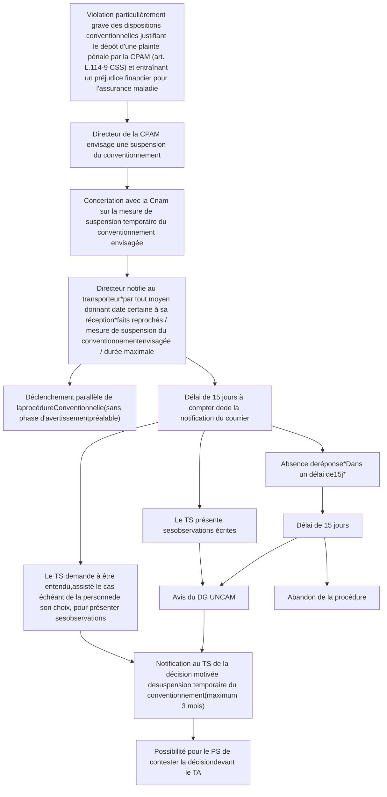

# **CIRCULAIRE**
# **CIR-18/2023**

---

**Date :**
04/10/2023

**Domaine(s) :**
Gestion du dossier client
professionnels de sante

|                |      |
| :------------- | :--- |
| Nouveau        | [x] |
| Modificatif    | [ ] |
| Complémentaire | [ ] |
| Suivi          | [ ] |
| Provisoire     | [ ] |

**Objet :**
Présentation de l'avenant 11 à la convention nationale des transporteurs sanitaires privés

**Liens:**

**Liens externes :**

**Plan de classement :**
P04 GESTION DU DOSSIER CLIENT PROFESSIONNELS DE SANTE

**Emetteur(s) :**
DDGOS / DDO

**Pièces jointes :** 1

---

**à Mesdames et Messieurs les :**

**Directeurs** [x] | CPAM [x] CGSS [x] CSS Mayotte [x]

**Directeur Comptable et Financier** [x] | CPAM [x] CGSS [x] CSS Mayotte [x]

**Pour mise en œuvre immédiate**

**Résumé :**
Misa à jour le 6 novembre 2023.

Convention nationale des transporteurs sanitaires privés

Présentation de l'avenant n°11 à la convention nationale des transporteurs sanitaires privés et modalités de mise en œuvre. Les principaux thèmes de l'avenant sont les revalorisations tarifaires, la mise en place d'une tarification différenciée, la création d'un forfait annuel par ambulance, la création d'un forfait pour les véhicules 100 % électrique, une redéfinition des règles du transport partagé, une revalorisation du supplément de transports de personnes à mobilité réduite (TPMR), la revalorisation du montant des indisponibilités injustifiées dans le cadre des transports urgents pré-hospitaliers (TUPH) et la poursuite des travaux relatifs aux plateformes de commande et les travaux en cours sur les transports bariatriques.
CSS Mayotte est concernée.

**Mots clés :**
transporteurs sanitaires ; avenant n°11 ; transport partagé ; VSL ; TPMR ; aide à l'équipement ; transports urgents ; TUPH

---

**La Directrice Déléguée à la Gestion et à l'Organisation des Soins**

**Marguerite CAZENEUVE**

**Le Directeur Délégué aux Opérations**

**Pierre PEIX**

**Objet :** Présentation de l'avenant n°11 à la convention nationale des transporteurs sanitaires privés

**Affaire suivie par :**

Département des Professions de santé (DDGOS/DOS/DPROF) :
<u>dprof-transports.cnam@assurance-maladie.fr</u>

**PJ :**

<u>Annexe :</u> Avenant n°11 à la convention nationale des transporteurs sanitaires privés

L'Assurance Maladie
Agir ensemble, protéger chacun
1/15

# Sommaire

<table>
    <tr>
      <td>1</td>
      <td>Préambule..................................................................................................................................</td>
      <td>3</td>
    </tr>
    <tr>
      <td>2</td>
      <td>La valorisation des transports en VSL.......................................................................................</td>
      <td>3</td>
    </tr>
    <tr>
      <td>2.1</td>
      <td>La valorisation socle des transports en VSL (articles 1 à 4)...................................................</td>
      <td>3</td>
    </tr>
    <tr>
      <td></td>
      <td>2.1.1 La tarification VSL (article 1) .................................................................................</td>
      <td>3</td>
    </tr>
    <tr>
      <td></td>
      <td>2.1.2 Le transport en VSL de personnes à mobilité réduite (article 2)............</td>
      <td>4</td>
    </tr>
    <tr>
      <td></td>
      <td>2.1.3 Le forfait annuel pour les VSL 100% électriques (article 3)...........................</td>
      <td>5</td>
    </tr>
    <tr>
      <td></td>
      <td>2.1.4 Le transport partagé en VSL (article 4)..................................................................</td>
      <td>5</td>
    </tr>
    <tr>
      <td>2.2</td>
      <td>La valorisation conditionnée aux mesures d'efficience des transports en VSL (articles 14 et 15)....................................................................................................................</td>
      <td>7</td>
    </tr>
    <tr>
      <td></td>
      <td>2.2.1 Les mesures d'efficience et la réalisation d'économies (article 14) .......</td>
      <td>7</td>
    </tr>
    <tr>
      <td></td>
      <td>2.2.2 La valorisation conditionnelle des transports en VSL (article 15) ..........</td>
      <td>8</td>
    </tr>
    <tr>
      <td>3</td>
      <td>La valorisation des transports en ambulance .............................................................................</td>
      <td>8</td>
    </tr>
    <tr>
      <td>3.1</td>
      <td>La valorisation socle des transports en ambulance (articles 5 et 6)...............................</td>
      <td>8</td>
    </tr>
    <tr>
      <td></td>
      <td>3.1.1 La tarification ambulance (article 5).......................................................................</td>
      <td>8</td>
    </tr>
    <tr>
      <td></td>
      <td>3.1.2 Le forfait annuel pour les ambulances (article 6.1)................................................</td>
      <td>9</td>
    </tr>
    <tr>
      <td></td>
      <td>3.1.3 Le forfait annuel pour les ambulances 100% électriques (article 6.2)....</td>
      <td>9</td>
    </tr>
    <tr>
      <td>3.2</td>
      <td>La valorisation conditionnée aux mesures d'efficience des transports en ambulance (articles 14.2, 14.3 et 16) .....................................................................................</td>
      <td>9</td>
    </tr>
    <tr>
      <td>3.3</td>
      <td>Le revenu complémentaire au revenu minimal garanti (article 9).................................</td>
      <td>10</td>
    </tr>
    <tr>
      <td>3.4</td>
      <td>Modalités de paiement des TUPH (article 11)..............................................................</td>
      <td>11</td>
    </tr>
    <tr>
      <td>3.5</td>
      <td>Clause de revoyure TUPH (article 12) .........................................................................</td>
      <td>11</td>
    </tr>
    <tr>
      <td>4</td>
      <td>Les conditions ouvrant droit à la tarification majorée .......................................................</td>
      <td>11</td>
    </tr>
    <tr>
      <td>5</td>
      <td>Les transports bariatriques (article 13) .............................................................................</td>
      <td>13</td>
    </tr>
    <tr>
      <td>6</td>
      <td>Clauses de revoyure (article 17) ......................................................................................</td>
      <td>13</td>
    </tr>
    <tr>
      <td>7</td>
      <td>Procédure de déconventionnement exceptionnel d'urgence (article 18)............</td>
      <td>13</td>
    </tr>
</table>

**L'Assurance Maladie**
Agir ensemble, protéger chacun
2/15

# 1 <u>Préambule</u>

L'avenant n°11 à la convention nationale des transporteurs sanitaires privés a été signé le 13 avril 2023 par deux fédérations nationales, la Chambre nationale des services d'ambulances (CNSA) et la Fédération nationale de la mobilité sanitaire (FNMS), ainsi que l'UNOCAM (*cf.* Annexe), et est paru au Journal Officiel le 6 mai 2023. Les premières revalorisations tarifaires seront applicables à compter du 7 novembre 2023, conformément au délai d'application de six mois prévu à l'article L. 162-14-1-1 du Code de la Sécurité Sociale.

Cet accord prévoit :

* La mise en place d'une tarification différenciée et majorée pour les transports facturés avec le télé-service SEFi, effectués avec un véhicule équipé d'un système de géolocalisation certifié par l'Assurance Maladie et dont le niveau de certification des données de géolocalisation est compris entre 3 et 5 ;
* La création d'un forfait annuel par ambulance visant à reconnaitre la compétence et l'investissement des transporteurs sanitaires ;
* La création d'un forfait annuel pour les véhicules 100% électriques (VSL et ambulances) afin de répondre aux enjeux environnementaux ;
* Une redéfinition des règles du transport partagé et la mise en œuvre du dispositif financier incitatif prévu dans l'Avenant 10 (reporté en raison de la crise sanitaire) ;
* Une majoration du supplément forfait pour le transport de personnes à mobilité réduite ;
* La revalorisation du montant des indisponibilités injustifiées dans le cadre des transports urgents pré-hospitaliers (TUPH) ;
* La poursuite des travaux relatifs aux plateformes de commande de transports et à la prise en charge des transports bariatriques.

En accompagnement des mesures tarifaires, le ministère a décidé d'octroyer aux transporteurs sanitaires une aide par le Fonds d'Intervention Régional (FIR) versée en juin 2023. Proportionnelle au nombre de véhicules par entreprise et pondérée à 1/3 pour les VSL et 2/3 pour les ambulances, cette aide a été calculée sur la base du parc de véhicules constaté au 31/05/2023 dans le Fichier National des Professions de Santé (FNPS).

Une seconde aide FIR sera versée en janvier 2024 et sera calculée selon la même méthode que la première. C'est pourquoi, chaque CPAM doit impérativement actualiser le FNPS sur la base des modifications transmises par les ARS au fil de l'eau. Les véhicules article 51 doivent être comptabilisés et les véhicules hospitaliers et hors quotas doivent être exclus.

# 2 <u>La valorisation des transports en VSL</u>

## 2.1 La valorisation socle des transports en VSL (articles 1 à 4)

### 2.1.1 La tarification VSL (article 1)

***Entrée en vigueur : ces mesures s'appliqueront à compter du 7 novembre 2023.***

3/15

**L'Assurance Maladie**
Agir ensemble, protéger chacun

Afin de permettre le déploiement des transports en VSL dans des conditions de soutenabilité financière pour les sociétés de transports sanitaires, l'accord prévoit des revalorisations sur la majorité des composantes de la tarification des VSL. Ces revalorisations permettent de répondre à la fois aux enjeux ruraux et urbains mais également de rendre plus attractifs les transports programmés et les trajets de courte distance.

La création d'une tarification différenciée et majorée est prévue pour les transports en VSL.

<mark>Initialement prévue à compter du 7 novembre 2023, la tarification majorée sera mise en œuvre avec SEFI <u>à une date ultérieure</u> en raison d’un délai de mise en œuvre opérationnelle. <u>Une rémunération compensatrice</u> tenant compte de ce décalage sera mise en place fin 2023.</mark>

Les tarifs socle et majorés des transports en VSL, les conditions ouvrant droit à la tarification majorée et sa mise en œuvre sont détaillés au point 4.

### 2.1.2 Le transport en VSL de personnes à mobilité réduite (article 2)

***Entrée en vigueur : cette mesure s'appliquera à compter du 7 novembre 2023.***

Sont visés par les TPMR les transports de personnes en fauteuil roulant personnel qui ont une difficulté à se déplacer du fait d'un objet (par exemple un assistant respiratoire) ou d'un handicap (temporaire ou permanent) ; ou de personnes gênées dans leurs mouvements et leurs déplacements en général (comprenant notamment les personnes ayant des incapacités sensorielles, intellectuelles ou motrices, et les personnes âgées).

Selon l'article L. 114-2 du code de l'action sociale et des familles, constitue un handicap, au sens de la présente loi, toute limitation d'activité ou restriction de participation à la vie en société subie dans son environnement par une personne en raison d'une altération substantielle, durable ou définitive d'une ou plusieurs fonctions physiques, sensorielles, mentales, cognitives ou psychiques, d'un polyhandicap ou d'un trouble de santé invalidant.

Le transport de personnes à mobilité réduite nécessite l'utilisation d'un véhicule équipé d'une rampe électrique ou manuelle et éventuellement d'un élévateur pour faciliter les échanges (montée/descente).

Il comporte des arrimages pour les fauteuils ainsi que des ceintures de sécurité pour les personnes.

Le supplément forfaitaire relatif aux transports de patients utilisant leur fauteuil roulant personnel en VSL spécialement adapté est porté de 20 à 30€.

Cette mesure répond à un double objectif : développer l'offre de transport pour répondre aux besoins des patients à mobilité réduite et permettre le recours à un moyen de transport adapté à la situation de handicap et à l'état de santé de ces patients.

**L'Assurance Maladie**
Agir ensemble, protéger chacun
4/15

### 2.1.3 Le forfait annuel pour les VSL 100% électriques (article 3)

***Entrée en vigueur : cette mesure s'appliquera à compter du premier trimestre 2024.***

The Shift Project estime que le transport des patients et des visiteurs représente 10% des émissions de CO2 du secteur de la santé, soit 4,3 millions de tonnes de CO2 par an1.

Conscients des enjeux écologiques majeurs au sein du secteur du transport sanitaire, les partenaires conventionnels se sont accordés sur la création d'un forfait annuel fixé à 300 € par VSL 100% électrique.

Ce forfait est une composante de l’aide à l’équipement et sera versé au premier trimestre de l'année N au titre de l'année N-1 sur la base du parc de véhicules constaté au 30/09/N-1.

L’entreprise de transport doit déclarer en début d’année sur son espace dédié dans amelipro le nombre de VSL de sa flotte portant la mention « EL » au champ P3 du certificat d’immatriculation. Une copie du certificat d’immatriculation devra être jointe.

*Des précisions sur cette rémunération seront apportées ultérieurement dans le cadre d'une lettre réseau et d’un guide méthodologique.*

### 2.1.4 Le transport partagé en VSL (article 4)

Le transport partagé est défini par tout transport véhiculant ensemble deux à trois patients en position assise.

Selon l'article L. 322-5 du code de la sécurité sociale, le transport prescrit par le médecin précise le mode de transport le plus adapté à l'état du patient et si cet état est incompatible avec un transport partagé. Dès lors, les frais de transport sont pris en charge sur la base du trajet le moins onéreux, compte tenu des conditions de transport et du nombre de patients transportés.

Outre l'impact environnemental, le déploiement des transports partagés en VSL est un levier majeur d'efficience, qui répond à un double objectif de rationalisation des dépenses tout en palliant aux carences constatées sur le terrain. Les partenaires conventionnels ont convenu de faire du transport partagé le mode de transport de référence pour les transports assis professionnalisés, lorsque l'état du patient est compatible avec cette modalité de transport.

#### 2.1.4.1 La tarification des transports partagés en VSL (article 4.1)

***Entrée en vigueur : ces mesures s'appliqueront à compter du 7 novembre 2023.***

***

1 Source : The Shift Project, Décarboner la santé pour soigner durablement, rapport final v2, avril 2023.

**L'Assurance Maladie**
Agir ensemble, protéger chacun
5/15

Pour rappel, lorsque le transport est réalisé avec deux ou trois patients dans le même véhicule au cours du même transport, une facture est établie pour chaque patient.

Le transport partagé doit s'effectuer selon les conditions suivantes:

- Les détours éventuels consécutifs à la prise en charge du premier patient et du second patient, et entre le second et le troisième patient, sont limités à 10 kilomètres ;
- Aucun détour n'est autorisé entre le dernier patient pris en charge et le point d'arrivée.

Ainsi, un détour de 10 kilomètres maximum est autorisé pour un transport partagé de deux patients, et de 20 kilomètres maximum pour un transport partagé de trois patients.

Les taux d'abattements préférentiels suivants sont appliqués sur les transports partagés facturés avec le télé-service « SEFI (*cf.* annexe 2 de l'avenant n°11), effectués par des véhicules équipés d'un système de géolocalisation certifié par l'Assurance Maladie et pour lesquels le niveau de certification des données de géolocalisation est compris entre 3 et 52 (*cf.* annexe 1 de l'avenant n°11) :

- 15 % lorsque deux patients sont présents dans le même véhicule au cours du même transport, quel que soit la partie du parcours réalisée en commun ;
- 33 % lorsque trois patients sont présents dans le même véhicule au cours du même transport, quel que soit la partie du parcours réalisée en commun.

Pour tout autre cas, les taux d'abattements suivants sont appliqués :

- 23 % lorsque deux patients sont présents dans le même véhicule au cours du même transport, quel que soit la partie du parcours réalisée en commun ;
- 35 % lorsque trois patients sont présents dans le même véhicule au cours du même transport, quel que soit la partie du parcours réalisée en commun.

Pour rappel, les taux d'abattement s'appliquent dans tous les cas à la totalité de la facture de chaque patient.

Compte tenu du décalage de mise en œuvre de la tarification majorée, les entreprises répondant aux conditions devront appliquer les taux d’abattement préférentiels <u>entre le 7 novembre 2023 et le 15 février 2024 sur la tarification socle.</u>

## 2.1.4.2 Le dispositif financier incitatif et de pénalisation (article 4.2)

Afin de favoriser le développement des transports partagés, un dispositif financier incitatif et de pénalisation a été prévu dans le cadre de l'avenant 10 à la convention nationale.

***

2 Les trois conditions doivent être simultanément réunies pour que les taux d’abattement préférentiels s’appliquent.

L'Assurance Maladie
Agir ensemble, protéger chacun
6/15

Après un report en raison de la crise sanitaire, le premier versement du bonus, initialement prévu en 2022, sera effectué en 2023 au titre de l'année 2022.

Le malus sera applicable en 2024 au titre de l'année 2023.

A l'issue des 2 ans de validité de ce dispositif et en fonction de son évaluation, les parties signataires peuvent revoir les modalités globales de rémunération, d'incitation et/ou de pénalisation.

A défaut, les modalités prévues dans le cadre de l'avenant n°10 demeurent applicables.

## **2.2 La valorisation conditionnée aux mesures d'efficience des transports en VSL (articles 14 et 15)**

### **2.2.1 Les mesures d'efficience et la réalisation d'économies (article 14)**

Les partenaires conventionnels se sont accordés sur trois grands chantiers d'efficience:

#### **❖ Le transport partagé (article 14.1)**

Le déploiement du transport partagé comme modalité de transport de référence pour les transports assis professionnalisés implique qu'il soit systématiquement proposé par la société de transport dès lors que le patient y est éligible.

Les partenaires conventionnels souhaitent porter d'autres mesures (législatives notamment) pour inciter les assurés à accepter le transport partagé. Nous reviendrons vers vous si de tels dispositifs étaient votés dans la prochaine LFSS.

#### **❖ Les plateformes de commande (article 14.2)**

Les partenaires conventionnels se sont accordés sur la nécessité de poursuivre les travaux en lien avec le ministère sur les plateformes de commande de transports portant notamment sur la mise à jour du cahier des charges.

L'objectif du recours systématisé aux plateformes de commande à compter du 1er janvier 2025 est de réguler et d'optimiser le transport sanitaire de manière rapide, efficace et sécurisée.

#### **❖ La géolocalisation, les données de géolocalisation certifiées et la facturation via SEFI (article 14.3)**

Pour rappel, la facturation des prestations de transport avec le système SEFI est obligatoire depuis l'entrée en vigueur de l'avenant n°10 à la convention nationale. Ce dernier intègre le cahier des charges de SEFi que les transporteurs se sont engagés à respecter via la signature d'un acte d'adhésion.

L'avenant n°11 prévoit que les transporteurs devront, en sus de la facturation des transports avec le télé-service « SEFI » (cf. annexe 2 de l'avenant n°11), équiper les véhicules d'un logiciel de géolocalisation certifié par l'Assurance maladie (cf. annexe 1 de l'avenant n°11). Par ailleurs, les données de géolocalisation seront considérées

**L'Assurance Maladie**
Agir ensemble, protéger chacun
7/15

certifiées si leur niveau de certification est compris entre 3 et 5 (*cf.* annexe 1 de l'avenant n°11).

En outre, un groupe de travail conventionnel est prévu en janvier 2024 afin d'étudier la possibilité d'utiliser les données de géolocalisation comme paramètre de facturation.

Par la mise en place de ces chantiers d'efficience, les transporteurs sanitaires se sont engagés à générer des économies à hauteur de 50M€ en 2024. Dès lors que les économies attendues en 2024 sont atteintes, de nouvelles revalorisations tarifaires sur les transports en VSL seront applicables dès janvier 2025.

### 2.2.2 La valorisation conditionnelle des transports en VSL (article 15)

**Ces mesures, soumises au respect des mesures d'efficience attendues en 2024, seraient applicables à compter du 1ᵉʳ janvier 2025.**

Sous réserve du respect des mesures d'efficience énoncées à l'article 14 de l'avenant n°11, les tarifs des transports en VSL seront revalorisés comme suit :

#### REVALORISATIONS TARIFAIRES CONDITIONNELLES DES TRANSPORTS EN VSL A COMPTER DU 01/01/2025

<table>
  <thead>
    <tr>
      <th>Tarification VSL</th>
      <th>Tarifs conditionnels* applicables au 01/01/2025</th>
    </tr>
  </thead>
  <tbody>
    <tr>
      <td>Forfait départemental zone A</td>
      <td>15,75 €</td>
    </tr>
    <tr>
      <td>Forfait départemental zone B</td>
      <td>15,75 €</td>
    </tr>
    <tr>
      <td>Forfait départemental zone C</td>
      <td>15,75 €</td>
    </tr>
    <tr>
      <td>Forfait départemental zone D</td>
      <td>15,75 €</td>
    </tr>
    <tr>
      <td>Prise en charge</td>
      <td>16,80 €</td>
    </tr>
    <tr>
      <td>Tarif kilométrique</td>
      <td>1,10 €</td>
    </tr>
  </tbody>
</table>
*Tarifs conditionnés au respect des mesures d'efficience énoncées à l'article 14 de l'avenant n°11.

Des évolutions techniques sont actuellement en cours pour permettre la mise en œuvre de ces nouvelles modalités de facturations.

## 3 <u>La valorisation des transports en ambulance </u>

### 3.1 La valorisation socle des transports en ambulance (articles 5 et 6)

#### 3.1.1 La tarification ambulance (article 5)

**Entrée en vigueur : ces mesures s'appliqueront à compter du 7 novembre 2023.**

L'accord prévoit des mesures de revalorisations sur la majorité des composantes de la tarification des transports en ambulance. Ces revalorisations permettent de répondre à la fois aux enjeux ruraux et urbains mais également de rendre plus attractifs les transports programmés et de courte distance.

La création d'une tarification différenciée et majorée est prévue pour les transports en ambulance.

L'Assurance Maladie
Agir ensemble, protéger chacun
8/15

*Initialement prévue à compter du 7 novembre 2023, la tarification majorée sera techniquement mise en œuvre avec SEFI <u>à une date ultérieure</u> en raison d’un délai de mise en œuvre opérationnelle. <u>Une rémunération compensatrice</u> tenant compte de ce décalage sera mise en place fin 2023.*

Les tarifs socle et majorés des transports en ambulance, les conditions ouvrant droit à la tarification majorée et sa mise en œuvre sont détaillés au point 4.

### 3.1.2 Le forfait annuel pour les ambulances (article 6.1)

***Cette mesure s'appliquera à compter du premier trimestre 2024.***

Un forfait annuel fixé à 1 100 € par ambulance est mis en place afin de valoriser les compétences et l'investissement des ambulanciers.

Ce forfait est une composante de l’aide à l’équipement et sera versé au premier trimestre de l'année N au titre de l'année N-1 sur la base du parc de véhicule constaté au 30/09/N-1.

Les ambulances ayant une activité annuelle inférieure à 1 000 kilomètres facturés à l'assurance maladie ne sont pas éligibles à ce forfait.

*Des précisions sur cette rémunération seront apportées ultérieurement dans le cadre d'une lettre réseau et d’un guide méthodologique.*

### 3.1.3 Le forfait annuel pour les ambulances 100% électriques (article 6.2)

***Cette mesure s'appliquera à compter du premier trimestre 2024.***

Les partenaires conventionnels se sont accordés sur la création d'un forfait annuel fixé à 1 100 € par ambulance 100% électrique (cumulable avec le forfait annuel ambulance de 1100 € mentionné au point 3.1.2).

Ce forfait est une composante de l’aide à l’équipement et sera versé au premier trimestre de l'année N au titre de l'année N-1 sur la base du parc de véhicules constaté au 30/09/N-1.

L’entreprise de transport doit déclarer en début d’année sur son espace dédié dans amelipro le nombre d’ambulances de sa flotte portant la mention « EL » au champ P3 du certificat d’immatriculation. Une copie du certificat d’immatriculation devra être jointe.

*Des précisions sur cette rémunération seront apportées ultérieurement dans le cadre d'une lettre réseau et d’un guide méthodologique.*

### 3.2 La valorisation conditionnée aux mesures d'efficience des transports en ambulance (articles 14.2, 14.3 et 16)

***Ces mesures, soumises au respect des mesures d'efficience attendues en 2024, seraient applicables à compter du 1er janvier 2025.***

**L'Assurance Maladie**
Agir ensemble, protéger chacun

9/15

Sous réserve du respect des mesures d'efficience énoncées aux articles 14.2 et 14.3 de l'avenant n°11 et mentionnées à l'article 2.2.1 de la présente circulaire, les tarifs des transports en ambulance seront revalorisés comme suit :

<u>**LES REVALORISATIONS TARIFAIRES DES TRANSPORTS EN AMBULANCE A COMPTER DU 01/01/2025**</u>

<table>
  <thead>
    <tr>
      <th>Tarification ambulance</th>
      <th>Tarifs applicables* (en euros) au 01/01/2025</th>
    </tr>
  </thead>
  <tbody>
    <tr>
      <td>Forfait départemental</td>
      <td>57,39 €</td>
    </tr>
    <tr>
      <td>Forfait agglomération</td>
      <td>64,08 €</td>
    </tr>
    <tr>
      <td>Prise en charge</td>
      <td>71,72 €</td>
    </tr>
    <tr>
      <td>Tarif kilométrique</td>
      <td>2,44 €</td>
    </tr>
    <tr>
      <td>Valorisation trajet court &#x3C;= 5 km parcourus</td>
      <td>9,75 €</td>
    </tr>
    <tr>
      <td>Valorisation trajet court > 5 et ≤ 10 km parcourus</td>
      <td>7,53 €</td>
    </tr>
    <tr>
      <td>Valorisation trajet court > 10 et ≤ 15 km parcourus</td>
      <td>5,47 €</td>
    </tr>
    <tr>
      <td>Valorisation trajet court > 15 et ≤ 19 km parcourus</td>
      <td>3,42 €</td>
    </tr>
  </tbody>
</table>
*Tarifs conditionnés au respect des mesures d'efficience énoncées aux articles 14.2 et 14.3 de l'avenant n°11.

### 3.3 Le revenu complémentaire au revenu minimal garanti (article 9)

***Entrée en vigueur : ces mesures s'appliqueront à compter du 7 novembre 2023.***
***<mark>Par mesure de simplicité, cette mesure s'appliquera à partir du 1ᵉʳ décembre 2023, pour le calcul du RC de décembre au RMG (calcul qui s'effectuera en janvier).</mark>***

Les partenaires conventionnels s'entendent pour continuer les travaux visant à simplifier et fiabiliser la saisie des données utiles au paiement du revenu complémentaire au revenu minimum garanti et des sorties blanches.

Le montant des interventions demandées par le SAMU mais non réalisées par manquement du transporteur inscrit au tableau de garde est réévalué à 150 € au lieu de 123€.

Ainsi, le revenu complémentaire est versé mensuellement selon les règles suivantes :

- Versement à l'entreprise d'un montant équivalent au coût horaire fixé à 64 € intégralement à la charge de l'Assurance maladie obligatoire dans la limite du nombre d'heures par moyen de service ambulancier TUPH, tel que défini par le cahier des charges de l'Agence Régionale de Santé et le tableau de service;
- Déduction faite :
    - Des interventions facturées à l'Assurance maladie ;
    - Des interventions demandées par le SAMU mais non réalisées par manquement du transporteur inscrit au tableau de garde, au tarif de 150 € ;
    - Des interventions vers le point de prise en charge du patient mais non suivies de transports facturés vers les services d'urgence.

Pour rappel, le paiement des interventions réalisées vers le point de prise en charge du patient mais non suivies de transports vers les services d'urgence ou « sorties

**L'Assurance Maladie**
Agir ensemble, protéger chacun
10/15

blanches » est effectué simultanément au paiement du revenu complémentaire au revenu minimal garanti.

La nouvelle maquette de contrôle et de paiement comprenant la mise à jour de la valorisation des indemnités injustifiées (150€ au lieu de 123€) sera transmise aux caisses au cours du mois de novembre 2023.

### 3.4 Modalités de paiement des TUPH (article 11)

***Cette mesure s'applique depuis le 1ᵉʳ janvier 2023.***

Depuis janvier 2023, le complément au revenu minimum garanti est calculé chaque mois et est versé par la caisse de rattachement du transporteur sanitaire au plus tard dans le mois suivant le mois de référence. Pour rappel, les ATSU disposent d'un délai de 10 jours à la fin de chaque mois pour transmettre aux caisses les données nécessaires au calcul du revenu complémentaire du mois écoulé.

Dans le cadre du suivi de la réforme et de la montée en charge du dispositif, la date à renseigner dans l'outil PROGRES pour la prestation ARC lors de sa liquidation est <u>le 1er jour de la période de référence</u> (pour la première période de paiement, il faut indiquer la date de publication du CDC de la sectorisation).

Par ailleurs, il est demandé aux caisses de mettre à disposition sur le SharePoint à l'adresse suivante <u>https://107501a.collaboratif.cnamts.fr/DPROF-Projets-Transverses/Transport/Forms/AllItems.aspx</u> dans le dossier TUPH et pour chaque période de paiement la maquette de contrôle comprenant les informations du tableur transmis par l'ATSU, les traitements réalisés et le tableau de paiement.

Dans l'hypothèse où l'ensemble des paiements ne peut être effectué en une seule fois (données manquantes, vérification auprès de l'ATSU…), ce fichier devra être mis à jour sur le Sharepoint après chaque actualisation en précisant la date d'actualisation dans le nom du fichier.

### 3.5 Clause de revoyure TUPH (article 12)

Un groupe de travail conventionnel portant sur le bilan de la réforme (économique, organisationnel, processus de paiement) est prévu en septembre 2023. Les modalités de tarification et de règlement peuvent être revues en fonction des constats dressés.

## 4 Les conditions ouvrant droit à la tarification majorée

La création d'une tarification différenciée et majorée est prévue pour les entreprises réalisant des transports en VSL et en ambulance qui remplissent les trois conditions cumulatives suivantes :

⮚ Facturation via le télé-service SEFI (*cf.* annexe 2 de l'avenant n°11) ;

**L'Assurance Maladie**
Agir ensemble, protéger chacun
11/15

⮚ Véhicules équipés d'un système de géolocalisation certifié par l'Assurance Maladie (*cf.* annexe 1 de l'avenant n°11) ;
⮚ Niveau de certification des données de géolocalisation compris entre 3 et 5 (*cf.* annexe 1 de l'avenant n°11).

Initialement prévue à compter du 7 novembre 2023, la mesure sera mise en place <u>à une date ultérieure</u> en raison d’un délai de mise en œuvre opérationnelle.

Ainsi, conformément aux termes de l’avenant n°11 et ce **jusqu’au 15 février 2024, une rémunération compensatrice tenant compte de ce décalage de mise en œuvre sera calculée et versée aux transporteurs éligibles à la tarification majorée** (sur la base de l’ensemble des trajets remboursés réalisés depuis le 7 novembre 2023, tous régimes).

<u>Afin de recueillir la déclaration sur l’honneur des transporteurs sur les conditions</u> <u>d’éligibilité à la tarification majorée, **un télé-service disponible sur amelipro sera</u> <u>ouvert à partir du 1</u>er <u>décembre 2023.** En parallèle, une attestation éditeur (en</u> <u>cours de définition) contresignée par les transporteurs devra être transmise par ces</u> <u>derniers à leur CPAM de rattachement. **Le premier versement</u> sera effectué en fin d’année 2023** <u>(les modalités seront précisées d’ici fin novembre)</u>.

## A compter du 15 février 2024, la tarification majorée sera techniquement mise en œuvre avec SEFI.

Pour les factures des assurés de la MGEN, de la CRPCEN, de l’Assemblée nationale et du Sénat, le service SEFI n’étant pas disponible, seule la tarification socle peut être appliquée techniquement (factures B2 ou papier). Pour ces factures, **une rémunération compensatrice annuelle sera versée aux entreprises répondant aux conditions de la tarification majorée.**

### REVALORISATIONS TARIFAIRES (SOCLE ET MAJORÉE) DES TRANSPORTS EN VSL

<table>
  <thead>
    <tr>
      <th>Tarification VSL</th>
      <th>Tarifs socle applicables au 07/11/2023</th>
      <th>Tarifs majorés applicables à compter de la mise en place des évolutions techniques</th>
    </tr>
  </thead>
  <tbody>
    <tr>
      <td>Forfait départemental zone A</td>
      <td>14,33 €</td>
      <td>15,00 €</td>
    </tr>
    <tr>
      <td>Forfait départemental zone B</td>
      <td>13,92 €</td>
      <td>15,00 €</td>
    </tr>
    <tr>
      <td>Forfait départemental zone C</td>
      <td>13,04 €</td>
      <td>15,00 €</td>
    </tr>
    <tr>
      <td>Forfait départemental zone D</td>
      <td>12,33 €</td>
      <td>15,00 €</td>
    </tr>
    <tr>
      <td>Prise en charge</td>
      <td>15,58 €</td>
      <td>16,00 €</td>
    </tr>
    <tr>
      <td>Tarif kilométrique</td>
      <td>1,07 €</td>
      <td>1,07 €</td>
    </tr>
    <tr>
      <td>Valorisation trajet court ≤ 7 km parcourus</td>
      <td>8,54 €</td>
      <td>8,54 €</td>
    </tr>
    <tr>
      <td>Valorisation trajet court > 7 et ≤ 8 km parcourus</td>
      <td>7,68 €</td>
      <td>7,68 €</td>
    </tr>
    <tr>
      <td>Valorisation trajet court > 8 et ≤ 9 km parcourus</td>
      <td>7,03 €</td>
      <td>7,03 €</td>
    </tr>
    <tr>
      <td>Valorisation trajet court > 9 et ≤ 10 km parcourus</td>
      <td>6,35 €</td>
      <td>6,35 €</td>
    </tr>
    <tr>
      <td>Valorisation trajet court > 10 et ≤ 11 km parcourus</td>
      <td>5,22 €</td>
      <td>5,22 €</td>
    </tr>
    <tr>
      <td>Valorisation trajet court > 11 et ≤ 12 km parcourus</td>
      <td>4,62 €</td>
      <td>4,62 €</td>
    </tr>
    <tr>
      <td>Valorisation trajet court > 12 et ≤ 13 km parcourus</td>
      <td>4,01 €</td>
      <td>4,01 €</td>
    </tr>
    <tr>
      <td>Valorisation trajet court > 13 et ≤ 14 km parcourus</td>
      <td>3,41 €</td>
      <td>3,41 €</td>
    </tr>
    <tr>
      <td>Valorisation trajet court > 14 et ≤ 15 km parcourus</td>
      <td>2,80 €</td>
      <td>2,80 €</td>
    </tr>
    <tr>
      <td>Valorisation trajet court > 15 et ≤ 16 km parcourus</td>
      <td>2,07 €</td>
      <td>2,07 €</td>
    </tr>
    <tr>
      <td>Valorisation trajet court > 16 et ≤ 17 km parcourus</td>
      <td>1,50 €</td>
      <td>1,50 €</td>
    </tr>
    <tr>
      <td>Valorisation trajet court > 17 et ≤ 18 km parcourus</td>
      <td>0,91 €</td>
      <td>0,91 €</td>
    </tr>
  </tbody>
</table>

12/15

**L'Assurance Maladie**
Agir ensemble, protéger chacun

# <u>REVALORISATIONS TARIFAIRES (SOCLE ET MAJORÉE) DES TRANSPORTS EN AMBULANCE</u>

<table>
  <thead>
    <tr>
      <th>Tarification ambulance</th>
      <th>Tarifs applicables au 07/11/2023</th>
      <th>Tarifs majorés applicables à compter de la mise en place des évolutions techniques</th>
    </tr>
  </thead>
  <tbody>
    <tr>
      <td>Forfait départemental</td>
      <td>52,41 €</td>
      <td>54,65 €</td>
    </tr>
    <tr>
      <td>Forfait agglomération</td>
      <td>58,53 €</td>
      <td>61,03 €</td>
    </tr>
    <tr>
      <td>Prise en charge</td>
      <td>65,51 €</td>
      <td>68,30 €</td>
    </tr>
    <tr>
      <td>Tarif kilométrique</td>
      <td>2,44 €</td>
      <td>2,44 €</td>
    </tr>
    <tr>
      <td>Valorisation trajet court &#x3C;= 5 km parcourus</td>
      <td>8,70 €</td>
      <td>8,70 €</td>
    </tr>
    <tr>
      <td>Valorisation trajet court > 5 et ≤ 10 km parcourus</td>
      <td>6,84 €</td>
      <td>6,84 €</td>
    </tr>
    <tr>
      <td>Valorisation trajet court > 10 et ≤ 15 km parcourus</td>
      <td>4,97 €</td>
      <td>4,97 €</td>
    </tr>
    <tr>
      <td>Valorisation trajet court > 15 et ≤ 19 km parcourus</td>
      <td>3,11 €</td>
      <td>3,11 €</td>
    </tr>
  </tbody>
</table>

## 5 <u>Les transports bariatriques (article 13) </u>

Les partenaires conventionnels s'engagent à proposer, dès la finalisation par le ministère en charge de la santé et de la prévention d'un cahier des charges propre à cette activité, un modèle tarifaire dans le cadre de discussions devant conduire à compléter la présente négociation conventionnelle.

## 6 <u>Clauses de revoyure (article 17) </u>

Cet accord a pour objectif d'améliorer la réponse aux besoins des patients en augmentant l'efficience du secteur.

Les partenaires conventionnels ont prévu un point d'étape en octobre 2024 portant sur le bilan des économies générées via les mesures d'efficience, en tenant compte d'éventuelles perturbations significatives du contexte économique du secteur.

L'application des revalorisations tarifaires conditionnelles et leur niveau au 1er janvier 2025 (articles 14 à 16) sera conditionnée aux constats dressés.

## 7 <u>Procédure </u> <u>de </u> <u>déconventionnement </u> <u>exceptionnel </u> <u>d'urgence </u> <u>(article 18) </u>

**Procédure applicable à compter de l'entrée en vigueur du décret d'application.**

L'article 100 de la LFSS pour 2023 étend aux transporteurs sanitaires (via l'article L. 322-5-5 CSS) la procédure de déconventionnement exceptionnel d'urgence prévue à l'article L. 162-15-1 CSS, selon les modalités suivantes :

- Lorsque le directeur de la CPAM de rattachement3 du transporteur sanitaire constate une violation particulièrement grave des engagements conventionnels par le transporteur qui entraîne un préjudice financier dépassant huit plafonds

***

3 Il peut être alerté par le directeur de tout organisme local d'assurance maladie concerné

13/15

**L'Assurance Maladie**
Agir ensemble, protéger chacun

mensuels de la sécurité sociale, une plainte pénale est parallèlement déposée à son encontre (article L. 114-9 du CSS).

- Après accord du directeur général de l'UNCAM (ou de son représentant désigné à cet effet), le directeur de la CPAM peut décider de suspendre les effets de la convention à l'égard du transporteur. Il lui notifie, par tout moyen donnant date certaine à la réception, un courrier indiquant les faits reprochés, la mesure de suspension envisagée et sa durée, qui ne peut excéder 3 mois (article L. 162-15-1 du CSS).

- Le professionnel dispose d'un délai de quinze jours à compter de la réception de la notification pour demander à être entendu, assisté le cas échéant de la personne de son choix, ou pour présenter ses observations écrites.

- A compter de la date de réception des observations écrites ou du lendemain de l'audition du professionnel, ou, en l'absence de réponse, à l'issue du délai de quinze jours, le directeur de l'organisme local d'assurance maladie peut décider dans un délai de quinze jours :
    - D'abandonner la procédure ;
    - De notifier au professionnel la suspension pour une durée de trois mois maximum des effets conventionnels (sous réserve d'avoir recueilli l'accord du directeur général de l'union nationale des caisses d'assurance maladie ou de son représentant désigné à cet effet).

- Cette décision prend effet à compter du lendemain de sa notification. Simultanément, le directeur de la caisse engage la procédure de déconventionnement (article L. 162-15-1 du CSS).

- Enfin, le professionnel dont le conventionnement a été suspendu peut exercer un recours en référé contre la décision du directeur de l'organisme local d'assurance maladie devant le tribunal administratif.

**L'Assurance Maladie**
Agir ensemble, protéger chacun
14/15

# Schéma récapitulatif – Procédure exceptionnelle de déconventionnement

15/15

**L'Assurance Maladie**
Agir ensemble, protéger chacun