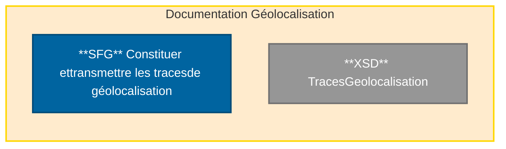

# <u>Fiche d’information.</u>

| **Référence** | PDT-INF-374v2 | **Date** | 19.03.2024 |
| :--- | :--- | :--- | :--- |
| **Objet** | **Descriptif des documents diffusés pour la géolocalisation v1.05** | | |

| | | | | |
| :--- | :--- | :--- | :--- | :--- |
| <u>**Type**</u> | [ ] Technique | [ ] Pratique | [ ] Communication | [x] Livraison |
| <u>**Destinataires**</u> | [x] Éditeurs | [ ] Équipementiers | [ ] OCT | [ ] CIS |
| **Produits** | Facturation [ ] CDC Éditeurs [ ] CDC OCT [ ] FSV agrément [ ] FSV exploitation [ ] SCOR  Services AMC [ ] TP Complémentaire | Référentiels [ ] Dispositif Intégré [ ] Terminal lecteur [ ] TLA [ ] Lecture Vitale [ ] Télémise à jour | Produits d’infrastructure [ ] ATSAM [ ] SrvSVCNAM [ ] GALSS  Services en Ligne [ ] CDR [ ] amelipro [x] Géolocalisation | Téléservices intégrés [ ] AATi [ ] ADRi [ ] ALDi [ ] DMTi [ ] HRi [ ] IMTi [ ] PEC + [ ] PEM 2D [ ] SEFi  Acquisition des droits [ ] API de Lecture Vitale |
| <u>**Secteur**</u> | [x] Libéral | [ ] Hospitalier | | |
| <u>**Professionnels</u> de Santé <u>concernés**</u> | [ ] Médecins [ ] Sages-femmes [ ] Chirurgiens-dentistes [ ] Pharmaciens [ ] Laboratoires | [ ] Auxiliaires médicaux [ ] Centres de Santé [ ] Fournisseurs [x] Transporteurs | [ ] Établissements publics [ ] Cliniques privées [ ] ESPIC | |
| **Prise en compte** | [x] Facultative | [ ] Obligatoire | | |

***

**Contexte** Un des objectifs de la signature <u>de l’avenant 11</u> à la convention des transporteurs sanitaires (**mai 2023**), est de poursuivre la modernisation des entreprises, grâce à une aide à l’équipement pour l’utilisation du système électronique de facturation intégré à leur logiciel de facturation (SEFI) et pour la facturation au moyen d’un logiciel couplé avec un GPS certifié par l’Assurance Maladie.
<mark><u>La prise en compte de cette version de Géolocalisation 1.05 est une des conditions indispensables pour bénéficier de la tarification majorée dans SEFi.</u></mark>

**Corpus documentaire** L’architecture des documents de la géolocalisation est représentée ci‐dessous.

# Documentation Géolocalisation

**GIE SESAM-Vitale**
**5, boulevard Marie et Alexandre Oyon – 72019 LE MANS Cedex 2**
*PDT-INF-374v2* [**www.sesam-vitale.fr**](http://www.sesam-vitale.fr) - **centre-de-service@sesam-vitale.fr**- 

*1 / 2*

# <u>Fiche d’information.</u>

**Evolution** <u>Intégration du numéro d’autorisation du LPS dans la facture électronique.</u>

**Contenu de la livraison** La livraison du **<u>19/02/2024</u>** concerne les documents listés ci-dessous :

<table>
  <thead>
    <tr>
      <th><b>Référence document</b></th>
      <th><b>Titre</b></th>
      <th><b>Version</b> <b>diffusée</b></th>
    </tr>
  </thead>
  <tbody>
    <tr>
      <td>FACT-SFG-039</td>
      <td>Facturation Transporteur – Constituer et transmettre les traces de géolocalisation</td>
      <td><mark>1.05</mark></td>
    </tr>
    <tr>
      <td>TraceGeolocalisation</td>
      <td>Fichier XSD</td>
      <td>V1</td>
    </tr>
  </tbody>
</table>

**Support du GIE SV** Le support relatif à cette information s’effectue :

- à l'adresse : **[centre-de-service@sesam-vitale.fr](mailto:centre-de-service@sesam-vitale.fr)**
- au : 02.43.57.42.88

**GIE SESAM-Vitale**

*PDT-INF-374v2* **5, boulevard Marie et Alexandre Oyon – 72019 LE MANS Cedex 2**
**<u>www.sesam-vitale.fr</u> - <u>centre-de-service@sesam-vitale.fr</u>-**  *2 / 2*
2 / 2