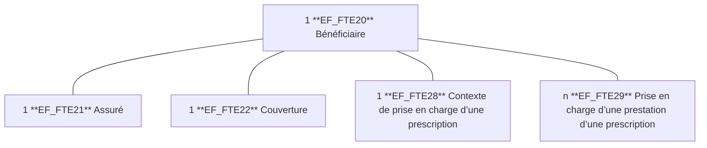
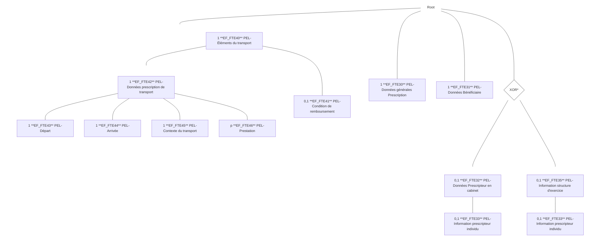

*Spécifications Fonctionnelles Générales*

# **Facturation Transporteur Etendue**
# **Transporteur Sanitaire**

## **DICO - Dictionnaire**

Référence : FACT-SFG-029 / Version : 03.54 / Date : 17/07/2026
Diffusion : RESTREINTE
État : REFERENCE

**GIE SESAM-Vitale**
5, boulevard Marie et Alexandre Oyon – 72 019 LE MANS Cedex 2
<u>www.sesam-vitale.fr</u>

Ce document a été élaboré par le GIE SESAM-Vitale.

Conformément à l’article L.122-4 du Code de la Propriété Intellectuelle, toute représentation ou reproduction (intégrale ou partielle) du présent ouvrage, quel que soit le support utilisé, doit être soumise à l’accord préalable écrit de son auteur.

Il en est de même pour sa traduction, sa transformation, son adaptation ou son arrangement, quel que soit le procédé utilisé.

**Tout manquement à ces obligations constituerait un délit de contrefaçon, au sens des articles **L 335-2 et suivants du code de la propriété intellectuelle, susceptible d’entraîner des** sanctions pour l’auteur du délit.**

## **CONTACTS**


Pour toute demande d'évolution, comme pour toute question technique ou fonctionnelle, contactez le Centre de services :

*   portail IRIS : [https://portail-support.sesam-vitale.fr/](https://portail-support.sesam-vitale.fr/)
*   téléphone : 02 43 57 42 88

*SFG - Facturation Transporteur Etendue - Transporteur Sanitaire*
*FACT-SFG-029* *DICO - Dictionnaire* *Version : 03.54*

# **TABLES DES MATIERES**

<table>
    <tr>
      <td><b>1</b></td>
      <td><b>INTRODUCTION.........................................................................................................................................4</b></td>
    </tr>
    <tr>
      <td>1.1</td>
      <td>OBJECTIF DU DOCUMENT .......................................................................................................................4</td>
    </tr>
    <tr>
      <td>1.2</td>
      <td>STATUT DU DOCUMENT ..........................................................................................................................4</td>
    </tr>
    <tr>
      <td>1.3</td>
      <td>POSITIONNEMENT DU DOCUMENT............................................................................................................4</td>
    </tr>
    <tr>
      <td>1.4</td>
      <td>CONTENU DU DOCUMENT .......................................................................................................................4</td>
    </tr>
    <tr>
      <td>1.5</td>
      <td>DOCUMENTS DE RÉFÉRENCE ..................................................................................................................4</td>
    </tr>
    <tr>
      <td>1.6</td>
      <td>ABRÉVIATIONS.......................................................................................................................................4</td>
    </tr>
    <tr>
      <td>1.7</td>
      <td>DÉFINITIONS..........................................................................................................................................5</td>
    </tr>
    <tr>
      <td><b>2</b></td>
      <td><b>DÉFINITIONS ET ABRÉVIATIONS ...........................................................................................................6</b></td>
    </tr>
    <tr>
      <td><b>3</b></td>
      <td><b>DICTIONNAIRE DES DONNÉES.............................................................................................................11</b></td>
    </tr>
    <tr>
      <td>3.1</td>
      <td>DF_FTE_PS : DONNÉES PS...............................................................................................................11</td>
    </tr>
    <tr>
      <td>3.2</td>
      <td>DF_FTE_BS : DONNÉES BS...............................................................................................................12</td>
    </tr>
    <tr>
      <td>3.3</td>
      <td>DF_FTE_PEL : PRESCRIPTION EN LIGNE (PEL)..................................................................................14</td>
    </tr>
    <tr>
      <td>3.4</td>
      <td>DF_FTE_FEL : FACTURE EN LIGNE (FEL)...........................................................................................17</td>
    </tr>
    <tr>
      <td>3.5</td>
      <td>DF_FTE_ADJ-FEL : DONNÉES ADJOINTES À LA FEL ...........................................................................23</td>
    </tr>
    <tr>
      <td>3.6</td>
      <td>DF_FTE_SCOR : DONNÉES SCOR POUR LE SYSTÈME FTE................................................................24</td>
    </tr>
    <tr>
      <td>3.7</td>
      <td>DF_FTE_GEN : DONNÉES GÉNÉRALES DU SYSTÈME FTE....................................................................26</td>
    </tr>
    <tr>
      <td>3.8</td>
      <td>DF_B2 : FACTURE IRIS/B2 .................................................................................................................27</td>
    </tr>
    <tr>
      <td>3.9</td>
      <td>ENTITÉS TYPE .....................................................................................................................................28</td>
    </tr>
    <tr>
      <td>3.10</td>
      <td>TB : TABLES DE VALEURS ....................................................................................................................29</td>
    </tr>
    <tr>
      <td></td>
      <td>    <i>3.10.1 Préambule ............................................................................................................................29</i></td>
    </tr>
    <tr>
      <td></td>
      <td>    <i>3.10.2 Tables de valeurs de données PS .......................................................................................29</i></td>
    </tr>
    <tr>
      <td></td>
      <td>    <i>3.10.3 Tables de valeurs de données PEL .....................................................................................29</i></td>
    </tr>
    <tr>
      <td></td>
      <td>    <i>3.10.4 Tables de valeurs de données FEL......................................................................................30</i></td>
    </tr>
    <tr>
      <td></td>
      <td>    <i>3.10.5 Tables de valeurs des types de voie (T80_06 / T81_06) .....................................................33</i></td>
    </tr>
    <tr>
      <td></td>
      <td>    <i>3.10.6 Tables de Conditions ............................................................................................................36</i></td>
    </tr>
    <tr>
      <td><b>4</b></td>
      <td><b>TABLE DE RÉFÉRENCE DES MESSAGES D’ERREURS FONCTIONNELLES ..................................36</b></td>
    </tr>
    <tr>
      <td>4.1</td>
      <td>MESSAGES D’ERREUR POUR TS ...........................................................................................................36</td>
    </tr>
</table>

*17/07/2026* 3 / 67
*Ce document ne peut être diffusé sans l'autorisation d'une personne habilitée au GIE SESAM-Vitale*


*SFG - Facturation Transporteur Etendue - Transporteur Sanitaire*
*FACT-SFG-029 DICO - Dictionnaire Version : 03.54*

# 1 **Introduction**

## 1.1 **Objectif du document**

Ce document a pour objet de présenter les différentes définitions et abréviations utilisées dans le cadre des spécifications du système FTE.

## 1.2 **Statut du document**

EN COURS

## 1.3 **Positionnement du document**

Ce document constitue une annexe au document de présentation générale du système FTE référencé FACT-SFG-030.

## 1.4 **Contenu du document**

Ce document contient une liste de définitions et abréviations classées par ordre alphabétique (cf. §2), ainsi que le dictionnaire des données (cf. §3) utilisées dans l’ensemble des spécifications du système FTE.

 Les formats, plages de valeurs et types des données spécifiés dans le présent document sont présentés à titre indicatif. Ils peuvent être amenés à évoluer.

## 1.5 **Documents de référence**

<table>
  <thead>
    <tr>
      <th><b><b>Appellation</b></b></th>
      <th><b><b>Type et titre</b></b></th>
      <th><b><b>Référence</b></b></th>
    </tr>
  </thead>
  <tbody>
    <tr>
      <td>[SCOR TT-TA]</td>
      <td>SCOR - TT-TA « Transmettre un flux de<br />PJ et analyser les retours »</td>
      <td>SCOR-SFG-003</td>
    </tr>
  </tbody>
</table>

## 1.6 **Abréviations**

**Termes**

Cf. chapitre 2 du présent document.

**Format des données**

<table>
    <tr>
      <td><strong><em>AN</em></strong></td>
      <td>Alphanumérique</td>
      <td>Tous les caractères correspondant au type xsd :string</td>
    </tr>
    <tr>
      <td><strong><em>AN1</em></strong></td>
      <td>Alphanumérique restreint</td>
      <td>Tous les caractères dont la valeur ASCII est comprise entre 0x20 (espace) et 0x5E (^).</td>
    </tr>
    <tr>
      <td><strong><em>B</em></strong></td>
      <td>Booléen</td>
      <td>Variable à 2 états.<br /><br />En général Vrai/Faux ou Oui/Non</td>
    </tr>
    <tr>
      <td><strong><em>D</em></strong></td>
      <td>Date</td>
      <td>Formats D (Date) de type AAAA-MM-JJ.<br /><br />Le format D est conforme à la définition standard de la norme XML schémas d'une date grégorienne et accepte les dates comprises entre 0001-01-01 et 9999-12-31.</td>
    </tr>
</table>

*17/07/2026 4 / 67*
*Ce document ne peut être diffusé sans l'autorisation d'une personne habilitée au GIE SESAM-Vitale*


*SFG - Facturation Transporteur Etendue - Transporteur Sanitaire*
*FACT-SFG-029* *DICO - Dictionnaire* *Version : 03.54*

<table>
    <tr>
      <td><i><b>DL</b></i></td>
      <td>Date Lunaire</td>
      <td>Une date peut être lunaire (format DL) avec un mois supérieur à 12 et un jour supérieur à 31.<br /><br />Le format Date Lunaire (DL) est un format date spécifique : format de type AAAA-MM-JJ, il autorise des valeurs de MM > 12 et des valeurs de JJ > 31.</td>
    </tr>
    <tr>
      <td><i><b>H</b></i></td>
      <td>Hexadécimaux</td>
      <td>Chaîne de caractères hexadécimaux (16 symboles, en général 0 à 9 pour les dix premiers chiffres et les lettres A à F pour les six suivants).</td>
    </tr>
    <tr>
      <td><i><b>N</b></i></td>
      <td>Numérique</td>
      <td>Tous les chiffres de 0 à 9.</td>
    </tr>
    <tr>
      <td><i><b>ND</b></i></td>
      <td>Nombre décimal</td>
      <td>Le format ND est conforme à la définition de la norme XML schémas xsd:decimal (avec utilisation du point comme séparateur).<br /><br />Exemple : «999. 50» «+999.54 50», «-999.52 30», « 14», etc</td>
    </tr>
    <tr>
      <td><i><b>S</b></i></td>
      <td>Statut</td>
      <td>Donnée pouvant prendre plusieurs états successifs. Chaque état est caractérisé par une valeur prédéfinie.</td>
    </tr>
    <tr>
      <td><i><b>T</b></i></td>
      <td>Time</td>
      <td>Le format T est de type hh:mm:ss±hh:mm. (ISO 8601, Local time, Extended format).<br /><br />+hh:mm/-hh:mm : Décalage par rapport à l'heure UTC.<br /><br />Exemple : 15:27:46+01:00<br />ou "+01:00" représente le décalage par rapport à l'heure UTC<br /><br />En l’absence de consigne spécifique, l’heure est exprimée en heure locale avec décalage horaire UTC.</td>
    </tr>
</table>

## **1.7** **Définitions**

Cf. chapitre 2 du présent document.

*17/07/2026* 5 / 67
*Ce document ne peut être diffusé sans l'autorisation d'une personne habilitée au GIE SESAM-Vitale*


*FACT-SFG-029*
*SFG - Facturation Transporteur Etendue - Transporteur Sanitaire*
*DICO - Dictionnaire*
*Version : 03.54*

# **2 Définitions et Abréviations**

<table>
  <thead>
    <tr>
      <th><b><b>Terme</b></b></th>
      <th><b><b>Définition</b></b></th>
    </tr>
  </thead>
  <tbody>
    <tr>
      <td>AC</td>
      <td>Autorité de Certification.</td>
    </tr>
    <tr>
      <td>Accident de Droit Commun</td>
      <td>La notion d’accident de droit commun est utilisée pour :<br />les accidents de circulation, mais aussi les accidents dans lesquels la responsabilité d'un tiers, quel qu'il soit, peut être mise en cause,<br />les accidents de la vie courante survenus soit à la maison, à l'école, ou sur les aires de sport ou de loisirs où la victime se blesse seule (accident domestique, accident de sport, accident scolaire, accident de loisir, jardinage, etc.),<br />pour les bénéficiaires de tous les régimes hormis les bénéficiaires non salariés du régime agricole.</td>
    </tr>
    <tr>
      <td>Accident de la vie privée</td>
      <td>Le terme « accident de la vie privée » est utilisé pour tous les bénéficiaires non salariés du régime agricole et est équivalent à la notion « d’accident de droit commun » pour les autres régimes.</td>
    </tr>
    <tr>
      <td>Accident DC</td>
      <td>Accident de Droit Commun.</td>
    </tr>
    <tr>
      <td><mark><s>ACS</s></mark></td>
      <td><mark><s>Aide à l'acquisition d'une Complémentaire Santé</s></mark></td>
    </tr>
    <tr>
      <td>ADELI</td>
      <td>ADELI.<br />Répertoire des professions médicales et paramédicales. Le numéro d’enregistrement du Professionnel de Santé sert d’identifiant vis-à-vis des régimes.</td>
    </tr>
    <tr>
      <td>ALD</td>
      <td>Affection Longue Durée.</td>
    </tr>
    <tr>
      <td>AMC</td>
      <td>Assurance Maladie Complémentaire (Assurance Complémentaire).<br />Organisme apportant un complément au remboursement de l’Assurance Maladie Obligatoire et pouvant rembourser les dépenses non prises en charge par l’AMO.<br />Ce peut être :<br />- une mutuelle régie par le Code de la mutualité,<br />- une société ou une mutuelle d’assurance régie par le Code des assurances,<br />- une institution de prévoyance régie par le Code de la sécurité sociale.<br />Certains organismes d’Assurance Maladie Complémentaire traitent la part obligatoire dans le cadre d’une délégation de gestion légale ou d’une habilitation conventionnelle établie avec un AMO.</td>
    </tr>
    <tr>
      <td>AME</td>
      <td>Aide Médicale d’Etat.</td>
    </tr>
    <tr>
      <td>AMO</td>
      <td>Assurance Maladie Obligatoire (Assurance Obligatoire).<br />Ensemble des régimes assurant le paiement de la part obligatoire du remboursement relatif à des dépenses maladie :<br />- le régime général,<br />- le régime agricole,<br /><mark><s>- le régime des professions indépendantes,</s></mark><br />- les régimes spéciaux.<br />Certains organismes d’Assurance Maladie Obligatoire traitent la part complémentaire dans le cadre d’une convention de gestion entre AMO et AMC.</td>
    </tr>
    <tr>
      <td>ANS</td>
      <td>Agence du Numérique en Santé.</td>
    </tr>
    <tr>
      <td>ARL</td>
      <td>Accusé de Réception Logique.</td>
    </tr>
    <tr>
      <td>Assuré (social)</td>
      <td>Personne titulaire d’un droit au regard de la protection sociale.</td>
    </tr>
  </tbody>
</table>

*17/07/2026*
*6 / 67*
*Ce document ne peut être diffusé sans l'autorisation d'une personne habilitée au GIE SESAM-Vitale*


*FACT-SFG-029*
*SFG - Facturation Transporteur Etendue - Transporteur Sanitaire*
*DICO - Dictionnaire*
*Version : 03.54*

<table>
    <tr>
      <td>AT</td>
      <td>Accident du Travail.</td>
    </tr>
    <tr>
      <td>Ayant droit</td>
      <td>Personne rattachée à un assuré bénéficiant des droits aux prestations de l’Assurance Maladie.</td>
    </tr>
    <tr>
      <td>B2</td>
      <td>Norme d’échange de factures entre Partenaires de Santé et Organisme d’Assurance Maladie.</td>
    </tr>
    <tr>
      <td>BAL</td>
      <td>Boîte aux lettres électronique.</td>
    </tr>
    <tr>
      <td>Bénéficiaire</td>
      <td>Personne bénéficiant d’une protection sociale (assuré social ou ayant droit).</td>
    </tr>
    <tr>
      <td>Caisse de rattachement</td>
      <td>Subdivision administrative des régimes. Elle peut être nationale, régionale, départementale ou locale.</td>
    </tr>
    <tr>
      <td>C2S</td>
      <td>Complémentaire Santé Solidaire <mark>(remplace la CMU-C depuis le 01/11/2019)</mark></td>
    </tr>
    <tr>
      <td>CAMIEG</td>
      <td>Caisse d'Assurance Maladie des Industries Electriques et Gazières.</td>
    </tr>
    <tr>
      <td>CANSSM</td>
      <td>Caisse Autonome Nationale de Sécurité Sociale dans les Mines.</td>
    </tr>
    <tr>
      <td>Carte Professionnel de Santé</td>
      <td>Terme générique désignant une carte sans distinction de son type (CPS, CDE, CPE).</td>
    </tr>
    <tr>
      <td>CAVIMAC</td>
      <td>Caisse d’Assurance Vieillesse, Invalidité et Maladie des Cultes.</td>
    </tr>
    <tr>
      <td>CCMSA</td>
      <td>Caisse Centrale de la Mutualité Sociale Agricole.</td>
    </tr>
    <tr>
      <td>CDE</td>
      <td>Carte de Directeur d’Etablissement (famille CPS).</td>
    </tr>
    <tr>
      <td>CMU</td>
      <td>Couverture Maladie Universelle.</td>
    </tr>
    <tr>
      <td><mark><s>CMU-C</s></mark></td>
      <td><mark><s>Couverture Maladie Universelle Complémentaire.</s></mark><br />
      <mark><s>Conformément aux dispositions législatives (loi n° 99-641), la Couverture Maladie Universelle (CMU) permet d’offrir aux personnes dont les revenus sont inférieurs à un seuil déterminé par décret, une protection complémentaire sans contrepartie contributive, pendant un an renouvelable. A ce titre, la personne bénéficie en particulier de la dispense d’avance des frais.</s></mark><br />
      <mark><s>Cette prestation complémentaire peut être servie à l’assuré soit par sa caisse d’Assurance Maladie Obligatoire, soit par une Assurance Maladie Complémentaire de son choix référencée sur une liste disponible auprès de sa caisse de rattachement.</s></mark></td>
    </tr>
    <tr>
      <td>Cnam</td>
      <td>Caisse Nationale de l’Assurance Maladie.</td>
    </tr>
    <tr>
      <td>CNDA</td>
      <td>Centre National de Dépôt et d’Agrément.<br />
      Centre de l’Assurance Maladie ayant pour missions l’agrément SESAM-Vitale et la certification des LPS.</td>
    </tr>
    <tr>
      <td><mark><s>CNDSSTI</s></mark></td>
      <td><mark><s>Caisse Nationale Déléguée pour la Sécurité Sociale des Travailleurs Indépendants</s></mark></td>
    </tr>
    <tr>
      <td>CNIL</td>
      <td>Commission Nationale de l’Informatique et des Libertés.</td>
    </tr>
    <tr>
      <td>CNMSS</td>
      <td>Caisse Nationale Militaire de Sécurité Sociale.</td>
    </tr>
    <tr>
      <td>CPAM</td>
      <td>Caisse Primaire d’Assurance Maladie.</td>
    </tr>
    <tr>
      <td>CPE</td>
      <td>Carte de Personnel d’Etablissement.</td>
    </tr>
    <tr>
      <td>CPRPSNCF</td>
      <td>Caisse de Prévoyance et de Retraite du Personnel de la SNCF.</td>
    </tr>
    <tr>
      <td>CPS</td>
      <td>Carte du Professionnel de Santé.<br />
      Carte à microprocesseur d’identification et d’habilitation du Professionnel de Santé développée par l’ANS.</td>
    </tr>
    <tr>
      <td>DAM</td>
      <td>Domaine de l’Assurance Maladie sur la Carte du Professionnel de Santé.<br />
      Les cartes PS des Transporteurs ne disposent pas de DAM.</td>
    </tr>
    <tr>
      <td>DAP</td>
      <td>Demande d’Accord Préalable</td>
    </tr>
</table>

*17/07/2026*
*7 / 67*
*Ce document ne peut être diffusé sans l'autorisation d'une personne habilitée au GIE SESAM-Vitale*


*FACT-SFG-029*
# *SFG - Facturation Transporteur Etendue - Transporteur Sanitaire*
## *DICO - Dictionnaire*
*Version : 03.54*

<table>
    <tr>
      <td>Entente préalable<br />(Accord préalable)</td>
      <td>Procédure d’autorisation préalable (sauf urgence) à certains actes ou traitements, délivrée par l’Assurance Maladie Obligatoire, et subordonnant leur prise en charge par celle-ci.<br />L’entente préalable équivaut à accord préalable.</td>
    </tr>
    <tr>
      <td>ETM</td>
      <td>Exonération du Ticket Modérateur.</td>
    </tr>
    <tr>
      <td>Facturation</td>
      <td>On utilise le terme facturation pour désigner le processus de demande de remboursement du Professionnel de Santé à l’Assurance Maladie.</td>
    </tr>
    <tr>
      <td>FAT</td>
      <td>Feuillet Accident du Travail.</td>
    </tr>
    <tr>
      <td>FE</td>
      <td>Facture Electronique (Facture B2 ou FEL).</td>
    </tr>
    <tr>
      <td>FEL</td>
      <td>Facture En Ligne.</td>
    </tr>
    <tr>
      <td>FINESS</td>
      <td>Fichier National des Établissements Sanitaires et Sociaux</td>
    </tr>
    <tr>
      <td>FTE</td>
      <td>Facturation Transporteurs Etendue.</td>
    </tr>
    <tr>
      <td>Gestion Unique</td>
      <td>Les organismes gérant à la fois les parts obligatoire et complémentaire pour un assuré sont appelés dans ce document organismes en mode de gestion unique (GU).</td>
    </tr>
    <tr>
      <td>Gestion Séparée</td>
      <td>Les organismes gérant la part complémentaire et ne gérant pas la part obligatoire pour un assuré sont appelés dans ce document organismes en mode de gestion séparée (GS).</td>
    </tr>
    <tr>
      <td>G.I.E. SESAM-Vitale</td>
      <td>Groupement d’Intérêt Economique SESAM-Vitale.<br />Créé en 1993, il a pour missions l’étude, la réalisation, la mise en œuvre et la normalisation du programme SESAM-Vitale.<br />Membres fondateurs : Cnam, CCMSA, CANAM, UNRS.<br />Membres associés : GAMEX, CAVIMAC, MFP.<br />Membres à voix consultative au Comité Directeur : le ministère du Travail et des Affaires sociales, le CNPS.</td>
    </tr>
    <tr>
      <td>GAMEX</td>
      <td>Groupement d’Assurance Maladie des Exploitants Agricoles. Il appartient au régime Agricole.</td>
    </tr>
    <tr>
      <td>Hors tiers payant</td>
      <td>Montant payé au Professionnel de Santé par le bénéficiaire.</td>
    </tr>
    <tr>
      <td>LPS</td>
      <td>Logiciel du Partenaire de Santé.</td>
    </tr>
    <tr>
      <td>MFGAM</td>
      <td>Mutuelle de Fonctionnaires pour la Gestion de l’Assurance Maladie.<br />Mutuelle regroupant les régimes MGEN, MG, MGP, MFP, MNH, MNAM et MNT.</td>
    </tr>
    <tr>
      <td>MFP</td>
      <td>Mutualité de la Fonction Publique.</td>
    </tr>
    <tr>
      <td>MG</td>
      <td>Mutuelle Générale.</td>
    </tr>
    <tr>
      <td>MGAT</td>
      <td>Mutuelle Générale des Agents Territoriaux.</td>
    </tr>
    <tr>
      <td>MGEN</td>
      <td>Mutuelle Générale de l’Education Nationale.</td>
    </tr>
    <tr>
      <td>MGP</td>
      <td>Mutuelle Générale de la Police.</td>
    </tr>
    <tr>
      <td>Migrants de passage</td>
      <td>Il s’agit de ressortissants étrangers pris en charge par le régime général pendant un séjour temporaire et uniquement dans le cas où il existe une convention bilatérale entre la France et le pays d’origine.</td>
    </tr>
    <tr>
      <td>MNAM</td>
      <td>Mutuelle Nationale Aviation Marine.</td>
    </tr>
    <tr>
      <td>MNH</td>
      <td>Mutuelle Nationale des Hospitaliers.</td>
    </tr>
    <tr>
      <td>MNT</td>
      <td>Mutuelle Nationale Territoriale.</td>
    </tr>
    <tr>
      <td>MP</td>
      <td>Maladie Professionnelle</td>
    </tr>
    <tr>
      <td>MRO</td>
      <td>Part prise en charge par le régime obligatoire.</td>
    </tr>
</table>

*17/07/2026* *8 / 67*
*Ce document ne peut être diffusé sans l'autorisation d'une personne habilitée au GIE SESAM-Vitale*


*SFG - Facturation Transporteur Etendue - Transporteur Sanitaire*
*FACT-SFG-029* *DICO - Dictionnaire* *Version : 03.54*

# *SFG - Facturation Transporteur Etendue - Transporteur Sanitaire*
## *DICO - Dictionnaire*

<table>
    <tr>
      <td>MSA</td>
      <td>Mutualité Sociale Agricole.</td>
    </tr>
    <tr>
      <td>MUTAME</td>
      <td>MUTuelle des Agents territoriaux et des Membres Extérieurs.</td>
    </tr>
    <tr>
      <td>NIR</td>
      <td>Numéro d’Inscription au Répertoire.</td>
    </tr>
    <tr>
      <td>NOEMIE</td>
      <td>Norme Ouverte d’Echange pour la Maladie avec les Intervenants Extérieurs.<br /><br />Norme d’échange utilisée pour transmettre les flux retour du centre informatique AMO vers le partenaire de santé ; ces échanges se font aussi avec les AMC (télétransmission du double magnétique des décomptes).</td>
    </tr>
    <tr>
      <td>OCT</td>
      <td>Organisme Concentrateur Technique<br /><br />Organisme se chargeant de centraliser, pour le compte des Professionnels de Santé, la télétransmission des échanges avec les organismes d’Assurance Maladie.</td>
    </tr>
    <tr>
      <td>Ouvrant Droit</td>
      <td>Assuré</td>
    </tr>
    <tr>
      <td>PEL</td>
      <td>Prescription En Ligne.</td>
    </tr>
    <tr>
      <td>PJ</td>
      <td>Pièces Justificatives.</td>
    </tr>
    <tr>
      <td>PP</td>
      <td>Prescription Papier.</td>
    </tr>
    <tr>
      <td>Prescription</td>
      <td>Acte qui permet la délivrance d'un traitement, l'exécution d'actes ou l'exécution de transports.</td>
    </tr>
    <tr>
      <td>Prise en charge</td>
      <td>Prise en charge au titre de l’assurance obligatoire : accord de prise en charge délivré par l’organisme de base faisant généralement suite à une demande d’entente préalable ou à un devis.</td>
    </tr>
    <tr>
      <td>PS</td>
      <td>Partenaire de Santé.</td>
    </tr>
    <tr>
      <td>PS émetteur</td>
      <td>Partenaire de Santé à l’origine de l’envoi de la FEL.</td>
    </tr>
    <tr>
      <td>PS exécutant</td>
      <td>On entend dans l’ensemble du système de Facturation par PS exécutant, le Partenaire de santé qui exécute la prestation de soins. Il ne s’agit pas nécessairement du Partenaire de santé réalisant la facture (cas d’un PS employeur et de l’exécutant salarié).</td>
    </tr>
    <tr>
      <td>PS facturant</td>
      <td>On entend dans l’ensemble du système de Facturation par PS facturant, le Partenaire de santé qui réalise la facture. Il ne s’agit pas nécessairement du Partenaire de santé exécutant la prestation de soins. (cas d’un PS employeur et de l’exécutant salarié)</td>
    </tr>
    <tr>
      <td>PT</td>
      <td>Prestation.</td>
    </tr>
    <tr>
      <td>RG</td>
      <td>Régime Général.</td>
    </tr>
    <tr>
      <td>RNT</td>
      <td>Répertoire National Transporteur.</td>
    </tr>
    <tr>
      <td><mark><s>RSI</s></mark></td>
      <td><mark><s>Régime des Salariés Indépendant (remplacé par CNDSSTI)</s></mark></td>
    </tr>
    <tr>
      <td>RSP</td>
      <td>Rejet/Signalement/Paiement :<br /><br />Flux émis par les centres de traitement ou de liquidation des prestations des AMO. Ils signalent au Partenaire de Santé le résultat de la liquidation (paiement, rejet) de ses factures.</td>
    </tr>
    <tr>
      <td>SCOR</td>
      <td>SCannérisation des Ordonnances.</td>
    </tr>
    <tr>
      <td>SFG</td>
      <td>Spécifications Fonctionnelles Générales.</td>
    </tr>
    <tr>
      <td>SIREN</td>
      <td>Système d'Identification du Répertoire des ENtreprises<br /><br />Numéro d’identification d’une entreprise</td>
    </tr>
    <tr>
      <td>SIRET</td>
      <td>Système d'Identification du Répertoire des ETablissements<br /><br />Numéro d’identification professionnelle de l’établissement.</td>
    </tr>
    <tr>
      <td>Situation conventionnelle</td>
      <td>Nature de la convention liant le Professionnel de Santé et l’Assurance Maladie.</td>
    </tr>
</table>

*17/07/2026* 9 / 67
*Ce document ne peut être diffusé sans l'autorisation d'une personne habilitée au GIE SESAM-Vitale*


*FACT-SFG-029*
*SFG - Facturation Transporteur Etendue - Transporteur Sanitaire*
*DICO - Dictionnaire*
*Version : 03.54*

<table>
    <tr>
      <td>SLM</td>
      <td>Section Locale Mutualiste.</td>
    </tr>
    <tr>
      <td>SMG</td>
      <td>Soins Médicaux Gratuits.</td>
    </tr>
    <tr>
      <td><mark><s>Sortant de CMU-C</s></mark></td>
      <td><mark><s>La loi CMU (loi n°99-641 du 27/07/1999) prévoit au I de l’article 23 :<br />« Après l’article 6 de la loi n°89-1009 du 31 décembre 1989 renforçant les garanties offertes aux personnes assurées contre certains risques, il est inséré un article 6-1 ainsi rédigé :<br />A l’expiration de son droit aux prestations définies à l’article L. 861-3 du code de la sécurité sociale, toute personne ayant bénéficié de la prise en charge prévue au b de l’article L. 861-4 de ce code reçoit de l’organisme auprès duquel elle bénéficiait de cette prise en charge la proposition de prolonger son adhésion ou son contrat pour une période d’un an, avec les mêmes prestations et pour un tarif n’excédant pas un montant fixé par arrêté ».</s></mark></td>
    </tr>
    <tr>
      <td>TAP</td>
      <td>Transport Assis Professionnalisé</td>
    </tr>
    <tr>
      <td>Ticket modérateur</td>
      <td>Différence entre le tarif servant de base au remboursement de l’AMO et le montant du remboursement par l’AMO (n’équivaut pas aux dépenses restant à charge, notamment en cas de dépassements d’honoraires).</td>
    </tr>
    <tr>
      <td>Tiers payant (TP)</td>
      <td>Processus permettant la dispense d’avance des frais pour les parts obligatoire et/ou complémentaire.</td>
    </tr>
    <tr>
      <td>TM</td>
      <td>Ticket modérateur.</td>
    </tr>
    <tr>
      <td><mark>TOD</mark></td>
      <td><mark>Table des Organismes Destinataires</mark></td>
    </tr>
    <tr>
      <td>TPMR ou TMR</td>
      <td>Transport de personnes à mobilité réduite</td>
    </tr>
    <tr>
      <td>TR</td>
      <td>Transporteur (Transporteur sanitaire ou Taxi)</td>
    </tr>
    <tr>
      <td>Trajet</td>
      <td>Élément le plus petit d’un transport<br />Correspond à la notion de prestation dans la PEL et dans la FEL.</td>
    </tr>
    <tr>
      <td>TS</td>
      <td>Transporteur Sanitaire.</td>
    </tr>
    <tr>
      <td><mark>TUPH</mark></td>
      <td><mark>Transport Urgent Pré-Hospitalier</mark></td>
    </tr>
    <tr>
      <td>TX</td>
      <td>Taxi</td>
    </tr>
    <tr>
      <td>UNCAM</td>
      <td>Union Nationale des Caisses d’Assurance Maladie.</td>
    </tr>
    <tr>
      <td>UNRS</td>
      <td>Union Nationale des Régimes Spéciaux.<br />Composée de :<br />- Caisses de Prévoyance et de Retraite du Personnel de la SNCF<br />- Unité Décentralisée de Protection Sociale de la RATP<br />- Etablissement National des Invalides de la Marine<br />- Caisse Autonome de Sécurité Sociale dans les Mines<br />- Caisse Nationale Militaire de Sécurité Sociale<br />- Caisse de Retraite et de Prévoyance des Clercs et Employés de Notaire<br />- Caisse Autonome de la Chambre de Commerce et d’Industrie de Paris<br />- Caisse Autonome de Sécurité Sociale de l’Assemblée Nationale<br />- Caisse de Prévoyance du Port Autonome de Bordeaux<br />- Caisses Autonomes de Sécurité Sociale du Sénat<br />- Caisse d’Assurance Vieillesse, Invalidité et Maladie des Cultes.</td>
    </tr>
    <tr>
      <td>VSL</td>
      <td>Véhicules Sanitaires Légers.</td>
    </tr>
</table>

*17/07/2026*
*10 / 67*
*Ce document ne peut être diffusé sans l'autorisation d'une personne habilitée au GIE SESAM-Vitale*


*SFG - Facturation Transporteur Etendue - Transporteur Sanitaire*
*FACT-SFG-029* *DICO - Dictionnaire* *Version : 03.54*

# **3 Dictionnaire des données**

## **3.1 DF_FTE_PS : Données PS**

**Schéma des données PS**

```mermaid
graph TD
    Root --- EF_FTE10[1 EF_FTE10 Partenaire de Santé Individu]
    Root --- EF_FTE12[1 EF_FTE12 Structure]
    Root --- EF_FTE14[0,n EF_FTE14 Personnel]
    EF_FTE14 --- EF_FTE15[0,n EF_FTE15 Diplôme]
    Root --- EF_FTE16[0,n EF_FTE16 Véhicule]

    style Root fill:none,stroke:none
    style EF_FTE10 text-align:left,fill:none,stroke:none
    style EF_FTE12 text-align:left,fill:none,stroke:none
    style EF_FTE14 text-align:left,fill:none,stroke:none
    style EF_FTE15 text-align:left,fill:none,stroke:none
    style EF_FTE16 text-align:left,fill:none,stroke:none
```

**Données PS**

<table>
  <thead>
    <tr>
      <th><b>Référence</b></th>
      <th><b>Libellé</b></th>
      <th><b>Type</b></th>
      <th><b>Format / Valeurs</b></th>
    </tr>
  </thead>
  <tbody>
    <tr>
      <td>EF_FTE10</td>
      <td>Partenaire de Santé Individu</td>
      <td></td>
      <td>2 occurrences :<br />• <i>[transporteur]</i><br />• <i>[prescripteur]</i></td>
    </tr>
    <tr>
      <td><b><i>01</i></b></td>
      <td>Identifiant A.M. du PS</td>
      <td>N</td>
      <td>9 caractères</td>
    </tr>
    <tr>
      <td><b><i>02</i></b></td>
      <td>Identifiant RPPS du PS</td>
      <td>N</td>
      <td>11 caractères</td>
    </tr>
    <tr>
      <td><b><i>03</i></b></td>
      <td>Nom de famille du PS</td>
      <td>AN</td>
      <td>---</td>
    </tr>
    <tr>
      <td><b><i>04</i></b></td>
      <td>Prénom du PS</td>
      <td>AN</td>
      <td>---</td>
    </tr>
    <tr>
      <td><b><i>05</i></b></td>
      <td>Code spécialité du PS</td>
      <td>N</td>
      <td></td>
    </tr>
    <tr>
      <td>EF_FTE12</td>
      <td>Structure</td>
      <td></td>
      <td></td>
    </tr>
    <tr>
      <td><b><i>01</i></b></td>
      <td>Identifiant de l’établissement de soins</td>
      <td>AN</td>
      <td>9 caractères</td>
    </tr>
    <tr>
      <td><b><i>02</i></b></td>
      <td>Code spécialité PS exerçant dans l’établissement de soins</td>
      <td>N</td>
      <td>[01…80]</td>
    </tr>
    <tr>
      <td><b><i>03</i></b></td>
      <td>Raison sociale de l’établissement de soins</td>
      <td>AN</td>
      <td>Maximum 164 caractères</td>
    </tr>
    <tr>
      <td><b><i>80</i></b></td>
      <td>Adresse de l’établissement de soins</td>
      <td>ADR=E80</td>
      <td>---</td>
    </tr>
    <tr>
      <td>EF_FTE14</td>
      <td>Personnel</td>
      <td></td>
      <td></td>
    </tr>
    <tr>
      <td><b><i>01</i></b></td>
      <td>Nom</td>
      <td>AN</td>
      <td>---</td>
    </tr>
    <tr>
      <td><b><i>02</i></b></td>
      <td>Prénom</td>
      <td>AN</td>
      <td>---</td>
    </tr>
    <tr>
      <td><b><i>03</i></b></td>
      <td>Date d’entrée</td>
      <td>D</td>
      <td>---</td>
    </tr>
    <tr>
      <td><b><i>04</i></b></td>
      <td>Date de sortie</td>
      <td>D</td>
      <td>---</td>
    </tr>
    <tr>
      <td>EF_FTE15</td>
      <td>Diplôme</td>
      <td></td>
      <td></td>
    </tr>
    <tr>
      <td><b><i>01</i></b></td>
      <td>Nature du diplôme</td>
      <td>AN</td>
      <td></td>
    </tr>
    <tr>
      <td><b><i>02</i></b></td>
      <td>Date d’obtention du diplôme</td>
      <td>D</td>
      <td>---</td>
    </tr>
    <tr>
      <td>EF_FTE16</td>
      <td>Véhicule</td>
      <td></td>
      <td></td>
    </tr>
    <tr>
      <td><b><i>01</i></b></td>
      <td>N° d’immatriculation du véhicule</td>
      <td>AN1</td>
      <td>---</td>
    </tr>
    <tr>
      <td><b><i>02</i></b></td>
      <td>Date d’autorisation du véhicule</td>
      <td>D</td>
      <td>---</td>
    </tr>
    <tr>
      <td><b><i>03</i></b></td>
      <td>Date de sortie du parc du véhicule</td>
      <td>D</td>
      <td>---</td>
    </tr>
  </tbody>
</table>

*17/07/2026* 11 / 67
*Ce document ne peut être diffusé sans l'autorisation d'une personne habilitée au GIE SESAM-Vitale*


*SFG - Facturation Transporteur Etendue - Transporteur Sanitaire*
*FACT-SFG-029 DICO - Dictionnaire Version : 03.54*

# **3.2** **DF_FTE_BS : Données BS**

## **Schéma des données BS**



## **Données BS**

<table>
  <thead>
    <tr>
      <th><b>Référence</b></th>
      <th><b>Libellé</b></th>
      <th><b>Type</b></th>
      <th><b>Format / Valeurs</b></th>
    </tr>
  </thead>
  <tbody>
    <tr>
      <td>EF_FTE20</td>
      <td>Bénéficiaire</td>
      <td></td>
      <td></td>
    </tr>
    <tr>
      <td><b><i>01</i></b></td>
      <td>Nom de famille</td>
      <td>AN1</td>
      <td>Maximum 80 caractères</td>
    </tr>
    <tr>
      <td><b><i>02</i></b></td>
      <td>Nom d’usage</td>
      <td>AN1</td>
      <td>Maximum 80 caractères</td>
    </tr>
    <tr>
      <td><b><i>03</i></b></td>
      <td>Prénom</td>
      <td>AN1</td>
      <td>Maximum 54 caractères</td>
    </tr>
    <tr>
      <td><b><i>04</i></b></td>
      <td>Date de naissance</td>
      <td>DL</td>
      <td></td>
    </tr>
    <tr>
      <td><b><i>05</i></b></td>
      <td>Rang du bénéficiaire</td>
      <td>N</td>
      <td>1 caractère</td>
    </tr>
    <tr>
      <td>EF_FTE21</td>
      <td>Assuré</td>
      <td></td>
      <td></td>
    </tr>
    <tr>
      <td><b><i>01</i></b></td>
      <td>NIR de l’ouvrant droit</td>
      <td>AN1</td>
      <td>6N1A6N</td>
    </tr>
    <tr>
      <td><b><i>02</i></b></td>
      <td>Clé du NIR de l’ouvrant droit</td>
      <td>N</td>
      <td>2 car.</td>
    </tr>
    <tr>
      <td>EF_FTE22</td>
      <td>Couverture</td>
      <td></td>
      <td></td>
    </tr>
    <tr>
      <td><b><i>01</i></b></td>
      <td>Code régime</td>
      <td>N</td>
      <td>2 caractères</td>
    </tr>
    <tr>
      <td><b><i>02</i></b></td>
      <td>Code caisse gestionnaire</td>
      <td>N</td>
      <td>3 caractères</td>
    </tr>
    <tr>
      <td><b><i>03</i></b></td>
      <td>Code centre gestionnaire</td>
      <td>N</td>
      <td>4 caractères</td>
    </tr>
    <tr>
      <td>EF_FTE28</td>
      <td>Contexte de prise en charge d’une<br />prescription</td>
      <td></td>
      <td></td>
    </tr>
    <tr>
      <td><b><i>01</i></b></td>
      <td>Code régime de prise en charge</td>
      <td>N</td>
      <td>2 caractères</td>
    </tr>
    <tr>
      <td><b><i>02</i></b></td>
      <td>Code caisse gestionnaire de prise en<br />charge</td>
      <td>N</td>
      <td>3 caractères</td>
    </tr>
    <tr>
      <td><b><i>03</i></b></td>
      <td>Code centre gestionnaire de prise en<br />charge</td>
      <td>N</td>
      <td>4 caractères</td>
    </tr>
    <tr>
      <td><b><i>04</i></b></td>
      <td>Nature d’assurance</td>
      <td>AN1</td>
      <td></td>
    </tr>
    <tr>
      <td><b><i>05</i></b></td>
      <td>Date de maternité</td>
      <td>D</td>
      <td></td>
    </tr>
    <tr>
      <td><b><i>06</i></b></td>
      <td>Rang du bénéficiaire</td>
      <td>N</td>
      <td>1 caractère</td>
    </tr>
    <tr>
      <td><b><i>07</i></b></td>
      <td>Contrat AMO particulier</td>
      <td>AN1</td>
      <td></td>
    </tr>
    <tr>
      <td><b><i>08</i></b></td>
      <td>Indicateur de situation particulière</td>
      <td>AN</td>
      <td></td>
    </tr>
    <tr>
      <td><b><i>09</i></b></td>
      <td>TP réglementaire</td>
      <td>B</td>
      <td>O/N</td>
    </tr>
    <tr>
      <td>EF_FTE29</td>
      <td>Prise en charge d’une prestation d’une<br />prescription</td>
      <td></td>
      <td></td>
    </tr>
  </tbody>
</table>

*17/07/2026* *12 / 67**Ce document ne peut être diffusé sans l'autorisation d'une personne habilitée au GIE SESAM-Vitale*


*SFG - Facturation Transporteur Etendue - Transporteur Sanitaire*
FACT-SFG-029
13 / 67
Version : 03.54

# DICO - Dictionnaire

<table>
    <tr>
      <td><strong><i>01</i></strong></td>
      <td>Date d’exécution de la prestation</td>
      <td>D</td>
      <td></td>
    </tr>
    <tr>
      <td><strong><i>02</i></strong></td>
      <td>Justificatif d’exonération</td>
      <td>AN1</td>
      <td></td>
    </tr>
    <tr>
      <td><strong><i>03</i></strong></td>
      <td>Taux applicable à la prestation</td>
      <td>N</td>
      <td>3+2</td>
    </tr>
</table>

17/07/2026
Ce document ne peut être diffusé sans l'autorisation d'une personne habilitée au GIE SESAM-Vitale


*SFG - Facturation Transporteur Etendue - Transporteur Sanitaire*
*FACT-SFG-029 DICO - Dictionnaire Version : 03.54*

## **3.3** **DF_FTE_PEL : Prescription En Ligne (PEL)**

**Schéma de la**
**PEL**



* une entité identifiant le Prescripteur est **obligatoire** :
* soit **EF_FTE32**,
* soit **EF_FTE35**.

Un transport correspond soit à un trajet aller soit à un trajet aller/retour. (Nature du transport : EF_FTE42_01).

Une prescription, peut concerner 1 ou n transports qui correspondent à p trajets avec :

* p = n pour une prescription de transports de nature aller (EF_FTE42_01=AS)
* p = 2*n pour une prescription de transports de nature aller/retour (EF_FTE42_01=AR)


La prestation correspond toujours à l’élément le plus petit : un aller ou un retour, i.e. un trajet.

*17/07/2026 14 / 67*
*Ce document ne peut être diffusé sans l'autorisation d'une personne habilitée au GIE SESAM-Vitale*


*FACT-SFG-029*
*SFG - Facturation Transporteur Etendue - Transporteur Sanitaire*
*DICO - Dictionnaire*
*Version : 03.54*

## **Données de la PEL**

<table>
  <thead>
    <tr>
      <th><b>Référence</b></th>
      <th><b>Libellé</b></th>
      <th>Type</th>
      <th><b>Format / Valeurs</b></th>
    </tr>
  </thead>
  <tbody>
    <tr>
      <td>EF_FTE30</td>
      <td><strong><b>PEL-Données générales Prescription</b></strong></td>
      <td></td>
      <td></td>
    </tr>
    <tr>
      <td></td>
      <td>    <strong><em>01</em></strong> Identifiant PEL</td>
      <td>AN1</td>
      <td>Maximum 14 caractères</td>
    </tr>
    <tr>
      <td></td>
      <td>    <strong><em>02</em></strong> Date de la PEL</td>
      <td>D</td>
      <td></td>
    </tr>
    <tr>
      <td></td>
      <td>    <strong><em>03</em></strong> Type de PEL</td>
      <td>AN1</td>
      <td>TRS</td>
    </tr>
    <tr>
      <td></td>
      <td>    <strong><em>04</em></strong> Statut de la PEL</td>
      <td>AN1</td>
      <td><strong><em>cf. TB30-04</em></strong></td>
    </tr>
    <tr>
      <td></td>
      <td>    <strong><em>05</em></strong> Horodatage du statut de la PEL</td>
      <td>T</td>
      <td></td>
    </tr>
    <tr>
      <td>EF_FTE31</td>
      <td><strong><b>PEL-Données Bénéficiaire</b></strong></td>
      <td>E20</td>
      <td></td>
    </tr>
    <tr>
      <td></td>
      <td>    <strong><em>01</em></strong> NIR de l’ouvrant droit</td>
      <td>AN1</td>
      <td>6N1A6N</td>
    </tr>
    <tr>
      <td></td>
      <td>    <strong><em>02</em></strong> Clé du NIR de l’ouvrant droit</td>
      <td>N</td>
      <td>2 caractères</td>
    </tr>
    <tr>
      <td></td>
      <td>    <strong><em>03</em></strong> Nom de famille bénéficiaire</td>
      <td>AN1</td>
      <td>Maximum 25 caractères</td>
    </tr>
    <tr>
      <td></td>
      <td>    <strong><em>04</em></strong> Nom d’usage bénéficiaire</td>
      <td>AN1</td>
      <td>Maximum 25 caractères</td>
    </tr>
    <tr>
      <td></td>
      <td>    <strong><em>05</em></strong> Prénom bénéficiaire</td>
      <td>AN1</td>
      <td>Maximum 25 caractères</td>
    </tr>
    <tr>
      <td></td>
      <td>    <strong><em>06</em></strong> Date naissance bénéficiaire</td>
      <td>DL</td>
      <td></td>
    </tr>
    <tr>
      <td></td>
      <td>    <strong><em>07</em></strong> Rang du bénéficiaire</td>
      <td>N</td>
      <td>1 caractère</td>
    </tr>
    <tr>
      <td>EF_FTE32</td>
      <td><strong><b>PEL-Données Prescripteur en cabinet</b></strong></td>
      <td>E12</td>
      <td></td>
    </tr>
    <tr>
      <td></td>
      <td>    <strong><em>01</em></strong> Identifiant AM prescripteur</td>
      <td>AN1</td>
      <td>9 caractères</td>
    </tr>
    <tr>
      <td></td>
      <td>    <strong><em>02</em></strong> Raison sociale</td>
      <td>AN1</td>
      <td>Maximum 255 caractères</td>
    </tr>
    <tr>
      <td></td>
      <td>    <strong><em>80</em></strong> Adresse prescripteur en cabinet</td>
      <td>T80</td>
      <td>Type PEL-Adresse :<br />cf. Entités Type</td>
    </tr>
    <tr>
      <td>EF_FTE33</td>
      <td><strong><b>PEL-Information prescripteur individu</b></strong></td>
      <td>E10</td>
      <td></td>
    </tr>
    <tr>
      <td></td>
      <td>    <strong><em>01</em></strong> Numéro RPPS Prescripteur</td>
      <td>N</td>
      <td>11 caractères</td>
    </tr>
    <tr>
      <td></td>
      <td>    <strong><em>02</em></strong> Nom de famille Prescripteur</td>
      <td>AN</td>
      <td>Maximum 30 caractères</td>
    </tr>
    <tr>
      <td></td>
      <td>    <strong><em>03</em></strong> Prénom du prescripteur</td>
      <td>AN</td>
      <td>Maximum 30 caractères</td>
    </tr>
    <tr>
      <td>EF_FTE35</td>
      <td><strong><b>PEL- Information structure d'exercice</b></strong></td>
      <td></td>
      <td></td>
    </tr>
    <tr>
      <td></td>
      <td>    <strong><em>01</em></strong> Identifiant de la structure</td>
      <td>AN1</td>
      <td>9 caractères</td>
    </tr>
    <tr>
      <td></td>
      <td>    <strong><em>02</em></strong> Raison sociale</td>
      <td>AN1</td>
      <td>Maximum 255 caractères</td>
    </tr>
    <tr>
      <td></td>
      <td>    <strong><em>03</em></strong> Adresse structure d'exercice</td>
      <td>T80</td>
      <td><em>Type</em> PEL-Adresse :<br /><em>cf. Entités Type</em></td>
    </tr>
    <tr>
      <td>EF_FTE40</td>
      <td><strong><b>PEL- Eléments du transport</b></strong></td>
      <td></td>
      <td></td>
    </tr>
    <tr>
      <td></td>
      <td>    <strong><em>01</em></strong> ID de la prestation</td>
      <td>N</td>
      <td>Maximum 18 caractères</td>
    </tr>
    <tr>
      <td></td>
      <td>    <strong><em>02</em></strong> Validité de la prestation</td>
      <td>AN</td>
      <td></td>
    </tr>
    <tr>
      <td>EF_FTE41</td>
      <td><strong><b>PEL-Condition de remboursement</b></strong></td>
      <td></td>
      <td></td>
    </tr>
    <tr>
      <td></td>
      <td>    <strong><em>01</em></strong> Taux remboursement</td>
      <td>N</td>
      <td>3+2</td>
    </tr>
    <tr>
      <td>EF_FTE42</td>
      <td><strong><b>PEL-Données prescription de transport</b></strong></td>
      <td></td>
      <td></td>
    </tr>
    <tr>
      <td></td>
      <td>    <strong><em>01</em></strong> Nature transport</td>
      <td>AN1</td>
      <td><strong><em>cf. TB42-01</em></strong></td>
    </tr>
    <tr>
      <td></td>
      <td>    <strong><em>02</em></strong> Nombre de transport</td>
      <td>N</td>
      <td>3 caractères</td>
    </tr>
    <tr>
      <td></td>
      <td>    <strong><em>03</em></strong> Mode transport</td>
      <td>AN1</td>
      <td><strong><em>cf. TB42-03</em></strong></td>
    </tr>
    <tr>
      <td></td>
      <td>    <strong><em>04</em></strong> Condition de transport</td>
      <td>AN</td>
      <td><strong><em>cf. TB42-04</em></strong></td>
    </tr>
  </tbody>
</table>

*17/07/2026*
*15 / 67*
*Ce document ne peut être diffusé sans l'autorisation d'une personne habilitée au GIE SESAM-Vitale*


*SFG - Facturation Transporteur Etendue - Transporteur Sanitaire*
*FACT-SFG-029* *DICO - Dictionnaire* *Version : 03.54*

<table>
    <tr>
      <td>EF_FTE43</td>
      <td></td>
      <td><strong><b>PEL-Départ</b></strong></td>
      <td></td>
      <td></td>
    </tr>
    <tr>
      <td></td>
      <td><strong><em>01</em></strong></td>
      <td>Nature du lieu</td>
      <td>AN1</td>
      <td><strong><em>cf. TB4a-01</em></strong></td>
    </tr>
    <tr>
      <td></td>
      <td><strong><em>80</em></strong></td>
      <td>Adresse de départ</td>
      <td>T80</td>
      <td><em>Type</em> PEL-Adresse :<br /><em>cf. Entités Type</em></td>
    </tr>
    <tr>
      <td>EF_FTE44</td>
      <td></td>
      <td><strong><b>PEL-Arrivée</b></strong></td>
      <td></td>
      <td></td>
    </tr>
    <tr>
      <td></td>
      <td><strong><em>01</em></strong></td>
      <td>Nature du lieu</td>
      <td>AN1</td>
      <td><strong><em>cf. TB4a-01</em></strong></td>
    </tr>
    <tr>
      <td></td>
      <td><strong><em>80</em></strong></td>
      <td>Adresse d’arrivée</td>
      <td>T80</td>
      <td><em>Type</em> PEL-Adresse :<br /><em>cf. Entités Type</em></td>
    </tr>
    <tr>
      <td>EF_FTE45</td>
      <td></td>
      <td><strong><b>PEL-Contexte du transport</b></strong></td>
      <td></td>
      <td></td>
    </tr>
    <tr>
      <td></td>
      <td><strong><em>01</em></strong></td>
      <td>Motif du transport</td>
      <td>AN1</td>
      <td><strong><em>cf. TB45-01</em></strong></td>
    </tr>
    <tr>
      <td></td>
      <td><strong><em>02</em></strong></td>
      <td>Date ATMP</td>
      <td>D</td>
      <td></td>
    </tr>
    <tr>
      <td></td>
      <td><strong><em>03</em></strong></td>
      <td>Exonération</td>
      <td>B</td>
      <td></td>
    </tr>
    <tr>
      <td></td>
      <td><strong><em>04</em></strong></td>
      <td>Indicateur accident DC</td>
      <td>B</td>
      <td></td>
    </tr>
    <tr>
      <td></td>
      <td><strong><em>05</em></strong></td>
      <td>Date accident DC</td>
      <td>D</td>
      <td></td>
    </tr>
    <tr>
      <td></td>
      <td><strong><em>06</em></strong></td>
      <td>ALD exonérante</td>
      <td>B</td>
      <td></td>
    </tr>
    <tr>
      <td></td>
      <td><strong><em>07</em></strong></td>
      <td>Forçage</td>
      <td>AN1</td>
      <td><strong><em>cf. TB45-07</em></strong></td>
    </tr>
    <tr>
      <td>EF_FTE46</td>
      <td></td>
      <td><strong><b>PEL-Prestation</b></strong></td>
      <td></td>
      <td></td>
    </tr>
    <tr>
      <td></td>
      <td><strong><em>01</em></strong></td>
      <td>Identifiant de la prestation</td>
      <td>N</td>
      <td>18 chiffres max</td>
    </tr>
    <tr>
      <td></td>
      <td><strong><em>02</em></strong></td>
      <td>Nature de la prestation</td>
      <td>AN1</td>
      <td><em>Correspond au type de<br />trajet : aller, retour…</em><br /><strong><em>cf. TB46-02</em></strong></td>
    </tr>
    <tr>
      <td></td>
      <td><strong><em>03</em></strong></td>
      <td>Statut de la prestation</td>
      <td>AN1</td>
      <td><strong><em>cf. TB46-03</em></strong></td>
    </tr>
    <tr>
      <td></td>
      <td><strong><em>04</em></strong></td>
      <td>Horodatage du statut de la prestation</td>
      <td>T</td>
      <td></td>
    </tr>
    <tr>
      <td></td>
      <td><strong><em>05</em></strong></td>
      <td>Indicateur de la prestation</td>
      <td>B</td>
      <td></td>
    </tr>
</table>

*17/07/2026* 16 / 67
*Ce document ne peut être diffusé sans l'autorisation d'une personne habilitée au GIE SESAM-Vitale*


*SFG - Facturation Transporteur Etendue - Transporteur Sanitaire*
FACT-SFG-029 DICO - Dictionnaire Version : 03.54
*SFG - Facturation Transporteur Etendue - Transporteur Sanitaire*
*FACT-SFG-029 DICO - Dictionnaire Version : 03.54*

# **3.4** **DF_FTE_FEL : Facture en Ligne (FEL)**

## **Schéma de la** FEL


## **3.4** **DF_FTE_FEL : Facture en Ligne (FEL)**

**Schéma de la**

1 **EF_FTE50** *FEL-Facture*
1 **EF_FTE51** *FEL- PS Emetteur*
1 **EF_FTE52** *FEL- PS facturant*
1 **EF_FTE53** *FEL-PS Prescripteur*
1 **EF_FTE54** *FEL-Prescription*
1 **EF_FTE55** *FEL-Bénéficiaire*
1,2 **EF_FTE57** *FEL-Couverture*
    1 **EF_FTE56** *FEL-Contrat*
1,n
    1 **EF_FTE61** *FEL- PS Exécutant*
    1 **EF_FTE62** *FEL- Prestation*
    1 **EF_FTE63** *FEL- Trajet*
    0,1 **EF_FTE65** *FEL- Majoration*
    0,n **EF_FTE66** *FEL-Supplément forfaitaire et NR*
    0,2 **EF_FTE67** *FEL-Supplément remboursable*
    1 **EF_FTE64** *FEL- Exécution Trajet*
1 **EF_FTE70** *FEL-Accusé de Réception*


### Remarques

*   2 occurrences au maximum de l’entité Couverture :
    *   l’une pour la couverture de la part AMO
    *   l’autre pour la couverture de la part complémentaire
    L’occurrence AMO est obligatoire, l’occurrence AMC est facultative.
*   1 seul contrat par couverture
*   2 occurrences au maximum de l’entité Supplément remboursable
    *   une pour les suppléments de type « Péage »
    *   une pour les suppléments de type « Voie d’eau »
*   Suppléments forfaitaires et non remboursables : une seule occurrence au maximum
*   Suppléments non remboursables : le PS indique le Montant des suppléments non remboursables cumulé (EF_FTE66_07) sans identifier les différents suppléments (un seul EF_FTE66)

*Ce document ne peut être diffusé sans l'autorisation d'une personne habilitée au GIE SESAM-Vitale*
*17/07/2026 17 / 67*
*17/07/2026* *17 / 67*
*Ce document ne peut être diffusé sans l'autorisation d'une personne habilitée au GIE SESAM-Vitale*


FACT-SFG-029
SFG - Facturation Transporteur Etendue - Transporteur Sanitaire
**DICO - Dictionnaire**
Version : 03.54

Le schéma ci-après présente le contenu de la FEL en fonction de ses états (ou statut) :

- **FEL Validée: DF_FTE_FEL[V]**
    - **FEL vAlidable: DF_FTE_FEL[A]**
        - **FEL Recevable: DF_FTE_FEL[R]**
            - **FEL Proposée : DF_FTE_FEL[P]**
            - Clause : EF_FTE50_20
            - Certificat : EF_FTE50_21
        - Identifiant : EF_FTE50_01
        - Date : EF_FTE50_02
        - N° de lot : EF_FTE50_22
    - A/R : EF_FTE70

 L’état A : « vAlidable » est un état intermédiaire de la FEL propre au LPS.

17/07/2026
18 / 67
Ce document ne peut être diffusé sans l'autorisation d'une personne habilitée au GIE SESAM-Vitale


FACT-SFG-029 *SFG - Facturation Transporteur Etendue - Transporteur Sanitaire*
*DICO - Dictionnaire* Version : 03.54

## **Données de la FEL**

<table>
  <thead>
    <tr>
      <th><b>Référence</b></th>
      <th><b>Libellé</b></th>
      <th>Type</th>
      <th>Format / Valeurs</th>
      <th>RG</th>
    </tr>
  </thead>
  <tbody>
    <tr>
      <td>EF_FTE50</td>
      <td>FEL-Facture</td>
      <td></td>
      <td></td>
      <td></td>
    </tr>
    <tr>
      <td><i><b>01</b></i></td>
      <td>Identifiant de la facture</td>
      <td>N</td>
      <td>9 caractères</td>
      <td>282</td>
    </tr>
    <tr>
      <td><i><b>02</b></i></td>
      <td>Date de la facture</td>
      <td>D</td>
      <td></td>
      <td>283</td>
    </tr>
    <tr>
      <td><i><b>06</b></i></td>
      <td>Code demande accord préalable</td>
      <td>AN1</td>
      <td></td>
      <td>224</td>
    </tr>
    <tr>
      <td><i><b>07</b></i></td>
      <td>Code accord préalable</td>
      <td>AN1</td>
      <td>1 caractère numérique.<br />Cf. TB50-07.</td>
      <td>224</td>
    </tr>
    <tr>
      <td><i><b>08</b></i></td>
      <td>Date de l'accord préalable</td>
      <td>D</td>
      <td></td>
      <td>224</td>
    </tr>
    <tr>
      <td><i><b>09</b></i></td>
      <td>Numéro d'accord préalable</td>
      <td>AN1</td>
      <td></td>
      <td>224</td>
    </tr>
    <tr>
      <td><i><b>11</b></i></td>
      <td>Total des montants facturés</td>
      <td>ND</td>
      <td>6+2</td>
      <td>249</td>
    </tr>
    <tr>
      <td><i><b>12</b></i></td>
      <td>Montant total remboursable AMO</td>
      <td>ND</td>
      <td>6+2</td>
      <td>249</td>
    </tr>
    <tr>
      <td><i><b>13</b></i></td>
      <td>Montant total remboursable AMC</td>
      <td>ND</td>
      <td>6+2</td>
      <td>249</td>
    </tr>
    <tr>
      <td><i><b>14</b></i></td>
      <td>Total reste à charge</td>
      <td>ND</td>
      <td>6+2</td>
      <td>249</td>
    </tr>
    <tr>
      <td><i><b>15</b></i></td>
      <td>Montant total des suppléments</td>
      <td>ND</td>
      <td>4+2</td>
      <td>249</td>
    </tr>
    <tr>
      <td><i><b>16</b></i></td>
      <td>Montant total des suppléments non remboursable</td>
      <td>ND</td>
      <td>4+2</td>
      <td>249</td>
    </tr>
    <tr>
      <td><i><b>17</b></i></td>
      <td>Montant total majoration trajet court</td>
      <td>ND</td>
      <td>6+2</td>
      <td>249</td>
    </tr>
    <tr>
      <td><i><b>20</b></i></td>
      <td>Clause</td>
      <td>AN</td>
      <td></td>
      <td>280</td>
    </tr>
    <tr>
      <td><i><b>21</b></i></td>
      <td>Certificat</td>
      <td>AN</td>
      <td></td>
      <td>280</td>
    </tr>
    <tr>
      <td><i><b>22</b></i></td>
      <td>N° de lot</td>
      <td>N</td>
      <td>3 caractères</td>
      <td>287</td>
    </tr>
    <tr>
      <td>EF_FTE51</td>
      <td>FEL- PS Emetteur</td>
      <td></td>
      <td></td>
      <td></td>
    </tr>
    <tr>
      <td><i><b>01</b></i></td>
      <td>Identifiant émetteur</td>
      <td>AN1</td>
      <td>Maximum 14 caractères</td>
      <td>211</td>
    </tr>
    <tr>
      <td><i><b>02</b></i></td>
      <td>Adresse mail</td>
      <td>AN</td>
      <td>Maximum 80 caractères</td>
      <td>211</td>
    </tr>
    <tr>
      <td>EF_FTE52</td>
      <td>FEL- PS facturant</td>
      <td></td>
      <td></td>
      <td></td>
    </tr>
    <tr>
      <td><i><b>01</b></i></td>
      <td>Numéro AM du PS Origine</td>
      <td>N</td>
      <td>9 caractères</td>
      <td>212</td>
    </tr>
    <tr>
      <td><i><b>02</b></i></td>
      <td>Raison sociale</td>
      <td>AN1</td>
      <td>Maximum 164 caractères</td>
      <td>212</td>
    </tr>
    <tr>
      <td><i><b>03</b></i></td>
      <td>Numéro de la carte PS CPx</td>
      <td>N</td>
      <td>Maximum 20 caractères</td>
      <td>212</td>
    </tr>
    <tr>
      <td>EF_FTE53</td>
      <td>FEL-PS Prescripteur</td>
      <td></td>
      <td></td>
      <td></td>
    </tr>
    <tr>
      <td><i><b>01</b></i></td>
      <td>Identifiant du PS prescripteur</td>
      <td>AN1</td>
      <td>9 caractères</td>
      <td>215</td>
    </tr>
    <tr>
      <td><i><b>02</b></i></td>
      <td>Code spécialité du PS prescripteur</td>
      <td>N</td>
      <td>2 caractères</td>
      <td>215</td>
    </tr>
    <tr>
      <td><i><b>03</b></i></td>
      <td>Code condition d'exercice du PS prescripteur</td>
      <td>AN1</td>
      <td><i><b>Cf. TB53-03</b></i></td>
      <td>215</td>
    </tr>
    <tr>
      <td><i><b>05</b></i></td>
      <td>Identifiant RPPS du PS prescripteur</td>
      <td>N</td>
      <td>11 caractères</td>
      <td>215</td>
    </tr>
  </tbody>
</table>

*17/07/2026* *19 / 67*
*Ce document ne peut être diffusé sans l'autorisation d'une personne habilitée au GIE SESAM-Vitale*


*SFG - Facturation Transporteur Etendue - Transporteur Sanitaire*
*FACT-SFG-029 *DICO - Dictionnaire* Version : 03.54*

## DICO - Dictionnaire

<table>
    <tr>
      <td>EF_FTE54</td>
      <td colspan="4">FEL-Prescription</td>
    </tr>
    <tr>
      <td><strong><em>01</em></strong></td>
      <td>Numéro de la prescription</td>
      <td>AN1</td>
      <td>Maximum 14 caractères</td>
      <td>215</td>
    </tr>
    <tr>
      <td><strong><em>02</em></strong></td>
      <td>Type de prescription</td>
      <td>AN1</td>
      <td><strong><em>Cf. TB54-02</em></strong></td>
      <td>215</td>
    </tr>
    <tr>
      <td><strong><em>03</em></strong></td>
      <td>Date de prescription</td>
      <td>D</td>
      <td></td>
      <td>215</td>
    </tr>
    <tr>
      <td><strong><em>04</em></strong></td>
      <td>Descriptif du transport</td>
      <td>AN1</td>
      <td><strong><em>Cf. TB54-04</em></strong></td>
      <td>215</td>
    </tr>
    <tr>
      <td><strong><em>05</em></strong></td>
      <td>Justificatif de prise en charge du transport</td>
      <td>Liste<br />(AN1<br />)</td>
      <td><strong><em>Cf. TB54-05</em></strong><br />N occurrences</td>
      <td>215</td>
    </tr>
    <tr>
      <td><strong><em>06</em></strong></td>
      <td>Indicateur prise en charge 100%</td>
      <td>B</td>
      <td></td>
      <td>215</td>
    </tr>
    <tr>
      <td><strong><em>07</em></strong></td>
      <td>Indicateur soins en rapport avec article<br />L115</td>
      <td>B</td>
      <td></td>
      <td>215</td>
    </tr>
    <tr>
      <td>EF_FTE55</td>
      <td colspan="4">FEL-Bénéficiaire</td>
    </tr>
    <tr>
      <td><strong><em>01</em></strong></td>
      <td>N° immatriculation assuré</td>
      <td>AN1</td>
      <td>13 caractères</td>
      <td>214</td>
    </tr>
    <tr>
      <td><strong><em>02</em></strong></td>
      <td>Clé du N° immatriculation assuré</td>
      <td>N</td>
      <td>2 caractères</td>
      <td>214</td>
    </tr>
    <tr>
      <td><strong><em>03</em></strong></td>
      <td>Date de naissance du bénéficiaire</td>
      <td>DL</td>
      <td></td>
      <td>214</td>
    </tr>
    <tr>
      <td><strong><em>04</em></strong></td>
      <td>Rang du bénéficiaire</td>
      <td>N</td>
      <td>1 caractère</td>
      <td>214</td>
    </tr>
    <tr>
      <td><strong><em>05</em></strong></td>
      <td>Nom de famille du bénéficiaire</td>
      <td>AN1</td>
      <td>Maximum 80 caractères</td>
      <td>214</td>
    </tr>
    <tr>
      <td><strong><em>06</em></strong></td>
      <td>Nom d'usage du bénéficiaire</td>
      <td>AN1</td>
      <td>Maximum 80 caractères</td>
      <td>214</td>
    </tr>
    <tr>
      <td><strong><em>07</em></strong></td>
      <td>Prénom du bénéficiaire</td>
      <td>AN1</td>
      <td>Maximum 54 caractères</td>
      <td>214</td>
    </tr>
    <tr>
      <td><strong><em>08</em></strong></td>
      <td>N° immatriculation individuel</td>
      <td>AN1</td>
      <td>13 caractères</td>
      <td>214</td>
    </tr>
    <tr>
      <td><strong><em>09</em></strong></td>
      <td>Clé du N° immatriculation individuel</td>
      <td>N</td>
      <td>2 caractères</td>
      <td>214</td>
    </tr>
    <tr>
      <td>EF_FTE56</td>
      <td colspan="4">FEL-Contrat</td>
    </tr>
    <tr>
      <td><strong><em>01</em></strong></td>
      <td>Contrat</td>
      <td>AN1</td>
      <td><strong><em>cf. TB56-01_AMO</em></strong><br /><strong><em>et TB56-01_AMC</em></strong><br /><em>Cette information correspond :</em><br />• <em>soit au contrat AMO particulier (CONTRAT rattaché à la COUVERTURE AMO)</em><br />• <em>soit à l’indicateur de situation particulière (CONTRAT rattaché à la COUVERTURE AMC)</em></td>
      <td>222<br />223</td>
    </tr>
    <tr>
      <td><strong><em>02</em></strong></td>
      <td>N° d’adhérent</td>
      <td>N</td>
      <td>Maximum 13 caractères</td>
      <td>223</td>
    </tr>
    <tr>
      <td><strong><em>03</em></strong></td>
      <td>Numéro d'organisme complémentaire</td>
      <td>N</td>
      <td>Maximum 9 caractères</td>
      <td>223</td>
    </tr>
    <tr>
      <td><strong><em>04</em></strong></td>
      <td>Nature d'Assurance</td>
      <td>AN1</td>
      <td><strong><em>Cf. TB56-04</em></strong></td>
      <td>224</td>
    </tr>
</table>

*17/07/2026* *20 / 67*
*Ce document ne peut être diffusé sans l'autorisation d'une personne habilitée au GIE SESAM-Vitale*


*SFG - Facturation Transporteur Etendue - Transporteur Sanitaire*
*FACT-SFG-029* *DICO - Dictionnaire* *Version : 03.54*

<table>
    <tr>
      <td>EF_FTE57</td>
      <td>FEL-Couverture</td>
      <td></td>
      <td></td>
      <td></td>
    </tr>
    <tr>
      <td rowspan="2"><i><b>01</b></i></td>
      <td rowspan="2">Nature de couverture</td>
      <td rowspan="2">AN1</td>
      <td rowspan="2"><i><b>Cf. TB57-01</b></i></td>
      <td>222</td>
    </tr>
    <tr>
      <td>223</td>
    </tr>
    <tr>
      <td rowspan="2"><i><b>02</b></i></td>
      <td rowspan="2">Nature pièces justificatif ouverture droits</td>
      <td rowspan="2">N</td>
      <td rowspan="2"><i><b>Cf. TB57-02</b></i></td>
      <td>222</td>
    </tr>
    <tr>
      <td>223</td>
    </tr>
    <tr>
      <td rowspan="2"><i><b>03</b></i></td>
      <td rowspan="2">Tiers Payant</td>
      <td rowspan="2">B</td>
      <td rowspan="2"></td>
      <td>222</td>
    </tr>
    <tr>
      <td>223</td>
    </tr>
    <tr>
      <td><i><b>04</b></i></td>
      <td>Code régime</td>
      <td>N</td>
      <td>2 caractères</td>
      <td>222</td>
    </tr>
    <tr>
      <td><i><b>05</b></i></td>
      <td>Code caisse gestionnaire</td>
      <td>N</td>
      <td>3 caractères</td>
      <td>222</td>
    </tr>
    <tr>
      <td><i><b>06</b></i></td>
      <td>Code centre gestionnaire</td>
      <td>N</td>
      <td>4 caractères</td>
      <td>222</td>
    </tr>
    <tr>
      <td><i><b>08</b></i></td>
      <td>Date maternité</td>
      <td>D</td>
      <td></td>
      <td>224</td>
    </tr>
    <tr>
      <td><i><b>09</b></i></td>
      <td>Date ATMP</td>
      <td>D</td>
      <td></td>
      <td>224</td>
    </tr>
    <tr>
      <td><i><b>10</b></i></td>
      <td>Identifiant de l'AT</td>
      <td>AN1</td>
      <td>9 caractères</td>
      <td>224</td>
    </tr>
    <tr>
      <td><i><b>11</b></i></td>
      <td>Accident causé par un tiers</td>
      <td>B</td>
      <td></td>
      <td>224</td>
    </tr>
    <tr>
      <td><i><b>12</b></i></td>
      <td>Date accident causé par tiers</td>
      <td>D</td>
      <td></td>
      <td>224</td>
    </tr>
    <tr>
      <td>EF_FTE61</td>
      <td>FEL- PS Exécutant</td>
      <td></td>
      <td></td>
      <td></td>
    </tr>
    <tr>
      <td><i><b>01</b></i></td>
      <td>Identifiant AM du PS exécutant</td>
      <td>N</td>
      <td>9 caractères</td>
      <td>213</td>
    </tr>
    <tr>
      <td><i><b>02</b></i></td>
      <td>Identifiant RPPS du PS exécutant</td>
      <td>N</td>
      <td>11 caractères</td>
      <td>213</td>
    </tr>
    <tr>
      <td><i><b>03</b></i></td>
      <td>Spécialité du PS exécutant</td>
      <td>N</td>
      <td>2 caractères</td>
      <td>213</td>
    </tr>
    <tr>
      <td><i><b>04</b></i></td>
      <td>Condition d’exercice du PS exécutant</td>
      <td>AN1</td>
      <td></td>
      <td>213</td>
    </tr>
    <tr>
      <td>EF_FTE62</td>
      <td>FEL- Prestation</td>
      <td></td>
      <td></td>
      <td></td>
    </tr>
    <tr>
      <td><i><b>01</b></i></td>
      <td>Id prestation</td>
      <td>AN1</td>
      <td>Maximum 25 caractères</td>
      <td>217</td>
    </tr>
    <tr>
      <td><i><b>02</b></i></td>
      <td>Nature de prestation</td>
      <td>AN1</td>
      <td><i><b>Cf. TB62-02</b></i></td>
      <td>217</td>
    </tr>
    <tr>
      <td><i><b>03</b></i></td>
      <td>Montant du forfait</td>
      <td>ND</td>
      <td>4+2</td>
      <td>227</td>
    </tr>
    <tr>
      <td><i><b>04</b></i></td>
      <td>Distance parcourue</td>
      <td>N</td>
      <td>&#x3C;10 000</td>
      <td>218</td>
    </tr>
    <tr>
      <td><i><b>05</b></i></td>
      <td>PU Km</td>
      <td>ND</td>
      <td>4+2</td>
      <td>228</td>
    </tr>
    <tr>
      <td><i><b>06</b></i></td>
      <td>Montant Kilométrique</td>
      <td>ND</td>
      <td>4+2</td>
      <td>228</td>
    </tr>
    <tr>
      <td><i><b>07</b></i></td>
      <td>Montant majoration trajet court</td>
      <td>ND</td>
      <td>4+2</td>
      <td>229</td>
    </tr>
    <tr>
      <td><i><b>08</b></i></td>
      <td>% Abattement</td>
      <td>ND</td>
      <td>3+2</td>
      <td>231</td>
    </tr>
    <tr>
      <td><i><b>09</b></i></td>
      <td>Montant abattement</td>
      <td>ND</td>
      <td>4+2</td>
      <td>231</td>
    </tr>
    <tr>
      <td><i><b>10</b></i></td>
      <td>Cadre du transport</td>
      <td>AN1</td>
      <td><mark><i><b>Cf. TB62-10</b></i></mark></td>
      <td>218</td>
    </tr>
    <tr>
      <td><i><b>11</b></i></td>
      <td>Type de Forfait</td>
      <td>AN1</td>
      <td><i><b>Cf. TB62-11</b></i></td>
      <td>218</td>
    </tr>
    <tr>
      <td><i><b>12</b></i></td>
      <td>Distance facturée</td>
      <td>N</td>
      <td>&#x3C;10 000</td>
      <td>225</td>
    </tr>
    <tr>
      <td>EF_FTE63</td>
      <td>FEL- Trajet</td>
      <td></td>
      <td></td>
      <td></td>
    </tr>
    <tr>
      <td><i><b>01</b></i></td>
      <td>Date départ</td>
      <td>D</td>
      <td></td>
      <td>219</td>
    </tr>
    <tr>
      <td><i><b>02</b></i></td>
      <td>Heure départ</td>
      <td>T</td>
      <td></td>
      <td>219</td>
    </tr>
    <tr>
      <td><i><b>10</b></i></td>
      <td>Code INSEE lieu départ</td>
      <td>AN1</td>
      <td>5 caractères</td>
      <td>219</td>
    </tr>
    <tr>
      <td></td>
      <td><mark>Pour la liste des pays frontaliers</mark></td>
      <td></td>
      <td><mark>Cf. TB63-10</mark></td>
      <td></td>
    </tr>
    <tr>
      <td><i><b>11</b></i></td>
      <td>Date arrivée</td>
      <td>D</td>
      <td></td>
      <td>219</td>
    </tr>
    <tr>
      <td><i><b>12</b></i></td>
      <td>Heure arrivée</td>
      <td>T</td>
      <td></td>
      <td>219</td>
    </tr>
</table>

*17/07/2026* *21 / 67*
*Ce document ne peut être diffusé sans l'autorisation d'une personne habilitée au GIE SESAM-Vitale*


*SFG - Facturation Transporteur Etendue - Transporteur Sanitaire*
*FACT-SFG-029* *DICO - Dictionnaire* Version : 03.54

<table>
    <tr>
      <td><strong><em>20</em></strong></td>
      <td>Code INSEE lieu d'arrivée</td>
      <td>AN1</td>
      <td>5 caractères</td>
      <td>219</td>
    </tr>
    <tr>
      <td></td>
      <td><mark>Pour la liste des pays frontaliers</mark></td>
      <td></td>
      <td><mark>Cf. TB63-20</mark></td>
      <td></td>
    </tr>
    <tr>
      <td><strong><em>21</em></strong></td>
      <td>Nombre de malades transportés</td>
      <td>N</td>
      <td>1 caractère</td>
      <td>218</td>
    </tr>
    <tr>
      <td><strong><em>22</em></strong></td>
      <td>Distance GPS</td>
      <td>N</td>
      <td>&#x3C;10 000</td>
      <td>220</td>
    </tr>
    <tr>
      <td><strong><em>23</em></strong></td>
      <td>Indicateur utilisation du distancier</td>
      <td>AN1</td>
      <td><strong><em>Cf. TB63-23</em></strong></td>
      <td>220</td>
    </tr>
    <tr>
      <td><strong><em>24</em></strong></td>
      <td>Niveau de certification</td>
      <td>N</td>
      <td><strong><em>Cf. TB63-24</em></strong></td>
      <td>220</td>
    </tr>
    <tr>
      <td><strong><em>25</em></strong></td>
      <td>Numéro d’autorisation</td>
      <td>AN</td>
      <td>5 caractères</td>
      <td>220</td>
    </tr>
    <tr>
      <td><strong><em>81</em></strong></td>
      <td>Adresse</td>
      <td>T81</td>
      <td><strong><em>Type FEL-Adresse : cf. Entités Type</em></strong><br /><strong><em>2 occurrences :</em></strong><br /><strong><em>[Départ]</em></strong> : lieu de départ<br /><strong><em>[Arrivée]</em></strong> : lieu d’arrivée</td>
      <td>219</td>
    </tr>
    <tr>
      <td>EF_FTE64</td>
      <td>FEL- Exécution Trajet</td>
      <td></td>
      <td></td>
      <td></td>
    </tr>
    <tr>
      <td><strong><em>01</em></strong></td>
      <td>N° d’immatriculation du véhicule</td>
      <td>AN1</td>
      <td>Maximum 15 caractères</td>
      <td>221</td>
    </tr>
    <tr>
      <td><strong><em>02</em></strong></td>
      <td>Nom du conducteur</td>
      <td>AN1</td>
      <td>Maximum 80 caractères</td>
      <td>221</td>
    </tr>
    <tr>
      <td><strong><em>03</em></strong></td>
      <td>Prénom du conducteur</td>
      <td>AN1</td>
      <td>Maximum 50 caractères</td>
      <td>221</td>
    </tr>
    <tr>
      <td><strong><em>04</em></strong></td>
      <td>Nom du 2nd membre d’équipage</td>
      <td>AN1</td>
      <td>Maximum 80 caractères</td>
      <td>221</td>
    </tr>
    <tr>
      <td><strong><em>05</em></strong></td>
      <td>Prénom du 2nd membre d’équipage</td>
      <td>AN1</td>
      <td>Maximum 50 caractères</td>
      <td>221</td>
    </tr>
    <tr>
      <td><strong><em>06</em></strong></td>
      <td>Montant prestation</td>
      <td>ND</td>
      <td>5+2</td>
      <td>239</td>
    </tr>
    <tr>
      <td><strong><em>07</em></strong></td>
      <td>Justificatif de l'exonération du TM</td>
      <td>AN</td>
      <td><strong><em>Cf. TB64-07</em></strong></td>
      <td>241</td>
    </tr>
    <tr>
      <td><strong><em>08</em></strong></td>
      <td>Taux de remboursement</td>
      <td>ND</td>
      <td>3+2</td>
      <td>241</td>
    </tr>
    <tr>
      <td><strong><em>09</em></strong></td>
      <td>Base de remboursement</td>
      <td>ND</td>
      <td>5+2</td>
      <td>238</td>
    </tr>
    <tr>
      <td><strong><em>11</em></strong></td>
      <td>Montant remboursable AMO de la prestation</td>
      <td>ND</td>
      <td>5+2</td>
      <td>242</td>
    </tr>
    <tr>
      <td><strong><em>12</em></strong></td>
      <td>Montant remboursable AMC de la prestation</td>
      <td>ND</td>
      <td>5+2</td>
      <td>242</td>
    </tr>
    <tr>
      <td><strong><em>13</em></strong></td>
      <td>Reste à charge de l’assuré de la prestation</td>
      <td>ND</td>
      <td>5+2</td>
      <td>242</td>
    </tr>
    <tr>
      <td>EF_FTE65</td>
      <td>FEL- Majoration</td>
      <td></td>
      <td></td>
      <td></td>
    </tr>
    <tr>
      <td><strong><em>01</em></strong></td>
      <td>Type majoration</td>
      <td>AN1</td>
      <td><strong><em>Cf. TB65-01</em></strong></td>
      <td>226</td>
    </tr>
    <tr>
      <td><strong><em>02</em></strong></td>
      <td>% Majoration forfait</td>
      <td>ND</td>
      <td>3+2</td>
      <td>227</td>
    </tr>
    <tr>
      <td><strong><em>03</em></strong></td>
      <td>Majoration montant forfait</td>
      <td>ND</td>
      <td>4+2</td>
      <td>227</td>
    </tr>
    <tr>
      <td><strong><em>04</em></strong></td>
      <td>% majoration du montant kilométrique</td>
      <td>ND</td>
      <td>3+2</td>
      <td>228</td>
    </tr>
    <tr>
      <td><strong><em>05</em></strong></td>
      <td>Majoration montant kilométrique</td>
      <td>ND</td>
      <td>4+2</td>
      <td>228</td>
    </tr>
    <tr>
      <td>EF_FTE66</td>
      <td>FEL-Supplément forfaitaire et NR</td>
      <td></td>
      <td></td>
      <td></td>
    </tr>
    <tr>
      <td><strong><em>01</em></strong></td>
      <td>Type supplément forfaitaire</td>
      <td>N</td>
      <td><strong><em>Cf. TB66-01</em></strong></td>
      <td>230</td>
    </tr>
    <tr>
      <td><strong><em>02</em></strong></td>
      <td>Montant du supplément forfaitaire</td>
      <td>ND</td>
      <td>4+2</td>
      <td>230</td>
    </tr>
    <tr>
      <td><strong><em>03</em></strong></td>
      <td>N° appel</td>
      <td><mark>N AN</mark></td>
      <td></td>
      <td>230</td>
    </tr>
    <tr>
      <td><strong><em>07</em></strong></td>
      <td>Montant des suppléments non remboursables</td>
      <td>ND</td>
      <td>4+2</td>
      <td>234</td>
    </tr>
    <tr>
      <td>EF_FTE67</td>
      <td>FEL-Supplément remboursable</td>
      <td></td>
      <td><em>2 occurrences</em><br />• <em>[péage]</em><br />• <em>[voie d’eau]</em></td>
      <td></td>
    </tr>
    <tr>
      <td><strong><em>01</em></strong></td>
      <td>Type supplément remboursable</td>
      <td>N</td>
      <td><strong><em>Cf. TB67-01</em></strong></td>
      <td>232</td>
    </tr>
</table>

*17/07/2026* 22 / 67
*Ce document ne peut être diffusé sans l'autorisation d'une personne habilitée au GIE SESAM-Vitale*


*SFG - Facturation Transporteur Etendue - Transporteur Sanitaire*
*FACT-SFG-029* *DICO - Dictionnaire* *Version : 03.54*

<table>
    <tr>
      <td><strong><em>02</em></strong></td>
      <td>Montant du supplément remboursable</td>
      <td>ND</td>
      <td></td>
      <td>232</td>
    </tr>
    <tr>
      <td><strong><em>03</em></strong></td>
      <td>Quantité du supplément remboursable</td>
      <td>N</td>
      <td></td>
      <td>232</td>
    </tr>
    <tr>
      <td><strong><em>EF_FTE70</em></strong></td>
      <td>FEL-Accusé de réception</td>
      <td></td>
      <td></td>
      <td>290</td>
    </tr>
    <tr>
      <td><strong><em>01</em></strong></td>
      <td>Identifiant de la facture</td>
      <td>AN1</td>
      <td></td>
      <td>290</td>
    </tr>
    <tr>
      <td><strong><em>02</em></strong></td>
      <td>Date de la facture</td>
      <td>D</td>
      <td></td>
      <td>290</td>
    </tr>
    <tr>
      <td><strong><em>03</em></strong></td>
      <td>N° lot</td>
      <td>N</td>
      <td><strong><em>3 caractères</em></strong></td>
      <td>290</td>
    </tr>
    <tr>
      <td><strong><em>04</em></strong></td>
      <td>Code régime</td>
      <td>N</td>
      <td><strong><em>2 caractères</em></strong></td>
      <td>290</td>
    </tr>
    <tr>
      <td><strong><em>05</em></strong></td>
      <td>Caisse gestionnaire</td>
      <td>N</td>
      <td><strong><em>3 caractères</em></strong></td>
      <td>290</td>
    </tr>
    <tr>
      <td><strong><em>06</em></strong></td>
      <td>Centre gestionnaire</td>
      <td>N</td>
      <td><strong><em>4 caractères</em></strong></td>
      <td>290</td>
    </tr>
    <tr>
      <td><strong><em>07</em></strong></td>
      <td>Organisme Destinataire</td>
      <td>AN1</td>
      <td></td>
      <td>290</td>
    </tr>
    <tr>
      <td><strong><em>08</em></strong></td>
      <td>Adresse organisme destinataire</td>
      <td>T81</td>
      <td><strong><em>Type FEL-Adresse : cf.<br />Entités Type</em></strong></td>
      <td>290</td>
    </tr>
    <tr>
      <td><strong><em>09</em></strong></td>
      <td>Date traitement</td>
      <td>D</td>
      <td></td>
      <td>290</td>
    </tr>
</table>

## **3.5** **DF_FTE_ADJ-FEL : Données adjointes à la FEL**

<table>
  <thead>
    <tr>
      <th><b>Référence</b></th>
      <th><b>Libellé</b></th>
      <th>Type</th>
      <th>Format / Valeurs</th>
      <th>RG</th>
    </tr>
  </thead>
  <tbody>
    <tr>
      <td>EF_FTE71</td>
      <td>Données FEL niveau global</td>
      <td></td>
      <td></td>
      <td></td>
    </tr>
    <tr>
      <td><i><b>01</b></i></td>
      <td>Type de facture</td>
      <td>AN1</td>
      <td>Valeur « FEL »</td>
      <td>284</td>
    </tr>
    <tr>
      <td><i><b>02</b></i></td>
      <td>Date de création du lot de la facture</td>
      <td>D</td>
      <td></td>
      <td>284</td>
    </tr>
    <tr>
      <td><i><b>03</b></i></td>
      <td>Code organisme destinataire</td>
      <td>AN1</td>
      <td>3 caractères</td>
      <td>284</td>
    </tr>
    <tr>
      <td><i><b>04</b></i></td>
      <td>Rang de la FEL dans le lot</td>
      <td>N</td>
      <td></td>
      <td>288</td>
    </tr>
    <tr>
      <td><i><b>05</b></i></td>
      <td>CRL de la FEL</td>
      <td>AN1</td>
      <td></td>
      <td>284</td>
    </tr>
    <tr>
      <td><i><b>06</b></i></td>
      <td>Lieu d’exercice du prescripteur</td>
      <td>AN1</td>
      <td>Valeurs :<br />« Libéral »<br />« Etablissement »</td>
      <td>201</td>
    </tr>
    <tr>
      <td><i><b>07</b></i></td>
      <td>Indicateur « soins de la facture en rapport avec ALD exonérante »</td>
      <td>B</td>
      <td></td>
      <td>251</td>
    </tr>
    <tr>
      <td><i><b>08</b></i></td>
      <td>Critère spécifique AMO</td>
      <td></td>
      <td></td>
      <td>284</td>
    </tr>
    <tr>
      <td>EF_FTE75</td>
      <td>Données FEL niveau prestation</td>
      <td></td>
      <td>N occurrences (1 par prestation)</td>
      <td></td>
    </tr>
    <tr>
      <td><i><b>01</b></i></td>
      <td>Montant du forfait majoré</td>
      <td>ND</td>
      <td></td>
      <td>227</td>
    </tr>
    <tr>
      <td><i><b>02</b></i></td>
      <td>Montant kilométrique majoré</td>
      <td>ND</td>
      <td></td>
      <td>228</td>
    </tr>
    <tr>
      <td><i><b>03</b></i></td>
      <td>Montant du trajet hors supp. hors abt.</td>
      <td>ND</td>
      <td></td>
      <td>233</td>
    </tr>
    <tr>
      <td><i><b>04</b></i></td>
      <td>BR avant abattement</td>
      <td>ND</td>
      <td></td>
      <td>236</td>
    </tr>
    <tr>
      <td><i><b>05</b></i></td>
      <td>BR après abattement</td>
      <td>ND</td>
      <td></td>
      <td>237</td>
    </tr>
    <tr>
      <td><i><b>06</b></i></td>
      <td>Majoration PU kilométrique</td>
      <td>ND</td>
      <td></td>
      <td>228</td>
    </tr>
  </tbody>
</table>

 Remarque : ces données adjointes à la FEL sont utilisées dans le processus d'élaboration de la FEL (FTE02) mais ne sont pas présents dans la FEL échangée par les services en lignes.

*17/07/2026* 23 / 67
*Ce document ne peut être diffusé sans l'autorisation d'une personne habilitée au GIE SESAM-Vitale*


*FACT-SFG-029*
*SFG - Facturation Transporteur Etendue - Transporteur Sanitaire*
*DICO - Dictionnaire*
*Version : 03.54*

## **3.6**        **DF_FTE_SCOR : Données SCOR pour le système FTE**

<table>
  <thead>
    <tr>
      <th><b>Référence</b></th>
      <th><b>Libellé</b></th>
      <th>Type</th>
      <th>Format / Valeurs</th>
      <th>RG</th>
    </tr>
  </thead>
  <tbody>
    <tr>
      <td>EF_FTE84</td>
      <td>SCOR- Données niveau Lot de FE</td>
      <td></td>
      <td></td>
      <td></td>
    </tr>
    <tr>
      <td><strong><em>01</em></strong></td>
      <td>N° de lot de FE</td>
      <td>N</td>
      <td>3 caractères</td>
      <td>301</td>
    </tr>
    <tr>
      <td><strong><em>02</em></strong></td>
      <td>Date de création du lot de FE</td>
      <td>D</td>
      <td></td>
      <td>301</td>
    </tr>
    <tr>
      <td><strong><em>03</em></strong></td>
      <td>Nombre de factures dans le lot de FE</td>
      <td>N</td>
      <td></td>
      <td>300</td>
    </tr>
    <tr>
      <td><strong><em>04</em></strong></td>
      <td>Nom commercial de l’émetteur lot de FE</td>
      <td>AN1</td>
      <td></td>
      <td>301</td>
    </tr>
    <tr>
      <td><strong><em>05</em></strong></td>
      <td>Statut d’émission du lot de PJ associé au lot de FE</td>
      <td>S</td>
      <td>Valeurs :<br />« Emis »<br />« Non émis «<br />« Non émis » par défaut</td>
      <td>302</td>
    </tr>
    <tr>
      <td>EF_FTE85</td>
      <td>SCOR- Données niveau FE</td>
      <td></td>
      <td></td>
      <td></td>
    </tr>
    <tr>
      <td><strong><em>01</em></strong></td>
      <td>N° facture</td>
      <td>N</td>
      <td>9 caractères</td>
      <td>301</td>
    </tr>
    <tr>
      <td><strong><em>02</em></strong></td>
      <td>CRL FE</td>
      <td>AN1</td>
      <td></td>
      <td>301</td>
    </tr>
    <tr>
      <td><strong><em>03</em></strong></td>
      <td>N° partenaire de santé + clé</td>
      <td>N</td>
      <td>9 caractères</td>
      <td>301</td>
    </tr>
    <tr>
      <td><strong><em>04</em></strong></td>
      <td>Code grand régime</td>
      <td>N</td>
      <td>2 caractères</td>
      <td>301</td>
    </tr>
    <tr>
      <td><strong><em>05</em></strong></td>
      <td>Code caisse gestionnaire</td>
      <td>N</td>
      <td>3 caractères</td>
      <td>301</td>
    </tr>
    <tr>
      <td><strong><em>06</em></strong></td>
      <td>Code centre gestionnaire</td>
      <td>N</td>
      <td>4 caractères</td>
      <td>301</td>
    </tr>
    <tr>
      <td><strong><em>07</em></strong></td>
      <td>Mode de sécurisation FE</td>
      <td>AN1</td>
      <td></td>
      <td>301</td>
    </tr>
    <tr>
      <td><strong><em>08</em></strong></td>
      <td>Code renouvellement</td>
      <td>AN1</td>
      <td></td>
      <td>301</td>
    </tr>
    <tr>
      <td><strong><em>09</em></strong></td>
      <td>Total des montants facturés</td>
      <td>ND</td>
      <td></td>
      <td>301</td>
    </tr>
    <tr>
      <td><strong><em>10</em></strong></td>
      <td>Total remboursable par la caisse</td>
      <td>ND</td>
      <td></td>
      <td>301</td>
    </tr>
    <tr>
      <td><strong><em>11</em></strong></td>
      <td>N° immatriculation assuré + clé</td>
      <td>AN1</td>
      <td></td>
      <td>301</td>
    </tr>
    <tr>
      <td><strong><em>12</em></strong></td>
      <td>Date de naissance du bénéficiaire</td>
      <td>DL</td>
      <td></td>
      <td>301</td>
    </tr>
    <tr>
      <td><strong><em>13</em></strong></td>
      <td>Rang du bénéficiaire</td>
      <td>N</td>
      <td>1 caractère</td>
      <td>301</td>
    </tr>
    <tr>
      <td><strong><em>14</em></strong></td>
      <td>NIR bénéficiaire + clé</td>
      <td>AN1</td>
      <td></td>
      <td>301</td>
    </tr>
    <tr>
      <td><strong><em>16</em></strong></td>
      <td>Code organisme destinataire</td>
      <td>AN1</td>
      <td></td>
      <td>301</td>
    </tr>
    <tr>
      <td><strong><em>17</em></strong></td>
      <td>Numéro RPPS</td>
      <td>N</td>
      <td>11 caractères</td>
      <td>301</td>
    </tr>
    <tr>
      <td><strong><em>18</em></strong></td>
      <td>Code spécialité du PS</td>
      <td>N</td>
      <td>2 caractères</td>
      <td>301</td>
    </tr>
  </tbody>
</table>

*17/07/2026*
*24 / 67*
*Ce document ne peut être diffusé sans l'autorisation d'une personne habilitée au GIE SESAM-Vitale*


*SFG - Facturation Transporteur Etendue - Transporteur Sanitaire*
*FACT-SFG-029* *DICO - Dictionnaire* *Version : 03.54*

<table>
    <tr>
      <td><strong><i>EF_FTE86</i></strong></td>
      <td>SCOR-Données adjointes au fichier pdf<br />(F_SCOR01)</td>
      <td></td>
      <td></td>
      <td>FTE03-A</td>
    </tr>
    <tr>
      <td><strong><i>01</i></strong></td>
      <td>N° facture</td>
      <td>N</td>
      <td>9 caractères</td>
      <td></td>
    </tr>
    <tr>
      <td><strong><i>02</i></strong></td>
      <td>CRL FE</td>
      <td>AN1</td>
      <td></td>
      <td></td>
    </tr>
    <tr>
      <td><strong><i>EF_FTE86_03</i></strong></td>
      <td>Identifiant du fichier PDF</td>
      <td>AN1</td>
      <td></td>
      <td></td>
    </tr>
    <tr>
      <td><strong><i>04</i></strong></td>
      <td>Nature de la pièce justificative</td>
      <td>N</td>
      <td>Cf. TB86-04</td>
      <td></td>
    </tr>
    <tr>
      <td><strong><i>05</i></strong></td>
      <td>Date de constitution du fichier PDF de<br />justificatif</td>
      <td>D</td>
      <td></td>
      <td></td>
    </tr>
    <tr>
      <td><strong><i>06</i></strong></td>
      <td>Statut de transmission du fichier PDF</td>
      <td>AN1</td>
      <td></td>
      <td></td>
    </tr>
    <tr>
      <td><strong><i>EF_FTE87</i></strong></td>
      <td>SCOR-Données adjointes au dossier de<br />justificatif (F_SCOR03)</td>
      <td></td>
      <td></td>
      <td>FTE03-B.02</td>
    </tr>
    <tr>
      <td><strong><i>01</i></strong></td>
      <td>Statut de transmission du dossier de<br />justificatifs</td>
      <td>AN1</td>
      <td></td>
      <td></td>
    </tr>
    <tr>
      <td><strong><i>EF_FTE88</i></strong></td>
      <td>SCOR-Données adjointes à la PJ lot<br />(F_SCOR04)</td>
      <td></td>
      <td></td>
      <td>FTE03-B.03</td>
    </tr>
    <tr>
      <td><strong><i>01</i></strong></td>
      <td>Nombre de FEL dans le lot</td>
      <td>N</td>
      <td></td>
      <td></td>
    </tr>
    <tr>
      <td><strong><i>02</i></strong></td>
      <td>Statut de transmission Lot de justificatifs</td>
      <td>AN1</td>
      <td></td>
      <td></td>
    </tr>
</table>

## **Objets SCOR**

<table>
  <thead>
    <tr>
      <th><b>Référence</b></th>
      <th><b>Libellé</b></th>
      <th><b>Type</b></th>
      <th><b>Format / Valeurs</b></th>
    </tr>
  </thead>
  <tbody>
    <tr>
      <td><strong>F_SCOR01</strong></td>
      <td>Fichier PDF de justificatif</td>
      <td></td>
      <td></td>
    </tr>
    <tr>
      <td><strong>F_SCOR02</strong></td>
      <td>Fichier d’index SCANORDO</td>
      <td></td>
      <td></td>
    </tr>
    <tr>
      <td><strong>F_SCOR03</strong></td>
      <td>Dossier de justificatif</td>
      <td></td>
      <td></td>
    </tr>
    <tr>
      <td><strong>F_SCOR04</strong></td>
      <td>Pièce jointe lot de justificatifs</td>
      <td></td>
      <td></td>
    </tr>
    <tr>
      <td><strong>F_SCOR05</strong></td>
      <td>Message SMTP SEH</td>
      <td></td>
      <td></td>
    </tr>
    <tr>
      <td><strong>F_SCOR06</strong></td>
      <td>Fichier entête SEH du lot de justificatifs</td>
      <td></td>
      <td></td>
    </tr>
  </tbody>
</table>

*17/07/2026* 25 / 67
*Ce document ne peut être diffusé sans l'autorisation d'une personne habilitée au GIE SESAM-Vitale*


*SFG - Facturation Transporteur Etendue - Transporteur Sanitaire*
*FACT-SFG-029* *DICO - Dictionnaire* *Version : 03.54*

## **3.7** **DF_FTE_GEN : Données générales du système FTE**

<table>
  <thead>
    <tr>
      <th><b>Référence</b></th>
      <th><b>Libellé</b></th>
      <th>Type</th>
      <th>Format / Valeurs</th>
      <th>RG</th>
    </tr>
  </thead>
  <tbody>
    <tr>
      <td>EF_FTE90</td>
      <td>Activation services en ligne pour la facturation</td>
      <td></td>
      <td></td>
      <td></td>
    </tr>
    <tr>
      <td><i><b>11</b></i></td>
      <td>Activation WS_PS1</td>
      <td>B</td>
      <td>O/N</td>
      <td>511</td>
    </tr>
    <tr>
      <td><i><b>13</b></i></td>
      <td>Activation WS_PS3</td>
      <td>B</td>
      <td>O/N</td>
      <td>513</td>
    </tr>
    <tr>
      <td><i><b>14</b></i></td>
      <td>Activation WS_PS4</td>
      <td>B</td>
      <td>O/N</td>
      <td>514</td>
    </tr>
    <tr>
      <td><i><b>21</b></i></td>
      <td>Activation WS_BS1</td>
      <td>B</td>
      <td><i><b>O/N</b></i></td>
      <td>521</td>
    </tr>
    <tr>
      <td><i><b>22</b></i></td>
      <td>Activation WS_BS2</td>
      <td>B</td>
      <td><i><b>O/N</b></i></td>
      <td>522</td>
    </tr>
    <tr>
      <td><i><b>29</b></i></td>
      <td>Activation WS_PEC1</td>
      <td>B</td>
      <td><i><b>O/N</b></i></td>
      <td>529</td>
    </tr>
    <tr>
      <td><i><b>54</b></i></td>
      <td>Activation WS_FT4</td>
      <td>B</td>
      <td><i><b>O/N</b></i></td>
      <td>554</td>
    </tr>
    <tr>
      <td>EF_FTE91</td>
      <td>Données PS paramétrées sur le LPS</td>
      <td></td>
      <td></td>
      <td></td>
    </tr>
    <tr>
      <td><i><b>01</b></i></td>
      <td>Identifiant émetteur des FEL</td>
      <td>AN1</td>
      <td>Maximum 14 caractères</td>
      <td>501</td>
    </tr>
    <tr>
      <td><i><b>02</b></i></td>
      <td>Adresse mail émetteur des FEL</td>
      <td>AN1</td>
      <td>Maximum 80 caractères</td>
      <td>502</td>
    </tr>
    <tr>
      <td><i><b>03</b></i></td>
      <td>Identifiant PS facturant les FEL</td>
      <td>N</td>
      <td>9 caractères</td>
      <td>503</td>
    </tr>
    <tr>
      <td><i><b>04</b></i></td>
      <td>Raison sociale PS facturant les FEL</td>
      <td>AN1</td>
      <td>Maximum 164 caractères</td>
      <td>504</td>
    </tr>
    <tr>
      <td><i><b>05</b></i></td>
      <td>Adhésion à l’option conventionnelle du PS facturant les FEL</td>
      <td>B</td>
      <td>O/N</td>
      <td>505</td>
    </tr>
    <tr>
      <td><i><b>06</b></i></td>
      <td>Activation – exclusivement à la main de l’éditeur – de la tarification majorée pour chaque entreprise de transport identifiée par son identifiant AM de PS exécutant (EF_FTE61_01)</td>
      <td>B</td>
      <td>O/N</td>
      <td>506</td>
    </tr>
    <tr>
      <td>EF_FTE92</td>
      <td>Données techniques paramétrées sur le LPS</td>
      <td></td>
      <td></td>
      <td></td>
    </tr>
    <tr>
      <td><i><b>01</b></i></td>
      <td>Taille maximale du fichier PDF</td>
      <td>N</td>
      <td>Valeur par défaut fixée dans [SCOR TT-TA] ([RG_AP004])</td>
      <td></td>
    </tr>
    <tr>
      <td><i><b>02</b></i></td>
      <td>Minimum Plage 1</td>
      <td>N</td>
      <td>Valeur entre 0 et 999</td>
      <td><i>591</i></td>
    </tr>
    <tr>
      <td><i><b>03</b></i></td>
      <td>Maximum Plage 1</td>
      <td>N</td>
      <td>Valeur entre 0 et 999</td>
      <td><i>591</i></td>
    </tr>
    <tr>
      <td><i><b>04</b></i></td>
      <td>Minimum Plage 2</td>
      <td>N</td>
      <td>Valeur entre 0 et 999</td>
      <td><i>591</i></td>
    </tr>
    <tr>
      <td><i><b>05</b></i></td>
      <td>Maximum Plage 2</td>
      <td>N</td>
      <td>Valeur entre 0 et 999</td>
      <td><i>591</i></td>
    </tr>
    <tr>
      <td><i><b>06</b></i></td>
      <td>Minimum Plage 3</td>
      <td>N</td>
      <td>Valeur entre 0 et 999</td>
      <td><i>591</i></td>
    </tr>
    <tr>
      <td><i><b>07</b></i></td>
      <td>Maximum Plage 3</td>
      <td>N</td>
      <td>Valeur entre 0 et 999</td>
      <td><i>591</i></td>
    </tr>
    <tr>
      <td><i><b>08</b></i></td>
      <td>Minimum Plage 4</td>
      <td>N</td>
      <td>Valeur entre 0 et 999</td>
      <td><i>591</i></td>
    </tr>
    <tr>
      <td><i><b>09</b></i></td>
      <td>Maximum Plage 4</td>
      <td>N</td>
      <td>Valeur entre 0 et 999</td>
      <td><i>591</i></td>
    </tr>
    <tr>
      <td><i><b>10</b></i></td>
      <td>Nombre maximum de trajets <br /><mark>(ou prestations)</mark> par FEL</td>
      <td>N</td>
      <td></td>
      <td><i>593</i></td>
    </tr>
    <tr>
      <td><i><b>11</b></i></td>
      <td>Délai maximum d’envoi des PJ SCOR</td>
      <td>N</td>
      <td></td>
      <td><i>594</i></td>
    </tr>
    <tr>
      <td><i><b>12</b></i></td>
      <td>Top activation du positionnement par défaut du TP AMO</td>
      <td>B</td>
      <td>O/N</td>
      <td><i>595</i></td>
    </tr>
    <tr>
      <td><mark><i><b>13</b></i></mark></td>
      <td><mark>Taux de remboursement d’un TUPH</mark></td>
      <td><mark>ND</mark></td>
      <td><mark>3+2</mark></td>
      <td><mark><i>596</i></mark></td>
    </tr>
  </tbody>
</table>

*17/07/2026* *26 / 67*
*Ce document ne peut être diffusé sans l'autorisation d'une personne habilitée au GIE SESAM-Vitale*


*SFG - Facturation Transporteur Etendue - Transporteur Sanitaire*
*FACT-SFG-029* *DICO - Dictionnaire* *Version : 03.54*

<table>
    <tr>
      <td>EF_FTE97</td>
      <td>Diagnostic</td>
      <td></td>
      <td>N occurrences</td>
      <td></td>
    </tr>
    <tr>
      <td></td>
      <td><strong><em>01</em></strong> Code diagnostic</td>
      <td>N</td>
      <td></td>
      <td>280<br />290</td>
    </tr>
    <tr>
      <td></td>
      <td><strong><em>02</em></strong> Libellé diagnostic</td>
      <td>AN1</td>
      <td></td>
      <td>280<br />290</td>
    </tr>
    <tr>
      <td></td>
      <td><strong><em>03</em></strong> Identifiant de l’élément diagnostiqué</td>
      <td>D</td>
      <td></td>
      <td>280<br />290</td>
    </tr>
    <tr>
      <td>EF_FTE98</td>
      <td>Données temporaires</td>
      <td></td>
      <td></td>
      <td></td>
    </tr>
    <tr>
      <td></td>
      <td><strong><em>03</em></strong> Date d’évaluation</td>
      <td>D</td>
      <td>---</td>
      <td></td>
    </tr>
    <tr>
      <td></td>
      <td><strong><em>04</em></strong> Date de début de période</td>
      <td>D</td>
      <td>---</td>
      <td></td>
    </tr>
    <tr>
      <td></td>
      <td><strong><em>05</em></strong> Date de fin de période</td>
      <td>D</td>
      <td>---</td>
      <td></td>
    </tr>
    <tr>
      <td></td>
      <td><strong><em>06</em></strong> Indicateur « soins en rapport avec l’article L115 »</td>
      <td>B</td>
      <td></td>
      <td>429</td>
    </tr>
    <tr>
      <td></td>
      <td><strong><em>07</em></strong> soins en rapport avec ATMP</td>
      <td>B</td>
      <td></td>
      <td>429</td>
    </tr>
    <tr>
      <td></td>
      <td><strong><em>08</em></strong> Identifiant AT</td>
      <td>AN1</td>
      <td></td>
      <td>429</td>
    </tr>
    <tr>
      <td>EF_FTE99</td>
      <td>Message</td>
      <td></td>
      <td></td>
      <td></td>
    </tr>
    <tr>
      <td></td>
      <td><strong><em>01</em></strong> Code Message</td>
      <td>AN1</td>
      <td>Cf. Annexe 1 des GI</td>
      <td></td>
    </tr>
    <tr>
      <td></td>
      <td><strong><em>02</em></strong> Libellé Message</td>
      <td>AN</td>
      <td>Annexe 1 des GI</td>
      <td></td>
    </tr>
</table>

## **3.8** **DF_B2 : Facture IRIS/B2**

Cf. Document [CDC-B2]

*17/07/2026* *27 / 67*
*Ce document ne peut être diffusé sans l'autorisation d'une personne habilitée au GIE SESAM-Vitale*


FACT-SFG-029
*SFG - Facturation Transporteur Etendue - Transporteur Sanitaire*
*DICO - Dictionnaire*
Version : 03.54

## **3.9** **Entités Type**

<table>
  <thead>
    <tr>
      <th><b>Référence</b></th>
      <th><b>Libellé</b></th>
      <th>Type</th>
      <th>Format / Valeurs</th>
    </tr>
  </thead>
  <tbody>
    <tr>
      <td><strong>T80</strong></td>
      <td><strong><b>Type PEL-Adresse</b></strong></td>
      <td></td>
      <td></td>
    </tr>
    <tr>
      <td><strong><em>T80_01</em></strong></td>
      <td>Identité du destinataire</td>
      <td>AN</td>
      <td>{0,38}</td>
    </tr>
    <tr>
      <td><strong><em>T80_02</em></strong></td>
      <td>Point de Remise</td>
      <td>AN</td>
      <td>{0,38}</td>
    </tr>
    <tr>
      <td><strong><em>T80_03</em></strong></td>
      <td>Complément d’adresse</td>
      <td>AN</td>
      <td>Maximum 25 caractères</td>
    </tr>
    <tr>
      <td><strong><em>T80_04</em></strong></td>
      <td>Numéro de la voie</td>
      <td>AN</td>
      <td>Maximum 4 caractères</td>
    </tr>
    <tr>
      <td><strong><em>T80_05</em></strong></td>
      <td>Extension du numéro de voie</td>
      <td>AN</td>
      <td>1 caractère</td>
    </tr>
    <tr>
      <td><strong><em>T80_06</em></strong></td>
      <td>Type de voie</td>
      <td>AN</td>
      <td>4 caractères<br /><em>Cf. §3.10.5 Table des valeurs des types de voie</em></td>
    </tr>
    <tr>
      <td><strong><em>T80_07</em></strong></td>
      <td>Nom de la voie</td>
      <td>AN</td>
      <td>Maximum 25 caractères</td>
    </tr>
    <tr>
      <td><strong><em>T80_08</em></strong></td>
      <td>Mention de distribution</td>
      <td>AN</td>
      <td>Maximum 25 caractères</td>
    </tr>
    <tr>
      <td><strong><em>T80_09</em></strong></td>
      <td>Code postal</td>
      <td>AN</td>
      <td>5 caractères</td>
    </tr>
    <tr>
      <td><strong><em>T80_10</em></strong></td>
      <td>Localité</td>
      <td>AN</td>
      <td>Maximum 80 caractères</td>
    </tr>
    <tr>
      <td><strong><em>T80_11</em></strong></td>
      <td>Code pays</td>
      <td>AN</td>
      <td>5 caractères (code pays INSEE)</td>
    </tr>
    <tr>
      <td><strong><em>T80_12</em></strong></td>
      <td>Nom du pays</td>
      <td>AN</td>
      <td>Maximum 70 caractères (nom INSEE)</td>
    </tr>
    <tr>
      <td><strong><em>T80_13</em></strong></td>
      <td>Code INSEE</td>
      <td></td>
      <td>5 caractères (code commune INSEE)</td>
    </tr>
    <tr>
      <td><strong><em>T80_14</em></strong></td>
      <td>Ligne d’adresse</td>
      <td></td>
      <td></td>
    </tr>
    <tr>
      <td><strong><em>T80_15</em></strong></td>
      <td>Manuelle</td>
      <td></td>
      <td></td>
    </tr>
    <tr>
      <td><strong>T81</strong></td>
      <td><strong><b>Type FEL-Adresse</b></strong></td>
      <td><strong><em>Type</em></strong></td>
      <td><strong><em>Format / Valeurs</em></strong></td>
    </tr>
    <tr>
      <td><strong><em>T81_01</em></strong></td>
      <td>Raison sociale</td>
      <td>AN</td>
      <td>{0,38}</td>
    </tr>
    <tr>
      <td><strong><em>T81_02</em></strong></td>
      <td>Point de remise</td>
      <td>AN</td>
      <td>{0,38}</td>
    </tr>
    <tr>
      <td><strong><em>T81_03</em></strong></td>
      <td>Complément d’adresse</td>
      <td>AN</td>
      <td>Maximum 25 caractères</td>
    </tr>
    <tr>
      <td><strong><em>T81_04</em></strong></td>
      <td>Numéro de la voie</td>
      <td>AN</td>
      <td>Maximum 4 caractères</td>
    </tr>
    <tr>
      <td><strong><em>T81_05</em></strong></td>
      <td>Extension du numéro de voie</td>
      <td>AN</td>
      <td>1 caractère</td>
    </tr>
    <tr>
      <td><strong><em>T81_06</em></strong></td>
      <td>Type de voie</td>
      <td>AN</td>
      <td>4 caractères<br /><em>Cf. §3.10.5 Table des valeurs des types de voie</em></td>
    </tr>
    <tr>
      <td><strong><em>T81_07</em></strong></td>
      <td>Nom de la voie</td>
      <td>AN</td>
      <td>Maximum 25 caractères</td>
    </tr>
    <tr>
      <td><strong><em>T81_08</em></strong></td>
      <td>Mention de Distribution</td>
      <td>AN</td>
      <td>Maximum 25 caractères</td>
    </tr>
    <tr>
      <td><strong><em>T81_09</em></strong></td>
      <td>Code Postal</td>
      <td>AN</td>
      <td>5 caractères</td>
    </tr>
    <tr>
      <td><strong><em>T81_10</em></strong></td>
      <td>Localité</td>
      <td>AN</td>
      <td>Maximum 80 caractères</td>
    </tr>
  </tbody>
</table>

*17/07/2026*
*28 / 67*
*Ce document ne peut être diffusé sans l'autorisation d'une personne habilitée au GIE SESAM-Vitale*


*SFG - Facturation Transporteur Etendue - Transporteur Sanitaire*
*FACT-SFG-029 *DICO - Dictionnaire* Version : 03.54*

# **3.10** **TB : Tables de valeurs**

## **3.10.1** **Préambule**

Le contenu des tables présentées ci-après est valable pour la version de démarrage du système FTE. Il est non exhaustif et est susceptible de faire l’objet d’évolutions.

 Il est indispensable de respecter le format (minuscules / majuscules) des données spécifiées au niveau des tables de valeurs ci-après.

## **3.10.2** **Tables de valeurs de données PS**

### ***TB15-01*** Nature du diplôme

<table>
    <tr>
      <td>AA</td>
      <td>Auxiliaire Ambulancier</td>
    </tr>
    <tr>
      <td>AFGSU 1</td>
      <td>Attestation de Formation aux Gestes et Soins d'Urgence niveau 1</td>
    </tr>
    <tr>
      <td>APACA</td>
      <td>Attestation préfectorale d’aptitude à la conduite d’ambulances</td>
    </tr>
    <tr>
      <td>AFGSU 2</td>
      <td>Attestation de Formation aux Gestes et Soins d'Urgence niveau 2</td>
    </tr>
    <tr>
      <td>AFPS</td>
      <td>Attestation de Formation aux Premiers Secours</td>
    </tr>
    <tr>
      <td>BNPS</td>
      <td>Brevet National des Premiers Secours</td>
    </tr>
    <tr>
      <td>BNS</td>
      <td>Brevet National de Secourisme</td>
    </tr>
    <tr>
      <td>CCA</td>
      <td>Certificat de Capacité d'Ambulancier</td>
    </tr>
    <tr>
      <td>DEA</td>
      <td>Diplôme d'Etat d'Ambulancier</td>
    </tr>
    <tr>
      <td>PSC1</td>
      <td>Prévention et Secours Civiques niveau 1</td>
    </tr>
    <tr>
      <td>PSC2</td>
      <td>Prévention et Secours Civiques niveau 2</td>
    </tr>
</table>

## **3.10.3** **Tables de valeurs de données PEL**

### ***TB30-04*** Statut de la PEL

<table>
    <tr>
      <td>PRES</td>
      <td>Prescrit</td>
    </tr>
    <tr>
      <td>ECO</td>
      <td>En cours</td>
    </tr>
    <tr>
      <td>PRM</td>
      <td>Périmé</td>
    </tr>
    <tr>
      <td>CLO</td>
      <td>Clôturé</td>
    </tr>
</table>

### ***TB42-01*** Nature transport

<table>
  <thead>
    <tr>
      <th colspan="2"><i>TB42-01</i> Nature transport</th>
    </tr>
  </thead>
  <tbody>
    <tr>
      <td>AS</td>
      <td>Aller</td>
    </tr>
    <tr>
      <td>AR</td>
      <td>Aller/Retour</td>
    </tr>
  </tbody>
</table>

### ***TB42-03*** Mode transport

<table>
    <tr>
      <td>ABA</td>
      <td>Ambulance</td>
    </tr>
    <tr>
      <td>ATP</td>
      <td>Transport en Commun<sup>1</sup></td>
    </tr>
    <tr>
      <td>TAP</td>
      <td>Transport Assis Professionnalisé</td>
    </tr>
    <tr>
      <td>VP</td>
      <td>Moyen de Transport Individuel<sup>1</sup></td>
    </tr>
</table>

### ***TB42-04*** Condition de transport

<table>
    <tr>
      <td>necessiteAsepsie</td>
      <td>Nécessité d’une asepsie rigoureuse</td>
    </tr>
    <tr>
      <td>urgence</td>
      <td>Urgence</td>
    </tr>
    <tr>
      <td>PACC</td>
      <td>Personne accompagnante</td>
    </tr>
</table>

<sup>1</sup> Cette valeur peut être obtenue lors de la consultation d’une PEL mais ne peut pas donner lieu à facturation dans SEFi.

*17/07/2026* 29 / 67
*Ce document ne peut être diffusé sans l'autorisation d'une personne habilitée au GIE SESAM-Vitale*


*SFG - Facturation Transporteur Etendue - Transporteur Sanitaire*
*FACT-SFG-029* *DICO - Dictionnaire* Version : 03.54

<table>
    <tr>
      <td>Partage</td>
      <td>L'état du patient permet un transport partagé</td>
    </tr>
    <tr>
      <td>allongeDemiAss</td>
      <td>Nécessité d'être allongé ou demi-assise</td>
    </tr>
    <tr>
      <td><u>necessiteSurveillance</u></td>
      <td>Nécessité d’une surveillance par une personne qualifiée</td>
    </tr>
    <tr>
      <td>necessiteOxygene</td>
      <td>Nécessité d’administration d’oxygène</td>
    </tr>
    <tr>
      <td>brancardagePortage</td>
      <td>Nécessité d’un brancardage ou d’un portage</td>
    </tr>
</table>

### ***TB4a-01*** Nature du lieu

<table>
<tr>
<td>DOM</td>
<td>Domicile</td>
</tr>
<tr>
<td>STRS</td>
<td>Etablissement</td>
</tr>
<tr>
<td>AUTR</td>
<td>Autre</td>
</tr>
</table>

### ***TB45-01*** Motif du transport

<table>
    <tr>
      <td>HOSPI</td>
      <td>Hospitalisation</td>
    </tr>
    <tr>
      <td>RALD</td>
      <td>En rapport avec ALD</td>
    </tr>
    <tr>
      <td>RATMP</td>
      <td>En rapport avec ATMP</td>
    </tr>
    <tr>
      <td>ARTI</td>
      <td>En rapport avec L115</td>
    </tr>
    <tr>
      <td>ALLON</td>
      <td>Allongé/Sous surveillance</td>
    </tr>
</table>

### ***TB45-07*** Forçage

<table>
  <thead>
    <tr>
      <th colspan="2">Type de forçage<br />(balise Forcage, attribut Q)</th>
      <th colspan="2">Motif de forçage<br />(balise Forcage)</th>
    </tr>
  </thead>
  <tbody>
    <tr>
      <td rowspan="4">ALD</td>
      <td rowspan="4">Affection de Longue Durée</td>
      <td>APS</td>
      <td>Je viens d’adresser un protocole de soins</td>
    </tr>
    <tr>
      <td>ATM</td>
      <td>Autre(s)</td>
    </tr>
    <tr>
      <td>MTC</td>
      <td>Mutation en cours (changement d’organisme en cours)</td>
    </tr>
    <tr>
      <td>RCD</td>
      <td>Récidive (renouvellement en cours)</td>
    </tr>
    <tr>
      <td rowspan="4">AT</td>
      <td rowspan="4">Accident du Travail</td>
      <td>ATM</td>
      <td>Autre(s)</td>
    </tr>
    <tr>
      <td>CMI</td>
      <td>Je viens de renseigner le CMI</td>
    </tr>
    <tr>
      <td>HRG</td>
      <td>Hors régime général et régimes hébergés</td>
    </tr>
    <tr>
      <td>MTC</td>
      <td>Mutation en cours (changement d’organisme en cours)</td>
    </tr>
    <tr>
      <td>ExoTM</td>
      <td>Exonération du Ticket Modérateur</td>
      <td></td>
      <td></td>
    </tr>
  </tbody>
</table>

### ***TB46-02*** Nature de la prestation

<table>
    <tr>
      <td>AS</td>
      <td>Aller</td>
    </tr>
    <tr>
      <td>RS</td>
      <td>Retour</td>
    </tr>
</table>

### ***TB46-03*** Statut de la prestation

<table>
    <tr>
      <td>PRES</td>
      <td>Prescrite</td>
    </tr>
    <tr>
      <td>RES</td>
      <td>Réservée</td>
    </tr>
    <tr>
      <td>REA</td>
      <td>Réalisée</td>
    </tr>
    <tr>
      <td>FAC</td>
      <td>Facturée</td>
    </tr>
    <tr>
      <td>NFA</td>
      <td>Non facturable</td>
    </tr>
</table>

## **3.10.4** **Tables de valeurs de données FEL**

### ***TB50-07*** Code accord préalable

<table>
<tr>
<td>0</td>
<td>pas de réponse de la caisse dans le délai réglementaire</td>
</tr>
<tr>
<td>4</td>
<td>réponse favorable</td>
</tr>
</table>

*17/07/2026* 30 / 67
*Ce document ne peut être diffusé sans l'autorisation d'une personne habilitée au GIE SESAM-Vitale*


*SFG - Facturation Transporteur Etendue - Transporteur Sanitaire*
*FACT-SFG-029* *DICO - Dictionnaire* *Version : 03.54*

# *SFG - Facturation Transporteur Etendue - Transporteur Sanitaire*
## *DICO - Dictionnaire*

<table>
    <tr>
      <td></td>
      <td>5</td>
      <td>notion d’urgence</td>
    </tr>
    <tr>
      <td><strong><em>TB53-03</em></strong></td>
      <td colspan="2">Condition d'exercice du PS prescripteur</td>
    </tr>
    <tr>
      <td></td>
      <td>B</td>
      <td>Bénévole</td>
    </tr>
    <tr>
      <td></td>
      <td>L</td>
      <td>Libéral</td>
    </tr>
    <tr>
      <td></td>
      <td>S</td>
      <td>Salarié</td>
    </tr>
    <tr>
      <td><strong><em>TB54-02</em></strong></td>
      <td colspan="2">Type de prescription</td>
    </tr>
    <tr>
      <td></td>
      <td>PL</td>
      <td>Prescription en Ligne</td>
    </tr>
    <tr>
      <td></td>
      <td>PP</td>
      <td>Prescription papier</td>
    </tr>
    <tr>
      <td></td>
      <td><mark>TU</mark></td>
      <td><mark>Transport Urgent</mark></td>
    </tr>
    <tr>
      <td><strong><em>TB54-04</em></strong></td>
      <td colspan="2">Descriptif du transport</td>
    </tr>
    <tr>
      <td></td>
      <td>TLD</td>
      <td>Transport longue distance</td>
    </tr>
    <tr>
      <td></td>
      <td>TS</td>
      <td>Transport en série</td>
    </tr>
    <tr>
      <td><strong><em>TB54-05</em></strong></td>
      <td colspan="2">Justificatifs de prise en charge du transport</td>
    </tr>
    <tr>
      <td></td>
      <td>ALLON</td>
      <td>Nécessité d'être allongé ou sous surveillance</td>
    </tr>
    <tr>
      <td></td>
      <td>HOSPI</td>
      <td>Hospitalisation (entrée/sortie)</td>
    </tr>
    <tr>
      <td></td>
      <td>RALD</td>
      <td>En lien avec une ALD et défiance ou incapacité</td>
    </tr>
    <tr>
      <td></td>
      <td>RATMP</td>
      <td>En lien avec un AT</td>
    </tr>
    <tr>
      <td><strong><em>TB56-01_AMO</em></strong></td>
      <td colspan="2">Contrats AMO</td>
    </tr>
    <tr>
      <td></td>
      <td>ALM</td>
      <td>Régime Alsace-Moselle</td>
    </tr>
    <tr>
      <td></td>
      <td>BASE</td>
      <td>Régime de base</td>
    </tr>
    <tr>
      <td></td>
      <td>FSV</td>
      <td>Fond de Solidarité Vieillesse</td>
    </tr>
    <tr>
      <td><strong><em>TB56-01_AMC</em></strong></td>
      <td colspan="2">Contrats AMC</td>
    </tr>
    <tr>
      <td></td>
      <td><s><mark>ACS A</mark></s></td>
      <td><s><mark>Aide à la Complémentaire Santé contrat A</mark></s></td>
    </tr>
    <tr>
      <td></td>
      <td><s><mark>ACS B</mark></s></td>
      <td><s><mark>Aide à la Complémentaire Santé contrat B</mark></s></td>
    </tr>
    <tr>
      <td></td>
      <td><s><mark>ACS C</mark></s></td>
      <td><s><mark>Aide à la Complémentaire Santé contrat C</mark></s></td>
    </tr>
    <tr>
      <td></td>
      <td>AMC</td>
      <td>Organisme Complémentaire privé</td>
    </tr>
    <tr>
      <td></td>
      <td>AME</td>
      <td>Aide Médicalisée d'Etat</td>
    </tr>
    <tr>
      <td></td>
      <td>CMUC</td>
      <td>Couverture Maladie Universelle- <mark>Complémentaire jusqu’au 31/10/2019<br />puis C2S à partir du 01/11/2019 (sans changement du code CMUC dans<br />les échanges avec le service SEFi)</mark></td>
    </tr>
    <tr>
      <td></td>
      <td>ECL</td>
      <td>Eclatement à la source</td>
    </tr>
    <tr>
      <td><strong><em>TB56-04</em></strong></td>
      <td colspan="2">Nature d'assurance</td>
    </tr>
    <tr>
      <td></td>
      <td>AS</td>
      <td>Risque Maladie</td>
    </tr>
    <tr>
      <td></td>
      <td>ATMP</td>
      <td>Risque Accidents de travail/Maladies Professionnelles</td>
    </tr>
    <tr>
      <td></td>
      <td>MA</td>
      <td>Risque Maternité</td>
    </tr>
    <tr>
      <td><strong><em>TB57-01</em></strong></td>
      <td colspan="2">Nature de couverture</td>
    </tr>
    <tr>
      <td></td>
      <td>AMC</td>
      <td>Couverture Régime Complémentaire</td>
    </tr>
    <tr>
      <td></td>
      <td>AMO</td>
      <td>Couverture Régime Obligatoire</td>
    </tr>
    <tr>
      <td><strong><em>TB57-02</em></strong></td>
      <td colspan="2">Nature pièces justificatives Ouverture des droits</td>
    </tr>
    <tr>
      <td></td>
      <td>0</td>
      <td>L’assuré n’a présenté aucune pièce justificative</td>
    </tr>
    <tr>
      <td></td>
      <td>1</td>
      <td>L’assuré a présenté un bulletin de salaire, une attestation de droits, une<br />prise en charge pour l’AME, une attestation de bénéficiaire CMU, etc…</td>
    </tr>
    <tr>
      <td></td>
      <td>2</td>
      <td>L’assuré a présenté son attestation d’ouverture de droits</td>
    </tr>
    <tr>
      <td></td>
      <td>4</td>
      <td>L’assuré a présenté sa Carte VITALE</td>
    </tr>
</table>

*17/07/2026* *31 / 67*
*Ce document ne peut être diffusé sans l'autorisation d'une personne habilitée au GIE SESAM-Vitale*


*SFG - Facturation Transporteur Etendue - Transporteur Sanitaire*
*FACT-SFG-029* *DICO - Dictionnaire* *Version : 03.54*

<table>
    <tr>
      <td></td>
      <td>9</td>
      <td>Utilisation du service PEC</td>
    </tr>
    <tr>
      <td rowspan="6"><strong><em>TB62-02</em></strong></td>
      <td colspan="2">Nature de prestation</td>
    </tr>
    <tr>
      <td>ABA</td>
      <td>Ambulance</td>
    </tr>
    <tr>
      <td>VSL</td>
      <td>Véhicule Sanitaire Léger</td>
    </tr>
    <tr>
      <td>TMR</td>
      <td>Supplément transport personne mobilité réduite</td>
    </tr>
    <tr>
      <td><mark>AIG</mark></td>
      <td><mark>TUPH réalisé durant la garde</mark></td>
    </tr>
    <tr>
      <td><mark>AHG</mark></td>
      <td><mark>TUPH réalisé en dehors de la garde ou en dehors du planning de garde</mark></td>
    </tr>
    <tr>
      <td rowspan="2"><strong><em><mark>TB62-10</mark></em></strong></td>
      <td colspan="2"><mark>Cadre du transport</mark></td>
    </tr>
    <tr>
      <td><mark>TPR</mark></td>
      <td><mark>Transport Partagé Refusé</mark></td>
    </tr>
    <tr>
      <td rowspan="6"><strong><em>TB62-11</em></strong></td>
      <td colspan="2">Types de forfait</td>
    </tr>
    <tr>
      <td>0</td>
      <td>Pas de forfait</td>
    </tr>
    <tr>
      <td>1</td>
      <td>Département</td>
    </tr>
    <tr>
      <td>2</td>
      <td>Agglomération</td>
    </tr>
    <tr>
      <td>3</td>
      <td>Région Parisienne</td>
    </tr>
    <tr>
      <td>9</td>
      <td>TMR</td>
    </tr>
    <tr>
      <td rowspan="12"><strong><em><mark>TB63-10</mark></em></strong><br /><strong><em><mark>TB63-20</mark></em></strong></td>
      <td colspan="2"><mark>Codes INSEE des pays frontaliers</mark></td>
    </tr>
    <tr>
      <td><mark>99131</mark></td>
      <td><mark>Belgique</mark></td>
    </tr>
    <tr>
      <td><mark>99137</mark></td>
      <td><mark>Luxembourg</mark></td>
    </tr>
    <tr>
      <td><mark>99109</mark></td>
      <td><mark>Allemagne</mark></td>
    </tr>
    <tr>
      <td><mark>99140</mark></td>
      <td><mark>Suisse</mark></td>
    </tr>
    <tr>
      <td><mark>99127</mark></td>
      <td><mark>Italie</mark></td>
    </tr>
    <tr>
      <td><mark>99138</mark></td>
      <td><mark>Monaco</mark></td>
    </tr>
    <tr>
      <td><mark>99130</mark></td>
      <td><mark>Andorre</mark></td>
    </tr>
    <tr>
      <td><mark>99134</mark></td>
      <td><mark>Espagne</mark></td>
    </tr>
    <tr>
      <td><mark>99416</mark></td>
      <td><mark>Brésil</mark></td>
    </tr>
    <tr>
      <td><mark>99437</mark></td>
      <td><mark>Suriname</mark></td>
    </tr>
    <tr>
      <td><mark>99135</mark></td>
      <td><mark>Pays-Bas</mark></td>
    </tr>
    <tr>
      <td rowspan="3"><strong><em>TB63-23</em></strong></td>
      <td colspan="2">Indicateurs utilisation du distancier</td>
    </tr>
    <tr>
      <td>D</td>
      <td>Distance facturée déterminée sur la base du distancier local</td>
    </tr>
    <tr>
      <td>N</td>
      <td>Le distancier n'a pas été utilisé</td>
    </tr>
    <tr>
      <td rowspan="6"><strong><em>TB63-24</em></strong></td>
      <td colspan="2">Niveau de certification</td>
    </tr>
    <tr>
      <td>1</td>
      <td>Non certifié</td>
    </tr>
    <tr>
      <td>2</td>
      <td>Certification des données GPS uniquement</td>
    </tr>
    <tr>
      <td>3</td>
      <td>Certification des données GPS et de l'identification du véhicule</td>
    </tr>
    <tr>
      <td>4</td>
      <td>Certification des données GPS, de l'identification du véhicule et de l'identifiant de l'assuré</td>
    </tr>
    <tr>
      <td>5</td>
      <td>Certification des données GPS, de l'identification du véhicule, de l'identifiant de l'assuré, du conducteur et de l'accompagnant le cas échéant</td>
    </tr>
    <tr>
      <td rowspan="2"><strong><em>TB64-07</em></strong></td>
      <td colspan="2">Justificatifs de l'exonération du TM</td>
    </tr>
    <tr>
      <td>0</td>
      <td>Pas d'exonération</td>
    </tr>
</table>


*17/07/2026* 32 / 67
*Ce document ne peut être diffusé sans l'autorisation d'une personne habilitée au GIE SESAM-Vitale*

*FACT-SFG-029*
*SFG - Facturation Transporteur Etendue - Transporteur Sanitaire*
*DICO - Dictionnaire*
*Version : 03.54*

<table>
    <tr>
      <td>3</td>
      <td>Exonération diverse</td>
    </tr>
    <tr>
      <td>4</td>
      <td>Affection longue durée</td>
    </tr>
    <tr>
      <td>5</td>
      <td>Régime exonérant</td>
    </tr>
    <tr>
      <td>9</td>
      <td>FSV ou FSI</td>
    </tr>
    <tr>
      <td>HAC</td>
      <td>Hospitalisation avec acte couteux</td>
    </tr>
    <tr>
      <td>THAC</td>
      <td>Transfert hospitalisation suite à 1er acte couteux</td>
    </tr>
    <tr>
      <td>TRA</td>
      <td>Transfert en vue trait. mieux adapté</td>
    </tr>
    <tr>
      <td colspan="2">Types de majorations</td>
    </tr>
    <tr>
      <td>1</td>
      <td>majoration de Nuit</td>
    </tr>
    <tr>
      <td>2</td>
      <td>majoration dimanche et jour férié</td>
    </tr>
    <tr>
      <td colspan="2">Type de supplément forfaitaire</td>
    </tr>
    <tr>
      <td>1</td>
      <td>Gare / Port / Aéroport</td>
    </tr>
    <tr>
      <td>2</td>
      <td>Enfant prématuré</td>
    </tr>
    <tr>
      <td>3</td>
      <td>Centre 15 (samu)</td>
    </tr>
    <tr>
      <td colspan="2">Type de suppléments remboursables</td>
    </tr>
    <tr>
      <td>1</td>
      <td>Péage</td>
    </tr>
    <tr>
      <td>2</td>
      <td>Voie d'eau</td>
    </tr>
</table>

### **3.10.5 Tables de valeurs des types de voie (T80_06 / T81_06)**

**TB8x-06**


<table>
<tr>
<td>ABE</td>
<td>Abbaye</td>
</tr>
<tr>
<td>ACH</td>
<td>Ancien chemin(s)</td>
</tr>
<tr>
<td>AER</td>
<td>Aérodrome</td>
</tr>
<tr>
<td>AGL</td>
<td>Agglomération</td>
</tr>
<tr>
<td>AIRE</td>
<td>Aire(s)</td>
</tr>
<tr>
<td>ALL</td>
<td>Allée(s)</td>
</tr>
<tr>
<td>ANSE</td>
<td>Anse</td>
</tr>
<tr>
<td>APP</td>
<td>Appartement</td>
</tr>
<tr>
<td>ARC</td>
<td>Arcade(s)</td>
</tr>
<tr>
<td>ART</td>
<td>Ancienne route(s)</td>
</tr>
<tr>
<td>AUT</td>
<td>Autoroute</td>
</tr>
<tr>
<td>AV</td>
<td>Avenue</td>
</tr>
<tr>
<td>BAST</td>
<td>Bastion</td>
</tr>
<tr>
<td>BCH</td>
<td>Bas chemin</td>
</tr>
<tr>
<td>BCLE</td>
<td>Boucle</td>
</tr>
<tr>
<td>BD</td>
<td>Boulevard</td>
</tr>
<tr>
<td>BEGI</td>
<td>Béguinage(s)</td>
</tr>
<tr>
<td>BER</td>
<td>Berge(s)</td>
</tr>
<tr>
<td>BOIS</td>
<td>Bois</td>
</tr>
<tr>
<td>BRE</td>
<td>Barrière(s)</td>
</tr>
<tr>
<td>BRG</td>
<td>Bourg</td>
</tr>
<tr>
<td>BSTD</td>
<td>Bastide</td>
</tr>
<tr>
<td>BUT</td>
<td>Butte</td>
</tr>
</table>

<table>
    <tr>
      <td>CALE</td>
      <td>Cale</td>
    </tr>
    <tr>
      <td>CAMP</td>
      <td>Camp</td>
    </tr>
    <tr>
      <td>CAN</td>
      <td>Canal</td>
    </tr>
    <tr>
      <td>CAR</td>
      <td>Carrefour</td>
    </tr>
    <tr>
      <td>CARE</td>
      <td>Carrière(s)</td>
    </tr>
    <tr>
      <td>CARR</td>
      <td>Carré</td>
    </tr>
    <tr>
      <td>CAU</td>
      <td>Carreau</td>
    </tr>
    <tr>
      <td>CAV</td>
      <td>Cavée</td>
    </tr>
    <tr>
      <td>CGNE</td>
      <td>Campagne</td>
    </tr>
    <tr>
      <td>CHE</td>
      <td>Chemin(s)</td>
    </tr>
    <tr>
      <td>CHEM</td>
      <td>Cheminement(s)</td>
    </tr>
    <tr>
      <td>CHEZ</td>
      <td>Chez</td>
    </tr>
    <tr>
      <td>CHI</td>
      <td>Charmille</td>
    </tr>
    <tr>
      <td>CHL</td>
      <td>Chalet</td>
    </tr>
    <tr>
      <td>CHP</td>
      <td>Chapelle</td>
    </tr>
    <tr>
      <td>CHS</td>
      <td>Chaussée(s)</td>
    </tr>
    <tr>
      <td>CHT</td>
      <td>Château</td>
    </tr>
    <tr>
      <td>CHV</td>
      <td>Chemin vicinal(aux)</td>
    </tr>
    <tr>
      <td>CITE</td>
      <td>Cité(s)</td>
    </tr>
    <tr>
      <td>CLOI</td>
      <td>Cloitre</td>
    </tr>
    <tr>
      <td>CLOS</td>
      <td>Clos</td>
    </tr>
    <tr>
      <td>CLR</td>
      <td>Couloir</td>
    </tr>
    <tr>
      <td>COL</td>
      <td>Col</td>
    </tr>
</table>

*17/07/2026*
*33 / 67*
*Ce document ne peut être diffusé sans l'autorisation d'une personne habilitée au GIE SESAM-Vitale*


FACT-SFG-029
SFG - Facturation Transporteur Etendue - Transporteur Sanitaire
DICO - Dictionnaire
Version : 03.54

<table>
<tr>
<td>COLI</td>
<td>Colline(s)</td>
</tr>
<tr>
<td>COR</td>
<td>Corniche(s)</td>
</tr>
<tr>
<td>COTE</td>
<td>Cote(au)</td>
</tr>
<tr>
<td>COTT</td>
<td>Cottage(s)</td>
</tr>
<tr>
<td>COUR</td>
<td>Cour</td>
</tr>
<tr>
<td>CPG</td>
<td>Camping</td>
</tr>
<tr>
<td>CRS</td>
<td>Cours</td>
</tr>
<tr>
<td>CRX</td>
<td>Croix</td>
</tr>
<tr>
<td>CST</td>
<td>Castel</td>
</tr>
<tr>
<td>CTR</td>
<td>Contour</td>
</tr>
<tr>
<td>CTRE</td>
<td>Centre(al)</td>
</tr>
<tr>
<td>DARS</td>
<td>Darse</td>
</tr>
<tr>
<td>DEG</td>
<td>Degré(s)</td>
</tr>
<tr>
<td>DIG</td>
<td>Digue(s)</td>
</tr>
<tr>
<td>DOM</td>
<td>Domaine(s)</td>
</tr>
<tr>
<td>DSC</td>
<td>Descente(s)</td>
</tr>
<tr>
<td>ECA</td>
<td>Ecart</td>
</tr>
<tr>
<td>ECL</td>
<td>Ecluse(s)</td>
</tr>
<tr>
<td>EGL</td>
<td>Eglise</td>
</tr>
<tr>
<td>EMP</td>
<td>Emplacement</td>
</tr>
<tr>
<td>EN</td>
<td>Enceinte</td>
</tr>
<tr>
<td>ENC</td>
<td>Enclos</td>
</tr>
<tr>
<td>ENT</td>
<td>Entrée</td>
</tr>
<tr>
<td>ENV</td>
<td>Enclave</td>
</tr>
<tr>
<td>ESC</td>
<td>Escalier(s)</td>
</tr>
<tr>
<td>ESP</td>
<td>Esplanade(s)</td>
</tr>
<tr>
<td>ESPA</td>
<td>Espace</td>
</tr>
<tr>
<td>ETG</td>
<td>Etage</td>
</tr>
<tr>
<td>ETNG</td>
<td>Etang</td>
</tr>
<tr>
<td>FG</td>
<td>Faubourg</td>
</tr>
<tr>
<td>FON</td>
<td>Fontaine</td>
</tr>
<tr>
<td>FOR</td>
<td>Foret</td>
</tr>
<tr>
<td>FORM</td>
<td>Forum</td>
</tr>
<tr>
<td>FORT</td>
<td>Fort</td>
</tr>
<tr>
<td>FOS</td>
<td>Fossé(s)</td>
</tr>
<tr>
<td>FOYR</td>
<td>Foyer</td>
</tr>
<tr>
<td>FRM</td>
<td>Ferme(s)</td>
</tr>
<tr>
<td>GAL</td>
<td>Galerie(s)</td>
</tr>
<tr>
<td>GARE</td>
<td>Gare</td>
</tr>
<tr>
<td>GARN</td>
<td>Garenne</td>
</tr>
<tr>
<td>GBD</td>
<td>Grand boulevard</td>
</tr>
<tr>
<td>GDEN</td>
<td>Grand(s) ensemble(s)</td>
</tr>
<tr>
<td>GPE</td>
<td>Groupe(s)</td>
</tr>
<tr>
<td>GPT</td>
<td>Groupement</td>
</tr>
<tr>
<td>GR</td>
<td>Grande(s) rue(s)</td>
</tr>
<tr>
<td>GRI</td>
<td>Grille</td>
</tr>
</table>

<table>
    <tr>
      <td>GRIM</td>
      <td>Grimpette</td>
    </tr>
    <tr>
      <td>HAM</td>
      <td>Hameau(x)</td>
    </tr>
    <tr>
      <td>HCH</td>
      <td>Haut(s) chemin(s)</td>
    </tr>
    <tr>
      <td>HIP</td>
      <td>Hippodrome</td>
    </tr>
    <tr>
      <td>HLE</td>
      <td>Halle(s)</td>
    </tr>
    <tr>
      <td>HLG</td>
      <td>Halage</td>
    </tr>
    <tr>
      <td>HLM</td>
      <td>HLM</td>
    </tr>
    <tr>
      <td>HOP</td>
      <td>Hopital</td>
    </tr>
    <tr>
      <td>HOT</td>
      <td>Hotel</td>
    </tr>
    <tr>
      <td>ILE</td>
      <td>Ile</td>
    </tr>
    <tr>
      <td>IMM</td>
      <td>Immeuble(s)</td>
    </tr>
    <tr>
      <td>IMP</td>
      <td>Impasse(s)</td>
    </tr>
    <tr>
      <td>JARD</td>
      <td>Jardin(s)</td>
    </tr>
    <tr>
      <td>JTE</td>
      <td>Jetée(s)</td>
    </tr>
    <tr>
      <td>LD</td>
      <td>Lieu dit</td>
    </tr>
    <tr>
      <td>LEVE</td>
      <td>Levée</td>
    </tr>
    <tr>
      <td>LOT</td>
      <td>Lotissement(s)</td>
    </tr>
    <tr>
      <td>MAIL</td>
      <td>Mail</td>
    </tr>
    <tr>
      <td>MAN</td>
      <td>Manoir</td>
    </tr>
    <tr>
      <td>MAR</td>
      <td>Marche(s)</td>
    </tr>
    <tr>
      <td>MAS</td>
      <td>Mas</td>
    </tr>
    <tr>
      <td>MET</td>
      <td>Métro</td>
    </tr>
    <tr>
      <td>MF</td>
      <td>Maison forestière</td>
    </tr>
    <tr>
      <td>MLN</td>
      <td>Moulin(s)</td>
    </tr>
    <tr>
      <td>MTE</td>
      <td>Montée(s)</td>
    </tr>
    <tr>
      <td>MUS</td>
      <td>Musée</td>
    </tr>
    <tr>
      <td>NTE</td>
      <td>Nouvelle route</td>
    </tr>
    <tr>
      <td>PAE</td>
      <td>Petite avenue</td>
    </tr>
    <tr>
      <td>PAL</td>
      <td>Palais</td>
    </tr>
    <tr>
      <td>PARC</td>
      <td>Parc(s)</td>
    </tr>
    <tr>
      <td>PAS</td>
      <td>Passage</td>
    </tr>
    <tr>
      <td>PASS</td>
      <td>Passe(s)</td>
    </tr>
    <tr>
      <td>PAT</td>
      <td>Patio</td>
    </tr>
    <tr>
      <td>PAV</td>
      <td>Pavillon(s)</td>
    </tr>
    <tr>
      <td>PCH</td>
      <td>Petit chemin</td>
    </tr>
    <tr>
      <td>PERI</td>
      <td>Périphérique</td>
    </tr>
    <tr>
      <td>PIM</td>
      <td>Petite impasse</td>
    </tr>
    <tr>
      <td>PKG</td>
      <td>Parking</td>
    </tr>
    <tr>
      <td>PL</td>
      <td>Place</td>
    </tr>
    <tr>
      <td>PLAG</td>
      <td>Plage(s)</td>
    </tr>
    <tr>
      <td>PLAN</td>
      <td>Plan</td>
    </tr>
    <tr>
      <td>PLCI</td>
      <td>Placis</td>
    </tr>
    <tr>
      <td>PLE</td>
      <td>Passerelle(s)</td>
    </tr>
    <tr>
      <td>PLN</td>
      <td>Plaine</td>
    </tr>
    <tr>
      <td>PLT</td>
      <td>Plateau(x)</td>
    </tr>
    <tr>
      <td>PN</td>
      <td>Niveau</td>
    </tr>
</table>


17/07/2026
34 / 67
Ce document ne peut être diffusé sans l'autorisation d'une personne habilitée au GIE SESAM-Vitale

*SFG - Facturation Transporteur Etendue - Transporteur Sanitaire*
*FACT-SFG-029* *DICO - Dictionnaire* *Version : 03.54*

<table>
<tr>
<td>PNT</td>
<td>Pointe</td>
</tr>
<tr>
<td>PONT</td>
<td>Pont(s)</td>
</tr>
<tr>
<td>PORQ</td>
<td>Portique(s)</td>
</tr>
<tr>
<td>PORT</td>
<td>Port</td>
</tr>
<tr>
<td>POT</td>
<td>Poterne</td>
</tr>
<tr>
<td>POUR</td>
<td>Pourtour</td>
</tr>
<tr>
<td>PRCH</td>
<td>Porche</td>
</tr>
<tr>
<td>PRE</td>
<td>Pré</td>
</tr>
<tr>
<td>PROM</td>
<td>Promenade</td>
</tr>
<tr>
<td>PRQ</td>
<td>Presqu'île</td>
</tr>
<tr>
<td>PRT</td>
<td>Petite route</td>
</tr>
<tr>
<td>PRV</td>
<td>Parvis</td>
</tr>
<tr>
<td>PSTY</td>
<td>Péristyle</td>
</tr>
<tr>
<td>PTA</td>
<td>Petite(s) allée(s)</td>
</tr>
<tr>
<td>PTE</td>
<td>Porte</td>
</tr>
<tr>
<td>PTR</td>
<td>Petite rue</td>
</tr>
<tr>
<td>QU</td>
<td>Quai</td>
</tr>
<tr>
<td>QUA</td>
<td>Quartier</td>
</tr>
<tr>
<td>R</td>
<td>Rue(s)</td>
</tr>
<tr>
<td>RAC</td>
<td>Raccourci</td>
</tr>
<tr>
<td>RAID</td>
<td>Raidillon</td>
</tr>
<tr>
<td>REM</td>
<td>Rempart</td>
</tr>
<tr>
<td>RES</td>
<td>Résidence(s)</td>
</tr>
<tr>
<td>RLE</td>
<td>Ruelle(s)</td>
</tr>
<tr>
<td>ROC</td>
<td>Roc(ade)</td>
</tr>
<tr>
<td>ROQT</td>
<td>Roquet</td>
</tr>
<tr>
<td>RPE</td>
<td>Rampe</td>
</tr>
<tr>
<td>RPT</td>
<td>Rond-point</td>
</tr>
<tr>
<td>RTD</td>
<td>Rotonde</td>
</tr>
<tr>
<td>RTE</td>
<td>Route(s)</td>
</tr>
<tr>
<td>SEN</td>
<td>Sente(ier)(s)</td>
</tr>
<tr>
<td>SQ</td>
<td>Square</td>
</tr>
<tr>
<td>STA</td>
<td>Station</td>
</tr>
<tr>
<td>STDE</td>
<td>Stade</td>
</tr>
<tr>
<td>TOUR</td>
<td>Tour</td>
</tr>
<tr>
<td>TPL</td>
<td>Terre-plein</td>
</tr>
<tr>
<td>TRA</td>
<td>Traverse</td>
</tr>
<tr>
<td>TRN</td>
<td>Terrain</td>
</tr>
<tr>
<td>TRT</td>
<td>Tertre(s)</td>
</tr>
<tr>
<td>TSSE</td>
<td>Terrasse(s)</td>
</tr>
<tr>
<td>VAL</td>
<td>Val(lée) (lon)</td>
</tr>
<tr>
<td>VCHE</td>
<td>Vieux chemin</td>
</tr>
<tr>
<td>VEN</td>
<td>Venelle(s)</td>
</tr>
<tr>
<td>VIA</td>
<td>Via</td>
</tr>
<tr>
<td>VIL</td>
<td>Ville</td>
</tr>
<tr>
<td>VLA</td>
<td>Villa(s)</td>
</tr>
</table>

<table>
    <tr>
      <td>VLGE</td>
      <td>Village(s)</td>
    </tr>
    <tr>
      <td>VOI</td>
      <td>Voie(s)</td>
    </tr>
    <tr>
      <td>VTE</td>
      <td>Vieille route</td>
    </tr>
    <tr>
      <td>ZA</td>
      <td>Zone d'activités</td>
    </tr>
    <tr>
      <td>ZAC</td>
      <td>Zone d'aménagement<br />concerté</td>
    </tr>
    <tr>
      <td>ZAD</td>
      <td>Zone d'aménagement<br />différé</td>
    </tr>
    <tr>
      <td>ZI</td>
      <td>Zone industrielle</td>
    </tr>
    <tr>
      <td>ZONE</td>
      <td>Zone</td>
    </tr>
    <tr>
      <td>ZUP</td>
      <td>Zone à urbaniser en<br />priorité</td>
    </tr>
</table>


*17/07/2026* 35 / 67
*Ce document ne peut être diffusé sans l'autorisation d'une personne habilitée au GIE SESAM-Vitale*

*SFG - Facturation Transporteur Etendue - Transporteur Sanitaire*
FACT-SFG-029 *DICO - Dictionnaire Version : 03.54*

# **3.10.6** **Tables de Conditions**

**TB222**

Table des Conditions de positionnement du Tiers Payant AMO.

<table>
  <caption>Table des Conditions de positionnement du Tiers Payant AMO.</caption>
  <thead>
    <tr>
      <th></th>
      <th rowspan="2"><b>Date d’effet de la</b><br /><b>condition</b></th>
      <th><b>Nature d’assurance</b></th>
      <th><b>Soins de la facture en</b><br /><b>rapport avec ALD</b></th>
    </tr>
    <tr>
      <th></th>
      <th><b>EF_FTE56_04</b></th>
      <th><b>EF_FTE71_07</b></th>
    </tr>
  </thead>
  <tbody>
    <tr>
      <td><b>C3</b></td>
      <td><b><b>01/01/17</b></b></td>
      <td>Toute</td>
      <td><b><b>Tous</b></b></td>
    </tr>
  </tbody>
</table>
 Cette table est utilisée par la règle RG_FTE222 [57.03]

# **4** **Table de référence des messages d’erreurs fonctionnelles**

**Préambule**

Les erreurs fonctionnelles retournées par les Web-services se présentent sous la forme d’un code et d’un libellé, par exemple :

« ERR_BS_001 : Prestation postérieure à la date de décès du bénéficiaire »

Cf. tableau des erreurs présenté ci-après.

Pour chaque erreur, le tableau des erreurs permet de retrouver :

*   le code de l’erreur : un code peut être commun à plusieurs libellés
*   le libellé de l’erreur : les informations inscrites entre des crochets ou des parenthèses dans les libellés peuvent évoluer en fonction de la valeur saisie ou de la réponse du service.
*   la préconisation de traitement de l’erreur : contient une description détaillée de l’erreur et précise l’action conseillée pour le transporteur

Ces erreurs sont classées par catégorie de données, en suivant l’ordre alphanumérique du code erreur dans les table de référence ci-après.

 Certains codes erreur correspondent à plusieurs libellés différents.

 Les tables de référence ci-après ne contiennent pas les erreurs techniques. Celles –ci sont explicitées dans les Guides d’Intégration des Web Services.

 Les tables de référence ci-après sont susceptibles de faire l’objet d’évolutions.

# **4.1** **Messages d’erreur pour TS**

**Table TB_ERR_F**

*17/07/2026* 36 / 67
*Ce document ne peut être diffusé sans l'autorisation d'une personne habilitée au GIE SESAM-Vitale*


*SFG - Facturation Transporteur Etendue - Transporteur Sanitaire*
*FACT-SFG-029* *DICO - Dictionnaire* *Version : 03.54*

<table>
  <thead>
    <tr>
      <th><b>Code erreur</b></th>
      <th><b>Libellé de l’erreur</b></th>
      <th><b>Préconisation de traitement de l’erreur</b></th>
    </tr>
  </thead>
  <tbody>
    <tr>
      <td>ERR_BS_001</td>
      <td>Prestation postérieure à la date de décès du bénéficiaire</td>
      <td>La date de réalisation du trajet doit être antérieure ou égale à la date de décès du bénéficiaire.<br /><br />Vous pouvez vérifier la date de décès en utilisant le service permettant de consulter les données du bénéficiaire.<br /><br />- Veuillez vérifier votre saisie.</td>
    </tr>
    <tr>
      <td>ERR_BS_002</td>
      <td>Assuré inconnu</td>
      <td>Le numéro d'immatriculation de l'assuré n'est pas connu dans les référentiels de l'Assurance Maladie.<br /><br />- Veuillez vérifier votre saisie.<br /><br />Le cas échéant, rapprochez-vous de l'assuré afin de confirmer son numéro d'immatriculation et / ou sa caisse de rattachement.</td>
    </tr>
    <tr>
      <td>ERR_BS_003</td>
      <td>Le service n’est pas ouvert pour les assurés du régime : {0}</td>
      <td>La facturation des transports auprès des régimes autres que le Régime Général sera disponible dans une prochaine version du service.<br /><br />Dans l'attente, ces transports sont facturables avec le mode dégradé "B2"</td>
    </tr>
    <tr>
      <td>ERR_BS_005</td>
      <td>Bénéficiaire inconnu</td>
      <td>Il n'existe pas de correspondance dans les référentiels de l'Assurance Maladie entre le numéro d'immatriculation de l'assuré, la date et le rang de naissance du bénéficiaire.<br /><br />- Veuillez utiliser le service permettant de consulter les données du bénéficiaire avant de revenir à votre facture.<br /><br />Sinon, rapprochez-vous de l'assuré afin de confirmer ces informations.</td>
    </tr>
    <tr>
      <td>ERR_BS_006</td>
      <td>Le service n’est pas ouvert pour les assurés migrants</td>
      <td>A ce jour, le service électronique de facturation n'est pas ouvert pour les assurés migrants dont le numéro d'immatriculation commence par 5 ou 6.<br /><br />Dans l'attente, leurs transports sont facturables avec le mode dégradé "B2".</td>
    </tr>
    <tr>
      <td>ERR_BS_011</td>
      <td>Donnée {0} : format incorrect</td>
      <td>Le numéro d'immatriculation est incorrect.<br /><br />- Veuillez vérifier votre saisie.<br /><br />Le cas échéant, contactez l'assuré.</td>
    </tr>
    <tr>
      <td>ERR_BS_047</td>
      <td>Les données {0} sont obligatoires</td>
      <td>Pour utiliser le service permettant de consulter les données du bénéficiaire, certaines informations sont obligatoires.<br /><br />- Veuillez compléter votre saisie en tenant compte de l'indication renvoyée par le service.</td>
    </tr>
  </tbody>
</table>

*17/07/2026* 37 / 67
*Ce document ne peut être diffusé sans l'autorisation d'une personne habilitée au GIE SESAM-Vitale*


*FACT-SFG-029*
*SFG - Facturation Transporteur Etendue - Transporteur Sanitaire*
*DICO - Dictionnaire*

*Version : 03.54*

<table>
  <thead>
    <tr>
      <th><b>Code erreur</b></th>
      <th><b>Libellé de l’erreur</b></th>
      <th><b>Préconisation de traitement de l’erreur</b></th>
    </tr>
  </thead>
  <tbody>
    <tr>
      <td>ERR_FT_007</td>
      <td>Lot déjà en traitement</td>
      <td>Vous souhaitez rattacher votre facture à un lot qui est actuellement en cours de traitement par l'Assurance Maladie.<br />- Veuillez créer un nouveau lot.<br />Si les références de lot sont entièrement gérées par le logiciel, contactez votre éditeur.</td>
    </tr>
    <tr>
      <td>ERR_FT_013</td>
      <td>Le numéro de lot ne respecte pas les plages de numéros de lots réservées à la facturation en ligne</td>
      <td>Les numéros de lot ont été définis en partenariat avec l'Assurance Maladie. Les lots de factures électroniques doivent porter un numéro compris entre 501 et 999.<br />Cette numérotation (gérée par le logiciel) n'est pas respectée.<br />- Veuillez contacter votre éditeur.</td>
    </tr>
    <tr>
      <td>ERR_FT_014</td>
      <td>Le service n’est pas ouvert pour les transports en série</td>
      <td>La facturation des transports en série sera disponible dans une prochaine version du service.<br />Dans l'attente, ces transports sont facturables avec le mode dégradé "B2" sous réserve de l'acceptation de la demande d'accord préalable.</td>
    </tr>
    <tr>
      <td>ERR_FT_015</td>
      <td>Veuillez contacter votre éditeur : le numéro de la facture est déjà utilisé</td>
      <td>Ce numéro de facture a déjà été utilisé.<br />- Veuillez utiliser un autre numéro de facture,<br />- Si vous ne pouvez pas, contactez votre éditeur.</td>
    </tr>
    <tr>
      <td>ERR_FT_016</td>
      <td>La nature d’assurance AT/MP doit être renseignée</td>
      <td>Si la facture comporte une date ou un numéro d'accident du travail ou maladie professionnelle alors la facture doit être élaborée au titre du risque accident du travail.<br />- Veuillez vérifier votre saisie.</td>
    </tr>
    <tr>
      <td>ERR_FT_017</td>
      <td>Aucun motif de prise en charge n’est renseigné</td>
      <td>Un ou plusieurs justificatifs de prise en charge doivent être renseignés (hospitalisation, transport en lien avec une ALD, transport en lien avec un accident du travail, nécessité d'être allongé ou sous surveillance).<br />- Veuillez compléter votre saisie conformément à la prescription médicale de transport.</td>
    </tr>
    <tr>
      <td>ERR_FT_018</td>
      <td>Le numéro de prescription est obligatoire</td>
      <td>Dans le cas où le transport est en lien avec une prescription électronique, il est nécessaire de saisir le numéro de la prescription figurant sur l'exemplaire qui vous a été remis par le patient.</td>
    </tr>
    <tr>
      <td>ERR_FT_019</td>
      <td>La facture ne doit comporter que des prestations de même nature</td>
      <td>Votre facture doit comporter un seul type de transport (ABA ou VSL).<br />- Veuillez établir votre facturation conformément à la prescription médicale.</td>
    </tr>
    <tr>
      <td>ERR_FT_020</td>
      <td>Les montants remboursables transmis sont incompatibles avec la couverture AME totale</td>
      <td>Le bénéficiaire a droit à l'Aide Médicale Etat.<br />Le montant remboursable doit être saisi en part complémentaire pour la totalité de la facture.<br />- Veuillez rectifier votre saisie,<br />- Si vous ne pouvez pas, contactez votre éditeur.</td>
    </tr>
  </tbody>
</table>

*17/07/2026*
*38 / 67*
38
*Ce document ne peut être diffusé sans l'autorisation d'une personne habilitée au GIE SESAM-Vitale*


*FACT-SFG-029*
*SFG - Facturation Transporteur Etendue - Transporteur Sanitaire*
*DICO - Dictionnaire*
*Version : 03.54*

<table>
  <thead>
    <tr>
      <th><b><b>Code erreur</b></b></th>
      <th><b><b>Libellé de l’erreur</b></b></th>
      <th><b><b>Préconisation de traitement de l’erreur</b></b></th>
    </tr>
  </thead>
  <tbody>
    <tr>
      <td>ERR_FT_021</td>
      <td>Les critères de rupture de la facture ne sont pas respectés</td>
      <td>Toutes les prestations de la facture doivent avoir la même nature d'assurance, le même organisme gestionnaire, le même supplément forfaitaire...<br />Ces critères (gérés par le logiciel) ne sont pas respectés.<br />- Veuillez contacter votre éditeur.</td>
    </tr>
    <tr>
      <td>ERR_FT_022</td>
      <td>Les soins dispensés au titre d'une pension militaire d'invalidité (article L. 212-1 du Code des pensions militaires d'invalidité et des victimes de guerre) sont pris en charge par la CNMSS, Département des soins médicaux gratuits, 247 avenue Jacques Cartier, 83090 Toulon Cedex</td>
      <td>La facturation des transports en lien avec une affection militaire (L115) sera disponible dans une prochaine version du service.<br />Dans l'attente, les factures de transports doivent être adressées au format papier à la Caisse Nationale Militaire de Sécurité Sociale Département des soins médicaux gratuits, 247 avenue Jacques Cartier, 83090 Toulon Cedex.</td>
    </tr>
    <tr>
      <td>ERR_FT_023</td>
      <td>Le numéro de prescription est inconnu</td>
      <td>Le numéro de prescription électronique n'est pas connu dans les référentiels de l'Assurance Maladie.<br />- Veuillez vérifier votre saisie.</td>
    </tr>
    <tr>
      <td>ERR_FT_024</td>
      <td>Les prestations facturées ne sont pas toutes signalées "Réalisée" dans la prescription électronique</td>
      <td>Tous les trajets que vous souhaitez facturer doivent être déclarés "réalisés" dans votre logiciel, avant de pouvoir être facturés.<br />- Veuillez signaler la réalisation du trajet dans votre logiciel avant de revenir à votre facture.</td>
    </tr>
    <tr>
      <td>ERR_FT_026</td>
      <td>Les motifs de prise en charge sont différents de ceux de la prescription électronique [Identifiant de la prescription]</td>
      <td>Le motif de prise en charge doit être identique à celui présent dans la prescription électronique.<br />- Veuillez utiliser le service permettant d'accéder aux données de la prescription électronique avant de revenir à votre facture.</td>
    </tr>
    <tr>
      <td>ERR_FT_027</td>
      <td>Le n°prescripteur est différent de celui de la prescription électronique [Identifiant de la prescription]</td>
      <td>Le numéro du prescripteur doit être identique à celui présent dans la prescription électronique.<br />- Veuillez utiliser le service permettant d'accéder aux données de la prescription électronique avant de revenir à votre facture.</td>
    </tr>
    <tr>
      <td>ERR_FT_028</td>
      <td>Le mode de transport est différent de celui de la prescription électronique [Identifiant de la prescription]</td>
      <td>Le mode de transport (ABA ou VSL) doit être identique à celui présent dans la prescription électronique.<br />- Veuillez utiliser le service permettant d'accéder aux données de la prescription électronique avant de revenir à votre facture.</td>
    </tr>
    <tr>
      <td>ERR_FT_029</td>
      <td>Le lieu de départ est différent de celui de la prescription électronique [Identifiant de la prescription]</td>
      <td>Le lieu de départ doit être identique à celui présent dans la prescription électronique.<br />- Veuillez utiliser le service permettant d'accéder aux données de la prescription électronique avant de revenir à votre facture.</td>
    </tr>
  </tbody>
</table>

*17/07/2026*
*39 / 67*
*Ce document ne peut être diffusé sans l'autorisation d'une personne habilitée au GIE SESAM-Vitale*


*SFG - Facturation Transporteur Etendue - Transporteur Sanitaire*
FACT-SFG-029 *DICO - Dictionnaire* *Version : 03.54*

<table>
  <thead>
    <tr>
      <th><b>Code erreur</b></th>
      <th><b>Libellé de l’erreur</b></th>
      <th><b>Préconisation de traitement de l’erreur</b></th>
    </tr>
  </thead>
  <tbody>
    <tr>
      <td>ERR_FT_030</td>
      <td>Le lieu d’arrivée est différent<br />de celui de la prescription<br />électronique [Identifiant de<br />la prescription]</td>
      <td>Le lieu d'arrivée doit être identique à celui<br />présent dans la prescription électronique.<br />- Veuillez utiliser le service permettant<br />d'accéder aux données de la prescription<br />électronique avant de revenir à votre facture.</td>
    </tr>
    <tr>
      <td>ERR_FT_031</td>
      <td>La date de prescription est<br />postérieure à la date du jour</td>
      <td>La date de prescription doit être antérieure ou<br />égale à la date du jour.<br />- Veuillez vérifier votre saisie.</td>
    </tr>
    <tr>
      <td>ERR_FT_033</td>
      <td>Le tiers payant sur la part<br />AMC seule n’est pas<br />autorisé</td>
      <td>Si la part complémentaire est en tiers payant,<br />alors la part obligatoire doit également être<br />facturée en tiers payant.<br />- Veuillez vérifier votre saisie.</td>
    </tr>
    <tr>
      <td>ERR_FT_034</td>
      <td>La prescription électronique<br />N° [Numéro de la<br />prescription] est close</td>
      <td>Tous les trajets de la prescription<br />électronique ont déjà fait l'objet d'une<br />facturation.<br />- Veuillez vérifier le numéro de prescription<br />électronique saisi.<br />Sinon, veuillez contacter votre caisse.</td>
    </tr>
    <tr>
      <td>ERR_FT_035</td>
      <td>Prix unitaire du forfait :<br />différence entre la donnée<br />transmise et la donnée<br />calculée<br /><br />[Valeur de la donnée<br />calculée]</td>
      <td>Le prix unitaire du forfait renseigné dans la<br />facture est erroné.<br />- Veuillez revoir votre saisie en tenant compte<br />de la proposition renvoyée par le service.<br />Pour éviter cette erreur, vous pouvez utiliser<br />le service d'aide au calcul avant de<br />renseigner ces champs.<br />Si cette donnée est paramétrée<br />automatiquement par le logiciel, contactez<br />votre éditeur.</td>
    </tr>
    <tr>
      <td>ERR_FT_036</td>
      <td>Prix unitaire kilométrique :<br />différence entre la donnée<br />transmise et la donnée<br />calculée [Valeur de la<br />donnée calculée]</td>
      <td>Le prix unitaire kilométrique renseigné dans<br />la facture est erroné.<br />- Veuillez revoir votre saisie en tenant compte<br />de la proposition renvoyée par le service.<br />Pour éviter cette erreur, vous pouvez utiliser<br />le service d'aide au calcul avant de<br />renseigner ces champs.<br />Si cette donnée est paramétrée<br />automatiquement par le logiciel, contactez<br />votre éditeur.</td>
    </tr>
    <tr>
      <td>ERR_FT_037</td>
      <td>Type de majoration :<br />différence entre la donnée<br />transmise et la donnée<br />calculée<br /><br />[Valeur de la donnée<br />calculée]</td>
      <td>Le type de majoration est fonction de la date<br />et de l'heure du trajet.<br />- Veuillez revoir votre saisie en tenant compte<br />de la proposition renvoyée par le service.<br />Pour éviter cette erreur, vous pouvez utiliser<br />le service d'aide au calcul avant de<br />renseigner ces champs.<br />Si cette donnée est paramétrée<br />automatiquement par le logiciel, contactez<br />votre éditeur.</td>
    </tr>
  </tbody>
</table>

*17/07/2026* *40 / 67*
*Ce document ne peut être diffusé sans l'autorisation d'une personne habilitée au GIE SESAM-Vitale*


*FACT-SFG-029*
*SFG - Facturation Transporteur Etendue - Transporteur Sanitaire*
*DICO - Dictionnaire*
*Version : 03.54*

<table>
  <thead>
    <tr>
      <th><b>Code erreur</b></th>
      <th><b>Libellé de l’erreur</b></th>
      <th><b>Préconisation de traitement de l’erreur</b></th>
    </tr>
  </thead>
  <tbody>
    <tr>
      <td>ERR_FT_039</td>
      <td>Pourcentage de majoration :<br />différence entre la donnée<br />transmise et la donnée<br />calculée<br /><br />[Valeur de la donnée<br />calculée]</td>
      <td>Le pourcentage correspondant à la<br />majoration renseignée est erroné.<br />- Veuillez revoir votre saisie en tenant compte<br />de la proposition renvoyée par le service.<br />Pour éviter cette erreur, vous pouvez utiliser<br />le service d'aide au calcul avant de<br />renseigner ces champs.<br />Si cette donnée est paramétrée<br />automatiquement par le logiciel, contactez<br />votre éditeur.</td>
    </tr>
    <tr>
      <td>ERR_FT_040</td>
      <td>Base de remboursement :<br />différence entre la donnée<br />transmise et la donnée<br />calculée<br /><br />[Valeur de la donnée<br />calculée]</td>
      <td>La base de remboursement du trajet est<br />erronée.<br />- Veuillez revoir votre saisie en tenant compte<br />de la proposition renvoyée par le service.<br />Si cette donnée est calculée<br />automatiquement par le logiciel, contactez<br />votre éditeur.</td>
    </tr>
    <tr>
      <td>ERR_FT_041</td>
      <td>Veuillez contacter votre<br />éditeur : le montant facturé<br />du trajet est différent de<br />celui calculé</td>
      <td>Le montant du trajet est erroné.<br />- Veuillez revoir votre saisie en tenant compte<br />de la proposition renvoyée par le service.<br />Si cette donnée est calculée<br />automatiquement par le logiciel, contactez<br />votre éditeur.</td>
    </tr>
    <tr>
      <td>ERR_FT_042</td>
      <td>Veuillez contacter votre<br />éditeur : le montant total<br />remboursable AMO est<br />différent de celui calculé</td>
      <td>Le montant remboursable par l'Assurance<br />Maladie obligatoire est erroné.<br />- Veuillez revoir votre saisie en tenant compte<br />de la proposition renvoyée par le service.<br />Pour éviter cette erreur, vous pouvez utiliser<br />le service d'aide au calcul avant de<br />renseigner ces champs.<br />Si cette donnée est calculée<br />automatiquement par le logiciel, contactez<br />votre éditeur.</td>
    </tr>
    <tr>
      <td>ERR_FT_043</td>
      <td>Montant remboursable<br />AMC : différence entre la<br />donnée transmise et la<br />donnée calculée<br /><br />[Valeur de la donnée<br />calculée]</td>
      <td>Le montant remboursable par l'Assurance<br />Maladie complémentaire est erroné.<br />- Veuillez revoir votre saisie en tenant compte<br />de la proposition renvoyée par le service.<br />Pour éviter cette erreur, vous pouvez utiliser<br />le service d'aide au calcul avant de<br />renseigner ces champs.<br />Si cette donnée est calculée<br />automatiquement par le logiciel, contactez<br />votre éditeur.</td>
    </tr>
    <tr>
      <td>ERR_FT_044</td>
      <td>[Valeur de la donnée<br />calculée]<br /><br />Veuillez contacter votre<br />éditeur : le montant du reste<br />à charge est différent de<br />celui calculé</td>
      <td>Le montant du reste à charge de l'assuré est<br />erroné.<br />- Veuillez revoir votre saisie en tenant compte<br />de la proposition renvoyée par le service.<br />Pour éviter cette erreur, vous pouvez utiliser<br />le service d'aide au calcul avant de<br />renseigner ces champs.<br />Si cette donnée est calculée<br />automatiquement par le logiciel, contactez<br />votre éditeur.</td>
    </tr>
  </tbody>
</table>


*17/07/2026*
*41 / 67*
*Ce document ne peut être diffusé sans l'autorisation d'une personne habilitée au GIE SESAM-Vitale*

*SFG - Facturation Transporteur Etendue - Transporteur Sanitaire*
FACT-SFG-029 *DICO - Dictionnaire* *Version : 03.54*

<table>
  <thead>
    <tr>
      <th><b>Code erreur</b></th>
      <th><b>Libellé de l’erreur</b></th>
      <th><b>Préconisation de traitement de l’erreur</b></th>
    </tr>
  </thead>
  <tbody>
    <tr>
      <td>ERR_FT_046</td>
      <td>Veuillez contacter votre éditeur : le montant total remboursable AMO de la facture est différent de celui calculé</td>
      <td>Le total des montants remboursables par l'Assurance Maladie obligatoire (au niveau de la facture) est erroné.<br />- Veuillez revoir votre saisie en tenant compte de la proposition renvoyée par le service.<br />Si cette donnée est calculée automatiquement par le logiciel, contactez votre éditeur.</td>
    </tr>
    <tr>
      <td>ERR_FT_047</td>
      <td>Le montant total remboursable demandé au titre de la part complémentaire est différent de celui calculé; veuillez revoir votre facture</td>
      <td>Le total des montants remboursables par l'Assurance Maladie complémentaire (au niveau de la facture) est erroné.<br />- Veuillez revoir votre saisie en tenant compte de la proposition renvoyée par le service.<br />Si cette donnée est calculée automatiquement par le logiciel, contactez votre éditeur.</td>
    </tr>
    <tr>
      <td>ERR_FT_048</td>
      <td>Veuillez contacter votre éditeur : le montant du reste à charge de la facture est différent de celui calculé</td>
      <td>Le total des montants à la charge de l'assuré est erroné.<br />- Veuillez revoir votre saisie en tenant compte de la proposition renvoyée par le service.<br />Si cette donnée est calculée automatiquement par le logiciel, contactez votre éditeur.</td>
    </tr>
    <tr>
      <td>ERR_FT_049</td>
      <td>Veuillez contacter votre éditeur : le montant du reste à charge de la facture est différent de celui calculé</td>
      <td>Le total des montants de la facture est erroné.<br />- Veuillez revoir votre saisie en tenant compte de la proposition renvoyée par le service.<br />Si cette donnée est calculée automatiquement par le logiciel, contactez votre éditeur.</td>
    </tr>
    <tr>
      <td>ERR_FT_051</td>
      <td>Délai de validation dépassé. Veuillez soumettre à nouveau la facture à la recevabilité</td>
      <td>La facture doit être envoyée à l'Assurance Maladie dès réception d'un retour positif sur la phase de contrôle.<br />Si ce délai est dépassé, la facture ne peut pas être validée.<br />- Veuillez soumettre à nouveau votre facture à la phase de contrôle.</td>
    </tr>
    <tr>
      <td>ERR_FT_052</td>
      <td>La facture ne peut pas être validée, des données ont été modifiées après l’appel du service recevabilité</td>
      <td>La facture a été modifiée après la phase de contrôle.<br />- Veuillez soumettre à nouveau votre facture à la phase de contrôle.</td>
    </tr>
    <tr>
      <td>ERR_FT_053</td>
      <td>Les données [Nom des données] sont obligatoires</td>
      <td>Les éléments suivants doivent être renseignés pour l'envoi à l'Assurance Maladie : numéro et date de la facture, clause permettant les vérifications par l'Assurance Maladie obligatoire, numéro de lot.<br />- Veuillez-vous assurer de la présence de ces éléments.<br />Si nécessaire, contactez votre éditeur.</td>
    </tr>
    <tr>
      <td>ERR_FT_056</td>
      <td>Aucune facture trouvée au référentiel</td>
      <td>La facture que vous souhaitez consulter est absente du référentiel de l'Assurance Maladie.<br />- Veuillez vérifier le numéro de facture saisi.</td>
    </tr>
  </tbody>
</table>

*17/07/2026* 42 / 67
*Ce document ne peut être diffusé sans l'autorisation d'une personne habilitée au GIE SESAM-Vitale*


*FACT-SFG-029*
*SFG - Facturation Transporteur Etendue - Transporteur Sanitaire*
*DICO - Dictionnaire*
*Version : 03.54*

<table>
  <thead>
    <tr>
      <th><b>Code erreur</b></th>
      <th><b>Libellé de l’erreur</b></th>
      <th><b>Préconisation de traitement de l’erreur</b></th>
    </tr>
  </thead>
  <tbody>
    <tr>
      <td>ERR_FT_059</td>
      <td>Donnée [Nom de la donnée] : donnée obligatoire</td>
      <td>La facture est incomplète.<br />- Veuillez vérifier votre saisie en tenant compte de l'indication renvoyée par le service.</td>
    </tr>
    <tr>
      <td>ERR_FT_060</td>
      <td>La date de la facture doit être égale à la date du jour</td>
      <td>La date de la facture doit être égale à la date du jour.<br />- Veuillez vérifier votre saisie.</td>
    </tr>
    <tr>
      <td>ERR_FT_061</td>
      <td>Valeur organisme destinataire erronée</td>
      <td>L'organisme destinataire de la facture pour le régime général correspond à l'organisme de rattachement du bénéficiaire.<br />- Veuillez utiliser le service permettant de consulter les données du bénéficiaire avant de revenir à votre facture.<br />Si cette donnée est déterminée automatiquement par le logiciel, contactez votre éditeur.</td>
    </tr>
    <tr>
      <td>ERR_FT_062</td>
      <td>L’assuré n’est pas géré par la caisse</td>
      <td>Le bénéficiaire n'est pas géré par la caisse renseignée dans la facture.<br />- Veuillez utiliser le service permettant de consulter les données du bénéficiaire avant de revenir à votre facture.<br />Si le bénéficiaire n'est pas présent dans les référentiels de l'Assurance Maladie, veuillez le contacter pour connaitre l'organisme destinataire de la facture.</td>
    </tr>
    <tr>
      <td>ERR_FT_066</td>
      <td>Les informations du bénéficiaire sont différentes de celles de la prescription électronique [identifiant de la prescription]</td>
      <td>Les éléments d'identification du bénéficiaire de soins (numéro d'immatriculation, date de naissance et rang de naissance) doivent être identiques à ceux présents dans la prescription électronique.<br />- Veuillez utiliser le service permettant d'accéder aux données de la prescription électronique avant de revenir à votre facture.</td>
    </tr>
    <tr>
      <td>ERR_FT_067</td>
      <td>La clause transmise n’est pas applicable</td>
      <td>La clause autorisant l'Assurance Maladie obligatoire à effectuer des vérifications sur la facture n'est pas cochée.<br />- Veuillez compléter votre saisie.</td>
    </tr>
    <tr>
      <td>ERR_FT_068</td>
      <td>Donnée Nature du contrat appliqué AMO : valeur non autorisée</td>
      <td>Votre logiciel ne traite pas correctement une des informations sur la couverture obligatoire du bénéficiaire attendues par l'assurance maladie<br />- Veuillez contacter votre éditeur.</td>
    </tr>
    <tr>
      <td>ERR_FT_068</td>
      <td>Donnée Nature du contrat appliqué AMC : valeur non autorisée</td>
      <td>Votre logiciel ne traite pas correctement une des informations sur la couverture complémentaire du bénéficiaire attendues par l'Assurance Maladie.<br />- Veuillez contacter votre éditeur.</td>
    </tr>
  </tbody>
</table>

*17/07/2026*
*43 / 67*
*Ce document ne peut être diffusé sans l'autorisation d'une personne habilitée au GIE SESAM-Vitale*


*SFG - Facturation Transporteur Etendue - Transporteur Sanitaire*
*FACT-SFG-029* *DICO - Dictionnaire* *Version : 03.54*

<table>
  <thead>
    <tr>
      <th><b>Code erreur</b></th>
      <th><b>Libellé de l’erreur</b></th>
      <th><b>Préconisation de traitement de l’erreur</b></th>
    </tr>
  </thead>
  <tbody>
    <tr>
      <td>ERR_FT_068</td>
      <td>Donnée Nature d’assurance : valeur non autorisée</td>
      <td>Les valeurs de nature d'assurance attendues par l'Assurance Maladie sont :<br />AT/MP pour la nature d'assurance accident du travail<br />MA pour la nature d'assurance maternité<br />AS pour la nature d'assurance maladie<br />- Veuillez revoir votre saisie.<br />Si cette donnée est paramétrée par le logiciel, contactez votre éditeur.</td>
    </tr>
    <tr>
      <td>ERR_FT_068</td>
      <td>Donnée Nature JOD : valeur non autorisée</td>
      <td>Votre logiciel ne traite pas correctement le code correspondant aux justificatifs d'ouverture de droits.<br />- Veuillez contacter votre éditeur.</td>
    </tr>
    <tr>
      <td>ERR_FT_068</td>
      <td>Donnée justificatif d’exonération du TM : valeur non autorisée</td>
      <td>Votre logiciel ne traite pas correctement le code correspondant aux justificatifs de l’exonération du ticket modérateur<br />- Veuillez contacter votre éditeur.</td>
    </tr>
    <tr>
      <td>ERR_FT_068</td>
      <td>Donnée Type de forfait : valeur non autorisée</td>
      <td>Votre logiciel ne traite pas correctement le code correspondant aux types de forfait (agglomération, départemental, prise en charge).<br />- Veuillez contacter votre éditeur.</td>
    </tr>
    <tr>
      <td>ERR_FT_068</td>
      <td>Donnée Type de majoration : valeur non autorisée (pour SUPLFORF)</td>
      <td>Votre logiciel ne traite pas correctement le code correspondant aux types de majoration (nuit, dimanche et jour férié).<br />- Veuillez contacter votre éditeur.</td>
    </tr>
    <tr>
      <td>ERR_FT_068</td>
      <td>Donnée Descriptifs de transport : valeur non autorisée</td>
      <td>Votre logiciel ne traite pas correctement le code correspondant au descriptif du transport (TS pour les transports en série ou TLD pour les transports longue distance de plus de 150 km).<br />- Veuillez contacter votre éditeur.</td>
    </tr>
    <tr>
      <td>ERR_FT_068</td>
      <td>Donnée Type de prescription : valeur non autorisée</td>
      <td>Votre logiciel ne traite pas correctement le code correspondant au type de prescription (PP pour la prescription médicale de transport au format papier ou PL pour la prescription électronique).<br />- Veuillez contacter votre éditeur.</td>
    </tr>
    <tr>
      <td>ERR_FT_068</td>
      <td>Donnée justificatif de prise en charge : valeur non autorisée</td>
      <td>Votre logiciel ne traite pas correctement le code correspondant au justificatif de prise en charge du transport.<br />- Veuillez contacter votre éditeur.</td>
    </tr>
    <tr>
      <td>ERR_FT_068</td>
      <td>Donnée Nature de prestation : valeur non autorisée</td>
      <td>Votre logiciel ne traite pas correctement le code correspondant au type de transport :<br />ABA pour ambulance<br />VSL pour véhicule sanitaire léger<br />- Veuillez contactez votre éditeur.</td>
    </tr>
  </tbody>
</table>

*17/07/2026* 44 / 67
*Ce document ne peut être diffusé sans l'autorisation d'une personne habilitée au GIE SESAM-Vitale*


*FACT-SFG-029*
*SFG - Facturation Transporteur Etendue - Transporteur Sanitaire*
*DICO - Dictionnaire*
*Version : 03.54*

<table>
  <thead>
    <tr>
      <th><b><b>Code erreur</b></b></th>
      <th><b><b>Libellé de l’erreur</b></b></th>
      <th><b><b>Préconisation de traitement de l’erreur</b></b></th>
    </tr>
  </thead>
  <tbody>
    <tr>
      <td>ERR_FT_068</td>
      <td>Donnée Nature de couverture : valeur non autorisée</td>
      <td>L'assuré est géré :<br />soit au titre de l'assurance maladie obligatoire seule (valeur attendue "AMO"),<br /><br />soit au titre de l'assurance maladie obligatoire et de l'assurance maladie complémentaire (valeur attendue "AMO" et "AMC").<br />- Veuillez revoir votre saisie.<br /><br />Si cette donnée est paramétrée par le logiciel, contactez votre éditeur.</td>
    </tr>
    <tr>
      <td>ERR_FT_068</td>
      <td>Donnée Condition d’exercice : valeur non autorisée</td>
      <td>Votre logiciel ne traite pas correctement le code correspondant à la condition d'exercice du prescripteur.<br />Les valeurs attendues sont :<br />L pour libéral<br />S pour salarié<br />B pour bénévole<br />- Veuillez contacter votre éditeur.</td>
    </tr>
    <tr>
      <td>ERR_FT_068</td>
      <td>Donnée Type de supplément remboursable : valeur non autorisée</td>
      <td>Votre logiciel ne traite pas correctement le code correspondant au type de supplément forfaitaire<br />Les valeurs attendues sont :<br />1 : aéroport, port, gare<br />2 : enfant prématuré<br />3 : SAMU Centre 15<br />- Veuillez contacter votre éditeur.</td>
    </tr>
    <tr>
      <td>ERR_FT_068</td>
      <td>Donnée indicateur d’utilisation du distancier : valeur non autorisée</td>
      <td>Votre logiciel ne traite pas correctement le code indiquant l'utilisation du distancier.<br />- Veuillez contacter votre éditeur.</td>
    </tr>
    <tr>
      <td>ERR_FT_068</td>
      <td>Donnée Niveau de certification : valeur non autorisée</td>
      <td>Dans le cas où un distancier est utilisé, le niveau de certification doit être indiqué.<br />Les valeurs admises ne sont pas correctement codées par votre logiciel.<br />- Veuillez contacter votre éditeur.</td>
    </tr>
    <tr>
      <td><mark>ERR_FT_068</mark></td>
      <td><mark>Donnée Cadre de transport : valeur non autorisée</mark></td>
      <td></td>
    </tr>
    <tr>
      <td>ERR_FT_069</td>
      <td>Donnée [Nom de la donnée] : format incorrect</td>
      <td>La facture n'est pas au format attendu par l'Assurance Maladie.<br />- Veuillez contacter votre éditeur.</td>
    </tr>
    <tr>
      <td>ERR_FT_071</td>
      <td>Veuillez contacter votre éditeur : la règle de constitution des lots n'est pas respectée</td>
      <td>Les lots sont constitués de factures répondant aux mêmes critères : même partenaire de santé, même organisme destinataire, même destinataire de règlement…<br />Ces critères de regroupement (gérés par le logiciel) ne sont pas respectés.<br />- Veuillez contacter votre éditeur.</td>
    </tr>
    <tr>
      <td>ERR_FT_074</td>
      <td>Le N° d’organisme complémentaire est obligatoire</td>
      <td>Si le numéro d'adhérent est précisé dans votre facture, alors le numéro d'organisme complémentaire doit être renseigné.<br />- Veuillez compléter votre saisie, en vous rapprochant de l'assuré si nécessaire.</td>
    </tr>
  </tbody>
</table>

*17/07/2026*
45 / 67
*Ce document ne peut être diffusé sans l'autorisation d'une personne habilitée au GIE SESAM-Vitale*


*SFG - Facturation Transporteur Etendue - Transporteur Sanitaire*
*FACT-SFG-029 DICO - Dictionnaire Version : 03.54*

<table>
  <thead>
    <tr>
      <th><b>Code erreur</b></th>
      <th><b>Libellé de l’erreur</b></th>
      <th><b>Préconisation de traitement de l’erreur</b></th>
    </tr>
  </thead>
  <tbody>
    <tr>
      <td>ERR_FT_075</td>
      <td>Le numéro d’organisme complémentaire est obligatoire</td>
      <td>En cas de tiers payant accordé sur la part complémentaire, le numéro de l'organisme complémentaire doit être renseigné dans votre facture.<br />- Veuillez compléter votre saisie, en vous rapprochant de l'assuré si nécessaire.</td>
    </tr>
    <tr>
      <td>ERR_FT_076</td>
      <td>La date de maternité est obligatoire</td>
      <td>La facture est élaborée pour une nature d'assurance "maternité".<br />Dans ce cas, il est nécessaire de préciser la date de maternité dans votre facture<br />Pour éviter cette erreur, vous pouvez utiliser le service de calcul de prise en charge du bénéficiaire.<br />- Veuillez compléter votre saisie.</td>
    </tr>
    <tr>
      <td>ERR_FT_077</td>
      <td>La date d’accident causé par un tiers est obligatoire</td>
      <td>En cas d'accident causé par un tiers, il est nécessaire de renseigner la date de cet accident dans la facture.<br />- Veuillez compléter votre saisie.</td>
    </tr>
    <tr>
      <td>ERR_FT_079</td>
      <td>Le code spécialité est obligatoire</td>
      <td>Dans le cas où le prescripteur exerce au sein d'un établissement de santé, son code spécialité doit être renseigné dans la facture.<br />- Veuillez utiliser le service permettant de consulter les données du prescripteur avant de revenir à votre facture.</td>
    </tr>
    <tr>
      <td>ERR_FT_080</td>
      <td>Identifiant de lot transmis.<br />Veuillez utiliser un autre identifiant</td>
      <td>Le numéro de lot a déjà été utilisé.<br />- Veuillez utiliser un autre numéro de lot,<br />- Si vous ne pouvez pas, contactez votre éditeur.</td>
    </tr>
    <tr>
      <td>ERR_FT_081</td>
      <td>Pourcentage de l’abattement obligatoire</td>
      <td>En cas de transport partagé, un abattement est applicable.<br />Le pourcentage de cet abattement est fonction du nombre de passagers transportés et de votre adhésion éventuelle au contrat de bonnes pratiques.<br />- Veuillez vérifier votre saisie conformément à la règlementation.</td>
    </tr>
    <tr>
      <td>ERR_FT_082</td>
      <td>Le nombre de malades transportés doit être supérieur ou égal à 1 et strictement inférieur à 4</td>
      <td>Le nombre de passagers pour un même transport peut être "1", "2" ou "3"<br />- Veuillez vérifier votre saisie.</td>
    </tr>
    <tr>
      <td>ERR_FT_083</td>
      <td>Pourcentage de l’abattement erroné</td>
      <td>En cas de transport partagé, un abattement est applicable.<br />Le pourcentage de cet abattement est fonction du nombre de passagers transportés et de votre adhésion éventuelle au contrat de bonnes pratiques.<br />Le pourcentage appliqué dans votre facture est erroné.<br />- Veuillez vérifier votre saisie conformément à la règlementation.<br />Le cas échéant, contactez votre éditeur.</td>
    </tr>
  </tbody>
</table>

*17/07/2026 46 / 67*
*Ce document ne peut être diffusé sans l'autorisation d'une personne habilitée au GIE SESAM-Vitale*


*SFG - Facturation Transporteur Etendue - Transporteur Sanitaire*
*FACT-SFG-029* *DICO - Dictionnaire* *Version : 03.54*

<table>
  <thead>
    <tr>
      <th><b>Code erreur</b></th>
      <th><b>Libellé de l’erreur</b></th>
      <th><b>Préconisation de traitement de l’erreur</b></th>
    </tr>
  </thead>
  <tbody>
    <tr>
      <td>ERR_FT_084</td>
      <td>Montant de l’abattement<br />erroné</td>
      <td>En cas de transport partagé, un abattement<br />est applicable.<br />Il varie en fonction du nombre de passagers<br />transportés et de votre adhésion éventuelle<br />au contrat de bonnes pratiques.<br />Le montant de l'abattement renseigné dans<br />votre facture est erroné.<br />- Veuillez vérifier votre saisie conformément à<br />la règlementation.<br />Si ce montant est calculé automatiquement<br />par votre logiciel, contactez votre éditeur</td>
    </tr>
    <tr>
      <td>ERR_FT_085</td>
      <td>Distance facturée :<br />différence entre la donnée<br />transmise et la donnée<br />calculée [Valeur de la<br />donnée calculée]</td>
      <td>La distance facturée est calculée à partir de<br />la distance parcourue, moins les kilomètres<br />couverts par le forfait.<br />- Veuillez revoir votre saisie en tenant compte<br />de la proposition renvoyée par le service.<br />Pour éviter cette erreur, vous pouvez utiliser<br />le service d'aide au calcul avant de<br />renseigner ces champs.<br />Si cette donnée est calculée<br />automatiquement par le logiciel, contactez<br />votre éditeur.</td>
    </tr>
    <tr>
      <td>ERR_FT_086</td>
      <td>Le taux d’abattement ne doit<br />pas être renseigné s’il ne<br />s’agit pas d’un transport<br />simultané</td>
      <td>Les abattements s'appliquent uniquement<br />dans le cas où les transports sont partagés<br />entre plusieurs patients.<br />- Veuillez vérifier votre saisie.</td>
    </tr>
    <tr>
      <td>ERR_FT_091</td>
      <td>Incohérence dans les<br />montants de la prestation</td>
      <td>Le total des montants de la part AMO<br />(assurance Maladie Obligatoire), de la part<br />AMC (Assurance Maladie Complémentaire)<br />et éventuellement de la part restant à charge<br />de l’assuré est supérieur au montant total du<br />trajet.<br /><br />- Veuillez vérifier votre saisie.</td>
    </tr>
    <tr>
      <td>ERR_FT_092</td>
      <td>En présence d’un contrat<br />AMC, le tiers payant sur la<br />part AMC est obligatoire</td>
      <td>Un contrat Assurance Maladie<br />Complémentaire est transmis dans la facture,<br />la part complémentaire doit être facturée en<br />tiers-payant.<br />- Veuillez vérifier votre saisie.</td>
    </tr>
    <tr>
      <td>ERR_FT_092</td>
      <td>En présence d’un contrat<br />AMC, le montant AMC doit<br />être supérieur à 0</td>
      <td>Un contrat Assurance Maladie<br />Complémentaire est transmis dans la facture,<br />le montant de la part complémentaire doit<br />être renseigné.<br />- Veuillez vérifier votre saisie.</td>
    </tr>
    <tr>
      <td>ERR_FT_093</td>
      <td>L'organisme d'AMO n'est<br />pas en mesure d'assurer un<br />service de tiers payant sur la<br />part complémentaire</td>
      <td>L’organisme d’AMO ne connait pas<br />d’organisme complémentaire pour ce<br />bénéficiaire.<br />Vous ne pouvez pas demander de tiers<br />payant sur la part complémentaire.<br />Veuillez renseigner le montant de la part<br />complémentaire à zéro et le tiers payant<br />AMC à « Non».</td>
    </tr>
  </tbody>
</table>

*17/07/2026* *47 / 67*
*Ce document ne peut être diffusé sans l'autorisation d'une personne habilitée au GIE SESAM-Vitale*


*SFG - Facturation Transporteur Etendue - Transporteur Sanitaire*
*FACT-SFG-029* *DICO - Dictionnaire* *Version : 03.54*

<table>
  <thead>
    <tr>
      <th><b>Code erreur</b></th>
      <th><b>Libellé de l’erreur</b></th>
      <th><b>Préconisation de traitement de l’erreur</b></th>
    </tr>
  </thead>
  <tbody>
    <tr>
      <td>ERR_FT_094</td>
      <td>Dans le cas d’éclatement à la source, les informations AMC ne doivent pas être transmises</td>
      <td>Dans le cas où vous demandez à l’AMC de vous rembourser directement la part complémentaire (facture adressée directement à l’AMC par vos soins), les informations concernant la part complémentaire ne doivent pas être renseignées dans la facture (numéro d’organisme complémentaire, numéro d’adhérent, montant de la part complémentaire).<br />- Veuillez vérifier votre saisie.</td>
    </tr>
    <tr>
      <td><mark>ERR_FT_100</mark></td>
      <td><mark>La distance GPS doit être supérieure ou égale à 0</mark></td>
      <td><mark>En cas d’utilisation d’un dispositif de géolocalisation certifié par l’assurance maladie, la donnée distance GPS doit être <u>renseigné par une valeur supérieure ou égale</u> <u>à 0.</u></mark><br /><br /><mark><u>Pour un trajet de 400 m, la donnée distance</u> GPS sera renseignée avec la valeur 0.</mark><br /><br /><mark>Pour un trajet de 800m, la donnée distance GPS sera renseignée avec la valeur 1.</mark></td>
    </tr>
    <tr>
      <td>ERR_FT_200</td>
      <td>La facture ne doit pas dépasser {0} trajets</td>
      <td>Une facture ne doit pas comporter plus de 20 trajets. Veuillez scinder votre facture en conséquence.</td>
    </tr>
    <tr>
      <td>ERR_FT_201</td>
      <td>Donnée Identifiant du PS prescripteur : format incorrect</td>
      <td>Le numéro d'identification du prescripteur est incorrect.<br />- Veuillez vérifier votre saisie en tenant compte de la prescription médicale de transport. Le cas échéant, contacter la caisse de rattachement de la personne transportée.</td>
    </tr>
    <tr>
      <td><mark>ERR_FT_301</mark></td>
      <td><mark>Dans le cadre d’un transport TUPH, une seule prestation AIG/AHG ne doit être transmise</mark></td>
      <td></td>
    </tr>
    <tr>
      <td><mark>ERR_FT_302</mark></td>
      <td><mark>Donnée numéro de mission : format incorrect</mark></td>
      <td><mark>Le format du numéro de mission est alphanumérique</mark></td>
    </tr>
    <tr>
      <td><mark>ERR_FT_305</mark></td>
      <td><mark>Présence du tiers payant non conforme à la valeur de l'indicateur TPR</mark></td>
      <td></td>
    </tr>
    <tr>
      <td><mark>ERR_FT_308</mark></td>
      <td><mark>La nature de prestation est incohérente avec le type de prescription</mark></td>
      <td><mark>Les prestations AIG AHG ne sont compatibles qu’avec le type de prescription TU (Transport Urgent).</mark></td>
    </tr>
    <tr>
      <td>ERR_FT_701</td>
      <td>Donnée [Nom de la donnée] : donnée obligatoire</td>
      <td></td>
    </tr>
    <tr>
      <td>ERR_FT_702</td>
      <td>Aucune facture répondant aux critères de recherche n'a été trouvée</td>
      <td></td>
    </tr>
    <tr>
      <td>ERR_PC_001</td>
      <td>Le numéro de prescription est incorrect</td>
      <td>Le numéro de prescription électronique est incorrect.<br />- Veuillez le vérifier sur l'exemplaire patient et rectifier votre saisie.</td>
    </tr>
  </tbody>
</table>

*17/07/2026* 48 / 67
*Ce document ne peut être diffusé sans l'autorisation d'une personne habilitée au GIE SESAM-Vitale*


*SFG - Facturation Transporteur Etendue - Transporteur Sanitaire*
*FACT-SFG-029* *DICO - Dictionnaire* *Version : 03.54*

<table>
  <thead>
    <tr>
      <th><b>Code erreur</b></th>
      <th><b>Libellé de l’erreur</b></th>
      <th><b>Préconisation de traitement de l’erreur</b></th>
    </tr>
  </thead>
  <tbody>
    <tr>
      <td>ERR_PC_002</td>
      <td>La prescription [Identifiant de la prescription] est introuvable</td>
      <td>La prescription électronique n'est pas connue dans les référentiels de l'Assurance Maladie.<br /><br />- Veuillez vérifier votre saisie à partir du numéro de prescription présent sur l'exemplaire patient.<br /><br />Le cas échéant, contactez la caisse de rattachement de l'assuré.</td>
    </tr>
    <tr>
      <td>ERR_PC_003</td>
      <td>Le nom du patient ne correspond pas à la prescription</td>
      <td>Pour accéder à une prescription électronique, il faut saisir le numéro de la prescription ainsi que le nom de famille du bénéficiaire qui figurent sur l'exemplaire patient.<br /><br />Le nom saisi est différent de celui connu dans les référentiels de l'Assurance Maladie pour ce numéro de prescription.<br /><br />- Veuillez vérifier votre saisie à partir du nom du bénéficiaire présent sur l'exemplaire patient.</td>
    </tr>
    <tr>
      <td>ERR_PC_038</td>
      <td>La prestation [Identifiant de la prestation] est introuvable</td>
      <td>L'identifiant technique du trajet dont vous souhaitez déclarer la réservation ou la réalisation n'est pas connu des référentiels de l'Assurance Maladie.<br /><br />- Veuillez-vous rapprocher de votre éditeur.</td>
    </tr>
    <tr>
      <td>ERR_PC_039</td>
      <td>Les données [Nom des données] sont obligatoires</td>
      <td>Pour accéder à une prescription électronique, il faut saisir le numéro de la prescription ainsi que le nom de famille du bénéficiaire qui figurent sur l'exemplaire patient.<br /><br />Une de ces deux informations est manquante.<br /><br />- Veuillez vérifier votre saisie à partir de l'exemplaire patient, en tenant compte de l'indication renvoyée par le service.</td>
    </tr>
    <tr>
      <td>ERR_PS_003</td>
      <td>Incompatibilité nature d’exercice et date de prestation</td>
      <td>A la date de réalisation du transport, les informations connues dans les référentiels "professionnels de santé" de l'Assurance Maladie ne vous permettent pas d'élaborer une facture.<br /><br />- Veuillez -vous rapprocher de votre caisse de rattachement.</td>
    </tr>
    <tr>
      <td>ERR_PS_005</td>
      <td>Le PS prescripteur n’a pas d’autorisation d’exercer à la date d’évaluation</td>
      <td>La situation du prescripteur nécessite des informations complémentaires de la part de l'Assurance Maladie.<br /><br />- Veuillez-vous rapprocher de la caisse de rattachement de la personne transportée.</td>
    </tr>
  </tbody>
</table>

*17/07/2026* *49 / 67*
*Ce document ne peut être diffusé sans l'autorisation d'une personne habilitée au GIE SESAM-Vitale*


*SFG - Facturation Transporteur Etendue - Transporteur Sanitaire*
*FACT-SFG-029* *DICO - Dictionnaire* *Version : 03.54*

<table>
  <thead>
    <tr>
      <th><b>Code erreur</b></th>
      <th><b>Libellé de l’erreur</b></th>
      <th><b>Préconisation de traitement de l’erreur</b></th>
    </tr>
  </thead>
  <tbody>
    <tr>
      <td>ERR_PS_006</td>
      <td>Incohérence date de début<br />et/ou date de fin de la<br />prestation</td>
      <td>Pour interroger le RNT, il est nécessaire de<br />renseigner une période de recherche (par<br />exemple date de début de recherche = date<br />du 1er trajet de la facture et date de fin de<br />recherche = date d'arrivée du dernier trajet<br />de la facture).<br /><br />La date de début doit être antérieure ou<br />égale à la date de fin. De même, la date de<br />fin doit être antérieure ou égale à la date du<br />jour.<br /><br />- Veuillez vérifier votre saisie.</td>
    </tr>
    <tr>
      <td>ERR_PS_007</td>
      <td>Incohérence date de début<br />et/ou date de fin de la<br />prestation</td>
      <td>Pour interroger le RNT, il est nécessaire de<br />renseigner une période de recherche (par<br />exemple date de début de recherche = date<br />du 1er trajet de la facture et date de fin de<br />recherche = date d'arrivée du dernier trajet<br />de la facture).<br /><br />La date de début doit être antérieure ou<br />égale à la date de fin. De même, la date de<br />fin doit être antérieure ou égale à la date du<br />jour.<br /><br />- Veuillez vérifier votre saisie.</td>
    </tr>
    <tr>
      <td>ERR_PS_010</td>
      <td>Conducteur du véhicule<br />inconnu</td>
      <td>A la date du transport le conducteur n'est<br />pas enregistré au RNT.<br /><br />Vous pouvez vérifier les informations<br />enregistrées au RNT pour ce conducteur à<br />partir de votre logiciel.<br /><br />- Veuillez ensuite procéder à l'actualisation<br />du RNT selon la procédure habituelle.</td>
    </tr>
    <tr>
      <td>ERR_PS_011</td>
      <td>Conducteur [nom+prénom<br />conducteur] non autorisé à<br />exercer à cette date</td>
      <td>Le trajet a été réalisé soit avant l'entrée du<br />conducteur dans votre société, soit après sa<br />sortie des effectifs.<br /><br />Vous pouvez vérifier les informations<br />enregistrées au RNT pour ce conducteur à<br />partir de votre logiciel.<br /><br />- Veuillez vérifier votre saisie et si nécessaire,<br />procéder à l'actualisation du RNT selon la<br />procédure habituelle.</td>
    </tr>
    <tr>
      <td>ERR_PS_012</td>
      <td>Accompagnateur véhicule<br />inconnu</td>
      <td>A la date du transport l'accompagnateur n'est<br />pas enregistré au RNT.<br /><br />Vous pouvez vérifier les informations<br />enregistrées au RNT pour cet<br />accompagnateur à partir de votre logiciel.<br /><br />- Veuillez ensuite procéder à l'actualisation<br />du RNT selon la procédure habituelle.</td>
    </tr>
  </tbody>
</table>


*17/07/2026* *50 / 67*
*Ce document ne peut être diffusé sans l'autorisation d'une personne habilitée au GIE SESAM-Vitale*

*SFG - Facturation Transporteur Etendue - Transporteur Sanitaire*
*FACT-SFG-029* DICO - Dictionnaire *Version : 03.54*

<table>
  <thead>
    <tr>
      <th><b>Code erreur</b></th>
      <th><b>Libellé de l’erreur</b></th>
      <th><b>Préconisation de traitement de l’erreur</b></th>
    </tr>
  </thead>
  <tbody>
    <tr>
      <td>ERR_PS_013</td>
      <td>Accompagnateur [nom+prénom accompagnateur] non autorisé à exercer à cette date</td>
      <td>Le trajet a été réalisé soit avant l'entrée de l'accompagnateur dans votre société, soit après sa sortie des effectifs.<br /><br />Vous pouvez vérifier les informations enregistrées au RNT pour cet accompagnateur à partir de votre logiciel.<br /><br />- Veuillez vérifier les dates saisies et si nécessaire, procéder à l'actualisation du RNT selon la procédure habituelle.</td>
    </tr>
    <tr>
      <td>ERR_PS_014</td>
      <td>Véhicule [n°de plaque minéralogique du véhicule] inconnu au référentiel</td>
      <td>A la date du transport le véhicule n'est pas enregistré au RNT.<br /><br />Vous pouvez vérifier les informations enregistrées au RNT à partir de votre logiciel.<br /><br />- Veuillez ensuite procéder à l'actualisation du RNT selon la procédure habituelle.</td>
    </tr>
    <tr>
      <td>ERR_PS_015</td>
      <td>Véhicule [n°de plaque minéralogique du véhicule] sans autorisation de l’ARS à cette date</td>
      <td>A la date du transport le véhicule n'est pas autorisé à réaliser des transports sanitaires.<br />Soit la date du trajet est antérieure à la date d'autorisation délivrée par l'ARS, soit la date du trajet est postérieure à la date de sortie du parc du véhicule déclarée au RNT.<br /><br />Vous pouvez vérifier les informations enregistrées au RNT à partir de votre logiciel.<br /><br />- Veuillez vérifier votre saisie et si nécessaire, procéder à l'actualisation du RNT selon la procédure habituelle.</td>
    </tr>
    <tr>
      <td>ERR_PS_016</td>
      <td>Incompatibilité nature de prestation/spécialité exécutant</td>
      <td>A ce jour, le service électronique de facturation est ouvert uniquement pour les transporteurs sanitaires.<br /><br />Pour cette spécialité les modes de transport compatibles sont :<br />- "ABA" (pour les trajets réalisés en ambulance)<br /><br />ou<br /><br />- "VSL "<br /><br />- Veuillez vérifier votre saisie.</td>
    </tr>
    <tr>
      <td>ERR_PS_018</td>
      <td>Prescripteur établissement inconnu</td>
      <td>Le numéro de l'établissement du prescripteur n'est pas connu des référentiels de l'Assurance Maladie.<br /><br />- Veuillez vérifier votre saisie en tenant compte de la prescription médicale de transport.<br /><br />Le cas échéant, veuillez consulter le site : finess.sante.gouv.fr (rubrique "consulter la base").</td>
    </tr>
  </tbody>
</table>

*17/07/2026* *51 / 67*
*Ce document ne peut être diffusé sans l'autorisation d'une personne habilitée au GIE SESAM-Vitale*


*SFG - Facturation Transporteur Etendue - Transporteur Sanitaire*
*FACT-SFG-029 DICO - Dictionnaire Version : 03.54*

<table>
  <thead>
    <tr>
      <th><b>Code erreur</b></th>
      <th><b>Libellé de l’erreur</b></th>
      <th><b>Préconisation de traitement de l’erreur</b></th>
    </tr>
  </thead>
  <tbody>
    <tr>
      <td>ERR_PS_019</td>
      <td>Le PS prescripteur n’a pas d’autorisation de prescrire à la date d’évaluation</td>
      <td>La situation du prescripteur nécessite des informations complémentaires de la part de l'Assurance Maladie.<br /><br />- Veuillez-vous rapprocher de la caisse de rattachement de l'assuré.</td>
    </tr>
    <tr>
      <td>ERR_PS_020</td>
      <td>Incompatibilité nature de prestation / spécialité</td>
      <td>La situation du prescripteur nécessite des informations complémentaires de la part de l'Assurance Maladie.<br /><br />- Veuillez-vous rapprocher de la caisse de rattachement de l'assuré.</td>
    </tr>
    <tr>
      <td>ERR_PS_021</td>
      <td>Incompatibilité nature de prestation / spécialité</td>
      <td>La situation du prescripteur nécessite des informations complémentaires de la part de l'Assurance Maladie.<br /><br />- Veuillez-vous rapprocher de la caisse de rattachement de l'assuré.</td>
    </tr>
    <tr>
      <td>ERR_PS_023</td>
      <td>Les données sont obligatoires : {0}</td>
      <td>Pour interroger le RNT, il est nécessaire de renseigner une période de recherche, soit une date de début et une date de fin (par exemple date de début de recherche = date du 1er trajet de la facture et date de fin de recherche = date d'arrivée du dernier trajet de la facture).<br /><br />La date de début ou de fin de recherche n'est pas renseignée.<br /><br />- Veuillez vérifier votre saisie.</td>
    </tr>
    <tr>
      <td>ERR_PS_024</td>
      <td>Les données [Nom des données] sont obligatoires</td>
      <td>Pour accéder au référentiel, certaines informations sont obligatoires.<br /><br />- Veuillez compléter votre saisie en tenant compte de l'indication renvoyée par le service.</td>
    </tr>
    <tr>
      <td>ERR_PS_025</td>
      <td>La spécialité du prescripteur praticien transmise est erronée</td>
      <td>La spécialité du prescripteur renseignée dans la facture n'est pas connue dans les référentiels de l'Assurance Maladie.<br /><br />- Veuillez utiliser le service permettant de consulter les données du prescripteur avant de revenir à votre facture.</td>
    </tr>
    <tr>
      <td>ERR_PS_026</td>
      <td>La spécialité du prescripteur établissement transmise est erronée</td>
      <td>La spécialité du prescripteur renseignée dans la facture n'est pas connue dans les référentiels de l'Assurance Maladie.<br /><br />- Veuillez utiliser le service permettant de consulter les données du prescripteur avant de revenir à votre facture.</td>
    </tr>
    <tr>
      <td>ERR_PT_004</td>
      <td>Les lieux de départ et d’arrivée sont identiques</td>
      <td>Pour chaque trajet, le lieu de départ et le lieu d'arrivée doivent être différents.<br /><br />- Veuillez modifier au moins l'une des adresses saisies, en tenant compte des données de la prescription médicale de transport.</td>
    </tr>
  </tbody>
</table>

*17/07/2026 52 / 67*
*Ce document ne peut être diffusé sans l'autorisation d'une personne habilitée au GIE SESAM-Vitale*


*SFG - Facturation Transporteur Etendue - Transporteur Sanitaire*
*FACT-SFG-029 DICO - Dictionnaire Version : 03.54*

<table>
  <thead>
    <tr>
      <th><b>Code erreur</b></th>
      <th><b>Libellé de l’erreur</b></th>
      <th><b>Préconisation de traitement de l’erreur</b></th>
    </tr>
  </thead>
  <tbody>
    <tr>
      <td>ERR_PT_006</td>
      <td>La prestation [Identifiant de la prestation] ne peut pas être signalée « Réservée » car elle n’est pas à l’état « Prescrite » ou « Réservée »</td>
      <td>En cas de prescription électronique, tout trajet doit être réservé par le transporteur qui réalise le transport, avant de pouvoir être facturé.<br /><br />- Veuillez réserver le trajet au niveau de la prescription électronique avant de reprendre votre facturation.</td>
    </tr>
    <tr>
      <td>ERR_PT_007</td>
      <td>La prestation [Identifiant de la prestation] ne peut pas être signalée « Réalisée » car elle n’est pas à l’état « Réservée »</td>
      <td>En cas de prescription électronique, tout trajet doit être réservé par le transporteur qui réalise le transport, avant de pouvoir être facturé.<br /><br />- Veuillez réserver le trajet au niveau de la prescription électronique avant de reprendre votre facturation.</td>
    </tr>
    <tr>
      <td>ERR_PT_008</td>
      <td>Ce service n’est pas ouvert pour cette nature de prestation</td>
      <td>A ce jour, le service électronique de facturation est ouvert uniquement pour les trajets réalisés en ambulance (code prestation "ABA") ou en VSL (code prestation "VSL").<br /><br />- Veuillez vérifier votre saisie.</td>
    </tr>
    <tr>
      <td>ERR_PT_009</td>
      <td>Le code postal n’est pas valide</td>
      <td>Les codes postaux des lieux de départ et d’arrivée doivent avoir une valeur significative (valeur différente de « 00000 » ou « 99999 »)<br /><br />- Veuillez vérifier votre saisie.</td>
    </tr>
    <tr>
      <td>ERR_PT_010</td>
      <td>La date de réalisation est antérieure à la date de prescription</td>
      <td>La date de réalisation du transport doit être postérieure ou égale :<br /><br />à la date du jour,<br /><br />à la date de la prescription.<br /><br />- Veuillez vérifier votre saisie.</td>
    </tr>
    <tr>
      <td>ERR_PT_011</td>
      <td>Le code INSEE n’est pas valide</td>
      <td>Les codes INSEE des lieux de départ et d’arrivée doivent avoir une valeur significative (valeur différente de « 00000 » ou « 99999 »)<br /><br />- Veuillez vérifier votre saisie.</td>
    </tr>
    <tr>
      <td>ERR_PT_012</td>
      <td>Pour les soins en rapport avec le L115, merci d’adresser les pièces papiers à la CNMSS, Département des soins médicaux, 247 avenue Jacques Cartier, 83090 TOULON CEDEX 9</td>
      <td>La facturation des transports en lien avec une affection militaire (L115) sera disponible dans une prochaine version du service.<br /><br />Dans l'attente, les transports doivent être adressés au format papier à la Caisse Nationale Militaire de Sécurité Sociale Département des soins médicaux gratuits, 247 avenue Jacques Cartier, 83090 Toulon Cedex.</td>
    </tr>
  </tbody>
</table>

*17/07/2026* 53 / 67
*Ce document ne peut être diffusé sans l'autorisation d'une personne habilitée au GIE SESAM-Vitale*


*SFG - Facturation Transporteur Etendue - Transporteur Sanitaire*
*FACT-SFG-029* *DICO - Dictionnaire* *Version : 03.54*

<table>
  <thead>
    <tr>
      <th><b>Code erreur</b></th>
      <th><b>Libellé de l’erreur</b></th>
      <th><b>Préconisation de traitement de l’erreur</b></th>
    </tr>
  </thead>
  <tbody>
    <tr>
      <td>ERR_PT_013</td>
      <td>Le bénéficiaire est inconnu pour cet assuré. Veuillez vérifier sa date de naissance ou, le cas échéant, vous rapprocher de celui-ci.</td>
      <td>Il n'existe pas de correspondance dans les référentiels de l'assurance maladie entre le numéro d'immatriculation de l'assuré et la date et le rang de naissance du bénéficiaire.<br /><br />- Veuillez utiliser le service permettant de consulter les données du bénéficiaire avant de revenir à votre facture.<br /><br />Sinon, rapprochez-vous de la personne transportée afin de confirmer ces informations.</td>
    </tr>
    <tr>
      <td>ERR_PT_015</td>
      <td>Le NIR renseigné est inconnu. Veuillez demander l’attestation de l’assuré afin de connaître sa caisse d’affiliation et vérifier son numéro d’immatriculation.</td>
      <td>Le numéro d'immatriculation de l'assuré n'est pas connu dans les référentiels de l'assurance maladie.<br /><br />- Veuillez vérifier votre saisie.<br /><br />Le cas échéant, rapprochez-vous de l'assuré afin de confirmer son numéro d'immatriculation et / ou sa caisse de rattachement.</td>
    </tr>
    <tr>
      <td>ERR_PT_016</td>
      <td>Prix unitaire du forfait transport impossible à déterminer</td>
      <td>La règlementation applicable en matière de forfait prévoit 3 types de forfait :<br />Le forfait départemental.<br /><br />Le forfait départemental est prévu pour les transports effectués dans toutes les communes autres que celles visées par l'application du forfait agglomération et de la prise en charge ; il inclut les 3 premiers km parcourus en charge.<br /><br />Le forfait agglomération.<br />Le forfait agglomération est prévu pour les transports effectués exclusivement à l'intérieur des villes ou agglomérations urbaines limitativement énumérés dans la convention nationale des transporteurs sanitaires privés ; il inclut les 3 premiers km parcourus en charge.<br /><br />La prise en charge.<br />La prise en charge est facturable par les entreprises situées dans certaines communes de la région parisienne et pour les transports effectués à l'intérieur de cette zone ; les km parcourus en charge sont facturés dès le 1er km en charge.<br /><br />Le montant à facturer varie selon le forfait.<br />Soit le forfait saisi ne respecte pas ces conditions. Soit le montant facturé ne correspond pas au forfait demandé.<br /><br />- Veuillez vérifier votre saisie.</td>
    </tr>
  </tbody>
</table>


*17/07/2026* *54 / 67*
*Ce document ne peut être diffusé sans l'autorisation d'une personne habilitée au GIE SESAM-Vitale*

*SFG - Facturation Transporteur Etendue - Transporteur Sanitaire*
*FACT-SFG-029 DICO - Dictionnaire Version : 03.54*

<table>
  <thead>
    <tr>
      <th><strong><b>Code erreur</b></strong></th>
      <th><strong><b>Libellé de l’erreur</b></strong></th>
      <th><strong><b>Préconisation de traitement de l’erreur</b></strong></th>
    </tr>
  </thead>
  <tbody>
    <tr>
      <td>ERR_PT_017</td>
      <td>Prix unitaire du kilomètre impossible à déterminer</td>
      <td>Il n'y a pas de correspondance entre le prix unitaire déclaré dans la facture et le prix connu dans les référentiels de l'assurance maladie.<br /><br />- Veuillez vérifier votre saisie.<br /><br />- Si cette donnée n'est pas modifiable, contactez votre éditeur.</td>
    </tr>
    <tr>
      <td><mark>ERR_PT_017</mark></td>
      <td><mark>La nature de prestation [TMR/AIG/AHG] n’est pas compatible avec cet élément de facturation</mark></td>
      <td><mark>La prestation secondaire "TMR" n’est pas compatible avec un élément de facturation de type différent de "Forfait"</mark><br /><br /><mark><u>Les prestations "AIG" et "AHG" ne sont pas</u> <u>compatibles un élément de facturation de</u> <u>type MAJOFORF ou MAJOKM ou</u> COURT DIST ou SUPLFORF (sauf SUPLFORF SAMU mais dont le montant est strictement égal à 0)</mark></td>
    </tr>
    <tr>
      <td>ERR_PT_018</td>
      <td>La date de prescription est antérieure à la date de naissance du patient. Veuillez vérifier sa valeur.</td>
      <td>La date de prescription doit être postérieure ou égale à la date de naissance du bénéficiaire.<br /><br />- Veuillez vérifier la date de naissance en utilisant le service permettant de consulter les données du bénéficiaire.<br /><br />Et rectifier votre saisie.</td>
    </tr>
    <tr>
      <td>ERR_PT_019</td>
      <td>Pas de réponse possible à ce jour. Ce régime sera intégré au service prochainement.</td>
      <td>La facturation des transports auprès des régimes autres que le Régime Général sera disponible dans une prochaine version du service.<br /><br />Dans l'attente, ces transports sont facturables avec le mode dégradé "B2".</td>
    </tr>
    <tr>
      <td>ERR_PT_020</td>
      <td>Au regard de la date d'exécution, cette prestation ne peut pas être prise en charge par l’assurance maladie obligatoire (application du délai de forclusion)</td>
      <td>Les factures doivent être présentées à l'assurance maladie avant le délai de prescription.<br /><br />Pour rappel ce délai est fixé à 2 ans à partir du 1er jour du trimestre civil qui suit la date du transport.<br /><br />- Veuillez vérifier votre saisie.</td>
    </tr>
    <tr>
      <td>ERR_PT_021</td>
      <td>La date de réalisation est postérieure à la date de décès du patient. Veuillez vérifier sa valeur.</td>
      <td>La date de réalisation du trajet doit être antérieure ou égale à la date de décès du bénéficiaire.<br /><br />- Veuillez vérifier la date de décès en utilisant le service permettant de consulter les données du bénéficiaire.<br /><br />Et rectifier votre saisie.</td>
    </tr>
    <tr>
      <td>ERR_PT_022</td>
      <td>La date de réalisation est antérieure à la date de naissance du patient. Veuillez vérifier sa valeur.</td>
      <td>La date de transport doit être postérieure ou égale à la date de naissance du bénéficiaire.<br /><br />- Veuillez vérifier la date de naissance en utilisant le service permettant de consulter les données du bénéficiaire.<br /><br />Et rectifier votre saisie.</td>
    </tr>
  </tbody>
</table>


*17/07/2026 55 / 67*
*Ce document ne peut être diffusé sans l'autorisation d'une personne habilitée au GIE SESAM-Vitale*

*SFG - Facturation Transporteur Etendue - Transporteur Sanitaire*
*FACT-SFG-029 *DICO - Dictionnaire* Version : 03.54*

<table>
  <thead>
    <tr>
      <th><b>Code erreur</b></th>
      <th><b>Libellé de l’erreur</b></th>
      <th><b>Préconisation de traitement de l’erreur</b></th>
    </tr>
  </thead>
  <tbody>
    <tr>
      <td>ERR_PT_023</td>
      <td>Le bénéficiaire n’a pas de droits ouverts</td>
      <td>Les droits du bénéficiaire sont fermés à la date de réalisation du transport.<br />- Veuillez-vous rapprocher de l'assuré.</td>
    </tr>
    <tr>
      <td>ERR_PT_024</td>
      <td>Le bénéficiaire n’a pas de droits ouverts</td>
      <td>L'assuré n'a pas de droit à la date de réalisation du transport.<br />- Veuillez- vous rapprocher de l'assuré.</td>
    </tr>
    <tr>
      <td>ERR_PT_026</td>
      <td>Véhicule non autorisé</td>
      <td>A la date du transport le véhicule n'est pas autorisé à réaliser des transports sanitaires.<br /><br />Soit le véhicule utilisé pour réaliser le trajet n'est pas enregistré au RNT, soit la date du trajet est postérieure à la date de sortie du parc du véhicule déclarée au RNT.<br /><br />Vous pouvez vérifier les informations enregistrées au RNT à partir de votre logiciel.<br /><br />- Veuillez vérifier votre saisie et si nécessaire, procédez à l'actualisation du RNT selon la procédure habituelle.</td>
    </tr>
    <tr>
      <td>ERR_PT_027</td>
      <td>Personnel non autorisé</td>
      <td>A la date du transport le chauffeur et/ ou l'accompagnateur n'est pas autorisé à réaliser des transports sanitaires.<br /><br />Soit le personnel affecté pour réaliser le trajet n'est pas déclaré au RNT, soit la date du trajet est postérieure à la date de sortie du personnel déclarée au RNT.<br /><br />Vous pouvez vérifier les informations enregistrées au RNT à partir de votre logiciel.<br /><br />- Veuillez vérifier votre saisie et si nécessaire, procédez à l'actualisation du RNT selon la procédure habituelle.</td>
    </tr>
    <tr>
      <td>ERR_PT_029</td>
      <td>Le conducteur est obligatoire</td>
      <td>Le nom et / ou prénom du conducteur ne figure pas dans la facture.<br />- Veuillez compléter votre saisie.</td>
    </tr>
    <tr>
      <td>ERR_PT_031</td>
      <td>La date de naissance est postérieure à la date de détermination des droits</td>
      <td>La date de transport doit être postérieure ou égale à la date de naissance du bénéficiaire.<br />- Veuillez vérifier la date de naissance en utilisant le service permettant de consulter les données du bénéficiaire.</td>
    </tr>
    <tr>
      <td>ERR_PT_033</td>
      <td>Le bénéficiaire n’a pas de droits ouverts</td>
      <td>L'assuré n'a pas de droit à la date de réalisation du transport.<br />- Veuillez-vous rapprocher de l'assuré.</td>
    </tr>
    <tr>
      <td>ERR_PT_034</td>
      <td>Le bénéficiaire n’a pas de droits ouverts</td>
      <td>L'assuré n'a pas de droit à la date de réalisation du transport.<br />- Veuillez-vous rapprocher de l'assuré.</td>
    </tr>
    <tr>
      <td>ERR_PT_037</td>
      <td>Le bénéficiaire n’a pas de droits ouverts</td>
      <td>L'assuré n'a pas de droit à la date de réalisation du transport.<br />- Veuillez-vous rapprocher de l'assuré.</td>
    </tr>
  </tbody>
</table>

*17/07/2026* *56 / 67*
*Ce document ne peut être diffusé sans l'autorisation d'une personne habilitée au GIE SESAM-Vitale*


*SFG - Facturation Transporteur Etendue - Transporteur Sanitaire*
*FACT-SFG-029* *DICO - Dictionnaire* *Version : 03.54*

<table>
  <thead>
    <tr>
      <th><b>Code erreur</b></th>
      <th><b>Libellé de l’erreur</b></th>
      <th><b>Préconisation de traitement de l’erreur</b></th>
    </tr>
  </thead>
  <tbody>
    <tr>
      <td>ERR_PT_038</td>
      <td>La date de prestation est antérieure à la date de l’AT/MP</td>
      <td>La facture est élaborée pour une nature d'assurance "accident du travail", dans ce cas, la date du trajet doit être postérieure ou égale à la date d'accident du travail ou de la maladie professionnelle.<br /><br />- Veuillez vérifier votre saisie.<br /><br />Le cas échéant, rapprochez-vous de l'assuré.</td>
    </tr>
    <tr>
      <td>ERR_PT_039</td>
      <td>Clé est incompatible avec le NIR</td>
      <td>Il y a une incompatibilité entre le numéro d'immatriculation saisi et sa clé.<br /><br />- Veuillez vérifier votre saisie.</td>
    </tr>
    <tr>
      <td>ERR_PT_040</td>
      <td>Le bénéficiaire n’a pas de droits ouverts</td>
      <td>L'assuré n'a pas de droit à la date de réalisation du transport.<br /><br />- Veuillez-vous rapprocher de l'assuré.</td>
    </tr>
    <tr>
      <td>ERR_PT_041</td>
      <td>Le régime [Nom du régime] ne gère pas les AT/MP</td>
      <td>Le risque accident du travail n'est pas couvert par tous les régimes d'assurance maladie.<br /><br />- Veuillez vérifier l'organisme de rattachement de l'assuré, en utilisant le service permettant de consulter les données du bénéficiaire.<br /><br />- Et vérifier que le transport doit être pris en charge au titre d'un accident du travail ou d'une maladie professionnelle en vous rapprochant de la personne transportée si nécessaire.</td>
    </tr>
    <tr>
      <td>ERR_PT_042</td>
      <td>La date de l’AT ou l’identifiant de l’AT doivent obligatoirement être renseignés</td>
      <td>La facture est élaborée pour une nature d'assurance "accident du travail".<br /><br />Dans ce cas, il est nécessaire de préciser dans la facture la date ou le numéro de l'accident du travail ou de la maladie professionnelle.<br /><br />- Veuillez-vous rapprocher de l'assuré si vous ne l'avez pas.</td>
    </tr>
    <tr>
      <td>ERR_PT_043</td>
      <td>Le bénéficiaire n’a aucun droit</td>
      <td>Le bénéficiaire n'a pas le droit à l'Aide Médicale d'Etat (AME) à la date de réalisation du transport.<br /><br />- Veuillez vérifier que la situation de la personne transportée n'a pas évolué en utilisant le service permettant de consulter les données du bénéficiaire.<br /><br />Sinon rapprochez-vous de l'assuré.</td>
    </tr>
    <tr>
      <td>ERR_PT_044</td>
      <td>Pas de correspondance dans notre référentiel assurés</td>
      <td>Une erreur est survenue dans le service de l'assurance maladie, veuillez renouveler l'opération.<br /><br />Le cas échéant, vous pouvez vous rapprocher de votre caisse de rattachement.</td>
    </tr>
  </tbody>
</table>


*17/07/2026* *57 / 67*
*Ce document ne peut être diffusé sans l'autorisation d'une personne habilitée au GIE SESAM-Vitale*

*SFG - Facturation Transporteur Etendue - Transporteur Sanitaire*
*FACT-SFG-029* *DICO - Dictionnaire* *Version : 03.54*

<table>
  <thead>
    <tr>
      <th><b>Code erreur</b></th>
      <th><b>Libellé de l’erreur</b></th>
      <th><b>Préconisation de traitement de l’erreur</b></th>
    </tr>
  </thead>
  <tbody>
    <tr>
      <td>ERR_PT_049</td>
      <td>Des caractères spéciaux<br />non admis sont présents<br />dans les informations « nom<br />ou prénom du conducteur<br />ou de l'accompagnateur»:<br />[nom ou prénom concerné].<br />Veuillez supprimer ces<br />caractères dans votre<br />demande de<br />remboursement</td>
      <td></td>
    </tr>
    <tr>
      <td>ERR_PT_050</td>
      <td>La date de prestation est<br />postérieure à la date du jour</td>
      <td>La date de réalisation du transport doit être<br />antérieure ou égale à la date du jour.<br />- Veuillez vérifier votre saisie.</td>
    </tr>
    <tr>
      <td>ERR_PT_051</td>
      <td>La date d’arrivée est<br />antérieure à la date de<br />départ</td>
      <td>Pour un même trajet, la date d'arrivée doit<br />être postérieure ou égale à la date de départ.<br />- Veuillez vérifier votre saisie.</td>
    </tr>
    <tr>
      <td>ERR_PT_052</td>
      <td>La date d’arrivée est<br />postérieure à la date du jour</td>
      <td>La date d'arrivée déclarée dans la facture doit<br />être antérieure ou égale à la date du jour.<br />- Veuillez vérifier votre saisie.</td>
    </tr>
    <tr>
      <td>ERR_PT_054</td>
      <td>Le numéro d’appel est<br />obligatoire</td>
      <td>Le supplément "urgence SAMU Centre 15"<br />peut être facturé uniquement sur appel<br />SAMU Centre 15.<br />Dans ce cas le numéro de mission doit être<br />renseigné dans la facture.<br />- Veuillez vérifier votre saisie.</td>
    </tr>
    <tr>
      <td>ERR_PT_055</td>
      <td>L'offre SEFi n'est pas<br />ouverte aux transports de<br />plus de [distance de<br />2000]km</td>
      <td>La facturation des transports de plus de 2000<br />kms est impossible.</td>
    </tr>
    <tr>
      <td>ERR_PT_057</td>
      <td>Incompatibilité supplément<br />transport/ nature de<br />prestation</td>
      <td>Certaines situations ouvrent droit à la<br />facturation d'un supplément. Pour ces<br />suppléments, les modes de transport<br />correspondant sont :<br />aéroport, port, gare --> ABA ou VSL<br />prématuré --> ABA<br />SAMU Centre 15 --> ABA<br />- Veuillez vérifier votre saisie.</td>
    </tr>
    <tr>
      <td>ERR_PT_058</td>
      <td>Accident inconnu en BDO à<br />cette date</td>
      <td>La facture est élaborée pour une nature<br />d'assurance "accident du travail".<br />La date ou le numéro de l'accident du travail<br />ne sont pas connus des référentiels de<br />l'Assurance Maladie.<br />- Veuillez vérifier que le transport doit être<br />pris en charge au titre d'un accident du travail<br />ou d'une maladie professionnelle, en vous<br />rapprochant si nécessaire de la personne<br />transportée.<br />Le cas échéant, veuillez prendre contact<br />avec sa caisse de rattachement (dossier en<br />cours d'instruction...).</td>
    </tr>
  </tbody>
</table>


*17/07/2026* *58 / 67*
*Ce document ne peut être diffusé sans l'autorisation d'une personne habilitée au GIE SESAM-Vitale*

*SFG - Facturation Transporteur Etendue - Transporteur Sanitaire*
*FACT-SFG-029* *DICO - Dictionnaire* *Version : 03.54*

<table>
  <thead>
    <tr>
      <th><b>Code erreur</b></th>
      <th><b>Libellé de l’erreur</b></th>
      <th><b>Préconisation de traitement de l’erreur</b></th>
    </tr>
  </thead>
  <tbody>
    <tr>
      <td>ERR_PT_059</td>
      <td>Type de forfait incompatible avec la nature de prestation</td>
      <td>Les forfaits "prise en charge" et "départemental" sont compatibles avec un transport en ambulance "ABA" ou en VSL "VSL".<br /><br />Le forfait "agglomération" est applicable uniquement pour un transport en ambulance "ABA".<br /><br />- Veuillez vérifier votre saisie, si vous ne pouvez pas modifier ces données, rapprochez-vous de votre éditeur.</td>
    </tr>
    <tr>
      <td>ERR_PT_060</td>
      <td>Maternité inconnue à la BDO</td>
      <td>A la date de réalisation du transport, la personne transportée est prise en charge au titre de l'assurance maternité.<br /><br />La facture doit donc être élaborée en assurance maternité.<br /><br />- Veuillez utiliser le service permettant de consulter les données du bénéficiaire avant de revenir à votre facture.</td>
    </tr>
    <tr>
      <td>ERR_PT_061</td>
      <td>Une maternité est connue de l'Assurance Maladie Obligatoire; veuillez consulter le service de droits PEC</td>
      <td>A la date de réalisation du transport, la personne transportée est prise en charge au titre de l'assurance maternité.<br /><br />La facture doit donc être élaborée en assurance maternité.<br /><br />- Veuillez utiliser le service permettant de consulter les données du bénéficiaire avant de revenir à votre facture."</td>
    </tr>
    <tr>
      <td>ERR_PT_062</td>
      <td>Le bénéficiaire relève d'une situation particulière (Alsace-Moselle, Fond de Solidarité Vieillesse); veuillez consulter le service de droits PEC</td>
      <td>A la date de réalisation du transport, la personne transportée bénéficie d'une modulation du ticket modérateur (Alsace Moselle et / ou Fonds Solidarité Vieillesse). A ce titre le transport est pris en charge à 100%.<br /><br />- Veuillez utiliser le service permettant de consulter les données du bénéficiaire avant de revenir à votre facture."</td>
    </tr>
    <tr>
      <td>ERR_PT_063</td>
      <td>Contrat [Type de contrat] connu au Référentiel mais non demandé</td>
      <td>A la date de réalisation du transport, la personne transportée bénéficie soit de l'aide <u>médicale état (AME)</u> soit de la <mark><u>CMU</u> complémentaire C2S</mark>.<br /><br />Ces deux situations entrainent l'application du tiers payant intégral (part obligatoire et complémentaire).<br /><br /><br /><br />- Veuillez utiliser le service permettant de consulter les données du bénéficiaire avant de revenir à votre facture.</td>
    </tr>
  </tbody>
</table>

*17/07/2026* *59 / 67*
*Ce document ne peut être diffusé sans l'autorisation d'une personne habilitée au GIE SESAM-Vitale*


*SFG - Facturation Transporteur Etendue - Transporteur Sanitaire*
*FACT-SFG-029* *DICO - Dictionnaire* *Version : 03.54*

<table>
  <thead>
    <tr>
      <th><b>Code erreur</b></th>
      <th><b>Libellé de l’erreur</b></th>
      <th><b>Préconisation de traitement de l’erreur</b></th>
    </tr>
  </thead>
  <tbody>
    <tr>
      <td>ERR_PT_065</td>
      <td>ETM non trouvée</td>
      <td>A la date de réalisation du transport, il n'y a pas d'ALD connue dans les référentiels de l'Assurance Maladie.<br /><br />- à partir des données de la prescription, vérifiez que le transport doit être pris en charge au titre d'une ALD.<br /><br />Dans l'affirmative, prenez contact avec la caisse de rattachement de l'assuré (protocole en cours.). Dans la négative, élaborez la facture uniquement si le transport entre dans le cadre des transports remboursables par l'assurance maladie.</td>
    </tr>
    <tr>
      <td>ERR_PT_066</td>
      <td>ETM non trouvée en BDO</td>
      <td>A la date de réalisation du transport, la personne transportée n'est pas exonérée du ticket modérateur.<br /><br />- Veuillez utiliser le service permettant de consulter les données du bénéficiaire avant de revenir à votre facture.</td>
    </tr>
    <tr>
      <td>ERR_PT_067</td>
      <td>ETM non trouvée en BDO</td>
      <td>A la date de réalisation du transport, la personne transportée n'est pas exonérée du ticket modérateur.<br /><br />- Veuillez utiliser le service permettant de consulter les données du bénéficiaire avant de revenir à votre facture.</td>
    </tr>
    <tr>
      <td>ERR_PT_068</td>
      <td>La situation Fond de Solidarité Vieillesse n'est pas connue de l'Assurance Maladie Obligatoire; veuillez consulter le service de droits PEC</td>
      <td>A la date de réalisation du transport, la personne transportée n'est pas exonérée du ticket modérateur.<br /><br />- Veuillez utiliser le service permettant de consulter les données du bénéficiaire avant de revenir à votre facture.</td>
    </tr>
    <tr>
      <td>ERR_PT_069</td>
      <td>La situation Alsace-Moselle n'est pas connue de l'Assurance Maladie Obligatoire; veuillez consulter le service de droits PEC</td>
      <td>A la date de réalisation du transport, la personne transportée n'est pas exonérée du ticket modérateur.<br /><br />- Veuillez utiliser le service permettant de consulter les données du bénéficiaire avant de revenir à votre facture.</td>
    </tr>
    <tr>
      <td>ERR_PT_070</td>
      <td>Pas de contrat CMUC pour ce bénéficiaire<br /><br /><mark>(Le LPS doit remplacer « CMUC » par « C2S » pour l’affichage de ce libellé.)</mark></td>
      <td>A la date de réalisation du transport, la personne transportée ne bénéficie pas de la <u><mark>CMU complémentaire C2S</mark></u>.<br /><br />- Veuillez utiliser le service permettant de consulter les données du bénéficiaire avant de revenir à votre facture.</td>
    </tr>
    <tr>
      <td>ERR_PT_071</td>
      <td>Pas de contrat AME Totale pour ce bénéficiaire</td>
      <td>A la date de réalisation du transport, la personne transportée ne bénéficie pas de l'Aide Médicale Etat totale.<br /><br />- Veuillez utiliser le service permettant de consulter les données du bénéficiaire avant de revenir à votre facture.</td>
    </tr>
  </tbody>
</table>

*17/07/2026* 60 / 67
*Ce document ne peut être diffusé sans l'autorisation d'une personne habilitée au GIE SESAM-Vitale*


*SFG - Facturation Transporteur Etendue - Transporteur Sanitaire*
*FACT-SFG-029* *DICO - Dictionnaire* *Version : 03.54*

<table>
  <thead>
    <tr>
      <th><b>Code erreur</b></th>
      <th><b>Libellé de l’erreur</b></th>
      <th><b>Préconisation de traitement de l’erreur</b></th>
    </tr>
  </thead>
  <tbody>
    <tr>
      <td>ERR_PT_073</td>
      <td>AT/MP non valide</td>
      <td>Soit la date de réalisation du transport est postérieure à la date de fin de validité de l'accident du travail, soit l'accident du travail ou la maladie professionnelle ne sont pas connus dans les référentiels de l'Assurance Maladie.<br /><br />- Veuillez vérifier que le transport doit être pris en charge au titre d'un accident du travail ou d'une maladie professionnelle, en vous rapprochant si nécessaire de l'assuré.<br /><br />Le cas échéant, veuillez prendre contact avec sa caisse de rattachement (rechute, erreur date ou identifiant de l'AT...).</td>
    </tr>
    <tr>
      <td>ERR_PT_075</td>
      <td>Le service n’est pas ouvert pour la nature de prestation [Nature de prestation]</td>
      <td>A ce jour, le service électronique de facturation est ouvert uniquement pour les trajets réalisés en <u>ambulance</u> (code prestation "ABA" <mark>"AIG" "AHG"</mark>) ou en VSL (code prestation "VSL").<br /><br />- Veuillez vérifier votre saisie.</td>
    </tr>
    <tr>
      <td>ERR_PT_076</td>
      <td>La prestation [Identifiant de la prestation] ne peut être signalée « Réservée » car le professionnel de santé n’est pas un transporteur</td>
      <td>En cas de prescription électronique de transport, seuls les transporteurs sont autorisés à réserver un trajet.<br /><br />- Veuillez-vous assurer que la carte CDE ou CPE qui vous a permis d'accéder au service est bien une carte "transporteur".</td>
    </tr>
    <tr>
      <td>ERR_PT_077</td>
      <td>Un seul supplément est autorisé</td>
      <td>Certaines situations ouvrent droit à la facturation d'un supplément :<br />aéroport, port, gare,<br />prématuré,<br />SAMU Centre 15.<br /><br /><br />En cas de situation de cumul, les suppléments ne s'additionnent pas. Seul le supplément dont le montant est le plus favorable est facturable.<br /><br />- Veuillez vérifier votre saisie.</td>
    </tr>
    <tr>
      <td>ERR_PT_078</td>
      <td>ETM non trouvée</td>
      <td>A la date de réalisation du transport, la personne transportée n'est pas exonérée du ticket modérateur.<br /><br />- Veuillez utiliser le service permettant de consulter les données du bénéficiaire avant de revenir à votre facture.</td>
    </tr>
    <tr>
      <td>ERR_PT_079</td>
      <td>ETM connue au Référentiel mais non demandée</td>
      <td>A la date de réalisation du transport, la personne transportée bénéficie d'une exonération du ticket modérateur. A ce titre le transport est pris en charge à 100%.<br /><br />- Veuillez utiliser le service permettant de consulter les données du bénéficiaire avant de revenir à votre facture.</td>
    </tr>
  </tbody>
</table>

*17/07/2026* *61 / 67*
*Ce document ne peut être diffusé sans l'autorisation d'une personne habilitée au GIE SESAM-Vitale*


*SFG - Facturation Transporteur Etendue - Transporteur Sanitaire*
*FACT-SFG-029* *DICO - Dictionnaire* *Version : 03.54*

<table>
  <thead>
    <tr>
      <th><b>Code erreur</b></th>
      <th><b>Libellé de l’erreur</b></th>
      <th><b>Préconisation de traitement de l’erreur</b></th>
    </tr>
  </thead>
  <tbody>
    <tr>
      <td>ERR_PT_080</td>
      <td>Donnée [Nom de la donnée] : donnée obligatoire</td>
      <td>La facture est incomplète.<br />- Veuillez vérifier votre saisie en tenant compte de l'indication renvoyée par le service</td>
    </tr>
    <tr>
      <td>ERR_PT_081</td>
      <td>Donnée [Nom de la donnée] : format incorrect</td>
      <td>Une des informations de votre facture n'a pas le bon format (texte à la place d'un nombre ou l'inverse).<br />- Veuillez vérifier votre saisie en tenant compte de l'indication renvoyée par le service.<br />Si vous ne pouvez pas modifier cette donnée, contactez votre éditeur.</td>
    </tr>
    <tr>
      <td>ERR_PT_082</td>
      <td>Prestation absente de la liste CAVIMAC</td>
      <td>L'organisme de rattachement du bénéficiaire ne prend pas en charge la prestation facturée.<br />- Veuillez -vous rapprocher de l'assuré.</td>
    </tr>
    <tr>
      <td>ERR_PT_083</td>
      <td>Type de paiement incompatible pour le bénéficiaire CMU</td>
      <td>A la date de réalisation du transport, la personne transportée bénéficie de la <mark>CMU complémentaire C2S</mark>. Cette situation entraine l'application du tiers payant intégral (parts obligatoire et complémentaire).<br />-Veuillez utiliser le service permettant de consulter les données du bénéficiaire avant de revenir à votre facture.</td>
    </tr>
    <tr>
      <td>ERR_PT_085</td>
      <td>L’AT/MP est inconnu au Référentiel</td>
      <td>L'identifiant et / ou la date de l'accident du travail ou la date de la maladie professionnelle n'est pas connu dans les référentiels de l'Assurance Maladie.<br />- Veuillez vérifier que le transport doit être pris en charge au titre d'un accident du travail ou d'une maladie professionnelle, en vous rapprochant si nécessaire de la personne transportée.<br />Le cas échéant, veuillez prendre contact avec sa caisse de rattachement (rechute, erreur date ou identifiant de l'AT...).</td>
    </tr>
    <tr>
      <td>ERR_PT_086</td>
      <td>L’AT/MP est invalide</td>
      <td>Soit la date de réalisation du transport est postérieure à la date de fin de validité de l'accident du travail ou de la maladie professionnelle, soit l'accident du travail ou la maladie professionnelle ne sont pas connus dans les référentiels de l'Assurance Maladie.<br />- Veuillez vérifier que le transport doit être pris en charge au titre d'un accident du travail ou d'une maladie professionnelle, en vous rapprochant si nécessaire de la personne transportée.<br />Le cas échéant, veuillez prendre contact avec sa caisse de rattachement (rechute, erreur date ou identifiant de l'AT...).</td>
    </tr>
  </tbody>
</table>

*17/07/2026* 62 / 67
*Ce document ne peut être diffusé sans l'autorisation d'une personne habilitée au GIE SESAM-Vitale*


*FACT-SFG-029*
*SFG - Facturation Transporteur Etendue - Transporteur Sanitaire*
*DICO - Dictionnaire*
*Version : 03.54*

<table>
  <thead>
    <tr>
      <th><b>Code erreur</b></th>
      <th><b>Libellé de l’erreur</b></th>
      <th><b>Préconisation de traitement de l’erreur</b></th>
    </tr>
  </thead>
  <tbody>
    <tr>
      <td>ERR_PT_087</td>
      <td>La date de prescription ne doit pas être antérieure à la date de l’AT/MP</td>
      <td>La facture est élaborée pour une nature d'assurance "accident du travail".<br /><br />Dans ce cas, la date de prescription doit être postérieure ou égale à la date d'accident du travail ou de la maladie professionnelle.<br /><br />- Veuillez vérifier votre saisie.<br /><br />Le cas échéant, rapprochez-vous de l'assuré.</td>
    </tr>
    <tr>
      <td>ERR_PT_088</td>
      <td>Le mode de transport n’est pas adapté au transport simultané</td>
      <td>Le VSL est le seul mode de transport compatible avec les transports partagés.<br /><br />- Veuillez vérifier votre saisie.</td>
    </tr>
    <tr>
      <td><mark>~~ERR_PT_092~~</mark></td>
      <td><mark>~~Pas de contrat (ACS) pour ce bénéficiaire~~</mark></td>
      <td><mark>~~A la date de réalisation du transport, la personne transportée ne bénéficie pas de l’ACS (Aide à l’Acquisition d’une Complémentaire Santé).~~</mark><br /><br /><mark>~~- Veuillez utiliser le service permettant de consulter les données du bénéficiaire avant de revenir à votre facture.~~</mark></td>
    </tr>
    <tr>
      <td>ERR_PT_093</td>
      <td>Incohérence entre les trajets facturés</td>
      <td>Facture transport contenant une ou des incohérences dans les horaires de départ - arrivée ou d'aller-retour indiqués. Exemple : aller et retour le même jour, et heure de départ du retour antérieure à heure d'arrivée de l'aller. Les jours et heures de départ et d'arrivée sont à vérifier.</td>
    </tr>
    <tr>
      <td>ERR_PT_094</td>
      <td>Incompatibilité entre la distance parcourue et la majoration courte distance facturée</td>
      <td>Le nombre de kilomètres facturés ne permet pas la facturation d'une majoration de courte distance (ce nombre de kilomètre est supérieur au seuil au-delà duquel les majorations courte distance ne sont plus facturables). Les informations transmises sont à rectifier.</td>
    </tr>
    <tr>
      <td><mark>ERR_PT_094</mark></td>
      <td><mark>Un abattement est présent alors que la prestation [TPMR/AIG/AHG] n'est pas soumise à l'abattement</mark></td>
      <td></td>
    </tr>
    <tr>
      <td>ERR_PT_095</td>
      <td>Incompatibilité entre le forfait prise en charge facturé et le secteur géographique du transporteur</td>
      <td>Présence dans la facture, d'un forfait correspondant au tarif de Paris et sa région, = zone A ("forfait de prise en charge") pour une entreprise de transport située hors zone A, ou présence d'un forfait agglomération pour une entreprise de transport située dans une ville non concernée par le forfait agglomération. Les informations transmises sont à rectifier.</td>
    </tr>
    <tr>
      <td><mark>ERR_PT_303</mark></td>
      <td><mark>La présence d'un abattement est incohérente avec le refus du transport partagé</mark></td>
      <td></td>
    </tr>
    <tr>
      <td><mark>ERR_PT_304</mark></td>
      <td><mark>Le refus du transport partagé est incohérent avec la présence de plusieurs personnes transportées</mark></td>
      <td></td>
    </tr>
  </tbody>
</table>


*17/07/2026*
*63 / 67*
*Ce document ne peut être diffusé sans l'autorisation d'une personne habilitée au GIE SESAM-Vitale*

*SFG - Facturation Transporteur Etendue - Transporteur Sanitaire*
*FACT-SFG-029* *DICO - Dictionnaire* *Version : 03.54*

<table>
  <thead>
    <tr>
      <th><b>Code erreur</b></th>
      <th><b>Libellé de l’erreur</b></th>
      <th><b>Préconisation de traitement de l’erreur</b></th>
    </tr>
  </thead>
  <tbody>
    <tr>
      <td>ERR_PT_306</td>
      <td>La nature de prestation est<br />incohérente avec l’indicateur<br />TPR</td>
      <td></td>
    </tr>
    <tr>
      <td>ERR_PT_311</td>
      <td>Dans le cadre d’un TUPH,<br />un supplément SAMU doit<br />être transmis</td>
      <td>Dans le cadre d’un TUPH, un supplément<br />SAMU d’une valeur strictement égal à 0 doit<br />être transmis</td>
    </tr>
    <tr>
      <td>ERR_PT_803</td>
      <td>Le taux de prise en charge à<br />100% transmis n'est pas<br />justifié dans la facture ;<br />veuillez revoir votre facture</td>
      <td></td>
    </tr>
    <tr>
      <td>PEC_PS_8</td>
      <td>Ce service n'est pas ouvert<br />pour cette nature de<br />prestation</td>
      <td>A ce jour, le service électronique de<br />facturation est ouvert uniquement pour les<br />trajets réalisés en ambulance (code<br />prestation "ABA") ou en VSL (code prestation<br />"VSL").<br />- Veuillez vérifier votre saisie.</td>
    </tr>
    <tr>
      <td>PEC_PS_10</td>
      <td>La date de réalisation est<br />antérieure à la date de<br />prescription</td>
      <td>La date de réalisation du transport doit être<br />postérieure ou égale à la date de<br />prescription.<br />- Veuillez vérifier votre saisie.</td>
    </tr>
    <tr>
      <td>PEC_PS_12</td>
      <td>Pour les soins en rapport<br />avec le L 115, merci<br />d'adresser les pièces<br />papiers à la CNMSS,<br />Département des soins<br />médicaux gratuits, 247<br />avenue Jacques Cartier,<br />83090 Toulon Cedex 9</td>
      <td>La facturation des transports en lien avec une<br />affection militaire (L115) sera disponible dans<br />une prochaine version du service. Dans<br />l'attente, les transports doivent être<br />adressées au format papier à la Caisse<br />Nationale Militaire de Sécurité Sociale<br />Département des soins médicaux gratuits,<br />247 avenue Jacques Cartier, 83090 Toulon<br />Cedex.</td>
    </tr>
    <tr>
      <td>PEC_PS_13</td>
      <td>Le bénéficiaire est inconnu<br />pour cet assuré. Veuillez<br />vérifier sa date de naissance<br />ou, le cas échéant, vous<br />rapprocher de celui-ci.</td>
      <td>Il n'existe pas de correspondance dans les<br />référentiels de l'assurance maladie entre le<br />numéro d'immatriculation de l'assuré et la<br />date et le rang de naissance du bénéficiaire.<br />- Veuillez utiliser le service permettant de<br />consulter les données du bénéficiaire avant<br />de revenir à votre facture.<br />Sinon, rapprochez-vous de la personne<br />transportée afin de confirmer ces<br />informations.</td>
    </tr>
    <tr>
      <td>PEC_PS_15</td>
      <td>Le NIR renseigné est<br />inconnu. Veuillez demander<br />l'attestation de l'assuré afin<br />de connaître sa caisse<br />d'affiliation et vérifier son<br />numéro d'immatriculation.</td>
      <td>Le numéro d'immatriculation de l'assuré n'est<br />pas connu dans les référentiels de<br />l'assurance maladie.<br />- Veuillez vérifier votre saisie.<br />Le cas échéant, rapprochez-vous de l'assuré<br />afin de confirmer son numéro<br />d'immatriculation et / ou sa caisse de<br />rattachement.</td>
    </tr>
  </tbody>
</table>

*17/07/2026* 64 / 67
*Ce document ne peut être diffusé sans l'autorisation d'une personne habilitée au GIE SESAM-Vitale*


*SFG - Facturation Transporteur Etendue - Transporteur Sanitaire*
*FACT-SFG-029 DICO - Dictionnaire Version : 03.54*

<table>
  <thead>
    <tr>
      <th><b>Code erreur</b></th>
      <th><b>Libellé de l’erreur</b></th>
      <th><b>Préconisation de traitement de l’erreur</b></th>
    </tr>
  </thead>
  <tbody>
    <tr>
      <td>PEC_PS_18</td>
      <td>La date de prescription est antérieure à la date de naissance du patient.<br />Veuillez vérifier sa valeur.</td>
      <td>La date de prescription doit être postérieure ou égale à la date de naissance du bénéficiaire.<br />- Veuillez vérifier la date de naissance en utilisant le service permettant de consulter les données du bénéficiaire.<br />Et rectifier votre saisie.</td>
    </tr>
    <tr>
      <td>PEC_PS_19</td>
      <td>Pas de réponse possible à ce jour. Ce régime sera intégré au service prochainement.</td>
      <td>La facturation des transports auprès des régimes autres que le Régime Général sera disponible dans une prochaine version du service.<br />Dans l'attente, ces transports sont facturables avec le mode dégradé "B2".</td>
    </tr>
    <tr>
      <td>PEC_PS_20</td>
      <td>Date de début de prestation antérieure à 2 ans + 3 mois</td>
      <td>Les factures doivent être présentées à l'assurance maladie avant le délai de prescription.<br />Pour rappel ce délai est fixé à 2 ans à partir du 1er jour du trimestre civil qui suit la date du transport.<br />- Veuillez vérifier votre saisie.</td>
    </tr>
    <tr>
      <td>PEC_PS_21</td>
      <td>La date de réalisation est postérieure à la date de décès du patient. Veuillez vérifier sa valeur.</td>
      <td>La date de réalisation du trajet doit être antérieure ou égale à la date de décès du bénéficiaire.<br />- Veuillez vérifier la date de décès en utilisant le service permettant de consulter les données du bénéficiaire.<br />Et rectifier votre saisie.</td>
    </tr>
    <tr>
      <td>PEC_PS_22</td>
      <td>La date de réalisation est antérieure à la date de naissance du patient.<br />Veuillez vérifier sa valeur.</td>
      <td>La date de transport doit être postérieure ou égale à la date de naissance du bénéficiaire.<br />- Veuillez vérifier la date de naissance en utilisant le service permettant de consulter les données du bénéficiaire.<br />Et rectifier votre saisie.</td>
    </tr>
    <tr>
      <td>PEC_PS_23</td>
      <td>Le bénéficiaire n'a pas de droits ouverts</td>
      <td>Les droits du bénéficiaire sont fermés à la date de réalisation du transport.<br />- Veuillez-vous rapprocher de l'assuré.</td>
    </tr>
    <tr>
      <td>PEC_PS_31</td>
      <td>La date de naissance est postérieure à la date de détermination des droits</td>
      <td>La date de transport doit être postérieure ou égale à la date de naissance du bénéficiaire.<br />- Veuillez vérifier la date de naissance en utilisant le service permettant de consulter les données du bénéficiaire.</td>
    </tr>
    <tr>
      <td>PEC_PS_32</td>
      <td>Le bénéficiaire n'a pas de droits ouverts</td>
      <td>A ce jour, le service électronique de facturation n'est pas ouvert pour les assurés migrants dont le numéro d'immatriculation commence par 5 ou 6<br />Dans l'attente, leurs transports sont facturables avec le mode dégradé "B2".</td>
    </tr>
  </tbody>
</table>

*17/07/2026 65 / 67*
*Ce document ne peut être diffusé sans l'autorisation d'une personne habilitée au GIE SESAM-Vitale*


*SFG - Facturation Transporteur Etendue - Transporteur Sanitaire*
*FACT-SFG-029* *DICO - Dictionnaire* *Version : 03.54*

<table>
  <thead>
    <tr>
      <th><b>Code erreur</b></th>
      <th><b>Libellé de l’erreur</b></th>
      <th><b>Préconisation de traitement de l’erreur</b></th>
    </tr>
  </thead>
  <tbody>
    <tr>
      <td>PEC_PS_33</td>
      <td>Le bénéficiaire n'a pas de droits ouverts</td>
      <td>L'assuré n'a pas de droit à la date de réalisation du transport.<br /><br />- Veuillez-vous rapprocher de l'assuré.</td>
    </tr>
    <tr>
      <td>PEC_PS_34</td>
      <td>Le bénéficiaire n'a pas de droits ouverts</td>
      <td>L'assuré n'a pas de droit à la date de réalisation du transport.<br /><br />- Veuillez-vous rapprocher de l'assuré.</td>
    </tr>
    <tr>
      <td>PEC_PS_37</td>
      <td>Le bénéficiaire n'a pas de droits ouverts</td>
      <td>L'assuré n'a pas de droit à la date de réalisation du transport.<br /><br />- Veuillez-vous rapprocher de l'assuré.</td>
    </tr>
    <tr>
      <td>PEC_PS_39</td>
      <td>La donnée Clé du NIR est incorrecte</td>
      <td>Il y a une incompatibilité entre le numéro d'immatriculation saisi et sa clé.<br /><br />- Veuillez vérifier votre saisie.</td>
    </tr>
    <tr>
      <td>PEC_PS_40</td>
      <td>Le bénéficiaire n'a pas de droits ouverts</td>
      <td>L'assuré n'a pas de droit à la date de réalisation du transport.<br /><br />- Veuillez-vous rapprocher de l'assuré.</td>
    </tr>
    <tr>
      <td>PEC_PS_41</td>
      <td>Le régime [nom du régime] ne gère pas les AT/MP</td>
      <td>Le risque accident du travail n'est pas couvert par tous les régimes d'assurance maladie.<br /><br />- Veuillez vérifier l'organisme de rattachement de l'assuré, en utilisant le service permettant de consulter les données du bénéficiaire,<br /><br />- et vérifier que le transport doit être pris en charge au titre d'un accident du travail ou d'une maladie professionnelle en vous rapprochant de la personne transportée si nécessaire.</td>
    </tr>
    <tr>
      <td>PEC_PS_42</td>
      <td>La date de l'AT ou l'identifiant de l'AT doivent obligatoirement être renseignés</td>
      <td>La facture est élaborée pour une nature d'assurance "accident du travail".<br />Dans ce cas, il est nécessaire de préciser dans la facture la date ou le numéro de l'accident du travail ou de la maladie professionnelle.<br /><br />- Veuillez-vous rapprocher de l'assuré si vous ne l'avez pas.</td>
    </tr>
    <tr>
      <td>PEC_PS_43</td>
      <td>Le bénéficiaire n’a aucun droit</td>
      <td>Le bénéficiaire n'a pas le droit à l'Aide Médicale d'Etat (AME) à la date de réalisation du transport.<br /><br />- Veuillez vérifier que la situation de la personne transportée n'a pas évolué en utilisant le service permettant de consulter les données du bénéficiaire.<br /><br />Sinon rapprochez-vous de l'assuré.</td>
    </tr>
    <tr>
      <td>PEC_PS_44</td>
      <td>Pas de correspondance dans notre référentiel assuré</td>
      <td>Une erreur est survenue dans le service de l'assurance maladie, veuillez renouveler l'opération.<br />Le cas échéant, vous pouvez vous rapprocher de votre caisse de rattachement.</td>
    </tr>
  </tbody>
</table>


*17/07/2026* *66 / 67*
*Ce document ne peut être diffusé sans l'autorisation d'une personne habilitée au GIE SESAM-Vitale*

*SFG - Facturation Transporteur Etendue - Transporteur Sanitaire*
*FACT-SFG-029* *DICO - Dictionnaire* *Version : 03.54*

<table>
  <thead>
    <tr>
      <th><b>Code erreur</b></th>
      <th><b>Libellé de l’erreur</b></th>
      <th><b>Préconisation de traitement de l’erreur</b></th>
    </tr>
  </thead>
  <tbody>
    <tr>
      <td>PEC_PS_50</td>
      <td>La date de prestation est postérieure à la date du jour</td>
      <td>La date de réalisation du trajet doit être antérieure ou égale à la date du jour.<br /><br />- Veuillez vérifier votre saisie.</td>
    </tr>
    <tr>
      <td>PEC_PS_86</td>
      <td>L'AT/MP est invalide</td>
      <td>Soit la date de réalisation du transport est postérieure à la date de fin de validité de l'accident du travail ou de la maladie professionnelle, soit l'accident du travail ou la maladie professionnelle ne sont pas connus dans les référentiels de l'Assurance Maladie.<br /><br />- Veuillez vérifier que le transport doit être pris en charge au titre d'un accident du travail ou d'une maladie professionnelle, en vous rapprochant si nécessaire de la personne transportée.<br /><br />Le cas échéant, veuillez prendre contact avec sa caisse de rattachement (rechute, erreur date ou identifiant de l'AT...).</td>
    </tr>
    <tr>
      <td>PEC_PS_87</td>
      <td>La date de prescription est antérieure à la date de l'AT/MP</td>
      <td>La facture est élaborée pour une nature d'assurance "accident du travail".<br /><br />Dans ce cas, la date de prescription doit être postérieure ou égale à la date d'accident du travail ou de la maladie professionnelle.<br /><br />- Veuillez vérifier votre saisie.<br /><br />Le cas échéant, rapprochez-vous de l'assuré.</td>
    </tr>
    <tr>
      <td>siram_40<br />FEL_ERR_TECHNIQUE_10</td>
      <td>La couverture du contexte est différente de celle de la facture</td>
      <td>Le bénéficiaire n'est pas géré par la caisse renseignée dans la facture.<br /><br />- Veuillez utiliser le service permettant de consulter les données du bénéficiaire avant de revenir à votre facture.<br /><br />Si le bénéficiaire n'est pas présent dans les référentiels de l'Assurance Maladie, veuillez le contacter pour connaitre l'organisme destinataire de la facture.</td>
    </tr>
  </tbody>
</table>

*17/07/2026* *67 / 67*
*Ce document ne peut être diffusé sans l'autorisation d'une personne habilitée au GIE SESAM-Vitale*

