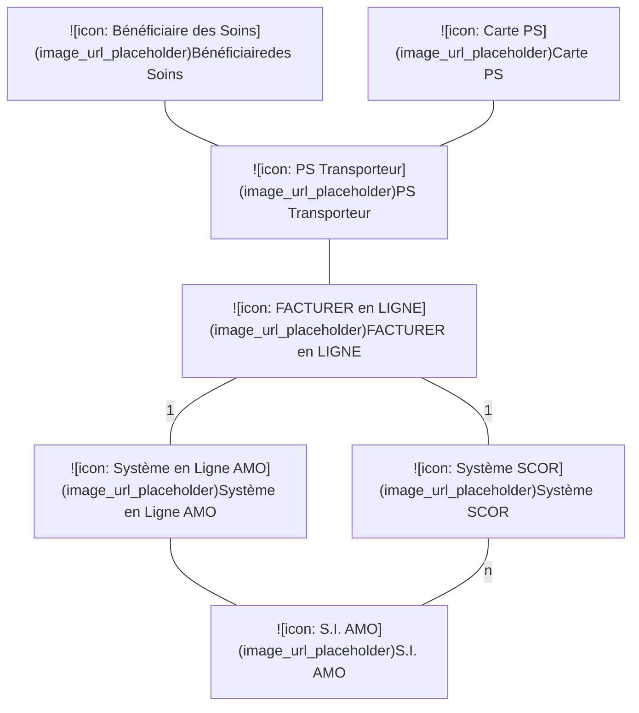
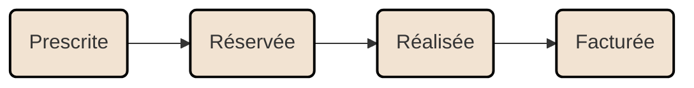
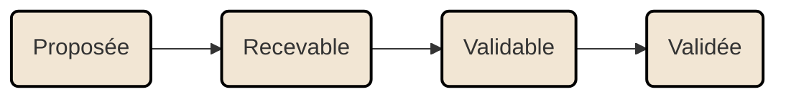
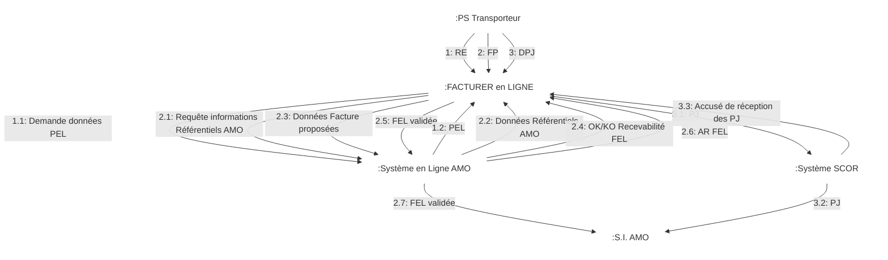
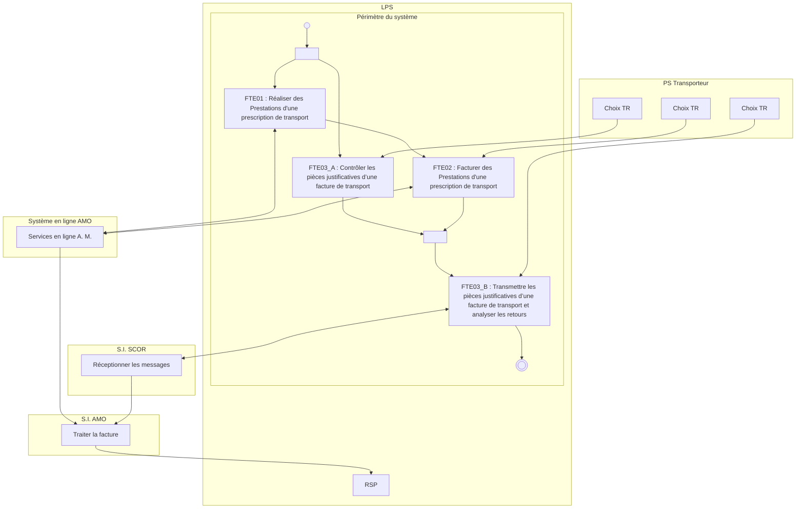
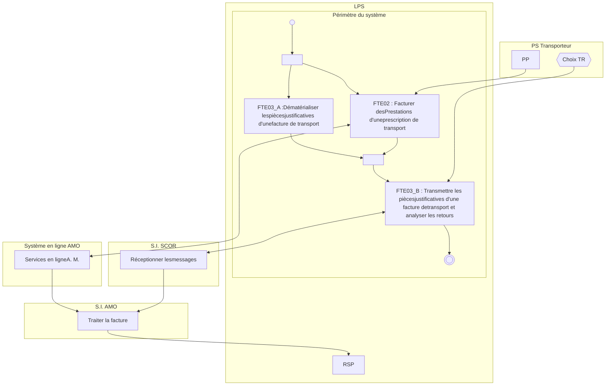
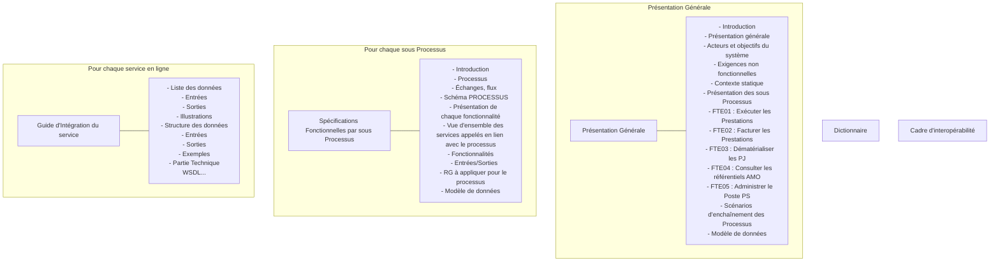

*Spécifications Fonctionnelles Générales*

# **Facturation Transporteur Etendue**
# *Transporteur Sanitaire*

## **PG - Présentation Générale**

Référence : FACT-SFG-030 / Version : 05.48 / Date : 17/07/2026
Diffusion : RESTREINTE
État : REFERENCE

**GIE SESAM-Vitale**

5, boulevard Marie et Alexandre Oyon – 72 019 LE MANS Cedex 2
<u>www.sesam-vitale.fr</u>

Ce document a été élaboré par le GIE SESAM-Vitale.

Conformément à l’article L.122-4 du Code de la Propriété Intellectuelle, toute représentation ou reproduction (intégrale ou partielle) du présent ouvrage, quel que soit le support utilisé, doit être soumise à l’accord préalable écrit de son auteur.

Il en est de même pour sa traduction, sa transformation, son adaptation ou son arrangement, quel que soit le procédé utilisé.

**Tout manquement à ces obligations constituerait un délit de contrefaçon, au sens des articles **L 335-2 et suivants du code de la propriété intellectuelle, susceptible d’entraîner des** sanctions pour l’auteur du délit.**

## **CONTACTS**


Pour toute demande d'évolution, comme pour toute question technique ou fonctionnelle, contactez le Centre de services :

*   portail IRIS : [https://portail-support.sesam-vitale.fr/](https://portail-support.sesam-vitale.fr/)
*   téléphone : 02 43 57 42 88

*SFG - Facturation Transporteur Etendue - Transporteur Sanitaire*
*FACT-SFG-030 *PG - Présentation Générale* Version : 05.48*

# **TABLES DES MATIERES**

<table>
    <tr>
      <td>1</td>
      <td><b>INTRODUCTION.........................................................................................................................................4</b></td>
    </tr>
    <tr>
      <td>1.1</td>
      <td>OBJECTIF ET UTILISATION DU DOSSIER DE SPÉCIFICATIONS GÉNÉRALES (SFG) ........................................4</td>
    </tr>
    <tr>
      <td>1.2</td>
      <td>OBJECTIF ET UTILISATION DU DOCUMENT ................................................................................................4</td>
    </tr>
    <tr>
      <td>1.3</td>
      <td>STATUT DU DOCUMENT ..........................................................................................................................4</td>
    </tr>
    <tr>
      <td>1.4</td>
      <td>POSITIONNEMENT DU DOCUMENT............................................................................................................4</td>
    </tr>
    <tr>
      <td>1.5</td>
      <td>CONTENU DU DOCUMENT .......................................................................................................................4</td>
    </tr>
    <tr>
      <td>1.6</td>
      <td>DOCUMENTS DE RÉFÉRENCE ..................................................................................................................5</td>
    </tr>
    <tr>
      <td>1.7</td>
      <td>ABRÉVIATIONS.......................................................................................................................................5</td>
    </tr>
    <tr>
      <td>1.8</td>
      <td>DÉFINITIONS..........................................................................................................................................5</td>
    </tr>
    <tr>
      <td>1.9</td>
      <td>GUIDE DE LECTURE................................................................................................................................5</td>
    </tr>
    <tr>
      <td><b>2</b></td>
      <td><b>PRÉSENTATION GÉNÉRALE DU SYSTÈME ..........................................................................................6</b></td>
    </tr>
    <tr>
      <td>2.1</td>
      <td>INTRODUCTION ......................................................................................................................................6</td>
    </tr>
    <tr>
      <td>2.2</td>
      <td>ACTEURS ET OBJECTIFS D'UTILISATION DU SYSTÈME ................................................................................9</td>
    </tr>
    <tr>
      <td>2.3</td>
      <td>ASPECTS NON FONCTIONNELS DU SYSTÈME ..........................................................................................11</td>
    </tr>
    <tr>
      <td>2.4</td>
      <td>DESCRIPTION GÉNÉRALE DU PROCESSUS PRINCIPAL : FACTURER EN LIGNE ......................................13</td>
    </tr>
    <tr>
      <td></td>
      <td>    2.4.1 <i>Cadrage fonctionnel</i> .............................................................................................................13</td>
    </tr>
    <tr>
      <td></td>
      <td>    2.4.2 <i>Le système et son contexte dynamique</i> ...............................................................................15</td>
    </tr>
    <tr>
      <td></td>
      <td>    2.4.3 <i>Description du processus principal d’utilisation du système : « FACTURER En LIGNE »</i> ..17</td>
    </tr>
    <tr>
      <td></td>
      <td>    2.4.4 <i>Cas particulier : utilisation en multi-sociétés</i> ........................................................................18</td>
    </tr>
    <tr>
      <td>2.5</td>
      <td>DESCRIPTION DÉTAILLÉE DU PROCESSUS PRINCIPAL : FACTURER EN LIGNE ......................................20</td>
    </tr>
    <tr>
      <td></td>
      <td>    2.5.1 <i>FTE01 : Description générale du sous-processus « Réaliser des Prestations d’une<br />prescription de transport »</i>....................................................................................................20</td>
    </tr>
    <tr>
      <td></td>
      <td>    2.5.2 <i>FTE02 : Description générale du sous-processus « Facturer des Prestations d’une<br />prescription de transport »</i>....................................................................................................20</td>
    </tr>
    <tr>
      <td></td>
      <td>    2.5.3 <i>FTE03 : Description générale du sous-processus « Dématérialiser et transmettre les<br />Pièces Justificatives d’une facture de transport ».</i> ...............................................................20</td>
    </tr>
    <tr>
      <td>2.6</td>
      <td>SITUATIONS SPÉCIFIQUES ....................................................................................................................21</td>
    </tr>
    <tr>
      <td></td>
      <td>    <u>2.6.1</u> <i>SP03 : Bénéficiaire de la <mark><s>CMU complémentaire</s> <u>C2S</u></mark></i> ..........................................................22</td>
    </tr>
    <tr>
      <td></td>
      <td>    <u>2.6.2</u> <u><mark><i>SP05 : Bénéficiaire du dispositif d’aide à l’acquisition d’une complémentaire</i></mark></u> .....................22</td>
    </tr>
    <tr>
      <td></td>
      <td>    2.6.3 <i>SP06 : Bénéficiaire de l’AME</i> ...............................................................................................22</td>
    </tr>
    <tr>
      <td>2.7</td>
      <td>FONCTIONNALITÉS HORS PROCESSUS...................................................................................................23</td>
    </tr>
    <tr>
      <td></td>
      <td>    2.7.1 <i>FTE04 : Consulter les Référentiels de l’AMO</i> ......................................................................23</td>
    </tr>
    <tr>
      <td></td>
      <td>    2.7.2 <i>FTE05 : Administrer le poste de travail du Transporteur</i> .....................................................23</td>
    </tr>
    <tr>
      <td></td>
      <td>    2.7.3 <i>FTE06 : Superviser le poste de travail du Transporteur</i> ......................................................23</td>
    </tr>
    <tr>
      <td>2.8</td>
      <td>CONSIGNES TRANSVERSES À PLUSIEURS FONCTIONNALITÉS ..................................................................24</td>
    </tr>
    <tr>
      <td><b>3</b></td>
      <td><b>SYNTHÈSE DES ENTITÉS FONCTIONNELLES....................................................................................24</b></td>
    </tr>
</table>

<table>
  <caption>**TABLE DES ILLUSTRATIONS**</caption>
    <tr>
      <td>FIGURE 1 : PRÉSENTATION DES ACTEURS ET DE L’OBJECTIF GLOBAL D’UTILISATION DU SYSTÈME : « FACTURER EN LIGNE » ......................................................................................................................................................9</td>
    </tr>
    <tr>
      <td>FIGURE 2 : CYCLE DE VIE D’UNE PRESTATION (PT) ...............................................................................................14</td>
    </tr>
    <tr>
      <td>FIGURE 3 : CYCLE DE VIE D’UNE FACTURE EN LIGNE (FEL)...................................................................................14</td>
    </tr>
    <tr>
      <td>FIGURE 4 : DIAGRAMME DE CONTEXTE DYNAMIQUE DU PROCESSUS FACTURER EN LIGNE : ÉCHANGES AVEC LES SYSTÈMES EXTERNES..................................................................................................................................15</td>
    </tr>
    <tr>
      <td>FIGURE 5 : PROCESSUS D’UTILISATION DU SYSTÈME EN SCÉNARIO 1 : PEL............................................................17</td>
    </tr>
    <tr>
      <td>FIGURE 6 : PROCESSUS D’UTILISATION DU SYSTÈME EN SCÉNARIO 2 : PP..............................................................18</td>
    </tr>
</table>

<table>
  <caption>**TABLE DES ANNEXES**</caption>
    <tr>
      <td><b>ANNEXE 1</b></td>
      <td><b>GUIDE DE LECTURE ..........................................................................................................25</b></td>
    </tr>
    <tr>
      <td></td>
      <td>A1-1 ARCHITECTURE DOCUMENTAIRE ...........................................................................................................25</td>
    </tr>
    <tr>
      <td></td>
      <td>A1-2 CONSIGNES DE LECTURE......................................................................................................................26</td>
    </tr>
</table>

*17/07/2026* *3 / 27*
*Ce document ne peut être diffusé sans l'autorisation d'une personne habilitée au GIE SESAM-Vitale*


*SFG - Facturation Transporteur Etendue - Transporteur Sanitaire*
*FACT-SFG-030* *PG - Présentation Générale* *Version : 05.48*

# **1** **Introduction**

## **1.1** **Objectif et utilisation du dossier de Spécifications Générales (SFG)**

Ce dossier de SFG décrit la chaîne de Facturation sur le poste du Transporteur, dénommée « **FTE** ».

Cette chaîne de facturation, intégrée sur le poste du Partenaire de Santé, fait appel à des services en ligne mis à disposition par l’Assurance Maladie.

## **1.2** **Objectif et utilisation du document**

Ce document constitue la présentation générale du dossier de spécifications générales du système FTE.

Il a pour objet :

*   d’une part de présenter l’ensemble des documents constituant le dossier de Spécifications Générales, ainsi que les principes de rédaction communs à l’ensemble du dossier (ex : guide de lecture, références utilisées…), (partie 1 du présent document),
*   d’autre part de présenter le système de Facturation Transporteur Etendue (**FTE**) (chapitre 2 du présent document).

## **1.3** **Statut du document**

EN COURS

## **1.4** **Positionnement du document**

Ce document a pour vocation d’être un document chapeau articulant les autres documents et permettant une compréhension globale du système de Facturation Transporteur Etendue (**FTE**).

## **1.5** **Contenu du document**

Ce document contient :

*   la présentation du périmètre du système **FTE** ;
*   la présentation des acteurs du système **FTE** ;
*   la présentation de chaque processus du système **FTE**.

Ce document ne contient pas :

*   Les descriptions détaillées de chaque fonctionnalité de chaque processus.

Chacune de ces fonctionnalités fait l’objet d’un document à part entière (cf. Annexe 1 : A1-1 Présentation de l’architecture documentaire).

*17/07/2026* 4 / 27
*Ce document ne peut être diffusé sans l'autorisation d'une personne habilitée au GIE SESAM-Vitale*


*SFG - Facturation Transporteur Etendue - Transporteur Sanitaire*
*FACT-SFG-030 *PG - Présentation Générale* Version : 05.48*

## **1.6** **Documents de référence**

<table>
  <thead>
    <tr>
      <th><b>Appellation</b></th>
      <th><b>Type et titre</b></th>
      <th><b>Référence</b></th>
    </tr>
  </thead>
  <tbody>
    <tr>
      <td>[DICO]</td>
      <td>Dictionnaire</td>
      <td>FACT-SFG-029</td>
    </tr>
  </tbody>
</table>

## **1.7** **Abréviations**

Cf. Document FACT-SFG-029 : Dictionnaire

## **1.8** **Définitions**

Cf. Document FACT-SFG-029 : Dictionnaire

## **1.9** **Guide de lecture**

Cf. Annexe 1 Guide de lecture

*17/07/2026* 5 / 27
*Ce document ne peut être diffusé sans l'autorisation d'une personne habilitée au GIE SESAM-Vitale*


*SFG - Facturation Transporteur Etendue - Transporteur Sanitaire*
*FACT-SFG-030* *PG - Présentation Générale* *Version : 05.48*

# 2 **Présentation générale du système**

## 2.1 **Introduction**

**Objectifs du système**

Le système de Facturation Transporteur Etendue **(**FTE**)** permet, en Intégré LPS, une facturation en ligne, et une dématérialisation des pièces justificatives ainsi qu’un accès en ligne aux référentiels de l’Assurance Maladie Obligatoire (AMO).

Le système FTE a pour objectifs :

*   la fiabilisation et la simplification des échanges entre les transporteurs sanitaires et l’Assurance Maladie,
*   la simplification des tâches administratives avec, entre autres, la suppression des échanges papier entre les Transporteurs et l’Assurance Maladie.

**Principes**

Le système FTE s’appuie sur les principes suivants :

*   l’utilisation par le Transporteur de la prescription électronique (PEL), ou à défaut de la prescription papier ;
*   la réservation en ligne des prestations de la PEL à réaliser;
*   la déclaration de réalisation des prestations de la PEL;
*   l’accès aux référentiels de l’Assurance Maladie Obligatoire pour l’acquisition des informations relatives :
    *   aux partenaires de santé (prescripteur, transporteur exécutant, informations du RNT)
    *   au bénéficiaire des soins
    *   à la prescription électronique,
*   éventuellement, la détermination en ligne :
    *   des modalités de prise en charge,
    *   des montants des prestations de la facture,
*   la vérification en ligne de la recevabilité des données de facturation ;
*   la validation en ligne, par le Transporteur, de la facture ;
*   la dématérialisation de la facture ;
*   la dématérialisation de **tous** les autres documents nécessaires au remboursement des soins dont :
    *   la prescription,
    *   la demande d’accord préalable (DAP),
    *   l’attestation de service fait (i.e signature. Exemple : annexe de la facture).

*17/07/2026* *6 / 27*
*Ce document ne peut être diffusé sans l'autorisation d'une personne habilitée au GIE SESAM-Vitale*


*SFG - Facturation Transporteur Etendue - Transporteur Sanitaire*
FACT-SFG-030 *PG - Présentation Générale Version : 05.48*

# **Périmètre du système FTE**

## *Étape en cours*

###  *Partenaires de Santé*

Transporteurs :
* Transporteurs Sanitaires à savoir Ambulances et Véhicules de Soins Légers (VSL).

###  *Bénéficiaires des soins*

Bénéficiaires des régimes proposant les services en ligne SEFi-Transport.
Cf. PDT-INF-293 : critère C2.1.

###  *Aspects Métier*

Transports sanitaires <mark>~~hormis les gardes ambulancières dont les Transport Urgent Pré-Hospitalier (TUPH).~~</mark>

NB : si un transport sanitaire est soumis à demande d’accord préalable, la demande d’accord préalable doit être transmise via SCOR.

Transports partagés (transports de plusieurs malades),

y compris dans le cas où le TS a adhéré à l’option conventionnelle.

Transports des Personnes à Mobilité Réduite (TPMR, prestation TMR).

NB : une prestation TMR ne peut être facturée seule. Elle doit être en rapport avec une prestation/trajet.

Risques :
* Maladie
* Maternité
* ATMP

Remboursements :
* Part AMO en tiers payant ou en hors tiers payant
* Part complémentaire en tiers payant uniquement :
    * pour les situations spécifiques d’AME <mark>~~, de CMU-C et d’ACS et de C2S~~</mark>
    * pour les AMC privé (et hors éclatement à la source).

## *Étapes suivantes*

###  *Bénéficiaires des soins*

* Bénéficiaires des régimes pour lesquels les services en ligne SEFi-Transport sont à proposer.
* Migrants.

###  *Aspects Métier*

* <mark>~~Gardes ambulancières ;~~</mark>

# **Présentation générale**

Le système **FTE** a pour but principal l’élaboration d’une facture en ligne (FEL).

*17/07/2026* 7 / 27
*Ce document ne peut être diffusé sans l'autorisation d'une personne habilitée au GIE SESAM-Vitale*


FACT-SFG-030 *SFG - Facturation Transporteur Etendue - Transporteur Sanitaire*
*PG - Présentation Générale* Version : 05.48

Il s’appuie sur les services en ligne de l’Assurance Maladie pour réserver des prestations puis élaborer et valider la FEL correspondante.

Une fois validée par le Transporteur, il est impossible de modifier ou d’annuler une FEL.

Les FEL validées par les Transporteurs font l’objet d’une mise en lots nécessaire à la gestion des Pièces Justificatives (PJ) et des RSP : le n° de lot des FEL est attribué par le LPS.

## *<u>**Disponibilité des services**</u>*

<u>L’appel à l’ensemble des services peut être effectué à tout moment sans contrainte d’horaire.</u>

<u>(Ce sujet était documenté dans la fiche PDT-INF-293 et a été reporté ici.)</u>

## ***Forçage***

Est appelé « forçage » une modification des données de la facture en ligne au regard des données ou résultats établis par l’Assurance Maladie.

Dans le cas où le transporteur est en désaccord avec l’information proposée depuis des référentiels de l’AMO et qu’il souhaite la modifier, il « force » les données de la FEL et transmet alors nécessairement la facture dans un format B2.

La télétransmission B2 et la facturation papier correspondent au mode dégradé de la facturation en ligne.

## *<u>**Dématérialisation des PJ**</u>*

La dématérialisation des pièces justificatives (PJ) est disponible uniquement pour les transporteurs équipés d’un logiciel certifié FTE.

## ***Impacts de l’avenant 11***

L’avenant 11 introduit la tarification différenciée qui implique pour l’éditeur la gestion deux types de tarification SEFi dans les LPS :

*   une tarification socle
*   et une tarification majorée.

Cf. principe P6 dans FTE02 Facturer des Prestations [FACT-SFG-032].

Cf. détails du paramétrage dans la règle RG_FTE506 de FTE05 Administrer le Poste PS [FACT-SFG-035].

L’avenant 11 modifie également les conditions d’application des taux d’abattement pour la facturation des transports partagés en VSL.

## *<u>**Transport Urgent Pré-Hospitalier (TUPH)**</u>*

<u>C’est un transport réalisé par un transporteur sanitaire à la demande du SAMU – centre 15. Il s’agit d’un transport primaire effectué en vue de l’admission d’un patient dans un établissement de santé que le patient soit par la suite hospitalisé ou pas.</u>

<u>NB : les tarifs applicables en matière de TUPH sont spécifiques et facturables aussi bien avec un logiciel SEFi paramétré en tarification socle qu’en tarification majorée (Cf : PDT-INF-818).</u>

<u>Ce type de trajet est obligatoirement assuré par une ambulance.</u>

<u>Les remboursements des TUPH sont intégralement pris en charge par l’Assurance Maladie obligatoire. La facturation du TUPH est composée de 2 nouveaux tarifs :</u>

*   <u>Un forfait incluant les 20 premiers kilomètres parcourus ;</u>
*   <u>Un tarif kilométrique spécifique applicable à partir du 21ème kilomètre.</u>

*17/07/2026* 8 / 27
*Ce document ne peut être diffusé sans l'autorisation d'une personne habilitée au GIE SESAM-Vitale*


*SFG - Facturation Transporteur Etendue - Transporteur Sanitaire*
*FACT-SFG-030* *PG - Présentation Générale* *Version : 05.48*

<u>La nature de prestation permet de distinguer les TUPH réalisés durant la période de garde (code AIG) et les TUPH réalisés en dehors de la période de garde (code AHG).</u>

***Transport <u>partagé – refus</u> par le patient***

<u>Si la prescription médicale de transport ou la demande d’accord préalable indique que l’état du patient est compatible avec un transport partagé, alors le transporteur sanitaire doit proposer à l’assuré un transport partagé et lui délivrer une information sur les modalités de transport partagé et les implications de son refus éventuel.</u>

<u>En cas de refus du patient, le transporteur sanitaire devra tracer ce refus dans la facture et n’appliquera pas la dispense d’avance de frais (pas d’application du tiers payant à l’exception des cas particuliers AME et C2S). Le patient devra régler directement au transporteur sanitaire, le montant du trajet.</u>

<u>À noter : pour les assurés bénéficiant de l’AME ou de la C2S, le refus du transport partagé sera tracé dans la facture mais la dispense d’avance de frais continuera à s’appliquer.</u>

## **2.2** **Acteurs et objectifs d'utilisation du système**

**Objectif global**



**Figure 1 : Présentation des acteurs et de l’objectif global d’utilisation du système :**
**« **FACTURER en LIGNE** »**

Le LPS intègre le système **FTE** permettant d’effectuer la facturation de transports à destination de l’**AMO** en sollicitant les services en ligne de l’Assurance Maladie.

### **Acteurs externes**

<table>
  <thead>
    <tr>
      <th><b>Nom</b></th>
      <th><b>Définition du rôle</b></th>
    </tr>
  </thead>
  <tbody>
    <tr>
      <td><b>Bénéficiaire</b><br />des soins</td>
      <td>Personne bénéficiant d’une protection sociale et pour laquelle un soin est prodigué par le Partenaire de Santé.<br /><br />Ce soin fait l’objet d’une facturation à destination de l’Assurance Maladie.<br /><br />Le bénéficiaire des soins (ou son représentant légal) signe l’annexe de la facture.</td>
    </tr>
  </tbody>
</table>

*17/07/2026* 9 / 27
*Ce document ne peut être diffusé sans l'autorisation d'une personne habilitée au GIE SESAM-Vitale*


*FACT-SFG-030*
*SFG - Facturation Transporteur Etendue - Transporteur Sanitaire*
*PG - Présentation Générale*
*Version : 05.48*

<table>
  <thead>
    <tr>
      <th><b>Nom</b></th>
      <th><b>Définition du rôle</b></th>
    </tr>
  </thead>
  <tbody>
    <tr>
      <td>Transporteur</td>
      <td>Le Transporteur (TR) est un Transporteur Sanitaire (TS).<br />• consulte une prescription en ligne, réserve des prestations et renseigne les informations liées à la réalisation de ces prestations.<br />• réalise la facturation de prestations relatives à une prescription et transmet ses factures et ses P.J. aux organismes d’Assurance Maladie Obligatoire.</td>
    </tr>
    <tr>
      <td>Carte PS</td>
      <td>La carte du Partenaire de Santé permet l’accès aux services en ligne AMO<br />Pour le Partenaire de Santé Transporteur, il s’agit soit d’une carte CPE, soit d’une carte CDE</td>
    </tr>
    <tr>
      <td>Système en Ligne AMO</td>
      <td>Le Système en Ligne AMO fournit des services permettant au LPS :<br />• de disposer d’informations issues des référentiels de l’AMO (bénéficiaire, PS, PEL, …).<br />• de vérifier la recevabilité des FEL élaborées<br />• de transmettre les FEL validées par le PS<br /> Dans cette version du système les référentiels AMO correspondent au système d’Informations du régime général et des régimes hébergés (cf. § périmètre du système)</td>
    </tr>
    <tr>
      <td>Système SCOR</td>
      <td>Le système SCOR<br />• reçoit les PJ dématérialisées<br />• retourne les accusés de réception des PJ</td>
    </tr>
    <tr>
      <td>S.I. AMO</td>
      <td>Le Système d’Information de l’Assurance Maladie Obligatoire :<br />• reçoit, contrôle et assure la liquidation des factures,<br />• transmet les RSP,<br />• procède au règlement des factures pour lesquelles le résultat des contrôles est correct.</td>
    </tr>
  </tbody>
</table>

## **Objectifs d’utilisation du système FTE**

### ***FACTURER En LIGNE***

L’objectif principal « Facturer en Ligne » permet la réalisation et la facturation de prestations de transport et la transmission à l’Assurance Maladie de toutes les pièces nécessaires au remboursement.

### ***CONSULTER***

Par ailleurs, le système dispose, indépendamment de l’objectif de facturation, d’un objectif de consultation d’informations issues des référentiels de l’Assurance Maladie Obligatoire.

Cet objectif de consultation est constitué de plusieurs fonctions indépendantes, chacune s’appuyant sur un service en ligne proposé par l’AMO.

***Exemples :***

*   Consulter une prescription en ligne
*   Consulter une facture en ligne…

*17/07/2026*
10 / 27
*Ce document ne peut être diffusé sans l'autorisation d'une personne habilitée au GIE SESAM-Vitale*


*SFG - Facturation Transporteur Etendue - Transporteur Sanitaire*
FACT-SFG-030 *PG - Présentation Générale Version : 05.48*

 Certaines de ces fonctions sont utilisées au cours du processus principal « FACTURER En LIGNE ».

### ***ADMINISTRER***

Le système nécessite des fonctions d’administration du LPS.

Cette fonctionnalité comprend notamment le paramétrage des services en ligne AMO utilisés par le TR (choix du TR parmi les services d’utilisation facultative).

### ***SUPERVISER***

Le système nécessite des fonctions de supervision du LPS.

Cette fonctionnalité comprend la gestion du délai maximum d’envoi des Pièces Justificatives.

## **2.3** **Aspects non fonctionnels du système**

### **Services en ligne AMO**

#### ***Accès***

Le transporteur est identifié et authentifié par sa carte CPE/CDE pour l’accès aux services en ligne de l’Assurance Maladie.

### ***[RG_FTE099] Contrôler la spécialité du PS accédant aux services en ligne***

Pour tous les services en ligne appelés par le LPS, il est nécessaire de respecter la compatibilité entre la spécialité du PS identifié par le n° de facturation présent dans l’assertion du message d’appel et le type d’autorisation du LPS, conformément au tableau ci-après :

<table>
  <thead>
    <tr>
      <th></th>
      <th colspan="2"><b>Spécialité du PS</b></th>
    </tr>
    <tr>
      <th><b>Autorisation LPS</b></th>
      <th>55</th>
      <th>56</th>
    </tr>
  </thead>
  <tbody>
    <tr>
      <td>TS uniquement</td>
      <td>compatible</td>
      <td><strong><b>INTERDIT</b></strong></td>
    </tr>
    <tr>
      <td>TS et TX <sup>(*)</sup></td>
      <td>compatible</td>
      <td>compatible</td>
    </tr>
  </tbody>
</table>
(*) Il s’agit d’un LPS utilisable par :
● <u>une société de transport sanitaire,</u>
● <u>une société de taxi (hors périmètre de ce corpus),</u>
● <u>ou une société mixte.</u>

### ***Erreurs fonctionnelles***

Les erreurs de type fonctionnel propres aux services en ligne sont présentes dans les éléments de type « Diagnostic » ou « Message ».

Ces erreurs fonctionnelles sont présentées dans la table TB_ERR_F : table de référence des messages d’erreurs fonctionnelles dans le document [DICO].

*17/07/2026 11 / 27*
*Ce document ne peut être diffusé sans l'autorisation d'une personne habilitée au GIE SESAM-Vitale*


*FACT-SFG-030*
*SFG - Facturation Transporteur Etendue - Transporteur Sanitaire*
*PG - Présentation Générale*
*Version : 05.48*

## **Exigences de sécurité**

Le LPS transporteur doit être conforme aux cahiers des charges d’exigences d’architecture et de sécurité appliquées aux TLSi (références des documents précisées dans une version ultérieure).

## **Utilisation des données Assurance Maladie**

Les données mises à disposition par l’Assurance Maladie via les services en ligne sont protégées par le droit à la propriété intellectuelle.

L’utilisation de ces données par le LPS hors du périmètre du système FTE est interdit de fait.

## **Données de la PEL**

Il est interdit au LPS Transporteur d’imprimer une prescription à partir des informations de la PEL.

## <u>**Historisation des échanges**</u>

<mark><u>Les LPS doit pouvoir historiser pendant 12 mois toutes les requêtes et toutes les réponses des services WS_FT2 et WS_FT3.</u></mark>

<mark><u>Cette historisation doit être activable par le transporteur ou par l’éditeur pour chacun des services.</u></mark>

<mark><u>Une société de transports doit être en capacité de présenter ces éléments sur demande de l’Assurance Maladie.</u></mark>

<mark><u>Cf. détails du paramétrage dans la règle RG_FTE597 de FTE05 Administrer le Poste PS [FACT-SFG-035].</u></mark>

*17/07/2026*
12 / 27
*Ce document ne peut être diffusé sans l'autorisation d'une personne habilitée au GIE SESAM-Vitale*


*SFG - Facturation Transporteur Etendue - Transporteur Sanitaire*
FACT-SFG-030 *PG - Présentation Générale Version : 05.48*

# **2.4** **Description générale du processus principal : FACTURER En LIGNE**

## **2.4.1** **Cadrage fonctionnel**

**Pré-conditions**
Une prescription est réalisée par le prescripteur.
Cette prescription est établie sous l’un des supports suivants :
*   soit prescription en ligne (PEL) ;
*   soit prescription papier (PP) ;
*   <mark><u>soit l’appel du SAMU – centre 15 pour un TUPH.</u></mark>

**Événement déclencheur**
Demande de transport par un bénéficiaire des soins.

**Description du processus**
La facturation en ligne depuis un LPS consiste, dans son mode nominal, à utiliser les données de l’Assurance Maladie pour renseigner directement la facture et la vérifier :
*   Le processus FACTURER En LIGNE débute avec l’accès aux données de la prescription (soit prescription en ligne, soit prescription papier, <mark><u>soit un appel du SAMU – centre 15 pour un TUPH</u></mark>) et s’appuie sur les référentiels de l’Assurance Maladie Obligatoire pour constituer une facture en ligne.
*   Cette facture fait alors l’objet d’une vérification de recevabilité par l’Assurance Maladie puis d’une validation par le Transporteur.
*   Cette facture est alors intégrée dans le système d’information de l’Assurance Maladie pour le cycle d’ordonnancement paiement jusqu’au retour d’information vers le PS.
*   En parallèle, le Transporteur transmet à l’Assurance Maladie les pièces justificatives à la facture.

Le processus FACTURER En LIGNE se déroule selon trois phases qui peuvent être réalisées de façon indépendante :
*   **FTE01 : R**éaliser des **P**restations d’une prescription de transport
*   **FTE02 : F**acturer en ligne des **P**restations d’une prescription de transport
*   **FTE03 : D**ématérialiser et Transmettre les **P**ièces **J**ustificatives d’une facture de transport :
    *   ○ *FTE03-A : Dématérialiser des pièces justificatives d’une facture de transport*
    *   ○ *FTE03-B : Transmettre les pièces justificatives d’une facture de transport et analyser les retours*

**Définition des objets**

***PEL : Prescription en Ligne***
Une Prescription En Ligne est créée par le prescripteur et est constituée de prestations (PT).

*17/07/2026* 13 / 27
*Ce document ne peut être diffusé sans l'autorisation d'une personne habilitée au GIE SESAM-Vitale*


*SFG - Facturation Transporteur Etendue - Transporteur Sanitaire*
FACT-SFG-030 *PG - Présentation Générale Version : 05.48*

**PT :**
***Prestation***
Une prestation (PT) correspond à un trajet. Un aller/retour donne donc lieu à 2 prestations.

***Facture***
Une facture est composée d’une ou plusieurs prestations d’une prescription (mais pas nécessairement toutes).

**FEL :**
***Facture***
***en Ligne***
Une Facture En Ligne est créée par le LPS du Transporteur et transmise au système en Ligne de l’Assurance Maladie.
Une FEL est une facture.

---
### Cycles de vie

**PT :**
***Prestation***
Du point de vue du LPS du Transporteur, une prestation prend successivement les statuts suivants :



**Figure 2 : Cycle de vie d’une Prestation (PT)**

**FEL :**
***Facture***
***en Ligne***
Du point de vue du LPS du Transporteur, une FEL prend successivement les statuts suivants :



**Figure 3 : Cycle de vie d’une Facture En Ligne (FEL)**

---
### **Situations**
### **spécifiques**

• ~~<u>CMU-C</u>~~ <u>C2S</u>
• AME
• ~~<u>•</u>~~ <u>ACS</u>

---
### **Cas d’erreur**
### **transverses**

Dysfonctionnement de l’accès en ligne
Message d’erreur venant d’un service en ligne

*17/07/2026* 14 / 27
*Ce document ne peut être diffusé sans l'autorisation d'une personne habilitée au GIE SESAM-Vitale*


*SFG - Facturation Transporteur Etendue - Transporteur Sanitaire*
FACT-SFG-030 *PG - Présentation Générale Version : 05.48*

## **2.4.2** **Le système et son contexte dynamique**

Ce paragraphe présente le système spécifié dans le cadre des SFG et les échanges avec les acteurs externes (humains ou systèmes) dans le cadre du processus principal « FACTURER En LIGNE ».

# *Périmètre du système*




**Figure 4 : Diagramme de contexte dynamique du processus FACTURER En LIGNE : échanges avec les systèmes externes**

**Description des échanges**

Le tableau ci-dessous présente les interactions du système avec l’extérieur.

La première colonne de ce tableau reprend le numéro de la flèche présentée dans le diagramme ci-dessus.

<table>
  <thead>
    <tr>
      <th></th>
      <th>Emetteur</th>
      <th>Récepteur</th>
      <th>Description</th>
    </tr>
  </thead>
  <tbody>
    <tr>
      <td><i>1</i></td>
      <td>PS<br />Transporteur</td>
      <td>Système FTE</td>
      <td><strong>RE</strong> : le Transporteur doit réserver puis déclarer la réalisation des trajets d’une PEL.</td>
    </tr>
    <tr>
      <td><i>1.1</i></td>
      <td>Système FTE</td>
      <td>Système en ligne AMO</td>
      <td><strong><b>Demande données PEL</b></strong> : le système de facturation a besoin des informations de la PEL nécessaires à la réalisation et à la facturation des prestations.</td>
    </tr>
    <tr>
      <td><i>1.2</i></td>
      <td>Système en ligne AMO</td>
      <td>Système FTE</td>
      <td><strong>PEL</strong> : le système de facturation reçoit les informations de la PEL demandée</td>
    </tr>
    <tr>
      <td><i>2</i></td>
      <td>PS<br />Transporteur</td>
      <td>Système FTE</td>
      <td><strong>FP</strong> : le Transporteur facture les trajets déjà réalisés</td>
    </tr>
    <tr>
      <td><i>2.1</i></td>
      <td>Système FTE</td>
      <td>Système en ligne AMO</td>
      <td><strong><b>Requête informations Référentiels AMO</b></strong> : le système de facturation a besoin d’informations connues et référencées par l’Assurance Maladie Obligatoire (informations concernant le PS prescripteur, le PS exécutant, le Bénéficiaire des soins, etc.)</td>
    </tr>
    <tr>
      <td><i>2.2</i></td>
      <td>Système en ligne AMO</td>
      <td>Système FTE</td>
      <td><strong><b>Données Référentiels AMO</b></strong> : le système de facturation reçoit les informations demandées, référencées par l’AMO.</td>
    </tr>
  </tbody>
</table>

*17/07/2026 15 / 27*
*Ce document ne peut être diffusé sans l'autorisation d'une personne habilitée au GIE SESAM-Vitale*


*SFG - Facturation Transporteur Etendue - Transporteur Sanitaire*
*FACT-SFG-030 **PG - Présentation Générale** Version : 05.48*

<table>
  <thead>
    <tr>
      <th></th>
      <th>Emetteur</th>
      <th>Récepteur</th>
      <th><b>Description</b></th>
    </tr>
  </thead>
  <tbody>
    <tr>
      <td><i>2.3</i></td>
      <td>Système FTE</td>
      <td>Système en ligne AMO</td>
      <td><strong><b>Données facture proposées</b></strong> : le système de facturation soumet les données de la facture à l’AMO pour contrôle de recevabilité</td>
    </tr>
    <tr>
      <td><i>2.4</i></td>
      <td>Système en ligne AMO</td>
      <td>Système FTE</td>
      <td><strong><b>OK/KO Recevabilité FEL</b></strong> : le système de facturation reçoit le résultat du contrôle de recevabilité effectué par l’AMO</td>
    </tr>
    <tr>
      <td><i>2.5</i></td>
      <td>Système FTE</td>
      <td>Système en ligne AMO</td>
      <td><strong>FEL validée</strong> : le système de facturation transmet au système en ligne AMO la FEL constituée des données préalablement déclarées recevables par l’AMO et validée par le transporteur.</td>
    </tr>
    <tr>
      <td><i>2.6</i></td>
      <td>Système en ligne AMO</td>
      <td>Système FTE</td>
      <td><strong>AR FEL</strong> : le système de facturation reçoit un accusé de réception de la FEL validée.</td>
    </tr>
    <tr>
      <td><i>2.7</i></td>
      <td>Système en ligne AMO</td>
      <td>S.I. AMO</td>
      <td><strong>FEL validée</strong> : le S.I. AMO reçoit, pour traitement, la FEL validée par le TR</td>
    </tr>
    <tr>
      <td><i>3</i></td>
      <td>PS Transporteur</td>
      <td>Système FTE</td>
      <td><strong><b>DPJ</b></strong> : le Transporteur dématérialise et transmet à l’Assurance Maladie les pièces justificatives associées à une ou plusieurs factures.</td>
    </tr>
    <tr>
      <td><i>3.1</i></td>
      <td>Système FTE</td>
      <td>Système SCOR</td>
      <td><strong>PJ</strong> : le système de facturation transmet au système SCOR, sous forme dématérialisées, l’ensemble des pièces justificatives associées à une FEL.</td>
    </tr>
    <tr>
      <td><i>3.2</i></td>
      <td>Système SCOR</td>
      <td>S.I. AMO</td>
      <td><strong>PJ</strong> : le système SCOR transmet au S.I. AMO les PJ qu’il a reçues du système de facturation.</td>
    </tr>
    <tr>
      <td><i>3.3</i></td>
      <td>Système SCOR</td>
      <td>Système FTE</td>
      <td><strong><b>Accusé de réception des PJ</b></strong><br /><br />Le système de facturation reçoit un accusé de réception des PJ.</td>
    </tr>
  </tbody>
</table>

*17/07/2026* 16 / 27
*Ce document ne peut être diffusé sans l'autorisation d'une personne habilitée au GIE SESAM-Vitale*


*FACT-SFG-030* *SFG - Facturation Transporteur Etendue - Transporteur Sanitaire* *Version : 05.48*
*PG - Présentation Générale*

## **2.4.3** **Description du processus principal d’utilisation du système : « FACTURER En LIGNE »**

Le processus principal du système FTE est le processus « FACTURER En LIGNE »



**Figure 5 : Processus d’utilisation du système en scénario 1 : PEL**


Les modalités de restitution des RSP d’une facture après « Tarifer la facture » par le SI AMO sont hors du périmètre du système FTE et restent inchangées (RSP NOEMIE PS via messagerie SMTP et frontaux AMO).
Il convient d’utiliser la norme NOEMIE PS.
Afin d'apporter un meilleur service aux transporteurs, notamment au regard de la mise en place du tiers-payant généralisé, une évolution de la référence NOEMIE est prévue : la référence 531, actuellement préconisée, sera, à terme remplacée par la référence 580.
Dans la référence 580, les informations de retours sont simplifiées et clarifiées. Les données nécessaires aux opérations de rapprochement de facture et de suivi bancaire sont enrichies.

### **Scénarios**

Les scénarios de déroulement possible du processus sont les suivants :

<table>
  <thead>
    <tr>
      <th></th>
      <th><b>Nom</b></th>
      <th>Description</th>
    </tr>
  </thead>
  <tbody>
    <tr>
      <td><i>1</i></td>
      <td>Scénario PEL</td>
      <td>Utilisation d’une Prescription en Ligne</td>
    </tr>
    <tr>
      <td rowspan="2"><i>2</i></td>
      <td rowspan="2">Scénario PP</td>
      <td>Utilisation d’une Prescription Papier par le Transporteur en lieu et place de la PEL.</td>
    </tr>
    <tr>
      <td><mark>L’utilisation d’un appel du SAMU – centre 15 pour un TUPH est également couverte par ce scénario.</mark></td>
    </tr>
  </tbody>
</table>

*17/07/2026* 17 / 27
*Ce document ne peut être diffusé sans l'autorisation d'une personne habilitée au GIE SESAM-Vitale*


*FACT-SFG-030*
*SFG - Facturation Transporteur Etendue - Transporteur Sanitaire*
*PG - Présentation Générale*
*Version : 05.48*

<table>
  <thead>
    <tr>
      <th></th>
      <th><b>Nom</b></th>
      <th><b>Description</b></th>
    </tr>
  </thead>
  <tbody>
    <tr>
      <td>3</td>
      <td>Dysfonctionnement services en ligne</td>
      <td>Pas d’accès du LPS aux services en ligne (indisponibilité du système en ligne A.M., problème coté LPS)</td>
    </tr>
    <tr>
      <td>4</td>
      <td>Cas fonctionnels hors périmètre</td>
      <td>Cas fonctionnels hors périmètre (cf. §2.1)<br />Issue : revenir à une facture B2</td>
    </tr>
  </tbody>
</table>

### ***Scénario 2 : PP***



**Figure 6 : Processus d’utilisation du système en scénario 2 : PP**

### **Services en ligne**
### ***AMO***

Les conditions d’utilisation par le LPS des services en ligne proposés par l’AMO, sont décrites au niveau de chaque sous-processus.

L’utilisation de certains services en ligne proposés par l’AMO est obligatoire pour le déroulé du processus de facturation TR.

---

## **2.4.4** **Cas particulier : utilisation en multi-sociétés**

### **Présentation**

Le présent paragraphe présente la mise en œuvre du SEFi avec authentification par cartes CPx pour les transporteurs organisés en groupement ou qui ont plusieurs sociétés et donc plusieurs identifiants de facturation.

*17/07/2026*
18 / 27
*Ce document ne peut être diffusé sans l'autorisation d'une personne habilitée au GIE SESAM-Vitale*


*FACT-SFG-030* *SFG - Facturation Transporteur Etendue - Transporteur Sanitaire* *Version : 05.48*
*PG - Présentation Générale*

## **Contexte métier**

La société mandataire a reçu mandat d’un autre transporteur (société mandante) pour réaliser la facture en ligne en son nom et pour son compte.
La carte de la société mandataire est utilisée pour s’authentifier et accéder aux services.

```mermaid
graph TD
    subgraph Mandataire [" "]
        direction TB
        M_Icon1[ ]
        M_Text["**Société mandataire gérant la facturation**"]
        
        subgraph ST1_Box [" "]
            direction LR
            ST1_Icon[]
            ST1_Label["**Société transport 1***Identifiant facturation1*"]
        end
        
        ST_List["*Société transport 1**Société transport 2**Société transport 3*"]
    end

    CPE_M[]
    
    AM_Icon[]
    AM_Text["**Assurance Maladie**"]

    ST2_Icon[]
    ST2_Label["**Société transport 2***Identifiant facturation2*"]
    CPE_ST2[]

    ST3_Icon[]
    ST3_Label["**Société transport 3***Identifiant facturation3*"]
    CPE_ST3[]

    %% Connections
    Mandataire --- CPE_M
    CPE_M -- "━" --> AM_Icon
    CPE_M -- "━" --> AM_Icon
    CPE_M -- "━" --> AM_Icon
    
    Mandataire --> ST2_Icon
    Mandataire --> ST3_Icon
    
    ST2_Label -- "┓" --> CPE_ST2
    ST3_Label -- "┓" --> CPE_ST3
```

NB : La **société** **mandante** et la société mandataire doivent appliquer la même tarification (Socle ou Majorée).

## **Mise en œuvre**

Selon le service appelé, l’identifiant de facturation à transmettre dans l’assertion PS est soit l’identifiant de la société mandataire, soit l’identifiant de la société mandante.

<table>
  <thead>
    <tr>
      <th colspan="2"><b>Service</b></th>
      <th><b>Identifiant de facturation</b><br /><i>(champ « AttributStatement »)</i><br /><b>dans l’assertion PS : identifiant du PS</b> facturant</th>
    </tr>
  </thead>
  <tbody>
    <tr>
      <td><i>WS_PL1</i></td>
      <td>Acquérir info PEL</td>
      <td rowspan="6">Le PS facturant est le PS ayant réalisé le trajet ou qui va le réaliser, i.e. la <b>société mandante</b></td>
    </tr>
    <tr>
      <td><i>WS_PL2</i></td>
      <td>Réserver une Prestation</td>
    </tr>
    <tr>
      <td><i>WS_PL3</i></td>
      <td>Signaler la réalisation d’une prestation</td>
    </tr>
    <tr>
      <td><i>WS_PS4</i></td>
      <td>Acquérir les infos RNT</td>
    </tr>
    <tr>
      <td><i>WS_FT1</i></td>
      <td>Consulter FEL</td>
    </tr>
    <tr>
      <td><i>WS_FT4</i></td>
      <td>Calculer les montants d’une prestation (*)</td>
    </tr>
    <tr>
      <td><i>WS_FT2</i></td>
      <td>Vérifier recevabilité d’une FEL</td>
      <td rowspan="2">Le PS facturant est le PS ayant réalisé le trajet, i.e. la <b>société mandante</b><br /><br />L’identifiant de facturation de l’assertion PS doit ainsi correspondre au numéro de facturation du PS facturant de la FEL (EF_FTE52_01) contenu dans les données métier, i.e. dans le corps du message.</td>
    </tr>
    <tr>
      <td><i>WS_FT3</i></td>
      <td>Valider FEL</td>
    </tr>
    <tr>
      <td><i>WS_PS1</i></td>
      <td>Acquérir les infos PS par n° AM</td>
      <td></td>
    </tr>
  </tbody>
</table>

*17/07/2026* *Ce document ne peut être diffusé sans l'autorisation d'une personne habilitée au GIE SESAM-Vitale* 19 / 27


*SFG - Facturation Transporteur Etendue - Transporteur Sanitaire*
*FACT-SFG-030* *PG - Présentation Générale* *Version : 05.48*

<table>
    <tr>
      <td><i><b>WS_PS3</b></i></td>
      <td>Acquérir les infos PS par n° FINESS</td>
      <td rowspan="3">Identifiant du PS facturant (<b>société <b>mandante</b></b>) ou du PS émetteur (<b>société <b>mandataire</b></b>) selon les organisations en place</td>
    </tr>
    <tr>
      <td><i><b>WS_BS1</b></i></td>
      <td>Identifier un bénéficiaire</td>
    </tr>
    <tr>
      <td><i><b>WS_BS2</b></i></td>
      <td>Acquérir les infos Bénéficiaire</td>
    </tr>
    <tr>
      <td><i><b>WS_PEC1</b></i></td>
      <td>Consulter la PEC</td>
      <td></td>
    </tr>
</table>

(*) Le service « Calculer les montants d’une prestation » (WS_FT4) ne peut être appelé qu’en cas de tarification majorée.

 A noter que ces consignes concernent uniquement les requêtes d'appel du SEFi. Elles sont sans impact sur SCOR, i.e pour SCOR il convient de réaliser autant de lots de PJ que de PS facturant.

## **2.5 Description détaillée du processus principal : FACTURER En LIGNE**

### **2.5.1 FTE01 : Description générale du sous-processus « Réaliser des Prestations d’une prescription de transport »**

Cf. Document FACT-SFG-031 : « FTE01 : Réaliser des Prestations d’une prescription »

### **2.5.2 FTE02 : Description générale du sous-processus « Facturer des Prestations d’une prescription de transport »**

Cf. Document FACT-SFG-032 : « FTE02 : FP-Facturer des Prestations »

### **2.5.3 FTE03 : Description générale du sous-processus « Dématérialiser et transmettre les Pièces Justificatives d’une facture de transport ».**

Cf. Document FACT-SFG-033 : « FTE03 : DPJ-Dématérialiser et transmettre les PJ d’une facture de transport »

*17/07/2026* 20 / 27
*Ce document ne peut être diffusé sans l'autorisation d'une personne habilitée au GIE SESAM-Vitale*


*SFG - Facturation Transporteur Etendue - Transporteur Sanitaire*
*FACT-SFG-030* *PG - Présentation Générale* *Version : 05.48*

# **2.6** **Situations spécifiques**

**Présentation**

Les situations spécifiques suivantes ont été identifiées pour le système FTE :

<table>
  <thead>
    <tr>
      <th><b>Référence</b></th>
      <th><b>Libellé</b></th>
    </tr>
  </thead>
  <tbody>
    <tr>
      <td>SP03</td>
      <td>Bénéficiaire de la <mark><s>CMU complémentaire</s></mark> C2S</td>
    </tr>
    <tr>
      <td><mark><s>SP05</s></mark></td>
      <td><mark><s>Bénéficiaire de l’ACS</s></mark></td>
    </tr>
    <tr>
      <td>SP06</td>
      <td>Bénéficiaire de l’AME</td>
    </tr>
  </tbody>
</table>

Certaines règles ou opérations du système présentent un comportement particulier différent du comportement nominal dans une voire plusieurs situations spécifiques. Dans ce cas, un renvoi vers celle-ci est mentionné au niveau de la règle ou de l’opération en question.

***Identification***

*Chaque situation spécifique est caractérisée par une donnée, voire une combinaison de données positionnées au cours du processus de facturation.*

**Impact sur les**
**sous-processus**

Le tableau ci-après présente, pour chaque situation spécifique, les impacts sur les sous-processus du système.

<table>
  <thead>
    <tr>
      <th></th>
      <th>Bénéficiaire de la <mark>CMU</mark><br /><mark>complémentaire C2S</mark></th>
      <th><mark>Bénéficiaire de l’ ACS</mark></th>
      <th>Bénéficiaire de l’ AME</th>
    </tr>
    <tr>
      <th></th>
      <th><strong><b>SP03 :</b></strong><br /><strong><mark><s>CMU-C</s> C2S</mark></strong></th>
      <th><strong><mark><s>SP05 :</s></mark></strong><br /><strong><mark><s>ACS</s></mark></strong></th>
      <th><strong><b>SP06 :</b><br />AME</strong></th>
    </tr>
  </thead>
  <tbody>
    <tr>
      <th><strong><b>FTE01</b></strong></th>
      <td><i>sans objet</i></td>
      <td><mark><s><i>sans objet</i></s></mark></td>
      <td><i>sans objet</i></td>
    </tr>
    <tr>
      <th rowspan="3"><strong><b>FTE02</b></strong></th>
      <td><strong>RG_FTE223</strong></td>
      <td><mark><strong><s>RG_FTE223</s></strong></mark></td>
      <td><strong>RG_FTE222</strong></td>
    </tr>
    <tr>
      <td><mark><strong>RG_FTE222</strong></mark></td>
      <td></td>
      <td></td>
    </tr>
    <tr>
      <td><strong>RG_FTE242</strong></td>
      <td><mark><strong><s>RG_FTE242</s></strong></mark></td>
      <td><strong>RG_FTE242</strong></td>
    </tr>
    <tr>
      <th><strong><b>FTE03</b></strong></th>
      <td><i>sans objet</i></td>
      <td><mark><s><i>sans objet</i></s></mark></td>
      <td><i>sans objet</i></td>
    </tr>
    <tr>
      <th><strong><b>FTE04</b></strong></th>
      <td><i>sans objet</i></td>
      <td><mark><s><i>sans objet</i></s></mark></td>
      <td><i>sans objet</i></td>
    </tr>
    <tr>
      <th><strong><b>FTE05</b></strong></th>
      <td><i>sans objet</i></td>
      <td><mark><s><i>sans objet</i></s></mark></td>
      <td><i>sans objet</i></td>
    </tr>
    <tr>
      <th><strong><b>FTE06</b></strong></th>
      <td><i>sans objet</i></td>
      <td><mark><s><i>sans objet</i></s></mark></td>
      <td><i>sans objet</i></td>
    </tr>
  </tbody>
</table>

*17/07/2026* 21 / 27
*Ce document ne peut être diffusé sans l'autorisation d'une personne habilitée au GIE SESAM-Vitale*


*SFG - Facturation Transporteur Etendue - Transporteur Sanitaire*
*FACT-SFG-030* *PG - Présentation Générale* *Version : 05.48*

## **2.6.1** **SP03 : Bénéficiaire de la <u>CMU complémentaire C2S</u>**

### **Description**

Conformément aux dispositions législatives (loi n° 99-641) la Couverture Maladie Universelle (CMU) permet, entre autres, d’offrir aux personnes dont les revenus sont inférieurs à un seuil déterminé par décret, une protection complémentaire sans contrepartie contributive, pendant un an renouvelable. A ce titre, la personne bénéficie en particulier de la dispense d’avance des frais.

Le PS doit :

*   identifier que le bénéficiaire des soins est couvert par un contrat de <u>CMU Complémentaire (CMU-C) C2S</u>,
*   appliquer le tiers payant sur la part AMO et la part AMC. ~~<u>Le bénéficiaire des soins peut refuser cette dispense d’avance des frais.</u>~~

L’éditeur doit s’assurer que la dispense d’avance de frais est possible (sans blocage par le progiciel).


Depuis le 01/11/2019 les contrats CMU-C sont remplacés par des contrats Complémentaire Santé Solidaire (C2S).

~~<u>Dans l’ensemble des présentes SFG, le terme CMU-C est conservé.</u>~~

### **Identification**

Cette situation spécifique est caractérisée par l’existence d’un contrat de couverture <u>CMU C C2S</u> pour le bénéficiaire transporté.

## ~~**2.6.2** **SP05 : Bénéficiaire du dispositif d’aide à l’acquisition d’une complémentaire**~~

### ~~**<u>Description</u>**~~

~~<u>L’article 56 de la Loi du 13 août 2004, complété du décret n° 2014-1144 du 8 octobre 2014, prévoit pour les personnes dont les revenus dépassent le plafond de la CMU-C de moins de 15% un droit à une aide à l’acquisition d’une complémentaire (ACS).</u>~~

~~<u>Le PS doit :</u>~~

*   ~~<u>• identifier que le bénéficiaire des soins est couvert par un contrat d’ACS,</u>~~
*   ~~<u>• appliquer le tiers payant sur la part AMO et la part AMC. Le bénéficiaire des soins peut refuser cette dispense d’avance des frais.</u>~~

~~<u>L’éditeur doit s’assurer que la dispense d’avance de frais est possible (sans blocage par le progiciel).</u>~~

### ~~**<u>Identification</u>**~~

~~<u>Cette situation spécifique est caractérisée par l’existence d’un contrat de couverture ACS pour le bénéficiaire transporté.</u>~~

## **2.6.3** **SP06 : Bénéficiaire de l’AME**

### **Description**

L'Aide Médicale de l'Etat (AME) a été instaurée par la loi N° 99-641 du 27.07.1999 portant création d'une couverture maladie universelle.

*17/07/2026* *22 / 27*
*Ce document ne peut être diffusé sans l'autorisation d'une personne habilitée au GIE SESAM-Vitale*


*SFG - Facturation Transporteur Etendue - Transporteur Sanitaire*
FACT-SFG-030 *PG - Présentation Générale Version : 05.48*

La prise en charge des prestations par l’AME s’effectue dans la limite des tarifs de responsabilité avec dispense totale d’avance des frais sur présentation d’une attestation d’admission à l’aide médicale de l’Etat.

Le PS doit :

*   identifier que le bénéficiaire des soins est couvert par un contrat AME,
*   <u>appliquer le tiers payant sur la part AMO et </u> la part AMC. ~~<u>Le bénéficiaire des soins peut refuser cette dispense d’avance des frais.</u>~~

L’éditeur doit s’assurer que la dispense d’avance de frais est possible (sans blocage par le progiciel).

---
**Identification**

Cette situation spécifique est caractérisée par l’existence d’un contrat de couverture AME pour le bénéficiaire transporté.

<table>
    <tr>
      <td><b>2.7</b></td>
      <td><b><b>Fonctionnalités hors processus</b></b></td>
    </tr>
    <tr>
      <td><b>2.7.1</b></td>
      <td><b><b>FTE04 : Consulter les Référentiels de l’AMO</b></b><br />Cf. document FACT-SFG-034 spécifique de la fonctionnalité FTE04</td>
    </tr>
    <tr>
      <td><b>2.7.2</b></td>
      <td><b><b>FTE05 : Administrer le poste de travail du Transporteur</b></b><br />Cf. document FACT-SFG-035 spécifique de la fonctionnalité FTE05</td>
    </tr>
    <tr>
      <td><b>2.7.3</b></td>
      <td><b><b>FTE06 : Superviser le poste de travail du Transporteur</b></b><br />Cf. document FACT-SFG-060</td>
    </tr>
</table>

*17/07/2026* *23 / 27*
*Ce document ne peut être diffusé sans l'autorisation d'une personne habilitée au GIE SESAM-Vitale*


*SFG - Facturation Transporteur Etendue - Transporteur Sanitaire*
FACT-SFG-030 *PG - Présentation Générale Version : 05.48*

# **2.8** **Consignes transverses à plusieurs fonctionnalités**

## *[CG_PG001] Erreur fonctionnelle reçue*

Si le service en ligne de l’Assurance Maladie retourne une erreur fonctionnelle le LPS doit :

*   afficher ce message au transporteur
*   et permettre à ce dernier de consulter
    *   soit l’ensemble de la table des messages d’erreurs fonctionnelles (TB_ERR_F)
    *   soit la préconisation de traitement de l’erreur reçue.

La liste des messages d’erreur fonctionnelles et leur préconisation associée est spécifiée dans le DICO - §4. Table de référence des messages d’erreurs fonctionnelles.

 Cette consigne concerne des règles des fonctionnalités suivantes :

<table>
    <tr>
      <td rowspan="2">FTE01</td>
      <td>FTE01.01</td>
      <td>RG_FTE142</td>
    </tr>
    <tr>
      <td>FTE01.02</td>
      <td>RG_FTE145</td>
    </tr>
    <tr>
      <td rowspan="6">FTE02</td>
      <td rowspan="2">FTE02.01</td>
      <td>RG_FTE201</td>
    </tr>
    <tr>
      <td>RG_FTE202</td>
    </tr>
    <tr>
      <td>FTE02.02.06</td>
      <td>RG_FTE240</td>
    </tr>
    <tr>
      <td>FTE02.03</td>
      <td>RG_FTE280</td>
    </tr>
    <tr>
      <td>FTE02.04</td>
      <td>RG_FTE290</td>
    </tr>
    <tr>
      <td></td>
      <td></td>
    </tr>
    <tr>
      <td rowspan="8">FTE04</td>
      <td>FTE04.11</td>
      <td>RG_FTE411</td>
    </tr>
    <tr>
      <td>FTE04.13</td>
      <td>RG_FTE413</td>
    </tr>
    <tr>
      <td>FTE04.14</td>
      <td>RG_FTE414</td>
    </tr>
    <tr>
      <td>FTE04.21</td>
      <td>RG_FTE421</td>
    </tr>
    <tr>
      <td>FTE04.22</td>
      <td>RG_FTE422</td>
    </tr>
    <tr>
      <td>FTE04.29</td>
      <td>RG_FTE429</td>
    </tr>
    <tr>
      <td>FTE04.31</td>
      <td>RG_FTE431</td>
    </tr>
    <tr>
      <td>FTE04.51</td>
      <td>RG_FTE451</td>
    </tr>
</table>

#  **3** **Synthèse des entités fonctionnelles**

Cf. document FACT-SFG-029 Dictionnaire

*17/07/2026* 24 / 27
*Ce document ne peut être diffusé sans l'autorisation d'une personne habilitée au GIE SESAM-Vitale*


*SFG - Facturation Transporteur Etendue - Transporteur Sanitaire*
*FACT-SFG-030 *PG - Présentation Générale* Version : 05.48*

# **Annexe 1 Guide de lecture**

Cette annexe contient :

* d’une part une vue d’ensemble de l’architecture documentaire du dossier du système FTE
* d’autre part les consignes de lecture pour ces documents, à savoir :
    * la présentation des différents référencements utilisés dans l’ensemble du dossier du système FTE,
    * la présentation des différents symboles et conventions de rédaction,
    * la liste des documents constituant le dossier du système FTE.

## **A1-1 Architecture documentaire**

### **A1-1.1 Vue générale**

#### Architecture documentaire du système FTE



### **A1-1.2 Contenu du dossier de Spécifications Générales**

Les SFG du système FTE sont constituées par l’ensemble des documents présentés dans le tableau ci-après :

<table>
  <thead>
    <tr>
      <th colspan="3">DOCUMENT</th>
      <th rowspan="2">Fonctionnalité</th>
    </tr>
    <tr>
      <th><b>Référence</b></th>
      <th><b>Titre</b></th>
      <th>Version</th>
    </tr>
  </thead>
  <tbody>
    <tr>
      <td><strong><b>FACT-SFG-029</b></strong></td>
      <td>Dictionnaire</td>
      <td></td>
      <td><strong><b>DICO</b></strong></td>
    </tr>
    <tr>
      <td><strong>FACT-SFG-030</strong></td>
      <td><strong>P</strong>résentation <strong>G</strong>énérale des SFG-FTE</td>
      <td></td>
      <td><strong>PG</strong></td>
    </tr>
    <tr>
      <td><strong><b>FACT-SFG-031</b></strong></td>
      <td>Réaliser des <strong>P</strong>restations</td>
      <td></td>
      <td><strong><b>FTE01</b></strong></td>
    </tr>
  </tbody>
</table>

*17/07/2026* *25 / 27*
*Ce document ne peut être diffusé sans l'autorisation d'une personne habilitée au GIE SESAM-Vitale*


*SFG - Facturation Transporteur Etendue - Transporteur Sanitaire*
FACT-SFG-030 *PG - Présentation Générale* *Version : 05.48*

<table>
  <thead>
    <tr>
      <th colspan="3"><strong>DOCUMENT</strong></th>
      <th rowspan="2"><strong>Fonctionnalité</strong></th>
    </tr>
    <tr>
      <th><strong><b>Référence</b></strong></th>
      <th><strong><b>Titre</b></strong></th>
      <th><strong>Version</strong></th>
    </tr>
  </thead>
  <tbody>
    <tr>
      <td><strong>FACT-SFG-032</strong></td>
      <td><strong>F</strong>acturer des <strong>P</strong>restations</td>
      <td></td>
      <td><strong><b>FTE02</b></strong></td>
    </tr>
    <tr>
      <td><strong>FACT-SFG-033</strong></td>
      <td><strong>D</strong>ématérialiser des <strong>P</strong>ièces <strong>J</strong>ointes</td>
      <td></td>
      <td><strong><b>FTE03</b></strong></td>
    </tr>
    <tr>
      <td><strong>FACT-SFG-034</strong></td>
      <td><strong>C</strong>onsulter les <strong>R</strong>éférentiels de l’AMO</td>
      <td></td>
      <td><strong><b>FTE04</b></strong></td>
    </tr>
    <tr>
      <td><strong>FACT-SFG-035</strong></td>
      <td><strong>A</strong>dministrer le Poste PS</td>
      <td></td>
      <td><strong><b>FTE05</b></strong></td>
    </tr>
    <tr>
      <td><strong>FACT-SFG-060</strong></td>
      <td><strong>S</strong>uperviser le Poste PS</td>
      <td></td>
      <td><strong><b>FTE06</b></strong></td>
    </tr>
  </tbody>
</table>

## **A1-2** **Consignes de lecture**

**Indications dans la marge**

 Les éléments importants et les remarques sont indiqués par une main dans la marge.

 Les questions importantes sont indiquées par un point d’interrogation dans la marge.

 Les alertes importantes sont indiquées par ce pictogramme dans la marge.

**Conventions d’écriture**

***Première lettre toujours en majuscule***

**T**ransporteur
**A**ssurance **M**aladie

**Codes couleur**

Les codes couleur suivants sont utilisés dans ce document :

* Si la version du document contient des marques de révision
    * ○ <mark><u>Texte surligné jaune</u></mark> = texte ajouté par rapport à la version précédente du document
    * ○ ~~Texte barré~~ ou ~~<u>barré surligné jaune</u>~~ = texte supprimé par rapport à la version précédente du document
* <mark><u>Texte surligné vert</u></mark> ou <mark><u>surligné violet</u></mark> = texte à revoir
* Texte de couleur bleu ou surligné en bleu = texte à revoir avec les membres

Pour les diagrammes les codes couleur sont les suivants :

Pour les diagrammes les codes couleur sont les suivants :

| Couleur par défaut | Elément important | Elément externe | **Elément modifié** | Elément à revoir | Elément à revoir **avec la MOA** |
| :---: | :---: | :---: | :---: | :---: | :---: |
|  |  |  |  |  |  |

*17/07/2026* 26 / 27
*Ce document ne peut être diffusé sans l'autorisation d'une personne habilitée au GIE SESAM-Vitale*


*FACT-SFG-030*
*SFG - Facturation Transporteur Etendue - Transporteur Sanitaire*
*PG - Présentation Générale*
*Version : 05.48*

## **Exigences fonctionnelles**

Par défaut, la totalité de ces SFG est constituée d’exigences fonctionnelles.

Les exceptions suivantes sont à noter :

*   Dans les processus d’utilisation du système, il est possible de citer des étapes sans utilisation du système (fonctionnalités typées « métier »),
*   Les règles de gestion de type « métier », « consigne utilisateur » ou « convention » ne font pas partie des exigences fonctionnelles (elles ne sont pas prises en charge par le système),
*   Les illustrations et les exemples ne font également pas partie des exigences fonctionnelles. Ils sont précédés par la mention « Illustration » en marge. Il est également possible d’utiliser une étiquette « Préambule ».
*   Les recommandations pour les développeurs et les éditeurs

## **Références**

Certains éléments dans ces SFG sont référencés à l’aide d’un identifiant unique au sein de ce corpus documentaire. Les références suivantes sont utilisées :

*   RG_... pour les règles de gestion,
*   WS_... pour les web services,
*   EF_... pour les entités fonctionnelles,
*   IT_... pour les données intermédiaires,
*   CP_… pour les cas particuliers,
*   CE_... pour les cas d’erreur,
*   …

Ces références sont utilisées pour faire des renvois explicites vers les éléments concernés.

NB : pour une donnée unitaire, on ajoute l’indice de cette donnée à la référence de l’entité fonctionnelle. Par exemple : EF_01_01 est un renvoi vers la première donnée unitaire de l’entité EF_01.

## **Cas d’erreur**

La liste exhaustive des erreurs pouvant être retournées par les différents services en ligne de l’A.M. est présentée dans l’annexe de chaque guide d’intégration (hors erreur spécifiées dans le cadre d’interopérabilité).

Dans les spécifications fonctionnelles du système FTE, seuls les cas d’erreur entraînant une action du LPS sont décrits.

*17/07/2026*
27 / 27
*Ce document ne peut être diffusé sans l'autorisation d'une personne habilitée au GIE SESAM-Vitale*

