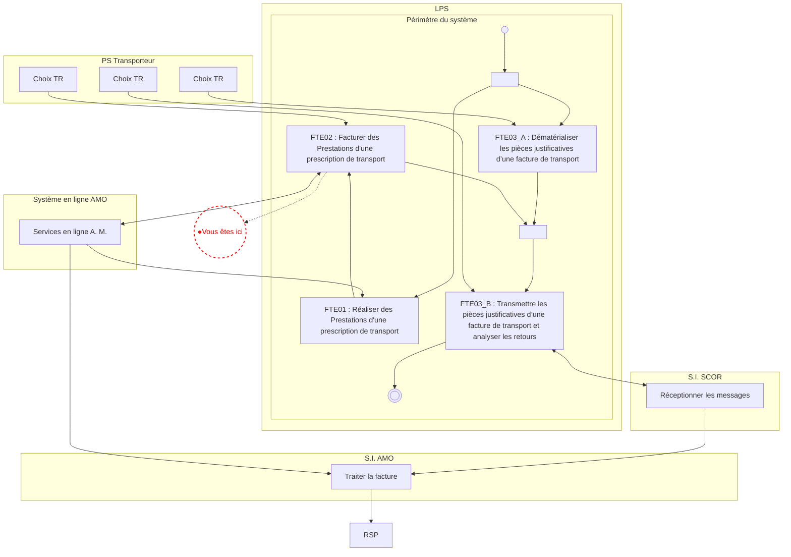
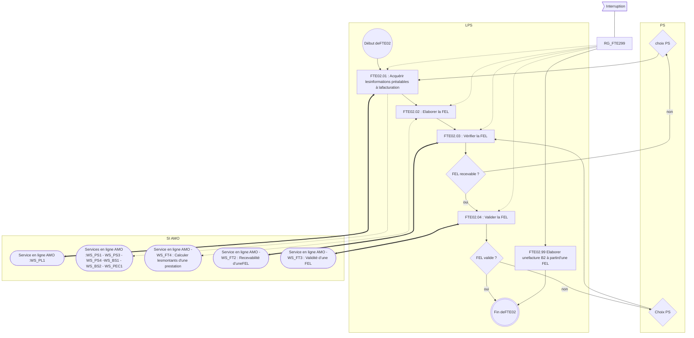
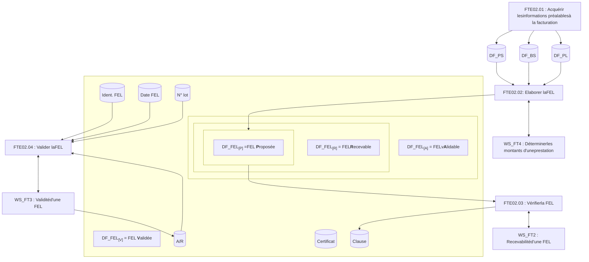
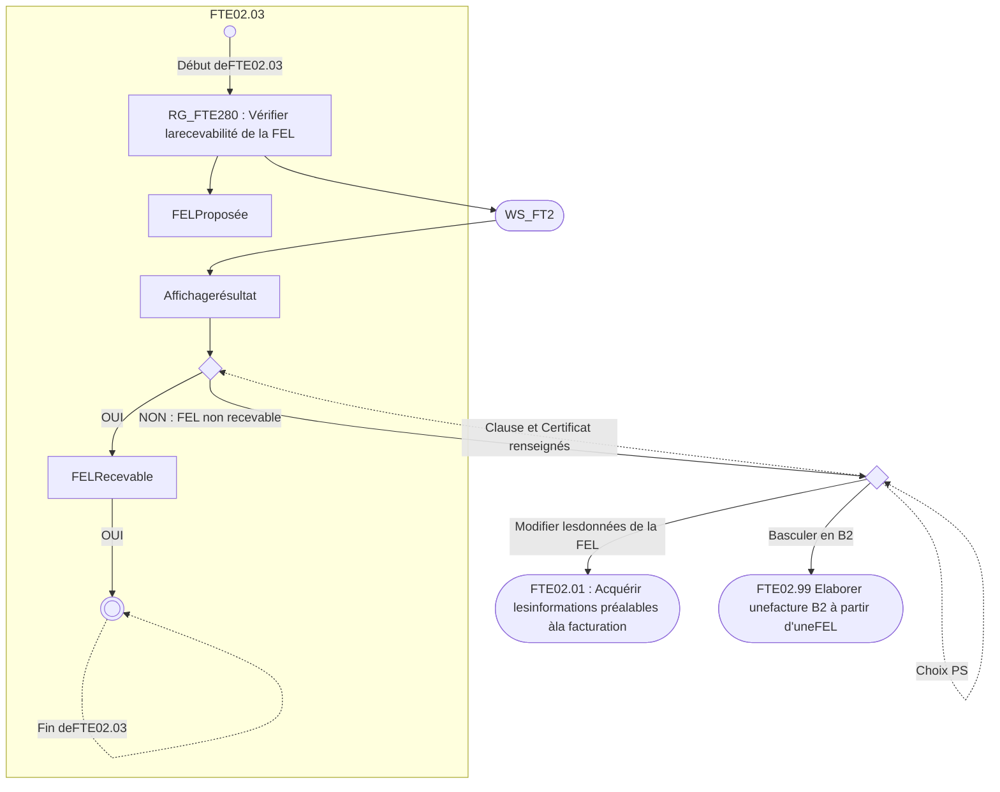

```mermaid
graph TD
    Start(( )) -->|Début de FTE02.04| RG_FTE281[RG_FTE281 : Demander au PS la validation de la FEL]
    RG_FTE281 --> Choice1{Choix PS}
    
    Choice1 -->|Valider la FEL| RG_FTE282[RG_FTE282 : Déterminer l'identifiant de la FEL]
    
    RG_FTE282 --> Fork1[ ]
    Fork1 --> RG_FTE283[RG_FTE283 : Déterminer la date de la FEL]
    Fork1 --> RG_FTE284[RG_FTE284 : Déterminer les critères de rupture de lot]
    
    RG_FTE283 --> Join1[ ]
    RG_FTE284 --> Join1[ ]
    
    Join1 --> RG_FTE287[RG_FTE287 : Déterminer le n° de lot de la FEL]
    RG_FTE287 --> RG_FTE288[RG_FTE288 : Déterminer le rang de la FEL dans le lot]
    
    RG_FTE288 --> RG_FTE290[RG_FTE290 : Valider la FEL]
    
    subgraph WS_FT3_Group [ ]
        direction LR
        FEL_vAlidable[FEL vAlidable]
        WS_FT3([WS_FT3])
        AR[A/R]
        MessageErreur[message d'erreur]
    end
    
    RG_FTE290 -.-> FEL_vAlidable
    RG_FTE290 <--> WS_FT3
    WS_FT3 -.-> AR
    WS_FT3 -.-> MessageErreur
    
    RG_FTE290 --> Choice2{Lot déjà en traitement}
    
    Choice2 -->|oui| AffichageMessage[Affichage message]
    AffichageMessage --> RG_FTE281
    
    Choice2 -->|non| Choice3{ }
    
    Choice3 -->|non| AffichageMessageErreur[Affichage message d'erreur]
    
    Choice3 -->|oui| FEL_Validee[FEL Validée]
    FEL_Validee --> RG_FTE292[RG_FTE292 : Conserver une copie de la FEL validée]
    
    RG_FTE292 --> End((( )))
    End ---|Fin de FTE02.04| End
    
    Choice1 -->|Basculer en B2| Choice4{Choix PS}
    AffichageMessageErreur --> Choice4
    
    Choice4 -->|Basculer en B2| FTE02.99[FTE02.99 Elaborer une facture B2 à partir d'une FEL]
    FTE02.99 --> RG_FTE281
    
    Choice4 -->|Vérifier à nouveau la recevabilité| FTE02.03[FTE02.03 : Vérifier la FEL]
    FTE02.03 --> RG_FTE281
    
    Choice4 -->|Modifier des données de la FEL| FTE02.01[FTE02.01 : Acquérir les informations préalables à la facturation]
    FTE02.01 --> RG_FTE281

    style Start fill:#000
    style End fill:#000,stroke:#000,stroke-width:4px
    style RG_FTE281 fill:#f5e6c4,stroke:#000
    style RG_FTE282 fill:#f5e6c4,stroke:#000
    style RG_FTE283 fill:#f5e6c4,stroke:#000
    style RG_FTE284 fill:#f5e6c4,stroke:#000
    style RG_FTE287 fill:#f5e6c4,stroke:#000
    style RG_FTE288 fill:#f5e6c4,stroke:#000
    style RG_FTE290 fill:#f5e6c4,stroke:#000
    style AffichageMessage fill:#f5e6c4,stroke:#000
    style AffichageMessageErreur fill:#f5e6c4,stroke:#000
    style FTE02.99 fill:#f5e6c4,stroke:#000
    style FTE02.03 fill:#f5e6c4,stroke:#000
    style FTE02.01 fill:#f5e6c4,stroke:#000
    style RG_FTE292 fill:#00c5cd,stroke:#000
    style FEL_vAlidable fill:#b2ffff,stroke:#000
    style FEL_Validee fill:#b2ffff,stroke:#000
    style AR fill:#b2ffff,stroke:#000
    style MessageErreur fill:#b2ffff,stroke:#000
    style Fork1 fill:#000,stroke:#000
    style Join1 fill:#000,stroke:#000
```

*Spécifications Fonctionnelles Générales*

# **Système de Facturation Transporteur**
## ***Transporteur Sanitaire***

**FTE02 - Facturer des Prestations**

Référence : FACT-SFG-032 / Version : 03.60 / Date : 27/08/2026
Diffusion : RESTREINTE
État : REFERENCE

**GIE SESAM-Vitale**
5, boulevard Marie et Alexandre Oyon – 72 019 LE MANS Cedex 2
<u>www.sesam-vitale.fr</u>

Ce document a été élaboré par le GIE SESAM-Vitale.

Conformément à l’article L.122-4 du Code de la Propriété Intellectuelle, toute représentation ou reproduction (intégrale ou partielle) du présent ouvrage, quel que soit le support utilisé, doit être soumise à l’accord préalable écrit de son auteur.

Il en est de même pour sa traduction, sa transformation, son adaptation ou son arrangement, quel que soit le procédé utilisé.

**Tout manquement à ces obligations constituerait un délit de contrefaçon, au sens **des articles L 335-2 et suivants du code de la propriété intellectuelle, susceptible** d’entraîner des sanctions pour l’auteur du délit.**

## **CONTACTS**


Pour toute demande d'évolution, comme pour toute question technique ou fonctionnelle, contactez le Centre de services :

*   portail IRIS : [https://portail-support.sesam-vitale.fr/](https://portail-support.sesam-vitale.fr/)
*   téléphone : 02 43 57 42 88

*SFG - Système de Facturation Transporteur - Transporteur Sanitaire*
*FACT-SFG-032 FTE02 - Facturer des Prestations Version : 03.60*

# **TABLES DES MATIERES**

<table>
    <tr>
      <td><b>1</b></td>
      <td><b>INTRODUCTION ......................................................................................................................</b></td>
      <td><b>4</b></td>
    </tr>
    <tr>
      <td></td>
      <td>1.1 OBJECTIF DU DOCUMENT .....................................................................................................</td>
      <td>4</td>
    </tr>
    <tr>
      <td></td>
      <td>1.2 STATUT DU DOCUMENT........................................................................................................</td>
      <td>4</td>
    </tr>
    <tr>
      <td></td>
      <td>1.3 POSITIONNEMENT DU DOCUMENT .........................................................................................</td>
      <td>4</td>
    </tr>
    <tr>
      <td></td>
      <td>1.4 CONTENU DU DOCUMENT.....................................................................................................</td>
      <td>4</td>
    </tr>
    <tr>
      <td></td>
      <td>1.5 DOCUMENTS DE REFERENCE ...............................................................................................</td>
      <td>4</td>
    </tr>
    <tr>
      <td></td>
      <td>1.6 ABREVIATIONS ....................................................................................................................</td>
      <td>4</td>
    </tr>
    <tr>
      <td></td>
      <td>1.7 DEFINITIONS .......................................................................................................................</td>
      <td>5</td>
    </tr>
    <tr>
      <td></td>
      <td>1.8 GUIDE DE LECTURE .............................................................................................................</td>
      <td>5</td>
    </tr>
    <tr>
      <td><b>2</b></td>
      <td><b>PRESENTATION DU SOUS-PROCESSUS FTE02 .................................................................</b></td>
      <td><b>5</b></td>
    </tr>
    <tr>
      <td></td>
      <td>2.1 POSITIONNEMENT DU SOUS-PROCESSUS FTE02...................................................................</td>
      <td>5</td>
    </tr>
    <tr>
      <td></td>
      <td>2.2 DESCRIPTION GENERALE DU SOUS-PROCESSUS FTE02 : FACTURER DES PRESTATIONS .........</td>
      <td>5</td>
    </tr>
    <tr>
      <td></td>
      <td>2.3 DESCRIPTION DETAILLEE DU SOUS-PROCESSUS FTE02 : FACTURER DES PRESTATIONS .......</td>
      <td>11</td>
    </tr>
    <tr>
      <td></td>
      <td>    <i>2.3.1 FTE02.01 : Acquérir les informations préalables à la facturation ..........................</i></td>
      <td><i>11</i></td>
    </tr>
    <tr>
      <td></td>
      <td>    <i>2.3.2 FTE02.02 : Elaborer la FEL .................................................................................</i></td>
      <td><i>18</i></td>
    </tr>
    <tr>
      <td></td>
      <td>        2.3.2.1 FTE02.02.01 : Déterminer les informations relatives aux Partenaires de santé (PS)...........</td>
      <td>23</td>
    </tr>
    <tr>
      <td></td>
      <td>        2.3.2.2 FTE02.02.02 : Déterminer les informations relatives au bénéficiaire des soins (BS) ...........</td>
      <td>26</td>
    </tr>
    <tr>
      <td></td>
      <td>        2.3.2.3 FTE02.02.03 : Déterminer les informations relatives à la Prescription (PC).........................</td>
      <td>28</td>
    </tr>
    <tr>
      <td></td>
      <td>        2.3.2.4 FTE02.02.04 : Déterminer les informations relatives aux Prestations (IP) ...........................</td>
      <td>31</td>
    </tr>
    <tr>
      <td></td>
      <td>        2.3.2.5 FTE02.02.05 : Déterminer les informations relatives aux Contextes de Facturation de la<br />facture (CF) ..........................................................................................................................</td>
      <td>40</td>
    </tr>
    <tr>
      <td></td>
      <td>        2.3.2.6 FTE02.02.06 : Valoriser les montants de la facture (VF)......................................................</td>
      <td>48</td>
    </tr>
    <tr>
      <td></td>
      <td>    <i>2.3.3 FTE02.03 : Vérifier la FEL....................................................................................</i></td>
      <td><i>67</i></td>
    </tr>
    <tr>
      <td></td>
      <td>    <i>2.3.4 FTE02.04 : Valider la FEL....................................................................................</i></td>
      <td><i>69</i></td>
    </tr>
    <tr>
      <td></td>
      <td>    <i>2.3.5 FTE02.99 : Elaborer une Facture B2....................................................................</i></td>
      <td><i>76</i></td>
    </tr>
</table>

# **TABLE DES ILLUSTRATIONS**

<table>
    <tr>
      <td>FIGURE 1 : PROCESSUS D’UTILISATION DU SYSTEME EN MODE NOMINAL...............................................</td>
      <td>5</td>
    </tr>
    <tr>
      <td>FIGURE 2 : PROCESSUS FTE02 : FACTURER DES PRESTATIONS .........................................................</td>
      <td>9</td>
    </tr>
    <tr>
      <td>FIGURE 3 : CONSTITUTION D’UNE FEL .............................................................................................</td>
      <td>10</td>
    </tr>
    <tr>
      <td>FIGURE 4 : PROCESSUS FTE02.01 : ACQUERIR LES INFORMATIONS PREALABLES A LA FACTURATION ..</td>
      <td>12</td>
    </tr>
    <tr>
      <td>FIGURE 5 : PROCESSUS FTE02.02 : ELABORER LA FEL ...................................................................</td>
      <td>22</td>
    </tr>
    <tr>
      <td>FIGURE 6 : PROCESSUS FTE02.02.01 : DETERMINER LES INFORMATIONS RELATIVES AUX PARTENAIRES<br />DE SANTE (PS) ........................................................................................................................</td>
      <td>23</td>
    </tr>
    <tr>
      <td>FIGURE 7 : PROCESSUS FTE02.02.04 : DETERMINER LES INFORMATIONS RELATIVES AUX PRESTATIONS<br />(IP).........................................................................................................................................</td>
      <td>32</td>
    </tr>
    <tr>
      <td>FIGURE 8 : PROCESSUS FTE02.02.05 : DETERMINER LES INFORMATIONS RELATIVES AUX CONTEXTES<br />DE FACTURATION DE LA FACTURE (CF) .....................................................................................</td>
      <td>41</td>
    </tr>
    <tr>
      <td>FIGURE 9 : PROCESSUS FTE02.02.06 : VALORISER LES MONTANTS DE LA FACTURE (VF)...................</td>
      <td>52</td>
    </tr>
    <tr>
      <td>FIGURE 10 : PROCESSUS FTE02.03 : VERIFIER LA FEL....................................................................</td>
      <td>67</td>
    </tr>
    <tr>
      <td>FIGURE 11 : PROCESSUS FTE02.04 : VALIDER LA FEL.....................................................................</td>
      <td>70</td>
    </tr>
</table>

27/08/2026 3 / 88
*Ce document ne peut être diffusé sans l'autorisation d'une personne habilitée au GIE SESAM-Vitale*


*SFG - Système de Facturation Transporteur - Transporteur Sanitaire*
*FACT-SFG-032* *FTE02 - Facturer des Prestations* *Version : 03.60*

# 1 **Introduction**

## 1.1 **Objectif du document**

Ce document a pour but de spécifier la fonctionnalité « FTE02 : Facturer des Prestations ».

## 1.2 **Statut du document**

Ces SFG sont en version provisoire et référencée.

## 1.3 **Positionnement du document**

Ce document fait partie du corpus documentaire des SFG du système de Facturation Transporteur Etendue **(FTE).**

## 1.4 **Contenu du document**

Outre ce chapitre introductif, ce document de spécifications fonctionnelles générales comporte le chapitre 2 qui présente le périmètre du sous-processus FTE02.

## 1.5 **Documents de référence**

<table>
  <thead>
    <tr>
      <th><b>Appellation</b></th>
      <th><b>Type et titre</b></th>
      <th><b>Référence</b></th>
    </tr>
  </thead>
  <tbody>
    <tr>
      <td>[DICO]</td>
      <td>Dictionnaire du système FTE</td>
      <td>FACT-SFG-029</td>
    </tr>
    <tr>
      <td>[FTE03]</td>
      <td>FTE03-Contrôler et transmettre les pièces justificatives d’une facture de transport</td>
      <td>FACT-SFG-033</td>
    </tr>
    <tr>
      <td>[FTE04]</td>
      <td>FTE04-Consulter les référentiels de l'AMO</td>
      <td>FACT-SFG-034</td>
    </tr>
    <tr>
      <td>[FTE05]</td>
      <td>FTE05-Administrer le poste PS</td>
      <td>FACT-SFG-035</td>
    </tr>
    <tr>
      <td>[PG]</td>
      <td>Présentation Générale du système FTE</td>
      <td>FACT-SFG-030</td>
    </tr>
    <tr>
      <td>[WS_FT]</td>
      <td>WP_FT - Services en Ligne "Facture"</td>
      <td>SEL-MP-015</td>
    </tr>
    <tr>
      <td>[B2]</td>
      <td>Norme B2</td>
      <td>• version juin 2007-AddendumB<br />• version juin 2005<br />• <mark><s><u>Norme_B2_Notice_Avenant6_</u></s></mark><br /><mark><s><u>Transports_sanitaires_2012-</u></s></mark><br /><mark><s><u>04-24.pdf</u></s></mark><br />• <mark>Annexes et compléments sur</mark><br /><mark>ameli.fr</mark></td>
    </tr>
    <tr>
      <td>[Géoloc]</td>
      <td>Constituer et transmettre les traces de géolocalisation</td>
      <td>FACT-SFG-039 dans le corpus Géolocalisation</td>
    </tr>
  </tbody>
</table>

## 1.6 **Abréviations**

Cf. Document FACT-SFG-029 : Dictionnaire.

*27/08/2026* *4 / 88*
*Ce document ne peut être diffusé sans l'autorisation d'une personne habilitée au GIE SESAM-Vitale*


*SFG - Système de Facturation Transporteur - Transporteur Sanitaire*
*FACT-SFG-032 FTE02 - Facturer des Prestations Version : 03.60*

# 1.7 Définitions

Cf. Document FACT-SFG-029 : Dictionnaire.

# 1.8 Guide de lecture

Cf. Document FACT-SFG-030 : PG-Annexe 1 : Guide de lecture.

# 2 Présentation du sous-processus FTE02

# 2.1 Positionnement du sous-processus FTE02



**Figure 1 : Processus d’utilisation du système en mode nominal**

# 2.2 Description générale du sous-processus FTE02 : Facturer des Prestations

### Vue générale

*Description* L’objet du sous-processus FTE02 est de :

*   réunir l’ensemble des informations pour constituer une facture.

*27/08/2026 5 / 88*
*Ce document ne peut être diffusé sans l'autorisation d'une personne habilitée au GIE SESAM-Vitale*


*SFG - Système de Facturation Transporteur - Transporteur Sanitaire*
FACT-SFG-032 *FTE02 - Facturer des Prestations* *Version : 03.60*

*   faire vérifier la FEL par l’Assurance Maladie, puis transmettre cette facture à des fins de remboursement.

Les informations constituant la FEL sont :

*   soit déjà connues du système, suite au déroulement du sous-processus FTE01 réalisé au préalable,
*   soit renseignées par le Professionnel de Santé,
*   soit obtenues par le système en interrogeant un service en ligne AMO (cf. FTE02.01).

 La présente description du sous-processus FTE02 correspond à un enchaînement fonctionnel cohérent des traitements et des données.
Pour autant, elle n’impose aucune cinématique d’implémentation.
De façon générale, l’acquisition ou la détermination d’une donnée est à réaliser, au plus tard, au moment où la donnée est utilisée par une règle de gestion.

Ce processus est décrit dans les 2 scénarii parallèles suivants :

*   PEL (Prescription En Ligne)
*   PP (Prescription Papier <u>ou appel du SAMU – centre 15</u>)

Pour chaque règle décrite dans le présent document, les différences de traitement entre le scénario PEL et le scénario PP sont mises en évidence dans 2 rubriques distinctes. En l’absence de précision, le traitement spécifié est commun aux 2 scénarii.

Le processus de FTE02 est présenté dans le schéma ci-après (Figure 2).

*27/08/2026* 6 / 88
*Ce document ne peut être diffusé sans l'autorisation d'une personne habilitée au GIE SESAM-Vitale*


*SFG - Système de Facturation Transporteur - Transporteur Sanitaire*
FACT-SFG-032 *FTE02 - Facturer des Prestations Version : 03.60*

## ***Principes***

### *P1* **Modification des informations issues de l’Assurance Maladie**

Les informations de la FEL acquises à partir des référentiels de l’Assurance Maladie n’ont, a priori, pas à être modifiées par le Transporteur.

Toutefois, dans le cas où cela s’avèrerait nécessaire, le LPS doit permettre au Transporteur de modifier ces informations.

### *P2.1* **Rupture de facture** *par contexte de prise en charge*

Pour une même prescription, il convient d’élaborer autant de FEL que de contextes différents de prise en charge de la prescription.

Ce contexte de prise en charge de la prescription est obtenu pour chaque prestation par consultation du service en ligne PEC.

La FEL en cours d’élaboration par le processus FTE02 ne doit concerner que des prestations relevant du même contexte de prise en charge.

L’ensemble du processus FTE02 est à reprendre pour les autres prestations de la prescription.

Exception : les prestations secondaires TMR ne sont pas concernées par ce principe.

### *P2.2* **Rupture de facture** *par type de forfait*

Une même facture contient uniquement des prestations de même type de forfait.

Donc, pour une même prescription, il convient d’élaborer autant de facture que de type forfait différent.

Exception : les prestations secondaires TMR ne sont pas concernées par ce principe.

### *P2.3* **Rupture de facture** *par justificatif d’exonération du TM*

Une même facture contient uniquement des prestations de même justificatif d’exonération du TM.

Donc, pour une même prescription, il convient d’élaborer autant de facture que de justificatif d’exonération du TM différent.

Exception : les prestations secondaires TMR ne sont pas concernées par ce principe.

### *P2.4* **Rupture de facture** *par taux de remboursement*

Une même facture contient uniquement des prestations de même taux de remboursement.

Donc, pour une même prescription, il convient d’élaborer autant de facture que de taux de remboursement différent.

Exception : les prestations secondaires TMR ne sont pas concernées par ce principe.

### *P2.5* **Rupture de facture pour changement de tarif**

Pour une facture comportant plusieurs prestations il est nécessaire d'élaborer 2 factures dès lors que des prestations sont réalisées avant et après un changement de tarif.

Exception : les prestations secondaires TMR ne sont pas concernées par ce principe.

### *P2.6* **Rupture de facture** *par code prestation*

Une même facture contient uniquement des prestations de même nature de prestation.

Donc, pour une même prescription, il convient d’élaborer autant de facture que de nature de prestation différentes.

Exception : les prestations secondaires TMR ne sont pas concernées par ce principe.

### <mark><u>*P2.7* **Rupture de facture** *par rapport au refus de transport partagé*</u></mark>

<mark><u>Une même facture contient uniquement des transports sans refus de transport partagé ou uniquement des transports avec refus de transport partagé.</u></mark>

*27/08/2026* 7 / 88
*Ce document ne peut être diffusé sans l'autorisation d'une personne habilitée au GIE SESAM-Vitale*


*SFG - Système de Facturation Transporteur - Transporteur Sanitaire*
FACT-SFG-032 FTE02 - Facturer des Prestations *Version : 03.60*

### *Précision* **Pas de mixage des types de supplément forfaitaire**

Une même facture contient uniquement des prestations comportant des suppléments forfaitaires de même type : le mixage n’est pas possible.

Exception : les prestations secondaires TMR ne sont pas concernées par ce principe.

### *P3* **Principe des arrondis**

Pour toute opération réalisée, le résultat :

*   est arrondi par excès (centime supérieur) dès lors que la troisième décimale est supérieure ou égale à 5,
*   est arrondi par défaut (centime inférieur) dès lors que la troisième décimale est inférieure ou égale à 4.

Quand le calcul comporte plusieurs opérations, cette règle d’arrondi s’applique à chaque étape du calcul.

### *P5* **Positionnement des prestations secondaires TMR par rapport aux trajets**

Une prestation secondaire TMR ne peut être facturée seule. Elle doit être en rapport avec une prestation/trajet.

La prestation secondaire TMR doit être placée dans les messages XML immédiatement à la suite du trajet (aller ou retour) auquel la prestation secondaire est rattachée.

### *P6* La tarification applicable (socle ou majorée) est paramétrée par l’éditeur pour chaque entreprise de transport. La tarification applicable (socle ou majorée) concerne l’ensemble des factures établies via SEFi par une entreprise de transport.

En cas de bascule en facturation B2, seule la tarification socle s’applique.

Cf. paramétrage dans la règle RG_FTE506 de FTE05 [FACT-SFG-035].

En cas de facturation par une société mandataire, celle-ci ne pourra réaliser la facturation que des sociétés mandantes bénéficiant de la même tarification.

*   Si la société mandataire applique la tarification socle, elle ne pourra établir les factures que pour le compte des sociétés mandantes appliquant la tarification socle.
*   Si la société mandataire bénéficie de la tarification majorée, elle ne pourra établir les factures que pour le compte des sociétés mandantes bénéficiant de la tarification majorée.

***Entrées*** PEL EF_FTE_PEL
Prescription papier <mark><u>ou appel du SAMU – centre 15</u></mark>

***Sorties*** FEL EF_FTE_FEL
ou Facture B2

*27/08/2026* 8 / 88
*Ce document ne peut être diffusé sans l'autorisation d'une personne habilitée au GIE SESAM-Vitale*


*SFG - Système de Facturation Transporteur - Transporteur Sanitaire*
*FACT-SFG-032 *FTE02 - Facturer des Prestations* Version : 03.60*

## **Schéma processus**



Figure 2 : Processus FTE02 : Facturer des Prestations

### **<u>Légende :</u>**

− − − − − − − − −> *Appel conditionné par l’activation/désactivation préalable par le Transporteur*
<− − − − − − − − −

*27/08/2026* 9 / 88
*Ce document ne peut être diffusé sans l'autorisation d'une personne habilitée au GIE SESAM-Vitale*


FACT-SFG-032
*SFG - Système de Facturation Transporteur - Transporteur Sanitaire*
*FTE02 - Facturer des Prestations*
*Version : 03.60*

## **Constitution de la FEL**

### Constitution de la FEL



**Figure 3 : Constitution d’une FEL**

Le schéma ci-dessus présente l’évolution de la FEL dans l’enchaînement des traitements du processus FTE02.

 Remarque : les informations de prise en charge sont dans le domaine fonctionnel DF_BS.

## **Règles de gestion**

### **[RG_FTE299] *Basculer en facturation B2***

À tout moment le Transporteur peut arrêter l'élaboration de la FEL pour basculer en facturation B2.

Dans ce cas, seule la tarification socle s’applique.

*27/08/2026*
10 / 88
*Ce document ne peut être diffusé sans l'autorisation d'une personne habilitée au GIE SESAM-Vitale*


*SFG - Système de Facturation Transporteur - Transporteur Sanitaire*
FACT-SFG-032 **FTE02 - Facturer des Prestations** *Version : 03.60*

# **2.3 Description détaillée du sous-processus FTE02 : Facturer des Prestations**

## **2.3.1 FTE02.01 : Acquérir les informations préalables à la facturation**

### **Vue générale**

***Description*** Cette opération a pour objet de réunir les informations des référentiels de l’Assurance Maladie pour l’élaboration de la facture.

Cette opération constitue un préalable à l’élaboration de la FEL.

La mise en œuvre de chaque règle de cette opération est liée à l’activation préalable par le Transporteur du service en ligne appelé par cette règle.

Le processus de cette opération est présenté dans le schéma ci-après (Figure 4)

***Scénario PEL***

L’utilisation du service en ligne AMO de consultation de la PEL (WS_PL1) se fait uniquement dans le cas d’une Prescription en Ligne (PEL).

***Scénario PP***

En cas d’utilisation d’une prescription papier <mark><u>ou d’un appel du SAMU – centre 15,</u></mark> la possibilité est donnée au Transporteur de fiabiliser certaines données de la prescription en consultant les référentiels de l’A.M.

<table>
    <tr>
      <td rowspan="7"><i><b>Entrées</b></i></td>
      <td>Prescription papier <mark><u>ou appel du SAMU – centre 15</u></mark> <b><i>[Scénario PP]</i></b></td>
      <td></td>
    </tr>
    <tr>
      <td>Activation WS_PS1</td>
      <td>EF_FTE90_11</td>
    </tr>
    <tr>
      <td>Activation WS_PS3</td>
      <td>EF_FTE90_13</td>
    </tr>
    <tr>
      <td>Activation WS_PS4</td>
      <td>EF_FTE90_14</td>
    </tr>
    <tr>
      <td>Activation WS_BS1</td>
      <td>EF_FTE90_21</td>
    </tr>
    <tr>
      <td>Activation WS_BS2</td>
      <td>EF_FTE90_22</td>
    </tr>
    <tr>
      <td>Activation WS_PEC1</td>
      <td>EF_FTE90_29</td>
    </tr>
    <tr>
      <td rowspan="10"><i><b>Sorties</b></i></td>
      <td>Prescription en Ligne <b><i>[Scénario PEL]</i></b></td>
      <td>DF_FTE_PEL</td>
    </tr>
    <tr>
      <td>Partenaire de Santé Individu <sub>[prescripteur]</sub></td>
      <td>EF_FTE10<sub>[prescripteur]</sub></td>
    </tr>
    <tr>
      <td>Liste des Personnels</td>
      <td>EF_FTE14</td>
    </tr>
    <tr>
      <td>Liste des Véhicules</td>
      <td>EF_FTE16</td>
    </tr>
    <tr>
      <td>Bénéficiaire</td>
      <td>EF_FTE20</td>
    </tr>
    <tr>
      <td>Assuré</td>
      <td>EF_FTE21</td>
    </tr>
    <tr>
      <td>Couverture</td>
      <td>EF_FTE22</td>
    </tr>
    <tr>
      <td>Contexte de prise en charge d’une prescription</td>
      <td>EF_FTE28</td>
    </tr>
    <tr>
      <td><i>Pour chaque prestation de la prescription</i></td>
      <td></td>
    </tr>
    <tr>
      <td>    Prise en charge d’une prestation d’une prescription</td>
      <td>EF_FTE29</td>
    </tr>
</table>

27/08/2026 11 / 88
*Ce document ne peut être diffusé sans l'autorisation d'une personne habilitée au GIE SESAM-Vitale*


*FACT-SFG-032* *SFG - Système de Facturation Transporteur - Transporteur Sanitaire* *Version : 03.60*
*FTE02 - Facturer des Prestations*

## **Schéma**



```mermaid
graph TD
    subgraph LPS
        Start(( )) --> StartText[Début de FTE02.01]
        StartText --> Sync1[ ]
        
        Sync1 --> Decision1{Scénario}
        Decision1 -- "<u>PEL</u>" --> RG_FTE200["**RG_FTE200 : Acquérir les données de la PEL**"]
        subgraph RG_FTE200_Box [ ]
            RG_FTE200 --- FTE04.31["**FTE04.31 : Consulter la PEL**"]
        end
        
        Sync1 --> RG_FTE204["**RG_FTE204 : Acquérir les données RNT du transporteur**"]
        subgraph RG_FTE204_Box [ ]
            RG_FTE204 --- FTE04.14["**FTE04.14 : Consulter les données RNT**"]
        end

        Decision1 -- "<u>PP</u>" --> Sync2[ ]
        RG_FTE200_Box --> Sync2
        
        Sync2 --> RG_FTE201["**RG_FTE201 : Acquérir les données du Prescripteur de la prescription**"]
        Sync2 --> RG_FTE202["**RG_FTE202 : Acquérir les données du Bénéficiaire de la prescription**"]
        Sync2 --> RG_FTE203["**RG_FTE203 : Acquérir les données de prise en charge d'une prestation**"]
        
        subgraph RG_FTE203_Box [ ]
            RG_FTE203 --- FTE04.29["**FTE04.29 : Consulter la prise en charge d'une prestation**"]
        end

        RG_FTE201 --> Sync3[ ]
        RG_FTE202 --> Sync3
        RG_FTE203_Box --> Decision2{ }
        Decision2 -- "autre prestation" --> Sync2
        Decision2 --> Sync3
        
        RG_FTE204_Box --> Sync4[ ]
        Sync3 --> Sync4
        
        Sync4 --> EndText[Fin de FTE02.01]
        EndText --> End((( )))
    end

    subgraph SI_AMO [SI AMO]
        WS_PS4([WS_PS4])
        WS_PL1([WS_PL1])
        WS_PS1_PS3([WS_PS1 - WS_PS3])
        WS_BS1_BS2([WS_BS1 - WS_BS2])
        WS_PEC1([WS_PEC1])
    end

    FTE04.14 <==> WS_PS4
    FTE04.31 <==> WS_PL1
    RG_FTE201 <==> WS_PS1_PS3
    RG_FTE202 <==> WS_BS1_BS2
    FTE04.29 <==> WS_PEC1

    style Sync1 fill:#333,stroke:#333,stroke-width:4px
    style Sync2 fill:#333,stroke:#333,stroke-width:4px
    style Sync3 fill:#333,stroke:#333,stroke-width:4px
    style Sync4 fill:#333,stroke:#333,stroke-width:4px
    style Start fill:#000
    style End fill:#fff,stroke:#000,stroke-width:4px
```

**Figure 4 : Processus FTE02.01 : Acquérir les informations préalables à la facturation**

### **<u>Légende :</u>**

− − − − − − − − −>
<− − − − − − − − − *Appel conditionné par l’activation/désactivation préalable par le Transporteur*

*27/08/2026* *12 / 88*
*Ce document ne peut être diffusé sans l'autorisation d'une personne habilitée au GIE SESAM-Vitale*


*SFG - Système de Facturation Transporteur - Transporteur Sanitaire*
FACT-SFG-032 *FTE02 - Facturer des Prestations* *Version : 03.60*

**Règles de**
**gestion**

## **[RG_FTE200] Acquérir les données de la PEL**

Le LPS effectue l’acquisition des données de la PEL par appel de la fonction FTE04.31 : « Consulter la PEL ». Cf. [FTE04].

 L’appel de cette règle est optionnel, cette acquisition pouvant avoir été faite au préalable, au cours du sous-processus FTE01.

 Cette règle est utilisée uniquement dans le cadre de l’existence d’une PEL (scénario PEL)

## **[RG_FTE201] Acquérir les données du Prescripteur de la prescription**

### **1. Détermination du lieu d’exercice du prescripteur (EF_FTE71_06)**

***Scénario PEL***

Si le prescripteur exerce en libéral, l’identifiant du prescripteur dans la PEL est un numéro de type A.M (EF_FTE32 renseignée dans la PEL), éventuellement complété de son n° RPPS (EF_FTE33 renseignée).

Dans le cas contraire, le prescripteur exerce en établissement : l’identifiant du prescripteur dans la PEL est un numéro de type FINESS (EF_FTE35 renseignée dans la PEL), éventuellement complété de son n° RPPS (EF_FTE33 renseignée).

***Scénario PP***

Le lieu d’exercice du prescripteur est renseigné par le Transporteur à partir de la PP.

### **2. Acquisition des données du prescripteur**

Si le prescripteur exerce en libéral, les données du prescripteur (EF_FTE10<sub>[Prescripteur]</sub>) sont acquises comme suit :

*   L’identifiant A.M. du PS (EF_FTE10_01) est renseigné à partir de l’identifiant A.M. du prescripteur de la prescription :

    ***Scénario PEL***
    Renseigné par le LPS à partir de la PEL (EF_FTE32_01).

    ***Scénario PP***
    Renseigné par le Transporteur à partir de la PP

*   Les autres informations sont obtenues par l’appel à la règle RG_FTE411 : Acquérir les informations d’un PS individu :

<table>
  <thead>
    <tr>
      <th colspan="2"><b>Données PS</b></th>
      <th></th>
      <th>Opération WS_PS1</th>
    </tr>
  </thead>
  <tbody>
    <tr>
      <td>Code spécialité du PS</td>
      <td>EF_FTE10_05</td>
      <td>🡨</td>
      <td>DS_PS1_E10.05</td>
    </tr>
    <tr>
      <td>Identifiant RPPS du PS</td>
      <td>EF_FTE10_02</td>
      <td>🡨</td>
      <td>DS_PS1_E10.02</td>
    </tr>
  </tbody>
</table>

*27/08/2026* *13 / 88*
*Ce document ne peut être diffusé sans l'autorisation d'une personne habilitée au GIE SESAM-Vitale*


FACT-SFG-032 *SFG - Système de Facturation Transporteur - Transporteur Sanitaire* Version : 03.60
FTE02 - Facturer des Prestations

 Le LPS effectue cette acquisition uniquement si le service WS_PS1 est activé pour la facturation (EF_FTE90_11 positionné).

*   Les informations de structure (EF_FTE12) sont non renseignées.

Dans le cas contraire, le prescripteur exerce en établissement, les données de l’établissement du prescripteur (EF_FTE12) sont renseignées comme suit :

*   L’identifiant de la structure (EF_FTE12_01) est renseigné à partir de l’identifiant A.M. du prescripteur de la prescription :

---
**_Scénario PEL_**
Renseigné par le LPS à partir de la PEL (EF_FTE35_01).

---
**_Scénario PP_**
Renseigné par le Transporteur à partir de la PP

*   Les autres informations sont obtenues par l’appel à la règle RG_FTE413 : Acquérir les informations d’une structure de soins :

<table>
  <thead>
    <tr>
      <th colspan="2"><b>Données PS</b></th>
      <th></th>
      <th>Opération WS_PS3</th>
    </tr>
  </thead>
  <tbody>
    <tr>
      <td>Code spécialité PS exerçant<br />dans l’établissement de soins</td>
      <td>EF_FTE12_02</td>
      <td>🡨</td>
      <td>DS_PS3_E12.02</td>
    </tr>
  </tbody>
</table>

 Le LPS effectue cette acquisition uniquement si le service WS_PS3 est activé pour la facturation (EF_FTE90_13 positionné).

*   Les données du prescripteur individu (EF_FTE10<sub>[Prescripteur]</sub>) sont non renseignées.

 **_Cas d’erreur_**

**[CE1] Erreur fonctionnelle reçue**

 Ce cas d’erreur correspond à la consigne générale CG_PG001.

**_[RG_FTE202] Acquérir les données du bénéficiaire de la prescription_**

---
**_Scénario PEL_**

Les données du bénéficiaire (DF_FTE_BS) sont issues de la PEL préalablement consultée :

<table>
  <thead>
    <tr>
      <th colspan="2"><b>Données BS</b></th>
      <th></th>
      <th><b>Donnée de la PEL</b></th>
    </tr>
  </thead>
  <tbody>
    <tr>
      <td>Nom de famille</td>
      <td>EF_FTE20_01</td>
      <td>🡨</td>
      <td>EF_FTE31_03</td>
    </tr>
    <tr>
      <td>Nom d’usage</td>
      <td>EF_FTE20_02</td>
      <td>🡨</td>
      <td>EF_FTE31_04</td>
    </tr>
    <tr>
      <td>Prénom</td>
      <td>EF_FTE20_03</td>
      <td>🡨</td>
      <td>EF_FTE31_05</td>
    </tr>
    <tr>
      <td>Date de naissance</td>
      <td>EF_FTE20_04</td>
      <td>🡨</td>
      <td>EF_FTE31_06</td>
    </tr>
    <tr>
      <td>Rang du bénéficiaire</td>
      <td>EF_FTE20_05</td>
      <td>🡨</td>
      <td>EF_FTE31_07</td>
    </tr>
    <tr>
      <td>NIR de l’ouvrant droit</td>
      <td>EF_FTE21_01</td>
      <td>🡨</td>
      <td>EF_FTE31_01</td>
    </tr>
    <tr>
      <td>Clé du NIR de l’ouvrant droit</td>
      <td>EF_FTE21_02</td>
      <td>🡨</td>
      <td>EF_FTE31_02</td>
    </tr>
  </tbody>
</table>

*27/08/2026* 14 / 88
*Ce document ne peut être diffusé sans l'autorisation d'une personne habilitée au GIE SESAM-Vitale*


FACT-SFG-032 *SFG - Système de Facturation Transporteur - Transporteur Sanitaire* Version : 03.60
*FTE02 - Facturer des Prestations*

Ces données sont complétées par l’appel à la règle RG_FTE422 pour l’acquisition des données suivantes :

<table>
  <thead>
    <tr>
      <th colspan="2"><b>Données BS</b></th>
      <th></th>
      <th>Opération WS_BS2</th>
    </tr>
  </thead>
  <tbody>
    <tr>
      <td>Code régime</td>
      <td>EF_FTE22_01</td>
      <td>🡨</td>
      <td>DS_BS2_E22.01</td>
    </tr>
    <tr>
      <td>Code caisse gestionnaire</td>
      <td>EF_FTE22_02</td>
      <td>🡨</td>
      <td>DS_BS2_E22.02</td>
    </tr>
    <tr>
      <td>Code centre gestionnaire</td>
      <td>EF_FTE22_03</td>
      <td>🡨</td>
      <td>DS_BS2_E22.03</td>
    </tr>
  </tbody>
</table>

 Le LPS effectue cette acquisition uniquement si le service WS_BS2 est activé pour la facturation (EF_FTE90_22 positionné).

***Scénario PP***

Les données du bénéficiaire (DF_FTE_BS) sont issues de l’appel à la règle RG_FTE423 (cf. [FTE04]), le Transporteur <u>renseignant les informations d’appel</u> aux services à partir de la Prescription Papier <mark><u>ou de l’appel du SAMU – centre 15.</u></mark>

 Le LPS effectue cette acquisition uniquement si les services WS_BS1 et WS_BS2 sont activés pour la facturation (EF_FTE90_21 et EF_FTE90_22 positionnés).

 ***Cas d’erreur***

**[CE1] Erreur fonctionnelle reçue**

 Ce cas d’erreur correspond à la consigne générale CG_PG001.

## *[RG_FTE203] Acquérir les données de prise en charge d’une prestation de la prescription*

L’acquisition des données de prise en charge d’une prestation de la prescription s’effectue par l’appel de la règle RG_FTE429 : « Acquérir la prise en charge d’une prestation d’une prescription ». Cf. [FTE04].

Les données acquises sont réparties comme suit :

* D’une part, les données communes à l’ensemble des prestations (EF_FTE28 : « Contexte de prise en charge d’une prescription »).
* D’autre part, les données spécifiques à la prestation (EF_FTE29 : « Prise en charge d’une prestation d’une prescription »).

 La date de réalisation de la prestation correspond à la date de départ du trajet (EF_FTE63_01).

 Le LPS effectue cette acquisition uniquement si le service WS_PEC1 est activé pour la facturation (EF_FTE90_29 positionné).

 ***Cas particulier et cas d’erreur***

### **[CP1] Prestation secondaire TMR**

Une prestation secondaire TMR reprend les données obtenues pour le trajet auquel elle est rattachée.

*27/08/2026* *Ce document ne peut être diffusé sans l'autorisation d'une personne habilitée au GIE SESAM-Vitale* *15 / 88*


FACT-SFG-032
*SFG - Système de Facturation Transporteur - Transporteur Sanitaire*
*FTE02 - Facturer des Prestations*
Version : 03.60

### **[CE01] Rupture de facture**

Si les données de contexte de prise en charge de la prescription (EF_FTE28) reçues sont différentes de celles obtenues pour les prestations précédentes relatives à la prescription traitée, cela signifie que la situation du bénéficiaire a évolué entre la date de réalisation de la prestation considérée et la date de réalisation de la prestation précédente. Dans ce cas, il convient d’effectuer une rupture de facture (cf. Description du sous-processus FTE02, §2.2).

Les ruptures de facture ne concernent pas les prestations secondaires TMR.

### **[RG_FTE204] Acquérir les données du RNT**

L’acquisition des données du RNT relatives au Transporteur s’effectue par la fonction FTE04.14 : « Consulter les informations RNT ». Cf. [FTE04].

 Le LPS effectue cette acquisition uniquement si le service WS_PS4 est activé pour la facturation (EF_FTE90_14 positionné).

**Utilisation des données acquises**

Le tableau ci-après présente pour chaque opération à appeler au préalable, les données utilisées pour l’élaboration de la FEL :

<table>
  <thead>
    <tr>
      <th colspan="2"></th>
      <th colspan="2">Données d’entrée utilisées</th>
      <th colspan="2">Données de sortie utilisées</th>
      <th>Utilisation <b>pour la FEL</b> <b>(FTE02.02)</b></th>
    </tr>
    <tr>
      <th><b>Opération</b></th>
      <th>WS</th>
      <th>Scénario PEL</th>
      <th>Scénario PP</th>
      <th>Scénario PEL</th>
      <th>Scénario PP</th>
      <th></th>
    </tr>
  </thead>
  <tbody>
    <tr>
      <td><i><b>RG_FTE204</b><br />Acquérir les données RNT du TR</i></td>
      <td>WS_PS4</td>
      <td colspan="2"><i>aucune</i></td>
      <td colspan="2">Véhicules (EF_FTE16)<br />Personnel (EF_FTE14)</td>
      <td>RG_FTE221</td>
    </tr>
    <tr>
      <td><i><b>RG_FTE200</b><br />Acquérir les données de la PEL</i></td>
      <td>WS_PL1</td>
      <td>Identifiant de la prescription (EF_FTE30_01)<br /><br />Nom de famille du bénéficiaire (EF_FTE20_01)</td>
      <td><i>Sans objet</i></td>
      <td>DF_FTE_PEL</td>
      <td><i>Sans objet</i></td>
      <td>RG_FTE214<br />RG_FTE215<br />RG_FTE219<br />RG_FTE224</td>
    </tr>
    <tr>
      <td rowspan="3"><i><b>RG_FTE201</b><br />Acquérir les données du prescripteur de la prescription</i></td>
      <td>WS_PS1</td>
      <td>Identifiant A.M. du prescripteur<br />EF_FTE32_01<br />EF_FTE35_01</td>
      <td><br />Lu sur la PP</td>
      <td colspan="2">Code spécialité prescripteur (EF_FTE10_05<sub>[prescripteur]</sub>)<br />Identifiant RPPS du PS (EF_FTE10_02<sub>[prescripteur]</sub>)</td>
      <td rowspan="3">RG_FTE215</td>
    </tr>
    <tr>
      <td>OU</td>
      <td></td>
      <td></td>
      <td colspan="2"></td>
    </tr>
    <tr>
      <td>WS_PS3</td>
      <td>Identifiant A.M. de l’établissement de soins<br />EF_FTE32_01</td>
      <td><br />Lu sur la PP</td>
      <td colspan="2">Code spécialité d’un PS exerçant en établissement de soins (EF_FTE12_02)</td>
    </tr>
  </tbody>
</table>

*27/08/2026*
*Ce document ne peut être diffusé sans l'autorisation d'une personne habilitée au GIE SESAM-Vitale*
16 / 88


*SFG - Système de Facturation Transporteur - Transporteur Sanitaire*
FACT-SFG-032 *FTE02 - Facturer des Prestations* *Version : 03.60*

<table>
  <thead>
    <tr>
      <th></th>
      <th></th>
      <th colspan="2">Données d’entrée utilisées</th>
      <th>Données de sortie utilisées</th>
      <th><b>Utilisation</b> <b>pour la FEL</b> <b>(FTE02.02)</b></th>
    </tr>
  </thead>
  <tbody>
    <tr>
      <td rowspan="1"><i><b>RG_FTE202</b><br />Acquérir les données du bénéficiaire de la <sup>prescription</sup></i></td>
      <td>WS_BS2</td>
      <td>PEL_Données bénéficiaire (EF_FTE31)</td>
      <td>Sans objet</td>
      <td>Code régime affiliation maladie (EF_FTE22_01)</td>
      <td>RG_FTE203</td>
    </tr>
    <tr>
      <td>WS_BS1</td>
      <td rowspan="2">Sans objet</td>
      <td>NIR assuré lu sur la PP</td>
      <td rowspan="2">Sans objet</td>
      <td>Date et rang de naissance du bénéficiaire (EF_FTE20_04 / EF_FTE20_05)</td>
      <td rowspan="2">RG_FTE214</td>
    </tr>
    <tr>
      <td>puis<br />WS_BS2</td>
      <td></td>
      <td>Nom de famille / nom d’usage / prénom du bénéficiaire (EF_FTE20_01/ EF_FTE20_02 / EF_FTE20_03)</td>
    </tr>
    <tr>
      <td rowspan="9"><i><b>RG_FTE203</b><br />Acquérir les données de prise en charge d’une prestation</i></td>
      <td rowspan="9">WS_PEC1</td>
      <td>PEL (DF_FTE_PEL)</td>
      <td>PP</td>
      <td>Nature d’assurance (EF_FTE28_04)</td>
      <td>RG_FTE224<br /><sub>EF_FTE56_04</sub></td>
    </tr>
    <tr>
      <td colspan="2" rowspan="8">Code régime affiliation maladie (EF_FTE22_01)</td>
      <td>Date maternité (EF_FTE28_05)</td>
      <td>RG_FTE224<br /><sub>EF_FTE57_08[AMO]</sub></td>
    </tr>
    <tr>
      <td>TP réglementaire (EF_FTE28_09)<br />Contrat AMO particulier (EF_FTE28_07)</td>
      <td>RG_FTE222<br /><sub>EF_FTE57_03[AMO]</sub></td>
    </tr>
    <tr>
      <td>Justificatif d’exonération (EF_FTE29_02)</td>
      <td>RG_FTE241<br /><sub>EF_FTE64_07</sub></td>
    </tr>
    <tr>
      <td>Taux (EF_FTE29_03)</td>
      <td>RG_FTE241<br /><sub>EF_FTE64_08</sub></td>
    </tr>
    <tr>
      <td>Régime/caisse/centre de prise en charge (EF_FTE28_01 / EF_FTE28_02 / EF_FTE28_03)</td>
      <td>RG_FTE222<br /><sub>EF_FTE57_04<br />EF_FTE57_05<br />EF_FTE57_06</sub></td>
    </tr>
    <tr>
      <td>Contrat AMO particulier (EF_FTE28_07)</td>
      <td>RG_FTE222<br /><sub>EF_FTE56_01[AMO]</sub></td>
    </tr>
    <tr>
      <td>Indicateur de situation particulière (EF_FTE28_08)</td>
      <td>RG_FTE223<br /><sub>EF_FTE56_01[AMC]</sub></td>
    </tr>
    <tr>
      <td>TP réglementaire (EF_FTE28_09) :<br /><ul><li>si Contrat AMO particulier (EF_FTE28_07)</li></ul></td>
      <td>RG_FTE222<br /><sub>EF_FTE57_03[AMO]</sub></td>
    </tr>
    <tr>
      <td></td>
      <td></td>
      <td colspan="2"></td>
      <td><ul><li>si Indicateur de situation particulière (EF_FTE28_08)</li></ul></td>
      <td>RG_FTE223<br /><sub>EF_FTE57_03[AMC]</sub></td>
    </tr>
  </tbody>
</table>

*27/08/2026* 17 / 88
*Ce document ne peut être diffusé sans l'autorisation d'une personne habilitée au GIE SESAM-Vitale*


*SFG - Système de Facturation Transporteur - Transporteur Sanitaire*
*FACT-SFG-032 FTE02 - Facturer des Prestations Version : 03.60*

# **2.3.2** **FTE02.02 : Elaborer la FEL**

## **Vue générale**

***Description*** L’élaboration de la FEL est présentée selon un découpage fonctionnel des données :

*   **PS** : Informations relatives aux **P**artenaires de **S**anté
*   **BS** : Informations relatives au **B**énéficiaire des **S**oins
*   **PC** : Informations relatives à la **P**res**C**ription
*   **IP** : Informations relatives aux **P**restations
*   **CF** : Informations relatives aux **C**ontextes de **F**acturation
*   **VF** : Informations relatives à la **V**alorisation des montants de la **F**acture

Pour chaque regroupement fonctionnel, les données sont :

*   soit de niveau global facture,
*   soit de niveau prestation (trajet ou prestation secondaire TMR).

Le processus de cette opération est présenté dans le schéma ci-après (Figure 5)

<table>
    <tr>
      <td rowspan="15"><i><b>Entrées</b></i></td>
      <td>Identifiant émetteur paramétré</td>
      <td>EF_FTE91_01</td>
    </tr>
    <tr>
      <td>Adresse mail émetteur paramétrée</td>
      <td>EF_FTE91_02</td>
    </tr>
    <tr>
      <td>Identifiant PS facturant paramétré</td>
      <td>EF_FTE91_03</td>
    </tr>
    <tr>
      <td>Raison sociale PS facturant paramétrée</td>
      <td>EF_FTE91_04</td>
    </tr>
    <tr>
      <td>Prescription en ligne</td>
      <td>DF_FTE_PEL</td>
    </tr>
    <tr>
      <td>Prescription papier <mark><u>ou appel du SAMU – centre 15</u></mark></td>
      <td></td>
    </tr>
    <tr>
      <td>Contexte de prise en charge d’une prescription</td>
      <td>EF_FTE28</td>
    </tr>
    <tr>
      <td><i>Pour chaque prestation de la prescription</i></td>
      <td></td>
    </tr>
    <tr>
      <td>    Prise en charge d’une prestation d’une prescription</td>
      <td>EF_FTE29</td>
    </tr>
    <tr>
      <td>Table des Conditions d'exercice du PS prescripteur</td>
      <td>TB53-03</td>
    </tr>
    <tr>
      <td>Table des Descriptifs du transport</td>
      <td>TB54-04</td>
    </tr>
    <tr>
      <td>Table des Natures de pièces justificatives Ouverture des droits</td>
      <td>TB57-02</td>
    </tr>
    <tr>
      <td>Table des Natures de Prestation</td>
      <td>TB62-02</td>
    </tr>
    <tr>
      <td>Table des Types de suppléments forfaitaires</td>
      <td>TB66-01</td>
    </tr>
    <tr>
      <td>Table des Types de suppléments remboursables</td>
      <td>TB67-01</td>
    </tr>
    <tr>
      <td><i><b>Sorties</b></i></td>
      <td><b>FEL proposée : cf. tableau des sorties ci-après</b></td>
      <td><b>DF_FTE_FEL<sub>[P]</sub></b></td>
    </tr>
</table>

Voir également le [DICO] qui présente le modèle métier de la FEL et l’ensemble des données regroupées par entité fonctionnelle.

***Situations spécifiques*** Aucune

## **Tableau des sorties**

Le tableau ci-après présente l’ensemble des données de la FEL réparties selon leur regroupement fonctionnel (présenté en lignes), et selon leur niveau (présenté en colonnes) :

Ce tableau synthétise la répartition des opérations et règles de détermination des données de la FEL pour son élaboration.


*27/08/2026* 18 / 88
*Ce document ne peut être diffusé sans l'autorisation d'une personne habilitée au GIE SESAM-Vitale*

*SFG - Système de Facturation Transporteur - Transporteur Sanitaire*
*FACT-SFG-032 *FTE02 - Facturer des Prestations* Version : 03.60*

 Une fois cette opération terminée, la FEL est une FEL proposée (DF-FTE_FEL<sub>[P]</sub>). Les informations manquantes pour obtenir une FEL recevable puis validée seront ajoutées lors des opérations FTE02.03 : « Vérifier la recevabilité de la FEL » et FTE02.04 : « Valider la FEL ».

<table>
  <caption>**FTE02.02 Elaborer la FEL**</caption>
  <thead>
    <tr>
      <th></th>
      <th colspan="2"><b>Niveau global facture</b></th>
      <th colspan="2"><b>Niveau Prestation</b><br /><b>(trajet ou prestation secondaire TMR)</b></th>
    </tr>
  </thead>
  <tbody>
    <tr>
      <td><i><b>FTE02.02.01</b></i></td>
      <td colspan="2"><b>[RG_FTE211] Données PS émetteur</b></td>
      <td colspan="2"><b>[RG_FTE213] Données PS exécutant</b></td>
    </tr>
    <tr>
      <td rowspan="2"><i><b>(PS)</b></i></td>
      <td>FEL- PS Emetteur</td>
      <td>EF_FTE51</td>
      <td>Identifiant AM du PS exécutant</td>
      <td>EF_FTE61_01</td>
    </tr>
    <tr>
      <td colspan="2"><b>[RG_FTE212] Données PS facturant</b></td>
      <td>Identifiant RPPS du PS exécutant</td>
      <td>EF_FTE61_02</td>
    </tr>
    <tr>
      <td></td>
      <td>FEL- PS facturant</td>
      <td>EF_FTE52</td>
      <td>Spécialité du PS exécutant</td>
      <td>EF_FTE61_03</td>
    </tr>
    <tr>
      <td></td>
      <td></td>
      <td></td>
      <td>Condition d’exercice du PS exécutant</td>
      <td>EF_FTE61_04</td>
    </tr>
    <tr>
      <td><i><b>FTE02.02.02</b></i></td>
      <td colspan="2"><b>[RG_FTE214] Données BS</b></td>
      <td></td>
      <td></td>
    </tr>
    <tr>
      <td><i><b>(BS)</b></i></td>
      <td>FEL-Bénéficiaire</td>
      <td>EF_FTE55</td>
      <td></td>
      <td></td>
    </tr>
    <tr>
      <td><i><b>FTE02.02.03</b></i></td>
      <td colspan="2"><b>[RG_FTE215] Données Prescription</b></td>
      <td></td>
      <td></td>
    </tr>
    <tr>
      <td rowspan="2"><i><b>(PC)</b></i></td>
      <td>FEL-PS Prescripteur</td>
      <td>EF_FTE53</td>
      <td></td>
      <td></td>
    </tr>
    <tr>
      <td>FEL-Prescription</td>
      <td>EF_FTE54</td>
      <td></td>
      <td></td>
    </tr>
    <tr>
      <td><i><b>FTE02.02.04</b></i></td>
      <td></td>
      <td></td>
      <td colspan="2"><b>[RG_FTE217] Informations générales de la prestation</b></td>
    </tr>
    <tr>
      <td><i><b>(IP)</b></i></td>
      <td></td>
      <td></td>
      <td>Id prestation</td>
      <td>EF_FTE62_01</td>
    </tr>
    <tr>
      <td></td>
      <td></td>
      <td></td>
      <td>Nature de prestation</td>
      <td>EF_FTE62_02</td>
    </tr>
    <tr>
      <td></td>
      <td></td>
      <td></td>
      <td colspan="2"><b>[RG_FTE218] <i>Caractéristiques du trajet</i></b></td>
    </tr>
    <tr>
      <td></td>
      <td></td>
      <td></td>
      <td>Cadre du transport</td>
      <td>EF_FTE62_10</td>
    </tr>
    <tr>
      <td></td>
      <td></td>
      <td></td>
      <td>Type de Forfait</td>
      <td>EF_FTE62_11</td>
    </tr>
    <tr>
      <td></td>
      <td></td>
      <td></td>
      <td>Nombre de malades transportés</td>
      <td>EF_FTE63_21</td>
    </tr>
    <tr>
      <td></td>
      <td></td>
      <td></td>
      <td>Distance parcourue</td>
      <td>EF_FTE62_04</td>
    </tr>
    <tr>
      <td></td>
      <td></td>
      <td></td>
      <td colspan="2"><b>[RG_FTE219] <i>Départ et arrivée</i></b></td>
    </tr>
    <tr>
      <td></td>
      <td></td>
      <td></td>
      <td>Date et heure de départ</td>
      <td>EF_FTE63_01<br />EF_FTE63_02</td>
    </tr>
    <tr>
      <td></td>
      <td></td>
      <td></td>
      <td>Adresse de départ</td>
      <td>EF_FTE63_81<sub>[Départ]</sub></td>
    </tr>
    <tr>
      <td></td>
      <td></td>
      <td></td>
      <td>Code INSEE lieu départ</td>
      <td>EF_FTE63_10</td>
    </tr>
    <tr>
      <td></td>
      <td></td>
      <td></td>
      <td>Date et heure d’arrivée</td>
      <td>EF_FTE63_11<br />EF_FTE63_12</td>
    </tr>
    <tr>
      <td></td>
      <td></td>
      <td></td>
      <td>Adresse d’arrivée</td>
      <td>EF_FTE63_81<sub>[Arrivée]</sub></td>
    </tr>
    <tr>
      <td></td>
      <td></td>
      <td></td>
      <td>Code INSEE lieu d'arrivée</td>
      <td>EF_FTE63_20</td>
    </tr>
    <tr>
      <td></td>
      <td></td>
      <td></td>
      <td colspan="2"><b>[RG_FTE220] <i>Informations GPS</i></b></td>
    </tr>
    <tr>
      <td></td>
      <td></td>
      <td></td>
      <td>Distance GPS</td>
      <td>EF_FTE63_22</td>
    </tr>
    <tr>
      <td></td>
      <td></td>
      <td></td>
      <td>Indicateur utilisation du distancier</td>
      <td>EF_FTE63_23</td>
    </tr>
    <tr>
      <td></td>
      <td></td>
      <td></td>
      <td>Niveau de certification</td>
      <td>EF_FTE63_24</td>
    </tr>
    <tr>
      <td></td>
      <td></td>
      <td></td>
      <td>Numéro d’autorisation</td>
      <td>EF_FTE63_25</td>
    </tr>
    <tr>
      <td></td>
      <td></td>
      <td></td>
      <td colspan="2"><b>[RG_FTE221] <i>Informations véhicule et équipage</i></b></td>
    </tr>
  </tbody>
</table>

27/08/2026 19 / 88
*Ce document ne peut être diffusé sans l'autorisation d'une personne habilitée au GIE SESAM-Vitale*


*SFG - Système de Facturation Transporteur - Transporteur Sanitaire*
*FACT-SFG-032 *FTE02 - Facturer des Prestations* Version : 03.60*

N° d’immatriculation du véhicule EF_FTE64_01
Nom du conducteur EF_FTE64_02
Prénom du conducteur EF_FTE64_03
Nom du 2nd membre d’équipage EF_FTE64_04
Prénom du 2nd membre d’équipage EF_FTE64_05

### **FTE02.02.05 [RG_FTE222] Couverture AMO**
** **(CF)** **

FEL-Couverture EF_FTE57
[AMO]
FEL-Contrat EF_FTE56

### **[RG_FTE223] Couverture AMC**

FEL-Couverture EF_FTE57
[AMC]
FEL-Contrat EF_FTE56

### **[RG_FTE224] Contexte de prise en charge**

Nature d’assurance EF_FTE56_04
Date maternité EF_FTE57_08
Date ATMP EF_FTE57_09
Identifiant de l’AT EF_FTE57_10
Accident causé par un tiers EF_FTE57_11
Date accident causé par tiers EF_FTE57_12
Code demande accord préalable EF_FTE50_06
Code accord préalable EF_FTE50_07
Date de l'accord préalable EF_FTE50_08
Numéro d'accord préalable EF_FTE50_09

### **FTE02.02.06 (VF)**

### **[RG_FTE249] Montants totaux**

Total des montants facturés EF_FTE50_11
Montant total remboursable AMO EF_FTE50_12
Montant Total part AMC EF_FTE50_13
Total reste à charge EF_FTE50_14
Montant total des suppléments EF_FTE50_15
Montant total des suppléments non remboursable EF_FTE50_16
Montant total majoration trajet court EF_FTE50_17

### **[RG_FTE225] Distance facturée**
Distance facturée* EF_FTE62_12

### **[RG_FTE226] Type de majoration**
Type majoration EF_FTE65_01

### **[RG_FTE227] Partie « Forfait »**
Montant du forfait* EF_FTE62_03

*27/08/2026* 20 / 88
*Ce document ne peut être diffusé sans l'autorisation d'une personne habilitée au GIE SESAM-Vitale*


*SFG - Système de Facturation Transporteur - Transporteur Sanitaire*
*FACT-SFG-032 FTE02 - Facturer des Prestations Version : 03.60*

% majoration forfait EF_FTE65_02
Majoration montant forfait* EF_FTE65_03

## **[RG_FTE228] *Partie « Kilométrique »***

PU Km EF_FTE62_05
Montant Kilométrique* EF_FTE62_06
% majoration montant kilométrique EF_FTE65_04
Majoration montant kilométrique* EF_FTE65_05

## **[RG_FTE229] *Partie « Trajet court »***

Montant majoration courte distance* EF_FTE62_07

## **[RG_FTE230] *Suppléments forfaitaires remboursables***

Type supplément forfaitaire EF_FTE66_01
Montant du supplément forfaitaire EF_FTE66_02
N° appel EF_FTE66_03

## **[RG_FTE231] *Abattement***

% Abattement EF_FTE62_08
Montant abattement* EF_FTE62_09

## **[RG_FTE232] *Suppléments remboursables autres***

Type supplément remboursable EF_FTE67_01
Montant suppléments remboursables EF_FTE67_02
Quantité suppléments remboursables EF_FTE67_03

## **[RG_FTE238] Base de Remboursement**

Base de remboursement EF_FTE64_09

## **[RG_FTE234] Suppléments non remboursables**

Montant suppléments non remboursables EF_FTE66_07

## **[RG_FTE239] Montant de la prestation**

Montant prestation EF_FTE64_06

## **[RG_FTE241] *Prise en charge***

Taux de remboursement EF_FTE64_08
Justificatif de l'exonération du TM EF_FTE64_07

## **[RG_FTE242] Montants de remboursement**

Montant remboursable AMO de la prestation* EF_FTE64_11
Montant remboursable AMC de la prestation* EF_FTE64_12
Reste à charge de l’assuré de la prestation* EF_FTE64_13

*27/08/2026 21 / 88*
*Ce document ne peut être diffusé sans l'autorisation d'une personne habilitée au GIE SESAM-Vitale*

*FACT-SFG-032*
*SFG - Système de Facturation Transporteur - Transporteur Sanitaire*
*FTE02 - Facturer des Prestations*
*Version : 03.60*

* Les données repérées par un astérisque peuvent être renseignées par appel au service en ligne **WS_FT4 : « Déterminer les montants d’une prestation de transport »**, via la règle RG_FTE240.

La donnée « distance facturée » est une donnée intermédiaire déterminée à partir de la donnée distance parcourue saisie par le transporteur (cf. RG_FTE225)

## **Schéma**

```mermaid
graph LR
    Start(( )) -- "Début de FTE02.02" --> Fork[ ]
    
    subgraph Parallel_Processes [ ]
        direction TB
        P1[FTE 02.02.01 : Déterminer les informations relatives aux Partenaires de Santé \(PS\)]
        P2[FTE02.02.02 : Déterminer les informations relatives au Bénéficiaire des soins \(BS\)]
        P3[FTE02.02.03 : Déterminer les informations liées à la Prescription \(PC\)]
        P4[FTE02.02.04 Déterminer les informations relatives aux prestations \(IP\)]
        P5[FTE02.02.05 : Déterminer les informations relatives aux Contextes de Facturation de la facture \(CF\)]
    end

    Fork --> P1
    Fork --> P2
    Fork --> P3
    Fork --> P4
    Fork --> P5

    P1 --> Join[ ]
    P2 --> Join
    P3 --> Join
    P4 --> Join
    P5 --> Join

    Join --> P6[FTE02.02.06 : Valoriser les montants de la Facture \(VF\)]
    
    P6 -.-> WS[WS_FT4 : Déterminer les montants d'une prestation de transport]
    WS -.-> P6

    P6 --> End((( )))
    
    style Start fill:#a38a8a,stroke:#a38a8a
    style End fill:#a38a8a,stroke:#7a9a5b,stroke-width:4px
    style Fork fill:#a38a8a,stroke:#a38a8a,width:10px,height:600px
    style Join fill:#a38a8a,stroke:#a38a8a,width:10px,height:600px
    style P1 fill:#fff9c4,stroke:#a38a8a
    style P2 fill:#fff9c4,stroke:#a38a8a
    style P3 fill:#fff9c4,stroke:#a38a8a
    style P4 fill:#fff9c4,stroke:#a38a8a
    style P5 fill:#fff9c4,stroke:#a38a8a
    style P6 fill:#fff9c4,stroke:#a38a8a
    style WS fill:#f5f5f5,stroke:#e0e0e0,stroke-dasharray: 5 5
    
    linkStyle 0,1,2,3,4,5,6,7,8,9,10,11,14 stroke:#7e8c99,stroke-width:2px
    linkStyle 12,13 stroke:#7e8c99,stroke-width:2px,stroke-dasharray: 5 5
```

Fin de FTE02.02

**Figure 5 : Processus FTE02.02 : Elaborer la FEL**

### **<u>Légende :</u>**

<-- -------- -- -- -> *Appel conditionné par l’activation/désactivation préalable par le Transporteur*

*27/08/2026*
*22 / 88*
*Ce document ne peut être diffusé sans l'autorisation d'une personne habilitée au GIE SESAM-Vitale*


*SFG - Système de Facturation Transporteur - Transporteur Sanitaire*
*FACT-SFG-032 *FTE02 - Facturer des Prestations* Version : 03.60*

## **2.3.2.1** **FTE02.02.01 : Déterminer les informations relatives aux Partenaires de santé (PS)**

### **Vue générale**

***Description*** Cette opération a pour objet de renseigner **les informations de la** FEL relatives aux différents Partenaires de Santé concernés (PS).

Le processus de cette opération est présenté dans le schéma ci-après (Figure 6)

<table>
    <tr>
      <td><i>Entrées</i></td>
      <td>Identifiant émetteur paramétré</td>
      <td>EF_FTE91_01</td>
    </tr>
    <tr>
      <td></td>
      <td>Adresse mail émetteur paramétrée</td>
      <td>EF_FTE91_02</td>
    </tr>
    <tr>
      <td></td>
      <td>Identifiant PS facturant paramétré</td>
      <td>EF_FTE91_03</td>
    </tr>
    <tr>
      <td></td>
      <td>Raison sociale PS facturant paramétrée</td>
      <td>EF_FTE91_04</td>
    </tr>
    <tr>
      <td><i>Sorties</i></td>
      <td>FEL- PS Emetteur</td>
      <td><strong>EF_FTE51</strong></td>
    </tr>
    <tr>
      <td></td>
      <td>FEL- PS facturant</td>
      <td><strong>EF_FTE52</strong></td>
    </tr>
    <tr>
      <td></td>
      <td><i>Pour chaque prestation</i></td>
      <td></td>
    </tr>
    <tr>
      <td></td>
      <td>    FEL- PS Exécutant</td>
      <td><strong>EF_FTE61</strong></td>
    </tr>
</table>

***Situations spécifiques***

### **Schéma**



```mermaid
graph TD
    Start(( )) -->|Debut deFTE02.02.01| Fork[ ]
    style Start fill:#000,stroke:#000
    style Fork fill:#333,stroke:#333,height:5px,width:600px

    Fork --> Step1[RG_FTE211 : Déterminerles informations de lafacture relatives au PSémetteur]
    Fork --> Step2[RG_FTE212 : Déterminerles informations de lafacture relatives au PSfacturant]
    Fork --> Step3[RG_FTE213 : Déterminerles informations de laprestation relatives au PSexécutant]

    Step1 --> Join[ ]
    Step2 --> Join
    Step3 --> Decision{ }
    
    Decision -->|autre prestation| Step3
    Decision --> Join

    style Join fill:#333,stroke:#333,height:5px,width:600px

    Join --> End((( )))
    End -.->|Fin deFTE02.02.01| End
    style End fill:#000,stroke:#000,stroke-width:4px
```

**Figure 6 : Processus FTE02.02.01 : Déterminer les informations relatives aux Partenaires de santé (PS)**

*27/08/2026* 23 / 88
*Ce document ne peut être diffusé sans l'autorisation d'une personne habilitée au GIE SESAM-Vitale*


*SFG - Système de Facturation Transporteur - Transporteur Sanitaire*
FACT-SFG-032 *FTE02 - Facturer des Prestations Version : 03.60*

**Règles de gestion**

**NIVEAU GLOBAL FACTURE**

# **[RG_FTE211] Déterminer les informations de la facture relatives au PS émetteur**

 ***Données déterminées***

<table>
  <thead>
    <tr>
      <th><strong><b>Référence</b></strong></th>
      <th><strong><b>Libellé</b></strong></th>
      <th><strong><b>Règle</b></strong></th>
      <th><strong><b>O/F</b></strong></th>
    </tr>
  </thead>
  <tbody>
    <tr>
      <td><i>EF_FTE51_01</i></td>
      <td>Identifiant émetteur</td>
      <td>renseigné par le Transporteur<br /><i>Cf. partie [51.01] ci-dessous</i></td>
      <td>O</td>
    </tr>
    <tr>
      <td><i>EF_FTE51_02</i></td>
      <td>Adresse mail</td>
      <td>renseigné par le Transporteur<br /><i>Cf. partie [51.02] ci-dessous</i></td>
      <td>O</td>
    </tr>
  </tbody>
</table>

 ***Parties spécifiques de la règle***

### **[51.01] Identifiant émetteur**

L’émetteur correspond au partenaire de santé utilisant les services en ligne de l’Assurance Maladie pour l’élaboration et la validation de la FEL.

L’identifiant de l’émetteur doit être identique à celui utilisé dans les assertions PS des messages de requête.

Il s’agit :
* soit de l’identifiant A.M. du Transporteur, dans le cas où le Transporteur est l’émetteur de la FEL,
* soit du n° SIRET de l’OCT, dans le cas où les FEL sont transmises par un OCT.

 Rappel : les OCT sont hors du périmètre de cette version du système FTE.

 Eventuellement, cet identifiant peut être paramétré au préalable sur le poste par le Transporteur. (cf. [FTE05] : EF_FTE91_01).

### **[51.01][CP1] Identifiant émetteur : utilisation en multi-sociétés**

Dans le cas d’une utilisation en multi-sociétés, l’identifiant de l’émetteur doit correspondre au n° de facturation de la société émettant les factures, i.e. la société appelée **« société mandataire »**

### **[51.02] Adresse mail**

L’adresse mail correspond à l’adresse mail de l’émetteur de la FEL. Elle est renseignée par le Transporteur.

Cette information est réservée à une utilisation future. Elle sera utilisée pour les RSP.

 Eventuellement, elle peut être paramétré au préalable sur le poste par le Transporteur. (cf. [FTE05] : EF_FTE91_02).

*27/08/2026* *24 / 88*
*Ce document ne peut être diffusé sans l'autorisation d'une personne habilitée au GIE SESAM-Vitale*


*SFG - Système de Facturation Transporteur - Transporteur Sanitaire*
*FACT-SFG-032 FTE02 - Facturer des Prestations Version : 03.60*

# **[RG_FTE212] Déterminer les informations de la facture relatives au PS facturant**

 **_Données déterminées_**

<table>
  <thead>
    <tr>
      <th><b>Référence</b></th>
      <th><b>Libellé</b></th>
      <th><b>Règle</b></th>
      <th><b>O/F</b></th>
    </tr>
  </thead>
  <tbody>
    <tr>
      <td><i><b>EF_FTE52_01</b></i></td>
      <td>Numéro AM du PS<br />Origine</td>
      <td>renseigné par le Transporteur<br />Cf. partie [52.01] ci-dessous</td>
      <td>O</td>
    </tr>
    <tr>
      <td><i><b>EF_FTE52_02</b></i></td>
      <td>Raison sociale</td>
      <td>renseigné par le Transporteur<br />Cf. partie [52.02] ci-dessous</td>
      <td>O</td>
    </tr>
    <tr>
      <td><i><b>EF_FTE52_03</b></i></td>
      <td>Numéro de la carte<br />PS CPx</td>
      <td>Cf. partie [52.03] ci-dessous</td>
      <td>O</td>
    </tr>
  </tbody>
</table>

### **_Parties spécifiques de la règle_**

#### **[52.01] Numéro AM du PS Origine**

Cette information correspond à l’identifiant AM du PS facturant, i.e. du Transporteur élaborant la FEL. Elle est renseignée par le Transporteur.

Elle doit être identique à l’identifiant PS utilisé dans les assertions PS des requêtes.

> **option** Eventuellement, elle peut être paramétrée au préalable sur le poste par le Transporteur. (cf. [FTE05] : EF_FTE91_03).

#### **[52.02] Raison sociale**

Cette information correspond à la raison sociale du PS facturant, i.e. du Transporteur élaborant la FEL. Elle est renseignée par le Transporteur.

> **option** Eventuellement, elle peut être paramétrée au préalable sur le poste par le Transporteur. (cf. [FTE05] : EF_FTE91_04).

#### **[52.03] Numéro de la carte PS CPx**

Cette information correspond au numéro de la carte PS.

#### **[52.03][CP1] Numéro de la carte PS CPx : Utilisation en multi-sociétés**

Dans le cas d’une utilisation en multi-sociétés, le numéro de la carte doit être celui de la carte utilisée pour émettre les factures, i.e. celle de la société **mandataire**.

*27/08/2026*
25 / 88
*Ce document ne peut être diffusé sans l'autorisation d'une personne habilitée au GIE SESAM-Vitale*


*SFG - Système de Facturation Transporteur - Transporteur Sanitaire*
*FACT-SFG-032* *FTE02 - Facturer des Prestations* *Version : 03.60*

**Règles de gestion** **NIVEAU PRESTATION**

## **[RG_FTE213] Déterminer les informations de la prestation relatives au PS exécutant**

###  ***Données déterminées***

<table>
  <thead>
    <tr>
      <th><strong>Référence</strong></th>
      <th><strong>Libellé</strong></th>
      <th><strong><b>Règle</b></strong></th>
      <th><strong>O/F</strong></th>
    </tr>
  </thead>
  <tbody>
    <tr>
      <td><i><strong>EF_FTE61_01</strong></i></td>
      <td>Identifiant AM du PS exécutant</td>
      <td>renseigné par le Transporteur</td>
      <td>O</td>
    </tr>
    <tr>
      <td><i><strong>EF_FTE61_02</strong></i></td>
      <td>Identifiant RPPS du PS exécutant</td>
      <td>renseigné par le Transporteur</td>
      <td>F</td>
    </tr>
    <tr>
      <td><i><strong>EF_FTE61_03</strong></i></td>
      <td>Spécialité du PS exécutant</td>
      <td>renseigné par le Transporteur</td>
      <td>O</td>
    </tr>
    <tr>
      <td><i><strong>EF_FTE61_04</strong></i></td>
      <td>Condition d’exercice du PS exécutant</td>
      <td>renseigné par le Transporteur</td>
      <td>F</td>
    </tr>
  </tbody>
</table>

###  ***Partie générale de la règle***

Le PS exécutant correspond au Transporteur qui a réalisé la prestation.

---

## **2.3.2.2** **FTE02.02.02 : Déterminer les informations relatives au bénéficiaire des soins (BS)**

**Vue générale**
**Description** Cette opération a pour objet de renseigner les informations de la FEL relatives au Bénéficiaire des Soins (BS).
**Entrées** Prescription en ligne **[Scénario PEL]** DF_FTE_PEL
Prescription papier <u>ou appel du SAMU – centre 15</u> **[Scénario PP]**
**Sorties** FEL-Bénéficiaire EF_FTE55
**Situations spécifiques**

---

**Règles de gestion** **NIVEAU GLOBAL FACTURE**

## **[RG_FTE214] Déterminer les informations de la facture relatives au BS**

###  ***Données déterminées***

<table>
  <thead>
    <tr>
      <th>Référence</th>
      <th>Libellé</th>
      <th>Scénario PEL</th>
      <th>Scénario PP</th>
      <th>O/F</th>
    </tr>
  </thead>
  <tbody>
    <tr>
      <td><i><b>EF_FTE55_01</b></i></td>
      <td>N° immatriculation assuré</td>
      <td>EF_FTE31_01 :<br />NIR de l’ouvrant droit</td>
      <td>EF_FTE21_01 :<br />renseigné par le TR à partir de la PP</td>
      <td>O</td>
    </tr>
    <tr>
      <td><i><b>EF_FTE55_02</b></i></td>
      <td>Clé du N° immatriculation assuré</td>
      <td>EF_FTE31_02 :<br />Clé du NIR de l’ouvrant droit</td>
      <td>EF_FTE21_02 :<br />renseigné par le TR à partir de la PP</td>
      <td>O</td>
    </tr>
    <tr>
      <td><i><b>EF_FTE55_03</b></i></td>
      <td>Date de naissance du bénéficiaire</td>
      <td>EF_FTE31_06 :<br />Date naissance bénéficiaire</td>
      <td>EF_FTE20_04 :<br />renseigné par le TR</td>
      <td>O</td>
    </tr>
  </tbody>
</table>

*27/08/2026* *26 / 88*
*Ce document ne peut être diffusé sans l'autorisation d'une personne habilitée au GIE SESAM-Vitale*


*SFG - Système de Facturation Transporteur - Transporteur Sanitaire*
*FACT-SFG-032 FTE02 - Facturer des Prestations Version : 03.60*

<table>
<tr>
<td></td>
<td></td>
<td></td>
<td>ou par le LPS à partir des données acquises au préalable (cf. RG_FTE202)</td>
<td></td>
</tr>
<tr>
<td><i><b>EF_FTE55_04</b></i></td>
<td>Rang du bénéficiaire</td>
<td>EF_FTE31_07 :<br />Rang de naissance bénéficiaire</td>
<td>EF_FTE20_05 :<br />renseigné par le TR<br /><br />ou par le LPS à partir des données acquises au préalable (cf. RG_FTE202)</td>
<td>O</td>
</tr>
<tr>
<td><i><b>EF_FTE55_05</b></i></td>
<td>Nom de famille du bénéficiaire</td>
<td>EF_FTE31_03 :<br />Nom de famille bénéficiaire</td>
<td>EF_FTE20_01 :<br />renseigné par le TR à partir de la PP<br /><br />ou par le LPS à partir des données acquises au préalable (cf. RG_FTE202)</td>
<td>O</td>
</tr>
<tr>
<td><i><b>EF_FTE55_06</b></i></td>
<td>Nom d'usage du bénéficiaire</td>
<td>EF_FTE31_04 :<br />Nom d’usage bénéficiaire</td>
<td>EF_FTE20_02 :<br />renseigné par le TR à partir de la PP<br /><br />ou par le LPS à partir des données acquises au préalable (cf. RG_FTE202)</td>
<td>F</td>
</tr>
<tr>
<td><i><b>EF_FTE55_07</b></i></td>
<td>Prénom du bénéficiaire</td>
<td>EF_FTE31_05 :<br />Prénom bénéficiaire</td>
<td>EF_FTE20_03 :<br />renseigné par le TR à partir de la PP<br /><br />ou par le LPS à partir des données acquises au préalable (cf. RG_FTE202)</td>
<td>O</td>
</tr>
<tr>
<td><i><b>EF_FTE55_08</b></i></td>
<td>N° immatriculation individuel</td>
<td>Renseignement TR</td>
<td>renseigné par le TR</td>
<td>F</td>
</tr>
<tr>
<td><i><b>EF_FTE55_09</b></i></td>
<td>Clé du N° immatriculation individuel</td>
<td>Renseignement TR</td>
<td>renseigné par le TR</td>
<td>F</td>
</tr>
</table>

## 4 ***Partie générale de la règle***

### ***Scénario PEL***

**Les informations de la FEL relatives au bénéficiaire des soins sont directement issues de la PEL (cf. tableau des données déterminées ci-dessus) ou sont renseignées par le Transporteur.**

### ***Scénario PP***

**Les informations de la FEL relatives au bénéficiaire des soins sont renseignées par le Transporteur à partir :**

*   soit de la prescription papier,
*   <u>soit de l’appel du SAMU – centre 15,</u>
*   soit des données acquises au préalable (cf. RG_FTE202).

*27/08/2026* 27 / 88
*Ce document ne peut être diffusé sans l'autorisation d'une personne habilitée au GIE SESAM-Vitale*


*SFG - Système de Facturation Transporteur - Transporteur Sanitaire*
FACT-SFG-032 *FTE02 - Facturer des Prestations* *Version : 03.60*

# **2.3.2.3** **FTE02.02.03 : Déterminer les informations relatives à la Prescription (PC)**

## **Vue générale**

***Description*** Cette opération a pour objet de renseigner les informations de la FEL relatives à la prescription (PC).

***Entrées*** Prescription en ligne **[Scénario PEL]** DF_FTE_PEL
Prescription papier <u>ou appel du SAMU – centre 15</u> **[Scénario PP]**
Table des Conditions d'exercice du PS prescripteur TB53-03
Table des Descriptifs du transport TB54-04

***Sorties*** FEL-PS Prescripteur EF_FTE53
FEL-Prescription EF_FTE54

## **Règles de gestion**

### **NIVEAU GLOBAL FACTURE**

**[RG_FTE215] Déterminer les informations de la facture relatives à la prescription**

 **Données déterminées**

<table>
  <thead>
    <tr>
      <th><b>Référence</b></th>
      <th><b>Libellé</b></th>
      <th>Scénario PEL</th>
      <th>Scénario PP</th>
      <th>O/F</th>
    </tr>
  </thead>
  <tbody>
    <tr>
      <td><i><b>EF_FTE53_01</b></i></td>
      <td>Identifiant du PS prescripteur</td>
      <td colspan="2">cf. partie [53.01] ci-dessous</td>
      <td>O</td>
    </tr>
    <tr>
      <td><i><b>EF_FTE53_02</b></i></td>
      <td>Code spécialité du PS prescripteur</td>
      <td colspan="2">cf. partie [53.02] ci-dessous</td>
      <td>F</td>
    </tr>
    <tr>
      <td><i><b>EF_FTE53_03</b></i></td>
      <td>Code condition d'exercice du PS prescripteur</td>
      <td colspan="2">cf. partie [53.03] ci-dessous</td>
      <td>F</td>
    </tr>
    <tr>
      <td><i><b>EF_FTE53_05</b></i></td>
      <td>Identifiant RPPS du PS prescripteur</td>
      <td colspan="2">cf. partie [53.05] ci-dessous</td>
      <td>F</td>
    </tr>
    <tr>
      <td><i><b>EF_FTE54_01</b></i></td>
      <td>Numéro de la prescription</td>
      <td>EF_FTE30_01 :<br />Identifiant PEL</td>
      <td>Sans objet</td>
      <td>F</td>
    </tr>
    <tr>
      <td><i><b>EF_FTE54_02</b></i></td>
      <td>Type de prescription</td>
      <td colspan="2">cf. partie [54.02] ci-dessous</td>
      <td>O</td>
    </tr>
    <tr>
      <td><i><b>EF_FTE54_03</b></i></td>
      <td>Date de prescription</td>
      <td>EF_FTE30_02 :<br />Date de la PEL</td>
      <td>renseigné par le TR à partir de la PP</td>
      <td>O</td>
    </tr>
    <tr>
      <td><i><b>EF_FTE54_04</b></i></td>
      <td>Descriptif du transport</td>
      <td colspan="2">cf. partie [54.04] ci-dessous</td>
      <td>F</td>
    </tr>
    <tr>
      <td><i><b>EF_FTE54_05</b></i></td>
      <td>Justificatif de prise en charge du transport</td>
      <td colspan="2">cf. partie [54.05] ci-dessous</td>
      <td>O</td>
    </tr>
    <tr>
      <td><i><b>EF_FTE54_06</b></i></td>
      <td>Indicateur prise en charge 100%</td>
      <td>EF_FTE45_03 :<br />exonération</td>
      <td>renseigné par le TR à partir de la PP</td>
      <td>F</td>
    </tr>
    <tr>
      <td><i><b>EF_FTE54_07</b></i></td>
      <td>Indicateur soins en rapport avec article L115</td>
      <td colspan="2">cf. partie [54.07] ci-dessous</td>
      <td>F</td>
    </tr>
  </tbody>
</table>

*27/08/2026* *28 / 88*
*Ce document ne peut être diffusé sans l'autorisation d'une personne habilitée au GIE SESAM-Vitale*


*SFG - Système de Facturation Transporteur - Transporteur Sanitaire*
FACT-SFG-032 *FTE02 - Facturer des Prestations* *Version : 03.60*

# *Parties spécifiques de la règle*

## **[53.01] Identifiant du PS prescripteur**

### *Scénario PEL*

Identifiant prescripteur (EF_FTE32_01) si renseigné <mark><u>(obligatoire en exercice libéral).</u></mark>

Sinon Identifiant de la structure (EF_FTE35_01 ; <mark><u>obligatoire en exercice en établissement).</u></mark>

### *Scénario PP*

Renseigné par le TR à partir de la PP.

*   <mark><u>Identifiant AM (obligatoire en exercice libéral)</u></mark>

*   <mark><u>Identifiant FINESS de la structure (obligatoire en exercice en établissement).</u></mark>

## <mark>**[53.01] [CP01] Identifiant du PS prescripteur pour un Transport <u>Urgent Pré-Hospitalier (TUPH)**</u></mark>

<mark><u>Cet identifiant doit être renseigné par le transporteur avec le N° FINESS de l’établissement de santé accueillant le patient.</u></mark>

## **[53.02] Code spécialité du PS prescripteur**

Cette information est renseignée par le LPS à partir du code spécialité du prescripteur (EF_FTE10_05<sub>[prescripteur]</sub> ou EF_FTE12_02) obtenu par l’acquisition préalable des données du prescripteur, si celle-ci a été effectuée (cf. FTE02.01 : RG_FTE201).

Dans le cas contraire, cette information est renseignée par le Transporteur.

Le renseignement de la spécialité du prescripteur est obligatoire.

## **[53.03] Code condition d'exercice du PS prescripteur**

Cette information est renseignée par le Transporteur à partir de la table TB53-03.

## **[53.05] Identifiant RPPS du PS prescripteur**

### *Scénario PEL*

Numéro RPPS Prescripteur (EF_FTE33_01).

### *Scénario PP*

Cette information est renseignée par le LPS à partir de l’identifiant RPPS du prescripteur (EF_FTE10_05<sub>[prescripteur]</sub>) obtenu par l’acquisition préalable des données du prescripteur, si celle-ci a été effectuée (cf. FTE02.01 : RG_FTE201).

Dans le cas contraire, cette information est renseignée par le Transporteur.

*27/08/2026* *29 / 88*
*Ce document ne peut être diffusé sans l'autorisation d'une personne habilitée au GIE SESAM-Vitale*


*SFG - Système de Facturation Transporteur - Transporteur Sanitaire*
FACT-SFG-032 *FTE02 - Facturer des Prestations Version : 03.60*

## **[54.02] Type de prescription**

Cette information indique dans la FEL le type de prescription utilisée par le Transporteur.

***Scénario PEL***
Valeur PL : Prescription en Ligne.

***Scénario PP***
<mark><u>Pour tous les transports hors TUPH,</u> valeur PP : Prescription Papier.</mark>
<mark><u>Pour tous les transports TUPH, valeur TU : Transport Urgent.</u></mark>

## **[54.04] Descriptif du transport**

Cette information est renseignée par le Transporteur à partir de la table TB54-04.

<mark>~~<u>Dans l’attente d’une évolution technique, il est demandé de ne pas renseigner le</u>~~</mark>
<mark>~~<u>descriptif de transport avec la valeur « TS » signifiant transport en série.</u>~~</mark>

***Scénario PEL***
Cette information est renseignée par le Transporteur à partir de la PEL.

***Scénario PP***
Cette <u>information est renseignée par le</u> Transporteur à partir de la prescription papier <mark><u>ou de l’appel du SAMU – centre 15.</u></mark>

## **[54.05] Descriptif du transport**

***Scénario PEL***
Motif du transport (EF_FTE45_01)

***Scénario PP***
Renseigné par le TR à partir de la PP

## **[54.05] [CP01] Descriptif du transport pour un Transport Urgent **<u>**Pré-Hospitalier (TUPH)**</u>****

<mark><u>Le descriptif du transport doit être alimenté avec la valeur « ALLON ».</u></mark>

## **[54.07] Indicateur soins en rapport avec article L115**

L’indicateur « soins en rapport avec l’article L115 » est renseigné à partir de la fiche descriptive des infirmités si présentée.

*27/08/2026* 30 / 88
*Ce document ne peut être diffusé sans l'autorisation d'une personne habilitée au GIE SESAM-Vitale*


*SFG - Système de Facturation Transporteur - Transporteur Sanitaire*
*FACT-SFG-032 *FTE02 - Facturer des Prestations* Version : 03.60*

# **2.3.2.4** **FTE02.02.04 : Déterminer les informations relatives aux Prestations (IP)**

## **Vue générale**

***Description*** Cette opération a pour objet de renseigner les informations de la FEL relatives aux prestations (IP : Informations Prestation).
Une prestation peut être un trajet ou une *prestation secondaire TMR.*

### ***Entrées*** *Pour chaque prestation de la PEL :* **[Scénario PEL]**

<table>
    <tr>
      <td>Identifiant de la prestation de la PEL</td>
      <td>EF_FTE46_01</td>
    </tr>
    <tr>
      <td>Mode de transport de la PEL</td>
      <td>EF_FTE42_03</td>
    </tr>
    <tr>
      <td>PEL-Départ</td>
      <td>EF_FTE43</td>
    </tr>
    <tr>
      <td>PEL-Arrivée</td>
      <td>EF_FTE44</td>
    </tr>
    <tr>
      <td>Prescription papier <mark><u>ou appel du SAMU – centre 15</u></mark> <i>[Scénario PP]</i></td>
      <td></td>
    </tr>
    <tr>
      <td>Liste du personnel du Transporteur</td>
      <td>EF_FTE14</td>
    </tr>
    <tr>
      <td>Liste des véhicules du Transporteur</td>
      <td>EF_FTE16</td>
    </tr>
    <tr>
      <td>Table des Natures de Prestation</td>
      <td>TB62-02</td>
    </tr>
</table>

### ***Sorties*** *Pour chaque prestation (trajet ou prestation secondaire TMR)*

<table>
    <tr>
      <td>Id prestation</td>
      <td>EF_FTE62_01</td>
    </tr>
    <tr>
      <td>Nature de prestation</td>
      <td>EF_FTE62_02</td>
    </tr>
    <tr>
      <td>Distance parcourue</td>
      <td>EF_FTE62_04</td>
    </tr>
    <tr>
      <td>Cadre du transport</td>
      <td>EF_FTE62_10</td>
    </tr>
    <tr>
      <td>Type de Forfait</td>
      <td>EF_FTE62_11</td>
    </tr>
    <tr>
      <td>FEL- Trajet</td>
      <td>EF_FTE63</td>
    </tr>
    <tr>
      <td>N° d’immatriculation du véhicule</td>
      <td>EF_FTE64_01</td>
    </tr>
    <tr>
      <td>Nom du conducteur</td>
      <td>EF_FTE64_02</td>
    </tr>
    <tr>
      <td>Prénom du conducteur</td>
      <td>EF_FTE64_03</td>
    </tr>
    <tr>
      <td>Nom du 2nd membre d’équipage</td>
      <td>EF_FTE64_04</td>
    </tr>
    <tr>
      <td>Prénom du 2nd membre d’équipage</td>
      <td>EF_FTE64_05</td>
    </tr>
</table>

**Situations spécifiques**

*27/08/2026* 31 / 88
*Ce document ne peut être diffusé sans l'autorisation d'une personne habilitée au GIE SESAM-Vitale*


*SFG - Système de Facturation Transporteur - Transporteur Sanitaire*
*FACT-SFG-032 FTE02 - Facturer des Prestations Version : 03.60*

## Schéma



```mermaid
graph TD
    Start(( )) -->|Début de FTE02.02.04| Fork1[ ]
    
    Fork1 --- Line1[ ]
    Line1 --> RG217(RG_FTE217 : Déterminer les informations générales de la prestation)
    Line1 --> RG218(RG_FTE218 : Déterminer les informations caractéristiques du trajet)
    Line1 --> RG219(RG_FTE219 : Déterminer les informations de départ et d'arrivée du trajet)
    Line1 --> RG220(RG_FTE220 : Déterminer les informations GPS du trajet)
    Line1 --> RG221(RG_FTE221 : Déterminer les informations véhicule et équipage du trajet)
    
    RG217 --> Line2[ ]
    RG218 --> Line2
    RG219 --> Line2
    RG220 --> Line2
    RG221 --> Line2
    
    Line2 --> RG250(RG_FTE250 : Contrôler le nombre de prestation de la FEL)
    
    RG250 --> Decision1{ }
    Decision1 -->|OK| Decision2{ }
    Decision1 -->|KO| Join1[ ]
    
    Decision2 -->|autre prestation| Line1
    Decision2 --> Join1
    
    Join1 --> End((( )))
    End --- EndLabel[Fin de FTE02.02.04]

    style Start fill:#000
    style Fork1 fill:#333,stroke:#333,stroke-width:4px
    style Join1 fill:#333,stroke:#333,stroke-width:4px
    style Line1 fill:#333,stroke:#333,stroke-width:4px
    style Line2 fill:#333,stroke:#333,stroke-width:4px
    style End fill:#fff,stroke:#000,stroke-width:2px
```

Figure 7 : Processus FTE02.02.04 : Déterminer les informations relatives aux Prestations (IP)

*27/08/2026 32 / 88*
*Ce document ne peut être diffusé sans l'autorisation d'une personne habilitée au GIE SESAM-Vitale*


*SFG - Système de Facturation Transporteur - Transporteur Sanitaire*
*FACT-SFG-032 *FTE02 - Facturer des Prestations* Version : 03.60*

**Règles de gestion**

# **NIVEAU PRESTATION**

## **[RG_FTE217] *Déterminer les informations générales de la prestation***

### **Données déterminées**

<table>
  <thead>
    <tr>
      <th><b><b>Référence</b></b></th>
      <th><b><b>Libellé</b></b></th>
      <th></th>
      <th><b><b>O/F</b></b></th>
    </tr>
  </thead>
  <tbody>
    <tr>
      <td><i>EF_FTE62_01</i></td>
      <td>Id prestation</td>
      <td>cf. partie [62.01] <i>ci-dessous</i></td>
      <td>O</td>
    </tr>
    <tr>
      <td><i>EF_FTE62_02</i></td>
      <td>Nature de prestation</td>
      <td>cf. partie [62.02] <i>ci-dessous</i></td>
      <td>O</td>
    </tr>
  </tbody>
</table>

### **Parties spécifiques de la règle**

#### **[62.01] Id Prestation**

***Scénario PEL***

L’identifiant de la prestation dans la FEL est directement renseigné par l’identifiant de la prestation de la PEL (EF_FTE46_01).

***Scénario PP***

L’identifiant de la prestation dans la FEL est renseigné par le LPS. Au sein d'une même FEL, chaque prestation doit avoir un identifiant unique.

#### **[62.01] [CP1] Prestation secondaire TMR**

<u>***Scénario PEL***</u>

La prestation secondaire TMR reprend le même identifiant que celui de la prestation (trajet) à laquelle elle est rattachée.

<u>***Scénario PP***</u>

<mark><u>C’est le cas général de la règle de gestion RG_FTE217 qui s’applique.</u></mark>

#### <mark><u>**[62.01] [CP2] Transport Urgent Pré-Hospitalier (TUPH)**</u></mark>

<mark><u>Il n’est pas possible de facturer une prestation secondaire TMR pour un transport urgent pré-hospitalier.</u></mark>

#### **[62.02] Nature de prestation**

***Scénario PEL***

La nature de prestation est renseignée par le Transporteur en cohérence avec le mode de transport de la PEL (EF_FTE42_03).

***Scénario PP***

La nature de prestation est renseignée par le Transporteur.

*27/08/2026* 33 / 88
*Ce document ne peut être diffusé sans l'autorisation d'une personne habilitée au GIE SESAM-Vitale*


*SFG - Système de Facturation Transporteur - Transporteur Sanitaire*
*FACT-SFG-032 *FTE02 - Facturer des Prestations* Version : 03.60*

<mark>option</mark> Quel que soit le scénario, le LPS peut proposer au Transporteur la liste des natures de prestation à partir de la table TB62-02.

Pour information : quel que soit le scénario, une prestation secondaire TMR est incompatible avec une prestation de trajet en ambulance (ABA).

### **<u>[62.02] [CP2] Transport Urgent Pré-Hospitalier (TUPH)</u>**

<u>La nature de prestation doit être renseignée avec une des valeurs suivantes :</u>

*   <u>avec la valeur « AIG » si le TUPH est réalisé durant la période de garde,</u>
*   <u>avec la valeur « AHG » si le TUPH est réalisé en dehors de la période de garde.</u>

### ***[RG_FTE218] Déterminer les informations caractéristiques de la prestation (trajet ou prestation secondaire TMR)***

####  ***Données déterminées***

<table>
  <thead>
    <tr>
      <th><b>Référence</b></th>
      <th colspan="2"><b>Libellé</b></th>
      <th><b>O/F</b></th>
    </tr>
  </thead>
  <tbody>
    <tr>
      <td><i>EF_FTE62_04</i></td>
      <td>Distance parcourue</td>
      <td>Cf. partie [62.04] ci-dessous</td>
      <td>O</td>
    </tr>
    <tr>
      <td><i>EF_FTE62_10</i></td>
      <td>Cadre du transport</td>
      <td><mark><s>Non renseignée. Réservée pour utilisation future.</s></mark><br /><mark>renseigné par le TR</mark><br /><mark>Cf. partie [62.10] ci-dessous</mark></td>
      <td>F</td>
    </tr>
    <tr>
      <td><i>EF_FTE62_11</i></td>
      <td>Type de Forfait</td>
      <td>renseigné par le TR<br />Cf. partie [62.11] ci-dessous</td>
      <td>O</td>
    </tr>
    <tr>
      <td><i>EF_FTE63_21</i></td>
      <td>Nombre de malades transportés</td>
      <td>renseigné par le TR<br />Cf. partie [63.21] ci-dessous</td>
      <td>O</td>
    </tr>
  </tbody>
</table>

####  ***Parties spécifiques de la règle***

### **[62.04] Distance parcourue**

La distance parcourue correspond à la distance réellement parcourue, sans déduction des kilomètres couverts par le forfait.

<u>En cas de tarification majorée (cf. PDT-INF-818 Avenant 11 impacts pour les transporteurs sanitaires) et pour les trajets présentant un niveau de certification (EF_FTE63_24) compris entre 3 et 5 (bornes incluses), la distance parcourue doit être alimentée avec une distance inférieure ou égale à la distance GPS (EF_FTE63_22).</u>

~~<u>NB : la donnée doit être transmise sans décimale (format N).</u>~~

<u>NB : la donnée transmise ne doit pas être négative et transmise sans décimale (format N).</u>

### **[62.04] [CP1] Prestation secondaire TMR**

La prestation secondaire TMR reprend la même distance que le trajet auquel elle est rattachée.

*27/08/2026* 34 / 88
*Ce document ne peut être diffusé sans l'autorisation d'une personne habilitée au GIE SESAM-Vitale*


*SFG - Système de Facturation Transporteur - Transporteur Sanitaire*
FACT-SFG-032 *FTE02 - Facturer des Prestations* *Version : 03.60*

### **[62.10] Cadre du transport**

<u><mark>En cas de refus du transport partagé par le bénéficiaire, cette donnée doit être</mark></u>
<u><mark>alimentée avec la valeur « TPR ». Sinon, cette donnée ne doit pas être</mark></u>
<u><mark>renseignée.</mark></u>

<u><mark>La gestion du refus du transport partagé concerne les transports itératifs et les</mark></u>
<u><mark>transports en série réalisés en VSL.</mark></u>

<u><mark>Les ambulances ne sont pas concernées.</mark></u>

<u><mark>NB : un bénéficiaire</mark></u> <u><mark>a la possibilité d’accepter le transport partagé sur un ou</mark></u>
<u><mark>plusieurs trajets et de refuser le transport partagé sur un ou plusieurs trajets.</mark></u>

### **[62.11] Type de forfait**

Le type de forfait est renseigné par le Transporteur. Cf. TB62-11 dans le DICO.

#### **[62.11] [CP1] Prestation secondaire TMR**

Le type de forfait est TMR (valeur 9) quel que soit le type de forfait du trajet auquel la prestation secondaire TMR est rattachée.

#### <u>**[62.11] [CP2] Transport Urgent Pré-Hospitalier (TUPH)**</u>

<u><mark>Le type de forfait est Département (valeur 1).</mark></u>

#### **[62.11] [CE01] Rupture de facture**

 Si le type de forfait renseigné est différent de celui des prestations précédentes, il convient d’effectuer une rupture de facture (cf. Description du sous-processus FTE02, §2.2).

Les prestations secondaires TMR ne sont pas à prendre en compte pour les ruptures de facture.

### **[63.21] Nombre de malades transportés**

Le Nombre de malades transportés est renseigné par le Transporteur.

#### **[63.21] [CP1] Prestation secondaire TMR**

Le Nombre de malades transportés est renseigné avec la valeur « 1 » quel que soit le nombre de malades renseigné pour le trajet.

#### <u>**[63.21] [CP2] Refus du transport partagé par le bénéficiaire**</u>

<u><mark>Le nombre de malades transportés est renseigné avec la valeur « 1 ».</mark></u>

*27/08/2026* 35 / 88
*Ce document ne peut être diffusé sans l'autorisation d'une personne habilitée au GIE SESAM-Vitale*


*SFG - Système de Facturation Transporteur - Transporteur Sanitaire*
*FACT-SFG-032* *FTE02 - Facturer des Prestations* *Version : 03.60*

# *[RG_FTE219] Déterminer les informations de départ et d’arrivée du trajet*

##  *Données déterminées*

<table>
  <thead>
    <tr>
      <th><b>Référence</b></th>
      <th>Libellé</th>
      <th>Scénario PEL</th>
      <th>Scénario PP</th>
    </tr>
  </thead>
  <tbody>
    <tr>
      <td><i><b>EF_FTE63_01</b></i></td>
      <td>Date départ</td>
      <td colspan="2">renseigné par le TR</td>
    </tr>
    <tr>
      <td><i><b>EF_FTE63_02</b></i></td>
      <td>Heure départ</td>
      <td colspan="2">renseigné par le TR</td>
    </tr>
    <tr>
      <td><i><b>EF_FTE63_10</b></i></td>
      <td>Code INSEE lieu départ</td>
      <td>EF_FTE43_80.13</td>
      <td>renseigné par le TR</td>
    </tr>
    <tr>
      <td><i><b>EF_FTE63_11</b></i></td>
      <td>Date arrivée</td>
      <td colspan="2">renseigné par le TR</td>
    </tr>
    <tr>
      <td><i><b>EF_FTE63_12</b></i></td>
      <td>Heure arrivée</td>
      <td colspan="2">renseigné par le TR</td>
    </tr>
    <tr>
      <td><i><b>EF_FTE63_20</b></i></td>
      <td>Code INSEE lieu d'arrivée</td>
      <td>EF_FTE44_80.13</td>
      <td>renseigné par le TR</td>
    </tr>
    <tr>
      <td><i><b>EF_FTE63_81<br />_01[Départ]</b></i></td>
      <td>Libellé lieu de départ</td>
      <td>EF_FTE43_80.01</td>
      <td>renseigné par le TR</td>
    </tr>
    <tr>
      <td><i><b>EF_FTE63_81<br />_02[Départ]</b></i></td>
      <td>Point de remise</td>
      <td colspan="2">Non renseigné</td>
    </tr>
    <tr>
      <td><i><b>EF_FTE63_81<br />_03[Départ]</b></i></td>
      <td>Complément d'adresse<br />lieu départ</td>
      <td>EF_FTE43_80.03</td>
      <td>renseigné par le TR</td>
    </tr>
    <tr>
      <td><i><b>EF_FTE63_81<br />_04[Départ]</b></i></td>
      <td>N° de voie lieu départ</td>
      <td>EF_FTE43_80.04</td>
      <td>renseigné par le TR</td>
    </tr>
    <tr>
      <td><i><b>EF_FTE63_81<br />_05[Départ]</b></i></td>
      <td>Extension du numéro de<br />voie</td>
      <td colspan="2">Non renseigné</td>
    </tr>
    <tr>
      <td><i><b>EF_FTE63_81<br />_06[Départ]</b></i></td>
      <td>Type de voie lieu départ</td>
      <td>EF_FTE43_80.06</td>
      <td>renseigné par le TR</td>
    </tr>
    <tr>
      <td><i><b>EF_FTE63_81<br />_07[Départ]</b></i></td>
      <td>Nom de voie lieu départ</td>
      <td>EF_FTE43_80.07</td>
      <td>renseigné par le TR</td>
    </tr>
    <tr>
      <td><i><b>EF_FTE63_81<br />_08[Départ]</b></i></td>
      <td>Mention de Distribution</td>
      <td colspan="2">blanc</td>
    </tr>
    <tr>
      <td><i><b>EF_FTE63_81<br />_09[Départ]</b></i></td>
      <td>Code postal lieu départ</td>
      <td>EF_FTE43_80.09</td>
      <td>renseigné par le TR</td>
    </tr>
    <tr>
      <td><i><b>EF_FTE63_81<br />_10[Départ]</b></i></td>
      <td>Ville lieu départ</td>
      <td>EF_FTE43_80.10</td>
      <td>renseigné par le TR</td>
    </tr>
    <tr>
      <td><i><b>EF_FTE63_81<br />_01[Arrivée]</b></i></td>
      <td>Libellé lieu de départ</td>
      <td>EF_FTE43_80.01</td>
      <td>renseigné par le TR</td>
    </tr>
    <tr>
      <td><i><b>EF_FTE63_81<br />_02[Arrivée]</b></i></td>
      <td>Point de remise</td>
      <td colspan="2">Non renseigné</td>
    </tr>
    <tr>
      <td><i><b>EF_FTE63_81<br />_03[Arrivée]</b></i></td>
      <td>Complément d'adresse<br />lieu d'arrivée</td>
      <td>EF_FTE44_80.03</td>
      <td>renseigné par le TR</td>
    </tr>
    <tr>
      <td><i><b>EF_FTE63_81<br />_04[Arrivée]</b></i></td>
      <td>N° de voie lieu d'arrivée</td>
      <td>EF_FTE44_80.04</td>
      <td>renseigné par le TR</td>
    </tr>
    <tr>
      <td><i><b>EF_FTE63_81<br />_05[Arrivée]</b></i></td>
      <td>Extension du numéro de<br />voie</td>
      <td colspan="2">Non renseigné</td>
    </tr>
    <tr>
      <td><i><b>EF_FTE63_81<br />_06[Arrivée]</b></i></td>
      <td>Type de voie lieu<br />d'arrivée</td>
      <td>EF_FTE44_80.06</td>
      <td>renseigné par le TR</td>
    </tr>
    <tr>
      <td><i><b>EF_FTE63_81<br />_07[Arrivée]</b></i></td>
      <td>Nom de voie lieu<br />d'arrivée</td>
      <td>EF_FTE44_80.07</td>
      <td>renseigné par le TR</td>
    </tr>
    <tr>
      <td><i><b>EF_FTE63_81<br />_08[Arrivée]</b></i></td>
      <td>Mention de Distribution</td>
      <td colspan="2">blanc</td>
    </tr>
    <tr>
      <td><i><b>EF_FTE63_81<br />_09[Arrivée]</b></i></td>
      <td>Code postal lieu d'arrivée</td>
      <td>EF_FTE44_80.09</td>
      <td>renseigné par le TR</td>
    </tr>
    <tr>
      <td><i><b>EF_FTE63_81<br />_10[Arrivée]</b></i></td>
      <td>Ville lieu d'arrivée</td>
      <td>EF_FTE44_80.10</td>
      <td>renseigné par le TR</td>
    </tr>
  </tbody>
</table>

*27/08/2026* 36 / 88
*Ce document ne peut être diffusé sans l'autorisation d'une personne habilitée au GIE SESAM-Vitale*


*SFG - Système de Facturation Transporteur - Transporteur Sanitaire*
*FACT-SFG-032 FTE02 - Facturer des Prestations Version : 03.60*

##  ***Partie générale de la règle***

### ***Scénario PEL***

Les informations de date et heure de départ et d’arrivée du trajet sont renseignées par le Transporteur.

Les informations relatives aux adresses de départ et d’arrivée du trajet sont renseignées par défaut par le LPS à partir de la PEL (cf. tableau ci-dessus).

 Aucune modification des données issues de la PEL n’est admise, que ce soit sur leur valeur ou sur leur format, et notamment concernant le respect de la casse.

### ***Scénario PP***

Les informations de départ et d’arrivée du trajet sont renseignées par le Transporteur.

#### **[63.01] Date départ**

La date de départ ne doit pas être postérieure à la date du jour.

Si le Transporteur a acquis au préalable les informations de prise en charge de la prestation (cf. FTE04.29 appelée par FTE02.01), la date d’évaluation (EF_FTE98_03) de cette prise en charge doit correspondre à cette date de départ du trajet.

##  ***Cas particulier***

### **[CP1] Prestation secondaire TMR**

La prestation secondaire TMR reprend les mêmes données que le trajet auquel elle est rattachée.

<mark>**[CP2] localité de départ (EF_FTE43_80) ou d’arrivée (EF_FTE44_80) <u>dont le nom dépasse 33 caractères** (Ce cas particulier était documenté dans</u> <u>la fiche PDT-INF-388 et a été reporté ici.)</u></mark>

<mark><u>Dans SEFi Transport, la transmission d’une localité dont le nom dépasse 33</u> <u>caractères entraine une erreur SOAP ERR_FT_069 (définie dans le guide</u> d’intégration WS_FT - "Facture").</mark>

<mark>Ainsi, dans SEFi Transport, la taille de la donnée Localité (T80_10) ne doit pas <u>dépasser 33 caractères dans les localités de départ (EF_FTE43_80) et d’arrivée</u> <u>(EF_FTE44_80).</u></mark>

<mark><u>Consigne : si une FEL contient une localité de départ et/ou une localité d’arrivée</u> <u>dont le nom dépasse 33 caractères, il faut tronquer ce nom à 33 caractères.</u></mark>

<mark><u>Exemple : une FEL avec une localité de départ (ou d’arrivée) nommée</u> <u>« ANGOUSTRINE VILLENEUVE DES ESCALDES » (35 caractères) sera</u> <u>enregistrée avec comme localité « ANGOUSTRINE VILLENEUVE DES</u> <u>ESCALD ».</u></mark>

*27/08/2026* 37 / 88
*Ce document ne peut être diffusé sans l'autorisation d'une personne habilitée au GIE SESAM-Vitale*


*SFG - Système de Facturation Transporteur - Transporteur Sanitaire*
FACT-SFG-032 *FTE02 - Facturer des Prestations Version : 03.60*

### **[CP3] Cas d’un transport transfrontalier**

Les transports transfrontaliers des assurés relevant du régime général et de ses <u>régimes partenaires, sont facturables avec le SEFi transporteur sanitaire. Pour la liste</u> <u>des codes régime et des codes caisses concernés, cf. critère C1.3 dans la fiche PDT-</u><u>INF-293.</u>

Pour rappel, les transports transfrontaliers sont les transports réalisés par des <u>transporteurs sanitaires, dont la société est implantée sur le territoire français (société</u> <u>bénéficiant d’un numéro AM) :</u>

*   <u>de la France vers un pays frontalier,</u>
*   <u>ou d’un pays frontalier vers la France.</u>

<u>Le code INSEE du pays frontalier de départ ou d’arrivée doit être utilisé pour renseigner</u> <u>les données :</u>

*   <u>code INSEE lieu de départ (EF_FTE63_10),</u>
*   <u>ou code INSEE lieu d’arrivée (EF_FTE63_20).</u>

<u>Cf. TB63-10 et TB63-20 pour la liste des codes INSEE des pays frontaliers [DICO].</u>

<u>Ces codes INSEE s’ajoutent à ceux déjà utilisés par les transporteurs sanitaires. Les</u> <u>autres codes pays sont inutilisables dans le SEFi Transport sanitaire.</u>

## *[RG_FTE220] Déterminer les informations GPS du trajet*

###  ***Données déterminées***

<table>
  <thead>
    <tr>
      <th><strong><b>Référence</b></strong></th>
      <th><strong><b>Libellé</b></strong></th>
      <th></th>
      <th><strong><b>O/F</b></strong></th>
    </tr>
  </thead>
  <tbody>
    <tr>
      <td><i><strong>EF_FTE63_22</strong></i></td>
      <td>Distance GPS</td>
      <td>Cf. partie [63.22] ci-dessous</td>
      <td>F<sup>(*)</sup></td>
    </tr>
    <tr>
      <td><i><strong>EF_FTE63_23</strong></i></td>
      <td>Indicateur utilisation<br />du distancier</td>
      <td>Cf. partie [63.23] ci-dessous</td>
      <td>F<sup>(*)</sup></td>
    </tr>
    <tr>
      <td><i><strong>EF_FTE63_24</strong></i></td>
      <td>Niveau de<br />certification GPS</td>
      <td>Cf. partie [63.24] ci-dessous</td>
      <td>F<sup>(*)</sup></td>
    </tr>
    <tr>
      <td><i><strong>EF_FTE63_25</strong></i></td>
      <td>Numéro d’autorisation</td>
      <td>Cf. partie [63.25] ci-dessous</td>
      <td>F<sup>(*)</sup></td>
    </tr>
  </tbody>
</table>

 Cette règle concerne uniquement les Transporteurs équipés d’un dispositif de géolocalisation certifié par le CNDA.

(*) Si le Transporteur remplit les conditions d’application de la tarification majorée (Cf. PDT-INF-818 Avenant 11 impacts pour les transporteurs sanitaires), alors, ces données sont obligatoires et ne peuvent faire l’objet d’aucune modification manuelle de la part du Transporteur. Cf. la documentation [Géoloc] pour l’alimentation de ces données.

Pour les autres Transporteurs les données ci-dessus sont non renseignées.

### **4 *Parties spécifiques de la règle***

#### **[63.22] Distance GPS**

Cette information est alimentée avec la distance réelle parcourue (EF_GE02_05).

~~NB : la donnée doit être transmise sans décimale (format N).~~

<u>NB : la donnée transmise ne doit pas être négative et transmise sans décimale (format N).</u>

*27/08/2026* 38 / 88
*Ce document ne peut être diffusé sans l'autorisation d'une personne habilitée au GIE SESAM-Vitale*


*SFG - Système de Facturation Transporteur - Transporteur Sanitaire*
*FACT-SFG-032* *FTE02 - Facturer des Prestations* *Version : 03.60*

### **[63.23] Indicateur utilisation du distancier**

En cas d’utilisation d’un distancier pour déterminer la distance facturée, cette donnée doit être renseignée avec la valeur « D ».

Sinon, elle peut être renseignée avec la valeur « N » ou être absente.

### **[63.24] Niveau de certification GPS**

Cette information est alimentée avec le niveau de certification du trajet (EF_GE02_06).

Cf. liste des valeurs TB63-24.

### **[63.25] Numéro d’autorisation**

Cette information est alimentée avec le numéro d’autorisation de géolocalisation.

Ce numéro est composé de 5 caractères alphanumériques.

 ### ***Cas particulier***

#### **[CP1] Prestation secondaire TMR**

La prestation secondaire TMR reprend les mêmes données que le trajet auquel elle est rattachée.

---

## **[RG_FTE221] Déterminer les informations véhicule et équipage du trajet**

 ### ***Données déterminées***

<table>
  <thead>
    <tr>
      <th><b>Référence</b></th>
      <th colspan="2"><b>Libellé</b></th>
      <th><b>O/F</b></th>
    </tr>
  </thead>
  <tbody>
    <tr>
      <td><i>EF_FTE64_01</i></td>
      <td>N° d’immatriculation<br />du véhicule</td>
      <td>Initialisé par liste des (EF_FTE16.01)</td>
      <td>O</td>
    </tr>
    <tr>
      <td><i>EF_FTE64_02</i></td>
      <td>Nom du conducteur</td>
      <td>Initialisé par liste des (EF_FTE14.01)</td>
      <td>O</td>
    </tr>
    <tr>
      <td><i>EF_FTE64_03</i></td>
      <td>Prénom du<br />conducteur</td>
      <td>Initialisé par liste des (EF_FTE14.02)</td>
      <td>O</td>
    </tr>
    <tr>
      <td><i>EF_FTE64_04</i></td>
      <td>Nom du 2nd membre<br />d’équipage</td>
      <td>Initialisé par liste des (EF_FTE14.01)<br /><br />Obligatoire pour les transports en ambulance<br />(EF_FTE62_02 = « ABA »)</td>
      <td>F</td>
    </tr>
    <tr>
      <td><i>EF_FTE64_05</i></td>
      <td>Prénom du 2nd<br />membre d’équipage</td>
      <td>Initialisé par liste des (EF_FTE14.02)<br /><br />Obligatoire pour les transports en ambulance<br />(EF_FTE62_02 = « ABA »)</td>
      <td>F</td>
    </tr>
  </tbody>
</table>

 ### ***Partie générale de la règle***

Les informations relatives au véhicule et à l’équipage ayant assuré le transport sont renseignées par le Transporteur.

**option** Si le RNT a été préalablement consulté (cf. FTE02.01 : RG_FTE204), le LPS peut proposer au Transporteur les listes de données préalablement acquises (cf. tableau ci-dessus).

 ### ***Cas particulier***

#### **[CP1] Prestation secondaire TMR**

La prestation secondaire TMR reprend les mêmes données que le trajet auquel elle est rattachée.

*27/08/2026* 39 / 88
*Ce document ne peut être diffusé sans l'autorisation d'une personne habilitée au GIE SESAM-Vitale*


*SFG - Système de Facturation Transporteur - Transporteur Sanitaire*
*FACT-SFG-032 FTE02 - Facturer des Prestations Version : 03.60*

# **[RG_FTE250] Contrôler le nombre de trajets <u>(ou prestations)</u> de la FEL**

Le nombre de trajets <u>(ou prestations)</u> de la FEL ne doit pas excéder le nombre maximum de trajets <u>(ou prestations)</u> pouvant composer une FEL (EF_FTE92_10).

<u>NB : ne pas comptabiliser les prestations secondaires TMR.</u>

<u>NB : seuls 9 TMR sont facturables par facture.</u>

## **2.3.2.5 FTE02.02.05 : Déterminer les informations relatives aux Contextes de Facturation de la facture (CF)**

### **Vue générale**

<table>
    <tr>
      <td rowspan="2"><i><b>Description</b></i></td>
      <td>Cette opération a pour objet de renseigner les informations de la FEL relatives aux contextes de prise en charge de la facture (cf. Contexte facturation).</td>
      <td></td>
    </tr>
    <tr>
      <td>Le processus de cette opération est présenté dans le schéma ci-après (Figure 8)</td>
      <td></td>
    </tr>
    <tr>
      <td rowspan="6"><i><b>Entrées</b></i></td>
      <td>Contexte de prise en charge d’une prescription</td>
      <td>EF_FTE28</td>
    </tr>
    <tr>
      <td><i>Pour chaque prestation</i></td>
      <td></td>
    </tr>
    <tr>
      <td>    Date ATMP de la PEL <i><b>[Scénario PEL]</b></i></td>
      <td>EF_FTE45_02</td>
    </tr>
    <tr>
      <td>    Date ATMP issue de la PP <i><b>[Scénario PP]</b></i></td>
      <td></td>
    </tr>
    <tr>
      <td>    Prise en charge d’une prestation d’une prescription</td>
      <td>EF_FTE29</td>
    </tr>
    <tr>
      <td>Table des Natures de pièces justificatives Ouverture des droits</td>
      <td>TB57-02</td>
    </tr>
    <tr>
      <td rowspan="4"><i><b>Sorties</b></i></td>
      <td>FEL_Couverture<sub>[AMO]</sub></td>
      <td>EF_FTE57<sub>[AMO]</sub></td>
    </tr>
    <tr>
      <td>FEL_Couverture<sub>[AMC]</sub></td>
      <td>EF_FTE57<sub>[AMC]</sub></td>
    </tr>
    <tr>
      <td><i>Pour chaque couverture</i></td>
      <td></td>
    </tr>
    <tr>
      <td>    FEL_Contrat</td>
      <td>EF_FTE56</td>
    </tr>
    <tr>
      <td rowspan="2"><i><b>Situations spécifiques</b></i></td>
      <td><mark><s>CMU-C</s> C2S</mark></td>
      <td>SP03</td>
    </tr>
    <tr>
      <td>AME</td>
      <td>SP06</td>
    </tr>
</table>

*27/08/2026 40 / 88*
*Ce document ne peut être diffusé sans l'autorisation d'une personne habilitée au GIE SESAM-Vitale*


*SFG - Système de Facturation Transporteur - Transporteur Sanitaire*
*FACT-SFG-032 FTE02 - Facturer des Prestations Version : 03.60*

### **Schéma**



```mermaid
graph TD
    Start(( )) -->|Début de FTE02.02.05| Fork1[ ]
    
    Fork1 --- Fork2[ ]
    Fork1 --> RG_FTE223["RG_FTE223 : Déterminer les informations de la facture relatives à la couverture AMC du bénéficiaire"]
    
    Fork2 --> RG_FTE251["RG_FTE251 : Acquérir l'indicateur « soins de la facture en rapport avec ALD exonérante »"]
    Fork2 --> RG_FTE224["RG_FTE224 : Déterminer les informations facture relatives au contexte de prise en charge"]
    
    RG_FTE251 --> Join1[ ]
    RG_FTE224 --> Join1
    
    Join1 --> RG_FTE222["RG_FTE222 : Déterminer les informations de la facture relatives a la couverture AMO du bénéficiaire"]
    
    RG_FTE222 --> Join2[ ]
    RG_FTE223 --> Join2
    
    Join2 -->|Fin de FTE02.02.05| End((( )))

    style Start fill:#000,stroke:#000
    style End fill:#000,stroke:#000
    style Fork1 fill:#333,stroke:#333,height:5px,width:400px
    style Fork2 fill:#333,stroke:#333,height:5px,width:300px
    style Join1 fill:#333,stroke:#333,height:5px,width:300px
    style Join2 fill:#333,stroke:#333,height:5px,width:400px
```

**Figure 8 : Processus FTE02.02.05 : Déterminer les informations relatives aux Contextes de Facturation de la facture (CF)**

**Règles de gestion**
#### **NIVEAU GLOBAL FACTURE**

## **[RG_FTE251] Acquérir l’indicateur « soins de la facture en rapport avec ALD exonérante » (EF_FTE71_07)**

***Scénario PEL***

Le LPS positionne automatiquement cet indicateur en fonction de celui renseigné sur la PEL (EF_FTE45_06).

***Scénario PP***

<u>Le Transporteur renseigne </u> cet indicateur à partir de la prescription papier <u>ou de l’appel du SAMU – centre 15.</u>

## **[RG_FTE222] Déterminer les informations de la facture relatives à la couverture AMO du bénéficiaire**

 ***Partie générale de la règle***

Cette règle a pour objet de renseigner l’occurrence AMO de l’entité fonctionnelle COUVERTURE de la FEL (EF_FTE57<sub>[AMO]</sub>) et l’entité CONTRAT associée (EF_FTE56).

Une FEL comporte obligatoirement une et une seule occurrence AMO de l’entité fonctionnelle COUVERTURE. (cf. [DICO]).

*27/08/2026* 41 / 88
*Ce document ne peut être diffusé sans l'autorisation d'une personne habilitée au GIE SESAM-Vitale*


*FACT-SFG-032* *SFG - Système de Facturation Transporteur - Transporteur Sanitaire* *Version : 03.60*
*FTE02 - Facturer des Prestations*

# 4 *Données déterminées*

<table>
  <thead>
    <tr>
      <th><strong><b>Référence</b></strong></th>
      <th colspan="2"><strong><b>Libellé</b></strong></th>
      <th><strong><b>O/F</b></strong></th>
    </tr>
  </thead>
  <tbody>
    <tr>
      <td><i>EF_FTE57_01<br />[AMO]</i></td>
      <td>Nature de couverture</td>
      <td>Valeur « AMO »</td>
      <td>O</td>
    </tr>
    <tr>
      <td><i>EF_FTE57_02<br />[AMO]</i></td>
      <td>Nature pièces justificatif ouverture droits</td>
      <td>Cf. partie [57.02] ci-dessous</td>
      <td>O</td>
    </tr>
    <tr>
      <td><i>EF_FTE57_03<br />[AMO]</i></td>
      <td>Tiers Payant</td>
      <td>Cf. partie [57.03] ci-dessous</td>
      <td>O</td>
    </tr>
    <tr>
      <td><i>EF_FTE57_04<br />[AMO]</i></td>
      <td>Code régime</td>
      <td>Cf. partie [57.04] ci-dessous</td>
      <td>O</td>
    </tr>
    <tr>
      <td><i>EF_FTE57_05<br />[AMO]</i></td>
      <td>Code caisse gestionnaire</td>
      <td>Cf. partie [57.05] ci-dessous</td>
      <td>O</td>
    </tr>
    <tr>
      <td><i>EF_FTE57_06<br />[AMO]</i></td>
      <td>Code centre gestionnaire</td>
      <td>Cf. partie [57.06] ci-dessous</td>
      <td>O</td>
    </tr>
  </tbody>
</table>

## *Pour la couverture [AMO]*

<table>
    <tr>
      <td><i><b>EF_FTE56_01</b></i></td>
      <td>Contrat</td>
      <td>Cf. partie [56.01] ci-dessous</td>
      <td>O</td>
    </tr>
    <tr>
      <td><i><b>EF_FTE56_02</b></i></td>
      <td>N° d’adhérent</td>
      <td>Non renseigné</td>
      <td>F</td>
    </tr>
    <tr>
      <td><i><b>EF_FTE56_03</b></i></td>
      <td>Numéro d'organisme<br />complémentaire</td>
      <td>Non renseigné</td>
      <td>F</td>
    </tr>
</table>

# 4 *Parties spécifiques de la règle*

## **[57.02] Nature pièces justificatif ouverture droits [AMO]**

Cette information est renseignée par le Transporteur.

Elle correspond à la nature de pièce justificative des droits AMO.

 Le LPS peut proposer au Transporteur la liste des natures de pièces justificatives d’ouverture des droits à partir de la table TB57-02.

## **[57.03] Tiers Payant [AMO]**

Cet indicateur permet au Transporteur de préciser s’il a appliqué le tiers payant sur la part obligatoire.

Il peut être initialisé par le LPS à partir du tiers payant réglementaire (EF_FTE28_09) si le contrat AMO particulier (EF_FTE28_07) est renseigné (informations obtenues si le service PEC a été au préalable consulté (cf. FTE02.01 : RG_FTE203)).

### *Positionnement par défaut par le LPS du TP AMO*

Si le top d’activation du positionnement par défaut du TP AMO (EF_FTE92_12) est à « OUI », le LPS doit positionner par défaut à « OUI » le Tiers Payant AMO de la facture si une des conditions de la table TB222 est vérifiée.

Le Transporteur peut toujours modifier le Tiers Payant AMO de la facture.

Ces conditions sont appréciées à la date du jour.

 A noter que la valeur du tiers payant réglementaire (EF_FTE28_09) reçue du service PEC consulté au préalable (cf. FTE02.01 : RG_FTE203) n’est pas prise en compte pour ce positionnement par défaut.

*27/08/2026* *42 / 88*
*Ce document ne peut être diffusé sans l'autorisation d'une personne habilitée au GIE SESAM-Vitale*


*SFG - Système de Facturation Transporteur - Transporteur Sanitaire*
FACT-SFG-032 *FTE02 - Facturer des Prestations* *Version : 03.60*

### **[57.03][SP06] TP AMO pour AME**

Pour un bénéficiaire de l'AME, TP AMO doit être valorisé à "Oui".

### <u>**[57.03][SP03] TP AMO pour C2S**</u>

<u>Pour un bénéficiaire de la C2S, TP AMO doit être valorisé à "Oui".</u>

### **[57.03][CP1] TP AMO en cas de refus du transport partagé (EF_FTE62_10 <u>= « TPR »)**</u>

<u>En cas de refus du transport partagé par le bénéficiaire, TP AMO doit être valorisé à « Non » sauf pour les bénéficiaires de l’AME (SP06), de la ~~CMU-C~~ C2S (SP03) pour lesquels le TP AMO est valorisé à « Oui ».</u>

### **[57.04] Code régime**

Cette information est renseignée par le Transporteur.

Elle est initialisée par le LPS à partir du code régime de prise en charge, (EF_FTE28_01) si celui-ci a été acquis au préalable (cf. RG_FTE203).

### **[57.05] Code caisse gestionnaire**

Cette information est renseignée par le Transporteur.

Elle est initialisée par le LPS à partir du code caisse gestionnaire de prise en charge, (EF_FTE28_02) si celui-ci a été acquis au préalable (cf. RG_FTE203).

### **[57.06] Code centre gestionnaire**

Cette information est renseignée par le Transporteur.

Elle est initialisée par le LPS à partir du code centre gestionnaire de prise en charge, (EF_FTE28_03) si celui-ci a été acquis au préalable (cf. RG_FTE203).

### **[56.01] Contrat [AMO]**

Cette information est renseignée par le Transporteur.

Elle est renseignée directement par le LPS à partir du contrat AMO particulier (EF_FTE28_07), si celui-ci a été acquis au préalable (cf. FTE02.01).

Dans le cas contraire, le LPS peut proposer au Transporteur la liste des contrats AMO à partir de la table TB56-01_AMO.

## *[RG_FTE223] **Déterminer les informations de la facture relatives à la couverture AMC du bénéficiaire***

### *4 **Partie générale de la règle***

Cette règle a pour objet de renseigner l’occurrence AMC de l’entité fonctionnelle COUVERTURE de la FEL (EF_FTE57<sub>[AMC]</sub>) et l’entité CONTRAT associée (EF_FTE56).

*27/08/2026* 43 / 88
*Ce document ne peut être diffusé sans l'autorisation d'une personne habilitée au GIE SESAM-Vitale*


*SFG - Système de Facturation Transporteur - Transporteur Sanitaire*
FACT-SFG-032 FTE02 - Facturer des Prestations *Version : 03.60*

## 4 **Données déterminées**

<table>
  <thead>
    <tr>
      <th><b>Référence</b></th>
      <th><b>Libellé</b></th>
      <th></th>
      <th><b>O/F</b></th>
    </tr>
  </thead>
  <tbody>
    <tr>
      <td><i>EF_FTE57_01<br />[AMC]</i></td>
      <td>Nature de couverture</td>
      <td>Valeur « AMC »</td>
      <td>O</td>
    </tr>
    <tr>
      <td><i>EF_FTE57_02<br />[AMC]</i></td>
      <td>Nature pièces justificatif ouverture droits</td>
      <td>Cf. partie [57.02] ci-dessous</td>
      <td>O</td>
    </tr>
    <tr>
      <td><i>EF_FTE57_03<br />[AMC]</i></td>
      <td>Tiers Payant</td>
      <td>Cf. partie [57.03] ci-dessous</td>
      <td>O</td>
    </tr>
    <tr>
      <td><i>EF_FTE57_04<br />[AMC]</i></td>
      <td>Code régime</td>
      <td>Identique à la valeur de l’occurrence [AMO] :<br />cf. RG_FTE222-[57.04]</td>
      <td>O</td>
    </tr>
    <tr>
      <td><i>EF_FTE57_05<br />[AMC]</i></td>
      <td>Code caisse gestionnaire</td>
      <td>Identique à la valeur de l’occurrence [AMO] :<br />cf. RG_FTE222-[57.04]</td>
      <td>O</td>
    </tr>
    <tr>
      <td><i>EF_FTE57_06<br />[AMC]</i></td>
      <td>Code centre gestionnaire</td>
      <td>Identique à la valeur de l’occurrence [AMO] :<br />cf. RG_FTE222-[57.04]</td>
      <td>O</td>
    </tr>
  </tbody>
</table>

### *Pour la couverture [AMC]*

<table>
    <tr>
      <td><i><b>EF_FTE56_01</b></i></td>
      <td>Contrat</td>
      <td>Cf. partie [56.01] ci-dessous</td>
      <td>O</td>
    </tr>
    <tr>
      <td><i><b>EF_FTE56_02</b></i></td>
      <td>N° d’adhérent</td>
      <td>Cf. partie [56.02] ci-dessous</td>
      <td>F</td>
    </tr>
    <tr>
      <td><i><b>EF_FTE56_03</b></i></td>
      <td>Numéro d'organisme<br />complémentaire</td>
      <td>Cf. partie [56.03] ci-dessous</td>
      <td>F</td>
    </tr>
</table>

## 4 **Parties spécifiques de la règle**

### **[57.02] Nature pièces justificatif ouverture droits [AMC]**

Cette information est renseignée par le Transporteur.

Elle correspond à la nature de pièce justificative des droits AMC.

<mark>option</mark> Le LPS peut proposer au Transporteur la liste des natures de pièces justificatives d’ouverture des droits à partir de la table TB57-02.

### **[57.03] Tiers Payant [AMC]**

Cet indicateur permet au Transporteur de préciser s’il a appliqué le tiers payant sur la part complémentaire.

Il peut être initialisé par le LPS à partir de l’information tiers payant réglementaire (EF_FTE28_09) si elle est renseignée et si l’indicateur de situation particulière (EF_FTE28_08) est renseigné (informations obtenues si le service PEC a été au préalable consulté (cf. FTE02.01 : RG_FTE203)).

### **[57.03][CP1] Éclatement à la source**

En cas d’éclatement à la source (TB56-01_AMC = « ECL »), le TP AMC est nécessairement non renseigné.

### **[56.01] Contrat [AMC]**

Cette information est renseignée par le Transporteur.

Elle est renseignée directement par le LPS à partir de l’indicateur de situation particulière (EF_FTE28_08), si celui-ci a été acquis au préalable (cf. FTE02.01).

*27/08/2026* 44 / 88
*Ce document ne peut être diffusé sans l'autorisation d'une personne habilitée au GIE SESAM-Vitale*


*SFG - Système de Facturation Transporteur - Transporteur Sanitaire*
*FACT-SFG-032 FTE02 - Facturer des Prestations Version : 03.60*

 Dans le cas contraire, le LPS peut proposer au Transporteur la liste des contrats AMC à partir de la table TB56-01_AMC.

 Les valeurs possibles de l’indicateur de situation particulière (EF_FTE28_08) sont différentes des valeurs à transmettre dans la FEL. Il convient de se référer à la table de transcodification ci-dessous :

<table>
  <thead>
    <tr>
      <th><b>Indicateur de situation particulière reçu</b><br /><b>du service PEC1</b><br />EF_FTE28_08</th>
      <th><b>Contrat AMC FEL</b><br />EF_FTE56_01</th>
    </tr>
  </thead>
  <tbody>
    <tr>
      <td>AME</td>
      <td>AME</td>
    </tr>
    <tr>
      <td>CMU-C</td>
      <td>CMUC</td>
    </tr>
    <tr>
      <td><mark><s>ACS A</s></mark></td>
      <td><mark><s>ACS A</s></mark></td>
    </tr>
    <tr>
      <td><mark><s>ACS B</s></mark></td>
      <td><mark><s>ACS B</s></mark></td>
    </tr>
    <tr>
      <td><mark><s>ACS C</s></mark></td>
      <td><mark><s>ACS C</s></mark></td>
    </tr>
    <tr>
      <td>AMC</td>
      <td>AMC</td>
    </tr>
  </tbody>
</table>

### **[56.01][CP1] Tiers Payant AMC**

En cas de tiers-payant sur la part AMC (EF_FTE57_03<sub>[AMC]</sub> renseigné), cette information doit être renseignée.

### **[56.02] N° d’adhérent**

<mark>~~Cette information est renseignée par le Transporteur, à partir du support de droits AMC.~~</mark>

<mark><u>Le numéro d’adhérent ne doit pas être renseigné dans la FEL.</u></mark>

### **[56.03] Numéro d'organisme complémentaire**

Cette information est renseignée par le Transporteur.

### **[56.03][CP1] Situation particulière du bénéficiaire**

Dans un contexte de situation particulière du bénéficiaire (contrat AMC [EF_FTE56_01] différent de « AMC »), le Numéro d'organisme complémentaire ne doit pas être renseigné, la valeur du Contrat AMC (EF_FTE56_01) étant significative.

*27/08/2026 45 / 88*
*Ce document ne peut être diffusé sans l'autorisation d'une personne habilitée au GIE SESAM-Vitale*


*SFG - Système de Facturation Transporteur - Transporteur Sanitaire*
FACT-SFG-032 *FTE02 - Facturer des Prestations* *Version : 03.60*

**[56.03][CP2] Numéro d'organisme complémentaire non renseigné par le <u>transporteur hors situation particulière du bénéficiaire**</u>

<u>Le LPS positionne le Numéro d'organisme complémentaire par défaut à la valeur « 123456789 ».</u>

<u>(Ce cas particulier était documenté dans la fiche PDT-INF-388 et a été reporté ici.)</u>

# *[RG_FTE224] Déterminer les informations facture relatives au contexte de prise en charge*

## **Données déterminées**

<table>
  <thead>
    <tr>
      <th><b>Référence</b></th>
      <th><b>Libellé</b></th>
      <th colspan="2"></th>
      <th><b>O/F</b></th>
    </tr>
  </thead>
  <tbody>
    <tr>
      <td><i>EF_FTE56_04</i></td>
      <td>Nature d'Assurance</td>
      <td colspan="2">Cf. partie [56.04] ci-dessous</td>
      <td>O</td>
    </tr>
    <tr>
      <td><i>EF_FTE57_08</i></td>
      <td>Date maternité</td>
      <td colspan="2">Cf. partie [57.08] ci-dessous</td>
      <td>F</td>
    </tr>
    <tr>
      <td><i>EF_FTE57_09</i></td>
      <td>Date ATMP</td>
      <td rowspan="2"><b>} <b>XOR</b></b></td>
      <td>Cf. partie [57.09] ci-dessous</td>
      <td>F</td>
    </tr>
    <tr>
      <td><i>EF_FTE57_10</i></td>
      <td>Identifiant de l'AT</td>
      <td>Cf. partie [57.10] ci-dessous</td>
      <td>F</td>
    </tr>
    <tr>
      <td><i>EF_FTE57_11</i></td>
      <td>Accident causé par<br />un tiers</td>
      <td colspan="2">Cf. partie [57.11] ci-dessous</td>
      <td>F</td>
    </tr>
    <tr>
      <td><i>EF_FTE57_12</i></td>
      <td>Date accident causé<br />par un tiers</td>
      <td colspan="2">Cf. partie [57.12] ci-dessous</td>
      <td>F</td>
    </tr>
    <tr>
      <td><i>EF_FTE50_06</i></td>
      <td>Code demande<br />accord préalable</td>
      <td colspan="2">Non renseignée. Réservée pour utilisation<br />future.</td>
      <td>F</td>
    </tr>
    <tr>
      <td><i>EF_FTE50_07</i></td>
      <td>Code accord<br />préalable</td>
      <td colspan="2">Cf. partie [50.07] ci-dessous</td>
      <td>F</td>
    </tr>
    <tr>
      <td><i>EF_FTE50_08</i></td>
      <td>Date de l'accord<br />préalable</td>
      <td colspan="2">Cf. partie [50.08] ci-dessous</td>
      <td>F</td>
    </tr>
    <tr>
      <td><i>EF_FTE50_09</i></td>
      <td>Numéro d'accord<br />préalable</td>
      <td colspan="2">Non renseignée. Réservée pour utilisation<br />future.</td>
      <td>F</td>
    </tr>
  </tbody>
</table>

## **Parties spécifiques de la règle**

### **[56.04] Nature d'Assurance**

#### ***Pour la couverture [AMO]***

La nature d’assurance de la FEL est renseignée par le Transporteur.

Elle est initialisée par le LPS à partir de la nature d’assurance (*EF_FTE28_04*) obtenue, si le service PEC a été au préalable consulté (cf. FTE02.01 : RG_FTE203).

Dans le cas contraire, le LPS peut proposer au Transporteur la liste des natures d’assurance à partir de la table TB56-04.

#### ***Pour la couverture [AMC]***

Identique à la valeur de l’occurrence [AMO]

### **[57.08] Date maternité**

#### ***Pour la couverture [AMO]***

La date de maternité est obligatoire en cas de nature d’assurance maternité.

*27/08/2026* *46 / 88*
*Ce document ne peut être diffusé sans l'autorisation d'une personne habilitée au GIE SESAM-Vitale*


*SFG - Système de Facturation Transporteur - Transporteur Sanitaire*
*FACT-SFG-032 FTE02 - Facturer des Prestations Version : 03.60*

Elle est renseignée par le Transporteur.

Elle est initialisée par le LPS à partir de la date de maternité (EF_FTE28_05) obtenue, si le service PEC a été au préalable consulté (cf. FTE02.01 : RG_FTE203).

***Pour la couverture [AMC]***

Non renseigné.

### **[57.09] Date ATMP**

***Pour la couverture [AMO]***

La date de l’Accident de Travail est obligatoire en cas de nature d’assurance « ATMP » et si l’identifiant de l’AT (EF_FTE57_10) n’est pas renseigné.

A contrario, la date de l’Accident de Travail ne doit pas être renseignée si l’identifiant de l’AT (EF_FTE57_10) est renseigné. Ces deux informations sont exclusives l’une de l’autre.

> ***Scénario PEL***
>
> Elle est renseignée par le LPS à partir de la date ATMP de la PEL (EF_FTE45_02).

> ***Scénario PP***
>
> Elle est renseignée par le Transporteur à partir de la Prescription Papier <u>ou de l’appel du SAMU – centre 15.</u>

***Pour la couverture [AMC]***

Non renseigné.

### **[57.10] Identifiant de l'AT**

***Pour la couverture [AMO]***

L’identifiant de l’Accident de Travail est renseigné par le Transporteur.

L’identifiant de l’Accident de Travail est obligatoire en cas de nature d’assurance ATMP et si la date de l’Accident de Travail (EF_FTE57_09) n’est pas renseignée.

A contrario, l’identifiant de l’AT ne doit pas être renseignée si la date de l’Accident de Travail (EF_FTE57_09) est renseignée. Ces deux informations sont exclusives l’une de l’autre.

***Pour la couverture [AMC]***

Non renseigné.

### **[57.11] Accident causé par un tiers**

***Pour la couverture [AMO]***

> ***Scénario PEL***
>
> Cette information est renseignée par le Transporteur.
>
> Elle peut être initialisée par le LPS à partir de l’indicateur d’accident DC de la PEL (EF_FTE45_04) si celui-ci est renseigné.

27/08/2026 47 / 88
*Ce document ne peut être diffusé sans l'autorisation d'une personne habilitée au GIE SESAM-Vitale*


*SFG - Système de Facturation Transporteur - Transporteur Sanitaire*
FACT-SFG-032 *FTE02 - Facturer des Prestations Version : 03.60*

***Scénario PP***
Cette information est renseignée par le Transporteur.

***Pour la couverture [AMC]***
Non renseigné.

**[57.12] Date accident causé par un tiers**

***Pour la couverture [AMO]***

***Scénario PEL***
Cette information est renseignée par le Transporteur.
Elle peut être initialisée par le LPS à partir de la date d’accident DC de la PEL (EF_FTE45_05) si celle-ci est renseignée.

***Scénario PP***
Cette information est renseignée par le Transporteur.

***Pour la couverture [AMC]***
Non renseigné.

**[50.07] Code accord préalable**
Cette donnée est obligatoire en cas de transport soumis à accord préalable.
Elle est renseignée par le Transporteur.
Cf. liste des valeurs TB50-07.
En cas de transport non soumis à accord préalable, cette donnée ne doit pas être alimentée.

**[50.08] Date de l'accord préalable**
Cette donnée est obligatoire en cas de transport soumis à accord préalable.
Elle est renseignée par le Transporteur.
En cas de transport non soumis à accord préalable, cette donnée ne doit pas être alimentée.

## **2.3.2.6** **FTE02.02.06 : Valoriser les montants de la facture (VF)**

### **Vue générale**
***Description*** Cette opération a pour objet de renseigner les informations de la FEL relatives aux montants de la facture (VF : Valorisation de la Facture).

Le montant d’une prestation de transport est composé de 3 parties principales cumulées :
1. Partie Forfait
2. Partie Kilométrique
3. Partie trajet court
auxquelles viennent éventuellement s’ajouter des suppléments, et sur lesquelles s’applique éventuellement un abattement en fonction du nombre de personnes transportées.

*27/08/2026 48 / 88*
*Ce document ne peut être diffusé sans l'autorisation d'une personne habilitée au GIE SESAM-Vitale*


*SFG - Système de Facturation Transporteur - Transporteur Sanitaire*
*FACT-SFG-032 FTE02 - Facturer des Prestations Version : 03.60*

Le processus de cette opération est présenté dans le schéma ci-après (Figure 9).

<table>
    <tr>
      <td rowspan="20"><i>Entrées</i></td>
      <td>Code régime</td>
      <td>EF_FTE57_04</td>
    </tr>
    <tr>
      <td>Code caisse gestionnaire</td>
      <td>EF_FTE57_05</td>
    </tr>
    <tr>
      <td>Code centre gestionnaire</td>
      <td>EF_FTE57_06</td>
    </tr>
    <tr>
      <td>Contrat [AMO]</td>
      <td>EF_FTE56_01<sub>[AMO]</sub></td>
    </tr>
    <tr>
      <td>Contrat [AMC]</td>
      <td>EF_FTE56_01<sub>[AMC]</sub></td>
    </tr>
    <tr>
      <td>Table des Types de suppléments forfaitaires</td>
      <td>TB66-01</td>
    </tr>
    <tr>
      <td>Table des Types de suppléments remboursables</td>
      <td>TB67-01</td>
    </tr>
    <tr>
      <td><i>Pour chaque prestation</i></td>
      <td></td>
    </tr>
    <tr>
      <td>    Justificatif d’exonération (issu des données de Prise en<br />charge d’une prestation de la prescription)</td>
      <td>EF_FTE29_02</td>
    </tr>
    <tr>
      <td>    Taux applicable à la prestation (issu des données de<br />Prise en charge d’une prestation de la prescription)</td>
      <td>EF_FTE29_03</td>
    </tr>
    <tr>
      <td>    Nature de prestation</td>
      <td>EF_FTE62_02</td>
    </tr>
    <tr>
      <td>    Distance parcourue</td>
      <td>EF_FTE62_04</td>
    </tr>
    <tr>
      <td>    Nombre de malades transportés</td>
      <td>EF_FTE63_21</td>
    </tr>
    <tr>
      <td>    Date de départ</td>
      <td>EF_FTE63_01</td>
    </tr>
    <tr>
      <td>    Heure de départ</td>
      <td>EF_FTE63_02</td>
    </tr>
    <tr>
      <td>    Code INSEE lieu de départ</td>
      <td>EF_FTE63_10</td>
    </tr>
    <tr>
      <td>    Date arrivée</td>
      <td>EF_FTE63_11</td>
    </tr>
    <tr>
      <td>    Heure arrivée</td>
      <td>EF_FTE63_12</td>
    </tr>
    <tr>
      <td>    Code INSEE lieu d'arrivée</td>
      <td>EF_FTE63_20</td>
    </tr>
    <tr>
      <td>    Type de Forfait</td>
      <td>EF_FTE62_11</td>
    </tr>
    <tr>
      <td rowspan="18"><i>Sorties</i></td>
      <td>Total des montants facturés</td>
      <td>EF_FTE50_11</td>
    </tr>
    <tr>
      <td>Montant total remboursable AMO</td>
      <td>EF_FTE50_12</td>
    </tr>
    <tr>
      <td>Montant total remboursable AMC</td>
      <td>EF_FTE50_13</td>
    </tr>
    <tr>
      <td>Total reste à charge</td>
      <td>EF_FTE50_14</td>
    </tr>
    <tr>
      <td>Montant total des suppléments</td>
      <td>EF_FTE50_15</td>
    </tr>
    <tr>
      <td>Montant total des suppléments non remboursables</td>
      <td>EF_FTE50_16</td>
    </tr>
    <tr>
      <td>Montant total majoration trajet court</td>
      <td>EF_FTE50_17</td>
    </tr>
    <tr>
      <td><i>Pour chaque prestation</i></td>
      <td></td>
    </tr>
    <tr>
      <td>    Montant du forfait</td>
      <td>EF_FTE62_03</td>
    </tr>
    <tr>
      <td>    PU Km</td>
      <td>EF_FTE62_05</td>
    </tr>
    <tr>
      <td>    Montant Kilométrique</td>
      <td>EF_FTE62_06</td>
    </tr>
    <tr>
      <td>    Montant majoration trajet court</td>
      <td>EF_FTE62_07</td>
    </tr>
    <tr>
      <td>    Distance facturée</td>
      <td>EF_FTE62_12</td>
    </tr>
    <tr>
      <td>    FEL- Majoration</td>
      <td>EF_FTE65</td>
    </tr>
    <tr>
      <td>    % Abattement</td>
      <td>EF_FTE62_08</td>
    </tr>
    <tr>
      <td>    Montant abattement</td>
      <td>EF_FTE62_09</td>
    </tr>
    <tr>
      <td>    FEL-Supplément forfaitaire et NR</td>
      <td>EF_FTE66</td>
    </tr>
    <tr>
      <td>    FEL-Supplément remboursable</td>
      <td>EF_FTE67</td>
    </tr>
</table>

*27/08/2026* 49 / 88
*Ce document ne peut être diffusé sans l'autorisation d'une personne habilitée au GIE SESAM-Vitale*


*SFG - Système de Facturation Transporteur - Transporteur Sanitaire*
FACT-SFG-032 *FTE02 - Facturer des Prestations* *Version : 03.60*

# FTE02 - Facturer des Prestations

<table>
    <tr>
      <td>Taux de remboursement</td>
      <td>EF_FTE64_08</td>
    </tr>
    <tr>
      <td>Justificatif de l'exonération du TM</td>
      <td>EF_FTE64_07</td>
    </tr>
    <tr>
      <td>Base de remboursement</td>
      <td>EF_FTE64_09</td>
    </tr>
    <tr>
      <td>Montant prestation</td>
      <td>EF_FTE64_06</td>
    </tr>
    <tr>
      <td>Montant remboursable AMO de la prestation</td>
      <td>EF_FTE64_11</td>
    </tr>
    <tr>
      <td>Montant remboursable AMC de la prestation</td>
      <td>EF_FTE64_12</td>
    </tr>
    <tr>
      <td>Reste à charge de l’assuré de la prestation</td>
      <td>EF_FTE64_13</td>
    </tr>
</table>

<table>
    <tr>
      <td rowspan="2"><i>Situations<br />spécifiques</i></td>
      <td><mark><s>CMU-C</s> C2S</mark></td>
      <td>SP03</td>
    </tr>
    <tr>
      <td>AME</td>
      <td>SP06</td>
    </tr>
</table>

## **Schéma de calcul**


Le schéma de calcul ci-dessous est présenté à titre informationnel.
Il reprend les étapes de calcul du montant total d’une prestation de transport et mentionne en première colonne la règle de gestion correspondante dans l’opération FTE02.02.06.
La collecte des informations saisies par le Transporteur apparaît au fur et à mesure des étapes de calcul.

*27/08/2026* *50 / 88*
*Ce document ne peut être diffusé sans l'autorisation d'une personne habilitée au GIE SESAM-Vitale*


*SFG - Système de Facturation Transporteur - Transporteur Sanitaire*
*FACT-SFG-032 *FTE02 - Facturer des Prestations* Version : 03.60*

<table>
  <thead>
    <tr>
      <th colspan="11"><b>Schéma de calcul</b></th>
    </tr>
    <tr>
      <th>RG_FTE</th>
      <th colspan="2"></th>
      <th colspan="2">EF_FTE</th>
      <th colspan="2">EF_FTE</th>
      <th colspan="4">EF_FTE</th>
    </tr>
  </thead>
  <tbody>
    <tr>
      <td rowspan="2"><b>227</b></td>
      <td rowspan="2" colspan="2"><u><b>1-Forfait</b></u></td>
      <td>Montant du forfait</td>
      <td>62_03</td>
      <td><b>*</b></td>
      <td>% majoration forfait</td>
      <td>65_02</td>
      <td><b>=</b></td>
      <td>majoration montant forfait</td>
      <td>65_03</td>
    </tr>
    <tr>
      <td>Montant du forfait</td>
      <td>62_03</td>
      <td><b>+</b></td>
      <td>majoration forfait</td>
      <td>65_03</td>
      <td><b>=</b></td>
      <td>Montant du forfait majoré</td>
      <td><i>75_01<br />non transm dans la FEL</i></td>
    </tr>
    <tr>
      <td rowspan="4"><b>228</b></td>
      <td rowspan="4" colspan="2"><u><b>2-Tarif kilométrique</b></u></td>
      <td>PU kilométrique</td>
      <td>62_05</td>
      <td><b>*</b></td>
      <td>distance facturée</td>
      <td>62_12</td>
      <td><b>=</b></td>
      <td>montant kilométrique</td>
      <td>62_06</td>
    </tr>
    <tr>
      <td>PU kilométrique</td>
      <td>62_05</td>
      <td><b>*</b></td>
      <td>% majoration kilométrique /100</td>
      <td>65_04</td>
      <td><b>=</b></td>
      <td>majoration PU kilométrique</td>
      <td><i>75_06<br />non transm dans la FEL</i></td>
    </tr>
    <tr>
      <td>majoration PU kilométrique</td>
      <td>75_06</td>
      <td><b>*</b></td>
      <td>Distance facturée</td>
      <td>62_12</td>
      <td><b>=</b></td>
      <td>majoration montant kilométrique</td>
      <td>65_05</td>
    </tr>
    <tr>
      <td>montant kilométrique</td>
      <td>62_06</td>
      <td><b>+</b></td>
      <td>majoration montant kilométrique</td>
      <td>65_05</td>
      <td><b>=</b></td>
      <td>Montant kilométrique majoré</td>
      <td><i>75_02<br />non transm dans la FEL</i></td>
    </tr>
    <tr>
      <td><b>229</b></td>
      <td colspan="2"><u><b>3-Valorisation Trajet court</b></u></td>
      <td></td>
      <td></td>
      <td></td>
      <td></td>
      <td></td>
      <td></td>
      <td>montant majoration trajet court</td>
      <td>62_07</td>
    </tr>
    <tr>
      <td rowspan="4"><b>233</b></td>
      <td rowspan="4"></td>
      <td colspan="6" rowspan="4"><u><b>4-Prestation hors suppléments et abattements</b></u></td>
      <td></td>
      <td>Montant du forfait majoré</td>
      <td><i>75_01<br />non transm dans la FEL</i></td>
    </tr>
    <tr>
      <td><b>+</b></td>
      <td>Montant kilométrique majoré</td>
      <td><i>75_02<br />non transm dans la FEL</i></td>
    </tr>
    <tr>
      <td><b>+</b></td>
      <td>montant majoration trajet court</td>
      <td>62_07</td>
    </tr>
    <tr>
      <td><b>=</b></td>
      <td>montant prestation hors supp hors abt</td>
      <td><i>75_03<br />non transm dans la FEL</i></td>
    </tr>
    <tr>
      <td><b>230</b></td>
      <td></td>
      <td colspan="6"><u><b>5-Suppléments forfaitaires (remboursables)</b></u></td>
      <td><b>+</b></td>
      <td>montant du supplément forfaitaire</td>
      <td>66_02</td>
    </tr>
    <tr>
      <td><b>236</b></td>
      <td></td>
      <td colspan="6"></td>
      <td><b>=</b></td>
      <td>BR avant abattement</td>
      <td><i>75_04<br />non transm dans la FEL</i></td>
    </tr>
    <tr>
      <td rowspan="2"><b>231</b></td>
      <td rowspan="2"></td>
      <td colspan="6" rowspan="2"><u><b>6-Abattements</b></u></td>
      <td><b>*</b></td>
      <td>% abattement</td>
      <td>62_08</td>
    </tr>
    <tr>
      <td><b>=</b></td>
      <td>Montant abattement</td>
      <td>62_09</td>
    </tr>
    <tr>
      <td rowspan="3"><b>237</b></td>
      <td rowspan="3"></td>
      <td colspan="6" rowspan="3"></td>
      <td></td>
      <td>BR avant abattement</td>
      <td><i>75_04<br />non transm dans la FEL</i></td>
    </tr>
    <tr>
      <td><b>-</b></td>
      <td>Montant abattement</td>
      <td>62_09</td>
    </tr>
    <tr>
      <td><b>=</b></td>
      <td>BR après abattement</td>
      <td><i>75_05<br />non transm dans la FEL</i></td>
    </tr>
    <tr>
      <td><b>232</b></td>
      <td></td>
      <td colspan="6"><u><b>7-Suppléments remboursables (autres)</b></u></td>
      <td><b>+</b></td>
      <td>Montant des Suppléments remboursables</td>
      <td>Σ (67_02)</td>
    </tr>
    <tr>
      <td><b>238</b></td>
      <td></td>
      <td colspan="6"></td>
      <td><b>=</b></td>
      <td><b>Base de <b>remboursement</b></b></td>
      <td><b>64_09</b></td>
    </tr>
    <tr>
      <td><b>234</b></td>
      <td></td>
      <td colspan="6"><u><b>8-Suppléments non remboursables</b></u></td>
      <td><b>+</b></td>
      <td>Montant des Suppléments non remboursables</td>
      <td>66_07</td>
    </tr>
    <tr>
      <td><b>239</b></td>
      <td></td>
      <td colspan="6"></td>
      <td><b>=</b></td>
      <td><b>Montant prestation</b></td>
      <td><b>64_06</b></td>
    </tr>
  </tbody>
</table>


*27/08/2026* 51 / 88
*Ce document ne peut être diffusé sans l'autorisation d'une personne habilitée au GIE SESAM-Vitale*

*SFG - Système de Facturation Transporteur - Transporteur Sanitaire*
*FACT-SFG-032* *FTE02 - Facturer des Prestations* *Version : 03.60*

## Schéma

```mermaid
graph TD
    subgraph LPS
        Start(( )) -->|Début de FTE02.02.06| Fork1[ ]
        Fork1 --- RG_FTE226[RG_FTE226 : Déterminer le type de majoration]
        Fork1 --- RG_FTE241[RG_FTE241 : Déterminer la prise en charge]
        Fork1 --- RG_FTE230[RG_FTE230 : Déterminer les suppléments forfaitaires remboursables]
        RG_FTE230 --> RG_FTE232[RG_FTE232 : Déterminer les autres suppléments remboursables]
        RG_FTE232 --> RG_FTE234[RG_FTE234 : Déterminer le montant des suppléments non remboursables]
        
        RG_FTE226 --> Join1[ ]
        RG_FTE241 --> Join1
        RG_FTE234 --> Join1
        Fork1 --> Join1
        
        Join1 --> RG_FTE240[RG_FTE240 : Acquérir les montants de la prestation]
        
        RG_FTE240 --> Fork2[ ]
        
        Fork2 --- RG_FTE227[RG_FTE227 : Déterminer la partie "Forfait" de la prestation]
        Fork2 --- RG_FTE225[RG_FTE225 : Déterminer la distance facturée]
        RG_FTE225 --> RG_FTE228[RG_FTE228 : Déterminer la partie "Kilométrique" de la prestation]
        Fork2 --- RG_FTE229[RG_FTE229 : Déterminer la partie "trajet court" de la prestation]
        
        RG_FTE227 --> Join2[ ]
        RG_FTE228 --> Join2
        RG_FTE229 --> Join2
        
        Join2 --> RG_233[RG_233 : Déterminer le montant prestation hors supp hors abt]
        RG_233 --> RG_236[RG_236 : Déterminer la BR avant abattement]
        RG_236 --> RG_FTE231[RG_FTE231 : Déterminer l'abattement de la prestation]
        RG_FTE231 --> RG_237[RG_237 : Déterminer la BR après abattement]
        RG_237 --> RG_FTE238[RG_FTE238 : Déterminer la base de remboursement de la prestation]
        
        RG_FTE238 --> Fork3[ ]
        Fork3 --- RG_FTE239[RG_FTE239 : Déterminer le montant de la prestation]
        Fork3 --- RG_FTE242[RG_FTE242 : Déterminer les montants finaux de la prestation]
        
        RG_FTE239 --> Join3[ ]
        RG_FTE242 --> Join3
        
        Join3 --> Decision{ }
        Decision -->|autre prestation| Fork1
        Decision --> RG_FTE249[RG_FTE249 : Déterminer les montants totaux de la facture]
        
        RG_FTE249 --> End((( )))
        End ---|Fin de FTE02.02.06| EndText[ ]
    end

    subgraph SI_AMO
        WS_FT4[WS_FT4 : Déterminer les montants d'une prestation de transport]
    end

    RG_FTE240 <==> WS_FT4

    style Start fill:#a07070,stroke:#a07070
    style End fill:#a07070,stroke:#a07070
    style Fork1 fill:#a07070,stroke:#a07070,height:5px
    style Join1 fill:#a07070,stroke:#a07070,height:5px
    style Fork2 fill:#a07070,stroke:#a07070,height:5px
    style Join2 fill:#a07070,stroke:#a07070,height:5px
    style Fork3 fill:#a07070,stroke:#a07070,height:5px
    style Join3 fill:#a07070,stroke:#a07070,height:5px
    style Decision fill:#c0d080,stroke:#a0b060
    style RG_FTE226 fill:#fff2cc,stroke:#d6b656
    style RG_FTE241 fill:#fff2cc,stroke:#d6b656
    style RG_FTE230 fill:#fff2cc,stroke:#d6b656
    style RG_FTE232 fill:#fff2cc,stroke:#d6b656
    style RG_FTE234 fill:#fff2cc,stroke:#d6b656
    style RG_FTE240 fill:#fff2cc,stroke:#d6b656
    style RG_FTE227 fill:#fff2cc,stroke:#d6b656
    style RG_FTE225 fill:#fff2cc,stroke:#d6b656
    style RG_FTE228 fill:#fff2cc,stroke:#d6b656
    style RG_FTE229 fill:#fff2cc,stroke:#d6b656
    style RG_233 fill:#fff2cc,stroke:#d6b656
    style RG_236 fill:#fff2cc,stroke:#d6b656
    style RG_FTE231 fill:#fff2cc,stroke:#d6b656
    style RG_237 fill:#fff2cc,stroke:#d6b656
    style RG_FTE238 fill:#fff2cc,stroke:#d6b656
    style RG_FTE239 fill:#fff2cc,stroke:#d6b656
    style RG_FTE242 fill:#fff2cc,stroke:#d6b656
    style RG_FTE249 fill:#fff2cc,stroke:#d6b656
    style WS_FT4 fill:#fff2cc,stroke:#d6b656
    style EndText fill:none,stroke:none
```

Figure 9 : Processus FTE02.02.06 : Valoriser les montants de la facture (VF)


*Le processus ci-dessus présente l’enchaînement des règles lorsque le service de détermination des montants d’une prestation de transport est utilisé. La collecte des informations saisies par le Transporteur apparaît en amont de l’appel à ce service.*

### <u>Légende :</u>

 *Appel conditionné par l’activation/désactivation préalable par le Transporteur*

*27/08/2026* 52 / 88
*Ce document ne peut être diffusé sans l'autorisation d'une personne habilitée au GIE SESAM-Vitale*


*SFG - Système de Facturation Transporteur - Transporteur Sanitaire*
*FACT-SFG-032 FTE02 - Facturer des Prestations Version : 03.60*

**Règles de gestion** **NIVEAU PRESTATION**

# [RG_FTE225] Déterminer la distance facturée

###  *Données déterminées*

<table>
  <thead>
    <tr>
      <th>Référence</th>
      <th>Libellé</th>
      <th></th>
      <th>O/F</th>
    </tr>
  </thead>
  <tbody>
    <tr>
      <td><i>EF_FTE62_12</i></td>
      <td>Distance facturée</td>
      <td>Cf. partie [62.12] ci-dessous</td>
      <td>F</td>
    </tr>
  </tbody>
</table>

###  *Parties spécifiques de la règle*

#### [62.12] **Distance facturée**

<u>La distance facturée (EF_FTE62_12) correspond à la distance parcourue</u>
<u>(EF_FTE62_04) déduction faite des kilomètres couverts par le forfait (donnée</u>
connue du Transporteur non transmise dans la FEL).

Cette information est renseignée par l’appel au service en ligne WS_FT4 :
« Déterminer les montants d’une prestation de transport » (cf. RG_FTE240), si
ce service est activé (EF_FTE90_54 positionné).

NB : la donnée doit être transmise sans décimale (format N).

# [RG_FTE226] Déterminer le type de majoration de la prestation

###  *Données déterminées*

<table>
  <thead>
    <tr>
      <th>Référence</th>
      <th>Libellé</th>
      <th></th>
      <th>O/F</th>
    </tr>
  </thead>
  <tbody>
    <tr>
      <td><i>EF_FTE65_01</i></td>
      <td>Type majoration</td>
      <td>Cf. partie [65.01] ci-dessous</td>
      <td>F</td>
    </tr>
  </tbody>
</table>

###  *Parties spécifiques de la règle*

#### [65.01] **Type majoration**

Le type de majoration correspond :

* soit à la majoration « nuit »,
* soit à la majoration « dimanche et jour férié ».

Cette information est renseignée par le Transporteur.

### <u>[RG_FTE226]</u> [65.01] [CP01] **Transport Urgent Pré-Hospitalier (TUPH)**

<mark><u>Il n’est pas possible de facturer les majorations de nuit, dimanche et jour férié.</u></mark>

# [RG_FTE227] Déterminer la partie « Forfait » de la prestation

###  *Données déterminées*

<table>
  <thead>
    <tr>
      <th>Référence</th>
      <th>Libellé</th>
      <th></th>
      <th>O/F</th>
    </tr>
  </thead>
  <tbody>
    <tr>
      <td><i>EF_FTE62_03</i></td>
      <td>Montant du forfait</td>
      <td>Cf. partie [62.03] ci-dessous</td>
      <td>O</td>
    </tr>
    <tr>
      <td><i>EF_FTE65_02</i></td>
      <td>% Majoration forfait</td>
      <td>Cf. partie [65.02] ci-dessous</td>
      <td>F</td>
    </tr>
  </tbody>
</table>

*27/08/2026* 53 / 88
*Ce document ne peut être diffusé sans l'autorisation d'une personne habilitée au GIE SESAM-Vitale*

*SFG - Système de Facturation Transporteur - Transporteur Sanitaire*
*FACT-SFG-032* *FTE02 - Facturer des Prestations* *Version : 03.60*

<table>
    <tr>
      <td><i>EF_FTE65_03</i></td>
      <td>Majoration montant<br />forfait</td>
      <td>Cf. partie [65.03] ci-dessous</td>
      <td>F</td>
    </tr>
    <tr>
      <td><i>EF_FTE75_01</i></td>
      <td>Montant du forfait<br />majoré</td>
      <td>Cf. partie [75.01] ci-dessous</td>
      <td>Non<br />trans<br />mis</td>
    </tr>
</table>

## **4 *Parties spécifiques de la règle***

### **[62.03] Montant du forfait**

Cette information correspond à la partie « Forfait » avant majoration du montant de la prestation.

Il est renseigné par le LPS.

Cette information est renseignée par l’appel au service en ligne WS_FT4 : « Déterminer les montants d’une prestation de transport » (cf. RG_FTE240), si ce service est activé (EF_FTE90_54 positionné).

### **[62.03] [CP1] Prestation secondaire TMR**

Le montant du forfait est renseigné par un deuxième appel au service en ligne WS_FT4 : « Déterminer les montants d’une prestation de transport » (cf. RG_FTE240), si ce service est activé (EF_FTE90_54 positionné).

### **[65.02] % Majoration forfait**

Cette information correspond au % de majoration à appliquer sur le montant du forfait exprimé sous forme d’un nombre compris entre 0 et 100.

Elle est renseignée par le LPS en fonction du type de majoration (EF_FTE65_01).

### **[65.02] [CP1] Prestation secondaire TMR**

La prestation secondaire TMR n’est soumise à aucune majoration.

### **[65.03] Majoration montant forfait**

Ce montant correspond au montant de la majoration du forfait, i.e. le montant du forfait multiplié par le % de majoration :

$$EF\_FTE65\_03 = EF\_FTE62\_03 * (EF\_FTE65\_02 / 100)$$

Il est renseigné par le LPS.

Cette information est renseignée par l’appel au service en ligne WS_FT4 : « Déterminer les montants d’une prestation de transport » (cf. RG_FTE240), si ce service est activé (EF_FTE90_54 positionné).

### **[65.03] [CP1] Prestation secondaire TMR**

La prestation secondaire TMR n’est soumise à aucune majoration.

### **[75.01] Montant du forfait majoré**

Le montant du forfait majoré correspond au montant du forfait augmenté de la majoration montant forfait :

$$EF\_FTE75\_01 = EF\_FTE62\_03 + EF\_FTE65\_03$$

*27/08/2026* 54 / 88
*Ce document ne peut être diffusé sans l'autorisation d'une personne habilitée au GIE SESAM-Vitale*


*SFG - Système de Facturation Transporteur - Transporteur Sanitaire*
*FACT-SFG-032* *FTE02 - Facturer des Prestations* *Version : 03.60*

### **[75.01] [CP1] Prestation secondaire TMR**

La prestation secondaire TMR n’est soumise à aucune majoration.

## **[RG_FTE228] *Déterminer la partie « Kilométrique » de la prestation***

### **4 *Données déterminées***

<table>
  <thead>
    <tr>
      <th><b>Référence</b></th>
      <th><b>Libellé</b></th>
      <th></th>
      <th><b>O/F</b></th>
    </tr>
  </thead>
  <tbody>
    <tr>
      <td><i>EF_FTE62_05</i></td>
      <td>PU Km</td>
      <td>Cf. partie [62.05] ci-dessous</td>
      <td>O</td>
    </tr>
    <tr>
      <td><i>EF_FTE62_06</i></td>
      <td>Montant Kilométrique</td>
      <td>Cf. partie [62.06] ci-dessous</td>
      <td>O</td>
    </tr>
    <tr>
      <td><i>EF_FTE65_04</i></td>
      <td>% majoration du<br />montant kilométrique</td>
      <td>Cf. partie [65.04] ci-dessous</td>
      <td>F</td>
    </tr>
    <tr>
      <td><i>EF_FTE65_05</i></td>
      <td>Majoration montant<br />kilométrique</td>
      <td>Cf. partie [65.05] ci-dessous</td>
      <td>F</td>
    </tr>
    <tr>
      <td><i>EF_FTE75_02</i></td>
      <td>Montant kilométrique<br />majoré</td>
      <td>Cf. partie [75.02] ci-dessous</td>
      <td>Non<br />trans<br />mis</td>
    </tr>
    <tr>
      <td><i>EF_FTE75_06</i></td>
      <td>Majoration PU<br />kilométrique</td>
      <td>Cf. partie [75.06] ci-dessous</td>
      <td>Non<br />trans<br />mis</td>
    </tr>
  </tbody>
</table>

### **4 *Parties spécifiques de la règle***

#### **[62.05] PU Km**

Cette information correspond au Prix unitaire du kilomètre pour la partie « Kilométrique » du montant de la prestation.

Il est renseigné par le LPS.

#### **[62.06] Montant Kilométrique**

Le montant kilométrique correspond à la distance facturée (**EF_FTE62_12**) multipliée par le prix unitaire du kilomètre (**EF_FTE62_05**) :

$$EF\_FTE62\_06 = EF\_FTE62\_12 * EF\_FTE62\_05$$

Cette information est renseignée par l’appel au service en ligne WS_FT4 : « Déterminer les montants d’une prestation de transport » (cf. RG_FTE240), si ce service est activé (**EF_FTE90_54** positionné).

#### **[65.04] % majoration du montant kilométrique**

Cette information correspond au % de majoration à appliquer sur le montant kilométrique exprimé sous forme d’un nombre compris entre 0 et 100.

Elle est renseignée par le LPS en fonction du type de majoration (**EF_FTE65_01**) et de la nature de prestation (**EF_FTE62_02**).

#### **[65.05] Majoration montant kilométrique**

Ce montant correspond au montant de la majoration kilométrique.

Ce montant est calculé à partir de la majoration du PU kilométrique et de la distance facturée :

$$EF\_FTE65\_05 = EF\_FTE75\_06 * EF\_FTE62\_12$$

Il est renseigné par le LPS.

*27/08/2026* 55 / 88
*Ce document ne peut être diffusé sans l'autorisation d'une personne habilitée au GIE SESAM-Vitale*


*SFG - Système de Facturation Transporteur - Transporteur Sanitaire*
*FACT-SFG-032 FTE02 - Facturer des Prestations Version : 03.60*

Cette information est renseignée par l’appel au service en ligne WS_FT4 : « Déterminer les montants d’une prestation de transport » (cf. RG_FTE240), si ce service est activé (EF_FTE90_54 positionné).

### **[75.02] Montant kilométrique majoré**

Le montant kilométrique majoré correspond au montant kilométrique augmenté de la majoration montant kilométrique :

$$EF\_FTE75\_02 = EF\_FTE62\_06 + EF\_FTE65\_05$$

### **[75.06] Majoration PU kilométrique**

La majoration du PU kilométrique correspond à l’augmentation du PU kilométrique du fait de la majoration, soit le calcul suivant :

$$EF\_FTE75\_06 = EF\_FTE62\_05 * (EF\_FTE65\_04 / 100)$$

## ***[RG_FTE229] Déterminer la partie « Trajet court » de la prestation***

### **Données déterminées**

<table>
  <thead>
    <tr>
      <th>Référence</th>
      <th colspan="2">Libellé</th>
      <th>O/F</th>
    </tr>
  </thead>
  <tbody>
    <tr>
      <td><i>EF_FTE62_07</i></td>
      <td>Montant majoration<br />trajet court</td>
      <td>Cf. partie [62.07] ci-dessous</td>
      <td>F</td>
    </tr>
  </tbody>
</table>

### **Parties spécifiques de la règle**

#### **[62.07] Montant majoration trajet court**

Le montant de la majoration trajet court est renseigné par le LPS en fonction du nombre de kilomètres parcourus. Ce montant correspond à la majoration introduite par l’avenant 6 de la convention Transporteurs.

Ce montant inclut, le cas échéant, les situations de majoration nuit et férié.

Cette information est renseignée par l’appel au service en ligne WS_FT4 : « Déterminer les montants d’une prestation de transport » (cf. RG_FTE240), si ce service est activé (EF_FTE90_54 positionné).

<mark>**[62.07] [CP01] Transport Urgent Pré-Hospitalier (TUPH)**</mark>

<mark><u>Il n’est pas possible de facturer une majoration trajet court.</u></mark>

## ***[RG_FTE230] Déterminer le supplément forfaitaire remboursable***

### **Données déterminées**

<table>
  <thead>
    <tr>
      <th>Référence</th>
      <th colspan="2">Libellé</th>
      <th>O/F</th>
    </tr>
  </thead>
  <tbody>
    <tr>
      <td><i>EF_FTE66_01</i></td>
      <td>Type supplément<br />forfaitaire</td>
      <td>Cf. partie [66.01] ci-dessous</td>
      <td>F</td>
    </tr>
    <tr>
      <td><i>EF_FTE66_02</i></td>
      <td>Montant du<br />supplément forfaitaire</td>
      <td>Cf. partie [66.02] ci-dessous</td>
      <td>F</td>
    </tr>
  </tbody>
</table>

*27/08/2026* 56 / 88
*Ce document ne peut être diffusé sans l'autorisation d'une personne habilitée au GIE SESAM-Vitale*


*SFG - Système de Facturation Transporteur - Transporteur Sanitaire*
*FACT-SFG-032 *FTE02 - Facturer des Prestations* Version : 03.60*

<table>
    <tr>
      <td><i>EF_FTE66_03</i></td>
      <td>N° appel</td>
      <td>Cf. partie [66.03] ci-dessous</td>
      <td>F</td>
    </tr>
</table>

## **Parties spécifiques de la règle**

### **[66.01] Type supplément forfaitaire**

Le type de supplément forfaitaire caractérise le supplément forfaitaire applicable au trajet. Il correspond à l’une des valeurs présentes en table TB66-01
Il est renseigné par le Transporteur.

 Le LPS peut proposer au Transporteur la liste des types de supplément forfaitaire à partir de la table TB66-01

### <mark>**[66.01] [CP01] Transport Urgent Pré-Hospitalier (TUPH)**</mark>
<mark><u>Le supplément forfaitaire Centre 15 (samu) est obligatoire.</u></mark>
<mark><u>Il n’est pas possible de facturer les suppléments forfaitaires suivants :</u></mark>
<mark><u>• Gare / Port / Aéroport,</u></mark>
<mark><u>• Enfant prématuré.</u></mark>

### **[66.02] Montant du supplément forfaitaire**

Ce montant correspond au montant du supplément forfaitaire applicable au trajet.
Il est renseigné par le Transporteur.

### <mark>**[66.02] [CP01] Montant du supplément forfaitaire pour un Transport Urgent Pré-Hospitalier (TUPH)**</mark>
<mark><u>Le Montant du supplément forfaitaire du supplément Centre 15 (samu) doit être valorisé à « 0 » (zéro).</u></mark>

### **[66.03] N° appel**

Cette information est à renseigner uniquement et obligatoirement pour un supplément de type « centre 15 (samu) ». Elle correspond au numéro de mission.

## **Cas particulier**

### **[CP1] Prestation secondaire TMR**

La prestation secondaire TMR ne fait l’objet d’aucun supplément forfaitaire remboursable.

# **[RG_FTE231] Déterminer l’abattement de la prestation**

### **Données déterminées**

<table>
  <thead>
    <tr>
      <th colspan="4"> <i>Données déterminées</i></th>
    </tr>
    <tr>
      <th><b>Référence</b></th>
      <th><b>Libellé</b></th>
      <th></th>
      <th><b>O/F</b></th>
    </tr>
  </thead>
  <tbody>
    <tr>
      <td><i>EF_FTE62_08</i></td>
      <td>% Abattement</td>
      <td>Cf. partie [62.08] ci-dessous</td>
      <td>F</td>
    </tr>
    <tr>
      <td><i>EF_FTE62_09</i></td>
      <td>Montant abattement</td>
      <td>Cf. partie [62.09] ci-dessous</td>
      <td>F</td>
    </tr>
  </tbody>
</table>

*27/08/2026* 57 / 88
*Ce document ne peut être diffusé sans l'autorisation d'une personne habilitée au GIE SESAM-Vitale*


*SFG - Système de Facturation Transporteur - Transporteur Sanitaire*
*FACT-SFG-032 FTE02 - Facturer des Prestations Version : 03.60*

## *4 **Parties spécifiques de la règle***

### **[62.08] % Abattement**

Le % Abattement est renseigné par le transporteur ou le LPS en fonction du nombre de malades transportés (EF_FTE63_21), de la convention Transporteur applicable, et de l’adhésion ou non du transporteur à l’option conventionnelle (EF_FTE91_05).

<mark><u>**[62.08] [CP01] Refus du transport partagé par le bénéficiaire**</u></mark>
<mark><u>**Le % Abattement n’est pas renseigné.**</u></mark>

### **[62.09] Montant abattement**

Le montant abattement (EF_FTE62_09) correspond à la BR avant abattement (EF_FTE75_04) multipliée par le % d’abattement (EF_FTE62_08),

soit la formule suivante :

$$EF\_FTE62\_09 = EF\_FTE75\_04 * EF\_FTE62\_08$$

Cette information est renseignée par l’appel au service en ligne WS_FT4 : « Déterminer les montants d’une prestation de transport » (cf. RG_FTE240), si ce service est activé (EF_FTE90_54 positionné) et si le transporteur n’a pas adhéré à l’option conventionnelle (EF_FTE91_05 = « N »).

 Le service en ligne WS_FT4 « Déterminer les montants d’une prestation de transport » ne prend pas en compte la variation du taux d’abattement inhérente à l’adhésion du transporteur à l’option conventionnelle.

###  ***Cas particulier***

#### **[CP1] Prestation secondaire TMR**

La prestation secondaire TMR ne fait l’objet d’aucun abattement.

## ***[RG_FTE232] Déterminer les suppléments remboursables autres***

###  ***Données déterminées***

<table>
  <thead>
    <tr>
      <th><strong><b>Référence</b></strong></th>
      <th colspan="2"><strong><b>Libellé</b></strong></th>
      <th><strong><b>O/F</b></strong></th>
    </tr>
  </thead>
  <tbody>
    <tr>
      <td><i><strong>EF_FTE67_01</strong></i></td>
      <td>Type du supplément<br />remboursable</td>
      <td>Cf. partie [67.01] ci-dessous</td>
      <td>F</td>
    </tr>
    <tr>
      <td><i><strong>EF_FTE67_02</strong></i></td>
      <td>Montant du<br />supplément<br />remboursable</td>
      <td>Cf. partie [67.02] ci-dessous</td>
      <td>F</td>
    </tr>
    <tr>
      <td><i><strong>EF_FTE67_03</strong></i></td>
      <td>Quantité du<br />supplément<br />remboursable</td>
      <td>Cf. partie [67.03] ci-dessous</td>
      <td>F</td>
    </tr>
  </tbody>
</table>

La prestation peut comporter jusqu’à 2 suppléments remboursables : il convient alors de créer 2 occurrences de l’entité EF_FTE67.

*27/08/2026* 58 / 88
*Ce document ne peut être diffusé sans l'autorisation d'une personne habilitée au GIE SESAM-Vitale*


*SFG - Système de Facturation Transporteur - Transporteur Sanitaire*
*FACT-SFG-032 FTE02 - Facturer des Prestations Version : 03.60*

###  ***Parties spécifiques de la règle***

#### **[67.01] Type du supplément remboursable**

Le type de supplément remboursable caractérise le ou les suppléments remboursables applicables au trajet.

Il est renseigné par le Transporteur.

 Le LPS peut proposer au Transporteur la liste des types de supplément remboursable à partir de la table TB67-01

#### **[67.02] Montant du supplément remboursable**

Ce montant correspond au montant du supplément remboursable.

Il est renseigné par le Transporteur.

 Si la quantité du supplément remboursable est renseignée (EF_FTE67_03 non nulle), alors ce montant doit être obligatoirement renseigné.

#### **[67.03] Quantité du supplément remboursable**

Cette quantité correspond à la quantité de supplément remboursable.

Elle est renseignée par le Transporteur.

 Si le montant du supplément remboursable est renseigné (EF_FTE67_02 non nulle), alors cette quantité doit être obligatoirement renseigné.

###  ***Cas particulier***

#### **[CP1] Prestation secondaire TMR**

La prestation secondaire TMR ne fait l’objet d’aucun supplément remboursable.

---

### ***[RG_FTE233] Déterminer le montant prestation hors abattement, hors supplément et hors remise (EF_FTE75_03)***

Le montant prestation hors abattement et hors suppléments correspond à la somme des 3 composantes principales du trajet :

1. Le forfait, majoré s’il y a lieu : **EF_FTE75_01**
2. Le tarif kilométrique, majoré s’il y a lieu : **EF_FTE75_02**
3. La valorisation trajet court : **EF_FTE62_07**

###  ***Cas particulier***

#### **[CP1] Prestation secondaire TMR**

Le montant prestation hors abattement et hors suppléments est égal au montant du forfait (EF_FTE62_03).

*27/08/2026* 59 / 88
*Ce document ne peut être diffusé sans l'autorisation d'une personne habilitée au GIE SESAM-Vitale*


*SFG - Système de Facturation Transporteur - Transporteur Sanitaire*
*FACT-SFG-032* *FTE02 - Facturer des Prestations* *Version : 03.60*

# *[RG_FTE234] Déterminer les suppléments non remboursables*

 ### ***Données déterminées***

 <i>Données déterminées</i>
<table>
<thead>
<tr>
<th>Référence</th>
<th>Libellé</th>
<th></th>
<th>O/F</th>
</tr>
</thead>
<tbody>
<tr>
<td><i>EF_FTE66_07</i></td>
<td>Montant des Suppléments<br />non remboursables</td>
<td>Cf. partie [66.07] ci-dessous</td>
<td>F</td>
</tr>
</tbody>
</table>

### ***Parties spécifiques de la règle***

**[66.07] Montant des Suppléments non remboursables**

Ce montant correspond au montant cumulé des suppléments non remboursables du trajet.

Il est renseigné par le Transporteur.

 ### ***Cas particulier***

**[CP1] Prestation secondaire TMR**

La prestation secondaire TMR ne fait l’objet d’aucun supplément non remboursable.

# *[RG_FTE236] Déterminer la BR avant abattement (EF_FTE75_04)*

La BR avant abattement correspond au montant prestation hors abattement et hors suppléments (EF_FTE75_03) : majorée du montant du supplément forfaitaire (EF_FTE66_02).

$$EF\_FTE75\_04 = EF\_FTE75\_03 + EF\_FTE66\_02$$

# *[RG_FTE237] Déterminer la BR après abattement (EF_FTE75_05)*

La BR après abattement correspond à la BR avant abattement (EF_FTE75_05) diminuée du montant de l’abattement (EF_FTE62_09) :

$$EF\_FTE75\_05 = EF\_FTE75\_04 - EF\_FTE62\_09$$

# *[RG_FTE238] Déterminer la base de remboursement de la prestation*

 ### ***Données déterminées***

<table>
  <caption> Données déterminées</caption>
  <thead>
    <tr>
      <th>Référence</th>
      <th colspan="2">Libellé</th>
      <th>O/F</th>
    </tr>
  </thead>
  <tbody>
    <tr>
      <td><i>EF_FTE64_09</i></td>
      <td>Base de remboursement</td>
      <td>Cf. partie [64.09] ci-dessous</td>
      <td>O</td>
    </tr>
  </tbody>
</table>

*27/08/2026* 60 / 88
*Ce document ne peut être diffusé sans l'autorisation d'une personne habilitée au GIE SESAM-Vitale*


*SFG - Système de Facturation Transporteur - Transporteur Sanitaire*
*FACT-SFG-032 FTE02 - Facturer des Prestations Version : 03.60*

###  **Parties spécifiques de la règle**

#### **[64.09] base de remboursement de la prestation**

La base de remboursement (EF_FTE64_09) correspond à la BR après abattement (EF_FTE75_05) majorée des montants des suppléments remboursables (somme des EF_FTE67_02), soit la formule suivante :

$$EF\_FTE64\_09 = EF\_FTE75\_05 + \sum (EF\_FTE67\_02)$$

###  **Cas particulier**

#### **[CP1] Prestation secondaire TMR**

La base de remboursement (EF_FTE64_09) est égale au montant du Forfait (EF_FTE62_03).

## **[RG_FTE239] Déterminer le montant de la prestation**

###  **Données déterminées**

<table>
  <thead>
    <tr>
      <th><b>Référence</b></th>
      <th colspan="2"><b>Libellé</b></th>
      <th><b>O/F</b></th>
    </tr>
  </thead>
  <tbody>
    <tr>
      <td><i>EF_FTE64_06</i></td>
      <td>Montant prestation</td>
      <td>Cf. partie [64.06] ci-dessous</td>
      <td>O</td>
    </tr>
  </tbody>
</table>

###  **Parties spécifiques de la règle**

#### **[64.06] montant total de la prestation**

Le montant total de la prestation correspond à la Base de remboursement augmentée du montant des suppléments non remboursables :

$$EF\_FTE64\_06 = EF\_FTE64\_09 + EF\_FTE66\_07$$

###  **Cas particulier**

#### **[64.06] [CP1] Prestation secondaire TMR**

Le montant de la prestation (EF_FTE64_06) est égal au montant du Forfait (EF_FTE62_03).

## **[RG_FTE240] Acquérir les montants de la prestation**

<u>Les informations recherchées sont obtenues par l’appel au service WS_FT4 : </u>
<u>« Déterminer les montants d’une prestation de transport », si celui-ci est activé </u>
(EF_FTE90_54 positionné) et si la tarification majorée est appliquée.

Les données transmises sont issues des données de la FEL déjà constituée.

<u>NB : les données transmises peuvent également concerner les prestations </u>
<u>secondaires TMR. Chaque prestation secondaire TMR fait l’objet d’un appel </u>
dédié au service WS_FT4.

*27/08/2026 61 / 88*
*Ce document ne peut être diffusé sans l'autorisation d'une personne habilitée au GIE SESAM-Vitale*


*SFG - Système de Facturation Transporteur - Transporteur Sanitaire*
*FACT-SFG-032 FTE02 - Facturer des Prestations Version : 03.60*

### *Données transmises*

<table>
  <thead>
    <tr>
      <th colspan="2"></th>
      <th>→</th>
      <th><strong>Opération<br />WS_FT4</strong></th>
    </tr>
  </thead>
  <tbody>
    <tr>
      <td>Code régime</td>
      <td>EF_FTE57_04</td>
      <td>→</td>
      <td>DE_FT4_01</td>
    </tr>
    <tr>
      <td>Code caisse gestionnaire</td>
      <td>EF_FTE57_05</td>
      <td>→</td>
      <td>DE_FT4_02</td>
    </tr>
    <tr>
      <td>Code centre gestionnaire</td>
      <td>EF_FTE57_06</td>
      <td>→</td>
      <td>DE_FT4_03</td>
    </tr>
    <tr>
      <td>Contrat AMO particulier (Contrat <sub>[AMO]</sub>)</td>
      <td>EF_FTE56_01<sub>[AMO]</sub></td>
      <td>→</td>
      <td>DE_FT4_05</td>
    </tr>
    <tr>
      <td>Indicateur de situation particulière<br />(i.e. Contrat <sub>[AMC]</sub>)<br /><mark>(cf. cas particuliers CP1 ci-dessous)</mark></td>
      <td>EF_FTE56_01<sub>[AMC]</sub></td>
      <td>→</td>
      <td>DE_FT4_06</td>
    </tr>
    <tr>
      <td>Nature de prestation</td>
      <td>EF_FTE62_02</td>
      <td>→</td>
      <td>DE_FT4_07</td>
    </tr>
    <tr>
      <td>Date de départ</td>
      <td>EF_FTE63_01</td>
      <td>→</td>
      <td>DE_FT4_08</td>
    </tr>
    <tr>
      <td>Heure de départ</td>
      <td>EF_FTE63_02</td>
      <td>→</td>
      <td>DE_FT4_09</td>
    </tr>
    <tr>
      <td>Code INSEE lieu de départ</td>
      <td>EF_FTE63_10</td>
      <td>→</td>
      <td>DE_FT4_10</td>
    </tr>
    <tr>
      <td>Date arrivée</td>
      <td>EF_FTE63_11</td>
      <td>→</td>
      <td>DE_FT4_11</td>
    </tr>
    <tr>
      <td>Heure arrivée</td>
      <td>EF_FTE63_12</td>
      <td>→</td>
      <td>DE_FT4_12</td>
    </tr>
    <tr>
      <td>Code INSEE lieu d'arrivée</td>
      <td>EF_FTE63_20</td>
      <td>→</td>
      <td>DE_FT4_13</td>
    </tr>
    <tr>
      <td>Distance parcourue</td>
      <td>EF_FTE62_04</td>
      <td>→</td>
      <td>DE_FT4_14</td>
    </tr>
    <tr>
      <td>Nombre de malades transportées</td>
      <td>EF_FTE63_21</td>
      <td>→</td>
      <td>DE_FT4_15</td>
    </tr>
    <tr>
      <td>Type de Forfait</td>
      <td>EF_FTE62_11</td>
      <td>→</td>
      <td>DE_FT4_16</td>
    </tr>
    <tr>
      <td>Type supplément forfaitaire</td>
      <td>EF_FTE66_01</td>
      <td>→</td>
      <td>DE_FT4_17</td>
    </tr>
    <tr>
      <td>Montant total des péages<br />(i.e. Montant supplément remboursable<br />[PEAGE])</td>
      <td>EF_FTE67_02<sub>[PEAGE]</sub></td>
      <td>→</td>
      <td>DE_FT4_19</td>
    </tr>
    <tr>
      <td>Montant total des voies d’eau<br />(i.e. Montant supplément remboursable<br />[VOIE EAU])</td>
      <td>EF_FTE67_02<sub>[VOIE EAU]</sub></td>
      <td>→</td>
      <td>DE_FT4_20</td>
    </tr>
    <tr>
      <td>Montant des Suppléments non<br />remboursables</td>
      <td>EF_FTE66_07</td>
      <td>→</td>
      <td>DE_FT4_21</td>
    </tr>
    <tr>
      <td>Taux de remboursement</td>
      <td>EF_FTE64_08</td>
      <td>→</td>
      <td>DE_FT4_22</td>
    </tr>
  </tbody>
</table>

### *Données reçues*

<table>
  <thead>
    <tr>
      <th colspan="2"></th>
      <th>←</th>
      <th><strong>Opération<br />WS_FT4</strong></th>
    </tr>
  </thead>
  <tbody>
    <tr>
      <td>Montant du forfait</td>
      <td>EF_FTE62_03</td>
      <td>←</td>
      <td>DS_FT4_01</td>
    </tr>
    <tr>
      <td>Majoration montant forfait</td>
      <td>EF_FTE65_03</td>
      <td>←</td>
      <td>DS_FT4_02</td>
    </tr>
    <tr>
      <td>Montant kilométrique</td>
      <td>EF_FTE62_06</td>
      <td>←</td>
      <td>DS_FT4_03</td>
    </tr>
    <tr>
      <td>Majoration montant kilométrique</td>
      <td>EF_FTE65_05</td>
      <td>←</td>
      <td>DS_FT4_04</td>
    </tr>
    <tr>
      <td>Montant majoration trajet court</td>
      <td>EF_FTE62_07</td>
      <td>←</td>
      <td>DS_FT4_05</td>
    </tr>
    <tr>
      <td>Montant des abattements</td>
      <td>EF_FTE62_09</td>
      <td>←</td>
      <td>DS_FT4_06</td>
    </tr>
    <tr>
      <td>Montant remboursable AMO de la<br />prestation</td>
      <td>EF_FTE64_11</td>
      <td>←</td>
      <td>DS_FT4_07</td>
    </tr>
  </tbody>
</table>

*27/08/2026* 62 / 88
*Ce document ne peut être diffusé sans l'autorisation d'une personne habilitée au GIE SESAM-Vitale*


*SFG - Système de Facturation Transporteur - Transporteur Sanitaire*
FACT-SFG-032 *FTE02 - Facturer des Prestations Version : 03.60*

<table>
    <tr>
      <td>Montant remboursable AMC de la prestation</td>
      <td>EF_FTE64_12</td>
      <td>←</td>
      <td>DS_FT4_08</td>
    </tr>
    <tr>
      <td>Reste à charge de l’assuré de la prestation</td>
      <td>EF_FTE64_13</td>
      <td>←</td>
      <td>DS_FT4_09</td>
    </tr>
    <tr>
      <td>Distance facturée</td>
      <td>EF_FTE62_12</td>
      <td>←</td>
      <td>DS_FT4_10</td>
    </tr>
    <tr>
      <td>Code régime</td>
      <td></td>
      <td></td>
      <td>DS_FT4_11</td>
    </tr>
    <tr>
      <td>Code caisse gestionnaire</td>
      <td></td>
      <td></td>
      <td>DS_FT4_12</td>
    </tr>
    <tr>
      <td>Code centre gestionnaire</td>
      <td></td>
      <td></td>
      <td>DS_FT4_13</td>
    </tr>
</table>

### ***Cas particulier***

#### <u>**[CP1] Contrats AMC privés**</u>

<u>(Ce cas particulier était documenté dans la fiche PDT-INF-388 et a été reporté ici.)</u>

<u>Le service WS_FT4 : « Déterminer les montants d’une prestation de transport » ne calcule pas les montants AMC dans le cas de contrats AMC privés.</u>

<u>Dans le cas d’un contrat AMC privé, le LPS **ne doit pas** renseigner le contrat AMC dans la requête d'appel du service "WS_FT4".</u>

<u>Pour cela, cette requête **<u>ne doit pas</u>** contenir de bloc \<CONTRAT> avec un contrat de type AMC (CONTRAT/COUVERTURE/Nature=AMC).</u>

###  **CAS D’ERREUR**

#### **[CE1] Erreur fonctionnelle reçue**

Ce cas d’erreur correspond à la consigne générale CG_PG001.

## ***[RG_FTE241] Déterminer la prise en charge de la prestation***

### ***Données déterminées***

<table>
  <thead>
    <tr>
      <th><b>Référence</b></th>
      <th colspan="2"><b>Libellé</b></th>
      <th><b>O/F</b></th>
    </tr>
  </thead>
  <tbody>
    <tr>
      <td><i><b>EF_FTE64_07</b></i></td>
      <td>Justificatif de<br />l'exonération du TM</td>
      <td>Cf. partie [64.07] ci-dessous</td>
      <td>F<br />O</td>
    </tr>
    <tr>
      <td><i><b>EF_FTE64_08</b></i></td>
      <td>Taux de<br />remboursement</td>
      <td>Cf. partie [64.08] ci-dessous</td>
      <td>O</td>
    </tr>
  </tbody>
</table>

### ***Parties spécifiques de la règle***

#### **[64.07] Justificatif de l'exonération du TM**

Le justificatif d’exonération du TM est renseigné par le transporteur.

Il est initialisé par le LPS à partir du « justificatif d’exonération » (EF_FTE29_02) obtenu si le service PEC a été consulté au préalable (cf. FTE02.01 : RG_FTE203).

*27/08/2026* 63 / 88
*Ce document ne peut être diffusé sans l'autorisation d'une personne habilitée au GIE SESAM-Vitale*


*SFG - Système de Facturation Transporteur - Transporteur Sanitaire*
FACT-SFG-032 *FTE02 - Facturer des Prestations* *Version : 03.60*

### **[64.08] Taux de remboursement**

Le taux de remboursement de la prestation est renseigné par le transporteur.

Il est initialisé par le LPS à partir du « taux applicable à la prestation » (EF_FTE29_03) obtenu si le service PEC a été consulté au préalable (cf. FTE02.01 : RG_FTE203).

###  ***Cas particuliers***

#### **[CP1] Prestation secondaire TMR**

Une prestation secondaire TMR reprend les données obtenues pour le trajet auquel elle est rattachée.

<mark><u>**[64.08] [CP2] Taux de remboursement pour un Transport Urgent</u> <u>Pré-Hospitalier (TUPH)**</u></mark>
<mark>Ce taux est paramétré dans le LPS (EF_FTE92_13). Cf. FTE05 : RG_FTE596.</mark>
<mark><u>Par défaut, ce taux est égal à 100% à la charge de l’AMO (valeur 100).</u></mark>
<mark><u>L’Assurance Maladie pourra être amenée à modifier ce taux dans le temps.</u></mark>

## ***[RG_FTE242] Déterminer les montants finaux de la prestation (trajet ou prestation secondaire TMR)***

###  ***Données déterminées***

<table>
  <thead>
    <tr>
      <th><strong><b>Référence</b></strong></th>
      <th><strong><b>Libellé</b></strong></th>
      <th></th>
      <th><strong><b>O/F</b></strong></th>
    </tr>
  </thead>
  <tbody>
    <tr>
      <td><i><strong>EF_FTE64_11</strong></i></td>
      <td>Montant remboursable AMO de la prestation</td>
      <td>Cf. partie [64.11] ci-dessous</td>
      <td>O</td>
    </tr>
    <tr>
      <td><i><strong>EF_FTE64_12</strong></i></td>
      <td>Montant remboursable AMC de la prestation</td>
      <td>Cf. partie [64.12] ci-dessous</td>
      <td>O</td>
    </tr>
    <tr>
      <td><i><strong>EF_FTE64_13</strong></i></td>
      <td>Reste à charge de l’assuré de la prestation</td>
      <td>Cf. partie [64.13] ci-dessous</td>
      <td>O</td>
    </tr>
  </tbody>
</table>

###  ***Parties spécifiques de la règle***

#### **[64.11] montant remboursable AMO de la prestation**

Le montant remboursable AMO de la prestation correspond à la base de remboursement (EF_FTE64_09) multipliée par le taux de remboursement de la prestation (EF_FTE64_08).

Cette information est renseignée par l’appel au service en ligne WS_FT4 : « Déterminer les montants d’une prestation de transport » (cf. RG_FTE240), si ce service est activé (EF_FTE90_54 positionné).

#### **[64.12] montant remboursable AMC de la prestation**

Le montant remboursable AMC de la prestation est renseigné par le transporteur en fonction des garanties AMC connues en Tiers Payant.

*27/08/2026* 64 / 88
*Ce document ne peut être diffusé sans l'autorisation d'une personne habilitée au GIE SESAM-Vitale*


*SFG - Système de Facturation Transporteur - Transporteur Sanitaire*
FACT-SFG-032 *FTE02 - Facturer des Prestations Version : 03.60*

Ce montant correspond en général à la base de remboursement (EF_FTE64_09) diminuée du montant remboursable AMO du trajet (EF_FTE64_11).

### **[64.12][CP1] Tiers payant AMC**

En cas de tiers-payant sur la part AMC (EF_FTE57_03<sub>[AMC]</sub> renseigné), cette information doit être renseignée à une valeur non nulle.

### **[64.12][CP2] Eclatement à la source**

En cas d’éclatement à la source (TB56-01_AMC = « ECL »), cette information est nécessairement non renseignée.

### **[64.12][SP03]~~[SP05]~~ montant remboursable AMC de la prestation en <mark>~~CMU-C ou ACS C2S~~</mark>**

Pour les situations de <mark>~~CMU-C ou d’ACS C2S~~</mark>, cette information est renseignée par l’appel au service en ligne WS_FT4 : « Déterminer les montants d’une prestation de transport » (cf. RG_FTE240), si ce service est activé (EF_FTE90_54 positionné).

### **[64.12] [SP06] montant remboursable AMC de la prestation en AME**

Pour les situations d’AME, cette information est renseignée par l’appel au service en ligne WS_FT4 : « Déterminer les montants d’une prestation de transport » (cf. RG_FTE240), si ce service est activé (EF_FTE90_54 positionné).

Elle est égale à la base de remboursement (EF_FTE64_09).

### **[64.13] reste à charge assuré de la prestation**

Le reste à charge de la prestation correspond au montant total de la prestation (EF_FTE64_06) diminuée du montant remboursable AMO de la prestation (EF_FTE64_11) et du montant remboursable AMC de la prestation (EF_FTE64_12).

Cette information est renseignée par l’appel au service en ligne WS_FT4 : « Déterminer les montants d’une prestation de transport » (cf. RG_FTE240), si ce service est activé (EF_FTE90_54 positionné).

---

**Règles de gestion**

## **NIVEAU GLOBAL FACTURE**

### ***[RG_FTE249] Déterminer les totaux facture***

 ***Données déterminées***

<table>
  <thead>
    <tr>
      <th><b>Référence</b></th>
      <th colspan="2"><b>Libellé</b></th>
      <th><b>O/F</b></th>
    </tr>
  </thead>
  <tbody>
    <tr>
      <td><i>EF_FTE50_11</i></td>
      <td>Total des montants<br />facturés</td>
      <td>Σ (EF_FTE64_06)<br />cf. partie [50.11] ci-dessous</td>
      <td>O</td>
    </tr>
    <tr>
      <td><i>EF_FTE50_12</i></td>
      <td>Montant total<br />remboursable AMO</td>
      <td>Σ (EF_FTE64_11)</td>
      <td>O</td>
    </tr>
  </tbody>
</table>

27/08/2026 65 / 88
*Ce document ne peut être diffusé sans l'autorisation d'une personne habilitée au GIE SESAM-Vitale*


*FACT-SFG-032*
*SFG - Système de Facturation Transporteur - Transporteur Sanitaire*
*FTE02 - Facturer des Prestations*
*Version : 03.60*

<table>
    <tr>
      <td></td>
      <td></td>
      <td>cf. partie [50.12] ci-dessous</td>
      <td></td>
    </tr>
    <tr>
      <td><i>EF_FTE50_13</i></td>
      <td>Montant Total remboursable AMC</td>
      <td>Σ (EF_FTE64_12)<br />cf. partie [50.13] ci-dessous</td>
      <td>O</td>
    </tr>
    <tr>
      <td><i>EF_FTE50_14</i></td>
      <td>Total reste à charge</td>
      <td>Σ (EF_FTE64_13)<br />cf. partie [50.14] ci-dessous</td>
      <td>O</td>
    </tr>
    <tr>
      <td><i>EF_FTE50_15</i></td>
      <td>Montant total des suppléments</td>
      <td>EF_FTE66_02 + Σ (EF_FTE67_02)<br />cf. partie [50.15] ci-dessous</td>
      <td>F</td>
    </tr>
    <tr>
      <td><i>EF_FTE50_16</i></td>
      <td>Montant total des suppléments non remboursables</td>
      <td>Σ (EF_FTE66_07)<br />cf. partie [50.16] ci-dessous</td>
      <td>F</td>
    </tr>
    <tr>
      <td><i>EF_FTE50_17</i></td>
      <td>Montant total majoration trajet court</td>
      <td>Σ (EF_FTE62_07)<br />cf. partie [50.17] ci-dessous</td>
      <td>F</td>
    </tr>
</table>

 ***Parties spécifiques de la règle***

### **[50.11] Total des montants facturés**

Le total des montants facturés correspond au cumul des montants prestation de chaque prestation de la FEL (somme des EF_FTE64_06).

### **[50.12] Montant total remboursable AMO**

Le montant total remboursable AMO correspond au cumul des montants remboursables AMO de chaque prestation de la FEL (somme des EF_FTE64_11).

### **[50.13] Montant total remboursable AMC**

Le montant total remboursable AMC correspond au cumul des montants remboursables AMC de chaque prestation de la FEL (somme des EF_FTE64_12).

### **[50.14] Total reste à charge**

Le total reste à charge correspond au cumul des restes à charge de chaque prestation de la FEL (somme des EF_FTE64_13).

### **[50.15] Montant total des suppléments**

Le montant total des suppléments correspond au cumul du montant du supplément forfaitaire et des montants des suppléments remboursables de chaque prestation de la FEL (somme de EF_FTE66_02 et des EF_FTE67_02).

### **[50.16] Montant total des suppléments non remboursables**

Le montant total des suppléments non remboursables correspond au cumul des montants du supplément non remboursable de chaque prestation de la FEL (somme des EF_FTE66_07).

*27/08/2026*
66 / 88
*Ce document ne peut être diffusé sans l'autorisation d'une personne habilitée au GIE SESAM-Vitale*


*SFG - Système de Facturation Transporteur - Transporteur Sanitaire*
*FACT-SFG-032 *FTE02 - Facturer des Prestations* Version : 03.60*

## **[50.17] Montant total majoration trajet court**

Le montant total majoration trajet court correspond au cumul des majorations trajet court de chaque prestation de la FEL (somme des EF_FTE62_07).

---

## **2.3.3** **FTE02.03 : Vérifier la FEL**

### **Vue générale**

***Description*** Cette opération a pour objet de faire vérifier par l’Assurance Maladie la FEL élaborée par le Transporteur.
La FEL vérifiée et correcte est déclarée « recevable ».
Le processus de cette opération est présenté dans le schéma ci-après (Figure 10)

**Entrées** FEL proposée DF_FTE_FEL<sub>[P]</sub>

***Sorties Données générales de la FEL***
Clause EF_FTE50_20
Certificat EF_FTE50_21
Diagnostics *(N occurrences)* EF_FTE97

***Situations spécifiques***

### **Schéma**



**Figure 10 : Processus FTE02.03 : Vérifier la FEL**

*27/08/2026* *67 / 88*
*Ce document ne peut être diffusé sans l'autorisation d'une personne habilitée au GIE SESAM-Vitale*


*SFG - Système de Facturation Transporteur - Transporteur Sanitaire*
FACT-SFG-032 *FTE02 - Facturer des Prestations Version : 03.60*

## **Règles de gestion**

## **[RG_FTE280] *Vérifier la recevabilité de la FEL***

Le Transporteur soumet à l’Assurance Maladie la FEL préparée sur son LPS.
Cette vérification est obtenue en sollicitant le service WS_FT2 comme suit :

### ***Données transmises***

<table>
  <thead>
    <tr>
      <th colspan="2"></th>
      <th></th>
      <th>WS_FT2</th>
    </tr>
  </thead>
  <tbody>
    <tr>
      <td>Facture en Ligne proposée</td>
      <td>DF_FTE_FEL<sub>[P]</sub></td>
      <td></td>
      <td>DE_FT2_01</td>
    </tr>
  </tbody>
</table>

### **Données reçues**

<table>
  <thead>
    <tr>
      <th colspan="2"></th>
      <th></th>
      <th>←</th>
      <th>WS_FT2</th>
    </tr>
  </thead>
  <tbody>
    <tr>
      <td colspan="2">Clause</td>
      <td>EF_FTE50_20</td>
      <td></td>
      <td>DS_FT2_01</td>
    </tr>
    <tr>
      <td colspan="2">Certificat</td>
      <td>EF_FTE50_21</td>
      <td></td>
      <td>DS_FT2_02</td>
    </tr>
    <tr>
      <td>N*</td>
      <td>Diagnostic</td>
      <td>EF_FTE97</td>
      <td></td>
      <td>DS_FT2_E97</td>
    </tr>
  </tbody>
</table>

Les diagnostics constituent des erreurs fonctionnelles. Ils sont à afficher au Transporteur.

La FEL est recevable si et seulement si les informations clause et certificat sont renseignées.


*9 \* : N signifie que plusieurs diagnostics peuvent être retournés par l’opération WS_FT2.*

##  ***CAS D’ERREUR***

### **[CE1] Erreur fonctionnelle reçue**

Ce cas d’erreur correspond à la consigne générale CG_PG001.

### **[CE2] FEL non recevable**

La FEL est déclarée non recevable quand ni la clause ni le certificat ne sont renseignés en retour du service. Dans ce cas-là, le Transporteur a le choix entre reprendre l’élaboration de la FEL dans son ensemble (FTE02.02) ou basculer en facturation B2 avec la tarification socle (FTE02.99) [cf. Figure 9 : Processus FTE02.03 : Vérifier la FEL].

*27/08/2026* 68 / 88
*Ce document ne peut être diffusé sans l'autorisation d'une personne habilitée au GIE SESAM-Vitale*


FACT-SFG-032 *SFG - Système de Facturation Transporteur - Transporteur Sanitaire* Version : 03.60
*FTE02 - Facturer des Prestations*

## **2.3.4** **FTE02.04 : Valider la FEL**

### **Vue générale**

***Description*** L’objet de cette opération est de permettre au Transporteur de valider la FEL, i.e. de garantir l’exactitude des informations mentionnées dans la FEL déclarée recevable par l’Assurance Maladie.

Le certificat et la clause reçus de l’A.M. sont ajoutés à la FEL proposée pour constituer la FEL recevable. Celle-ci est complétée des informations suivantes :

*   Identifiant de la FEL
*   Date de la FEL
*   N° de lot

et constitue alors la FEL qui est transmise pour validation (FEL vAlidable).

Le certificat a une durée de validité limitée, déterminée par l’A.M. Les factures "recevables" doivent être validées le jour même.

Une fois l’A/R reçu la FEL est réputée validée.

*Le processus de cette opération est présenté dans le schéma ci-après (Figure 11).*

***Entrées*** FEL recevable DF_FTE_FEL<sub>[R]</sub>

***Sorties*** FEL validée DF_FTE_FEL<sub>[V]</sub>

***Situations spécifiques***

*27/08/2026* 69 / 88
*Ce document ne peut être diffusé sans l'autorisation d'une personne habilitée au GIE SESAM-Vitale*


*FACT-SFG-032*
*SFG - Système de Facturation Transporteur - Transporteur Sanitaire*
*FTE02 - Facturer des Prestations*
*Version : 03.60*

## Schéma



Figure 11 : Processus FTE02.04 : <u>Valider la FEL</u>

*27/08/2026*
*70 / 88*
*Ce document ne peut être diffusé sans l'autorisation d'une personne habilitée au GIE SESAM-Vitale*


*SFG - Système de Facturation Transporteur - Transporteur Sanitaire*
FACT-SFG-032 *FTE02 - Facturer des Prestations Version : 03.60*

**Règles de gestion**

### **[RG_FTE281] *Demander au PS la validation de la FEL***

Le LPS affiche la clause de la FEL (EF_FTE50_20) issue de l’opération précédente « Vérifier la FEL ».

Au regard de cette clause, le Transporteur a la possibilité :

*   soit d’accepter cette clause, ce qui correspond à la validation de la FEL de sa part et entraîne l’envoi de la FEL au service de validation de l’Assurance Maladie,
*   soit de refuser cette clause et de rebasculer en facturation B2 avec la tarification socle (FTE02.99).

### **[RG_FTE282] *Déterminer l’identifiant de la FEL (EF_FTE50_01)***

L’identifiant de la FEL est attribué par le LPS.

Il doit être unique pour chaque FEL. Il est basé sur une séquence chronologique et continue.

### **[RG_FTE283] *Déterminer la date de la FEL (EF_FTE50_02)***

Cette date est renseignée par le LPS. Elle doit correspondre à la date à laquelle la FEL est déclarée recevable par l’Assurance Maladie (cf. RG_FTE280, date à laquelle le message de réponse est reçu par le LPS).

### **[RG_FTE284] *Déterminer les critères de rupture de lot et le CRL (EF_FTE71_05)***

Le CRL est une donnée de type « AN » obtenue par concaténation des critères de rupture de lot.

Les critères de rupture de lot sont les suivants :

<table>
    <tr>
      <td>Identifiant du PS</td>
      <td>EF_FTE52_01</td>
    </tr>
    <tr>
      <td>Code Régime</td>
      <td>EF_FTE57_04</td>
    </tr>
    <tr>
      <td>Code Organisme destinataire</td>
      <td>EF_FTE71_03</td>
    </tr>
    <tr>
      <td>TP AMO</td>
      <td>EF_FTE57_03<sub>[AMO]</sub></td>
    </tr>
    <tr>
      <td>TP AMC</td>
      <td>EF_FTE57_03<sub>[AMC]</sub></td>
    </tr>
    <tr>
      <td>Date de création du lot</td>
      <td>EF_FTE71_02</td>
    </tr>
    <tr>
      <td>Type de prescription</td>
      <td>EF_FTE54_02</td>
    </tr>
    <tr>
      <td>Type de facturation</td>
      <td>EF_FTE71_01</td>
    </tr>
    <tr>
      <td>Critère spécifique AMO</td>
      <td>EF_FTE71_08</td>
    </tr>
</table>

*27/08/2026* 71 / 88
*Ce document ne peut être diffusé sans l'autorisation d'une personne habilitée au GIE SESAM-Vitale*


*SFG - Système de Facturation Transporteur - Transporteur Sanitaire*
*FACT-SFG-032* *FTE02 - Facturer des Prestations* *Version : 03.60*

# 4 *Données déterminées*

<table>
  <thead>
    <tr>
      <th><b><b>Référence</b></b></th>
      <th><b><b>Libellé</b></b></th>
      <th></th>
    </tr>
  </thead>
  <tbody>
    <tr>
      <td><i>EF_FTE71_01</i></td>
      <td>type de facturation</td>
      <td>cf. partie [71.01] ci-dessous</td>
    </tr>
    <tr>
      <td><i>EF_FTE71_02</i></td>
      <td>date de création du lot</td>
      <td>cf. partie [71.02] ci-dessous</td>
    </tr>
    <tr>
      <td><i>EF_FTE71_03</i></td>
      <td>code organisme destinataire</td>
      <td>cf. partie [71.03] ci-dessous</td>
    </tr>
  </tbody>
</table>

## [71.01] **type de facturation**

Le type de facture est « FEL ».

## [71.02] **date de création du lot**

La date de création du lot est égale à la date de la FEL.

## [71.03] **code organisme destinataire**

Le code organisme destinataire dépend du triplet code régime/code caisse gestionnaire/code centre gestionnaire (EF_FTE57_04 / EF_FTE57_05 / EF_FTE57_06) de la FEL.

<mark><u>Voir la TOD (Table des Organismes Destinataires) disponible sur le site Internet du GIE SESAM-Vitale (www.sesam-vitale.fr).</u></mark>

# 4 *CAS D’ERREUR*

## <u>**[71.03][CE1] critère de recherche non trouvé dans la TOD**</u>

<mark><u>Dans le cas où la recherche est infructueuse, la facture ne peut être réalisée.</u></mark>

## [71.08] **Critère spécifique AMO**

Le critère spécifique AMO dépend de la nature d’assurance et du code régime pour la facture

<table>
  <thead>
    <tr>
      <th><b><b>Code nature</b> d’assurance<br />(EF_FTE56_04)</b></th>
      <th><b><b>Code régime pour la facture</b><br />(EF_FTE56_04)</b></th>
      <th><b>Critère spécifique AMO<br /><b>(EF_FTE71_08)</b></b></th>
    </tr>
  </thead>
  <tbody>
    <tr>
      <td rowspan="2">« Accident du travail »</td>
      <td>« 08 »</td>
      <td>« T » (pour AT)</td>
    </tr>
    <tr>
      <td>Différent de « 08 »</td>
      <td rowspan="2">« A » (pour Autre cas)</td>
    </tr>
    <tr>
      <td>Différent de « Accident du travail »</td>
      <td>Indifférent</td>
    </tr>
  </tbody>
</table>

## *[RG_FTE287] Déterminer le n° de lot de la FEL (EF_FTE50_22)*

Pour chaque FEL, le LPS détermine le n° du lot dans lequel la FEL sera regroupée.

*27/08/2026* 72 / 88
*Ce document ne peut être diffusé sans l'autorisation d'une personne habilitée au GIE SESAM-Vitale*


*SFG - Système de Facturation Transporteur - Transporteur Sanitaire*
*FACT-SFG-032 FTE02 - Facturer des Prestations Version : 03.60*

Les FEL sont classées dans les lots en fonction de leur critère de rupture de lot. Ainsi, toutes les factures ayant un même numéro de lot doivent répondre aux mêmes critères de regroupement par lot.

Un lot est constitué au maximum de 999 factures, regroupées selon les critères de rupture déterminés précédemment (RG_FTE284).

La numérotation des lots doit respecter des plages de valeurs en fonction du type de prescription et du type de facturation.

Le numéro de lot est incrémenté de un en un jusqu'à utilisation de la plage allouée puis réinitialisation.

 Les numéros de lot doivent nécessairement être différents d’un lot à l’autre quel que soit le destinataire.

Dans la version actuelle du système, les plages de valeurs sont les suivantes :

<table>
  <thead>
    <tr>
      <th colspan="2"></th>
      <th colspan="2"><b>Type de facturation</b><br /><b>(EF_FTE71_01)</b></th>
      <th></th>
    </tr>
    <tr>
      <th colspan="2"></th>
      <th>B2</th>
      <th>FEL</th>
      <th></th>
    </tr>
  </thead>
  <tbody>
    <tr>
      <td rowspan="2"><b>Type de prescription</b><br /><b>(EF_FTE54_02)</b></td>
      <td>PP</td>
      <td rowspan="2">de<br />EF_FTE92_02 à<br />EF_FTE92_05</td>
      <td>de<br />EF_FTE92_06 à<br />EF_FTE92_07</td>
      <td></td>
    </tr>
    <tr>
      <td><b>PEL</b></td>
      <td>de<br />EF_FTE92_08 à<br />EF_FTE92_09</td>
      <td></td>
    </tr>
  </tbody>
</table>

L’Assurance Maladie pourra être amenée à modifier ces plages de valeurs dans le temps.

En conséquence, il est demandé au LPS de prévoir un paramétrage de ces plages de valeurs (cf. FTE05 : RG_FTE591).

## **[CP1] Utilisation en multi-sociétés**

Pour chaque société mandante (i.e. société ayant réalisé le trajet), les numéros de lots utilisés pour chacun des types doivent être chronologiques.

Ainsi la société **mandataire** qui émet les factures doit utiliser les numéros de lots de chaque société mandante en respectant leur chronologie.

## *[RG_FTE288] Déterminer le rang de la FEL dans le lot (EF_FTE71_04)*

Dans un lot pour chaque FEL, le rang de la FEL est incrémenté de un en un en commençant par un.

Le LPS mémorise le rang de la FEL dans le lot prévu.

Cette information permettra, lors du sous-processus suivant FTE03 : « Dématérialiser les PJ » de déterminer directement le nombre de FEL pour chaque lot.

*27/08/2026* 73 / 88
*Ce document ne peut être diffusé sans l'autorisation d'une personne habilitée au GIE SESAM-Vitale*


*SFG - Système de Facturation Transporteur - Transporteur Sanitaire*
*FACT-SFG-032 FTE02 - Facturer des Prestations Version : 03.60*

# *[RG_FTE290] Valider la FEL*

Le Transporteur valide la FEL et la transmet à l’Assurance Maladie en sollicitant le service WS_FT3 comme suit :

***Données transmises***

<table>
  <thead>
    <tr>
      <th colspan="2"></th>
      <th>→</th>
      <th><strong>Opération<br />WS_FT3</strong></th>
    </tr>
  </thead>
  <tbody>
    <tr>
      <td>Facture en Ligne validable</td>
      <td>DF_FTE_FEL<sub>[A]</sub></td>
      <td>→</td>
      <td>DE_FT3_01</td>
    </tr>
  </tbody>
</table>

### ***Données reçues***

<table>
  <thead>
    <tr>
      <th colspan="2"></th>
      <th>🡨</th>
      <th><strong>Opération<br />WS_FT3</strong></th>
    </tr>
  </thead>
  <tbody>
    <tr>
      <td>FEL-Accusé de Réception</td>
      <td>EF_FTE70</td>
      <td>🡨</td>
      <td>DS_FT3_E70</td>
    </tr>
    <tr>
      <td>Diagnostic</td>
      <td>EF_FTE97</td>
      <td>🡨</td>
      <td>DS_FT3_E97</td>
    </tr>
  </tbody>
</table>

La FEL est validée à la réception de l’Accusé de Réception.

 Le LPS doit considérer toute facture validée comme transmise et acceptée par l'Assurance Maladie.
Elle ne peut donc plus être annulée (cas des avoirs notamment).

##  *CAS D’ERREUR*

### **[CE1] Erreur fonctionnelle reçue**

Ce cas d’erreur correspond à la consigne générale CG_PG001.

### **[CE2] Lot déjà en traitement**

En cas de réception du message ci –après, le LPS doit incrémenter le numéro de lot en cours et soumettre à nouveau la FEL à la validation du Transporteur (reprendre l’opération FTE02.04 « Valider la FEL »).

Message d’erreur :
« ERR_FT_007 "Lot déjà en traitement" »

### **<u>[CE3] Erreur technique siram_40 - desir_1020</u>**

<u>(Ce cas d’erreur était documenté dans la fiche PDT-INF-293 et a été reporté ici.)</u>

<u>En cas de réception de l’erreur technique siram_40 - desir_1020 en retour d’un appel au service WS_FT3 "valider une FEL", le LPS doit présenter à nouveau automatiquement, i.e. de façon transparente pour le Transporteur, cette FEL au service **sans modification du N° de facture ni du n° de lot**.</u>

*27/08/2026* 74 / 88
*Ce document ne peut être diffusé sans l'autorisation d'une personne habilitée au GIE SESAM-Vitale*


*FACT-SFG-032* *SFG - Système de Facturation Transporteur - Transporteur Sanitaire* *Version : 03.60*
*FTE02 - Facturer des Prestations*

### <u>En fonction de la réponse du service pour ce deuxième appel :</u>

*   <u>si le service retourne l'erreur ERR_FT_015, alors la FEL est réputée validée : le LPS doit passer la FEL au statut "validé". ERR_FT_015 correspond au message « Cette facture existe déjà ».</u>
*   <u>si le service retourne une erreur technique ou fonctionnelle : le LPS se conforme à la gestion prévue : affichage de l'erreur sans traitement automatique par le LPS.</u>

## ***[RG_FTE292] Conserver une copie la FEL validée***

La facture validée par le transporteur est transmise à l'assurance maladie obligatoire et conservée par elle en sa qualité d’original. Il appartient au transporteur de garder une copie de la facture validée par ses soins pour son propre usage et pour son patient le cas échéant.

En cas d’impression papier, le LPS doit faire apparaitre la mention « Duplicata » sur cette copie de la FEL validée.

*27/08/2026* 75 / 88
*Ce document ne peut être diffusé sans l'autorisation d'une personne habilitée au GIE SESAM-Vitale*


*SFG - Système de Facturation Transporteur - Transporteur Sanitaire*
*FACT-SFG-032 *FTE02 - Facturer des Prestations* Version : 03.60*

## **2.3.5** **FTE02.99 : Elaborer une Facture B2**

### **Vue générale**

***Description*** Cette fonctionnalité a pour objet d’élaborer une facture B2 à partir des informations acquises au préalable à la facturation et au cours du processus d’élaboration de la FEL, le Transporteur pouvant à tout moment basculer en facturation B2 (cf. RG_FTE299).

NB : en facturation B2 seule la tarification socle s’applique. La bascule d’une FEL en tarification majorée n’est pas possible sans changement de tarification pour cette facture.

***Entrées*** FEL proposée DF_FTE_FEL[P]
***Prescription en Ligne [Scénario PEL]*** DF_FTE_PEL

***Sorties*** Facture B2

***Situations spécifiques*** Aucune

### **Règles de gestion**

#### **[RG_FTE298] Constituer la facture B2**

Le tableau ci-après présente le renseignement des données d’une facture B2 à partir des données de la FEL.

Ce renseignement correspond :

*   soit à une affectation directe (symbole 🡨),
*   soit à une règle détaillée vers laquelle un renvoi est mentionné (cf. [2A115] par exemple)

 Pour les données B2 ou autres précisions non présentées ci-après, il convient de se référer directement au document [B2].

Les affectations spécifiées ci-dessous s’entendent dans la limite des valeurs admises par la norme B2.

Les données décimales de la FEL pour lesquelles la B2 prévoit une donnée non décimale (ex. taux de remboursement) sont à renseigner avec la partie entière (suppression des décimales).

 ***Le type 4A est suivi obligatoirement d'un type 4T et d’autant de types 4U que de trajets (36 trajets maximum dans une facture).***

 ***En cas de facturation d’une prestation secondaire TMR, un type 4 doit être renseigné. Cf. cas particulier [CP1] Prestation secondaire TMR.***

 <mark>***En cas de refus du transport partagé, un type 4 doit être renseigné <u>après le dernier type 4U, ou après le dernier type 4 TMR. Cf. cas</u> particulier [CP2] Refus du transport partagé***</mark>

*27/08/2026* *76 / 88*
*Ce document ne peut être diffusé sans l'autorisation d'une personne habilitée au GIE SESAM-Vitale*


*SFG - Système de Facturation Transporteur - Transporteur Sanitaire*
*FACT-SFG-032 FTE02 - Facturer des Prestations Version : 03.60*

<table>
  <thead>
    <tr>
      <th colspan="4"><b>Donnée de la facture</b><br /><b>(au format B2 2005 et B2 2007)</b></th>
      <th></th>
      <th colspan="2"><b>Donnée FTE</b></th>
    </tr>
    <tr>
      <th>Libellé</th>
      <th>Type</th>
      <th>Position</th>
      <th>Format</th>
      <th></th>
      <th><b>Référence</b></th>
      <th>Libellé</th>
    </tr>
  </thead>
  <tbody>
    <tr>
      <td>N° du Partenaire de Santé</td>
      <td><strong>1</strong></td>
      <td>2-10</td>
      <td>N</td>
      <td>🡨</td>
      <td>EF_FTE52_01</td>
      <td>Numéro AM du PS Origine</td>
    </tr>
    <tr>
      <td>No organisme destinataire</td>
      <td></td>
      <td>17-19</td>
      <td>N</td>
      <td>🡨</td>
      <td>EF_FTE71_03</td>
      <td>code organisme destinataire</td>
    </tr>
    <tr>
      <td>N° du Partenaire de Santé</td>
      <td rowspan="22"><strong>2A</strong></td>
      <td>2-10</td>
      <td>N</td>
      <td>🡨</td>
      <td>EF_FTE52_01</td>
      <td>Numéro AM du PS Origine</td>
    </tr>
    <tr>
      <td>N° Matricule Assuré</td>
      <td>12-24</td>
      <td>A</td>
      <td>🡨</td>
      <td>EF_FTE55_01</td>
      <td>N° immatriculation assuré</td>
    </tr>
    <tr>
      <td>Clé N° Matricule</td>
      <td>25-26</td>
      <td>N</td>
      <td>🡨</td>
      <td>EF_FTE55_02</td>
      <td>Clé du N° immatriculation</td>
    </tr>
    <tr>
      <td>N° Facture</td>
      <td>27-35</td>
      <td>N</td>
      <td>🡨</td>
      <td>EF_FTE50_01</td>
      <td>Identifiant de la facture</td>
    </tr>
    <tr>
      <td>Date de Facturation</td>
      <td>40-45</td>
      <td>N</td>
      <td>🡨</td>
      <td>EF_FTE50_02</td>
      <td>Date de la facture</td>
    </tr>
    <tr>
      <td>Code Grand Régime</td>
      <td>49-50</td>
      <td>N</td>
      <td>🡨</td>
      <td>EF_FTE57_04</td>
      <td>Code régime</td>
    </tr>
    <tr>
      <td>N° Caisse Gestionnaire</td>
      <td>51-53</td>
      <td>N</td>
      <td>🡨</td>
      <td>EF_FTE57_05</td>
      <td>Code caisse gestionnaire</td>
    </tr>
    <tr>
      <td>N° Centre Gestionnaire</td>
      <td>54-57</td>
      <td>N</td>
      <td>🡨</td>
      <td>EF_FTE57_06</td>
      <td>Code centre gestionnaire</td>
    </tr>
    <tr>
      <td>Nature Pièce Justificative</td>
      <td>58</td>
      <td>N</td>
      <td>🡨</td>
      <td>EF_FTE57_02<sub>[AMO]</sub></td>
      <td>Nature pièces justificatif ouverture droits</td>
    </tr>
    <tr>
      <td>N° Prescripteur + Clé</td>
      <td>59-67</td>
      <td>N</td>
      <td>🡨</td>
      <td>EF_FTE53_01</td>
      <td>Identifiant du PS prescripteur</td>
    </tr>
    <tr>
      <td>Date Prescription ou Proposition Prothèse Dentaire</td>
      <td>68-73</td>
      <td>N</td>
      <td>🡨</td>
      <td>EF_FTE54_03</td>
      <td>Date de prescription</td>
    </tr>
    <tr>
      <td>Nature Assurance</td>
      <td>77-78</td>
      <td>N</td>
      <td>🡨</td>
      <td colspan="2"><strong><b>cf. [2A077]</b></strong></td>
    </tr>
    <tr>
      <td>Date Maternité</td>
      <td>80-85</td>
      <td>N</td>
      <td>🡨</td>
      <td>EF_FTE57_08</td>
      <td>Date maternité</td>
    </tr>
    <tr>
      <td>N° Accident Travail ou Date Accident</td>
      <td>86-94</td>
      <td>N</td>
      <td>🡨</td>
      <td>EF_FTE57_09</td>
      <td>Date ATMP</td>
    </tr>
    <tr>
      <td>N° Accident Travail ou Date Accident</td>
      <td>86-94</td>
      <td>N</td>
      <td>🡨</td>
      <td>EF_FTE57_10</td>
      <td>Identifiant de l'AT</td>
    </tr>
    <tr>
      <td>Date Naissance Bénéficiaire</td>
      <td>96-101</td>
      <td>N</td>
      <td>🡨</td>
      <td>EF_FTE55_03</td>
      <td>Date de naissance du bénéficiaire</td>
    </tr>
    <tr>
      <td>Rang de Naissance</td>
      <td>102</td>
      <td>N</td>
      <td>🡨</td>
      <td>EF_FTE55_04</td>
      <td>Rang du bénéficiaire</td>
    </tr>
    <tr>
      <td>N° Adhérent</td>
      <td>105-112</td>
      <td>A</td>
      <td>🡨</td>
      <td>EF_FTE56_02</td>
      <td>N° d’adhérent</td>
    </tr>
    <tr>
      <td>Spécialité du prescripteur</td>
      <td>113-114</td>
      <td>N</td>
      <td>🡨</td>
      <td>EF_FTE53_02</td>
      <td>Code spécialité du PS prescripteur</td>
    </tr>
    <tr>
      <td>Destinataire du règlement</td>
      <td>115-116</td>
      <td>N</td>
      <td></td>
      <td colspan="2"><strong><b>cf. [2A115]</b></strong></td>
    </tr>
    <tr>
      <td>Type de contrat souscrit auprès d’un organisme compl</td>
      <td>117-118</td>
      <td>N</td>
      <td></td>
      <td colspan="2"><strong><b>cf. [2A117]</b></strong></td>
    </tr>
    <tr>
      <td>N° Organisme compl. Ou AMD ou RMI + clé</td>
      <td>119-128</td>
      <td>A</td>
      <td>🡨</td>
      <td>EF_FTE56_03</td>
      <td>Numéro d'organisme complémentaire</td>
    </tr>
    <tr>
      <td>N° du Partenaire de Santé</td>
      <td rowspan="4"><strong>2S</strong></td>
      <td>2-10</td>
      <td>N</td>
      <td>🡨</td>
      <td>EF_FTE52_01</td>
      <td>Numéro AM du PS Origine</td>
    </tr>
    <tr>
      <td>N° Matricule Assuré</td>
      <td>12-24</td>
      <td>A</td>
      <td>🡨</td>
      <td>EF_FTE55_01</td>
      <td>N° immatriculation assuré</td>
    </tr>
    <tr>
      <td>Clé N° Matricule</td>
      <td>25-26</td>
      <td>N</td>
      <td>🡨</td>
      <td>EF_FTE55_02</td>
      <td>Clé du N° immatriculation</td>
    </tr>
    <tr>
      <td>N° Facture</td>
      <td>27-35</td>
      <td>N</td>
      <td>🡨</td>
      <td>EF_FTE50_01</td>
      <td>Identifiant de la facture</td>
    </tr>
  </tbody>
</table>

*27/08/2026* 77 / 88
*Ce document ne peut être diffusé sans l'autorisation d'une personne habilitée au GIE SESAM-Vitale*


*SFG - Système de Facturation Transporteur - Transporteur Sanitaire*
*FACT-SFG-032 FTE02 - Facturer des Prestations Version : 03.60*

<table>
    <tr>
      <td>Numéro d’autorisation du LPS sur 5 caractères alphanumériques</td>
      <td rowspan="10"><b>2E</b></td>
      <td>45-49</td>
      <td>A</td>
      <td>🡨</td>
      <td colspan="2"><b><b>Cf. [2S045]</b></b></td>
    </tr>
    <tr>
      <td>NIR individuel</td>
      <td>50-62</td>
      <td>A</td>
      <td>🡨</td>
      <td>EF_FTE55_08</td>
      <td>N° immatriculation individuel</td>
    </tr>
    <tr>
      <td>Clé du NIR individuel</td>
      <td>63-64</td>
      <td>N</td>
      <td>🡨</td>
      <td>EF_FTE55_09</td>
      <td>Clé du N° immatriculation individuel</td>
    </tr>
    <tr>
      <td>Condition d’exercice du prescripteur</td>
      <td>124</td>
      <td>A</td>
      <td>🡨</td>
      <td>EF_FTE53_03</td>
      <td>Condition d'exercice du PS prescripteur</td>
    </tr>
    <tr>
      <td>N° Partenaire de Santé + Clé</td>
      <td>2-10</td>
      <td>N</td>
      <td>🡨</td>
      <td>EF_FTE52_01</td>
      <td>Numéro AM du PS Origine</td>
    </tr>
    <tr>
      <td>N° Matricule Assuré</td>
      <td>12-24</td>
      <td>A</td>
      <td>🡨</td>
      <td>EF_FTE55_01</td>
      <td>N° immatriculation assuré</td>
    </tr>
    <tr>
      <td>Clé N° Matricule</td>
      <td>25-26</td>
      <td>N</td>
      <td>🡨</td>
      <td>EF_FTE55_02</td>
      <td>Clé du N° immatriculation</td>
    </tr>
    <tr>
      <td>N° Facture</td>
      <td>27-35</td>
      <td>N</td>
      <td>🡨</td>
      <td>EF_FTE50_01</td>
      <td>Identifiant de la facture</td>
    </tr>
    <tr>
      <td>Identifiant RPPS du prescripteur</td>
      <td>37-47</td>
      <td>N</td>
      <td>🡨</td>
      <td>EF_FTE53_05</td>
      <td>Identifiant RPPS du PS prescripteur</td>
    </tr>
    <tr>
      <td>N° de la structure dans laquelle le PS a prescrit</td>
      <td>48-61</td>
      <td>A</td>
      <td>🡨</td>
      <td>EF_FTE35_01</td>
      <td>Identifiant de la structure</td>
    </tr>
    <tr>
      <td></td>
      <td></td>
      <td></td>
      <td></td>
      <td colspan="3"><i>Si scénario PEL</i></td>
    </tr>
    <tr>
      <td>N° Partenaire de Santé</td>
      <td rowspan="18"><b>4A</b></td>
      <td>2-10</td>
      <td>N</td>
      <td>🡨</td>
      <td>EF_FTE52_01</td>
      <td>Numéro AM du PS Origine</td>
    </tr>
    <tr>
      <td>N° Matricule Assuré</td>
      <td>12-24</td>
      <td>A</td>
      <td>🡨</td>
      <td>EF_FTE55_01</td>
      <td>N° immatriculation assuré</td>
    </tr>
    <tr>
      <td>Clé du N° Matricule</td>
      <td>25-26</td>
      <td>N</td>
      <td>🡨</td>
      <td>EF_FTE55_02</td>
      <td>Clé du N° immatriculation</td>
    </tr>
    <tr>
      <td>N° Facture</td>
      <td>27-35</td>
      <td>N</td>
      <td>🡨</td>
      <td>EF_FTE50_01</td>
      <td>Identifiant de la facture</td>
    </tr>
    <tr>
      <td>Date de la demande d’accord préalable</td>
      <td>44-49</td>
      <td>N</td>
      <td>🡨</td>
      <td>EF_FTE50_08</td>
      <td>Date de l'accord préalable (AAMMJJ)</td>
    </tr>
    <tr>
      <td>Code accord préalable</td>
      <td>50</td>
      <td>N</td>
      <td>🡨</td>
      <td>EF_FTE50_07</td>
      <td>Code accord préalable</td>
    </tr>
    <tr>
      <td>Justification Exo Ticket Modérateur</td>
      <td>54</td>
      <td>A</td>
      <td colspan="3"><b><b>cf. [4A054]</b></b></td>
    </tr>
    <tr>
      <td rowspan="2">N° Exécutant + Clé</td>
      <td>55-63</td>
      <td>N</td>
      <td>🡨</td>
      <td>EF_FTE61_01</td>
      <td>Identifiant AM du PS exécutant</td>
    </tr>
    <tr>
      <td></td>
      <td></td>
      <td colspan="3"><i>Identique pour chaque trajet de la facture</i></td>
    </tr>
    <tr>
      <td rowspan="2">Spécialité Exécutant</td>
      <td>66-67</td>
      <td>N</td>
      <td>🡨</td>
      <td>EF_FTE61_03</td>
      <td>Spécialité du PS exécutant</td>
    </tr>
    <tr>
      <td></td>
      <td></td>
      <td colspan="3"><i>Identique pour chaque trajet de la facture</i></td>
    </tr>
    <tr>
      <td>Date de l’Acte</td>
      <td>68-73</td>
      <td>N</td>
      <td colspan="3"><b><b>cf. [4A068]</b></b></td>
    </tr>
    <tr>
      <td>Code Acte</td>
      <td>74-78</td>
      <td>A</td>
      <td>🡨</td>
      <td>EF_FTE62_02</td>
      <td>Nature de prestation <mark>(AIG ou AHG en cas de TUPH)</mark></td>
    </tr>
    <tr>
      <td>Base Remboursement</td>
      <td>96-102</td>
      <td>N</td>
      <td colspan="3"><i>A renseigner par cumul de montant des 4U conformément aux consignes B2 : ne pas utiliser directement les données de la FEL.</i></td>
    </tr>
    <tr>
      <td>Taux applicable à la Prestation</td>
      <td>103-105</td>
      <td>N</td>
      <td colspan="3"><b><b>cf. [4A103]</b></b></td>
    </tr>
    <tr>
      <td>Montant remboursable par l’organisme d’assurance maladie</td>
      <td>106-112</td>
      <td>N</td>
      <td colspan="3"><i>A renseigner par cumul de montant des 4U conformément aux consignes B2 : ne pas utiliser directement les données de la FEL.</i></td>
    </tr>
    <tr>
      <td>Montant des honoraires ou de la dépense (dépassement compris)</td>
      <td>113-119</td>
      <td>N</td>
      <td colspan="3"><i>A renseigner par cumul de montant des 4U conformément aux consignes B2 : ne pas utiliser directement les données de la FEL.</i></td>
    </tr>
    <tr>
      <td>Montant remboursable par l’organisme complémentaire</td>
      <td>122-128</td>
      <td>N</td>
      <td colspan="3"><i>A renseigner par cumul de montant des 4U conformément aux consignes B2 : ne pas utiliser directement les données de la FEL.</i></td>
    </tr>
</table>

*27/08/2026 78 / 88*
*Ce document ne peut être diffusé sans l'autorisation d'une personne habilitée au GIE SESAM-Vitale*


*SFG - Système de Facturation Transporteur - Transporteur Sanitaire*
*FACT-SFG-032 FTE02 - Facturer des Prestations Version : 03.60*

<table>
    <tr>
      <td><del>N° Partenaire de Santé + clé</del></td>
      <td rowspan="7"><strong>4S</strong></td>
      <td><del>2-10</del></td>
      <td><del>N</del></td>
      <td><del>🡨</del></td>
      <td><del>EF_FTE52_01</del></td>
      <td><del>Numéro AM du PS Origine</del></td>
    </tr>
    <tr>
      <td><del>N° Matricule Assuré</del></td>
      <td><del>12-24</del></td>
      <td><del>A</del></td>
      <td><del>🡨</del></td>
      <td><del>EF_FTE55_01</del></td>
      <td><del>N° immatriculation assuré</del></td>
    </tr>
    <tr>
      <td><del>Clé N° Matricule</del></td>
      <td><del>25-26</del></td>
      <td><del>N</del></td>
      <td><del>🡨</del></td>
      <td><del>EF_FTE55_02</del></td>
      <td><del>Clé du N° immatriculation</del></td>
    </tr>
    <tr>
      <td><del>N° Facture</del></td>
      <td><del>27-35</del></td>
      <td><del>N</del></td>
      <td><del>🡨</del></td>
      <td><del>EF_FTE50_01</del></td>
      <td><del>Identifiant de la facture</del></td>
    </tr>
    <tr>
      <td rowspan="2"><del>Condition d’exercice de l’exécutant</del></td>
      <td rowspan="2"><del>39</del></td>
      <td rowspan="2"><del>A</del></td>
      <td><del>🡨</del></td>
      <td colspan="2"><strong><b>cf. [4S39]</b></strong></td>
    </tr>
    <tr>
      <td colspan="3"><em>Identique pour chaque trajet de la facture</em></td>
    </tr>
    <tr>
      <td><del>Date de la demande d’accord préalable</del></td>
      <td><del>49-54</del></td>
      <td><del>N</del></td>
      <td><del>🡨</del></td>
      <td><del>EF_FTE50_08</del></td>
      <td><del>Date de l'accord préalable (AAMMJJ)</del></td>
    </tr>
    <tr>
      <td><del>Code accord préalable</del></td>
      <td></td>
      <td><del>55</del></td>
      <td><del>N</del></td>
      <td><del>🡨</del></td>
      <td><del>EF_FTE50_07</del></td>
      <td><del>Code accord préalable</del></td>
    </tr>
    <tr>
      <td><del>N° partenaire de santé</del></td>
      <td rowspan="5"><strong>4E</strong></td>
      <td><del>2-10</del></td>
      <td><del>N</del></td>
      <td><del>🡨</del></td>
      <td><del>EF_FTE52_01</del></td>
      <td><del>Numéro AM du PS Origine</del></td>
    </tr>
    <tr>
      <td><del>N° immatriculation assuré</del></td>
      <td><del>12-24</del></td>
      <td><del>A</del></td>
      <td><del>🡨</del></td>
      <td><del>EF_FTE55_01</del></td>
      <td><del>N° immatriculation assuré</del></td>
    </tr>
    <tr>
      <td><del>Clé du numéro immatriculation</del></td>
      <td><del>25-26</del></td>
      <td><del>N</del></td>
      <td><del>🡨</del></td>
      <td><del>EF_FTE55_02</del></td>
      <td><del>Clé du N° immatriculation</del></td>
    </tr>
    <tr>
      <td><del>N° de facture</del></td>
      <td><del>27-35</del></td>
      <td><del>N</del></td>
      <td><del>🡨</del></td>
      <td><del>EF_FTE50_01</del></td>
      <td><del>Identifiant de la facture</del></td>
    </tr>
    <tr>
      <td><del>Identifiant RPPS de l'exécutant</del></td>
      <td><del>64-74</del></td>
      <td><del>N</del></td>
      <td><del>🡨</del></td>
      <td><del>EF_FTE61_02</del></td>
      <td><del>Identifiant RPPS du PS exécutant</del></td>
    </tr>
    <tr>
      <td>- N° partenaire santé + clé</td>
      <td rowspan="21"><strong>4T</strong></td>
      <td>2-10</td>
      <td>N</td>
      <td>🡨</td>
      <td>EF_FTE52_01</td>
      <td>Numéro AM du PS Origine</td>
    </tr>
    <tr>
      <td>- N° immatriculation assuré</td>
      <td>12-24</td>
      <td>A</td>
      <td>🡨</td>
      <td>EF_FTE55_01</td>
      <td>N° immatriculation assuré</td>
    </tr>
    <tr>
      <td>- Clé immatriculation</td>
      <td>25-26</td>
      <td>N</td>
      <td>🡨</td>
      <td>EF_FTE55_02</td>
      <td>Clé du N° immatriculation</td>
    </tr>
    <tr>
      <td>- N° de facture</td>
      <td>27-35</td>
      <td>N</td>
      <td>🡨</td>
      <td>EF_FTE50_01</td>
      <td>Identifiant de la facture</td>
    </tr>
    <tr>
      <td>- Série (au sens du décret du 6/5/88)</td>
      <td>46</td>
      <td>N</td>
      <td colspan="3"><strong><b>cf. [4T046]</b></strong></td>
    </tr>
    <tr>
      <td>Transport lié à une hospitalisation</td>
      <td>47</td>
      <td>N</td>
      <td colspan="3"><strong><b>cf. [4T047]</b></strong></td>
    </tr>
    <tr>
      <td>- Longue distance</td>
      <td>48</td>
      <td>N</td>
      <td colspan="3"><strong><b>cf. [4T048]</b></strong></td>
    </tr>
    <tr>
      <td rowspan="2">- Forfait type de forfait</td>
      <td rowspan="2">50</td>
      <td rowspan="2">N</td>
      <td colspan="3"><strong><b>cf. [4T050]</b></strong></td>
    </tr>
    <tr>
      <td colspan="3"><em>Identique pour chaque trajet de la facture</em></td>
    </tr>
    <tr>
      <td rowspan="2">- Prix unitaire du forfait non majoré</td>
      <td rowspan="2">51-56</td>
      <td rowspan="2">N</td>
      <td colspan="3"><strong><b>cf. [4T051]</b></strong></td>
    </tr>
    <tr>
      <td colspan="3"><em>Identique pour chaque trajet de la FEL</em></td>
    </tr>
    <tr>
      <td>Quantité forfaits</td>
      <td>57-58</td>
      <td>N</td>
      <td colspan="3"><strong><b>cf. [4T057]</b></strong></td>
    </tr>
    <tr>
      <td>Quantité forfaits majoration de nuit</td>
      <td>59-60</td>
      <td>N</td>
      <td colspan="3"><strong><b>cf. [4T059]</b></strong></td>
    </tr>
    <tr>
      <td>Quantité forfaits majoration dimanche ou fériés</td>
      <td>61-62</td>
      <td>N</td>
      <td colspan="3"><strong><b>cf. [4T061]</b></strong></td>
    </tr>
    <tr>
      <td rowspan="2">prix unitaire du kilomètre non réduit.</td>
      <td rowspan="2">63-68</td>
      <td rowspan="2">N</td>
      <td colspan="3"><strong><b>cf. [4T063]</b></strong></td>
    </tr>
    <tr>
      <td colspan="3"><em>Identique pour chaque trajet de la FEL</em></td>
    </tr>
    <tr>
      <td>- SANS majoration Quantité &#x3C;ou=150 km</td>
      <td>69-72</td>
      <td>N</td>
      <td colspan="3"><strong><b>cf. [4T069]</b></strong></td>
    </tr>
    <tr>
      <td>Quantité >150 km</td>
      <td>73-76</td>
      <td>N</td>
      <td colspan="3"><strong><b>cf. [4T073]</b></strong></td>
    </tr>
    <tr>
      <td>- MAJORATION NUIT Quantité &#x3C;ou=150 km</td>
      <td>77-80</td>
      <td>N</td>
      <td colspan="3"><strong><b>cf. [4T077]</b></strong></td>
    </tr>
    <tr>
      <td>Quantité >150 km</td>
      <td>81-84</td>
      <td>N</td>
      <td colspan="3"><strong><b>cf. [4T081]</b></strong></td>
    </tr>
    <tr>
      <td>- MAJORATION D.I.M./FERIE Quantité &#x3C;ou=150 km</td>
      <td>85-88</td>
      <td>N</td>
      <td colspan="3"><strong><b>cf. [4T085]</b></strong></td>
    </tr>
</table>

*27/08/2026* 79 / 88
*Ce document ne peut être diffusé sans l'autorisation d'une personne habilitée au GIE SESAM-Vitale*


*SFG - Système de Facturation Transporteur - Transporteur Sanitaire*
*FACT-SFG-032* *FTE02 - Facturer des Prestations* *Version : 03.60*

<table>
    <tr>
      <td>Quantité >150 km</td>
      <td rowspan="8"></td>
      <td>89-92</td>
      <td>N</td>
      <td colspan="3"><strong><b>cf. [4T089]</b></strong></td>
    </tr>
    <tr>
      <td>- SUPPLEMENT Type supplément</td>
      <td>93</td>
      <td>N</td>
      <td colspan="3"><strong><b>cf. [4T093]</b></strong><br /><em>Identique pour chaque trajet de la facture</em></td>
    </tr>
    <tr>
      <td>- - SUPPLEMENT Quantité</td>
      <td>94-95</td>
      <td>N</td>
      <td colspan="3"><strong><b>cf. [4T094]</b></strong></td>
    </tr>
    <tr>
      <td>montant</td>
      <td>96-101</td>
      <td>N</td>
      <td colspan="3"><strong><b>cf. [4T096]</b></strong></td>
    </tr>
    <tr>
      <td>- PEAGE (S) et voies d’eau nombre</td>
      <td>102-103</td>
      <td>N</td>
      <td colspan="3"><strong><b>cf. [4T102]</b></strong></td>
    </tr>
    <tr>
      <td>- PEAGE (S) et voies d’eau montant</td>
      <td>104-109</td>
      <td>N</td>
      <td colspan="3"><strong><b>cf. [4T104]</b></strong></td>
    </tr>
    <tr>
      <td>- Montant global des abattements</td>
      <td>110-116</td>
      <td>N</td>
      <td colspan="3"><strong><b>cf. [4T110]</b></strong></td>
    </tr>
    <tr>
      <td>Montant global des majorations pour courte distance</td>
      <td>117-123</td>
      <td>N</td>
      <td colspan="3"><strong><b>cf. [4T117]</b></strong></td>
    </tr>
    <tr>
      <td>-N° partenaire de santé + clé</td>
      <td rowspan="25"><strong>4U</strong></td>
      <td>2-10</td>
      <td>N</td>
      <td>🡨</td>
      <td>EF_FTE52_01</td>
      <td>Numéro AM du PS Origine</td>
    </tr>
    <tr>
      <td>- N° immatriculation assuré</td>
      <td>12-24</td>
      <td>A</td>
      <td>🡨</td>
      <td>EF_FTE55_01</td>
      <td>N° immatriculation assuré</td>
    </tr>
    <tr>
      <td>- Clé immatriculation</td>
      <td>25-26</td>
      <td>N</td>
      <td>🡨</td>
      <td>EF_FTE55_02</td>
      <td>Clé du N° immatriculation</td>
    </tr>
    <tr>
      <td>- N° de facture</td>
      <td>27-35</td>
      <td>N</td>
      <td>🡨</td>
      <td>EF_FTE50_01</td>
      <td>Identifiant de la facture</td>
    </tr>
    <tr>
      <td>- Séquence</td>
      <td>37-38</td>
      <td>N</td>
      <td></td>
      <td colspan="2"><strong><b>cf. [4U37]</b></strong></td>
    </tr>
    <tr>
      <td>- Date départ</td>
      <td>39-44</td>
      <td>N</td>
      <td>🡨</td>
      <td>EF_FTE63_01</td>
      <td>Date départ</td>
    </tr>
    <tr>
      <td>- Heure départ</td>
      <td>45-48</td>
      <td>N</td>
      <td>🡨</td>
      <td>EF_FTE63_02</td>
      <td>Heure départ</td>
    </tr>
    <tr>
      <td>Lieu départ département commune</td>
      <td>49-53</td>
      <td>N</td>
      <td>🡨</td>
      <td>EF_FTE63_10</td>
      <td>Code INSEE lieu départ</td>
    </tr>
    <tr>
      <td>- N° véhicule</td>
      <td>54-62</td>
      <td>A</td>
      <td>🡨</td>
      <td>EF_FTE64_01</td>
      <td>N° d’immatriculation du véhicule</td>
    </tr>
    <tr>
      <td>- Nom conducteur</td>
      <td>63-70</td>
      <td>A</td>
      <td>🡨</td>
      <td>EF_FTE64_02</td>
      <td>Nom du conducteur</td>
    </tr>
    <tr>
      <td>- Prénom conducteur</td>
      <td>71-73</td>
      <td>A</td>
      <td>🡨</td>
      <td>EF_FTE64_03</td>
      <td>Prénom du conducteur</td>
    </tr>
    <tr>
      <td>- Nom accompagnateur</td>
      <td>74-81</td>
      <td>A</td>
      <td>🡨</td>
      <td colspan="2"><strong><b>cf. [4U74]</b></strong></td>
    </tr>
    <tr>
      <td>- Prénom accompagnateur</td>
      <td>82-84</td>
      <td>A</td>
      <td>🡨</td>
      <td colspan="2"><strong><b>cf. [4U82]</b></strong></td>
    </tr>
    <tr>
      <td>- Date arrivée</td>
      <td>85-90</td>
      <td>N</td>
      <td>🡨</td>
      <td>EF_FTE63_11</td>
      <td>Date arrivée</td>
    </tr>
    <tr>
      <td>- Heure arrivée</td>
      <td>91-94</td>
      <td>N</td>
      <td>🡨</td>
      <td>EF_FTE63_12</td>
      <td>Heure arrivée</td>
    </tr>
    <tr>
      <td>Lieu arrivée département</td>
      <td>95-99</td>
      <td>N</td>
      <td>🡨</td>
      <td>EF_FTE63_20</td>
      <td>Code INSEE lieu d'arrivée</td>
    </tr>
    <tr>
      <td>- Nombre malades</td>
      <td>100</td>
      <td>N</td>
      <td>🡨</td>
      <td>EF_FTE63_21</td>
      <td>Nombre de malades transportés</td>
    </tr>
    <tr>
      <td>- % abattement</td>
      <td>101-102</td>
      <td>N</td>
      <td>🡨</td>
      <td colspan="2"><strong><b>cf. [4U101]</b></strong></td>
    </tr>
    <tr>
      <td>- Montant abattement</td>
      <td>103-108</td>
      <td>N</td>
      <td>🡨</td>
      <td colspan="2"><strong><b>cf. [4U103]</b></strong></td>
    </tr>
    <tr>
      <td>Nombre de kms facturés</td>
      <td>109-112</td>
      <td>N</td>
      <td>🡨</td>
      <td colspan="2"><strong><b>cf. [4U109]</b></strong></td>
    </tr>
    <tr>
      <td>Distance réelle parcourue</td>
      <td>113-116</td>
      <td>N</td>
      <td>🡨</td>
      <td colspan="2"><strong><b>cf. [4U113]</b></strong></td>
    </tr>
    <tr>
      <td>Utilisation du distancier</td>
      <td>117</td>
      <td>A</td>
      <td>🡨</td>
      <td colspan="2"><strong><b>Cf. [4U117]</b></strong></td>
    </tr>
    <tr>
      <td>Niveau de certification</td>
      <td>118</td>
      <td>N</td>
      <td>🡨</td>
      <td colspan="2"><strong><b>Cf. [4U118]</b></strong></td>
    </tr>
    <tr>
      <td>Montant de la majoration pour courte distance</td>
      <td>119-124</td>
      <td>N</td>
      <td>🡨</td>
      <td colspan="2"><strong><b>cf. [4U119]</b></strong></td>
    </tr>
    <tr>
      <td>indicateur de période de réalisation du trajet</td>
      <td>125</td>
      <td>A</td>
      <td>🡨</td>
      <td colspan="2"><strong><b>cf. [4U125]</b></strong></td>
    </tr>
    <tr>
      <td>N° Partenaire de Santé + clé</td>
      <td><strong>5</strong></td>
      <td>2-10</td>
      <td>N</td>
      <td>🡨</td>
      <td>EF_FTE52_01</td>
      <td>Numéro AM du PS Origine</td>
    </tr>
</table>

*27/08/2026* *80 / 88*
*Ce document ne peut être diffusé sans l'autorisation d'une personne habilitée au GIE SESAM-Vitale*


*SFG - Système de Facturation Transporteur - Transporteur Sanitaire*
*FACT-SFG-032* *FTE02 - Facturer des Prestations* *Version : 03.60*

<table>
    <tr>
      <td>N° Matricule Assuré</td>
      <td rowspan="6"></td>
      <td>12-24</td>
      <td>A</td>
      <td>🡨</td>
      <td>EF_FTE55_01</td>
      <td>N° immatriculation<br />assuré</td>
    </tr>
    <tr>
      <td>Clé Matricule Assuré</td>
      <td>25-26</td>
      <td>N</td>
      <td>🡨</td>
      <td>EF_FTE55_02</td>
      <td>Clé du N°<br />immatriculation</td>
    </tr>
    <tr>
      <td>N° Facture</td>
      <td>27-35</td>
      <td>N</td>
      <td>🡨</td>
      <td>EF_FTE50_01</td>
      <td>Identifiant de la<br />facture</td>
    </tr>
    <tr>
      <td>Total des Montants<br />Facturés</td>
      <td>58-65</td>
      <td>N</td>
      <td colspan="3"><strong><em>A renseigner par cumul de montant des types<br />4 et 4A conformément aux consignes B2 : ne<br />pas utiliser directement les données de la FEL.</em></strong></td>
    </tr>
    <tr>
      <td>Total remboursable par la<br />caisse</td>
      <td>66-73</td>
      <td>N</td>
      <td colspan="3"><em>A renseigner par cumul de montant des 4U<br />conformément aux consignes B2 : ne pas utiliser<br />directement les données de la FEL.</em></td>
    </tr>
    <tr>
      <td>Total remboursable par<br />l’organisme<br />complémentaire</td>
      <td>82-89</td>
      <td>N</td>
      <td colspan="3"><em>A renseigner par cumul de montant des 4U<br />conformément aux consignes B2 : ne pas utiliser<br />directement les données de la FEL.</em></td>
    </tr>
</table>

## **[2A077] Nature Assurance**

A renseigner en fonction des consignes [B2] et des informations « Nature d’assurance » (EF_FTE56_04) de la FEL.

## **[2A115] Destinataire du règlement**

A renseigner en fonction des consignes [B2] et des informations « Tiers Payant » AMO (EF_FTE57_03<sub>[AMO]</sub>) et Tiers Payant AMC (EF_FTE57_03<sub>[AMC]</sub>) de la FEL.

## **[2A117] Type de contrat souscrit auprès d’un organisme compl.**

A renseigner en fonction des consignes [B2] et de l’indicateur de situation particulière à savoir l’information Contrat AMC (EF_FTE56_01<sub>[AMC]</sub>) de la FEL.

## **[2S045] Numéro d’autorisation**

A renseigner avec la donnée « Numéro d’autorisation » (EF_FTE63_25) de la FEL pour les transporteurs sanitaires équipés d’un dispositif de géolocalisation certifié par le CNDA.

Renseigné à blanc pour les transporteurs sanitaires non équipés d’un dispositif de géolocalisation certifié par le CNDA.

## **[4A054] Justification Exo Ticket Modérateur**

A renseigner en fonction des consignes [B2] et de l’information « Justificatif de l'exonération du TM » (EF_FTE64_07) de la FEL.

## **[4A068] Date de l’acte**

A renseigner avec la date de départ du premier trajet, i.e. la date la plus ancienne des données « Date départ » (EF_FTE63_01) de la FEL.

*27/08/2026* 81 / 88
*Ce document ne peut être diffusé sans l'autorisation d'une personne habilitée au GIE SESAM-Vitale*


*SFG - Système de Facturation Transporteur - Transporteur Sanitaire*
*FACT-SFG-032 FTE02 - Facturer des Prestations Version : 03.60*

### **[4A103]** **Taux de remboursement**

A renseigner avec la partie entière de la donnée « Taux de remboursement » (EF_FTE64_08) de la FEL (suppression des décimales).

### ~~**[4S39]** **Condition d’exercice du PS exécutant**~~

~~<u>A renseigner avec la Condition d’exercice du PS exécutant (EF_FTE61_04)</u>~~

### **[4T046]** **Série (au sens du décret du 6/5/88)**

*   Valeur 1 si le descriptif du transport (EF_FTE54_04) = « TS »
*   Valeur 0 sinon

### **[4T047]** **Transport lié à une hospitalisation**

A renseigner en fonction des consignes [B2].

### **[4T048]** ***Longue distance***

*   Valeur 1 si le descriptif du transport (EF_FTE54_04) = « TLD »
*   Valeur 0 sinon

### **[4T050]** ***Forfait type de forfait***

Renseigné avec le Type de forfait (EF_FTE62_11)

### **[4T051]** **Prix unitaire du forfait non majoré**

Renseigné avec le Montant du forfait (EF_FTE62_03)

### **[4T057]** ***Quantité forfaits***

Nombre total de trajets dans la FEL. (i.e. nombre d’entités EF_FTE63 de la FEL), dans la limite des consignes [B2].

### **[4T059]** ***Quantité forfaits majoration de nuit***

Nombre total de trajets dans la FEL. (i.e. nombre d’entités EF_FTE63 de la FEL), effectués de nuit, i.e. de type de majoration (EF_FTE65_01) = « majoration de Nuit ».

27/08/2026 82 / 88
*Ce document ne peut être diffusé sans l'autorisation d'une personne habilitée au GIE SESAM-Vitale*


*SFG - Système de Facturation Transporteur - Transporteur Sanitaire*
FACT-SFG-032 *FTE02 - Facturer des Prestations Version : 03.60*

### **[4T061] *Quantité forfaits majoration dimanche ou fériés***

Nombre total de trajets dans la FEL. (i.e. nombre d’entités EF_FTE63 de la FEL), effectués de nuit, i.e. de type de majoration (EF_FTE65_01) = « majoration dimanche et jour férié ».

### **[4T063] Prix unitaire du kilomètre non réduit**

Renseigné avec le PU KM (EF_FTE62_05)

### **[4T069] SANS majoration Quantité <ou=150 km**

A renseigner en fonction des consignes [B2] et du cumul des données « distance facturée » de la FEL (EF_FTE62_12 de chaque trajet).

### **[4T073] SANS majoration Quantité >150 km**

A renseigner en fonction des consignes [B2] et du cumul des données « distance facturée » de la FEL (EF_FTE62_12 de chaque trajet).

### **[4T077] MAJORATION NUIT Quantité <ou=150 km**

A renseigner en fonction des consignes [B2] et du cumul des données « distance facturée » de la FEL (EF_FTE62_12) des trajets effectués de nuit, i.e. de type de majoration (EF_FTE65_01) = « majoration de Nuit ».

### **[4T081] MAJORATION NUIT Quantité >150 km**

A renseigner en fonction des consignes [B2] et du cumul des données « distance facturée » de la FEL (EF_FTE62_12) des trajets effectués de nuit, i.e. de type de majoration (EF_FTE65_01) = « majoration de Nuit ».

### **[4T085] MAJORATION D.I.M./FERIE Quantité <ou=150 km**

A renseigner en fonction des consignes [B2] et du cumul des données « distance facturée » de la FEL (EF_FTE62_12) des trajets effectués de nuit, i.e. de type de majoration (EF_FTE65_01) = « majoration dimanche et jour férié».

### **[4T089] MAJORATION D.I.M./FERIE Quantité >150 km**

A renseigner en fonction des consignes [B2] et du cumul des données « distance facturée » de la FEL (EF_FTE62_12) des trajets effectués de nuit, i.e. de type de majoration (EF_FTE65_01) = « majoration dimanche et jour férié».

*27/08/2026* 83 / 88
*Ce document ne peut être diffusé sans l'autorisation d'une personne habilitée au GIE SESAM-Vitale*


*SFG - Système de Facturation Transporteur - Transporteur Sanitaire*
*FACT-SFG-032* *FTE02 - Facturer des Prestations* *Version : 03.60*

### **[4T093] SUPPLEMENT Type supplément**

A renseigner avec le Type de supplément forfaitaire (EF_FTE66_01)

### **[4T094] SUPPLEMENT Quantité**

A renseigner en fonction des consignes [B2]

### **[4T096] SUPPLEMENT montant**

A renseigner en fonction des consignes [B2] et de cumul des données « montant du supplément forfaitaire » de chaque trajet de la FEL (EF_FTE66_02).

### **[4T102] PEAGE (S) et voies d’eau nombre**

A renseigner en fonction des consignes [B2] et de la somme des données « quantité du supplément remboursable » de type « péage » et « voie d’eau » de chaque trajet de la FEL (EF_FTE67_03<sub>[PEAGE]</sub> et EF_FTE67_03<sub>[VOIEEAU]</sub>).

### **[4T104] PEAGE (S) et voies d’eau montant**

A renseigner en fonction des consignes [B2] et de la somme des données « montant supplément remboursable » de type « péage » et « voie d’eau » de chaque trajet de la FEL (EF_FTE67_02<sub>[PEAGE]</sub> ou EF_FTE67_02<sub>[VOIEEAU]</sub>).

### **[4T110] Montant global des abattements**

A renseigner en fonction des consignes [B2] et du cumul des données « montant abattement » de chaque trajet de la FEL (EF_FTE62_09).

### **[4T117] Montant global des majorations pour courte distance**

A renseigner en fonction des consignes [B2] et de la donnée « montant total majoration trajet court » de la FEL (EF_FTE50_17).

### **[4U37] Séquence**

A renseigner en fonction des consignes [B2]

### **[4U74] Nom accompagnateur**

Renseigné avec le Nom du 2nd membre d’équipage (EF_FTE64_04)

*27/08/2026* 84 / 88
*Ce document ne peut être diffusé sans l'autorisation d'une personne habilitée au GIE SESAM-Vitale*


*SFG - Système de Facturation Transporteur - Transporteur Sanitaire*
*FACT-SFG-032* *FTE02 - Facturer des Prestations* *Version : 03.60*

### **[4U82] Prénom accompagnateur**

Renseigné avec le Prénom du 2nd membre d’équipage (EF_FTE64_05)

### **[4U101] % abattement**

Renseigné avec le % Abattement (EF_ FTE62_08)

### **[4U103] Montant abattement**

Renseigné avec le Montant Abattement (EF_ FTE62_09)

### **[4U109] Nombre de kms facturés**

A renseigner avec la donnée « Distance facturée » (EF_FTE62_12) de la FEL arrondie.

### **[4U113] Distance réelle parcourue**

A renseigner avec la donnée « Distance GPS » (EF_FTE63_22) de la FEL pour les transporteurs sanitaires équipés d’un dispositif de géolocalisation certifié par le CNDA.

A renseigner avec la donnée « Distance parcourue » (EF_FTE62_04) de la FEL pour les transporteurs sanitaires non équipés d’un dispositif de géolocalisation certifié par le CNDA.

### **[4U117] Utilisation du distancier**

A renseigner avec l’indicateur d’utilisation du distancier (EF_FTE63_23) pour les transporteurs sanitaires équipés d’un dispositif de géolocalisation certifié par le CNDA.

Renseigné à blanc pour les transporteurs sanitaires non équipés d’un dispositif de géolocalisation certifié par le CNDA.

### **[4U118] Niveau de certification**

A renseigner avec le Niveau de certification (EF_FTE63_24) pour les transporteurs sanitaires équipés d’un dispositif de géolocalisation certifié par le CNDA.

Renseigné à blanc pour les transporteurs sanitaires non équipés d’un dispositif de géolocalisation certifié par le CNDA.

*27/08/2026* 85 / 88
*Ce document ne peut être diffusé sans l'autorisation d'une personne habilitée au GIE SESAM-Vitale*


*SFG - Système de Facturation Transporteur - Transporteur Sanitaire*
FACT-SFG-032 *FTE02 - Facturer des Prestations* *Version : 03.60*

## **[4U119] Montant de la majoration pour courte distance**

A renseigner avec la donnée « Montant majoration trajet court » (EF_FTE62_07).

## **[4U125] Indicateur de période de réalisation du trajet**

A renseigner en fonction des consignes [B2] et de la présence ou non de la donnée « type de majoration » de la FEL (EF_FTE65_01) et de sa valeur si présente.

### *Cas particulier*

## **[CP1] Prestation secondaire TMR**

<table>
  <thead>
    <tr>
      <th colspan="4"><b>Donnée de la facture</b><br /><b>(au format B2 2005 et B2 2007)</b></th>
      <th colspan="3"><b>Donnée FTE</b></th>
    </tr>
    <tr>
      <th>Libellé</th>
      <th>Type</th>
      <th>Position</th>
      <th>Format</th>
      <th></th>
      <th><b>Référence</b></th>
      <th>Libellé</th>
    </tr>
  </thead>
  <tbody>
    <tr>
      <td>N° Partenaire de Santé</td>
      <td rowspan="17"><b>4</b></td>
      <td>2-10</td>
      <td>N</td>
      <td>🡨</td>
      <td>EF_FTE52_01</td>
      <td>Numéro AM du PS Origine</td>
    </tr>
    <tr>
      <td>N° Matricule Assuré</td>
      <td>12-24</td>
      <td>A</td>
      <td>🡨</td>
      <td>EF_FTE55_01</td>
      <td>N° immatriculation assuré</td>
    </tr>
    <tr>
      <td>Clé du N° Matricule</td>
      <td>25-26</td>
      <td>N</td>
      <td>🡨</td>
      <td>EF_FTE55_02</td>
      <td>Clé du N° immatriculation</td>
    </tr>
    <tr>
      <td>N° Facture</td>
      <td>27-35</td>
      <td>N</td>
      <td>🡨</td>
      <td>EF_FTE50_01</td>
      <td>Identifiant de la facture</td>
    </tr>
    <tr>
      <td>Justification Exo Ticket Modérateur</td>
      <td>54</td>
      <td>A</td>
      <td colspan="3"><b><b>cf. [4A054] du cas général</b></b></td>
    </tr>
    <tr>
      <td rowspan="2">N° Exécutant + Clé</td>
      <td rowspan="2">55-63</td>
      <td rowspan="2">N</td>
      <td>🡨</td>
      <td>EF_FTE61_01</td>
      <td>Identifiant AM du PS exécutant</td>
    </tr>
    <tr>
      <td colspan="3"><i>Identique pour chaque prestation de la facture</i></td>
    </tr>
    <tr>
      <td rowspan="2">Spécialité Exécutant</td>
      <td rowspan="2">66-67</td>
      <td rowspan="2">N</td>
      <td>🡨</td>
      <td>EF_FTE61_03</td>
      <td>Spécialité du PS exécutant</td>
    </tr>
    <tr>
      <td colspan="3"><i>Identique pour chaque prestation de la facture</i></td>
    </tr>
    <tr>
      <td>Date de l’Acte</td>
      <td>68-73</td>
      <td>N</td>
      <td colspan="3"><b><b>cf. [4A068] du cas général</b></b></td>
    </tr>
    <tr>
      <td rowspan="2">Code Acte</td>
      <td rowspan="2">74-78</td>
      <td rowspan="2">A</td>
      <td>🡨</td>
      <td>EF_FTE62_02</td>
      <td>Nature de prestation</td>
    </tr>
    <tr>
      <td colspan="3"><i>Identique pour chaque prestation de la facture</i></td>
    </tr>
    <tr>
      <td>Base Remboursement</td>
      <td>96-102</td>
      <td>N</td>
      <td>🡨</td>
      <td>EF_FTE64_09</td>
      <td><i>Base de remboursement</i></td>
    </tr>
    <tr>
      <td>Taux applicable à la Prestation</td>
      <td>103-105</td>
      <td>N</td>
      <td colspan="3"><b><b>cf. [4A103] du cas général</b></b></td>
    </tr>
    <tr>
      <td>Montant remboursable par l’organisme d’assurance maladie</td>
      <td>106-112</td>
      <td>N</td>
      <td>🡨</td>
      <td>EF_FTE64_11</td>
      <td>Montant remboursable AMO de la prestation</td>
    </tr>
    <tr>
      <td>Montant des honoraires ou de la dépense (dépassement compris)</td>
      <td>113-119</td>
      <td>N</td>
      <td>🡨</td>
      <td>EF_FTE62_03</td>
      <td>Montant du forfait</td>
    </tr>
    <tr>
      <td>Montant remboursable par l’organisme complémentaire</td>
      <td>122-128</td>
      <td>N</td>
      <td>🡨</td>
      <td>EF_FTE64_12</td>
      <td>Montant remboursable AMC de la prestation</td>
    </tr>
  </tbody>
</table>

*27/08/2026* 86 / 88
*Ce document ne peut être diffusé sans l'autorisation d'une personne habilitée au GIE SESAM-Vitale*


*SFG - Système de Facturation Transporteur - Transporteur Sanitaire*
FACT-SFG-032 *FTE02 - Facturer des Prestations* Version : *03.60*

### **[CP2] Refus du transport partagé**

<table>
  <thead>
    <tr>
      <th colspan="5"><b>Donnée de la facture</b><br /><b>(au format B2 2005 et B2 2007)</b></th>
      <th></th>
      <th colspan="2"><b>Donnée FTE</b></th>
    </tr>
    <tr>
      <th>Libellé</th>
      <th>Type</th>
      <th>Position</th>
      <th>Format</th>
      <th>Consignes B2</th>
      <th></th>
      <th><b>Référence</b></th>
      <th>Libellé</th>
    </tr>
  </thead>
  <tbody>
    <tr>
      <td>N° Partenaire de Santé</td>
      <td rowspan="22"><b>4</b></td>
      <td>2-10</td>
      <td>N</td>
      <td></td>
      <td></td>
      <td>EF_FTE52_01</td>
      <td>Numéro AM du PS Origine</td>
    </tr>
    <tr>
      <td>N° Matricule Assuré</td>
      <td>12-24</td>
      <td>A</td>
      <td></td>
      <td></td>
      <td>EF_FTE55_01</td>
      <td>N° immatriculation assuré</td>
    </tr>
    <tr>
      <td>Clé du N° Matricule</td>
      <td>25-26</td>
      <td>N</td>
      <td></td>
      <td></td>
      <td>EF_FTE55_02</td>
      <td>Clé du N° immatriculation</td>
    </tr>
    <tr>
      <td>N° Facture</td>
      <td>27-35</td>
      <td>N</td>
      <td></td>
      <td></td>
      <td>EF_FTE50_01</td>
      <td>Identifiant de la facture</td>
    </tr>
    <tr>
      <td>Justification Exo Ticket Modérateur</td>
      <td>54</td>
      <td>A</td>
      <td></td>
      <td colspan="3"><b>cf. [4A054] du cas général</b></td>
    </tr>
    <tr>
      <td rowspan="2">N° Exécutant + Clé</td>
      <td rowspan="2">55-63</td>
      <td rowspan="2">N</td>
      <td rowspan="2"></td>
      <td>←</td>
      <td>EF_FTE61_01</td>
      <td>Identifiant AM du PS exécutant</td>
    </tr>
    <tr>
      <td colspan="3"><i>Identique pour chaque prestation de la facture</i></td>
    </tr>
    <tr>
      <td rowspan="2">Spécialité Exécutant</td>
      <td rowspan="2">66-67</td>
      <td rowspan="2">N</td>
      <td rowspan="2"></td>
      <td>←</td>
      <td>EF_FTE61_03</td>
      <td>Spécialité du PS exécutant</td>
    </tr>
    <tr>
      <td colspan="3"><i>Identique pour chaque prestation de la facture</i></td>
    </tr>
    <tr>
      <td>Date de l’Acte</td>
      <td>68-73</td>
      <td>N</td>
      <td>Date du trajet refusé en transport partagé</td>
      <td></td>
      <td></td>
      <td></td>
    </tr>
    <tr>
      <td>Code Acte</td>
      <td>74-78</td>
      <td>A</td>
      <td>TPR</td>
      <td></td>
      <td></td>
      <td></td>
    </tr>
    <tr>
      <td>Quantité d’actes</td>
      <td>75-80</td>
      <td>N</td>
      <td>01</td>
      <td></td>
      <td></td>
      <td></td>
    </tr>
    <tr>
      <td>Coefficient</td>
      <td>81-86</td>
      <td>N</td>
      <td>000100</td>
      <td></td>
      <td></td>
      <td></td>
    </tr>
    <tr>
      <td>Dénombrement</td>
      <td>87-88</td>
      <td>N</td>
      <td>01</td>
      <td></td>
      <td></td>
      <td></td>
    </tr>
    <tr>
      <td>Prix unitaire</td>
      <td>89-95</td>
      <td>N</td>
      <td>0000002<sup>1</sup></td>
      <td></td>
      <td></td>
      <td></td>
    </tr>
    <tr>
      <td>Base Remboursement</td>
      <td>96-102</td>
      <td>N</td>
      <td>0000002<sup>1</sup></td>
      <td></td>
      <td></td>
      <td></td>
    </tr>
    <tr>
      <td>Taux applicable à la Prestation</td>
      <td>103-105</td>
      <td>N</td>
      <td>000</td>
      <td></td>
      <td></td>
      <td></td>
    </tr>
    <tr>
      <td>Montant remboursable par l’organisme d’assurance maladie</td>
      <td>106-112</td>
      <td>N</td>
      <td>0000000</td>
      <td></td>
      <td></td>
      <td></td>
    </tr>
    <tr>
      <td>Montant des honoraires ou de la dépense (dépassement compris)</td>
      <td>113-119</td>
      <td>N</td>
      <td>0000000</td>
      <td></td>
      <td></td>
      <td></td>
    </tr>
    <tr>
      <td>Qualificatif de la dépense</td>
      <td>120</td>
      <td>N</td>
      <td>G</td>
      <td></td>
      <td></td>
      <td></td>
    </tr>
    <tr>
      <td>Code lieu</td>
      <td>121</td>
      <td>N</td>
      <td>1</td>
      <td></td>
      <td></td>
      <td></td>
    </tr>
    <tr>
      <td>Montant remboursable par l’organisme complémentaire</td>
      <td>122-128</td>
      <td>N</td>
      <td>0000000</td>
      <td></td>
      <td></td>
      <td></td>
    </tr>
  </tbody>
</table>

<sup>1</sup> <u>La valeur du PU de l’acte traceur TPR ne se comptabilise pas en type 5.</u>

*27/08/2026* 87 / 88
*Ce document ne peut être diffusé sans l'autorisation d'une personne habilitée au GIE SESAM-Vitale*


*SFG - Système de Facturation Transporteur - Transporteur Sanitaire*
FACT-SFG-032 *FTE02 - Facturer des Prestations* *Version : 03.60*

## ***[RG_FTE291] Déterminer le n° de lot de la facture B2***

La numérotation des lots doit respecter les plages de valeurs spécifiées dans la règle RG_FTE287.

## ***[RG_FTE293] Générer une image de la facture B2***

Le LPS est tenu de générer automatiquement une image (facture papier format CERFA) de la facture B2 élaborée.

Cette image de la facture doit directement être intégrée comme PJ au format .pdf dans le dossier de PJ « FSNC » sans impression ni numérisation de celle-ci.

Cette génération doit donc être effectuée sans intervention du Transporteur.

*27/08/2026* *88 / 88*
*Ce document ne peut être diffusé sans l'autorisation d'une personne habilitée au GIE SESAM-Vitale*

