**FTE**

*Guide d'Intégration*

# **Facturation Transporteur Étendue**
# ***Transporteur Sanitaire***

## **WS_FT - Services en Ligne "Facture"**

Référence : SEL-MP-015 / Version : 03.52 / Date : 27/08/2026
Diffusion : RESTREINTE
État : REFERENCE

**GIE SESAM-Vitale**

5, boulevard Marie et Alexandre Oyon – 72 019 LE MANS Cedex 2
<u>www.sesam-vitale.fr</u>

Ce document a été élaboré par le GIE SESAM-Vitale.

Conformément à l’article L.122-4 du Code de la Propriété Intellectuelle, toute représentation ou reproduction (intégrale ou partielle) du présent ouvrage, quel que soit le support utilisé, doit être soumise à l’accord préalable écrit de son auteur.

Il en est de même pour sa traduction, sa transformation, son adaptation ou son arrangement, quel que soit le procédé utilisé.

**Tout manquement à ces obligations constituerait un délit de contrefaçon, au sens des articles **L 335-2 et suivants du code de la propriété intellectuelle, susceptible d’entraîner des** sanctions pour l’auteur du délit.**

## **CONTACTS**


Pour toute demande d'évolution, comme pour toute question technique ou fonctionnelle, contactez le Centre de services :

*   portail IRIS : [https://portail-support.sesam-vitale.fr/](https://portail-support.sesam-vitale.fr/)
*   téléphone : 02 43 57 42 88

*MP - Facturation Transporteur Étendue - Transporteur Sanitaire*
*SEL-MP-015* *WS_FT - Services en Ligne "Facture"* *Version : 03.52*

# **TABLES DES MATIERES**

<table>
    <tr>
      <td><strong>1</strong></td>
      <td><strong>INTRODUCTION.........................................................................................................................................4</strong></td>
      <td><strong>4</strong></td>
    </tr>
    <tr>
      <td>1.1</td>
      <td>LE SERVICE WS_FT : FACTURE .............................................................................................................4</td>
      <td>4</td>
    </tr>
    <tr>
      <td></td>
      <td>    <em>1.1.1 Contexte .................................................................................................................................4</em></td>
      <td><em>4</em></td>
    </tr>
    <tr>
      <td></td>
      <td>    <em>1.1.2 Pré-requis ...............................................................................................................................4</em></td>
      <td><em>4</em></td>
    </tr>
    <tr>
      <td>1.2</td>
      <td>DOCUMENT DE REFERENCE ....................................................................................................................4</td>
      <td>4</td>
    </tr>
    <tr>
      <td>1.3</td>
      <td>ABREVIATIONS.......................................................................................................................................4</td>
      <td>4</td>
    </tr>
    <tr>
      <td><strong>2</strong></td>
      <td><strong>CINEMATIQUE ET ASPECTS FONCTIONNELS......................................................................................5</strong></td>
      <td><strong>5</strong></td>
    </tr>
    <tr>
      <td>2.1</td>
      <td>WS_FT1 : CONSULTER UNE FEL...........................................................................................................5</td>
      <td>5</td>
    </tr>
    <tr>
      <td></td>
      <td>    <em>2.1.1 Présentation fonctionnelle du service.....................................................................................5</em></td>
      <td><em>5</em></td>
    </tr>
    <tr>
      <td></td>
      <td>    <em>2.1.2 Données en entrée du service ...............................................................................................5</em></td>
      <td><em>5</em></td>
    </tr>
    <tr>
      <td></td>
      <td>    <em>2.1.3 Données en sortie du service .................................................................................................5</em></td>
      <td><em>5</em></td>
    </tr>
    <tr>
      <td>2.2</td>
      <td>WS_FT2 : VERIFIER LA RECEVABILITE D’UNE FEL ..................................................................................6</td>
      <td>6</td>
    </tr>
    <tr>
      <td></td>
      <td>    <em>2.2.1 Présentation fonctionnelle du service.....................................................................................6</em></td>
      <td><em>6</em></td>
    </tr>
    <tr>
      <td></td>
      <td>    <em>2.2.2 Données en entrée du service ...............................................................................................6</em></td>
      <td><em>6</em></td>
    </tr>
    <tr>
      <td></td>
      <td>    <em>2.2.3 Données en sortie du service .................................................................................................6</em></td>
      <td><em>6</em></td>
    </tr>
    <tr>
      <td>2.3</td>
      <td>WS_FT3 : VALIDER UNE FEL ................................................................................................................7</td>
      <td>7</td>
    </tr>
    <tr>
      <td></td>
      <td>    <em>2.3.1 Présentation fonctionnelle du service.....................................................................................7</em></td>
      <td><em>7</em></td>
    </tr>
    <tr>
      <td></td>
      <td>    <em>2.3.2 Données en entrée du service ...............................................................................................7</em></td>
      <td><em>7</em></td>
    </tr>
    <tr>
      <td></td>
      <td>    <em>2.3.3 Données en sortie du service .................................................................................................7</em></td>
      <td><em>7</em></td>
    </tr>
    <tr>
      <td>2.4</td>
      <td>WS_FT4 : DETERMINER LES MONTANTS D’UNE PRESTATION DE TRANSPORT............................................8</td>
      <td>8</td>
    </tr>
    <tr>
      <td></td>
      <td>    <em>2.4.1 Présentation fonctionnelle du service.....................................................................................8</em></td>
      <td><em>8</em></td>
    </tr>
    <tr>
      <td></td>
      <td>    <em>2.4.2 Données en entrée du service ...............................................................................................8</em></td>
      <td><em>8</em></td>
    </tr>
    <tr>
      <td></td>
      <td>    <em>2.4.3 Données en sortie du service ...............................................................................................10</em></td>
      <td><em>10</em></td>
    </tr>
    <tr>
      <td>2.5</td>
      <td>MODELE D’UNE FEL ............................................................................................................................12</td>
      <td>12</td>
    </tr>
    <tr>
      <td></td>
      <td>    <em>2.5.1 Modèle métier.......................................................................................................................12</em></td>
      <td><em>12</em></td>
    </tr>
    <tr>
      <td></td>
      <td>    <em>2.5.2 Détail des occurrences EFT.................................................................................................20</em></td>
      <td><em>20</em></td>
    </tr>
    <tr>
      <td></td>
      <td>    <em>2.5.3 Modèle FEL dans les messages (structure xml) ..................................................................24</em></td>
      <td><em>24</em></td>
    </tr>
    <tr>
      <td><strong>3</strong></td>
      <td><strong>ÉLEMENTS TECHNIQUES SPECIFIQUES AU SERVICE .....................................................................25</strong></td>
      <td><strong>25</strong></td>
    </tr>
    <tr>
      <td>3.1</td>
      <td>LES COMPOSANTS DU POSTE DE TRAVAIL ..............................................................................................25</td>
      <td>25</td>
    </tr>
    <tr>
      <td>3.2</td>
      <td>MISE EN ŒUVRE ..................................................................................................................................26</td>
      <td>26</td>
    </tr>
    <tr>
      <td>3.3</td>
      <td>ENVIRONNEMENTS DE TRAVAIL .............................................................................................................27</td>
      <td>27</td>
    </tr>
    <tr>
      <td></td>
      <td>    <em>3.3.1 Environnement de test .........................................................................................................27</em></td>
      <td><em>27</em></td>
    </tr>
    <tr>
      <td></td>
      <td>    <em>3.3.2 Environnement de production ..............................................................................................28</em></td>
      <td><em>28</em></td>
    </tr>
    <tr>
      <td>3.4</td>
      <td>OPERATION WS_FT1 « CONSULTER » .................................................................................................29</td>
      <td>29</td>
    </tr>
    <tr>
      <td></td>
      <td>    <em>3.4.1 REQ_FT1 « SE_REQFACTRANSP »..................................................................................29</em></td>
      <td><em>29</em></td>
    </tr>
    <tr>
      <td></td>
      <td>    <em>3.4.2 REP_FT1 « SE_FACTRANSP »..........................................................................................29</em></td>
      <td><em>29</em></td>
    </tr>
    <tr>
      <td>3.5</td>
      <td>OPERATION WS_FT2 « CONTROLERRECEVABILITE »............................................................................35</td>
      <td>35</td>
    </tr>
    <tr>
      <td></td>
      <td>    <em>3.5.1 REQ_FT2 « SE_SOUMISFACTRANSP » ...........................................................................35</em></td>
      <td><em>35</em></td>
    </tr>
    <tr>
      <td></td>
      <td>    <em>3.5.2 REP_FT2 « SE_ARCVFACTRANSP »................................................................................40</em></td>
      <td><em>40</em></td>
    </tr>
    <tr>
      <td>3.6</td>
      <td>OPERATION WS_FT3 « VALIDER ».......................................................................................................41</td>
      <td>41</td>
    </tr>
    <tr>
      <td></td>
      <td>    <em>3.6.1 REQ_FT3 « SE_VALIDEFACTRANS » ...............................................................................41</em></td>
      <td><em>41</em></td>
    </tr>
    <tr>
      <td></td>
      <td>    <em>3.6.2 REP_FT3 « SE_AVALFACTRANSP ».................................................................................47</em></td>
      <td><em>47</em></td>
    </tr>
    <tr>
      <td>3.7</td>
      <td>OPERATION WS_FT4 « CALCULERMONTANTSPRESTATION »................................................................48</td>
      <td>48</td>
    </tr>
    <tr>
      <td></td>
      <td>    <em>3.7.1 REQ_FT4 « SE_TARIFPRESTATIONTRANSP » ...............................................................48</em></td>
      <td><em>48</em></td>
    </tr>
    <tr>
      <td></td>
      <td>    <em>3.7.2 REP_FT4 « SE_PRESTATIONREMBTRANS » ..................................................................49</em></td>
      <td><em>49</em></td>
    </tr>
</table>

<table>
  <caption>**TABLE DES ILLUSTRATIONS**</caption>
    <tr>
      <td colspan="2">FIGURE 1 : RELATIONS ENTRE LES ENTITES FONCTIONNELLES D’UNE FEL ..............................................................12</td>
      <td>12</td>
    </tr>
    <tr>
      <td colspan="2">FIGURE 2 : RELATIONS ENTRE LES ENTITES FONCTIONNELLES DES MESSAGES REP_FT1, REQ_FT2 ET REQ_FT3</td>
      <td></td>
    </tr>
    <tr>
      <td></td>
      <td>..................................................................................................................................................................24</td>
      <td>24</td>
    </tr>
</table>

<table>
  <caption>**TABLE DES ANNEXES**</caption>
    <tr>
      <td><strong>ANNEXE 1</strong></td>
      <td><strong>MESSAGES D’ERREUR .....................................................................................................50</strong></td>
      <td><strong>50</strong></td>
    </tr>
</table>

*27/08/2026* 3 / 51
*Ce document ne peut être diffusé sans l'autorisation d'une personne habilitée au GIE SESAM-Vitale*


*MP - Facturation Transporteur Étendue - Transporteur Sanitaire*
*SEL-MP-015 WS_FT - Services en Ligne "Facture" Version : 03.52*

# 1 **Introduction**

## 1.1 **Le service WS_FT : Facture**

### 1.1.1 **Contexte**

Le service Facture en ligne, dénommé également WS_FT, permet à un LPS Transporteur :

*   d’acquérir les informations d’une facture en ligne (FEL) validées et stockées dans les systèmes AMO,
*   de contrôler la recevabilité d’une FEL,
*   de valider une FEL,
*   d’acquérir les montants d’une prestation.

Ce service, qui a pour objectif d’être utilisé par le LPS du Transporteur dans le cadre de son processus de facturation en ligne propose 4 opérations :

*   WS_FT1 : Consulter une FEL
*   WS_FT2 : Vérifier la recevabilité d’une FEL
*   WS_FT3 : Valider une FEL
*   WS_FT4 : Déterminer les montants d’une prestation de transport (utilisable uniquement en tarification majorée)

 Les noms de message et d’opération présentés au chapitre 2 (partie fonctionnelle) sont utilisés comme identifiant dans les messages au chapitre 3 (partie technique).

### 1.1.2 **Pré-requis**

Le LPS doit disposer de données d’identification du bénéficiaire pour solliciter les opérations du service WS_FT.

## 1.2 **Document de référence**

<table>
  <thead>
    <tr>
      <th><b>Appellation</b></th>
      <th><b>Type et titre</b></th>
      <th><b>Référence</b></th>
    </tr>
  </thead>
  <tbody>
    <tr>
      <td>[CI]</td>
      <td>Cadre d’interopérabilité des<br />téléservices intégrés</td>
      <td>CI-CNAMTS-DC v1.0.2</td>
    </tr>
    <tr>
      <td>[DICO]</td>
      <td>Services en Ligne "Facture" du<br />système FTE</td>
      <td>FACT-SFG-029</td>
    </tr>
    <tr>
      <td>[FTE02]</td>
      <td>SFG Facturer des Prestations</td>
      <td>FACT-SFG-032</td>
    </tr>
  </tbody>
</table>

## 1.3 **Abréviations**

Cf. Document FACT-SFG-029 : Dictionnaire

*27/08/2026* 4 / 51
*Ce document ne peut être diffusé sans l'autorisation d'une personne habilitée au GIE SESAM-Vitale*


*MP - Facturation Transporteur Étendue - Transporteur Sanitaire*
*SEL-MP-015 WS_FT - Services en Ligne "Facture" Version : 03.52*

# 2 **Cinématique et aspects fonctionnels**

## 2.1 **WS_FT1 : Consulter une FEL**

### 2.1.1 **Présentation fonctionnelle du service**

**Description**

Cette opération fournit l’ensemble des informations d’une FEL de statut « Validé », exception faite du certificat et de l’accusé de réception de la FEL qui sont des données techniques non retournées par cette opération de consultation.

**Références techniques**

***WSDL***
<table>
    <tr>
      <td>WS_FT1</td>
      <td>semafeltransport:1.1.0</td>
    </tr>
</table>

***Opération***
<table>
    <tr>
      <td>WS_FT1</td>
      <td>consulter</td>
    </tr>
</table>

***Messages***
<table>
    <tr>
      <td>REQ_FT1</td>
      <td>SE_REQFACTRANSP</td>
    </tr>
    <tr>
      <td>REP_FT1</td>
      <td>SE_FACTRANSP</td>
    </tr>
</table>

### 2.1.2 **Données en entrée du service**

<table>
  <thead>
    <tr>
      <th>référence</th>
      <th>Libellé</th>
      <th>Description</th>
      <th>O/F</th>
    </tr>
  </thead>
  <tbody>
    <tr>
      <td><b>DE_FT1_01</b></td>
      <td>Identifiant de la facture</td>
      <td></td>
      <td>O</td>
    </tr>
  </tbody>
</table>

### 2.1.3 **Données en sortie du service**

Une FEL consultable est une FEL au statut « Validé » pour laquelle ne sont pas retournées les données suivantes :

<table>
  <thead>
    <tr>
      <th>référence</th>
      <th>Libellé</th>
      <th>Description</th>
      <th>O/F</th>
    </tr>
  </thead>
  <tbody>
    <tr>
      <td><strong><b>DS_FT1_01</b></strong></td>
      <td>FEL consultable</td>
      <td>FEL<sub>[C]</sub> : cf. description §2.5<br /> Une FEL consultable est une FEL au statut « Validé » pour laquelle ne sont pas retournées les données suivantes :<br />• E50.21 : Certificat<br />• E70 : Accusé de Réception</td>
      <td>F</td>
    </tr>
    <tr>
      <td><strong><b>DS_FT1_02</b></strong></td>
      <td>Code régime</td>
      <td>Code régime de l’organisme destinataire de la FEL (E57.04)</td>
      <td>O</td>
    </tr>
    <tr>
      <td><strong><b>DS_FT1_03</b></strong></td>
      <td>Code caisse gestionnaire</td>
      <td>Code caisse de l’organisme destinataire de la FEL (E57.05)</td>
      <td>O</td>
    </tr>
    <tr>
      <td><strong><b>DS_FT1_04</b></strong></td>
      <td>Code centre gestionnaire</td>
      <td>Code centre de l’organisme destinataire de la FEL (E57.06)</td>
      <td>O</td>
    </tr>
    <tr>
      <td><strong><b>DS_FT1_E99</b></strong></td>
      <td>Message</td>
      <td>Message d’information</td>
      <td>F</td>
    </tr>
  </tbody>
</table>

*27/08/2026* *5 / 51*
*Ce document ne peut être diffusé sans l'autorisation d'une personne habilitée au GIE SESAM-Vitale*


*MP - Facturation Transporteur Étendue - Transporteur Sanitaire*
*SEL-MP-015* *WS_FT - Services en Ligne "Facture"* *Version : 03.52*

<table>
    <tr>
      <td><strong><b>DS_FT1_E99.01</b></strong></td>
      <td>Code Message</td>
      <td>Code du Message d’information</td>
      <td>O</td>
    </tr>
    <tr>
      <td><strong><b>DS_FT1_E99.02</b></strong></td>
      <td>Libellé Message</td>
      <td>Libellé du Message d’information</td>
      <td>O</td>
    </tr>
</table>

## **2.2** **WS_FT2 : Vérifier la recevabilité d’une FEL**

### **2.2.1** **Présentation fonctionnelle du service**

**Description**

Cette opération a pour objet de vérifier la recevabilité au regard de l’Assurance Maladie d’une FEL fournie en entrée.**Références techniques**

<table>
    <tr>
      <td><i><b>WSDL</b></i></td>
      <td></td>
      <td></td>
    </tr>
    <tr>
      <td></td>
      <td>WS_FT2</td>
      <td>semafeltransport:1.1.0</td>
    </tr>
    <tr>
      <td><i><b>Opération</b></i></td>
      <td></td>
      <td></td>
    </tr>
    <tr>
      <td></td>
      <td>WS_FT2</td>
      <td>controlerRecevabilite</td>
    </tr>
    <tr>
      <td><i><b>Messages</b></i></td>
      <td></td>
      <td></td>
    </tr>
    <tr>
      <td></td>
      <td>REQ_FT2</td>
      <td>SE_SOUMISFACTRANSP</td>
    </tr>
    <tr>
      <td></td>
      <td>REP_FT2</td>
      <td>SE_ARCVFACTRANSP</td>
    </tr>
</table>

### **2.2.2** **Données en entrée du service**

<table>
  <thead>
    <tr>
      <th>référence</th>
      <th>Libellé</th>
      <th>Description</th>
      <th>O/F</th>
    </tr>
  </thead>
  <tbody>
    <tr>
      <td><strong><b>DE_FT2_01</b></strong></td>
      <td>FEL proposée</td>
      <td>FEL<sub>[P]</sub> : cf. description §2.5<br /> Une FEL proposée contient toutes les données de la FEL <strong><b>exception faite</b></strong> des données suivantes :<br />• E50.01 : Identifiant de la facture<br />• E50.02 : Date de la facture<br />• E50.20 : Clause<br />• E50.21 : Certificat<br />• E50.22 : N° de lot<br />• E70 : Accusé de Réception</td>
      <td>O</td>
    </tr>
  </tbody>
</table>

### **2.2.3** **Données en sortie du service**

<table>
  <thead>
    <tr>
      <th>référence</th>
      <th>Libellé</th>
      <th>Description</th>
      <th>O/F</th>
    </tr>
  </thead>
  <tbody>
    <tr>
      <td><strong><b>DS_FT2_01</b></strong></td>
      <td>Clause</td>
      <td>Clause de la FEL – Correspond à E50.20</td>
      <td>F</td>
    </tr>
    <tr>
      <td><strong><b>DS_FT2_02</b></strong></td>
      <td>Certificat</td>
      <td>Certificat de la FEL - Correspond à E50.21</td>
      <td>F</td>
    </tr>
    <tr>
      <td><strong>DS_FT2_E97</strong></td>
      <td>Diagnostic</td>
      <td>N occurrences</td>
      <td>F</td>
    </tr>
    <tr>
      <td><strong><b>DS_FT2_E97.01</b></strong></td>
      <td>Code diagnostic</td>
      <td></td>
      <td>O</td>
    </tr>
    <tr>
      <td><strong><b>DS_FT2_E97.02</b></strong></td>
      <td>Libellé diagnostic</td>
      <td></td>
      <td>O</td>
    </tr>
  </tbody>
</table>

*27/08/2026* 6 / 51
*Ce document ne peut être diffusé sans l'autorisation d'une personne habilitée au GIE SESAM-Vitale*


*MP - Facturation Transporteur Étendue - Transporteur Sanitaire*
SEL-MP-015 *WS_FT - Services en Ligne "Facture"* Version : 03.52

# **2.3** **WS_FT3 : Valider une FEL**

## **2.3.1** **Présentation fonctionnelle du service**

**Description**

Cette opération a pour objet de valider auprès de l’Assurance Maladie Obligatoire une FEL fournie en entrée.

Cette FEL doit au préalable avoir été déclarée « recevable » par l’AMO (cf. [FTE02] : FTE02.03)

**Références**
**techniques**

<table>
    <tr>
      <td><i><b>WSDL</b></i></td>
      <td></td>
      <td></td>
    </tr>
    <tr>
      <td></td>
      <td>WS_FT3</td>
      <td>semafeltransport:1.1.0</td>
    </tr>
    <tr>
      <td><i><b>Opération</b></i></td>
      <td></td>
      <td></td>
    </tr>
    <tr>
      <td></td>
      <td>WS_FT3</td>
      <td>valider</td>
    </tr>
    <tr>
      <td><i><b>Messages</b></i></td>
      <td></td>
      <td></td>
    </tr>
    <tr>
      <td></td>
      <td>REQ_FT3</td>
      <td>SE_VALIDEFACTRANSP</td>
    </tr>
    <tr>
      <td></td>
      <td>REP_FT3</td>
      <td>SE_AVALFACTRANSP</td>
    </tr>
</table>

## **2.3.2** **Données en entrée du service**

<table>
  <thead>
    <tr>
      <th>référence</th>
      <th>Libellé</th>
      <th>Description</th>
      <th>O/F</th>
    </tr>
  </thead>
  <tbody>
    <tr>
      <td><strong><b>DE_FT3_01</b></strong></td>
      <td>FEL validable</td>
      <td>FEL<sub>[A]</sub> : cf. description §2.5<br /> Une FEL validable contient toutes les données de la FEL exception faite de la donnée suivante : E70 : Accusé de Réception</td>
      <td>O</td>
    </tr>
  </tbody>
</table>

## **2.3.3** **Données en sortie du service**

<table>
  <thead>
    <tr>
      <th>référence</th>
      <th>Libellé</th>
      <th>Description</th>
      <th>O/F</th>
    </tr>
  </thead>
  <tbody>
    <tr>
      <td><strong><b>DS_FT3_01</b></strong></td>
      <td>Accusé de Réception</td>
      <td>Cf. E70 (§2.5.1 Modèle métier)</td>
      <td>O</td>
    </tr>
    <tr>
      <td><strong>DS_FT3_E97</strong></td>
      <td>Diagnostic</td>
      <td>N occurrences</td>
      <td>F</td>
    </tr>
    <tr>
      <td><strong><b>DS_FT3_E97.01</b></strong></td>
      <td>Code diagnostic</td>
      <td></td>
      <td>O</td>
    </tr>
    <tr>
      <td><strong><b>DS_FT3_E97.02</b></strong></td>
      <td>Libellé diagnostic</td>
      <td></td>
      <td>O</td>
    </tr>
  </tbody>
</table>

*27/08/2026* 7 / 51
*Ce document ne peut être diffusé sans l'autorisation d'une personne habilitée au GIE SESAM-Vitale*


*MP - Facturation Transporteur Étendue - Transporteur Sanitaire*
*SEL-MP-015* *WS_FT - Services en Ligne "Facture"* *Version : 03.52*

# **2.4** **WS_FT4 : Déterminer les montants d’une prestation de transport**

## **2.4.1** **Présentation fonctionnelle du service**

**Description**

Cette opération a pour objet de déterminer les montants d’une prestation de transport ou d’une prestation secondaire TMR.

Cette opération est utilisable uniquement en tarification majorée.

**Références techniques**

<table>
    <tr>
      <td colspan="2"><i><b>WSDL</b></i></td>
    </tr>
    <tr>
      <td>WS_FT4</td>
      <td>semafeltransport:1.1.0</td>
    </tr>
</table>

<table>
    <tr>
      <td colspan="2"><i><b>Opération</b></i></td>
    </tr>
    <tr>
      <td>WS_FT4</td>
      <td>calculerMontantsPrestation</td>
    </tr>
</table>

<table>
    <tr>
      <td colspan="2"><i><b>Messages</b></i></td>
    </tr>
    <tr>
      <td>REQ_FT4</td>
      <td>SE_TARIFPRESTATIONTRANSP</td>
    </tr>
    <tr>
      <td>REP_FT4</td>
      <td>SE_PRESTATIONREMBTRANSP</td>
    </tr>
</table>

## **2.4.2** **Données en entrée du service**

**Données**

<table>
  <thead>
    <tr>
      <th><b>référence</b></th>
      <th><b>Libellé</b></th>
      <th>Description</th>
      <th><b>O/F</b></th>
    </tr>
  </thead>
  <tbody>
    <tr>
      <td><strong><b>DE_FT4_01</b></strong></td>
      <td>Code régime</td>
      <td>COUVERTURE/GrandRegime</td>
      <td>O</td>
    </tr>
    <tr>
      <td><strong><b>DE_FT4_02</b></strong></td>
      <td>Code caisse gestionnaire</td>
      <td>COUVERTURE/Organisme</td>
      <td>O</td>
    </tr>
    <tr>
      <td><strong><b>DE_FT4_03</b></strong></td>
      <td>Code centre gestionnaire</td>
      <td>COUVERTURE/EntiteGestion</td>
      <td>O</td>
    </tr>
    <tr>
      <td><strong><b>DE_FT4_05</b></strong></td>
      <td>Contrat AMO particulier</td>
      <td>CONTRAT/Contrat<br />(avec COUVERTURE/nature = AMO)</td>
      <td>O</td>
    </tr>
    <tr>
      <td><strong><b>DE_FT4_06</b></strong></td>
      <td>Indicateur de situation particulière</td>
      <td>CONTRAT/Contrat<br />(avec COUVERTURE/nature = AMC)</td>
      <td>F</td>
    </tr>
    <tr>
      <td><strong><b>DE_FT4_07</b></strong></td>
      <td>Nature de prestation</td>
      <td>SERVICE/Prs</td>
      <td>O</td>
    </tr>
    <tr>
      <td><strong><b>DE_FT4_08</b></strong></td>
      <td>Date de départ</td>
      <td>DEPART/Date</td>
      <td>O</td>
    </tr>
    <tr>
      <td><strong><b>DE_FT4_09</b></strong></td>
      <td>Heure de départ</td>
      <td>DEPART/Heure</td>
      <td>O</td>
    </tr>
    <tr>
      <td><strong><b>DE_FT4_10</b></strong></td>
      <td>Code INSEE lieu de départ</td>
      <td>DEPART/CodeCommune</td>
      <td>O</td>
    </tr>
    <tr>
      <td><strong><b>DE_FT4_11</b></strong></td>
      <td>Date d’arrivée</td>
      <td>ARRIVEE/Date</td>
      <td>O</td>
    </tr>
    <tr>
      <td><strong><b>DE_FT4_12</b></strong></td>
      <td>Heure d’arrivée</td>
      <td>ARRIVEE/Heure</td>
      <td>O</td>
    </tr>
    <tr>
      <td><strong><b>DE_FT4_13</b></strong></td>
      <td>Code INSEE lieu d’arrivée</td>
      <td>ARRIVEE/CodeCommune</td>
      <td>O</td>
    </tr>
    <tr>
      <td><strong><b>DE_FT4_14</b></strong></td>
      <td>Distance parcourue</td>
      <td>TRJ/DistanceParcourue</td>
      <td>O</td>
    </tr>
  </tbody>
</table>

*27/08/2026* 8 / 51
*Ce document ne peut être diffusé sans l'autorisation d'une personne habilitée au GIE SESAM-Vitale*


*MP - Facturation Transporteur Étendue - Transporteur Sanitaire*
*SEL-MP-015 WS_FT - Services en Ligne "Facture" Version : 03.52*

<table>
    <tr>
      <td><strong><b>DE_FT4_15</b></strong></td>
      <td>Nombre personnes<br />transportée</td>
      <td>TRJ/NbPersonnesTransportees</td>
      <td>F</td>
    </tr>
    <tr>
      <td><strong>DE_FT4_16</strong></td>
      <td>Type de Forfait</td>
      <td>EFT/EltFac<br />(avec EFT/ TypFac = FORF)</td>
      <td>O</td>
    </tr>
    <tr>
      <td><strong>DE_FT4_17</strong></td>
      <td>Type supplément forfaitaire</td>
      <td>EFT/ EltFac<br />(avec EFT/ TypFac = SUPLFORF)</td>
      <td>F</td>
    </tr>
    <tr>
      <td><strong>DE_FT4_19</strong></td>
      <td>Montant total des péages</td>
      <td>EFT/ Mnt<br />(avec EFT/ TypFac = SUPLREMB et EFT/ EltFac = Péage)</td>
      <td>F</td>
    </tr>
    <tr>
      <td><strong><b>DE_FT4_20</b></strong></td>
      <td>Montant total des voies<br />d’eau</td>
      <td>EFT/ Mnt<br />(avec EFT/ TypFac = SUPLREMB et EFT/ EltFac = Voie d’eau)</td>
      <td>F</td>
    </tr>
    <tr>
      <td><strong><b>DE_FT4_21</b></strong></td>
      <td>Montant des Suppléments<br />non remboursables</td>
      <td>EFT/Mnt (avec EFT/ TypFac = SUPLNR)</td>
      <td>F</td>
    </tr>
    <tr>
      <td><strong><b>DE_FT4_22</b></strong></td>
      <td>Taux de remboursement</td>
      <td>RMB/Part</td>
      <td>F</td>
    </tr>
</table>

## **Détail des**
## **occurrences EFT**

### ***Occurrence Forfait***

<table>
  <thead>
    <tr>
      <th>Balise</th>
      <th colspan="2">Valeur</th>
      <th>Commentaire</th>
    </tr>
  </thead>
  <tbody>
    <tr>
      <td>EFT/TypFac</td>
      <td colspan="2">FORF</td>
      <td>Forfait</td>
    </tr>
    <tr>
      <td>EFT/EltFac</td>
      <td>DE_FT4_16</td>
      <td>Type de Forfait</td>
      <td>Correspond à la donnée<br />EF_FTE62_11 de la FEL<br />Valeurs possibles : 0, 1, 2, 3, 9<br />(cf. TB62-11)</td>
    </tr>
    <tr>
      <td>EFT/Mnt</td>
      <td colspan="2">Non renseigné</td>
      <td>Non renseigné</td>
    </tr>
  </tbody>
</table>

### ***Occurrence Supplément Forfaitaire***

<table>
  <thead>
    <tr>
      <th>Balise</th>
      <th colspan="2">Valeur</th>
      <th>Commentaire</th>
    </tr>
  </thead>
  <tbody>
    <tr>
      <td>EFT/TypFac</td>
      <td colspan="2">SUPLFORF</td>
      <td>Supplément Forfait</td>
    </tr>
    <tr>
      <td>EFT/EltFac</td>
      <td>DE_FT4_17</td>
      <td>Type supplément forfaitaire</td>
      <td>Correspond à la donnée EF_FTE66_01 de la FEL<br />Valeurs possibles : 1, 2, 3 (cf. TB66-01)</td>
    </tr>
    <tr>
      <td>EFT/Mnt</td>
      <td colspan="2">Non renseigné</td>
      <td>Non renseigné</td>
    </tr>
  </tbody>
</table>

### ***Occurrence Supplément Remboursable Péage***

De même EltFac doit prendre les valeurs de la table TB67-01 : 1 et 2.

<table>
  <thead>
    <tr>
      <th>Balise</th>
      <th>Valeur</th>
      <th>Commentaire</th>
    </tr>
  </thead>
  <tbody>
    <tr>
      <td>EFT/TypFac</td>
      <td>SUPLREMB</td>
      <td>Supplément Remboursable</td>
    </tr>
    <tr>
      <td>EFT/EltFac</td>
      <td>Péage</td>
      <td></td>
    </tr>
    <tr>
      <td>EFT/Mnt</td>
      <td>DE_FT4_19 Montant total des péages</td>
      <td>Correspond à la donnée EF_FTE67_02<sub>[Péage]</sub> de la FEL</td>
    </tr>
  </tbody>
</table>

*27/08/2026* 9 / 51
*Ce document ne peut être diffusé sans l'autorisation d'une personne habilitée au GIE SESAM-Vitale*


*MP - Facturation Transporteur Étendue - Transporteur Sanitaire*
*SEL-MP-015* *WS_FT - Services en Ligne "Facture"* *Version : 03.52*

### *Occurrence Supplément Remboursable Voie d’Eau*

<table>
  <thead>
    <tr>
      <th><b>Balise</b></th>
      <th colspan="2"><b>Valeur</b></th>
      <th><b>Commentaire</b></th>
    </tr>
  </thead>
  <tbody>
    <tr>
      <td>EFT/TypFac</td>
      <td colspan="2">SUPLREMB</td>
      <td>Supplément Remboursable</td>
    </tr>
    <tr>
      <td>EFT/EltFac</td>
      <td colspan="2">Voie d’eau</td>
      <td></td>
    </tr>
    <tr>
      <td>EFT/Mnt</td>
      <td>DE_FT4_20</td>
      <td>Montant total des voies d’eau</td>
      <td>Correspond à la donnée EF_FTE67_02<sub>[Voie d’eau]</sub> de la FEL</td>
    </tr>
  </tbody>
</table>

### *Occurrence Supplément Non Remboursable*

<table>
  <thead>
    <tr>
      <th><b>Balise</b></th>
      <th colspan="2"><b>Valeur</b></th>
      <th><b>Commentaire</b></th>
    </tr>
  </thead>
  <tbody>
    <tr>
      <td>EFT/TypFac</td>
      <td colspan="2">SUPLNR</td>
      <td>Supplément Non Remboursable</td>
    </tr>
    <tr>
      <td>EFT/EltFac</td>
      <td colspan="2">Non renseigné</td>
      <td></td>
    </tr>
    <tr>
      <td>EFT/Mnt</td>
      <td>DE_FT4_21</td>
      <td>Montant des suppléments non remboursables</td>
      <td>Correspond à la donnée EF_FTE66_07 de la FEL</td>
    </tr>
  </tbody>
</table>

---

## **2.4.3** **Données en sortie du service**

### **Données**

<table>
  <thead>
    <tr>
      <th><b>référence</b></th>
      <th>Libellé</th>
      <th><b>Description</b></th>
      <th><b>O/F</b></th>
    </tr>
  </thead>
  <tbody>
    <tr>
      <td><strong><b>DS_FT4_01</b></strong></td>
      <td>Montant du forfait</td>
      <td>EFT/Mnt<br />(EFT/TypFac= FORF)</td>
      <td>O</td>
    </tr>
    <tr>
      <td><strong><b>DS_FT4_02</b></strong></td>
      <td>Montant de la majoration du forfait</td>
      <td>EFT/Mnt<br />(EFT/TypFac= MAJOFORF)</td>
      <td>O</td>
    </tr>
    <tr>
      <td><strong><b>DS_FT4_03</b></strong></td>
      <td>Montant kilométrique</td>
      <td>EFT/Mnt<br />(EFT/TypFac= KM)</td>
      <td>O</td>
    </tr>
    <tr>
      <td><strong><b>DS_FT4_04</b></strong></td>
      <td>Montant des majorations du montant kilométrique</td>
      <td>EFT/Mnt<br />(EFT/TypFac= MAJOKM)</td>
      <td>O</td>
    </tr>
    <tr>
      <td><strong><b>DS_FT4_05</b></strong></td>
      <td>Montant des majorations trajet court</td>
      <td>EFT/Mnt<br />(EFT/TypFac= COURTDIST)</td>
      <td>O</td>
    </tr>
    <tr>
      <td><strong><b>DS_FT4_06</b></strong></td>
      <td>Montant des abattements</td>
      <td>ABT/Mnt</td>
      <td>F</td>
    </tr>
    <tr>
      <td><strong><b>DS_FT4_07</b></strong></td>
      <td>Montant remboursable AMO du trajet</td>
      <td>RMB/Part<br />(COUVERTURE/Nature=AMO)</td>
      <td>O</td>
    </tr>
    <tr>
      <td><strong><b>DS_FT4_08</b></strong></td>
      <td>Montant remboursable AMC du trajet</td>
      <td>RMB/Part<br />(COUVERTURE/Nature=AMC)</td>
      <td>F</td>
    </tr>
    <tr>
      <td><strong><b>DS_FT4_09</b></strong></td>
      <td>Reste à charge de l’assuré du trajet</td>
      <td>RAC/part</td>
      <td>O</td>
    </tr>
    <tr>
      <td><strong><b>DS_FT4_10</b></strong></td>
      <td>Distance facturée</td>
      <td>TRJ/DistanceFacturee</td>
      <td>O</td>
    </tr>
    <tr>
      <td><strong><b>DS_FT4_11</b></strong></td>
      <td>Code régime</td>
      <td>COUVERTURE/GrandRegime</td>
      <td>O</td>
    </tr>
    <tr>
      <td><strong><b>DS_FT4_12</b></strong></td>
      <td>Code caisse gestionnaire</td>
      <td>COUVERTURE/Organisme</td>
      <td>O</td>
    </tr>
    <tr>
      <td><strong><b>DS_FT4_13</b></strong></td>
      <td>Code centre gestionnaire</td>
      <td>COUVERTURE/EntiteGestion</td>
      <td>O</td>
    </tr>
    <tr>
      <td><strong><b>DS_FT4_14</b></strong></td>
      <td>Type de Forfait</td>
      <td>EFT/EltFac<br />(avec EFT/ TypFac= FORF)</td>
      <td>F</td>
    </tr>
    <tr>
      <td><strong><b>DS_FT4_15</b></strong></td>
      <td>Type de Majoration</td>
      <td>EFT/EltFac<br />(avec EFT/ TypFac= MAJOFORF)</td>
      <td>F</td>
    </tr>
    <tr>
      <td><strong>DS_FT4_E99</strong></td>
      <td>Message</td>
      <td></td>
      <td>F</td>
    </tr>
    <tr>
      <td><strong><b>DS_FT4_E99.01</b></strong></td>
      <td>Code Message</td>
      <td></td>
      <td>O</td>
    </tr>
    <tr>
      <td><strong><b>DS_FT4_E99.02</b></strong></td>
      <td>Libellé Message</td>
      <td></td>
      <td>O</td>
    </tr>
  </tbody>
</table>

*27/08/2026* *10 / 51*
*Ce document ne peut être diffusé sans l'autorisation d'une personne habilitée au GIE SESAM-Vitale*


*MP - Facturation Transporteur Étendue - Transporteur Sanitaire*
*SEL-MP-015 WS_FT - Services en Ligne "Facture" Version : 03.52*

# **Détail des**
# **occurrences EFT**

### ***Occurrence Forfait***

<table>
  <thead>
    <tr>
      <th>Balise</th>
      <th colspan="2">Valeur</th>
      <th>Commentaire</th>
    </tr>
  </thead>
  <tbody>
    <tr>
      <td>EFT/TypFac</td>
      <td colspan="2">FORF</td>
      <td>Forfait</td>
    </tr>
    <tr>
      <td>EFT/EltFac</td>
      <td>DS_FT4_14</td>
      <td>Type de Forfait</td>
      <td>Identique à la donnée d’entrée<br />DE_FT4_16</td>
    </tr>
    <tr>
      <td>EFT/Mnt</td>
      <td>DS_FT4_01</td>
      <td>Montant du forfait</td>
      <td>Correspond à la donnée<br />EF_FTE62_03 de la FEL</td>
    </tr>
  </tbody>
</table>

### ***Occurrence Majoration Forfait***

<table>
  <thead>
    <tr>
      <th>Balise</th>
      <th colspan="2">Valeur</th>
      <th>Commentaire</th>
    </tr>
  </thead>
  <tbody>
    <tr>
      <td>EFT/TypFac</td>
      <td colspan="2">MAJOFORF</td>
      <td>MajorationForfait</td>
    </tr>
    <tr>
      <td>EFT/EltFac</td>
      <td>DS_FT4_14</td>
      <td>Type de Forfait</td>
      <td>Identique à la donnée d’entrée<br />DE_FT4_16</td>
    </tr>
    <tr>
      <td>EFT/Mnt</td>
      <td>DS_FT4_02</td>
      <td>Montant des majorations du forfait</td>
      <td>Correspond à la donnée<br />EF_FTE65_03 de la FEL</td>
    </tr>
  </tbody>
</table>

### ***Occurrence Kilomètre***

<table>
  <thead>
    <tr>
      <th>Balise</th>
      <th colspan="2">Valeur</th>
      <th>Commentaire</th>
    </tr>
  </thead>
  <tbody>
    <tr>
      <td>EFT/TypFac</td>
      <td colspan="2">KM</td>
      <td>Kilomètre</td>
    </tr>
    <tr>
      <td>EFT/EltFac</td>
      <td colspan="2"></td>
      <td>Non renseigné</td>
    </tr>
    <tr>
      <td>EFT/Mnt</td>
      <td>DS_FT4_03</td>
      <td>Montant Kilométrique</td>
      <td>Correspond à la donnée EF_FTE62_06 de la FEL</td>
    </tr>
  </tbody>
</table>

### ***Occurrence Majoration Kilomètre***

<table>
  <thead>
    <tr>
      <th>Balise</th>
      <th colspan="2">Valeur</th>
      <th>Commentaire</th>
    </tr>
  </thead>
  <tbody>
    <tr>
      <td>EFT/TypFac</td>
      <td colspan="2">MAJOKM</td>
      <td>MajorationKilomètre</td>
    </tr>
    <tr>
      <td>EFT/EltFac</td>
      <td colspan="2"></td>
      <td>Non renseigné</td>
    </tr>
    <tr>
      <td>EFT/Mnt</td>
      <td>DS_FT4_04</td>
      <td>Majoration montant<br />kilométrique</td>
      <td>Correspond à la donnée<br />EF_FTE65_05 de la FEL</td>
    </tr>
  </tbody>
</table>

### ***Occurrence Courte Distance***

<table>
  <thead>
    <tr>
      <th>Balise</th>
      <th colspan="2">Valeur</th>
      <th>Commentaire</th>
    </tr>
  </thead>
  <tbody>
    <tr>
      <td>EFT/TypFac</td>
      <td colspan="2">COURTDIST</td>
      <td>CourteDistance</td>
    </tr>
    <tr>
      <td>EFT/EltFac</td>
      <td colspan="2"></td>
      <td>Non renseigné</td>
    </tr>
    <tr>
      <td>EFT/Mnt</td>
      <td>DS_FT4_05</td>
      <td>Montant majoration courte distance</td>
      <td>Correspond à la donnée EF_FTE62_07 de la FEL</td>
    </tr>
  </tbody>
</table>

*27/08/2026* 11 / 51
*Ce document ne peut être diffusé sans l'autorisation d'une personne habilitée au GIE SESAM-Vitale*


*SEL-MP-015*
*MP - Facturation Transporteur Étendue - Transporteur Sanitaire*
*WS_FT - Services en Ligne "Facture"*
*Version : 03.52*

## **2.5** **Modèle d’une FEL**

### **2.5.1** **Modèle métier**

**Schéma**

```mermaid
erDiagram
    "E50 : FEL-Facture" ||--|| "E51 : FEL-PS Emetteur" : "1  1"
    "E50 : FEL-Facture" ||--|| "E52 : FEL-PS facturant" : "1  1"
    "E50 : FEL-Facture" ||--|| "E54 : FEL-Prescription" : "1  1"
    "E50 : FEL-Facture" ||--|| "E55 : FEL-Bénéficiaire" : "1  1"
    "E50 : FEL-Facture" ||--|{ "E62 : FEL-Prestation" : "1  1..*"
    "E50 : FEL-Facture" ||--|| "E70 : FEL-Accusé de Réception" : "1  1"

    "E54 : FEL-Prescription" ||--|| "E53 : FEL-PS prescripteur" : "1  1"

    "E55 : FEL-Bénéficiaire" ||--|| "E57 : FEL-Couverture" : "1  1,2"
    "E57 : FEL-Couverture" ||--|| "E56 : FEL-Contrat" : "1  1"

    "E62 : FEL-Prestation" ||--|| "E61 : FEL-Exécutant" : "1  1"
    "E62 : FEL-Prestation" ||--o| "E63 : FEL-Trajet" : "1  0..1"
    "E62 : FEL-Prestation" ||--o{ "E65 : FEL-Majorations" : "1  0..n"
    "E62 : FEL-Prestation" ||--o{ "E66 : FEL-Supplément forfaitaire et NR" : "1  0..n"
    "E62 : FEL-Prestation" ||--o{ "E67 : FEL Supplément remboursable" : "1  0..2"
    "E62 : FEL-Prestation" ||--|| "E64 : FEL-Exécution Trajet" : "1  1"

    "E63 : FEL-Trajet" ||--|| "E81 : FEL-Adresse" : "Départ  1"
    "E63 : FEL-Trajet" ||--|| "E81 : FEL-Adresse" : "Arrivée  1"

    "E70 : FEL-Accusé de Réception" ||--|| "E81 : FEL-Adresse" : "1  1"

    "E50 : FEL-Facture" {
    }
    "E51 : FEL-PS Emetteur" {
    }
    "E52 : FEL-PS facturant" {
    }
    "E54 : FEL-Prescription" {
    }
    "E53 : FEL-PS prescripteur" {
    }
    "E55 : FEL-Bénéficiaire" {
    }
    "E57 : FEL-Couverture" {
    }
    "E56 : FEL-Contrat" {
    }
    "E62 : FEL-Prestation" {
    }
    "E61 : FEL-Exécutant" {
    }
    "E63 : FEL-Trajet" {
    }
    "E65 : FEL-Majorations" {
    }
    "E66 : FEL-Supplément forfaitaire et NR" {
    }
    "E67 : FEL Supplément remboursable" {
    }
    "E64 : FEL-Exécution Trajet" {
    }
    "E70 : FEL-Accusé de Réception" {
    }
    "E81 : FEL-Adresse" {
    }
```



**Figure 1 : relations entre les entités fonctionnelles d’une FEL**

Chaque forfait TMR facturé fait l’objet d’une FEL-Prestation (E62) avec une occurrence EFT de type forfait (voir chapitre 2.5.2 Détail des occurrences EFT). La prestation TMR reprend les mêmes données décrivant le trajet (E63 et E64) que le trajet auquel elle est rattachée. Cf. FTE02.02 [FTE02] pour plus de détails.

*27/08/2026*
*12 / 51*
*Ce document ne peut être diffusé sans l'autorisation d'une personne habilitée au GIE SESAM-Vitale*


*MP - Facturation Transporteur Étendue - Transporteur Sanitaire*
*SEL-MP-015* *WS_FT - Services en Ligne "Facture"* *Version : 03.52*

## **Données**

<table>
  <thead>
    <tr>
      <th><b>Référence</b></th>
      <th><b>Libellé</b></th>
      <th><b>Description</b></th>
      <th><b>O/F</b></th>
    </tr>
  </thead>
  <tbody>
    <tr>
      <td><strong>E50</strong></td>
      <td><strong><b>FEL-Facture</b></strong></td>
      <td></td>
      <td></td>
    </tr>
    <tr>
      <td><em><strong><u>E50.01</u></strong></em></td>
      <td><u>Identifiant de la facture</u></td>
      <td>FACTURE/Numero<br />*cf. « Données variables » ci-après</td>
      <td>*</td>
    </tr>
    <tr>
      <td><em><strong><u>E50.02</u></strong></em></td>
      <td><u>Date de la facture</u></td>
      <td>FACTURE/DateFacturation<br />* cf. « Données variables » ci-après</td>
      <td>*</td>
    </tr>
    <tr>
      <td><em><strong>E50.06</strong></em></td>
      <td>Code demande accord préalable</td>
      <td>FACTURE/PREALABLE/CodeDemande</td>
      <td>F</td>
    </tr>
    <tr>
      <td><em><strong>E50.07</strong></em></td>
      <td>Code accord préalable</td>
      <td>FACTURE/PREALABLE/CodeAccord</td>
      <td>F</td>
    </tr>
    <tr>
      <td><em><strong>E50.08</strong></em></td>
      <td>Date de l’accord préalable</td>
      <td>FACTURE/PREALABLE/Date</td>
      <td>F</td>
    </tr>
    <tr>
      <td><em><strong>E50.09</strong></em></td>
      <td>Numéro de l’accord préalable</td>
      <td>FACTURE/PREALABLE/Num</td>
      <td>F</td>
    </tr>
    <tr>
      <td><em><strong>E50.11</strong></em></td>
      <td>Total des montants facturés</td>
      <td>FACTURE/TOTFAC/TotFac</td>
      <td>O</td>
    </tr>
    <tr>
      <td><em><strong>E50.12</strong></em></td>
      <td>Montant total remboursable AMO</td>
      <td>FACTURE/TOTFAC/TotPECAMO</td>
      <td>O</td>
    </tr>
    <tr>
      <td><em><strong>E50.13</strong></em></td>
      <td>Montant total remboursable AMC</td>
      <td>FACTURE/TOTFAC/TotPECAMC</td>
      <td>O</td>
    </tr>
    <tr>
      <td><em><strong>E50.14</strong></em></td>
      <td>Total reste à charge</td>
      <td>FACTURE/TOTFAC/TotRAC</td>
      <td>O</td>
    </tr>
    <tr>
      <td><em><strong>E50.15</strong></em></td>
      <td>Montant total des suppléments</td>
      <td>FACTURE/TOTFAC/TotSupplement</td>
      <td>F</td>
    </tr>
    <tr>
      <td><em><strong>E50.16</strong></em></td>
      <td>Montant total des suppléments non remboursable</td>
      <td>FACTURE/TOTFAC/SomNR</td>
      <td>F</td>
    </tr>
    <tr>
      <td><em><strong>E50.17</strong></em></td>
      <td>Montant total majoration trajet court</td>
      <td>FACTURE/TOTFAC/TotMajTrjCourt</td>
      <td>F</td>
    </tr>
    <tr>
      <td><em><strong><u>E50.20</u></strong></em></td>
      <td><u>Clause</u></td>
      <td>FACTURE/CLAUSE/Texte<br />* cf. « Données variables » ci-après</td>
      <td>*</td>
    </tr>
    <tr>
      <td><em><strong><u>E50.21</u></strong></em></td>
      <td><u>Certificat</u></td>
      <td>FACTURE/Certificat<br />* cf. « Données variables » ci-après</td>
      <td>*</td>
    </tr>
    <tr>
      <td><em><strong><u>E50.22</u></strong></em></td>
      <td><u>N° de lot</u></td>
      <td>FACTURE/ENVELOPPE/Lot<br />* cf. « Données variables » ci-après</td>
      <td>*</td>
    </tr>
    <tr>
      <td><strong>E51</strong></td>
      <td><strong><b>FEL- PS Emetteur</b></strong></td>
      <td></td>
      <td></td>
    </tr>
    <tr>
      <td><em><strong>E51.01</strong></em></td>
      <td>Identifiant émetteur</td>
      <td>FACTURE/EMETTEUR/Numero</td>
      <td>O</td>
    </tr>
    <tr>
      <td><em><strong>E51.02</strong></em></td>
      <td>Adresse mail</td>
      <td>FACTURE/EMETTEUR/Email</td>
      <td>O</td>
    </tr>
    <tr>
      <td><strong>E52</strong></td>
      <td><strong><b>FEL- PS facturant</b></strong></td>
      <td></td>
      <td></td>
    </tr>
    <tr>
      <td><em><strong>E52.01</strong></em></td>
      <td>Numéro AM du PS Origine</td>
      <td>FACTURE/ORIGINE/Numero</td>
      <td>O</td>
    </tr>
    <tr>
      <td><em><strong>E52.02</strong></em></td>
      <td>Raison sociale</td>
      <td>FACTURE/ORIGINE/RaisonSociale</td>
      <td>O</td>
    </tr>
    <tr>
      <td><em><strong>E52.03</strong></em></td>
      <td>Numéro de la carte PS CPx</td>
      <td>FACTURE/ORIGINE/NumCarte</td>
      <td>O</td>
    </tr>
    <tr>
      <td><strong><b>E53</b></strong></td>
      <td><strong><b>FEL-PS Prescripteur</b></strong></td>
      <td></td>
      <td></td>
    </tr>
  </tbody>
</table>

*27/08/2026* 13 / 51
*Ce document ne peut être diffusé sans l'autorisation d'une personne habilitée au GIE SESAM-Vitale*


*SEL-MP-015*
*MP - Facturation Transporteur Étendue - Transporteur Sanitaire*
*WS_FT - Services en Ligne "Facture"*
*Version : 03.52*

<table>
  <thead>
    <tr>
      <th><b>Référence</b></th>
      <th><b>Libellé</b></th>
      <th><b>Description</b></th>
      <th><b>O/F</b></th>
    </tr>
  </thead>
  <tbody>
    <tr>
      <td><strong><em>E53.01</em></strong></td>
      <td>Identifiant du PS prescripteur</td>
      <td>FACTURE/CADRE/EXECUTION/PRESCRIPTION/<br />PRESCRIPTEUR/Numero (soit attribut R='AM', soit attribut = R='FINESS')<br /> A renseigner dans la FEL avec le numéro FINESS si le numéro AM et le numéro FINESS du prescripteur sont présents simultanément dans la PEL</td>
      <td>O</td>
    </tr>
    <tr>
      <td><strong><em>E53.02</em></strong></td>
      <td>Code spécialité du PS prescripteur</td>
      <td>FACTURE/CADRE/EXECUTION/PRESCRIPTION/<br />PRESCRIPTEUR/CodeSpe</td>
      <td>O</td>
    </tr>
    <tr>
      <td><strong><em>E53.03</em></strong></td>
      <td>Code condition d’exercice du PS prescripteur</td>
      <td>FACTURE/CADRE/EXECUTION/PRESCRIPTION/<br />PRESCRIPTEUR/PRESTATAIRE/ConditionExercice</td>
      <td>F</td>
    </tr>
    <tr>
      <td><strong><em>E53.05</em></strong></td>
      <td>Identifiant RPPS du PS prescripteur</td>
      <td>FACTURE/CADRE/EXECUTION/PRESCRIPTION/<br />PRESCRIPTEUR/PRESTATAIRE/Numero (attrribut R='RPPS')</td>
      <td>F</td>
    </tr>
    <tr>
      <td><strong>E54</strong></td>
      <td><strong><b>FEL-Prescription</b></strong></td>
      <td></td>
      <td></td>
    </tr>
    <tr>
      <td><strong><em>E54.01</em></strong></td>
      <td>Numéro de la prescription</td>
      <td>FACTURE/CADRE/EXECUTION/PRESCRIPTION/<br />Numero</td>
      <td>F</td>
    </tr>
    <tr>
      <td><strong><em>E54.02</em></strong></td>
      <td>Type de prescription</td>
      <td>FACTURE/CADRE/EXECUTION/PRESCRIPTION/<br />Pel</td>
      <td>O</td>
    </tr>
    <tr>
      <td><strong><em>E54.03</em></strong></td>
      <td>Date de prescription</td>
      <td>FACTURE/CADRE/EXECUTION/PRESCRIPTION/<br />Date</td>
      <td>O</td>
    </tr>
    <tr>
      <td><strong><em>E54.04</em></strong></td>
      <td>Descriptif du transport</td>
      <td>FACTURE/CADRE/TRANSPORT/Descriptif</td>
      <td>F</td>
    </tr>
    <tr>
      <td><strong><em>E54.05</em></strong></td>
      <td>Justificatif de prise en charge du transport</td>
      <td>FACTURE/CADRE/EXECUTION/PRESCRIPTION/JustPECPres</td>
      <td>O</td>
    </tr>
    <tr>
      <td><strong><em>E54.06</em></strong></td>
      <td>Indicateur prise en charge 100%</td>
      <td>FACTURE/CADRE/EXECUTION/PRESCRIPTION/<br />PEC100Demande</td>
      <td>F</td>
    </tr>
    <tr>
      <td><strong><em>E54.07</em></strong></td>
      <td>Indicateur soins en rapport avec article L115</td>
      <td>FACTURE/CADRE/EXECUTION/PRESCRIPTION/<br />ArtL115</td>
      <td>F</td>
    </tr>
    <tr>
      <td><strong>E55</strong></td>
      <td><strong><b>FEL-Bénéficiaire</b></strong></td>
      <td></td>
      <td></td>
    </tr>
    <tr>
      <td><strong><em>E55.01</em></strong></td>
      <td>N° immatriculation assuré</td>
      <td>FACTURE/COUVERTURE/ASSURE/Id/Num</td>
      <td>O</td>
    </tr>
    <tr>
      <td><strong><em>E55.02</em></strong></td>
      <td>Clé du N° immatriculation assuré</td>
      <td>FACTURE/COUVERTURE/ASSURE/Id/Cle</td>
      <td>O</td>
    </tr>
    <tr>
      <td><strong><em>E55.03</em></strong></td>
      <td>Date de naissance du bénéficiaire</td>
      <td>FACTURE/BENEFICIAIRE/DateNai</td>
      <td>O</td>
    </tr>
    <tr>
      <td><strong><em>E55.04</em></strong></td>
      <td>Rang du bénéficiaire</td>
      <td>FACTURE/BENEFICIAIRE/Rang</td>
      <td>O</td>
    </tr>
    <tr>
      <td><strong><em>E55.05</em></strong></td>
      <td>Nom de famille du bénéficiaire</td>
      <td>FACTURE/BENEFICIAIRE/NomFamille</td>
      <td>O</td>
    </tr>
    <tr>
      <td><strong><em>E55.06</em></strong></td>
      <td>Nom d’usage du bénéficiaire</td>
      <td>FACTURE/BENEFICIAIRE/NomUsage</td>
      <td>F</td>
    </tr>
    <tr>
      <td><strong><em>E55.07</em></strong></td>
      <td>Prénom du bénéficiaire</td>
      <td>FACTURE/BENEFICIAIRE/Prenom</td>
      <td>O</td>
    </tr>
    <tr>
      <td><strong><em>E55.08</em></strong></td>
      <td>N° immatriculation individuel</td>
      <td>FACTURE/BENEFICIAIRE/Nir/Num</td>
      <td>F</td>
    </tr>
    <tr>
      <td><strong><em>E55.09</em></strong></td>
      <td>Clé du N° immatriculation individuel</td>
      <td>FACTURE/BENEFICIAIRE/Nir/Cle</td>
      <td>F</td>
    </tr>
  </tbody>
</table>

*27/08/2026*
14 / 51
*Ce document ne peut être diffusé sans l'autorisation d'une personne habilitée au GIE SESAM-Vitale*


*MP - Facturation Transporteur Étendue - Transporteur Sanitaire*
**SEL-MP-015** *WS_FT - Services en Ligne "Facture"* Version : 03.52

<table>
  <thead>
    <tr>
      <th><b>Référence</b></th>
      <th><b>Libellé</b></th>
      <th><b>Description</b></th>
      <th><b>O/F</b></th>
    </tr>
  </thead>
  <tbody>
    <tr>
      <td><strong>E56</strong></td>
      <td><strong><b>FEL-Contrat</b></strong></td>
      <td></td>
      <td></td>
    </tr>
    <tr>
      <td><em><strong>E56.01</strong></em></td>
      <td>Contrat</td>
      <td>FACTURE/COUVERTURE/CONTRATS/Contrat</td>
      <td>O</td>
    </tr>
    <tr>
      <td><em><strong>E56.02</strong></em></td>
      <td>N° d’adhérent</td>
      <td>FACTURE/COUVERTURE/ASSURE/Id/Num</td>
      <td><u>F *</u></td>
    </tr>
    <tr>
      <td><em><strong>E56.03</strong></em></td>
      <td>Numéro d’organisme complémentaire</td>
      <td>FACTURE/COUVERTURE/IdOrg</td>
      <td>F</td>
    </tr>
    <tr>
      <td><em><strong>E56.04</strong></em></td>
      <td>Nature d’Assurance</td>
      <td>FACTURE/COUVERTURE/CONTRATS/NatureAssurance</td>
      <td>O</td>
    </tr>
    <tr>
      <td><strong>E57</strong></td>
      <td><strong><b>FEL-Couverture</b></strong></td>
      <td></td>
      <td></td>
    </tr>
    <tr>
      <td><em><strong>E57.01</strong></em></td>
      <td>Nature de couverture</td>
      <td>FACTURE/COUVERTURE/Nature</td>
      <td>O</td>
    </tr>
    <tr>
      <td><em><strong>E57.02</strong></em></td>
      <td>Nature pièces justificatif ouverture droits</td>
      <td>COUVERTURE/CONTEXTE/NatureJOD</td>
      <td>O</td>
    </tr>
    <tr>
      <td><em><strong>E57.03</strong></em></td>
      <td>Tiers payant</td>
      <td>COUVERTURE:CONTEXTE/CadreReglement</td>
      <td>O</td>
    </tr>
    <tr>
      <td><em><strong>E57.04</strong></em></td>
      <td>Code régime</td>
      <td>FACTURE/COUVERTURE/GrandRegime</td>
      <td>O</td>
    </tr>
    <tr>
      <td><em><strong>E57.05</strong></em></td>
      <td>Code caisse gestionnaire</td>
      <td>FACTURE/COUVERTURE/Organisme</td>
      <td>O</td>
    </tr>
    <tr>
      <td><em><strong>E57.06</strong></em></td>
      <td>Code centre gestionnaire</td>
      <td>FACTURE/COUVERTURE/EntiteGestion</td>
      <td>O</td>
    </tr>
    <tr>
      <td><em><strong>E57.08</strong></em></td>
      <td>Date maternité</td>
      <td>FACTURE/COUVERTURE/CONTEXTE/DateMaternite</td>
      <td>F</td>
    </tr>
    <tr>
      <td><em><strong>E57.09</strong></em></td>
      <td>Date ATMP</td>
      <td>FACTURE/COUVERTURE/CONTEXTE/ATMP/DateATMP</td>
      <td>F</td>
    </tr>
    <tr>
      <td><em><strong>E57.10</strong></em></td>
      <td>Identifiant de l’AT</td>
      <td>FACTURE/COUVERTURE/CONTEXTE/ATMP/NumATMP</td>
      <td>F</td>
    </tr>
    <tr>
      <td><em><strong>E57.11</strong></em></td>
      <td>Accident causé par un tiers</td>
      <td>FACTURE/COUVERTURE/CONTEXTE/ACCIDENT/IndAccident</td>
      <td>F</td>
    </tr>
    <tr>
      <td><em><strong>E57.12</strong></em></td>
      <td>Date accident causé par un tiers</td>
      <td>FACTURE/COUVERTURE/CONTEXTE/ACCIDENT/dateAccident</td>
      <td>F</td>
    </tr>
    <tr>
      <td><strong>E61</strong></td>
      <td><strong><b>FEL-PS Exécutant</b></strong></td>
      <td></td>
      <td></td>
    </tr>
    <tr>
      <td><em><strong>E61.01</strong></em></td>
      <td>Identifiant AM du PS exécutant</td>
      <td>FACTURE/CADRE/EXECUTION/EXECUTANT/Numero</td>
      <td>O</td>
    </tr>
    <tr>
      <td><em><strong>E61.02</strong></em></td>
      <td>Identifiant RPPS du PS exécutant</td>
      <td>FACTURE/CADRE/EXECUTION/EXECUTANT/PRESTATAIRE/Numero</td>
      <td>F</td>
    </tr>
    <tr>
      <td><em><strong>E61.03</strong></em></td>
      <td>Spécialité du PS exécutant</td>
      <td>FACTURE/CADRE/EXECUTION/EXECUTANT/CodeSpe</td>
      <td>F</td>
    </tr>
    <tr>
      <td><em><strong>E61.04</strong></em></td>
      <td>Condition d’exercice du PS exécutant</td>
      <td>FACTURE/CADRE/EXECUTION/EXECUTANT/PRESTATAIRE/ConditionExercice</td>
      <td>F</td>
    </tr>
    <tr>
      <td><strong>E62</strong></td>
      <td><strong><b>FEL-Prestation</b></strong></td>
      <td>Il peut s’agir d’un trajet ou d’une prestation secondaire TMR.</td>
      <td></td>
    </tr>
    <tr>
      <td><em><strong>E62.01</strong></em></td>
      <td>Id prestation</td>
      <td>FACTURE/CADRE/EXECUTION/SERVICE/TRSP/TRJ/Identifiant<br />Pour PEL correspond à Id Trajet</td>
      <td>O</td>
    </tr>
    <tr>
      <td><em><strong>E62.02</strong></em></td>
      <td>Nature de prestation</td>
      <td>FACTURE/CADRE/EXECUTION/SERVICE/Prs</td>
      <td>O</td>
    </tr>
    <tr>
      <td><em><strong>E62.03</strong></em></td>
      <td>Montant du forfait</td>
      <td>FACTURE/CADRE/EXECUTION/SERVICE/TRSP/EFT<br />cf. « Détail des occurrences EFT » §2.5.2</td>
      <td>O</td>
    </tr>
    <tr>
      <td><em><strong>E62.04</strong></em></td>
      <td>Distance parcourue</td>
      <td>FACTURE/CADRE/EXECUTION/SERVICE/TRSP/TRJ/DistanceParcourue</td>
      <td>O</td>
    </tr>
  </tbody>
</table>

*27/08/2026* *15 / 51*
*Ce document ne peut être diffusé sans l'autorisation d'une personne habilitée au GIE SESAM-Vitale*


*MP - Facturation Transporteur Étendue - Transporteur Sanitaire*
SEL-MP-015 *WS_FT - Services en Ligne "Facture"* Version : 03.52

<table>
  <thead>
    <tr>
      <th><b>Référence</b></th>
      <th><b>Libellé</b></th>
      <th><b>Description</b></th>
      <th><b>O/F</b></th>
    </tr>
  </thead>
  <tbody>
    <tr>
      <td><strong><em>E62.05</em></strong></td>
      <td>PU Km</td>
      <td>FACTURE/CADRE/EXECUTION/SERVICE/TRSP/<br />EFT<br />cf. « Détail des occurrences EFT » §2.5.2</td>
      <td>O</td>
    </tr>
    <tr>
      <td><strong><em>E62.06</em></strong></td>
      <td>Montant Kilométrique</td>
      <td>FACTURE/CADRE/EXECUTION/SERVICE/TRSP/<br />EFT<br />cf. « Détail des occurrences EFT » §2.5.2</td>
      <td>O</td>
    </tr>
    <tr>
      <td><strong><em>E62.07</em></strong></td>
      <td>Montant majoration trajet court</td>
      <td>FACTURE/CADRE/EXECUTION/SERVICE/TRSP/<br />EFT<br />cf. « Détail des occurrences EFT » §2.5.2</td>
      <td>O</td>
    </tr>
    <tr>
      <td><strong><em>E62.08</em></strong></td>
      <td>% Abattement</td>
      <td>FACTURE/CADRE/EXECUTION/SERVICE/TRSP/<br />ABT/Tux</td>
      <td>F</td>
    </tr>
    <tr>
      <td><strong><em>E62.09</em></strong></td>
      <td>Montant abattement</td>
      <td>FACTURE/CADRE/EXECUTION/SERVICE/TRSP/<br />ABT/Mnt</td>
      <td>F</td>
    </tr>
    <tr>
      <td><strong><em>E62.10</em></strong></td>
      <td>Cadre du transport</td>
      <td><mark>FACTURE/CADRE/EXECUTION/SERVICE/TRSP/<br />TRJ/CadreTransport</mark></td>
      <td>F</td>
    </tr>
    <tr>
      <td><strong><em>E62.11</em></strong></td>
      <td>Type de Forfait</td>
      <td>FACTURE/CADRE/EXECUTION/SERVICE/TRSP/<br />EFT<br />cf. « Détail des occurrences EFT » §2.5.2</td>
      <td>O</td>
    </tr>
    <tr>
      <td><strong><em>E62.12</em></strong></td>
      <td><u>Distance facturée</u></td>
      <td>REP_FT1 :<br />FACTURE/CADRE/EXECUTION/SERVICE/TRSP/<br />TRJ/DistanceFacturee<br /><br />REQ_FT2 et REQ_FT3 :<br />FACTURE/CADRE/EXECUTION/SERVICE/TRSP/<br />EFT/Qte<br />* cf. « Données variables » ci-après</td>
      <td>*</td>
    </tr>
    <tr>
      <td><strong>E63</strong></td>
      <td><strong><b>FEL- Trajet</b></strong></td>
      <td></td>
      <td></td>
    </tr>
    <tr>
      <td><strong><em>E63.01</em></strong></td>
      <td>Date départ</td>
      <td>FACTURE/CADRE/EXECUTION/SERVICE/TRSP/<br />TRJ/DEPART/Date</td>
      <td>O</td>
    </tr>
    <tr>
      <td><strong><em>E63.02</em></strong></td>
      <td>Heure départ</td>
      <td>FACTURE/CADRE/EXECUTION/SERVICE/TRSP/<br />TRJ/DEPART/Heure</td>
      <td>O</td>
    </tr>
    <tr>
      <td><strong><em>E63.10</em></strong></td>
      <td>Code INSEE lieu départ</td>
      <td>FACTURE/CADRE/EXECUTION/SERVICE/TRSP/<br />TRJ/DEPART/CodeCommune</td>
      <td>O</td>
    </tr>
    <tr>
      <td><strong><em>E63.11</em></strong></td>
      <td>Date arrivée</td>
      <td>FACTURE/CADRE/EXECUTION/SERVICE/TRSP/<br />TRJ/ARRIVEE/Date</td>
      <td>O</td>
    </tr>
    <tr>
      <td><strong><em>E63.12</em></strong></td>
      <td>Heure arrivée</td>
      <td>FACTURE/CADRE/EXECUTION/SERVICE/TRSP/<br />TRJ/ARRIVEE/Heure</td>
      <td>O</td>
    </tr>
    <tr>
      <td><strong><em>E63.20</em></strong></td>
      <td>Code INSEE lieu d’arrivée</td>
      <td>FACTURE/CADRE/EXECUTION/SERVICE/TRSP/<br />TRJ/ARRIVEE/CodeCommune</td>
      <td>O</td>
    </tr>
    <tr>
      <td><strong><em>E63.21</em></strong></td>
      <td>Nombre de malades transportés</td>
      <td>FACTURE/CADRE/EXECUTION/SERVICE/TRSP/<br />TRJ/NbPersonnesTransportees</td>
      <td>O</td>
    </tr>
    <tr>
      <td><strong><em>E63.22</em></strong></td>
      <td>Distance GPS</td>
      <td>FACTURE/CADRE/EXECUTION/SERVICE/TRSP/<br />TRJ/DistanceGPS</td>
      <td>F<sup>(*)</sup></td>
    </tr>
    <tr>
      <td><strong><em>E63.23</em></strong></td>
      <td>Indicateur utilisation du distancier</td>
      <td>FACTURE/CADRE/EXECUTION/SERVICE/TRSP/<br />TRJ/DistanceReferentiel</td>
      <td>F<sup>(*)</sup></td>
    </tr>
    <tr>
      <td><strong><em>E63.24</em></strong></td>
      <td>Niveau de certification GPS</td>
      <td>FACTURE/CADRE/EXECUTION/SERVICE/TRSP/<br />TRJ/NiveauCertification</td>
      <td>F<sup>(*)</sup></td>
    </tr>
    <tr>
      <td><strong><em>E63.25</em></strong></td>
      <td>Numéro d’autorisation</td>
      <td>FACTURE/CADRE/EXECUTION/SERVICE/TRSP/T<br />RJ/NumeroAutorisation</td>
      <td>F<sup>(*)</sup></td>
    </tr>
  </tbody>
</table>

<sup>(*)</sup> Si le Transporteur remplit les conditions d’application de la tarification majorée (Cf. PDT-INF-818 Avenant 11 impacts pour les transporteurs sanitaires), alors, ces données sont obligatoires et ne peuvent faire l’objet d’aucune modification manuelle de la part du Transporteur. Cf. la documentation [Géoloc] pour l’alimentation de ces données.

27/08/2026 16 / 51
*Ce document ne peut être diffusé sans l'autorisation d'une personne habilitée au GIE SESAM-Vitale*


*MP - Facturation Transporteur Étendue - Transporteur Sanitaire*
SEL-MP-015 *WS_FT - Services en Ligne "Facture" Version : 03.52*

<table>
  <thead>
    <tr>
      <th><b>Référence</b></th>
      <th><b>Libellé</b></th>
      <th><b>Description</b></th>
      <th><b>O/F</b></th>
    </tr>
  </thead>
  <tbody>
    <tr>
      <td><strong><em>E63.E81</em></strong></td>
      <td>Adresse</td>
      <td>Adresse de type FEL-Adresse : cf. T81<br />2 occurrences :<br />• [Départ]<br />• [Arrivée]</td>
      <td>O</td>
    </tr>
    <tr>
      <td><strong>E64</strong></td>
      <td><strong><b>FEL- Exécution Trajet</b></strong></td>
      <td></td>
      <td></td>
    </tr>
    <tr>
      <td><strong><em>E64.01</em></strong></td>
      <td>N° d’immatriculation du véhicule</td>
      <td>FACTURE/CADRE/EXECUTION/SERVICE/TRSP/<br />TRJ/Vehicule</td>
      <td>O</td>
    </tr>
    <tr>
      <td><strong><em>E64.02</em></strong></td>
      <td>Nom du conducteur</td>
      <td>FACTURE/CADRE/EXECUTION/SERVICE/TRSP/<br />TRJ/NomConducteur</td>
      <td>O</td>
    </tr>
    <tr>
      <td><strong><em>E64.03</em></strong></td>
      <td>Prénom du conducteur</td>
      <td>FACTURE/CADRE/EXECUTION/SERVICE/TRSP/<br />TRJ/PrenomConducteur</td>
      <td>O</td>
    </tr>
    <tr>
      <td><strong><em>E64.04</em></strong></td>
      <td>Nom du 2<sup>nd</sup> membre d’équipage</td>
      <td>FACTURE/CADRE/EXECUTION/SERVICE/TRSP/<br />TRJ/NomAccompagnateur</td>
      <td>F</td>
    </tr>
    <tr>
      <td><strong><em>E64.05</em></strong></td>
      <td>Prénom du 2<sup>nd</sup> membre d’équipage</td>
      <td>FACTURE/CADRE/EXECUTION/SERVICE/TRSP/<br />TRJ/PrenomAccompagnateur</td>
      <td>F</td>
    </tr>
    <tr>
      <td><strong><em>E64.06</em></strong></td>
      <td>Montant prestation</td>
      <td>FACTURE/CADRE/EXECUTION/SERVICE/TOTTR<br />J/TotPrest</td>
      <td>O</td>
    </tr>
    <tr>
      <td><strong><em>E64.07</em></strong></td>
      <td>Justificatif de l’exonération du TM</td>
      <td>FACTURE/CADRE/EXECUTION/SERVICE/RMB/Exo</td>
      <td><s>F</s> <u>O</u></td>
    </tr>
    <tr>
      <td><strong><em>E64.08</em></strong></td>
      <td>Taux de remboursement</td>
      <td>FACTURE/CADRE/EXECUTION/SERVICE/RMB/P<br />art/tux<br />(sur un contrat de couverture AMO)</td>
      <td>O</td>
    </tr>
    <tr>
      <td><strong><em>E64.09</em></strong></td>
      <td>Base de remboursement</td>
      <td>FACTURE/CADRE/EXECUTION/SERVICE/RMB/P<br />art/Bas</td>
      <td>O</td>
    </tr>
    <tr>
      <td><strong><em>E64.11</em></strong></td>
      <td>Montant remboursable AMO de la prestation</td>
      <td>FACTURE/CADRE/EXECUTION/SERVICE/RMB/P<br />art/Mnt<br />(sur un contrat de couverture AMO)</td>
      <td>O</td>
    </tr>
    <tr>
      <td><strong><em>E64.12</em></strong></td>
      <td>Montant remboursable AMC de la prestation</td>
      <td>FACTURE/CADRE/EXECUTION/SERVICE/RMB/P<br />art/Mnt<br />(sur un contrat de couverture AMC)</td>
      <td>O</td>
    </tr>
    <tr>
      <td><strong><em>E64.13</em></strong></td>
      <td>Reste à charge de l’assuré de la prestation</td>
      <td>FACTURE/CADRE/EXECUTION/SERVICE/RAC/P<br />art/Mnt</td>
      <td>O</td>
    </tr>
    <tr>
      <td><strong>E65</strong></td>
      <td><strong><b>FEL- Majoration</b></strong></td>
      <td></td>
      <td></td>
    </tr>
    <tr>
      <td><strong><em>E65.01</em></strong></td>
      <td>Type majoration</td>
      <td>FACTURE/CADRE/EXECUTION/SERVICE/TRSP/<br />EFT<br />cf. « Détail des occurrences EFT » §2.5.2</td>
      <td>F</td>
    </tr>
    <tr>
      <td><strong><em>E65.02</em></strong></td>
      <td>% Majoration forfait</td>
      <td>FACTURE/CADRE/EXECUTION/SERVICE/TRSP/<br />EFT<br />cf. « Détail des occurrences EFT » §2.5.2</td>
      <td>F</td>
    </tr>
    <tr>
      <td><strong><em>E65.03</em></strong></td>
      <td>Majoration montant forfait</td>
      <td>FACTURE/CADRE/EXECUTION/SERVICE/TRSP/<br />EFT<br />cf. « Détail des occurrences EFT » §2.5.2</td>
      <td>F</td>
    </tr>
    <tr>
      <td><strong><em>E65.04</em></strong></td>
      <td>% majoration du montant kilométrique</td>
      <td>FACTURE/CADRE/EXECUTION/SERVICE/TRSP/<br />EFT<br />cf. « Détail des occurrences EFT » §2.5.2</td>
      <td>F</td>
    </tr>
    <tr>
      <td><strong><em>E65.05</em></strong></td>
      <td>Majoration montant kilométrique</td>
      <td>FACTURE/CADRE/EXECUTION/SERVICE/TRSP/<br />EFT<br />cf. « Détail des occurrences EFT » §2.5.2</td>
      <td>F</td>
    </tr>
  </tbody>
</table>

27/08/2026 17 / 51
*Ce document ne peut être diffusé sans l'autorisation d'une personne habilitée au GIE SESAM-Vitale*


*MP - Facturation Transporteur Étendue - Transporteur Sanitaire*
*SEL-MP-015 WS_FT - Services en Ligne "Facture" Version : 03.52*

<table>
  <thead>
    <tr>
      <th>Référence</th>
      <th>Libellé</th>
      <th>Description</th>
      <th>O/F</th>
    </tr>
  </thead>
  <tbody>
    <tr>
      <td><strong>E66</strong></td>
      <td><strong><b>FEL-Suppléments</b> <b>forfaitaire et NR</b></strong></td>
      <td></td>
      <td></td>
    </tr>
    <tr>
      <td><em><strong>E66.01</strong></em></td>
      <td>Type supplément forfaitaire</td>
      <td>FACTURE/CADRE/EXECUTION/SERVICE/TRSP/<br />EFT<br />cf. « Détail des occurrences EFT » §2.5.2</td>
      <td>F</td>
    </tr>
    <tr>
      <td><em><strong>E66.02</strong></em></td>
      <td>Montant du supplément forfaitaire</td>
      <td>FACTURE/CADRE/EXECUTION/SERVICE/TRSP/<br />EFT<br />cf. « Détail des occurrences EFT » §2.5.2</td>
      <td>F</td>
    </tr>
    <tr>
      <td><em><strong>E66.03</strong></em></td>
      <td>N° appel</td>
      <td>FACTURE/CADRE/EXECUTION/SERVICE/TRSP/<br />EFT<br />cf. « Détail des occurrences EFT » §2.5.2</td>
      <td>F</td>
    </tr>
    <tr>
      <td><em><strong>E66.07</strong></em></td>
      <td>Montant supplément non remboursable</td>
      <td>FACTURE/CADRE/EXECUTION/SERVICE/TRSP/<br />EFT<br />cf. « Détail des occurrences EFT » §2.5.2</td>
      <td>F</td>
    </tr>
    <tr>
      <td><strong>E67</strong></td>
      <td><strong><b>FEL-Supplément</b> remboursable</strong></td>
      <td></td>
      <td></td>
    </tr>
    <tr>
      <td><em><strong>E67.01</strong></em></td>
      <td>Type supplément remboursable</td>
      <td>FACTURE/CADRE/EXECUTION/SERVICE/TRSP/<br />EFT<br />cf. « Détail des occurrences EFT » §2.5.2</td>
      <td>F</td>
    </tr>
    <tr>
      <td><em><strong>E67.02</strong></em></td>
      <td>Montant supplément remboursable</td>
      <td>FACTURE/CADRE/EXECUTION/SERVICE/TRSP/<br />EFT<br />cf. « Détail des occurrences EFT » §2.5.2</td>
      <td>F</td>
    </tr>
    <tr>
      <td><em><strong>E67.03</strong></em></td>
      <td>Quantité du supplément remboursable</td>
      <td>FACTURE/CADRE/EXECUTION/SERVICE/TRSP/<br />EFT<br />cf. « Détail des occurrences EFT » §2.5.2</td>
      <td>F</td>
    </tr>
    <tr>
      <td><strong>E70</strong></td>
      <td><strong><b>FEL-Accusé de réception</b></strong></td>
      <td>*</td>
      <td></td>
    </tr>
    <tr>
      <td><em><strong>E70.01</strong></em></td>
      <td>Identifiant de la facture</td>
      <td></td>
      <td>O</td>
    </tr>
    <tr>
      <td><em><strong>E70.02</strong></em></td>
      <td>Date de la facture</td>
      <td></td>
      <td>O</td>
    </tr>
    <tr>
      <td><em><strong>E70.03</strong></em></td>
      <td>N° lot</td>
      <td></td>
      <td>O</td>
    </tr>
    <tr>
      <td><em><strong>E70.04</strong></em></td>
      <td>Code régime</td>
      <td></td>
      <td>F</td>
    </tr>
    <tr>
      <td><em><strong>E70.05</strong></em></td>
      <td>Caisse gestionnaire</td>
      <td></td>
      <td>F</td>
    </tr>
    <tr>
      <td><em><strong>E70.06</strong></em></td>
      <td>Centre gestionnaire</td>
      <td></td>
      <td>F</td>
    </tr>
    <tr>
      <td><em><strong>E70.07</strong></em></td>
      <td>Organisme destinataire</td>
      <td></td>
      <td>O</td>
    </tr>
    <tr>
      <td><em><strong>E70.09</strong></em></td>
      <td>Date traitement</td>
      <td></td>
      <td>F</td>
    </tr>
    <tr>
      <td><em><strong>E70.E81</strong></em></td>
      <td>Adresse organisme destinataire</td>
      <td>Cf. T81<br />Spécificité : les champs<br />• E81.08 : Mention de Distribution<br />• E81.09 : Code Postal<br />• E81.10 : Localité<br />sont facultatifs pour cette adresse</td>
      <td>O</td>
    </tr>
  </tbody>
</table>

<table>
  <thead>
    <tr>
      <th>Référence</th>
      <th>Libellé</th>
      <th>Description</th>
      <th>O/F</th>
    </tr>
  </thead>
  <tbody>
    <tr>
      <td><strong>T81</strong></td>
      <td><strong><b>FEL-Adresse</b></strong></td>
      <td>Description<br />Avec [AFNOR] = norme AFNOR XP Z 10-011</td>
      <td></td>
    </tr>
    <tr>
      <td><strong><b>T81.01</b></strong></td>
      <td>Raison sociale</td>
      <td>FACTURE/ AdresseOrgDest/<em>Dst</em><br />Identité du destinataire</td>
      <td>F</td>
    </tr>
  </tbody>
</table>

*27/08/2026 18 / 51*
*Ce document ne peut être diffusé sans l'autorisation d'une personne habilitée au GIE SESAM-Vitale*


*MP - Facturation Transporteur Étendue - Transporteur Sanitaire*
SEL-MP-015 *WS_FT - Services en Ligne "Facture"* Version : 03.52

<table>
    <tr>
      <td><strong><b>T81.02</b></strong></td>
      <td>Point de remise</td>
      <td>FACTURE/ AdresseOrgDest/<em>Rem</em><br /><br />[AFNOR], ligne 2 :<br />
        - Lorsque le destinataire est une personne physique : identité du domicile (mention « chez »), numéro de boite aux lettre ou d’appartement, escalier, étage, CIDEX (Courrier Individuel à Destination Exceptionnelle), etc.<br />
        - Lorsque le destinataire est une personne morale : Identité de la personne destinataire, direction, service, numéro de l’étage, bureau, etc…</td>
      <td>F</td>
    </tr>
    <tr>
      <td><strong><b>T81.03</b></strong></td>
      <td>Complément d’adresse</td>
      <td>FACTURE/ AdresseOrgDest/<em>Cpl</em><br /><br />[AFNOR], <em>ligne 3</em> :<br />Complément au point géographique.<br />Accès au bâtiment, bâtiment, ensemble immobilier.</td>
      <td>F</td>
    </tr>
    <tr>
      <td><strong><b>T81.04</b></strong></td>
      <td>Numéro de la voie</td>
      <td>FACTURE/ AdresseOrgDest/<em>Num</em><br /><br />[AFNOR], <em>ligne 4</em> :<br />Point géographique.<br />Numéro dans la voie.</td>
      <td>F</td>
    </tr>
    <tr>
      <td><strong><b>T81.05</b></strong></td>
      <td>Extension du numéro de voie</td>
      <td>FACTURE/ AdresseOrgDest/<em>Ind</em><br /><br /><em>IndiceRepetition</em><br /><br />[AFNOR], <em>ligne 4</em> :<br />Point géographique.<br />Extension du numéro dans la voie sous forme littérale (Bis, Ter, Quater, etc. ) ou codée (B, T, Q, C etc.).<br /><br />Il peut également s'agir d'une simple lettre (A, B, C, etc.).</td>
      <td>F</td>
    </tr>
    <tr>
      <td><strong><b>T81.06</b></strong></td>
      <td>Type de voie</td>
      <td>FACTURE/ AdresseOrgDest/<em>Voi</em><br /><br />[AFNOR], <em>ligne 4</em> :<br />Point géographique.<br />Donne la nature de voie sous forme littérale, abrégée, ou codée.</td>
      <td>F</td>
    </tr>
    <tr>
      <td><strong><b>T81.07</b></strong></td>
      <td>Nom de la voie</td>
      <td>FACTURE/ AdresseOrgDest/<em>Nom</em><br /><br />[AFNOR], <em>ligne 4</em> :<br />Point géographique.<br />Nom ou libellé de la voie.<br />« Nom de la voie » (<em>E81.07</em>) peut également transporter l’intégralité de la ligne 4. Dans ce cas, ne doivent pas être utilisés :<br />- ni « Numéro de la voie » (<em>E81.04</em>),<br />- ni « Extension du numéro de voie » (<em>E81.05</em>),<br />- ni « Type de voie » (<em>E81.04</em>).</td>
      <td>F</td>
    </tr>
    <tr>
      <td><strong><b>T81.08</b></strong></td>
      <td>Mention de Distribution</td>
      <td>FACTURE/ AdresseOrgDest/<em>Dis</em><br /><br />[AFNOR], <em>ligne 5</em> :<br />Mention particulière de distribution. BP, Poste Restante, TSA (Tri Service Arrivée), AUTORISATION etc., suivie du libellé de la localité de destination dans le cas ou celle-ci serait différente du libellé CEDEX, lieu dit ou hameau.</td>
      <td>O</td>
    </tr>
    <tr>
      <td><strong><b>T81.09</b></strong></td>
      <td>Code Postal</td>
      <td>FACTURE/ AdresseOrgDest/<em>Cod</em><br /><br />[AFNOR], <em>ligne 6</em> :<br />Informations d'acheminement.<br />Code postal ou code CEDEX (Courrier d'Entreprise à Distribution EXceptionnelle). Dans ce dernier cas, l'information identifiant le bureau de CEDEX doit également être renseignée.</td>
      <td>O</td>
    </tr>
</table>

*27/08/2026* 19 / 51
*Ce document ne peut être diffusé sans l'autorisation d'une personne habilitée au GIE SESAM-Vitale*


*MP - Facturation Transporteur Étendue - Transporteur Sanitaire*
SEL-MP-015 *WS_FT - Services en Ligne "Facture"* Version : 03.52

<table>
    <tr>
      <td rowspan="3"><strong><b>T81.10</b></strong></td>
      <td rowspan="3">Localité</td>
      <td>FACTURE/ AdresseOrgDest/Cmn</td>
      <td rowspan="3">O</td>
    </tr>
    <tr>
      <td>LibelleCommune</td>
    </tr>
    <tr>
      <td>[AFNOR], <i>ligne 6</i> : informations d'acheminement. Nom de la localité du destinataire, ou libellé du bureau distributeur CEDEX (dans ce cas, présence obligatoire de l'attribut Cedex (E81.09)).<br />Localité peut également transporter l’intégralité de la ligne 6. Dans ce cas, ni Code Postal (E81.09), ni Cedex (E81.09), ni Code Pays(E81.11) ne doivent être utilisés.</td>
    </tr>
</table>

### **\* Données variables**

Les données soulignées mettent en évidence les données de la FEL dont la position varie dans les 3 messages concernés.

Ces variations sont détaillées dans le tableau ci-après :

<table>
  <thead>
    <tr>
      <th colspan="2"></th>
      <th><b>FEL<br /><b>consultable</b></b></th>
      <th><b>FEL<br /><b>proposée</b></b></th>
      <th><b>FEL<br /><b>validable</b></b></th>
    </tr>
    <tr>
      <th><b><b>Référence</b></b></th>
      <th><b><b>Libellé</b></b></th>
      <th><b>FEL<sub>[C]</sub><br />(REP_FT1)</b></th>
      <th><b>FEL<sub>[P]</sub><br />(REQ_FT2)</b></th>
      <th><b>FEL<sub>[A]</sub><br />(REQ_FT3)</b></th>
    </tr>
  </thead>
  <tbody>
    <tr>
      <td>E50.01</td>
      <td>Identifiant de la facture</td>
      <td>renseigné</td>
      <td>non renseigné</td>
      <td>renseigné</td>
    </tr>
    <tr>
      <td>E50.02</td>
      <td>Date de la facture</td>
      <td>renseigné</td>
      <td>non renseigné</td>
      <td>renseigné</td>
    </tr>
    <tr>
      <td>E50.20</td>
      <td>Clause</td>
      <td>renseigné</td>
      <td>non renseigné</td>
      <td>renseigné</td>
    </tr>
    <tr>
      <td>E50.21</td>
      <td>Certificat</td>
      <td>non renseigné</td>
      <td>non renseigné</td>
      <td>renseigné</td>
    </tr>
    <tr>
      <td>E50.22</td>
      <td>N° de lot</td>
      <td>renseigné</td>
      <td>non renseigné</td>
      <td>renseigné</td>
    </tr>
    <tr>
      <td><mark>E56.02</mark></td>
      <td><mark>N° d’adhérent</mark></td>
      <td><mark>renseigné</mark></td>
      <td><mark>non renseigné</mark></td>
      <td><mark>non renseigné</mark></td>
    </tr>
    <tr>
      <td>E62.12</td>
      <td>Distance facturée</td>
      <td>renseigné : dans<br />TRJ et dans EFT</td>
      <td>renseigné dans<br />EFT</td>
      <td>renseigné dans<br />EFT</td>
    </tr>
    <tr>
      <td>E70</td>
      <td>FEL-Accusé de réception</td>
      <td>non renseigné</td>
      <td>non renseigné</td>
      <td>non renseigné</td>
    </tr>
  </tbody>
</table>

L’accusé de réception (E70) apparait uniquement dans le message réponse du service Validation (REP_FT3)

### **2.5.2 Détail des occurrences EFT**

Les tableaux ci-après présentent la valorisation de chaque balise de l’entité EFT pour chaque occurrence de cette entité (maximum 9 pour une même prestation, et une seule occurrence EFT de même type (« TypFac »), hormis pour « TypFac » = « SUPLREMB » pour lequel 2 EFT sont possibles).

#### ***Légende***

Le tableau ci-dessous précise la signification des valeurs utilisées dans la balise TypFac :

<table>
  <thead>
    <tr>
      <th><b>Valeur utilisée</b></th>
      <th><b>Signification</b></th>
    </tr>
  </thead>
  <tbody>
    <tr>
      <td><strong><b>COURTDIST</b></strong></td>
      <td>Courte Distance</td>
    </tr>
    <tr>
      <td><strong><b>FORF</b></strong></td>
      <td>Forfait</td>
    </tr>
    <tr>
      <td><strong>KM</strong></td>
      <td>Kilomètre</td>
    </tr>
    <tr>
      <td><strong><b>MAJOFORF</b></strong></td>
      <td>Majoration Forfait</td>
    </tr>
    <tr>
      <td><strong><b>MAJOKM</b></strong></td>
      <td>Majoration Kilomètre</td>
    </tr>
    <tr>
      <td><strong><b>SUPLFORF</b></strong></td>
      <td>Supplément Remboursable Forfaitaire</td>
    </tr>
    <tr>
      <td><strong><b>SUPLNR</b></strong></td>
      <td>Supplément Non Remboursable</td>
    </tr>
  </tbody>
</table>

*27/08/2026*
*Ce document ne peut être diffusé sans l'autorisation d'une personne habilitée au GIE SESAM-Vitale*


20 / 51

*MP - Facturation Transporteur Étendue - Transporteur Sanitaire*
SEL-MP-015 *WS_FT - Services en Ligne "Facture"* Version : 03.52

<table>
    <tr>
      <td><b>SUPLREMB</b></td>
      <td>Supplément Remboursable</td>
    </tr>
</table>

### *Occurrence CourteDistance*

<table>
  <thead>
    <tr>
      <th>Balise</th>
      <th>Valeur</th>
      <th>Commentaire</th>
    </tr>
  </thead>
  <tbody>
    <tr>
      <td>EFT/TypFac</td>
      <td><strong><b>COURTDIST</b></strong></td>
      <td>Courte Distance</td>
    </tr>
    <tr>
      <td>EFT/EltFac</td>
      <td></td>
      <td><i>Non renseigné</i></td>
    </tr>
    <tr>
      <td>EFT/Majo</td>
      <td></td>
      <td><i>Non renseigné</i></td>
    </tr>
    <tr>
      <td>EFT/TypMajo</td>
      <td></td>
      <td><i>Non renseigné</i></td>
    </tr>
    <tr>
      <td>EFT/TauxMajo</td>
      <td></td>
      <td><i>Non renseigné</i></td>
    </tr>
    <tr>
      <td>EFT/Qte</td>
      <td></td>
      <td><i>Non renseigné</i></td>
    </tr>
    <tr>
      <td>EFT/Pu</td>
      <td></td>
      <td><i>Non renseigné</i></td>
    </tr>
    <tr>
      <td>EFT/Mnt</td>
      <td><strong><b>E62.07</b></strong></td>
      <td>Montant majoration courte<br />distance</td>
    </tr>
    <tr>
      <td>EFT/Info</td>
      <td></td>
      <td><i>Non renseigné</i></td>
    </tr>
  </tbody>
</table>

### *Occurrence Forfait*

<table>
  <thead>
    <tr>
      <th>Balise</th>
      <th colspan="2">Valeur</th>
      <th>Commentaire</th>
    </tr>
  </thead>
  <tbody>
    <tr>
      <td>EFT/TypFac</td>
      <td colspan="2"><strong><b>FORF</b></strong></td>
      <td>Forfait</td>
    </tr>
    <tr>
      <td>EFT/EltFac</td>
      <td><strong><b>E62.11</b></strong></td>
      <td>Type de Forfait</td>
      <td>Valeurs possibles :<br />(cf. TB62-11)</td>
    </tr>
    <tr>
      <td>EFT/Majo</td>
      <td></td>
      <td></td>
      <td><i>Non renseigné</i></td>
    </tr>
    <tr>
      <td>EFT/Majo</td>
      <td></td>
      <td></td>
      <td><i>Non renseigné</i></td>
    </tr>
    <tr>
      <td>EFT/TypMajo</td>
      <td></td>
      <td></td>
      <td><i>Non renseigné</i></td>
    </tr>
    <tr>
      <td>EFT/TauxMajo</td>
      <td></td>
      <td></td>
      <td><i>Non renseigné</i></td>
    </tr>
    <tr>
      <td>EFT/Qte</td>
      <td></td>
      <td></td>
      <td><i>Non renseigné</i></td>
    </tr>
    <tr>
      <td>EFT/Pu</td>
      <td></td>
      <td></td>
      <td><i>Non renseigné</i></td>
    </tr>
    <tr>
      <td>EFT/Mnt</td>
      <td><strong><b>E62.03</b></strong></td>
      <td>Montant du forfait</td>
      <td></td>
    </tr>
    <tr>
      <td>EFT/Info</td>
      <td></td>
      <td></td>
      <td><i>Non renseigné</i></td>
    </tr>
  </tbody>
</table>

### *Occurrence Kilomètre*

<table>
  <thead>
    <tr>
      <th>Balise</th>
      <th colspan="2">Valeur</th>
      <th>Commentaire</th>
    </tr>
  </thead>
  <tbody>
    <tr>
      <td>EFT/TypFac</td>
      <td colspan="2"><b>KM</b></td>
      <td>Kilomètre</td>
    </tr>
    <tr>
      <td>EFT/EltFac</td>
      <td></td>
      <td></td>
      <td><i>Non renseigné</i></td>
    </tr>
    <tr>
      <td>EFT/Majo</td>
      <td></td>
      <td></td>
      <td><i>Non renseigné</i></td>
    </tr>
    <tr>
      <td>EFT/TypMajo</td>
      <td></td>
      <td></td>
      <td><i>Non renseigné</i></td>
    </tr>
    <tr>
      <td>EFT/TauxMajo</td>
      <td></td>
      <td></td>
      <td><i>Non renseigné</i></td>
    </tr>
    <tr>
      <td>EFT/Qte</td>
      <td><b><b>E62.12</b></b></td>
      <td>Distance facturée</td>
      <td></td>
    </tr>
    <tr>
      <td>EFT/Pu</td>
      <td><b><b>E62.05</b></b></td>
      <td>PU Km</td>
      <td></td>
    </tr>
    <tr>
      <td>EFT/Mnt</td>
      <td><b><b>E62.06</b></b></td>
      <td>Montant Kilométrique</td>
      <td></td>
    </tr>
    <tr>
      <td>EFT/Info</td>
      <td></td>
      <td></td>
      <td><i>Non renseigné</i></td>
    </tr>
  </tbody>
</table>

*27/08/2026* 21 / 51
*Ce document ne peut être diffusé sans l'autorisation d'une personne habilitée au GIE SESAM-Vitale*


SEL-MP-015
*MP - Facturation Transporteur Étendue - Transporteur Sanitaire*
*WS_FT - Services en Ligne "Facture"*
Version : 03.52

## *Occurrence Majoration Forfait*

<table>
  <thead>
    <tr>
      <th>Balise</th>
      <th colspan="2">Valeur</th>
      <th>Commentaire</th>
    </tr>
  </thead>
  <tbody>
    <tr>
      <td>EFT/TypFac</td>
      <td colspan="2"><strong><b>MAJOFORF</b></strong></td>
      <td>Majoration Forfait</td>
    </tr>
    <tr>
      <td>EFT/EltFac</td>
      <td><strong><b>E62.11</b></strong></td>
      <td>Type de Forfait</td>
      <td>Valeurs possibles :<br />(cf. TB62-11)</td>
    </tr>
    <tr>
      <td>EFT/Majo</td>
      <td><strong>E65.01</strong></td>
      <td>Type Majoration</td>
      <td>Valeurs possibles<br />(cf. TB65-01)</td>
    </tr>
    <tr>
      <td>EFT/TypMajo</td>
      <td></td>
      <td></td>
      <td><em>Non renseigné</em></td>
    </tr>
    <tr>
      <td>EFT/TauxMajo</td>
      <td><strong><b>E65.02</b></strong></td>
      <td>% Majoration forfait</td>
      <td></td>
    </tr>
    <tr>
      <td>EFT/Qte</td>
      <td></td>
      <td></td>
      <td><em>Non renseigné</em></td>
    </tr>
    <tr>
      <td>EFT/Pu</td>
      <td></td>
      <td></td>
      <td><em>Non renseigné</em></td>
    </tr>
    <tr>
      <td>EFT/Mnt</td>
      <td><strong><b>E65.03</b></strong></td>
      <td>Majoration forfait</td>
      <td></td>
    </tr>
    <tr>
      <td>EFT/Info</td>
      <td></td>
      <td></td>
      <td><em>Non renseigné</em></td>
    </tr>
  </tbody>
</table>

## *Occurrence Majoration Kilomètre*

<table>
  <thead>
    <tr>
      <th>Balise</th>
      <th colspan="2">Valeur</th>
      <th>Commentaire</th>
    </tr>
  </thead>
  <tbody>
    <tr>
      <td>EFT/TypFac</td>
      <td colspan="2"><strong><b>MAJOKM</b></strong></td>
      <td>Majoration Kilomètre</td>
    </tr>
    <tr>
      <td>EFT/EltFac</td>
      <td></td>
      <td></td>
      <td><em>Non renseigné</em></td>
    </tr>
    <tr>
      <td>EFT/Majo</td>
      <td colspan="2"><strong>E65.01</strong></td>
      <td>Type majoration</td>
    </tr>
    <tr>
      <td>EFT/TypMajo</td>
      <td></td>
      <td></td>
      <td><em>Non renseigné</em></td>
    </tr>
    <tr>
      <td>EFT/TauxMajo</td>
      <td colspan="2"><strong><b>E65.04</b></strong></td>
      <td>% Majoration du montant<br />kilométrique</td>
    </tr>
    <tr>
      <td>EFT/Qte</td>
      <td></td>
      <td></td>
      <td><em>Non renseigné</em></td>
    </tr>
    <tr>
      <td>EFT/Pu</td>
      <td></td>
      <td></td>
      <td><em>Non renseigné</em></td>
    </tr>
    <tr>
      <td>EFT/Mnt</td>
      <td colspan="2"><strong><b>E65.05</b></strong></td>
      <td>Majoration montant<br />kilométrique</td>
    </tr>
    <tr>
      <td>EFT/Info</td>
      <td></td>
      <td></td>
      <td><em>Non renseigné</em></td>
    </tr>
  </tbody>
</table>

## *Occurrence Supplément Forfaitaire*

<table>
  <thead>
    <tr>
      <th>Balise</th>
      <th colspan="2">Valeur</th>
      <th>Commentaire</th>
    </tr>
  </thead>
  <tbody>
    <tr>
      <td>EFT/TypFac</td>
      <td colspan="2"><strong><b>SUPLFORF</b></strong></td>
      <td>Supplément<br />Forfaitaire</td>
    </tr>
    <tr>
      <td>EFT/EltFac</td>
      <td><strong><b>E66.01</b></strong></td>
      <td>Type supplément forfaitaire</td>
      <td></td>
    </tr>
    <tr>
      <td>EFT/Majo</td>
      <td></td>
      <td></td>
      <td><em>Non renseigné</em></td>
    </tr>
    <tr>
      <td>EFT/TypMajo</td>
      <td></td>
      <td></td>
      <td><em>Non renseigné</em></td>
    </tr>
    <tr>
      <td>EFT/TauxMajo</td>
      <td></td>
      <td></td>
      <td></td>
    </tr>
    <tr>
      <td>EFT/Qte</td>
      <td></td>
      <td></td>
      <td><em>Non renseigné</em></td>
    </tr>
    <tr>
      <td>EFT/Pu</td>
      <td></td>
      <td></td>
      <td><em>Non renseigné</em></td>
    </tr>
    <tr>
      <td>EFT/Mnt</td>
      <td><strong><b>E66.02</b></strong></td>
      <td>Montant du supplément<br />forfaitaire</td>
      <td></td>
    </tr>
    <tr>
      <td>EFT/Info</td>
      <td><strong><b>E66.03</b></strong></td>
      <td>N° appel</td>
      <td></td>
    </tr>
  </tbody>
</table>

*27/08/2026*
*22 / 51*
*Ce document ne peut être diffusé sans l'autorisation d'une personne habilitée au GIE SESAM-Vitale*


*MP - Facturation Transporteur Étendue - Transporteur Sanitaire*
SEL-MP-015 *WS_FT - Services en Ligne "Facture" Version : 03.52*

## *Occurrence Supplément Non Remboursable*

<table>
  <thead>
    <tr>
      <th>Balise</th>
      <th colspan="2">Valeur</th>
      <th>Commentaire</th>
    </tr>
  </thead>
  <tbody>
    <tr>
      <td>EFT/TypFac</td>
      <td colspan="2"><strong><b>SUPLNR</b></strong></td>
      <td>Supplément Non<br />Remboursable</td>
    </tr>
    <tr>
      <td>EFT/EltFac</td>
      <td></td>
      <td></td>
      <td><em>Non renseigné</em></td>
    </tr>
    <tr>
      <td>EFT/Majo</td>
      <td></td>
      <td></td>
      <td><em>Non renseigné</em></td>
    </tr>
    <tr>
      <td>EFT/TypMajo</td>
      <td></td>
      <td></td>
      <td><em>Non renseigné</em></td>
    </tr>
    <tr>
      <td>EFT/TauxMajo</td>
      <td></td>
      <td></td>
      <td></td>
    </tr>
    <tr>
      <td>EFT/Qte</td>
      <td></td>
      <td></td>
      <td><em>Non renseigné</em></td>
    </tr>
    <tr>
      <td>EFT/Pu</td>
      <td></td>
      <td></td>
      <td><em>Non renseigné</em></td>
    </tr>
    <tr>
      <td>EFT/Mnt</td>
      <td><strong><b>E66.07</b></strong></td>
      <td>Montant des suppléments non<br />remboursables</td>
      <td></td>
    </tr>
    <tr>
      <td>EFT/Info</td>
      <td></td>
      <td></td>
      <td><em>Non renseigné</em></td>
    </tr>
  </tbody>
</table>

## *Occurrence Supplément Remboursable PEAGE*

<table>
  <thead>
    <tr>
      <th>Balise</th>
      <th colspan="2">Valeur</th>
      <th>Commentaire</th>
    </tr>
  </thead>
  <tbody>
    <tr>
      <td>EFT/TypFac</td>
      <td colspan="2"><strong>SUPLREMB</strong></td>
      <td>Supplément<br />Remboursable</td>
    </tr>
    <tr>
      <td>EFT/EltFac</td>
      <td><strong>E67.01</strong></td>
      <td>Type supplément<br />remboursable</td>
      <td><strong>= <b>Péage</b></strong></td>
    </tr>
    <tr>
      <td>EFT/Majo</td>
      <td></td>
      <td></td>
      <td><em>Non renseigné</em></td>
    </tr>
    <tr>
      <td>EFT/TypMajo</td>
      <td></td>
      <td></td>
      <td><em>Non renseigné</em></td>
    </tr>
    <tr>
      <td>EFT/TauxMajo</td>
      <td></td>
      <td></td>
      <td><em>Non renseigné</em></td>
    </tr>
    <tr>
      <td>EFT/Qte</td>
      <td><strong>E67.03</strong></td>
      <td>Quantité du supplément<br />remboursable</td>
      <td></td>
    </tr>
    <tr>
      <td>EFT/Pu</td>
      <td></td>
      <td></td>
      <td><em>Non renseigné</em></td>
    </tr>
    <tr>
      <td>EFT/Mnt</td>
      <td><strong>E67.02</strong></td>
      <td>Montant du supplément<br />remboursable</td>
      <td></td>
    </tr>
    <tr>
      <td>EFT/Info</td>
      <td></td>
      <td></td>
      <td><em>Non renseigné</em></td>
    </tr>
  </tbody>
</table>

## *Occurrence Supplément Remboursable VOIE D’EAU*

<table>
  <thead>
    <tr>
      <th>Balise</th>
      <th colspan="2">Valeur</th>
      <th>Commentaire</th>
    </tr>
  </thead>
  <tbody>
    <tr>
      <td>EFT/TypFac</td>
      <td colspan="2"><strong>SUPLREMB</strong></td>
      <td>Supplément<br />Remboursable</td>
    </tr>
    <tr>
      <td>EFT/EltFac</td>
      <td><strong>E67.01</strong></td>
      <td>Type supplément remboursable</td>
      <td><strong>= <b>Voie d’eau</b></strong></td>
    </tr>
    <tr>
      <td>EFT/Majo</td>
      <td></td>
      <td></td>
      <td><em>Non renseigné</em></td>
    </tr>
    <tr>
      <td>EFT/TypMajo</td>
      <td></td>
      <td></td>
      <td><em>Non renseigné</em></td>
    </tr>
    <tr>
      <td>EFT/TauxMajo</td>
      <td></td>
      <td></td>
      <td><em>Non renseigné</em></td>
    </tr>
    <tr>
      <td>EFT/Qte</td>
      <td><strong>E67.03</strong></td>
      <td>Quantité du supplément<br />remboursable</td>
      <td></td>
    </tr>
    <tr>
      <td>EFT/Pu</td>
      <td></td>
      <td></td>
      <td><em>Non renseigné</em></td>
    </tr>
    <tr>
      <td>EFT/Mnt</td>
      <td><strong>E67.02</strong></td>
      <td>Montant du supplément<br />remboursable</td>
      <td></td>
    </tr>
    <tr>
      <td>EFT/Info</td>
      <td></td>
      <td></td>
      <td><em>Non renseigné</em></td>
    </tr>
  </tbody>
</table>

*27/08/2026* 23 / 51
*Ce document ne peut être diffusé sans l'autorisation d'une personne habilitée au GIE SESAM-Vitale*


*MP - Facturation Transporteur Étendue - Transporteur Sanitaire*
SEL-MP-015 *WS_FT - Services en Ligne "Facture" Version : 03.52*

## **2.5.3** **Modèle FEL dans les messages (structure xml)**

```mermaid
erDiagram
    FACTURE ||--|| Enveloppe : "1"
    Enveloppe ||--o| Certificat : "0..1"
    FACTURE ||--|| Emetteur : "1"
    FACTURE ||--|| Origine : "1"
    FACTURE ||--|| Bénéficiaire : "1"
    FACTURE ||--o| "Accord Préalable" : "0..1"
    FACTURE ||--|| Clause : "1"
    FACTURE ||--|{ Couverture : "1..*"
    note for Couverture "en pratique *=2\nAMO et AMC"
    Couverture ||--o| Assuré : "0..1"
    Couverture ||--|{ Contrat : "1..*"
    note for Contrat "en pratique *=1"
    Couverture ||--|| Contexte : "1"
    Contexte ||--o| ATMP : "0..1"
    Contexte ||--o| Accident : "0..1"
    FACTURE ||--|| Totfac : "1"
    FACTURE ||--|| Cadre : "1"
    Cadre ||--o| TRANSPORT : "0..1"
    Cadre ||--|| EXECUTION : "1"
    EXECUTION ||--|| PRESCRIPTION : "1"
    PRESCRIPTION ||--|| PRESCRIPTEUR : "1"
    PRESCRIPTEUR ||--o| PRESTATAIRE : "0..1"
    EXECUTION ||--|| EXECUTANT : "1"
    PRESTATAIRE ||--o| EXECUTANT : "0..1"
    EXECUTION ||--|{ SERVICE : "1..*"
    SERVICE ||--o{ RMB : "0..*"
    note for RMB "en pratique *=2\nContrat AMO et Contrat AMC"
    RMB ||--o| PART : "0..1"
    PART ..|> Contrat : ""
    SERVICE ||--o| RAC : "0..1"
    SERVICE ||--|| TOTTRJ : "1"
    SERVICE ||--|| TRSP : "1"
    TRSP ||--|| TRJ : "1"
    TRJ ||--|| DEPART : "1"
    TRJ ||--|| ARRIVEE : "1"
    DEPART ||--|| ADRESSE : "1"
    ARRIVEE ||--|| ADRESSE : "1"
    TRSP ||--o{ EFT : "0..*"
    note for EFT "en pratique *= 9"
    TRSP ||--o| ABT : "0..1"
```

**Figure 2 : relations entre les entités fonctionnelles des messages REP_FT1, REQ_FT2 et REQ_FT3**

NB pour les forfaits TMR : le bloc SERVICE d’un forfait TMR doit être placé immédiatement à la suite du bloc SERVICE du trajet (aller ou retour) auquel le forfait TMR est rattaché.

*27/08/2026* 24 / 51
*Ce document ne peut être diffusé sans l'autorisation d'une personne habilitée au GIE SESAM-Vitale*


*MP - Facturation Transporteur Étendue - Transporteur Sanitaire*
SEL-MP-015 *WS_FT - Services en Ligne "Facture"* *Version : 03.52*

# 3 **Éléments techniques spécifiques au service**

Les mécanismes techniques mis en œuvre sont décrits dans le cadre d'interopérabilité, version 1.0.2 minimum. Ce chapitre traite uniquement des spécificités de ce téléservice.

 Le cadre d’interopérabilité contient toutes les informations techniques qu’il est nécessaire de prendre en compte pour l’intégration d’un téléservice à un progiciel de santé.
La section présente décrit quant à elle tous les éléments **spécifiques au service**, et rien que ces éléments.
Vous devez donc vous appuyer sur les deux documents pour avoir la totalité des informations nécessaires.

 Les formats, plages de valeurs et types des données spécifiés dans le présent document sont présentés à titre indicatif. Ils peuvent être amenés à évoluer. Seuls les schémas XSD constituent la référence des échanges.

 Les formats des données sont décrits dans le cadre d’interopérabilité.

Deux formats supplémentaires sont susceptibles d’être utilisés dans le service :

<table>
  <thead>
    <tr>
      <th><b>Code</b></th>
      <th><b>Signification</b></th>
    </tr>
  </thead>
  <tbody>
    <tr>
      <td>ND</td>
      <td>Nombre Décimal.<br /><br />Le format ND est conforme à la définition de la norme XML schémas xsd:decimal (avec utilisation du point comme séparateur).<br /><br />Exemple : «999.50», «+999.5450», «-999.5230», «14», etc.</td>
    </tr>
    <tr>
      <td>T</td>
      <td>Le format T est de type hh:mm:ss±hh:mm. (ISO 8601, Local time, Extended format).<br /><br />+hh:mm/-hh:mm : Décalage par rapport à l'heure UTC.<br /><br /><s>Exemple : «15:27:46+01:00».</s><br /><s>ou"+01:00" représente le décalage par rapport à l'heure UTC</s><br /><br /><s>En absence de consigne spécifique, l’heure est exprimée en heure locale avec décalage horaire UTC.</s><br /><br /><u>Il est demandé de ne pas indiquer le décalage par rapport à l’heure UTC.</u><br /><br /><u>Par exemple, pour une heure locale de 15h27, indiquer dans le flux « 15:27:00 » au lieu de « 15:27:00+2 :00 ».</u></td>
    </tr>
  </tbody>
</table>

~~(Les modifications ci-dessus étaient documentées dans la fiche PDT-INF-293 et ont été reportées ici.)~~

## 3.1 **Les composants du poste de travail**

Le poste de travail doit disposer de composants permettant au progiciel d'accéder aux cartes à puces.

Les composants d'accès liés à la carte CPx sont les librairies cryptographiques (CryptoLib) de l'ANS.

Grâce aux données obtenues des cartes, le progiciel formate ses requêtes et les envoie sur une liaison sécurisée préalablement établie.

 Toutes les documentations des produits cités ci-dessus sont disponibles sur l’Espace Industriels du GIE SESAM-Vitale ou le site de l’ANS.

*27/08/2026* *25 / 51*
*Ce document ne peut être diffusé sans l'autorisation d'une personne habilitée au GIE SESAM-Vitale*


*MP - Facturation Transporteur Étendue - Transporteur Sanitaire*
*SEL-MP-015 WS_FT - Services en Ligne "Facture" Version : 03.52*

## **3.2** **Mise en œuvre**

 Voir cadre d’interopérabilité – volet «Web-service», chapitre « Liaison sécurisée avec authentification du téléservice ».

 Voir cadre d’interopérabilité – Document « Assertions et contexte ».

 Le document « Assertions et contexte » du cadre d’interopérabilité fixe les champs des assertions et des contextes à renseigner obligatoirement.

**Occurrences des **en-têtes et** requêtes**

<table>
  <thead>
    <tr>
      <th colspan="2">Opération</th>
      <th colspan="3"><b>Assertion / contexte</b></th>
    </tr>
    <tr>
      <th></th>
      <th></th>
      <th>PS</th>
      <th>LPS</th>
      <th>BAM</th>
    </tr>
  </thead>
  <tbody>
    <tr>
      <td>WS_FT1</td>
      <td>consulter</td>
      <td>X</td>
      <td>X</td>
      <td>X</td>
    </tr>
    <tr>
      <td>WS_FT2</td>
      <td>controlerRecevabilite</td>
      <td>X</td>
      <td>X</td>
      <td>X</td>
    </tr>
    <tr>
      <td>WS_FT3</td>
      <td>valider</td>
      <td>X</td>
      <td>X</td>
      <td>X</td>
    </tr>
    <tr>
      <td>WS_FT4</td>
      <td>calculerMontantsPrestation</td>
      <td>X</td>
      <td>X</td>
      <td>X</td>
    </tr>
  </tbody>
</table>
<u>Légende</u> : X = obligatoire

**Niveaux de sécurité des assertions**

Un contrôle est effectué sur les niveaux de sécurité des assertions, en référence au cadre d’interopérabilité (à partir de la version 1.0.2), volet « Web-service », chapitre « Niveau de contrôle des assertions ».

<table>
  <thead>
    <tr>
      <th colspan="2">Opération</th>
      <th>Assertion</th>
    </tr>
    <tr>
      <th colspan="2"></th>
      <th>PS</th>
    </tr>
  </thead>
  <tbody>
    <tr>
      <td>WS_FT1</td>
      <td>consulter</td>
      <td>Niveau 2</td>
    </tr>
    <tr>
      <td>WS_FT2</td>
      <td>controlerRecevabilite</td>
      <td>Niveau 2</td>
    </tr>
    <tr>
      <td>WS_FT3</td>
      <td>valider</td>
      <td>Niveau 2</td>
    </tr>
    <tr>
      <td>WS_FT4</td>
      <td>calculerMontantsPrestation</td>
      <td>Niveau 2</td>
    </tr>
  </tbody>
</table>

**Renseignement **des Assertions et** Contextes**

Le tableau ci-dessous présente pour chaque opération, les champs à renseigner dans les en-têtes **<u>en plus</u>** des champs obligatoires décrits dans le cadre d’interopérabilité:

*27/08/2026 26 / 51*
*Ce document ne peut être diffusé sans l'autorisation d'une personne habilitée au GIE SESAM-Vitale*


*MP - Facturation Transporteur Étendue - Transporteur Sanitaire*
*SEL-MP-015* *WS_FT - Services en Ligne "Facture"* *Version : 03.52*

<table>
  <thead>
    <tr>
      <th></th><th colspan="3" rowspan="2"></th>
      <th>consulter</th>
      <th>controlerRecev<br />abilite</th>
      <th>valider</th>
      <th>calculerMontan<br />tsPrestation</th>
    </tr>
    <tr>
      <th></th><th>WS_FT1</th>
      <th>WS_FT2</th>
      <th>WS_FT3</th>
      <th>WS_FT4</th>
    </tr>
    <tr>
      <th><b>Assertion</b><br />/<br />Contexte</th>
      <th colspan="2"><b>Champs</b></th>
      <th>Renseignement</th>
      <th></th>
      <th></th>
      <th></th>
      <th></th>
    </tr>
  </thead>
  <tbody>
    <tr>
      <th rowspan="2">AssertionPS</th>
      <td colspan="2">AttributeStatement</td>
      <td></td>
      <td>X</td>
      <td>X</td>
      <td>X</td>
      <td>X</td>
    </tr>
    <tr>
      <td></td>
      <td>identifiantFacturation</td>
      <td>N° de facturation + clé<br />renseignés par le Transporteur</td>
      <td>X</td>
      <td>X</td>
      <td>X</td>
      <td>X</td>
    </tr>
    <tr>
      <th rowspan="11"><b>Contexte BAM</b></th>
      <td colspan="2">COUVERTURE</td>
      <td></td>
      <td>X</td>
      <td>X</td>
      <td>X</td>
      <td>X</td>
    </tr>
    <tr>
      <td></td>
      <td>GrandRegime</td>
      <td>Code régime</td>
      <td>X</td>
      <td>X</td>
      <td>X</td>
      <td>X</td>
    </tr>
    <tr>
      <td></td>
      <td>Organisme</td>
      <td>Caisse gestionnaire</td>
      <td>X</td>
      <td>X</td>
      <td>X</td>
      <td>X</td>
    </tr>
    <tr>
      <td></td>
      <td>CodeCentre</td>
      <td>Centre gestionnaire</td>
      <td>X</td>
      <td>X</td>
      <td>X</td>
      <td>X</td>
    </tr>
    <tr>
      <td colspan="2">ASSURE</td>
      <td></td>
      <td></td>
      <td>X</td>
      <td>X</td>
      <td></td>
    </tr>
    <tr>
      <td></td>
      <td>Id</td>
      <td></td>
      <td></td>
      <td>X</td>
      <td>X</td>
      <td></td>
    </tr>
    <tr>
      <td></td>
      <td>    Num</td>
      <td>NIR de l’ouvrant droit</td>
      <td></td>
      <td>X</td>
      <td>X</td>
      <td></td>
    </tr>
    <tr>
      <td></td>
      <td>    Cle</td>
      <td>Clé du NIR de l’ouvrant droit</td>
      <td></td>
      <td>X</td>
      <td>X</td>
      <td></td>
    </tr>
    <tr>
      <td colspan="2">BENEFICIAIRE</td>
      <td></td>
      <td></td>
      <td>X</td>
      <td>X</td>
      <td></td>
    </tr>
    <tr>
      <td></td>
      <td>DateNai</td>
      <td>Date de naissance du<br />bénéficiaire</td>
      <td></td>
      <td>X</td>
      <td>X</td>
      <td></td>
    </tr>
    <tr>
      <td></td>
      <td>Rang</td>
      <td>Rang du bénéficiaire</td>
      <td></td>
      <td>X</td>
      <td>X</td>
      <td></td>
    </tr>
  </tbody>
</table>

Pour appeler les services de facturation en ligne, le progiciel doit obtenir les données CPx par lecture de la carte.

#### *Cas particulier **Utilisation en multi-sociétés***

 Dans le cas d’une utilisation en multi-sociétés, l’identifiant de facturation de l’**AssertionPS** doit correspondre au n° de facturation de la société ayant réalisé le trajet ou qui va le réaliser, i.e. la société mandante.

Pour les services **WS_FT2** : **ControlerRecevabilite** et **WS_FT3** : **Valider** , l’identifiant de facturation de l’**AssertionPS** doit ainsi correspondre au numéro de facturation du PS facturant de la FEL (EF_FTE52_01) contenu dans les données métier, i.e. dans le corps du message.

## **3.3** **Environnements de travail**

Deux environnements sont disponibles : un environnement de test et un environnement de production. Le passage de l’un à l’autre implique des changements de configuration qui ont un impact sur les flux XML échangés au sein de l’infrastructure.

### **3.3.1** **Environnement de test**

**URL d’appel**

L’URL d’appel est : [https://qualiflps.services-ps.ameli.fr/lps](https://qualiflps.services-ps.ameli.fr/lps)

*27/08/2026* 27 / 51
*Ce document ne peut être diffusé sans l'autorisation d'une personne habilitée au GIE SESAM-Vitale*


*MP - Facturation Transporteur Étendue - Transporteur Sanitaire*
SEL-MP-015 *WS_FT - Services en Ligne "Facture"* Version : 03.52

**Numéro d’autorisation**

Vous devez utiliser le numéro d’autorisation de test fourni par le CNDA lors de la signature des conditions particulières de la convention.

Le type du numéro d’autorisation à utiliser dans le flux XML est «4» (voir chapitre 3.1 du volet « Assertions et contextes » du cadre d’interopérabilité).

Pour plus d'informations, voir le guide de tests de conformité du CNDA, chapitre « Pré-requis ».

### **3.3.2** **Environnement de production**

**URL d’appel**

L’URL d’appel est : [https://services-ps.ameli.fr/lps](https://services-ps.ameli.fr/lps)

**Numéro d’autorisation**

Vous devez utiliser le numéro d’autorisation définitif obtenu auprès du CNDA à l’issue de la procédure d’autorisation.

Le type du numéro d’autorisation à utiliser dans le flux XML est «4» (voir chapitre 3.1 du volet « Assertions et contextes » du cadre d’interopérabilité).

*27/08/2026* 28 / 51
*Ce document ne peut être diffusé sans l'autorisation d'une personne habilitée au GIE SESAM-Vitale*


*MP - Facturation Transporteur Étendue - Transporteur Sanitaire*
*SEL-MP-015* *WS_FT - Services en Ligne "Facture"* *Version : 03.52*

# **3.4** **Opération WS_FT1 « consulter »**

## **3.4.1** **REQ_FT1 « SE_REQFACTRANSP »**

<table>
  <thead>
    <tr>
      <th><b>Balises XML</b><br /><i>Italique : attribut</i></th>
      <th>Occ</th>
      <th>Format</th>
      <th>Donnée fonctionnelle</th>
    </tr>
  </thead>
  <tbody>
    <tr>
      <td><b>FACTURE</b></td>
      <td>1</td>
      <td></td>
      <td></td>
    </tr>
    <tr>
      <td>    Numero</td>
      <td>1</td>
      <td>AN</td>
      <td>DE_FT1_01</td>
    </tr>
    <tr>
      <td>    <b><b>COUVERTURE</b></b></td>
      <td>1</td>
      <td></td>
      <td></td>
    </tr>
    <tr>
      <td>        GrandRegime</td>
      <td>1</td>
      <td>AN</td>
      <td>DE_FT1_02</td>
    </tr>
    <tr>
      <td>        Organisme</td>
      <td>1</td>
      <td>AN</td>
      <td>DE_FT1_03</td>
    </tr>
    <tr>
      <td>        EntiteGestion</td>
      <td>1</td>
      <td>AN</td>
      <td>DE_FT1_04</td>
    </tr>
  </tbody>
</table>

## **3.4.2** **REP_FT1 « SE_FACTRANSP »**

<table>
  <thead>
    <tr>
      <th><b>Balises XML</b><br /><i>Italique : attribut</i></th>
      <th><b>Occ</b></th>
      <th><b>Format</b></th>
      <th><b>Donnée fonctionnelle</b></th>
    </tr>
  </thead>
  <tbody>
    <tr>
      <td><b>FACTURE</b></td>
      <td>0..1</td>
      <td></td>
      <td>E50</td>
    </tr>
    <tr>
      <td>    Numero</td>
      <td>1</td>
      <td>AN</td>
      <td>E50.01</td>
    </tr>
    <tr>
      <td>    DateFacturation</td>
      <td>1</td>
      <td>D</td>
      <td>E50.02</td>
    </tr>
    <tr>
      <td><b>    <b>TOTFAC</b></b></td>
      <td>1</td>
      <td></td>
      <td></td>
    </tr>
    <tr>
      <td>        SomNR</td>
      <td>0..1</td>
      <td>ND</td>
      <td>E50.16</td>
    </tr>
    <tr>
      <td>        TotFac</td>
      <td>1</td>
      <td>ND</td>
      <td>E50.11</td>
    </tr>
    <tr>
      <td>        TotPECAMO</td>
      <td>1</td>
      <td>ND</td>
      <td>E50.12</td>
    </tr>
    <tr>
      <td>        TotPECAMC</td>
      <td>1</td>
      <td>ND</td>
      <td>E50.13</td>
    </tr>
    <tr>
      <td>        TotRAC</td>
      <td>1</td>
      <td>ND</td>
      <td>E50.14</td>
    </tr>
    <tr>
      <td>        TotMajTrjCourt</td>
      <td>0..1</td>
      <td>ND</td>
      <td>E50.17</td>
    </tr>
    <tr>
      <td>        TotSupplement</td>
      <td>0..1</td>
      <td>ND</td>
      <td>E50.15</td>
    </tr>
    <tr>
      <td><b>    <b>CLAUSE</b></b></td>
      <td>1</td>
      <td></td>
      <td></td>
    </tr>
    <tr>
      <td>        Texte</td>
      <td>1</td>
      <td>AN</td>
      <td>E50.20</td>
    </tr>
    <tr>
      <td>        Accord</td>
      <td>1</td>
      <td>B</td>
      <td>Valeur «VRAI »</td>
    </tr>
    <tr>
      <td><b>    <b>EMETTEUR</b></b></td>
      <td>1</td>
      <td></td>
      <td>E51</td>
    </tr>
    <tr>
      <td>        Numero</td>
      <td>1</td>
      <td>AN</td>
      <td>E51.01</td>
    </tr>
    <tr>
      <td>        Email</td>
      <td>1</td>
      <td>AN</td>
      <td>E51.02</td>
    </tr>
    <tr>
      <td><b>    <b>ORIGINE</b></b></td>
      <td>1</td>
      <td></td>
      <td></td>
    </tr>
    <tr>
      <td>        Numero</td>
      <td>1</td>
      <td>AN</td>
      <td>E52.01</td>
    </tr>
    <tr>
      <td>        RaisonSociale</td>
      <td>1</td>
      <td>AN</td>
      <td>E52.02</td>
    </tr>
    <tr>
      <td>        NumCarte</td>
      <td>1</td>
      <td>AN</td>
      <td>E52.03</td>
    </tr>
    <tr>
      <td><b>    <b>BENEFICIAIRE</b></b></td>
      <td>1</td>
      <td></td>
      <td>E55</td>
    </tr>
  </tbody>
</table>

*27/08/2026* 29 / 51
*Ce document ne peut être diffusé sans l'autorisation d'une personne habilitée au GIE SESAM-Vitale*


SEL-MP-015
MP - Facturation Transporteur Étendue - Transporteur Sanitaire
WS_FT - Services en Ligne "Facture"
Version : 03.52

<table>
  <thead>
    <tr>
      <th colspan="4">Balises XML<br /><i>Italique : attribut</i></th>
      <th>Occ</th>
      <th>Format</th>
      <th>Donnée fonctionnelle</th>
    </tr>
  </thead>
  <tbody>
    <tr>
      <td></td>
      <td colspan="3">Nir</td>
      <td>0..1</td>
      <td></td>
      <td></td>
    </tr>
    <tr>
      <td></td>
      <td></td>
      <td colspan="2">Num</td>
      <td>0..1</td>
      <td>AN</td>
      <td>E55.08</td>
    </tr>
    <tr>
      <td></td>
      <td></td>
      <td colspan="2">Cle</td>
      <td>0..1</td>
      <td>AN</td>
      <td>E55.09</td>
    </tr>
    <tr>
      <td></td>
      <td colspan="3">NomFamille</td>
      <td>1</td>
      <td>AN</td>
      <td>E55.05</td>
    </tr>
    <tr>
      <td></td>
      <td colspan="3">NomUsage</td>
      <td>0..1</td>
      <td>AN</td>
      <td>E55.06</td>
    </tr>
    <tr>
      <td></td>
      <td colspan="3">Prenom</td>
      <td>1</td>
      <td>AN</td>
      <td>E55.07</td>
    </tr>
    <tr>
      <td></td>
      <td colspan="3">DateNai</td>
      <td>1</td>
      <td>DL</td>
      <td>E55.03</td>
    </tr>
    <tr>
      <td></td>
      <td colspan="3">Rang</td>
      <td>1</td>
      <td>N</td>
      <td>E55.04</td>
    </tr>
    <tr>
      <td colspan="4"><b>PREALABLE</b></td>
      <td>0..1</td>
      <td></td>
      <td></td>
    </tr>
    <tr>
      <td></td>
      <td colspan="3">Num</td>
      <td>0..1</td>
      <td>AN</td>
      <td>E50.09</td>
    </tr>
    <tr>
      <td></td>
      <td colspan="3">CodeAccord</td>
      <td>0..1</td>
      <td>AN</td>
      <td>E50.07</td>
    </tr>
    <tr>
      <td></td>
      <td colspan="3">Date</td>
      <td>0..1</td>
      <td>D</td>
      <td>E50.08</td>
    </tr>
    <tr>
      <td></td>
      <td colspan="3">CodeDemande</td>
      <td>0..1</td>
      <td>AN</td>
      <td>E50.06</td>
    </tr>
    <tr>
      <td colspan="4"><b>COUVERTURE</b></td>
      <td>1..2</td>
      <td></td>
      <td>E57</td>
    </tr>
    <tr>
      <td></td>
      <td colspan="3">IdOrg</td>
      <td>0..1</td>
      <td>AN</td>
      <td>E56.03</td>
    </tr>
    <tr>
      <td></td>
      <td colspan="3">GrandRegime</td>
      <td>1</td>
      <td>AN</td>
      <td>E57.04</td>
    </tr>
    <tr>
      <td></td>
      <td colspan="3">Organisme</td>
      <td>1</td>
      <td>AN</td>
      <td>E57.05</td>
    </tr>
    <tr>
      <td></td>
      <td colspan="3">EntiteGestion</td>
      <td>1</td>
      <td>AN</td>
      <td>E57.06</td>
    </tr>
    <tr>
      <td></td>
      <td colspan="3">Nature</td>
      <td>1</td>
      <td>AN</td>
      <td>E57.01</td>
    </tr>
    <tr>
      <td></td>
      <td colspan="3"><b>ASSURE</b></td>
      <td>0..1</td>
      <td></td>
      <td></td>
    </tr>
    <tr>
      <td></td>
      <td></td>
      <td colspan="2">Id</td>
      <td>1</td>
      <td></td>
      <td></td>
    </tr>
    <tr>
      <td></td>
      <td></td>
      <td></td>
      <td>Num</td>
      <td>0..1</td>
      <td>AN</td>
      <td>E55.01 si couverture AMO<br /><br />E56.02 si couverture AMC</td>
    </tr>
    <tr>
      <td></td>
      <td></td>
      <td></td>
      <td>Cle</td>
      <td>0..1</td>
      <td>AN</td>
      <td>E55.02</td>
    </tr>
    <tr>
      <td></td>
      <td colspan="3"><b>CONTRATS</b></td>
      <td>1..n</td>
      <td></td>
      <td>E56</td>
    </tr>
    <tr>
      <td></td>
      <td></td>
      <td colspan="2">Id</td>
      <td>1</td>
      <td>AN</td>
      <td>Identifiant technique du contrat</td>
    </tr>
    <tr>
      <td></td>
      <td></td>
      <td colspan="2">Contrat</td>
      <td>1</td>
      <td>AN</td>
      <td>E56.01</td>
    </tr>
    <tr>
      <td></td>
      <td></td>
      <td colspan="2">NatureAssurance</td>
      <td>1</td>
      <td>AN</td>
      <td>E56.04</td>
    </tr>
    <tr>
      <td></td>
      <td colspan="3"><b>CONTEXTE</b></td>
      <td>1</td>
      <td></td>
      <td></td>
    </tr>
    <tr>
      <td></td>
      <td></td>
      <td colspan="2">NatureJOD</td>
      <td>1</td>
      <td>AN</td>
      <td>E57.02</td>
    </tr>
    <tr>
      <td></td>
      <td></td>
      <td colspan="2">CadreReglement</td>
      <td>1</td>
      <td>AN</td>
      <td>E57.03</td>
    </tr>
    <tr>
      <td></td>
      <td></td>
      <td colspan="2">DateMaternite</td>
      <td>0..1</td>
      <td>D</td>
      <td>E57.08</td>
    </tr>
    <tr>
      <td></td>
      <td></td>
      <td colspan="2"><b>ATMP</b></td>
      <td>0..1</td>
      <td></td>
      <td></td>
    </tr>
    <tr>
      <td></td>
      <td></td>
      <td></td>
      <td>NumATMP</td>
      <td>0..1</td>
      <td>AN</td>
      <td>E57.10</td>
    </tr>
  </tbody>
</table>

27/08/2026
30 / 51
Ce document ne peut être diffusé sans l'autorisation d'une personne habilitée au GIE SESAM-Vitale


SEL-MP-015
MP - Facturation Transporteur Étendue - Transporteur Sanitaire
WS_FT - Services en Ligne "Facture"
Version : 03.52

<table>
  <thead>
    <tr>
      <th colspan="6">Balises XML<br /><i>Italique : attribut</i></th>
      <th>Occ</th>
      <th>Format</th>
      <th>Donnée fonctionnelle</th>
    </tr>
  </thead>
  <tbody>
    <tr>
      <td></td>
      <td></td>
      <td></td>
      <td></td>
      <td colspan="2">DateATMP</td>
      <td>0..1</td>
      <td>D</td>
      <td>E57.09</td>
    </tr>
    <tr>
      <td></td>
      <td></td>
      <td colspan="4"><b>ACCIDENT</b></td>
      <td>0..1</td>
      <td></td>
      <td></td>
    </tr>
    <tr>
      <td></td>
      <td></td>
      <td></td>
      <td></td>
      <td colspan="2">IndAccident</td>
      <td>0..1</td>
      <td>B</td>
      <td>E57.11</td>
    </tr>
    <tr>
      <td></td>
      <td></td>
      <td></td>
      <td></td>
      <td colspan="2">DateAccident</td>
      <td>0..1</td>
      <td>D</td>
      <td>E57.12</td>
    </tr>
    <tr>
      <td colspan="6"><b>CADRE</b></td>
      <td>1</td>
      <td></td>
      <td></td>
    </tr>
    <tr>
      <td></td>
      <td colspan="5"><b>TRANSPORT</b></td>
      <td>0..1</td>
      <td></td>
      <td></td>
    </tr>
    <tr>
      <td></td>
      <td></td>
      <td></td>
      <td colspan="3">Descriptif</td>
      <td>0..1</td>
      <td>AN</td>
      <td>E54.04</td>
    </tr>
    <tr>
      <td></td>
      <td colspan="5"><b>EXECUTION</b></td>
      <td>1</td>
      <td></td>
      <td></td>
    </tr>
    <tr>
      <td></td>
      <td></td>
      <td colspan="4"><b>PRESCRIPTION</b></td>
      <td>1</td>
      <td></td>
      <td>E54</td>
    </tr>
    <tr>
      <td></td>
      <td></td>
      <td></td>
      <td></td>
      <td colspan="2">Numero</td>
      <td>0..1</td>
      <td>AN</td>
      <td>E54.01</td>
    </tr>
    <tr>
      <td></td>
      <td></td>
      <td></td>
      <td></td>
      <td colspan="2">Date</td>
      <td>1</td>
      <td>D</td>
      <td>E54.03</td>
    </tr>
    <tr>
      <td></td>
      <td></td>
      <td></td>
      <td></td>
      <td colspan="2">JustPecPres</td>
      <td>1..n</td>
      <td>AN</td>
      <td>E54.05</td>
    </tr>
    <tr>
      <td></td>
      <td></td>
      <td></td>
      <td></td>
      <td colspan="2">Pec100Demande</td>
      <td>1</td>
      <td>AN</td>
      <td>E54.06</td>
    </tr>
    <tr>
      <td></td>
      <td></td>
      <td></td>
      <td></td>
      <td colspan="2"><b>PRESCRIPTEUR</b></td>
      <td>1</td>
      <td></td>
      <td>E53</td>
    </tr>
    <tr>
      <td></td>
      <td></td>
      <td></td>
      <td></td>
      <td></td>
      <td>Numero</td>
      <td>1</td>
      <td>AN</td>
      <td>E53.01</td>
    </tr>
    <tr>
      <td></td>
      <td></td>
      <td></td>
      <td></td>
      <td></td>
      <td><i>R</i></td>
      <td>0..1</td>
      <td>AN</td>
      <td>Valeur =<br />« FINESS »<br />ou<br />« AM »</td>
    </tr>
    <tr>
      <td></td>
      <td></td>
      <td></td>
      <td></td>
      <td></td>
      <td>CodeSpe</td>
      <td>0..1</td>
      <td>AN</td>
      <td>E53.02</td>
    </tr>
    <tr>
      <td></td>
      <td></td>
      <td></td>
      <td></td>
      <td></td>
      <td><b>PRESTATAIRE</b></td>
      <td>0..1</td>
      <td></td>
      <td></td>
    </tr>
    <tr>
      <td></td>
      <td></td>
      <td></td>
      <td></td>
      <td></td>
      <td>Numero</td>
      <td>0..1</td>
      <td>AN</td>
      <td>E53.05</td>
    </tr>
    <tr>
      <td></td>
      <td></td>
      <td></td>
      <td></td>
      <td></td>
      <td><i>R</i></td>
      <td>0..1</td>
      <td>AN</td>
      <td>Valeur =<br />« RPPS »</td>
    </tr>
    <tr>
      <td></td>
      <td></td>
      <td></td>
      <td></td>
      <td></td>
      <td>ConditionExercice</td>
      <td>0..1</td>
      <td>AN</td>
      <td>E53.03</td>
    </tr>
    <tr>
      <td></td>
      <td></td>
      <td></td>
      <td colspan="3">Pel</td>
      <td>1</td>
      <td>AN</td>
      <td>E54.02</td>
    </tr>
    <tr>
      <td></td>
      <td></td>
      <td></td>
      <td colspan="3">ArtL115</td>
      <td>1</td>
      <td>AN</td>
      <td>E54.07</td>
    </tr>
    <tr>
      <td></td>
      <td></td>
      <td colspan="4"><b>EXECUTANT</b></td>
      <td>1</td>
      <td></td>
      <td>E61</td>
    </tr>
    <tr>
      <td></td>
      <td></td>
      <td></td>
      <td colspan="3">Numero</td>
      <td>1</td>
      <td>AN</td>
      <td>E61.01</td>
    </tr>
    <tr>
      <td></td>
      <td></td>
      <td></td>
      <td></td>
      <td colspan="2"><i>R</i></td>
      <td>0..1</td>
      <td>AN</td>
      <td>Valeur = « AM »</td>
    </tr>
    <tr>
      <td></td>
      <td></td>
      <td></td>
      <td colspan="3">CodeSpe</td>
      <td>0..1</td>
      <td>AN</td>
      <td>E61.03</td>
    </tr>
    <tr>
      <td></td>
      <td></td>
      <td></td>
      <td colspan="3"><b>PRESTATAIRE</b></td>
      <td>0..1</td>
      <td></td>
      <td></td>
    </tr>
    <tr>
      <td></td>
      <td></td>
      <td></td>
      <td></td>
      <td colspan="2">Numero</td>
      <td>0..1</td>
      <td>AN</td>
      <td>E61.02</td>
    </tr>
    <tr>
      <td></td>
      <td></td>
      <td></td>
      <td></td>
      <td colspan="2"><i>R</i></td>
      <td>0..1</td>
      <td>AN</td>
      <td>Valeur =<br />« RPPS »</td>
    </tr>
    <tr>
      <td></td>
      <td></td>
      <td></td>
      <td></td>
      <td colspan="2">ConditionExercice</td>
      <td>0..1</td>
      <td>AN</td>
      <td>E61.04</td>
    </tr>
    <tr>
      <td></td>
      <td></td>
      <td colspan="4"><b>SERVICE</b></td>
      <td>1..n</td>
      <td></td>
      <td></td>
    </tr>
    <tr>
      <td></td>
      <td></td>
      <td></td>
      <td colspan="3">Id</td>
      <td>1</td>
      <td>AN</td>
      <td>Identifiant<br />technique de</td>
    </tr>
  </tbody>
</table>


27/08/2026
31 / 51
Ce document ne peut être diffusé sans l'autorisation d'une personne habilitée au GIE SESAM-Vitale

*MP - Facturation Transporteur Étendue - Transporteur Sanitaire*
SEL-MP-015 *WS_FT - Services en Ligne "Facture"* Version : 03.52

<table>
  <thead>
    <tr>
      <th colspan="7"><b>Balises XML</b><br /><i>Italique : attribut</i></th>
      <th>Occ</th>
      <th>Format</th>
      <th>Donnée <b>fonctionnelle</b></th>
    </tr>
  </thead>
  <tbody>
    <tr>
      <td></td>
      <td></td>
      <td></td>
      <td></td>
      <td></td>
      <td></td>
      <td></td>
      <td></td>
      <td></td>
      <td>l’entité Service : compteur numérique. Valeur maximale 32 767</td>
    </tr>
    <tr>
      <td></td>
      <td></td>
      <td></td>
      <td>Prs</td>
      <td></td>
      <td></td>
      <td></td>
      <td>1</td>
      <td>AN</td>
      <td>E62.02</td>
    </tr>
    <tr>
      <td></td>
      <td></td>
      <td></td>
      <td><strong><b>RMB</b></strong></td>
      <td></td>
      <td></td>
      <td></td>
      <td>0..n</td>
      <td></td>
      <td></td>
    </tr>
    <tr>
      <td></td>
      <td></td>
      <td></td>
      <td></td>
      <td>Exo</td>
      <td></td>
      <td></td>
      <td>0..1</td>
      <td>AN</td>
      <td>E64.07</td>
    </tr>
    <tr>
      <td></td>
      <td></td>
      <td></td>
      <td></td>
      <td>Part</td>
      <td></td>
      <td></td>
      <td>0..1</td>
      <td></td>
      <td></td>
    </tr>
    <tr>
      <td></td>
      <td></td>
      <td></td>
      <td></td>
      <td></td>
      <td>Tux</td>
      <td></td>
      <td>0..1</td>
      <td>ND</td>
      <td>E64.08</td>
    </tr>
    <tr>
      <td></td>
      <td></td>
      <td></td>
      <td></td>
      <td></td>
      <td>Pu</td>
      <td></td>
      <td>0..1</td>
      <td>N</td>
      <td>Non utilisé</td>
    </tr>
    <tr>
      <td></td>
      <td></td>
      <td></td>
      <td></td>
      <td></td>
      <td>Mnt</td>
      <td></td>
      <td>0..1</td>
      <td>ND</td>
      <td>E64.11 (contrat AMO)<br />E64.12 (contrat AMC)</td>
    </tr>
    <tr>
      <td></td>
      <td></td>
      <td></td>
      <td></td>
      <td></td>
      <td>Bas</td>
      <td></td>
      <td>0..1</td>
      <td>ND</td>
      <td>E64.09</td>
    </tr>
    <tr>
      <td></td>
      <td></td>
      <td></td>
      <td></td>
      <td><strong><b>CONTRAT</b></strong></td>
      <td></td>
      <td></td>
      <td>1</td>
      <td></td>
      <td></td>
    </tr>
    <tr>
      <td></td>
      <td></td>
      <td></td>
      <td></td>
      <td></td>
      <td>Id</td>
      <td></td>
      <td>1</td>
      <td>AN</td>
      <td>Identifiant technique du contrat (=COUVERTURE /CONTRATS/Id)<br /><br />Pointeur vers le contrat de couverture qui prend en charge cette part</td>
    </tr>
    <tr>
      <td></td>
      <td></td>
      <td>RAC</td>
      <td></td>
      <td></td>
      <td></td>
      <td></td>
      <td>1</td>
      <td></td>
      <td></td>
    </tr>
    <tr>
      <td></td>
      <td></td>
      <td></td>
      <td>Part</td>
      <td></td>
      <td></td>
      <td></td>
      <td>1</td>
      <td></td>
      <td></td>
    </tr>
    <tr>
      <td></td>
      <td></td>
      <td></td>
      <td></td>
      <td>Tux</td>
      <td></td>
      <td></td>
      <td>0..1</td>
      <td>ND</td>
      <td>Non utilisé</td>
    </tr>
    <tr>
      <td></td>
      <td></td>
      <td></td>
      <td></td>
      <td>Pu</td>
      <td></td>
      <td></td>
      <td>0..1</td>
      <td>ND</td>
      <td>Non utilisé</td>
    </tr>
    <tr>
      <td></td>
      <td></td>
      <td></td>
      <td></td>
      <td>Mnt</td>
      <td></td>
      <td></td>
      <td>0..1</td>
      <td>ND</td>
      <td>E64.13</td>
    </tr>
    <tr>
      <td></td>
      <td></td>
      <td></td>
      <td></td>
      <td>Bas</td>
      <td></td>
      <td></td>
      <td>0..1</td>
      <td>ND</td>
      <td>Non utilisé</td>
    </tr>
    <tr>
      <td></td>
      <td></td>
      <td><strong><b>TOTTRJ</b></strong></td>
      <td></td>
      <td></td>
      <td></td>
      <td></td>
      <td>1</td>
      <td></td>
      <td></td>
    </tr>
    <tr>
      <td></td>
      <td></td>
      <td></td>
      <td>TotPrest</td>
      <td></td>
      <td></td>
      <td></td>
      <td>1</td>
      <td>ND</td>
      <td>E64.06</td>
    </tr>
    <tr>
      <td></td>
      <td></td>
      <td><strong><b>TRSP</b></strong></td>
      <td></td>
      <td></td>
      <td></td>
      <td></td>
      <td>1</td>
      <td></td>
      <td></td>
    </tr>
    <tr>
      <td></td>
      <td></td>
      <td></td>
      <td><strong><b>EFT</b></strong></td>
      <td></td>
      <td></td>
      <td></td>
      <td>0..n</td>
      <td></td>
      <td></td>
    </tr>
    <tr>
      <td></td>
      <td></td>
      <td></td>
      <td></td>
      <td>TypFac</td>
      <td></td>
      <td></td>
      <td>1</td>
      <td>AN</td>
      <td>Cf. §2.5.2</td>
    </tr>
    <tr>
      <td></td>
      <td></td>
      <td></td>
      <td></td>
      <td>EltFac</td>
      <td></td>
      <td></td>
      <td>0..1</td>
      <td>AN</td>
      <td>Cf. §2.5.2</td>
    </tr>
    <tr>
      <td></td>
      <td></td>
      <td></td>
      <td></td>
      <td>Majo</td>
      <td></td>
      <td></td>
      <td>0..1</td>
      <td>AN</td>
      <td>Cf. §2.5.2</td>
    </tr>
    <tr>
      <td></td>
      <td></td>
      <td></td>
      <td></td>
      <td>TypMajo</td>
      <td></td>
      <td></td>
      <td>0..1</td>
      <td>AN</td>
      <td>Cf. §2.5.2</td>
    </tr>
    <tr>
      <td></td>
      <td></td>
      <td></td>
      <td></td>
      <td>TauxMajo</td>
      <td></td>
      <td></td>
      <td>0..1</td>
      <td>ND</td>
      <td>Cf. §2.5.2</td>
    </tr>
  </tbody>
</table>

*27/08/2026* 32 / 51
*Ce document ne peut être diffusé sans l'autorisation d'une personne habilitée au GIE SESAM-Vitale*


MP - Facturation Transporteur Étendue - Transporteur Sanitaire
SEL-MP-015 WS_FT - Services en Ligne "Facture" Version : 03.52

<table>
  <thead>
    <tr>
      <th colspan="9"><b>Balises XML</b><br /><i>Italique : attribut</i></th>
      <th>Occ</th>
      <th>Format</th>
      <th>Donnée fonctionnelle</th>
    </tr>
  </thead>
  <tbody>
    <tr>
      <td></td>
      <td></td>
      <td></td>
      <td></td>
      <td></td>
      <td></td>
      <td colspan="3">Qte</td>
      <td>0..1</td>
      <td>ND</td>
      <td>Cf. §2.5.2</td>
    </tr>
    <tr>
      <td></td>
      <td></td>
      <td></td>
      <td></td>
      <td></td>
      <td></td>
      <td colspan="3">Pu</td>
      <td>0..1</td>
      <td>ND</td>
      <td>Cf. §2.5.2</td>
    </tr>
    <tr>
      <td></td>
      <td></td>
      <td></td>
      <td></td>
      <td></td>
      <td></td>
      <td colspan="3">Mnt</td>
      <td>0..1</td>
      <td>ND</td>
      <td>Cf. §2.5.2</td>
    </tr>
    <tr>
      <td></td>
      <td></td>
      <td></td>
      <td></td>
      <td></td>
      <td></td>
      <td colspan="3">Info</td>
      <td>0..1</td>
      <td>AN</td>
      <td>Cf. §2.5.2</td>
    </tr>
    <tr>
      <td></td>
      <td></td>
      <td></td>
      <td></td>
      <td></td>
      <td colspan="4"><b>TRJ</b></td>
      <td>1</td>
      <td></td>
      <td></td>
    </tr>
    <tr>
      <td></td>
      <td></td>
      <td></td>
      <td></td>
      <td></td>
      <td></td>
      <td colspan="3">Identifiant</td>
      <td>1</td>
      <td>AN</td>
      <td>E62.01</td>
    </tr>
    <tr>
      <td></td>
      <td></td>
      <td></td>
      <td></td>
      <td></td>
      <td></td>
      <td colspan="3"><b>DEPART</b></td>
      <td>1</td>
      <td></td>
      <td></td>
    </tr>
    <tr>
      <td></td>
      <td></td>
      <td></td>
      <td></td>
      <td></td>
      <td></td>
      <td></td>
      <td colspan="2">Date</td>
      <td>1</td>
      <td>D</td>
      <td>E63.01</td>
    </tr>
    <tr>
      <td></td>
      <td></td>
      <td></td>
      <td></td>
      <td></td>
      <td></td>
      <td></td>
      <td colspan="2">Heure</td>
      <td>1</td>
      <td>T</td>
      <td>E63.02</td>
    </tr>
    <tr>
      <td></td>
      <td></td>
      <td></td>
      <td></td>
      <td></td>
      <td></td>
      <td></td>
      <td colspan="2">Adresse</td>
      <td>1</td>
      <td></td>
      <td></td>
    </tr>
    <tr>
      <td></td>
      <td></td>
      <td></td>
      <td></td>
      <td></td>
      <td></td>
      <td></td>
      <td></td>
      <td>Dst</td>
      <td>0..1</td>
      <td>AN</td>
      <td>E63.E81.01<sub>[Départ]</sub></td>
    </tr>
    <tr>
      <td></td>
      <td></td>
      <td></td>
      <td></td>
      <td></td>
      <td></td>
      <td></td>
      <td></td>
      <td>Rem</td>
      <td>0..1</td>
      <td>AN</td>
      <td>E63.E81.02<sub>[Départ]</sub></td>
    </tr>
    <tr>
      <td></td>
      <td></td>
      <td></td>
      <td></td>
      <td></td>
      <td></td>
      <td></td>
      <td></td>
      <td>Cpl</td>
      <td>0..1</td>
      <td>AN</td>
      <td>E63.E81.03<sub>[Départ]</sub></td>
    </tr>
    <tr>
      <td></td>
      <td></td>
      <td></td>
      <td></td>
      <td></td>
      <td></td>
      <td></td>
      <td></td>
      <td>Num</td>
      <td>0..1</td>
      <td>AN</td>
      <td>E63.E81.04<sub>[Départ]</sub></td>
    </tr>
    <tr>
      <td></td>
      <td></td>
      <td></td>
      <td></td>
      <td></td>
      <td></td>
      <td></td>
      <td></td>
      <td>Ind</td>
      <td>0..1</td>
      <td>AN</td>
      <td>E63.E81.05<sub>[Départ]</sub></td>
    </tr>
    <tr>
      <td></td>
      <td></td>
      <td></td>
      <td></td>
      <td></td>
      <td></td>
      <td></td>
      <td></td>
      <td>Voi</td>
      <td>0..1</td>
      <td>AN</td>
      <td>E63.E81.06<sub>[Départ]</sub></td>
    </tr>
    <tr>
      <td></td>
      <td></td>
      <td></td>
      <td></td>
      <td></td>
      <td></td>
      <td></td>
      <td></td>
      <td>Nom</td>
      <td>0..1</td>
      <td>AN</td>
      <td>E63.E81.07<sub>[Départ]</sub></td>
    </tr>
    <tr>
      <td></td>
      <td></td>
      <td></td>
      <td></td>
      <td></td>
      <td></td>
      <td></td>
      <td></td>
      <td>Dis</td>
      <td>1</td>
      <td>AN</td>
      <td>E63.E81.08<sub>[Départ]</sub></td>
    </tr>
    <tr>
      <td></td>
      <td></td>
      <td></td>
      <td></td>
      <td></td>
      <td></td>
      <td></td>
      <td></td>
      <td>Cod</td>
      <td>1</td>
      <td>AN</td>
      <td>E63.E81.09<sub>[Départ]</sub></td>
    </tr>
    <tr>
      <td></td>
      <td></td>
      <td></td>
      <td></td>
      <td></td>
      <td></td>
      <td></td>
      <td></td>
      <td>Cmn</td>
      <td>1</td>
      <td>AN</td>
      <td>E63.E81.10<sub>[Départ]</sub></td>
    </tr>
    <tr>
      <td></td>
      <td></td>
      <td></td>
      <td></td>
      <td></td>
      <td></td>
      <td></td>
      <td colspan="2">CodeCommune</td>
      <td>1</td>
      <td>AN</td>
      <td>E63.10</td>
    </tr>
    <tr>
      <td></td>
      <td></td>
      <td></td>
      <td></td>
      <td></td>
      <td></td>
      <td colspan="3"><b>ARRIVEE</b></td>
      <td>1</td>
      <td></td>
      <td></td>
    </tr>
    <tr>
      <td></td>
      <td></td>
      <td></td>
      <td></td>
      <td></td>
      <td></td>
      <td></td>
      <td colspan="2">Date</td>
      <td>1</td>
      <td>D</td>
      <td>E63.11</td>
    </tr>
    <tr>
      <td></td>
      <td></td>
      <td></td>
      <td></td>
      <td></td>
      <td></td>
      <td></td>
      <td colspan="2">Heure</td>
      <td>1</td>
      <td>T</td>
      <td>E63.12</td>
    </tr>
    <tr>
      <td></td>
      <td></td>
      <td></td>
      <td></td>
      <td></td>
      <td></td>
      <td></td>
      <td colspan="2">Adresse</td>
      <td>1</td>
      <td></td>
      <td></td>
    </tr>
    <tr>
      <td></td>
      <td></td>
      <td></td>
      <td></td>
      <td></td>
      <td></td>
      <td></td>
      <td></td>
      <td>Dst</td>
      <td>0..1</td>
      <td>AN</td>
      <td>E63.E81.01<sub>[Arrivée]</sub></td>
    </tr>
    <tr>
      <td></td>
      <td></td>
      <td></td>
      <td></td>
      <td></td>
      <td></td>
      <td></td>
      <td></td>
      <td>Rem</td>
      <td>0..1</td>
      <td>AN</td>
      <td>E63.E81.02<sub>[Arrivée]</sub></td>
    </tr>
    <tr>
      <td></td>
      <td></td>
      <td></td>
      <td></td>
      <td></td>
      <td></td>
      <td></td>
      <td></td>
      <td>Cpl</td>
      <td>0..1</td>
      <td>AN</td>
      <td>E63.E81.03<sub>[Arrivée]</sub></td>
    </tr>
    <tr>
      <td></td>
      <td></td>
      <td></td>
      <td></td>
      <td></td>
      <td></td>
      <td></td>
      <td></td>
      <td>Num</td>
      <td>0..1</td>
      <td>AN</td>
      <td>E63.E81.04<sub>[Arrivée]</sub></td>
    </tr>
    <tr>
      <td></td>
      <td></td>
      <td></td>
      <td></td>
      <td></td>
      <td></td>
      <td></td>
      <td></td>
      <td>Ind</td>
      <td>0..1</td>
      <td>AN</td>
      <td>E63.E81.05<sub>[Arrivée]</sub></td>
    </tr>
    <tr>
      <td></td>
      <td></td>
      <td></td>
      <td></td>
      <td></td>
      <td></td>
      <td></td>
      <td></td>
      <td>Voi</td>
      <td>0..1</td>
      <td>AN</td>
      <td>E63.E81.06<sub>[Arrivée]</sub></td>
    </tr>
    <tr>
      <td></td>
      <td></td>
      <td></td>
      <td></td>
      <td></td>
      <td></td>
      <td></td>
      <td></td>
      <td>Nom</td>
      <td>0..1</td>
      <td>AN</td>
      <td>E63.E81.07<sub>[Arrivée]</sub></td>
    </tr>
    <tr>
      <td></td>
      <td></td>
      <td></td>
      <td></td>
      <td></td>
      <td></td>
      <td></td>
      <td></td>
      <td>Dis</td>
      <td>1</td>
      <td>AN</td>
      <td>E63.E81.08<sub>[Arrivée]</sub></td>
    </tr>
    <tr>
      <td></td>
      <td></td>
      <td></td>
      <td></td>
      <td></td>
      <td></td>
      <td></td>
      <td></td>
      <td>Cod</td>
      <td>1</td>
      <td>AN</td>
      <td>E63.E81.09<sub>[Arrivée]</sub></td>
    </tr>
    <tr>
      <td></td>
      <td></td>
      <td></td>
      <td></td>
      <td></td>
      <td></td>
      <td></td>
      <td></td>
      <td>Cmn</td>
      <td>1</td>
      <td>AN</td>
      <td>E63.E81.10<sub>[Arrivée]</sub></td>
    </tr>
    <tr>
      <td></td>
      <td></td>
      <td></td>
      <td></td>
      <td></td>
      <td></td>
      <td></td>
      <td colspan="2">CodeCommune</td>
      <td>1</td>
      <td>AN</td>
      <td>E63.20</td>
    </tr>
  </tbody>
</table>

27/08/2026 33 / 51
Ce document ne peut être diffusé sans l'autorisation d'une personne habilitée au GIE SESAM-Vitale


*SEL-MP-015*
*MP - Facturation Transporteur Étendue - Transporteur Sanitaire*
*WS_FT - Services en Ligne "Facture"*
*Version : 03.52*

<table>
  <thead>
    <tr>
      <th colspan="10">
        <strong>**Balises XML**</strong><br />
        <i>Italique : attribut</i>
      </th>
      <th><strong>Occ</strong></th>
      <th><strong>Format</strong></th>
      <th><strong>Donnée <b>fonctionnelle</b></strong></th>
    </tr>
  </thead>
  <tbody>
    <tr>
      <td></td><td></td><td></td><td></td><td></td><td></td><td></td><td></td><td></td>
      <td>Vehicule</td>
      <td>1</td>
      <td>AN</td>
      <td>E64.01</td>
    </tr>
    <tr>
      <td></td><td></td><td></td><td></td><td></td><td></td><td></td><td></td><td></td>
      <td>NomConducteur</td>
      <td>1</td>
      <td>AN</td>
      <td>E64.02</td>
    </tr>
    <tr>
      <td></td><td></td><td></td><td></td><td></td><td></td><td></td><td></td><td></td>
      <td>PrenomConducteur</td>
      <td>1</td>
      <td>AN</td>
      <td>E64.03</td>
    </tr>
    <tr>
      <td></td><td></td><td></td><td></td><td></td><td></td><td></td><td></td><td></td>
      <td>NomAccompagnateur</td>
      <td>0..1</td>
      <td>AN</td>
      <td>E64.04</td>
    </tr>
    <tr>
      <td></td><td></td><td></td><td></td><td></td><td></td><td></td><td></td><td></td>
      <td>PrenomAccompagnateur</td>
      <td>0..1</td>
      <td>AN</td>
      <td>E64.05</td>
    </tr>
    <tr>
      <td></td><td></td><td></td><td></td><td></td><td></td><td></td><td></td><td></td>
      <td>DistanceParcourue</td>
      <td>1</td>
      <td>ND</td>
      <td>E62.04</td>
    </tr>
    <tr>
      <td></td><td></td><td></td><td></td><td></td><td></td><td></td><td></td><td></td>
      <td>DistanceFacturee</td>
      <td>1</td>
      <td>ND</td>
      <td>E62.12</td>
    </tr>
    <tr>
      <td></td><td></td><td></td><td></td><td></td><td></td><td></td><td></td><td></td>
      <td>DistanceReferentiel</td>
      <td>0..1</td>
      <td>AN</td>
      <td>E63.23</td>
    </tr>
    <tr>
      <td></td><td></td><td></td><td></td><td></td><td></td><td></td><td></td><td></td>
      <td>DistanceGPS</td>
      <td>0..1</td>
      <td>ND</td>
      <td>E63.22</td>
    </tr>
    <tr>
      <td></td><td></td><td></td><td></td><td></td><td></td><td></td><td></td><td></td>
      <td>NbPersonnesTransportees</td>
      <td>1</td>
      <td>N</td>
      <td>E63.21</td>
    </tr>
    <tr>
      <td></td><td></td><td></td><td></td><td></td><td></td><td></td><td></td><td></td>
      <td>NiveauCertification</td>
      <td>0..1</td>
      <td>AN</td>
      <td>E63.24</td>
    </tr>
    <tr>
      <td></td><td></td><td></td><td></td><td></td><td></td><td></td><td></td><td></td>
      <td>NumeroAutorisation</td>
      <td>0..1</td>
      <td>AN</td>
      <td>E63.25</td>
    </tr>
    <tr>
      <td></td><td></td><td></td><td></td><td></td><td></td><td></td><td></td><td></td>
      <td>CadreTransport</td>
      <td>0..1</td>
      <td>AN</td>
      <td>E62.10</td>
    </tr>
    <tr>
      <td></td><td></td><td></td><td></td><td></td><td></td><td></td><td></td>
      <td colspan="2"><strong><b>ABT</b></strong></td>
      <td>0..1</td>
      <td></td>
      <td></td>
    </tr>
    <tr>
      <td></td><td></td><td></td><td></td><td></td><td></td><td></td><td></td><td></td>
      <td>Tux</td>
      <td>1</td>
      <td>ND</td>
      <td>E62.08</td>
    </tr>
    <tr>
      <td></td><td></td><td></td><td></td><td></td><td></td><td></td><td></td><td></td>
      <td>Mnt</td>
      <td>1</td>
      <td>ND</td>
      <td>E62.09</td>
    </tr>
    <tr>
      <td></td><td></td>
      <td colspan="8"><strong><b>ENVELOPPE</b></strong></td>
      <td>1</td>
      <td></td>
      <td></td>
    </tr>
    <tr>
      <td></td><td></td><td></td>
      <td colspan="7">Lot</td>
      <td>1</td>
      <td>AN</td>
      <td>E50.22</td>
    </tr>
    <tr>
      <td colspan="10"><strong><b>MESSAGE</b></strong></td>
      <td>0..1</td>
      <td></td>
      <td>DS_FT1_E99</td>
    </tr>
    <tr>
      <td></td>
      <td colspan="9">Code</td>
      <td>1</td>
      <td>AN</td>
      <td>DS_FT1_E99.01</td>
    </tr>
    <tr>
      <td></td>
      <td colspan="9">Libelle</td>
      <td>1</td>
      <td>AN</td>
      <td>DS_FT1_E99.02</td>
    </tr>
  </tbody>
</table>

*27/08/2026*
*34 / 51*
*Ce document ne peut être diffusé sans l'autorisation d'une personne habilitée au GIE SESAM-Vitale*


*MP - Facturation Transporteur Étendue - Transporteur Sanitaire*
SEL-MP-015 *WS_FT - Services en Ligne "Facture" Version : 03.52*

## **3.5 Opération WS_FT2 « controlerRecevabilite »**

### **3.5.1 REQ_FT2 « SE_SOUMISFACTRANSP »**

<table>
  <thead>
    <tr>
      <th><b>Balises XML</b><br /><i>Italique : attribut</i></th>
      <th>Occ</th>
      <th>Format</th>
      <th><b>Donnée</b> <b>fonctionnelle</b></th>
    </tr>
  </thead>
  <tbody>
    <tr>
      <td><strong><b>FACTURE</b></strong></td>
      <td>1</td>
      <td></td>
      <td></td>
    </tr>
    <tr>
      <td>    <strong><b>TOTFAC</b></strong></td>
      <td>1</td>
      <td></td>
      <td></td>
    </tr>
    <tr>
      <td>        SomNR</td>
      <td>0..1</td>
      <td>ND</td>
      <td>E50.16</td>
    </tr>
    <tr>
      <td>        TotFac</td>
      <td>1</td>
      <td>ND</td>
      <td>E50.11</td>
    </tr>
    <tr>
      <td>        TotPECAMO</td>
      <td>1</td>
      <td>ND</td>
      <td>E50.12</td>
    </tr>
    <tr>
      <td>        TotPECAMC</td>
      <td>1</td>
      <td>ND</td>
      <td>E50.13</td>
    </tr>
    <tr>
      <td>        TotRAC</td>
      <td>1</td>
      <td>ND</td>
      <td>E50.14</td>
    </tr>
    <tr>
      <td>        TotMajTrjCourt</td>
      <td>0..1</td>
      <td>ND</td>
      <td>E50.17</td>
    </tr>
    <tr>
      <td>        TotSupplement</td>
      <td>0..1</td>
      <td>ND</td>
      <td>E50.15</td>
    </tr>
    <tr>
      <td>    <strong><b>EMETTEUR</b></strong></td>
      <td>1</td>
      <td></td>
      <td></td>
    </tr>
    <tr>
      <td>        Numero</td>
      <td>1</td>
      <td>AN</td>
      <td>E51.01</td>
    </tr>
    <tr>
      <td>        Email</td>
      <td>1</td>
      <td>AN</td>
      <td>E51.02</td>
    </tr>
    <tr>
      <td>    <strong><b>ORIGINE</b></strong></td>
      <td>1</td>
      <td></td>
      <td></td>
    </tr>
    <tr>
      <td>        Numero</td>
      <td>1</td>
      <td>AN</td>
      <td>E52.01</td>
    </tr>
    <tr>
      <td>        RaisonSociale</td>
      <td>1</td>
      <td>AN</td>
      <td>E52.02</td>
    </tr>
    <tr>
      <td>        NumCarte</td>
      <td>1</td>
      <td>AN</td>
      <td>E52.03</td>
    </tr>
    <tr>
      <td>    <strong><b>BENEFICIAIRE</b></strong></td>
      <td>1</td>
      <td></td>
      <td></td>
    </tr>
    <tr>
      <td>        Nir</td>
      <td>0..1</td>
      <td></td>
      <td></td>
    </tr>
    <tr>
      <td>            Num</td>
      <td>0..1</td>
      <td>AN</td>
      <td>E55.08</td>
    </tr>
    <tr>
      <td>            Cle</td>
      <td>0..1</td>
      <td>AN</td>
      <td>E55.09</td>
    </tr>
    <tr>
      <td>        NomFamille</td>
      <td>1</td>
      <td>AN</td>
      <td>E55.05</td>
    </tr>
    <tr>
      <td>        NomUsage</td>
      <td>0..1</td>
      <td>AN</td>
      <td>E55.06</td>
    </tr>
    <tr>
      <td>        Prenom</td>
      <td>1</td>
      <td>AN</td>
      <td>E55.07</td>
    </tr>
    <tr>
      <td>        DateNai</td>
      <td>1</td>
      <td>DL</td>
      <td>E55.03</td>
    </tr>
    <tr>
      <td>        Rang</td>
      <td>1</td>
      <td>N</td>
      <td>E55.04</td>
    </tr>
    <tr>
      <td>    <strong><b>PREALABLE</b></strong></td>
      <td>0..1</td>
      <td></td>
      <td></td>
    </tr>
    <tr>
      <td>        Num</td>
      <td>0..1</td>
      <td>AN</td>
      <td>E50.09</td>
    </tr>
    <tr>
      <td>        CodeAccord</td>
      <td>0..1</td>
      <td>AN</td>
      <td>E50.07</td>
    </tr>
    <tr>
      <td>        Date</td>
      <td>0..1</td>
      <td>D</td>
      <td>E50.08</td>
    </tr>
    <tr>
      <td>        CodeDemande</td>
      <td>0..1</td>
      <td>AN</td>
      <td>E50.06</td>
    </tr>
    <tr>
      <td>    <strong><b>COUVERTURE</b></strong></td>
      <td>1..2</td>
      <td></td>
      <td></td>
    </tr>
    <tr>
      <td>        IdOrg</td>
      <td>0..1</td>
      <td>AN</td>
      <td>E56.03</td>
    </tr>
    <tr>
      <td>        GrandRegime</td>
      <td>1</td>
      <td>AN</td>
      <td>E57.04</td>
    </tr>
  </tbody>
</table>

*27/08/2026 35 / 51*
*Ce document ne peut être diffusé sans l'autorisation d'une personne habilitée au GIE SESAM-Vitale*


*SEL-MP-015*
*MP - Facturation Transporteur Étendue - Transporteur Sanitaire*
*WS_FT - Services en Ligne "Facture"*
Version : 03.52

<table>
  <thead>
    <tr>
      <th colspan="5"><b><b>Balises XML</b></b><br /><i>Italique : attribut</i></th>
      <th>Occ</th>
      <th>Format</th>
      <th><b>Donnée</b> <b>fonctionnelle</b></th>
    </tr>
  </thead>
  <tbody>
    <tr>
      <td></td>
      <td colspan="4">Organisme</td>
      <td>1</td>
      <td>AN</td>
      <td>E57.05</td>
    </tr>
    <tr>
      <td></td>
      <td colspan="4">EntiteGestion</td>
      <td>1</td>
      <td>AN</td>
      <td>E57.06</td>
    </tr>
    <tr>
      <td></td>
      <td colspan="4">Nature</td>
      <td>1</td>
      <td>AN</td>
      <td>E57.01</td>
    </tr>
    <tr>
      <td></td>
      <td colspan="4"><b><b>ASSURE</b></b></td>
      <td>0..1</td>
      <td></td>
      <td></td>
    </tr>
    <tr>
      <td></td>
      <td></td>
      <td colspan="3">Id</td>
      <td>1</td>
      <td></td>
      <td></td>
    </tr>
    <tr>
      <td></td>
      <td></td>
      <td></td>
      <td colspan="2">Num</td>
      <td>0..1</td>
      <td>AN</td>
      <td>E55.01 si couverture AMO<br /><mark>E56.02 Balise non utilisée</mark> si couverture AMC</td>
    </tr>
    <tr>
      <td></td>
      <td></td>
      <td></td>
      <td colspan="2">Cle</td>
      <td>0..1</td>
      <td>AN</td>
      <td>E55.02</td>
    </tr>
    <tr>
      <td></td>
      <td colspan="4"><b>CONTRATS</b></td>
      <td>1..n</td>
      <td></td>
      <td></td>
    </tr>
    <tr>
      <td></td>
      <td></td>
      <td colspan="3">Id</td>
      <td>1</td>
      <td>AN</td>
      <td>Identifiant technique du contrat (=COUVERTURE/CONTRATS/Id)</td>
    </tr>
    <tr>
      <td></td>
      <td></td>
      <td colspan="3">Contrat</td>
      <td>1</td>
      <td>AN</td>
      <td>E56.01</td>
    </tr>
    <tr>
      <td></td>
      <td></td>
      <td colspan="3">NatureAssurance</td>
      <td>1</td>
      <td>AN</td>
      <td>E56.04</td>
    </tr>
    <tr>
      <td></td>
      <td colspan="4"><b><b>CONTEXTE</b></b></td>
      <td>1</td>
      <td></td>
      <td></td>
    </tr>
    <tr>
      <td></td>
      <td></td>
      <td colspan="3">NatureJOD</td>
      <td>1</td>
      <td>AN</td>
      <td>E57.02</td>
    </tr>
    <tr>
      <td></td>
      <td></td>
      <td colspan="3">CadreReglement</td>
      <td>1</td>
      <td>AN</td>
      <td>E57.03</td>
    </tr>
    <tr>
      <td></td>
      <td></td>
      <td colspan="3">DateMaternite</td>
      <td>0..1</td>
      <td>D</td>
      <td>E57.08</td>
    </tr>
    <tr>
      <td></td>
      <td></td>
      <td colspan="3"><b><b>ATMP</b></b></td>
      <td>0..1</td>
      <td></td>
      <td></td>
    </tr>
    <tr>
      <td></td>
      <td></td>
      <td></td>
      <td colspan="2">NumATMP</td>
      <td>0..1</td>
      <td>AN</td>
      <td>E57.10</td>
    </tr>
    <tr>
      <td></td>
      <td></td>
      <td></td>
      <td colspan="2">DateATMP</td>
      <td>0..1</td>
      <td>D</td>
      <td>E57.09</td>
    </tr>
    <tr>
      <td></td>
      <td></td>
      <td colspan="3"><b><b>ACCIDENT</b></b></td>
      <td>0..1</td>
      <td></td>
      <td></td>
    </tr>
    <tr>
      <td></td>
      <td></td>
      <td></td>
      <td colspan="2">IndAccident</td>
      <td>0..1</td>
      <td>B</td>
      <td>E57.11</td>
    </tr>
    <tr>
      <td></td>
      <td></td>
      <td></td>
      <td colspan="2">DateAccident</td>
      <td>0..1</td>
      <td>D</td>
      <td>E57.12</td>
    </tr>
    <tr>
      <td colspan="5"><b><b>CADRE</b></b></td>
      <td>1</td>
      <td></td>
      <td></td>
    </tr>
    <tr>
      <td></td>
      <td colspan="4"><b><b>TRANSPORT</b></b></td>
      <td>0..1</td>
      <td></td>
      <td></td>
    </tr>
    <tr>
      <td></td>
      <td></td>
      <td colspan="3">Descriptif</td>
      <td>0..1</td>
      <td>AN</td>
      <td>E54.04</td>
    </tr>
    <tr>
      <td></td>
      <td colspan="4"><b><b>EXECUTION</b></b></td>
      <td>1</td>
      <td></td>
      <td></td>
    </tr>
    <tr>
      <td></td>
      <td></td>
      <td colspan="3"><b><b>PRESCRIPTION</b></b></td>
      <td>1</td>
      <td></td>
      <td></td>
    </tr>
    <tr>
      <td></td>
      <td></td>
      <td></td>
      <td colspan="2">Numero</td>
      <td>0..1</td>
      <td>AN</td>
      <td>E54.01</td>
    </tr>
    <tr>
      <td></td>
      <td></td>
      <td></td>
      <td colspan="2">Date</td>
      <td>1</td>
      <td>D</td>
      <td>E54.03</td>
    </tr>
    <tr>
      <td></td>
      <td></td>
      <td></td>
      <td colspan="2">JustPecPres</td>
      <td>1..n</td>
      <td>AN</td>
      <td>E54.05</td>
    </tr>
    <tr>
      <td></td>
      <td></td>
      <td></td>
      <td colspan="2">Pec100Demande</td>
      <td>1</td>
      <td>AN</td>
      <td>E54.06</td>
    </tr>
    <tr>
      <td></td>
      <td></td>
      <td></td>
      <td colspan="2"><b><b>PRESCRIPTEUR</b></b></td>
      <td>1</td>
      <td></td>
      <td></td>
    </tr>
    <tr>
      <td></td>
      <td></td>
      <td></td>
      <td></td>
      <td>Numero</td>
      <td>1</td>
      <td>AN</td>
      <td>E53.01</td>
    </tr>
  </tbody>
</table>

*27/08/2026*
36 / 51
*Ce document ne peut être diffusé sans l'autorisation d'une personne habilitée au GIE SESAM-Vitale*


*MP - Facturation Transporteur Étendue - Transporteur Sanitaire*
*SEL-MP-015 WS_FT - Services en Ligne "Facture" Version : 03.52*

<table>
  <thead>
    <tr>
      <th colspan="8"><b>Balises XML</b><br /><i>Italique : attribut</i></th>
      <th>Occ</th>
      <th>Format</th>
      <th><b>Donnée</b> <b>fonctionnelle</b></th>
    </tr>
  </thead>
  <tbody>
    <tr>
      <td></td>
      <td></td>
      <td></td>
      <td></td>
      <td></td>
      <td></td>
      <td></td>
      <td><i>R</i></td>
      <td>0..1</td>
      <td>AN</td>
      <td>Valeur = « AM » ou « FINESS »</td>
    </tr>
    <tr>
      <td></td>
      <td></td>
      <td></td>
      <td></td>
      <td></td>
      <td></td>
      <td colspan="2">CodeSpe</td>
      <td>0..1</td>
      <td>AN</td>
      <td>E53.02</td>
    </tr>
    <tr>
      <td></td>
      <td></td>
      <td></td>
      <td></td>
      <td></td>
      <td></td>
      <td colspan="2"><b>PRESTATAIRE</b></td>
      <td>0..1</td>
      <td></td>
      <td></td>
    </tr>
    <tr>
      <td></td>
      <td></td>
      <td></td>
      <td></td>
      <td></td>
      <td></td>
      <td></td>
      <td>Numero</td>
      <td>0..1</td>
      <td>AN</td>
      <td>E53.05</td>
    </tr>
    <tr>
      <td></td>
      <td></td>
      <td></td>
      <td></td>
      <td></td>
      <td></td>
      <td></td>
      <td><i>R</i></td>
      <td>0..1</td>
      <td>AN</td>
      <td>Valeur = « RPPS »</td>
    </tr>
    <tr>
      <td></td>
      <td></td>
      <td></td>
      <td></td>
      <td></td>
      <td></td>
      <td></td>
      <td>ConditionExercice</td>
      <td>0..1</td>
      <td>AN</td>
      <td>E53.03</td>
    </tr>
    <tr>
      <td></td>
      <td></td>
      <td></td>
      <td></td>
      <td></td>
      <td colspan="3">Pel</td>
      <td>1</td>
      <td>AN</td>
      <td>E54.02</td>
    </tr>
    <tr>
      <td></td>
      <td></td>
      <td></td>
      <td></td>
      <td></td>
      <td colspan="3">ArtL115</td>
      <td>1</td>
      <td>AN</td>
      <td>E54.07</td>
    </tr>
    <tr>
      <td></td>
      <td></td>
      <td></td>
      <td></td>
      <td colspan="4"><b><b>EXECUTANT</b></b></td>
      <td>1</td>
      <td></td>
      <td></td>
    </tr>
    <tr>
      <td></td>
      <td></td>
      <td></td>
      <td></td>
      <td></td>
      <td colspan="3">Numero</td>
      <td>1</td>
      <td>AN</td>
      <td>E61.01</td>
    </tr>
    <tr>
      <td></td>
      <td></td>
      <td></td>
      <td></td>
      <td></td>
      <td></td>
      <td colspan="2"><i>R</i></td>
      <td>0..1</td>
      <td>AN</td>
      <td>Valeur = « AM »</td>
    </tr>
    <tr>
      <td></td>
      <td></td>
      <td></td>
      <td></td>
      <td></td>
      <td colspan="3">CodeSpe</td>
      <td>0..1</td>
      <td>AN</td>
      <td>E61.03</td>
    </tr>
    <tr>
      <td></td>
      <td></td>
      <td></td>
      <td></td>
      <td></td>
      <td colspan="3"><b>PRESTATAIRE</b></td>
      <td>0..1</td>
      <td></td>
      <td></td>
    </tr>
    <tr>
      <td></td>
      <td></td>
      <td></td>
      <td></td>
      <td></td>
      <td></td>
      <td colspan="2">Numero</td>
      <td>0..1</td>
      <td>AN</td>
      <td>E61.02</td>
    </tr>
    <tr>
      <td></td>
      <td></td>
      <td></td>
      <td></td>
      <td></td>
      <td></td>
      <td></td>
      <td><i>R</i></td>
      <td>0..1</td>
      <td>AN</td>
      <td>Valeur = « RPPS »</td>
    </tr>
    <tr>
      <td></td>
      <td></td>
      <td></td>
      <td></td>
      <td></td>
      <td></td>
      <td colspan="2">ConditionExercice</td>
      <td>0..1</td>
      <td>AN</td>
      <td><mark><s>Non utilisé, ne pas renseigner</s></mark><br /><mark>E61.04</mark></td>
    </tr>
    <tr>
      <td></td>
      <td></td>
      <td></td>
      <td colspan="5"><b>SERVICE</b></td>
      <td>1..n</td>
      <td></td>
      <td>Cf. NB ci-dessous</td>
    </tr>
    <tr>
      <td></td>
      <td></td>
      <td colspan="9"><b><b>NB pour les forfaits TMR :</b></b> le bloc SERVICE d’un forfait TMR doit être placé immédiatement à la suite du bloc SERVICE du trajet (aller ou retour) auquel le forfait TMR est rattaché.</td>
    </tr>
    <tr>
      <td></td>
      <td></td>
      <td></td>
      <td></td>
      <td colspan="4">Id</td>
      <td>0..1</td>
      <td>AN</td>
      <td>Identifiant technique de l’entité Service : compteur numérique. Valeur maximale 32 767</td>
    </tr>
    <tr>
      <td></td>
      <td></td>
      <td></td>
      <td></td>
      <td colspan="4">Prs</td>
      <td>1</td>
      <td>AN</td>
      <td>E62.02</td>
    </tr>
    <tr>
      <td></td>
      <td></td>
      <td></td>
      <td></td>
      <td colspan="4"><b><b>RMB</b></b></td>
      <td>0..n</td>
      <td></td>
      <td></td>
    </tr>
    <tr>
      <td></td>
      <td></td>
      <td></td>
      <td></td>
      <td></td>
      <td colspan="3">Exo</td>
      <td>0..1</td>
      <td>AN</td>
      <td>E64.07</td>
    </tr>
    <tr>
      <td></td>
      <td></td>
      <td></td>
      <td></td>
      <td></td>
      <td colspan="3"><b><b>Part</b></b></td>
      <td>0..1</td>
      <td></td>
      <td></td>
    </tr>
    <tr>
      <td></td>
      <td></td>
      <td></td>
      <td></td>
      <td></td>
      <td></td>
      <td colspan="2">Tux</td>
      <td>0..1</td>
      <td>ND</td>
      <td>E64.08 (si contrat AMO)<br /><br />Non renseigné (si contrat AMC)</td>
    </tr>
    <tr>
      <td></td>
      <td></td>
      <td></td>
      <td></td>
      <td></td>
      <td></td>
      <td colspan="2">Pu</td>
      <td>0..1</td>
      <td>ND</td>
      <td>Non utilisé, ne pas renseigner</td>
    </tr>
    <tr>
      <td></td>
      <td></td>
      <td></td>
      <td></td>
      <td></td>
      <td></td>
      <td colspan="2">Mnt</td>
      <td>0..1</td>
      <td>ND</td>
      <td>E64.11<br />E64.12</td>
    </tr>
    <tr>
      <td></td>
      <td></td>
      <td></td>
      <td></td>
      <td></td>
      <td></td>
      <td colspan="2">Bas</td>
      <td>0..1</td>
      <td>ND</td>
      <td>E64.09</td>
    </tr>
  </tbody>
</table>

*27/08/2026* 37 / 51
*Ce document ne peut être diffusé sans l'autorisation d'une personne habilitée au GIE SESAM-Vitale*


**SEL-MP-015**
# MP - Facturation Transporteur Étendue - Transporteur Sanitaire
## WS_FT - Services en Ligne "Facture"
Version : 03.52

<table>
  <thead>
    <tr>
      <th colspan="7"><b>Balises XML</b><br /><i>Italique : attribut</i></th>
      <th>Occ</th>
      <th>Format</th>
      <th>Donnée fonctionnelle</th>
    </tr>
  </thead>
  <tbody>
    <tr>
      <td></td>
      <td></td>
      <td></td>
      <td></td>
      <td colspan="3"><b>CONTRAT</b></td>
      <td>1</td>
      <td></td>
      <td></td>
    </tr>
    <tr>
      <td></td>
      <td></td>
      <td></td>
      <td></td>
      <td></td>
      <td colspan="2"><i>Id</i></td>
      <td>1</td>
      <td>AN</td>
      <td>Identifiant technique du contrat (=COUVERTURE/CONTRATS/Id)</td>
    </tr>
    <tr>
      <td></td>
      <td></td>
      <td colspan="5"><b>RAC</b></td>
      <td>1</td>
      <td></td>
      <td></td>
    </tr>
    <tr>
      <td></td>
      <td></td>
      <td></td>
      <td colspan="4"><b>Part</b></td>
      <td>1</td>
      <td></td>
      <td></td>
    </tr>
    <tr>
      <td></td>
      <td></td>
      <td></td>
      <td></td>
      <td colspan="3">Tux</td>
      <td>0..1</td>
      <td>ND</td>
      <td>Non utilisé, ne pas renseigner</td>
    </tr>
    <tr>
      <td></td>
      <td></td>
      <td></td>
      <td></td>
      <td colspan="3">Pu</td>
      <td>0..1</td>
      <td>ND</td>
      <td>Non utilisé, ne pas renseigner</td>
    </tr>
    <tr>
      <td></td>
      <td></td>
      <td></td>
      <td></td>
      <td colspan="3">Mnt</td>
      <td>0..1</td>
      <td>ND</td>
      <td>E64.13</td>
    </tr>
    <tr>
      <td></td>
      <td></td>
      <td></td>
      <td></td>
      <td colspan="3">Bas</td>
      <td>0..1</td>
      <td>ND</td>
      <td>Non utilisé, ne pas renseigner</td>
    </tr>
    <tr>
      <td></td>
      <td></td>
      <td colspan="5"><b>TOTTRJ</b></td>
      <td>1</td>
      <td></td>
      <td></td>
    </tr>
    <tr>
      <td></td>
      <td></td>
      <td></td>
      <td colspan="4">TotPrest</td>
      <td>1</td>
      <td>ND</td>
      <td>E64.06</td>
    </tr>
    <tr>
      <td></td>
      <td></td>
      <td colspan="5"><b>TRSP</b></td>
      <td>1</td>
      <td></td>
      <td></td>
    </tr>
    <tr>
      <td></td>
      <td></td>
      <td></td>
      <td colspan="4"><b>EFT</b></td>
      <td>0..n</td>
      <td></td>
      <td></td>
    </tr>
    <tr>
      <td></td>
      <td></td>
      <td></td>
      <td></td>
      <td colspan="3">TypFac</td>
      <td>1</td>
      <td>AN</td>
      <td>Cf. §2.5.2</td>
    </tr>
    <tr>
      <td></td>
      <td></td>
      <td></td>
      <td></td>
      <td colspan="3">EltFac</td>
      <td>0..1</td>
      <td>AN</td>
      <td>Cf. §2.5.2</td>
    </tr>
    <tr>
      <td></td>
      <td></td>
      <td></td>
      <td></td>
      <td colspan="3">Majo</td>
      <td>0..1</td>
      <td>AN</td>
      <td>Cf. §2.5.2</td>
    </tr>
    <tr>
      <td></td>
      <td></td>
      <td></td>
      <td></td>
      <td colspan="3">TypMajo</td>
      <td>0..1</td>
      <td>AN</td>
      <td>Cf. §2.5.2</td>
    </tr>
    <tr>
      <td></td>
      <td></td>
      <td></td>
      <td></td>
      <td colspan="3">TauxMajo</td>
      <td>0..1</td>
      <td>ND</td>
      <td>Cf. §2.5.2</td>
    </tr>
    <tr>
      <td></td>
      <td></td>
      <td></td>
      <td></td>
      <td colspan="3">Qte</td>
      <td>0..1</td>
      <td>ND</td>
      <td>Cf. §2.5.2</td>
    </tr>
    <tr>
      <td></td>
      <td></td>
      <td></td>
      <td></td>
      <td colspan="3">Pu</td>
      <td>0..1</td>
      <td>ND</td>
      <td>Cf. §2.5.2</td>
    </tr>
    <tr>
      <td></td>
      <td></td>
      <td></td>
      <td></td>
      <td colspan="3">Mnt</td>
      <td>0..1</td>
      <td>ND</td>
      <td>Cf. §2.5.2</td>
    </tr>
    <tr>
      <td></td>
      <td></td>
      <td></td>
      <td></td>
      <td colspan="3">Info</td>
      <td>0..1</td>
      <td>AN</td>
      <td>Cf. §2.5.2</td>
    </tr>
    <tr>
      <td></td>
      <td></td>
      <td></td>
      <td colspan="4"><b>TRJ</b></td>
      <td>1</td>
      <td></td>
      <td></td>
    </tr>
    <tr>
      <td></td>
      <td></td>
      <td></td>
      <td></td>
      <td colspan="3">Identifiant</td>
      <td>1</td>
      <td>AN</td>
      <td>E62.01</td>
    </tr>
    <tr>
      <td></td>
      <td></td>
      <td></td>
      <td></td>
      <td colspan="3"><b>DEPART</b></td>
      <td>1</td>
      <td></td>
      <td></td>
    </tr>
    <tr>
      <td></td>
      <td></td>
      <td></td>
      <td></td>
      <td></td>
      <td colspan="2">Date</td>
      <td>1</td>
      <td>D</td>
      <td>E63.01</td>
    </tr>
    <tr>
      <td></td>
      <td></td>
      <td></td>
      <td></td>
      <td></td>
      <td colspan="2">Heure</td>
      <td>1</td>
      <td>T</td>
      <td>E63.02</td>
    </tr>
    <tr>
      <td></td>
      <td></td>
      <td></td>
      <td></td>
      <td></td>
      <td colspan="2">Adresse</td>
      <td>1</td>
      <td></td>
      <td></td>
    </tr>
    <tr>
      <td></td>
      <td></td>
      <td></td>
      <td></td>
      <td></td>
      <td></td>
      <td>Dst</td>
      <td>0..1</td>
      <td>AN</td>
      <td>E63.E81.01<sub>[Départ]</sub></td>
    </tr>
    <tr>
      <td></td>
      <td></td>
      <td></td>
      <td></td>
      <td></td>
      <td></td>
      <td>Rem</td>
      <td>0..1</td>
      <td>AN</td>
      <td>E63.E81.02<sub>[Départ]</sub></td>
    </tr>
    <tr>
      <td></td>
      <td></td>
      <td></td>
      <td></td>
      <td></td>
      <td></td>
      <td>Cpl</td>
      <td>0..1</td>
      <td>AN</td>
      <td>E63.E81.03<sub>[Départ]</sub></td>
    </tr>
    <tr>
      <td></td>
      <td></td>
      <td></td>
      <td></td>
      <td></td>
      <td></td>
      <td>Num</td>
      <td>0..1</td>
      <td>AN</td>
      <td>E63.E81.04<sub>[Départ]</sub></td>
    </tr>
    <tr>
      <td></td>
      <td></td>
      <td></td>
      <td></td>
      <td></td>
      <td></td>
      <td>Ind</td>
      <td>0..1</td>
      <td>AN</td>
      <td>E63.E81.05<sub>[Départ]</sub></td>
    </tr>
    <tr>
      <td></td>
      <td></td>
      <td></td>
      <td></td>
      <td></td>
      <td></td>
      <td>Voi</td>
      <td>0..1</td>
      <td>AN</td>
      <td>E63.E81.06<sub>[Départ]</sub></td>
    </tr>
  </tbody>
</table>

27/08/2026
38 / 51
Ce document ne peut être diffusé sans l'autorisation d'une personne habilitée au GIE SESAM-Vitale


MP - Facturation Transporteur Étendue - Transporteur Sanitaire
SEL-MP-015 WS_FT - Services en Ligne "Facture" Version : 03.52

<table>
  <thead>
    <tr>
      <th colspan="9"><b>Balises XML</b><br /><i>Italique : attribut</i></th>
      <th><b>Occ</b></th>
      <th><b>Format</b></th>
      <th><b>Donnée fonctionnelle</b></th>
    </tr>
  </thead>
  <tbody>
    <tr>
      <td></td>
      <td></td>
      <td></td>
      <td></td>
      <td></td>
      <td></td>
      <td></td>
      <td></td>
      <td>Nom</td>
      <td>0..1</td>
      <td>AN</td>
      <td>E63.E81.07<sub>[Départ]</sub></td>
    </tr>
    <tr>
      <td></td>
      <td></td>
      <td></td>
      <td></td>
      <td></td>
      <td></td>
      <td></td>
      <td></td>
      <td>Dis</td>
      <td>1</td>
      <td>AN</td>
      <td>E63.E81.08<sub>[Départ]</sub></td>
    </tr>
    <tr>
      <td></td>
      <td></td>
      <td></td>
      <td></td>
      <td></td>
      <td></td>
      <td></td>
      <td></td>
      <td>Cod</td>
      <td>1</td>
      <td>AN</td>
      <td>E63.E81.09<sub>[Départ]</sub></td>
    </tr>
    <tr>
      <td></td>
      <td></td>
      <td></td>
      <td></td>
      <td></td>
      <td></td>
      <td></td>
      <td></td>
      <td>Cmn</td>
      <td>1</td>
      <td>AN</td>
      <td>E63.E81.10<sub>[Départ]</sub></td>
    </tr>
    <tr>
      <td></td>
      <td></td>
      <td></td>
      <td></td>
      <td></td>
      <td></td>
      <td></td>
      <td colspan="2">CodeCommune</td>
      <td>1</td>
      <td>AN</td>
      <td>E63.10</td>
    </tr>
    <tr>
      <td></td>
      <td></td>
      <td></td>
      <td></td>
      <td></td>
      <td></td>
      <td colspan="3"><b>ARRIVEE</b></td>
      <td>1</td>
      <td></td>
      <td></td>
    </tr>
    <tr>
      <td></td>
      <td></td>
      <td></td>
      <td></td>
      <td></td>
      <td></td>
      <td></td>
      <td colspan="2">Date</td>
      <td>1</td>
      <td>D</td>
      <td>E63.11</td>
    </tr>
    <tr>
      <td></td>
      <td></td>
      <td></td>
      <td></td>
      <td></td>
      <td></td>
      <td></td>
      <td colspan="2">Heure</td>
      <td>1</td>
      <td>T</td>
      <td>E63.12</td>
    </tr>
    <tr>
      <td></td>
      <td></td>
      <td></td>
      <td></td>
      <td></td>
      <td></td>
      <td></td>
      <td colspan="2">Adresse</td>
      <td>1</td>
      <td></td>
      <td></td>
    </tr>
    <tr>
      <td></td>
      <td></td>
      <td></td>
      <td></td>
      <td></td>
      <td></td>
      <td></td>
      <td></td>
      <td>Dst</td>
      <td>0..1</td>
      <td>AN</td>
      <td>E63.E81.01<sub>[Arrivée]</sub></td>
    </tr>
    <tr>
      <td></td>
      <td></td>
      <td></td>
      <td></td>
      <td></td>
      <td></td>
      <td></td>
      <td></td>
      <td>Rem</td>
      <td>0..1</td>
      <td>AN</td>
      <td>E63.E81.02<sub>[Arrivée]</sub></td>
    </tr>
    <tr>
      <td></td>
      <td></td>
      <td></td>
      <td></td>
      <td></td>
      <td></td>
      <td></td>
      <td></td>
      <td>Cpl</td>
      <td>0..1</td>
      <td>AN</td>
      <td>E63.E81.03<sub>[Arrivée]</sub></td>
    </tr>
    <tr>
      <td></td>
      <td></td>
      <td></td>
      <td></td>
      <td></td>
      <td></td>
      <td></td>
      <td></td>
      <td>Num</td>
      <td>0..1</td>
      <td>AN</td>
      <td>E63.E81.04<sub>[Arrivée]</sub></td>
    </tr>
    <tr>
      <td></td>
      <td></td>
      <td></td>
      <td></td>
      <td></td>
      <td></td>
      <td></td>
      <td></td>
      <td>Ind</td>
      <td>0..1</td>
      <td>AN</td>
      <td>E63.E81.05<sub>[Arrivée]</sub></td>
    </tr>
    <tr>
      <td></td>
      <td></td>
      <td></td>
      <td></td>
      <td></td>
      <td></td>
      <td></td>
      <td></td>
      <td>Voi</td>
      <td>0..1</td>
      <td>AN</td>
      <td>E63.E81.06<sub>[Arrivée]</sub></td>
    </tr>
    <tr>
      <td></td>
      <td></td>
      <td></td>
      <td></td>
      <td></td>
      <td></td>
      <td></td>
      <td></td>
      <td>Nom</td>
      <td>0..1</td>
      <td>AN</td>
      <td>E63.E81.07<sub>[Arrivée]</sub></td>
    </tr>
    <tr>
      <td></td>
      <td></td>
      <td></td>
      <td></td>
      <td></td>
      <td></td>
      <td></td>
      <td></td>
      <td>Dis</td>
      <td>1</td>
      <td>AN</td>
      <td>E63.E81.08<sub>[Arrivée]</sub></td>
    </tr>
    <tr>
      <td></td>
      <td></td>
      <td></td>
      <td></td>
      <td></td>
      <td></td>
      <td></td>
      <td></td>
      <td>Cod</td>
      <td>1</td>
      <td>AN</td>
      <td>E63.E81.09<sub>[Arrivée]</sub></td>
    </tr>
    <tr>
      <td></td>
      <td></td>
      <td></td>
      <td></td>
      <td></td>
      <td></td>
      <td></td>
      <td></td>
      <td>Cmn</td>
      <td>1</td>
      <td>AN</td>
      <td>E63.E81.10<sub>[Arrivée]</sub></td>
    </tr>
    <tr>
      <td></td>
      <td></td>
      <td></td>
      <td></td>
      <td></td>
      <td></td>
      <td></td>
      <td colspan="2">CodeCommune</td>
      <td>1</td>
      <td>AN</td>
      <td>E63.20</td>
    </tr>
    <tr>
      <td></td>
      <td></td>
      <td></td>
      <td></td>
      <td></td>
      <td></td>
      <td colspan="3">Vehicule</td>
      <td>1</td>
      <td>AN</td>
      <td>E64.01</td>
    </tr>
    <tr>
      <td></td>
      <td></td>
      <td></td>
      <td></td>
      <td></td>
      <td></td>
      <td colspan="3">NomConducteur</td>
      <td>1</td>
      <td>AN</td>
      <td>E64.02</td>
    </tr>
    <tr>
      <td></td>
      <td></td>
      <td></td>
      <td></td>
      <td></td>
      <td></td>
      <td colspan="3">PrenomConducteur</td>
      <td>1</td>
      <td>AN</td>
      <td>E64.03</td>
    </tr>
    <tr>
      <td></td>
      <td></td>
      <td></td>
      <td></td>
      <td></td>
      <td></td>
      <td colspan="3">NomAccompagnateur</td>
      <td>0..1</td>
      <td>AN</td>
      <td>E64.04</td>
    </tr>
    <tr>
      <td></td>
      <td></td>
      <td></td>
      <td></td>
      <td></td>
      <td></td>
      <td colspan="3">PrenomAccompagnateur</td>
      <td>0..1</td>
      <td>AN</td>
      <td>E64.05</td>
    </tr>
    <tr>
      <td></td>
      <td></td>
      <td></td>
      <td></td>
      <td></td>
      <td></td>
      <td colspan="3">DistanceParcourue</td>
      <td>1</td>
      <td>ND</td>
      <td>E62.04</td>
    </tr>
    <tr>
      <td></td>
      <td></td>
      <td></td>
      <td></td>
      <td></td>
      <td></td>
      <td colspan="3">DistanceReferentiel</td>
      <td>0..1</td>
      <td>AN</td>
      <td>E63.23</td>
    </tr>
    <tr>
      <td></td>
      <td></td>
      <td></td>
      <td></td>
      <td></td>
      <td></td>
      <td colspan="3">DistanceGPS</td>
      <td>0..1</td>
      <td>ND</td>
      <td>E63.22</td>
    </tr>
    <tr>
      <td></td>
      <td></td>
      <td></td>
      <td></td>
      <td></td>
      <td></td>
      <td colspan="3">NbPersonnesTransportees</td>
      <td>1</td>
      <td>N</td>
      <td>E63.21</td>
    </tr>
    <tr>
      <td></td>
      <td></td>
      <td></td>
      <td></td>
      <td></td>
      <td></td>
      <td colspan="3">NiveauCertification</td>
      <td>0..1</td>
      <td>AN</td>
      <td>E63.24</td>
    </tr>
    <tr>
      <td></td>
      <td></td>
      <td></td>
      <td></td>
      <td></td>
      <td></td>
      <td colspan="3">NumeroAutorisation</td>
      <td>0..1</td>
      <td>AN</td>
      <td>E63.25</td>
    </tr>
    <tr>
      <td></td>
      <td></td>
      <td></td>
      <td></td>
      <td></td>
      <td></td>
      <td colspan="3">CadreTransport</td>
      <td>0..1</td>
      <td>AN</td>
      <td>E62.10</td>
    </tr>
    <tr>
      <td></td>
      <td></td>
      <td></td>
      <td></td>
      <td></td>
      <td colspan="4"><b>ABT</b></td>
      <td>0..1</td>
      <td></td>
      <td></td>
    </tr>
    <tr>
      <td></td>
      <td></td>
      <td></td>
      <td></td>
      <td></td>
      <td></td>
      <td></td>
      <td colspan="2">Tux</td>
      <td>1</td>
      <td>ND</td>
      <td>E62.08</td>
    </tr>
    <tr>
      <td></td>
      <td></td>
      <td></td>
      <td></td>
      <td></td>
      <td></td>
      <td></td>
      <td colspan="2">Mnt</td>
      <td>1</td>
      <td>ND</td>
      <td>E62.09</td>
    </tr>
  </tbody>
</table>

27/08/2026 39 / 51
Ce document ne peut être diffusé sans l'autorisation d'une personne habilitée au GIE SESAM-Vitale


*MP - Facturation Transporteur Étendue - Transporteur Sanitaire*
SEL-MP-015 *WS_FT - Services en Ligne "Facture"* Version : 03.52

## **3.5.2** **REP_FT2 « SE_ARCVFACTRANSP »**

<table>
  <thead>
    <tr>
      <th><b><b>Balises XML</b></b><br /><i>Italique : attribut</i></th>
      <th>Occ</th>
      <th>Format</th>
      <th>Donnée <b>fonctionnelle</b></th>
    </tr>
  </thead>
  <tbody>
    <tr>
      <td><b><b>FACTURE</b></b></td>
      <td>0..1</td>
      <td></td>
      <td></td>
    </tr>
    <tr>
      <td>    <b><b>CLAUSE</b></b></td>
      <td>0..1</td>
      <td></td>
      <td></td>
    </tr>
    <tr>
      <td>        Texte</td>
      <td>1</td>
      <td>AN</td>
      <td>DS_FT2_01</td>
    </tr>
    <tr>
      <td>    <b>DIAGNOSTIC</b></td>
      <td>0..n</td>
      <td></td>
      <td>DS_FT2_E97</td>
    </tr>
    <tr>
      <td>        Code</td>
      <td>1</td>
      <td>AN</td>
      <td>DS_FT2_E97.01</td>
    </tr>
    <tr>
      <td>        Libelle</td>
      <td>1</td>
      <td>AN</td>
      <td>DS_FT2_E97.02</td>
    </tr>
    <tr>
      <td>    <b><b>CERTIFICAT</b></b></td>
      <td>0..1</td>
      <td></td>
      <td></td>
    </tr>
    <tr>
      <td>        Valeur</td>
      <td>1</td>
      <td>AN</td>
      <td>DS_FT2_02</td>
    </tr>
    <tr>
      <td><b><b>TRSP</b></b></td>
      <td>0..n</td>
      <td></td>
      <td></td>
    </tr>
    <tr>
      <td>    <b><b>TRJ</b></b></td>
      <td>1</td>
      <td></td>
      <td></td>
    </tr>
    <tr>
      <td>        Identifiant</td>
      <td>1</td>
      <td>AN</td>
      <td>E62.01</td>
    </tr>
    <tr>
      <td>    <b>DIAGNOSTIC</b></td>
      <td>0..n</td>
      <td></td>
      <td></td>
    </tr>
    <tr>
      <td>        Code</td>
      <td>1</td>
      <td>AN</td>
      <td></td>
    </tr>
    <tr>
      <td>        Libelle</td>
      <td>1</td>
      <td>AN</td>
      <td></td>
    </tr>
  </tbody>
</table>

*27/08/2026* *40 / 51*
*Ce document ne peut être diffusé sans l'autorisation d'une personne habilitée au GIE SESAM-Vitale*


*MP - Facturation Transporteur Étendue - Transporteur Sanitaire*
SEL-MP-015 *WS_FT - Services en Ligne "Facture"* Version : 03.52

## **3.6** **Opération WS_FT3 « valider »**

### **3.6.1** **REQ_FT3 « SE_VALIDEFACTRANS »**

<table>
  <thead>
    <tr>
      <th colspan="3"><b>Balises XML</b><br /><i>Italique : attribut</i></th>
      <th>Occ</th>
      <th>Format</th>
      <th><b>Donnée</b><br /><b>fonctionnelle</b></th>
    </tr>
  </thead>
  <tbody>
    <tr>
      <td colspan="3"><b><b>FACTURE</b></b></td>
      <td>1</td>
      <td></td>
      <td></td>
    </tr>
    <tr>
      <td></td>
      <td colspan="2">Numero</td>
      <td>1</td>
      <td>AN</td>
      <td>E50.01</td>
    </tr>
    <tr>
      <td></td>
      <td colspan="2">DateFacturation</td>
      <td>1</td>
      <td>D</td>
      <td>E50.02</td>
    </tr>
    <tr>
      <td colspan="3"><b><b>TOTFAC</b></b></td>
      <td>1</td>
      <td></td>
      <td></td>
    </tr>
    <tr>
      <td></td>
      <td colspan="2">SomNR</td>
      <td>0..1</td>
      <td>ND</td>
      <td>E50.16</td>
    </tr>
    <tr>
      <td></td>
      <td colspan="2">TotFac</td>
      <td>1</td>
      <td>ND</td>
      <td>E50.11</td>
    </tr>
    <tr>
      <td></td>
      <td colspan="2">TotPECAMO</td>
      <td>1</td>
      <td>ND</td>
      <td>E50.12</td>
    </tr>
    <tr>
      <td></td>
      <td colspan="2">TotPECAMC</td>
      <td>1</td>
      <td>ND</td>
      <td>E50.13</td>
    </tr>
    <tr>
      <td></td>
      <td colspan="2">TotRAC</td>
      <td>1</td>
      <td>ND</td>
      <td>E50.14</td>
    </tr>
    <tr>
      <td></td>
      <td colspan="2">TotMajTrjCourt</td>
      <td>0..1</td>
      <td>ND</td>
      <td>E50.17</td>
    </tr>
    <tr>
      <td></td>
      <td colspan="2">TotSupplement</td>
      <td>0..1</td>
      <td>ND</td>
      <td>E50.15</td>
    </tr>
    <tr>
      <td colspan="3"><b><b>CLAUSE</b></b></td>
      <td>1</td>
      <td></td>
      <td></td>
    </tr>
    <tr>
      <td></td>
      <td colspan="2">Texte</td>
      <td>1</td>
      <td>AN</td>
      <td>E50.20</td>
    </tr>
    <tr>
      <td></td>
      <td colspan="2">Accord</td>
      <td>1</td>
      <td>B</td>
      <td>Valeur = « VRAI »<br /> la clause a<br />nécessairement<br />été acceptée<br />par le PS pour<br />déclencher le<br />présent<br />message</td>
    </tr>
    <tr>
      <td colspan="3"><b><b>EMETTEUR</b></b></td>
      <td>1</td>
      <td></td>
      <td>E51</td>
    </tr>
    <tr>
      <td></td>
      <td colspan="2">Numero</td>
      <td>1</td>
      <td>AN</td>
      <td>E51.01</td>
    </tr>
    <tr>
      <td></td>
      <td colspan="2">Email</td>
      <td>1</td>
      <td>AN</td>
      <td>E51.02</td>
    </tr>
    <tr>
      <td colspan="3"><b><b>ORIGINE</b></b></td>
      <td>1</td>
      <td></td>
      <td>E52</td>
    </tr>
    <tr>
      <td></td>
      <td colspan="2">Numero</td>
      <td>1</td>
      <td>AN</td>
      <td>E52.01</td>
    </tr>
    <tr>
      <td></td>
      <td colspan="2">RaisonSociale</td>
      <td>1</td>
      <td>AN</td>
      <td>E52.02</td>
    </tr>
    <tr>
      <td></td>
      <td colspan="2">NumCarte</td>
      <td>1</td>
      <td>AN</td>
      <td>E52.03</td>
    </tr>
    <tr>
      <td colspan="3"><b><b>BENEFICIAIRE</b></b></td>
      <td>1</td>
      <td></td>
      <td>E55</td>
    </tr>
    <tr>
      <td></td>
      <td colspan="2">Nir</td>
      <td>0..1</td>
      <td></td>
      <td></td>
    </tr>
    <tr>
      <td></td>
      <td></td>
      <td>Num</td>
      <td>0..1</td>
      <td>AN</td>
      <td>E55.08</td>
    </tr>
    <tr>
      <td></td>
      <td></td>
      <td>Cle</td>
      <td>0..1</td>
      <td>AN</td>
      <td>E55.09</td>
    </tr>
    <tr>
      <td></td>
      <td colspan="2">NomFamille</td>
      <td>1</td>
      <td>AN</td>
      <td>E55.05</td>
    </tr>
    <tr>
      <td></td>
      <td colspan="2">NomUsage</td>
      <td>0..1</td>
      <td>AN</td>
      <td>E55.06</td>
    </tr>
    <tr>
      <td></td>
      <td colspan="2">Prenom</td>
      <td>1</td>
      <td>AN</td>
      <td>E55.07</td>
    </tr>
  </tbody>
</table>

*27/08/2026* 41 / 51
*Ce document ne peut être diffusé sans l'autorisation d'une personne habilitée au GIE SESAM-Vitale*


*MP - Facturation Transporteur Étendue - Transporteur Sanitaire*
SEL-MP-015 *WS_FT - Services en Ligne "Facture"* Version : 03.52

<table>
  <thead>
    <tr>
      <th colspan="4"><b><b>Balises XML</b></b><br /><i>Italique : attribut</i></th>
      <th><b>Occ</b></th>
      <th><b>Format</b></th>
      <th><b><b>Donnée</b> <b>fonctionnelle</b></b></th>
    </tr>
  </thead>
  <tbody>
    <tr>
      <td></td>
      <td colspan="3">DateNai</td>
      <td>1</td>
      <td>DL</td>
      <td>E55.03</td>
    </tr>
    <tr>
      <td></td>
      <td colspan="3">Rang</td>
      <td>1</td>
      <td>N</td>
      <td>E55.04</td>
    </tr>
    <tr>
      <td colspan="4"><b><b>PREALABLE</b></b></td>
      <td>0..1</td>
      <td></td>
      <td></td>
    </tr>
    <tr>
      <td></td>
      <td colspan="3">Num</td>
      <td>0..1</td>
      <td>AN</td>
      <td>E50.09</td>
    </tr>
    <tr>
      <td></td>
      <td colspan="3">CodeAccord</td>
      <td>0..1</td>
      <td>AN</td>
      <td>E50.07</td>
    </tr>
    <tr>
      <td></td>
      <td colspan="3">Date</td>
      <td>0..1</td>
      <td>D</td>
      <td>E50.08</td>
    </tr>
    <tr>
      <td></td>
      <td colspan="3">CodeDemande</td>
      <td>0..1</td>
      <td>AN</td>
      <td>E50.06</td>
    </tr>
    <tr>
      <td colspan="4"><b>COUVERTURE</b></td>
      <td>1..2</td>
      <td></td>
      <td>E57</td>
    </tr>
    <tr>
      <td></td>
      <td colspan="3">IdOrg</td>
      <td>0..1</td>
      <td>AN</td>
      <td>E56.03</td>
    </tr>
    <tr>
      <td></td>
      <td colspan="3">GrandRegime</td>
      <td>1</td>
      <td>AN</td>
      <td>E57.04</td>
    </tr>
    <tr>
      <td></td>
      <td colspan="3">Organisme</td>
      <td>1</td>
      <td>AN</td>
      <td>E57.05</td>
    </tr>
    <tr>
      <td></td>
      <td colspan="3">EntiteGestion</td>
      <td>1</td>
      <td>AN</td>
      <td>E57.06</td>
    </tr>
    <tr>
      <td></td>
      <td colspan="3">Nature</td>
      <td>1</td>
      <td>AN</td>
      <td>E57.01</td>
    </tr>
    <tr>
      <td></td>
      <td colspan="3"><b><b>ASSURE</b></b></td>
      <td>0..1</td>
      <td></td>
      <td></td>
    </tr>
    <tr>
      <td></td>
      <td></td>
      <td colspan="2"><i>Id</i></td>
      <td>1</td>
      <td></td>
      <td></td>
    </tr>
    <tr>
      <td></td>
      <td></td>
      <td></td>
      <td>Num</td>
      <td>0..1</td>
      <td>AN</td>
      <td>E55.01 si couverture AMO<br /><mark>E56.02 Balise non utilisée</mark> si couverture AMC</td>
    </tr>
    <tr>
      <td></td>
      <td></td>
      <td></td>
      <td>Cle</td>
      <td>0..1</td>
      <td>AN</td>
      <td>E55.02</td>
    </tr>
    <tr>
      <td></td>
      <td colspan="3"><b>CONTRATS</b></td>
      <td>1..n</td>
      <td></td>
      <td>E56</td>
    </tr>
    <tr>
      <td></td>
      <td></td>
      <td colspan="2"><i>Id</i></td>
      <td>1</td>
      <td>AN</td>
      <td>Identifiant technique du contrat (=COUVERTURE/CONTRATS/Id)</td>
    </tr>
    <tr>
      <td></td>
      <td></td>
      <td colspan="2">Contrat</td>
      <td>1</td>
      <td>AN</td>
      <td>E56.01</td>
    </tr>
    <tr>
      <td></td>
      <td></td>
      <td colspan="2">NatureAssurance</td>
      <td>1</td>
      <td>AN</td>
      <td>E56.04</td>
    </tr>
    <tr>
      <td></td>
      <td colspan="3"><b><b>CONTEXTE</b></b></td>
      <td>1</td>
      <td></td>
      <td></td>
    </tr>
    <tr>
      <td></td>
      <td></td>
      <td colspan="2">NatureJOD</td>
      <td>1</td>
      <td>AN</td>
      <td>E57.02</td>
    </tr>
    <tr>
      <td></td>
      <td></td>
      <td colspan="2">CadreReglement</td>
      <td>1</td>
      <td>AN</td>
      <td>E57.03</td>
    </tr>
    <tr>
      <td></td>
      <td></td>
      <td colspan="2">DateMaternite</td>
      <td>0..1</td>
      <td>D</td>
      <td>E57.08</td>
    </tr>
    <tr>
      <td></td>
      <td></td>
      <td colspan="2"><b><b>ATMP</b></b></td>
      <td>0..1</td>
      <td></td>
      <td></td>
    </tr>
    <tr>
      <td></td>
      <td></td>
      <td></td>
      <td>NumATMP</td>
      <td>0..1</td>
      <td>AN</td>
      <td>E57.10</td>
    </tr>
    <tr>
      <td></td>
      <td></td>
      <td></td>
      <td>DateATMP</td>
      <td>0..1</td>
      <td>D</td>
      <td>E57.09</td>
    </tr>
    <tr>
      <td></td>
      <td></td>
      <td colspan="2"><b><b>ACCIDENT</b></b></td>
      <td>0..1</td>
      <td></td>
      <td></td>
    </tr>
    <tr>
      <td></td>
      <td></td>
      <td></td>
      <td>IndAccident</td>
      <td>0..1</td>
      <td>B</td>
      <td>E57.11</td>
    </tr>
    <tr>
      <td></td>
      <td></td>
      <td></td>
      <td>DateAccident</td>
      <td>0..1</td>
      <td>D</td>
      <td>E57.12</td>
    </tr>
    <tr>
      <td colspan="4"><b><b>CADRE</b></b></td>
      <td>1</td>
      <td></td>
      <td></td>
    </tr>
  </tbody>
</table>


*27/08/2026* *42 / 51*
*Ce document ne peut être diffusé sans l'autorisation d'une personne habilitée au GIE SESAM-Vitale*

*SEL-MP-015*
*MP - Facturation Transporteur Étendue - Transporteur Sanitaire*
*WS_FT - Services en Ligne "Facture"*
*Version : 03.52*

<table>
  <thead>
    <tr>
      <th colspan="6"><b>Balises XML</b><br /><i>Italique : attribut</i></th>
      <th>Occ</th>
      <th>Format</th>
      <th><b>Donnée</b> <b>fonctionnelle</b></th>
    </tr>
  </thead>
  <tbody>
    <tr>
      <td></td>
      <td colspan="5"><b><b>TRANSPORT</b></b></td>
      <td>0..1</td>
      <td></td>
      <td></td>
    </tr>
    <tr>
      <td></td>
      <td></td>
      <td colspan="4">Descriptif</td>
      <td>0..1</td>
      <td>AN</td>
      <td>E54.04</td>
    </tr>
    <tr>
      <td></td>
      <td colspan="5"><b><b>EXECUTION</b></b></td>
      <td>1</td>
      <td></td>
      <td></td>
    </tr>
    <tr>
      <td></td>
      <td></td>
      <td colspan="4"><b><b>PRESCRIPTION</b></b></td>
      <td>1</td>
      <td></td>
      <td>E54</td>
    </tr>
    <tr>
      <td></td>
      <td></td>
      <td></td>
      <td colspan="3">Numero</td>
      <td>0..1</td>
      <td>AN</td>
      <td>E54.01</td>
    </tr>
    <tr>
      <td></td>
      <td></td>
      <td></td>
      <td colspan="3">Date</td>
      <td>1</td>
      <td>D</td>
      <td>E54.03</td>
    </tr>
    <tr>
      <td></td>
      <td></td>
      <td></td>
      <td colspan="3">JustPecPres</td>
      <td>1..n</td>
      <td>AN</td>
      <td>E54.05</td>
    </tr>
    <tr>
      <td></td>
      <td></td>
      <td></td>
      <td colspan="3">Pec100Demande</td>
      <td>1</td>
      <td>AN</td>
      <td>E54.06</td>
    </tr>
    <tr>
      <td></td>
      <td></td>
      <td></td>
      <td colspan="3"><b><b>PRESCRIPTEUR</b></b></td>
      <td>1</td>
      <td></td>
      <td>E53</td>
    </tr>
    <tr>
      <td></td>
      <td></td>
      <td></td>
      <td></td>
      <td colspan="2">Numero</td>
      <td>1</td>
      <td>AN</td>
      <td>E53.01</td>
    </tr>
    <tr>
      <td></td>
      <td></td>
      <td></td>
      <td></td>
      <td></td>
      <td><i>R</i></td>
      <td>0..1</td>
      <td>AN</td>
      <td>Valeur = « AM » ou<br />« FINESS »</td>
    </tr>
    <tr>
      <td></td>
      <td></td>
      <td></td>
      <td></td>
      <td colspan="2">CodeSpe</td>
      <td>0..1</td>
      <td>AN</td>
      <td>E53.02</td>
    </tr>
    <tr>
      <td></td>
      <td></td>
      <td></td>
      <td></td>
      <td colspan="2"><b>PRESTATAIRE</b></td>
      <td>0..1</td>
      <td></td>
      <td></td>
    </tr>
    <tr>
      <td></td>
      <td></td>
      <td></td>
      <td></td>
      <td></td>
      <td>Numero</td>
      <td>0..1</td>
      <td>AN</td>
      <td>E53.05</td>
    </tr>
    <tr>
      <td></td>
      <td></td>
      <td></td>
      <td></td>
      <td></td>
      <td><i>R</i></td>
      <td>0..1</td>
      <td>AN</td>
      <td>Valeur = « RPPS »</td>
    </tr>
    <tr>
      <td></td>
      <td></td>
      <td></td>
      <td></td>
      <td></td>
      <td>ConditionExercice</td>
      <td>0..1</td>
      <td>AN</td>
      <td>E53.03</td>
    </tr>
    <tr>
      <td></td>
      <td></td>
      <td></td>
      <td colspan="3">Pel</td>
      <td>1</td>
      <td>AN</td>
      <td>E54.02</td>
    </tr>
    <tr>
      <td></td>
      <td></td>
      <td></td>
      <td colspan="3">ArtL115</td>
      <td>1</td>
      <td>AN</td>
      <td>E54.07</td>
    </tr>
    <tr>
      <td></td>
      <td colspan="5"><b><b>EXECUTANT</b></b></td>
      <td>1</td>
      <td></td>
      <td>E61</td>
    </tr>
    <tr>
      <td></td>
      <td></td>
      <td colspan="4">Numero</td>
      <td>1</td>
      <td>AN</td>
      <td>E61.01</td>
    </tr>
    <tr>
      <td></td>
      <td></td>
      <td></td>
      <td colspan="3"><i>R</i></td>
      <td>0..1</td>
      <td>AN</td>
      <td>Valeur = « AM »</td>
    </tr>
    <tr>
      <td></td>
      <td></td>
      <td colspan="4">CodeSpe</td>
      <td>0..1</td>
      <td>AN</td>
      <td>E61.03</td>
    </tr>
    <tr>
      <td></td>
      <td></td>
      <td colspan="4"><b>PRESTATAIRE</b></td>
      <td>0..1</td>
      <td></td>
      <td></td>
    </tr>
    <tr>
      <td></td>
      <td></td>
      <td></td>
      <td colspan="3">Numero</td>
      <td>0..1</td>
      <td>AN</td>
      <td>E61.02</td>
    </tr>
    <tr>
      <td></td>
      <td></td>
      <td></td>
      <td></td>
      <td colspan="2"><i>R</i></td>
      <td>0..1</td>
      <td>AN</td>
      <td>Valeur = « RPPS »</td>
    </tr>
    <tr>
      <td></td>
      <td></td>
      <td></td>
      <td colspan="3">ConditionExercice</td>
      <td>0..1</td>
      <td>AN</td>
      <td><mark><s>Non utilisé, ne pas<br />renseigner</s></mark><br /><mark>E61.04</mark></td>
    </tr>
    <tr>
      <td></td>
      <td colspan="5"><b>SERVICE</b></td>
      <td>1..n</td>
      <td></td>
      <td>Cf. NB ci-dessous</td>
    </tr>
    <tr>
      <td></td>
      <td colspan="8">NB pour les forfaits TMR : le bloc SERVICE d’un forfait TMR doit être placé immédiatement à la suite du bloc SERVICE du trajet (aller ou retour) auquel le forfait TMR est rattaché.</td>
    </tr>
    <tr>
      <td></td>
      <td></td>
      <td colspan="4">Id</td>
      <td>0..1</td>
      <td>AN</td>
      <td>Identifiant technique de l’entité Service<br />Service : compteur numérique. Valeur maximale 32 767</td>
    </tr>
    <tr>
      <td></td>
      <td></td>
      <td colspan="4">Prs</td>
      <td>1</td>
      <td>AN</td>
      <td>E62.02</td>
    </tr>
  </tbody>
</table>


*27/08/2026*
43 / 51
*Ce document ne peut être diffusé sans l'autorisation d'une personne habilitée au GIE SESAM-Vitale*

*MP - Facturation Transporteur Étendue - Transporteur Sanitaire*
SEL-MP-015 *WS_FT - Services en Ligne "Facture"* Version : 03.52

<table>
<thead>
<tr>
<th colspan="9"><b><b>Balises XML</b></b><br /><i>Italique : attribut</i></th>
<th>Occ</th>
<th>Format</th>
<th><b>Donnée</b> <b>fonctionnelle</b></th>
</tr>
</thead>
<tbody>
<tr>
<td></td>
<td></td>
<td></td>
<td></td>
<td colspan="5"><b><b>RMB</b></b></td>
<td>0..n</td>
<td></td>
<td></td>
</tr>
<tr>
<td></td>
<td></td>
<td></td>
<td></td>
<td></td>
<td colspan="4">Exo</td>
<td>0..1</td>
<td>AN</td>
<td>E64.07</td>
</tr>
<tr>
<td></td>
<td></td>
<td></td>
<td></td>
<td></td>
<td colspan="4">Part</td>
<td>0..1</td>
<td></td>
<td></td>
</tr>
<tr>
<td></td>
<td></td>
<td></td>
<td></td>
<td></td>
<td></td>
<td colspan="3">Tux</td>
<td>0..1</td>
<td>ND</td>
<td>E64.08 (si contrat AMO)<br /><br />Non renseigné (si contrat AMC)</td>
</tr>
<tr>
<td></td>
<td></td>
<td></td>
<td></td>
<td></td>
<td></td>
<td colspan="3">Pu</td>
<td>0..1</td>
<td>ND</td>
<td>Non utilisé, ne pas renseigner</td>
</tr>
<tr>
<td></td>
<td></td>
<td></td>
<td></td>
<td></td>
<td></td>
<td colspan="3">Mnt</td>
<td>0..1</td>
<td>ND</td>
<td>E64.11<br />E64.12</td>
</tr>
<tr>
<td></td>
<td></td>
<td></td>
<td></td>
<td></td>
<td></td>
<td colspan="3">Bas</td>
<td>0..1</td>
<td>ND</td>
<td>E64.09</td>
</tr>
<tr>
<td></td>
<td></td>
<td></td>
<td></td>
<td></td>
<td colspan="4"><b><b>CONTRAT</b></b></td>
<td>1</td>
<td></td>
<td></td>
</tr>
<tr>
<td></td>
<td></td>
<td></td>
<td></td>
<td></td>
<td></td>
<td colspan="3">Id</td>
<td>1</td>
<td>AN</td>
<td>Identifiant technique du contrat (=COUVERTURE/CONTRATS/Id)</td>
</tr>
<tr>
<td></td>
<td></td>
<td></td>
<td></td>
<td colspan="5"><b><b>RAC</b></b></td>
<td>1</td>
<td></td>
<td></td>
</tr>
<tr>
<td></td>
<td></td>
<td></td>
<td></td>
<td></td>
<td colspan="4">Part</td>
<td>1</td>
<td></td>
<td></td>
</tr>
<tr>
<td></td>
<td></td>
<td></td>
<td></td>
<td></td>
<td></td>
<td colspan="3">Tux</td>
<td>0..1</td>
<td>ND</td>
<td>Non utilisé, ne pas renseigner</td>
</tr>
<tr>
<td></td>
<td></td>
<td></td>
<td></td>
<td></td>
<td></td>
<td colspan="3">Pu</td>
<td>0..1</td>
<td>ND</td>
<td>Non utilisé, ne pas renseigner</td>
</tr>
<tr>
<td></td>
<td></td>
<td></td>
<td></td>
<td></td>
<td></td>
<td colspan="3">Mnt</td>
<td>0..1</td>
<td>ND</td>
<td>E64.13</td>
</tr>
<tr>
<td></td>
<td></td>
<td></td>
<td></td>
<td></td>
<td></td>
<td colspan="3">Bas</td>
<td>0..1</td>
<td>ND</td>
<td>Non utilisé, ne pas renseigner</td>
</tr>
</tbody>
</table>


*27/08/2026* *44 / 51*
*Ce document ne peut être diffusé sans l'autorisation d'une personne habilitée au GIE SESAM-Vitale*

SEL-MP-015
MP - Facturation Transporteur Étendue - Transporteur Sanitaire
WS_FT - Services en Ligne "Facture"
Version : 03.52

<table>
  <thead>
    <tr>
      <th colspan="9">Balises XML<br /><i>Italique : attribut</i></th>
      <th>Occ</th>
      <th>Format</th>
      <th>Donnée fonctionnelle</th>
    </tr>
  </thead>
  <tbody>
    <tr>
      <td></td>
      <td></td>
      <td></td>
      <td></td>
      <td colspan="5"><b>TOTTRJ</b></td>
      <td>1</td>
      <td></td>
      <td></td>
    </tr>
    <tr>
      <td></td>
      <td></td>
      <td></td>
      <td></td>
      <td></td>
      <td colspan="4">TotPrest</td>
      <td>1</td>
      <td>ND</td>
      <td>E64.06</td>
    </tr>
    <tr>
      <td></td>
      <td></td>
      <td></td>
      <td></td>
      <td colspan="5"><b>TRSP</b></td>
      <td>1</td>
      <td></td>
      <td></td>
    </tr>
    <tr>
      <td></td>
      <td></td>
      <td></td>
      <td></td>
      <td></td>
      <td colspan="4"><b>EFT</b></td>
      <td>0..n</td>
      <td></td>
      <td></td>
    </tr>
    <tr>
      <td></td>
      <td></td>
      <td></td>
      <td></td>
      <td></td>
      <td></td>
      <td colspan="3">TypFac</td>
      <td>1</td>
      <td>AN</td>
      <td>Cf. §2.5.2</td>
    </tr>
    <tr>
      <td></td>
      <td></td>
      <td></td>
      <td></td>
      <td></td>
      <td></td>
      <td colspan="3">EltFac</td>
      <td>0..1</td>
      <td>AN</td>
      <td>Cf. §2.5.2</td>
    </tr>
    <tr>
      <td></td>
      <td></td>
      <td></td>
      <td></td>
      <td></td>
      <td></td>
      <td colspan="3">Majo</td>
      <td>0..1</td>
      <td>AN</td>
      <td>Cf. §2.5.2</td>
    </tr>
    <tr>
      <td></td>
      <td></td>
      <td></td>
      <td></td>
      <td></td>
      <td></td>
      <td colspan="3">TypMajo</td>
      <td>0..1</td>
      <td>AN</td>
      <td>Cf. §2.5.2</td>
    </tr>
    <tr>
      <td></td>
      <td></td>
      <td></td>
      <td></td>
      <td></td>
      <td></td>
      <td colspan="3">TauxMajo</td>
      <td>0..1</td>
      <td>ND</td>
      <td>Cf. §2.5.2</td>
    </tr>
    <tr>
      <td></td>
      <td></td>
      <td></td>
      <td></td>
      <td></td>
      <td></td>
      <td colspan="3">Qte</td>
      <td>0..1</td>
      <td>ND</td>
      <td>Cf. §2.5.2</td>
    </tr>
    <tr>
      <td></td>
      <td></td>
      <td></td>
      <td></td>
      <td></td>
      <td></td>
      <td colspan="3">Pu</td>
      <td>0..1</td>
      <td>ND</td>
      <td>Cf. §2.5.2</td>
    </tr>
    <tr>
      <td></td>
      <td></td>
      <td></td>
      <td></td>
      <td></td>
      <td></td>
      <td colspan="3">Mnt</td>
      <td>0..1</td>
      <td>ND</td>
      <td>Cf. §2.5.2</td>
    </tr>
    <tr>
      <td></td>
      <td></td>
      <td></td>
      <td></td>
      <td></td>
      <td></td>
      <td colspan="3">Info</td>
      <td>0..1</td>
      <td>AN</td>
      <td>Cf. §2.5.2</td>
    </tr>
    <tr>
      <td></td>
      <td></td>
      <td></td>
      <td></td>
      <td></td>
      <td colspan="4"><b>TRJ</b></td>
      <td>1</td>
      <td></td>
      <td></td>
    </tr>
    <tr>
      <td></td>
      <td></td>
      <td></td>
      <td></td>
      <td></td>
      <td></td>
      <td colspan="3">Identifiant</td>
      <td>1</td>
      <td>AN</td>
      <td>E62.01</td>
    </tr>
    <tr>
      <td></td>
      <td></td>
      <td></td>
      <td></td>
      <td></td>
      <td></td>
      <td colspan="3"><b>DEPART</b></td>
      <td>1</td>
      <td></td>
      <td></td>
    </tr>
    <tr>
      <td></td>
      <td></td>
      <td></td>
      <td></td>
      <td></td>
      <td></td>
      <td></td>
      <td colspan="2">Date</td>
      <td>1</td>
      <td>D</td>
      <td>E63.01</td>
    </tr>
    <tr>
      <td></td>
      <td></td>
      <td></td>
      <td></td>
      <td></td>
      <td></td>
      <td></td>
      <td colspan="2">Heure</td>
      <td>1</td>
      <td>T</td>
      <td>E63.02</td>
    </tr>
    <tr>
      <td></td>
      <td></td>
      <td></td>
      <td></td>
      <td></td>
      <td></td>
      <td></td>
      <td colspan="2">Adresse</td>
      <td>1</td>
      <td></td>
      <td></td>
    </tr>
    <tr>
      <td></td>
      <td></td>
      <td></td>
      <td></td>
      <td></td>
      <td></td>
      <td></td>
      <td></td>
      <td>Dst</td>
      <td>0..1</td>
      <td>AN</td>
      <td>E63.E81.01<sub>[Départ]</sub></td>
    </tr>
    <tr>
      <td></td>
      <td></td>
      <td></td>
      <td></td>
      <td></td>
      <td></td>
      <td></td>
      <td></td>
      <td>Rem</td>
      <td>0..1</td>
      <td>AN</td>
      <td>E63.E81.02<sub>[Départ]</sub></td>
    </tr>
    <tr>
      <td></td>
      <td></td>
      <td></td>
      <td></td>
      <td></td>
      <td></td>
      <td></td>
      <td></td>
      <td>Cpl</td>
      <td>0..1</td>
      <td>AN</td>
      <td>E63.E81.03<sub>[Départ]</sub></td>
    </tr>
    <tr>
      <td></td>
      <td></td>
      <td></td>
      <td></td>
      <td></td>
      <td></td>
      <td></td>
      <td></td>
      <td>Num</td>
      <td>0..1</td>
      <td>AN</td>
      <td>E63.E81.04<sub>[Départ]</sub></td>
    </tr>
    <tr>
      <td></td>
      <td></td>
      <td></td>
      <td></td>
      <td></td>
      <td></td>
      <td></td>
      <td></td>
      <td>Ind</td>
      <td>0..1</td>
      <td>AN</td>
      <td>E63.E81.05<sub>[Départ]</sub></td>
    </tr>
    <tr>
      <td></td>
      <td></td>
      <td></td>
      <td></td>
      <td></td>
      <td></td>
      <td></td>
      <td></td>
      <td>Voi</td>
      <td>0..1</td>
      <td>AN</td>
      <td>E63.E81.06<sub>[Départ]</sub></td>
    </tr>
    <tr>
      <td></td>
      <td></td>
      <td></td>
      <td></td>
      <td></td>
      <td></td>
      <td></td>
      <td></td>
      <td>Nom</td>
      <td>0..1</td>
      <td>AN</td>
      <td>E63.E81.07<sub>[Départ]</sub></td>
    </tr>
    <tr>
      <td></td>
      <td></td>
      <td></td>
      <td></td>
      <td></td>
      <td></td>
      <td></td>
      <td></td>
      <td>Dis</td>
      <td>1</td>
      <td>AN</td>
      <td>E63.E81.08<sub>[Départ]</sub></td>
    </tr>
    <tr>
      <td></td>
      <td></td>
      <td></td>
      <td></td>
      <td></td>
      <td></td>
      <td></td>
      <td></td>
      <td>Cod</td>
      <td>1</td>
      <td>AN</td>
      <td>E63.E81.09<sub>[Départ]</sub></td>
    </tr>
    <tr>
      <td></td>
      <td></td>
      <td></td>
      <td></td>
      <td></td>
      <td></td>
      <td></td>
      <td></td>
      <td>Cmn</td>
      <td>1</td>
      <td>AN</td>
      <td>E63.E81.10<sub>[Départ]</sub></td>
    </tr>
    <tr>
      <td></td>
      <td></td>
      <td></td>
      <td></td>
      <td></td>
      <td></td>
      <td></td>
      <td colspan="2">CodeCommune</td>
      <td>1</td>
      <td>AN</td>
      <td>E63.10</td>
    </tr>
    <tr>
      <td></td>
      <td></td>
      <td></td>
      <td></td>
      <td></td>
      <td></td>
      <td colspan="3"><b>ARRIVEE</b></td>
      <td>1</td>
      <td></td>
      <td></td>
    </tr>
    <tr>
      <td></td>
      <td></td>
      <td></td>
      <td></td>
      <td></td>
      <td></td>
      <td></td>
      <td colspan="2">Date</td>
      <td>1</td>
      <td>D</td>
      <td>E63.11</td>
    </tr>
    <tr>
      <td></td>
      <td></td>
      <td></td>
      <td></td>
      <td></td>
      <td></td>
      <td></td>
      <td colspan="2">Heure</td>
      <td>1</td>
      <td>T</td>
      <td>E63.12</td>
    </tr>
    <tr>
      <td></td>
      <td></td>
      <td></td>
      <td></td>
      <td></td>
      <td></td>
      <td></td>
      <td colspan="2">Adresse</td>
      <td>1</td>
      <td>AN</td>
      <td></td>
    </tr>
    <tr>
      <td></td>
      <td></td>
      <td></td>
      <td></td>
      <td></td>
      <td></td>
      <td></td>
      <td></td>
      <td>Dst</td>
      <td>0..1</td>
      <td>AN</td>
      <td>E63.E81.01<sub>[Arrivée]</sub></td>
    </tr>
    <tr>
      <td></td>
      <td></td>
      <td></td>
      <td></td>
      <td></td>
      <td></td>
      <td></td>
      <td></td>
      <td>Rem</td>
      <td>0..1</td>
      <td>AN</td>
      <td>E63.E81.02<sub>[Arrivée]</sub></td>
    </tr>
  </tbody>
</table>

27/08/2026
45 / 51
Ce document ne peut être diffusé sans l'autorisation d'une personne habilitée au GIE SESAM-Vitale


SEL-MP-015
*MP - Facturation Transporteur Étendue - Transporteur Sanitaire*
*WS_FT - Services en Ligne "Facture"*
Version : 03.52

<table>
  <thead>
    <tr>
      <th colspan="9">Balises XML<br /><i>Italique : attribut</i></th>
      <th>Occ</th>
      <th>Format</th>
      <th>Donnée fonctionnelle</th>
    </tr>
  </thead>
  <tbody>
    <tr>
      <td></td>
      <td></td>
      <td></td>
      <td></td>
      <td></td>
      <td></td>
      <td></td>
      <td></td>
      <td>Cpl</td>
      <td>0..1</td>
      <td>AN</td>
      <td>E63.E81.03<sub>[Arrivée]</sub></td>
    </tr>
    <tr>
      <td></td>
      <td></td>
      <td></td>
      <td></td>
      <td></td>
      <td></td>
      <td></td>
      <td></td>
      <td>Num</td>
      <td>0..1</td>
      <td>AN</td>
      <td>E63.E81.04<sub>[Arrivée]</sub></td>
    </tr>
    <tr>
      <td></td>
      <td></td>
      <td></td>
      <td></td>
      <td></td>
      <td></td>
      <td></td>
      <td></td>
      <td>Ind</td>
      <td>0..1</td>
      <td>AN</td>
      <td>E63.E81.05<sub>[Arrivée]</sub></td>
    </tr>
    <tr>
      <td></td>
      <td></td>
      <td></td>
      <td></td>
      <td></td>
      <td></td>
      <td></td>
      <td></td>
      <td>Voi</td>
      <td>0..1</td>
      <td>AN</td>
      <td>E63.E81.06<sub>[Arrivée]</sub></td>
    </tr>
    <tr>
      <td></td>
      <td></td>
      <td></td>
      <td></td>
      <td></td>
      <td></td>
      <td></td>
      <td></td>
      <td>Nom</td>
      <td>0..1</td>
      <td>AN</td>
      <td>E63.E81.07<sub>[Arrivée]</sub></td>
    </tr>
    <tr>
      <td></td>
      <td></td>
      <td></td>
      <td></td>
      <td></td>
      <td></td>
      <td></td>
      <td></td>
      <td>Dis</td>
      <td>1</td>
      <td>AN</td>
      <td>E63.E81.08<sub>[Arrivée]</sub></td>
    </tr>
    <tr>
      <td></td>
      <td></td>
      <td></td>
      <td></td>
      <td></td>
      <td></td>
      <td></td>
      <td></td>
      <td>Cod</td>
      <td>1</td>
      <td>AN</td>
      <td>E63.E81.09<sub>[Arrivée]</sub></td>
    </tr>
    <tr>
      <td></td>
      <td></td>
      <td></td>
      <td></td>
      <td></td>
      <td></td>
      <td></td>
      <td></td>
      <td>Cmn</td>
      <td>1</td>
      <td>AN</td>
      <td>E63.E81.10<sub>[Arrivée]</sub></td>
    </tr>
    <tr>
      <td></td>
      <td></td>
      <td></td>
      <td></td>
      <td></td>
      <td></td>
      <td></td>
      <td colspan="2">CodeCommune</td>
      <td>1</td>
      <td>AN</td>
      <td>E63.20</td>
    </tr>
    <tr>
      <td></td>
      <td></td>
      <td></td>
      <td></td>
      <td></td>
      <td></td>
      <td colspan="3">Vehicule</td>
      <td>1</td>
      <td>AN</td>
      <td>E64.01</td>
    </tr>
    <tr>
      <td></td>
      <td></td>
      <td></td>
      <td></td>
      <td></td>
      <td></td>
      <td colspan="3">NomConducteur</td>
      <td>1</td>
      <td>AN</td>
      <td>E64.02</td>
    </tr>
    <tr>
      <td></td>
      <td></td>
      <td></td>
      <td></td>
      <td></td>
      <td></td>
      <td colspan="3">PrenomConducteur</td>
      <td>1</td>
      <td>AN</td>
      <td>E64.03</td>
    </tr>
    <tr>
      <td></td>
      <td></td>
      <td></td>
      <td></td>
      <td></td>
      <td></td>
      <td colspan="3">NomAccompagnateur</td>
      <td>0..1</td>
      <td>AN</td>
      <td>E64.04</td>
    </tr>
    <tr>
      <td></td>
      <td></td>
      <td></td>
      <td></td>
      <td></td>
      <td></td>
      <td colspan="3">PrenomAccompagnateur</td>
      <td>0..1</td>
      <td>AN</td>
      <td>E64.05</td>
    </tr>
    <tr>
      <td></td>
      <td></td>
      <td></td>
      <td></td>
      <td></td>
      <td></td>
      <td colspan="3">DistanceParcourue</td>
      <td>1</td>
      <td>ND</td>
      <td>E62.04</td>
    </tr>
    <tr>
      <td></td>
      <td></td>
      <td></td>
      <td></td>
      <td></td>
      <td></td>
      <td colspan="3">DistanceReferentiel</td>
      <td>0..1</td>
      <td>AN</td>
      <td>E63.23</td>
    </tr>
    <tr>
      <td></td>
      <td></td>
      <td></td>
      <td></td>
      <td></td>
      <td></td>
      <td colspan="3">DistanceGPS</td>
      <td>0..1</td>
      <td>ND</td>
      <td>E63.22</td>
    </tr>
    <tr>
      <td></td>
      <td></td>
      <td></td>
      <td></td>
      <td></td>
      <td></td>
      <td colspan="3">NbPersonnesTransportees</td>
      <td>1</td>
      <td>N</td>
      <td>E63.21</td>
    </tr>
    <tr>
      <td></td>
      <td></td>
      <td></td>
      <td></td>
      <td></td>
      <td></td>
      <td colspan="3">NiveauCertification</td>
      <td>0..1</td>
      <td>AN</td>
      <td>E63.24</td>
    </tr>
    <tr>
      <td></td>
      <td></td>
      <td></td>
      <td></td>
      <td></td>
      <td></td>
      <td colspan="3">NumeroAutorisation</td>
      <td>0..1</td>
      <td>AN</td>
      <td>E63.25</td>
    </tr>
    <tr>
      <td></td>
      <td></td>
      <td></td>
      <td></td>
      <td></td>
      <td></td>
      <td colspan="3">CadreTransport</td>
      <td>0..1</td>
      <td>AN</td>
      <td>E62.10</td>
    </tr>
    <tr>
      <td></td>
      <td></td>
      <td></td>
      <td></td>
      <td></td>
      <td colspan="4"><b>ABT</b></td>
      <td>0..1</td>
      <td></td>
      <td></td>
    </tr>
    <tr>
      <td></td>
      <td></td>
      <td></td>
      <td></td>
      <td></td>
      <td></td>
      <td></td>
      <td colspan="2">Tux</td>
      <td>1</td>
      <td>ND</td>
      <td>E62.08</td>
    </tr>
    <tr>
      <td></td>
      <td></td>
      <td></td>
      <td></td>
      <td></td>
      <td></td>
      <td></td>
      <td colspan="2">Mnt</td>
      <td>1</td>
      <td>ND</td>
      <td>E62.09</td>
    </tr>
    <tr>
      <td></td>
      <td colspan="8"><b>ENVELOPPE</b></td>
      <td>1</td>
      <td></td>
      <td></td>
    </tr>
    <tr>
      <td></td>
      <td></td>
      <td colspan="7">Lot</td>
      <td>1</td>
      <td>AN</td>
      <td>E50.22</td>
    </tr>
    <tr>
      <td colspan="9"><b>CERTIFICAT</b></td>
      <td>1</td>
      <td></td>
      <td></td>
    </tr>
    <tr>
      <td></td>
      <td colspan="8">Valeur</td>
      <td>1</td>
      <td>AN</td>
      <td>E50.21</td>
    </tr>
  </tbody>
</table>

27/08/2026
46 / 51
Ce document ne peut être diffusé sans l'autorisation d'une personne habilitée au GIE SESAM-Vitale


*MP - Facturation Transporteur Étendue - Transporteur Sanitaire*
SEL-MP-015 *WS_FT - Services en Ligne "Facture"* Version : 03.52

## **3.6.2** **REP_FT3 « SE_AVALFACTRANSP »**

<table>
  <thead>
    <tr>
      <th><b>Balises XML</b><br /><i>Italique : attribut</i></th>
      <th>Occ</th>
      <th>Format</th>
      <th>Donnée fonctionnelle</th>
    </tr>
  </thead>
  <tbody>
    <tr>
      <td><strong><b>FACTURE</b></strong></td>
      <td>1</td>
      <td></td>
      <td></td>
    </tr>
    <tr>
      <td>    Numero</td>
      <td>1</td>
      <td>AN</td>
      <td>DS_FT3_E70.01</td>
    </tr>
    <tr>
      <td>    DateFacturation</td>
      <td>1</td>
      <td>D</td>
      <td>DS_FT3_E70.02</td>
    </tr>
    <tr>
      <td>    OrgDest</td>
      <td>1</td>
      <td>AN</td>
      <td>DS_FT3_E70.07</td>
    </tr>
    <tr>
      <td>    <strong><b>COUVERTURE</b></strong></td>
      <td>0..1</td>
      <td></td>
      <td></td>
    </tr>
    <tr>
      <td>        GrandRegime</td>
      <td>0..1</td>
      <td>AN</td>
      <td>DS_FT3_E70.04</td>
    </tr>
    <tr>
      <td>        Organisme</td>
      <td>0..1</td>
      <td>AN</td>
      <td>DS_FT3_E70.05</td>
    </tr>
    <tr>
      <td>        EntiteGestion</td>
      <td>0..1</td>
      <td>AN</td>
      <td>DS_FT3_E70.06</td>
    </tr>
    <tr>
      <td>    <strong><b>DIAGNOSTIC</b></strong></td>
      <td>0..n</td>
      <td></td>
      <td></td>
    </tr>
    <tr>
      <td>        Code</td>
      <td>1</td>
      <td>AN</td>
      <td>DS_FT3_E97.01</td>
    </tr>
    <tr>
      <td>        Libelle</td>
      <td>1</td>
      <td>AN</td>
      <td>DS_FT3_E97.02</td>
    </tr>
    <tr>
      <td>    <strong><b>ENVELOPPE</b></strong></td>
      <td>1</td>
      <td></td>
      <td></td>
    </tr>
    <tr>
      <td>        Lot</td>
      <td>1</td>
      <td>AN</td>
      <td>DS_FT3_E70.03</td>
    </tr>
    <tr>
      <td>    <strong><b>AdresseOrgDest</b></strong></td>
      <td>1</td>
      <td></td>
      <td>DS_FT3_E70.E81</td>
    </tr>
    <tr>
      <td>        Dst</td>
      <td>0..1</td>
      <td>AN</td>
      <td>DS_FT3_E70.E81.01</td>
    </tr>
    <tr>
      <td>        Rem</td>
      <td>0..1</td>
      <td>AN</td>
      <td>DS_FT3_E70.E81.02</td>
    </tr>
    <tr>
      <td>        Cpl</td>
      <td>0..1</td>
      <td>AN</td>
      <td>DS_FT3_E70.E81.03</td>
    </tr>
    <tr>
      <td>        Num</td>
      <td>0..1</td>
      <td>AN</td>
      <td>DS_FT3_E70.E81.04</td>
    </tr>
    <tr>
      <td>        Ind</td>
      <td>0..1</td>
      <td>AN</td>
      <td>DS_FT3_E70.E81.05</td>
    </tr>
    <tr>
      <td>        Voi</td>
      <td>0..1</td>
      <td>AN</td>
      <td>DS_FT3_E70.E81.06</td>
    </tr>
    <tr>
      <td>        Nom</td>
      <td>0..1</td>
      <td>AN</td>
      <td>DS_FT3_E70.E81.07</td>
    </tr>
    <tr>
      <td>        Dis</td>
      <td>0..1</td>
      <td>AN</td>
      <td>DS_FT3_E70.E81.08</td>
    </tr>
    <tr>
      <td>        Cod</td>
      <td>0..1</td>
      <td>AN</td>
      <td>DS_FT3_E70.E81.09</td>
    </tr>
    <tr>
      <td>        Cmn</td>
      <td>0..1</td>
      <td>AN</td>
      <td>DS_FT3_E70.E81.10</td>
    </tr>
    <tr>
      <td>    DateTraitement</td>
      <td>0..1</td>
      <td>DT</td>
      <td>DS_FT3_E70.09</td>
    </tr>
  </tbody>
</table>

*27/08/2026* 47 / 51
*Ce document ne peut être diffusé sans l'autorisation d'une personne habilitée au GIE SESAM-Vitale*


*MP - Facturation Transporteur Étendue - Transporteur Sanitaire*
SEL-MP-015 *WS_FT - Services en Ligne "Facture" Version : 03.52*

# **3.7** **Opération WS_FT4 « calculerMontantsPrestation »**

## **3.7.1** **REQ_FT4 « SE_TARIFPRESTATIONTRANSP »**

<table>
  <thead>
    <tr>
      <th colspan="4"><b><b>Balises XML</b></b><br /><i>Italique : attribut</i></th>
      <th>Occ</th>
      <th>Format</th>
      <th>Donnée fonctionnelle</th>
    </tr>
  </thead>
  <tbody>
    <tr>
      <td colspan="4"><b><b>SERVICE</b></b></td>
      <td>1</td>
      <td></td>
      <td></td>
    </tr>
    <tr>
      <td></td>
      <td colspan="3">Prs</td>
      <td>1</td>
      <td>AN</td>
      <td>DE_FT4_07</td>
    </tr>
    <tr>
      <td></td>
      <td colspan="3"><b><b>RMB</b></b></td>
      <td>1..n</td>
      <td></td>
      <td></td>
    </tr>
    <tr>
      <td></td>
      <td></td>
      <td colspan="2"><b><b>Part</b></b></td>
      <td>0..1</td>
      <td></td>
      <td></td>
    </tr>
    <tr>
      <td></td>
      <td></td>
      <td></td>
      <td>Tux</td>
      <td>1</td>
      <td>ND</td>
      <td>DE_FT4_22 (si contrat AMO)<br />Non renseigné (si contrat AMC)</td>
    </tr>
    <tr>
      <td></td>
      <td></td>
      <td colspan="2"><b><b>CONTRAT</b></b></td>
      <td>1</td>
      <td></td>
      <td></td>
    </tr>
    <tr>
      <td></td>
      <td></td>
      <td></td>
      <td>Contrat</td>
      <td>1</td>
      <td>AN</td>
      <td>DE_FT4_05 si COUVERTURE/Nature= AMO<br />DE_FT4_06 si COUVERTURE/Nature= AMC</td>
    </tr>
    <tr>
      <td></td>
      <td></td>
      <td></td>
      <td><b>COUVERTURE</b></td>
      <td>1</td>
      <td></td>
      <td></td>
    </tr>
    <tr>
      <td></td>
      <td></td>
      <td></td>
      <td>    GrandRegime</td>
      <td>1</td>
      <td>AN</td>
      <td>DE_FT4_01</td>
    </tr>
    <tr>
      <td></td>
      <td></td>
      <td></td>
      <td>    Organisme</td>
      <td>1</td>
      <td>AN</td>
      <td>DE_FT4_02</td>
    </tr>
    <tr>
      <td></td>
      <td></td>
      <td></td>
      <td>    EntiteGestion</td>
      <td>1</td>
      <td>AN</td>
      <td>DE_FT4_03</td>
    </tr>
    <tr>
      <td></td>
      <td></td>
      <td></td>
      <td>    Nature</td>
      <td>1</td>
      <td>AN</td>
      <td>Valeur = AMO ou AMC</td>
    </tr>
    <tr>
      <td></td>
      <td colspan="3"><b><b>TRSP</b></b></td>
      <td>1</td>
      <td></td>
      <td></td>
    </tr>
    <tr>
      <td></td>
      <td></td>
      <td colspan="2"><b>EFT</b></td>
      <td>0..n</td>
      <td></td>
      <td></td>
    </tr>
    <tr>
      <td></td>
      <td></td>
      <td></td>
      <td>TypFac</td>
      <td>1</td>
      <td>AN</td>
      <td>Cf. §2.4.2 Détail des occurrences EFT.</td>
    </tr>
    <tr>
      <td></td>
      <td></td>
      <td></td>
      <td>EltFac</td>
      <td>0..1</td>
      <td>AN</td>
      <td>Cf. §2.4.2 Détail des occurrences EFT.</td>
    </tr>
    <tr>
      <td></td>
      <td></td>
      <td></td>
      <td>Mnt</td>
      <td>0..1</td>
      <td>ND</td>
      <td>Cf. §2.4.2 Détail des occurrences EFT.</td>
    </tr>
    <tr>
      <td></td>
      <td></td>
      <td colspan="2"><b><b>TRJ</b></b></td>
      <td>1</td>
      <td></td>
      <td></td>
    </tr>
    <tr>
      <td></td>
      <td></td>
      <td></td>
      <td><b><b>DEPART</b></b></td>
      <td>1</td>
      <td></td>
      <td></td>
    </tr>
    <tr>
      <td></td>
      <td></td>
      <td></td>
      <td>    Date</td>
      <td>1</td>
      <td>D</td>
      <td>DE_FT4_08</td>
    </tr>
    <tr>
      <td></td>
      <td></td>
      <td></td>
      <td>    Heure</td>
      <td>1</td>
      <td>T</td>
      <td>DE_FT4_09</td>
    </tr>
    <tr>
      <td></td>
      <td></td>
      <td></td>
      <td>    CodeCommune</td>
      <td>1</td>
      <td>AN</td>
      <td>DE_FT4_10</td>
    </tr>
    <tr>
      <td></td>
      <td></td>
      <td></td>
      <td><b><b>ARRIVEE</b></b></td>
      <td>1</td>
      <td></td>
      <td></td>
    </tr>
    <tr>
      <td></td>
      <td></td>
      <td></td>
      <td>    Date</td>
      <td>1</td>
      <td>D</td>
      <td>DE_FT4_11</td>
    </tr>
    <tr>
      <td></td>
      <td></td>
      <td></td>
      <td>    Heure</td>
      <td>1</td>
      <td>T</td>
      <td>DE_FT4_12</td>
    </tr>
    <tr>
      <td></td>
      <td></td>
      <td></td>
      <td>    CodeCommune</td>
      <td>1</td>
      <td>AN</td>
      <td>DE_FT4_13</td>
    </tr>
  </tbody>
</table>

*27/08/2026* 48 / 51
*Ce document ne peut être diffusé sans l'autorisation d'une personne habilitée au GIE SESAM-Vitale*


*MP - Facturation Transporteur Étendue - Transporteur Sanitaire*
*SEL-MP-015 WS_FT - Services en Ligne "Facture" Version : 03.52*

<table>
  <thead>
    <tr>
      <th>
        <strong>Balises XML</strong><br />
        <br />
        <em>Italique : attribut</em>
      </th>
      <th><strong>Occ</strong></th>
      <th><strong>Format</strong></th>
      <th><strong>Donnée fonctionnelle</strong></th>
    </tr>
  </thead>
  <tbody>
    <tr>
      <td>DistanceParcourue</td>
      <td>1</td>
      <td>ND</td>
      <td>DE_FT4_14</td>
    </tr>
    <tr>
      <td>NbPersonnesTransportees</td>
      <td>0..1</td>
      <td>N</td>
      <td>DE_FT4_15</td>
    </tr>
  </tbody>
</table>

### **3.7.2** **REP_FT4 « SE_PRESTATIONREMBTRANS »**

<table>
  <thead>
    <tr>
      <th>Balises XML<br /><i>Italique : attribut</i></th>
      <th>Occ</th>
      <th>Format</th>
      <th>Donnée fonctionnelle</th>
    </tr>
  </thead>
  <tbody>
    <tr>
      <td><b><b>SERVICE</b></b></td>
      <td>0..1</td>
      <td></td>
      <td></td>
    </tr>
    <tr>
      <td>    <b><b>TRSP</b></b></td>
      <td>1</td>
      <td></td>
      <td></td>
    </tr>
    <tr>
      <td>        <b>EFT</b></td>
      <td>0..n</td>
      <td></td>
      <td></td>
    </tr>
    <tr>
      <td>            TypFac</td>
      <td>1</td>
      <td>AN</td>
      <td>Cf. §2.4.3 Détail des occurrences EFT.</td>
    </tr>
    <tr>
      <td>            EltFac</td>
      <td>0..1</td>
      <td>AN</td>
      <td>Cf. §2.4.3 Détail des occurrences EFT.</td>
    </tr>
    <tr>
      <td>            Mnt</td>
      <td>1</td>
      <td>ND</td>
      <td>Cf. §2.4.3 Détail des occurrences EFT.</td>
    </tr>
    <tr>
      <td>        <b><b>TRJ</b></b></td>
      <td>1</td>
      <td></td>
      <td></td>
    </tr>
    <tr>
      <td>            DistanceFacturee</td>
      <td>1</td>
      <td>ND</td>
      <td>DS_FT4_10</td>
    </tr>
    <tr>
      <td>        <b><b>ABT</b></b></td>
      <td>0..1</td>
      <td></td>
      <td></td>
    </tr>
    <tr>
      <td>            Mnt</td>
      <td>1</td>
      <td>ND</td>
      <td>DS_FT4_06</td>
    </tr>
    <tr>
      <td><b><b>RMB</b></b></td>
      <td>1..n</td>
      <td></td>
      <td>Avec n=2</td>
    </tr>
    <tr>
      <td>    <b>Part</b></td>
      <td>1</td>
      <td></td>
      <td></td>
    </tr>
    <tr>
      <td>        Mnt</td>
      <td>1</td>
      <td>ND</td>
      <td>DS_FT4_07 si COUVERTURE/Nature= AMO<br />DS_FT4_08 si COUVERTURE/Nature= AMC</td>
    </tr>
    <tr>
      <td>    <b><b>CONTRAT</b></b></td>
      <td>1</td>
      <td></td>
      <td></td>
    </tr>
    <tr>
      <td>        <b>COUVERTURE</b></td>
      <td>1</td>
      <td></td>
      <td></td>
    </tr>
    <tr>
      <td>            GrandRegime</td>
      <td>1</td>
      <td>AN</td>
      <td>DS_FT4_11</td>
    </tr>
    <tr>
      <td>            Organisme</td>
      <td>1</td>
      <td>AN</td>
      <td>DS_FT4_12</td>
    </tr>
    <tr>
      <td>            EntiteGestion</td>
      <td>1</td>
      <td>AN</td>
      <td>DS_FT4_13</td>
    </tr>
    <tr>
      <td>            Nature</td>
      <td>1</td>
      <td>AN</td>
      <td>Valeur = AMO ou AMC</td>
    </tr>
    <tr>
      <td><b><b>RAC</b></b></td>
      <td>1</td>
      <td></td>
      <td></td>
    </tr>
    <tr>
      <td>    <b>Part</b></td>
      <td>1</td>
      <td></td>
      <td></td>
    </tr>
    <tr>
      <td>        Mnt</td>
      <td>1</td>
      <td>ND</td>
      <td>DS_FT4_09</td>
    </tr>
    <tr>
      <td><b><b>MESSAGE</b></b></td>
      <td>0..1</td>
      <td></td>
      <td>DS_FT4_E99</td>
    </tr>
    <tr>
      <td>    Code</td>
      <td>1</td>
      <td>AN</td>
      <td>DS_FT4_E99.01</td>
    </tr>
    <tr>
      <td>    Libelle</td>
      <td>1</td>
      <td>AN</td>
      <td>DS_FT4_E99.02</td>
    </tr>
  </tbody>
</table>

*27/08/2026 49 / 51*
*Ce document ne peut être diffusé sans l'autorisation d'une personne habilitée au GIE SESAM-Vitale*


*MP - Facturation Transporteur Étendue - Transporteur Sanitaire*
SEL-MP-015 *WS_FT - Services en Ligne "Facture" Version : 03.52*

# **Annexe 1 Messages d’erreur**

## **Erreurs techniques**

En cas d’erreur remontée par le service, le progiciel affiche une fenêtre contenant le libellé de l’erreur, sans traitement, et suivi du code entre parenthèses.

Le code erreur est préfixé par le nom de l'espace de nommage.

Par exemple, pour une déclaration xmlns:soapenv="http://www.w3.org/2003/05/soapenvelope", le code erreur est préfixé par soapenv (par exemple : soapenv:10).

 Attention, le nom de l'espace de nommage peut varier.

Le tableau suivant vient compléter la liste des erreurs du cadre d’interopérabilité. Il décrit des erreurs de type « SOAP Fault » propres au service WS_FT tout en reprenant les principes de ce dernier.

 La liste des messages d’erreur décrits ci-dessous est évolutive.

<table>
  <thead>
    <tr>
      <th></th><th colspan="5">SOAP Fault</th>
    </tr>
    <tr>
      <th colspan="2">Code</th>
      <th rowspan="2"><b>Reason</b></th>
      <th colspan="3"><b>Detail</b></th>
    </tr>
    <tr>
      <th>Value</th>
      <th>Subcode</th>
      <th>Code</th>
      <th><b>Severite</b></th>
      <th><b>Descriptif</b></th>
    </tr>
  </thead>
  <tbody>
    <tr>
      <td rowspan="9">Sender</td>
      <td rowspan="9">siram_40</td>
      <td rowspan="9">Le service est temporairement inaccessible. Veuillez renouveler votre demande ultérieurement. Si le problème persiste, contactez l'éditeur du progiciel.</td>
      <td>FEL_ERR_TECHNIQUE_10</td>
      <td rowspan="9">fatale</td>
      <td>La couverture du contexte est différente de celle de la facture.</td>
    </tr>
    <tr>
      <td>FEL_ERR_TECHNIQUE_67</td>
      <td>Erreur inattendue</td>
    </tr>
    <tr>
      <td>FEL_ERR_TECHNIQUE_68</td>
      <td>Une erreur est survenue au cours de la transaction [transaction id]</td>
    </tr>
    <tr>
      <td>FEL_ERR_TECHNIQUE_100</td>
      <td>Service appelé [nom du ws] indisponible. (Code : [code origine] Libellé : [libelle origine])</td>
    </tr>
    <tr>
      <td>FEL_ERR_TECHNIQUE_101</td>
      <td>Service appelé [nom du ws] indisponible.</td>
    </tr>
    <tr>
      <td>FEL_ERR_TECHNIQUE_102</td>
      <td>Réponse du service appelé [nom du ws] non valide. Un ou plusieurs champs attendus non reçus.</td>
    </tr>
    <tr>
      <td>FEL_ERR_TECHNIQUE_103</td>
      <td>Version de l'opération non supportée : [version]</td>
    </tr>
    <tr>
      <td>FEL_ERR_TECHNIQUE_104</td>
      <td>Erreur de routage. (Code : [code origine] Libellé : [libelle origine])</td>
    </tr>
    <tr>
      <td>FEL_ERR_TECHNIQUE_E1T</td>
      <td>Une erreur inconnue s'est produite</td>
    </tr>
  </tbody>
</table>

*27/08/2026* 50 / 51
*Ce document ne peut être diffusé sans l'autorisation d'une personne habilitée au GIE SESAM-Vitale*


*MP - Facturation Transporteur Étendue - Transporteur Sanitaire*
*SEL-MP-015* *WS_FT - Services en Ligne "Facture"* *Version : 03.52*

## **Erreurs fonctionnelles**

Les erreurs de type fonctionnel propres au service WS_FT sont présents dans les éléments de type « Diagnostic » et « Message ».

Ces erreurs fonctionnelles sont présentées dans la table TB_ERR_F : table de référence des messages d’erreurs fonctionnelles dans le document [DICO] du système FTE.

*27/08/2026* 51 / 51
*Ce document ne peut être diffusé sans l'autorisation d'une personne habilitée au GIE SESAM-Vitale*

