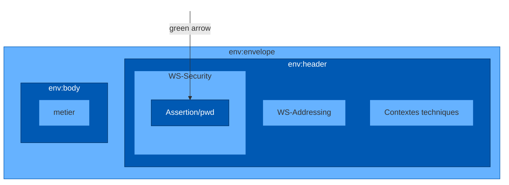

# **Login/mot de passe**

```xml
<env:Envelope xmlns:env="http://www.w3.org/2003/05/soap-envelope" xmlns:wsa="http://www.w3.org/2005/08/addressing" xmlns:wss="http://docs.oasis-open.org/wss/2004/01/oasis-200401-wss-wssecurity-secext-1.0.xsd">
  <env:Header>
    <wsa:Action>urn:smprescriptiont:1.0.0:creerNumeroPrescription</wsa:Action>
    <wsa:MessageID>uuid:f02701b1-0f18-4502-a4bb-b1c5516c0a54</wsa:MessageID>
    <wss:Security>
      <wsse:UsernameToken>
        <wsse:Username>Dupont</wsse:Username>
        <wsse:Password>motdepasse</wsse:Password>
      </wsse:UsernameToken>
    </wss:Security>
  </env:Header>
  <env:Body>
  </env:Body>
</env:Envelope>
```



Présentation de cadre d'interopérabilité
15/01/2016
**14**

