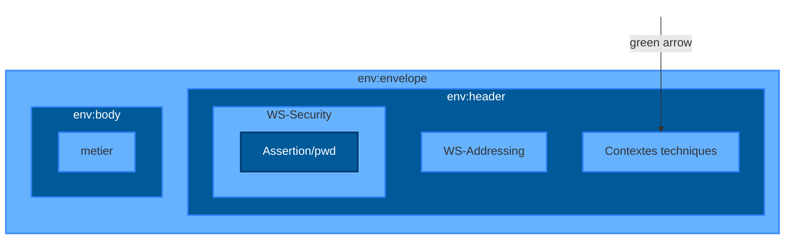

# Assertion Vitale non-signée

```xml
<saml:Assertion ID="_790a4fc3-5639-4473-90e6-78be4de398e1"
  IssueInstant="2011-06-29T10:34:03Z" Version="2.0">
  <saml:Issuer>00B1023668</saml:Issuer>
  <saml:Subject>
    <saml:NameID NameQualifier="VITALE">000467107356</saml:NameID>
  </saml:Subject>
</saml:Assertion>
```

16 Présentation de cadre d'interopérabilité
15/01/2016


# **Assertion Vitale**

## **Signée**

```xml
<saml:Assertion ID="_790a4fc3-5639-4473-90e6-78be4de398e1" IssueInstant="2011-06-29T10:34:03Z" Version="2.0">
    <saml:Issuer>00B1023668</saml:Issuer>
    <ds:Signature>
        <ds:SignedInfo>
            <ds:CanonicalizationMethod Algorithm="http://www.w3.org/2001/10/xml-exc-c14n#"/>
            <ds:SignatureMethod Algorithm="http://www.sesam-vitale.fr/xmldsig/2011/06/V2-sha256/"/>
            <ds:Reference URI="#_790a4fc3-5639-4473-90e6-78be4de398e1">
                <ds:Transforms>
                    <ds:Transform Algorithm="http://www.w3.org/2000/09/xmldsig#enveloped-signature/"/>
                    <ds:Transform Algorithm="http://www.w3.org/2001/10/xml-exc-c14n#"/>
                </ds:Transforms>
                <ds:DigestMethod Algorithm="http://www.w3.org/2001/04/xmlenc#sha256/"/>
                <ds:DigestValue>/llvcn1QXN4eYUgh3O3ze6Q6VQ/6pmrBse+5IQFG2FA=</ds:DigestValue>
            </ds:Reference>
        </ds:SignedInfo>
        <ds:SignatureValue>1HXqB7om6fw=</ds:SignatureValue>
        <ds:KeyInfo>
            <v:KeyInfo xmlns:v="http://www.sesam-vitale.fr/xmldsig/2011/12/vitale">
                <v:NumSerieLogique>000467107356</v:NumSerieLogique>
                <v:CleMere>T2.M.SK.VI.AMO.SG.466</v:CleMere>
            </v:KeyInfo>
        </ds:KeyInfo>
    </ds:Signature>
    <saml:Subject>
        <saml:NameID NameQualifier="VITALE">000467107356</saml:NameID>
    </saml:Subject>
    <saml:AttributeStatement>
        <saml:Attribute Name="NIR">
            <saml:AttributeValue>1550672000106</saml:AttributeValue>
        </saml:Attribute>
    </saml:AttributeStatement>
</saml:Assertion>
```

Présentation de cadre d'interopérabilité
**17** 15/01/2016


# **Assertion PS**

```xml
<Assertion ID="_c3976012-ea2c-4f7d-8fcb-068b6cd1dc0c" IssueInstant="2014-03-24T15:43:40.740Z" Version="2.0"
 xmlns="urn:oasis:names:tc:SAML:2.0:assertion" >
    <Issuer Format="urn:oasis:names:tc:SAML:1.1:nameid-format:X509SubjectName" >
GN=PATRICK+SN=SIRENE0000016260001+CN=500000000016261/CDET0001,OU=300000000016261,L=Paris
(75),O=TEST,C=FR</Issuer>
    <Signature xmlns="http://www.w3.org/2000/09/xmldsig#" >
        <SignedInfo >
            <CanonicalizationMethod Algorithm="http://www.w3.org/2001/10/xml-exc-c14n#" />
            <SignatureMethod Algorithm="http://www.w3.org/2001/04/xmldsig-more#rsa-sha256" />
            <Reference URI="#_c3976012-ea2c-4f7d-8fcb-068b6cd1dc0c" >
                <Transforms >
                    <Transform Algorithm="http://www.w3.org/2000/09/xmldsig#enveloped-signature" />
                    <Transform Algorithm="http://www.w3.org/2001/10/xml-exc-c14n#" />
                </Transforms >
                <DigestMethod Algorithm="http://www.w3.org/2001/04/xmlenc#sha256" />
                <DigestValue >vAvIAhwlnK5btJLhglblyWEDYnVE1XOfGimjVD143CU=</DigestValue>
            </Reference >
        </SignedInfo >
        <SignatureValue >rqR2v5Ehp6...hyxUGUPsWacg==</SignatureValue >
        <KeyInfo >
            <X509Data >
                <X509Certificate >MIIFsTCCBJmgA...vUaBVLJRrxkHfX</X509Certificate >
            </X509Data >
        </KeyInfo >
    </Signature >
    <Subject >
        <NameID NameQualifier="CDE-CPE" >500000000016261/CDET0001</NameID >
    </Subject >
    <AttributeStatement >
        <Attribute Name="AssertionFactory" >
            <AttributeValue >MICA_2.13.03</AttributeValue >
        </Attribute >
        <Attribute Name="identifiantFacturation" >
            <AttributeValue >992500538</AttributeValue >
        </Attribute >
    </AttributeStatement >
</Assertion >
```

Présentation de cadre d'interopérabilité
**18** 15/01/2016


# **2 niveaux de sécurité**

**Au moment**
**de solliciter**
**une opération**
**d’un TLS…**

(Niveau 1 ) …le SI-PS doit générer une nouvelle assertion même si la précédente est toujours valide

(Niveau 2) …le SI-PS doit s’assurer que la durée de vie de l’assertion n’est pas dépassée (soit 1 h/20min) et que la carte liée à l’assertion est toujours présente dans le lecteur

**19**


# **2 contextes XML**

## **Contexte LPS**

## **Contexte BAM**



Présentation de cadre d'interopérabilité
**20** 15/01/2016


